# L008 文章

快速机器解析：语音为单模型转写，未进行独立交叉校对或人工复核；画面每秒采样并按变化选帧，短时文字和标记可能遗漏。截图时间约有 1 秒误差。图片有损压缩；遇到疑点请按时间查看 Google Drive 原视频。

## 00:00:00–00:00:30

Hello everyone, welcome to Capsule Academy. This is Leo. Today we're going to learn new concept English Book Two Lesson Eight Story. Hope you gonna enjoy it.好，那我们直接进入文章啊。来，他说 Joe Sanders，好一个人出现了。Has拥有这个单词一出来，首先你要知道它是 have 的第三人称单数，对吧？其次你要知道这个单词一出来，has 一出

### 画面 00:00:00

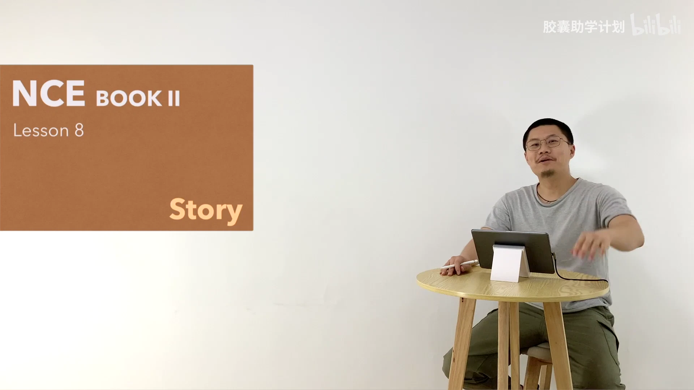

文字识别：胶囊助学计划 / NCE / BOOK"I / Lesson 8 / Story

### 画面 00:00:02

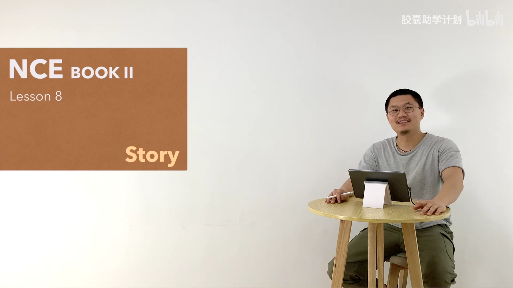

文字识别：胶囊助学计划 / NCE / BOOKII / Lesson 8 / Story

### 画面 00:00:04

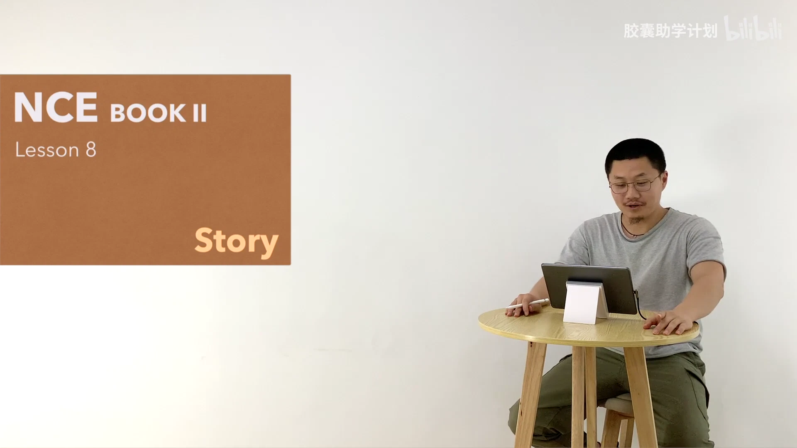

文字识别：胶囊助学计划 / NCE / BOOKⅡI / Lesson 8 / Story

### 画面 00:00:06

文字识别：胶囊助学计划 / NCE / BOOK"I / Lesson 8 / Story

### 画面 00:00:09

文字识别：胶囊助学计划 bilbl / •

### 画面 00:00:13

### 画面 00:00:15

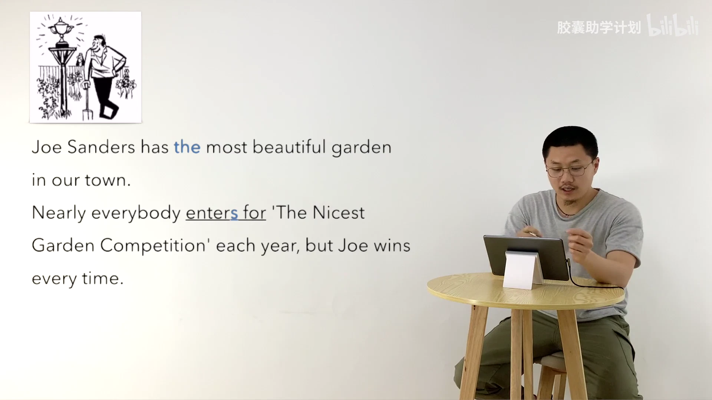

文字识别：胶囊助学计划 / Joe Sanders has the most beautiful garden / 20 / in our town. / Nearly everybody enters for 'The Nicest / Garden Competition' each year, but Joe wins / every time.

### 画面 00:00:17

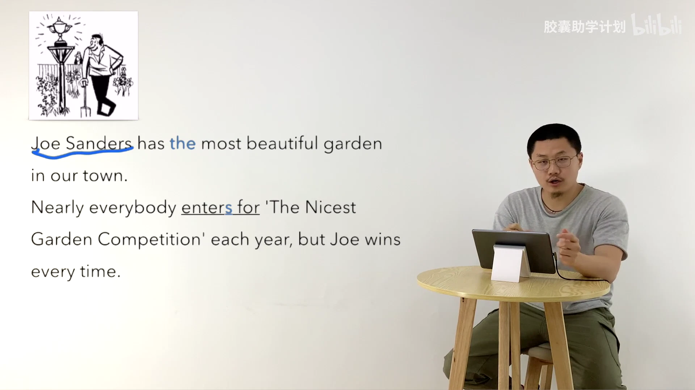

文字识别：胶囊助学计划 / Joe Sanders has the most beautiful garden / in our town. / Nearly everybody enters for 'The Nicest / Garden Competition' each year, but Joe wins / every time.

### 画面 00:00:19

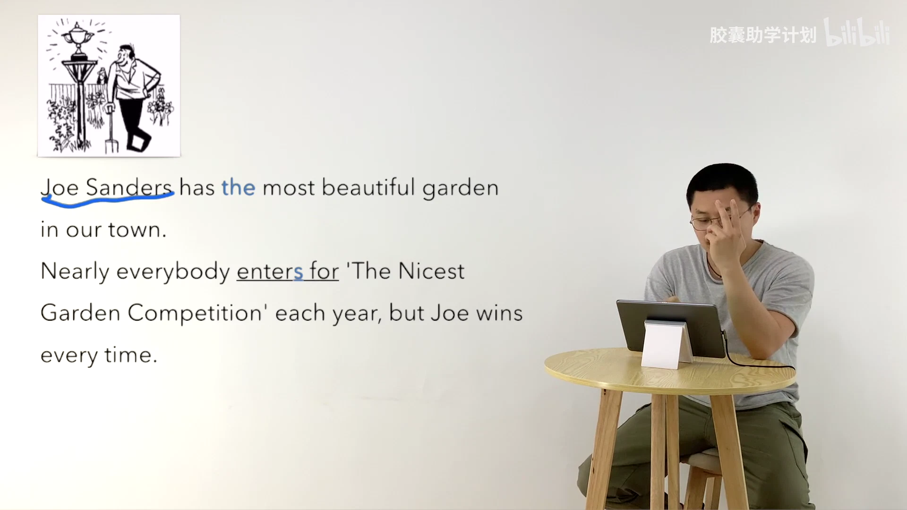

文字识别：胶囊助学计划 / Joe Sanders has the most beautiful garden / in our town. / Nearly everybody enters for 'The Nicest / Garden Competition' each year, but Joe wins / every time.

### 画面 00:00:21

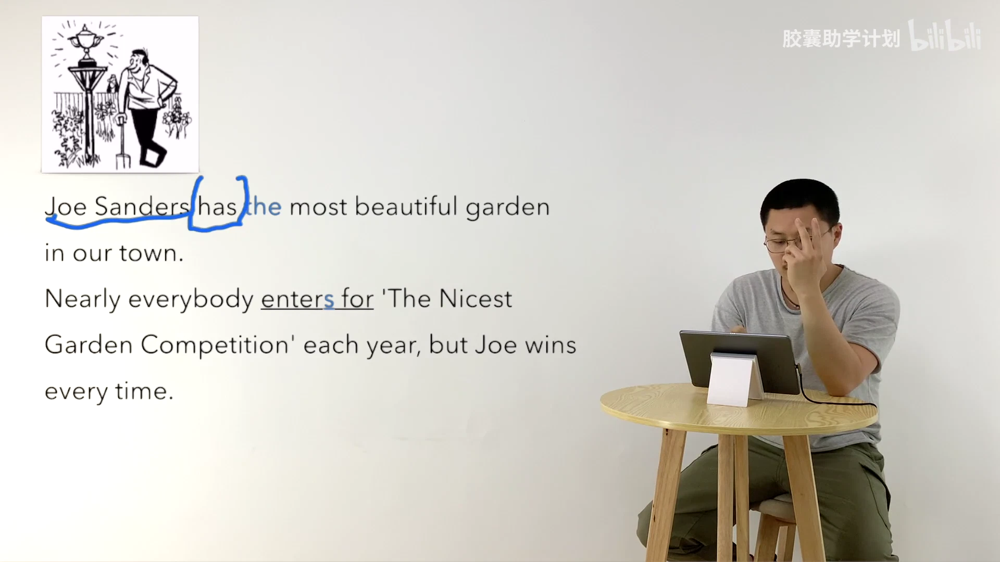

文字识别：胶囊助学计划bilbl / Joe Sanders hasthe most beautiful garden / in our town. / Nearly everybody enters for 'The Nicest / Garden Competition' each year, but Joe wins / every time.

### 画面 00:00:23

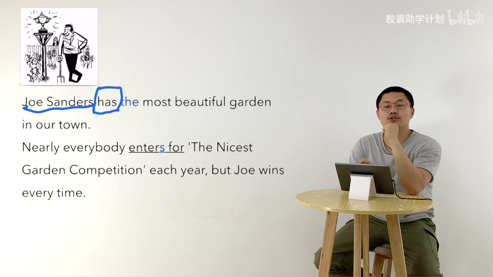

文字识别：胶囊助学计划bilb出 / Joe Sandershas the most beautiful garden / in our town. / Nearly everybody enters for 'The Nicest / Garden Competition' each year, but Joe wins / every time.

### 画面 00:00:27

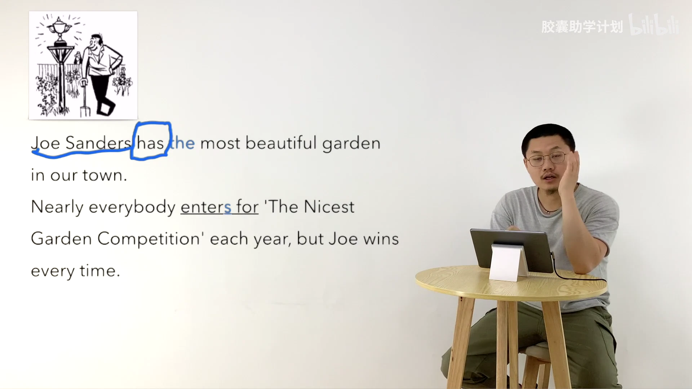

文字识别：胶囊助学计划 / Joe Sanders has the most beautiful garden / in our town. / Nearly everybody enters for'The Nicest / Garden Competition' each year, but Joe wins / every time.

## 00:00:30–00:01:00

来，后边又没有别的动词，它就是个一般现在时，陈述个客观事实，说它拥有什么呢？The most beautiful garden，拥有最美丽的花园。你看，这和我们在语法那个部分讲过的用法啊，有三个对吧？如果各位去好好造句了的话啊，三乘十那个造句，你如果好好完成了的话，那这个用法应该是非常熟悉了。The most beautiful garden，

### 画面 00:00:31

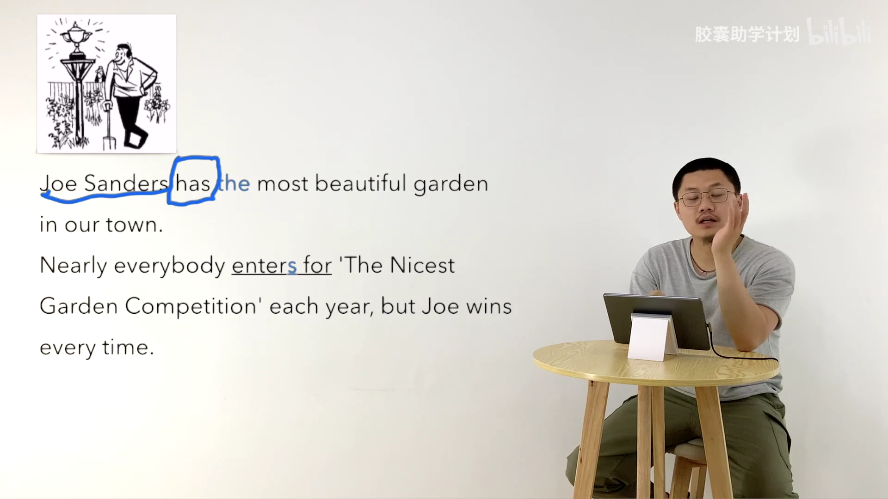

文字识别：胶囊助学计划 / Joe Sandershas the most beautiful garden / in our town. / Nearly everybody enters for 'The Nicest / Garden Competition' each year, but Joe wins / every time.

### 画面 00:00:38

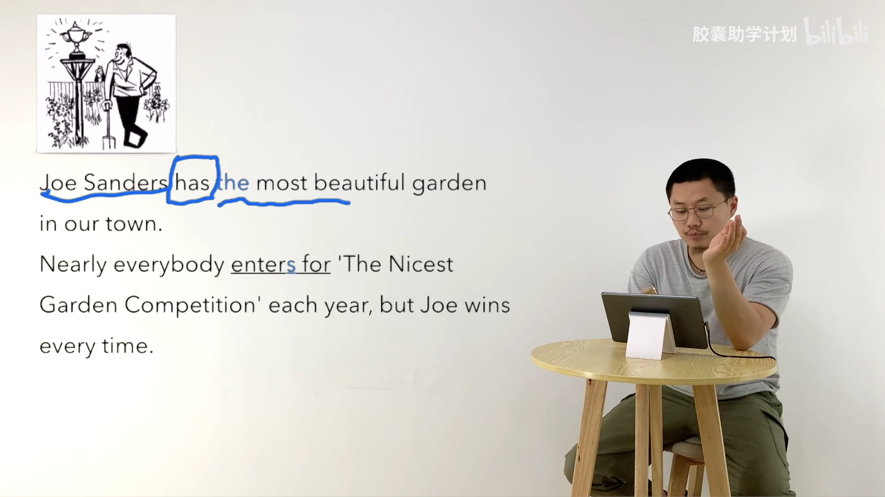

文字识别：胶囊助学计划 / Joe Sandershas the most beautiful garden / in our town. / Nearly everybody enters for'The Nicest / Garden Competition' each year, but Joe wins / every time.

### 画面 00:00:40

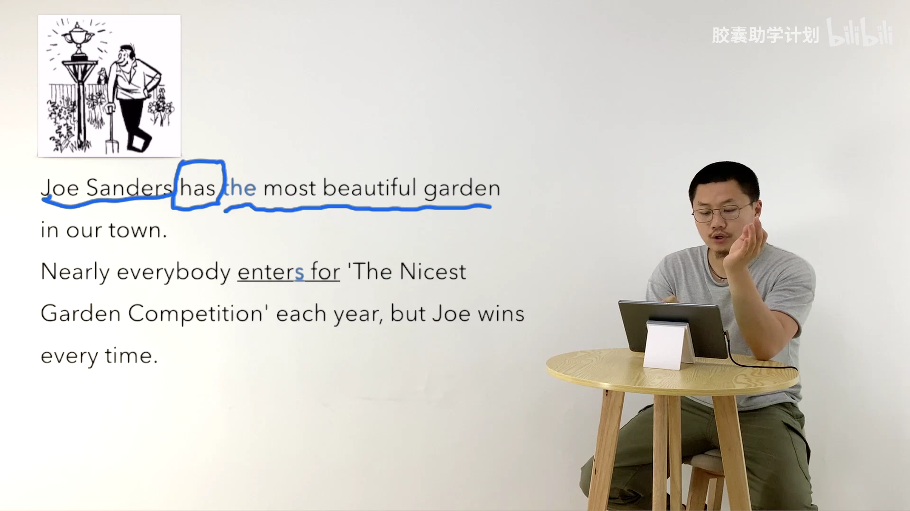

文字识别：胶囊助学计划 / Joe Sandershas the most beautiful garden / in our town. / Nearly everybody enters for 'The Nicest / Garden Competition' each year, but Joe wins / every time.

### 画面 00:00:45

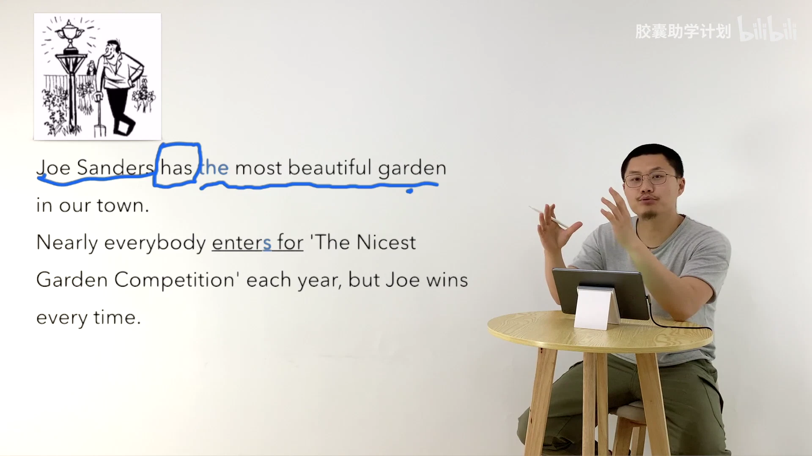

文字识别：胶囊助学计划 / Joe Sanders has the most beautiful garden / in our town. / Nearly everybody enters for 'The Nicest / Garden Competition' each year, but Joe wins / every time.

### 画面 00:00:53

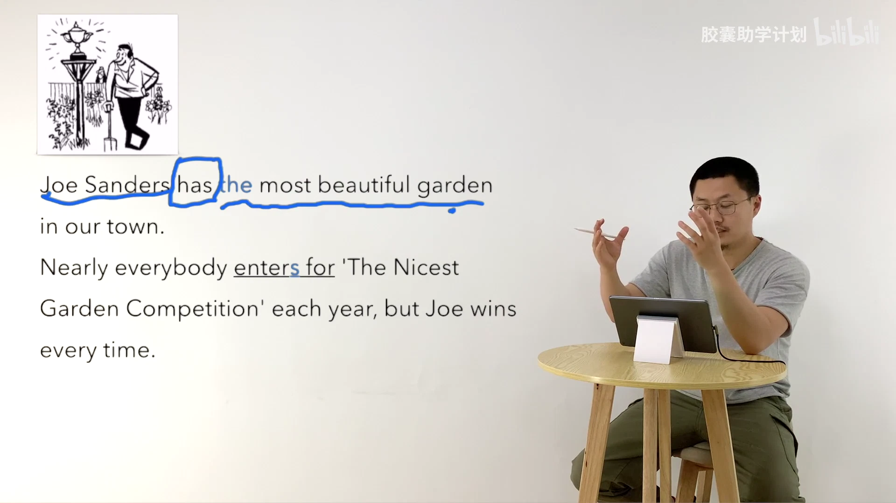

文字识别：胶囊助学计划 / Joe Sanders has the most beautiful garden / in our town. / Nearly everybody enters for'The Nicest / Garden Competition' each year, but Joe wins / every time.

### 画面 00:00:58

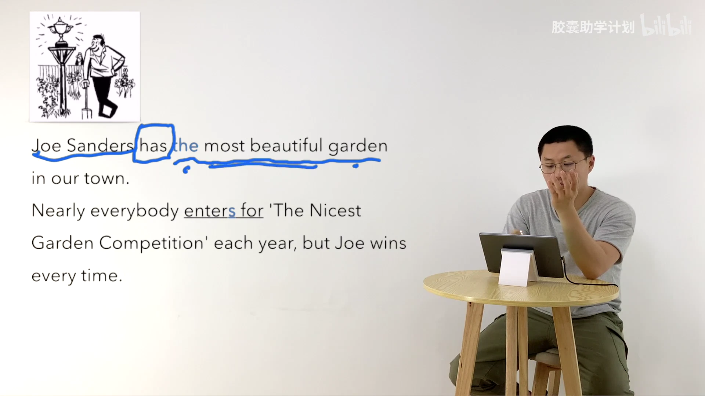

文字识别：胶囊助学计划 / Joe Sanders has the most beautiful garden / in our town. / Nearly everybody enters for 'The Nicest / Garden Competition' each year, but Joe wins / every time.

## 00:01:00–00:01:30

对吧？只不过当时我们给这儿给的是 be，对吧？那你可以把它换成别的动词嘛？Okay, in our town范围，在我们的小镇当中拥有最美丽的花园。注意这个 garden的 garden，理论上来说可以指的是类似于 park公共花园，对吧？也可以指的是自己私家的小花园。那因为这篇文章它描述的是西方人啊，大多数西方人他住的这个叫 house啊，我们汉语开玩笑叫住大 house，对吧？

### 画面 00:01:00

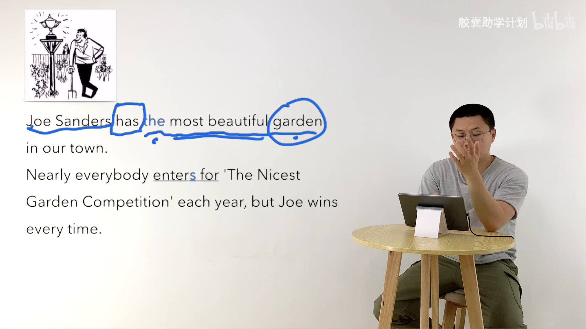

文字识别：胶囊助学计划 / Joe Sandershas the most beautifulgarden / in our town. / Nearly everybody enters for 'The Nicest / Garden Competition' each year, but Joe wins / every time.

### 画面 00:01:02

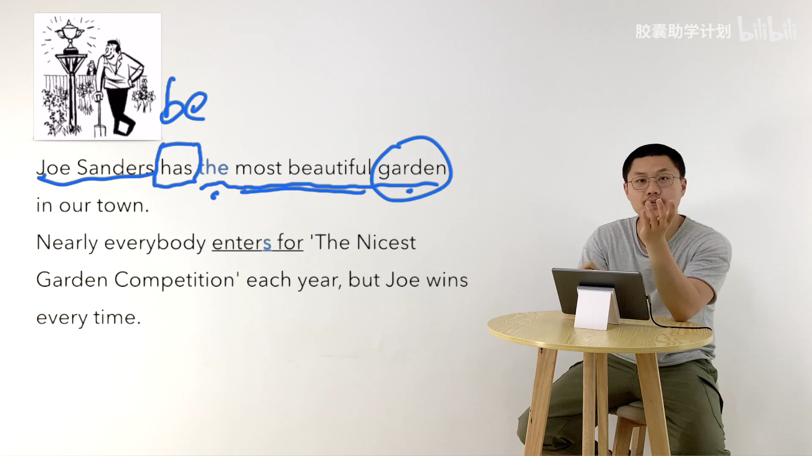

文字识别：胶囊助学计划 / be / Joe Sanders has the most beautifulgarden / in our town. / Nearly everybody enters for'The Nicest / Garden Competition' each year, but Joe wins / every time.

### 画面 00:01:06

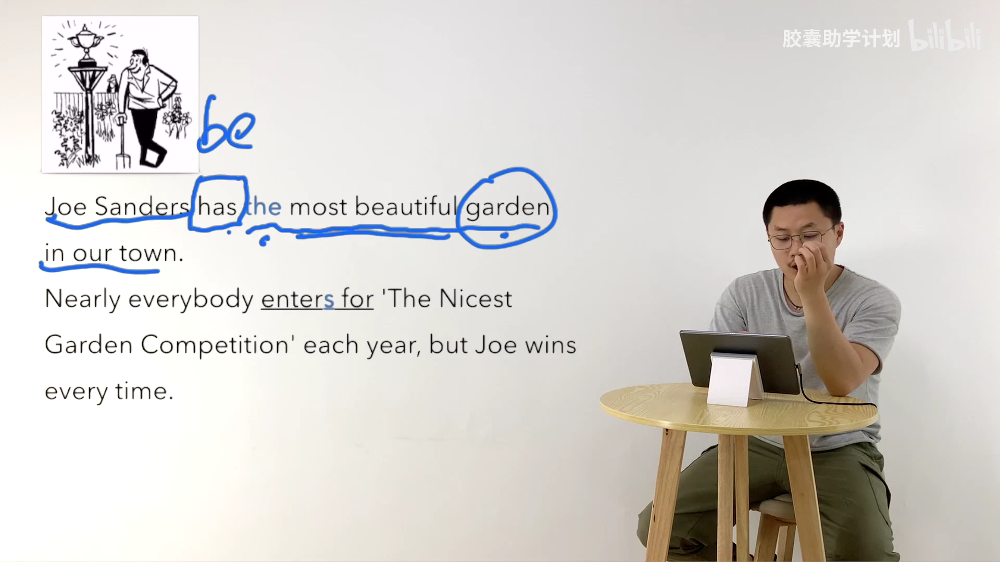

文字识别：胶囊助学计划 / be / Joe Sanders has the most beautifulgarden / in our town. / Nearly everybody enters for 'The Nicest / Garden Competition' each year, but Joe wins / every time.

### 画面 00:01:09

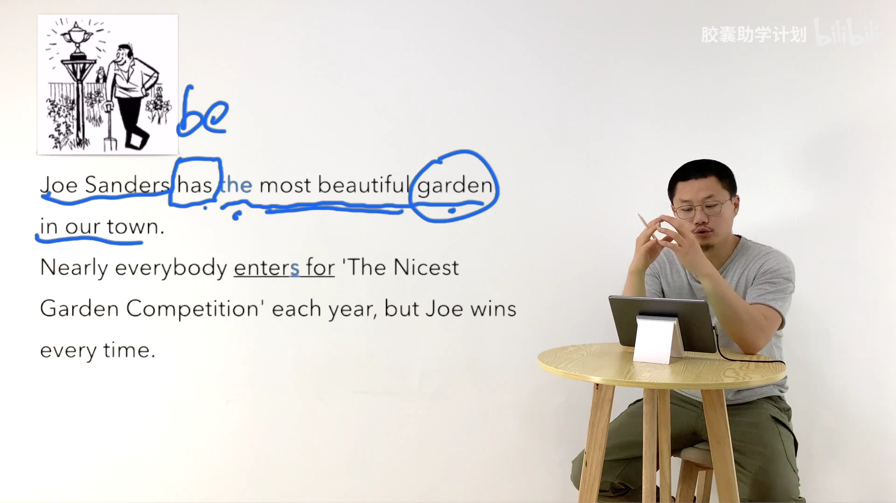

文字识别：胶囊助学计划 / be / Joe Sanders has the most beautifulgarden / in our town. / Nearly everybody enters for 'The Nicest / Garden Competition' each year, but Joe wins / every time.

### 画面 00:01:26

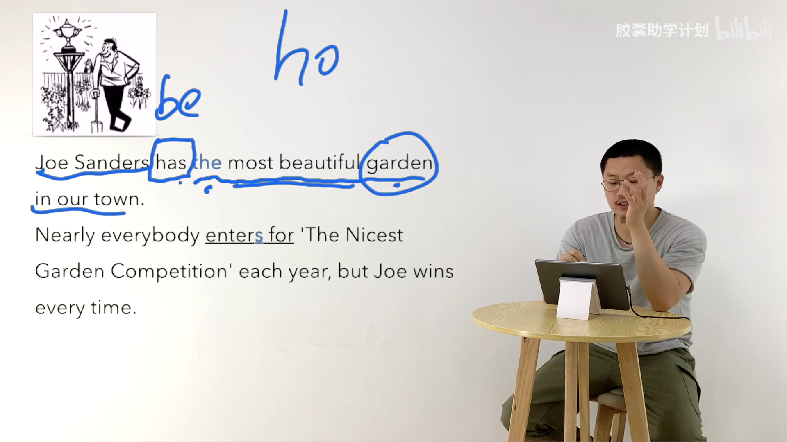

文字识别：胶囊助学计划 / ho / be / Joe Sanders has the most beautifulgarden / in our town. / Nearly everybody enters for 'The Nicest / Garden Competition' each year, but Joe wins / every time.

### 画面 00:01:28

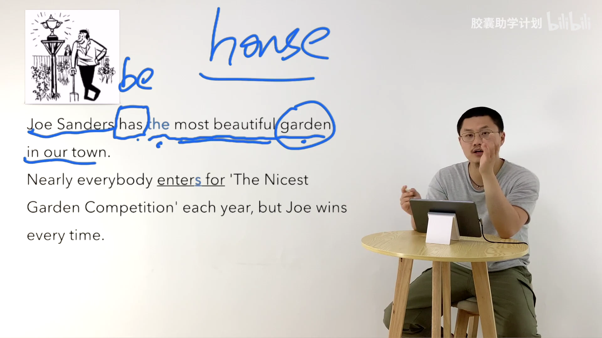

文字识别：胶囊助学计划 / honse / be / Joe Sanders has the most beautifulgarden / in our town. / Nearly everybody enters for'The Nicest / Garden Competition' each year, but Joe wins / every time.

## 00:01:30–00:02:00

啊，就是类似于我们国内的别墅，一般前面是有花园的，所以这个地方的garden一定是他们自己家前面的那个私人花园。Okay, nearly几乎everybody每一个人注意enters for这个地方的enters for我们在单词部分讲到说enter叫加入，那啊参加，那enter for也可以是参加，只不过多了个小的介词。其次呢，as在这个地方，

### 画面 00:01:31

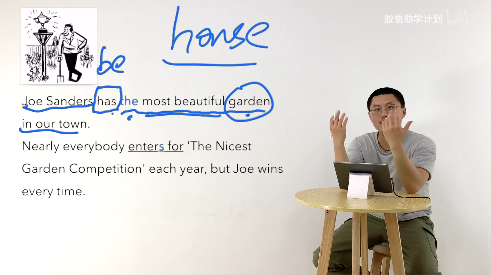

文字识别：胶囊助学计划 / honse / be / Joe Sanders has the most beautifulgarden / in our town. / Nearly everybody enters for 'The Nicest / Garden Competition' each year, but Joe wins / every time.

### 画面 00:01:35

文字识别：胶囊助学计划 / honse / be / Joe Sanders has the most beautifulgarden / in our town. / Nearly everybody enters for 'The Nicest / Garden Competition' each year, but Joe wins / every time.

### 画面 00:01:38

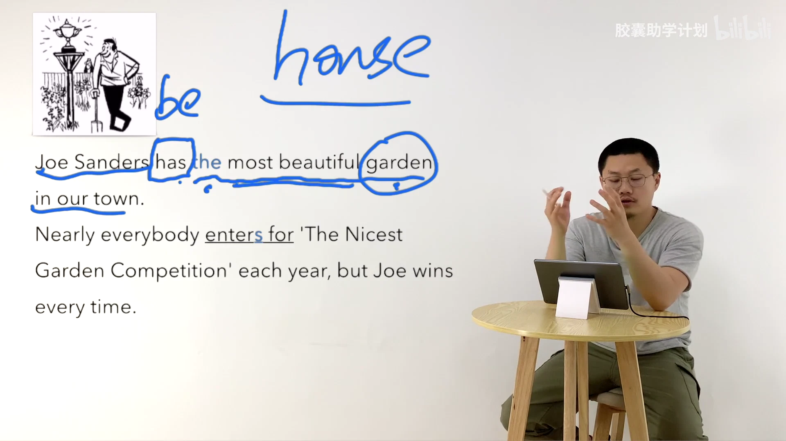

文字识别：胶囊助学计划 / honse / be / Joe Sanders has the most beautifulgarden / in our town. / Nearly everybody enters for 'The Nicest / Garden Competition' each year, but Joe wins / every time.

### 画面 00:01:40

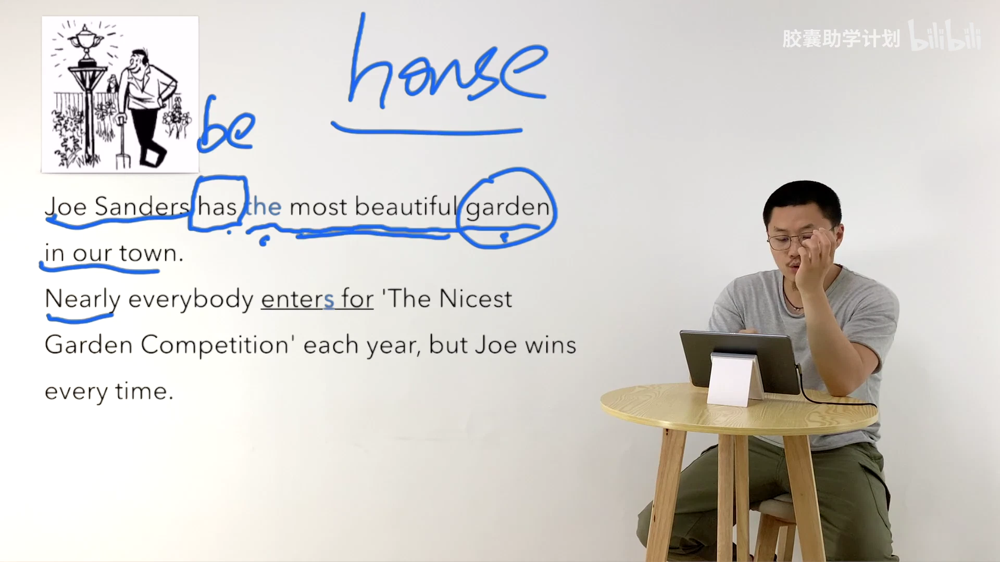

文字识别：胶囊助学计划 / honse / be / Joe Sanders has the most beautifulgarden / in our town. / Nearly everybody enters for'The Nicest / Garden Competition' each year, but Joe wins / every time.

### 画面 00:01:43

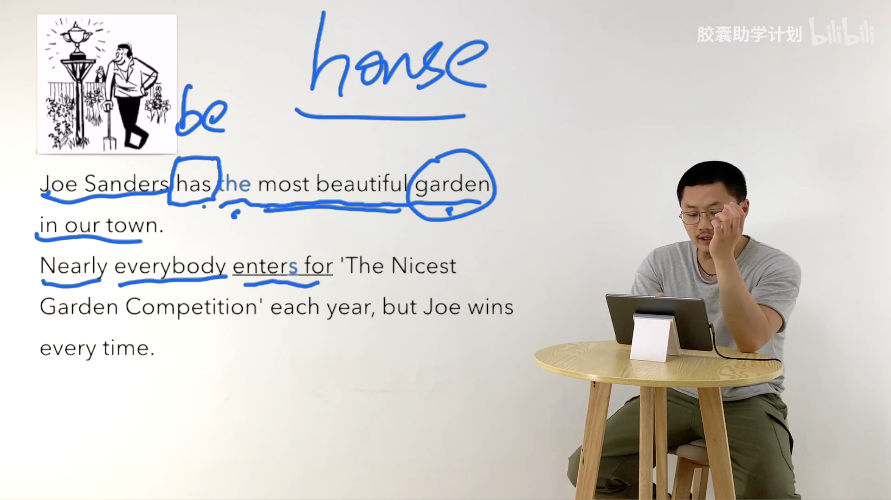

文字识别：胶囊助学计划 / honse / be / Joe Sandershas / theI /  most beautifulgarden / in our town. / Nearly / everybody enters for'The Nicest / Garden Competition' each year, but Joe wins / every time.

### 画面 00:01:45

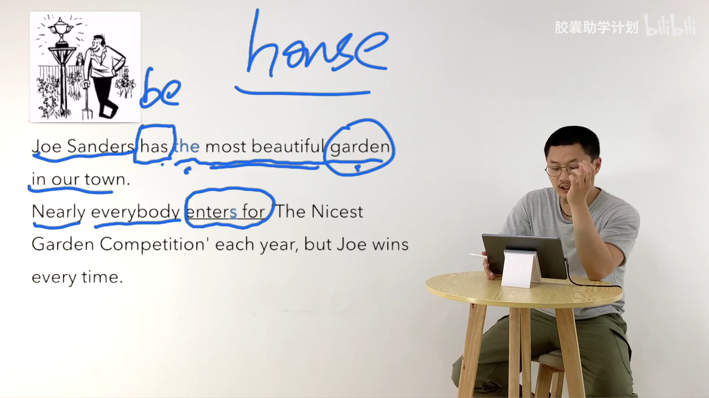

文字识别：胶囊助学计划 / honse / be / Joe Sandershas / the /  most beautifulgarden / in our town. / Nearly / everybody / enters forThe Nicest / Garden Competition' each year, but Joe wins / every time.

### 画面 00:01:47

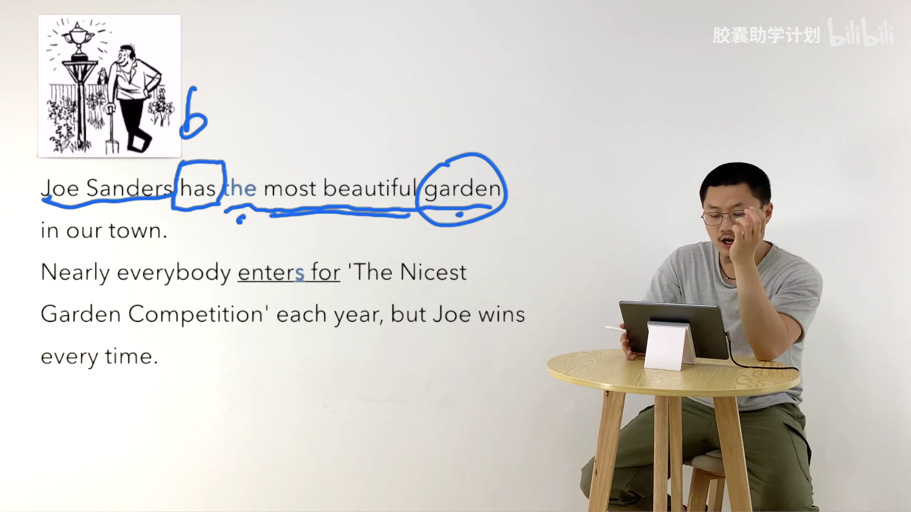

文字识别：胶囊助学计划 / Joe Sanders hasthe most beautifulgarden / in our town. / Nearly everybody enters for'The Nicest / Garden Competition' each year, but Joe wins / every time.

### 画面 00:01:49

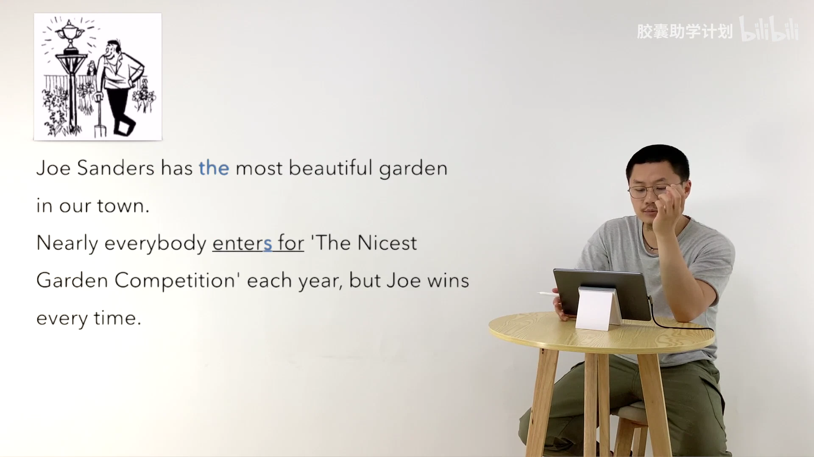

文字识别：胶囊助学计划 / Joe Sanders has the most beautiful garden / in our town. / Nearly everybody enters for 'The Nicest / Garden Competition' each year, but Joe wins / every time.

### 画面 00:01:51

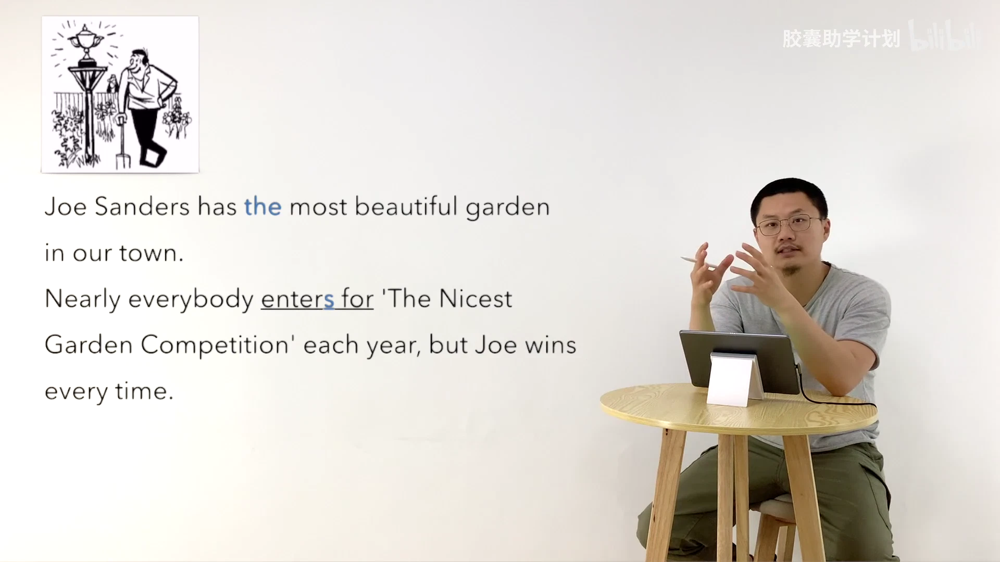

文字识别：胶嚢助学计划 / Joe Sanders has the most beautiful garden / in our town. / Nearly everybody enters for 'The Nicest / Garden Competition' each year, but Joe wins / every time.

### 画面 00:01:58

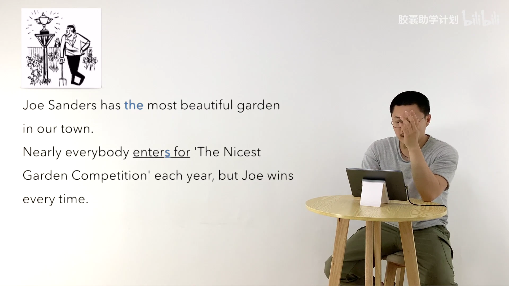

文字识别：胶囊助学计划 / Joe Sanders has the most beautiful garden / in our town. / Nearly everybody enters for 'The Nicest / Garden Competition' each year, but Joe wins / every time.

## 00:02:00–00:02:30

focus mark, is to tell you everybody. Although it refers to every person, but English thinks it is a singular. The verb after it, you use the third person singular, is still the simple present tense, right? State objective facts. Everyone participated in a competition. This competition is enclosed in quotation marks, called the nicest garden competition, the most beautiful garden competition. Each year, but but every year, but every

### 画面 00:02:01

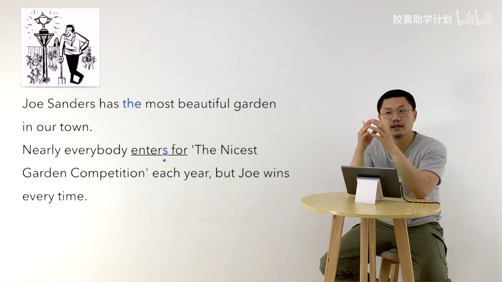

文字识别：胶囊助学计划bilb出 / Joe Sanders has the most beautiful garden / in our town. / Nearly everybody enters for 'The Nicest / Garden Competition' each year, but Joe wins / every time.

### 画面 00:02:03

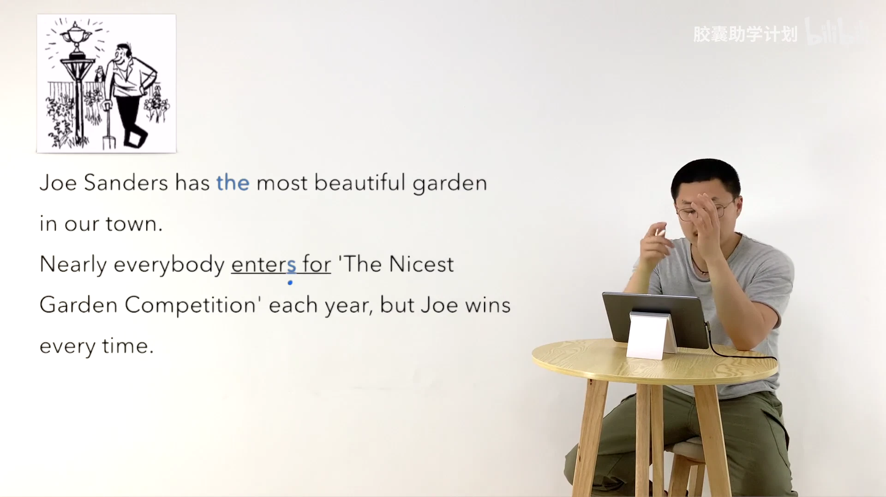

文字识别：胶囊助学计划 / Joe Sanders has the most beautiful garden / in our town. / Nearly everybody enters for 'The Nicest / Garden Competition' each year, but Joe wins / every time.

### 画面 00:02:05

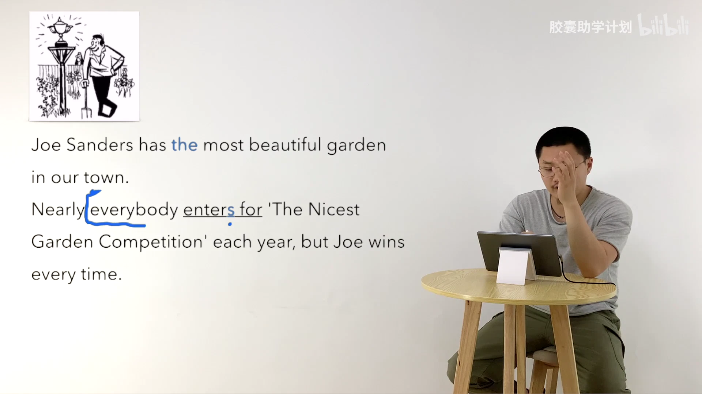

文字识别：胶囊助学计划 / Joe Sanders has the most beautiful garden / in our town. / Nearlyeverybody enters for 'The Nicest / Garden Competition' each year, but Joe wins / every time.

### 画面 00:02:07

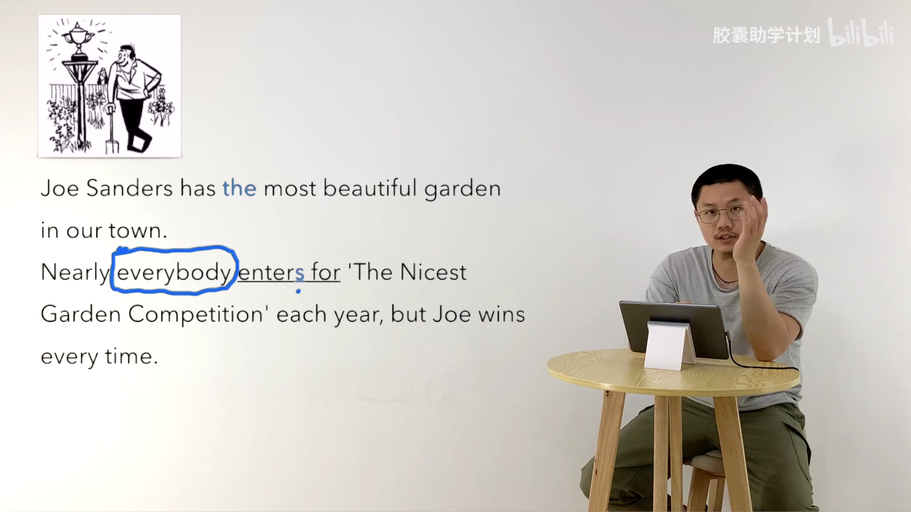

文字识别：胶囊助学计划 / BilBili / Joe Sanders has the most beautiful garden / in our town. / Nearly / everybodyenters for 'The Nicest / • / Garden Competition' each year, but Joe wins / every time.

### 画面 00:02:09

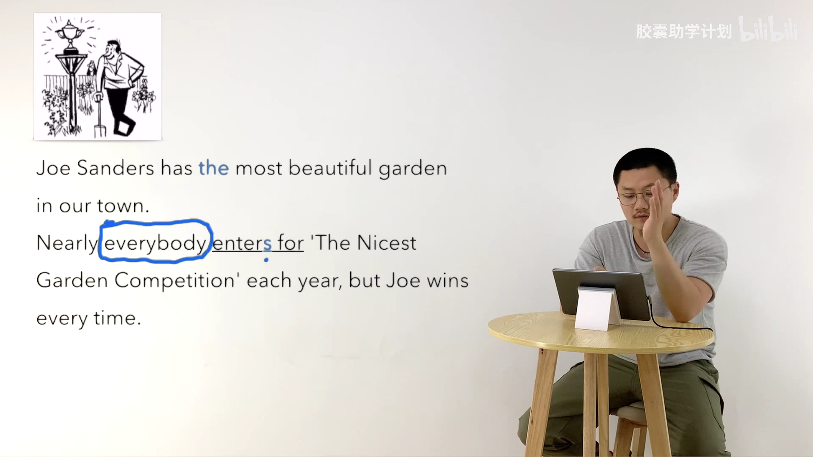

文字识别：胶囊助学计划 / Joe Sanders has the most beautiful garden / in our town. / Nearly / everybodyenters for'The Nicest / Garden Competition' each year, but Joe wins / every time.

### 画面 00:02:22

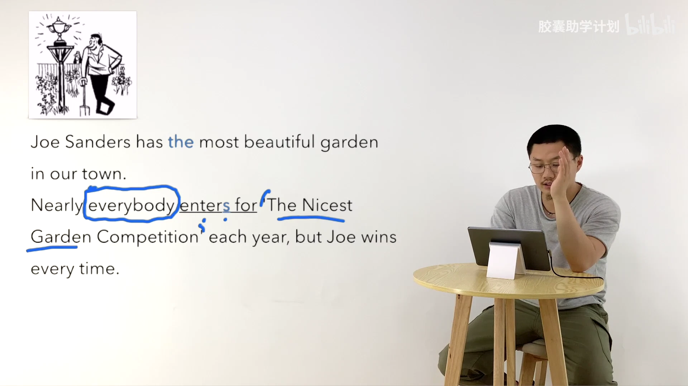

文字识别：胶囊助学计划 / Joe Sanders has the most beautiful garden / in our town. / Nearly / everybodyenters forThe Nicest / Garden Competition'each year, but Joe wins / every time.

### 画面 00:02:24

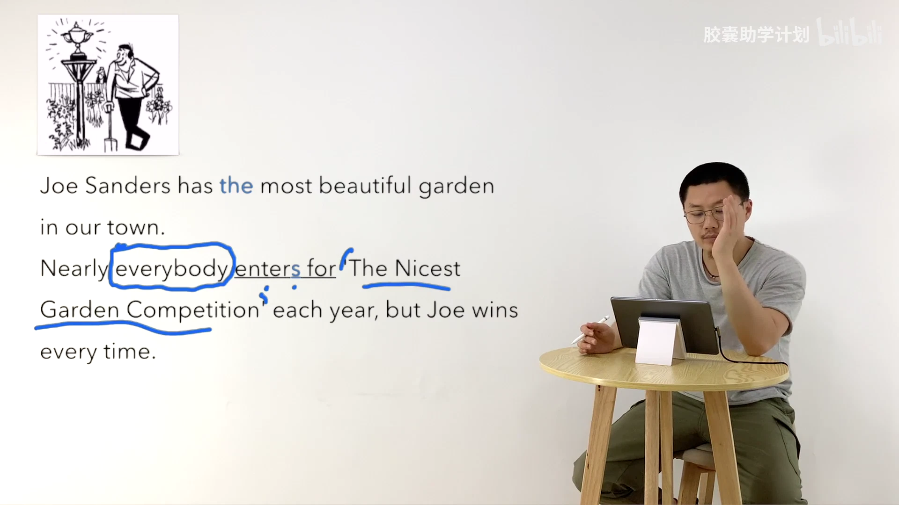

文字识别：胶囊助学计划 / Joe Sanders has the most beautiful garden / in our town. / Nearly / everybodyenters forThe Nicest / Garden Competition'each year, but Joe wins / every time.

### 画面 00:02:26

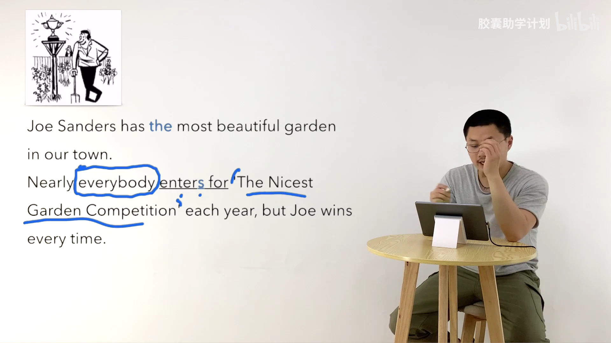

文字识别：胶囊助学计划 / Joe Sanders has the most beautiful garden / in our town. / Nearly / everybodyenters forThe Nicest / Garden Competition'each year, but Joe wins / every time.

## 00:02:30–00:03:00

wins every time.但是Joe啊赢这个比赛每一次啊，注意这个time每一次是吧？每一次啊都是Joe赢。注意这还是个一般现在时，陈述客观事实，对吧？Continue.然后他没有立刻说Joe的花园，很逗。你看他接下来这一段全在做一件事儿。他说，Bill Fris's garden is larger than Joe's.

### 画面 00:02:35

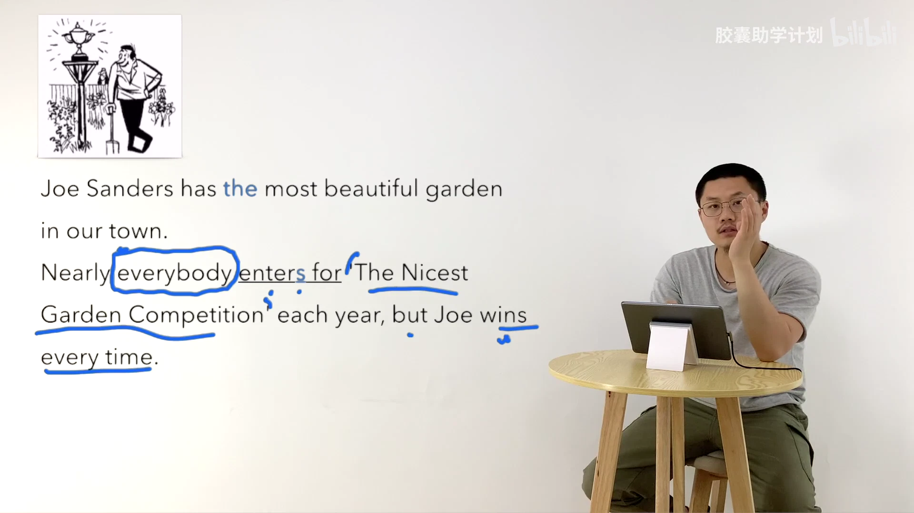

文字识别：胶囊助学计划 / Joe Sanders has the most beautiful garden / in our town. / Nearly / everybodyenters forThe Nicest / Garden Competition'each year, but Joe wins / every time.

### 画面 00:02:45

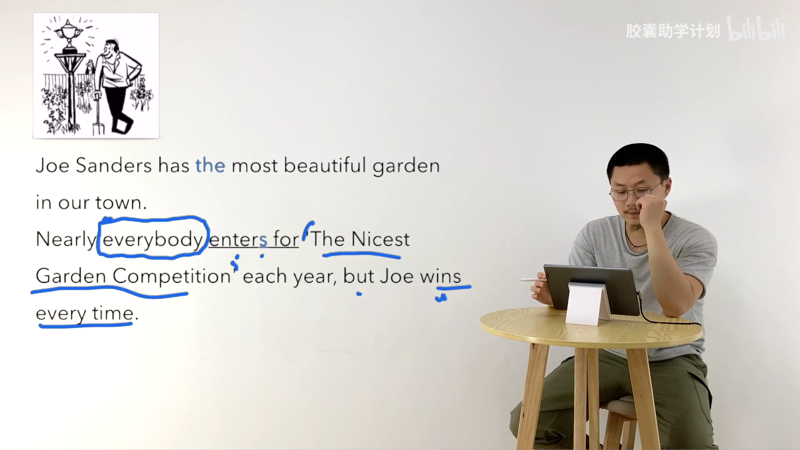

文字识别：胶囊助学计划 / Joe Sanders has the most beautiful garden / in our town. / Nearly / everybodyenters forThe Nicest / Garden Competition'each year, but Joe wins / every time.

### 画面 00:02:47

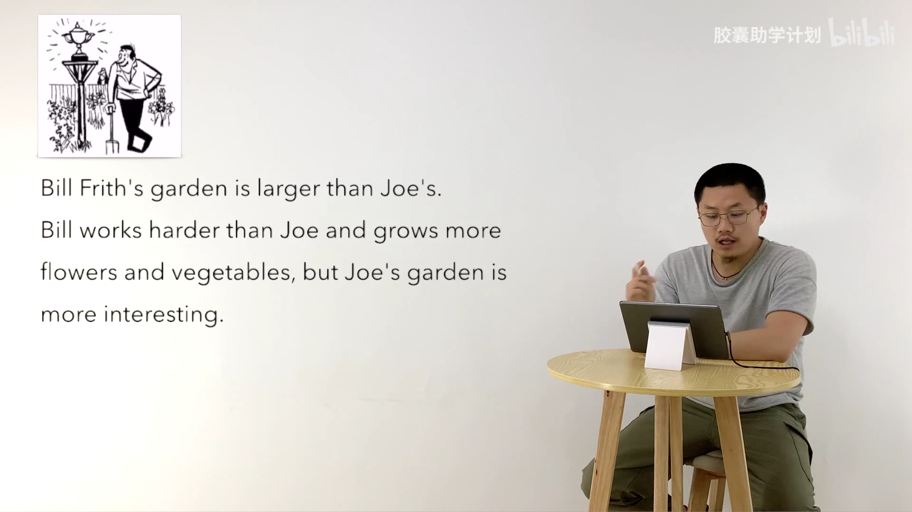

文字识别：胶囊助学计划 / Bill Frith's garden is larger than Joe's. / Bill works harder than Joe and grows more / flowers and vegetables, but Joe's garden is / more interesting.

### 画面 00:02:50

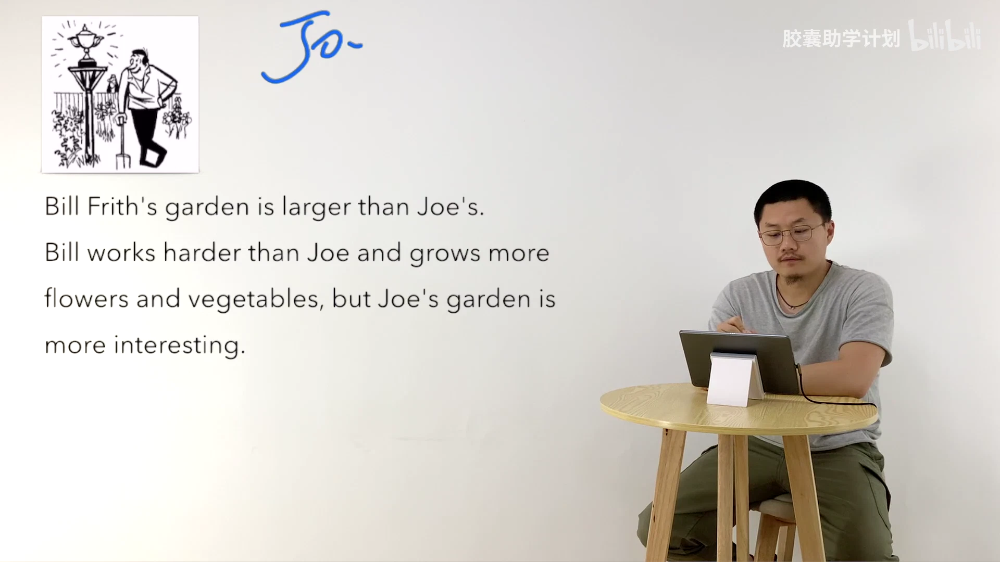

文字识别：胶囊助学计划 / Bill Frith's garden is larger than Joe's. / Bill works harder than Joe and grows more / flowers and vegetables, but Joe's garden is / more interesting.

### 画面 00:02:53

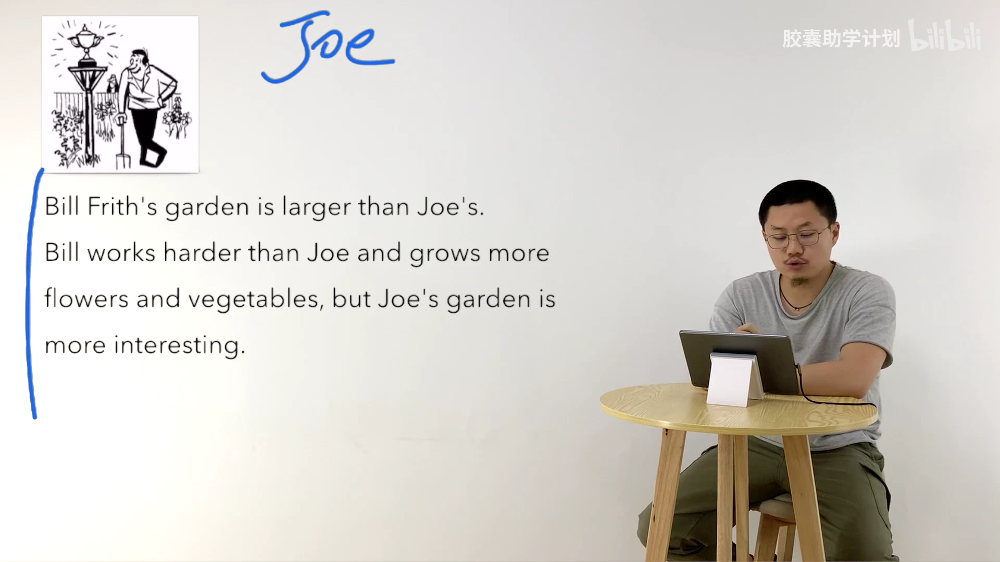

文字识别：Soe / 胶囊助学计划 / Bill Frith's garden is larger than Joe's. / Bill works harder than Joe and grows more / flowers and vegetables, but Joe's garden is / more interesting.

### 画面 00:02:56

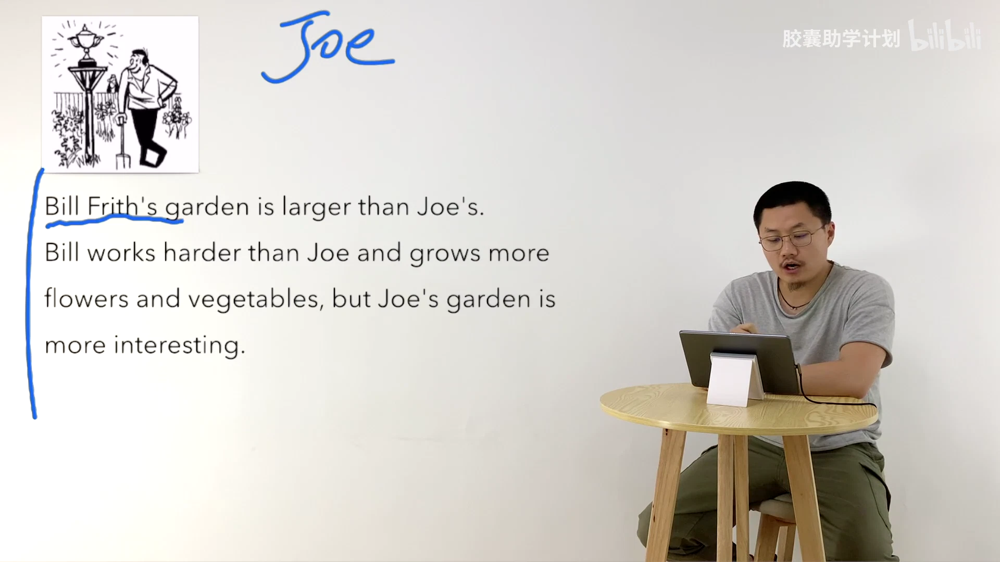

文字识别：Joe / 胶囊助学计划 / Bill Frith's garden is larger than Joe's. / Bill works harder than Joe and grows more / flowers and vegetables, but Joe's garden is / more interesting.

### 画面 00:02:58

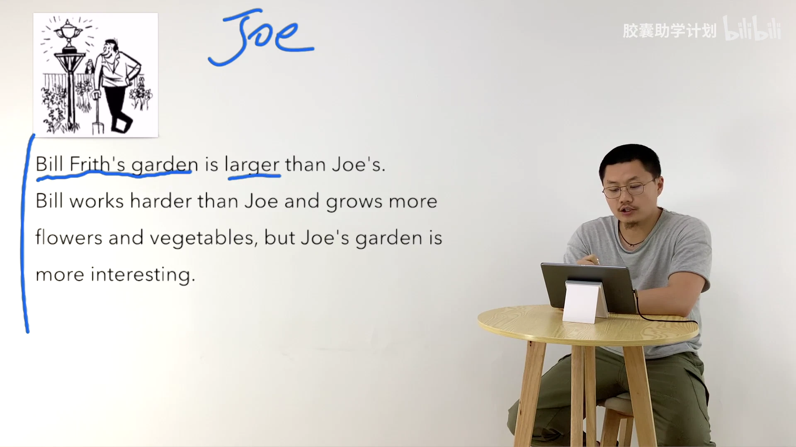

文字识别：Soe / 胶囊助学计划 / Bill Frith's garden is larger than Joe's. / Bill works harder than Joe and grows more / flowers and vegetables, but Joe's garden is / more interesting.

## 00:03:00–00:03:30

比他的要大。注意这个Joe's，其实后边叫做Joe's Garden，对吧？但你可以省略了。他的花园啊，要比Joe的花园更大。你看，你看啊，他最开始开篇跟你说说Joe每年都赢得最美花园大赛，然后他转转转笔是吧？开始写说Bill Frays比他的还好。哎，这就很神奇。为什么呢？接着往下说，他说Bill works harder，工作更加的努

### 画面 00:03:00

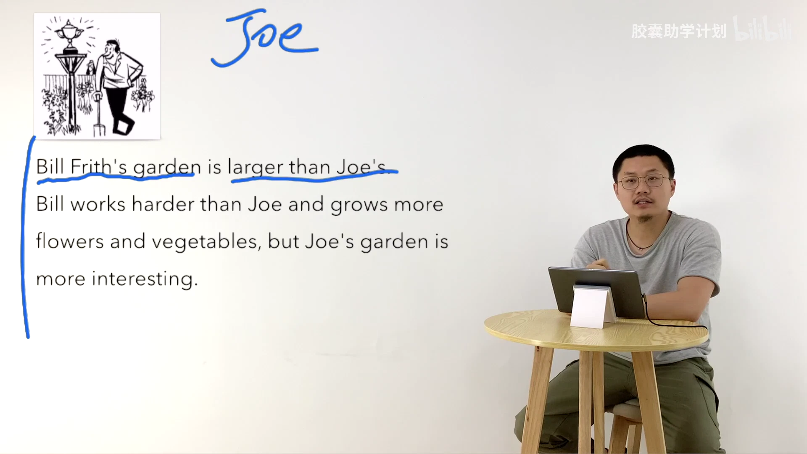

文字识别：Soe / 胶囊助学计划 / Bill Frith's garden is larger than Joe's / Bill works harder than Joe and grows more / flowers and vegetables, but Joe's garden is / more interesting.

### 画面 00:03:03

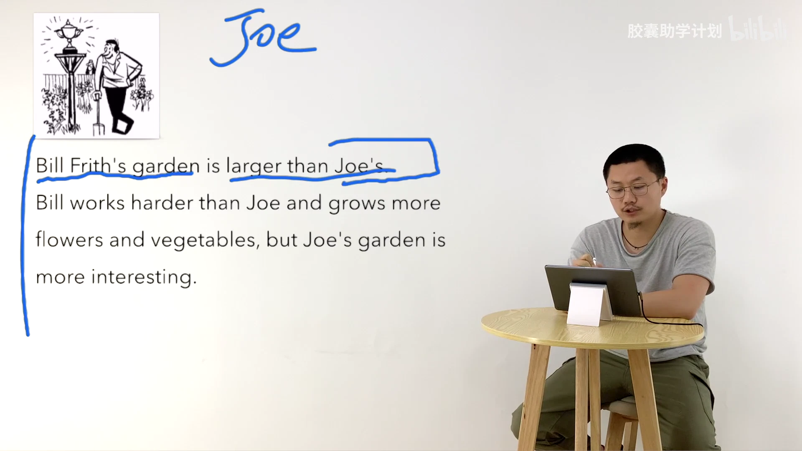

文字识别：Joe / 胶囊助学计划 / Bill Frith's garden is larger than Joe's / Bill works harder than Joe and grows more / flowers and vegetables, but Joe's garden is / more interesting.

### 画面 00:03:06

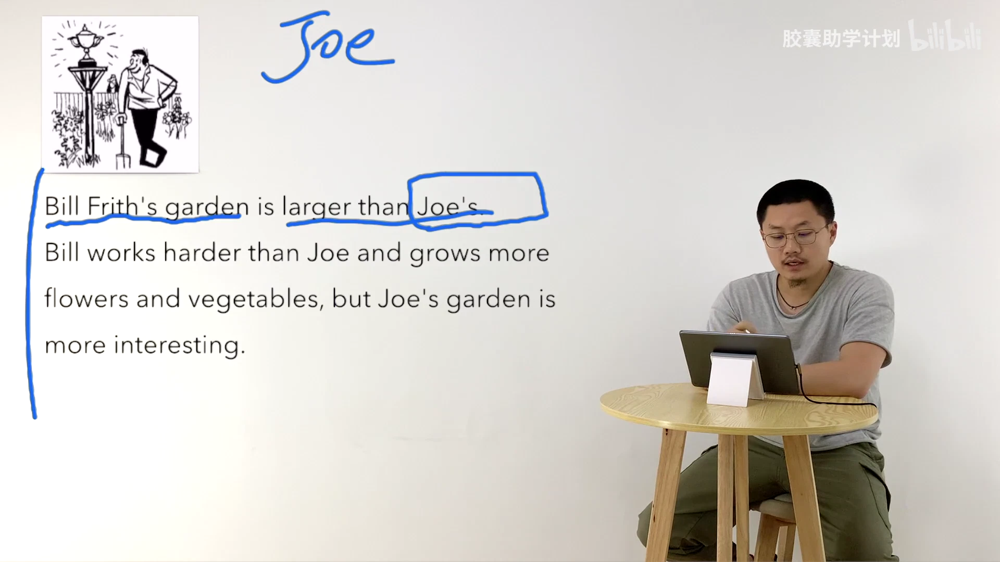

文字识别：Soe / 胶囊助学计划 / Bill Frith's garden is larger than / Joe's / Bill works harder than Joe and grows more / flowers and vegetables, but Joe's garden is / more interesting.

### 画面 00:03:12

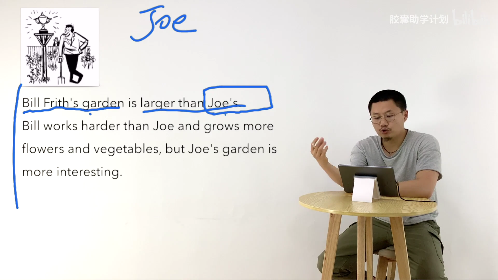

文字识别：Joe / 胶囊助学计划 / Bill Frith's garden is larger than / Joe's. / Bill works harder than Joe and grows more / flowers and vegetables, but Joe's garden is / more interesting.

### 画面 00:03:27

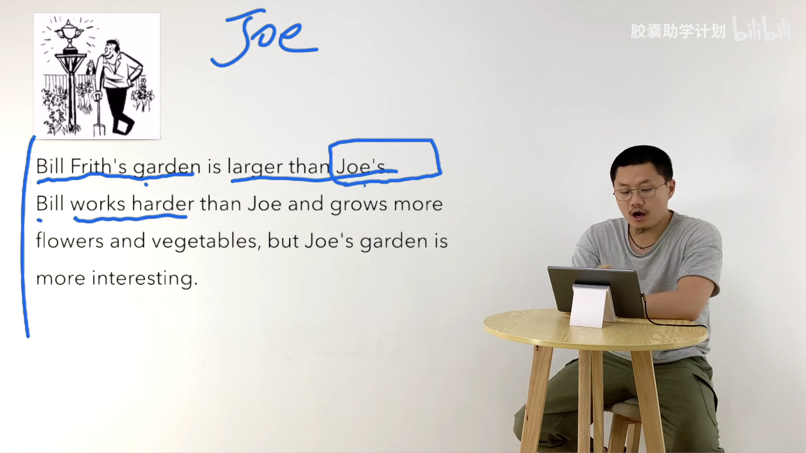

文字识别：Joe / 胶囊助学计划 / Bill Frith's garden is larger than / Joe's / Bill works harder than Joe and grows more / flowers and vegetables, but Joe's garden is / more interesting.

## 00:03:30–00:04:00

than Joe，比Joe工作还更努力。然后呢，Gross，然后种了 more flowers and vegetables，种了更多的花和更多的蔬菜，对吧？也就换一句话来说，努不努力呢？是努力的啊！这跟大家学英语一样，对吧？写作业努不努力呢？是努力的。但你方向要是错了呢，还不如不努力是吧？浪费时间。你看一下Joe，但是 Joe's garden is more interesting.

### 画面 00:03:30

文字识别：Joe / 胶囊助学计划 / Bill Frith's garden is larger than / Joe's / Bill works harder / thar / Joe and grows more / flowers and vegetables, but Joe's garden is / more interesting.

### 画面 00:03:36

文字识别：Joe / 胶囊助学计划 / Bill Frith's garden is larger than / Joe's / Bill works harder / than / Joe and / grows more / flowers and vegetables, but Joe's garden is / more interesting.

### 画面 00:03:38

文字识别：Joe / 胶囊助学计划 / Bill Frith's garden is larger than / Joe's. / Bill works / harder / thar / Joe and / grows more / flowers / and / vegetables, but Joe's garden is / interesting. / more

### 画面 00:03:55

文字识别：Joe / 胶囊助学计划 / Bill Frith's garden is larger than / Joe's / Bill / works / harder / thar / Joe and / grows / more / flowers / and / vegetables, but Joe's garden is / interesting. / more

### 画面 00:03:58

文字识别：Joe / 胶囊助学计划 / Bill Frith's garden is larger than / Joe's / Bill / works / harder / thar / Joe and / grows / more / flowers / and / vegetables but Joe's garden is / interesting. / more

## 00:04:00–00:04:30

Joe这个人呢，他不使蛮力，他使的是巧劲儿啊！他明白什么要做什么不要做，所以他说Joe的花园更有趣，more interesting。最有趣叫做the most interesting. OK.那接下来他就开始说Joe做了一些什么事情。Joe做了什么呢？Joe has made.注意这是现在完成时了，对吧？Neat path.他已经做了一些特别干净整洁的

### 画面 00:04:00

文字识别：Joe / 胶囊助学计划 / Bill Frith's garden is / s larger than / Joe's / Bill / works / harder / thar / Joe and / grows / more / flowers / and / vegetables but Joe's garden is / interesting. / more

### 画面 00:04:05

文字识别：Joe / 胶囊助学计划 / Bill Frith's garden is / larger than / Joe's / Bill / works / harder / thar / Joe and / grows / more / flowers / and / vegetables but Joe's garden is / interesting. / more

### 画面 00:04:08

文字识别：Joe / 胶囊助学计划 / Bill Frith's garden is / larger than / Joe's / Bill / works / harder / thar / Joe and / grows / more / flowers / and / vegetables but Joe's garden is / interesting. / more

### 画面 00:04:15

文字识别：胶囊助学计划 / He has made neat paths and has built a / wooden bridge over a pool. / I like gardens too, but I do not like hard work. / Every year I enter for the garden competition / too, and I always win a little prize for the / worst garden in the town!

### 画面 00:04:22

文字识别：胶囊助学计划 / Hehas made neat paths and has built a / • / wooden bridge over a pool. / I like gardens too, but I do not like hard work. / Every year I enter for the garden competition / too, and I always win a little prize for the / worst garden in the town!

### 画面 00:04:25

文字识别：胶囊助学计划 / Hehas made neat paths and has built a / wooden bridge over a pool. / I like gardens too, but I do not like hard work. / Every year I enter for the garden competition / too, and I always win a little prize for the / worst garden in the town!

## 00:04:30–00:05:00

小径，哎，你想一下，自己去脑海脑补一下，在他的花园当中做了一些干净整洁的这样的一些小道啊，铺了一些路。Has built,已经建造了什么呢？A wooden bridge,建造了一个木质的桥over a pool，在一个水池子里边。想一下啊，他自己家的私人小花园，就是他们家前面那个小地儿或者后面那个小地儿啊，他不仅铺

### 画面 00:04:41

文字识别：胶囊助学计划 / Hehas made neat paths and has builta / wooden bridge over a pool. / I like gardens too, but I do not like hard work. / Every year I enter for the garden competition / too, and I always win a little prize for the / worst garden in the town!

### 画面 00:04:43

文字识别：胶囊助学计划 / Hehas made neat paths and / has builta / • / wooden bridge over a pool. / I like gardens too, but I do not like hard work. / Every year I enter for the garden competition / too, and I always win a little prize for the / worst garden in the town!

### 画面 00:04:48

文字识别：胶囊助学计划 / Hehas made neat paths and / has builta / wooden bridge over a pool. / I like gardens too, but I do not like hard work. / Every year I enter for the garden competition / too, and I always win a little prize for the / worst garden in the town!

### 画面 00:04:52

文字识别：胶囊助学计划 / Hehas made neat paths and / has builta / • / wooden bridge over a pool. / I like gardens too, but I do not like hard work. / Every year I enter for the garden competition / too, and I always win a little prize for the / worst garden in the town!

### 画面 00:04:54

文字识别：胶囊助学计划 / Hehas made neat paths and / has builta / • / wooden bridge over a pool. / I like gardens too, but I do not like hard work / Every year I enter for the garden competition / too, and I always win a little prize for the / worst garden in the town!

### 画面 00:04:58

文字识别：胶囊助学计划 / Hehas made neat paths and / has builta / wooden bridge over a pool. / I like gardens too, butI do not like hard work. / Every year I enter for the garden competition / too, and I always win a little prize for the / worst garden in the town!

## 00:05:00–00:05:30

了路、种了花，对吧？这些事儿他也做了。他还做了什么不一样的事情呢？做了一些干净整洁的小径，在挖了一个小的水池子，在这个水池子的上方建造了一个小的木质的桥。哎，很很有趣。这就是给你去解释为什么它的更 interesting。接下来第三个人啊，作者，I like gardens too。我也喜欢花园，but I do not like hard work。但是我呀，不热爱努力工作啊，就是学英

### 画面 00:05:03

文字识别：胶囊助学计划 / Hehas made neat paths and / has builta / wooden bridge over a pool. / I like gardens too, butI do not like hard work. / Every year I enter for the garden competition / too, and I always win a little prize for the / worst garden in the town!

### 画面 00:05:06

文字识别：胶囊助学计划 / Hehas made neat paths and / nas builta / • / wooden bridge over a pool. / I like gardens too, butI do not like hard work. / Every year I enter for the garden competition / too, and I always win a little prize for the / worst garden in the town!

### 画面 00:05:08

文字识别：胶囊助学计划 / Hehas made neat paths and / nas builta / • / wooden bridge over a pool. / I like gardens too, but I do not like hard work. / Every year I enter for the garden competition / too, and I always win a little prize for the / worst garden in the town!

### 画面 00:05:13

文字识别：胶囊助学计划 / Hehas made neat paths and / nas builta / • / wooden bridge over a pool. / I like gardens too, butI do not like hard work. / Every year I enter for the garden competition / too, and I always win a little prize for the / worst garden in the town!

### 画面 00:05:16

文字识别：胶囊助学计划 / Hehas made neat paths and / nas builta / • / wooden bridge over a pool. / I like gardens too, butI do not like hard work. / Every year I enter for the garden competition / too, and I always win a little prize for the / worst garden in the town!

### 画面 00:05:18

文字识别：胶囊助学计划 / Hehas made neat paths and / has builta / • / wooden bridge over a pool. / I like gardens too, but I do not like hard work. / Every year I enter for the garden competition / too, and I always win a little prize for the / worst garden in the town!

### 画面 00:05:21

文字识别：胶囊助学计划 / Hehas made neat paths and / has builta / wooden bridge over a pool. / I like gardens too, but I do not like hard work. / Every year I enter for the garden competition / too, and I always win a little prize for the / worst garden in the town!

### 画面 00:05:23

文字识别：胶囊助学计划 / Hehas made neat paths and / has builta / wooden bridge over a pool. / I like gardens too, but I do not like hard work. / Every year I enter for the garden competition / too, and I always win a little prize for the / worst garden in the town!

### 画面 00:05:25

文字识别：胶囊助学计划 / He / has made neat paths and / has builta / • / wooden bridge over a pool. / I like gardens too, but I do not like hard work. / Every year I enter for the garden competition / too, and I always win a little prize for the / worst garden in the town!

## 00:05:30–00:06:00

最最最最次的一类人，就是吧？我爱学英语，但是从不写家庭作业，对吧？啊，我我也不想读啊，但是我爱英语啊。Every year，每一年，I enter for the garden competition too。每一年啊，我也参加这个花园大赛。And然后呢，I always win a little prize。我总是赢得一个很小的奖奖项。什么奖项呢？这有一个关键单词for，我们先不管它，

### 画面 00:05:38

文字识别：胶囊助学计划 / Hehas made neat paths and / has builta / • / wooden bridge over a pool. / I like gardens too, but I do not like hard work. / Every year I enter for the garden competition / too, and I always win a little prize for the / worst garden in the town!

### 画面 00:05:40

文字识别：胶囊助学计划 / He / has made neat paths and / has built / • / wooden bridge over a pool. / I like gardens too, but I do not like hard work. / Every year | enter for the garden competition / too, and I always win a little prize for the / worst garden in the town!

### 画面 00:05:42

文字识别：胶囊助学计划 / He / has made neat paths and / nas built / • / wooden bridge over a pool. / I like gardens too, but I do not like hard work. / Every year | enter for the garden competition / too, and I always win a little prize for the / worst garden in the town!

### 画面 00:05:44

文字识别：胶囊助学计划 / He / has made neat paths and / nas builta / • / wooden bridge over a pool. / I like gardens too, but I do not like hard work. / Every year I enter for the garden competition / too, and I always win a little prize for the / worst garden in the town!

### 画面 00:05:46

文字识别：胶囊助学计划 / Hehas made neat paths and / has builta / wooden bridge over a pool. / I like gardens too, but I do not like hard work. / Every year I enter for the garden competition / too, and I always win a little prize for the / worst garden in the town!

## 00:06:00–00:06:30

看后面。The worst garden in the town.那这个奖项是最烂花园 in the town，叫做在这个小镇上。我获得的这个奖项呢，就是这个小镇上最烂的那个花园，对吧？因为你你不不努力，对吧？不努力就不存在让它变得更有趣了，对吧？你可能连更多的所谓花花草草你都不种，对吧？好，那这个地方的 for 啊，其实是等我们大概到呃二十九、三十、三十一这几课的

### 画面 00:06:10

文字识别：胶囊助学计划 / Hehas made neat paths and / nas builta / • / wooden bridge over a pool. / I like gardens too, but I do not like hard work. / Every year I enter for the garden competition / too, and I always win a little prize for the / worst garden in the town!

### 画面 00:06:24

文字识别：胶囊助学计划 / Hehas made neat paths and / has builta / wooden bridge over a pool. / I like gardens too, but I do not like hard work. / Every year I enter for the garden competition / too, and I always win a little prize for the / worst garden in the town!

### 画面 00:06:27

文字识别：胶囊助学计划bilb出 / Hehas made neat paths and / has builta / • / wooden bridge over a pool. / I like gardens too, but I do not like hard work. / Every year I enter for the garden competition / too, and I always win a little prize for the / worst garden in the town!

### 画面 00:06:29

文字识别：胶囊助学计划 / Hehas made neat paths and / has builta / • / wooden bridge over a pool. / I like gardens too, but I do not like hard work. / Every year I enter for the garden competition / too, and I always win a little prize for the / worst garden in the town!

## 00:06:30–00:07:00

时候会学到的，它是一个介词啊，引导了一个小的短语，后置做了一个定语，是吧？这听起来挺复杂的。目前呢，我的个人感受是这样的：您就算不懂这个 for 是后置定语，对吧？引导这个短语后置定语，你猜你也能猜出来。我总是赢得一个小的奖项。for 咱就直接当没看到，the 咱也当没看到。were 最烂的花园在这个小镇上。你我相信通过这些单词，你也能

### 画面 00:06:32

文字识别：胶囊助学计划 / Hehas made neat paths and / has builta / • / wooden bridge over a pool. / I like gardens too, but I do not like hard work. / Every year I enter for the garden competition / too, and I always win a little prize for the / worst garden in the town!

### 画面 00:06:40

文字识别：胶囊助学计划 / Hehas made neat paths and / nas builta / wooden bridge over a pool. / I like gardens too, but I do not like hard work. / Every year I enter for the garden competition / too, and I always win a little prize / the / worst garden in the town!

### 画面 00:06:47

文字识别：胶囊助学计划 / Hehas made neat paths and / nas builta / • / wooden bridge over a pool. / I like gardens too, but I do not like hard work. / Every year I enter for the garden competition / too, and I always win a little prize for the / worst garden in the town!

### 画面 00:06:58

文字识别：胶囊助学计划 / Hehas made neat paths and / nas builta / • / wooden bridge over a pool. / I like gardens too, but I do not like hard work. / Every year I enter for the garden competition / too, and I always win a little prize for the / worst garden in the town!

## 00:07:00–00:07:30

推测出来这句话的意思指的是我总是赢得一个小镇上最烂的花园这个小的想象，你应该也能猜出来是这个意思，对吧？啊，只不过呢，有语法你可能猜的更快一点啊，不用猜了，对吧？OK，好，接下来我们看一下本课的习惯用法：Enter for, make a pass, build a bridge, and win a prize。老习惯，习惯用法一定是用来造句的。首先，enter for，我们直接回到一个原文摘抄的这个思

### 画面 00:07:07

文字识别：胶囊助学计划 / Hehas made neat paths and / has builta / • / wooden bridge over a pool. / I like gardens too, but I do not like hard work. / Every year I enter for the garden competition / too, and I always win a little prize for the / worst garden in the town!

### 画面 00:07:11

文字识别：胶囊助学计划 / Hehas made neat paths and / has builta / wooden bridge over a pool. / I like gardens too, but I do not like hard work. / Every year I enter for the garden competition / too, and I always win a little prize for the / worst garden in the town!

### 画面 00:07:13

文字识别：胶囊助学计划 / Hehas made neat paths and / has builta / wooden bridge over a pool. / I like gardens too, but I do not like hard work. / Every year I enter for the garden competition / too, and I always win a little prize for the / worst garden in the town!

### 画面 00:07:16

文字识别：胶囊助学计划 / 习惯用法造句 / enter for / make a path / build a bridge / win a prize

### 画面 00:07:18

文字识别：胶囊助学计划 / 习惯用法造句 / enter for / make a path / build a bridge / win a prize

### 画面 00:07:20

文字识别：胶囊助学计划 / 习惯用法造句 / enter for / make a path / build a bridge / win a prize

### 画面 00:07:22

文字识别：胶囊助学计划 / 习惯用法造句 / enter for / make a path / build a bridge / win a prize

### 画面 00:07:24

文字识别：习惯用法造句指南 / 网：v.+v.变化 / 胶囊助学计划 / 四句型转换 / 方式/地点/时间 / 其他习惯用法 / 其他单词+词性 / 原文摘抄+变 / 6123456 / enter for

### 画面 00:07:26

文字识别：网：v.+v.变化 / 胶囊助学计划 / 习惯用法造句指南 / 四句型转换 / 方式/地点/时间 / 其他习惯用法 / 其他单词+词性 / 原文摘抄+变 / 6123456 / enter for / [Story]: Every year I enter for the garden competition?

### 画面 00:07:28

文字识别：习惯用法造句指南 / 网：v.+v.变化 / 胶囊助学计划 / 四句型转换 / 方式/地点/时间 / 其他习惯用法 / 其他单词+词性 / 原文摘抄+变 / 6123456 / enter for / [Story]: Every year I enter for the garden competition.

## 00:07:30–00:08:00

路，叫 Every year I enter for the garden competition. 一般疑问句直接做出来，叫 Do you enter for the garden competition every year? 好，接下来我标下划线的这些，全是可以变成特殊疑问句的，对吧？你找一个特殊疑问词，比如说 you，想对他提问，必然是用 who，但是注意看一下他是不是主语，是，所以就变成了 Who

### 画面 00:07:30

文字识别：网：v.+v.变化 / 胶囊助学计划 / BiBil / 习惯用法造句指南 / 四句型转换 / 方式/地点/时间 / 其他习惯用法 / 其他单词+词性 / 原文摘抄+变 / 6123456 / enter for / [Story]: Every year I enter for the garden competition:

### 画面 00:07:32

文字识别：网：v.+v.变化 / 胶囊助学计划 / 习惯用法造句指南 / 四句型转换 / 方式/地点/时间 / 其他习惯用法 / 其他单词+词性 / 原文摘抄+变 / 6123456 / enter for / [Story]: Every year I enter for the garden competition:

### 画面 00:07:34

文字识别：网：v.+v.变化 / 胶囊助学计划 / 习惯用法造句指南 / 四句型转换 / 方式/地点/时间 / 其他习惯用法 / 其他单词+词性 / 原文摘抄+变 / 6123456 / enter for / [Story]: Every year I enter for the garden competition: / Do you enter for the garden competition every year?

### 画面 00:07:36

文字识别：网：v.+v.变化 / 胶囊助学计划 / 习惯用法造句指南 / 四句型转换 / 方式/地点/时间 / 其他习惯用法 / 其他单词+词性 / 原文摘抄+变 / 6123456 / enter for / [Story]: Every year I enter for the garden competition / Do you enter for the garden competition every year?

### 画面 00:07:40

文字识别：习惯用法造句指南 / 网：v.+v.变化 / 胶囊助学计划 / 四句型转换 / 方式/地点/时间 / 其他习惯用法 / 其他单词+词性 / 原文摘抄+变 / 6123456 / enter for / [Story]: Every year I enter for the garden competition. / Do you enter for the garden competition every year?

### 画面 00:07:43

文字识别：习惯用法造句指南 / 网：v.+v.变化 / 胶囊助学计划 / 四句型转换 / 方式/地点/时间 / 其他习惯用法 / 其他单词+词性 / 原文摘抄+变 / 6123456 / enter for / [Story]: Every year I enter for the garden competition. / Do you enter for the garden competition every year?

### 画面 00:07:45

文字识别：习惯用法造句指南 / 网：v.+v.变化 / 胶囊助学计划 / 四句型转换 / 方式/地点/时间 / 其他习惯用法 / 其他单词+词性 / 原文摘抄+变 / 6123456 / enter for / [Story]: Every year I enter for the garden competition. / Do you enter for the garden competition every year?

### 画面 00:07:48

文字识别：习惯用法造句指南 / 网：v.+v.变化 / 胶囊助学计划 / 四句型转换 / 方式/地点/时间 / 其他习惯用法 / 其他单词+词性 / 原文摘抄+变 / 6123456 / enter for / [Story]: Every year I enter for the garden competition. / Do you enter for the garden competition every year?

### 画面 00:07:50

文字识别：习惯用法造句指南 / 网：v.+v.变化 / 胶囊助学计划 / 四句型转换 / 方式/地点/时间 / 其他习惯用法 / 其他单词+词性 / 原文摘抄+变 / 6123456 / enter for / [Story]: Every year I enter for the garden competition. / Do you enter for the garden competition every year?

### 画面 00:07:52

文字识别：网：v.+v.变化 / 习惯用法造句指南 / 胶囊助学计划 / 四句型转换 / 方式/地点/时间 / 其他习惯用法 / 其他单词+词性 / 原文摘抄+变 / 6123456 / enter for / [Story]: Every year I enter for the garden competition. / Do you enter for the garden competition every year?

### 画面 00:07:54

文字识别：网：v.+v.变化 / 习惯用法造句指南 / 胶囊助学计划 / 四句型转换 / 方式/地点/时间 / 其他习惯用法 / 其他单词+词性 / 原文摘抄+变 / 6123456 / enter for / [Story]: Evoy year I enter for the garden competition. / Do you enter for the garden competition every year?

### 画面 00:07:56

文字识别：网：v.+v.变化 / 习惯用法造句指南 / 胶囊助学计划 / 四句型转换 / 方式/地点/时间 / 其他习惯用法 / 其他单词+词性 / 原文摘抄+变 / 6123456 / enter for / [Story]: Every year| enter for the garden competition. / Do you enter for / garden competition every year?

### 画面 00:07:58

文字识别：习惯用法造句指南 / 网：v.+v.变化 / 胶囊助学计划 / 四句型转换 / 方式/地点/时间 / 其他习惯用法 / 其他单词+词性 / 原文摘抄+变 / 6123456 / enter for / [Story]: Every year I enter for the garden competition. / Do you enter for the garden competition every year?

## 00:08:00–00:08:30

enter for the garden competition every year. 这一点一定要注意，好吧？接下来对 the garden competition，那一定是 what every year. 你要想一下是用 how often 表频率，还是用 when？ When 指的是具体的时间，比如说你把它换成 last year，那好像用 when 还是不错的。或者换成 two thousand and twelve，换成二零一二年还是不错的。 OK，好，接下来 make a

### 画面 00:08:00

文字识别：习惯用法造句指南 / 网：v.+v.变化 / 胶囊助学计划 / 四句型转换 / 方式/地点/时间 / 其他习惯用法 / 其他单词+词性 / 原文摘抄+变 / 6123456 / enter for / [Story]: Every year I enter for th @garden competition. / Do you enter for the garden competition every year?

### 画面 00:08:02

文字识别：习惯用法造句指南 / 网：v.+v.变化 / 胶囊助学计划 / 四句型转换 / 方式/地点/时间 / 其他习惯用法 / 其他单词+词性 / 原文摘抄+变 / 6123456 / enter for / [Story]: Every year I enter for the garden competition. / Do you enter for the garden competition every year?

### 画面 00:08:05

文字识别：网：v.+v.变化 / 习惯用法造句指南 / 胶囊助学计划 / 四句型转换 / 方式/地点/时间 / 其他习惯用法 / 其他单词+词性 / 原文摘抄+变 / 6123456 / enter for / [Story]: Every year I enter for the garden competition. / Do you enter forthe garden competition every year?

### 画面 00:08:08

文字识别：习惯用法造句指南 / 网：v.+v.变化 / 胶囊助学计划 / 四句型转换 / 方式/地点/时间 / 其他习惯用法 / 其他单词+词性 / 原文摘抄+变 / 6123456 / enter for / [Story]: Every year I enter for the garden competition. / Do you enter for the garden competition every ycar?

### 画面 00:08:10

文字识别：网：v.+v.变化 / 习惯用法造句指南 / 胶囊助学计划 / 四句型转换 / 方式/地点/时间 / 其他习惯用法 / 其他单词+词性 / 原文摘抄+变 / 6123456 / enter for / [Story]: Every year I enter for the garden competition. / Do you enter for the garden competition every year?

### 画面 00:08:13

文字识别：网：v.+v.变化 / 习惯用法造句指南 / 胶囊助学计划 / 四句型转换 / 方式/地点/时间 / 其他习惯用法 / 其他单词+词性 / 原文摘抄+变 / 6123456 / enter for / [Story]: Every year I enter for the garden competition. / Do you enter for the garden competition every year?

### 画面 00:08:15

文字识别：网：v.+v.变化 / 习惯用法造句指南 / 胶囊助学计划 / 四句型转换 / 方式/地点/时间 / 其他习惯用法 / 其他单词+词性 / 原文摘抄+变 / 6123456 / enter for / [Story]: Every year I enter for the garden competition. / Do you enter for the garden competition every year?

### 画面 00:08:18

文字识别：网：v.+v.变化 / 习惯用法造句指南 / 胶囊助学计划 / 四句型转换 / 方式/地点/时间 / 其他习惯用法 / 其他单词+词性 / 原文摘抄+变 / 6123456 / enter for / [Story]: Every year I enter for the garden competition. / Do you enter for the garden competition every year?

### 画面 00:08:20

文字识别：习惯用法造句指南 / 网：v.+v.变化 / 胶囊助学计划 / 四句型转换 / 方式/地点/时间 / 其他习惯用法 / 其他单词+词性 / 原文摘抄+变 / 6123456 / enter for / [Story]: Every year I enter for the garden competition. / Do you enter for the garden competition every year?

### 画面 00:08:23

文字识别：习惯用法造句指南 / 网：v.+v.变化 / 胶囊助学计划 / 四句型转换 / 方式/地点/时间 / 其他习惯用法 / 其他单词+词性 / 原文摘抄+变 / 6123456 / enter for / [Story]: Every year I enter for the garden competition. / Do you enter for the garden competition every year?

### 画面 00:08:25

文字识别：网：v.+v.变化 / 习惯用法造句指南 / 胶囊助学计划 / 四句型转换 / 方式/地点/时间 / 其他习惯用法 / 其他单词+词性 / 原文摘抄+变 / 6123456 / enter for / [Story]: Every year I enter for the garden competition. / Do you enter for the garden competition every year?

### 画面 00:08:27

文字识别：网：v.+v.变化 / 习惯用法造句指南 / 胶囊助学计划 / 四句型转换 / 方式/地点/时间 / 其他习惯用法 / 其他单词+词性 / 原文摘抄+变 / 6123456 / make a path

### 画面 00:08:29

文字识别：网：v.+v.变化 / 习惯用法造句指南 / 胶囊助学计划 / 四句型转换 / 方式/地点/时间 / 其他习惯用法 / 其他单词+词性 / 原文摘抄+变 / 6123456 / make a path

## 00:08:30–00:09:00

path, 对吧？做一条铺一条小道啊，铺一条小路。比如说 he made a path in his garden. 一般过去时。注意接下来我要给大家展示的是往动词加动词变化的横向改变，换时态。一般过去时 he is making a path in his garden. 现在进行时 he has made a path in his garden. 现在完成时 he

### 画面 00:08:31

文字识别：习惯用法造句指南 / 网：v.+v.变化 / 胶囊助学计划 / Bibi / 四句型转换 / 方式/地点/时间 / 其他习惯用法 / 其他单词+词性 / 原文摘抄+变 / 6123456 / make a path

### 画面 00:08:33

文字识别：习惯用法造句指南 / 网：v.+v.变化 / 胶囊助学计划 / 四句型转换 / 方式/地点/时间 / 其他习惯用法 / 其他单词+词性 / 原文摘抄+变 / 6123456 / make a path

### 画面 00:08:35

文字识别：网：v.+v.变化 / 胶囊助学计划 / 习惯用法造句指南 / 四句型转换 / 方式/地点/时间 / 其他习惯用法 / 其他单词+词性 / 原文摘抄+变 / 6123456 / make a path / He made a path in his garden.

### 画面 00:08:37

文字识别：网：v.+v.变化 / 胶囊助学计划 / 习惯用法造句指南 / 四句型转换 / 方式/地点/时间 / 其他习惯用法 / 其他单词+词性 / 原文摘抄+变 / 6123456 / make a path / He made a path in his garden.

### 画面 00:08:39

文字识别：习惯用法造句指南 / 网：v.+v.变化 / 胶囊助学计划 / 四句型转换 / 方式/地点/时间 / 其他习惯用法 / 其他单词+词性 / 原文摘抄+变 / 6123456 / make a path / He made a path in his garden.

### 画面 00:08:41

文字识别：习惯用法造句指南 / 网 / v.+v.变化 / 胶囊助学计划 / BiliBil / 四句型转换 / 方式/地点/时间 / 其他习惯用法 / 其他单词+词性 / 原文摘抄+变 / 6123456 / make a path / He made a path in his garden.

### 画面 00:08:43

文字识别：网：v.+v.变化 / 胶囊助学计划 / 习惯用法造句指南 / 四句型转换 / 方式/地点/时间 / 其他习惯用法 / 其他单词+词性 / 原文摘抄+变 / 6123456 / make a path / He made a path in his garden.

### 画面 00:08:45

文字识别：网：v.+v.变化 / 习惯用法造句指南 / 胶囊助学计划 / 四句型转换 / 方式/地点/时间 / 其他习惯用法 / 其他单词+词性 / 原文摘抄+变 / 6123456 / make a path / He made a path in his garden.

### 画面 00:08:47

文字识别：网：v.+v.变化 / 习惯用法造句指南 / 胶囊助学计划 / 四句型转换 / 方式/地点/时间 / 其他习惯用法 / 其他单词+词性 / 原文摘抄+变 / 6123456 / make a path / He made a path in his garden.

### 画面 00:08:49

文字识别：习惯用法造句指南 / 网：v.+v.变化 / 胶囊助学计划 / 四句型转换 / 方式/地点/时间 / 其他习惯用法 / 其他单词+词性 / 原文摘抄+变 / 6123456 / make a path / He made a path in his garden. / He is making a path in his garden.

### 画面 00:08:51

文字识别：网：v.+v.变化 / 胶囊助学计划 / 习惯用法造句指南 / 四句型转换 / 方式/地点/时间 / 其他习惯用法 / 其他单词+词性 / 原文摘抄+变 / 6123456 / make a path / He made a path in his garden. / He is making a path in his garden.

### 画面 00:08:53

文字识别：网：v.+v.变化 / 习惯用法造句指南 / 胶囊助学计划 / 四句型转换 / 方式/地点/时间 / 其他习惯用法 / 其他单词+词性 / 原文摘抄+变 / 6123456 / make a path / He made a path in his garden. / He is making a path in his garden.

### 画面 00:08:55

文字识别：网：v.+v.变化 / 习惯用法造句指南 / 胶囊助学计划 / 四句型转换 / 方式/地点/时间 / 其他习惯用法 / 其他单词+词性 / 原文摘抄+变 / 6123456 / make a path / He made a path in his garden. / He is making a path in his garden. / He has made a path in his garden.

### 画面 00:08:58

文字识别：习惯用法造句指南 / 网：v.+v.变化 / 胶囊助学计划 / 四句型转换 / 方式/地点/时间 / 其他习惯用法 / 其他单词+词性 / 原文摘抄+变 / 6123456 / make a path / He made a path in his garden. / He is making a path in his garden. / He has made a path in his garden.

## 00:09:00–00:09:30

was making a path in his garden. 第七课刚刚学到的过去进行时, he is going to make a path in his garden. 一般将来时，这就是我们所谓的叫做横向转化，动词加动词变化的改变，对吧？Make a path不变这个短语，但是你这个动词加动词的变化可以改变。这些一二三四五六，哎，我数多了，一二三四五啊，五五

### 画面 00:09:00

文字识别：习惯用法造句指南 / 网：v.+v.变化 / 胶囊助学计划 / 四句型转换 / 方式/地点/时间 / 其他习惯用法 / 其他单词+词性 / 原文摘抄+变 / 6123456 / make a path / He made a path in his garden. / He is making a path in his garden. / He has made a path in his garden. / He was making a path in his garden.

### 画面 00:09:04

文字识别：习惯用法造句指南 / 网：v.+v.变化 / 胶囊助学计划 / 四句型转换 / 方式/地点/时间 / 其他习惯用法 / 其他单词+词性 / 原文摘抄+变 / 6123456 / make a path / He made a path in his garden. / He is making a path in his garden. / He has made a path in his garden. / He was making a path in his garden.

### 画面 00:09:06

文字识别：网：v.+v.变化 / 胶囊助学计划 / 习惯 / 四句型转换 / 用 / 方式/地点/时间 / 法 / 么造句指南 / 其他习惯用法 / 其他单词+词性 / 原文摘抄+变 / 6123456 / make a path / He made a path in his garden. / He is making a path in his garden. / He has made a path in his garden. / He was making a path in his garden. / He is going to make a path in his garden.

### 画面 00:09:08

文字识别：网：v.+v.变化 / 胶囊助学计划 / 习惯 / 四句型转换 / 用 / 方式/地点/时间 / 法 / 其他习惯用法 / 造 / 旭句指南 / 其他单词+词性 / 原文摘抄+变 / 6123456 / make a path / He made a path in his garden. / He is making a path in his garden. / He has made a path in his garden. / He was making a path in his garden. / He is going to make a path in his garden.

### 画面 00:09:10

文字识别：网：v.+v.变化 / 胶囊助学计划 / 习惯 / 四句型转换 / 用 / 方式/地点/时间 / 法 / 么造句指南 / 其他习惯用法 / 其他单词+词性 / 原文摘抄+变 / 6123456 / make a path / He made a path in his garden. / He is making a path in his garden. / He has made a path in his garden. / He was making a path in his garden. / He is going to make a path in his garden.

### 画面 00:09:12

文字识别：网：v.+v.变化 / 胶囊助学计划 / 习惯 / 四句型转换 / 用 / 方式/地点/时间 / 法 / 么造句指南 / 其他习惯用法 / 其他单词+词性 / 原文摘抄+变 / 6123456 / make a path / He made a path in his garden. / He is making a path in his garden. / He has made a path in his garden. / He was making a path in his garden. / He is going to make a path in his garden.

### 画面 00:09:15

文字识别：网：v.+v.变化 / 胶囊助学计划 / 习惯 / 四句型转换 / 用 / 方式/地点/时间 / 法 / 其他习惯用法 / 造 / 旭句指南 / 其他单词+词性 / 原文摘抄+变 / 6123456 / make a path / He made a path in his garden. / He is making a path in his garden. / He has made a path in his garden. / He was making a path in his garden. / He is going to make a path in his garden.

### 画面 00:09:18

文字识别：网：v.+v.变化 / 胶囊助学计划 / 习惯 / 四句型转换 / 用 / 方式/地点/时间 / 法 / 造 / 其他习惯用法 / 旭句指南 / 其他单词+词性 / 原文摘抄+变 / 6123456 / make a path / He made a path in his garden. / He is making a path in his garden. / He has made a path in his garden. / He was making a path in his garden. / He is going to make a path in his garden.

### 画面 00:09:20

文字识别：网：v.+v.变化 / 胶囊助学计划 / 习惯 / 四句型转换 / 用 / 方式/地点/时间 / 市法造句指南 / 其他习惯用法 / 其他单词+词性 / 原文摘抄+变 / 6123456 / make a path / He made a path in his garden. / He is making a path in his garden. / He has made a path in his garden. / He was making a path in his garden. / He is going to make a path in his garden.

### 画面 00:09:24

文字识别：网：v.+v.变化 / 胶囊助学计划 / 习惯 / 四句型转换 / 用 / 方式/地点/时间 / 法 / 弘造句指南 / 其他习惯用法 / 其他单词+词性 / 原文摘抄+变 / 6123456 / make a path / He made a path in his garden. / He is making a path in his garden. / He has made a path in his garden. / He was making a path in his garden. / He is going to make a path in his garden.

### 画面 00:09:26

文字识别：网：v.+v.变化 / 胶囊助学计划 / 习惯 / 四句型转换 / 用 / 方式/地点/时间 / 法 / 么造句指南 / 其他习惯用法 / 其他单词+词性 / 原文摘抄+变 / 6123456 / make a path / He made a path in his garden. / He is making a path in his garden. / He has made a path in his garden. / He was making a path in his garden. / He is going to make a path in his garden.

### 画面 00:09:28

文字识别： bilibili / 网：v.+v.变化 / 胶囊助学计划 / 习惯 / 四句型转换 / 用 / 方式/地点/时间 / 法 / 其他习惯用法 / 造 / 旭句指南 / 其他单词+词性 / 原文摘抄+变 / 6123456 / make a path / He made a path in his garden. / He is making a path in his garden. / He has made a path in his garden. / He was making a path in his garden. / He is going to make a path in his garden.

## 00:09:30–00:10:00

个肯定句，直接都可以乘七乘八的，为什么？每一个肯定句都可能会加变成否定句、一般疑问句和 n 多个特殊疑问句，对吧？比如说我们乘个八，五八四十，四十句话就造出来了，就这么简单。OK，接下来我们看一个小的纪录片或者说电影吧，电影的片段啊，它叫 Push down the trees, make a path. Push down, push 推 down 推倒，把树

### 画面 00:09:30

文字识别：Bilbili / 网：v.+v.变化 / 胶囊助学计划 / 习惯 / 四句型转换 / 用 / 方式/地点/时间 / 法 / 么造句指南 / 其他习惯用法 / 其他单词+词性 / 原文摘抄+变 / 6123456 / make a path / He made a path in his garden. / He is making a path in his garden. / He has made a path in his garden. / He was making a path in his garden. / He is going to make a path in his garden.

### 画面 00:09:32

文字识别：biibili / 网：v.+v.变化 / 胶囊助学计划 / 习惯 / 四句型转换 / 用 / 方式/地点/时间 / 法 / 造 / 其他习惯用法 / 旭句指南 / 其他单词+词性 / 原文摘抄+变 / 6123456 / make a path / He made a path in his garden. / He is making a path in his garden. / He has made a path in his garden. / He was making a path in his garden. / He is going to make a path in his garden.

### 画面 00:09:35

文字识别：bilbl / 网：v.+v.变化 / 胶囊助学计划 / 习惯 / 四句型转换 / 用 / 方式/地点/时间 / 法 / 么造句指南 / 其他习惯用法 / 其他单词+词性 / 原文摘抄+变 / 6123456 / make a path / He made a path in his garden. / He is making a path in his garden. / He has made a path in his garden. / He was making a path in his garden. / He is going to make a path in his garden.

### 画面 00:09:39

文字识别：Bilbili / 网：v.+v.变化 / 胶囊助学计划 / 习惯 / 四句型转换 / 用 / 方式/地点/时间 / 法 / 其他习惯用法 / 造 / 旭句指南 / 其他单词+词性 / 原文摘抄+变 / 6123456 / make a path / He made a path in his garden. / He is making a path in his garden. / He has made a path in his garden. / He was making a path in his garden. / He is going to make a path in his garden.

### 画面 00:09:41

文字识别：Bibili / 网：v.+v.变化 / 胶囊助学计划 / 习惯 / 四句型转换 / 用 / 方式/地点/时间 / 法 / 其他习惯用法 / 造 / 旭句指南 / 其他单词+词性 / 原文摘抄+变 / 6123456 / make a path / He made a path in his garden. / He is making a path in his garden. / He has made a path in his garden. / He was making a path in his garden. / He is going to make a path in his garden.

### 画面 00:09:43

文字识别：bilbili / 网：v.+v.变化 / 胶囊助学计划 / 习惯 / 四句型转换 / 用 / 方式/地点/时间 / 法 / 造 / 其他习惯用法 / 旭句指南 / 其他单词+词性 / 原文摘抄+变 / 6123456 / make a path / He made a path in his garden. / He is making a path in his garden. / He has made a path in his garden. / He was making a path in his garden. / He is going to make a path in his garden.

### 画面 00:09:45

文字识别：bilbli / 网：v.+v.变化 / 胶囊助学计划 / 习惯 / 四句型转换 / 用 / 方式/地点/时间 / 法 / 么造句指南 / 其他习惯用法 / 其他单词+词性 / 原文摘抄+变 / 6123456 / make a path / He made a path in his garden. / He is making a path in his garden. / He has made a path in his garden. / He was making a path in his garden. / He is going to make a path in his garden.

### 画面 00:09:47

文字识别：push down the trees / 胶囊助学计划bi出 / make a path / 与恐龙同行 / Walking with / Dinosaurs 3D / (2013)

### 画面 00:09:50

文字识别：push down the trees / 胶囊助学计划bi出 / make a path / 与恐龙同行 / Walking with / Dinosaurs 3D / (2013)

### 画面 00:09:52

文字识别：push down the trees / 胶囊助学计划blb出 / make a path / 与恐龙同行 / Walking with / Dinosaurs 3D / (2013)

### 画面 00:09:56

文字识别：push down the trees / 胶囊助学计划bil / make a path / 与恐龙同行 / Walking with / Dinosaurs 3D / (2013)

### 画面 00:09:59

文字识别：push down the trees / 胶囊助学计划 / make a path / 与恐龙同行 / Walking with / Dinosaurs 3D / (2013)

## 00:10:00–00:10:30

推倒，make a path，做一条路出来。Push down the trees, make a path. Take that random tree. Woo hoo! Good job, Adi.哎，你看，push down the trees, make a path.啊，这个电影应该，这个这个视频的片段应该很好的给大家解释了。啊，continue, build a bridge.其实这不算是一个习惯用法了，我只是想告诉各位，那你想建造一座桥，

### 画面 00:10:02

文字识别：push down the trees / 胶囊助学计划 / make a path / 与恐龙同行 / Walking withr / Dinosaurs 3D / (2013)

### 画面 00:10:04

文字识别：push down the trees / 胶囊助学计划 / make a path / 与恐龙同行 / Walking with / Dinosaurs3D / 推倒这些树 踏出一条路 / (2013)

### 画面 00:10:06

文字识别：push down the trees / 胶囊助学计划 / make a path / 与恐龙同行 / Walking with / Dinosaurs 3D / (2013)

### 画面 00:10:08

文字识别：push down the trees / 胶囊助学计划 / make a path / 与恐龙同行 / Walking with / Dinosaurs3D / 沿路推倒树 / (2013)

### 画面 00:10:10

文字识别：push down the trees / 胶囊助学计划 / make a path / 与恐龙同行 / Walking with / Dinosaurs 3D / 喔呼 / (2013)

### 画面 00:10:12

文字识别：push down the trees / 胶囊助学计划 / make a path / 与恐龙同行 / Walking with / Dinosaurs 3D / 干得好派奇 / (2013)

### 画面 00:10:14

文字识别：push down the trees / 胶囊助学计划 / make a path / 与恐龙同行 / Walking with / Dinosaurs3D / (2013)

### 画面 00:10:16

文字识别：push down the trees / 胶囊助学计划 / make a path / 与恐龙同行 / Walking with / Dinosaurs3D / (2013)

### 画面 00:10:22

文字识别：网：v.+v.变化 / 习惯用法造句指南 / 胶囊助学计划 / 四句型转换 / 方式/地点/时间 / 其他习惯用法 / 其他单词+词性 / 原文摘抄+变 / 6123456 / build a bridge

### 画面 00:10:24

文字识别：网：v.+v.变化 / 习惯用法造句指南 / 胶囊助学计划 / 四句型转换 / 方式/地点/时间 / 其他习惯用法 / 其他单词+词性 / 原文摘抄+变 / 6123456 / build a bridge

### 画面 00:10:26

文字识别：网：v.+v.变化 / 习惯用法造句指南 / 胶囊助学计划 / 四句型转换 / 方式/地点/时间 / 其他习惯用法 / 其他单词+词性 / 原文摘抄+变 / 6123456 / build a bridge

### 画面 00:10:28

文字识别：网：v.+v.变化 / 习惯用法造句指南 / 胶囊助学计划 / 四句型转换 / 方式/地点/时间 / 其他习惯用法 / 其他单词+词性 / 原文摘抄+变 / 6123456 / build a bridge

## 00:10:30–00:11:00

对吧？制作一座桥应该用 build 这个单词就可以了。OK，好，比如说 they build a bridge over the river last year，很简单，build a bridge出来了，主语你自己随便找，地点你自己随便找，时间你自己随便找，对吧？好，那一般疑问句 did they build a bridge over the river last year？继续再变成各种特殊疑问句，就交给各位了。Why, who, when, where？OK，好，win a prize 就

### 画面 00:10:30

文字识别：网：v.+v.变化 / 习惯用法造句指南 / 胶囊助学计划 / 四句型转换 / 方式/地点/时间 / 其他习惯用法 / 其他单词+词性 / 原文摘抄+变 / 6123456 / build a bridge

### 画面 00:10:32

文字识别：网：v.+v.变化 / 习惯用法造句指南 / 胶囊助学计划 / 四句型转换 / 方式/地点/时间 / 其他习惯用法 / 其他单词+词性 / 原文摘抄+变 / 6123456 / build a bridge

### 画面 00:10:34

文字识别：网：v.+v.变化 / 习惯用法造句指南 / 胶囊助学计划 / 四句型转换 / 方式/地点/时间 / 其他习惯用法 / 其他单词+词性 / 原文摘抄+变 / 6123456 / build a bridge / They built a bridge over the river last year.

### 画面 00:10:36

文字识别：网：v.+v.变化 / 习惯用法造句指南 / 胶囊助学计划 / 四句型转换 / 方式/地点/时间 / 其他习惯用法 / 其他单词+词性 / 原文摘抄+变 / 6123456 / build a bridge / They built a bridge over the river last year.

### 画面 00:10:38

文字识别：习惯用法造句指南 / 网：v.+v.变化 / 胶囊助学计划 / 四句型转换 / 方式/地点/时间 / 其他习惯用法 / 其他单词+词性 / 原文摘抄+变 / 6123456 / build a bridge / They built a bridge over the river last year.

### 画面 00:10:40

文字识别：网：v.+v.变化 / 习惯用法造句指南 / 胶囊助学计划 / 四句型转换 / 方式/地点/时间 / 其他习惯用法 / 其他单词+词性 / 原文摘抄+变 / 6123456 / build a bridge / They built a bridge over the river last year.

### 画面 00:10:42

文字识别：网：v.+v.变化 / 胶囊助学计划 / 习惯用法造句指南 / 四句型转换 / 方式/地点/时间 / 其他习惯用法 / 其他单词+词性 / 原文摘抄+变 / 6123456 / build a bridge / They built a bridge over the river last year.

### 画面 00:10:44

文字识别：网：v.+v.变化 / 习惯用法造句指南 / 胶囊助学计划 / 四句型转换 / 方式/地点/时间 / 其他习惯用法 / 其他单词+词性 / 原文摘抄+变 / 6123456 / build a bridge / They built a bridge over the river last year.

### 画面 00:10:46

文字识别：习惯用法造句指南 / 网：v.+v.变化 / 胶囊助学计划 / 四句型转换 / 方式/地点/时间 / 其他习惯用法 / 其他单词+词性 / 原文摘抄+变 / 6123456 / build a bridge / They built a bridge over the river last year. / Did they build a bridge over the river last year?

### 画面 00:10:48

文字识别：网：v.+v.变化 / 习惯用法造句指南 / 胶囊助学计划 / 四句型转换 / 方式/地点/时间 / 其他习惯用法 / 其他单词+词性 / 原文摘抄+变 / 6123456 / build a bridge / They built a bridge over the river last year. / Did they build a bridge over the river last year?

### 画面 00:10:50

文字识别：习惯用法造句指南 / 网：v.+v.变化 / 胶囊助学计划 / 四句型转换 / 方式/地点/时间 / 其他习惯用法 / 其他单词+词性 / 原文摘抄+变 / 6123456 / build a bridge / They built a bridge over the river last year. / Did they build a bridge over the river last year?

### 画面 00:10:53

文字识别：习惯用法造句指南 / 网：v.+v.变化 / 胶囊助学计划 / 四句型转换 / 方式/地点/时间 / 其他习惯用法 / 其他单词+词性 / 原文摘抄+变 / 6123456 / build a bridge / They built a bridge over the river last year. / Did they build a bridge over the river last year? / why/who/when/where

### 画面 00:10:55

文字识别：习惯用法造句指南 / 网：v.+v.变化 / 胶囊助学计划 / 四句型转换 / 方式/地点/时间 / 其他习惯用法 / 其他单词+词性 / 原文摘抄+变 / 6123456 / build a bridge / They built a bridge over the river last year. / Did they build a bridge over the river last year? / why/who/when/where

### 画面 00:10:57

文字识别：网：v.+v.变化 / 习惯用法造句指南 / 胶囊助学计划 / 四句型转换 / 方式/地点/时间 / 其他习惯用法 / 其他单词+词性 / 原文摘抄+变 / 6123456 / win a prize

### 画面 00:10:59

文字识别：网：v.+v.变化 / 习惯用法造句指南 / 胶囊助学计划 / 四句型转换 / 方式/地点/时间 / 其他习惯用法 / 其他单词+词性 / 原文摘抄+变 / 6123456 / win a prize

## 00:11:00–00:11:30

是字面意思，叫做赢得一个小的奖品。Okay,比如说 he won a prize last month.注意一般过去时，他赢得了 a big prize啊，赢得了一个大的奖项上个月。Okay,那一般疑问句 did he win?注意换回原形 win a big prize last month. There you go.那 how did he win a big prize last month?他是如何获得这个大的奖项的？上个月。There you go.接下来

### 画面 00:11:01

文字识别：网：v.+v.变化 / 习惯用法造句指南 / 胶囊助学计划 / 四句型转换 / 方式/地点/时间 / 其他习惯用法 / 其他单词+词性 / 原文摘抄+变 / 6123456 / win a prize

### 画面 00:11:03

文字识别：网：v.+v.变化 / 习惯用法造句指南 / 胶囊助学计划 / 四句型转换 / 方式/地点/时间 / 其他习惯用法 / 其他单词+词性 / 原文摘抄+变 / 6123456 / win a prize

### 画面 00:11:05

文字识别：网：v.+v.变化 / 习惯用法造句指南 / 胶囊助学计划 / 四句型转换 / 方式/地点/时间 / 其他习惯用法 / 其他单词+词性 / 原文摘抄+变 / 6123456 / win a prize / He won a big prize last month.

### 画面 00:11:07

文字识别：习惯用法造句指南 / 网：v.+v.变化 / 胶囊助学计划 / 四句型转换 / 方式/地点/时间 / 其他习惯用法 / 其他单词+词性 / 原文摘抄+变 / 6123456 / win a prize / He won a big prize last month.

### 画面 00:11:09

文字识别：网：v.+v.变化 / 习惯用法造句指南 / 胶囊助学计划 / 四句型转换 / 方式/地点/时间 / 其他习惯用法 / 其他单词+词性 / 原文摘抄+变 / 6123456 / win a prize / He won a big prize last month.

### 画面 00:11:11

文字识别：网：v.+v.变化 / 习惯用法造句指南 / 胶囊助学计划 / 四句型转换 / 方式/地点/时间 / 其他习惯用法 / 其他单词+词性 / 原文摘抄+变 / 6123456 / win a prize / He won a big prize last month.

### 画面 00:11:13

文字识别：网：v.+v.变化 / 习惯用法造句指南 / 胶囊助学计划 / 四句型转换 / 方式/地点/时间 / 其他习惯用法 / 其他单词+词性 / 原文摘抄+变 / 6123456 / win a prize / He won a big prize last month.

### 画面 00:11:15

文字识别：网：v.+v.变化 / 胶囊助学计划 / 习惯用法造句指南 / 四句型转换 / 方式/地点/时间 / 其他习惯用法 / 其他单词+词性 / 原文摘抄+变 / 6123456 / win a prize / He won a big prize last month. / Did he win a big prize last month?

### 画面 00:11:17

文字识别：习惯用法造句指南 / 网：v.+v.变化 / 胶囊助学计划 / 四句型转换 / 方式/地点/时间 / 其他习惯用法 / 其他单词+词性 / 原文摘抄+变 / 6123456 / win a prize / He won a big prize last month. / Did he win a big prize last month?

### 画面 00:11:19

文字识别：网：v.+v.变化 / 习惯用法造句指南 / 胶囊助学计划 / 四句型转换 / 方式/地点/时间 / 其他习惯用法 / 其他单词+词性 / 原文摘抄+变 / 6123456 / win a prize / He won a big prize last month. / Did he win a big prize last month?

### 画面 00:11:21

文字识别：习惯用法造句指南 / 网：v.+v.变化 / 胶囊助学计划 / 四句型转换 / 方式/地点/时间 / 其他习惯用法 / 其他单词+词性 / 原文摘抄+变 / 6123456 / win a prize / He won a big prize last month. / Did he win a big prize last month?

### 画面 00:11:23

文字识别：习惯用法造句指南 / 网：v.+v.变化 / 胶囊助学计划 / 四句型转换 / 方式/地点/时间 / 其他习惯用法 / 其他单词+词性 / 原文摘抄+变 / 6123456 / win a prize / He won a big prize last month. / Did he win a big prize last month? / How did he win a big prize last month?

### 画面 00:11:25

文字识别：网：v.+v.变化 / 习惯用法造句指南 / 胶囊助学计划 / 四句型转换 / 方式/地点/时间 / 其他习惯用法 / 其他单词+词性 / 原文摘抄+变 / 6123456 / win a prize / He won a big prize last month. / Did he win a big prize last month? / How did he win a big prize last month?

### 画面 00:11:28

文字识别：习惯用法造句指南 / 网：v.+v.变化 / 胶囊助学计划 / 四句型转换 / 方式/地点/时间 / 其他习惯用法 / 其他单词+词性 / 原文摘抄+变 / 6123456 / win a prize / He won a big prize last month. / Did he win a big prize last month? / How did he win a big prize last month?

## 00:11:30–00:12:00

呢，我们看一个小的电影片段，片段当中出现了叫做 win a prize for the pretty lady。注意这个地方的 for 跟刚才就不太一样了。这儿的 for the pretty lady 是我们新概念一册就学过的，叫做给某人，是吧？三十九课说 this suitcase isn't for me, is for my daughter Susan。是给谁谁的？这个地方翻译成 win a prize，给这个 pretty lady 这个美丽的女士来了。

### 画面 00:11:30

文字识别：Win a prize for the pretty lady. / 胶囊助学计划 / 记住我 / Remember Me / (2010)

### 画面 00:11:35

文字识别：Win a prize for the pretty lady. / 胶囊助学计划 / 记住我 / Remember Me / (2010)

### 画面 00:11:43

文字识别：Win a prize for the pretty lady. / 胶囊助学计划 / 记住我 / Remember Me / (2010)

### 画面 00:11:46

文字识别：Win a prize for the pretty lady. / 胶囊助学计划 / 记住我 / Remember Me / (2010)

### 画面 00:11:56

文字识别：Win a prize for the pretty lady. / 胶囊助学计划 / 记住我 / Remember Me / (2010)

### 画面 00:11:59

文字识别：Win a prize for the pretty lady. / 胶囊助学计划 / 记住我 / Remember Me / (2010)

## 00:12:00–00:12:30

Okay, come on, win a prize, win a prize for the relay. Yeah, I won. I want Japan. How many did you give Japan? Thirty-three. Okay, win a prize, win a prize, win a prize for the relay. Okay,一个好，那recap本课的习惯用法不多啊，叫前几课比，就这么几个啊，有两个还有生拼生拼硬凑的这个嫌疑啊，各位回去拿它们一定要造句。那我们看一下本课家庭作业，第一还是习惯用法造句，一定要用

### 画面 00:12:01

文字识别：Win a prize for the pretty lady. / 胶囊助学计划 / 记住我 / 快赢个奖品送给这个漂亮的姑娘 / Remember Me / (2010) / Okay, come on. Win a prize. Win a prize for the pretty lady.

### 画面 00:12:03

文字识别：Win a prize for the pretty lady. / 胶囊助学计划 / 记住我 / 没错我想要那只熊猫 / Remember Me / (2010) / Yeah.I want the panda.

### 画面 00:12:05

文字识别：Win a prize for the pretty lady. / 胶囊助学计划 / 记住我 / 投中几个能拿到熊猫 / Remember Me / (2010) / How many do you need to get for the panda?

### 画面 00:12:07

文字识别：Win a prize for the pretty lady. / 胶囊助学计划 / 记住我 / Remember Me / (2010)

### 画面 00:12:09

文字识别：Win a prize for the pretty lady. / 胶囊助学计划 / 记住我 / Remember Me / (2010)

### 画面 00:12:12

文字识别：胶囊助学计划 / Recap / enter for / make a path / Expression / build a bridge / win a prize.

### 画面 00:12:14

文字识别：胶囊助学计划 / Recap / enter for / make a path / Expression / build a bridge / win a prize.

### 画面 00:12:16

文字识别：胶囊助学计划 / Recap / enter for / make a path / Expression / build a bridge / win a prize.

### 画面 00:12:18

文字识别：胶囊助学计划 / Recap / enter for / make a path / Expression / build a bridge / win a prize.

### 画面 00:12:20

文字识别：胶囊助学计划 / biibi / Recap / enter for / make a path / Expression / build a bridge / win a prize.

### 画面 00:12:22

文字识别：胶囊助学计划 / Recap / enter for / make a path / Expression / build a bridge / win a prize.

### 画面 00:12:24

文字识别：胶囊助学计划

### 画面 00:12:26

文字识别：胶囊助学计划b业出 / 1. / 习惯用法造句/对话 / 【习惯用法造句指南】 / 每个5句

### 画面 00:12:28

文字识别：胶囊助学计划 / 1. / 习惯用法造句/对话 / 【习惯用法造句指南】 / 每个5句

## 00:12:30–00:13:00

习惯用法造句指南。您别觉得说我限制住了你的想象力啊，我的想象力天马行空，一天马行空，错误率非常的高。单词造句初期，各位您就用这造句指南去用，正确率会非常的高，想错都难。实话实说啊，接下来往下，文章一定要跟读至熟读成诵，帮助我们内化单词、语法和习惯用法。单词您甚至不用专门背，你就一遍一遍读文章，文章读熟了，单词

### 画面 00:12:30

文字识别：胶囊助学计划 / 1. / 习惯用法造句/对话 / 【习惯用法造句指南】 / 每个5句

### 画面 00:12:32

文字识别：胶囊助学计划 / 1. / 习惯用法造句/对话 / 【习惯用法造句指南】 / 每个5句

### 画面 00:12:34

文字识别：胶囊助学计划 / 1. / 习惯用法造句/对话 / 【习惯用法造句指南】 / 每个5句

### 画面 00:12:36

文字识别：胶囊助学计划 / 1. / 习惯用法造句/对话 / 【习惯用法造句指南】 / 每个5句

### 画面 00:12:38

文字识别：胶囊助学计划 / 1. / 习惯用法造句/对话 / 【习惯用法造句指南】 / 每个5句

### 画面 00:12:40

文字识别：胶囊助学计划 / 1. / 习惯用法造句/对话 / 【习惯用法造句指南】 / 每个5句

### 画面 00:12:42

文字识别：胶囊助学计划 / 1. / 习惯用法造句/对话 / 【习惯用法造句指南】 / 每个5句

### 画面 00:12:44

文字识别：胶囊助学计划 / 1. / 习惯用法造句/对话 / 【习惯用法造句指南】 / 每个5句

### 画面 00:12:46

文字识别：胶囊助学计划 / 1. / 习惯用法造句/对话 / 【习惯用法造句指南】 / 每个5句

### 画面 00:12:48

文字识别：胶囊助学计划 / 1. / 习惯用法造句/对话 / 【习惯用法造句指南】 / 每个5句 / 文章跟读至熟读成诵 / 内化单词+语法+习惯用法 / 听力+口语+写作练习

### 画面 00:12:50

文字识别：胶囊助学计划 / 1. / 习惯用法造句/对话 / 【习惯用法造句指南】 / 每个5句 / 文章跟读至熟读成诵 / 内化单词+语法+习惯用法 / 听力+口语+写作练习

### 画面 00:12:52

文字识别：胶囊助学计划 / 1. / 习惯用法造句/对话 / 【习惯用法造句指南】 / 每个5句 / 文章跟读至熟读成诵 / 内化单词+语法+习惯用法 / 听力+口语+写作练习

### 画面 00:12:54

文字识别：胶囊助学计划 / 1. / 习惯用法造句/对话 / 【习惯用法造句指南】 / 每个5句 / 文章跟读至熟读成诵 / 内化单词+语法+习惯用法 / 听力+口语+写作练习

### 画面 00:12:56

文字识别：胶囊助学计划 / 1. / 习惯用法造句/对话 / 【习惯用法造句指南】 / 每个5句 / 文章跟读至熟读成诵 / 内化单词+语法+习惯用法 / 听力+口语+写作练习

### 画面 00:12:58

文字识别：胶囊助学计划 / 1. / 习惯用法造句/对话 / 【习惯用法造句指南】 / 每个5句 / 文章跟读至熟读成诵 / 内化单词+语法+习惯用法 / 听力+口语+写作练习

## 00:13:00–00:13:30

自然记下来了。其次呢，我们下一个视频要带带带着大家去做听力、口语、写作练习这些练习，唯一的前提就是要求各位把文章跟读至熟读成诵。OK，那以上呢就是本期视频的全部内容了。如果大家喜欢我们的视频，欢迎大家关注、订阅、一键三连，分享给那些需要的朋友。See you next time.

### 画面 00:13:00

文字识别：胶囊助学计划 / Bilibi / 1. / 习惯用法造句/对话 / 【习惯用法造句指南】 / 每个5句 / 文章跟读至熟读成诵 / 内化单词+语法+习惯用法 / 听力+口语+写作练习

### 画面 00:13:02

文字识别：胶囊助学计划 / 1. / 习惯用法造句/对话 / 【习惯用法造句指南】 / 每个5句 / 文章跟读至熟读成诵 / 内化单词+语法+习惯用法 / 听力+口语+写作练习

### 画面 00:13:04

文字识别：胶囊助学计划 / 1. / 习惯用法造句/对话 / 【习惯用法造句指南】 / 每个5句 / 文章跟读至熟读成诵 / 内化单词+语法+习惯用法 / 听力+口语+写作练习

### 画面 00:13:06

文字识别：胶囊助学计划 / 1. / 习惯用法造句/对话 / 【习惯用法造句指南】 / 每个5句 / 文章跟读至熟读成诵 / 内化单词+语法+习惯用法 / 听力+口语+写作练习

### 画面 00:13:08

文字识别：胶囊助学计划 / 1. / 习惯用法造句/对话 / 【习惯用法造句指南】 / 每个5句 / 文章跟读至熟读成诵 / 内化单词+语法+习惯用法 / 听力+口语+写作练习

### 画面 00:13:10

文字识别：胶囊助学计划 / 习惯用法造句/对话 / 【习惯用法造句指南】 / 每个5句 / 文章跟读至熟读成诵 / 内化单词+语法+习惯用法 / 听力+口语+写作练习

### 画面 00:13:12

文字识别：胶囊助学计划 / 习惯用法造句/对话 / 【习惯用法造句指南】 / 每个5句 / 文章跟读至熟读成诵 / 内化单词+语法+习惯用法 / 听力+口语+写作练习

### 画面 00:13:14

文字识别：胶囊助学计划

### 画面 00:13:16

文字识别：胶囊助学计划 / 不

### 画面 00:13:19

文字识别：胶囊助学计划 / 不

### 画面 00:13:22

文字识别：胶囊助学计划

### 画面 00:13:25

文字识别：￥ / 👍

### 画面 00:13:27

文字识别：CAPSULEACADEMY / 胶囊助学计划 / 小红书 / Lecturer / □ / 口 / Leo / OE

## 00:13:30–00:13:37

### 画面 00:13:30

文字识别：CAPSULEACADEMY / 胶囊助学计划 / 小红书 / Fdir / OE

### 画面 00:13:33

文字识别：CAPSULEACADEMY / 胶囊助学计划 / 小红书 / Creator / □ / Leo & Berlin / OE

### 画面 00:13:35

文字识别：bilibili / 胶囊助学计划 / CAPSULEACADEMY / 胶囊助学计划 / 小红书 / 品 / OE

### 画面 00:13:37

文字识别：bilibili / 胶囊助学计划

