# L008 听说读写复述练习

快速机器解析：语音为单模型转写，未进行独立交叉校对或人工复核；画面每秒采样并按变化选帧，短时文字和标记可能遗漏。截图时间约有 1 秒误差。图片有损压缩；遇到疑点请按时间查看 Google Drive 原视频。

## 00:00:00–00:00:30

Hello everyone, welcome to Capsule Academy. This is Will. Today we're going to learn New Concept English Book Two, Lesson Eight Practices. Okay,好，那各位注意啊，进行如下练习唯一的前提就是文章跟读至熟读成诵，否则请勿开始。Hope you gonna enjoy it.那我们先看第一个练习，Comprehension，老生常谈，听懂一般疑问句和特殊疑

### 画面 00:00:00

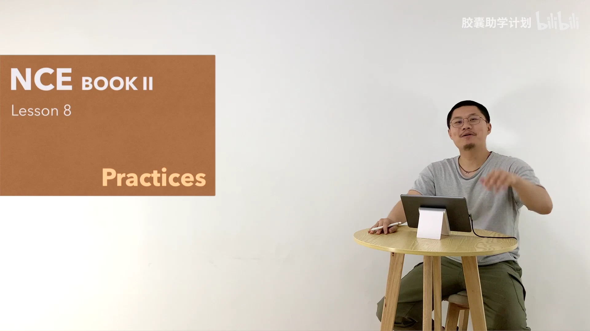

文字识别：胶囊助学计划 / NCE / BOOKII / Lesson 8 / Practices

### 画面 00:00:02

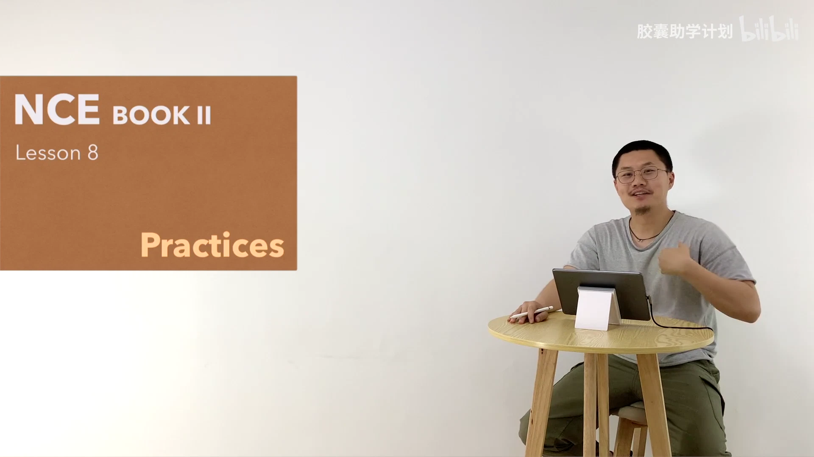

文字识别：胶囊助学计划 / NCE / BOOKII / Lesson 8 / Practices

### 画面 00:00:05

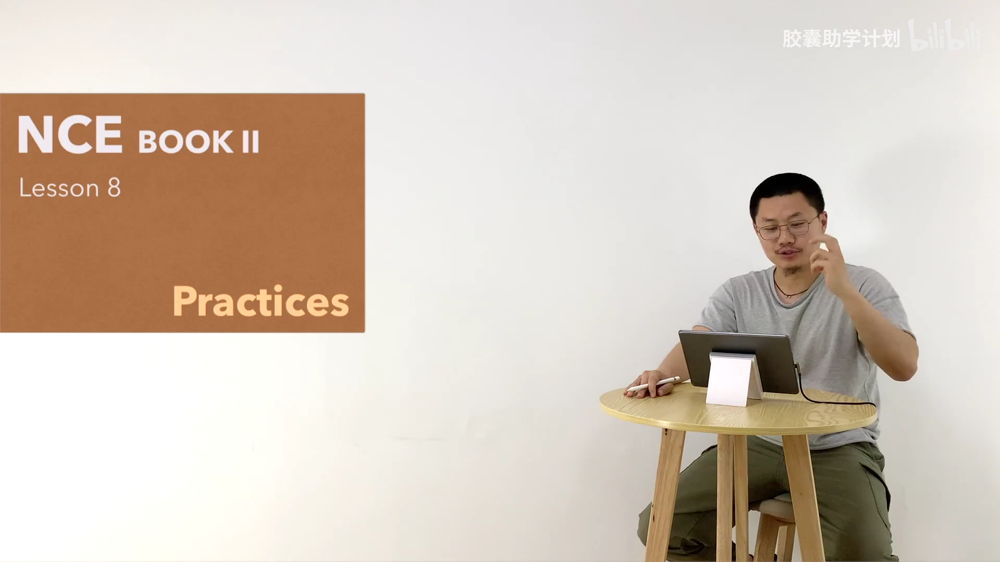

文字识别：胶囊助学计划 / NCE / BOOKII / Lesson 8 / Practices

### 画面 00:00:08

文字识别：胶囊助学计划 / 进行如下练习唯一前提 / 文章跟读至熟读成诵 / 否则请勿开始

### 画面 00:00:10

文字识别：胶囊助学计划 / 进行如下练习唯一前提 / 文章跟读至熟读成诵 / 否则请勿开始

### 画面 00:00:13

文字识别：胶囊助学计划 / 进行如下练习唯一前提 / 文章跟读至熟读成诵 / 否则请勿开始

### 画面 00:00:16

文字识别：胶囊助学计划 / 进行如下练习唯一前提 / 文章跟读至熟读成诵 / 否则请勿开始

### 画面 00:00:18

文字识别：胶囊助学计划 / 进行如下练习唯一前提 / 文章跟读至熟读成诵 / 否则请勿开始

### 画面 00:00:20

文字识别：胶囊助学计划b出l / •

### 画面 00:00:24

### 画面 00:00:26

文字识别：胶囊助学计划 / Comprehension / 训练目标： / 听懂一般疑问句＆特殊疑问句

### 画面 00:00:28

文字识别：胶囊助学计划 / Comprehension / 训练目标： / 听懂一般疑问句＆特殊疑问句

## 00:00:30–00:01:00

问句。各位眼睛去看着课本，或者说完全闭上来听我问，您回答。第一题，Does the writer live in the same town as Joe Sanders? 答案 Yes, he does. Next one, Has Joe got a garden? Yes, he has. Next one, Is his garden the most beautiful one in

### 画面 00:00:30

文字识别：胶囊助学计划 / Comprehension

### 画面 00:00:33

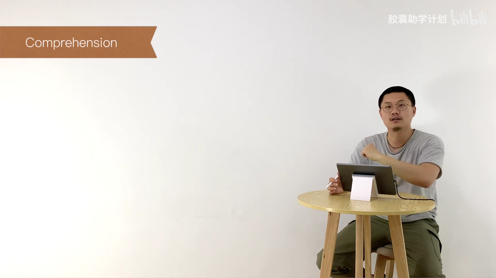

文字识别：胶囊助学计划 / Comprehension

### 画面 00:00:37

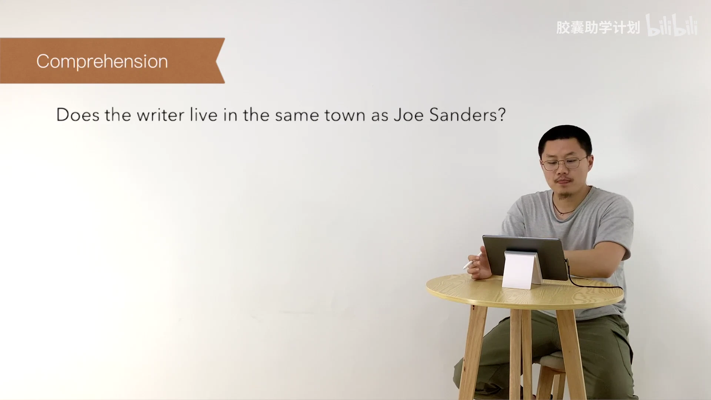

文字识别：胶囊助学计划 / 出 / Comprehension / Does the writer live in the same town as Joe Sanders?

### 画面 00:00:39

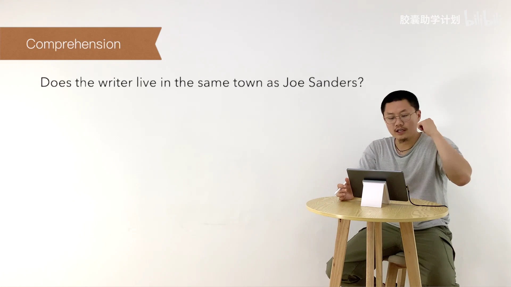

文字识别：胶囊助学计划 / Comprehension / Does the writer live in the same town as Joe Sanders?

### 画面 00:00:43

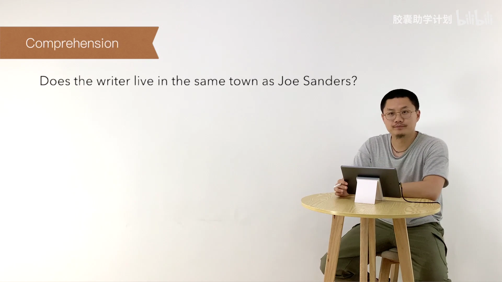

文字识别：胶囊助学计划 / Comprehension / Does the writer live in the same town as Joe Sanders?

### 画面 00:00:46

文字识别：胶囊助学计划 / Comprehension / Does the writer live in the same town as Joe Sanders? / Yes, he does.

### 画面 00:00:48

文字识别：胶囊助学计划 / Comprehension / Has Joe got a garden?

## 00:01:00–00:01:30

the town. Yes, it is. Next one. What does nearly everyone enter for? The nicest garden competition. Next one. Who wins every time? Every time. Joe Sanders. Next one. How big is Bill Freeze Garden?

### 画面 00:01:11

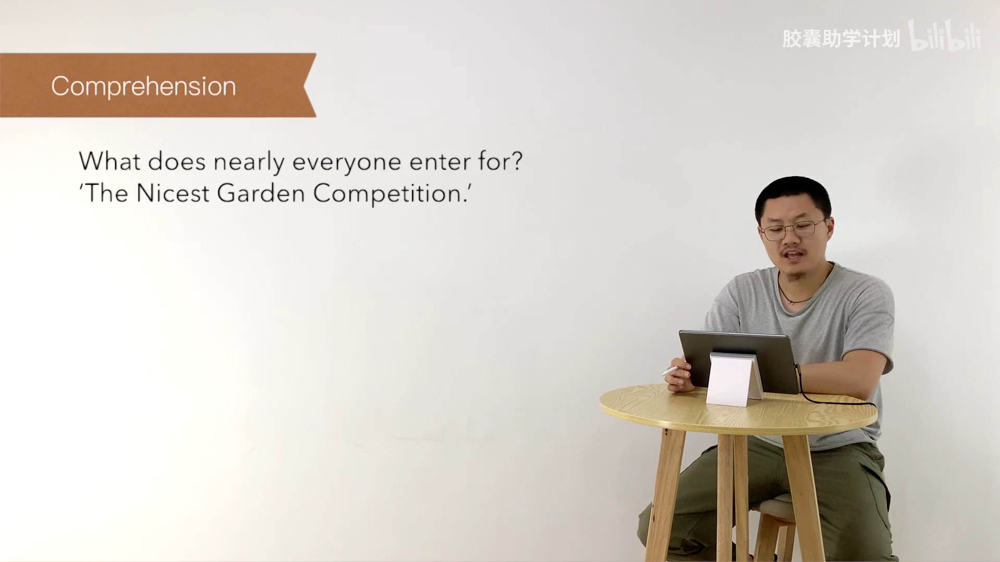

文字识别：胶囊助学计划 / Comprehension / What does nearly everyone enter for? / 'The Nicest Garden Competition.'

### 画面 00:01:16

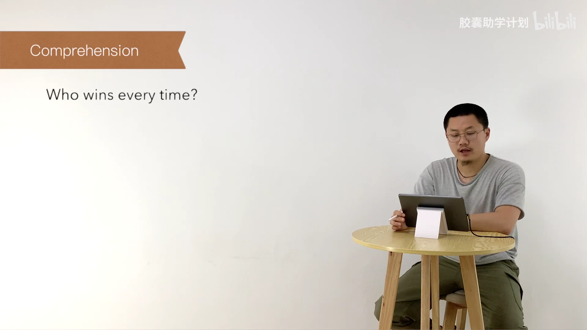

文字识别：Bib / 胶囊助学计划 / Comprehension / Who wins every time?

## 00:01:30–00:02:00

Bigger than Joe's. Does Joe work harder than Bill? No, he doesn't. Continue. Whose garden has more flowers and vegetables? Bill Free's. Next one. Whose garden is more interesting? Joe Sanders.

### 画面 00:01:46

文字识别：胶囊助学计划 / Comprehension / Whose garden has more flowers and vegetables?

## 00:02:00–00:02:30

What has he made? Neat path. Next one, is there a pool in the garden? Yes, there is. Continue. What has he built over the pool? A wooden bridge. Does the writer like gardens? Yes, he does. What

### 画面 00:02:16

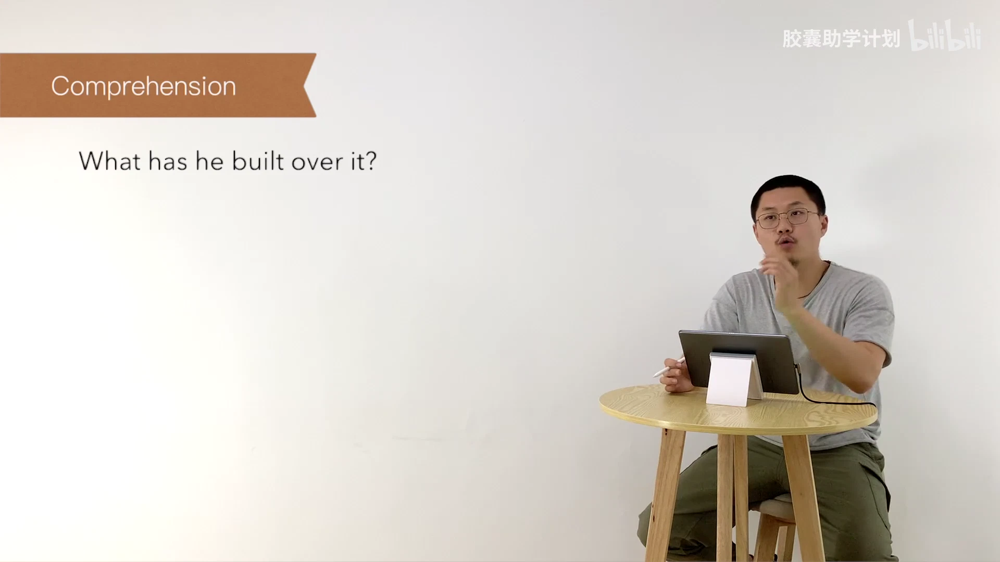

文字识别：bibil / 胶囊助学计划 / Comprehension / What has he built over it?

### 画面 00:02:18

文字识别：胶囊助学计划 / Comprehension / What has he built over it?

### 画面 00:02:21

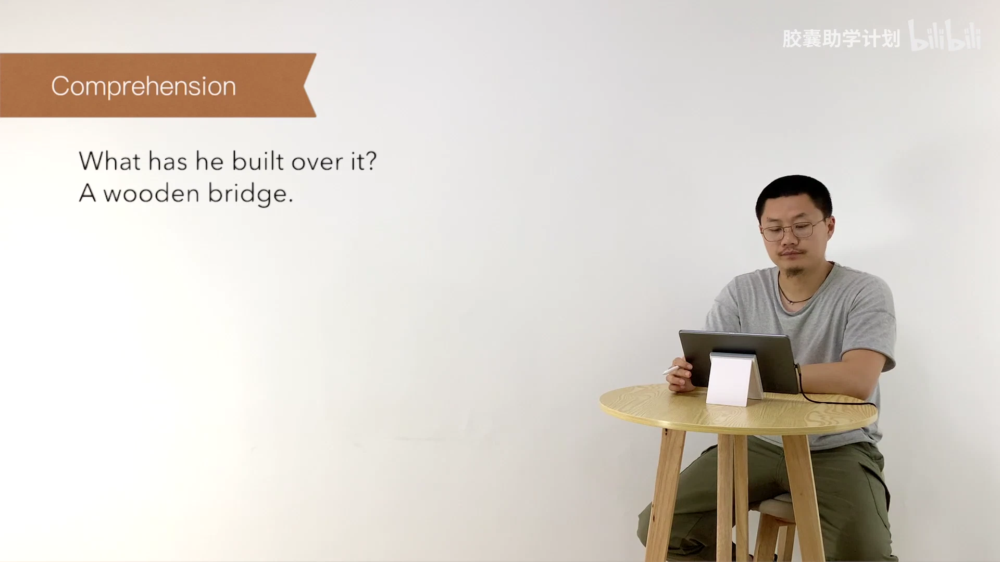

文字识别：胶囊助学计划 / Comprehension / What has he built over it? / A wooden bridge.

## 00:02:30–00:03:00

doesn't he like? Hard work. Okay,下一题 asking questions. 训练的目标就是各位能自己去发问一般疑问句和特殊疑问句。练习我们的重点还是 accuracy 口语的准确性，而非流利性。您可以慢，但不能错啊！来了，我们先看第一个例子。Ask me if Joe Sanders has the most beautiful garden in the town. 好，直接把 does 提前。Does Joe

### 画面 00:02:34

文字识别：BilBil / 胶囊助学计划 / Asking questions / 训练目标： / 会说一般疑问句＆特殊疑问句 / Accuracy / Fluency

### 画面 00:02:36

文字识别：胶囊助学计划 / Asking questions / 训练目标： / 会说一般疑问句＆特殊疑问句 / Accuracy / Fluency

### 画面 00:02:39

文字识别：胶囊助学计划 / Asking questions / 训练目标： / 会说一般疑问句＆特殊疑问句 / Accuracy / Fluency

### 画面 00:02:41

文字识别：胶囊助学计划 / Asking questions / 训练目标： / 会说一般疑问句＆特殊疑问句 / Accuracy / Fluency

### 画面 00:02:44

文字识别：胶囊助学计划 / Asking questions / 训练目标： / 会说一般疑问句＆特殊疑问句 / Accuracy / Fluency

### 画面 00:02:47

文字识别：胶囊助学计划 / Asking questions / 训练目标： / 会说一般疑问句＆特殊疑问句 / Accuracy / Fluency

### 画面 00:02:50

文字识别：胶囊助学计划 / Asking questions

### 画面 00:02:53

文字识别：胶囊助学计划 / Asking questions / T: Ask me if Joe Sanders has the most beautiful / garden in the town.

### 画面 00:02:55

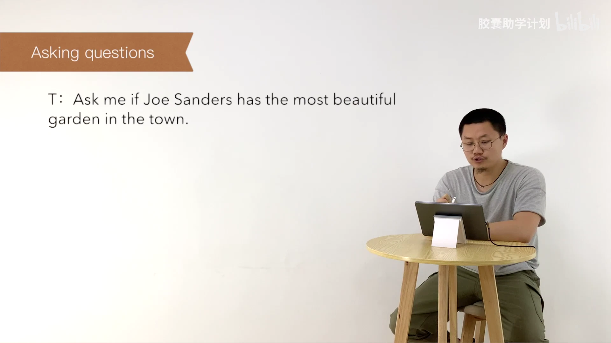

文字识别：胶囊助学计划 / Asking questions / T: Ask me if Joe Sanders has the most beautiful / garden in the town.

### 画面 00:02:58

文字识别：胶囊助学计划 / Asking questions / T: Ask me if Joe Sanders has the most beautiful / garden in the town. / S: Does Joe Sanders have the most beautiful / garden in the town?

## 00:03:00–00:03:30

Sanders have the most beautiful garden in the town? There you go. 注意把 has 换回 have. Who 对谁提问？对主语提问，直接替代主语。 Who has the most beautiful garden in the town? There一个。那接下来我们开始了啊。第一题刚才我们做过了，我们看第二题。我只给大家提思路，各位课下自己去写答案啊。 There is a garden competition every year. 那肯定是 is 提前变一般疑问句。 How often 对 every

### 画面 00:03:01

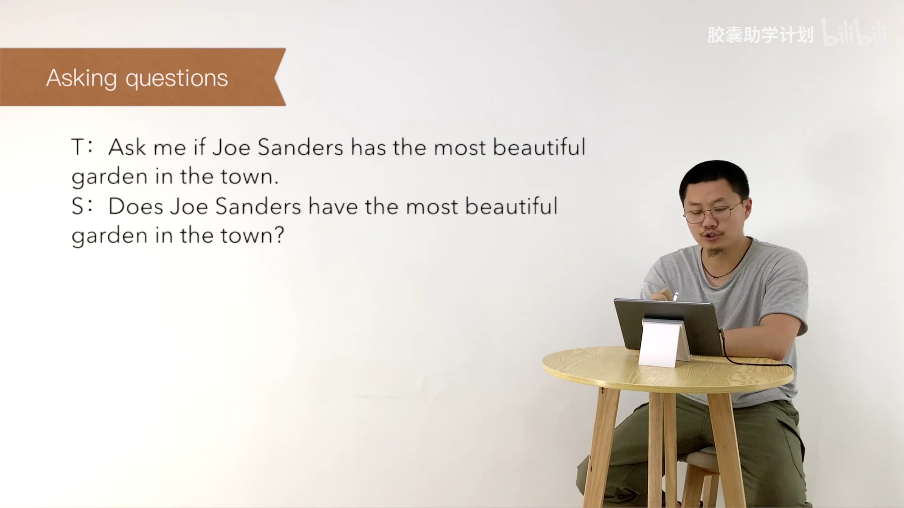

文字识别：胶囊助学计划 / Asking questions / T: Ask me if Joe Sanders has the most beautiful / garden in the town. / S: Does Joe Sanders have the most beautiful / garden in the town?

### 画面 00:03:13

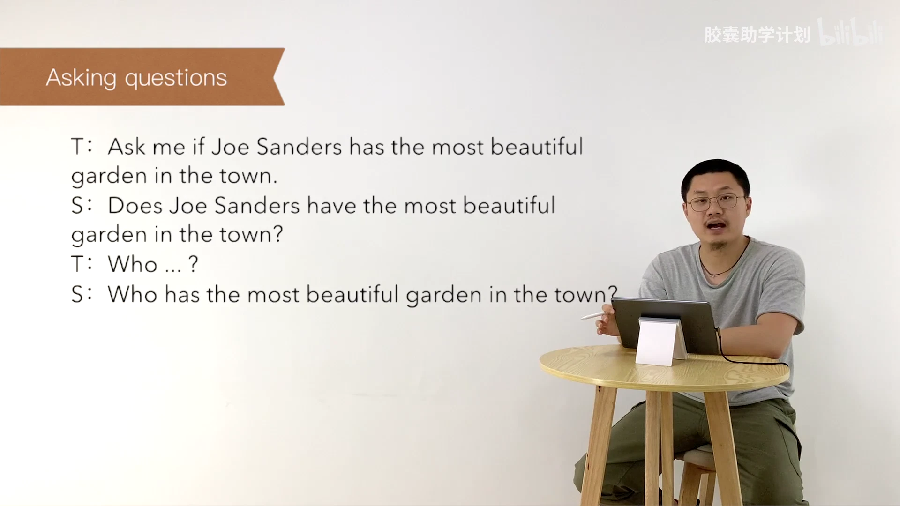

文字识别：胶囊助学计划 / Asking questions / T: Ask me if Joe Sanders has the most beautiful / garden in the town. / S: Does Joe Sanders have the most beautiful / garden in the town? / T：Who…? / S: Who has the most beautiful garden in the town?

### 画面 00:03:15

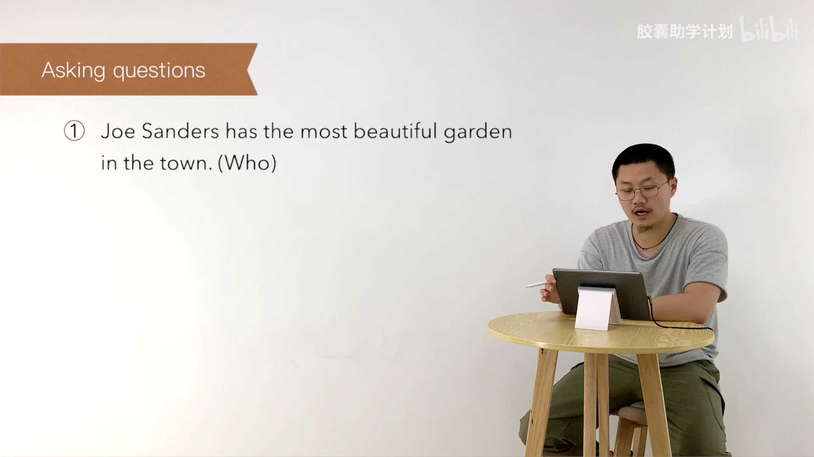

文字识别：胶囊助学计划 / Asking questions / Joe Sanders has the most beautiful garden / in the town.(Who)

### 画面 00:03:17

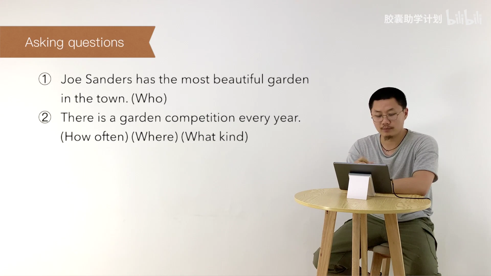

文字识别：胶囊助学计划 / Asking questions / Joe Sanders has the most beautiful garden / in the town.(Who) / There is a garden competition every year. / (How often) (Where) (What kind)

### 画面 00:03:26

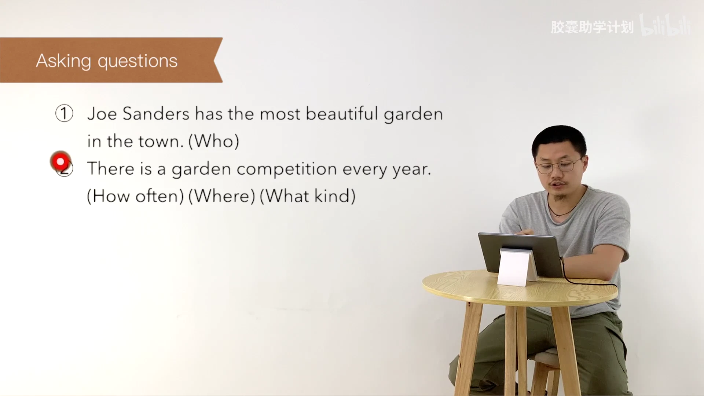

文字识别：胶囊助学计划 / Asking questions / Joe Sanders has the most beautiful garden / in the town.(Who) / There is a garden competition every year. / (How often) (Where) (What kind)

## 00:03:30–00:04:00

year提问。Where?哎，你看这句话当中没有where，直接加句首。What kind?注意what kind这个地方，我要多讲两句。一般是what kind of，他把of直接省略了。What kind of指的是什么类型的？类似于what sort of啊，what kind of什么类型的？这儿只有一个单词解释了什么类型，叫做garden。什么类型的

### 画面 00:03:44

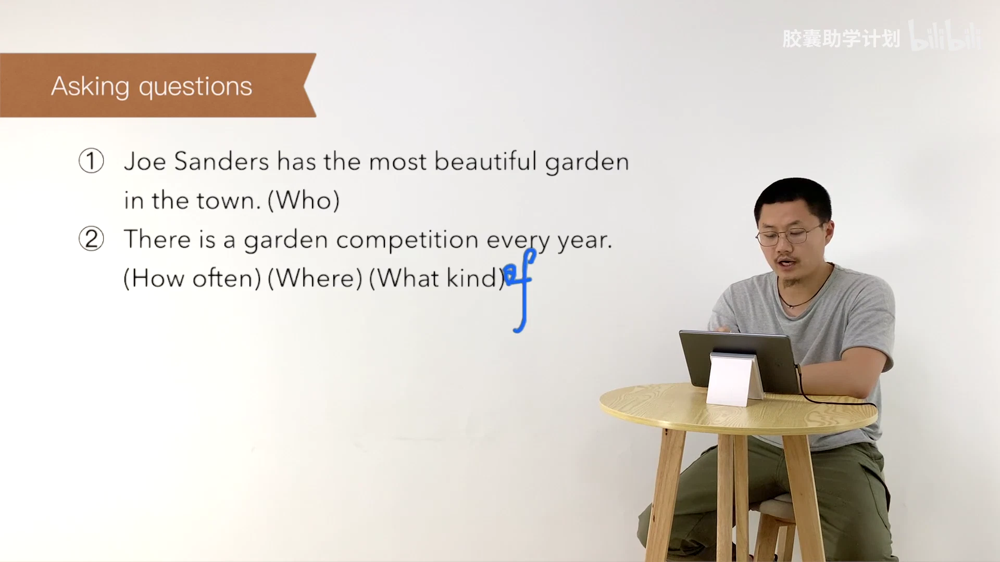

文字识别：胶囊助学计划 / Asking questions / Joe Sanders has the most beautiful garden / in the town.(Who) / There is a garden competition every year. / (How often) (Where) (What kind)A

### 画面 00:03:58

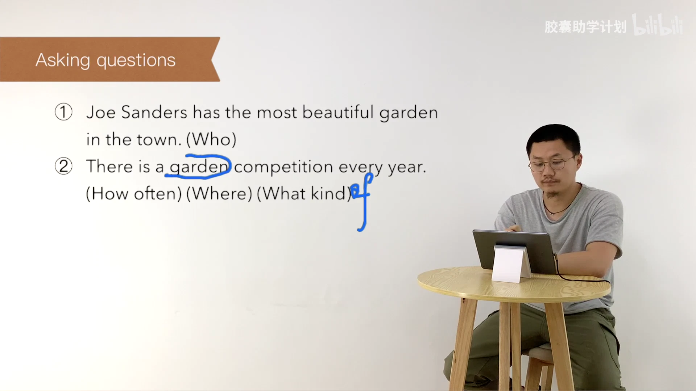

文字识别：胶囊助学计划 / Asking questions / Joe Sanders has the most beautiful garden / in the town.(Who) / There is a gardep competition every year. / (How often)(Where) (What kind)a

## 00:04:00–00:04:30

competition呢？所以，我给大家说一下答案，叫做 What kind of competition is there every year？每年都有一个什么样类型的比赛呢？答案叫 Garden competition。各位自己去想一下，好吧？所以 What kind of？往往是对形容词提问的，或者起到形容词作用的其他单词。比如说 Garden 本身是个名词，但 Garden competition 里边的

### 画面 00:04:00

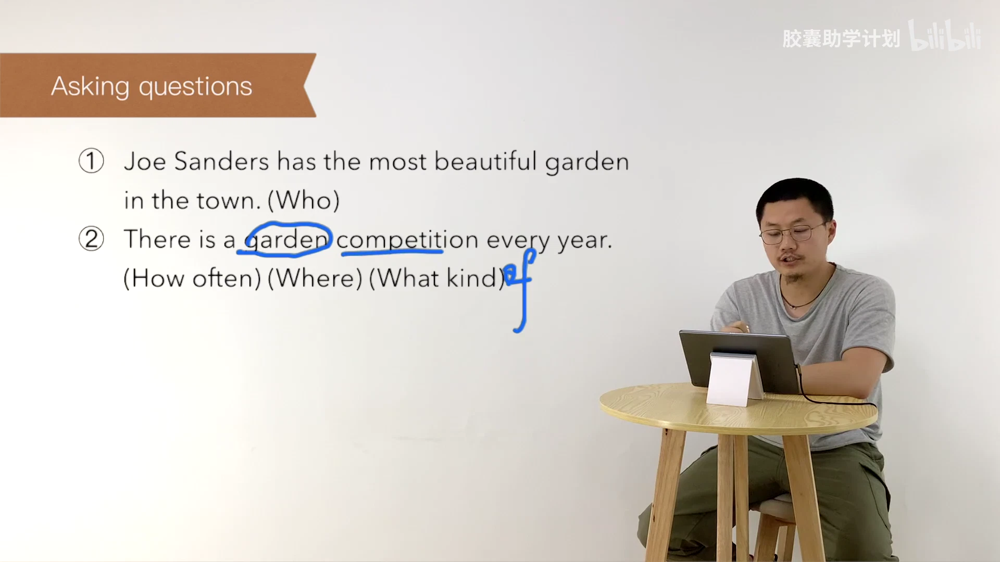

文字识别：胶囊助学计划 / Asking questions / Joe Sanders has the most beautiful garden / in the town.(Who) / There is a gardencompetition every year. / (How often)(Where) (What kind)a

### 画面 00:04:02

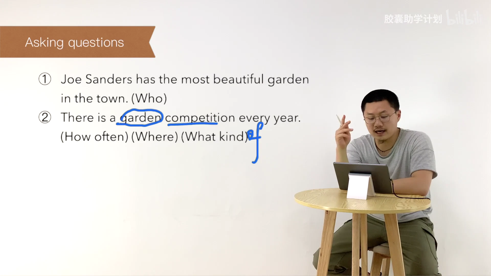

文字识别：胶囊助学计划 / Asking questions / Joe Sanders has the most beautiful garden / in the town.(Who) / There is a gardencompetition every year. / (How often)(Where)(What kind)

### 画面 00:04:17

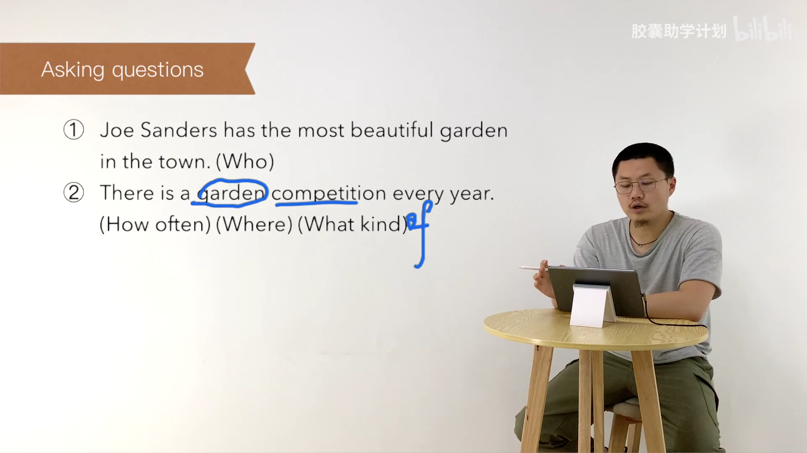

文字识别：胶囊助学计划 / Asking questions / Joe Sanders has the most beautiful garden / in the town.(Who) / There is a gardencompetition every year. / (How often)(Where)(What kind)a

### 画面 00:04:20

文字识别：胶囊助学计划 / Asking questions / Joe Sanders has the most beautiful garden / in the town.(Who) / There is a gardencompetition every year. / (How often)(Where) (What kind)a

### 画面 00:04:23

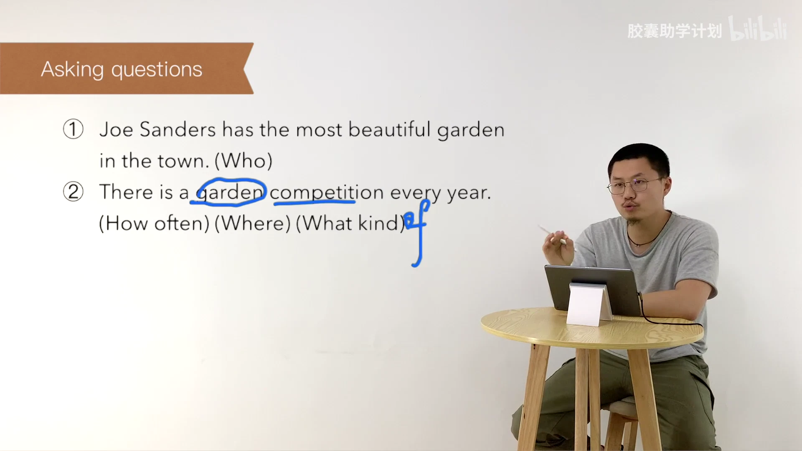

文字识别：胶囊助学计划 / Asking questions / Joe Sanders has the most beautiful garden / in the town.(Who) / There is a garden competition every year. / (How often)(Where) (What kind)A

### 画面 00:04:27

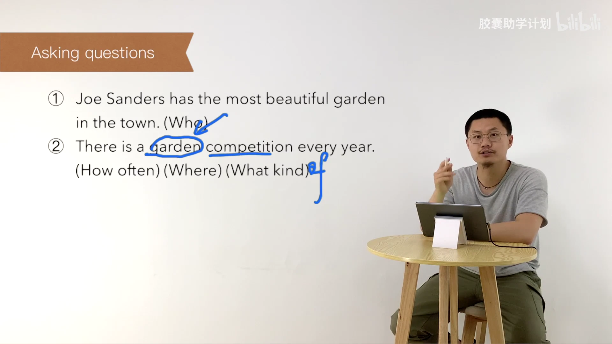

文字识别：胶囊助学计划 / Asking questions / Joe Sanders has the most beautiful garden / in the town.(Whg / There is a gardencompetition every year. / (How often)(Where)(What kind)a

### 画面 00:04:29

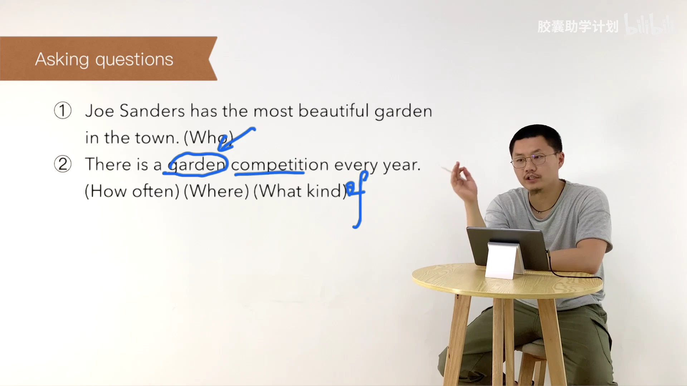

文字识别：胶囊助学计划 / Asking questions / Joe Sanders has the most beautiful garden / in the town.(Whg / There is a gardencompetition every year. / (How often)(Where)(What kind)A

## 00:04:30–00:05:00

garden起到的是形容词的作用。为什么？因为有很多competition. Garden competition告诉你是什么样的比赛。OK. 下一题说Joe wins every time. 不用多说了。Does提前，不要忘了把它换回原形。Who对主语提问，不变一般疑问句，直接替代。How often对every time提问，老生常谈。Belfrey's garden is larger than Joe's. Is提前，

### 画面 00:04:41

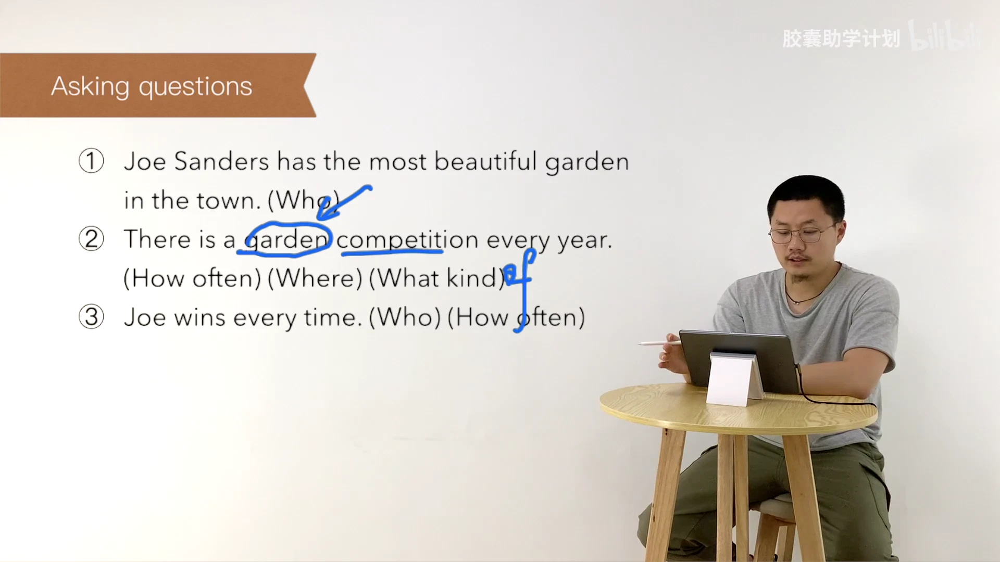

文字识别：胶囊助学计划 / Asking questions / Joe Sanders has the most beautiful garden / in the town.(Whg / There is a gardencompetition every year. / (How often)(Where)(What kind)a / Joe wins every time. (Who) (How gften)

### 画面 00:04:43

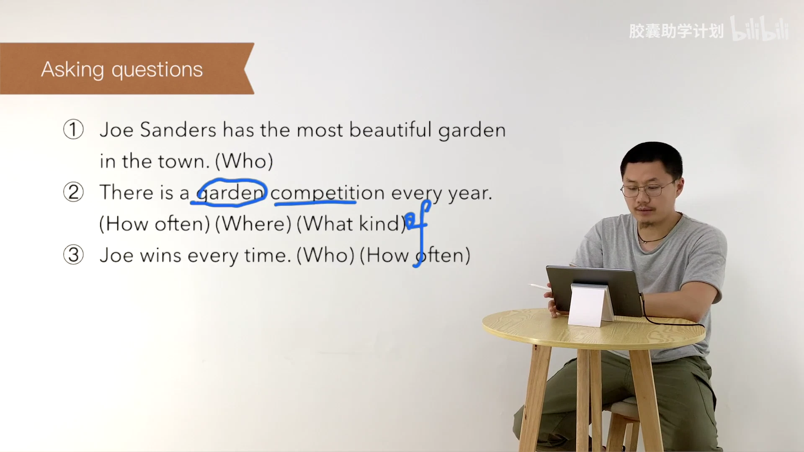

文字识别：胶囊助学计划 / Asking questions / Joe Sanders has the most beautiful garden / in the town.(Who) / There is a gardepcompetition every year. / (How often) (Where) (What kind) / Joe wins every time. (Who)(How gften)

### 画面 00:04:45

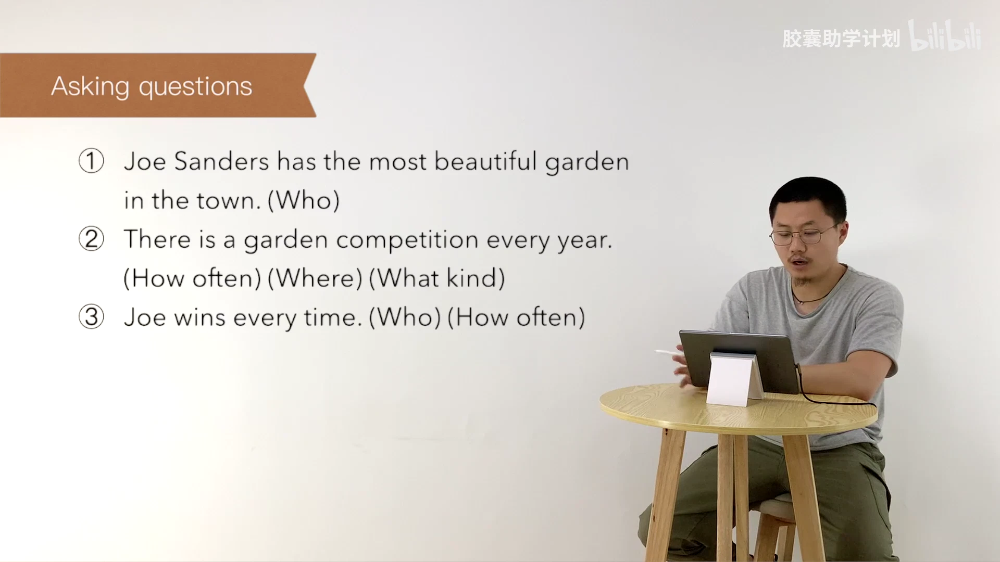

文字识别：胶囊助学计划 / Asking questions / Joe Sanders has the most beautiful garden / in the town.(Who) / There is a garden competition every year. / (How often) (Where)(What kind) / Joe wins every time.(Who) (How often)

### 画面 00:04:48

文字识别：胶囊助学计划 / Asking questions / Joe Sanders has the most beautiful garden / in the town.(Who) / There is a garden competition every year. / (How often) (Where)(What kind) / Joe wins every time. (Who) (How often)

### 画面 00:04:50

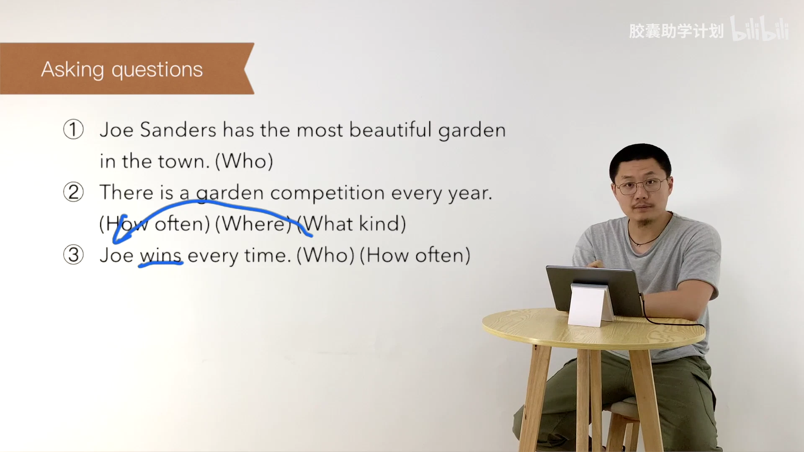

文字识别：胶囊助学计划 / Asking questions / Joe Sanders has the most beautiful garden / in the town.(Who) / There is a qarden competition every year. / (How often) (Where)(What kind) / Joe wins every time. (Who) (How often)

### 画面 00:04:54

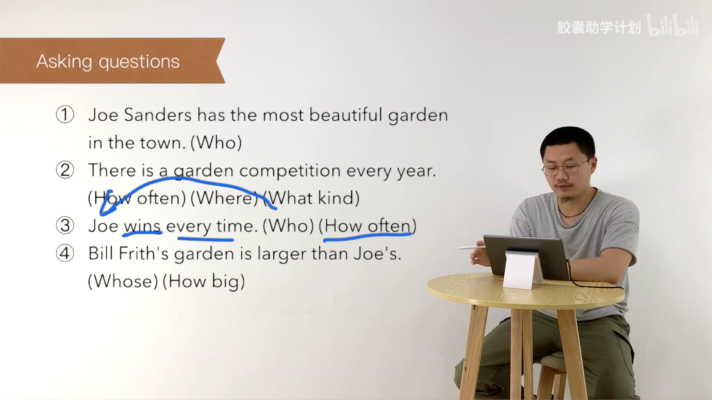

文字识别：胶囊助学计划 / Asking questions / Joe Sanders has the most beautiful garden / in the town.(Who) / There is a garden competition every year. / (HOw often) (Where)(What kind) / Joe wins every time. (Who) (How often) / Bill Frith's garden is larger than Joe's. / (Whose)(How big)

### 画面 00:04:59

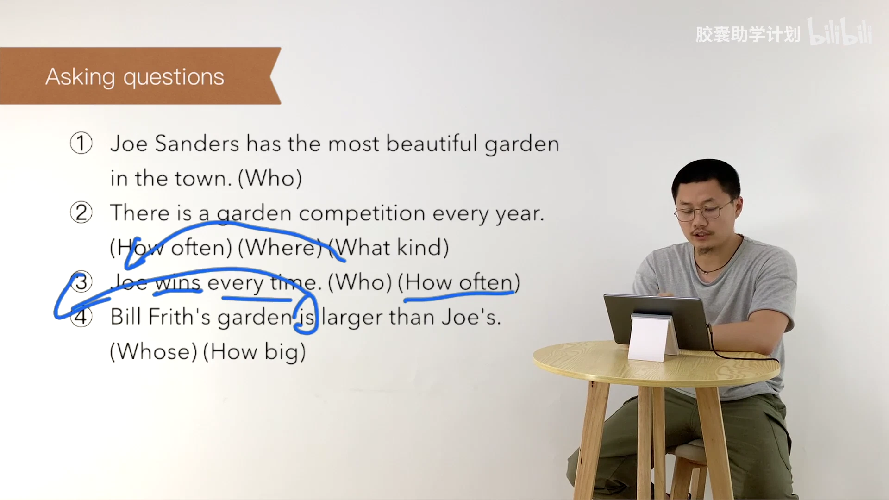

文字识别：胶囊助学计划 / Asking questions / Joe Sanders has the most beautiful garden / in the town. (Who) / There is a garden competition every year. / (Howoften) (Where)(What kind) / lee wins every tine. (Who) (How often) / Bill Frith's garden / larger than Joe's. / (Whose)(How big)

## 00:05:00–00:05:30

whose注意可以对两个东西提问，第一Bill Fris，第二Joe's，对吧？How big?好，这个很有意思，多大？你想一下这句话当中，谁能回答多大？叫larger than Joe's吧，对吧？所以答案很简单，叫How big is Bill Fris' garden?它的Bill Fris的花园有多大？答案叫做比Joe的大，

### 画面 00:05:01

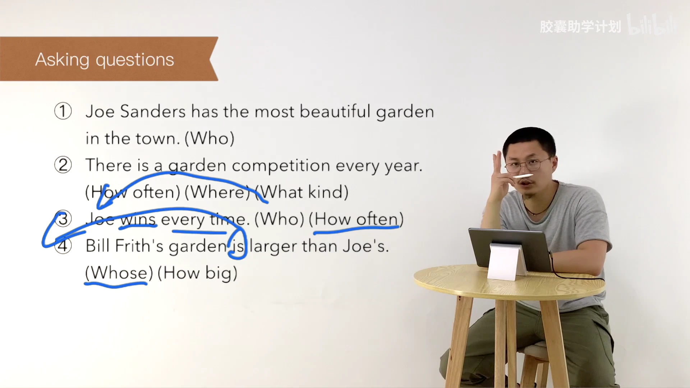

文字识别：胶囊助学计划 / Asking questions / Joe Sanders has the most beautiful garden / in the town. (Who) / There is a garden competition every year. / (How often) (Where)(What kind) / Joe wins every tine. (Who) (How often) / Bill Frith's garden / larger than Joe's. / (Whose) (How big)

### 画面 00:05:04

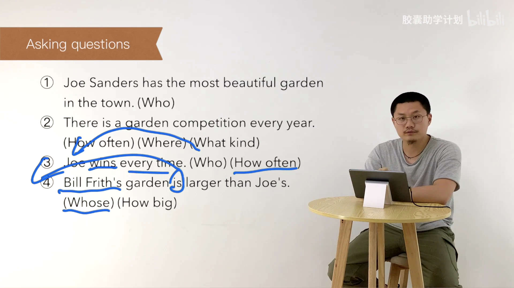

文字识别：胶囊助学计划 / Asking questions / Joe Sanders has the most beautiful garden / in the town.(Who) / There is a garden competition every year. / (How often) (Where)(What kind) / oe wins / s every time. (Who) (How often) / Bill Frith's / garden / larger than Joe's. / (Whose)(How big)

### 画面 00:05:07

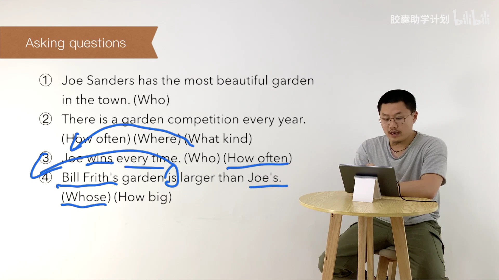

文字识别：胶囊助学计划 / Asking questions / Joe Sanders has the most beautiful garden / in the town.(Who) / There is a garden competition every year. / (Howoften) (Where)(What kind) / wins /  every time. (Who) (How often) / Bill Frith's / garden / larger than Joe's. / (Whose)(How big)

### 画面 00:05:10

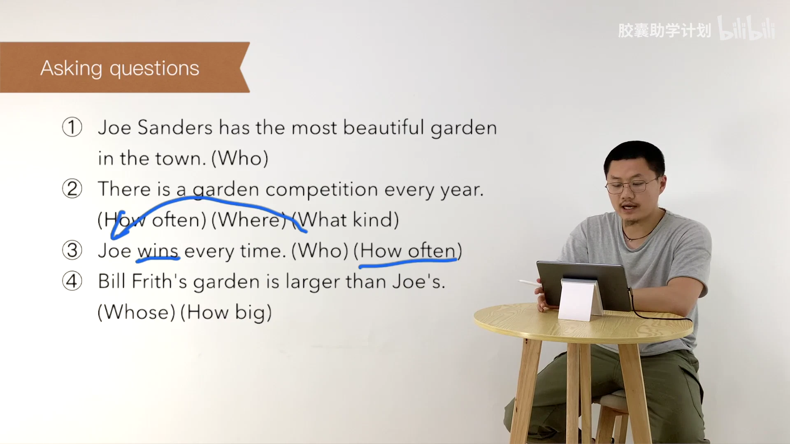

文字识别：胶囊助学计划 / Asking questions / Joe Sanders has the most beautiful garden / in the town.(Who) / There is a garden competition every year. / (How often) (Where)(What kind) / Joe wins every time. (Who) (How often) / Bill Frith's garden is larger than Joe's. / (Whose)(How big)

### 画面 00:05:12

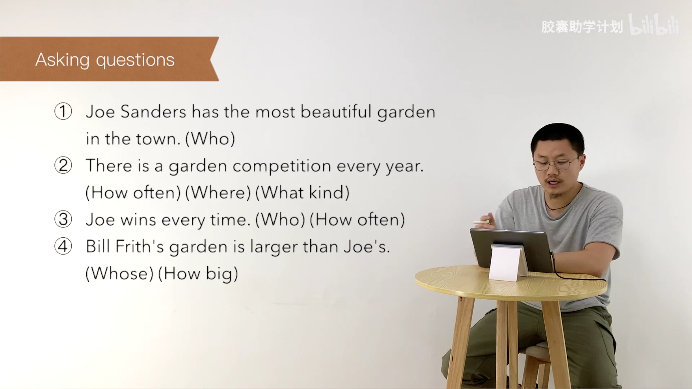

文字识别：胶囊助学计划 / Asking questions / Joe Sanders has the most beautiful garden / in the town.(Who) / There is a garden competition every year. / (How often) (Where) (What kind) / Joe wins every time.(Who)(How often) / Bill Frith's garden is larger than Joe's. / (Whose)(How big)

### 画面 00:05:14

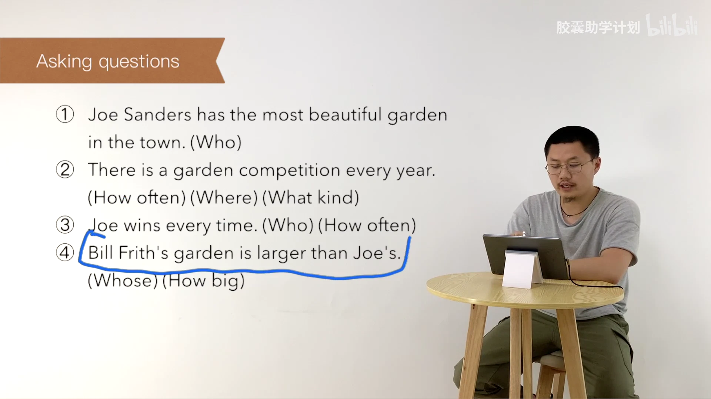

文字识别：胶囊助学计划 / Asking questions / Joe Sanders has the most beautiful garden / in the town.(Who) / There is a garden competition every year. / (How often) (Where) (What kind) / Joe wins every time. (Who) (How often) / Bill rith's garden is larger than Joe's. / (Whose)(How big)

### 画面 00:05:16

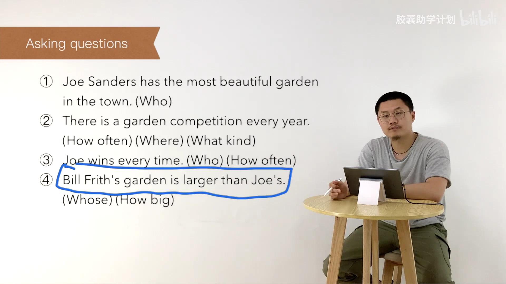

文字识别：胶囊助学计划 / Asking questions / Joe Sanders has the most beautiful garden / in the town.(Who) / There is a garden competition every year. / (How often) (Where)(What kind) / Joe wins every time. (Who) (How often) / Bill Frith's garden is larger than Joe's. / (Whose)(How big)

### 画面 00:05:19

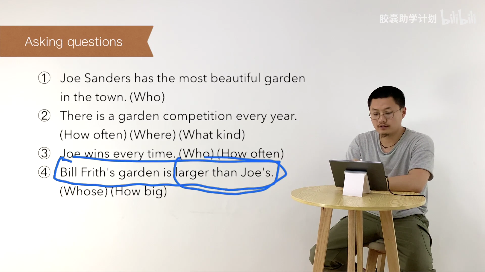

文字识别：胶囊助学计划 / Asking questions / Joe Sanders has the most beautiful garden / in the town.(Who) / There is a garden competition every year. / (How often)(Where) (What kind) / Joe wins every time. (Who)(How often) / Bill Frith's garden is / larger than Joe's. / (Whose) (How big)

### 画面 00:05:22

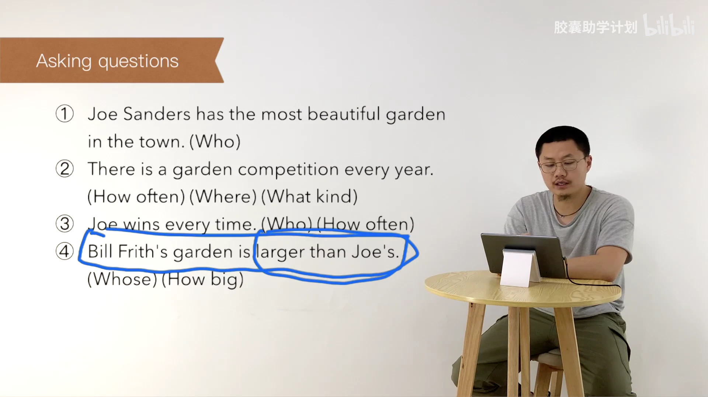

文字识别：胶囊助学计划 / Asking questions / Joe Sanders has the most beautiful garden / in the town.(Who) / There is a garden competition every year. / (How often) (Where) (What kind) / Joe wins every time. (Who)(How often) / Bill Frith's garden is / larger than Joe's. / (Whose)(How big)

### 画面 00:05:27

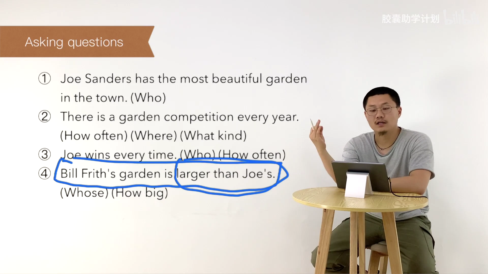

文字识别：胶囊助学计划 / Asking questions / Joe Sanders has the most beautiful garden / in the town.(Who) / There is a garden competition every year. / (How often)(Where) (What kind) / Joe wins every time. (Who)(How often) / Bill Frith's garden is / arger than Joe's. / (Whose) (How big)

## 00:05:30–00:06:00

是不是很舒服，对吧？好，你就记住啊，怎么判断他对谁提问，谁能回答这个问题，他就对谁提问。仔细去想刚才我说这句话，好吧？下一题，He works harder than Joe. Does提前，work换回原形，而不是work提前啊，does提前啊。How hard跟刚才How big不一码事儿吗？他工作有多努力？答案叫比Joe努力，那是不是叫做harder than Joe？那答案就是How

### 画面 00:05:41

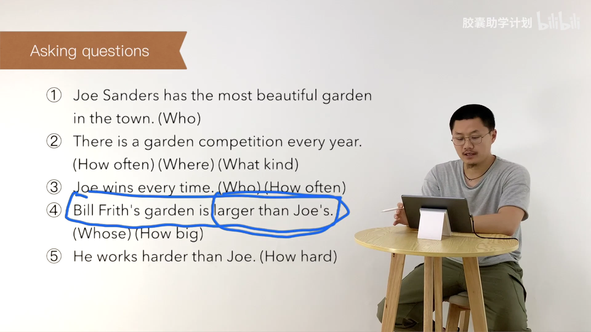

文字识别：胶囊助学计划 / Asking questions / Joe Sanders has the most beautiful garden / in the town.(Who) / There is a garden competition every year. / (How often) (Where) (What kind) / Joe wins every time. (Who)(How often) / Bill Frith's garden is / larger than Joe's. / (Whose) (How big) / He works harder than Joe. (How hard)

### 画面 00:05:45

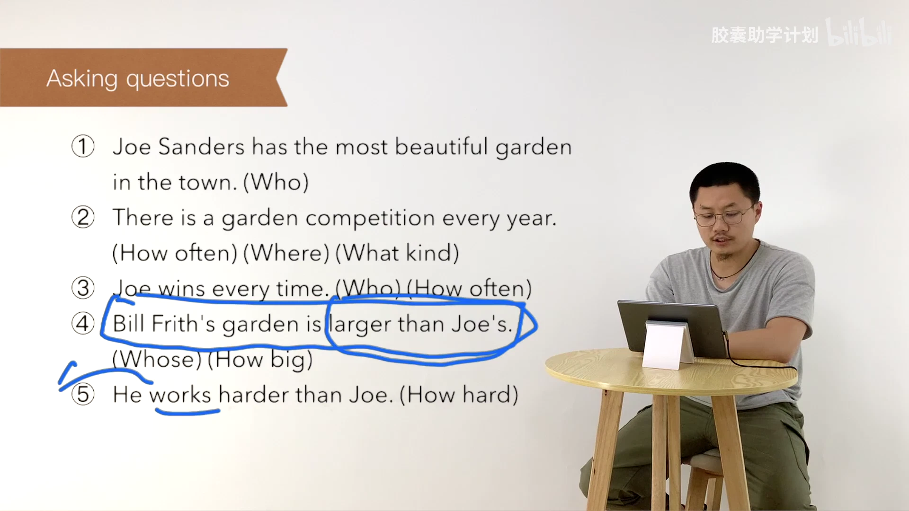

文字识别：胶囊助学计划 / Asking questions / Joe Sanders has the most beautiful garden / in the town.(Who) / There is a garden competition every year. / (How often) (Where) (What kind) / Joe wins every time. (Who)(How often) / Bill Frith's garden is / larger than Joe's. / (Whose) (How big) / He works harder than Joe. (How hard)

### 画面 00:05:56

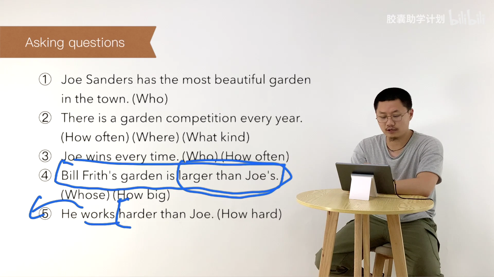

文字识别：胶囊助学计划 / Asking questions / Joe Sanders has the most beautiful garden / in the town.(Who) / There is a garden competition every year. / (How often) (Where) (What kind) / Joe wins every time. (Who)(How often) / Bill Frith's garden is / larger than Joe's. / (Whose) (How big) / He worksharder than Joe. (How hard)

### 画面 00:05:58

文字识别：胶囊助学计划 / Asking questions / Joe Sanders has the most beautiful garden / in the town.(Who) / There is a garden competition every year. / (How often)(Where) (What kind) / Joe wins every time. (Who)(How often) / Bill Frith's garden is / larger than Joe's. / (Whose)(How big) / He worksharder than Joe / (How hard)

## 00:06:00–00:06:30

hard does he work? 他工作有多努力呢？答案叫 Harder than Joe, 比 Joe 还努力。 OK, 好，下一题说 Joe's garden is more interesting. Is 提前就完了，对吧？那 Who's 对主语提问不用管了，直接替代，然后 Who's garden is more interesting? 很舒服，对吧？直接照抄就行了。最后一个 He has made need pass. 现在完成时 has 提前。

### 画面 00:06:01

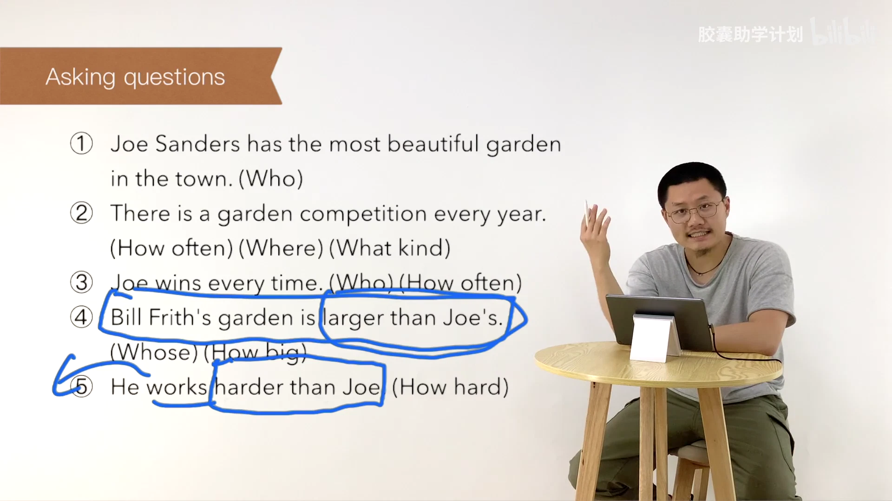

文字识别：胶囊助学计划 / Asking questions / Joe Sanders has the most beautiful garden / in the town.(Who) / There is a garden competition every year. / (How often) (Where) (What kind) / Joe wins every time. (Who)(How often) / Bill Frith's garden is / larger than Joe's. / (Whose)(How big) / He worksharder than Joe / (How hard)

### 画面 00:06:07

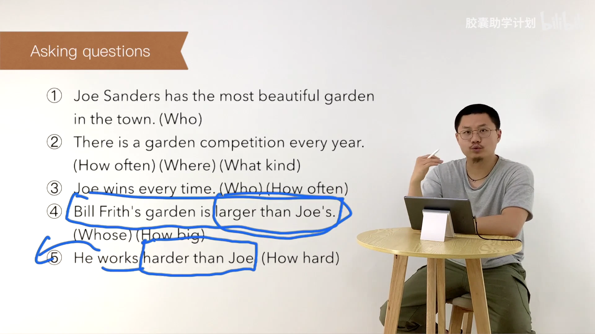

文字识别：胶囊助学计划 / Asking questions / Joe Sanders has the most beautiful garden / in the town.(Who) / There is a garden competition every year. / (How often)(Where) (What kind) / Joe wins every time. (Who)(How often) / Bill Frith's garden is / larger than Joe's. / (Whose) (How big) / He worksharder than Joe / (How hard)

### 画面 00:06:11

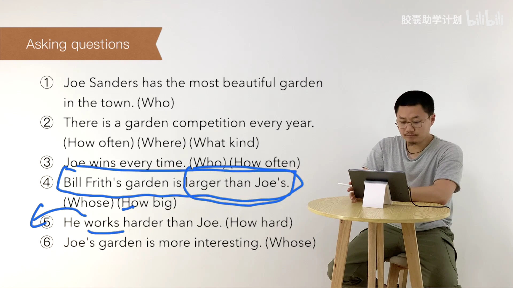

文字识别：胶囊助学计划 / Asking questions / Joe Sanders has the most beautiful garden / in the town.(Who) / There is a garden competition every year. / (How often) (Where) (What kind) / Joe wins every time. (Who)(How often) / Bill Frith's garden is / slarger than Joe's. / (Whose) (How big) / He works harder than Joe. (How hard) / Joe's garden is more interesting. (Whose) / 6

### 画面 00:06:13

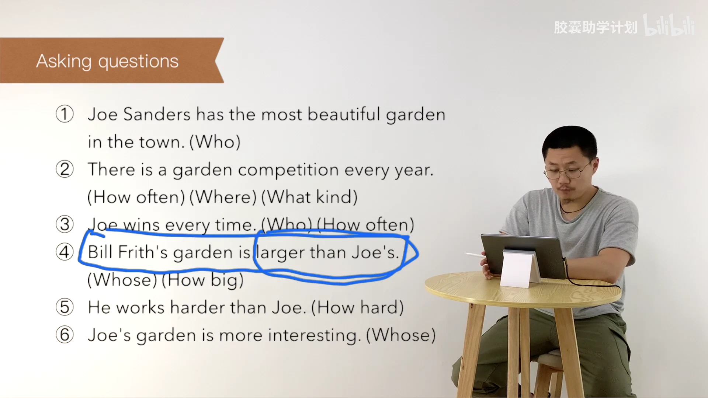

文字识别：胶囊助学计划 / Asking questions / Joe Sanders has the most beautiful garden / 1 / in the town.(Who) / There is a garden competition every year. / (How often) (Where)(What kind) / Joe wins every time. (Who)(How often) / Bill Frith's garden is / slarger than Joe's. / (Whose) (How big) / He works harder than Joe. (How hard) / Joe's garden is more interesting. (Whose) / 6

### 画面 00:06:15

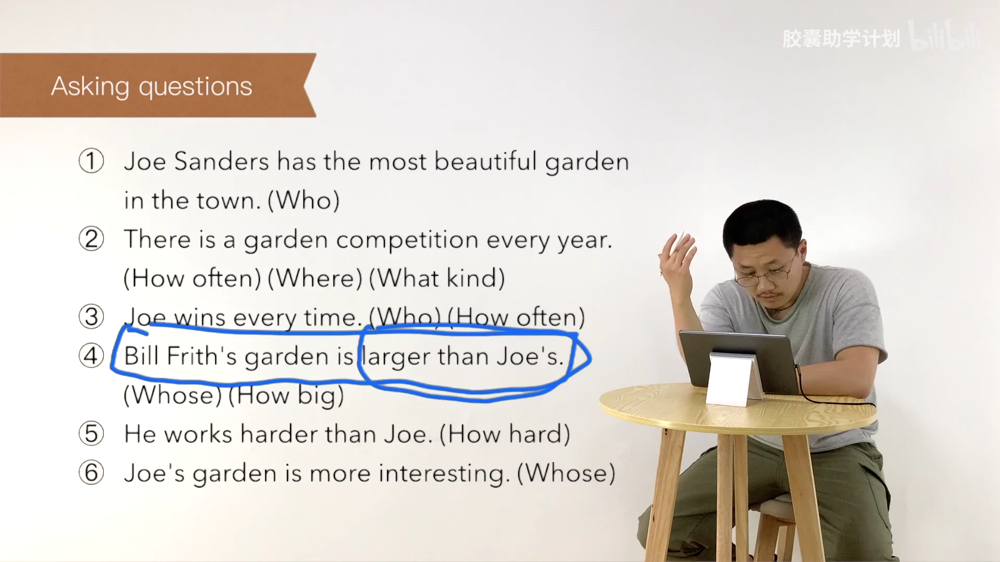

文字识别：胶囊助学计划 / Asking questions / Joe Sanders has the most beautiful garden / in the town.(Who) / There is a garden competition every year. / (How often) (Where) (What kind) / Joe wins every time. (Who)(How often) / Bill Frith's garden is / slarger than Joe's. / (Whose) (How big) / He works harder than Joe.(How hard) / Joe's garden is more interesting. (Whose) / 6

### 画面 00:06:19

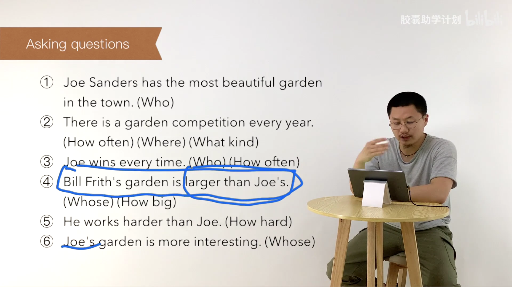

文字识别：胶囊助学计划 / Asking questions / Joe Sanders has the most beautiful garden / in the town.(Who) / There is a garden competition every year. / (How often) (Where) (What kind) / Joe wins every time. (Who)(How often) / Bill Frith's garden is / sarger than Joe's. / (Whose) (How big) / He works harder than Joe. (How hard) / Joe's garden is more interesting. (Whose) / 6

### 画面 00:06:25

文字识别：胶囊助学计划 / Asking questions / Joe Sanders has the most beautiful garden / in the town.(Who) / There is a garden competition every year. / (How often) (Where) (What kind) / Joe wins every time. (Who)(How often) / Bill Frith's garden is / slarger than Joe's. / (Whose) (How big) / He works harder than Joe. (How hard) / Joe's garden is more interesting. (Whose) / He has made neat paths. (What)

## 00:06:30–00:07:00

那 what 他制作了什么？Need pass 呗？对他提问。那 what has he made？他做了制作啊，铺了什么对吧？做了什么？Okay，接下来 tell the story 口语复述能力，注意不考我们的准确性了，考我们的流利性。所以这个地方您要不能磕磕绊绊，尽量。所以这是我说为什么文章一定要熟读成诵啊？准确性可以有所下降，就

### 画面 00:06:33

文字识别：胶囊助学计划 / Asking questions / Joe Sanders has the most beautiful garden / in the town.(Who) / There is a garden competition every year. / (How often) (Where) (What kind) / Joe wins every time. (Who)(How often) / Bill Frith's garden is / slarger than Joe's. / (Whose) (How big) / He works harder than Joe. (How hard) / Joe's garden is more interesting. (Whose) / He has made neat paths. (What)

### 画面 00:06:35

文字识别：胶囊助学计划 / Asking questions / Joe Sanders has the most beautiful garden / in the town.(Who) / There is a garden competition every year. / (How often) (Where) (What kind) / Joe wins every time. (Who)(How often) / Bill Frith's garden is / slarger than Joe's. / (Whose) (How big) / He works harder than Joe. (How hard) / Joe's garden is more interesting. (Whose) / He has made neat paths. (What)

### 画面 00:06:38

文字识别：胶囊助学计划 / Asking questions / Joe Sanders has the most beautiful garden / in the town.(Who) / There is a garden competition every year. / (How often) (Where) (What kind) / Joe wins every time. (Who) (How often) / Bill Frith's garden is / slarger than Joe's. / (Whose) (How big) / He works harder than Joe. (How hard) / Joe's garden is more interesting. (Whose) / He has made neat paths. (What)

### 画面 00:06:40

文字识别：胶囊助学计划 / Tell the story / 训练目标： / 口语复述能力 / Accuracy / Fluency

### 画面 00:06:44

文字识别：胶囊助学计划 / Tell the story / 训练目标： / 口语复述能力 / Accuracy / Fluency

### 画面 00:06:46

文字识别：胶囊助学计划 / Tell the story / 训练目标： / 口语复述能力 / Acyracy / Fluency

### 画面 00:06:48

文字识别：胶囊助学计划 / Tell the story / 训练目标： / 口语复述能力 / AcXracy / Fluency

### 画面 00:06:50

文字识别：胶囊助学计划 / Tell the story / 训练目标： / 口语复述能力 / Fluency / AcXracy

### 画面 00:06:52

文字识别：胶囊助学计划 / Tell the story / 训练目标： / 口语复述能力 / Fluency / AcXracy

### 画面 00:06:57

文字识别：胶囊助学计划 / Tell the story / 训练目标： / 口语复述能力 / Fluency / AcXracy

## 00:07:00–00:07:30

算我接下来带着大家去复述，我也没有办法做到百分之百的对。但任何一个英语还不错的人，听到我的这段复述，他都明白我在给他讲一些什么。OK，这两种啊，呃，初期啊，这个练习我们练的就是流利。来了，我做一个示范，下课自己各位去做。Joe Sanders has the most most beautiful garden in our town, and nearly everybody enters for the nicest garden competition each year, but

### 画面 00:07:00

文字识别：胶囊助学计划 / Tell the story / Joe Sanders-most beautiful-town / Nearly everyone-competition-each year- / Joe-every time / Bill Frith's-larger-Joe's / Bill-harder-more-flowers-vegetables- / Joe's-interesting / neat paths-wooden bridge-pool / I-gardens-but not-work / Every year-enter-competition too-always- / prize-worst garden-town

### 画面 00:07:13

文字识别：胶囊助学计划 / Tell the story / Joe Sanders-most beautiful-town / Nearly everyone-competition-each year- / Joe-every time / Bill Frith's-larger-Joe's / Bill-harder-more-flowers-Vegetables- / Joe's-interesting / neat paths-wooden bridge-pool / I-gardens-but not-work / Every year-enter-competition too-always- / prize-worst garden-town

### 画面 00:07:15

文字识别：胶囊助学计划 / Tell the story / Joe Sanders-most beautiful-town / Nearly everyone-competition-each year- / Joe-every time / Bill Frith's-larger-Joe's / Bill-harder-more-flowers-vegetables- / Joe's-interesting / neat paths-wooden bridge-pool / I-gardens-but not-work / Every year-enter-competition too-always- / prize-worst garden-town

### 画面 00:07:18

文字识别：胶囊助学计划 / Tell the story / Joe Sanders-most beautiful-town / Nearly everyone-competition-each year- / Joe-every time / Bill Frith's-larger-Joe's / Bill-harder-more-flowers-vegetables- / Joe's-interesting / neat paths-wooden bridge-pool / I-gardens-but not-work / Every year-enter-competition too-always- / prize-worst garden-town

### 画面 00:07:20

文字识别：胶囊助学计划 / Tell the story / Joe Sanders-most beautiful-town / Nearly everyone-competition-each year- / Joe-every time / Bill Frith's-larger-Joe's / Bill-harder-more-flowers-vegetables- / Joe's-interesting / neat paths-wooden bridge-pool / I-gardens-but not-work / Every year-enter-competition too-always- / prize-worst garden-town

### 画面 00:07:22

文字识别：胶囊助学计划 / Tell the story / Joe Sanders-most beautiful-town / Nearly everyone-competition-each year- / Joe-every time / Bill Frith's-larger-Joe's / Bill-harder-more-flowers-vegetables- / Joe's-interesting / neat paths-wooden bridge-pool / I-gardens-but not-work / Every year-enter-competition too-always- / prize-worst garden-town

### 画面 00:07:24

文字识别：胶囊助学计划 / Tell the story / Joe Sanders-most beautiful-town / Nearly everyone-competition-each year- / Joe-every time / Bill Frith's-larger-Joe's / Bill-harder-more-flowers-vegetables- / Joe's-interesting / neat paths-wooden bridge-pool / I-gardens-but not-work / Every year-enter-competition too-always- / prize-worst garden-town

## 00:07:30–00:08:00

but Joe wins every time. Bill Fris' garden is larger than Joe's, and Bill works harder than Joe's. He grows more flowers and vegetables, but Joe's garden is more interesting. He has made neat paths and built wooden bridge over the pool. I like gardens too, but I do not like hard work. Every year I enter for the garden competition too, and I always win a little prize for the worst garden

### 画面 00:07:31

文字识别：胶囊助学计划 / Tell the story / Joe Sanders-most beautiful-town / Nearly everyone-competition-each year- / Joe-every time / Bill Frith's-larger-Joe's / Bill-harder-more-flowers-vegetables- / Joe's-interesting / neat paths-wooden bridge-pool / I-gardens-but not-work / Every year-enter-competition too-always- / prize-worst garden-town

### 画面 00:07:34

文字识别：胶囊助学计划 / Tell the story / Joe Sanders-most beautiful-town / Nearly everyone-competition-each year- / Joe-every time / Bill Frith's-larger-Joe's / Bill-harder-more-flowers-vegetables- / Joe's-interesting / neat paths-wooden bridge-pool / I-gardens-but not-work / Every year-enter-competition too-always- / prize-worst garden-town

### 画面 00:07:37

文字识别：胶囊助学计划 / Tell the story / Joe Sanders-most beautiful-town / Nearly everyone-competition-each year- / Joe-every time / Bill Frith's-larger-Joe's / Bill-harder-more-flowers-vegetables- / Joe's-interesting / neat paths-wooden bridge-pool / I-gardens-but not-work / Every year-enter-competition too-always- / prize-worst garden-town

### 画面 00:07:39

文字识别：胶囊助学计划 / Tell the story / Joe Sanders-most beautiful-town / Nearly everyone-competition-each year- / Joe-every time / Bill Frith's-larger-Joe's / Bill-harder-more-flowers-vegetables- / Joe's-interesting / neat paths-wooden bridge-pool / I-gardens-but not-work / Every year-enter-competition too-always- / prize-worst garden-town

### 画面 00:07:41

文字识别：胶囊助学计划 / Tell the story / Joe Sanders-most beautiful-town / 1 / Nearly everyone-competition-each year- / Joe-every time / Bill Frith's-larger-Joe's / Bill-harder-more-flowers-vegetables- / Joe's-interesting / neat paths-wooden bridge-pool / I-gardens-but not-work / Every year-enter-competition too-always- / prize-worst garden-town

### 画面 00:07:46

文字识别：胶囊助学计划 / Tell the story / Joe Sanders-most beautiful-town / Nearly everyone-competition-each year- / Joe-every time / Bill Frith's-larger-Joe's / Bill-harder-more-flowers-vegetables- / Joe's-interesting / neat paths-wooden bridge-pool / I-gardens-but not-work / Every year-enter-competition too-always- / prize-worst garden-town

### 画面 00:07:49

文字识别：胶囊助学计划 / Tell the story / Joe Sanders-most beautiful-town / Nearly everyone-competition-each year- / Joe-every time / Bill Frith's-larger-Joe's / Bill-harder-more-flowers-vegetables- / Joe's-interesting / neat paths-wooden bridge-pool / I-gardens-but not-work / Every year-enter-competition too-always- / prize-worst garden-town

### 画面 00:07:55

文字识别：胶囊助学计划 / Tell the story / Joe Sanders-most beautiful-town / Nearly everyone-competition-each year- / Joe-every time / Bill Frith's-larger-Joe's / Bill-harder-more-flowers-vegetables- / Joe's-interesting / neat paths-wooden bridge-pool / I-gardens-but not-work / Every year-enter-competition too-always- / prize-worst garden-town

## 00:08:00–00:08:30

in the town. Okay, fluency,刚才是没有问题的。有没有错误，肯定多少是有一些的。Okay,因为在这儿我根本就不关心我说的有没有很小的错误，我关心的是在错误没有影响别人听懂我的前提之下，要保证足够的流利，而不能说一句话想三十秒，那就不叫聊天了。Okay,好，接下来summary writing摘要写作，在这地方是练习我们的写作复述能力，在

### 画面 00:08:00

文字识别：胶囊助学计划 / Tell the story / Joe Sanders-most beautiful-town / 1 / , / Nearly everyone-competition-each year- / Joe-every time / Bill Frith's-larger-Joe's / Bill-harder-more-flowers-vegetables- / Joe's-interesting / neat paths-wooden bridge-pool / I-gardens-but not-work / Every year-enter-competition too-always- / prize-worst garden-town

### 画面 00:08:02

文字识别：胶囊助学计划 / Tell the story / Joe Sanders-most beautiful-town / Nearly everyone-competition-each year- / Joe-every time / Bill Frith's-larger-Joe's / Bill-harder-more-flowers-vegetables- / Joe's-interesting / neat paths-wooden bridge-pool / I-gardens-but not-work / Every year-enter-competition too-always- / prize-worst garden-town

### 画面 00:08:05

文字识别：胶囊助学计划 / Tell the story / Joe Sanders-most beautiful-town / Nearly everyone-competition-each year- / Joe-every time / Bill Frith's-larger-Joe's / Bill-harder-more-flowers-vegetables- / Joe's-interesting / neat paths-wooden bridge-pool / I-gardens-but not-work / Every year-enter-competition too-always- / prize-worst garden-town

### 画面 00:08:07

文字识别：胶囊助学计划 / Tell the story / Joe Sanders-most beautiful-town / Nearly everyone-competition-each year- / Joe-every time / Bill Frith's-larger-Joe's / Bill-harder-more-flowers-vegetables- / Joe's-interesting / neat paths-wooden bridge-pool / I-gardens-but not-work / Every year-enter-competition too-always- / prize-worst garden-town

### 画面 00:08:09

文字识别：胶囊助学计划 / Tell the story / Joe Sanders-most beautiful-town / Nearly everyone-competition-each year- / Joe-every time / Bill Frith's-larger-Joe's / Bill-harder-more-flowers-vegetables- / Joe's-interesting / neat paths-wooden bridge-pool / I-gardens-but not-work / Every year-enter-competition too-always- / prize-worst garden-town

### 画面 00:08:11

文字识别：胶囊助学计划 / Tell the story / Joe Sanders-most beautiful-town / Nearly everyone-competition-each year- / Joe-every time / Bill Frith's-larger-Joe's / Bill-harder-more-flowers-vegetables- / Joe's-interesting / neat paths-wooden bridge-pool / I-gardens-but not-work / Every year-enter-competition too-always- / prize-worst garden-town

### 画面 00:08:15

文字识别：胶囊助学计划 / Tell the story / Joe Sanders-most beautiful-town / Nearly everyone-competition-each year- / Joe-every time / Bill Frith's-larger-Joe's / Bill-harder-more-flowers-Vegetables- / Joe's-interesting / neat paths-wooden bridge-pool / I-gardens-but not-work / Every year-enter-competition too-always- / prize-worst garden-town

### 画面 00:08:19

文字识别：胶囊助学计划 / Tell the story / Joe Sanders-most beautiful-town / Nearly everyone-competition-each year- / Joe-every time / Bill Frith's-larger-Joe's / Bill-harder-more-flowers-vegetables- / Joe's-interesting / neat paths-wooden bridge-pool / I-gardens-but not-work / Every year-enter-competition too-always- / prize-worst garden-town

### 画面 00:08:22

文字识别：胶囊助学计划 / Tell the story / Joe Sanders-most beautiful-town / Nearly everyone-competition-each year- / Joe-every time / Bill Frith's-larger-Joe's / Bill-harder-more-flowers-vegetables- / Joe's-interesting / neat paths-wooden bridge-pool / I-gardens-but not-work / Every year-enter-competition too-always- / prize-worst garden-town

### 画面 00:08:24

文字识别：胶囊助学计划 / Summary writing: Key / 训练目标： / 写作复述能力

### 画面 00:08:26

文字识别：胶囊助学计划 / Summary writing: Key / 训练目标： / 写作复述能力

### 画面 00:08:29

文字识别：胶囊助学计划 / Summary writing: Key / Joe Sanders has the best garden in town. He / wins'The Nicest Garden Competition'each / year: Bill Frith also has a fine garden. Joe's is / better. The writer's garden is terrible. He / always wins a prize for the worst garden in / the town.

## 00:08:30–00:09:00

这儿只提供答案和进行讲解了，对吧？各位对一下答案就可以了。好，接下来 topic for discussion 依旧是完全自由的对话。我永远放在这个地方，就算我们现在没法做，就是想提醒各位，这是我们学习英语做那么多那么多的练习唯一的目的，就是将来有一天来一个话题能跟别人自由的对答。我们看第一题，Describe the most beautiful garden or park you've seen.

### 画面 00:08:32

文字识别：胶囊助学计划 / Summary writing: Key / Joe Sanders has the best garden in town. He / wins'The Nicest Garden Competition'each / year: Bill Frith also has a fine garden. Joe's is / better. The writer's garden is terrible. He / always wins a prize for the worst garden in / the town.

### 画面 00:08:35

文字识别：胶囊助学计划 / Summary writing: Key / Joe Sanders has the best garden in town. He / wins'The Nicest Garden Competition'each / year: Bill Frith also has a fine garden. Joe's is / better. The writer's garden is terrible. He / always wins a prize for the worst garden in / the town.

### 画面 00:08:37

文字识别：胶囊助学计划 / Topics for discussion / 训练目标： / 完全自由的对话

### 画面 00:08:41

文字识别：胶囊助学计划 / Topics for discussion / 训练目标： / 完全自由的对话

### 画面 00:08:44

文字识别：胶囊助学计划 / Topics for discussion / 训练目标： / 完全自由的对话

### 画面 00:08:46

文字识别：胶囊助学计划 / Topics for discussion / Describe the most beautiful garden or park / you've seen, and say why you liked it. / Are there a lot of parks and gardens in the / towns in your country? Why/Why not? / Do you think competitions are a good idea? / Why/Why not?

### 画面 00:08:49

文字识别：胶囊助学计划 / Topics for discussion / Describe the most beautiful garden or park / you've seen, and say why you liked it. / Are there a lot of parks and gardens in the / towns in your country? Why/Why not? / Do you think competitions are a good idea? / Why/Why not?

### 画面 00:08:51

文字识别：胶囊助学计划 / Topics for discussion / Describe the most beautiful garden or park / you've seen, and say why you liked it. / Are there a lot of parks and gardens in the / towns in your country? Why/Why not? / Do you think competitions are a good idea? / 3 / Why/Why not?

### 画面 00:08:53

文字识别：胶囊助学计划 / Topics for discussion / Describe the most beautiful garden or park / you've seen, and say why you liked it. / Are there a lot of parks and gardens in the / 2 / towns in your country? Why/Why not? / Do you think competitions are a good idea? / 3 / Why/Why not?

## 00:09:00–00:09:30

描述一下你见过最美丽的花园和呃公园啊，你看过的，and say why you like it，以及说一下为什么你喜欢它。描述描述完了之后再说为什么喜欢。Okay, are there a lot of parks and gardens in the towns in your country?在你国家当中的这种城镇啊，有没有很多的公园和花园啊？Why? Why not?有，为什么有？没有，为什么没有？对吧？你看这个实际上就

### 画面 00:09:23

文字识别：胶囊助学计划 / Topics for discussion / Describe the most beautiful garden or park / you've seen, and say why you liked it. / Are there a lot of parks and gardens in the / towns in your country? Why/Why not? / Do you think competitions are a good idea? / Why/Why not?

## 00:09:30–00:10:00

类似于一个小的，好像社会学调查。当然，它不一定是社会学，是什么学？城市规划学，对吧？你能说明白为什么吗？说不明白，您能不能先拿汉语去查一下，对吧？你想一下，如果你汉语都说不明白，你英语指定说不明白，因为你脑海当中啊没有这个信息啊。先积攒一些信息，等我们英语逐渐变好的过程当中，再往里去添这些信息。好，说 Do you think competitions are a good idea? Why or why not? 说你认为竞

### 画面 00:09:38

文字识别：胶囊助学计划 / Topics for discussion / Describe the most beautiful garden or park / you've seen, and say why you liked it. / Are there a lot of parks and gardens in the / towns in your country? Why/Why not? / Do you think competitions are a good idea? / Why/Why not?

### 画面 00:09:55

文字识别：胶囊助学计划 / Topics for discussion / Describe the most beautiful garden or park / you've seen, and say why you liked it. / Are there a lot of parks and gardens in the / towns in your country? Why/Why not? / 3 / Do you think competitions are a good idea? / Why/Why not?

## 00:10:00–00:10:30

争是一个好的主意吗？是好的主意，为什么是好的主意？不是好的主意，为什么不是好的主意？你看啊，我原来教过的一些学生，我问他你觉得竞争就类似于这样的题啊。当然不是说这道题。说你觉得竞争是一个好的主意吗？他说不是。我说为什么不是一个好的主意呢？他说因为竞争不是一个好的主意。你听到了这点了吗？这这就根本就不再解释why。也就是说，他拿汉语都给我说不清楚。接下来，如果他想跟一个外国人聊天儿，俩人在那儿聊聊

### 画面 00:10:16

文字识别：胶囊助学计划 / Topics for discussion / Describe the most beautiful garden or park / you've seen, and say why you liked it. / Are there a lot of parks and gardens in the / 2 / towns in your country? Why/Why not? / Do you think competitions are a good idea? / Why/Why not?

### 画面 00:10:24

文字识别：胶囊助学计划 / Topics for discussion / Describe the most beautiful garden or park / you've seen, and say why you liked it. / Are there a lot of parks and gardens in the / towns in your country? Why/Why not? / Do you think competitions are a good idea? / Why/Why not?

## 00:10:30–00:11:00

着聊着聊到这个地方了，想继续往下聊，你会发现老外就不会想跟他聊了。不是你语言水平差，是你根本就没想明白这件事儿，是吧？那当然了，这也是我们在将来去学，如果有一部分同学去学雅思托福的时候，一个很重要的思路，一定要言之有物，不能说圈儿话，对吧？OK，好，那我们看一下家庭作业，第一个，ask me if，各位要去先写，写完了要去进行朗读，写保证

### 画面 00:10:40

文字识别：胶囊助学计划 / Topics for discussion / Describe the most beautiful garden or park / you've seen, and say why you liked it. / Are there a lot of parks and gardens in the / towns in your country? Why/Why not? / Do you think competitions are a good idea? / Why/Why not?

### 画面 00:10:42

文字识别：胶囊助学计划 / Topics for discussion / Describe the most beautiful garden or park / you've seen, and say why you liked it. / Are there a lot of parks and gardens in the / towns in your country? Why/Why not? / Do you think competitions are a good idea? / Why/Why not?

### 画面 00:10:44

文字识别：胶囊助学计划 / Topics for discussion / Describe the most beautiful garden or park / you've seen, and say why you liked it. / Are there a lot of parks and gardens in the / towns in your country? Why/Why not? / Do you think competitions are a good idea? / Why/Why not?

### 画面 00:10:46

文字识别：胶囊助学计划 / Topics for discussion / Describe the most beautiful garden or park / you've seen, and say why you liked it. / Are there a lot of parks and gardens in the / towns in your country? Why/Why not? / Do you think competitions are a good idea? / 3 / Why/Why not?

### 画面 00:10:48

文字识别：胶囊助学计划 / Topics for discussion / Describe the most beautiful garden or park / you've seen, and say why you liked it. / Are there a lot of parks and gardens in the / towns in your country? Why/Why not? / Do you think competitions are a good idea? / 3 / Why/Why not?

### 画面 00:10:50

文字识别：胶囊助学计划 / Topics for discussion / Describe the most beautiful garden or park / you've seen, and say why you liked it. / Are there a lot of parks and gardens in the / 2 / towns in your country? Why/Why not? / Do you think competitions are a good idea? / 3 / Why/Why not?

### 画面 00:10:52

文字识别：胶囊助学计划 / 1.Ask me if写&朗读

### 画面 00:10:55

文字识别：胶囊助学计划 / 1.Ask me if写&朗读

### 画面 00:10:59

文字识别：胶囊助学计划 / 1.Ask me if写&朗读 / 2. / 摘要写作写&答案

## 00:11:00–00:11:30

正确啊，这要写作，各位还是要去写，写完了之后答案视频当中有，专栏当中有。 Continue, tell the story 可以进行口语复述，文章读熟了再去做口语复述啊。专栏啊，各位去我们的这个专栏当中找就可以了，有所有这些练习。那以上呢就是本期视频的全部内容了。如果大家喜欢我们的课程，欢迎大家关注、订阅、一键三连，并分享给那些需要的朋友。 See

### 画面 00:11:01

文字识别：胶囊助学计划 / 1.Ask me if写&朗读 / 2. / 摘要写作写&答案

### 画面 00:11:04

文字识别：胶囊助学计划 / Dilbl / 1.Ask me if写&朗读 / 摘要写作写&答案

### 画面 00:11:06

文字识别：胶囊助学计划 / 1.Ask me if写&朗读 / 摘要写作写&答案 / 3.Tell the story 口语复述

### 画面 00:11:08

文字识别：胶囊助学计划 / Bilbl / 1.Ask me if写&朗读 / 摘要写作写&答案 / 3.Tell the story 口语复述

### 画面 00:11:10

文字识别：Jbilbil / 胶囊助学计划 / 1.Ask me if写&朗读 / 摘要写作写&答案 / 3.Tell the story 口语复述

### 画面 00:11:12

文字识别：胶囊助学计划 / 1.Ask me if写&朗读 / 摘要写作写&答案 / 3.Tell the story 口语复述

### 画面 00:11:14

文字识别：胶囊助学计划 / 1.Ask me if写&朗读 / 摘要写作写&答案 / 3.Tell the story 口语复述 / 专栏 / 4.

### 画面 00:11:16

文字识别：胶囊助学计划 / 1.Ask me if写&朗读 / 摘要写作写&答案 / 3.Tell the story 口语复述 / 专栏 / 4.

### 画面 00:11:19

文字识别：胶囊助学计划 / 9

### 画面 00:11:22

文字识别：胶囊助学计划 / ￥ / 不

### 画面 00:11:24

文字识别：胶囊助学计划 / 不

## 00:11:30–00:11:43

next time.

### 画面 00:11:31

文字识别：CAPSULEACADEMY / 胶囊助学计划 / 小红书 / 证

### 画面 00:11:33

文字识别：CAPSULEACADEMY / 胶囊助学计划 / 小红书 / turer / Leo

### 画面 00:11:39

文字识别：CAPSULEACADEMY / 胶囊助学计划 / 小红书 / Creator / □ / Leo & Berlin / OE

### 画面 00:11:41

文字识别：bilibili / 胶囊助学计划

### 画面 00:11:42

文字识别：bilibili / 胶囊助学计划

