# L009 单词

快速机器解析：语音为单模型转写，未进行独立交叉校对或人工复核；画面每秒采样并按变化选帧，短时文字和标记可能遗漏。截图时间约有 1 秒误差。图片有损压缩；遇到疑点请按时间查看 Google Drive 原视频。

## 00:00:00–00:00:30

Hello everyone, welcome to Capsule Academy. This is Leo. Today we're going to learn New Concept English Book Two, Lesson Nine Words. Okay, that old habit. Enter formal class before. We first look at three small questions. First, how to express gathering together. Second, how to express shouting at someone. Okay, that third question, how to express mocking someone. With these three questions, hope you guys enjoyed.

### 画面 00:00:00

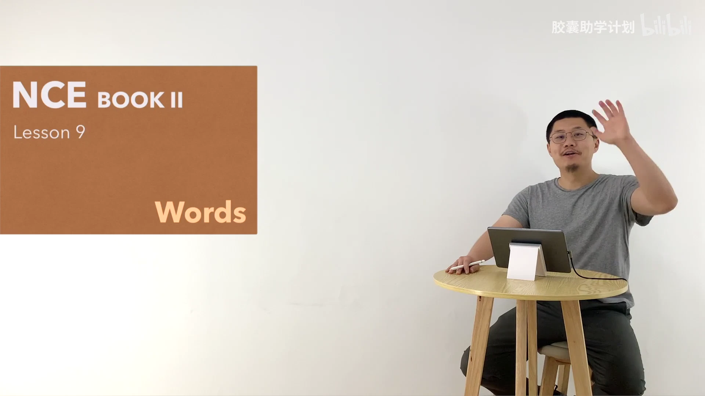

文字识别：胶囊助学计划 / NCE / BOOKⅡI / Lesson 9 / Words

### 画面 00:00:06

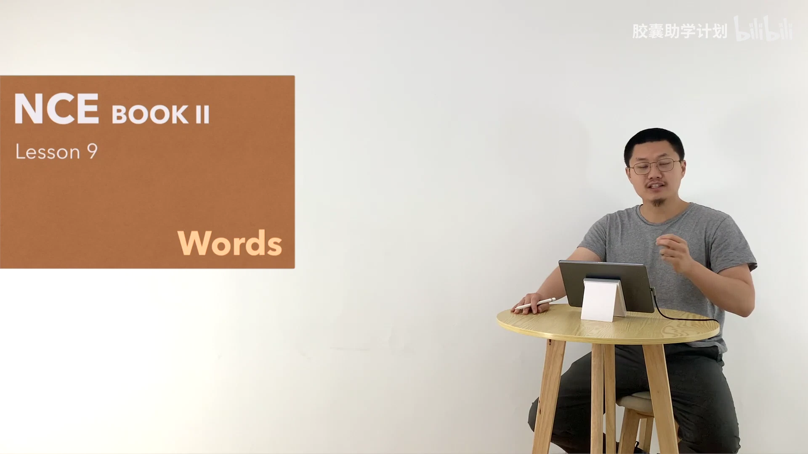

文字识别：胶囊助学计划 / NCE / BOOK I"I / Lesson 9 / Words

### 画面 00:00:08

文字识别：胶囊助学计划

### 画面 00:00:11

文字识别：胶囊助学计划 / 如何表达“围拢，聚集”？

### 画面 00:00:13

文字识别：胶囊助学计划 / ①如何表达“围拢，聚集”？

### 画面 00:00:17

文字识别：胶囊助学计划 / ①如何表达“围拢，聚集”？ / 如何表达“对.大喊”?

### 画面 00:00:19

文字识别：胶囊助学计划 / ①如何表达“围拢，聚集”？ / 如何表达“对.大喊”?

### 画面 00:00:21

文字识别：胶囊助学计划 / ①如何表达“围拢，聚集”？ / 如何表达“对….大喊”? / 如何表达“嘲笑”？

### 画面 00:00:24

文字识别：胶囊助学计划 / ①如何表达“围拢，聚集”？ / 如何表达“对.大喊”? / 如何表达“嘲笑”？

### 画面 00:00:26

文字识别：胶囊助学计划 / ①如何表达“围拢，聚集”？ / 如何表达“对.大喊” / 如何表达“嘲笑”？

### 画面 00:00:28

文字识别：胶囊助学计划 bilbl

## 00:00:30–00:01:00

好，那我们先看第一个小的单词。这个单词可能是零八年奥运会的时候，在中国普及最广的一个英文单词，叫做 welcome 啊， welcome to China， welcome to Beijing。 Very good，来跟我读一下啊，来 welcome， welcome 啊。注意啊，它既有名词的意思，它也有动词的意思。当我们说 a cold welcome 或者是 a warm welcome 啊，一个所谓的冷遇

### 画面 00:00:31

文字识别：胶囊助学计划

### 画面 00:00:33

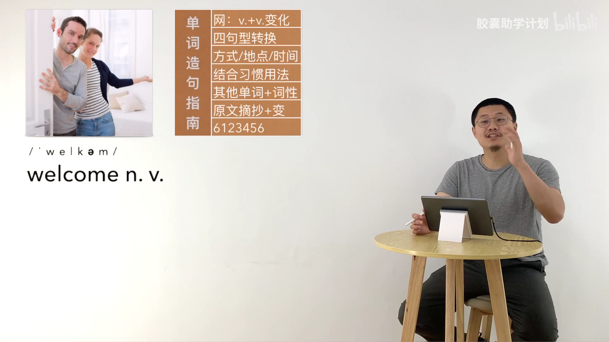

文字识别：单词造句指南 / 网：v.+v.变化 / 胶囊助学计划 / 四句型转换 / 方式/地点/时间 / 结合习惯用法 / 其他单词+词性 / 原文摘抄+变 / 6123456 / /welkam/ / welcome n. v.

### 画面 00:00:35

文字识别：单词造句指南 / 网：v.+v.变化 / 胶囊助学计划 / 四句型转换 / 方式/地点/时间 / 结合习惯用法 / 其他单词+词性 / 原文摘抄+变 / 6123456 / /welkam/ / welcome n. v.

### 画面 00:00:40

文字识别：单词造句指南 / 网：v.+v.变化 / 胶囊助学计划 / 四句型转换 / 方式/地点/时间 / 结合习惯用法 / 其他单词+词性 / 原文摘抄+变 / 6123456 / /welkam/ / welcome n. v.

### 画面 00:00:46

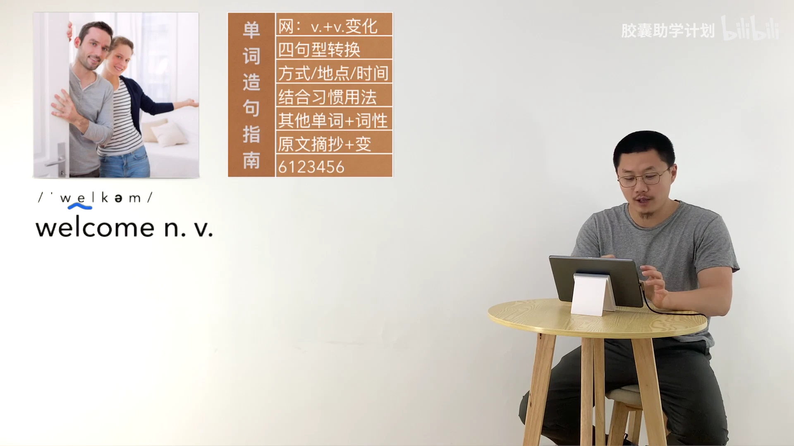

文字识别：单词造句指南 / 网：v.+v.变化 / 胶囊助学计划 / 四句型转换 / 方式/地点/时间 / 结合习惯用法 / 其他单词+词性 / 原文摘抄+变 / 6123456 / /welkam/ / welcome n. v.

### 画面 00:00:48

文字识别：单词造句指南 / 网：v.+v.变化 / 胶囊助学计划 / 四句型转换 / 方式/地点/时间 / 结合习惯用法 / 其他单词+词性 / 原文摘抄+变 / 6123456 / /wel / kam/ / welcome n.v.

### 画面 00:00:50

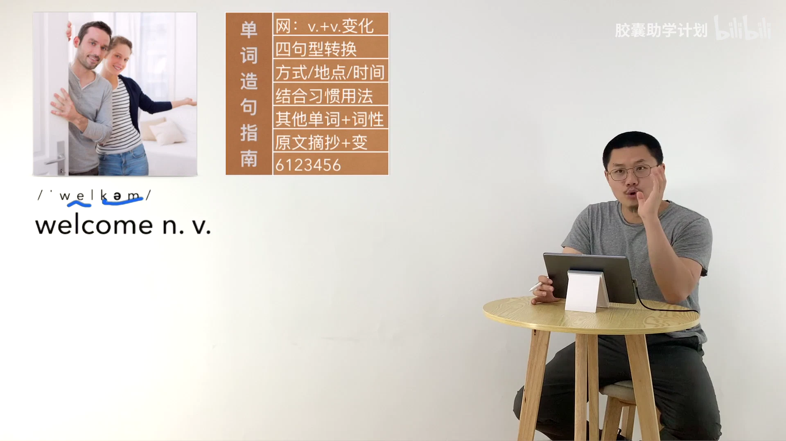

文字识别：单词造句指南 / 网：v.+v.变化 / 胶囊助学计划 / 四句型转换 / 方式/地点/时间 / 结合习惯用法 / 其他单词+词性 / 原文摘抄+变 / 6123456 / /wel / kam/ / welcome n.v.

### 画面 00:00:54

文字识别：单词造句指南 / 网：v.+v.变化 / 胶囊助学计划 / 四句型转换 / 方式/地点/时间 / 结合习惯用法 / 其他单词+词性 / 原文摘抄+变 / 6123456 / /welkam/ / welcome n.v. / ① a cold welcome/ a warm welcome

### 画面 00:00:56

文字识别：单词造句指南 / 网：v.+v.变化 / 胶囊助学计划 / 四句型转换 / 方式/地点/时间 / 结合习惯用法 / 其他单词+词性 / 原文摘抄+变 / 6123456 / /wel / kam / welcome n.v. / a cold welceme/ a warm welcome

### 画面 00:00:58

文字识别：单词造句指南 / 网：v.+v.变化 / 胶囊助学计划 / 四句型转换 / 方式/地点/时间 / 结合习惯用法 / 其他单词+词性 / 原文摘抄+变 / 6123456 / /welkam/ / welcome n.v. / a cold welcome/ a warm welcome

## 00:01:00–00:01:30

和暖遇啊，那其实就是一个很冷漠、冷淡的欢迎和一个很热情的欢迎啊。在这个时候，你注意，你看前面都加了了嘛，对吧？前面又是形容词啊，这些线索都提供给你，告诉你了，它在这个地方是一个名词啊。接下来呢，如果我们说 Welcome to China，Welcome to Beijing，或者 Welcome to Auckland，当你用 Welcome to 加一个地点的时候，这个时候它就是一个动词了，叫欢迎来到

### 画面 00:01:01

文字识别：单词造句指南 / 网：v.+v.变化 / 胶囊助学计划 / 四句型转换 / 方式/地点/时间 / 结合习惯用法 / 其他单词+词性 / 原文摘抄+变 / 6123456 / /welkam/ / welcome n.v. / a cold welceme/ a warm welcome

### 画面 00:01:11

文字识别：单词造句指南 / 网：v.+v.变化 / 胶囊助学计划 / 四句型转换 / 方式/地点/时间 / 结合习惯用法 / 其他单词+词性 / 原文摘抄+变 / 6123456 / /wel / kam / welcgme n. v. / a cold welcome/ a warm welcome

### 画面 00:01:20

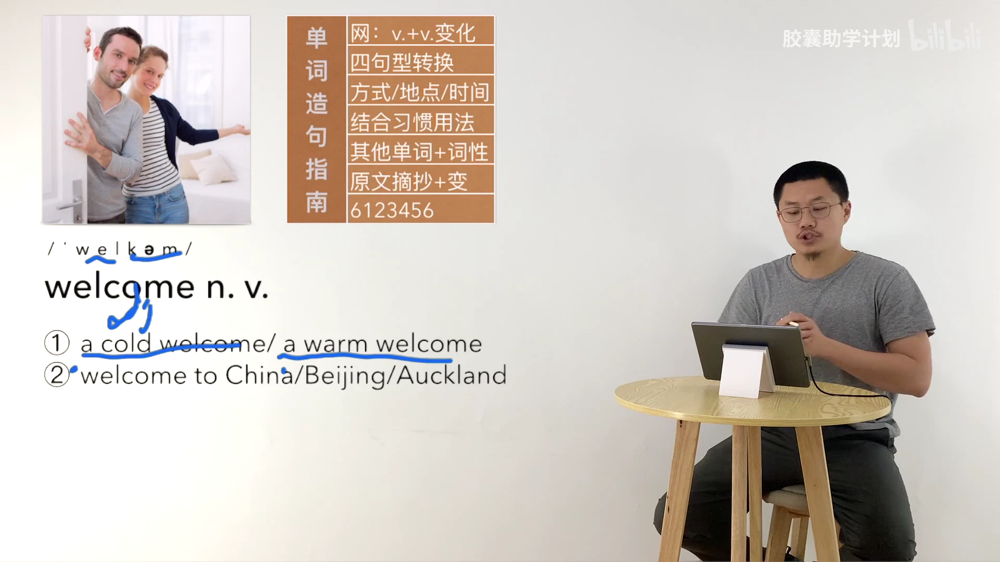

文字识别：单词造句指南 / 网：v.+v.变化 / 胶囊助学计划 / 四句型转换 / 方式/地点/时间 / 结合习惯用法 / 其他单词+词性 / 原文摘抄+变 / 6123456 / /wel / kam / welcgme / en.v. / a cold welcome/ a warm welcome / welcome to China/Beijing/Auckland

## 00:01:30–00:02:00

某地，对吧？比如说 Welcome to my house，但这句话就会有一点点正式啊。欢迎来到我家，OK，有一点点正式。再跟我读一遍，Welcome，Welcome，OK，Very good。好，那下两个单词我们放到一起去讲。首先第一个叫做 crowd，啊，一大群人，一群人，这个一群就叫做 crowd，OK。第二个小的是一个动词啊，名词吧，前面是一个名词，后面是个动词，我把它

### 画面 00:01:36

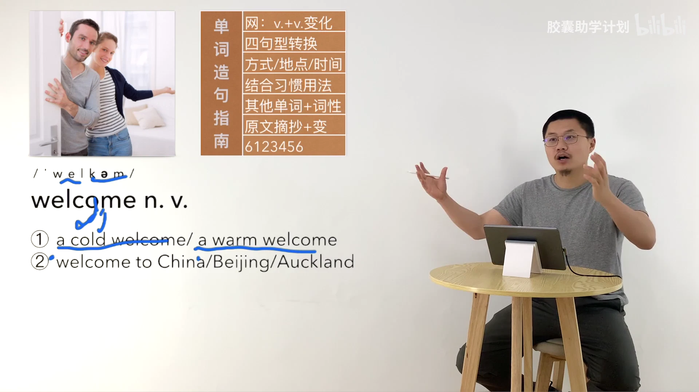

文字识别：单词造句指南 / 网：v.+v.变化 / 胶囊助学计划 / 四句型转换 / 方式/地点/时间 / 结合习惯用法 / 其他单词+词性 / 原文摘抄+变 / 6123456 / /wel / kam / welcgme / en.v. / a cold welceme/ a warm welcome / welcome to China/Beijing/Auckland

### 画面 00:01:40

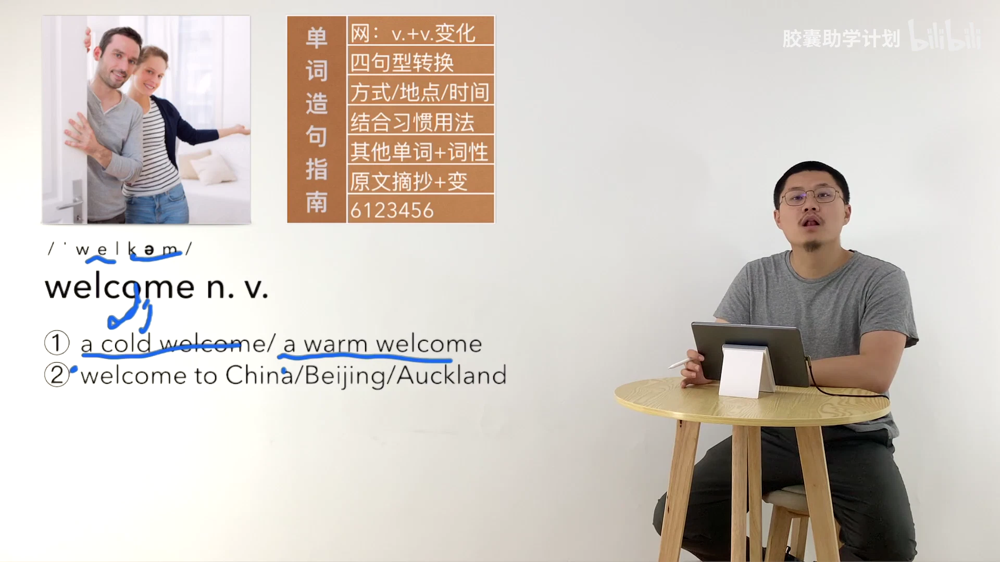

文字识别：单词造句指南 / 网：v.+v.变化 / 胶囊助学计划 / 四句型转换 / 方式/地点/时间 / 结合习惯用法 / 其他单词+词性 / 原文摘抄+变 / 6123456 / /wel / kam/ / welcgme n. v. / a cold welceme/ a warm welcome / welcome to China/Beijing/Auckland

### 画面 00:01:43

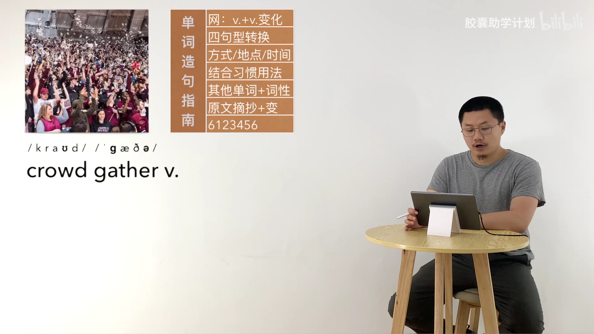

文字识别：单词造句指南 / 网：v.+v.变化 / 胶囊助学计划 / 四句型转换 / 方式/地点/时间 / 结合习惯用法 / 其他单词+词性 / 原文摘抄+变 / 6123456 / /kraud//ge∂a/ / crowd gather v.

### 画面 00:01:45

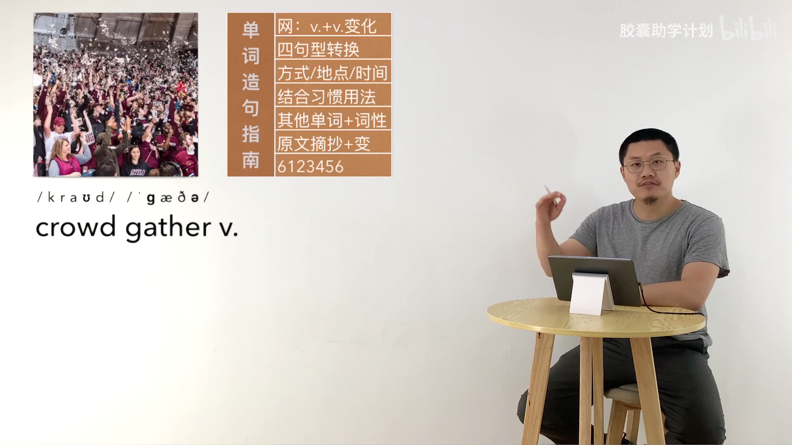

文字识别：单词造句指南 / 网：v.+v.变化 / 胶囊助学计划 / 四句型转换 / 方式/地点/时间 / 结合习惯用法 / 其他单词+词性 / 原文摘抄+变 / 6123456 / /kraud//ge∂a/ / crowd gather v.

### 画面 00:01:50

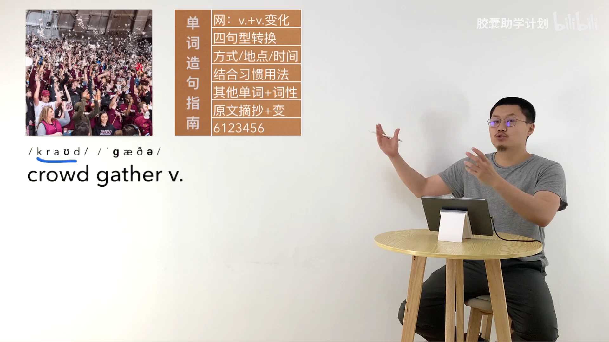

文字识别：单词造句指南 / 网：v.+v.变化 / 胶囊助学计划 / 四句型转换 / 方式/地点/时间 / 结合习惯用法 / 其他单词+词性 / 原文摘抄+变 / 6123456 / S / /kraud//gx∂a/ / crowd gather v.

### 画面 00:01:57

文字识别：单词造句指南 / 网：v.+v.变化 / 胶囊助学计划 / 四句型转换 / 方式/地点/时间 / 结合习惯用法 / 其他单词+词性 / 原文摘抄+变 / 6123456 / SI / /kraud//g / gæǒa/ / crowd / d gather v.

## 00:02:00–00:02:30

连在一起，叫做 gather gather，叫做聚集啊！你看这样一大群人在一起啊， crowd of people 啊， gathered together， OK，他们聚集在了一起。那首先呢，我们在造句之前要先补两个小的短语，第一个叫做 a crowd of，叫做一大群。你比如说一群人，不说 crowd people 啊，说的是 a crowd of people，有点像我们新概念一册四十一课学过那些

### 画面 00:02:00

文字识别：单词造句指南 / 网：v.+v.变化 / 胶囊助学计划 / 四句型转换 / 方式/地点/时间 / 结合习惯用法 / 其他单词+词性 / 原文摘抄+变 / 6123456 / SI / /kraud//g / gæǒa/ / crowd / gather v. / n.

### 画面 00:02:06

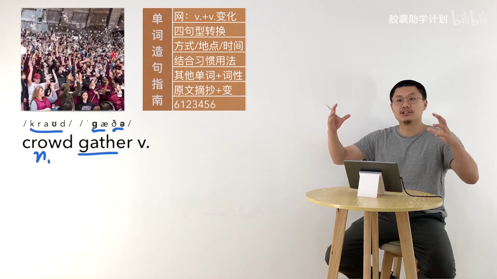

文字识别：单词造句指南 / 网：v.+v.变化 / 胶囊助学计划 / 四句型转换 / 方式/地点/时间 / 结合习惯用法 / 其他单词+词性 / 原文摘抄+变 / 6123456 / /kraud//gæǎa/ / crowd / gather v.

### 画面 00:02:11

文字识别：单词造句指南 / 网：v.+v.变化 / 胶囊助学计划 / 四句型转换 / 方式/地点/时间 / 结合习惯用法 / 其他单词+词性 / 原文摘抄+变 / 6123456 / /kraud//gæǎa/ / crowd / gather v. / n.

### 画面 00:02:14

文字识别：单词造句指南 / 网：v.+v.变化 / 胶囊助学计划 / 四句型转换 / 方式/地点/时间 / 结合习惯用法 / 其他单词+词性 / 原文摘抄+变 / 6123456 / SIU / /kraud// / gæǎa/ / crowd / gather v. / n. / a crowd of; gather round

### 画面 00:02:16

文字识别：单词造句指南 / 网：v.+v.变化 / 胶囊助学计划 / 四句型转换 / 方式/地点/时间 / 结合习惯用法 / 其他单词+词性 / 原文摘抄+变 / 6123456 / S / /kraud//g / gæǒa/ / crowd / gather v. / n / a crowd of; gather round

### 画面 00:02:19

文字识别：单词造句指南 / 网：v.+v.变化 / 胶囊助学计划 / 四句型转换 / 方式/地点/时间 / 结合习惯用法 / 其他单词+词性 / 原文摘抄+变 / 6123456 / S / /kraud//g / gæǒa/ / crowd / gather v. / n / a crowd of; gather round

### 画面 00:02:22

文字识别：单词造句指南 / 网：v.+v.变化 / 胶囊助学计划 / 四句型转换 / 方式/地点/时间 / 结合习惯用法 / 其他单词+词性 / 原文摘抄+变 / 6123456 / SIU / /kraud// / gæǎa/ / crowd / gather v. / n / a crowd of; gather round

### 画面 00:02:26

文字识别：单词造句指南 / 网：v.+v.变化 / 胶囊助学计划 / 四句型转换 / 方式/地点/时间 / 结合习惯用法 / 其他单词+词性 / 原文摘抄+变 / 6123456 / S / /kraud// / gæǒa/ / crowd / gather v. / n / a crowd of; gather round

## 00:02:30–00:03:00

量词，a bottle of，对吧？a couple of，a bottle of，有点是那种感觉。那a crowd of就是一大群的意思。OK，接下来gather round，你看，实际上round这个单词我们在turn round，在转头那课啊，第一课对吧？新概念二册第一课我们就学过，叫转头turn round。那round还有周围、附近，它还有很多意思啊。gather round就是所谓的叫做聚集啊，围拢啊，大家过来过

### 画面 00:02:30

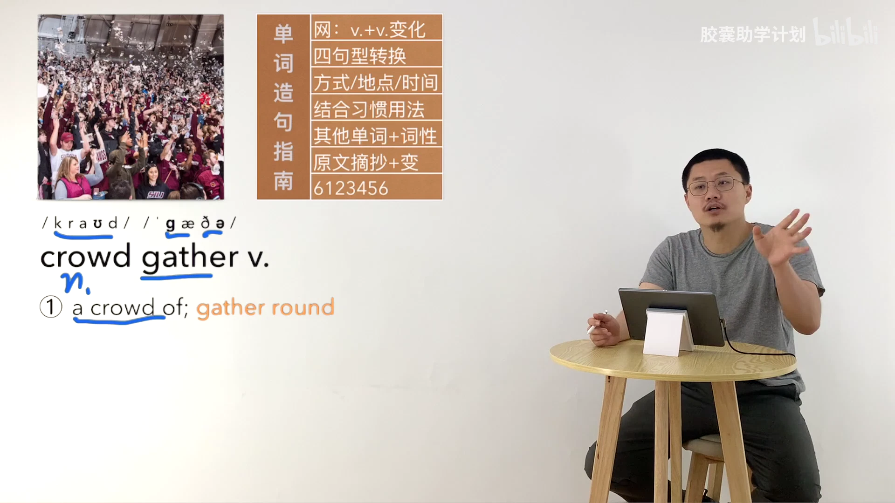

文字识别：单词造句指南 / 网：v.+v.变化 / 胶囊助学计划 / 四句型转换 / 方式/地点/时间 / 结合习惯用法 / 其他单词+词性 / 原文摘抄+变 / 6123456 / S / /kraud// / gæǒa/ / crowd / gather v. / n / a crowd of; gather round

### 画面 00:02:35

文字识别：单词造句指南 / 网：v.+v.变化 / 胶囊助学计划 / 四句型转换 / 方式/地点/时间 / 结合习惯用法 / 其他单词+词性 / 原文摘抄+变 / 6123456 / SIU / /kraud// / gæǎa/ / crowd / gather v. / n / a crowd of; gather round

### 画面 00:02:40

文字识别：单词造句指南 / 网：v.+v.变化 / 胶囊助学计划 / 四句型转换 / 方式/地点/时间 / 结合习惯用法 / 其他单词+词性 / 原文摘抄+变 / 6123456 / /kraud//g / gæǎa/ / crowd / gather v. / n / a crowd of; gather round

### 画面 00:02:45

文字识别：单词造句指南 / 网：v.+v.变化 / 胶囊助学计划 / 四句型转换 / 方式/地点/时间 / 结合习惯用法 / 其他单词+词性 / 原文摘抄+变 / 6123456 / SIU / /kraud// / gæǒa/ / crowd / gather v. / n / a crowd of; gather round

### 画面 00:02:51

文字识别：单词造句指南 / 网：v.+v.变化 / 胶囊助学计划 / 四句型转换 / 方式/地点/时间 / 结合习惯用法 / 其他单词+词性 / 原文摘抄+变 / 6123456 / S / /kraud// / gæǎa/ / crowd / gather v. / n / a crowd of; gather round

### 画面 00:02:57

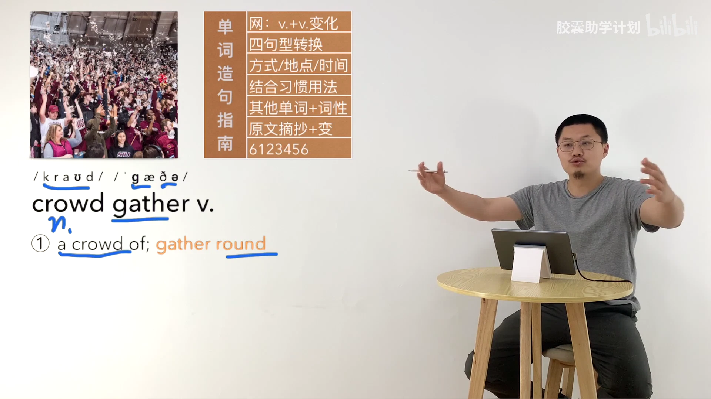

文字识别：单词造句指南 / 网：v.+v.变化 / 胶囊助学计划 / 四句型转换 / 方式/地点/时间 / 结合习惯用法 / 其他单词+词性 / 原文摘抄+变 / 6123456 / /kraud//g / gæǎa/ / crowd / gather v. / n / a crowd of; gather round

## 00:03:00–00:03:30

来，gather round, gather round. 比如说，你这屋子里面有很多的人，然后你就说，Hello everyone, gather round, please. 啊，大家聚过来。I'm gonna say something. I'm gonna make a speech. 我要跟大家说一些话了。OK，叫 gather round, gather round. 那接下来我们呢，尝试去看一下原文啊。我们造句的时候有一个叫做原文摘抄再加变，对吧？这是一个不错的，几乎保证你正确率非常高的一种造句方式。那我们先看一下，叫做

### 画面 00:03:05

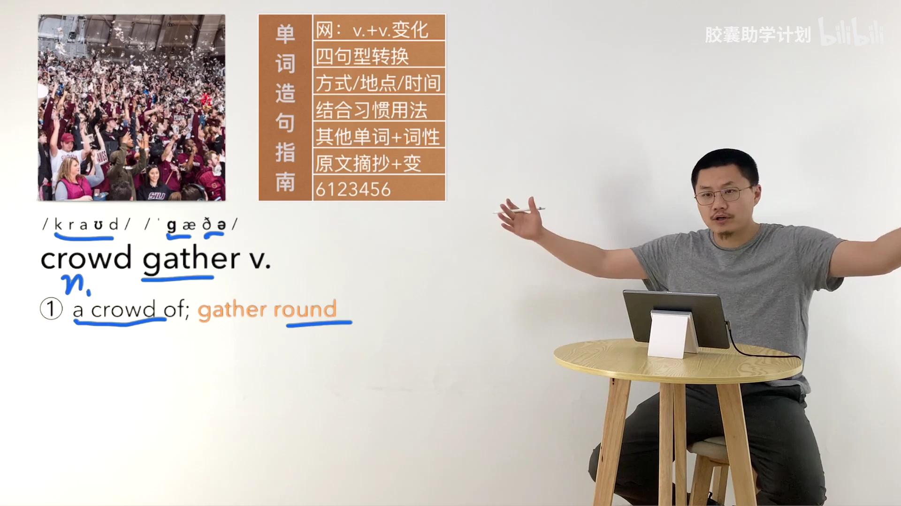

文字识别：单词造句指南 / 网：v.+v.变化 / 胶囊助学计划 / 四句型转换 / 方式/地点/时间 / 结合习惯用法 / 其他单词+词性 / 原文摘抄+变 / 6123456 / SI / /kraud//g / gæǎa/ / crowd / gather v. / n / a crowd of; gather round

### 画面 00:03:12

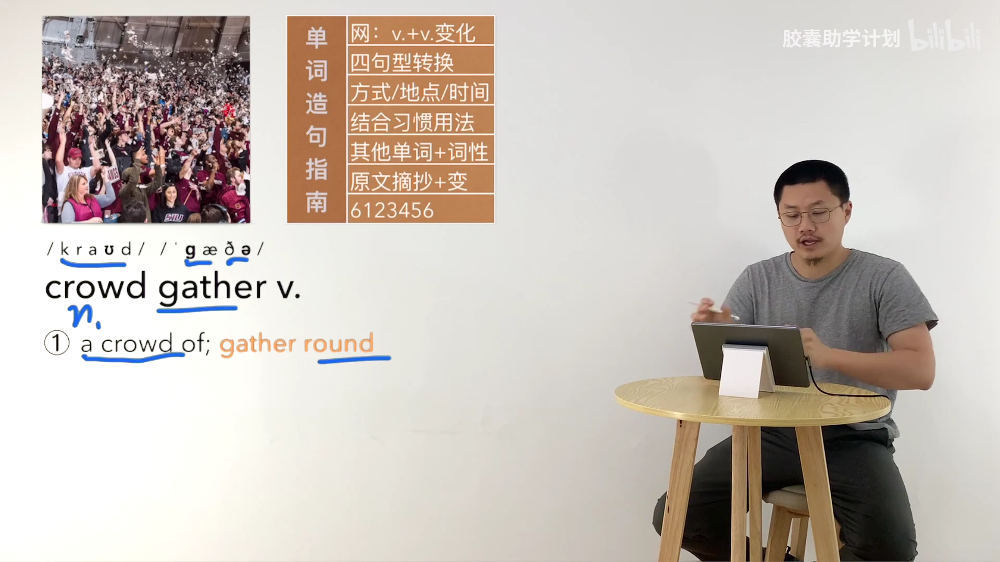

文字识别：单词造句指南 / 网：v.+v.变化 / 胶囊助学计划 / 四句型转换 / 方式/地点/时间 / 结合习惯用法 / 其他单词+词性 / 原文摘抄+变 / 6123456 / /kraud// / gæǒa/ / crowd / gather v. / n / a crowd of; gather round

### 画面 00:03:15

文字识别：单词造句指南 / 网：v.+v.变化 / 胶囊助学计划 / 四句型转换 / 方式/地点/时间 / 结合习惯用法 / 其他单词+词性 / 原文摘抄+变 / 6123456 / S / /kraud// / gæǎa/ / crowd / gather v. / n / a crowd of; gather round

### 画面 00:03:17

文字识别：单词造句指南 / 网：v.+v.变化 / 胶囊助学计划 / 四句型转换 / 方式/地点/时间 / 结合习惯用法 / 其他单词+词性 / 原文摘抄+变 / 6123456 / S / / kraud //gæ∂a/ / crowd / gather v. / n. / a crowd of;gather round / [Story]: A large crowd of people had / gathered under the town hall clock.

### 画面 00:03:20

文字识别：单词造句指南 / 网：v.+v.变化 / 胶囊助学计划 / 四句型转换 / 方式/地点/时间 / 结合习惯用法 / 其他单词+词性 / 原文摘抄+变 / 6123456 / /kraud/ /gæǒa/ / crowd / gather v. / n / a crowd of;gather round / [Story]: A large crowd of people had / gathered under the town hall clock.

### 画面 00:03:23

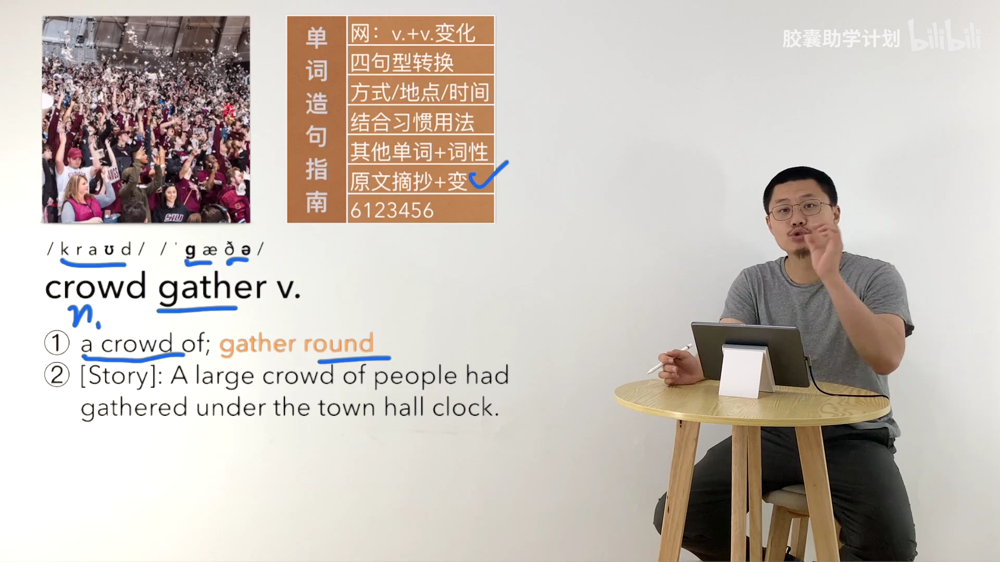

文字识别：单词造句指南 / 网：v.+v.变化 / 胶囊助学计划 / 四句型转换 / 方式/地点/时间 / 结合习惯用法 / 其他单词+词性 / 原文摘抄+变 / 6123456 / /kraud//g / gæǒa/ / crowd / gather v. / n / a crowd of;gather round / [Story]: A large crowd of people had / gathered under the town hall clock.

### 画面 00:03:26

文字识别：单词造句指南 / 网：v.+v.变化 / 胶囊助学计划 / 四句型转换 / 方式/地点/时间 / 结合习惯用法 / 其他单词+词性 / 原文摘抄+变 / 6123456 / / kraud / /gæǎa/ / crowd / gather v. / n / a crowd of;gather round / [Story]: A large crowd of people had / gathered under the town hall clock.

## 00:03:30–00:04:00

原文给了叫 a large crowd of people. Large 对大家很容易理解，一大群，对吧？那 large crowd people 一大群人 had gathered 啊，已经聚集起来了。过去完成时，我们新一学过，新二还没来得及学啊，已经聚集起来了。 Under the town hall clock，在市政厅的这个表的下方，一大群人已经聚集起来了。我们其实现在要改，你看一下啊。首先 a large crowd of people，

### 画面 00:03:30

文字识别：单词造句指南 / 网：v.+v.变化 / 胶囊助学计划 / 四句型转换 / 方式/地点/时间 / 结合习惯用法 / 其他单词+词性 / 原文摘抄+变 / 6123456 / / kraud//gæ∂a/ / crowd / gather v. / n. / a crowd of; gather round / [Story]: A large crowd of people had / gathered under the town hall clock.

### 画面 00:03:35

文字识别：单词造句指南 / 网：v.+v.变化 / 胶囊助学计划 / 四句型转换 / 方式/地点/时间 / 结合习惯用法 / 其他单词+词性 / 原文摘抄+变 / 6123456 / SIU / /kraud// / gæǒal / crowd / gather v. / n. / a crowd of;gather round / [Story]: A large crowd of people had / gathered under the town hall clock.

### 画面 00:03:38

文字识别：单词造句指南 / 网：v.+v.变化 / 胶囊助学计划 / 四句型转换 / 方式/地点/时间 / 结合习惯用法 / 其他单词+词性 / 原文摘抄+变 / 6123456 / /kraud// / gæǒa/ / crowd / gather v. / n. / a crowd of; gather round / [Story]: A large crowd of people / had / gathered under the town hall clock.

### 画面 00:03:40

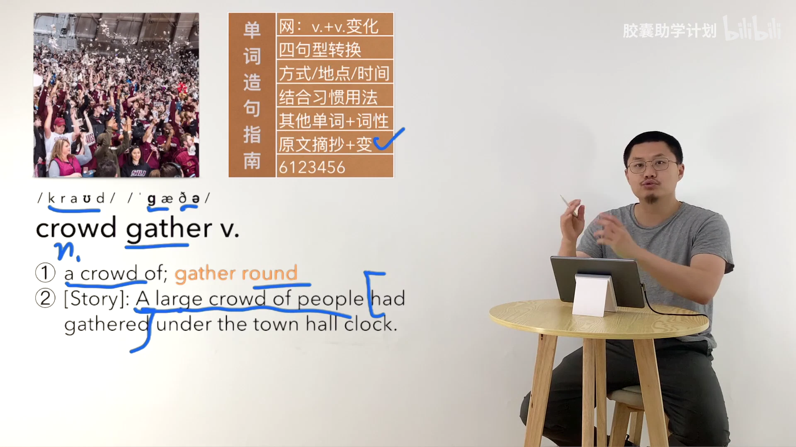

文字识别：单词造句指南 / 网：v.+v.变化 / 胶囊助学计划 / 四句型转换 / 方式/地点/时间 / 结合习惯用法 / 其他单词+词性 / 原文摘抄+变 / 6123456 / / kraud//gæ∂a/ / crowd / gather v. / n. / a crowd of; gather round / [Story]: A large crowd of people / had / gathered under the town hall clock.

### 画面 00:03:46

文字识别：单词造句指南 / 网：v.+v.变化 / 胶囊助学计划 / 四句型转换 / 方式/地点/时间 / 结合习惯用法 / 其他单词+词性 / 原文摘抄+变 / 6123456 / /kraud//g / gæǒa/ / crowd / gather v. / n. / a crowd of; gather round / [Story]: A large crowd of people / had / gathered under the town halil clock.

### 画面 00:03:48

文字识别：单词造句指南 / 网：v.+v.变化 / 胶囊助学计划 / 四句型转换 / 方式/地点/时间 / 结合习惯用法 / 其他单词+词性 / 原文摘抄+变 / 6123456 / S / /kraud//g / gæǒa/ / crowd / gather v. / n. / a crowd of; gather round / [Story]: A large crowd of people / had / gathered under the town hall clock.

### 画面 00:03:50

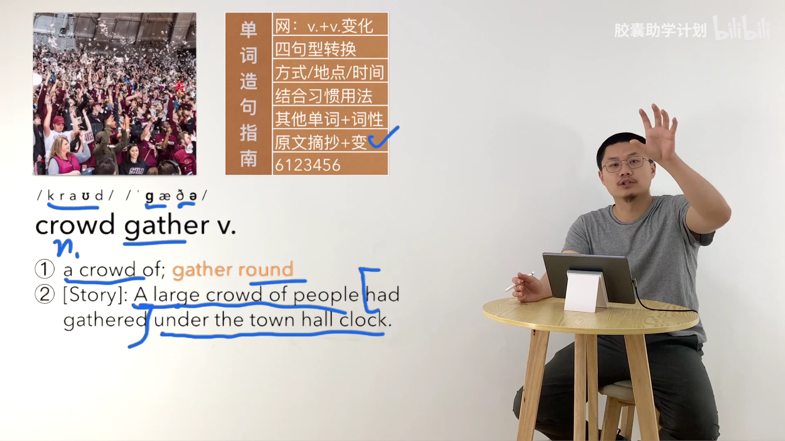

文字识别：单词造句指南 / 网：v.+v.变化 / 胶囊助学计划 / 四句型转换 / 方式/地点/时间 / 结合习惯用法 / 其他单词+词性 / 原文摘抄+变 / 6123456 / S / /kraud / /gx∂a/ / crowd / gather v. / n / a crowd of; gather round / [Story]: A large crowd of people / had / gathered under the town hall clock.

### 画面 00:03:55

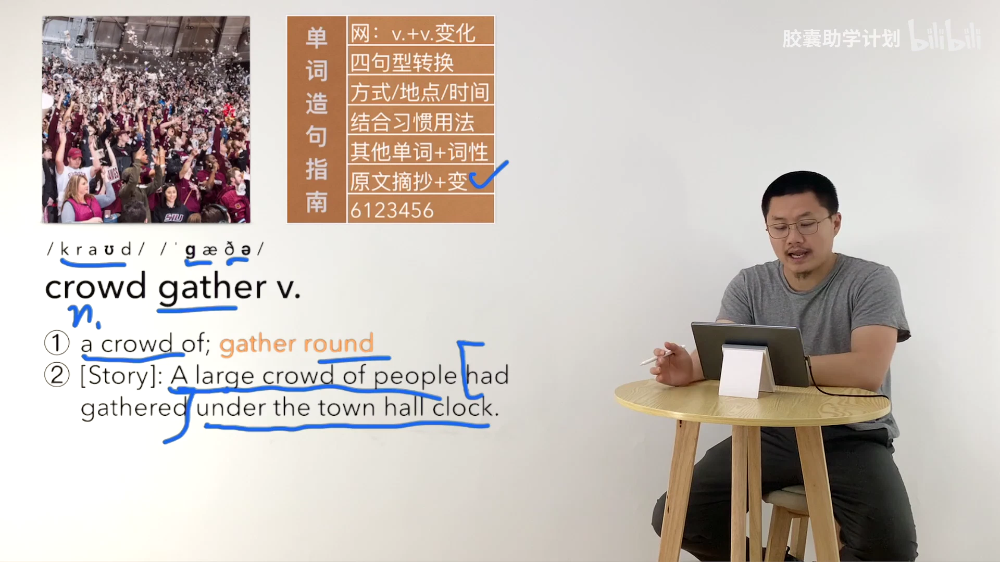

文字识别：单词造句指南 / 网：v.+v.变化 / 胶囊助学计划 / 四句型转换 / 方式/地点/时间 / 结合习惯用法 / 其他单词+词性 / 原文摘抄+变 / 6123456 / SI / / kraud //gæ∂a/ / crowd / gather v. / n. / a crowd of; gather round / [Story]: A large crowd of people / had / gathered under the town hall clock.

### 画面 00:03:59

文字识别：单词造句指南 / 网：v.+v.变化 / 胶囊助学计划 / 四句型转换 / 方式/地点/时间 / 结合习惯用法 / 其他单词+词性 / 原文摘抄+变 / 6123456 / / kraud //gæ∂a/ / crowd / gather v. / n. / a crowd of; gather round / [Story]: A large crowd of people / had / gathered under the town hall clock.

## 00:04:00–00:04:30

我完全可以不改。我们现在已经把它拆出来了，对吧？拆出来三个部分了。你可以不进行任何的改，留着它。Had gathered，叫做过去完成时。我们还没学，咱先不用。咱就把它变成一般过去时，叫做 a large crowd of people gathered，就可以了，对吧？然后在什么地方呢？那我问一下啊，你个个自己去想一下，这个地点是不是由你说了算？比如说，一大群人在哪儿聚起来了

### 画面 00:04:03

文字识别：单词造句指南 / 网：v.+v.变化 / 胶囊助学计划 / 四句型转换 / 方式/地点/时间 / 结合习惯用法 / 其他单词+词性 / 原文摘抄+变 / 6123456 / S / /kraud// / gæǒa/ / crowd / gather v. / n / a crowd of; gather round / had / [Story]: A large crowd of people / gathered under the town hall clock.

### 画面 00:04:08

文字识别：单词造句指南 / 网：v.+v.变化 / 胶囊助学计划 / 四句型转换 / 方式/地点/时间 / 结合习惯用法 / 其他单词+词性 / 原文摘抄+变 / 6123456 / S / /kraud// / gæǒa/ / crowd / gather v. / n. / a crowd of; gather round / [Story]: A large crowd of people / had / gathered under the town hall clock.

### 画面 00:04:11

文字识别：单词造句指南 / 网：v.+v.变化 / 胶囊助学计划 / 四句型转换 / 方式/地点/时间 / 结合习惯用法 / 其他单词+词性 / 原文摘抄+变 / 6123456 / /kraud// / gæǒa/ / crowd / gather v. / n / a crowd of; gather round / [Story]: A large crowd of people / had / gathered under the town hall clock.

### 画面 00:04:15

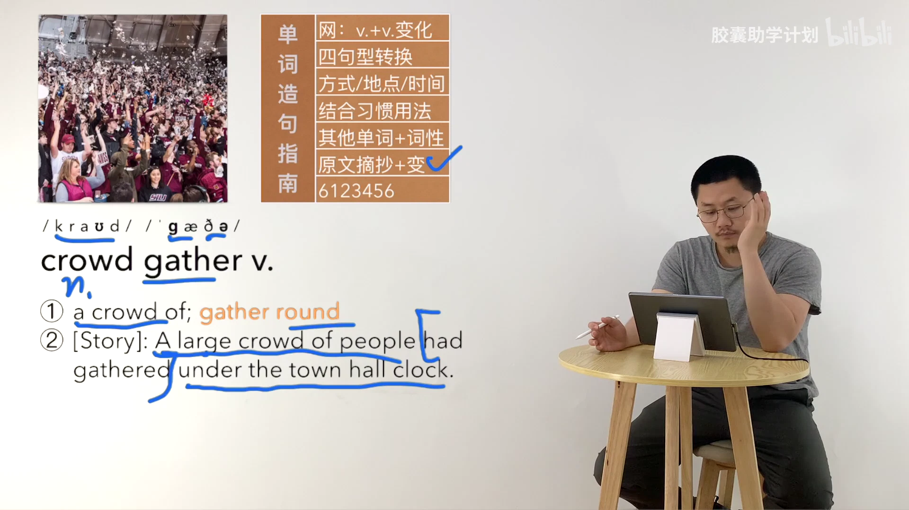

文字识别：单词造句指南 / 网：v.+v.变化 / 胶囊助学计划 / 四句型转换 / 方式/地点/时间 / 结合习惯用法 / 其他单词+词性 / 原文摘抄+变 / 6123456 / /kraud// / gæǒa/ / crowd / gather v. / n. / a crowd of; gather round / [Story]: A large crowd of people / had / gathered under the town hall clock.

### 画面 00:04:22

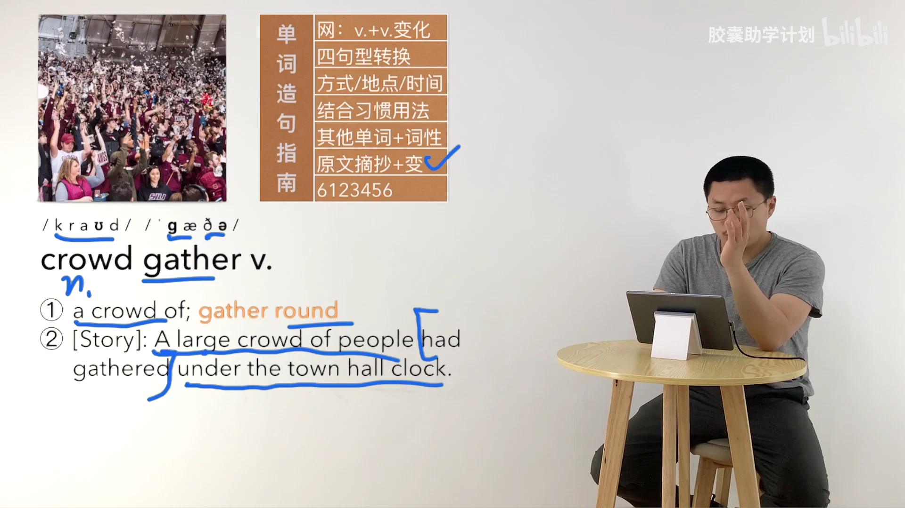

文字识别：单词造句指南 / 网：v.+v.变化 / 胶囊助学计划 / 四句型转换 / 方式/地点/时间 / 结合习惯用法 / 其他单词+词性 / 原文摘抄+变 / 6123456 / S / /kraud//g / gæǒa/ / crowd / gather v. / n / a crowd of; gather round / [Story]: A large crowd of people / had / gathered under the town hall clock.

### 画面 00:04:24

文字识别：单词造句指南 / 网：v.+v.变化 / 胶囊助学计划 / 四句型转换 / 方式/地点/时间 / 结合习惯用法 / 其他单词+词性 / 原文摘抄+变 / 6123456 / /kraud// / gæǒa/ / crowd / gather v. / n. / a crowd of; gather round / [Story]: A large crowd of people / had / gathered under the town hall clock.

### 画面 00:04:26

文字识别：单词造句指南 / 网：v.+v.变化 / 胶囊助学计划 / 四句型转换 / 方式/地点/时间 / 结合习惯用法 / 其他单词+词性 / 原文摘抄+变 / 6123456 / /kraud//' / gæǎal / crowd / gather v. / n. / a crowd of; gather round / [Story]: A large crowd of people / had / gathered under the town hall clock.

## 00:04:30–00:05:00

呢？比如说在 airport，对吧？A large crowd of people gathered at the airport. 可以。那你说在这个电影院聚集起来，或者比如说我们第一节课学的 last week I went to the theater，我在剧院这个呃聚集起来了，行不行呢？也可以啊，对吧？比如说 in front of the theater，啊，在这个剧院 theater， OK，在这个剧院的门口聚集起来了。这是各位可以回去随便

### 画面 00:04:33

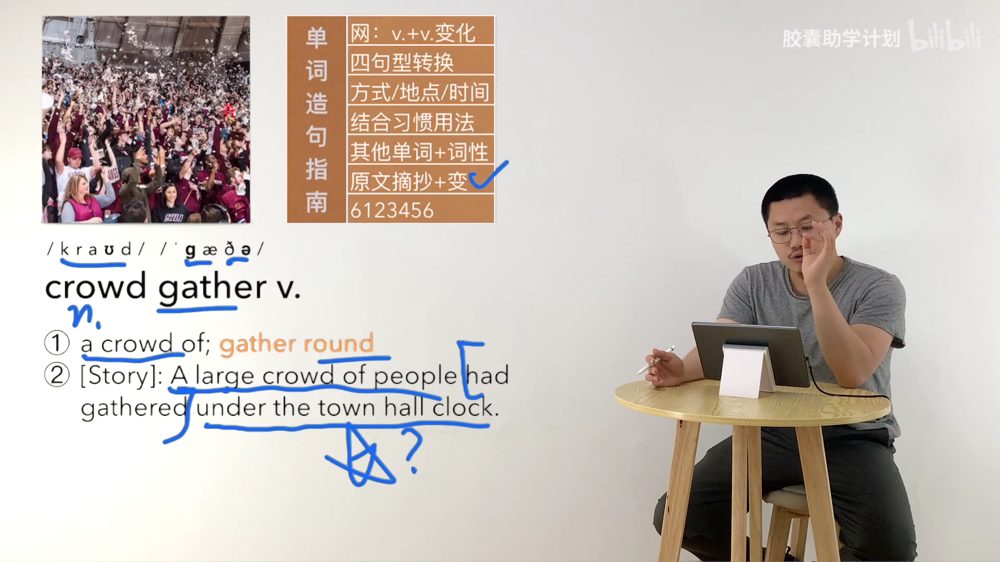

文字识别：单词造句指南 / 网：v.+v.变化 / 胶囊助学计划 / 四句型转换 / 方式/地点/时间 / 结合习惯用法 / 其他单词+词性 / 原文摘抄+变 / 6123456 / S / /kraud// / gæǒa/ / crowd / gather v. / n / a crowd of; gather round / [Story]: A large crowd of people / had / gathered under the town hall clock.

### 画面 00:04:36

文字识别：单词造句指南 / 网：v.+v.变化 / 胶囊助学计划 / 四句型转换 / 方式/地点/时间 / 结合习惯用法 / 其他单词+词性 / 原文摘抄+变 / 6123456 / /kraud//g / gæǒa/ / crowd / gather v. / n. / a crowd of; gather round / [Story]: A large crowd of people / had / gathered under the town hall clock.

### 画面 00:04:41

文字识别：单词造句指南 / 网：v.+v.变化 / 胶囊助学计划 / 四句型转换 / 方式/地点/时间 / 结合习惯用法 / 其他单词+词性 / 原文摘抄+变 / 6123456 / /kraud// / gæǒa/ / crowd / gather v. / n. / a crowd of;gather round / [Story]: A large crowd of people / had / gathered under the town hall clock.

### 画面 00:04:45

文字识别：单词造句指南 / 网：v.+v.变化 / 胶囊助学计划 / 四句型转换 / 方式/地点/时间 / 结合习惯用法 / 其他单词+词性 / 原文摘抄+变 / 6123456 / / kraud //gæ∂a/ / crowd / gather v. / n / a crowd of; gather round / [Story]: A large crowd of people / had / gathered under the town hall clock.

### 画面 00:04:50

文字识别：单词造句指南 / 网：v.+v.变化 / 胶囊助学计划 / 四句型转换 / 方式/地点/时间 / 结合习惯用法 / 其他单词+词性 / 原文摘抄+变 / 6123456 / /kraud// / gæǒa/ / crowd / gather v. / n. / a crowd of; gather round / [Story]: A large crowd of people / had / gathered under the town hall clock.

### 画面 00:04:55

文字识别：单词造句指南 / 网：v.+v.变化 / 胶囊助学计划 / 四句型转换 / 方式/地点/时间 / 结合习惯用法 / 其他单词+词性 / 原文摘抄+变 / 6123456 / / kraud //gæ∂a/ / crowd / gather v. / n. / a crowd of; gather round / [Story]: A large crowd of people / had / gathered under the town hall clock.

## 00:05:00–00:05:30

变的，比如说地点，对吧？然后呢，你把时态做一个小的改变，做完这样改变了之后，自己去自己再去做一些四句型的转换就好了。OK，来一个，好，那不多说，接下来我们看一个电影片段。电影片段当中非常好啊，各位注意一下，接下来这个片段当中人的走向叫做 gather round， gather round， OK，来了， gather

### 画面 00:05:00

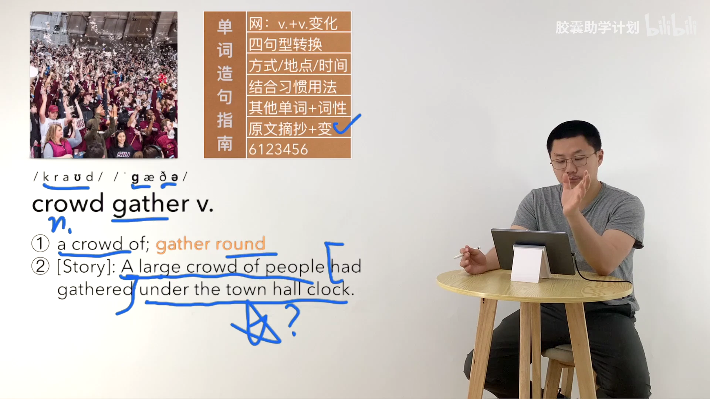

文字识别：单词造句指南 / 网：v.+v.变化 / 胶囊助学计划 / 四句型转换 / 方式/地点/时间 / 结合习惯用法 / 其他单词+词性 / 原文摘抄+变 / 6123456 / /kraud// / gæǒa/ / crowd / gather v. / n. / a crowd of; gather round / [Story]: A large crowd of people / had / gathered under the town hall clock.

### 画面 00:05:06

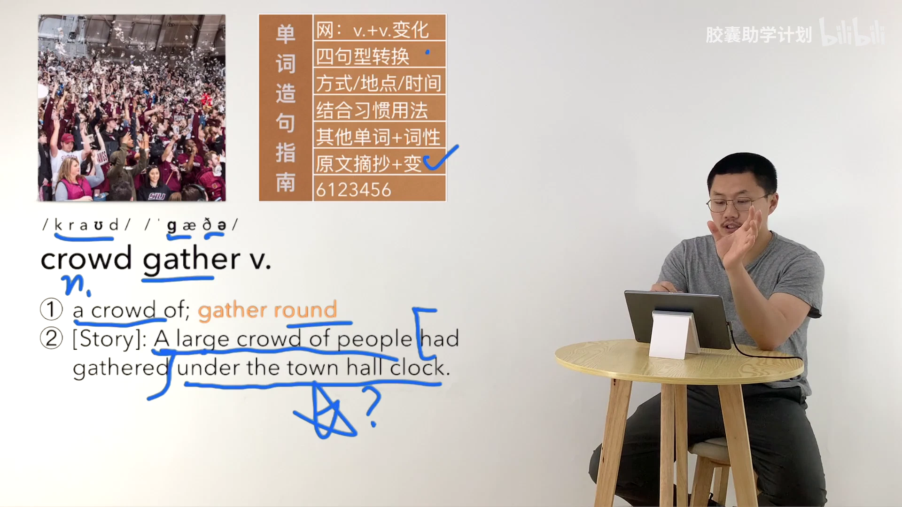

文字识别：单词造句指南 / 网：v.+v.变化 / 胶囊助学计划 / 四句型转换 / 方式/地点/时间 / 结合习惯用法 / 其他单词+词性 / 原文摘抄+变 / 6123456 / / kraud //gæ∂a/ / crowd / gather v. / n / a crowd of; gather round / [Story]: A large crowd of people / had / gathered under the town hall clock.

### 画面 00:05:09

文字识别：单词造句指南 / 网：v.+v.变化 / 胶囊助学计划 / 四句型转换 / 方式/地点/时间 / 结合习惯用法 / 其他单词+词性 / 原文摘抄+变 / 6123456 / /kraud// / gæǒa/ / crowd / gather v. / n / a crowd of; gather round / [Story]: A large crowd of people / had / gathered under the town hall clock.

### 画面 00:05:11

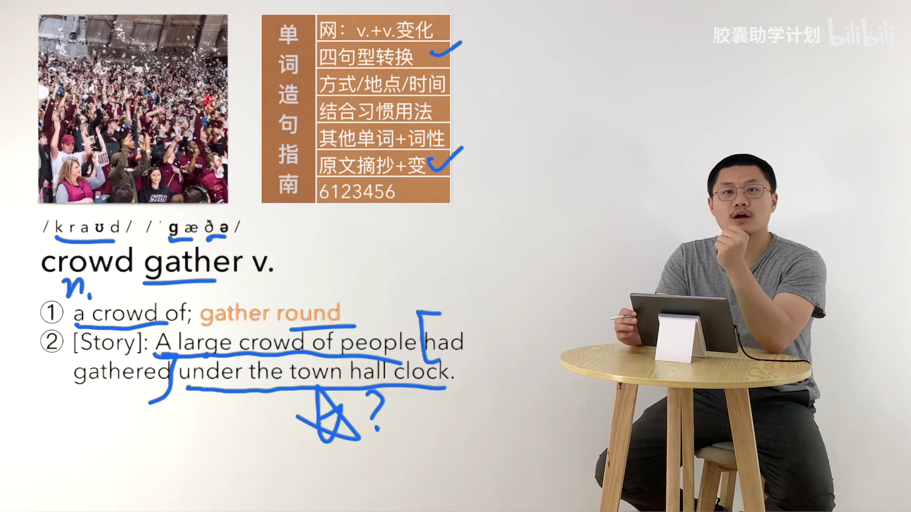

文字识别：单词造句指南 / 网：v.+v.变化 / 胶囊助学计划 / 四句型转换 / 方式/地点/时间 / 结合习惯用法 / 其他单词+词性 / 原文摘抄+变 / 6123456 / /kraud// / gæǒa/ / crowd / gather v. / n / a crowd of; gather round / [Story]: A large crowd of people / had / gathered under the town hall clock.

### 画面 00:05:13

文字识别：gather round / 胶囊助学计划 / 哈利·波特与密室 / Harry Potter ang / the Chamberof / Secrets / (2002)

### 画面 00:05:27

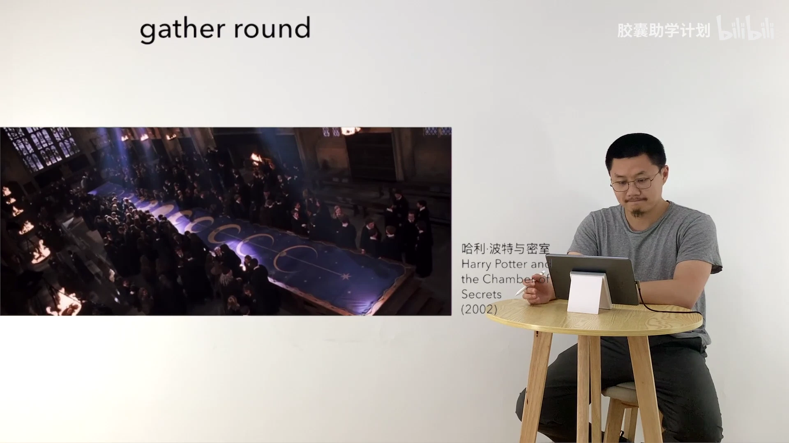

文字识别：gather round / 胶囊助学计划 / 哈利·波特与密室 / Harry Potter ang / the Chamberof / Secrets / (2002)

## 00:05:30–00:06:00

gather round. Can everybody see me? Can you all hear me? Excellent. Okay, gather round, gather round.啊，聚过来，聚过来。你看大家人都往前走，对吧？Okay，马上一遍。接下来下一个单词跟我读一下。Hand，新概念一册第一课咱们就学过。Handbag，手，对吧？但它在这个地方不是手的意思，指的是指针，那个表的走

### 画面 00:05:30

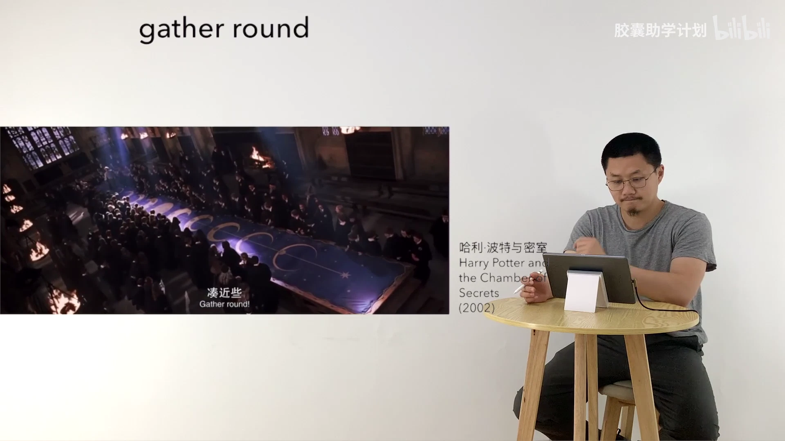

文字识别：gather round / 胶囊助学计划 / 哈利·波特与密室 / Harry Potter ang / the Chamberot / 凑近些 / Secrets / Gather round! / (2002)

### 画面 00:05:32

文字识别：gather round / 胶囊助学计划 / 哈利·波特与密室 / Harry Potter ang / the Chamberof / 凑近一些大家都能看见我吗？ / Secrets / Gather round. Can everybody see me? / (2002)

### 画面 00:05:34

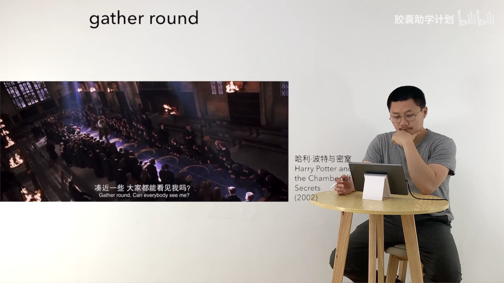

文字识别：gather round / 胶囊助学计划 / 哈利·波特与密室 / Harry Potter ang / the Chamberof / 凑近一些大家都能看见我吗？ / Secrets / Gather round. Can everybody see me? / (2002)

### 画面 00:05:36

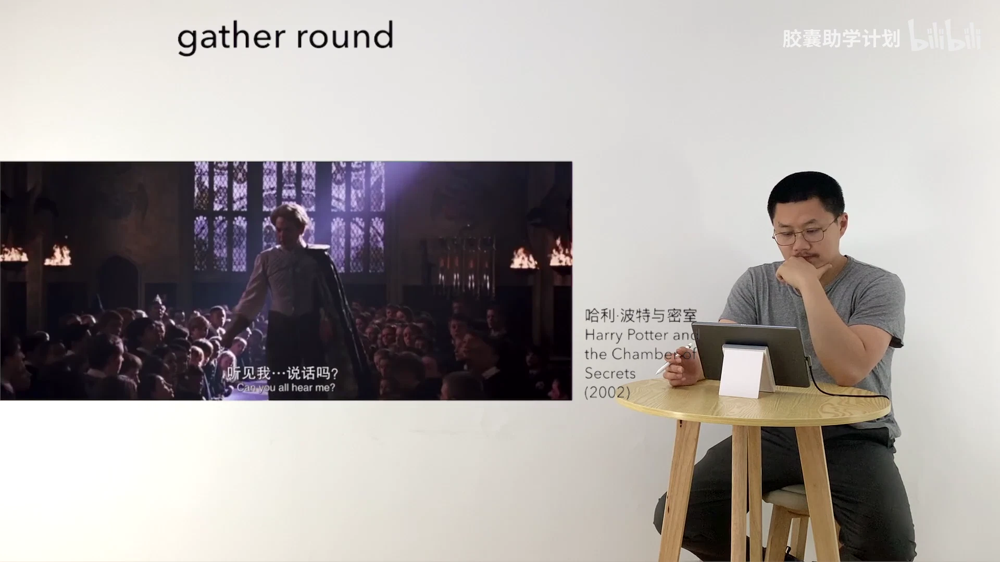

文字识别：gather round / 胶囊助学计划 / 哈利·波特与密室 / Harry Potter ang / the Chambesof / 听见我…说话吗？ / Secrets / Can you all hear me? / (2002)

### 画面 00:05:38

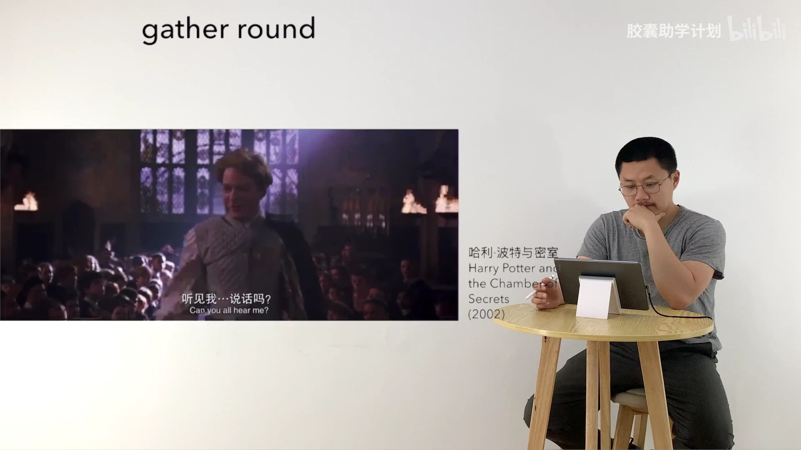

文字识别：gather round / 胶囊助学计划 / 哈利·波特与密室 / Harry Potter ang / the Chamberot / 听见我…说话吗？ / Secrets / Can you all hear me? / (2002)

### 画面 00:05:40

文字识别：gather round / 胶囊助学计划 / 哈利·波特与密室 / Harry Potter ang / the Chamberof / 好极了 / Secrets / Excellent. / (2002)

### 画面 00:05:42

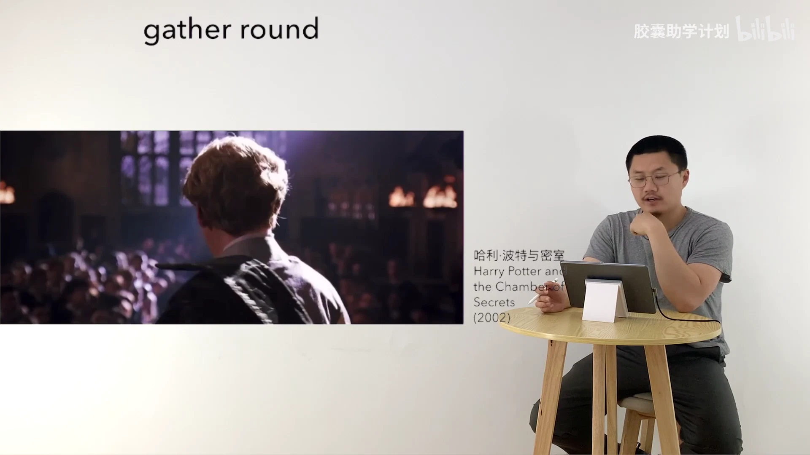

文字识别：gather round / 胶囊助学计划 / 哈利·波特与密室 / Harry Potter ang / the Chamberof / Secrets / (2002)

### 画面 00:05:49

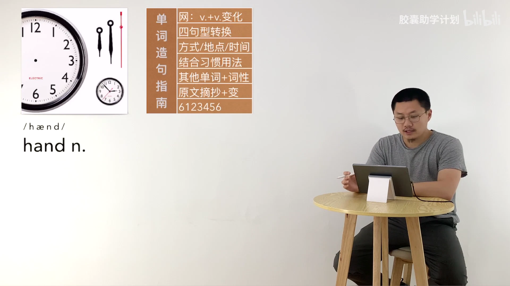

文字识别：单词造句指南 / 网：v.+v.变化 / 胶囊助学计划 / 12 / 四句型转换 / 2 / 方式/地点/时间 / 3 / 结合习惯用法 / 4 / 其他单词+词性 / ELECTRIC / 5. / 6 / 原文摘抄+变 / 6123456 / /hænd/ / hand n.

### 画面 00:05:52

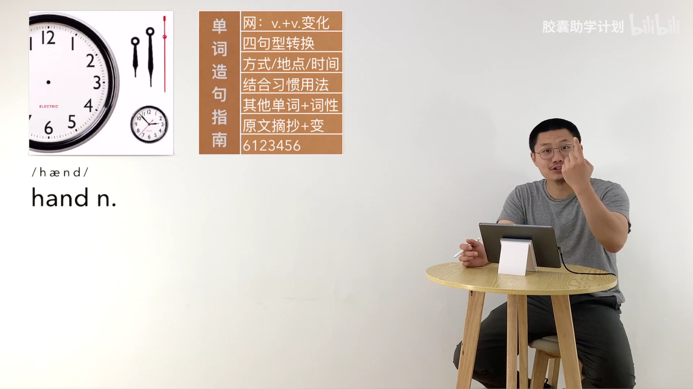

文字识别：单词造句指南 / 网：v.+v.变化 / 胶囊助学计划 / 112 / ` / 四句型转换 / 2 / 方式/地点/时间 / 3 / 结合习惯用法 / 4 / 其他单词+词性 / ELECTRIC / 5 / 6 / 原文摘抄+变 / 8 / 1 / 6 / 6123456 / /hænd/ / hand n.

### 画面 00:05:56

文字识别：单词造句指南 / 网：v.+v.变化 / 胶囊助学计划 / 12 / 四句型转换 / 2 / 方式/地点/时间 / 3 / 结合习惯用法 / 4 / 其他单词+词性 / ELECTRIC / 5 / 6 / 原文摘抄+变 / 1111 / 6123456 / /hænd/ / hand n.

## 00:06:00–00:06:30

针啊，指的是那个针。比如说，minute hand就是分针，second hand就是秒针，而hour hand就是时针。OK，来一个。那我们拿它想去造句，必然又是要找动词了，对不对？首先呢，我们配合了一个新概念二册第七课我们学过的叫try to do something，尝试去做某件事情，以及我们在新一就学过的一个单词叫做fix，叫做修理。那我们尝试把它们放在一起，叫做

### 画面 00:06:02

文字识别：单词造句指南 / 网：v.+v.变化 / 胶囊助学计划 / 112 / ` / 四句型转换 / 2 / 方式/地点/时间 / 3 / 结合习惯用法 / 4 / 其他单词+词性 / ELECTRIC / 5. / 6 / 原文摘抄+变 / 1111 / 6 / 6123456 / /hænd/ / hand n. / minute hand; second hand; hour hand

### 画面 00:06:06

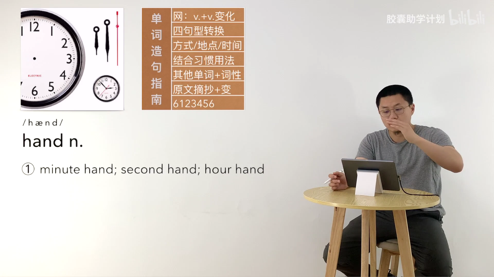

文字识别：单词造句指南 / 网：v.+v.变化 / 胶囊助学计划 / 12 / ` / 四句型转换 / 2 / 方式/地点/时间 / 3 / 结合习惯用法 / 4 / 其他单词+词性 / ELECTRIC / 5. / 6 / 原文摘抄+变 / (1111 / 6123456 / /hænd/ / hand n. / minute hand; second hand; hour hand

### 画面 00:06:10

文字识别：单词造句指南 / 网：v.+v.变化 / 胶囊助学计划 / 12 / ` / 四句型转换 / 2 / 方式/地点/时间 / 3 / 结合习惯用法 / 4 / 其他单词+词性 / ELECTRIC / 5. / 6 / 原文摘抄+变 / 1111 / 6 / 6123456 / /hænd/ / hand n. / minute hand; second hand; hour hand

### 画面 00:06:15

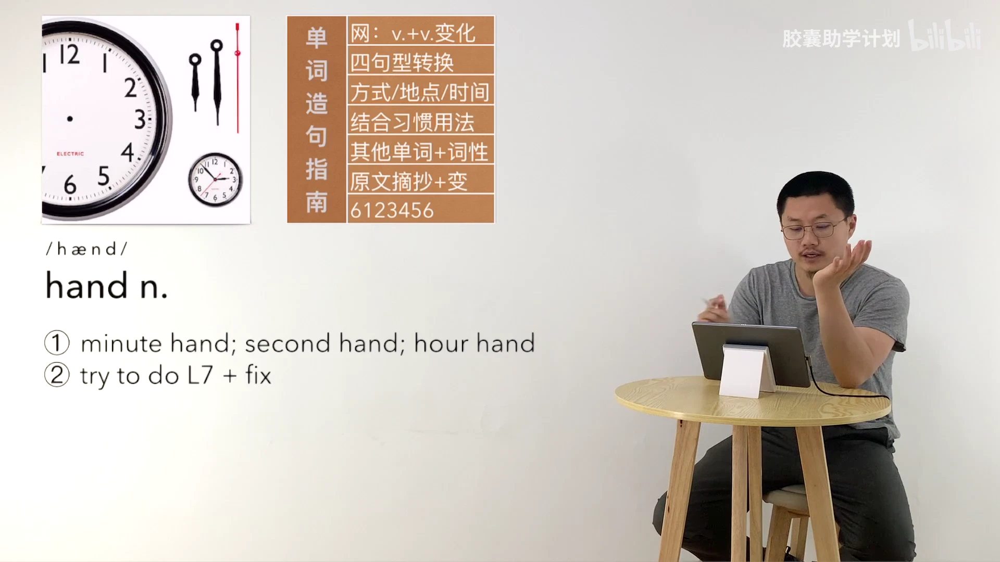

文字识别：单词造句指南 / 网：v.+v.变化 / 胶囊助学计划 / 12 / 四句型转换 / 2 / 方式/地点/时间 / 3 / 结合习惯用法 / 4 / 其他单词+词性 / ELECTRIC / 5. / 6 / 原文摘抄+变 / 6 / 6123456 / /hænd/ / hand n. / minute hand; second hand; hour hand / try to do L7 + fix / 2

### 画面 00:06:20

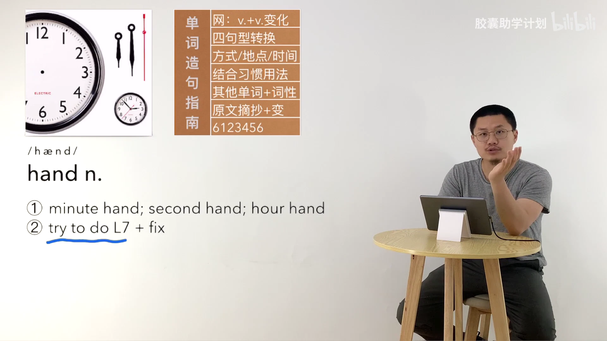

文字识别：单词造句指南 / 网：v.+v.变化 / 胶囊助学计划 / 12 / 1111 / ` / 四句型转换 / 2 / 方式/地点/时间 / 3 / 结合习惯用法 / 4 / 其他单词+词性 / ELECTRIC / 5. / 6 / 原文摘抄+变 / 1111 / 6 / 6123456 / /hænd/ / hand n. / minute hand; second hand; hour hand / try to do L7 + fix

### 画面 00:06:25

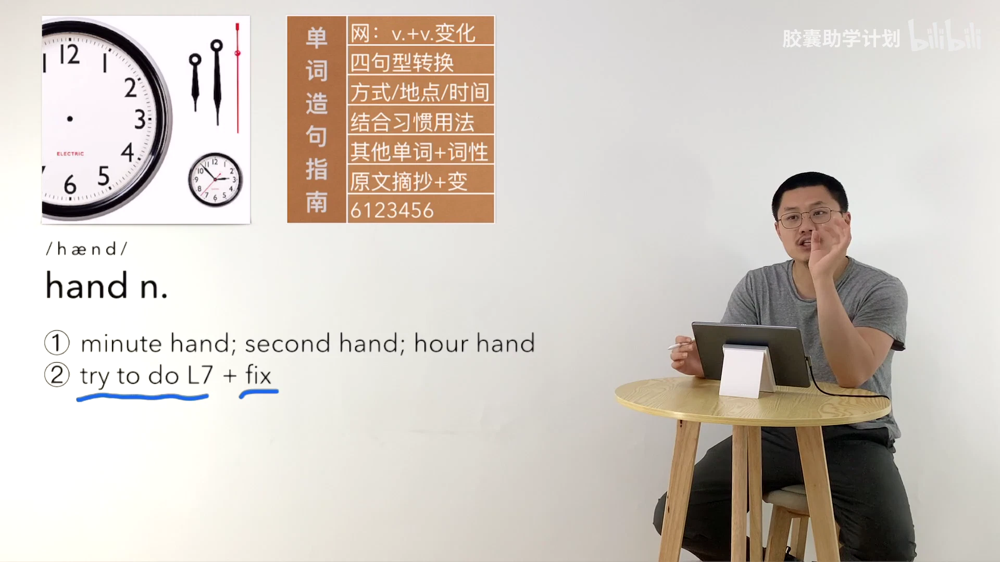

文字识别：单词造句指南 / 网：v.+v.变化 / 胶囊助学计划 / 12 / 1111 / ` / 四句型转换 / 2 / 方式/地点/时间 / 3 / 结合习惯用法 / 4 / 其他单词+词性 / ELECTRIC / 5. / 6 / 原文摘抄+变 / 6123456 / /hænd/ / hand n. / minute hand; second hand; hour hand / try to do L7 + fix

## 00:06:30–00:07:00

They are trying to fix that big minute hand. 注意这个地方的主语是不是你自己随便换？ Be trying to do这个时态，我只是选择用了现在进行时。你可以用一般过去时，对吧？你也可以用现在完成时，这是您自己的选择啊。我在这儿选择了用现在进行时。他们正在尝试去修理的是什么呢？ That big minute hand. 我加了啊，这个一个小的形容词叫做

### 画面 00:06:30

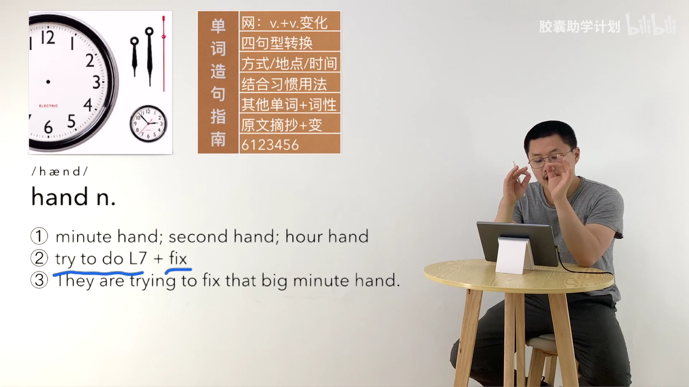

文字识别：单词造句指南 / 网：v.+v.变化 / 胶囊助学计划 / 1 12 / 四句型转换 / 2 / 方式/地点/时间 / 3 / 结合习惯用法 / 4 / 其他单词+词性 / ELECTRIC / 5. / 6 / 原文摘抄+变 / 111 / 6123456 / /hænd/ / hand n. / minute hand; second hand; hour hand / try to do L7 + fix / They are trying to fix that big minute hand.

### 画面 00:06:36

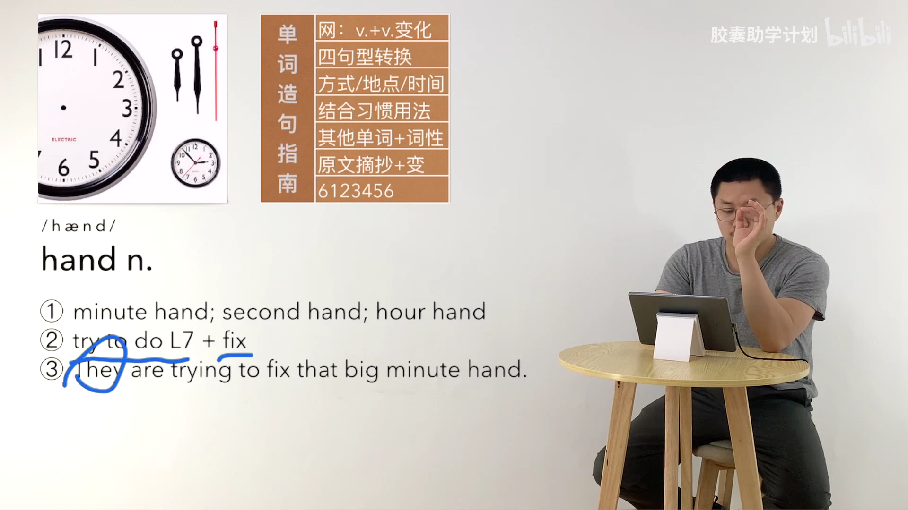

文字识别：单词造句指南 / 网：v.+v.变化 / 胶囊助学计划 / 12 / 四句型转换 / 2 / 方式/地点/时间 / 3 / 结合习惯用法 / 4 / 其他单词+词性 / ELECTRIC / 5. / 6 / 原文摘抄+变 / 6123456 / /hænd/ / hand n. / minute hand; second hand; hour hand / try to / do L7 + fix / They / are trying to fix that big minute hand.

### 画面 00:06:39

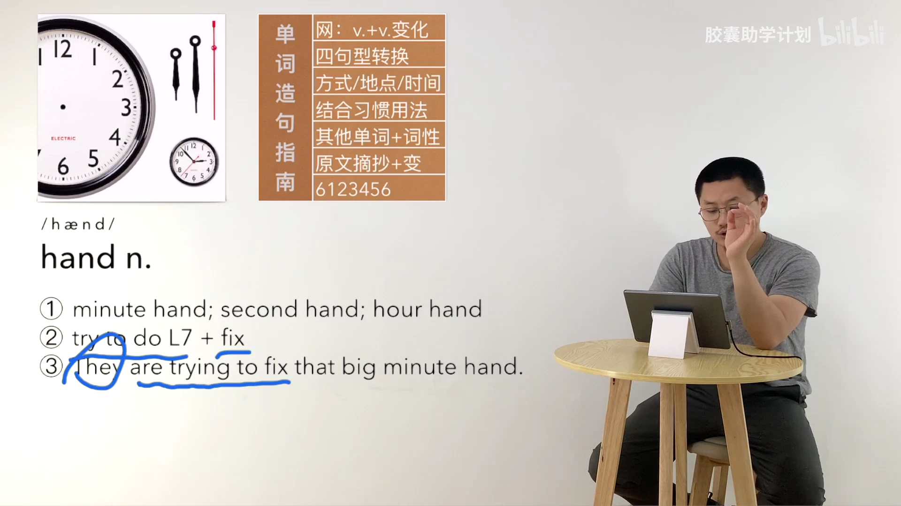

文字识别：单词造句指南 / 网：v.+v.变化 / 胶囊助学计划 / 12 / 四句型转换 / 2 / 方式/地点/时间 / 3 / 结合习惯用法 / 4 / 其他单词+词性 / ELECTRIC / 5. / 6 / 原文摘抄+变 / 6123456 / /hend/ / hand n. / minute hand; second hand; hour hand / try to / do L7 + fix / They / are trying to fix that big minute hand.

### 画面 00:06:42

文字识别：单词造句指南 / 网：v.+v.变化 / 胶囊助学计划 / 12 / 四句型转换 / 2 / 方式/地点/时间 / 3 / 结合习惯用法 / 4 / 其他单词+词性 / ELECTRIC / 5. / 6 / 原文摘抄+变 / 1111 / 6123456 / /hænd/ / hand n. / minute hand; second hand; hour hand / try to / do L7 + fix / They / are trying to fix that big minute hand.

### 画面 00:06:53

文字识别：单词造句指南 / 网：v.+v.变化 / 胶囊助学计划 / 12 / 四句型转换 / 2 / 方式/地点/时间 / 3 / 结合习惯用法 / 4 / 其他单词+词性 / ELECTRIC / 5. / 6 / 原文摘抄+变 / 6 / 6123456 / /hænd/ / hand n. / minute hand; second hand; hour hand / try to / do L7 + fix / 3 / They / are trying to / that big minute hand.

### 画面 00:06:55

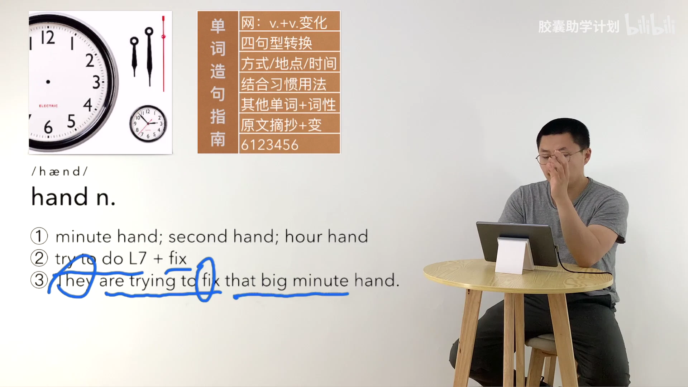

文字识别：单词造句指南 / 网：v.+v.变化 / 胶囊助学计划 / 12 / 111111 / 四句型转换 / 2 / 方式/地点/时间 / 3 / 结合习惯用法 / 4 / 其他单词+词性 / ELECTRIC / 5. / 6 / 原文摘抄+变 / 1111 / 6123456 / /hend/ / hand n. / minute hand; second hand; hour hand / try to / do L7 + fix / that big minute hand. / They / are trying to

## 00:07:00–00:07:30

big minute hand. Okay, 那您不加行不行？你加上一个 small 行不行？当然也可以了。一般疑问句出来了啊啊，肯定句出来了，那一般疑问句二提前就行了，对吧？然后特殊疑问句 why 我自己随便给大家造了一个叫 why they are trying to fix that big minute hand. Nobody's watches that anymore. Okay, nobody uses it anymore. 啊，没有人都用它了，他们为什么还要去修这个啊这个大的分针呢？对吧？Okay, very good. 好，

### 画面 00:07:00

文字识别：单词造句指南 / 网：v.+v.变化 / 胶囊助学计划 / 12 / 四句型转换 / 2 / 方式/地点/时间 / 3 / 结合习惯用法 / 4 / 其他单词+词性 / ELECTRIC / 5. / 6 / 原文摘抄+变 / 6123456 / /hend/ / hand n. / minute hand; second hand; hour hand / try to / do L7 + fix / that big minute hand. / 3 / They / are trying to

### 画面 00:07:05

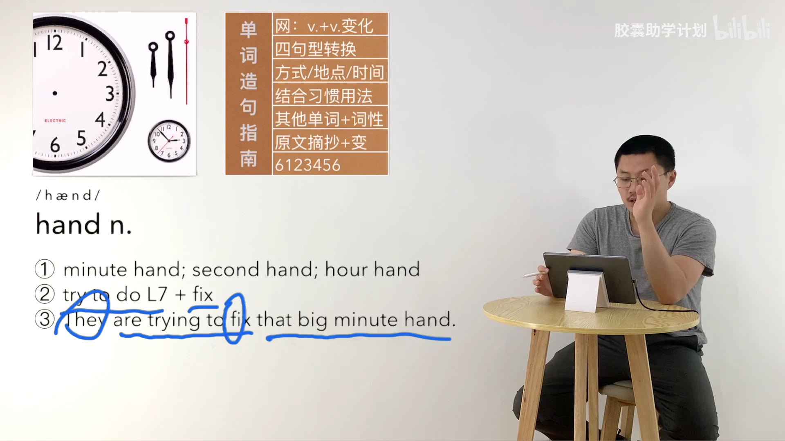

文字识别：单词造句指南 / 网：v.+v.变化 / 胶囊助学计划 / 12 / 四句型转换 / 2 / 方式/地点/时间 / 3 / 结合习惯用法 / 4 / 其他单词+词性 / ELECTRIC / 5. / 6 / 原文摘抄+变 / 6123456 / /hænd/ / hand n. / minute hand; second hand; hour hand / do L7 + fix / try to / that big minute hand. / 3 / They / are trying to

### 画面 00:07:10

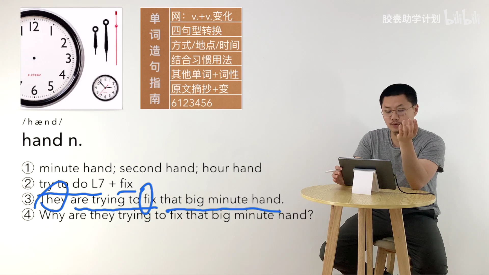

文字识别：单词造句指南 / 网：v.+v.变化 / 胶囊助学计划 / 112 / 四句型转换 / 2 / 方式/地点/时间 / 3 / 结合习惯用法 / 4 / 其他单词+词性 / ELECTRIC / 5. / 6 / 原文摘抄+变 / 111 / 6 / 6123456 / /hend/ / hand n. / minute / hand; second hand; hour hand / try to / do L7 + fix / 3 / They / are trying to / that big minute hand. / Why / are / they trying to fix that big / minute hand?

### 画面 00:07:15

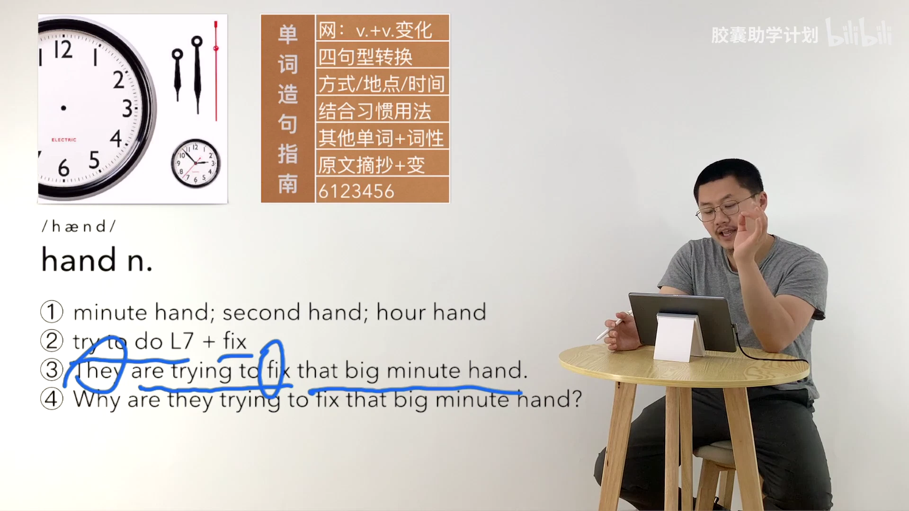

文字识别：单词造句指南 / 网：v.+v.变化 / 胶囊助学计划 / 12 / 四句型转换 / 2 / 方式/地点/时间 / 3 / 结合习惯用法 / 4 / 其他单词+词性 / ELECTRIC / 5. / 6 / 原文摘抄+变 / (111 / 6123456 / /hænd/ / hand n. / minute / hand; second hand; hour hand / try to / do L7 + fix / that big minute hand. / 3 / They / are trying to / Why / are they trying to fix that big / minute hand?

### 画面 00:07:23

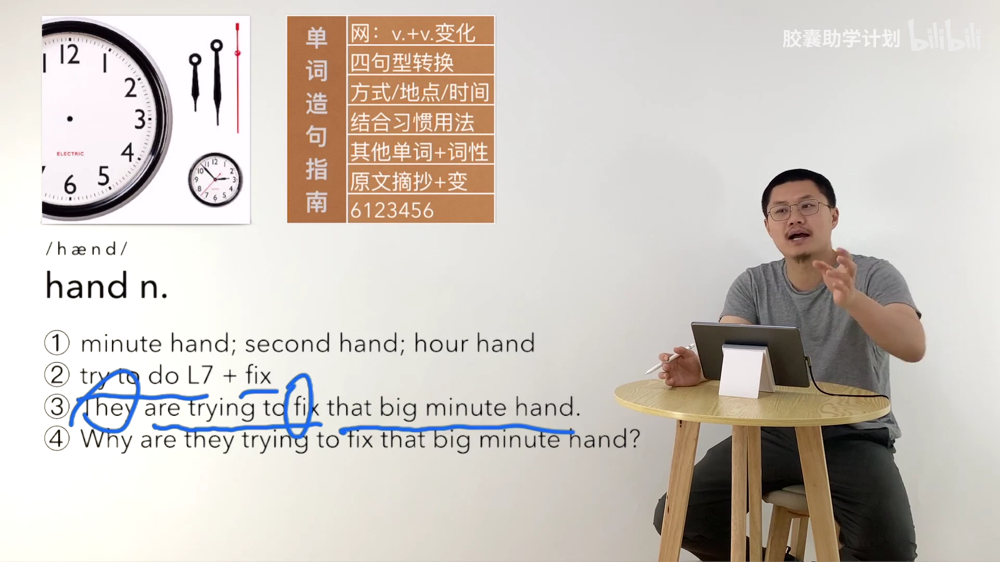

文字识别：单词造句指南 / 网：v.+v.变化 / 胶囊助学计划 / 1 12 / 四句型转换 / 2 / 方式/地点/时间 / 3 / 结合习惯用法 / 4 / 其他单词+词性 / ELECTRIC / 5. / 6 / 原文摘抄+变 / (111 / 111111 / 6123456 / /hænd/ / hand n. / minute / e hand; second hand; hour hand / try to / do L7 + fix / They / are trying to / that big minute hand. / Why / are they trying to fix that big / minute hand?

### 画面 00:07:27

文字识别：单词造句指南 / 网：v.+v.变化 / 胶囊助学计划 / 112 / 四句型转换 / 2 / 方式/地点/时间 / 3 / 结合习惯用法 / 4 / 其他单词+词性 / ELECTRIC / 5. / 6 / 原文摘抄+变 / 6123456 / /hænd/ / hand n. / minute / hand; second hand; hour hand / try to / do L7 + fix / 3 / They / are trying to / that big minute hand. / Why / are / they trying to fix that big / minute hand?

### 画面 00:07:29

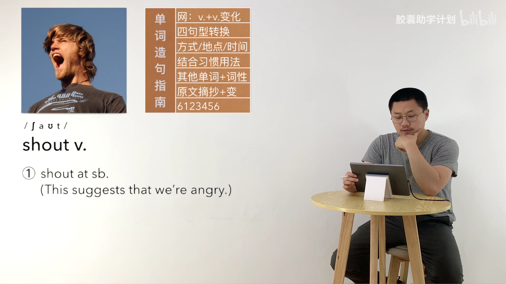

文字识别：单词造句指南 / 网：v.+v.变化 / 胶囊助学计划 / 四句型转换 / 方式/地点/时间 / 结合习惯用法 / 其他单词+词性 / 原文摘抄+变 / 6123456 / /∫aut/ / shout v. / shout at sb. / (This suggests that we're angry.)

## 00:07:30–00:08:00

下面跟我读一下这个单词，叫做 shout 啊，叫做喊，它本身的意思叫做喊。但如果你想说对某人生气了，对吧？发脾气的那种喊，就是带着情绪啊，愤怒的喊。注意这个地方，就要用 shout at shout at somebody， shout at somebody，冲着某人怒喊，对吧？你看这英文给了一个叫做 this suggests that we are angry， angry 第一节课你就学过，

### 画面 00:07:31

文字识别：单词造句指南 / 网：v.+v.变化 / 胶囊助学计划 / 四句型转换 / 方式/地点/时间 / 结合习惯用法 / 其他单词+词性 / 原文摘抄+变 / 6123456 / /∫aut/ / shout v. / shout at sb. / (This suggests that we're angry.)

### 画面 00:07:35

文字识别：单词造句指南 / 网：v.+v.变化 / 胶囊助学计划 / 四句型转换 / 方式/地点/时间 / 结合习惯用法 / 其他单词+词性 / 原文摘抄+变 / 6123456 / /∫aut/ / shout v. / shout at sb. / (This suggests that we're angry.)

### 画面 00:07:40

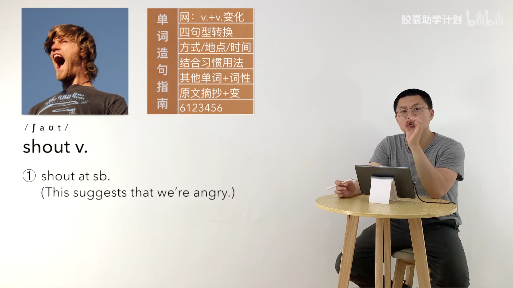

文字识别：单词造句指南 / 网：v.+v.变化 / 胶囊助学计划 / 四句型转换 / 方式/地点/时间 / 结合习惯用法 / 其他单词+词性 / 原文摘抄+变 / 6123456 / /∫aut/ / shout v. / shout at sb. / (This suggests that we're angry.)

### 画面 00:07:45

文字识别：单词造句指南 / 网：v.+v.变化 / 胶囊助学计划 / 四句型转换 / 方式/地点/时间 / 结合习惯用法 / 其他单词+词性 / 原文摘抄+变 / 6123456 / /∫aut/ / shout v. / shout at sb. / (This suggests that we're angry.)

### 画面 00:07:48

文字识别：单词造句指南 / 网：v.+v.变化 / 胶囊助学计划 / 四句型转换 / 方式/地点/时间 / 结合习惯用法 / 其他单词+词性 / 原文摘抄+变 / 6123456 / /∫aut/ / shout v. / shout at sb. / (This suggests that we're angry.)

### 画面 00:07:50

文字识别：单词造句指南 / 网：v.+v.变化 / 胶囊助学计划 / 四句型转换 / 方式/地点/时间 / 结合习惯用法 / 其他单词+词性 / 原文摘抄+变 / 6123456 / /∫aut/ / shout v. / shout at sb. / 1 / (This suggests that we're angry.)

### 画面 00:07:55

文字识别：单词造句指南 / 网：v.+v.变化 / 胶囊助学计划 / Bilibi / 四句型转换 / 方式/地点/时间 / 结合习惯用法 / 其他单词+词性 / 原文摘抄+变 / 6123456 / /∫aut/ / shout v. / shout at sb. / (This suggests that we're angry.)

### 画面 00:07:58

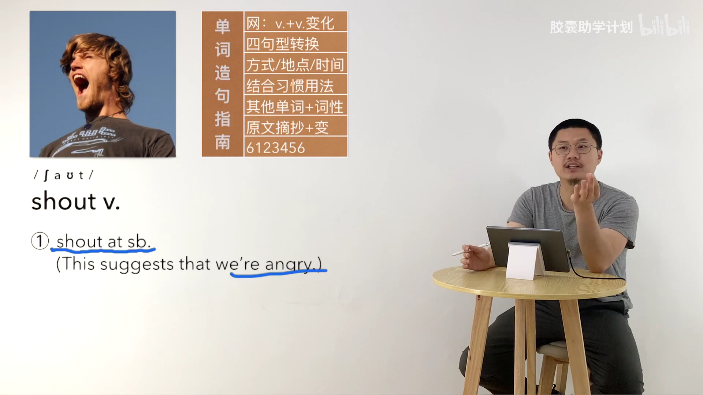

文字识别：单词造句指南 / 网：v.+v.变化 / 胶囊助学计划 / 四句型转换 / 方式/地点/时间 / 结合习惯用法 / 其他单词+词性 / 原文摘抄+变 / 6123456 / /∫aut/ / shout v. / shout at sb. / (This suggests that we're anary.)

## 00:08:00–00:08:30

you have learned. Say this. If you shout at somebody, for example, don't shout at me. Don't shout at

### 画面 00:08:00

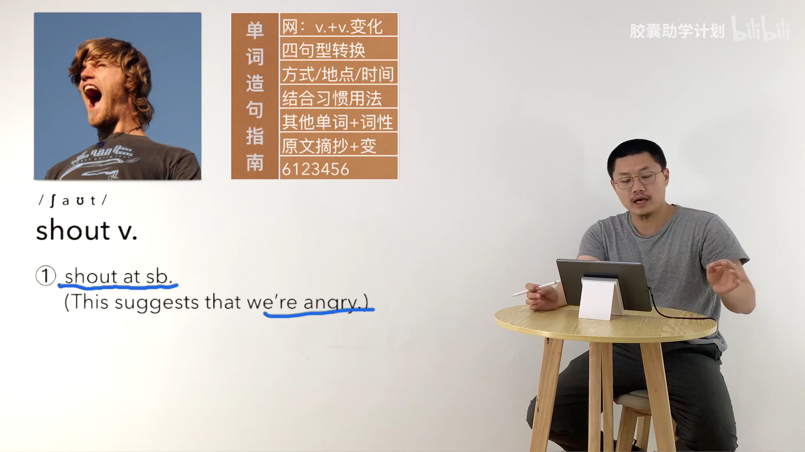

文字识别：单词造句指南 / 网：v.+v.变化 / 胶囊助学计划 / 四句型转换 / 方式/地点/时间 / 结合习惯用法 / 其他单词+词性 / 原文摘抄+变 / 6123456 / /∫aut/ / shout v. / shout at sb. / 1 / (This suggests that we're anary.)

### 画面 00:08:05

文字识别：单词造句指南 / 网：v.+v.变化 / 胶囊助学计划 / 四句型转换 / 方式/地点/时间 / 结合习惯用法 / 其他单词+词性 / 原文摘抄+变 / 6123456 / /∫aut/ / shout v. / shout at sb. / 1 / (This suggests that we're anary.)

### 画面 00:08:11

文字识别：单词造句指南 / 网：v.+v.变化 / 胶囊助学计划 / 四句型转换 / 方式/地点/时间 / 结合习惯用法 / 其他单词+词性 / 原文摘抄+变 / 6123456 / /∫aut/ / shout v. / shout at sb. / 1 / (This suggests that we're anary.)

### 画面 00:08:15

文字识别：单词造句指南 / 网：v.+v.变化 / 胶囊助学计划 / 四句型转换 / 方式/地点/时间 / 结合习惯用法 / 其他单词+词性 / 原文摘抄+变 / 6123456 / /∫aut/ / shout v. / shout at sb. / (This suggests that we're anary.)

### 画面 00:08:17

文字识别：单词造句指南 / 网：v.+v.变化 / 胶囊助学计划 / 四句型转换 / 方式/地点/时间 / 结合习惯用法 / 其他单词+词性 / 原文摘抄+变 / 6123456 / /∫aut/ / shout v. / 1 / shout at sb. / (This suggests that we're anary.) / shout to sb. / (When we shout to someone, we want them / to hear us. They might be on the other side / of the street)

### 画面 00:08:19

文字识别：单词造句指南 / 网：v.+v.变化 / 胶囊助学计划 / 四句型转换 / 方式/地点/时间 / 结合习惯用法 / 其他单词+词性 / 原文摘抄+变 / 6123456 / /∫aut/ / shout v. / shout at sb. / (This suggests that we're anary.) / shout to sb. / (When we shout to someone, we want them / to hear us. They might be on the other side / of the street)

### 画面 00:08:21

文字识别：单词造句指南 / 网：v.+v.变化 / 胶囊助学计划 / 四句型转换 / 方式/地点/时间 / 结合习惯用法 / 其他单词+词性 / 原文摘抄+变 / 6123456 / /∫aut/ / shout v. / shout at sb. / (This suggests that we're anary.) / shout to sb. / (When we shout to someone, we want them / to hear us. They might be on the other side / of the street)

### 画面 00:08:25

文字识别：单词造句指南 / 网：v.+v.变化 / 胶囊助学计划 / 四句型转换 / 方式/地点/时间 / 结合习惯用法 / 其他单词+词性 / 原文摘抄+变 / 6123456 / /∫aut/ / shout v. / shout at sb. / (This suggests that we're anary.) / shout to sb. / (When we shout to someone, we want them / to hear us. They might be on the other side / of the street)

## 00:08:30–00:09:00

be on the other side of the street.它指的是当我们 shout to somebody 的时候呢，我们只是想让他们听见我们。这可能是因为他们在马路的另一侧。注意，这个时候我是不是为了泄愤，对吧？要冲你去喊？不是，我是为了让你听见我。Okay, look, he is in the opposite of the street,是吧？他在马路的另一边。然后 you should you you you you you shouldn't talk to him. Okay, he won't

### 画面 00:08:30

文字识别：单词造句指南 / 网：v.+v.变化 / 胶囊助学计划 / 四句型转换 / 方式/地点/时间 / 结合习惯用法 / 其他单词+词性 / 原文摘抄+变 / 6123456 / /∫aut/ / shout v. / shout at sb. / (This suggests that we're anary.) / shout to sb. / (When we shout to someone, we want them / to hear us. They might be on the other side / of the street)

### 画面 00:08:37

文字识别：单词造句指南 / 网：v.+v.变化 / 胶囊助学计划 / 四句型转换 / 方式/地点/时间 / 结合习惯用法 / 其他单词+词性 / 原文摘抄+变 / 6123456 / /∫aut/ / shout v. / shout at sb. / (This suggests that we're anary.) / shout to sb. / (When we shout to someone, we want them / to hear us. They might be on the other side / of the street)

### 画面 00:08:41

文字识别：单词造句指南 / 网：v.+v.变化 / 胶囊助学计划 / 四句型转换 / 方式/地点/时间 / 结合习惯用法 / 其他单词+词性 / 原文摘抄+变 / 6123456 / /∫aut/ / shout v. / shout at sb. / (This suggests that we're anary.) / shout to sb. / (When we shout to someone, we want them / to hear us. They might be on the other side / of the street)

### 画面 00:08:46

文字识别：单词造句指南 / 网：v.+v.变化 / 胶囊助学计划 / 四句型转换 / 方式/地点/时间 / 结合习惯用法 / 其他单词+词性 / 原文摘抄+变 / 6123456 / /∫aut/ / shout v. / shout at sb. / (This suggests that we're anary.) / shout to sb. / (When we shout to someone, we want them / to hear us. They might be on the other side / of the street)

### 画面 00:08:51

文字识别：单词造句指南 / 网：v.+v.变化 / 胶囊助学计划 / 四句型转换 / 方式/地点/时间 / 结合习惯用法 / 其他单词+词性 / 原文摘抄+变 / 6123456 / /∫aut/ / shout v. / shout at sb. / (This suggests that we're anary.) / shout to sb. / (When we shout to someone, we want them / to hear us. They might be on the other side / of the street)

## 00:09:00–00:09:30

hear you. Okay, so just shout to him. Ah,就是冲他大声喊就行了。你声音太小，他听不到的。Shout to somebody.这是这两个的区别。那这是我们今天大家回去单词造句的时候一定要用一下这两个习惯用法。Okay,好，接下来我们看下一个单词，跟我读，叫做refuse.注意重音在第二个音节连起来refuse, refuse.它直接的意思叫做

### 画面 00:09:01

文字识别：单词造句指南 / 网：v.+v.变化 / 胶囊助学计划 / 四句型转换 / 方式/地点/时间 / 结合习惯用法 / 其他单词+词性 / 原文摘抄+变 / 6123456 / /∫aut/ / shout v. / shout at sb. / (This suggests that we're anary.) / shout to sb. / (When we shout to someone, we want them / to hear us. They might be on the other side / of the street)

### 画面 00:09:15

文字识别：单词造句指南 / 网：v.+v.变化 / 胶囊助学计划 / 四句型转换 / 方式/地点/时间 / 结合习惯用法 / 其他单词+词性 / 原文摘抄+变 / 6123456 / /∫aut/ / shout v. / 1 / shout at sb. / (This suggests that we're anary.) / shout to sb. / (When we shout to someone, we want them / to hear us. They might be on the other side / of the street)

### 画面 00:09:18

文字识别：单词造句指南 / 网：v.+v.变化 / 胶囊助学计划 / 四句型转换 / 方式/地点/时间 / 结合习惯用法 / 其他单词+词性 / 原文摘抄+变 / 6123456 / /ri'fju:z/ / refuse v.

### 画面 00:09:20

文字识别：单词造句指南 / 网：v.+v.变化 / 胶囊助学计划 / 四句型转换 / 方式/地点/时间 / 结合习惯用法 / 其他单词+词性 / 原文摘抄+变 / 6123456 / /ri'fju:z/ / refuse v.

### 画面 00:09:25

文字识别：单词造句指南 / 网：v.+v.变化 / 胶囊助学计划 / 四句型转换 / 方式/地点/时间 / 结合习惯用法 / 其他单词+词性 / 原文摘抄+变 / 6123456 / /rr•fju:z/ / refuse v.

## 00:09:30–00:10:00

拒绝。那这个单词啊，大多数情况下会跟 to do something。注意这个 do 指的是动词的原形，叫做拒绝去做某件事情。那我们看图造句，来一个肯定句，叫做 He refused to take the money，是吧？他拒绝受贿啊，他拒绝接受这个钱。 He refused to take the money。啊，当然他不是说只是受贿的意思啊，由场景决定。比如说你做了好人好事，别人要给你钱，但是 He refused to take the money，

### 画面 00:09:31

文字识别：单词造句指南 / 网：v.+v.变化 / 胶囊助学计划 / 四句型转换 / 方式/地点/时间 / 结合习惯用法 / 其他单词+词性 / 原文摘抄+变 / 6123456 / /rr•fju:z/ / refuse v. / refuse to do sth.

### 画面 00:09:34

文字识别：单词造句指南 / 网：v.+v.变化 / 胶囊助学计划 / 四句型转换 / 方式/地点/时间 / 结合习惯用法 / 其他单词+词性 / 原文摘抄+变 / 6123456 / /rr•fju:z/ / refuse v. / refuse to do sth.

### 画面 00:09:36

文字识别：单词造句指南 / 网：v.+v.变化 / 胶囊助学计划 / 四句型转换 / 方式/地点/时间 / 结合习惯用法 / 其他单词+词性 / 原文摘抄+变 / 6123456 / /rr•fju:z/ / refuse / V. / V / refuse to do sth.

### 画面 00:09:40

文字识别：单词造句指南 / 网：v.+v.变化 / 胶囊助学计划 / 四句型转换 / 方式/地点/时间 / 结合习惯用法 / 其他单词+词性 / 原文摘抄+变 / 6123456 / /rr•fju:z/ / refuse / V. / V / refuse to do sth. / He refused to take the money.

### 画面 00:09:45

文字识别：单词造句指南 / 网：v.+v.变化 / 胶囊助学计划 / 四句型转换 / 方式/地点/时间 / 结合习惯用法 / 其他单词+词性 / 原文摘抄+变 / 6123456 / /rr•fju:z/ / refuse / V. / V / refuse to do sth. / He refused to take the money.

### 画面 00:09:53

文字识别：单词造句指南 / 网：v.+v.变化 / 胶囊助学计划 / 四句型转换 / 方式/地点/时间 / 结合习惯用法 / 其他单词+词性 / 原文摘抄+变 / 6123456 / /rr•fju:z/ / refuse / V. / V / refuse to do sth. / He refused to take the money.

### 画面 00:09:55

文字识别：单词造句指南 / 网：v.+v.变化 / 胶囊助学计划 / 四句型转换 / 方式/地点/时间 / 结合习惯用法 / 其他单词+词性 / 原文摘抄+变 / 6123456 / /rr•fju:z/ / refuse / V. / V / refuse to do sth. / He refused to take the money.

## 00:10:00–00:10:30

This is not bribery, right? Okay, he refused to take the money.肯定句出来了. Did he refuse to take the money? Who refused to take the money? You can also say why did he refuse to take the money? You should pay attention to this part. Who? He is the subject. When asking a question, replace it directly, and then add it directly. Who refused to take the money? Okay, this point should be paid special attention to. Next, we will watch a small movie.

### 画面 00:10:02

文字识别：单词造句指南 / 网：v.+v.变化 / 胶囊助学计划 / 四句型转换 / 方式/地点/时间 / 结合习惯用法 / 其他单词+词性 / 原文摘抄+变 / 6123456 / /rr•fju:z/ / refuse / V. / V / refuse to do sth. / He refused to take the money.

### 画面 00:10:06

文字识别：单词造句指南 / 网：v.+v.变化 / 胶囊助学计划 / 四句型转换 / 方式/地点/时间 / 结合习惯用法 / 其他单词+词性 / 原文摘抄+变 / 6123456 / /rr•fju:z/ / refuse / V. / V / refuse to do sth. / He refused to take the money. / Did he refuse to take the money?

### 画面 00:10:10

文字识别：单词造句指南 / 网：v.+v.变化 / 胶囊助学计划 / 四句型转换 / 方式/地点/时间 / 结合习惯用法 / 其他单词+词性 / 原文摘抄+变 / 6123456 / /rr•fju:z/ / refuse v. / V / refuse to do sth. / He refused to take the money. / Did he refuse to take the money? /  Who refused to take the money?

### 画面 00:10:15

文字识别：单词造句指南 / 网：v.+v.变化 / 胶囊助学计划 / 四句型转换 / 方式/地点/时间 / 结合习惯用法 / 其他单词+词性 / 原文摘抄+变 / 6123456 / /rr•fju:z/ / refuse v. / refuse to do sth. / He refused to take the money. / Did he refuse to take the money? / Who refused to take the money?

### 画面 00:10:17

文字识别：单词造句指南 / 网：v.+v.变化 / 胶囊助学计划 / 四句型转换 / 方式/地点/时间 / 结合习惯用法 / 其他单词+词性 / 原文摘抄+变 / 6123456 / /rr•fju:z/ / refuse v. / V. / refuse to do sth. / refused to take the money. / Did he refuse to take the money? / WWhe / refused to take the money?

### 画面 00:10:20

文字识别：单词造句指南 / 网：v.+v.变化 / 胶囊助学计划 / 四句型转换 / 方式/地点/时间 / 结合习惯用法 / 其他单词+词性 / 原文摘抄+变 / 6123456 / /rr•fju:z/ / refuse v. / V / refuse to do sth. / frefused to take the money. / Did he refuse to take the money? / WWho / refused to take the money?

### 画面 00:10:26

文字识别：refuse to work with you / 胶囊助学计划 / 模仿游戏 / The Imitation Game / (2014)

## 00:10:30–00:11:00

啊，呃，模仿游戏非常棒的一个电影，它当中出现了叫 refuse to work with you。我们之前学过了一个叫 work for，叫为某人工作，为了谁而工作，对吧？那你想到这是一个上下级关系。那 work with somebody 指的是和谁谁一起工作，这更像是一个同级关系。那 refuse to work with you 叫拒绝和你一起工作，它的语速稍微有点快，各位重点是要在里面听

### 画面 00:10:38

文字识别：refuse to work with you / 胶囊助学计划 / 模仿游戏 / The Imitation Game / (2014)

### 画面 00:10:59

文字识别：refuse to work with you / 胶囊助学计划 / 地 / 模仿游戏 / The Imitation Game / (2014)

## 00:11:00–00:11:30

到 refuse to work with you 就可以了，来了。 If you wish to discuss the complaint, I suggest to make a proper point. Alexander, complaint? No, no. Hugh Alexander has denied my requisition for parts and and and equipment that I need to build the machine I've designed. Your fellow codebreakers are refusing to work with you, and they've filed a formal complaint. Inspired by an old Polish code machine, only this one is infinitely more advanced. If you don't respond to the complaint, I shall have to take it up with the Home Office. Put those files by my desk. Fine.

### 画面 00:11:04

文字识别：refuse to work with you / 胶囊助学计划 / 模仿游戏 / The Imitation Game / (2014)

### 画面 00:11:06

文字识别：refuse to work with you / 胶囊助学计划 / ABI / 模仿游戏 / 我建议你事先预约 / The Imitation Game / I suggest vou make a proper appointment. / (2014)

### 画面 00:11:08

文字识别：refuse to work with you / 胶囊助学计划 / 模仿游戏 / 亚历山...投诉 / The Imitation Game / Alexan... Complaint? / (2014)

### 画面 00:11:10

文字识别：refuse to work with you / 胶囊助学计划 / 模仿游戏 / 不不是休·亚历山大没有批准我申请的零件和设备 / The Imitation Game / No. no. Huch Alexander has denied mv reguisition for parts / (2014)

### 画面 00:11:12

文字识别：refuse to work with you / 胶囊助学计划 / 模仿游戏 / 不不是休·亚历山大没有批准我申请的零件和设备 / The Imitation Game / No. no. Huch Alexander has denied mv reguisition for parts / (2014)

### 画面 00:11:14

文字识别：refuse to work with you / 胶囊助学计划 / 模仿游戏 / 那些是制造我所设计的机器所必需的 / The Imitation Game / and ecuipment that I need to build the machine I've desianed. / (2014)

### 画面 00:11:16

文字识别：refuse to work with you / 胶囊助学计划 / 模仿游戏 / 你的同事们拒绝和你一同工作 / The Imitation Game / Your fellow code-breakers are refusing to work with vou. / (2014)

### 画面 00:11:18

文字识别：refuse to work with you / 胶囊助学计划 / 模仿游戏 / 你的同事们拒绝和你一同工作 / The Imitation Game / Your fellow code-breakers are refusing to work with vou. / (2014)

### 画面 00:11:20

文字识别：refuse to work with you / 胶囊助学计划 / 模仿游戏 / 这台机器的设计灵感来自一台老式波兰编码机 / The Imitation Game / It's is inspired by an old Polish code machine. / (2014)

### 画面 00:11:22

文字识别：refuse to work with you / 胶囊助学计划 / 模仿游戏 / 这台机器的设计灵感来自一台老式波兰编码机 / The Imitation Game / It's is inspired by an old Polish code machine. / (2014)

### 画面 00:11:24

文字识别：refuse to work with you / 胶囊助学计划 / 模仿游戏 / 但是这台机器先进得多 / The Imitation Game / Onlv this one is infinitely more advanced. / (2014)

### 画面 00:11:26

文字识别：refuse to work with you / 胶囊助学计划 / 模仿游戏 / 我不得不把它上交内政部 / The Imitation Game / I shall have to take it up with the Home Office. / (2014)

### 画面 00:11:28

文字识别：refuse to work with you / 胶囊助学计划 / 模仿游戏 / -把文件放我桌子上-好吧我的回应是他们都是白痴 / The Imitation Game / - Put those files by my desk.-Fine. mv response is thev're all idiots. / (2014)

## 00:11:30–00:12:00

My response is they're all idiots. Fire them and use the savings to fund my machine. I only need about a hundred thousand pounds. Okay. I'm refusing to work with you. Okay. Ah,拒绝和你一起工作。下一个单词跟我读一下来，叫做 laugh. Laugh.叫做笑，对吧？它本身的含义就只有笑的意思。比如说，看图造句的 baby is laughing.非常简单. Is the baby laughing? Why is the baby laughing?非常简单。肯定句、一般疑问句、特殊疑问句。

### 画面 00:11:31

文字识别：refuse to work with you / 胶囊助学计划 / 模仿游戏 / 开除他们省下来的钱用来资助我的机器 / The Imitation Game / Fire them and use the savings to fund my machine. / (2014)

### 画面 00:11:33

文字识别：refuse to work with you / 胶囊助学计划 / 模仿游戏 / 我只需要10万英镑 / The Imitation Game / I only need about 100.000 pounds. / (2014)

### 画面 00:11:35

文字识别：refuse to work with you / 胶囊助学计划 / 模仿游戏 / 我只需要10万英镑 / The Imitation Game / I only need about 100.000 pounds. / (2014)

### 画面 00:11:37

文字识别：refuse to work with you / 胶囊助学计划 / 模仿游戏 / 我只需要10万英镑 / The Imitation Game / I only need about 100.000 pounds. / (2014)

### 画面 00:11:42

文字识别：单词造句指南 / 网：v.+v.变化 / 胶囊助学计划 / 四句型转换 / 方式/地点/时间 / 结合习惯用法 / 其他单词+词性 / 原文摘抄+变 / 6123456 / / la:f / / laugh v.

### 画面 00:11:45

文字识别：单词造句指南 / 网：v.+v.变化 / 胶囊助学计划 / 四句型转换 / 方式/地点/时间 / 结合习惯用法 / 其他单词+词性 / 原文摘抄+变 / 6123456 / /la:f / / laugh v.

### 画面 00:11:50

文字识别：单词造句指南 / 网：v.+v.变化 / 胶囊助学计划 / 四句型转换 / 方式/地点/时间 / 结合习惯用法 / 其他单词+词性 / 原文摘抄+变 / 6123456 / /la:f / / laugh v. / ① The baby is laughing.

### 画面 00:11:55

文字识别：单词造句指南 / 网：v.+v.变化 / 胶囊助学计划 / 四句型转换 / 方式/地点/时间 / 结合习惯用法 / 其他单词+词性 / 原文摘抄+变 / 6123456 / /|a:f / / laugh v. / The baby is laughing. / Is the baby laughing? / Why is the baby laughing? / 3

## 00:12:00–00:12:30

这个我们甚至在新概念一册三十一课就可以搞定了。好，那接下来我们补一个小的习惯用法，叫做 laugh at somebody，叫做嘲笑某人啊。注意啊，它和笑不一样了，它叫嘲笑了。OK，好，比如说 don't don't laugh at me, man. OK，说哥们儿别嘲笑我呀，别笑话我呀。OK，当然它不一定是嘲笑这么浓的那个意味啊。好朋友之间也可以 laugh at，对吧？比如说你走路磕了一

### 画面 00:12:01

文字识别：单词造句指南 / 网：v.+v.变化 / 胶囊助学计划 / 四句型转换 / 方式/地点/时间 / 结合习惯用法 / 其他单词+词性 / 原文摘抄+变 / 6123456 / /|a:f / / laugh v. / The baby is laughing. / Is the baby laughing? / Why is the baby laughing? / 3

### 画面 00:12:05

文字识别：单词造句指南 / 网：v.+v.变化 / 胶囊助学计划 / 四句型转换 / 方式/地点/时间 / 结合习惯用法 / 其他单词+词性 / 原文摘抄+变 / 6123456 / /|a:f/ / laugh v. / The baby is laughing. / Is the baby laughing? / Why is the baby laughing? / laugh at sb.

### 画面 00:12:10

文字识别：单词造句指南 / 网：v.+v.变化 / 胶囊助学计划 / 四句型转换 / 方式/地点/时间 / 结合习惯用法 / 其他单词+词性 / 原文摘抄+变 / 6123456 / /|a:f / / laugh v. / The baby is laughing. / Is the baby laughing? / Why is the baby laughing? / laugh at sb.

### 画面 00:12:17

文字识别：单词造句指南 / 网：v.+v.变化 / 胶囊助学计划 / 四句型转换 / 方式/地点/时间 / 结合习惯用法 / 其他单词+词性 / 原文摘抄+变 / 6123456 / /|a:f/ / laugh v. / The baby is laughing. / Is the baby laughing? / Why is the baby laughing? / laugh at sb. / Don't laugh at me, man!

### 画面 00:12:20

文字识别：单词造句指南 / 网：v.+v.变化 / 胶囊助学计划 / 四句型转换 / 方式/地点/时间 / 结合习惯用法 / 其他单词+词性 / 原文摘抄+变 / 6123456 / /|a:f / / laugh v. / The baby is laughing. / Is the baby laughing? / Why is the baby laughing? / laugh at sb. / Don't laugh at me, man!

### 画面 00:12:26

文字识别：单词造句指南 / 网：v.+v.变化 / 胶囊助学计划 / 四句型转换 / 方式/地点/时间 / 结合习惯用法 / 其他单词+词性 / 原文摘抄+变 / 6123456 / /|a:f/ / laugh v. / The baby is laughing. / 1 / Is the baby laughing? / Why is the baby laughing? / laugh at sb. / Don't laugh at me, man!

## 00:12:30–00:13:00

一下，对吧？砰啊！直接摔到地上了。你的哥们儿说：“哎，你看你这路走的是吧？怎么走路还能摔一跤？” Don't laugh at me, man. Help me. 说别光顾着那笑我，帮我一把，让我起来呀。 Okay，就是这个意思。那接下来我们看一个小的电影片段当中出现了 laugh at me. Yeah. No one watches, and they don't have a game. It's as simple as that. What nothing. Aren't laughing at? I'm not laughing at you.

### 画面 00:12:35

文字识别：单词造句指南 / 网：v.+v.变化 / 胶囊助学计划 / 四句型转换 / 方式/地点/时间 / 结合习惯用法 / 其他单词+词性 / 原文摘抄+变 / 6123456 / /la:f / / laugh v. / The baby is laughing. / 1 / Is the baby laughing? / Why is the baby laughing? / laugh at sb. / Don't laugh at me, man!

### 画面 00:12:40

文字识别：单词造句指南 / 网：v.+v.变化 / 胶囊助学计划 / 四句型转换 / 方式/地点/时间 / 结合习惯用法 / 其他单词+词性 / 原文摘抄+变 / 6123456 / / la:f / / laugh v. / The baby is laughing. / Is the baby laughing? / Why is the baby laughing? / laugh at sb. / Don't laugh at me, man!

### 画面 00:12:44

文字识别：laugh at me / 胶囊助学计划 / 盖尔 / Gale / 饥饿游戏 / The Hunger Garhes / (2012)

### 画面 00:12:49

文字识别：laugh at me / 胶囊助学计划 / 盖尔 / Gal / 饥饿游戏 / The Hunger Garhes / (2012)

### 画面 00:12:51

文字识别：laugh at me / 胶囊助学计划 / 如果没有人看就不会有饥饿游戏 / 对吗 / If no one watches, then theynjovg gpmu ssmpl snt / 饥饿游戏 / The Hunger Garnes / (2012)

### 画面 00:12:53

文字识别：laugh at me / 胶囊助学计划 / 饥饿游戏 / The Hunger Garnes / (2012)

### 画面 00:12:55

文字识别：laugh at me / 胶囊助学计划 / 饥饿游戏 / The Hunger Garhes / (2012)

### 画面 00:12:57

文字识别：laugh at me / 胶囊助学计划 / 我可没嘲笑你 / I'm not laughing at you / 饥饿游戏 / The Hunger Garnes / (2012)

### 画面 00:12:59

文字识别：laugh at me / 胶囊助学计划 / 饥饿游戏 / The Hunger Garhes / (2012)

## 00:13:00–00:13:30

not laughing at you. 啊，我没嘲笑你这个想法。OK, there you go. 好，那 recap，我们复习一下今天还真不少在单词这个部分啊。我们既讲了单词，又补充了一些小的习惯用法，都是这些单词最常见的习惯用法。我们口语当中也经常用得到。各位回去一定要在单词造句的时候带着这些习惯用法。OK，好。那我们看一下本课的家作

### 画面 00:13:01

文字识别：laugh at me / 胶囊助学计划 / 饥饿游戏 / The Hunger Garhes / (2012)

### 画面 00:13:06

文字识别：胶囊助学计划 / Recap / Words / a cold / welcome / a / warm / welcome / gather round / Expression / shout at sb. / refuse to do sth. / laugh at sb.

### 画面 00:13:08

文字识别：胶囊助学计划 / Recap / Words / a cold / welcome / a / warm / welcome / gather round / Expression / shout at sb. / refuse to do sth. / laugh at sb.

### 画面 00:13:10

文字识别：胶囊助学计划 / Recap / Words / cold / welcome / a / warm / welcome / gather round / Expression / shout at sb. / refuse to do sth. / laugh at sb.

### 画面 00:13:12

文字识别：胶囊助学计划 / Recap / Words / cold / welcome / a / warm / welcome / gather round / Expression / shout at sb. / refuse to do sth. / laugh at sb.

### 画面 00:13:15

文字识别：胶囊助学计划 / Recap / Words / cold / welcome / a / warm / welcome / gather round / Expression / shout at sb. / refuse to do sth. / laugh at sb.

### 画面 00:13:18

文字识别：胶囊助学计划 / Recap / Words / cold / welcome / a / warm / welcome / gather round / Expression / shout at sb. / refuse to do sth. / laugh at sb.

### 画面 00:13:20

文字识别：胶囊助学计划 / Recap / Words / cold / welcome / a / warm / welcome / gather round / Expression / shout at sb. / refuse to do sth. / laugh at sb.

### 画面 00:13:24

文字识别：Recap / 胶囊助学计划 / Words / cold / welcome / a / warm / welcome / gather round / Expression / shout at sb. / refuse to do sth. / laugh at sb.

### 画面 00:13:26

文字识别：胶囊助学计划

### 画面 00:13:28

文字识别：胶囊助学计划 / 单词造句/对话 / 【单词造句指南】 / 每个5句

## 00:13:30–00:14:00

业。第一，单词造句或者造对话。对话您不用想说特别长，一问一答就算一个对话了，对吧？呃，一定要结合单词造句指南老习惯造五个。其次呢，反复听这些电影片段，直到能听出来它的关键短语或者说关键句子啊，这是我们的一个听力训练，可以理解为。那以上呢就是本期视频的全部内容了。如果大家喜欢我们的课程，欢迎大家关注、订阅、一键三连，

### 画面 00:13:30

文字识别：胶囊助学计划 / 单词造句/对话 / 1. / 【单词造句指南】 / 每个5句

### 画面 00:13:32

文字识别：胶囊助学计划 / 单词造句/对话 / 1. / 【单词造句指南】 / 每个5句

### 画面 00:13:35

文字识别：胶囊助学计划 / 单词造句/对话 / 【单词造句指南】 / 每个5句

### 画面 00:13:39

文字识别：胶囊助学计划 / 单词造句/对话 / 【单词造句指南】 / 每个5句

### 画面 00:13:41

文字识别：胶囊助学计划 / 单词造句/对话 / 【单词造句指南】 / 每个5句 / 反复听电影片段，直到能 / 听出关键短语/句子

### 画面 00:13:44

文字识别：胶囊助学计划 / 单词造句/对话 / 【单词造句指南】 / 每个5句 / 反复听电影片段，直到能 / 听出关键短语/句子

### 画面 00:13:46

文字识别：胶囊助学计划 / 单词造句/对话 / 【单词造句指南】 / 每个5句 / 反复听电影片段，直到能 / 听出关键短语/句子

### 画面 00:13:48

文字识别：胶囊助学计划 / 单词造句/对话 / 【单词造句指南】 / 每个5句 / ，反复听电影片段，直到能 / 听出关键短语/句子

### 画面 00:13:50

文字识别：胶囊助学计划 / 单词造句/对话 / 1. / 【单词造句指南】 / 每个5句 / 2.反复听电影片段，直到能 / 听出关键短语/句子

### 画面 00:13:52

文字识别：胶囊助学计划 / 不

## 00:14:00–00:14:15

分享给那些需要的朋友们。See you next time.

### 画面 00:14:03

### 画面 00:14:05

文字识别：CAPSULEACADEMY / 胶囊助学计划 / 小红书 / Lecturer / 口 / Leo / OE

### 画面 00:14:08

文字识别：CAPSULEACADEMY / 胶囊助学计划 / 小红书 / Editor / OE

### 画面 00:14:11

文字识别：CAPSULEACADEMY / 胶囊助学计划 / 小红书 / Creator / □ / Leo & Berlin / OE

### 画面 00:14:13

文字识别：bilibili / 胶囊助学计划 / 胶囊助学计划 / 小红书 / OE

### 画面 00:14:15

文字识别：bilibili / 胶囊助学计划

