# L009 文章

快速机器解析：语音为单模型转写，未进行独立交叉校对或人工复核；画面每秒采样并按变化选帧，短时文字和标记可能遗漏。截图时间约有 1 秒误差。图片有损压缩；遇到疑点请按时间查看 Google Drive 原视频。

## 00:00:00–00:00:30

Hello everyone, welcome to Capsule Academy. This is Leo. Today we're going to learn new concept English book two lesson nine story. Hope you gonna enjoy it.那我们直接进入文章来了啊. On Wednesday evening, 好了，注意在具体的某一天用 on 这个小的介词，我们在语法语法部分有讲过. Wednesday evening, we went to the

### 画面 00:00:00

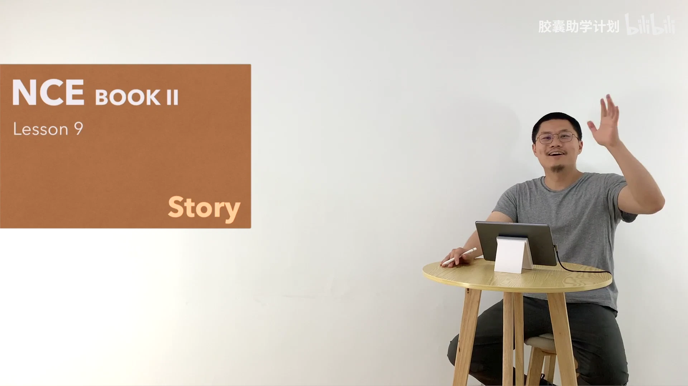

文字识别：胶囊助学计划 / NCE / BOOKⅡI / Lesson 9 / Story

### 画面 00:00:02

文字识别：胶囊助学计划 / NCE / BOOKⅡI / Lesson 9 / Story

### 画面 00:00:06

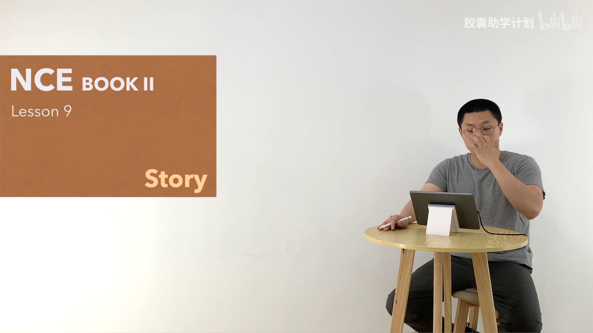

文字识别：胶囊助学计划 / NCE / BOOKI"I / Lesson 9 / Story

### 画面 00:00:10

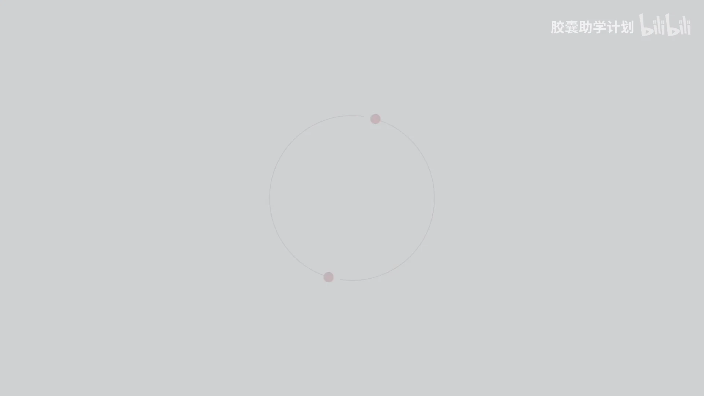

文字识别：胶囊助学计划b出出 / •

### 画面 00:00:13

文字识别：胶囊助学计划 / 胶囊助学计划

### 画面 00:00:15

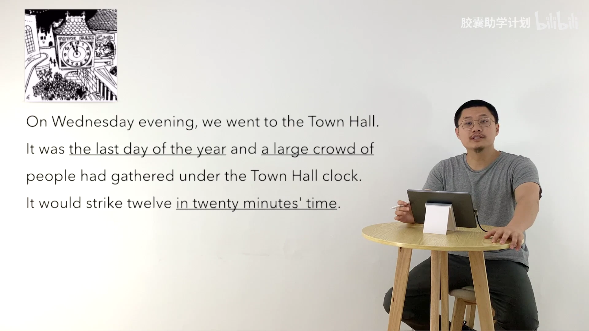

文字识别：胶囊助学计划 / On Wednesday evening, we went to the Town Hall. / It was the last day of the year and a large crowd of / people had gathered under the Town Hall clock. / It would strike twelve in twenty minutes' time.

## 00:00:30–00:01:00

town hall. 好了，注意一个小点，先说啊。We went to the theater last week. I went to the theater. 这个东西各位第一节课就会了。它只不过把 the theater 换成了 the town hall. Town hall, 注意 T 跟 H 都在大写。它是一个类似于专有名词，指的是市政厅啊，可以理解为是市政府了。It was. 说那一天是，注意这是一个过去的事情，是什么呢？The last day

### 画面 00:00:45

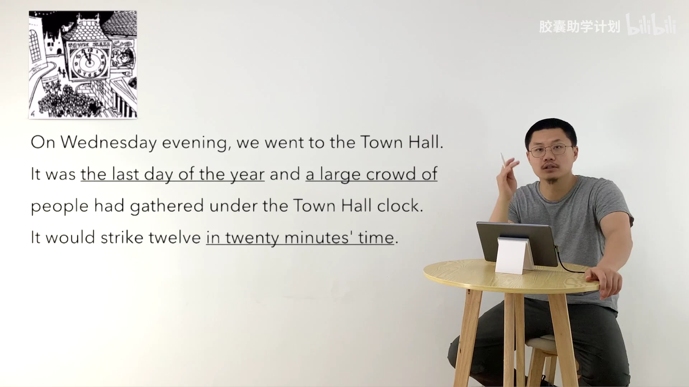

文字识别：胶囊助学计划 / On Wednesday evening, we went to the Town Hall. / It was the last day of the year and a large crowd of / people had gathered under the Town Hall clock. / It would strike twelve in twenty minutes' time.

### 画面 00:00:55

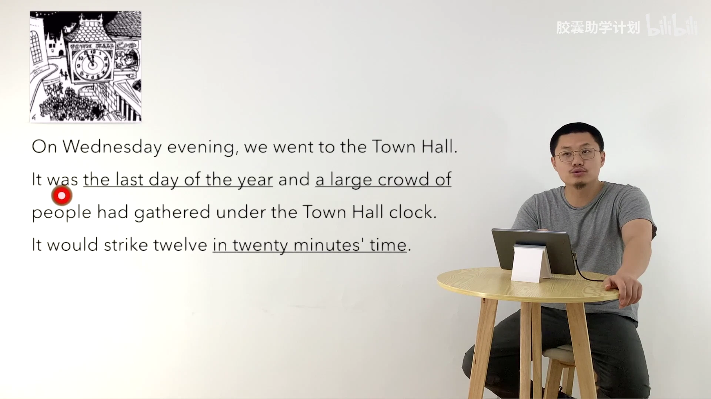

文字识别：胶囊助学计划 / On Wednesday evening, we went to the Town Hall. / It was the last day of the year and a large crowd of / people had gathered under the Town Hall clock. / It would strike twelve in twenty minutes' time.

## 00:01:00–00:01:30

of the year. 注意由后往前翻译就行了。这一年当中的 last day 叫最后一天啊，它是一年当中的最后一天。然后呢，a large crowd of 这个我们在单词部分讲过了，一大群 people 人，一大群人 had gathered. 好，had 加 done 叫过去完成时。新二我们还没有学到，但新一我们已经学过了，对吧？就是已经

### 画面 00:01:08

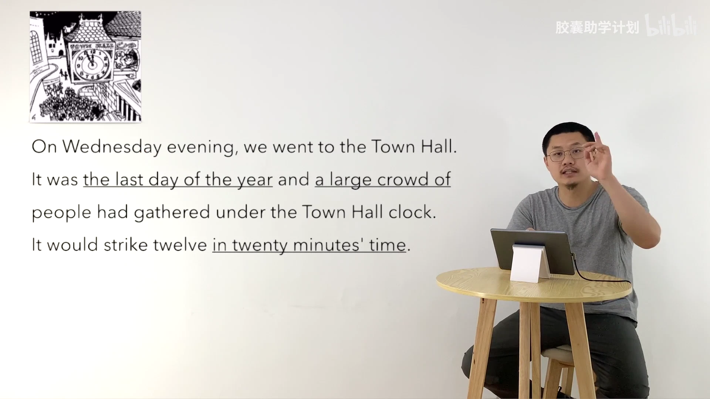

文字识别：胶囊助学计划 / On Wednesday evening, we went to the Town Hall. / It was the last day of the year and a large crowd of / people had gathered under the Town Hall clock. / It would strike twelve in twenty minutes' time.

## 00:01:30–00:02:00

聚集在一起了。当我到那儿的时候，一群人已经聚集在一起了。Under the town hall clock，在市政厅的这个大钟啊的下边已经聚在一起了。It那肯定指的就是这个 town hall clock，对吧？这个表啊，would strike twelve。好了，would将它其实是will的过去式啊，将strike twelve。首先strike这个单词，第九

### 画面 00:01:38

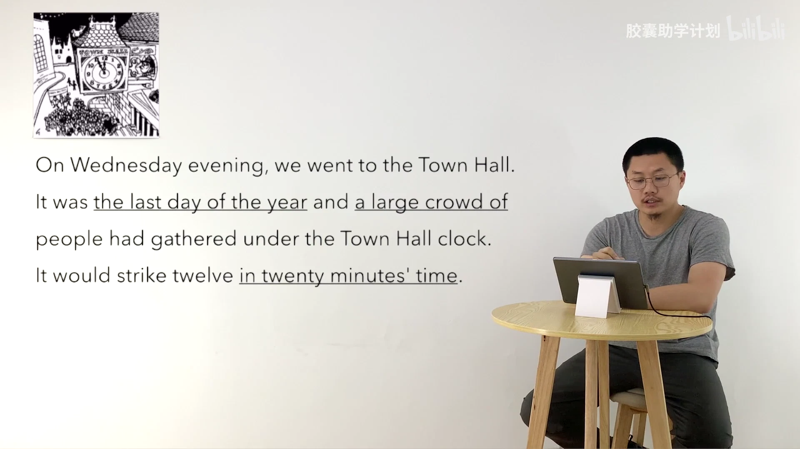

文字识别：胶囊助学计划 / On Wednesday evening, we went to the Town Hall. / It was the last day of the year and a large crowd of / people had gathered under the Town Hall clock. / It would strike twelve in twenty minutes' time.

## 00:02:00–00:02:30

课我们见，第十课立刻又会见啊。 Strike 有很多的意思，在这儿指的是敲打或者撞击，敲打或者撞击十二下 in twenty minutes time，这是一个小的习惯用法，往往接将来时态，叫二十分钟之后。它也可以完全变成叫做 in twenty minutes，把撇和 time 去掉，因为 twenty minutes 就是时间了，对

### 画面 00:02:08

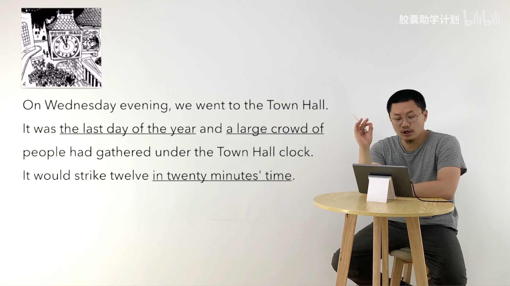

文字识别：胶囊助学计划 / On Wednesday evening, we went to the Town Hall. / It was the last day of the year and a large crowd of / people had gathered under the Town Hall clock. / It would strike twelve in twenty minutes' time.

## 00:02:30–00:03:00

吧？你再加不加这个 time 无所谓了啊，叫做二十分钟之后，continuing fifteen minutes past 十五分钟 past 过去了，对吧？past 啊，我们玩牌的时候说不出就是 past，OK？And then 然后呢？Then 然后 at five to twelve，我们新一就学过，在具体啊，刚才讲的首先是具体的某个时间点用 at 这个时间介词，其次呢

### 画面 00:02:35

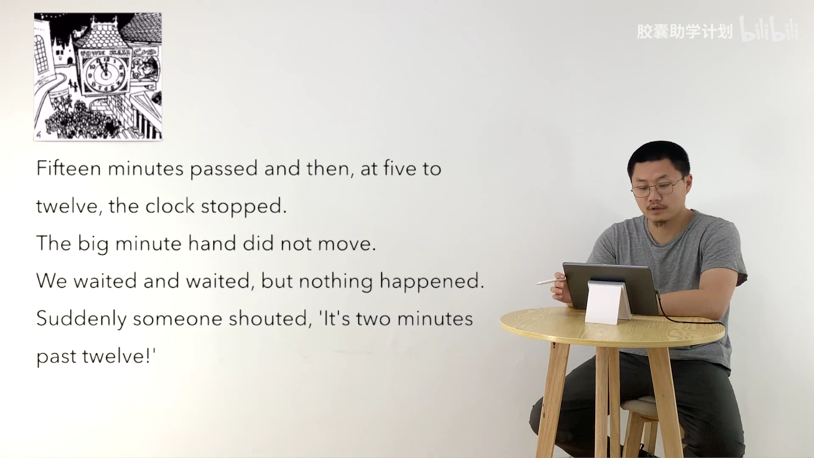

文字识别：胶囊助学计划 / Fifteen minutes passed and then, at five to / twelve, the clock stopped. / The big minute hand did not move. / We waited and waited, but nothing happened. / Suddenly someone shouted,'lt's two minutes / past twelve!'

## 00:03:00–00:03:30

five to twelve叫差五分钟，十二点，十一点五十五。The clock stopped.这个钟啊，钟表啊，停了。The big minute hand,这个大的分针，不是手，对吧？分针did not move. Move我们在乞丐那一刻学过，它指的是搬家，对吧？移动，但是move最本质的意思叫做动起来啊，就是移动，它不动了。We waited and

### 画面 00:03:05

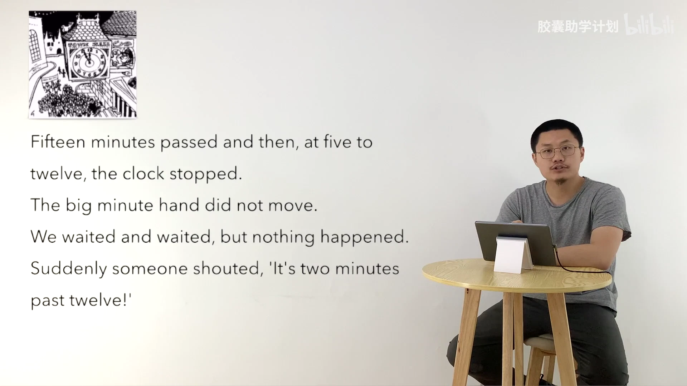

文字识别：胶囊助学计划 / Fifteen minutes passed and then, at five to / twelve, the clock stopped. / The big minute hand did not move. / We waited and waited, but nothing happened. / Suddenly someone shouted,'lt's two minutes / past twelve!'

### 画面 00:03:22

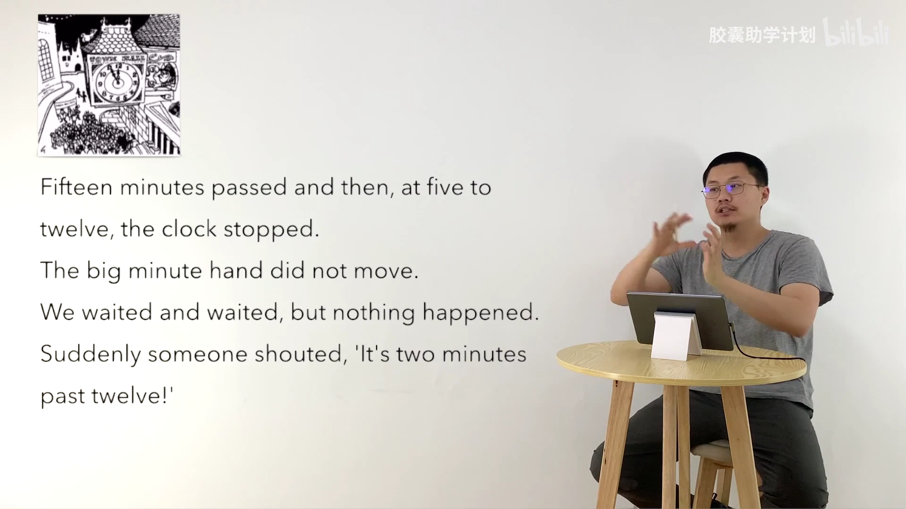

文字识别：胶囊助学计划 / Fifteen minutes passed and then, at five to / twelve, the clock stopped. / The big minute hand did not move. / We waited and waited, but nothing happened. / Suddenly someone shouted,'lt's two minutes / past twelve!'

### 画面 00:03:25

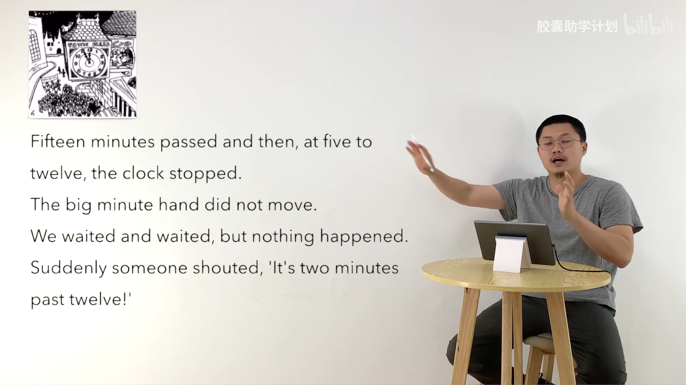

文字识别：胶囊助学计划 / Fifteen minutes passed and then, at five to / twelve, the clock stopped. / The big minute hand did not move. / We waited and waited, but nothing happened. / Suddenly someone shouted,'lt's two minutes / past twelve!'

### 画面 00:03:27

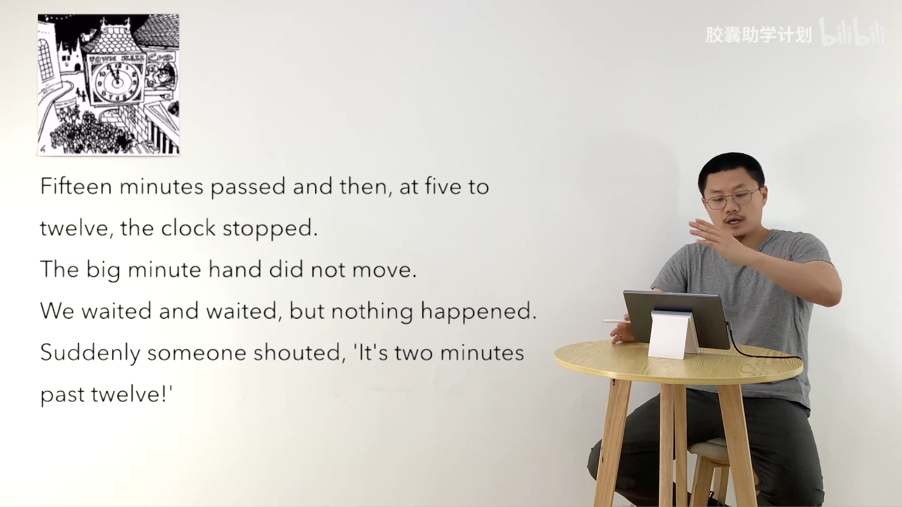

文字识别：胶囊助学计划 / Fifteen minutes passed and then, at five to / twelve, the clock stopped. / The big minute hand did not move. / We waited and waited, but nothing happened. / Suddenly someone shouted,'lt's two minutes / past twelve!'

## 00:03:30–00:04:00

waited.我们等啊等，对吧？我们等啊等。But nothing happened.但是任何事情都没有发生啊。或者nothing就是没有，就是没有事情happen叫做发生，对吧？没有事情发生。Suddenly,突然间, someone shouted.某个人大喊道啊。讲单词的时候，各位还记不记得？我们说shout at somebody指的是冲某人泄愤的喊，对吧？就愤

### 画面 00:03:44

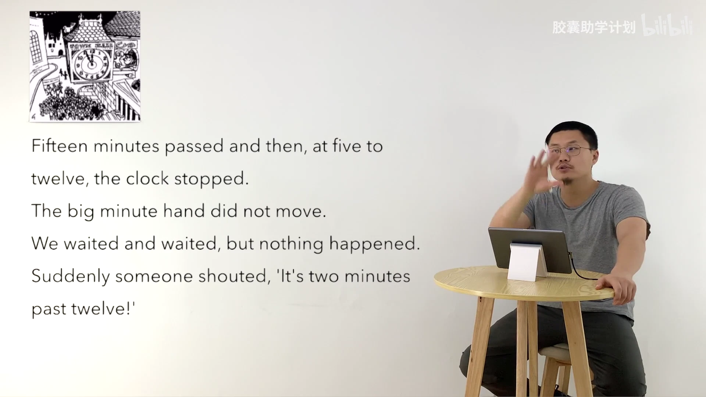

文字识别：胶囊助学计划 / Fifteen minutes passed and then, at five to / twelve, the clock stopped. / The big minute hand did not move. / We waited and waited, but nothing happened. / Suddenly someone shouted,'lt's two minutes / past twelve!'

### 画面 00:03:54

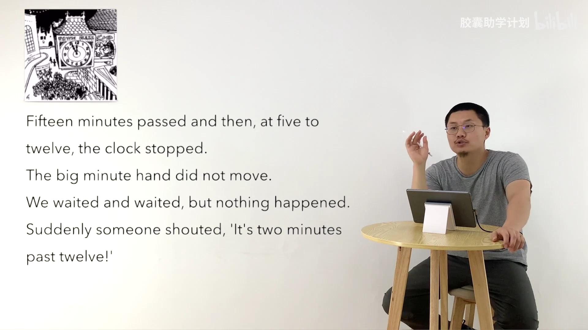

文字识别：胶囊助学计划 / Fifteen minutes passed and then, at five to / twelve, the clock stopped. / The big minute hand did not move. / We waited and waited, but nothing happened. / Suddenly someone shouted,'lt's two minutes / past twelve!'

## 00:04:00–00:04:30

怒的喊，而 shout to somebody 是冲某人大声喊，为了让他听到啊，不是为了这个写这个书这个泄愤啊。那这个地方只是提了一下，叫做 shouted。某个人大喊道，It's two minutes past twelve，已经十二点零二了。The clock has stopped，表已经停了，现在完成时，对吧？你注意，它是在引号当中的啊，是他当时说的原

### 画面 00:04:11

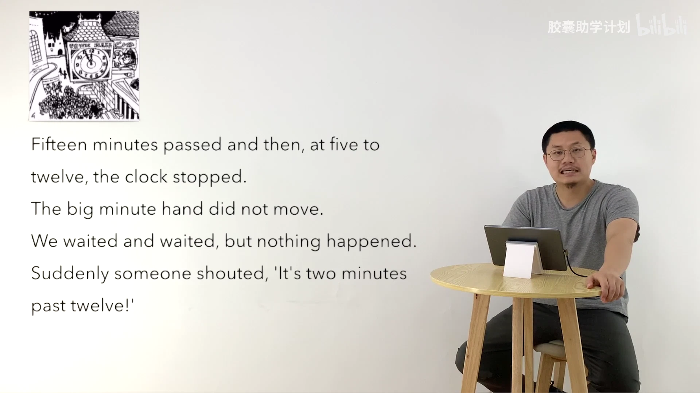

文字识别：胶囊助学计划 / Fifteen minutes passed and then, at five to / twelve, the clock stopped. / The big minute hand did not move. / We waited and waited, but nothing happened. / Suddenly someone shouted,'lt's two minutes / past twelve!'

### 画面 00:04:19

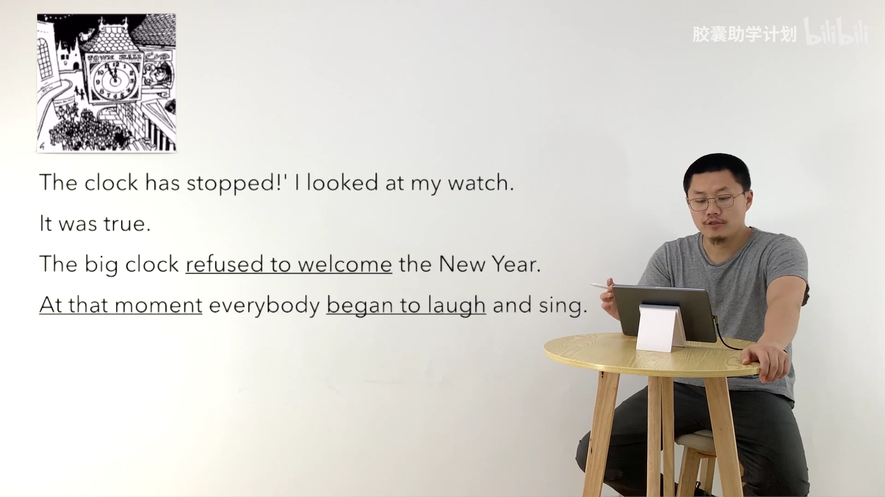

文字识别：胶囊助学计划 / The clock has stopped!' I looked at my watch. / It was true. / The big clock refused to welcome the New Year. / At that moment everybody began to laugh and sing.

### 画面 00:04:28

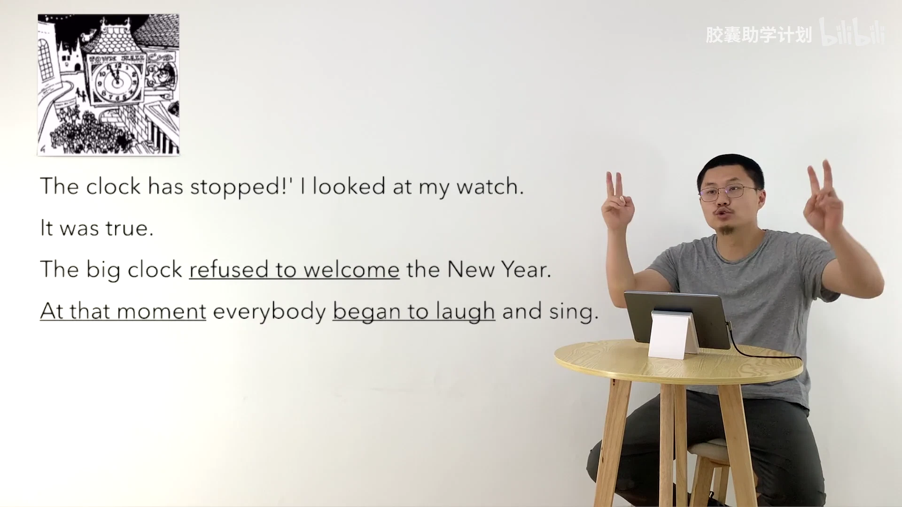

文字识别：胶囊助学计划 / The clock has stopped!' I looked at my watch. / It was true. / The big clock refused to welcome the New Year. / At that moment everybody began to laugh and sing.

## 00:04:30–00:05:00

话对吧？I looked at my watch. 我看了一下我的表。It was two. 他当时说的这句话是对的。The big clock, 这个大表, refused to welcome. 讲单词的时候我们提到了 refuse to do something, 拒绝做某件事情。这个大表啊，拒绝 welcome the new year, 欢迎新年啊，就是停在十一点五十

### 画面 00:04:30

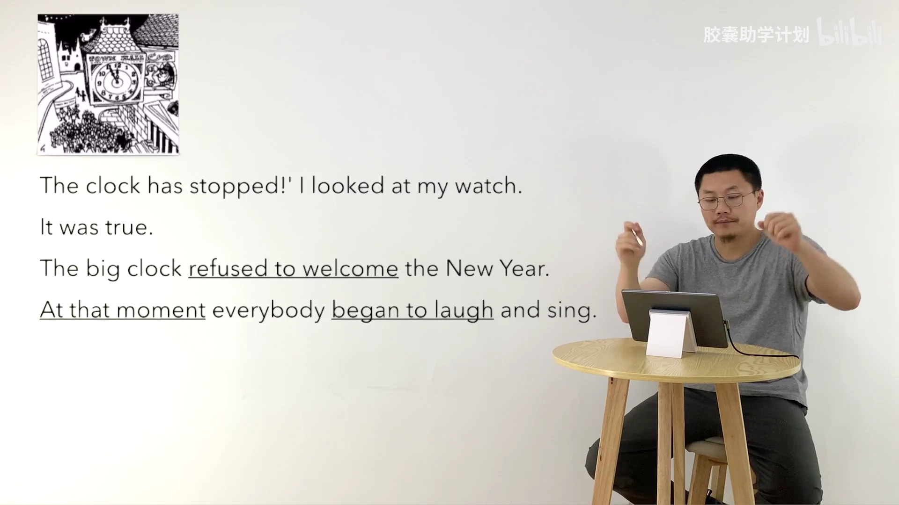

文字识别：胶囊助学计划 / The clock has stopped!' I looked at my watch. / It was true. / The big clock refused to welcome the New Year. / At that moment everybody began to laugh and sing.

### 画面 00:04:32

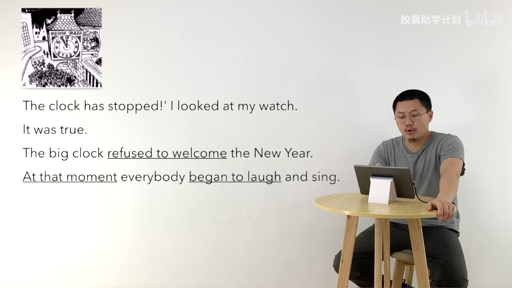

文字识别：胶囊助学计划 / The clock has stopped!' I looked at my watch. / It was true. / The big clock refused to welcome the New Year. / At that moment everybody began to laugh and sing.

## 00:05:00–00:05:30

五就不动了。At that moment，这是一个小的短语。以后我们会见到叫做什么？At the moment，at this moment等等啊。现在是at that moment。Moment叫做片刻、时刻。那at that moment叫做在那一刻。你看，它其实还是有点跟时间点相关的，所以用的是at，对吧？在那一刻，everybody，每一个人，began

### 画面 00:05:02

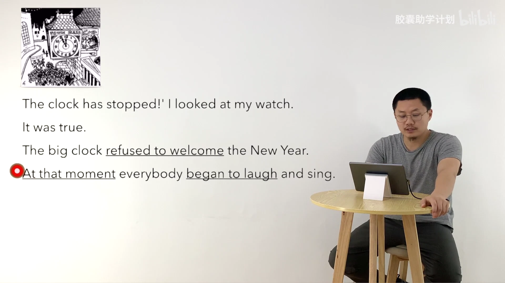

文字识别：胶囊助学计划 / The clock has stopped!' I looked at my watch. / It was true. / The big clock refused to welcome the New Year. / At that moment everybody began to laugh and sing.

## 00:05:30–00:06:00

to love and sing, 就开始笑，然后开始唱歌。这有一个小的习惯用法叫做 begin to do something. 那接下来呢，我们就把文章当中的习惯用法摘抄出来给大家。我们拿它要去造句了，对吧？习惯用法其实本质上跟单词是很类似的啊，它甚至有的时候跟单词是高度重合的。比如说，你像 refuse to do something，对吧？它跟单词就是高度重合的。

### 画面 00:05:32

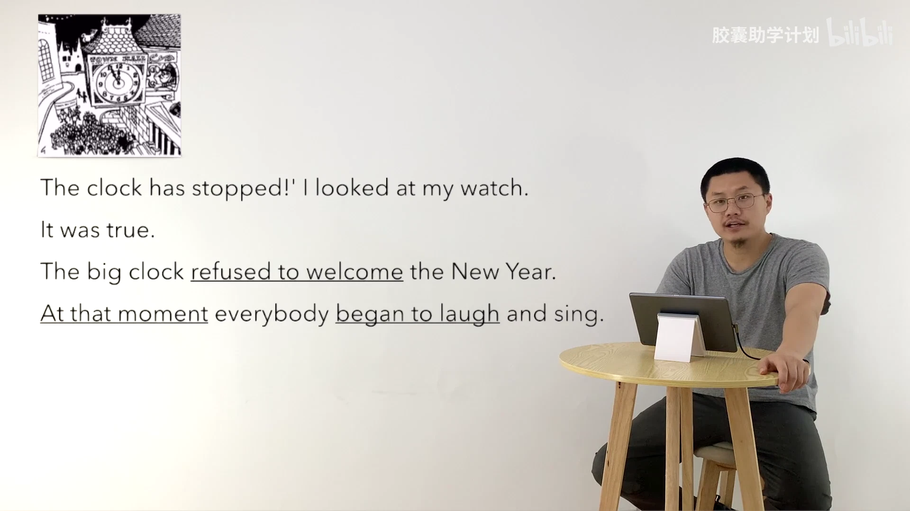

文字识别：胶囊助学计划 / The clock has stopped!' I looked at my watch. / It was true. / The big clock refused to welcome the New Year. / At that moment everybody began to laugh and sing.

### 画面 00:05:40

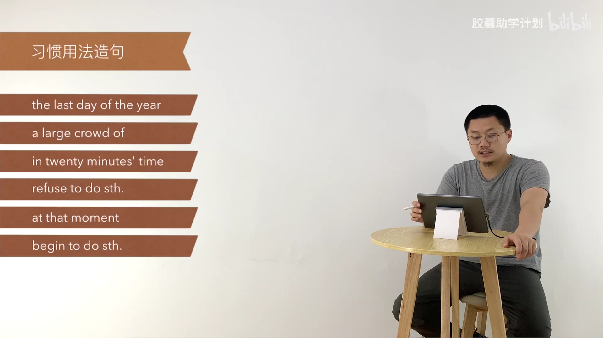

文字识别：胶囊助学计划 / 习惯用法造句 / the last day of the year / a large crowd of / in twenty minutes' / time / refuse to do sth. / at that moment / begin to do sth.

### 画面 00:05:42

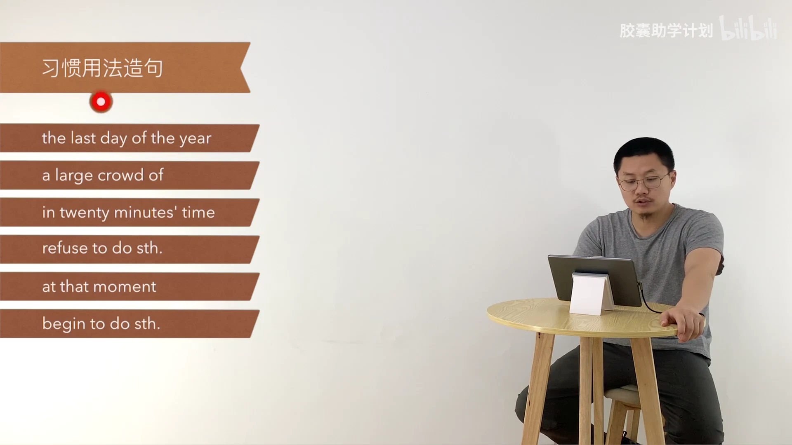

文字识别：胶囊助学计划 / 习惯用法造句 / the last day of the year / a large crowd of / in twenty minutes' / time / refuse to do sth. / at that moment / begin to do sth.

### 画面 00:05:44

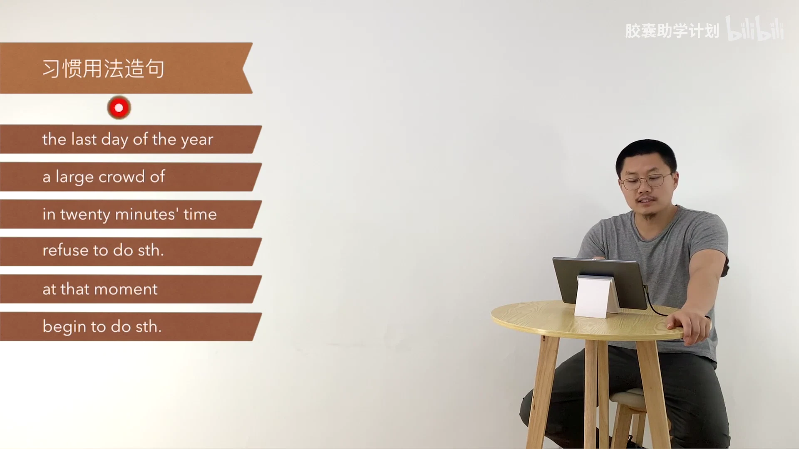

文字识别：胶囊助学计划 / 习惯用法造句 / the last day of the year / a large crowd of / in twenty minutes' / time / refuse to do sth. / at that moment / begin to do sth.

### 画面 00:05:46

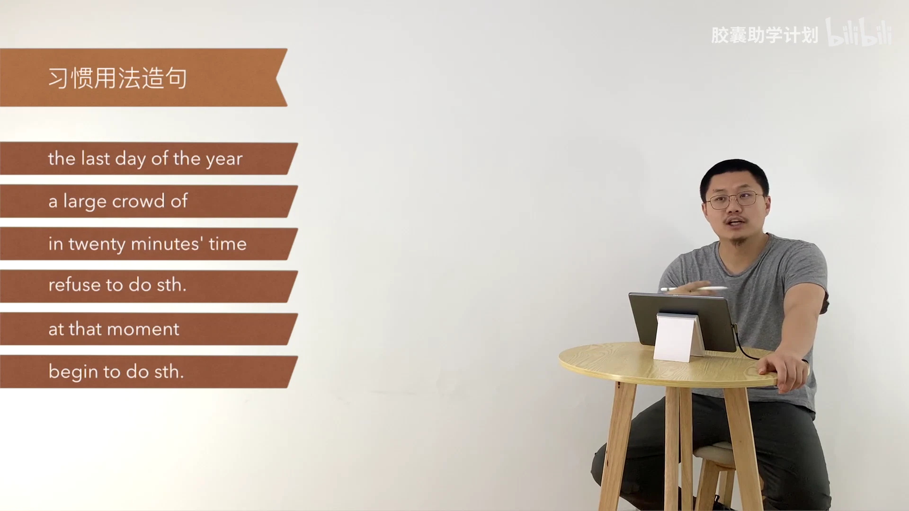

文字识别：胶囊助学计划 / 习惯用法造句 / the last day of the year / a large crowd  / of / in twenty minutes' / time / refuse to do sth. / at that moment / begin to do sth.

### 画面 00:05:49

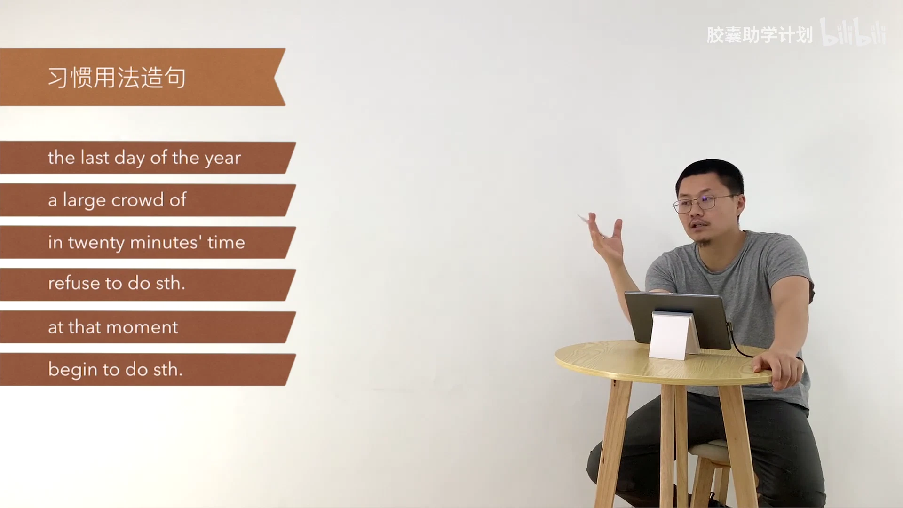

文字识别：胶囊助学计划 / 习惯用法造句 / the last day of the year / a large crowd / of / in twenty minutes' / time / refuse to do sth. / at that moment / begin to do sth.

### 画面 00:05:51

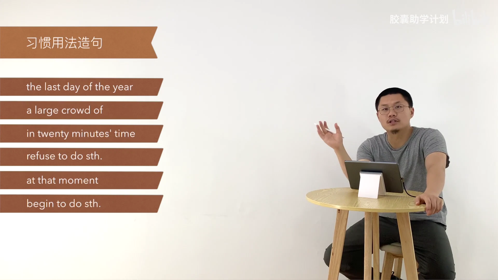

文字识别：胶囊助学计划 / 习惯用法造句 / the last day of the year / a large crowd of / in twenty minutes' / time / refuse to do sth. / at that moment / begin to do sth.

### 画面 00:05:53

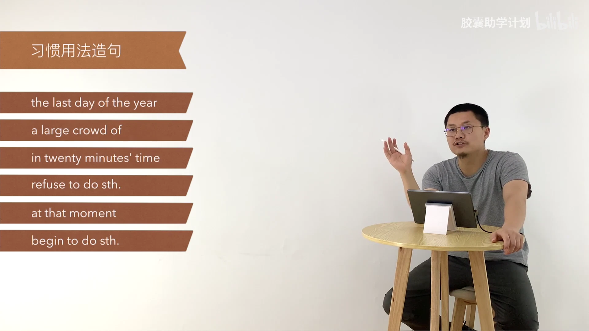

文字识别：胶囊助学计划 / 习惯用法造句 / the last day of the year / a large crowd of / in twenty minutes' / time / refuse to do sth. / at that moment / begin to do sth.

### 画面 00:05:55

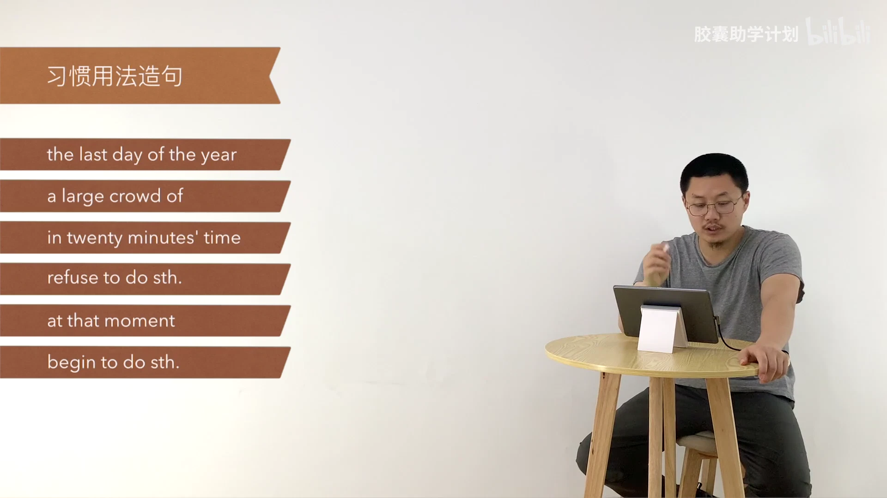

文字识别：胶囊助学计划 / 习惯用法造句 / the last day of the year / a large crowd of / in twenty minutes' / time / refuse to do sth. / at that moment / begin to do sth.

### 画面 00:05:57

文字识别：胶囊助学计划 / 习惯用法造句 / the last day of the year / a large crowd of / in twenty minutes' / time / refuse to do sth. / at that moment / begin to do sth.

### 画面 00:05:59

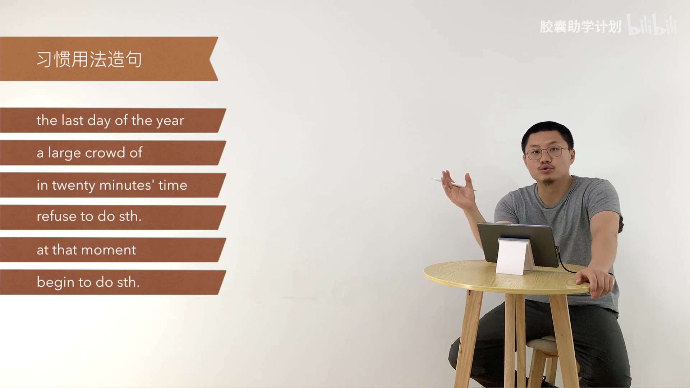

文字识别：胶囊助学计划 / 习惯用法造句 / the last day of the year / a large crowd of / in twenty minutes' / time / refuse to do sth. / at that moment / begin to do sth.

## 00:06:00–00:06:30

他们的最终目的一定是结合，不管是单词也好，还是习惯用法也好，一定是配合着语法，三者放到一起，放造出来听说读写的句子。OK，好，那接下来我们就尝试造一些句子。首先，the last day of the year叫做一年当中的最后一天，那我是不是也可以说一年一个月当中的最后一天叫做the last day of the month，对吧？但你不能说the last day of the day，对吧？这

### 画面 00:06:01

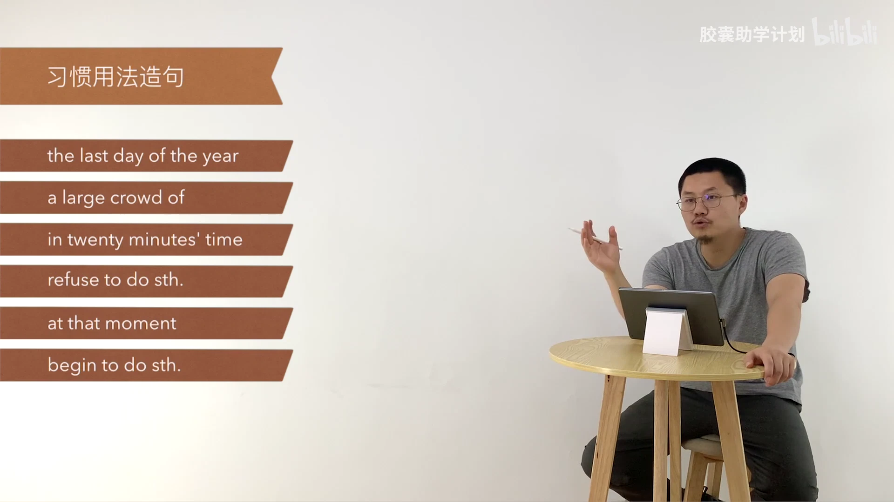

文字识别：胶囊助学计划 / 习惯用法造句 / the last day of the year / a large crowd of / in twenty minutes' / time / refuse to do sth. / at that moment / begin to do sth.

### 画面 00:06:03

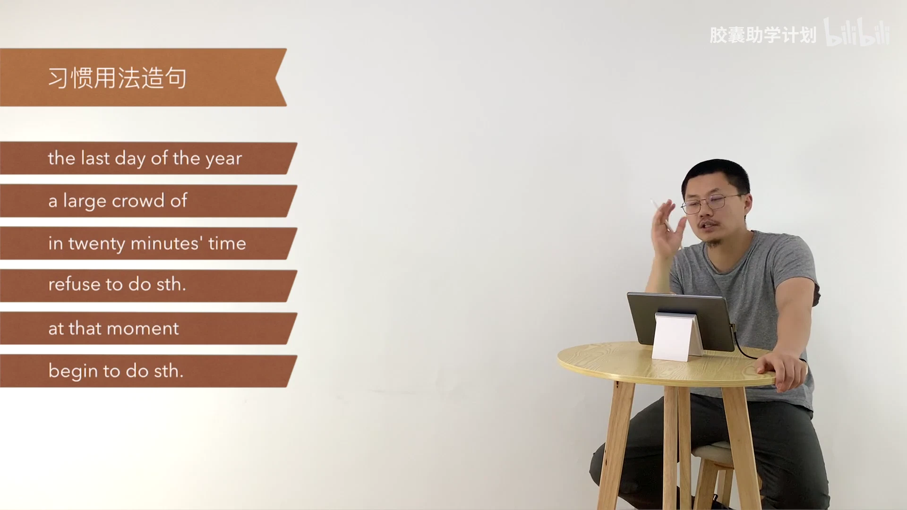

文字识别：胶囊助学计划 / 习惯用法造句 / the last day of the year / a large crowd of / in twenty minutes' / time / refuse to do sth. / at that moment / begin to do sth.

### 画面 00:06:05

文字识别：胶囊助学计划 / 习惯用法造句 / the last day of the year / a large crowd of / in twenty minutes' / time / refuse to do sth. / at that moment / begin to do sth.

### 画面 00:06:07

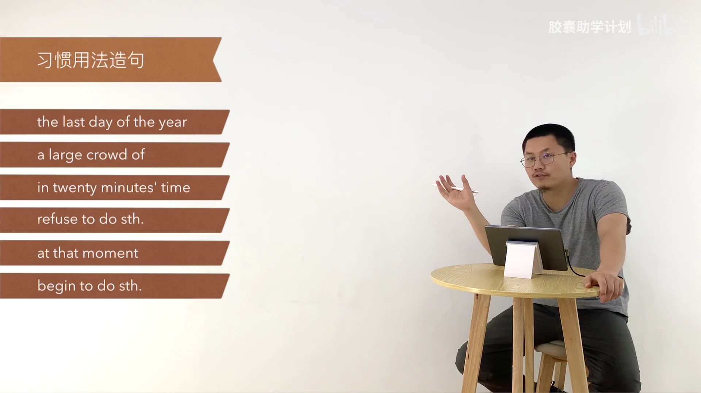

文字识别：胶囊助学计划 / 习惯用法造句 / the last day of the year / a large crowd of / in twenty minutes' / time / refuse to do sth. / at that moment / begin to do sth.

### 画面 00:06:09

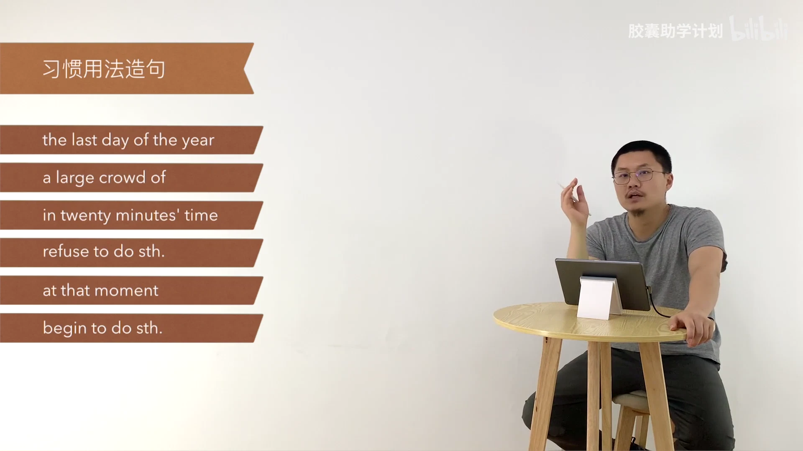

文字识别：胶囊助学计划 / 习惯用法造句 / the last day of the year / a large crowd of / in twenty minutes' / time / refuse to do sth. / at that moment / begin to do sth.

### 画面 00:06:11

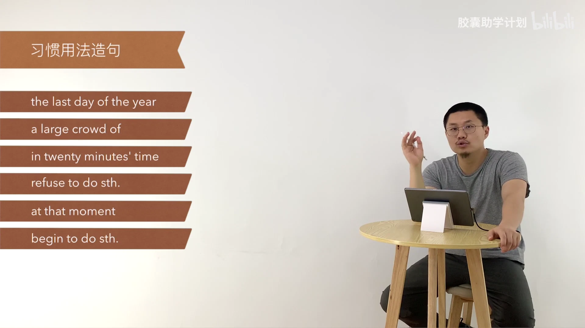

文字识别：胶囊助学计划 / 习惯用法造句 / the last day of the year / a large crowd of / in twenty minutes' / time / refuse to do sth. / at that moment / begin to do sth.

### 画面 00:06:14

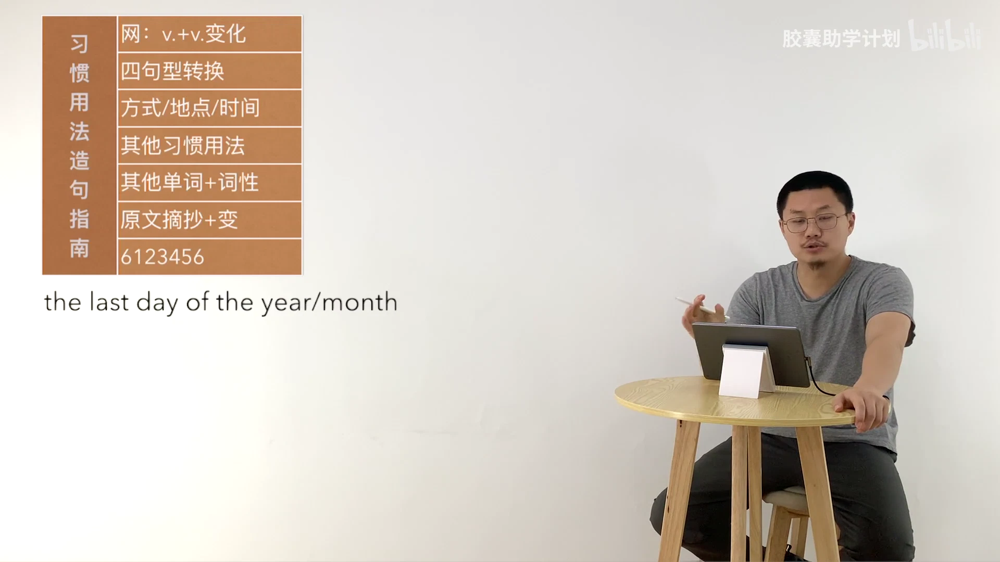

文字识别：网：v.+v.变化 / 习惯用法造句指南 / 胶囊助学计划 / 四句型转换 / 方式/地点/时间 / 其他习惯用法 / 其他单词+词性 / 原文摘抄+变 / 6123456 / the last day of the year/month

### 画面 00:06:16

文字识别：网：v.+v.变化 / 习惯用法造句指南 / 胶囊助学计划 / 四句型转换 / 方式/地点/时间 / 其他习惯用法 / 其他单词+词性 / 原文摘抄+变 / 6123456 / the last day of the year/month

### 画面 00:06:20

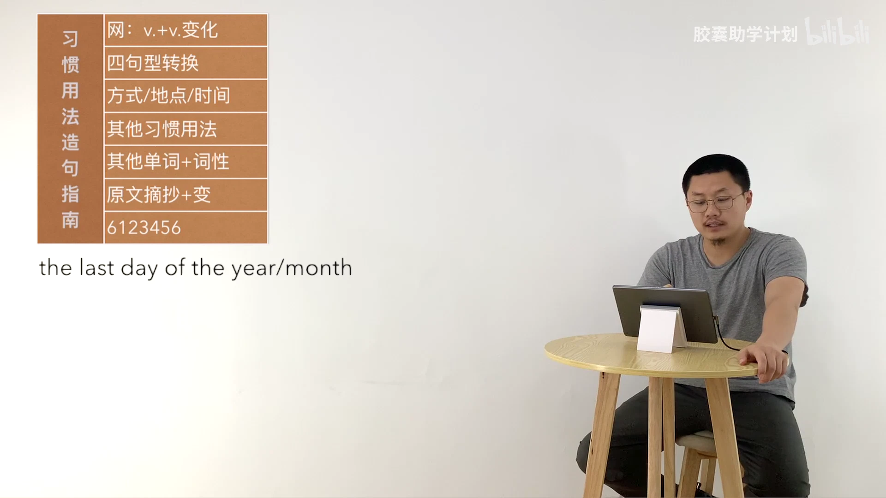

文字识别：网：v.+v.变化 / 习惯用法造句指南 / 胶囊助学计划 / 四句型转换 / 方式/地点/时间 / 其他习惯用法 / 其他单词+词性 / 原文摘抄+变 / 6123456 / the last day of the year/month

### 画面 00:06:23

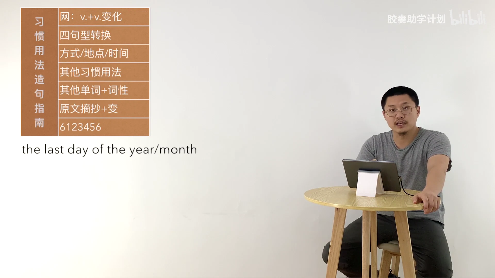

文字识别：网：v.+v.变化 / 习惯用法造句指南 / 胶囊助学计划 / 四句型转换 / 方式/地点/时间 / 其他习惯用法 / 其他单词+词性 / 原文摘抄+变 / 6123456 / the last day of the year/month

### 画面 00:06:25

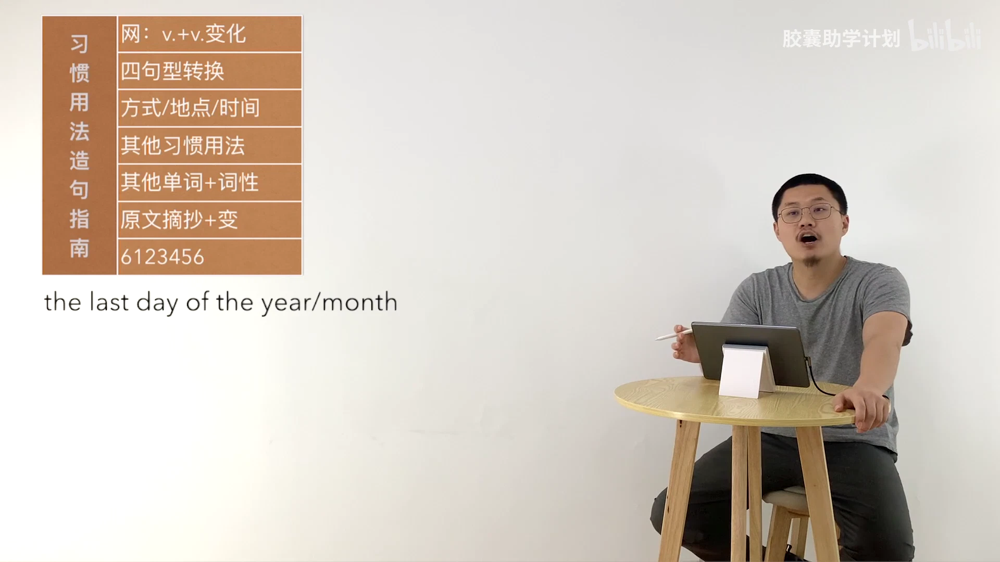

文字识别：网：v.+v.变化 / 习惯用法造句指南 / 胶囊助学计划 / 四句型转换 / 方式/地点/时间 / 其他习惯用法 / 其他单词+词性 / 原文摘抄+变 / 6123456 / the last day of the year/month

## 00:06:30–00:07:00

好像就不行了。好，我们造一句话，说 she is going to. 首先，主语您自己随便选。Be going to do 是我自己选的，你也可以选成别的时态，一般过去时啊，对吧？各种各样的时态，我们现在学过的。我选的是一般将来时。他打算要 fly to New York. 这是我们第四课学过的一个习惯用法，叫 fly to some place 或者 somewhere. 我们结合了其他习惯用法，对吧？On the

### 画面 00:06:30

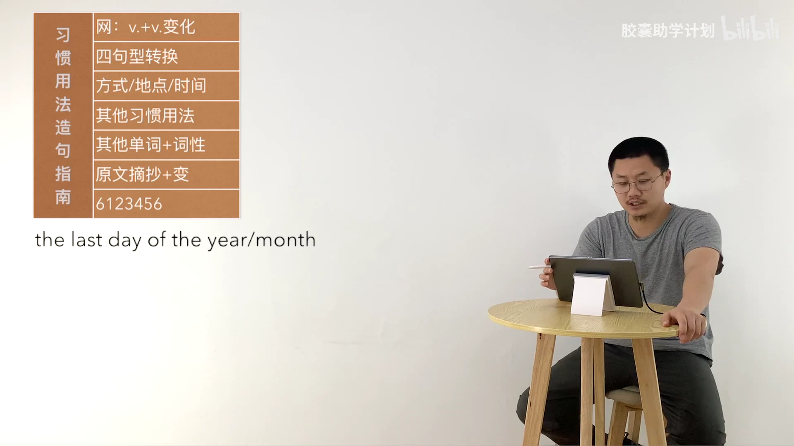

文字识别：网：v.+v.变化 / 习惯用法造句指南 / 胶囊助学计划 / 四句型转换 / 方式/地点/时间 / 其他习惯用法 / 其他单词+词性 / 原文摘抄+变 / 6123456 / the last day of the year/month

### 画面 00:06:32

文字识别：网：v.+v.变化 / 习惯用法造句指南 / 胶囊助学计划 / 四句型转换 / 方式/地点/时间 / 其他习惯用法 / 其他单词+词性 / 原文摘抄+变 / 6123456 / the last day of the year/month / She is going to fly to New York on the / last day of this month. L4

### 画面 00:06:35

文字识别：网：v.+v.变化 / 习惯用法造句指南 / 胶囊助学计划 / 四句型转换 / 方式/地点/时间 / 其他习惯用法 / 其他单词+词性 / 原文摘抄+变 / 6123456 / the last day of the year/month / She is going to fly to New York on the / last day of this month. L4

### 画面 00:06:40

文字识别：习惯用法造句指南 / 网：v.+v.变化 / 胶囊助学计划 / 四句型转换 / 方式/地点/时间 / 其他习惯用法 / 其他单词+词性 / 原文摘抄+变 / 6123456 / the last day of the year/month / She is going to fly to New York on the / last day of this month. L4

### 画面 00:06:45

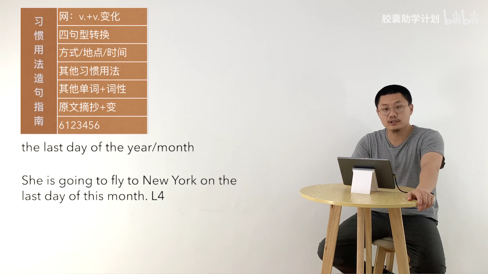

文字识别：网：v.+v.变化 / 习惯用法造句指南 / 胶囊助学计划 / 四句型转换 / 方式/地点/时间 / 其他习惯用法 / 其他单词+词性 / 原文摘抄+变 / 6123456 / the last day of the year/month / She is going to fly to New York on the / last day of this month. L4

### 画面 00:06:50

文字识别：网：v.+v.变化 / 习惯用法造句指南 / 胶囊助学计划 / 四句型转换 / 方式/地点/时间 / 其他习惯用法 / 其他单词+词性 / 原文摘抄+变 / 6123456 / the last day of the year/month / She is going to fly to New York on the / last day of this month. L4

### 画面 00:06:53

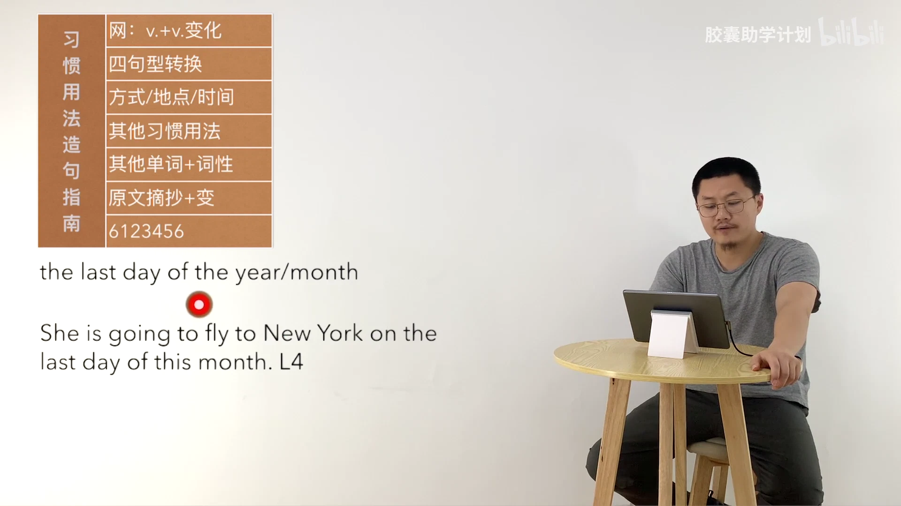

文字识别：网：v.+v.变化 / 习惯用法造句指南 / 胶囊助学计划 / 四句型转换 / 方式/地点/时间 / 其他习惯用法 / 其他单词+词性 / 原文摘抄+变 / 6123456 / the last day of the year/month / She is going to fly to New York on the / last day of this month. L4

### 画面 00:06:55

文字识别：网：v.+v.变化 / 习惯用法造句指南 / 胶囊助学计划 / 四句型转换 / 方式/地点/时间 / 其他习惯用法 / 其他单词+词性 / 原文摘抄+变 / 6123456 / the last day of the year/month / She is going to fly to New York on the / last day of this month. L4

### 画面 00:06:57

文字识别：习惯用法造句指南 / 网：v.+v.变化 / 胶囊助学计划 / 四句型转换 / 方式/地点/时间 / 其他习惯用法 / 其他单词+词性 / 原文摘抄+变 / 6123456 / the last day of the year/month / She is going to fly to New York on the / last day of this month. L4

### 画面 00:06:59

文字识别：网：v.+v.变化 / 习惯用法造句指南 / 胶囊助学计划 / 四句型转换 / 方式/地点/时间 / 其他习惯用法 / 其他单词+词性 / 原文摘抄+变 / 6123456 / the last day of the year/month / She is going to fly to New York on the / last day of this month. L4

## 00:07:00–00:07:30

last day of this month，具体的某一天，我们还是用了一个 on，在这个月的最后一天，它将飞去纽约。这是我们结合第四课的习惯用法，fly to somewhere。肯定句出来了，一般疑问句各位口语自己去造，和各种特殊疑问句我们不提了。接下来，a large crowd of，我把 large 加了一个括弧，告诉各位这个 large 是可以省略的。比如说，a

### 画面 00:07:01

文字识别：网：v.+v.变化 / 习惯用法造句指南 / 胶囊助学计划 / 四句型转换 / 方式/地点/时间 / 其他习惯用法 / 其他单词+词性 / 原文摘抄+变 / 6123456 / the last day of the year/month / She is going to fly to New York on the / last day of this month. L4

### 画面 00:07:05

文字识别：网：v.+v.变化 / 习惯用法造句指南 / 胶囊助学计划 / 四句型转换 / 方式/地点/时间 / 其他习惯用法 / 其他单词+词性 / 原文摘抄+变 / 6123456 / the last day of the year/month / She is going to fly to New York on the / last day of this morth. L4

### 画面 00:07:10

文字识别：网：v.+v.变化 / 习惯用法造句指南 / 胶囊助学计划 / 四句型转换 / 方式/地点/时间 / 其他习惯用法 / 其他单词+词性 / 原文摘抄+变 / 6123456 / the last day of the year/month / She is going to fly to New York on the / last day of this month. L4

### 画面 00:07:15

文字识别：习惯用法造句指南 / 网：v.+v.变化 / 胶囊助学计划 / 四句型转换 / 方式/地点/时间 / 其他习惯用法 / 其他单词+词性 / 原文摘抄+变 / 6123456 / the last day of the year/month / She is going to fly to New York on the / last day of this month. L4

### 画面 00:07:19

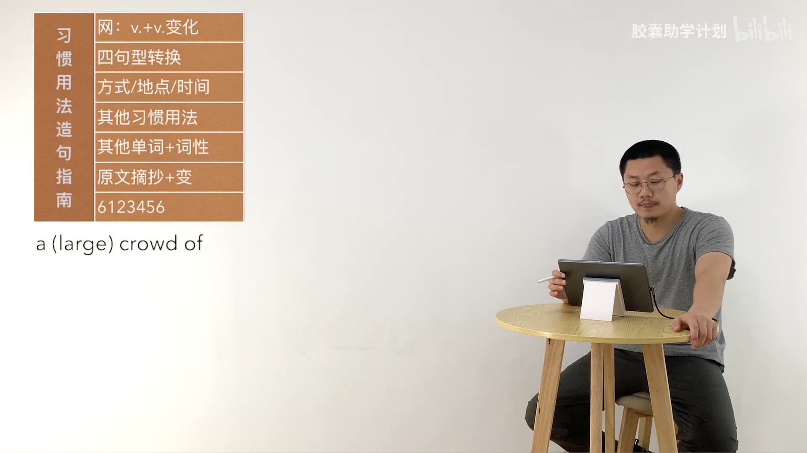

文字识别：网：v.+v.变化 / 习惯用法造句指南 / 胶囊助学计划 / 四句型转换 / 方式/地点/时间 / 其他习惯用法 / 其他单词+词性 / 原文摘抄+变 / 6123456 / a (large) crowd of

### 画面 00:07:21

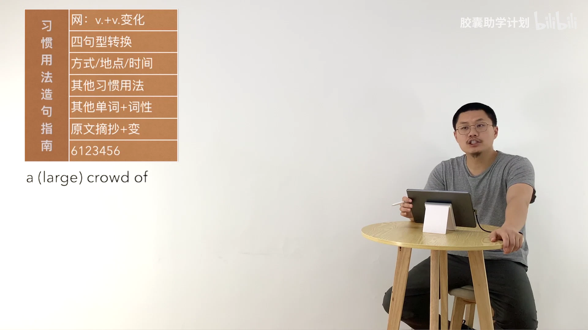

文字识别：网：v.+v.变化 / 习惯用法造句指南 / 胶囊助学计划 / 四句型转换 / 方式/地点/时间 / 其他习惯用法 / 其他单词+词性 / 原文摘抄+变 / 6123456 / a (large) crowd of

### 画面 00:07:23

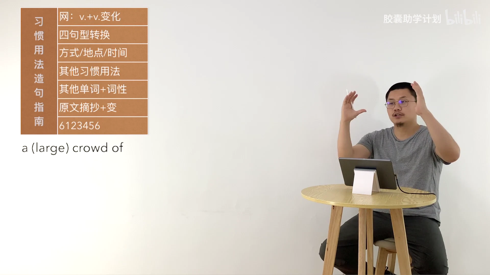

文字识别：网：v.+v.变化 / 习惯用法造句指南 / 胶囊助学计划 / 四句型转换 / 方式/地点/时间 / 其他习惯用法 / 其他单词+词性 / 原文摘抄+变 / 6123456 / a (large) crowd of

### 画面 00:07:25

文字识别：网：v.+v.变化 / 习惯用法造句指南 / 胶囊助学计划 / 四句型转换 / 方式/地点/时间 / 其他习惯用法 / 其他单词+词性 / 原文摘抄+变 / 6123456 / a (large) crowd of

### 画面 00:07:28

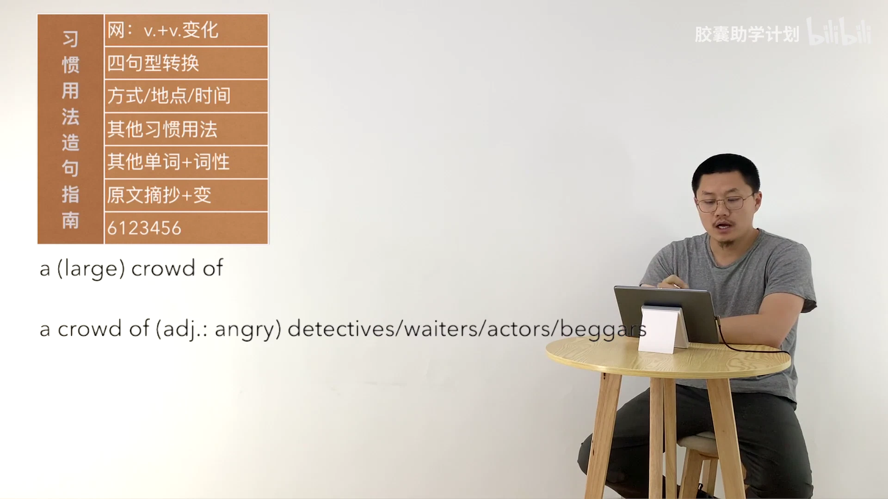

文字识别：网：v.+v.变化 / 习惯用法造句指南 / 胶囊助学计划 / 四句型转换 / 方式/地点/时间 / 其他习惯用法 / 其他单词+词性 / 原文摘抄+变 / 6123456 / a (large) crowd of / a crowd of (adj.: angry) detectives/waiters/actors/beggars

## 00:07:30–00:08:00

crowd of detectives. We're not going to talk about this. Detectives, detectives, a group of detectives. A group of waiters. You can see a group of waiters. Actors, beggars. These are all words we learned in the previous lessons. You can say a group of actors. A group of beggars. A group of actors. A group of beggars. A group of actors. A group of beggars. A group of actors. A group of beggars.

### 画面 00:07:30

文字识别：网：v.+v.变化 / 习惯用法造句指南 / 胶囊助学计划 / 四句型转换 / 方式/地点/时间 / 其他习惯用法 / 其他单词+词性 / 原文摘抄+变 / 6123456 / a (large) crowd of / a crowd of (adj: angry) detectives/waiters/actors/beggars

### 画面 00:07:35

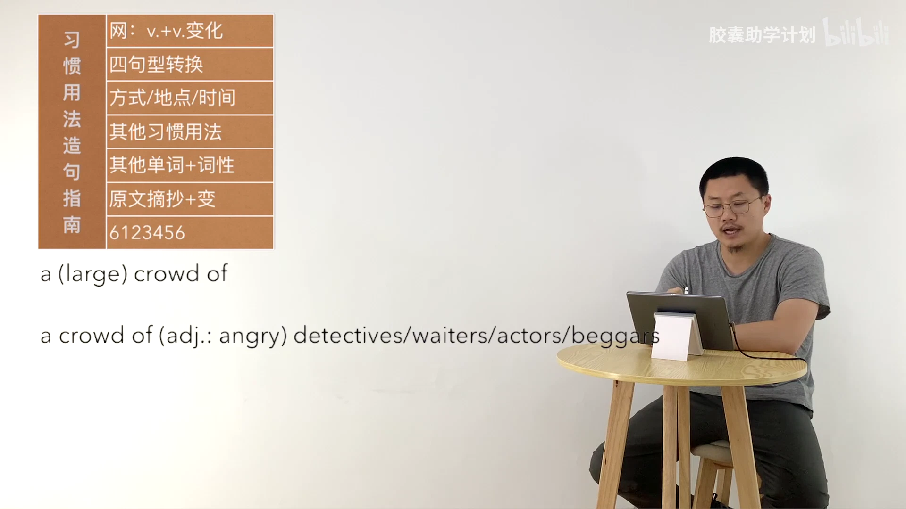

文字识别：习惯用法造句指南 / 网：v.+v.变化 / 胶囊助学计划 / 四句型转换 / 方式/地点/时间 / 其他习惯用法 / 其他单词+词性 / 原文摘抄+变 / 6123456 / a (large) crowd of / a crowd of (adj: angry) detectives/waiters/actors/beggars

### 画面 00:07:38

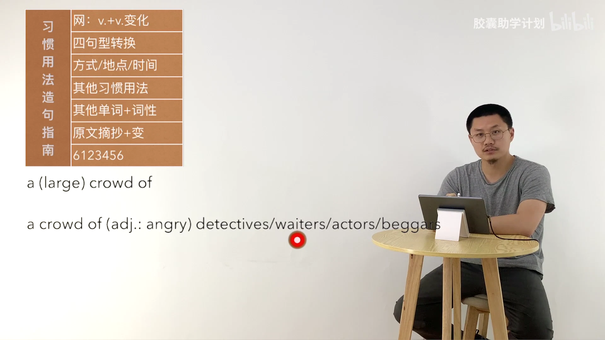

文字识别：网：v.+v.变化 / 习惯用法造句指南 / 胶囊助学计划 / 四句型转换 / 方式/地点/时间 / 其他习惯用法 / 其他单词+词性 / 原文摘抄+变 / 6123456 / a (large) crowd of / a crowd of (adj: angry) detectives/waiters/actors/beggar

### 画面 00:07:40

文字识别：网：v.+v.变化 / 习惯用法造句指南 / 胶囊助学计划 / 四句型转换 / 方式/地点/时间 / 其他习惯用法 / 其他单词+词性 / 原文摘抄+变 / 6123456 / a (large) crowd of / a crowd of (adj: angry) detectives/waiters/actors/beggars

### 画面 00:07:44

文字识别：网：v.+v.变化 / 习惯用法造句指南 / 胶囊助学计划 / 四句型转换 / 方式/地点/时间 / 其他习惯用法 / 其他单词+词性 / 原文摘抄+变 / 6123456 / a (large) crowd of / a crowd of (adj.: angry) detectives/waiters/actors/beggars

### 画面 00:07:46

文字识别：网：v.+v.变化 / 习惯用法造句指南 / 胶囊助学计划 / 四句型转换 / 方式/地点/时间 / 其他习惯用法 / 其他单词+词性 / 原文摘抄+变 / 6123456 / a (large) crowd of / a crowd of (adj.: angry) detectives/waiters/actors/beggar$

### 画面 00:07:50

文字识别：网：v.+v.变化 / 习惯用法造句指南 / 胶囊助学计划 / 四句型转换 / 方式/地点/时间 / 其他习惯用法 / 其他单词+词性 / 原文摘抄+变 / 6123456 / a (large) crowd of / a crowd of (adj.: angry) detectives/waiters/actors/beggars

### 画面 00:07:55

文字识别：网：v.+v.变化 / 习惯用法造句指南 / 胶囊助学计划 / 四句型转换 / 方式/地点/时间 / 其他习惯用法 / 其他单词+词性 / 原文摘抄+变 / 6123456 / a (large) crowd of / a crowd of (adj: angry) detectives/waiters/actors/beggars

## 00:08:00–00:08:30

的动词，那加不加？Dirty,对吧？啊，Beautiful，怎么样？用什么样形容词？您自己决定就好了。那我们尝试先造一个句子，比如说，a large crowd of detectives，一大群detectives gathered，聚集起来了at the airport，在飞机场。您看啊，按照这个逻辑，您现在主语，a large

### 画面 00:08:00

文字识别：网：v.+v.变化 / 习惯用法造句指南 / 胶囊助学计划 / 四句型转换 / 方式/地点/时间 / 其他习惯用法 / 其他单词+词性 / 原文摘抄+变 / 6123456 / a (large) crowd of / a crowd of (adj.: angry) detectives/waiters/actors/beggars

### 画面 00:08:05

文字识别：网：v.+v.变化 / 习惯用法造句指南 / 胶囊助学计划 / 四句型转换 / 方式/地点/时间 / 其他习惯用法 / 其他单词+词性 / 原文摘抄+变 / 6123456 / a (large) crowd of / a crowd of (adj: angry) detectives/waiters/actors/beggars

### 画面 00:08:08

文字识别：网：v.+v.变化 / 习惯用法造句指南 / 胶囊助学计划 / 四句型转换 / 方式/地点/时间 / 其他习惯用法 / 其他单词+词性 / 原文摘抄+变 / 6123456 / a (large) crowd of / a crowd of (adj.: angry) detectives/waiters/actors/beggars / A large crowd of detectives gathered at the airport.

### 画面 00:08:10

文字识别：习惯用法造句指南 / 网：v.+v.变化 / 胶囊助学计划 / 四句型转换 / 方式/地点/时间 / 其他习惯用法 / 其他单词+词性 / 原文摘抄+变 / 6123456 / a (large) crowd of / a crowd of (adj.: angry) detectives/waiters/actors/beggars / A large crowd of detectives gathered at the airport.

### 画面 00:08:15

文字识别：网：v.+v.变化 / 习惯用法造句指南 / 胶囊助学计划 / 四句型转换 / 方式/地点/时间 / 其他习惯用法 / 其他单词+词性 / 原文摘抄+变 / 6123456 / a (large) crowd of / a crowd of (adj.: angry) detectives/waiters/actors/beggars / A large crowd of detectives gathered at the airport.

### 画面 00:08:20

文字识别：网：v.+v.变化 / 习惯用法造句指南 / 胶囊助学计划 / 四句型转换 / 方式/地点/时间 / 其他习惯用法 / 其他单词+词性 / 原文摘抄+变 / 6123456 / a (large) crowd of / a crowd of (adj.: angry) detectives/waiters/actors/beggars / A large crowd of detectives gathered at the airport.

### 画面 00:08:25

文字识别：网：v.+v.变化 / 习惯用法造句指南 / 胶囊助学计划 / 四句型转换 / 方式/地点/时间 / 其他习惯用法 / 其他单词+词性 / 原文摘抄+变 / 6123456 / a (large) crowd of / a crowd of (adj.: angry) detectives/waiters/actors/beggars / A large crowd of detectives gathered at the airport.

### 画面 00:08:29

文字识别：网：v.+v.变化 / 习惯用法造句指南 / 胶囊助学计划 / 四句型转换 / 方式/地点/时间 / 其他习惯用法 / 其他单词+词性 / 原文摘抄+变 / 6123456 / a (large) crowd of / a crowd of (adj.: angry) detectives/waiters/actors/beggars / A large crowd / of detectives gathered at the airport.

## 00:08:30–00:09:00

crowd of detectives可以换成这些单词，waiters, actors, beggars。您随便换，gather你别换。At the airport这个地点，你自己稍微换一下，比如说at my door啊，一大群乞丐在我们家门口啊，我也不知道为什么，或者一大群乞丐在市政厅，对吧？你也不知道为什么啊，或者说在剧院啊，一大群actors。好，肯定句你就能造出来四个了。然后

### 画面 00:08:31

文字识别：网：v.+v.变化 / 习惯用法造句指南 / 胶囊助学计划 / 四句型转换 / 方式/地点/时间 / 其他习惯用法 / 其他单词+词性 / 原文摘抄+变 / 6123456 / a (large) crowd of / a crowd of (adj.: angry) detectives/waiters/actors/beggars / A large crowd of detectives gathered at the airport.

### 画面 00:08:35

文字识别：网：v.+v.变化 / 习惯用法造句指南 / 胶囊助学计划 / 四句型转换 / 方式/地点/时间 / 其他习惯用法 / 其他单词+词性 / 原文摘抄+变 / 6123456 / a (large) crowd of / a crowd of (adj.: angry) detectives/waiters/actors/beggars / A large crowd of detectives gathered at the airport.

### 画面 00:08:43

文字识别：网：v.+v.变化 / 习惯用法造句指南 / 胶囊助学计划 / 四句型转换 / 方式/地点/时间 / 其他习惯用法 / 其他单词+词性 / 原文摘抄+变 / 6123456 / a (large) crowd of / a crowd of (adj.: angry) detectives/waiters/actors/beggars / A large crowd of detectives gathered at the airport.

### 画面 00:08:45

文字识别：网：v.+v.变化 / 习惯用法造句指南 / 胶囊助学计划 / 四句型转换 / 方式/地点/时间 / 其他习惯用法 / 其他单词+词性 / 原文摘抄+变 / 6123456 / a (large) crowd of / a crowd of (adj.: angry) detectives/waiters/actors/beggars / A large crowd of detectives gathered at the airport.

### 画面 00:08:50

文字识别：网：v.+v.变化 / 习惯用法造句指南 / 胶囊助学计划 / 四句型转换 / 方式/地点/时间 / 其他习惯用法 / 其他单词+词性 / 原文摘抄+变 / 6123456 / a (large) crowd of / a crowd of (adj.: angry) detectives/waiters/actors/beggars / A large crowd of detectives gathered at the airport.

### 画面 00:08:54

文字识别：网：v.+v.变化 / 习惯用法造句指南 / 胶囊助学计划 / 四句型转换 / 方式/地点/时间 / 其他习惯用法 / 其他单词+词性 / 原文摘抄+变 / 6123456 / a (large) crowd of / a crowd of (adj.: angry) detectives/waiters/actors/beggars / A large crowd of detectives gathered at the airport.

### 画面 00:08:56

文字识别：网：v.+v.变化 / 习惯用法造句指南 / 胶囊助学计划 / 四句型转换 / 方式/地点/时间 / 其他习惯用法 / 其他单词+词性 / 原文摘抄+变 / 6123456 / a (large) crowd of / a crowd of (adj.: angry) detectives/waiters/actors/beggars / A large crowd of detectives gathered at the airport.

## 00:09:00–00:09:30

思路，这是关键是思路啊，你是不是就可以变成进行四句型转换了？OK，比如说我再给大家来一句啊，A large crowd of angry actors gathered in front of the theater.在剧院，一群愤怒的一大群愤怒的演员在剧院的门口聚集起来了啊。接下来他们想干

### 画面 00:09:00

文字识别：网：v.+v.变化 / 习惯用法造句指南 / 胶囊助学计划 / 四句型转换 / 方式/地点/时间 / 其他习惯用法 / 其他单词+词性 / 原文摘抄+变 / 6123456 / a (large) crowd of / a crowd of (adj.: angry) detectives/waiters/actors/beggars / A large crowd of detectives gathered at the airport.

### 画面 00:09:05

文字识别：网：v.+v.变化 / 习惯用法造句指南 / 胶囊助学计划 / 四句型转换 / 方式/地点/时间 / 其他习惯用法 / 其他单词+词性 / 原文摘抄+变 / 6123456 / a (large) crowd of / a crowd of (adj.: angry) detectives/waiters/actors/beggars / A large crowd of detectives gathered at the airport.

### 画面 00:09:10

文字识别：网：v.+v.变化 / 习惯用法造句指南 / 胶囊助学计划 / 四句型转换 / 方式/地点/时间 / 其他习惯用法 / 其他单词+词性 / 原文摘抄+变 / 6123456 / a (large) crowd of / a crowd of (adj.: angry) detectives/waiters/actors/beggar$ / A large crowd of detectives gathered at the airport.

### 画面 00:09:15

文字识别：网：v.+v.变化 / 习惯用法造句指南 / 胶囊助学计划 / 四句型转换 / 方式/地点/时间 / 其他习惯用法 / 其他单词+词性 / 原文摘抄+变 / 6123456 / a (large) crowd of / a crowd of (adj.: angry) detectives/waiters/ators/beggars / A large crowd of detectives gathered at the airport.

### 画面 00:09:20

文字识别：网：v.+v.变化 / 习惯用法造句指南 / 胶囊助学计划 / 四句型转换 / 方式/地点/时间 / 其他习惯用法 / 其他单词+词性 / 原文摘抄+变 / 6123456 / a (large) crowd of / a crowd of (adj.: angry) detectives/waiters/actors/beggars / A large crowd of detectives gathered at the airport.

### 画面 00:09:25

文字识别：网：v.+v.变化 / 习惯用法造句指南 / 胶囊助学计划 / 四句型转换 / 方式/地点/时间 / 其他习惯用法 / 其他单词+词性 / 原文摘抄+变 / 6123456 / a (large) crowd of / a crowd of (adj.: angry) detectives/waiters/actors/beggars / A large crowd of detectives gathered at the airport.

## 00:09:30–00:10:00

什么？那是我们以后再描述的。但这句话我们会造了，OK？好，接下来 in twenty minutes time。首先我们要知道它在六一二三四五六当中处于的位置，几乎永远就是时间六，可以放在最前，可以放在最后。根据我个人的语言经验啊，我个人感受 in twenty minutes time 大多数时候是放在最后面的。OK？好，那刚才我在讲文章的时候就提到了，撇跟 time 是

### 画面 00:09:30

文字识别：网：v.+v.变化 / 习惯用法造句指南 / 胶囊助学计划 / 四句型转换 / 方式/地点/时间 / 其他习惯用法 / 其他单词+词性 / 原文摘抄+变 / 6123456 / a (large) crowd of / a crowd of (adj.: angry) detectives/waiters/actors/beggars / A large crowd of detectives gathered at the airport.

### 画面 00:09:34

文字识别：网：v.+v.变化 / 习惯用法造句指南 / 胶囊助学计划 / 四句型转换 / 方式/地点/时间 / 其他习惯用法 / 其他单词+词性 / 原文摘抄+变 / 6123456 / in twenty minutes' time

### 画面 00:09:36

文字识别：网：v.+v.变化 / 习惯用法造句指南 / 胶囊助学计划 / 四句型转换 / 方式/地点/时间 / 其他习惯用法 / 其他单词+词性 / 原文摘抄+变 / 6123456 / in twenty minutes' time

### 画面 00:09:39

文字识别：网：v.+v.变化 / 习惯用法造句指南 / 胶囊助学计划 / 四句型转换 / 方式/地点/时间 / 其他习惯用法 / 其他单词+词性 / 原文摘抄+变 / 6123456 / in twenty minutes' time / 6123456

### 画面 00:09:41

文字识别：网：v.+v.变化 / 习惯用法造句指南 / 胶囊助学计划 / 四句型转换 / 方式/地点/时间 / 其他习惯用法 / 其他单词+词性 / 原文摘抄+变 / 6123456 / in twenty minutes' time / 6123456

### 画面 00:09:45

文字识别：网：v.+v.变化 / 习惯用法造句指南 / 胶囊助学计划 / 四句型转换 / 方式/地点/时间 / 其他习惯用法 / 其他单词+词性 / 原文摘抄+变 / 6123456 / in twenty minutes' time / 6123456

### 画面 00:09:50

文字识别：网：v.+v.变化 / 习惯用法造句指南 / 胶囊助学计划 / 四句型转换 / 方式/地点/时间 / 其他习惯用法 / 其他单词+词性 / 原文摘抄+变 / 6123456 / in twenty minutes' time / 6123456

### 画面 00:09:55

文字识别：网：v.+v.变化 / 习惯用法造句指南 / 胶囊助学计划 / 四句型转换 / 方式/地点/时间 / 其他习惯用法 / 其他单词+词性 / 原文摘抄+变 / 6123456 / in twenty minutes' time / 6123456 / in six months/in a few minutes

### 画面 00:09:59

文字识别：网：v.+v.变化 / 习惯用法造句指南 / 胶囊助学计划 / 四句型转换 / 方式/地点/时间 / 其他习惯用法 / 其他单词+词性 / 原文摘抄+变 / 6123456 / in twenty minutes' time / 6123456 / in six months/in a few minutes

## 00:10:00–00:10:30

可以省略的，因为 twenty minutes 就是时间，有没有这个撇和 time 是不重要的，它就可以简化成叫做 in six month 六个月之后，in a few minutes 几分钟之后，对吧？好，那我们比如说造一句话，to our surprise，令我们感到很惊讶的是，he is moving to Beijing，他准备搬去 move to some place，搬到北京了 in

### 画面 00:10:01

文字识别：网：v.+v.变化 / 习惯用法造句指南 / 胶囊助学计划 / 四句型转换 / 方式/地点/时间 / 其他习惯用法 / 其他单词+词性 / 原文摘抄+变 / 6123456 / in twenty minutes / ime / 6123456 / in six months/in a few minutes

### 画面 00:10:05

文字识别：网：v.+v.变化 / 习惯用法造句指南 / 胶囊助学计划 / 四句型转换 / 方式/地点/时间 / 其他习惯用法 / 其他单词+词性 / 原文摘抄+变 / 6123456 / in twenty minutes' time / 6123456 / in six months/in a few minutes

### 画面 00:10:10

文字识别：网：v.+v.变化 / 习惯用法造句指南 / 胶囊助学计划 / 四句型转换 / 方式/地点/时间 / 其他习惯用法 / 其他单词+词性 / 原文摘抄+变 / 6123456 / in twenty minutes' time / 6123456 / in six months/in a few minutes

### 画面 00:10:15

文字识别：网：v.+v.变化 / 习惯用法造句指南 / 胶囊助学计划 / 四句型转换 / 方式/地点/时间 / 其他习惯用法 / 其他单词+词性 / 原文摘抄+变 / 6123456 / in twenty minutes' time / 6123456 / in six months/in a few minutes / To our surprise, he is moving to Beijing in six months. / L2 L6 L7

### 画面 00:10:18

文字识别：网：v.+v.变化 / 习惯用法造句指南 / 胶囊助学计划 / 四句型转换 / 方式/地点/时间 / 其他习惯用法 / 其他单词+词性 / 原文摘抄+变 / 6123456 / in twenty minutes' time / 6123456 / in six months/in a few minutes / To our surprise, he is moving to Beijing in six months. / L2 L6 L7

### 画面 00:10:20

文字识别：网：v.+v.变化 / 习惯用法造句指南 / 胶囊助学计划 / 四句型转换 / 方式/地点/时间 / 其他习惯用法 / 其他单词+词性 / 原文摘抄+变 / 6123456 / in twenty minutes' time / 6123456 / in six months/in a few minutes / To our surprise, he is moving to Beijing in six months. / L2 L6 L7

### 画面 00:10:25

文字识别：网：v.+v.变化 / 习惯用法造句指南 / 胶囊助学计划 / 四句型转换 / 方式/地点/时间 / 其他习惯用法 / 其他单词+词性 / 原文摘抄+变 / 6123456 / in twenty minutes' time / 6123456 / in six months/in a few minutes / To our surprise, he is moving to Beijing in six months. / L2 L6 L7

## 00:10:30–00:11:00

six months，你看一下这句话，我们用了多少个单词、语法和习惯用法？单词就不提了。To somebody's surprise，我们之前学过的，对吧？第二课、第六课、第七课，这是我们学过的习惯用法。To somebody's surprise，令某人惊讶的是。Move to some place，搬到某个地方。Be加doing，再加未来时间表，将一般一般将来时，对吧？哎，表不能叫一般将来时，它是叫现在进行时表将来一个计划打算。他计划打算搬去北

### 画面 00:10:30

文字识别：网：v.+v.变化 / 习惯用法造句指南 / 胶囊助学计划 / 四句型转换 / 方式/地点/时间 / 其他习惯用法 / 其他单词+词性 / 原文摘抄+变 / 6123456 / in twenty minutes' time / 6123456 / in six months/in a few minutes / To our surprise, he is moving to Beijing in six months. / L2 L6 L7

### 画面 00:10:35

文字识别：网：v.+v.变化 / 习惯用法造句指南 / 胶囊助学计划 / 四句型转换 / 方式/地点/时间 / 其他习惯用法 / 其他单词+词性 / 原文摘抄+变 / 6123456 / in twenty minutes' time / 6123456 / in six months/in a few minutes / To our surprise, he is moving to Beijing in six months. / L2 L6 L7

### 画面 00:10:40

文字识别：网：v.+v.变化 / 习惯用法造句指南 / 胶囊助学计划 / 四句型转换 / 方式/地点/时间 / 其他习惯用法 / 其他单词+词性 / 原文摘抄+变 / 6123456 / in twenty minutes' time / 6123456 / in six months/in a few minutes / To our surprise, he is moving to Beijing in six months. / L2 L6 L7

### 画面 00:10:45

文字识别：网：v.+v.变化 / 习惯用法造句指南 / 胶囊助学计划 / 四句型转换 / 方式/地点/时间 / 其他习惯用法 / 其他单词+词性 / 原文摘抄+变 / 6123456 / in twenty minutes' time / 6123456 / in six months/in a few minutes / To our surprise, he is moving to Beijing in six months. / L2 L6 L7

### 画面 00:10:50

文字识别：网：v.+v.变化 / 习惯用法造句指南 / 胶囊助学计划 / 四句型转换 / 方式/地点/时间 / 其他习惯用法 / 其他单词+词性 / 原文摘抄+变 / 6123456 / in twenty minutes' time / 6123456 / in six months/in a few minutes / To our surprise, he is moving to Beijing in six months. / L2 L6 L7

### 画面 00:10:55

文字识别：网：v.+v.变化 / 习惯用法造句指南 / 胶囊助学计划 / 四句型转换 / 方式/地点/时间 / 其他习惯用法 / 其他单词+词性 / 原文摘抄+变 / 6123456 / in twenty minutes' time / 6123456 / in six months/in a few minutes / To our surprise, he is moving to Beijing in six months. / L2 L6 L7

## 00:11:00–00:11:30

京。In six months是这课的习惯用法，一个习惯用法，两个习惯用法，三个习惯用法，再结合一个第二课的语法。He难道你自己想不出来吗？这句话就造出来了。OK，来一个。那我们还可以把它再做一个特殊疑问句，叫做Where is he moving to in six months? 六个月之后他要搬去哪个地方呢？来一个。那各位在这儿重点还是要学习思路。我结合了各种各样的习惯用法。OK，

### 画面 00:11:00

文字识别：网：v.+v.变化 / 习惯用法造句指南 / 胶囊助学计划 / 四句型转换 / 方式/地点/时间 / 其他习惯用法 / 其他单词+词性 / 原文摘抄+变 / 6123456 / in twenty minutes' time / 6123456 / in six months/in a few minutes / To our surprise, he is moving to Beijing in six months. / L2 L6 L7

### 画面 00:11:06

文字识别：网：v.+v.变化 / 习惯用法造句指南 / 胶囊助学计划 / 四句型转换 / 方式/地点/时间 / 其他习惯用法 / 其他单词+词性 / 原文摘抄+变 / 6123456 / in twenty minutes' time / 6123456 / in six months/in a few minutes / To our surprise, he is moving to Beijing in six months. / L2 L6 L7

### 画面 00:11:10

文字识别：网：v.+v.变化 / 习惯用法造句指南 / 胶囊助学计划 / 四句型转换 / 方式/地点/时间 / 其他习惯用法 / 其他单词+词性 / 原文摘抄+变 / 6123456 / in twenty minutes' time / 6123456 / in six months/in a few minutes / To our surprise, he is moving to Beijing in six months. / L2 L6 L7

### 画面 00:11:15

文字识别：习惯用法造句指南 / 网：v.+v.变化 / 胶囊助学计划 / 四句型转换 / 方式/地点/时间 / 其他习惯用法 / 其他单词+词性 / 原文摘抄+变 / 6123456 / in twenty minutes' time / 6123456 / in six months/in a few minutes / To our surprise, he is moving to Beijing in six months. / L2 L6 L7 / Where is he moving to in six months?

### 画面 00:11:20

文字识别：习惯用法造句指南 / 网：v.+v.变化 / 胶囊助学计划 / 四句型转换 / 方式/地点/时间 / 其他习惯用法 / 其他单词+词性 / 原文摘抄+变 / 6123456 / in twenty minutes' time / 6123456 / in six months/in a few minutes / To our surprise, he is moving to Beijing in six months. / L2 L6 L7 / Where is he moving to in six months?

### 画面 00:11:25

文字识别：习惯用法造句指南 / 网：v.+v.变化 / 胶囊助学计划 / 四句型转换 / 方式/地点/时间 / 其他习惯用法 / 其他单词+词性 / 原文摘抄+变 / 6123456 / in twenty minutes' time / 6123456 / in six months/in a few minutes / To our surprise, he is moving to Beijing in six months. / L2 L6 L7 / Where is he moving to in six months?

### 画面 00:11:27

文字识别：习惯用法造句指南 / 网：v.+v.变化 / 胶囊助学计划 / 四句型转换 / 方式/地点/时间 / 其他习惯用法 / 其他单词+词性 / 原文摘抄+变 / 6123456 / in twenty minutes' time / 6123456 / in six months/in a few minutes / To our surprise, he is moving to Beijing in six months. / L2 L6 L7 / Where is he moving to in six months?

### 画面 00:11:29

文字识别：习惯用法造句指南 / 网：v.+v.变化 / 胶囊助学计划 / 四句型转换 / 方式/地点/时间 / 其他习惯用法 / 其他单词+词性 / 原文摘抄+变 / 6123456 / in twenty minutes' time / 6123456 / in six months/in a few minutes / To our surprise, he is moving to Beijing in six months. / L2 L6 L7 / Where is he moving to in six months?

## 00:11:30–00:12:00

好，接下来我们看一个小的电影片段。电影片段当中提到了叫做 We are meeting her there in thirty-five minutes。我们 in thirty-five minutes 叫三十五分钟之后 meeting her。 We are meeting her。 Be doing 现在进行时表将来。 Meeting her there 叫在那里见她。三十五分钟之后来了。 We need to convince the board to get behind her. Let's show her the reactor. Meeting her

### 画面 00:11:31

文字识别：We're meeting her there / 胶囊助学计划 / in 35 minutes. / 蝙蝠侠：黑暗骑上崛起 / The Dark Knight Rises / (2012)

### 画面 00:11:34

文字识别：We're meeting her there / 胶囊助学计划 / in 35 minutes. / 蝙蝠侠：黑暗骑土崛起 / The Dark Knight Rises / (2012)

### 画面 00:11:55

文字识别：We're meeting her there / 胶囊助学计划 / in 35 minutes. / 蝙蝠侠：黑暗骑一崛起 / The Dark Knight Rises / (2012)

### 画面 00:11:57

文字识别：We're meeting her there / 胶囊助学计划 / in 35 minutes. / 蝙蝠侠：黑暗骑一崛起 / 要说服董事会支持她 / The Dark Knight Rises / Let's convince the board to get behind her. / (2012)

### 画面 00:11:59

文字识别：We're meeting her there / 胶囊助学计划 / in 35 minutes. / 蝙蝠侠：黑暗骑一崛起 / 和她约了35分钟后见面去换衣服吧 / The Dark Knight Rises / We're meeting her there in 35 minutes, so you better get dressed. / (2012)

## 00:12:00–00:12:30

there in 35 minutes, so you can have a good rest. Okay, we're meeting her there in 35 minutes. Ah, 35 minutes之后我们去那儿见她。好，接下来我们继续看refuse to do something。单词部分我们已经见过了，我们在这儿就是提几个小点。比如说，He refused to teach me math。第三课学过teach somebody something，他拒绝教我数学。He has refused to think about that。第三课学过的think about something，对吧？

### 画面 00:12:01

文字识别：We're meeting her there / 胶囊助学计划 / in 35 minutes. / 蝙蝠侠：黑暗骑大崛起 / 和她约了35分钟后见面去换衣服吧 / The Dark Knight Rises / We're meeting her there in 35 minutes, so you better get dressed. / (2012)

### 画面 00:12:03

文字识别：We're meeting her there / 胶囊助学计划 / in 35 minutes. / 蝙蝠侠：黑暗骑崛起 / The Dark Knight Rises / (2012)

### 画面 00:12:09

文字识别：网：v.+v.变化 / 习惯用法造句指南 / 胶囊助学计划 / 四句型转换 / 方式/地点/时间 / 其他习惯用法 / 其他单词+词性 / 原文摘抄+变 / 6123456 / refuse to do sth.

### 画面 00:12:11

文字识别：网：v.+v.变化 / 习惯用法造句指南 / 胶囊助学计划 / 四句型转换 / 方式/地点/时间 / 其他习惯用法 / 其他单词+词性 / 原文摘抄+变 / 6123456 / refuse to do sth.

### 画面 00:12:14

文字识别：网：v.+v.变化 / 习惯用法造句指南 / 胶囊助学计划 / 四句型转换 / 方式/地点/时间 / 其他习惯用法 / 其他单词+词性 / 原文摘抄+变 / 6123456 / refuse to do sth. / He refused to teach me math. L3

### 画面 00:12:16

文字识别：网：v.+v.变化 / 习惯用法造句指南 / 胶囊助学计划 / 四句型转换 / 方式/地点/时间 / 其他习惯用法 / 其他单词+词性 / 原文摘抄+变 / 6123456 / refuse to do sth. / He refused to teach me math. L3

### 画面 00:12:20

文字识别：网：v.+v.变化 / 习惯用法造句指南 / 胶囊助学计划 / 四句型转换 / 方式/地点/时间 / 其他习惯用法 / 其他单词+词性 / 原文摘抄+变 / 6123456 / refuse to do sth. / He refused to teach me math. L3

### 画面 00:12:23

文字识别：网：v.+v.变化 / 习惯用法造句指南 / 胶囊助学计划 / 四句型转换 / 方式/地点/时间 / 其他习惯用法 / 其他单词+词性 / 原文摘抄+变 / 6123456 / refuse to do sth. / He refused to teach me math. L3 / He has refused to think about that. L3

### 画面 00:12:25

文字识别：网：v.+v.变化 / 习惯用法造句指南 / 胶囊助学计划 / 四句型转换 / 方式/地点/时间 / 其他习惯用法 / 其他单词+词性 / 原文摘抄+变 / 6123456 / refuse to do sth. / He refused to teach me math. L3 / He has refused to think about that. L3

## 00:12:30–00:13:00

习惯用法，我们现在在这都是结合习惯用法啊。好，He refused to work for that big company. Work for somebody,或者说work for a big firm啊，一个大公司company也行。这是我们第四课学过的一个习惯用法。再来，He refused to enter for the competition.他拒绝参加这个比赛，是我们第八课刚刚学过的习惯用法。所以我之前给大家了一个作业，这是各位每节课都要

### 画面 00:12:30

文字识别：习惯用法造句指南 / 网：v.+v.变化 / 胶囊助学计划 / 四句型转换 / 方式/地点/时间 / 其他习惯用法 / 其他单词+词性 / 原文摘抄+变 / 6123456 / refuse to do sth. / He refused to teach me math. L3 / He has refused to think about that. L3

### 画面 00:12:34

文字识别：习惯用法造句指南 / 网：v.+v.变化 / 胶囊助学计划 / 四句型转换 / 方式/地点/时间 / 其他习惯用法 / 其他单词+词性 / 原文摘抄+变 / 6123456 / refuse to do sth. / He refused to teach me math. L3 / He has refused to think about that. L3 / He refused to work for that big firm. L4

### 画面 00:12:36

文字识别：网：v.+v.变化 / 习惯用法造句指南 / 胶囊助学计划 / 四句型转换 / 方式/地点/时间 / 其他习惯用法 / 其他单词+词性 / 原文摘抄+变 / 6123456 / refuse to do sth. / He refused to teach me math. L3 / He has refused to think about that. L3 / He refused to work for that big firm. L4

### 画面 00:12:40

文字识别：习惯用法造句指南 / 网：v.+v.变化 / 胶囊助学计划 / 四句型转换 / 方式/地点/时间 / 其他习惯用法 / 其他单词+词性 / 原文摘抄+变 / 6123456 / refuse to do sth. / He refused to teach me math. L3 / He has refused to think about that. L3 / He refused to work for that big firm. L4

### 画面 00:12:45

文字识别：习惯用法造句指南 / 网：v.+v.变化 / 胶囊助学计划 / 四句型转换 / 方式/地点/时间 / 其他习惯用法 / 其他单词+词性 / 原文摘抄+变 / 6123456 / refuse to do sth. / He refused to teach me math. L3 / He has refused to think about that. L3 / He refused to work for that big firm. L4

### 画面 00:12:49

文字识别：习惯用法造句指南 / 网：v.+v.变化 / 胶囊助学计划 / 四句型转换 / 方式/地点/时间 / 其他习惯用法 / 其他单词+词性 / 原文摘抄+变 / 6123456 / refuse to do sth. / He refused to teach me math. L3 / He has refused to think about that. L3 / He refused to work for that big firm. L4 / He refused to enter for the competition. L8

### 画面 00:12:51

文字识别：网：v.+v.变化 / 习惯用法造句指南 / 胶囊助学计划 / 四句型转换 / 方式/地点/时间 / 其他习惯用法 / 其他单词+词性 / 原文摘抄+变 / 6123456 / refuse to do sth. / He refused to teach me math. L3 / He has refused to think about that. L3 / He refused to work for that big firm. L4 / He refused to enter for the competition. L8

### 画面 00:12:55

文字识别：习惯用法造句指南 / 网：v.+v.变化 / 胶囊助学计划 / 四句型转换 / 方式/地点/时间 / 其他习惯用法 / 其他单词+词性 / 原文摘抄+变 / 6123456 / refuse to do sth. / He refused to teach me math. L3 / He has refused to think about that. L3 / He refused to work for that big firm. L4 / He refused to enter for the competition. L8

## 00:13:00–00:13:30

做的。你把之前前几课所有习惯用法都总结下来，接下来造句你一定用得到。OK，好，再来。He refused to make a path for us.他拒绝为我们开辟出来一条路。这是我们第七课学的，叫做make a path。那至于for us，这早在新概念一册三十九课就学过，对吧？This suitcase isn't for me. It's for my daughter Susan.叫给谁

### 画面 00:13:01

文字识别：网：v.+v.变化 / 习惯用法造句指南 / 胶囊助学计划 / 四句型转换 / 方式/地点/时间 / 其他习惯用法 / 其他单词+词性 / 原文摘抄+变 / 6123456 / refuse to do sth. / He refused to teach me math. L3 / He has refused to think about that. L3 / He refused to work for that big firm. L4 / He refused to enter for the competition. L8

### 画面 00:13:05

文字识别：习惯用法造句指南 / 网：v.+v.变化 / 胶囊助学计划 / 四句型转换 / 方式/地点/时间 / 其他习惯用法 / 其他单词+词性 / 原文摘抄+变 / 6123456 / refuse to do sth. / He refused to teach me math. L3 / He has refused to think about that. L3 / He refused to work for that big firm. L4 / He refused to enter for the competition. L8

### 画面 00:13:10

文字识别：网：v.+v.变化 / 习惯用法造句指南 / 胶囊助学计划 / 四句型转换 / 方式/地点/时间 / 其他习惯用法 / 其他单词+词性 / 原文摘抄+变 / 6123456 / refuse to do sth. / He refused to teach me math. L3 / He has refused to think about that. L3 / He refused to work for that big firm. L4 / He refused to enter for the competition. L8 / He refused to make a path for us. L7

### 画面 00:13:15

文字识别：习惯用法造句指南 / 网：v.+v.变化 / 胶囊助学计划 / 四句型转换 / 方式/地点/时间 / 其他习惯用法 / 其他单词+词性 / 原文摘抄+变 / 6123456 / refuse to do sth. / He refused to teach me math. L3 / He has refused to think about that. L3 / He refused to work for that big firm. L4 / He refused to enter for the competition. L8 / He refused to make a path for us. L7

### 画面 00:13:18

文字识别：网：v.+v.变化 / 胶囊助学计划 / 习惯 / 四句型转换 / 伙用法造句指南 / 方式/地点/时间 / 其他习惯用法 / 其他单词+词性 / 原文摘抄+变 / 6123456 / refuse to do sth. / He refused to teach me math. L3 / He has refused to think about that. L3 / He refused to work for that big firm. L4 / He refused to enter for the competition. L8 / He refused to make a path for us. L7

### 画面 00:13:20

文字识别：习惯用法造句指南 / 网：v.+v.变化 / 胶囊助学计划 / 四句型转换 / 方式/地点/时间 / 其他习惯用法 / 其他单词+词性 / 原文摘抄+变 / 6123456 / refuse to do sth. / He refused to teach me math. L3 / He has refused to think about that. L3 / He refused to work for that big firm. L4 / He refused to enter for the competition. L8 / He refused to make a path for us. L7

### 画面 00:13:25

文字识别：习惯用法造句指南 / 网：v.+v.变化 / 胶囊助学计划 / 四句型转换 / 方式/地点/时间 / 其他习惯用法 / 其他单词+词性 / 原文摘抄+变 / 6123456 / refuse to do sth. / He refused to teach me math. L3 / He has refused to think about that. L3 / He refused to work for that big firm. L4 / He refused to enter for the competition. L8 / He refused to make a path for us. L7

## 00:13:30–00:14:00

谁为了谁谁谁，那是一个。接下来呢，我们看一个非常经典的电影的片段，它用到了两次refuse。第一个叫refuse to share them，拒绝分享这些，分享他们和are gonna。我不知道各位还有没有印象啊？我们新一就提过了，三十七课提的，叫做gonna是口语的一个表达，对吧？就是be going to do啊，拒他们将拒绝refuse to help us，

### 画面 00:13:30

文字识别：习惯用法造句指南 / 网：v.+v.变化 / 胶囊助学计划 / 四句型转换 / 方式/地点/时间 / 其他习惯用法 / 其他单词+词性 / 原文摘抄+变 / 6123456 / refuse to do sth. / He refused to teach me math. L3 / He has refused to think about that. L3 / He refused to work for that big firm. L4 / He refused to enter for the competition. L8 / He refused to make a path for us. L7

### 画面 00:13:32

文字识别：refuse to share them / 胶囊助学计划 / are gonna refuse to help us / 教父 / The Godfather / (1972)

### 画面 00:13:35

文字识别：refuse to share them / 胶囊助学计划 / are gonna refuse to help us / 教父 / The Godfather / (1972)

## 00:14:00–00:14:30

They will refuse to help us. They will refuse to share them. When? When did I ever refuse an accommodation? All of you know me here. When did I ever refuse? Except one time. And why? Because I believe this drug business is going to destroy us in years to come. I mean, it's not like gambling, liquor,

### 画面 00:14:04

文字识别：refuse to share them / 胶囊助学计划 / e gonna refuse to help us / are / 教父 / 他却不愿与我们分享 / The Godfather / He refused to share them. / (1972)

### 画面 00:14:06

文字识别：refuse to share them / 胶囊助学计划 / are gonna refuse to help us / 教父 / The Godfather / (1972)

### 画面 00:14:08

文字识别：refuse to share them / 胶囊助学计划 / e gonna refuse to help us / are / 教父 / 我何时拒绝过与大家分享 / The Godfather / When did I ever refuse an accommodation? / (1972)

### 画面 00:14:10

文字识别：refuse to share them / 胶囊助学计划 / are gonna refuse to help us / 教父 / 我何时拒绝过与大家分享 / The Godfather / When did I ever refuse an accommodation? / (1972)

### 画面 00:14:12

文字识别：refuse to share them / 胶囊助学计划 / are gonna refuse to help us / 教父 / 在座的全都认识我 / The Godfather / All of you know me here. / (1972)

### 画面 00:14:14

文字识别：refuse to share them / 胶囊助学计划 /  gonna refuse to help us / are / 教父 / 除了一次以外我何时拒绝过 / The Godfather / When did I ever refuse, except one time? / (1972)

### 画面 00:14:16

文字识别：refuse to share them / 胶囊助学计划 / : gonna refuse to help us / are / 教父 / 除了一次以外我何时拒绝过 / The Godfather / When did I ever refuse, except one time? / (1972)

### 画面 00:14:18

文字识别：refuse to share them / 胶囊助学计划 / are gonna refuse to help us / 教父 / 你们知道为什么 / The Godfather / And why? / (1972)

### 画面 00:14:20

文字识别：refuse to share them / 胶囊助学计划 / are gonna refuse to help us / 教父 / The Godfather / (1972)

### 画面 00:14:22

文字识别：refuse to share them / 胶囊助学计划 / are gonna refuse to help us / 因为我相信毒品生意 在往后几年会毁了我们 / 教父 / Because I believe this drug business..is / The Godfather / gonna destroy us in the years to come. / (1972)

### 画面 00:14:24

文字识别：refuse to share them / 胶囊助学计划 / are gonna refuse to help us / 因为我相信毒品生意在往后几年会毁了我们 / 教父 / Because I believe this drug business..is / The Godfather / gonna destroy us in the years to come. / (1972)

### 画面 00:14:26

文字识别：refuse to share them / 胶囊助学计划 / are gonna refuse to help us / 教父 / The Godfather / (1972)

### 画面 00:14:28

文字识别：refuse to share them / 胶囊助学计划 / gonna refuse to help us / are / 教父 / 这不像赌酒和女人 / The Godfather / I mean, it's not like gambling or liquor or even women. / (1972)

## 00:14:30–00:15:00

even women, which is something that most people want nowadays, and it's forbidden to them by the Pisanovanti, the church, even the police departments that have helped us in the past with gambling and other things are gonna refuse to help us when it comes to narcotics. And I believe that. Then. Okay. Refuse are gonna refuse to help us. 将拒绝帮助我们。好. At that moment, 叫在那一刻。这个往往跟

### 画面 00:14:30

文字识别：refuse to share them / 胶囊助学计划 / gonna refuse to help / are / o us / 教父 / 这不像赌酒和女人 / The Godfather / I mean, it's not like gambling or liquor or even women. / (1972)

### 画面 00:14:32

文字识别：refuse to share them / 胶囊助学计划 / gonna refuse to help / are / o us / 教父 / 这些是人们想要的东西 / The Godfather / which is something that most people want nowadays / (1972)

### 画面 00:14:34

文字识别：refuse to share them / 胶囊助学计划 / gonna refuse to help / are / o us / 教父 / 只是教会不准我们做而己 / The Godfather / and is forbidden to them by the pezzonovante of the church. / (1972)

### 画面 00:14:36

文字识别：refuse to share them / 胶囊助学计划 / are gonna refuse to help us / 教父 / 只是教会不准我们做而己 / The Godfather / and is forbidden to them by the pezzonovante of the church. / (1972)

### 画面 00:14:38

文字识别：refuse to share them / 胶囊助学计划 / : gonna refuse to help us / are / 即使警察过去在赌博等方面愿意协助我们 / 教父 / Even the police departments that have helped / The Godfather / us in the past with gambling and other things / (1972)

### 画面 00:14:40

文字识别：refuse to share them / 胶囊助学计划 / : gonna refuse to help us / are / 即使警察过去在赌博等方面愿意协助我们 / 教父 / Even the police departments that have helped / The Godfather / us in the past with gambling and other things / (1972)

### 画面 00:14:42

文字识别：refuse to share them / 胶囊助学计划 /  gonna refuse to help us / are / 教父 / 但一提到毒品他们会拒绝帮忙 / The Godfather / are gonna refuse to help us when it comes to narcotics. / (1972)

### 画面 00:14:44

文字识别：refuse to share them / 胶囊助学计划 / : gonna refuse to help us / are / 教父 / 但一提到毒品他们会拒绝帮忙 / The Godfather / are gonna refuse to help us when it comes to narcotics. / (1972)

### 画面 00:14:46

文字识别：refuse to share them / 胶囊助学计划 / are gonna refuse to help us / 教父 / The Godfather / (1972)

### 画面 00:14:48

文字识别：refuse to share them / 胶囊助学计划 / e gonna refuse to help us / are / 教父 / 我以前那么想 现在依旧这么想的 / The Godfather / And I believed that then... and I believe that now. / (1972)

### 画面 00:14:50

文字识别：refuse to share them / 胶囊助学计划 / : gonna refuse to help us / are / 教父 / 我以前那么想 现在依旧这么想的 / The Godfather / And I believed that then.. and I believe that now. / (1972)

### 画面 00:14:55

文字识别：网：v.+v.变化 / 习惯用法造句指南 / 胶囊助学计划 / 四句型转换 / 方式/地点/时间 / 其他习惯用法 / 其他单词+词性 / 原文摘抄+变 / 6123456 / at that moment

### 画面 00:14:57

文字识别：网：v.+v.变化 / 习惯用法造句指南 / 胶囊助学计划 / 四句型转换 / 方式/地点/时间 / 其他习惯用法 / 其他单词+词性 / 原文摘抄+变 / 6123456 / at that moment

## 00:15:00–00:15:30

一般过去时可能是连用的，并且在六月二三四五六当中，它处于的位置是时间。我们自己就要想一个主语，想一个动词啊，然后呢再想一个宾语。当然有没有宾语不是最重要的，也许还要想一个方式和地点。OK，比如说 at that moment，在那一刻 he turned around。你看很简单，这个句子我们就造出来了。He 对于您来说，你爱写谁写谁，对吧？你写 Leo turned around，啊，你写 my mom turned around，啊，你写 my teacher turned around，随便

### 画面 00:15:00

文字识别：网：v.+v.变化 / 习惯用法造句指南 / 胶囊助学计划 / 四句型转换 / 方式/地点/时间 / 其他习惯用法 / 其他单词+词性 / 原文摘抄+变 / 6123456 / at that moment / 6123456

### 画面 00:15:03

文字识别：网：v.+v.变化 / 习惯用法造句指南 / 胶囊助学计划 / 四句型转换 / 方式/地点/时间 / 其他习惯用法 / 其他单词+词性 / 原文摘抄+变 / 6123456 / at that moment / 6123456

### 画面 00:15:05

文字识别：网：v.+v.变化 / 习惯用法造句指南 / 胶囊助学计划 / 四句型转换 / 方式/地点/时间 / 其他习惯用法 / 其他单词+词性 / 原文摘抄+变 / 6123456 / at that moment / 6123456

### 画面 00:15:08

文字识别：网：v.+v.变化 / 习惯用法造句指南 / 胶囊助学计划 / 四句型转换 / 方式/地点/时间 / 其他习惯用法 / 其他单词+词性 / 原文摘抄+变 / 6123456 / at that moment / 6123456

### 画面 00:15:10

文字识别：网：v.+v.变化 / 习惯用法造句指南 / 胶囊助学计划 / 四句型转换 / 方式/地点/时间 / 其他习惯用法 / 其他单词+词性 / 原文摘抄+变 / 6123456 / at that moment / 6123456

### 画面 00:15:15

文字识别：网：v.+v.变化 / 习惯用法造句指南 / 胶囊助学计划 / 四句型转换 / 方式/地点/时间 / 其他习惯用法 / 其他单词+词性 / 原文摘抄+变 / 6123456 / at that moment / 6123456

### 画面 00:15:17

文字识别：习惯用法造句指南 / 网：v.+v.变化 / 胶囊助学计划 / 四句型转换 / 方式/地点/时间 / 其他习惯用法 / 其他单词+词性 / 原文摘抄+变 / 6123456 / at that moment / 6123456 / At that moment, he turned round. L1

### 画面 00:15:20

文字识别：网：v.+v.变化 / 习惯用法造句指南 / 胶囊助学计划 / 四句型转换 / 方式/地点/时间 / 其他习惯用法 / 其他单词+词性 / 原文摘抄+变 / 6123456 / at that moment / 6123456 / At that moment, he turned round. L1

### 画面 00:15:25

文字识别：网：v.+v.变化 / 习惯用法造句指南 / 胶囊助学计划 / 四句型转换 / 方式/地点/时间 / 其他习惯用法 / 其他单词+词性 / 原文摘抄+变 / 6123456 / at that moment / 6123456 / At that moment, he turned round. L1

## 00:15:30–00:16:00

turned around.新概念啊，二册第一课我们刚刚，我们之前学过，叫做转头。在那一刻，他转头了。OK，玩一个。那我们还可以把它变成一般疑问句，结合四句型，叫Did he turn around at that moment?在那一刻，他转头了吗？你看啊，那我们是不是可以加一些方式、地点或时间？它本身是时间，就不存在加了。我们加个方式嘛？At that moment, he turned around angrily.啊，他愤怒的转了

### 画面 00:15:30

文字识别：网：v.+v.变化 / 习惯用法造句指南 / 胶囊助学计划 / 四句型转换 / 方式/地点/时间 / 其他习惯用法 / 其他单词+词性 / 原文摘抄+变 / 6123456 / at that moment / 6123456 / At that moment, he turned round. L1

### 画面 00:15:35

文字识别：网：v.+v.变化 / 习惯用法造句指南 / 胶囊助学计划 / 四句型转换 / 方式/地点/时间 / 其他习惯用法 / 其他单词+词性 / 原文摘抄+变 / 6123456 / at that moment / 6123456 / At that moment, he turned round. L1

### 画面 00:15:39

文字识别：网：v.+v.变化 / 习惯用法造句指南 / 胶囊助学计划 / 四句型转换 / 方式/地点/时间 / 其他习惯用法 / 其他单词+词性 / 原文摘抄+变 / 6123456 / at that moment / 6123456 / At that moment, he turned round. L1 / Did he turn round at that moment?

### 画面 00:15:41

文字识别：网：v.+v.变化 / 习惯用法造句指南 / 胶囊助学计划 / 四句型转换 / 方式/地点/时间 / 其他习惯用法 / 其他单词+词性 / 原文摘抄+变 / 6123456 / at that moment / 6123456 / At that moment, he turned round. L1 / Did he turn round at that moment?

### 画面 00:15:45

文字识别：网：v.+v.变化 / 习惯用法造句指南 / 胶囊助学计划 / 四句型转换 / 方式/地点/时间 / 其他习惯用法 / 其他单词+词性 / 原文摘抄+变 / 6123456 / at that moment / 6123456 / At that moment, he turned round. L1 / Did he turn round at that moment?

### 画面 00:15:49

文字识别：网：v.+v.变化 / 习惯用法造句指南 / 胶囊助学计划 / 四句型转换 / 方式/地点/时间 / 其他习惯用法 / 其他单词+词性 / 原文摘抄+变 / 6123456 / at that moment / 6123456 / At that moment, he turned round. L1 / Did he turn round at that moment?

### 画面 00:15:51

文字识别：网：v.+v.变化 / 习惯用法造句指南 / 胶囊助学计划 / 四句型转换 / 方式/地点/时间 / 其他习惯用法 / 其他单词+词性 / 原文摘抄+变 / 6123456 / at that moment / 6123456 / At that moment, he turned round. L1 / Did he turn round at that moment?

### 画面 00:15:54

文字识别：网：v.+v.变化 / 习惯用法造句指南 / 胶囊助学计划 / 四句型转换 / 方式/地点/时间 / 其他习惯用法 / 其他单词+词性 / 原文摘抄+变 / 6123456 / at that moment / 6123456 / At that moment, he turned round. L1 / Did he turn round at that moment?

### 画面 00:15:56

文字识别：网：v.+v.变化 / 习惯用法造句指南 / 胶囊助学计划 / 四句型转换 / 方式/地点/时间 / 其他习惯用法 / 其他单词+词性 / 原文摘抄+变 / 6123456 / at that moment / 6123456 / At that moment, he turned round. L1 / Did he turn round at that moment?

## 00:16:00–00:16:30

头，在那一刻是吧？好，begin to do something，开始去做某事，这是个动词。有了动词六一二三四五六当中的二，咱们基本就不愁了。一，您自己随便想一个，爱谁谁，对吧？时间、地点，你随便加啊。我们之前也学了那么多了，那我们现在来一个，比如说 while we were having breakfast，新概念啊，二册对吧？第二课我们刚学过，叫做

### 画面 00:16:00

文字识别：网：v.+v.变化 / 习惯用法造句指南 / 胶囊助学计划 / 四句型转换 / 方式/地点/时间 / 其他习惯用法 / 其他单词+词性 / 原文摘抄+变 / 6123456 / at that moment / 6123456 / At that moment, he turned round. L1 / Did he turn round at that moment?

### 画面 00:16:02

文字识别：网：v.+v.变化 / 习惯用法造句指南 / 胶囊助学计划 / 四句型转换 / 方式/地点/时间 / 其他习惯用法 / 其他单词+词性 / 原文摘抄+变 / 6123456 / begin to do sth.

### 画面 00:16:04

文字识别：网：v.+v.变化 / 习惯用法造句指南 / 胶囊助学计划 / 四句型转换 / 方式/地点/时间 / 其他习惯用法 / 其他单词+词性 / 原文摘抄+变 / 6123456 / begin to do sth.

### 画面 00:16:06

文字识别：网：v.+v.变化 / 习惯用法造句指南 / 胶囊助学计划 / 四句型转换 / 方式/地点/时间 / 其他习惯用法 / 其他单词+词性 / 原文摘抄+变 / 6123456 / begin to do sth.

### 画面 00:16:10

文字识别：网：v.+v.变化 / 习惯用法造句指南 / 胶囊助学计划 / 四句型转换 / 方式/地点/时间 / 其他习惯用法 / 其他单词+词性 / 原文摘抄+变 / 6123456 / begin to do sth.

### 画面 00:16:15

文字识别：网：v.+v.变化 / 习惯用法造句指南 / 胶囊助学计划 / 四句型转换 / 方式/地点/时间 / 其他习惯用法 / 其他单词+词性 / 原文摘抄+变 / 6123456 / begin to do sth.

### 画面 00:16:20

文字识别：网：v.+v.变化 / 习惯用法造句指南 / 胶囊助学计划 / 四句型转换 / 方式/地点/时间 / 其他习惯用法 / 其他单词+词性 / 原文摘抄+变 / 6123456 / begin to do sth.

### 画面 00:16:23

文字识别：网：v.+v.变化 / 习惯用法造句指南 / 胶囊助学计划 / 四句型转换 / 方式/地点/时间 / 其他习惯用法 / 其他单词+词性 / 原文摘抄+变 / 6123456 / begin to do sth. / While we were having breakfast, it began to rain. L2 L7

### 画面 00:16:25

文字识别：网：v.+v.变化 / 习惯用法造句指南 / 胶囊助学计划 / 四句型转换 / 方式/地点/时间 / 其他习惯用法 / 其他单词+词性 / 原文摘抄+变 / 6123456 / begin to do sth. / While we were having breakfast, it began to rain. L2 L7

### 画面 00:16:29

文字识别：网：v.+v.变化 / 习惯用法造句指南 / 胶囊助学计划 / 四句型转换 / 方式/地点/时间 / 其他习惯用法 / 其他单词+词性 / 原文摘抄+变 / 6123456 / begin to do sth. / While we were having breakfast, it began to rain. L2 L7

## 00:16:30–00:17:00

have breakfast。当我们正在吃早餐的时候，这个 while we were having 就是七课学的语法吗？ It began to rain，开始下雨了。Began to do something，开始怎么怎么样？ Okay， very good。那我们也可以说叫做 Did it begin to rain while you were having breakfast？当你们正在吃早餐的时候，开始下雨了吗？然后我想问的一个核心问题是 while you were having breakfast，这个在六一二三四五

### 画面 00:16:31

文字识别：网：v.+v.变化 / 习惯用法造句指南 / 胶囊助学计划 / 四句型转换 / 方式/地点/时间 / 其他习惯用法 / 其他单词+词性 / 原文摘抄+变 / 6123456 / begin to do sth. / While we were having breakfast, it began to rain. L2 L7

### 画面 00:16:35

文字识别：网：v.+v.变化 / 习惯用法造句指南 / 胶囊助学计划 / 四句型转换 / 方式/地点/时间 / 其他习惯用法 / 其他单词+词性 / 原文摘抄+变 / 6123456 / begin to do sth. / While we were having breakfast, it began to rain. L2 L7

### 画面 00:16:40

文字识别：网：v.+v.变化 / 习惯用法造句指南 / 胶囊助学计划 / 四句型转换 / 方式/地点/时间 / 其他习惯用法 / 其他单词+词性 / 原文摘抄+变 / 6123456 / begin to do sth. / While we were having breakfast, it began to rain. L2 L7

### 画面 00:16:44

文字识别：习惯用法造句指南 / 网：v.+v.变化 / 胶囊助学计划 / 四句型转换 / 方式/地点/时间 / 其他习惯用法 / 其他单词+词性 / 原文摘抄+变 / 6123456 / begin to do sth. / While we were having breakfast, it began to rain. L2 L7 / Did it begin to rain while you were having breakfast?

### 画面 00:16:46

文字识别：习惯用法造句指南 / 网：v.+v.变化 / 胶囊助学计划 / 四句型转换 / 方式/地点/时间 / 其他习惯用法 / 其他单词+词性 / 原文摘抄+变 / 6123456 / begin to do sth. / While we were having breakfast, it began to rain. L2 L7 / Did it begin to rain while you were having breakfast?

### 画面 00:16:50

文字识别：网：v.+v.变化 / 习惯用法造句指南 / 胶囊助学计划 / 四句型转换 / 方式/地点/时间 / 其他习惯用法 / 其他单词+词性 / 原文摘抄+变 / 6123456 / begin to do sth. / While we were having breakfast, it began to rain. L2 L7 / Did it begin to rain while you were having breakfast?

### 画面 00:16:55

文字识别：网：v.+v.变化 / 习惯用法造句指南 / 胶囊助学计划 / 四句型转换 / 方式/地点/时间 / 其他习惯用法 / 其他单词+词性 / 原文摘抄+变 / 6123456 / begin to do sth. / While we were having breakfast, it began to rain. L2 L7 / Did it begin to rain while you were having breakfast?

## 00:17:00–00:17:30

六当中到底是什么成分？我们实际上第七课给大家讲过了，它是时间。对时间提问就应该用谁呀？When嘛，所以答案叫做 When did it begin to rain？何时开始下大雨？答案：当我们开始吃早饭的时候，对吧？我们开始吃早饭的时候开始下大雨。来一个 When did it begin to rain？OK，接下来呢，我们看一个小的电影片段当中出现了叫

### 画面 00:17:00

文字识别：习惯用法造句指南 / 网：v.+v.变化 / 胶囊助学计划 / 四句型转换 / 方式/地点/时间 / 其他习惯用法 / 其他单词+词性 / 原文摘抄+变 / 6123456 / begin to do sth. / While we were having breakfast, it began to rain. L2 L7 / Did it begin to rain while you were having breakfast?

### 画面 00:17:05

文字识别：习惯用法造句指南 / 网：v.+v.变化 / 胶囊助学计划 / 四句型转换 / 方式/地点/时间 / 其他习惯用法 / 其他单词+词性 / 原文摘抄+变 / 6123456 / begin to do sth. / While we were having breakfast, it began to rain. L2 L7 / Did it begin to rain while you were having breakfast?

### 画面 00:17:09

文字识别：网：v.+v.变化 / 习惯用法造句指南 / 胶囊助学计划 / 四句型转换 / 方式/地点/时间 / 其他习惯用法 / 其他单词+词性 / 原文摘抄+变 / Whe / 6123456 / begin to do sth. / While we were having k / breakfast, it began to rain. L2 L7 / Did it begin to rain while you were having breakfast?

### 画面 00:17:11

文字识别：网：v.+v.变化 / 习惯用法造句指南 / 胶囊助学计划 / 四句型转换 / 方式/地点/时间 / 其他习惯用法 / 其他单词+词性 / 原文摘抄+变 / Whe / 6123456 / n / begin te do sth. / While / we were / having / breakfast, it began to rain. L2 L7 / Did it begin to rain while / you were / having breakfast?

### 画面 00:17:14

文字识别：网：v.+v.变化 / 习惯用法造句指南 / 胶囊助学计划 / 四句型转换 / 方式/地点/时间 / 其他习惯用法 / 其他单词+词性 / 原文摘抄+变 / Whe / 6123456 / begin te do sth. / Nhile / we were / having / breakfast, it began to rain. L2 L7 / Did it begin to rain while / you were / having breakfast?

### 画面 00:17:16

文字识别：网：v.+v.变化 / 习惯用法造句指南 / 胶囊助学计划 / 四句型转换 / 方式/地点/时间 / 其他习惯用法 / 其他单词+词性 / 原文摘抄+变 / Whe / 6123456 / n / begin te do sth. / While / we were / having / breakfast, it began to rain. L2 L7 / Did it begin to rain while / you were / having breakfast?

### 画面 00:17:20

文字识别：网：v.+v.变化 / 习惯用法造句指南 / 胶囊助学计划 / 四句型转换 / 方式/地点/时间 / 其他习惯用法 / 其他单词+词性 / 原文摘抄+变 / Whe / 6123456 / n / begin te do sth. / While / we were / having / breakfast, it began to rain. L2 / Did it begin to rain while) / you were / having breakfast?

### 画面 00:17:25

文字识别：网：v.+v.变化 / 习惯用法造句指南 / 胶囊助学计划 / 四句型转换 / 方式/地点/时间 / 其他习惯用法 / 其他单词+词性 / 原文摘抄+变 / Whe / 6123456 / n / begin te do sth. / Nhile / we were I / having / breakfast, i began to rain. L2 / Did it begin to rain y / while / you were / having breakfast? / When did it begin to rain?

### 画面 00:17:27

文字识别：I began to think about Jenny. / 胶囊助学计划 / 阿甘正传 / 你能够重新开始 / Forrest Gump / You can start all over. / (1994)

## 00:17:30–00:18:00

叫 I began to think about Penny. 我开始想啊 Jenny 啊，我开始想 Jenny 了. You can start all over. Everybody gets second chance. It's funny, but in the middle of all that fun, I began to think about Jenny, wondering how she was spending the New Year's night out in California. Okay, there you go. 那 recap 本课核心的这些习

### 画面 00:17:31

文字识别：I began to think about Jenny. / 胶囊助学计划 / 阿甘正传 / 你能够重新开始 / Forrest Gump / You can start all over. / (1994)

### 画面 00:17:37

文字识别：I began to think about Jenny. / 胶囊助学计划 / 阿甘正传 / 你能够重新开始 / Forrest Gump / You can start all over. / (1994)

### 画面 00:17:39

文字识别：I began to think about Jenny. / 胶囊助学计划 / 阿甘正传 / 每人都有新的机会 / Forrest Gump / Everybody gets a second chance. / (1994)

### 画面 00:17:41

文字识别：I began to think about Jenny. / 胶囊助学计划 / 阿甘正传 / 很奇怪.. / Forrest Gump / It's funny... / (1994)

### 画面 00:17:43

文字识别：I began to think about Jenny. / 胶囊助学计划 / 阿甘正传 / 在这欢乐的气氛中 / Forrest Gump / but in the middle of all that fun, / (1994)

### 画面 00:17:45

文字识别：I began to think about Jenny. / 胶囊助学计划 / 阿甘正传 / 我想起了珍妮 / Forrest Gump / I began to think about Jenny, / (1994)

### 画面 00:17:47

文字识别：I began to think about Jenny. / 胶囊助学计划 / 阿甘正传 / 不知她会如何庆祝除夕夜 / Forrest Gump / wondering how she was spending her New Year's night / (1994)

### 画面 00:17:49

文字识别：I began to think about Jenny. / 胶囊助学计划 / 阿甘正传 / 不知她会如何庆祝除夕夜 / Forrest Gump / wondering how she was spending her New Year's night / (1994)

### 画面 00:17:51

文字识别：I began to think about Jenny. / 胶囊助学计划 / 阿甘正传 / 在加州 / Forrest Gump / out in California. / (1994)

### 画面 00:17:53

文字识别：I began to think about Jenny. / 胶囊助学计划 / 阿甘正传 / 在加州 / Forrest Gump / out in California. / (1994)

### 画面 00:17:55

文字识别：胶囊助学计划 / Recap / the /  last day of the year / a / large / crowd of / in / twenty minutes' / time / Expression / refused to do sth. / at that moment / begin to do sth.

### 画面 00:17:57

文字识别：胶囊助学计划 / Recap / the /  last day of the year / a / large / crowd / of / in / twenty / minutes' / time / Expression / refused to do sth. / at that moment / begin to do sth.

### 画面 00:17:59

文字识别：胶囊助学计划 / Recap / the / last / t day of the year / a / large / crowd / of / in / twenty / minutes' / time / Expression / refused to do sth. / at that moment / begin to do sth.

## 00:18:00–00:18:30

惯用法，各位接下来又要去造句了。这是我们本课学到的最关键的一些东西啊。家庭作业习惯用法造句或者对话要配合指南，每个习惯用法造五句话。文章要跟读至熟读成诵，内化我们的单词语法和习惯用法，以及为了接下来下一个视频当中的练习做准备。而这些练习是我们实际操练，除了学习这些知识以外，实际操练非常重要的一个组成部分。

### 画面 00:18:01

文字识别：胶囊助学计划 / Recap / the / last day of the year / a / large / crowd / of / in / twenty minutes' / time / Expression / refused to do sth. / at that moment / begin to do sth.

### 画面 00:18:05

文字识别：Recap / 胶囊助学计划 / the / last /  day of the year / a / large / crowd / of / in / twenty / minutes' / time / Expression / refused to do sth. / at that moment / begin to do sth.

### 画面 00:18:07

文字识别：胶囊助学计划 / 1. / 习惯用法造句/对话 / 【习惯用法造句指南】 / 每个5句

### 画面 00:18:10

文字识别：胶囊助学计划 / 习惯用法造句/对话 / 1. / 【习惯用法造句指南】 / 每个5句

### 画面 00:18:12

文字识别：胶囊助学计划 / 1. / 习惯用法造句/对话 / 【习惯用法造句指南】 / 每个5句 / 文章跟读至熟读成诵 / 内化单词+语法+习惯用法 / 听力+口语+写作练习

### 画面 00:18:14

文字识别：胶囊助学计划 / 1. / 习惯用法造句/对话 / 【习惯用法造句指南】 / 每个5句 / 文章跟读至熟读成诵 / 内化单词+语法+习惯用法 / 听力+口语+写作练习

### 画面 00:18:16

文字识别：胶囊助学计划 / 习惯用法造句/对话 / 【习惯用法造句指南】 / 每个5句 / 文章跟读至熟读成诵 / 内化单词+语法+习惯用法 / 听力+口语+写作练习

### 画面 00:18:19

文字识别：胶囊助学计划 / 习惯用法造句/对话 / 【习惯用法造句指南】 / 每个5句 / 文章跟读至熟读成诵 / 内化单词+语法+习惯用法 / 听力+口语+写作练习

### 画面 00:18:21

文字识别：胶囊助学计划 / 习惯用法造句/对话 / 【习惯用法造句指南】 / 每个5句 / 文章跟读至熟读成诵 / 内化单词+语法+习惯用法 / 听力+口语+写作练习

### 画面 00:18:25

文字识别：胶囊助学计划 / 1. / 习惯用法造句/对话 / 【习惯用法造句指南】 / 每个5句 / 文章跟读至熟读成诵 / 内化单词+语法+习惯用法 / 听力+口语+写作练习

### 画面 00:18:28

文字识别：胶囊助学计划 / 1. / 习惯用法造句/对话 / 【习惯用法造句指南】 / 每个5句 / 文章跟读至熟读成诵 / 内化单词+语法+习惯用法 / 听力+口语+写作练习

## 00:18:30–00:18:53

OK，好，那如果大家喜欢我们的课程呢，欢迎大家关注、订阅、一键三连、分享给您身边需要的朋友。See you next time.

### 画面 00:18:30

文字识别：胶囊助学计划 / 专 / 1

### 画面 00:18:33

文字识别：胶囊助学计划

### 画面 00:18:37

文字识别：胶囊助学计划

### 画面 00:18:41

### 画面 00:18:43

文字识别：CAPSULEACADEMY / 胶囊助学计划 / 小红书 / Lecturer / □ / Leo / OE

### 画面 00:18:46

文字识别：CAPSULEACADEMY / 胶囊助学计划 / 『 / 小红书 / Editor / OE

### 画面 00:18:49

文字识别：CAPSULEACADEMY / 胶囊助学计划 / 小红书 / Creator / Leo & Berlin / OE

### 画面 00:18:51

文字识别：bilibili / 胶囊助学计划 / 胶囊助学计划 / 小红书 / 只识

### 画面 00:18:53

文字识别：bilibili / 胶囊助学计划

