# L009 听说读写复述练习

快速机器解析：语音为单模型转写，未进行独立交叉校对或人工复核；画面每秒采样并按变化选帧，短时文字和标记可能遗漏。截图时间约有 1 秒误差。图片有损压缩；遇到疑点请按时间查看 Google Drive 原视频。

## 00:00:00–00:00:30

Hello everyone, welcome to Capsule Academy. This is Leo. Today we're going to learn New Concept English Book Two Lesson Nine Practices. 那各位要注意，进行如下练习唯一的前提就是文章一定要跟读至熟读成诵，否则请勿开始。 Hope you guys enjoy. 好，那我们先看第一题 Comprehension. 它训练的目标就是我们能听懂一般疑问句

### 画面 00:00:00

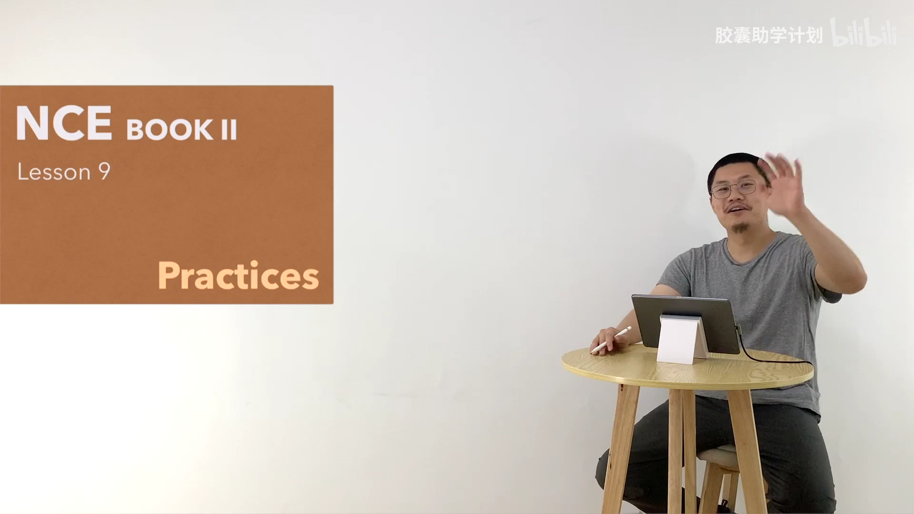

文字识别：胶囊助学计划 / NCE / BOOKI"I / Lesson 9 / Practices

### 画面 00:00:02

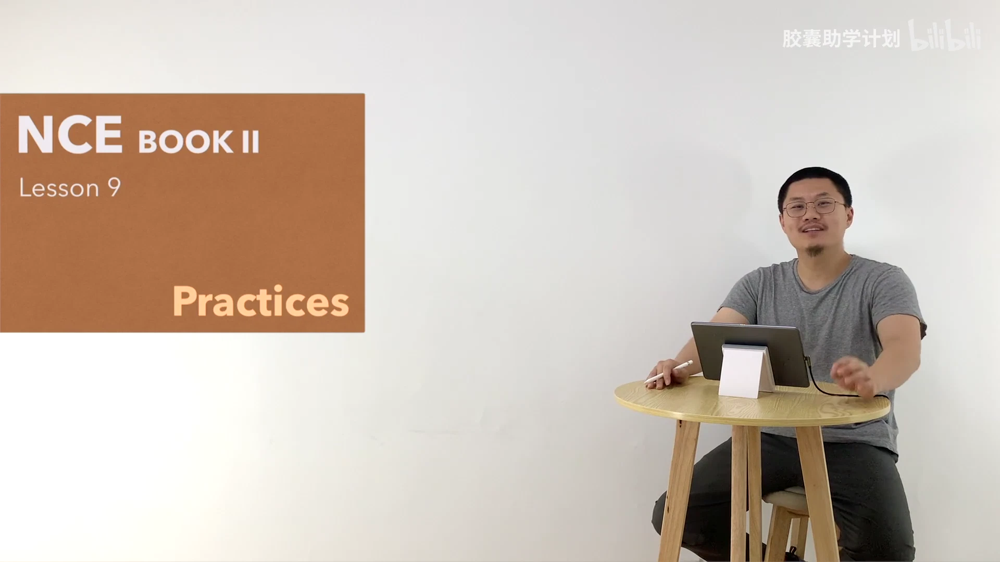

文字识别：胶囊助学计划 / NCE / BOOKI"I / Lesson 9 / Practices

### 画面 00:00:07

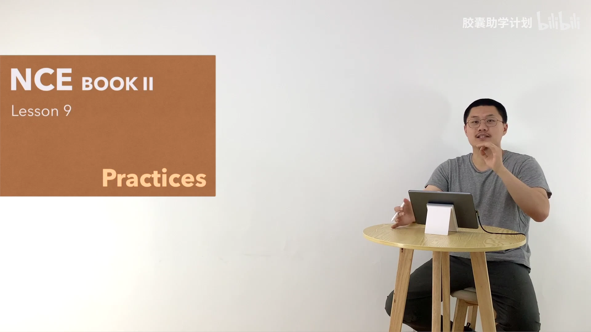

文字识别：胶囊助学计划 / NCE / BOOKII / Lesson 9 / Practices

### 画面 00:00:09

文字识别：胶囊助学计划 / 进行如下练习唯一前提 / 文章跟读至熟读成诵 / 否则请勿开始 / 福

### 画面 00:00:19

文字识别：胶囊助学计划bil出 / •

### 画面 00:00:23

文字识别：胶囊助学计划

### 画面 00:00:25

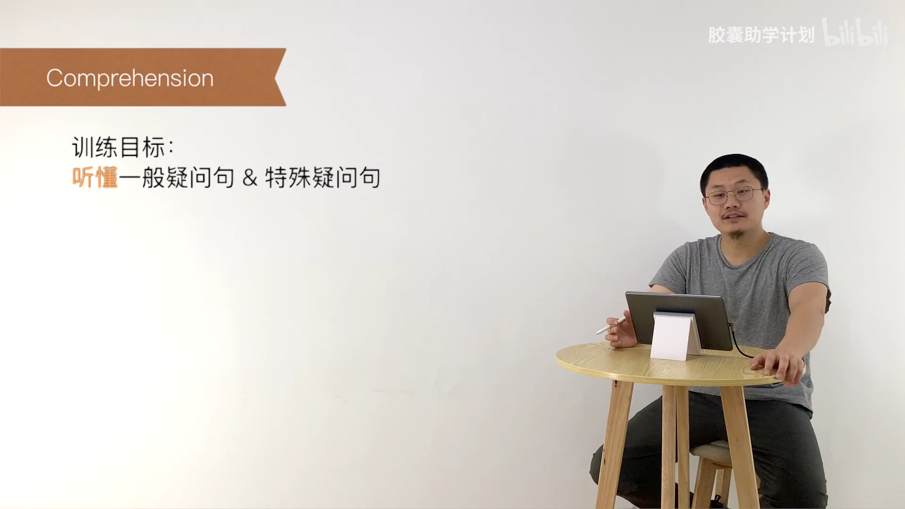

文字识别：胶囊助学计划 / Comprehension / 训练目标： / 听懂一般疑问句＆特殊疑问句 / 7

### 画面 00:00:28

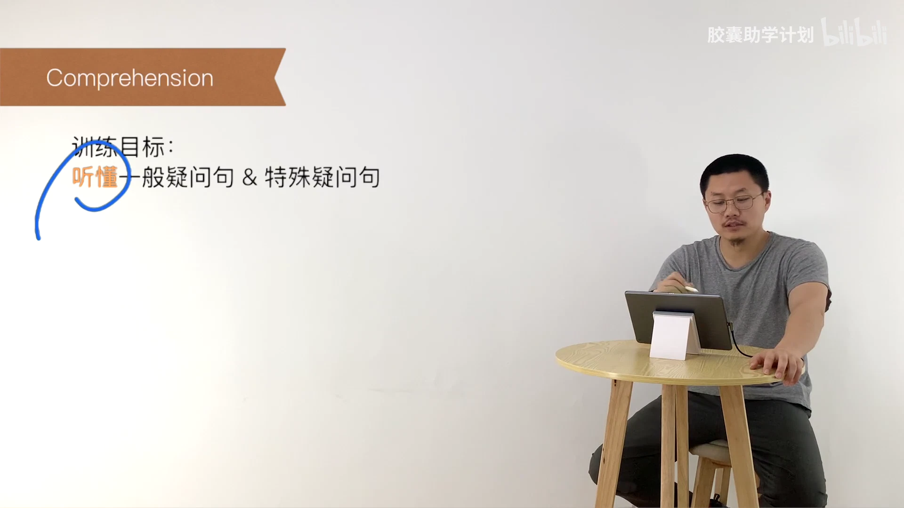

文字识别：胶囊助学计划 / Comprehension / 训练目标： / 听懂 / 般疑问句＆特殊疑问句

## 00:00:30–00:01:00

或特殊疑问句。接下来各位要做的事情是，眼睛离开我的屏幕，或者眼睛去看着书本。来了，我问您口语答，练习听力和口语。第一题，When did you go to the town hall？答案，On Wednesday evenings. Next one，What was special about Wednesday？答案，It was the last day of the year.那注意一个小单词叫

### 画面 00:00:31

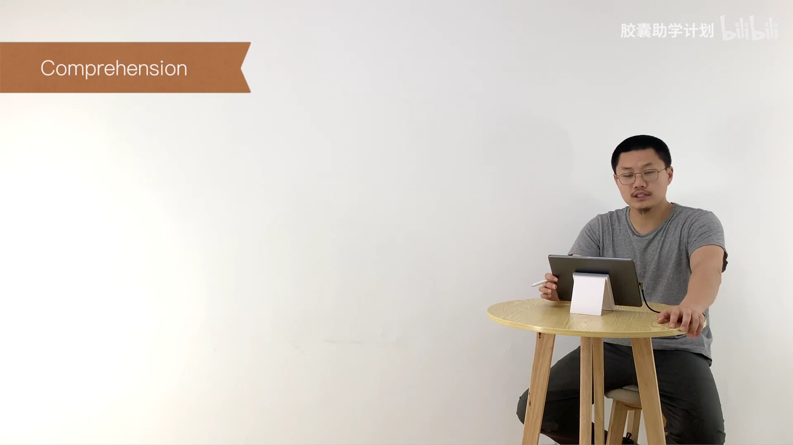

文字识别：胶囊助学计划 / Comprehension

### 画面 00:00:41

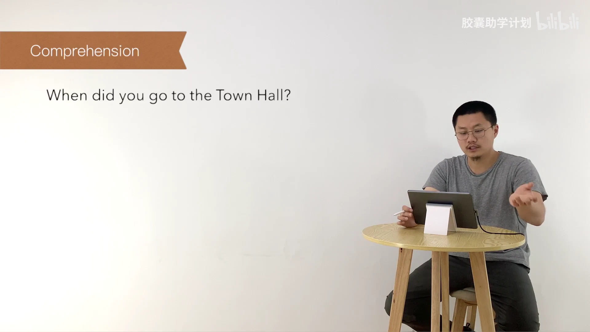

文字识别：胶囊助学计划 / Comprehension / When did you go to the Town Hall?

### 画面 00:00:46

文字识别：胶囊助学计划 / Comprehension / When did you go to the Town Hall? / On Wednesday evening.

### 画面 00:00:50

文字识别：胶囊助学计划 / Comprehension / What was special about Wednesday?

## 00:01:00–00:01:30

叫 special，叫做特殊啊。那一天有什么特殊的？Next one, was there a large crowd? Yes, there was. Continue. Where had everyone gathered? Under the town hall clock. Continue. When would it strike twelve? It什么时候会敲十二下？At midnight,或者说at twelve

### 画面 00:01:00

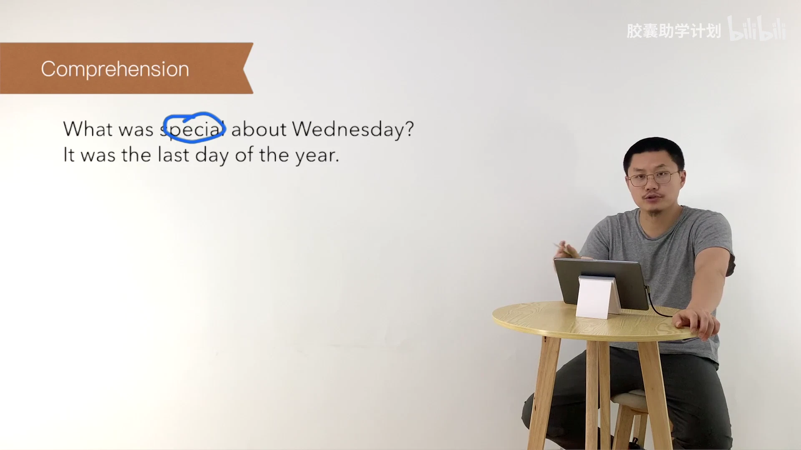

文字识别：胶囊助学计划 / Comprehension / What was / ecia about Wednesday? / It was the last day of the year.

### 画面 00:01:03

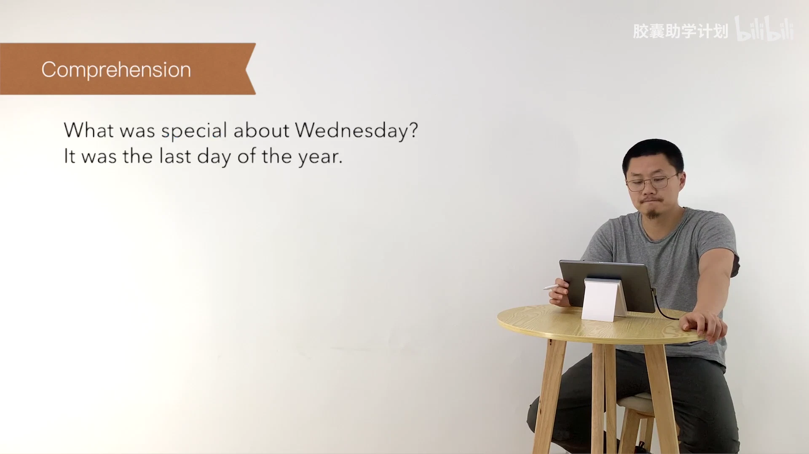

文字识别：胶囊助学计划 / Comprehension / What was special about Wednesday? / It was the last day of the year.

### 画面 00:01:05

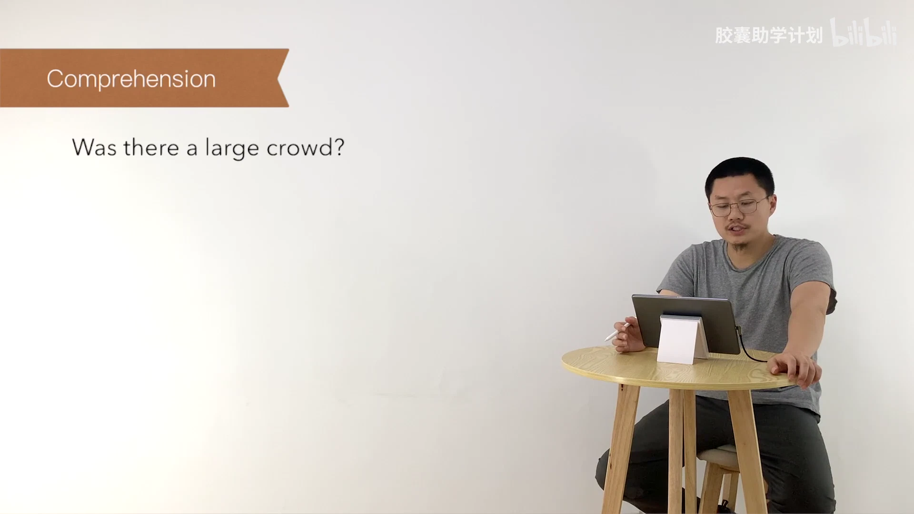

文字识别：胶囊助学计划 / Comprehension / Was there a large crowd?

### 画面 00:01:17

文字识别：胶囊助学计划 / Comprehension / Where had everyone gathered? / Under the Town Hall clock.

## 00:01:30–00:02:00

Next one, at what time did you arrive? Eleven forty. 这是个数学题，各位自己得算。 Next one, when did the stop? When did the clock stop? Five to twelve, 或者 eleven fifty five. Continue. Which hand did not move? 啊，

### 画面 00:01:31

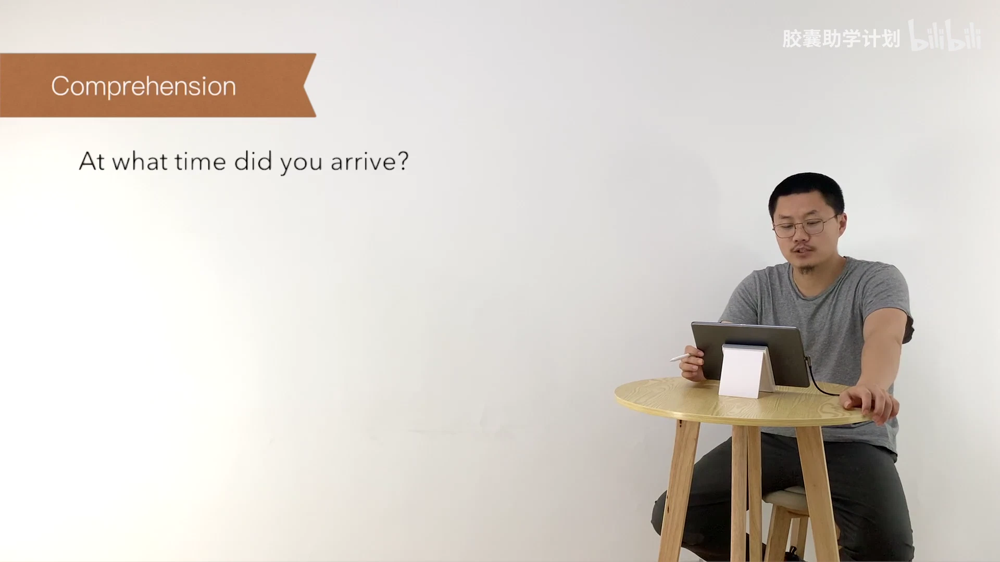

文字识别：胶囊助学计划 / Comprehension / At what time did you arrive?

## 00:02:00–00:02:30

Ah,哪只手不动了？不是啊，哪个指针不动了？Minute hand. Continue. Did you wait for something to happen? Yes, we did. What did someone shout suddenly? It's two minutes past twelve. The clock has stopped. There you go. Continue. What did you do when you heard this? I

### 画面 00:02:00

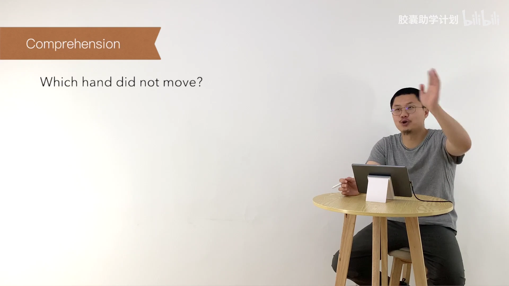

文字识别：胶囊助学计划 / Comprehension / Which hand did not move?

### 画面 00:02:03

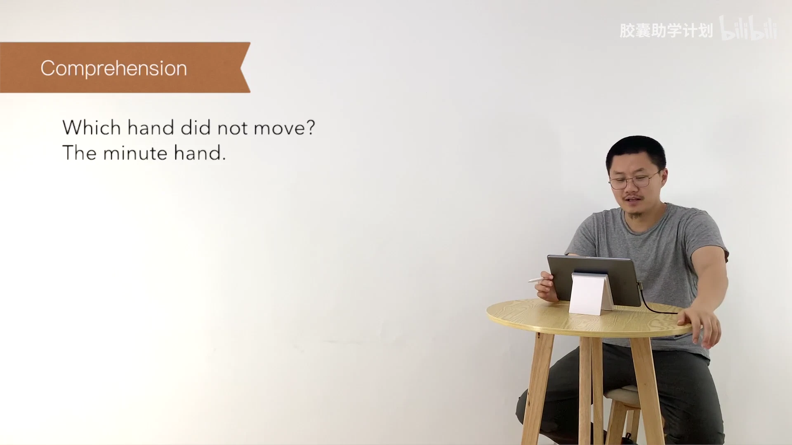

文字识别：胶囊助学计划 / Comprehension / Which hand did not move? / The minute hand.

### 画面 00:02:06

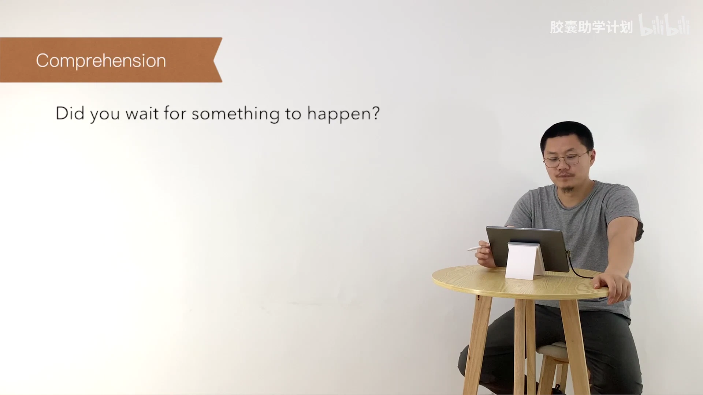

文字识别：胶囊助学计划 / Comprehension / Did you wait for something to happen?

### 画面 00:02:17

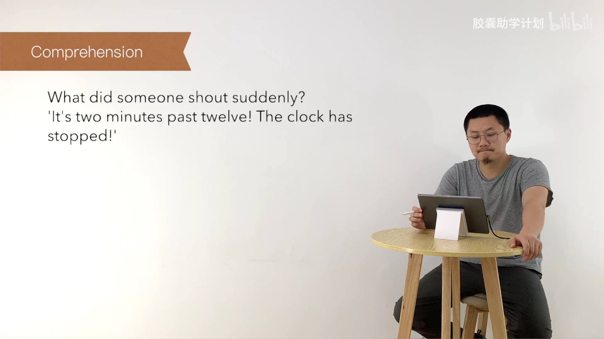

文字识别：胶囊助学计划 / Comprehension / What did someone shout suddenly? / 'It's two minutes past twelve! The clock has / stopped!'

### 画面 00:02:20

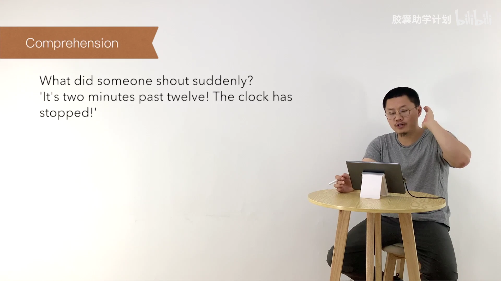

文字识别：胶囊助学计划 / Comprehension / What did someone shout suddenly? / 'It's two minutes past twelve! The clock has / stopped!'

### 画面 00:02:23

文字识别：胶囊助学计划 / Comprehension

### 画面 00:02:26

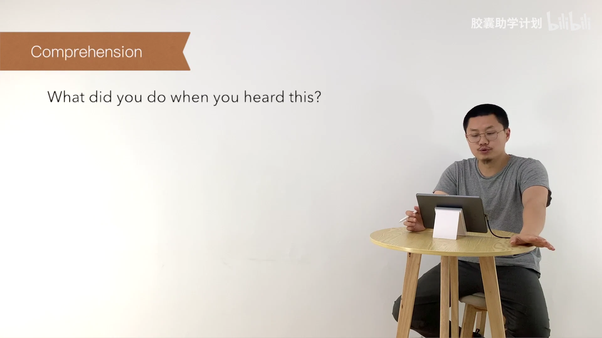

文字识别：胶囊助学计划 / Comprehension / What did you do when you heard this?

## 00:02:30–00:03:00

looked at my watch. Next one, what time did your watch say? 注意这儿的 say 不是说，是显示. Two minutes past twelve. Continue. What time did the big clock say? Five to twelve. 不动了嘛，对吧？ Continue. It was already the New Year, wasn't it? Wasn't it? 新学的，对吧？就等于 right.

### 画面 00:02:32

文字识别：胶囊助学计划 / Comprehension

### 画面 00:02:37

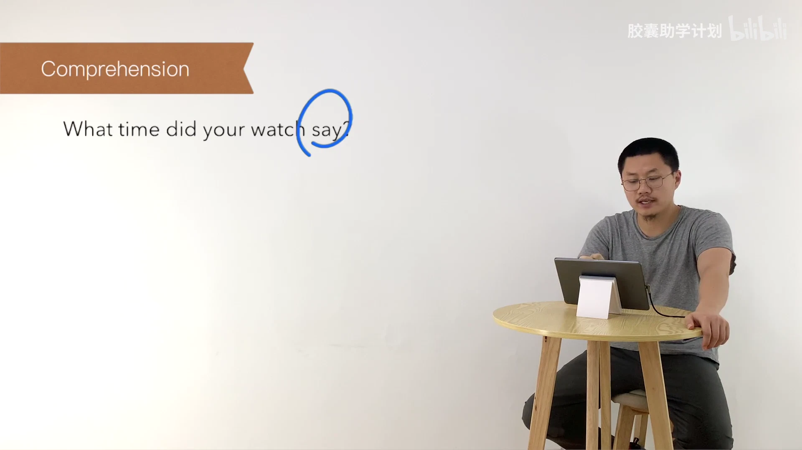

文字识别：胶囊助学计划 / Comprehension / What time did your watc / say

### 画面 00:02:43

文字识别：胶囊助学计划 / Comprehension

### 画面 00:02:57

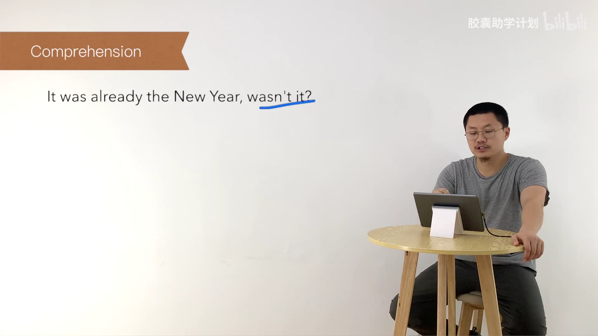

文字识别：胶囊助学计划 / Comprehension / It was already the New Year, wasn't it? / 2

### 画面 00:02:59

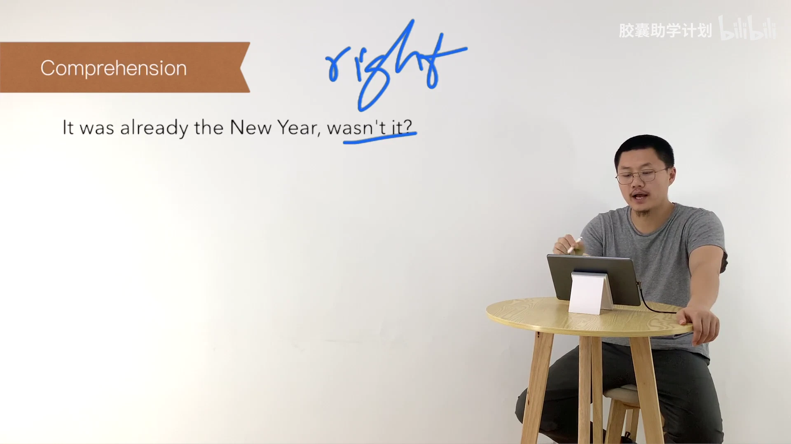

文字识别：胶囊助学计划 / Comprehension / It was already the New Year, wasn't it?

## 00:03:00–00:03:30

Yes, it was. Continue. What did the big clock refuse to do? Welcome the new year. Next one. Did everybody begin to laugh? Yes, they did. 好，接下来 asking questions 训练目标会说一般疑问句和特殊疑问句，还是可以慢，不能错，练的是准确

### 画面 00:03:03

文字识别：胶囊助学计划 / Comprehension

### 画面 00:03:19

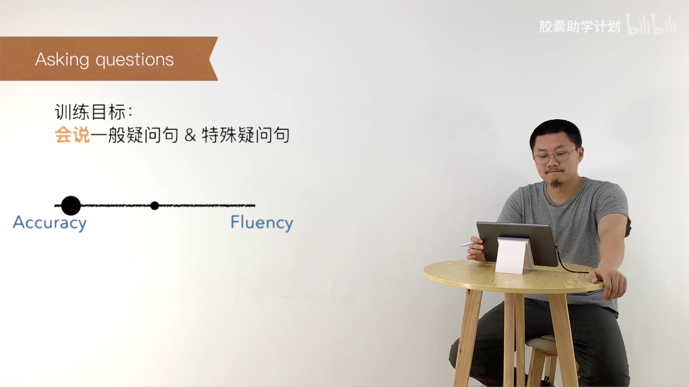

文字识别：胶囊助学计划 / Asking questions / 训练目标： / 会说一般疑问句＆特殊疑问句 / Accuracy / Fluency

### 画面 00:03:24

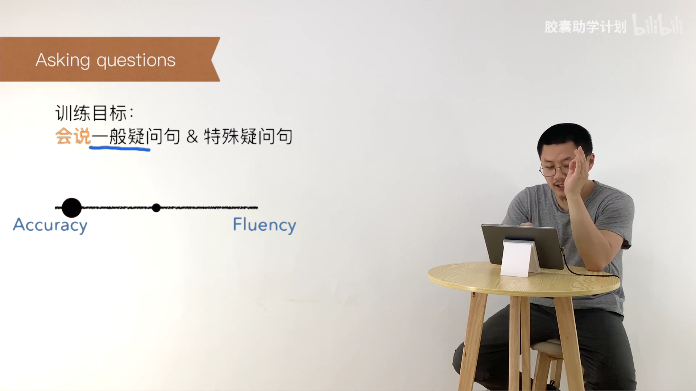

文字识别：胶囊助学计划 / Asking questions / 训练目标： / 会说一般疑问句＆特殊疑问句 / Accuracy / Fluency

### 画面 00:03:26

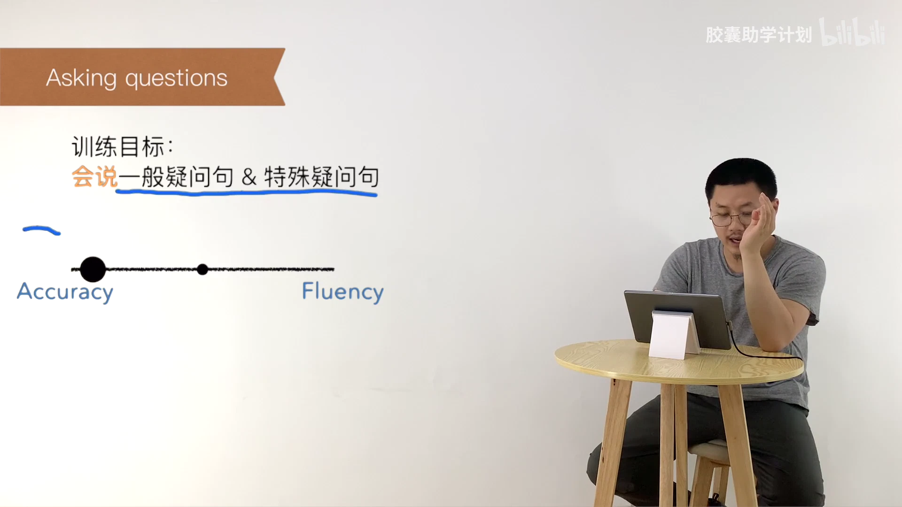

文字识别：胶囊助学计划 / Asking questions / 训练目标： / 会说一般疑问句＆特殊疑问句 / Accuracy / Fluency

### 画面 00:03:28

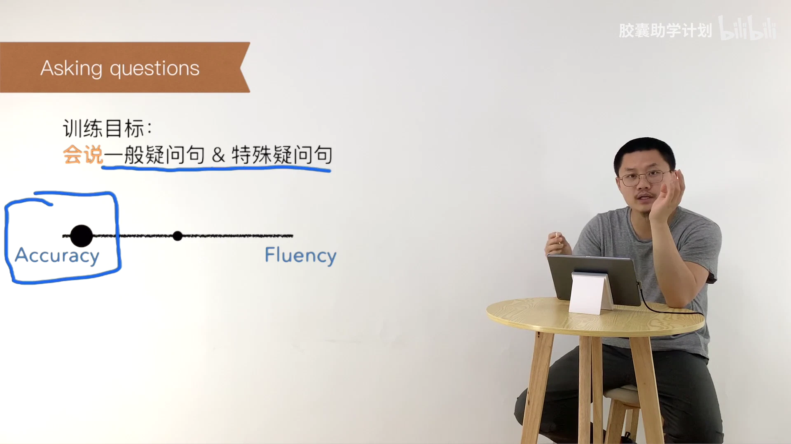

文字识别：胶囊助学计划 / Asking questions / 训练目标： / 会说一般疑问句＆特殊疑问句 / Accuracy / Fluency

## 00:03:30–00:04:00

性口语的。好，我们先看第一题，来一个例子啊。We went to the town hall on Wednesday evening。一般过去时，第三课学过了，did提前，动词换回原形就可以了。然后呢，where那肯定是对the town hall，对吧？To the town hall，所以where did you go on Wednesday evening？啊，周三晚上你们去了，你去了哪儿？那我们开始看了啊，还是我

### 画面 00:03:31

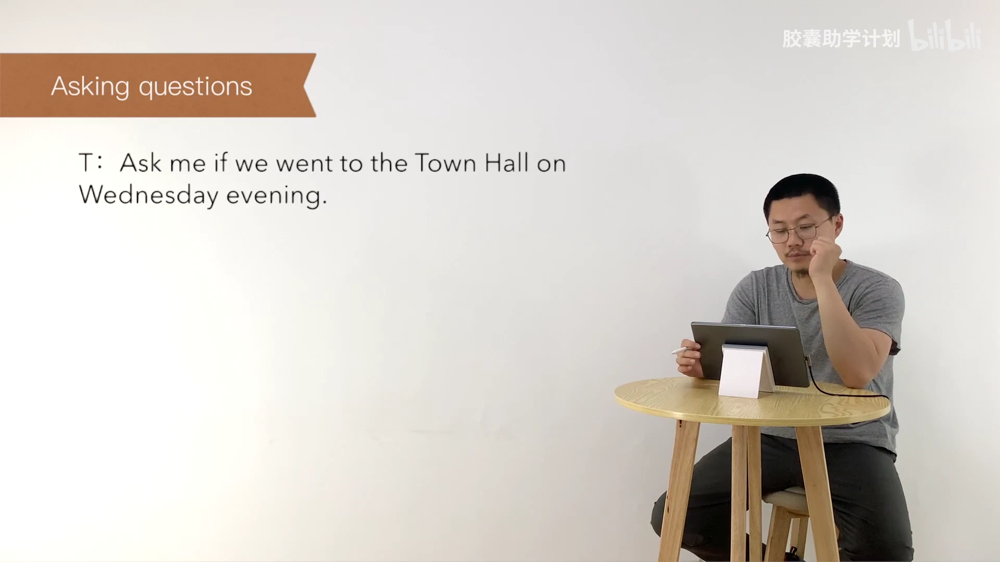

文字识别：胶囊助学计划 / Asking questions / T: Ask me if we went to the Town Hall on / Wednesday evening.

### 画面 00:03:35

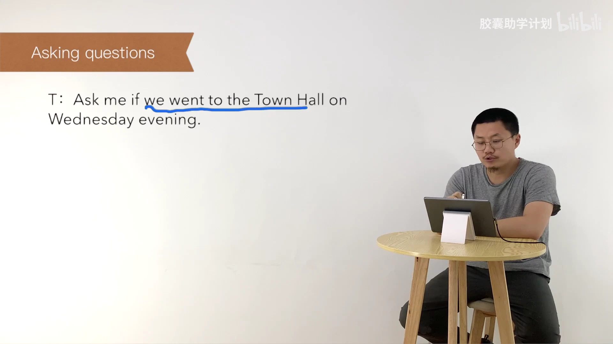

文字识别：胶囊助学计划 / Asking questions / T: Ask me if we went to the Town Hall on / Wednesday evening.

### 画面 00:03:37

文字识别：胶囊助学计划 / Asking questions / T: Ask me if we went to the Town Hall on / Wednesday evening.

### 画面 00:03:47

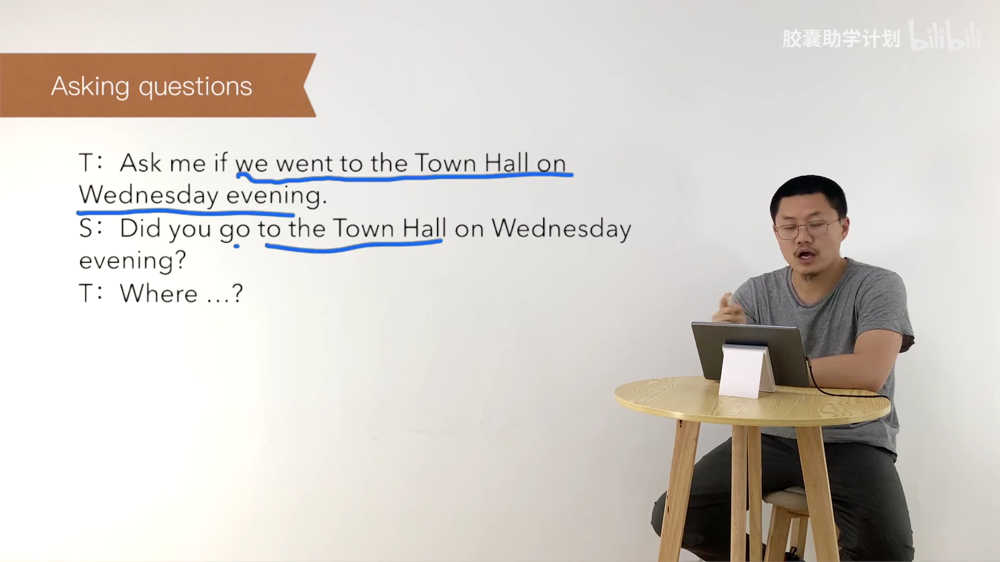

文字识别：胶囊助学计划 / Asking / questions / T: Ask me if we went to the Town Hall on / Wednesday / evening. / S: Did / e Town Hall on Wednesday / you / go to the / evening? / T: Where ...?

### 画面 00:03:57

文字识别：胶囊助学计划 / Asking questions / We went to the Town Hall on Wednesday / evening.(Where) (When) (Who)

## 00:04:00–00:04:30

们只讲思路，各位课下自己去写，我只把关键点说出来。刚才一般疑问句我们变完了，那when肯定是对啊，Wednesday evening提问，who对主语提问，怎么样来着？我已经讲了非常多变数了，各位自己去想。It was the last day of the year，was肯定是要提前的，which嘿这个就很有意思了，这个地方啊哪一个？你想一下这里边谁能回答哪一个？其实就是the last day能

### 画面 00:04:07

文字识别：胶囊助学计划 / Asking / questions / We went to the Town Hall on Wednesday / evening.(Where) (When) (Who)

### 画面 00:04:09

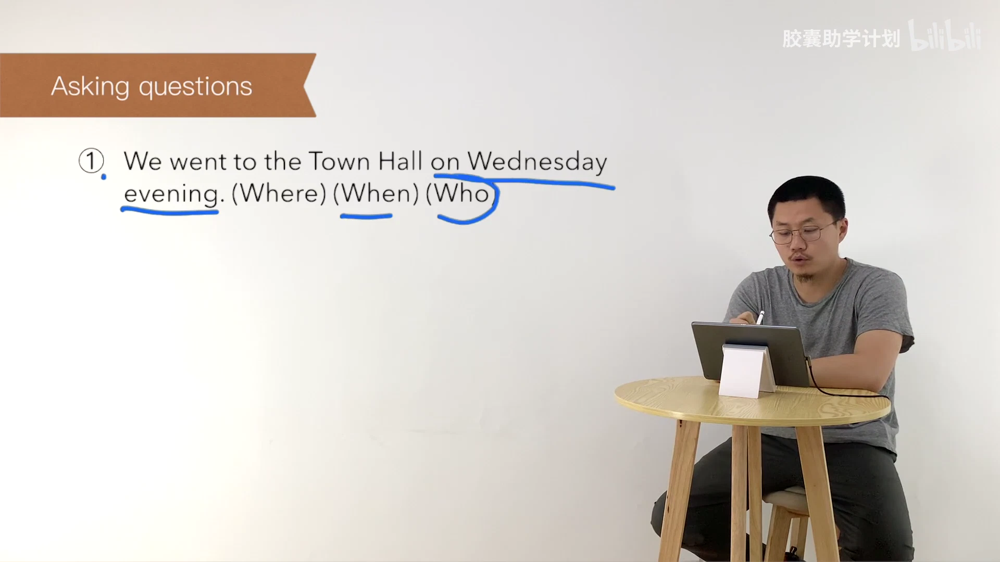

文字识别：胶囊助学计划 / Asking / questions / We went to the Town Hall on Wednesday / evening. (Where) (When)(Who)

### 画面 00:04:11

文字识别：胶囊助学计划 / Asking / questions / Wewent to / the / Town Hal on Wednesday / evening. / (Where)(When)(Who)

### 画面 00:04:13

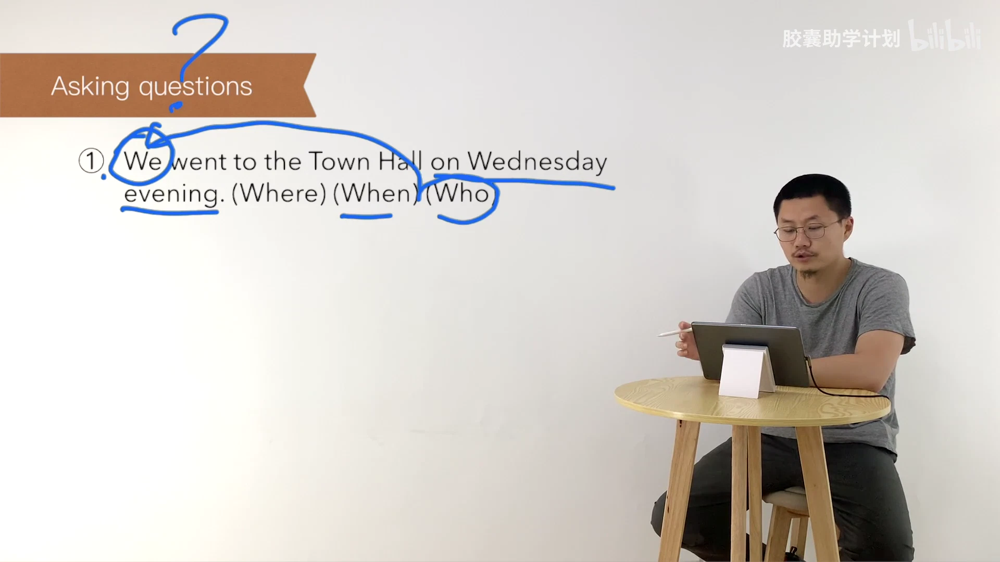

文字识别：胶囊助学计划 / Asking / questions / Wewent to / the / Town Hal on Wednesday / evening. / (Where) (When)(Who)

### 画面 00:04:18

文字识别：胶囊助学计划 / Asking / questions / Wewent to / the / Town / Hall on Wednesday / evening. / (Where)(When)(Who) / It was / the last day / of the year. (Which)

### 画面 00:04:29

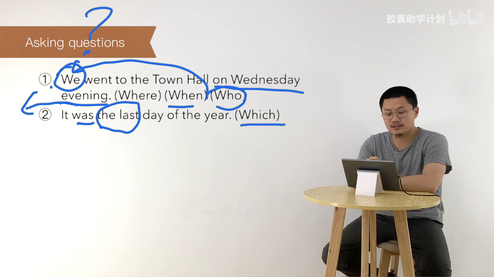

文字识别：胶囊助学计划 / Asking / questions / Wewent to / the / Town / Hall on Wednesday / evening. / (Where)(When)(Who) / It was / che last / day / of the / year.(Which)

## 00:04:30–00:05:00

提供，所以你可以把这句话变成叫 Which day of the year was it? 那一天是一年当中的哪一天？答案我给各位了啊。A large crowd had gathered under the clock. 好，这个地方如果各位基础还不错，可能知道；如果基础不好呢，我直接告诉各位答案。过去完成时是 had 提前，where 是对 under the clock 提问，what 对 a large crowd 一大群人，对吧？

### 画面 00:04:40

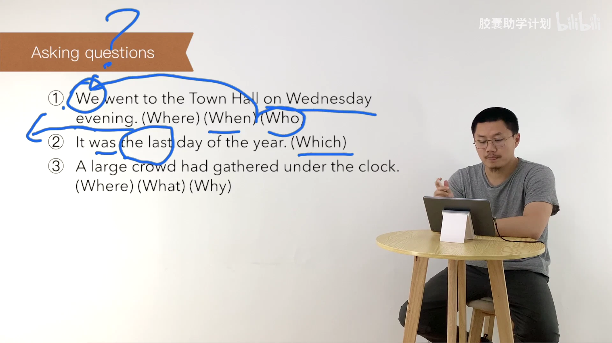

文字识别：胶囊助学计划 / Asking / questions / Wewent to / the / Town / Hal on Wednesday / evening. / (Where) (When)(Who) / It was / che last / tday / of the year. (Which) / A large / crowd / had / gathered / under the / clock. / (Where) (What) (Why)

### 画面 00:04:42

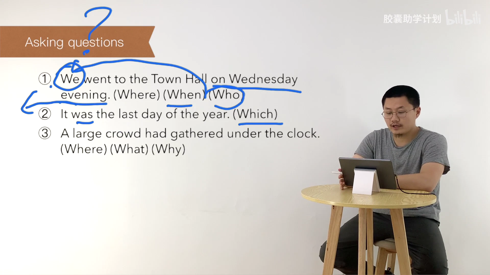

文字识别：胶囊助学计划 / Asking / questions / Wewent to / the / Town Hal on Wednesday / evening. / (Where) (When)(Who) / It was / the last day / of the year.(Which) / A large / crowd had / gathered / under the / e clock. / (Where) (What) (Why)

### 画面 00:04:45

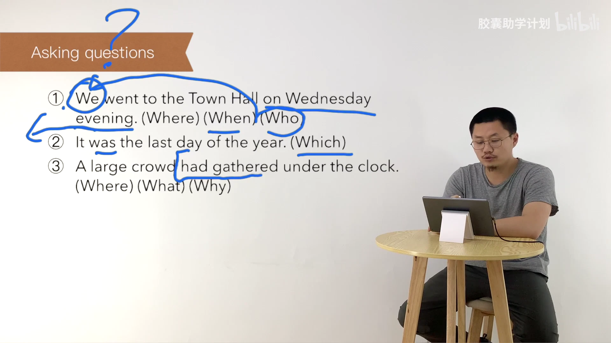

文字识别：胶囊助学计划 / Asking / questions / 1 / Wewent to / the / Town / Hal on Wednesday / evening. / (Where)(When)(Who) / It was / the / last day / of the / year.(Which) / A large / crowdhad / gathered / under the / clock. / (Where) (What) (Why)

### 画面 00:04:47

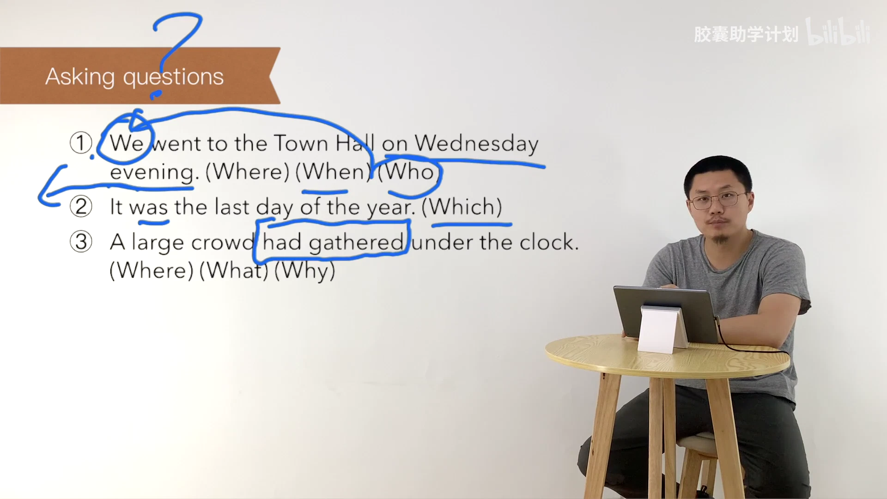

文字识别：胶囊助学计划 / Asking / questions / Wewent to / the / Town / Hall on Wednesday / evening. / (Where) (When)(Who) / It was / the / last / day / of the year. (Which) / A large / crowd / had / gathered / under the / clock. / (Where) (What) (Why)

### 画面 00:04:50

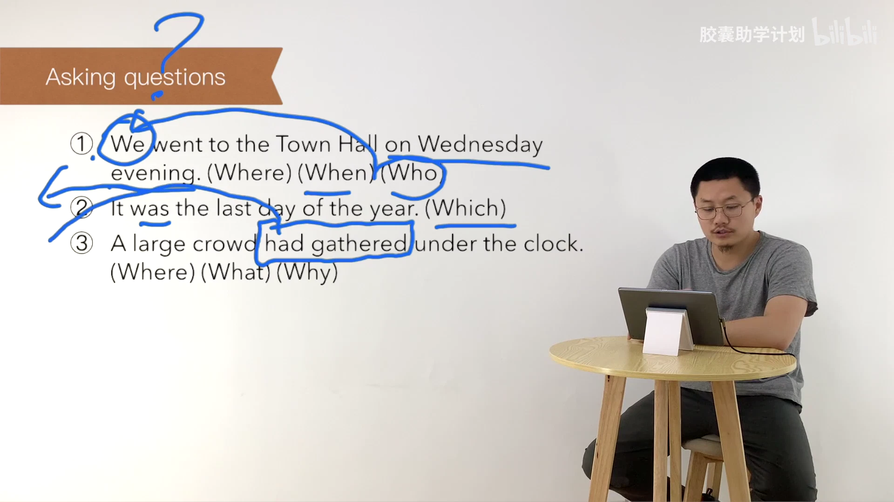

文字识别：胶囊助学计划 / Asking / questions / Wewent to / the / Town / Hal on Wednesday / evening. / (Where)(When)(Who) / was / the / last day / of the year. (Which) / It / A large / crowd / had / gathered / under the / clock. / (Where) / )(What) (Why)

### 画面 00:04:54

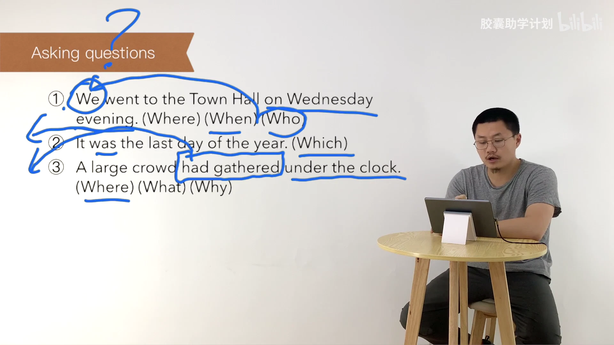

文字识别：胶囊助学计划 / Asking / questions / Wewent to / the / Town / Hall on Wednesday / evening. / (Where)(When)(Who) / was / the / last day / of the / year.(Which) / It / A large / crowd / had / gathered / under the / clock. / (Where) / )(What) (Why)

### 画面 00:04:57

文字识别：胶囊助学计划 / Asking / questions / Wewent to / the / Town / Hal on Wednesday / evening. / (Where) / ) (When)(Who) / It was / the / last day / of the / year. (Which) / A large / crowdhad / gathered / under the / clock. / (Where) / )(What) (Why)

## 00:05:00–00:05:30

Why对整句话提问。接下来，The clock would strike twelve in twenty minutes' time.这肯定是would提前，对吧？我说了，它是will的过去时。Will出现，will提前；would出现，would提前。When对in twenty minutes' time，对吧？What the clock？Why整句话提问？Next one. It stopped at

### 画面 00:05:00

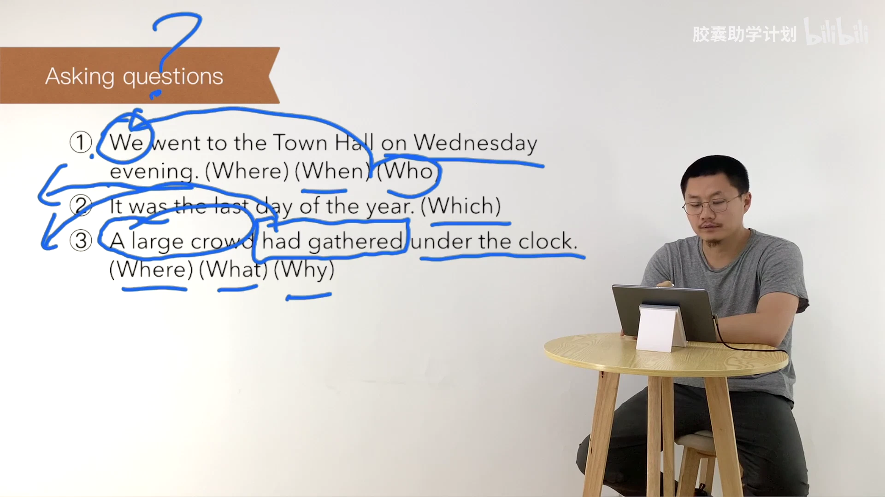

文字识别：胶囊助学计划 / Asking / questions / Wewent to / the / Town / Hal on Wednesday / evening. / (Where) / )(When)(Who) / It was the last day / of the / year. (Which) / Alarge / crowd had / gathered / under the / clock. / (Where) / )(What) (Why)

### 画面 00:05:03

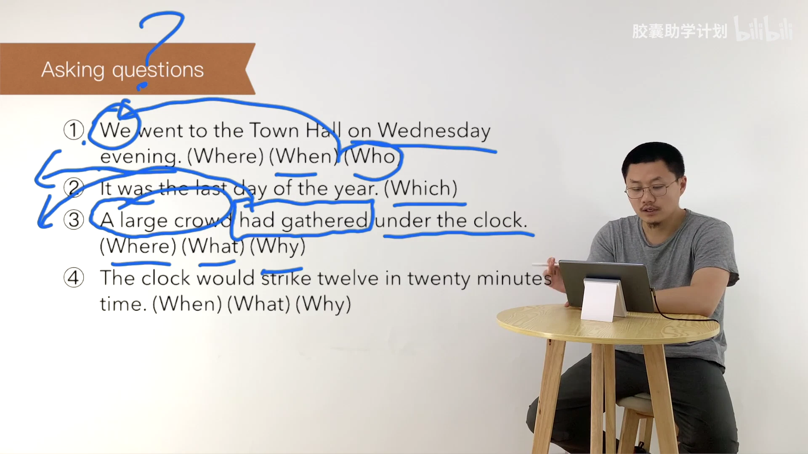

文字识别：胶囊助学计划 / Asking / questions / Wewent to / the / Town / Hall on Wednesday / evening. / (Where) / )(When)(Who) / It was the last day / of the year. (Which) / Alarge / crowdhad / gathered / under the / clock. / (Where) / )(What) (Why) / The / clock / would / strike / twelve in / twenty / minutes / (When) (What) (Why) / time.

### 画面 00:05:06

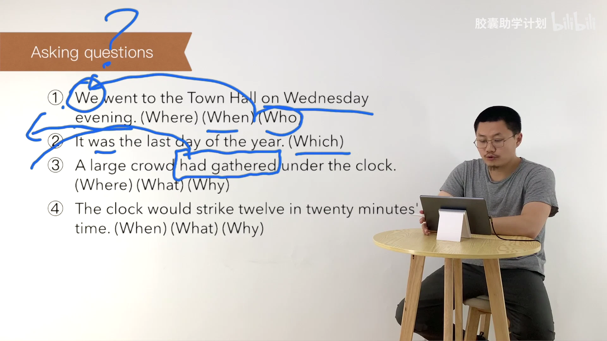

文字识别：胶囊助学计划 / Asking / questions / Wewent to the / Town Hal on Wednesday / evening.(Where) (When)(Who) / It was / the /  last day of the year. (Which) / A large / crowdhad gathered / underthe clock. / (Where) (What) (Why) / The / clock would strike / twelve in twenty r / minutes' / time. (When)(What) (Why)

### 画面 00:05:08

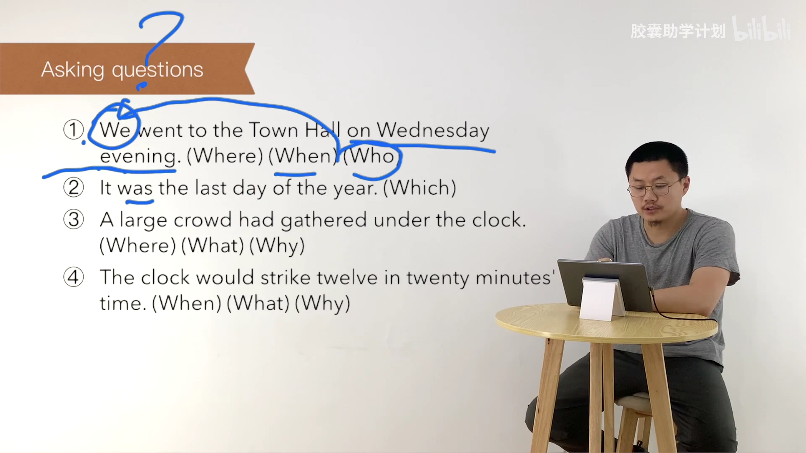

文字识别：胶囊助学计划 / Asking questions / Wewent to the Town Hal on Wednesday / 1 / evening.(Where) (When)(Who) / It was the last day of the year. (Which) / A large crowd had gathered under the clock. / (Where)(What) (Why) / The clock would strike twelve in twenty minutes' / time.(When)(What) (Why)

### 画面 00:05:10

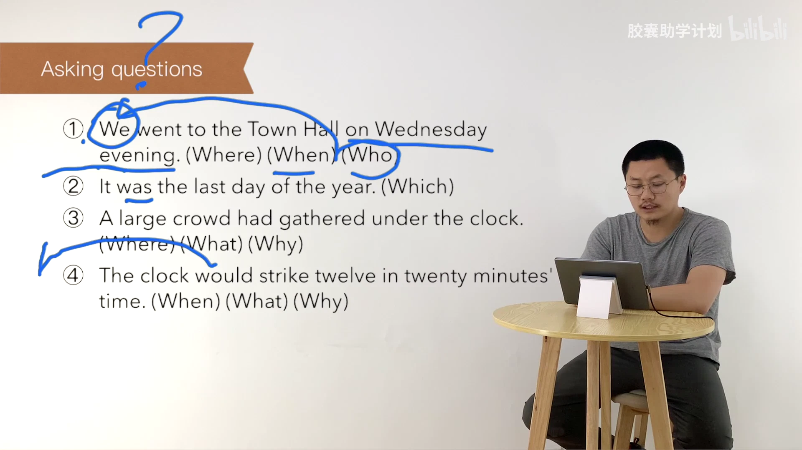

文字识别：胶囊助学计划 / Asking / questions / Wewent to the Town Hal on Wednesday / 1 / evening.(Where)(When)(Who) / It was the last day of the year.(Which) / A large crowd had gathered under the clock. / re) (What) (Why) / The clock would strike twelve in twenty minutes' / time.(When)(What) (Why)

### 画面 00:05:18

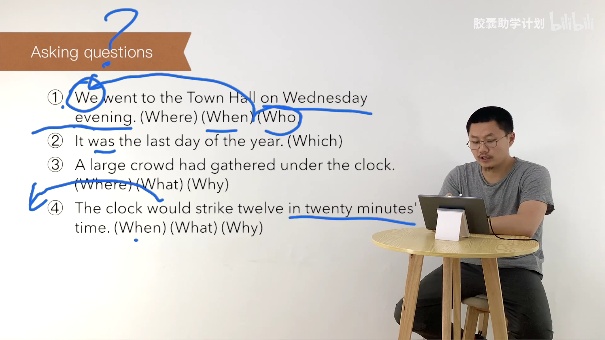

文字识别：胶囊助学计划 / Asking / questions / Wewent to the Town Hal on Wednesday / 1 / evening.(Where) (When)(Who) / It was the last day of the year.(Which) / A large crowd had gathered under the clock. / re)(What) (Why) / The clock would strike twelve in twenty minutes' / time.(When)(What) (Why) / •

### 画面 00:05:22

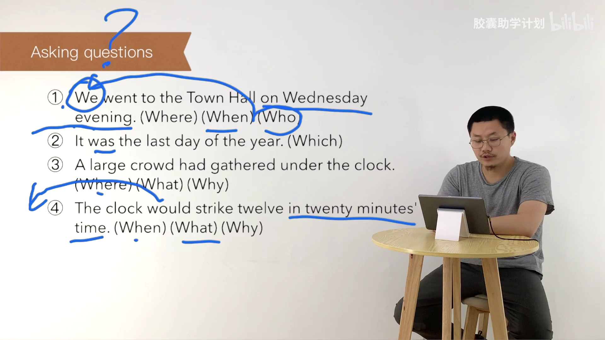

文字识别：胶囊助学计划 / Asking / questions / Wewent to the Town Hal on Wednesday / 1 / evening.(Where) (When)(Who) / It was the last day of the year. (Which) / A large crowd had  / gathered under the clock. / ere)(What) (Why) / The / clock would strike twelve in twenty minutes' / time.(When)(What) (Why)

### 画面 00:05:24

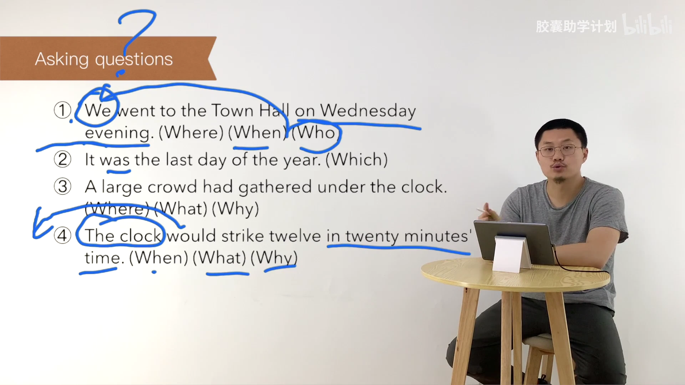

文字识别：胶囊助学计划 / Asking / questions / Wewent to the Town Ha on Wednesday / 1 / evening. (Where) (When)(Who) / It was the last day of the year. (Which) / A large crowd had  / gathered under the clock. / )(What) (Why) / re / The clock would strike twelve in twenty minutes' / time.(When) (What) (Why)

## 00:05:30–00:06:00

five to twelve.一般过去时 did 提前，动词换回原形，一定要写下来。您张嘴说很容易把它说错，写下来。When 对 at five to twelve 提问，对吧？When did it stop？非常好。We waited for seven minutes. did 提前。How long 对 for seven minutes 提问，对吧？变成了 How long did you wait？你们等了多久啊？Someone

### 画面 00:05:40

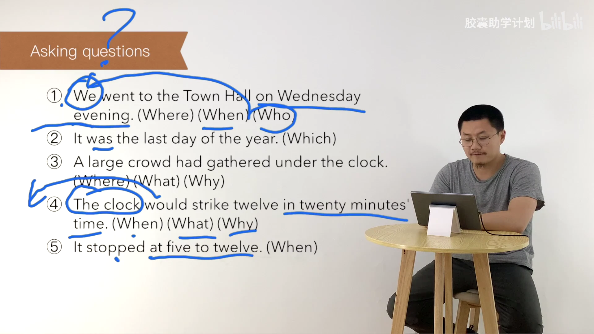

文字识别：胶囊助学计划 / Asking / questions / Wewent to the Town Hal on Wednesday / evening. (Where)(When)(Who) / It was the last day of the year. (Which) / A large crowd had gathered under the clock. / )(What) (Why) / ere) / The clock would strike twelve in twenty minutes' / time.(When)(What) (Why) / It stopped at five to twelve. (When)

### 画面 00:05:48

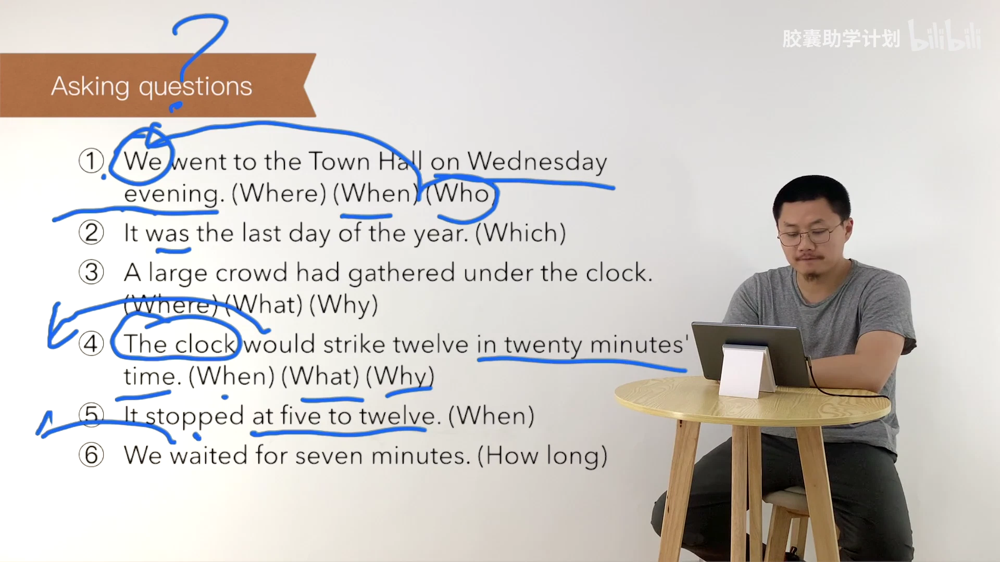

文字识别：胶囊助学计划 / Asking questions / Wewent to the Town Hal on Wednesday / 1 / evening. (Where)(When)(Who) / It was the last day of the year. (Which) / A large crowd had gathered under the clock. / )(What) (Why) / re / The clock would strike twelve in twenty minutes' / time.(When)(What) (Why) / A⑤ It stopped at five to twelve. (When) / We waited for seven minutes.(How long) / 6

### 画面 00:05:52

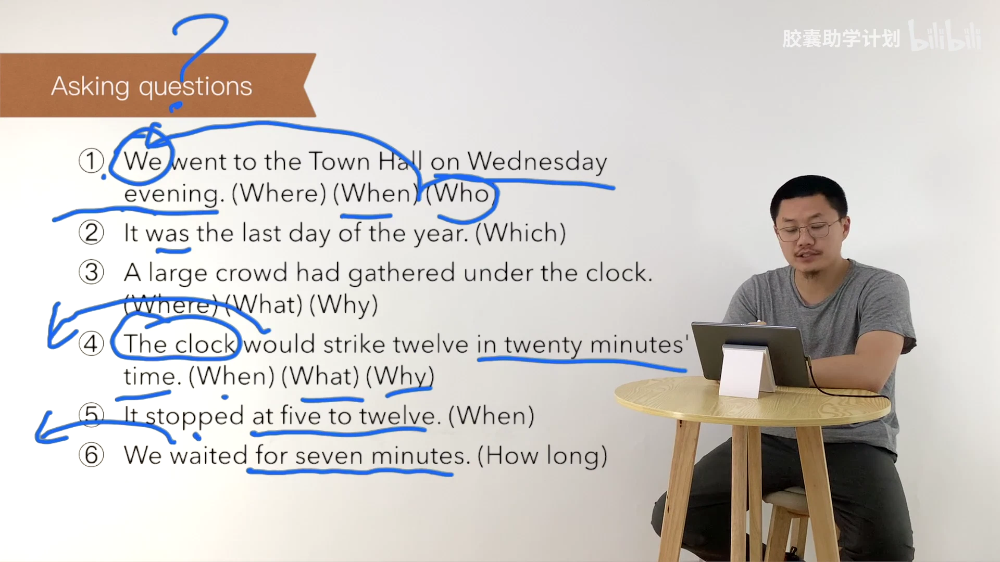

文字识别：胶囊助学计划 / Asking / questions / Wewent to the Town Hall on Wednesday / 1 / evening.(Where)(When)(Who) / It was the last day of the year. (Which) / A large crowd had gathered under the clock. / )(What) (Why) / re) / The clock would strike twelve in twenty minutes' / time.(When)(What) (Why) / ⑤ It stopped at five to twelve. (When) / We waited for seven minutes.(How long) / 6

## 00:06:00–00:06:30

shouted. 某个人突然间大喊道。你看到 shouted did 提前，动词换回原形。What .

### 画面 00:06:06

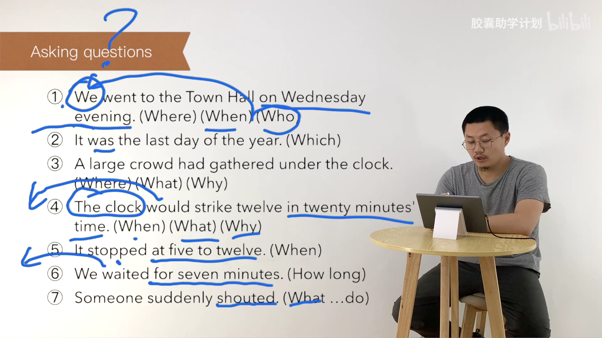

文字识别：胶囊助学计划 / Asking questions / Wewent to the Town Hall on Wednesday / 1 / evening.(Where)(When)(Who) / It was the last day of the year. (Which) / A large crowd had gathered under the clock. / )(What) (Why) / re) / The clock would strike twelve in twenty minutes' / time.(When)(What) (Why) / ⑤ It stopped at five to twelve. (When) / We waited for seven minutes. (How long) / 6 / Someone suddenly shouted. / (What ...do)

### 画面 00:06:09

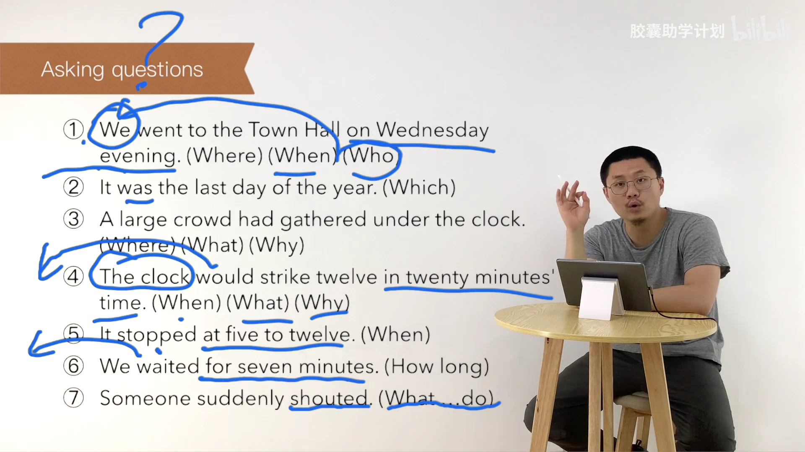

文字识别：胶囊助学计划 / Asking questions / Wewent to the Town Hal on Wednesday / 1 / evening. (Where)(When)(Who) / It was the last day of the year.(Which) / A large crowd had gathered under the clock. / )(What) (Why) / ere) / The clock would strike twelve in twenty minutes' / time.(When)(What) (Why) / ⑤ It stopped at five to twelve. (When) / We waited for seven minutes. (How long) / 6 / Someone suddenly shouted. / (What..do)

### 画面 00:06:24

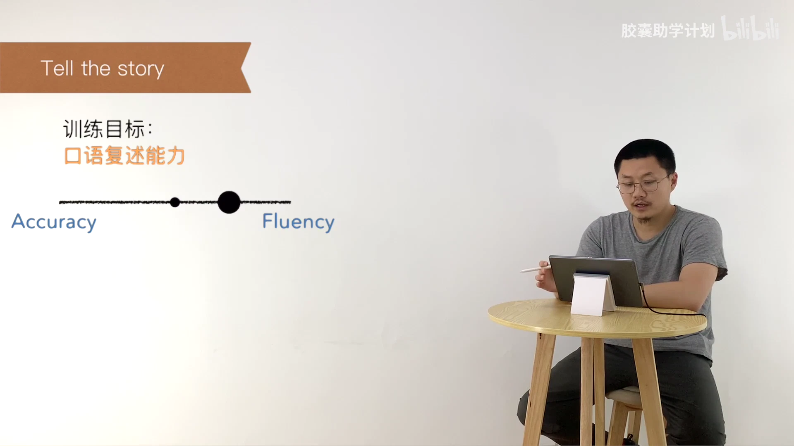

文字识别：胶囊助学计划 / Tell the story / 训练目标： / □语复述能力 / Accuracy / Fluency

## 00:06:30–00:07:00

他练习更多的是我们口语的 fluency，啊准流利性，而可以忽略一点点准确性。上课我给大家做一个示范，各位下课要熟读成诵之后，看着这些关键词，我们也去做这样的练习。来了。On Wednesday evening, I went to the town hall. It was the last day of the year, and a large crowd of people gathered under the town hall clock.

### 画面 00:06:31

文字识别：胶囊助学计划 / Tell the story / 训练目标： / 口语复述能力 / Accuracy / Fluency

### 画面 00:06:35

文字识别：胶囊助学计划 / Tell the story / 训练目标： / 口语复述能力 / Accuracy / Fluency

### 画面 00:06:37

文字识别：胶囊助学计划 / Tell the story / 训练目标： / 口语复述能力 / Accuracy / Fluency

### 画面 00:06:39

文字识别：胶囊助学计划 / Tell the story / Wednesday -went -Town Hall / last day -year -crowd -people -gathered-clock / strike twelve -twenty minutes' / Fifteen minutes -five to -stopped / minute hand -move / waited -nothing / Suddenly -shouted'two -twelve -clock-stopped' / looked-watch-true / 8 / ⑨ big clock refused -Year / ⑩ that moment -everyone -laugh -sing

### 画面 00:06:41

文字识别：胶囊助学计划 / Tell the story / Wednesday -went-Town Hall / last day -year -crowd -people -gathered-clock / strike twelve -twenty minutes' / Fifteen minutes -five to -stopped / minute hand -move / waited -nothing / Suddenly -shouted 'two -twelve -clock-stopped' / looked -watch -true / 8 / ⑨ big clock refused -Year / ① that moment -everyone -laugh -sing

### 画面 00:06:48

文字识别：胶囊助学计划 / Tell the story / Wednesday -went -Town Hall / 1 / last day -year -crowd -people -gathered-clock / strike twelve -twenty minutes' / Fifteen minutes -five to -stopped / minute hand -move / waited -nothing / Suddenly -shouted 'two -twelve -clock-stopped' / looked -watch-true / 8 / ⑨ big clock refused -Year / ① that moment -everyone -laugh -sing

### 画面 00:06:51

文字识别：胶囊助学计划 / Tell the story / Wednesday -Went -Town Hall / last day -year -crowd -people -gathered-clock / strike twelve -twenty minutes' / Fifteen minutes -five to -stopped / minute hand -move / waited -nothing / Suddenly -shouted'two -twelve -clock-stopped' / looked -watch-true / 8 / ⑨ big clock refused -Year / ⑩ that moment -everyone -laugh -sing

## 00:07:00–00:07:30

it would strike twelve in twenty minutes. Fifteen minutes passed. At five to twelve, it stopped. The big minute hand did not move. We waited, but nothing happened. Suddenly, someone shouted, "It's two minutes past twelve. The clock has stopped." I looked at my watch. It was true. The big clock refused to welcome the new year. At that moment, everybody began to laugh and sing.

### 画面 00:07:21

文字识别：胶囊助学计划 / Tell the story / Wednesday -went -Town Hall / last day -year -crowd -people -gathered-clock / strike twelve -twenty minutes' / Fifteen minutes -five to -stopped / minute hand -move / waited -nothing / Suddenly -shouted'two -twelve -clock-stopped' / looked-watch -tro / 8 / 9 / ② big clock refused -Year / ① that moment -everyone -laugh -sing

## 00:07:30–00:08:00

Okay,各位课下也要自己去做这个口语复述练习，写作复述练习是我们文章下面摘要写作每一道题的答案直接放在这儿，大家可以直接对答案就好了。Okay,好，我们上课只提供答案，这儿就不需要进行讲解了。那topic for discussion是我们每节课照题的，这是各位做之前所有练习唯一的目的，将来就是能完全自由的进行听说练习。好，我们看题，第

### 画面 00:07:33

文字识别：胶囊助学计划 / Summary writing: Key / 训练目标： / 写作复述能力

### 画面 00:07:39

文字识别：胶囊助学计划 / Summary writing: Key / We went to the Town Hall on New Year's Eve. / There were a lot of people there. The Town / Hall clock would strike twelve in twenty / minutes' time. It stopped at five to twelve. It / refused to welcome the New Year. Then the / crowd began to laugh and sing.

### 画面 00:07:48

文字识别：胶囊助学计划 / Topics for discussion / 训练目标： / 完全自由的对话

### 画面 00:07:58

文字识别：胶囊助学计划 / Topics for discussion / What did you do to celebrate the last New Year? / What other important days are there in the year? / How do you celebrate them? / Have you, or a friend, ever been late because your / watch had stopped? Tell us about it.

## 00:08:00–00:08:30

一个，What did you do to celebrate the last New Year? 去年新年的时候，你做了什么去庆祝这个新年呢？迎接这个新年呢？OK。第二题，What other important days are there in the year? 说一年当中还有什么其他重要的日子吗？啊，这对于我们现在中国人来说，可能是六幺八或双十一了，是吧？啊，还有什么重要的日子吗？How do you celebrate? 你是如何庆祝他们呢？对吧？

### 画面 00:08:28

文字识别：胶囊助学计划 / Topics for discussion / What did you do to celebrate the last New Year? / What other important days are there in the year? / How do you celebrate them? / Have you, or a friend, ever been late because your / watch had stopped? Tell us about it.

## 00:08:30–00:09:00

买对吧？就是这个状态啊。How do you celebrate them? 你是如何庆祝他们的？Have you or a friend ever been late because of your watch has stopped? Tell us about it. 你或者你的朋友以前因为手表停了而迟到过吗？给我们讲一讲这个故事吧。你看，就是让你说一个故事。OK，完全自由的，你可以理解为是口语练习。那你要把它写下来，就变成了写

### 画面 00:08:58

文字识别：胶囊助学计划 / Topics for discussion / What did you do to celebrate the last New Year? / What other important days are there in the year? / How do you celebrate them? / Have you, or a friend, ever been late because your / watch had stopped? Tell us about it.

## 00:09:00–00:09:30

作练习，对吧？完全自由啊。OK，还有一个，那我们看一下本课的家庭作业。Ask me if这个练习，各位一定要先写下来，然后再去朗读。写是为了保证准确性。接下来摘要写作，各位还是要自己去写，然后来对一下答案。Tell the story文章，各位熟读成诵了之后，去进行口语复述。最后专栏，各位可以在专栏部分找到所有

### 画面 00:09:03

文字识别：胶囊助学计划

### 画面 00:09:05

文字识别：胶囊助学计划 / 1.Ask me if写&朗读

### 画面 00:09:08

文字识别：胶囊助学计划 / 1.Ask me if写&朗读

### 画面 00:09:10

文字识别：胶囊助学计划 / 1.A / Askmeif写&朗读

### 画面 00:09:14

文字识别：胶囊助学计划 / 1.Ask me if写&朗读 / 2. / 摘要写作写&答案

### 画面 00:09:19

文字识别：胶囊助学计划 / 1.Ask me if写&朗读 / 摘要写作写&答案 / 3.Tell the story 口语复述

### 画面 00:09:22

文字识别：胶囊助学计划 / 1.Ask me if写&朗读 / 摘要写作写&答案 / 3.Tell the story 口语复述

### 画面 00:09:24

文字识别：胶囊助学计划 / 1.Ask me if写&朗读 / 摘要写作写&答案 / 3.Tell the story 口语复述

### 画面 00:09:26

文字识别：胶囊助学计划 / 1.Ask me if写&朗读 / 摘要写作写&答案 / 3.Tell the story 口语复述 / 专栏 / 4.

### 画面 00:09:29

文字识别：胶囊助学计划 / Askme if写&朗读 / 摘要写作写&答案 / 3.Tell the story 口语复述 / 专栏 / 4.

## 00:09:30–00:09:54

这些练习以及答案。OK，呃，那如果大家喜欢我们的课程呢，欢迎大家关注、订阅、一键三连，分享给那些需要的朋友们。See you next time.

### 画面 00:09:33

文字识别：胶囊助学计划

### 画面 00:09:35

文字识别：胶囊助学计划 / 不

### 画面 00:09:41

文字识别：胶囊助学计划

### 画面 00:09:43

文字识别：CAPSULEACADEMY / 胶囊助学计划 / 『 / 小红书 / Lecturer / Leo / OE

### 画面 00:09:46

文字识别：CAPSULEACADEMY / 胶囊助学计划 / 小红书 / Photographer / □ / Berlin / OE

### 画面 00:09:48

文字识别：CAPSULEACADEMY / 胶囊助学计划 / 小红书 / Editor / Berlin / OE

### 画面 00:09:51

文字识别：CAPSULEACADEMY / 胶囊助学计划 / 小红书

### 画面 00:09:53

文字识别：bilibili / 胶囊助学计划

