# L010 单词

快速机器解析：语音为单模型转写，未进行独立交叉校对或人工复核；画面每秒采样并按变化选帧，短时文字和标记可能遗漏。截图时间约有 1 秒误差。图片有损压缩；遇到疑点请按时间查看 Google Drive 原视频。

## 00:00:00–00:00:30

Hello everyone, welcome to Capsule Academy. This is Leo. Today we're going to learn New Concept English Book Two Lesson Ten Words. 那老习惯进入正式课程之前呢，我们先看两个问题。第一，如何表达震惊了？第二，如何表达被允许去做某件事情？那带着这两个问题，Hope you can enjoy. 好，OK，那我们上来先看第一个小的单词，跟我一起读一下啊。

### 画面 00:00:00

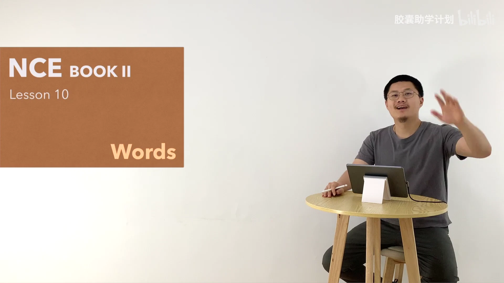

文字识别：胶囊助学计划 / NCE / BOOKI"I / Lesson 10 / Words

### 画面 00:00:02

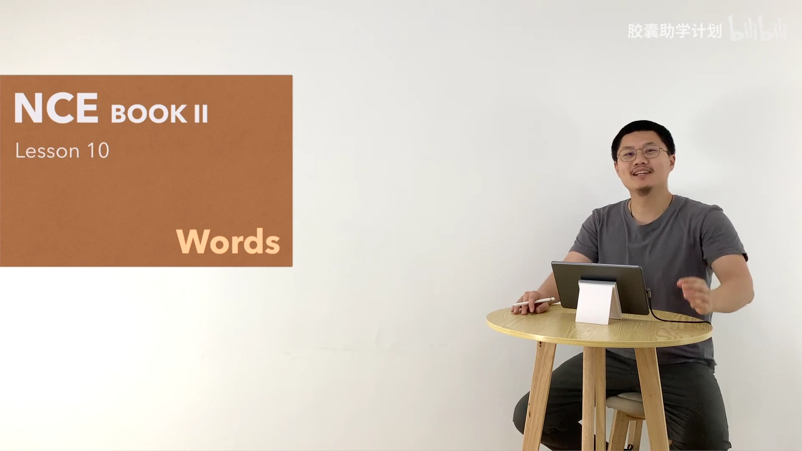

文字识别：胶囊助学计划 / NCE / BOOKI"I / Lesson 10 / Words

### 画面 00:00:05

文字识别：胶囊助学计划 / NCE / BOOKII / Lesson 10 / Words

### 画面 00:00:07

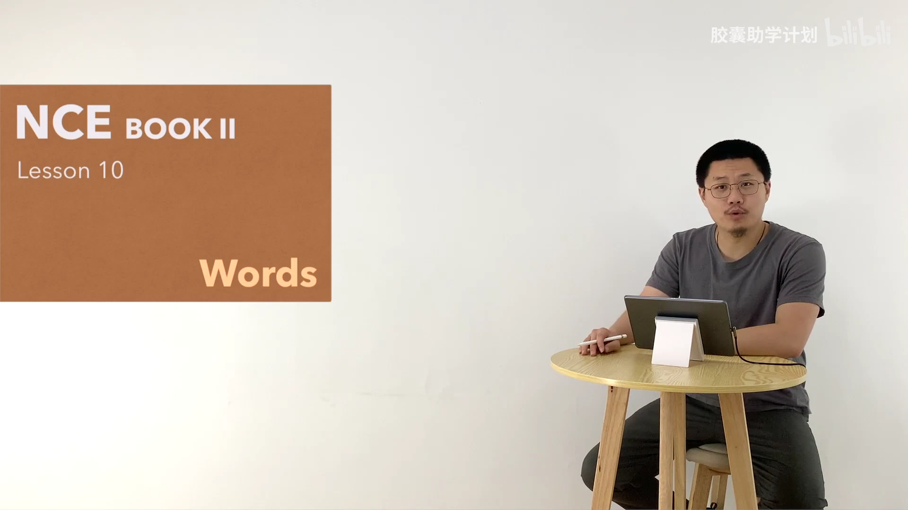

文字识别：胶囊助学计划 / NCE / BOOKII / Lesson 10 / Words

### 画面 00:00:09

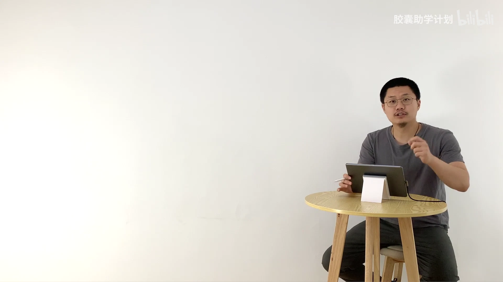

文字识别：胶囊助学计划

### 画面 00:00:11

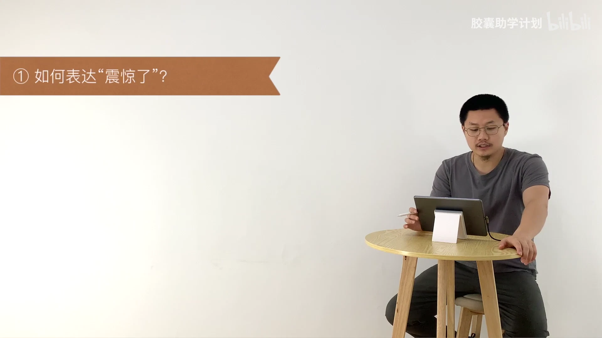

文字识别：胶囊助学计划 / ①如何表达“震惊了”？

### 画面 00:00:14

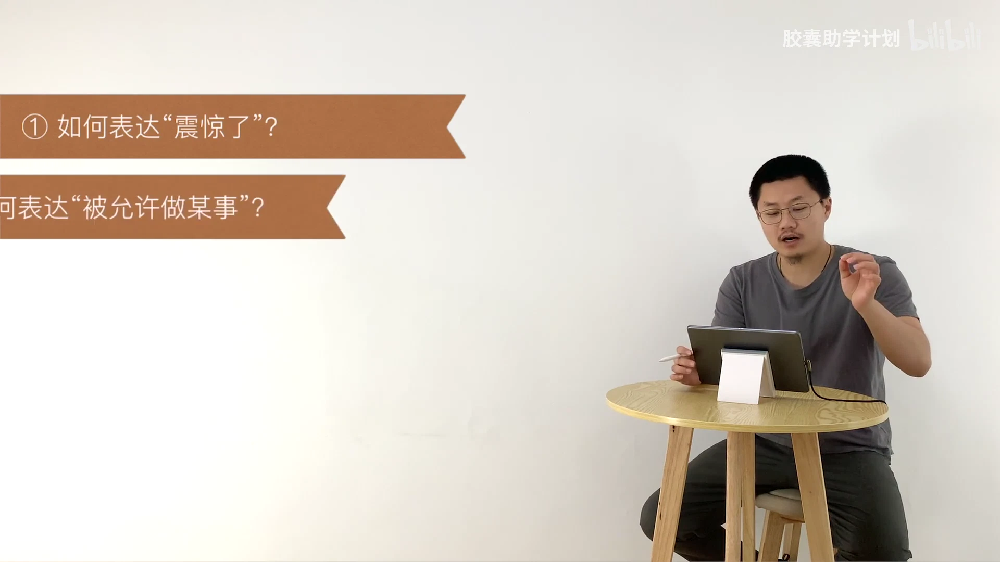

文字识别：胶囊助学计划 / ①如何表达“震惊了”？ / 可表达“被允许做某事”

### 画面 00:00:16

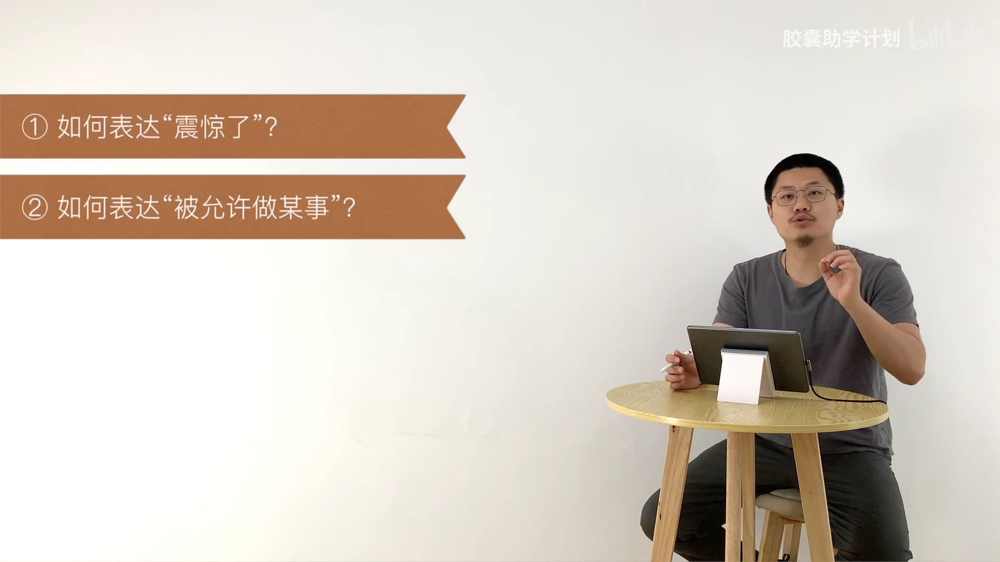

文字识别：胶囊助学计划 / ①如何表达“震惊了”？ / 如何表达“被允许做某事”?

### 画面 00:00:19

文字识别：胶囊助学计划 / ①如何表达“震惊了”？ / 如何表达“被允许做某事”?

### 画面 00:00:21

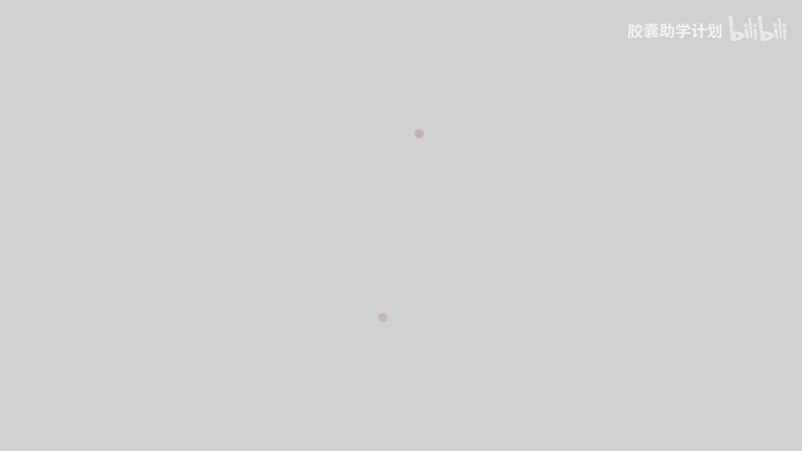

文字识别：胶囊助学计划b出l / •

### 画面 00:00:25

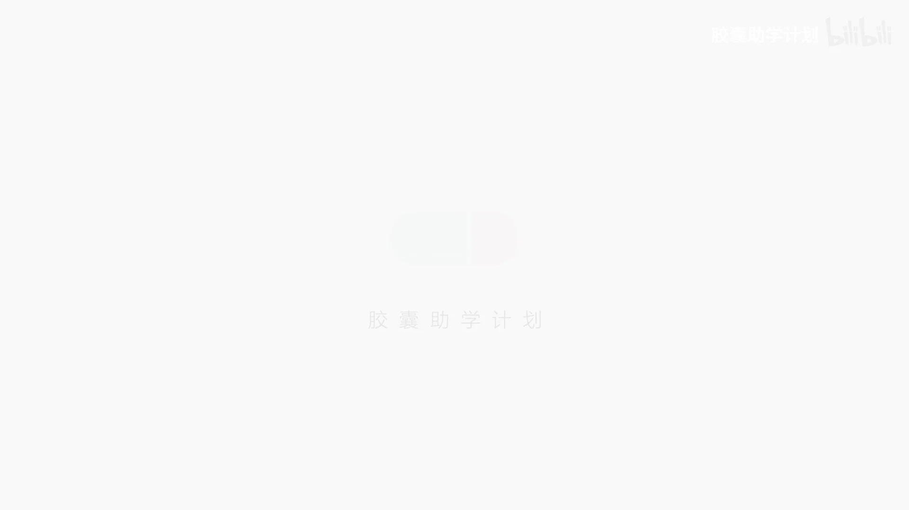

文字识别：胶囊助学计划

### 画面 00:00:27

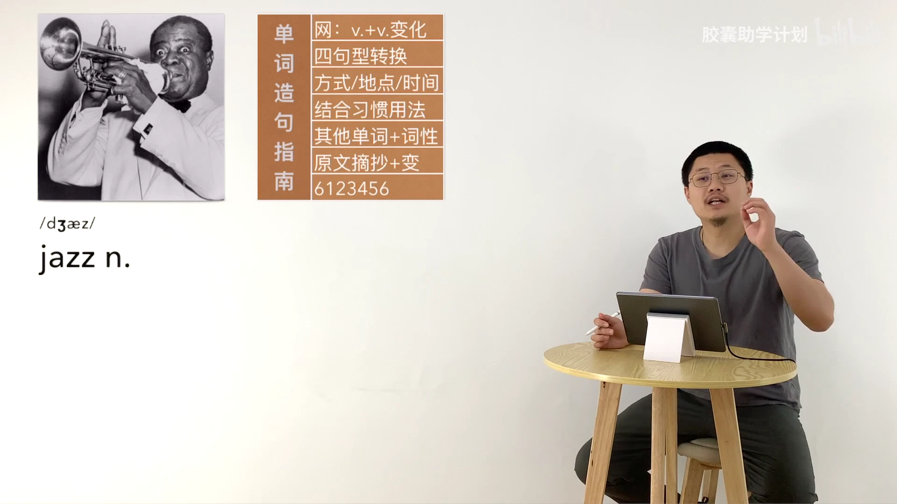

文字识别：单词造句指南 / 网：v.+v.变化 / 胶囊助学计划 / 四句型转换 / 方式/地点/时间 / 结合习惯用法 / 其他单词+词性 / 原文摘抄+变 / 6123456 / /d3xz/ / jazz n.

### 画面 00:00:29

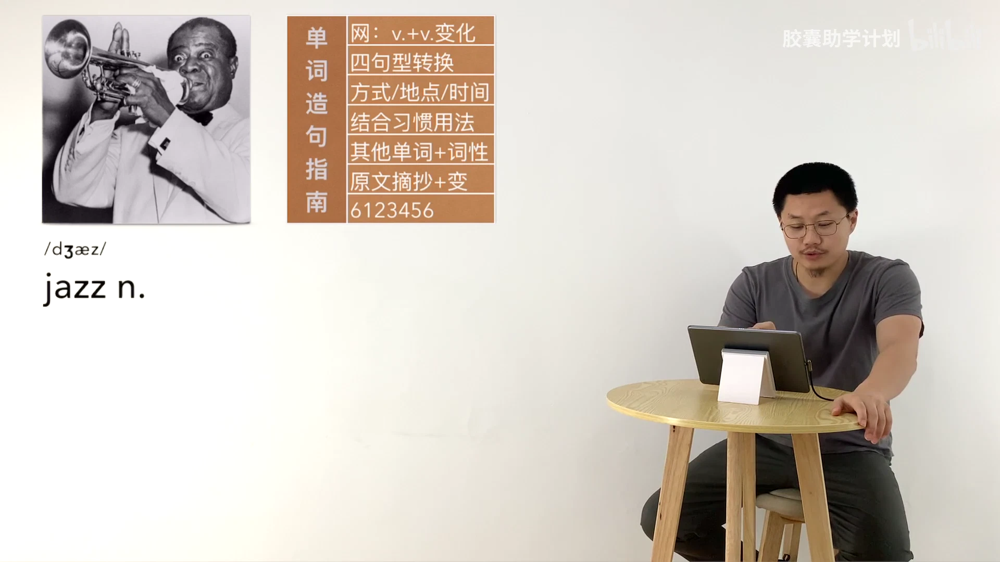

文字识别：单词造句指南 / 网：v.+v.变化 / 胶囊助学计划 / 四句型转换 / 方式/地点/时间 / 结合习惯用法 / 其他单词+词性 / 原文摘抄+变 / 6123456 / /d3xz/ / jazz n.

## 00:00:30–00:01:00

来，jazz，jazz，OK，我们管它叫爵士乐，OK，so who is this？啊，来，明明是爵士乐，为什么配了这样一张图呢？So this is Louis Armstrong. So who is Louis Armstrong？那 Louis Armstrong 这个人又是谁呢？OK，so 那我们给大家造了一句话，说 he began to play jazz when he was very young. 那 L 九这个小的规则告诉大家一下，L

### 画面 00:00:31

文字识别：单词造句指南 / 网：v.+v.变化 / 胶囊助学计划 / 四句型转换 / 方式/地点/时间 / 结合习惯用法 / 其他单词+词性 / 原文摘抄+变 / 6123456 / /d3æz/ / jazz n.

### 画面 00:00:35

文字识别：单词造句指南 / 网：v.+v.变化 / 胶囊助学计划 / 四句型转换 / 方式/地点/时间 / 结合习惯用法 / 其他单词+词性 / 原文摘抄+变 / 6123456 / /d3æz/ / jazz n.

### 画面 00:00:42

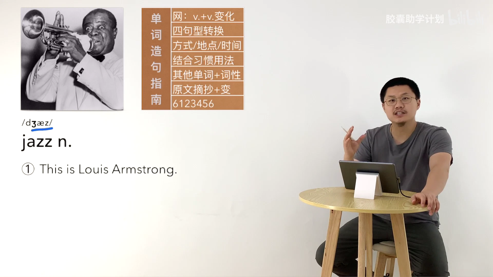

文字识别：单词造句指南 / 网：v.+v.变化 / 胶囊助学计划 / 四句型转换 / 方式/地点/时间 / 结合习惯用法 / 其他单词+词性 / 原文摘抄+变 / 6123456 / /d3æz/ / jazz n. / This is Louis Armstrong.

### 画面 00:00:45

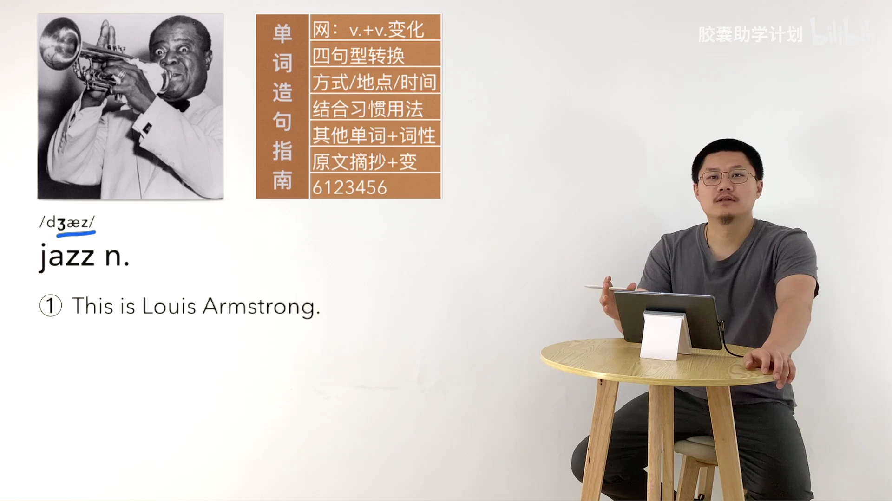

文字识别：单词造句指南 / 网：v.+v.变化 / 胶囊助学计划 / 四句型转换 / 方式/地点/时间 / 结合习惯用法 / 其他单词+词性 / 原文摘抄+变 / 6123456 / /d3æz/ / jazz n. / This is Louis Armstrong.

### 画面 00:00:50

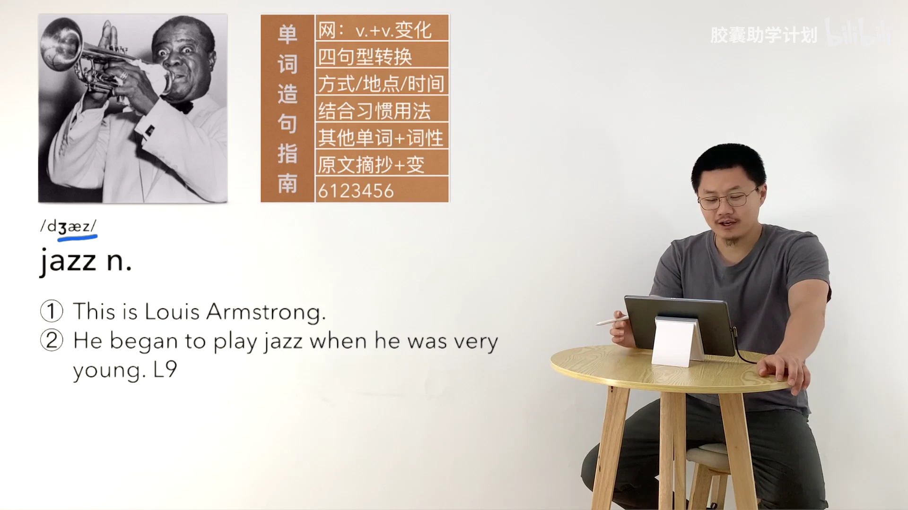

文字识别：单词造句指南 / 网：v.+v.变化 / 胶囊助学计划 / 四句型转换 / 方式/地点/时间 / 结合习惯用法 / 其他单词+词性 / 原文摘抄+变 / 6123456 / /d3æz/ / jazz n. / This is Louis Armstrong. / He began to play jazz when he was very / young. L9

### 画面 00:00:55

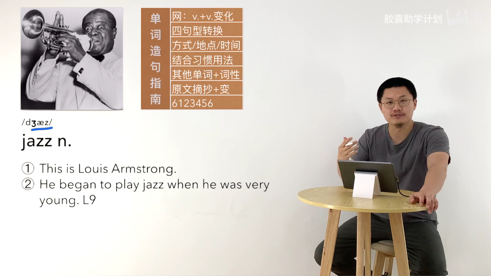

文字识别：单词造句指南 / 网：v.+v.变化 / 胶囊助学计划 / 四句型转换 / 方式/地点/时间 / 结合习惯用法 / 其他单词+词性 / 原文摘抄+变 / 6123456 / /d3æz/ / jazz n. / This is Louis Armstrong. / He began to play jazz when he was very / young. L9

## 00:01:00–00:01:30

指的是lesson九，就是第九课出现的习惯用法。比如说begin to do something，对吧？他开始演奏或者说练习爵士乐，当他很小很小的时候就开始了。比如说我们之前放过他的一首歌叫What a Wonderful World，非常好听，不知道各位还记不记得啊？我们在讲感叹句的时候，英文啊听过这首歌。Okay, so this is Louis Armstrong. Okay,那我们继续。那你还可以说

### 画面 00:01:00

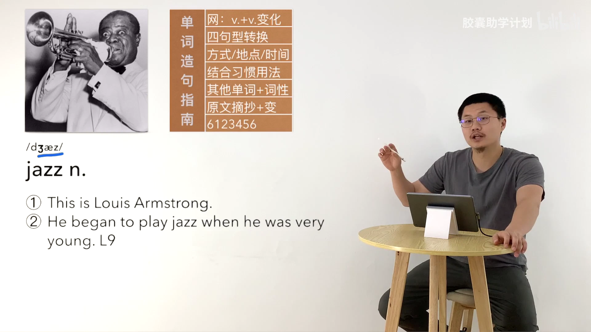

文字识别：单词造句指南 / 网：v.+v.变化 / 胶囊助学计划 / 四句型转换 / 方式/地点/时间 / 结合习惯用法 / 其他单词+词性 / 原文摘抄+变 / 6123456 / /d3æz/ / jazz n. / This is Louis Armstrong. / He began to play jazz when he was very / young. L9

### 画面 00:01:07

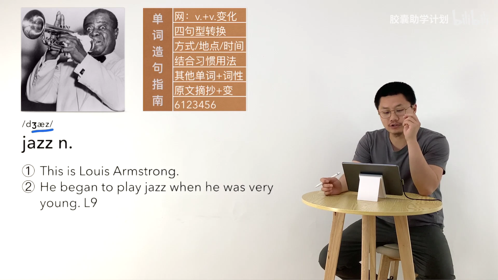

文字识别：单词造句指南 / 网：v.+v.变化 / 胶囊助学计划 / 四句型转换 / 方式/地点/时间 / 结合习惯用法 / 其他单词+词性 / 原文摘抄+变 / 6123456 / /d3æz/ / jazz n. / This is Louis Armstrong. / He began to play jazz when he was very / young. L9

### 画面 00:01:11

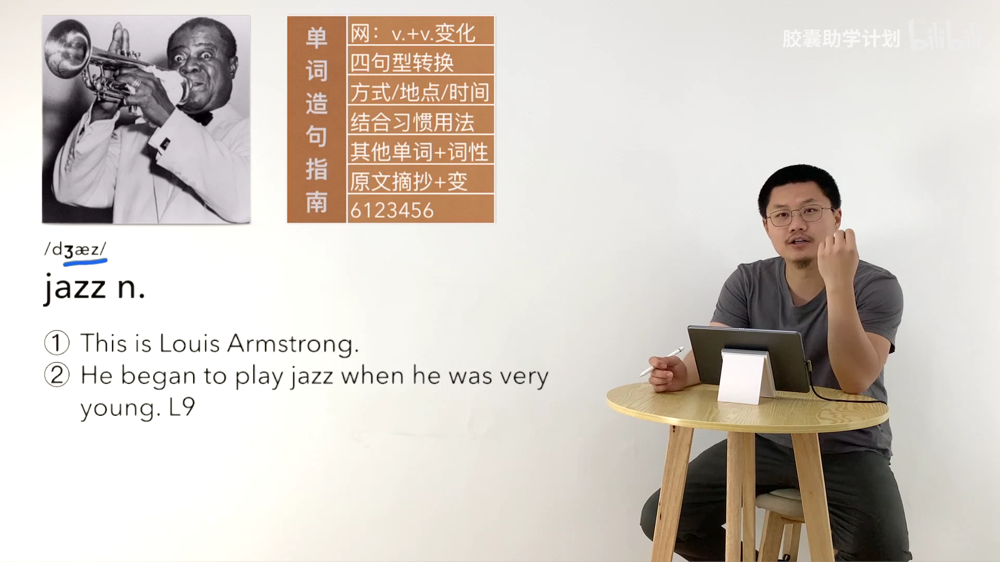

文字识别：单词造句指南 / 网：v.+v.变化 / 胶囊助学计划 / 四句型转换 / 方式/地点/时间 / 结合习惯用法 / 其他单词+词性 / 原文摘抄+变 / 6123456 / /d3æz/ / jazz n. / This is Louis Armstrong. / He began to play jazz when he was very / young. L9

### 画面 00:01:15

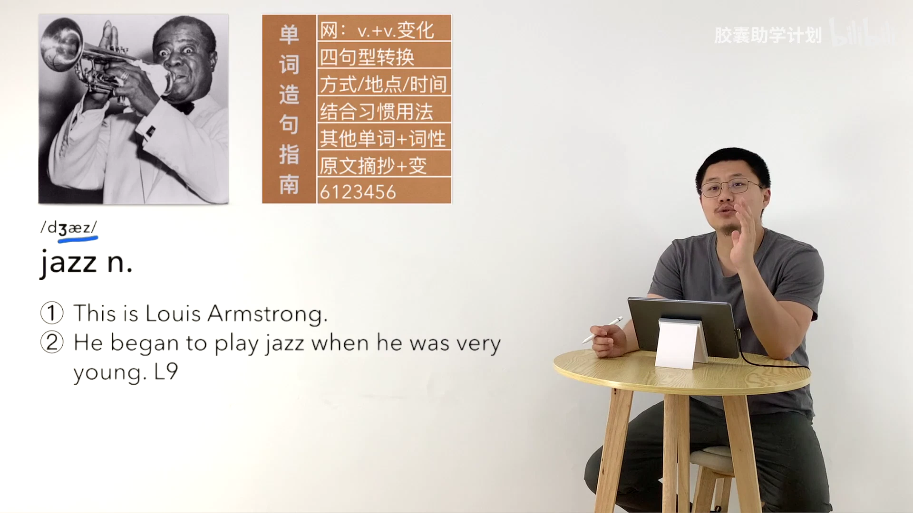

文字识别：单词造句指南 / 网：v.+v.变化 / 胶囊助学计划 / 四句型转换 / 方式/地点/时间 / 结合习惯用法 / 其他单词+词性 / 原文摘抄+变 / 6123456 / /d3æz/ / jazz n. / This is Louis Armstrong. / He began to play jazz when he was very / young. L9

### 画面 00:01:20

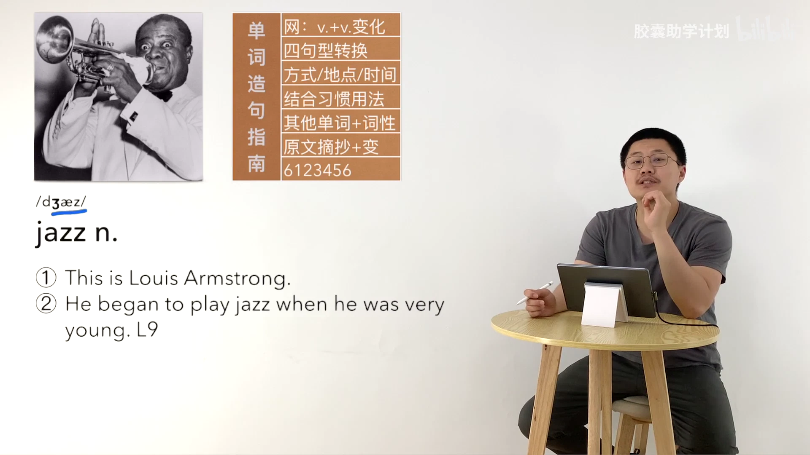

文字识别：单词造句指南 / 网：v.+v.变化 / 胶囊助学计划 / 四句型转换 / 方式/地点/时间 / 结合习惯用法 / 其他单词+词性 / 原文摘抄+变 / 6123456 / /d3æz/ / jazz n. / This is Louis Armstrong. / He began to play jazz when he was very / young. L9

### 画面 00:01:23

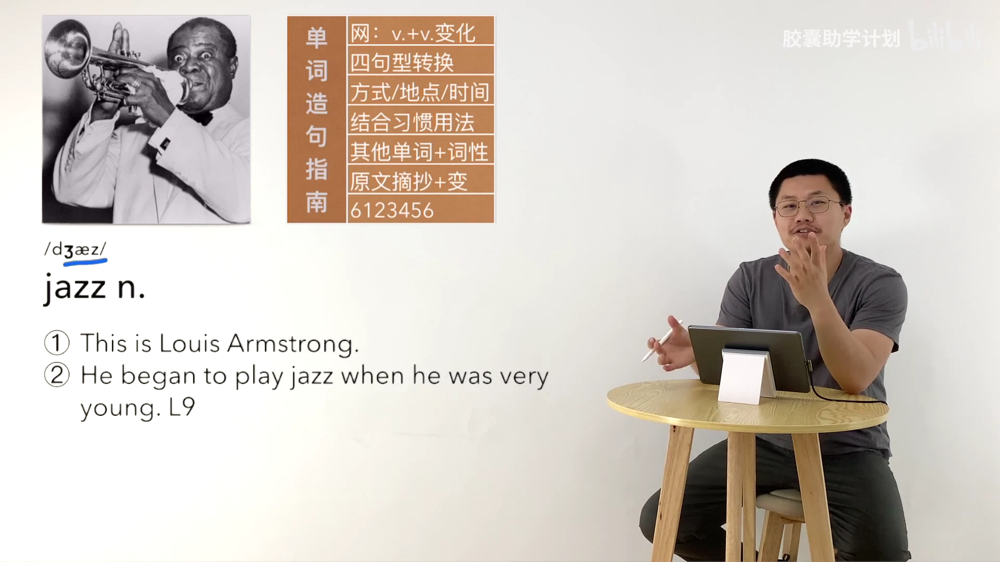

文字识别：单词造句指南 / 网：v.+v.变化 / 胶囊助学计划 / 四句型转换 / 方式/地点/时间 / 结合习惯用法 / 其他单词+词性 / 原文摘抄+变 / 6123456 / /d3æz/ / jazz n. / This is Louis Armstrong. / He began to play jazz when he was very / young. L9

### 画面 00:01:25

文字识别：单词造句指南 / 网：v.+v.变化 / 胶囊助学计划 / 四句型转换 / 方式/地点/时间 / 结合习惯用法 / 其他单词+词性 / 原文摘抄+变 / 6123456 / /d3æz/ / jazz n. / This is Louis Armstrong. / He began to play jazz when he was very / young. L9

### 画面 00:01:28

文字识别：单词造句指南 / 网：v.+v.变化 / 胶囊助学计划 / 四句型转换 / 方式/地点/时间 / 结合习惯用法 / 其他单词+词性 / 原文摘抄+变 / 6123456 / /d3æz/ / jazz n. / This is Louis Armstrong. / He began to play jazz when he was very / young. L9 / listen to jazz

## 00:01:30–00:02:00

听爵士乐叫listen to jazz. Okay,那我们造一个句子说He listens to jazz almost every day.我们看一下这句话有多费劲吗？应该不是很难，对吧？Listen to music，这我们新一就学过。我们只不过把music换成了jazz。其次呢，在动词加动词变化这个地方，我们选择的是用一般现在时，第二课学过，陈述客观事实，对吧？Okay，他每天都听嘛，或者一个生活的习惯。那在这儿

### 画面 00:01:30

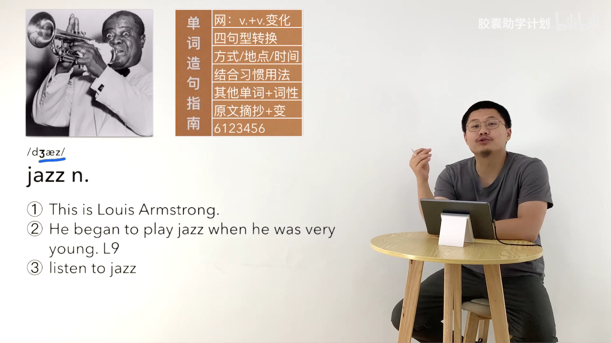

文字识别：单词造句指南 / 网：v.+v.变化 / 胶囊助学计划 / 四句型转换 / 方式/地点/时间 / 结合习惯用法 / 其他单词+词性 / 原文摘抄+变 / 6123456 / /d3æz/ / jazz n. / This is Louis Armstrong. / He began to play jazz when he was very / young. L9 / listen to jazz

### 画面 00:01:35

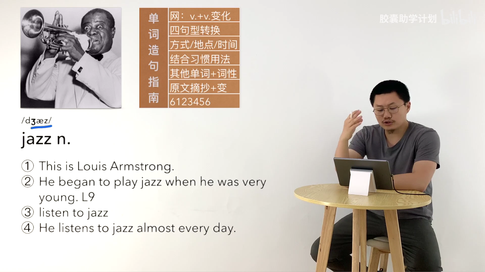

文字识别：单词造句指南 / 网：v.+v.变化 / 胶囊助学计划 / 四句型转换 / 方式/地点/时间 / 结合习惯用法 / 其他单词+词性 / 原文摘抄+变 / 6123456 / /d3æez/ / jazz n. / This is Louis Armstrong. / He began to play jazz when he was very / young. L9 / listen to jazz / He listens to jazz almost every day.

### 画面 00:01:43

文字识别：单词造句指南 / 网：v.+v.变化 / 胶囊助学计划 / 四句型转换 / 方式/地点/时间 / 结合习惯用法 / 其他单词+词性 / 原文摘抄+变 / 6123456 / /d3æz/ / jazz n. / This is Louis Armstrong. / He began to play jazz when he was very / young. L9 / listen to jazz / He listens to jazz almost every day.

### 画面 00:01:48

文字识别：单词造句指南 / 网：v.+v.变化 / 胶囊助学计划 / 四句型转换 / 方式/地点/时间 / 结合习惯用法 / 其他单词+词性 / 原文摘抄+变 / 6123456 / /d3æz/ / jazz n. / This is Louis Armstrong. / He began to play jazz when he was very / young. L9 / listen to jazz / He listens to jazz almost every day.

### 画面 00:01:52

文字识别：单词造句指南 / 网：v.+v.变化 / 胶囊助学计划 / 四句型转换 / 方式/地点/时间 / 结合习惯用法 / 其他单词+词性 / 原文摘抄+变 / 6123456 / /d3aez/ / jazz n. / This is Louis Armstrong. / He began to play jazz when he was very / young. L9 / listen to jazz / He listens to jazz almost every day.

### 画面 00:01:55

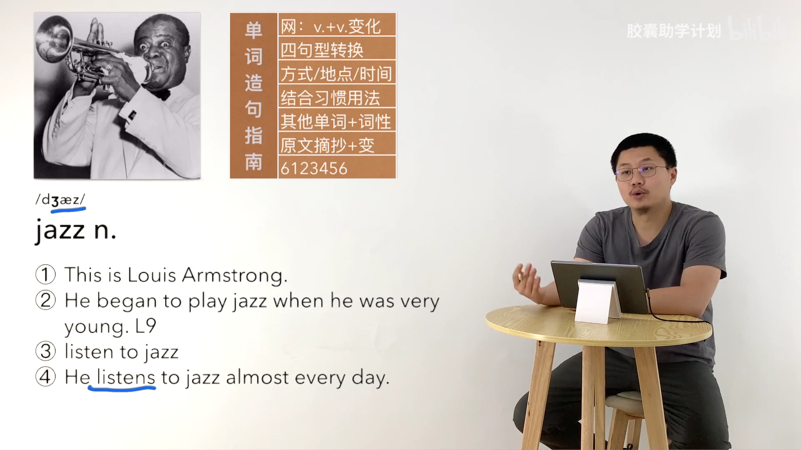

文字识别：单词造句指南 / 网：v.+v.变化 / 胶囊助学计划 / 四句型转换 / 方式/地点/时间 / 结合习惯用法 / 其他单词+词性 / 原文摘抄+变 / 6123456 / /d3ez/ / jazz n. / This is Louis Armstrong. / He began to play jazz when he was very / young. L9 / listen to jazz / He listens to jazz almost every day.

## 00:02:00–00:02:30

就是一个生活习惯。各位下课要去做的事情是把它做一个四句型的转换，OK？好，那就是肯定句、否定句、一般疑问句、特殊疑问句啊。OK，continue。接下来两个单词，第一个单词您看上去应该特别熟悉，比如说 music，对吧？我们现在后边加了个 a l，把它就变成了叫做 musical 啊。注意啊，现在给后面了，叫做 musical，叫做音乐的，现在变成

### 画面 00:02:01

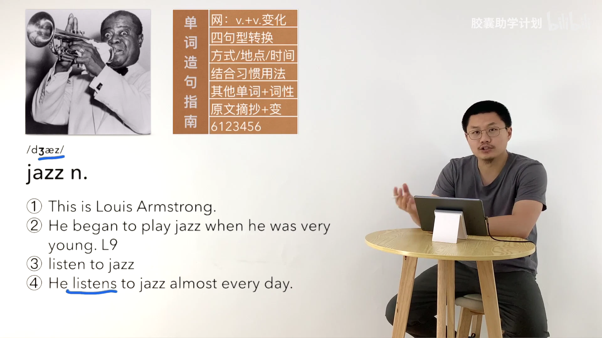

文字识别：单词造句指南 / 网：v.+v.变化 / 胶囊助学计划 / 四句型转换 / 方式/地点/时间 / 结合习惯用法 / 其他单词+词性 / 原文摘抄+变 / 6123456 / /d3ez/ / jazz n. / This is Louis Armstrong. / He began to play jazz when he was very / young. L9 / listen to jazz / He listens to jazz almost every day.

### 画面 00:02:05

文字识别：单词造句指南 / 网：v.+v.变化 / 胶囊助学计划 / 四句型转换 / 方式/地点/时间 / 结合习惯用法 / 其他单词+词性 / 原文摘抄+变 / 6123456 / /d3ez/ / jazz n. / This is Louis Armstrong. / He began to play jazz when he was very / young. L9 / listen to jazz / He listens to jazz almost every day.

### 画面 00:02:10

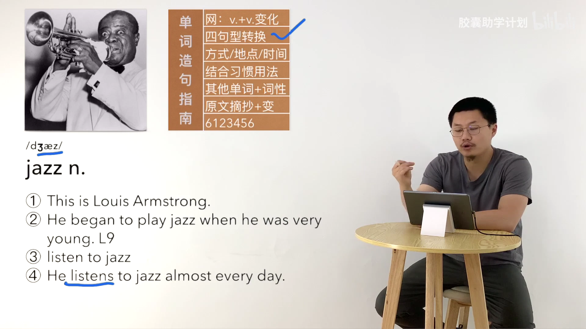

文字识别：单词造句指南 / 网：v.+v.变化 / 胶囊助学计划 / 四句型转换 / 方式/地点/时间 / 结合习惯用法 / 其他单词+词性 / 原文摘抄+变 / 6123456 / /d3ez/ / jazz n. / This is Louis Armstrong. / He began to play jazz when he was very / young. L9 / listen to jazz / He listens to jazz almost every day.

### 画面 00:02:12

文字识别：单词造句指南 / 网：v.+v.变化 / 胶囊助学计划 / 四句型转换 / 方式/地点/时间 / 结合习惯用法 / 其他单词+词性 / 原文摘抄+变 / 6123456 / /'mju:zikal/ / /'Instramant/ / musical adj. / instrument n.

### 画面 00:02:15

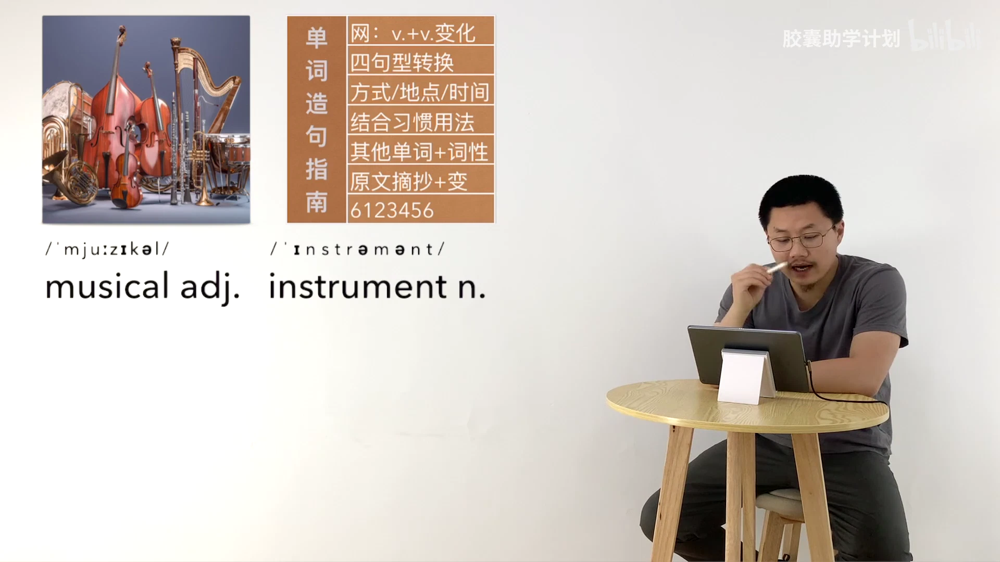

文字识别：单词造句指南 / 网：v.+v.变化 / 胶囊助学计划 / 四句型转换 / 方式/地点/时间 / 结合习惯用法 / 其他单词+词性 / 原文摘抄+变 / 6123456 / /'mju:zikal/ / /'instramant/ / musical adj. / instrument n.

### 画面 00:02:20

文字识别：单词造句指南 / 网：v.+v.变化 / 胶囊助学计划 / 四句型转换 / 方式/地点/时间 / 结合习惯用法 / 其他单词+词性 / 原文摘抄+变 / 6123456 / /'mju:zikal/ / /'instramant/ / musical adj. / instrument n.

### 画面 00:02:25

文字识别：单词造句指南 / 网：v.+v.变化 / 胶囊助学计划 / 四句型转换 / 方式/地点/时间 / 结合习惯用法 / 其他单词+词性 / 原文摘抄+变 / 6123456 / /'mju:zkal / /'Instramant/ / musical adj. / instrument n.

## 00:02:30–00:03:00

了一个形容词，原来是音乐，现在是音乐的。其次呢，后面这个单词叫做 instrument， instrument， OK，管它其实 instrument 其实有很多的意思，有设备、器材的意思，它也有指乐器的意思。那 musical instrument 就更指的是乐器了，比如说我们图中出现的这些乐器统称为 musical instrument，乐器啊，musical 你可以理解为是乐是吧？musical 啊，这个

### 画面 00:02:30

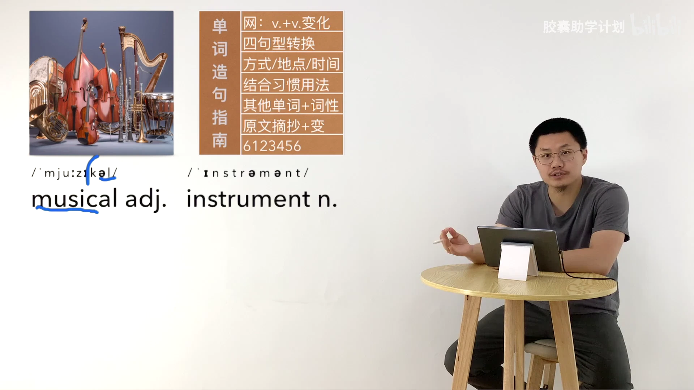

文字识别：单词造句指南 / 网：v.+v.变化 / 胶囊助学计划 / 四句型转换 / 方式/地点/时间 / 结合习惯用法 / 其他单词+词性 / 原文摘抄+变 / 6123456 / /'mju:z1kal / /'instramant/ / musical adj. / instrument n.

### 画面 00:02:35

文字识别：单词造句指南 / 网：v.+v.变化 / 胶囊助学计划 / 四句型转换 / 方式/地点/时间 / 结合习惯用法 / 其他单词+词性 / 原文摘抄+变 / 6123456 / /'mju:zkal / /'Instramant/ / musical adj. / instrument n.

### 画面 00:02:40

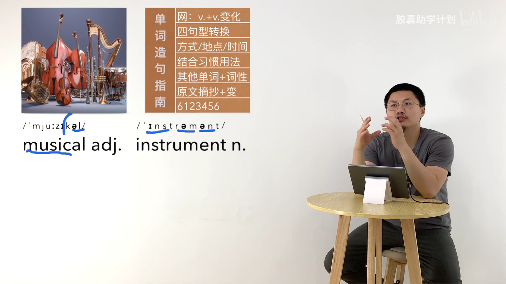

文字识别：单词造句指南 / 网：v.+v.变化 / 胶囊助学计划 / 四句型转换 / 方式/地点/时间 / 结合习惯用法 / 其他单词+词性 / 原文摘抄+变 / 6123456 / /'mju:zkal / /'Instramant/ / musical adj. / instrument n.

### 画面 00:02:43

文字识别：单词造句指南 / 网：v.+v.变化 / 胶囊助学计划 / 四句型转换 / 方式/地点/时间 / 结合习惯用法 / 其他单词+词性 / 原文摘抄+变 / 6123456 / /'mju:zkal / /'Instramant/ / musical adj. / instrument n.

### 画面 00:02:46

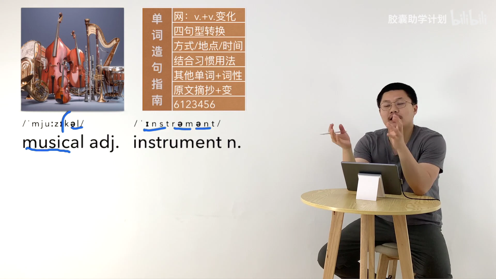

文字识别：单词造句指南 / 网：v.+v.变化 / 胶囊助学计划 / 四句型转换 / 方式/地点/时间 / 结合习惯用法 / 其他单词+词性 / 原文摘抄+变 / 6123456 / /'mju:zkal / /'instramant/ / musical adj. / instrument n.

### 画面 00:02:50

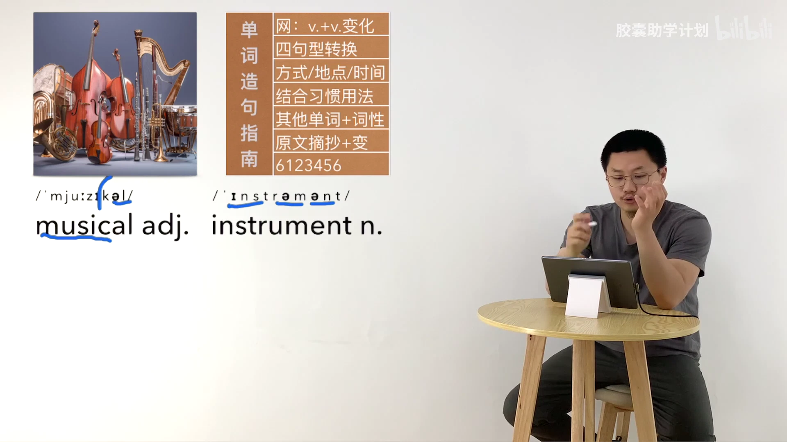

文字识别：单词造句指南 / 网：v.+v.变化 / 胶囊助学计划 / 四句型转换 / 方式/地点/时间 / 结合习惯用法 / 其他单词+词性 / 原文摘抄+变 / 6123456 / /'mju:zkal / /'Instramant/ / musical adj. / instrument n.

### 画面 00:02:55

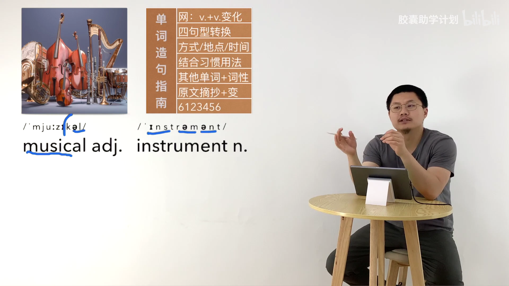

文字识别：单词造句指南 / 网：v.+v.变化 / 胶囊助学计划 / 四句型转换 / 方式/地点/时间 / 结合习惯用法 / 其他单词+词性 / 原文摘抄+变 / 6123456 / /'mju:zkal / /'Instramant/ / musical adj. / instrument n.

## 00:03:00–00:03:30

instrument你可以理解为叫做器材啊器啊，乐器。Very good，又是拿它去造句。我们用了一下第五课的习惯用法。本课我故意加了很多之前学到的习惯用法。我们看一下啊，说My parents got all this musical instrument for me many years ago。注意got something for somebody。第五课我们学到对吧？应该是呃得到某物。He cannot get a telephone for his

### 画面 00:03:02

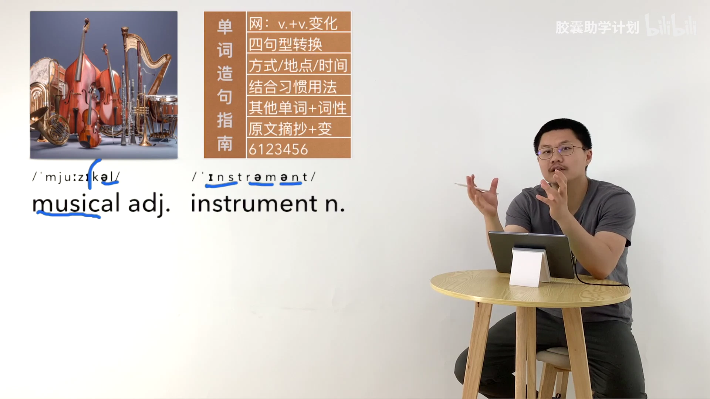

文字识别：单词造句指南 / 网：v.+v.变化 / 胶囊助学计划 / 四句型转换 / 方式/地点/时间 / 结合习惯用法 / 其他单词+词性 / 原文摘抄+变 / 6123456 / /'mju:zkal / /'Instramant/ / musical adj. / instrument n.

### 画面 00:03:04

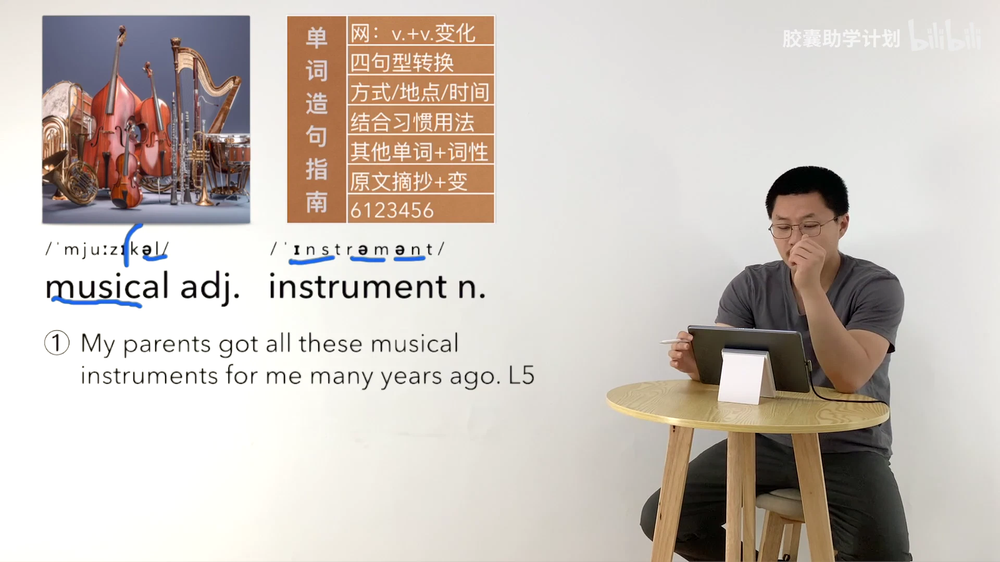

文字识别：单词造句指南 / 网：v.+v.变化 / 胶囊助学计划 / 四句型转换 / 方式/地点/时间 / 结合习惯用法 / 其他单词+词性 / 原文摘抄+变 / 6123456 / /'mju:zkal / /'Instramant/ / musical adj. / instrument n. / My parents got all these musical / instruments for me many years ago. L5

### 画面 00:03:06

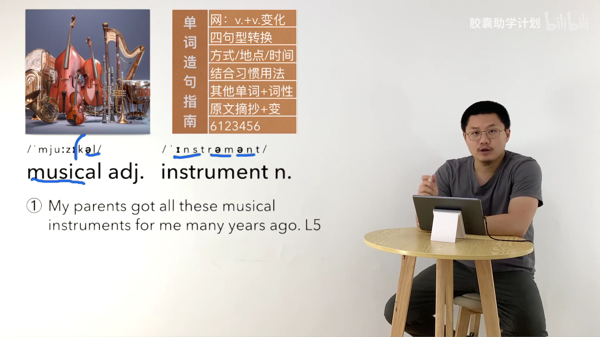

文字识别：单词造句指南 / 网：v.+v.变化 / 胶囊助学计划 / 四句型转换 / 方式/地点/时间 / 结合习惯用法 / 其他单词+词性 / 原文摘抄+变 / 6123456 / /'mju:zkal / /'Instramant/ / musical adj. / instrument n. / My parents got allthese musical / instruments for me many years ago. L5

### 画面 00:03:10

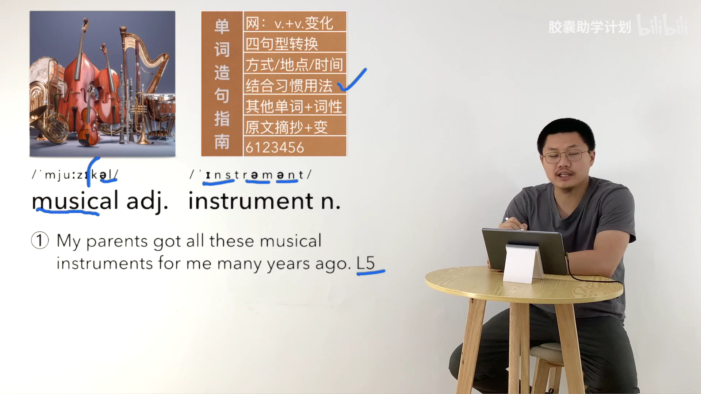

文字识别：单词造句指南 / 网：v.+v.变化 / 胶囊助学计划 / 四句型转换 / 方式/地点/时间 / 结合习惯用法 / 其他单词+词性 / 原文摘抄+变 / 6123456 / /'mju:zkal / /'Instramant/ / musical adj. / instrument n. / My parents got all these musical / instruments / s for me many years ago. L5

### 画面 00:03:16

文字识别：单词造句指南 / 网：v.+v.变化 / 胶囊助学计划 / 四句型转换 / 方式/地点/时间 / 结合习惯用法 / 其他单词+词性 / 原文摘抄+变 / 6123456 / /'mju:zkal / /'Instramant/ / musical adj. / instrument n. / My parents got allthese musical / instruments / for me many years ago. L5

### 画面 00:03:18

文字识别：单词造句指南 / 网：v.+v.变化 / 胶囊助学计划 / 四句型转换 / 方式/地点/时间 / 结合习惯用法 / 其他单词+词性 / 原文摘抄+变 / 6123456 / /'mju:zkall / /'instramant/ / musical adj. / instrument n. / My parents / s got all these musical / for me many years ago. L5 / instruments

### 画面 00:03:21

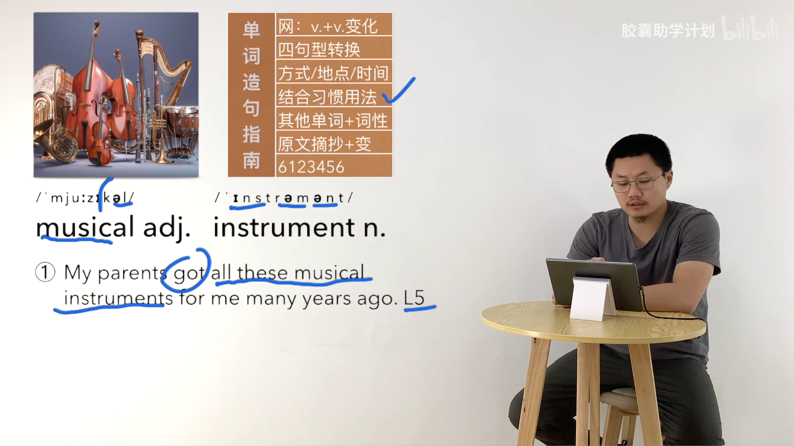

文字识别：单词造句指南 / 网：v.+v.变化 / 胶囊助学计划 / 四句型转换 / 方式/地点/时间 / 结合习惯用法 / 其他单词+词性 / 原文摘抄+变 / 6123456 / /'mju:zkal / /'instramant/ / musical adj. / instrument n. / My parent / all these musical / got / instruments for me many years / ago. L5

### 画面 00:03:23

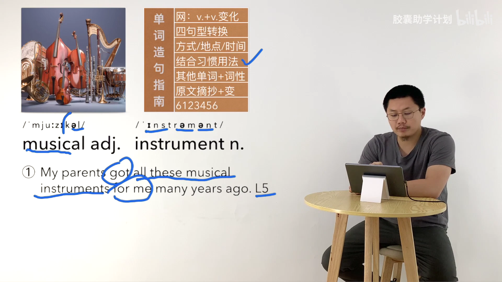

文字识别：单词造句指南 / 网：v.+v.变化 / 胶囊助学计划 / 四句型转换 / 方式/地点/时间 / 结合习惯用法 / 其他单词+词性 / 原文摘抄+变 / 6123456 / /'mju:zkal / /'Instramant/ / musical adj. / instrument n. / My parent gotallthese musical / instrumentsTor me / many years / ago.L5

### 画面 00:03:25

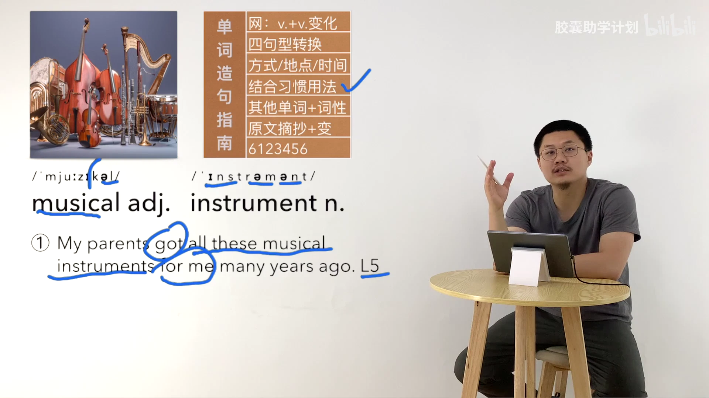

文字识别：单词造句指南 / 网：v.+v.变化 / 胶囊助学计划 / 四句型转换 / 方式/地点/时间 / 结合习惯用法 / 其他单词+词性 / 原文摘抄+变 / 6123456 / /'mju:zkal / /'Instramant/ / musical adj. / instrument n. / My parent got allthese musical / instrumentsTor me / many years / ago. L5

## 00:03:30–00:04:00

new garage. 应该是这一课我们学的，对吧？ Okay, continue. Say he refused to lend me his musical instrument. 我们实际上是把两个习惯用法加在一起了。第一个叫 lend somebody something，这是第三课学的。第二个呢是 refuse to do something，对吧？ Say the big clock refused to welcome the new year. 拒绝去做某件事情。那我们就造了一句话，说他呀拒绝借给我

### 画面 00:03:30

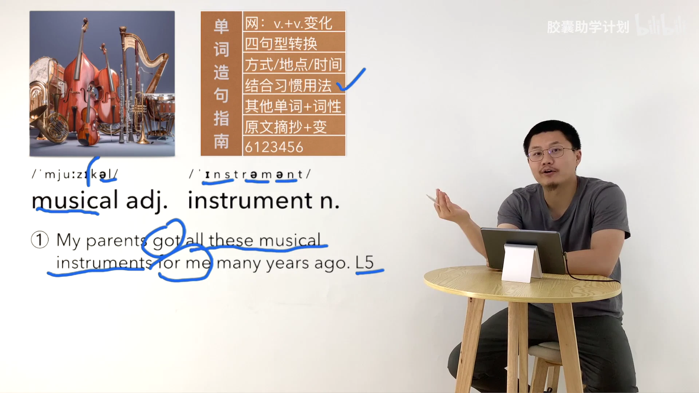

文字识别：单词造句指南 / 网：v.+v.变化 / 胶囊助学计划 / 四句型转换 / 方式/地点/时间 / 结合习惯用法 / 其他单词+词性 / 原文摘抄+变 / 6123456 / /'mju:zkal / /'Instramant/ / musical adj. / instrument n. / My parent gotall these musical / instrumentsror me / many years / ago. L5

### 画面 00:03:34

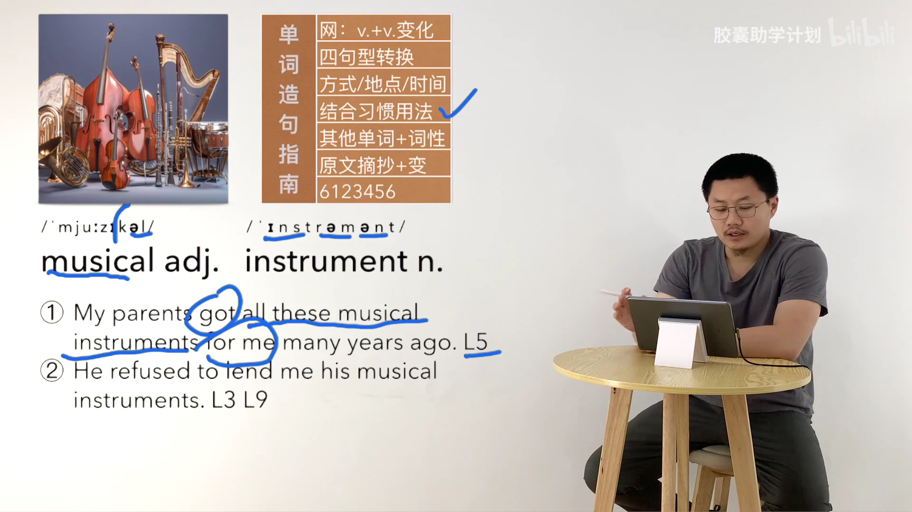

文字识别：单词造句指南 / 网：v.+v.变化 / 胶囊助学计划 / 四句型转换 / 方式/地点/时间 / 结合习惯用法 / 其他单词+词性 / 原文摘抄+变 / 6123456 / /'mju:zkal / /'instramant/ / musical / I adj. / instrument n. / My parent gotall these musical / instrumentsor me / many years / ago. L5 / He refused to tend / me / his / musical / instruments. L3 L9

### 画面 00:03:36

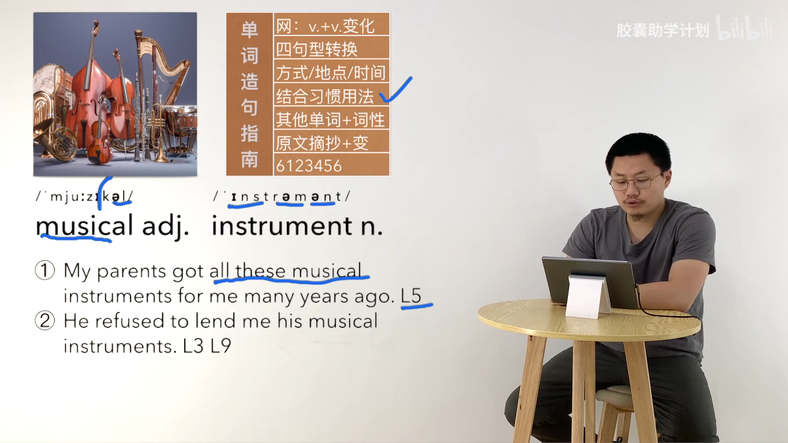

文字识别：单词造句指南 / 网：v.+v.变化 / 胶囊助学计划 / 四句型转换 / 方式/地点/时间 / 结合习惯用法 / 其他单词+词性 / 原文摘抄+变 / 6123456 / /'mju:zkal / /'Instramant/ / musical adj. / instrument n. / My parents got allthese musical / 1 / instruments for me many years ago. L5 / He refused to lend me his musical / instruments. L3 L9

### 画面 00:03:38

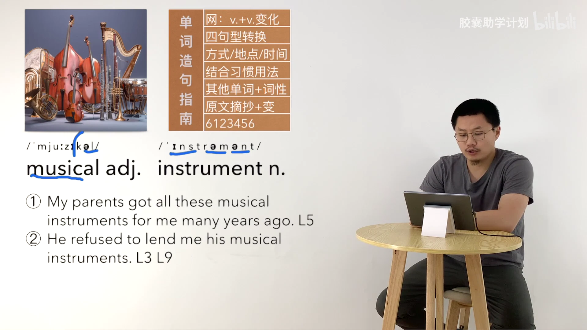

文字识别：单词造句指南 / 网：v.+v.变化 / 胶囊助学计划 / 四句型转换 / 方式/地点/时间 / 结合习惯用法 / 其他单词+词性 / 原文摘抄+变 / 6123456 / /'mju:zkal / /'Instramant / / musical adj. / instrument n. / My parents got all these musical / 1 / instruments for me many years ago. L5 / He refused to lend me his musical / instruments. L3 L9

### 画面 00:03:41

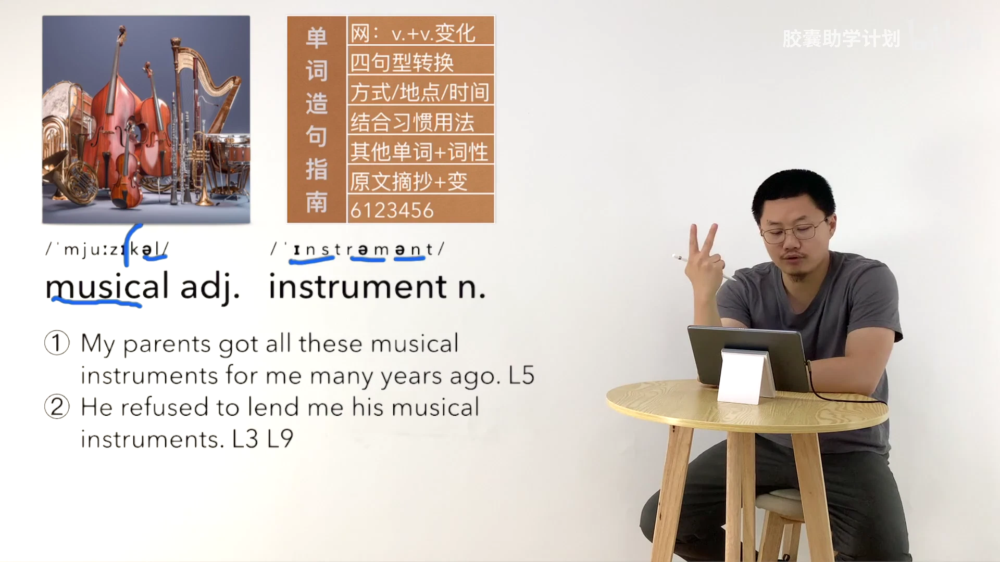

文字识别：单词造句指南 / 网：v.+v.变化 / 胶囊助学计划 / 四句型转换 / 方式/地点/时间 / 结合习惯用法 / 其他单词+词性 / 原文摘抄+变 / 6123456 / /'mju:zkal / /'Instramant/ / musical adj. / instrument n. / ① My parents got allthese musical / instruments for me many years ago. L5 / He refused to lend me his musical / instruments. L3 L9

### 画面 00:03:44

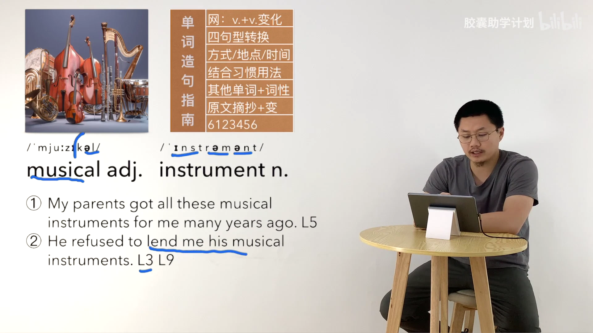

文字识别：单词造句指南 / 网：v.+v.变化 / 胶囊助学计划 / 四句型转换 / 方式/地点/时间 / 结合习惯用法 / 其他单词+词性 / 原文摘抄+变 / 6123456 / /'mju:z1kal / /'Instramant/ / musical adj. / instrument n. / D My parents got allthese musical / 1 / instruments for me many years ago. L5 / He refused to lend me his musical / instruments. L3 L9

### 画面 00:03:46

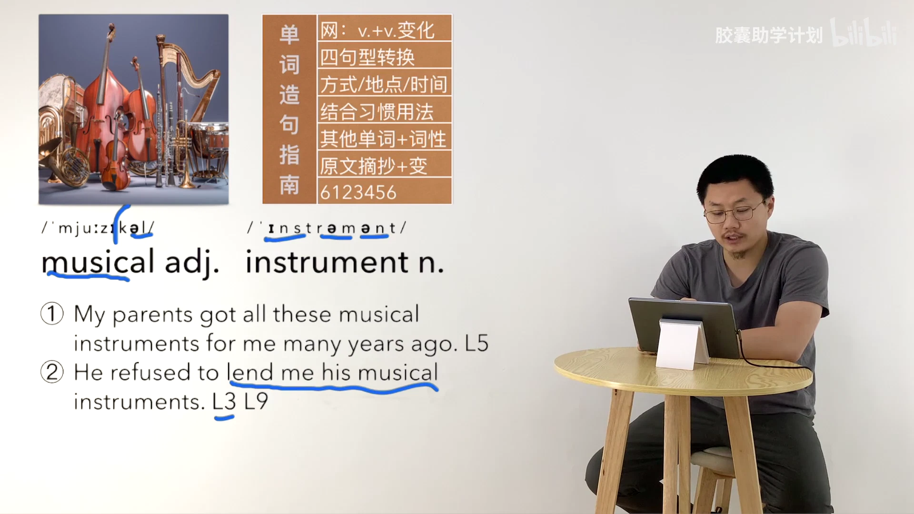

文字识别：单词造句指南 / 网：v.+v.变化 / 胶囊助学计划 / 四句型转换 / 方式/地点/时间 / 结合习惯用法 / 其他单词+词性 / 原文摘抄+变 / 6123456 / /'mju:zkal / / 'Instramant/ / musical adj. / instrument n. / My parents got all these musical / 1 / instruments for me many years ago. L5 / He refused to lend me his musical / instruments. L3 L9

### 画面 00:03:49

文字识别：单词造句指南 / 网：v.+v.变化 / 胶囊助学计划 / 四句型转换 / 方式/地点/时间 / 结合习惯用法 / 其他单词+词性 / 原文摘抄+变 / 6123456 / /'mju:zkall / /'Instramant/ / musical adj. / instrument n. / My parents got all these musical / instruments for me many years ago. L5 / He refused to lendme his musical / instruments. L3 L9

### 画面 00:03:51

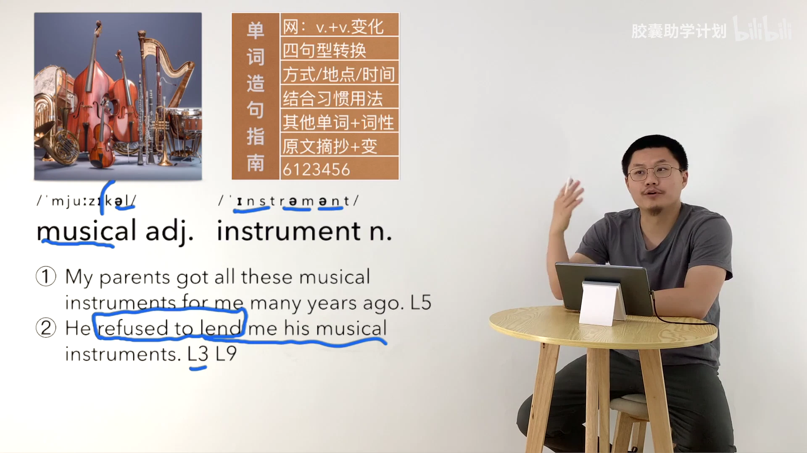

文字识别：单词造句指南 / 网：v.+v.变化 / 胶囊助学计划 / 四句型转换 / 方式/地点/时间 / 结合习惯用法 / 其他单词+词性 / 原文摘抄+变 / 6123456 / /'mju:zkal / /'Instramant/ / musical adj. / instrument n. / My parents got all these musical / instruments for me many years ago. L5 / He / refused to lendme his musical / instruments. L3 L9

### 画面 00:03:56

文字识别：单词造句指南 / 网：v.+v.变化 / 胶囊助学计划 / 四句型转换 / 方式/地点/时间 / 结合习惯用法 / 其他单词+词性 / 原文摘抄+变 / 6123456 / /'mju:zkall / / 'Instramant/ / musical adj. / instrument n. / My parents got all these musical / instruments for me many years ago. L5 / He / refused to lendme his musical / instruments. L3 L9

## 00:04:00–00:04:30

的这些乐器，OK，那这都是肯定句，对吧？我们重点在这儿是要明白我是怎么造出来这个肯定句，无非就是选了个时态，加了几个我们之前学过的习惯用法，用到了这一点和底下的这一点。然后您自己课下可以是做词性转换，OK， continue，下一个单词，默读一下叫做 clavichord， clavichord，我们管它叫古钢

### 画面 00:04:01

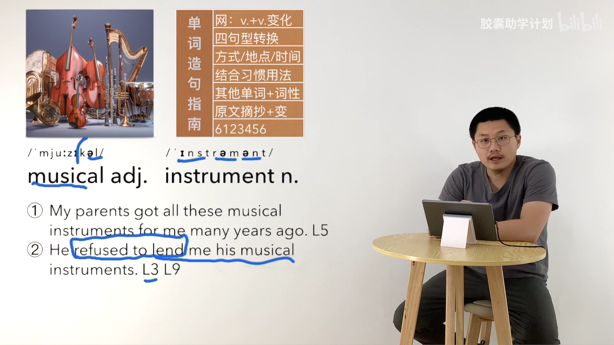

文字识别：单词造句指南 / 网：v.+v.变化 / 胶囊助学计划 / 四句型转换 / 方式/地点/时间 / 结合习惯用法 / 其他单词+词性 / 原文摘抄+变 / 6123456 / /'mju:zkal / / 'instramant/ / musical adj. / instrument n. / My parents got all these musical / instruments for me many years ago. L5 / He / refused to lendme his musical / instruments. L3 L9

### 画面 00:04:05

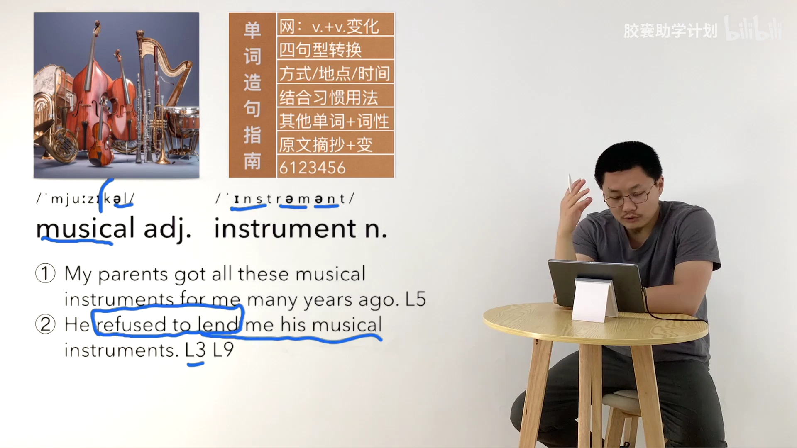

文字识别：单词造句指南 / 网：v.+v.变化 / 胶囊助学计划 / 四句型转换 / 方式/地点/时间 / 结合习惯用法 / 其他单词+词性 / 原文摘抄+变 / 6123456 / /'mju:zkall / /'Instramant/ / musical adj. / instrument n. / My parents got all these musical / 1 / instruments for me many years ago. L5 / He / refused to lend me his musical / instruments. L3 L9

### 画面 00:04:07

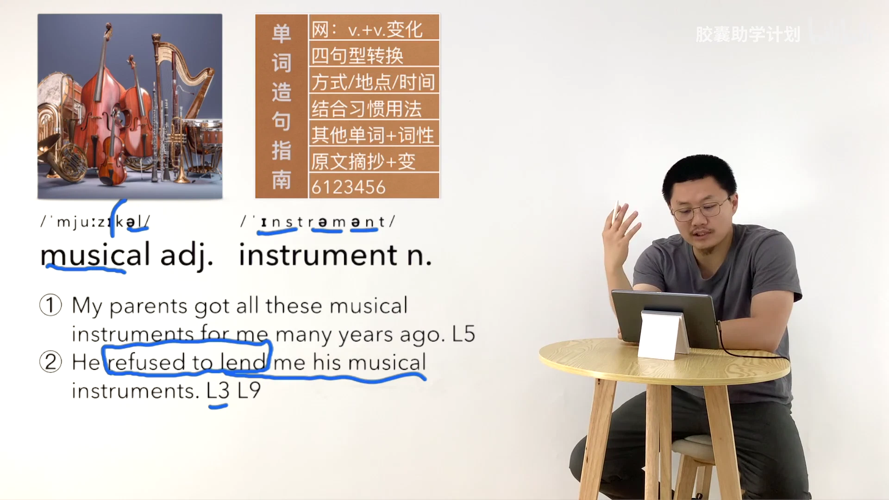

文字识别：单词造句指南 / 网：v.+v.变化 / 胶囊 / 助学计划 / 四句型转换 / 方式/地点/时间 / 结合习惯用法 / 其他单词+词性 / 原文摘抄+变 / 6123456 / /'mju:zkal / /'Instramant/ / musical adj. / instrument n. / My parents got all these musical / instruments for me many years ago. L5 / He / refused to lendme his musical / instruments. L3 L9

### 画面 00:04:10

文字识别：单词造句指南 / 网：v.+v.变化 / 胶囊助学计划 / 四句型转换 / 方式/地点/时间 / 结合习惯用法 / 其他单词+词性 / 原文摘抄+变 / 6123456 / /'mju:zkal / /'Instramant/ / musical adj. / instrument n. / My parents got all these musical / instruments for me many years ago. L5 / He / refused to lendme his musical / instruments. L3 L9

### 画面 00:04:15

文字识别：单词造句指南 / 网：v.+v.变化 / 胶囊助学计划 / 四句型转换 / 方式/地点/时间 / 结合习惯用法 / 其他单词+词性 / 原文摘抄+变 / 6123456 / /'mju:zkall / /'Instramant/ / musical adj. / instrument n. / My parents got all these musical / 1 / instruments for me many years ago. L5 / He / refused to lendme his musical / instruments. L3 L9

### 画面 00:04:20

文字识别：单词造句指南 / 网：v.+v.变化 / 胶囊助学计划 / 四句型转换 / 方式/地点/时间 / 结合习惯用法 / 其他单词+词性 / 原文摘抄+变 / 6123456 / /klæviko:rd/ / clavichord n.

### 画面 00:04:22

文字识别：单词造句指南 / 网：v.+v.变化 / 胶囊助学计划 / 四句型转换 / 方式/地点/时间 / 结合习惯用法 / 其他单词+词性 / 原文摘抄+变 / 6123456 / /klæviko:rd/ / clavichord n.

### 画面 00:04:25

文字识别：单词造句指南 / 网：v.+v.变化 / 胶囊助学计划 / 四句型转换 / 方式/地点/时间 / 结合习惯用法 / 其他单词+词性 / 原文摘抄+变 / 6123456 / /klæviko:rd/ / clavichord n.

## 00:04:30–00:05:00

琴，你注意它不是我们原来说那个 piano 啊，那是现代钢琴，这个指的是古钢琴，叫做 clavichord。 OK，好，那接下来它你甭管它是古的还是金的，它本质上就是个名词，对吧？名词该怎么造句？还是第一步要想词性，找动词或形容词，对不对？关键的还是动词啊。那接下来我们造一句话，说 Listen， someone is playing the clavichord。 听啊，有一个人正在弹这个古钢琴。 be 加

### 画面 00:04:30

文字识别：单词造句指南 / 网：v.+v.变化 / 胶囊助学计划 / 四句型转换 / 方式/地点/时间 / 结合习惯用法 / 其他单词+词性 / 原文摘抄+变 / 6123456 / /klæviko:rd/ / clavichord n.

### 画面 00:04:33

文字识别：单词造句指南 / 网：v.+v.变化 / 胶囊 / 孕计划 / 四句型转换 / 方式/地点/时间 / 结合习惯用法 / 其他单词+词性 / 原文摘抄+变 / 6123456 / /klæviko:rd/ / clavichord n.

### 画面 00:04:36

文字识别：单词造句指南 / 网：v.+v.变化 / 胶囊助学计划 / 四句型转换 / 方式/地点/时间 / 结合习惯用法 / 其他单词+词性 / 原文摘抄+变 / 6123456 / /klæviko:rd/ / clavichord n.

### 画面 00:04:38

文字识别：单词造句指南 / 网：v.+v.变化 / 胶囊助学计划 / 四句型转换 / 方式/地点/时间 / 结合习惯用法 / 其他单词+词性 / 原文摘抄+变 / 6123456 / /klæviko:rd/ / clavichord n.

### 画面 00:04:40

文字识别：单词造句指南 / 网：v.+v.变化 / 胶囊助学计划 / 四句型转换 / 方式/地点/时间 / 结合习惯用法 / 其他单词+词性 / 原文摘抄+变 / 6123456 / /klæviko:rd/ / clavichord n.

### 画面 00:04:45

文字识别：单词造句指南 / 网：v.+v.变化 / 胶囊助学计划 / 四句型转换 / 方式/地点/时间 / 结合习惯用法 / 其他单词+词性 / 原文摘抄+变 / 6123456 / /'klæviko:rd/ / clavichord n.

### 画面 00:04:50

文字识别：单词造句指南 / 网：v.+v.变化 / 胶囊助学计划 / 四句型转换 / 方式/地点/时间 / 结合习惯用法 / 其他单词+词性 / 原文摘抄+变 / 6123456 / /klxviko:rd/ / clavichord n. / Listen, someone is playing the clavichord.

### 画面 00:04:52

文字识别：单词造句指南 / 网：v.+v.变化 / 胶囊助学计划 / 四句型转换 / 方式/地点/时间 / 结合习惯用法 / 其他单词+词性 / 原文摘抄+变 / 6123456 / /klxviko:rd/ / clavichord n. / Listen, someone is playing the clavichord.

### 画面 00:04:55

文字识别：单词造句指南 / 网：v.+v.变化 / 胶囊助学计划 / 四句型转换 / 方式/地点/时间 / 结合习惯用法 / 其他单词+词性 / 原文摘抄+变 / 6123456 / /klæviko:r d/ / clavichord n. / Listen, someone is playing the clavichord.

## 00:05:00–00:05:30

doing，动词加动词的变化。Okay, continue.接下来我们结合一个第七课我们学过的连词while，以及第七课我们学过的was were加doing，过去进行时，我们造这样一个句子出来，说While I was doing my homework, my sister was playing the clavichord.当我正在做家庭作业的时候，我的姐姐正在弹这艘这这个古钢琴，对吧？

### 画面 00:05:00

文字识别：单词造句指南 / 网：v.+v.变化 / 胶囊助学计划 / 四句型转换 / 方式/地点/时间 / 结合习惯用法 / 其他单词+词性 / 原文摘抄+变 / 6123456 / /klævi ko:rd/ / clavichord n. / Listen, someone is playing the clavichord.

### 画面 00:05:02

文字识别：单词造句指南 / 网：v.+v.变化 / 胶囊助学计划 / 四句型转换 / 方式/地点/时间 / 结合习惯用法 / 其他单词+词性 / 原文摘抄+变 / 6123456 / /klæviko:rd/ / clavichord n. / Listen, someone is playing the clavichord. / While I was doing my homework, my sister / was playing the clavichord. L7

### 画面 00:05:04

文字识别：单词造句指南 / 网：v.+v.变化 / 胶囊助学计划 / 四句型转换 / 方式/地点/时间 / 结合习惯用法 / 其他单词+词性 / 原文摘抄+变 / 6123456 / /klæviko:rd/ / clavichord n. / Listen, someone is playing the clavichord. / While I was doing my homework, my sister / was playing the clavichord. L7

### 画面 00:05:06

文字识别：单词造句指南 / 网：v.+v.变化 / 四句型转换 / 方式/地点/时间 / 结合习惯用法 / 其他单词+词性 / 原文摘抄+变 / 6123456 / /klæviko:rd/ / clavichord n. / Listen, someone is playing the clavichord. / While I was doing my homework, my sister / was playing the clavichord. L7

### 画面 00:05:08

文字识别：单词造句指南 / 网：v.+v.变化 / 胶囊助学计划 / 四句型转换 / 方式/地点/时间 / 结合习惯用法 / 其他单词+词性 / 原文摘抄+变 / 6123456 / /'klæviko:rd/ / clavichord n. / Listen, someone is playing the clavichord. / While I was doing my homework, my sister / was playing the clavichord. L7

### 画面 00:05:10

文字识别：单词造句指南 / 网：v.+v.变化 / 胶囊助学计划 / 四句型转换 / 方式/地点/时间 / 结合习惯用法 / 其他单词+词性 / 原文摘抄+变 / 6123456 / /'klæviko:rd/ / clavichord n. / Listen, someone is playing the clavichord. / While I was doing my homework, my sister / was playing the clavichord. L7

### 画面 00:05:15

文字识别：单词造句指南 / 网：v.+v.变化 / 胶囊助学计划 / 四句型转换 / 方式/地点/时间 / 结合习惯用法 / 其他单词+词性 / 原文摘抄+变 / 6123456 / /'klævi ko:rd/ / clavichord n. / Listen, someone is playing the clavichord. / While I was doing my homework, my sister / was playing the clavichord. L7

### 画面 00:05:20

文字识别：单词造句指南 / 网：v.+v.变化 / 四句型转换 / 方式/地点/时间 / 结合习惯用法 / 其他单词+词性 / 原文摘抄+变 / 6123456 / /klæviko:rd/ / clavichord n. / Listen, someone is playing the clavichord. / While I was doing my homework, my sister / was playing the clavichord. L7

### 画面 00:05:26

文字识别：单词造句指南 / 网：v.+v.变化 / 胶囊助学计划 / 四句型转换 / 方式/地点/时间 / 结合习惯用法 / 其他单词+词性 / 原文摘抄+变 / 6123456 / /'klævi ko:rd/ / clavichord n. / Listen, someone is playing the clavichord. / While I was doing my homework, my sister / was playing the clavichord. L7

## 00:05:30–00:06:00

Okay, there you go. Continue.那第八课呢，我们学到了动词的最高级和比较级。我们拿那个句型，不知道各位还记不记得，让各位下课做过造过很多句子的那三个关键句型。我们造一个句子说，This is the most beautiful clavicord. 这是最漂亮的古钢琴。后面加一句话叫做I've ever seen，叫做我所看见过的最美的古钢琴。Okay，好，continue。接下来又是两个单词，我们放到一起去讲。

### 画面 00:05:30

文字识别：单词造句指南 / 网：v.+v.变化 / 胶囊助学计划 / 四句型转换 / 方式/地点/时间 / 结合习惯用法 / 其他单词+词性 / 原文摘抄+变 / 6123456 / /'kleviko:rd/ / clavichord n. / Listen, someone is playing the clavichord. / While I was doing my homework, my sister / was playing the clavichord. L7 / This is the most beautiful clavichord I've / ever seen. L8

### 画面 00:05:32

文字识别：单词造句指南 / 网：v.+v.变化 / 胶囊助学计划 / 四句型转换 / 方式/地点/时间 / 结合习惯用法 / 其他单词+词性 / 原文摘抄+变 / 6123456 / /'kleviko:rd/ / clavichord n. / Listen, someone is playing the clavichord. / While I was doing my homework, my sister / was playing the clavichord. L7 / This is the most beautiful clavichord I've / ever seen. L8

### 画面 00:05:35

文字识别：单词造句指南 / 网：v.+v.变化 / 胶囊助学计划 / 四句型转换 / 方式/地点/时间 / 结合习惯用法 / 其他单词+词性 / 原文摘抄+变 / 6123456 / /kleviko:rd/ / clavichord n. / Listen, someone is playing the clavichord. / While I was doing my homework, my sister / was playing the clavichord. L7 / This is the most beautiful clavichord I've / ever seen. L8

### 画面 00:05:40

文字识别：单词造句指南 / 网：v.+v.变化 / 胶囊助学计划 / 四句型转换 / 方式/地点/时间 / 结合习惯用法 / 其他单词+词性 / 原文摘抄+变 / 6123456 / /kleviko:rd/ / clavichord n. / Listen, someone is playing the clavichord. / While I was doing my homework, my sister / was playing the clavichord. L7 / This is the most beautiful clavichord I've / ever seen. L8

### 画面 00:05:45

文字识别：单词造句指南 / 网：v.+v.变化 / 胶囊助学计划 / 四句型转换 / 方式/地点/时间 / 结合习惯用法 / 其他单词+词性 / 原文摘抄+变 / 6123456 / /kleviko:rd/ / clavichord n. / Listen, someone is playing the clavichord. / While I was doing my homework, my sister / was playing the clavichord. L7 / This is the most beautiful clavichord I've / ever seen. L8

### 画面 00:05:50

文字识别：单词造句指南 / 网：v.+v.变化 / 胶囊助学计划 / 四句型转换 / 方式/地点/时间 / 结合习惯用法 / 其他单词+词性 / 原文摘抄+变 / 6123456 / /kleviko:rd/ / clavichord n. / Listen, someone is playing the clavichord. / While I was doing my homework, my sister / was playing the clavichord. L7 / This is the most beautiful clavichord I've / ever seen. L8

### 画面 00:05:55

文字识别：单词造句指南 / 网：v.+v.变化 / 胶囊助学计划 / 四句型转换 / 方式/地点/时间 / 结合习惯用法 / 其他单词+词性 / 原文摘抄+变 / 6123456 / /kleviko:rd/ / clavichord n. /  Listen, someone is playing the clavichord. / While I was doing my homework, my sister / was playing the clavichord. L7 / This is the most beautiful clavichord I've / ever seen. L8

### 画面 00:05:57

文字识别：单词造句指南 / 网：v.+v.变化 / 胶囊助学计划 / 四句型转换 / 方式/地点/时间 / 结合习惯用法 / 其他单词+词性 / 原文摘抄+变 / 6123456 / /dæmI d 3/ / /'risantli/ / damage v. recently adv.

## 00:06:00–00:06:30

首先，第一个叫做 damage，damage 叫做损坏或者损毁、破坏都可以。下一个单词叫做 recently，recently 它们是一个副词，叫做最近，对吧？最近怎么怎么样？比如说，那我们拿它合起来去造一个句子，叫做 recently a visitor damaged the clavicle。好，你看一下啊，我们这句话是怎么造出来的？

### 画面 00:06:00

文字识别：单词造句指南 / 网：v.+v.变化 / 胶囊助学计划 / 四句型转换 / 方式/地点/时间 / 结合习惯用法 / 其他单词+词性 / 原文摘抄+变 / 6123456 / /dæmId3/ / /'risantli/ / damage v. recently adv.

### 画面 00:06:08

文字识别：单词造句指南 / 网：v.+v.变化 / 胶囊助学计划 / 四句型转换 / 方式/地点/时间 / 结合习惯用法 / 其他单词+词性 / 原文摘抄+变 / 6123456 / /dæmId3/ / /'risantli/ / damage v. recently adv.

### 画面 00:06:11

文字识别：单词造句指南 / 网：v.+v.变化 / 胶囊助学计划 / 四句型转换 / 方式/地点/时间 / 结合习惯用法 / 其他单词+词性 / 原文摘抄+变 / 6123456 / /dæmId3/ / /'risantli/ / damage v. recently adv.

### 画面 00:06:15

文字识别：单词造句指南 / 网：v.+v.变化 / 胶囊助学计划 / 四句型转换 / 方式/地点/时间 / 结合习惯用法 / 其他单词+词性 / 原文摘抄+变 / 6123456 / /d æmId3/ / /risantli/ / damage v. recently adv.

### 画面 00:06:20

文字识别：单词造句指南 / 网：v.+v.变化 / 胶囊助学计划 / 四句型转换 / 方式/地点/时间 / 结合习惯用法 / 其他单词+词性 / 原文摘抄+变 / 6123456 / /d æmId3/ / / 'risantli/ / damage v. recently adv. / ① Recently, a visitor damaged the clavichord.

### 画面 00:06:25

文字识别：单词造句指南 / 网：v.+v.变化 / 胶囊助学计划 / 四句型转换 / 方式/地点/时间 / 结合习惯用法 / 其他单词+词性 / 原文摘抄+变 / 6123456 / /d æm I d3/ / /'risantli/ / damage v. recently adv. / ① Recently, a visitor damaged the clavichord.

## 00:06:30–00:07:00

各位，记它不是重点，我怎么把它造出来？这个思路才是重要的。这个思路您学会，自己就可以造了。看一下 recently，实际上在六一二三四五六当中，你是不是可以理解为它是个时间，叫做最近，对吧？最近，但是这个事儿肯定是发生在过去，它只不过是最近的过去。OK，所以我们的时态呢，damage选的是一般过去时。主语您选谁都行啊，我只不过随便选了一个叫做 a visitor，为了跟我们的文章相保持一致。

### 画面 00:06:30

文字识别：单词造句指南 / 网：v.+v.变化 / 胶囊助学计划 / 四句型转换 / 方式/地点/时间 / 结合习惯用法 / 其他单词+词性 / 原文摘抄+变 / 6123456 / /d æm I d3 / / / 'risantli/ / damage v. recently adv. / ① Recently, a visitor damaged the clavichord.

### 画面 00:06:35

文字识别：单词造句指南 / 网：v.+v.变化 / 四句型转换 / 方式/地点/时间 / 结合习惯用法 / 其他单词+词性 / 原文摘抄+变 / 6123456 / /dæmId3/ / /risant li/ / damage v. recently adv. / ① Recently, a visitor damaged the clavichord.

### 画面 00:06:41

文字识别：单词造句指南 / 网：v.+v.变化 / 胶囊助学计划 / 四句型转换 / 方式/地点/时间 / 结合习惯用法 / 其他单词+词性 / 原文摘抄+变 / 6123456 / /dæmi d3 / / /'risant li / / damage v. recently adv. / ① Recently, a visitor damaged the clavichord.

### 画面 00:06:46

文字识别：单词造句指南 / 网：v.+v.变化 / 胶囊助学计划 / 四句型转换 / 方式/地点/时间 / 结合习惯用法 / 其他单词+词性 / 原文摘抄+变 / 6123456 / /dæmId3/ / /'risant li / / damage v. recently adv. / ① Recently, a visitor damaged the clavichord.

### 画面 00:06:49

文字识别：单词造句指南 / 网：v.+v.变化 / 胶囊助学计划 / 四句型转换 / 方式/地点/时间 / 结合习惯用法 / 其他单词+词性 / 原文摘抄+变 / 6123456 / /d æm I d 3/ / /'risant li/ / damage v. recently adv. / ① Recently, a visitor damaged the clavichord.

### 画面 00:06:51

文字识别：单词造句指南 / 网：v.+v.变化 / 胶囊助学计划 / 四句型转换 / 方式/地点/时间 / 结合习惯用法 / 其他单词+词性 / 原文摘抄+变 / 6123456 / /dæmid3/ / /'risantli/ / damage v. recently adv. / ① Recently, a visitor damaged the clavichord.

### 画面 00:06:58

文字识别：单词造句指南 / 网：v.+v.变化 / 胶囊助学计划 / 四句型转换 / 方式/地点/时间 / 结合习惯用法 / 其他单词+词性 / 原文摘抄+变 / 6123456 / /dæmid3/ / /'risantli/ / damage v. recently adv. / ① Recently, a visitor damaged the clavichord.

## 00:07:00–00:07:30

你说 Leo, Tom, Jerry, 对吧？ Snoopy, 啊，你愿意选 Superman，你爱选谁选谁，主语随便。他损坏了什么东西呢？只不过这个地方我用的是 clavichord。那你用，比如说 musical instrument，你用 piano，啊，你用 volleyball，啊，理论上都是可以的。目前为止， OK，所以这个就很简单。那然后呢，你要把它变成一个一般疑问句，这个肯定句造出来了，剩下的思路就水到渠成了，叫做

### 画面 00:07:00

文字识别：单词造句指南 / 网：v.+v.变化 / 胶囊助学计划 / 四句型转换 / 方式/地点/时间 / 结合习惯用法 / 其他单词+词性 / 原文摘抄+变 / 6123456 / /dæmi d3/ / /'risantli/ / damage v. recently adv. / ① Recently, a visitor damaged the clavichord.

### 画面 00:07:05

文字识别：单词造句指南 / 网：v.+v.变化 / 胶囊助学计划 / 四句型转换 / 方式/地点/时间 / 结合习惯用法 / 其他单词+词性 / 原文摘抄+变 / 6123456 / /dæmi d3/ / / 'risant li / / damage v. recently adv. / ① Recently, a visitor damaged the clavichord.

### 画面 00:07:08

文字识别：单词造句指南 / 网：v.+v.变化 / 胶囊助学计划 / 四句型转换 / 方式/地点/时间 / 结合习惯用法 / 其他单词+词性 / 原文摘抄+变 / 6123456 / /d æmI d3/ / /'risantli/ / damage v. recently adv. / ① Recently, a visitor damaged the clavichord.

### 画面 00:07:10

文字识别：单词造句指南 / 网：v.+v.变化 / 胶囊助学计划 / 四句型转换 / 方式/地点/时间 / 结合习惯用法 / 其他单词+词性 / 原文摘抄+变 / 6123456 / /d æmi d3/ / /'risantli/ / damage v. recently adv. / ① Recently, a visitor damaged the clavichord.

### 画面 00:07:13

文字识别：单词造句指南 / 网：v.+v.变化 / 胶囊助学计划 / 四句型转换 / 方式/地点/时间 / 结合习惯用法 / 其他单词+词性 / 原文摘抄+变 / 6123456 / /d æm I d3 / / /'risant li / / damage v. recently adv. / ① Recently, a visitor damaged the clavichord.

### 画面 00:07:15

文字识别：单词造句指南 / 网：v.+v.变化 / 四句型转换 / 方式/地点/时间 / 结合习惯用法 / 其他单词+词性 / 原文摘抄+变 / 6123456 / /dæmId3/ / /risantli/ / damage v. recently adv. / ① Recently, a visitor damaged the clavichord.

### 画面 00:07:20

文字识别：单词造句指南 / 网：v.+v.变化 / 胶囊助学计划 / 四句型转换 / 方式/地点/时间 / 结合习惯用法 / 其他单词+词性 / 原文摘抄+变 / 6123456 / /dæmid3/ / /'risantli/ / damage v. recently adv. / ① Recently, a visitor damaged the clavichord.

### 画面 00:07:25

文字识别：单词造句指南 / 网：v.+v.变化 / 胶囊助学计划 / 四句型转换 / 方式/地点/时间 / 结合习惯用法 / 其他单词+词性 / 原文摘抄+变 / 6123456 / /dæm i d3 / / /'risantli/ / damage v. recently adv. / ① Recently, a visitor damaged the clavichord. /  Did a visitor damaged the clavichord?

## 00:07:30–00:08:00

一般疑问句。Did a visitor好，注意这个地方有一个小的 typo，一定要把它换回原形，而不能用动词的过去式，好吧？这个地方大家要注意啊。叫做 Did a visitor damage the heavy core？ OK， there you go。那我们还可以用如下的这些特殊疑问词去提问，比如说他是如何损毁的？他的直接加句首就行了。Who？你对主语提问，变不变一

### 画面 00:07:30

文字识别：单词造句指南 / 网：v.+v.变化 / 胶囊助学计划 / 四句型转换 / 方式/地点/时间 / 结合习惯用法 / 其他单词+词性 / 原文摘抄+变 / 6123456 / /d æmid3/ / /'risant li/ / damage v. recently adv. / ① Recently, a visitor damaged the clavichord. /  Did a visitor damaged the clavichord?

### 画面 00:07:35

文字识别：单词造句指南 / 网：v.+v.变化 / 胶囊助学计划 / 四句型转换 / 方式/地点/时间 / 结合习惯用法 / 其他单词+词性 / 原文摘抄+变 / 6123456 / /dæmId3/ / /'risantli/ / damage v. recently adv. / ① Recently, a visitor damaged the clavichord. / Did a visitor damageWthe clavichord?

### 画面 00:07:38

文字识别：单词造句指南 / 网：v.+v.变化 / 胶囊助学计划 / 四句型转换 / 方式/地点/时间 / 结合习惯用法 / 其他单词+词性 / 原文摘抄+变 / 6123456 / /dæmid3/ / /'risantli/ / damage v. recently adv. / ① Recently, a visitor damaged the clavichord. /  Did a visitor damage / the clavichord?

### 画面 00:07:41

文字识别：单词造句指南 / 网：v.+v.变化 / 胶囊助学计划 / 四句型转换 / 方式/地点/时间 / 结合习惯用法 / 其他单词+词性 / 原文摘抄+变 / 6123456 / /dæmid3/ / /'risantli/ / damage v. recently adv. / ① Recently, a visitor damaged the clavichord. / Did a visitor damage / the clavichord?

### 画面 00:07:45

文字识别：单词造句指南 / 网：v.+v.变化 / 胶囊助学计划 / 四句型转换 / 方式/地点/时间 / 结合习惯用法 / 其他单词+词性 / 原文摘抄+变 / 6123456 / /'dæmid3/ / /'risantli/ / damage v. recently adv. / ① Recently, a visitor damaged the clavichord. / )Did a visitor damage / the clavichord?

### 画面 00:07:47

文字识别：单词造句指南 / 网：v.+v.变化 / 胶囊助学计划 / 四句型转换 / 方式/地点/时间 / 结合习惯用法 / 其他单词+词性 / 原文摘抄+变 / 6123456 / /dæmid3/ / / 'risantli/ / damage v. recently adv. / ① Recently, a visitor damaged the clavichord. / ② Did a visitor damage / the clavichord? / ③ how/who/when/what

### 画面 00:07:50

文字识别：单词造句指南 / 网：v.+v.变化 / 胶囊助学计划 / 四句型转换 / 方式/地点/时间 / 结合习惯用法 / 其他单词+词性 / 原文摘抄+变 / 6123456 / /dæmid3/ / / 'risantli/ / damage v. recently adv. / ① Recently, a visitor damaged the clavichord. / ② Did a visitor damage / the clavichord? / ③ how/who/when/what

### 画面 00:07:53

文字识别：单词造句指南 / 网：v.+v.变化 / 胶囊助学计划 / 四句型转换 / 方式/地点/时间 / 结合习惯用法 / 其他单词+词性 / 原文摘抄+变 / 6123456 / /'dæmid3/ / /'risantli/ / damage v. recently adv. / ① Recently, a visitor damaged the clavichord. / ② Did a visitor damage / the clavichord? /  how/who/when/what / 3

### 画面 00:07:55

文字识别：单词造句指南 / 网：v.+v.变化 / 胶囊助学计划 / 四句型转换 / 方式/地点/时间 / 结合习惯用法 / 其他单词+词性 / 原文摘抄+变 / 6123456 / /dæmid3/ / /'risantli/ / damage v. recently adv. / ① Recently, a visitor damaged the clavichord. / ② Did a visitor damage / the clavichord? / ③ how/who/when/what

### 画面 00:07:59

文字识别：单词造句指南 / 网：v.+v.变化 / 胶囊助学计划 / 四句型转换 / 方式/地点/时间 / 结合习惯用法 / 其他单词+词性 / 原文摘抄+变 / 6123456 / /'dæmid3/ / /'risantli/ / damage v. recently adv. / ① Recently, a visitor damaged the clavichord. / ② Did a visitor damage / the clavichord? / ③ how/who/when/what

## 00:08:00–00:08:30

般疑问句不变对吧？直接替代主语叫做 Who damaged the clavichord recently? OK，问，那你可以对 recently 提问了，对不对？以及 what 那肯定是对 the clavichord 提问，我们就不多说了，接着往下走。Next one 下一个单词跟我读一下 key，新一见过很多次这个单词对吧？它有好好几个意思，比如说我们最常用的一个意思就是钥匙对吧？那在这个地方它指的不是钥

### 画面 00:08:04

文字识别：单词造句指南 / 网：v.+v.变化 / 胶囊助学计划 / 四句型转换 / 方式/地点/时间 / 结合习惯用法 / 其他单词+词性 / 原文摘抄+变 / 6123456 / /'dæmid3/ / /'risantli/ / damage v. recently adv. / ① Recently, a visitor damaged the clavichord. / ② Did a visitor damage / the clavichord? / ③ how/who/when/what

### 画面 00:08:09

文字识别：单词造句指南 / 网：v.+v.变化 / 胶囊助学计划 / 四句型转换 / 方式/地点/时间 / 结合习惯用法 / 其他单词+词性 / 原文摘抄+变 / 6123456 / /'dæmid3/ / /'risantli/ / damage v. recently adv. / ① Recently, a visitor damaged the clavichord. / ② Did a visitor damage / the clavichord? / ③ how/who/when/what

### 画面 00:08:14

文字识别：单词造句指南 / 网：v.+v.变化 / 胶囊助学计划 / 四句型转换 / 方式/地点/时间 / 结合习惯用法 / 其他单词+词性 / 原文摘抄+变 / 6123456 / /dæmid3/ / /'risantli/ / damage v. recently adv. / ① Recently, a visitor damaged the clavichord. / ② Did a visitor damage / the clavichord? / ③ how/who/when/what

### 画面 00:08:17

文字识别：单词造句指南 / 网：v.+v.变化 / 胶囊助学计划 / 四句型转换 / 方式/地点/时间 / 结合习惯用法 / 其他单词+词性 / 原文摘抄+变 / 6123456 / / ki/ / key n.

### 画面 00:08:19

文字识别：单词造句指南 / 网：v.+v.变化 / 胶囊助学计划 / 四句型转换 / 方式/地点/时间 / 结合习惯用法 / 其他单词+词性 / 原文摘抄+变 / 6123456 / / ki/ / key n.

### 画面 00:08:23

文字识别：单词造句指南 / 网：v.+v.变化 / 胶囊助学计划 / 四句型转换 / 方式/地点/时间 / 结合习惯用法 / 其他单词+词性 / 原文摘抄+变 / 6123456 / /ki/ / key n.

### 画面 00:08:25

文字识别：单词造句指南 / 网：v.+v.变化 / 四句型转换 / 方式/地点/时间 / 结合习惯用法 / 其他单词+词性 / 原文摘抄+变 / 6123456 / / ki/ / key n.

## 00:08:30–00:09:00

匙，指的是什么呢？有点类似于 keyboard。不知道各位还记不记得我们新一很早前二十课就学过的一个单词，叫 keyboard operator，然后 keyboard 键盘。那 key 它动词就是键入，对吧？它在这个地方做名词的时候，指的就是这些琴键啊，叫做 key。 Okay，那又是名词造句又来了。比如说，我结合了第五课，叫做 send a request for something，啊，寄出一个请求要什么东西，对吧？发出一个请

### 画面 00:08:31

文字识别：单词造句指南 / 网：v.+v.变化 / 胶囊助学计划 / 四句型转换 / 方式/地点/时间 / 结合习惯用法 / 其他单词+词性 / 原文摘抄+变 / 6123456 / / ki/ / key n.

### 画面 00:08:34

文字识别：单词造句指南 / 网：v.+v.变化 / 胶囊助学计划 / 四句型转换 / 方式/地点/时间 / 结合习惯用法 / 其他单词+词性 / 原文摘抄+变 / 6123456 / /ki/ / key n.

### 画面 00:08:40

文字识别：单词造句指南 / 网：v.+v.变化 / 胶囊助学计划 / 四句型转换 / 方式/地点/时间 / 结合习惯用法 / 其他单词+词性 / 原文摘抄+变 / 6123456 / /ki/ / key n.

### 画面 00:08:44

文字识别：单词造句指南 / 网：v.+v.变化 / 胶囊助学计划 / 四句型转换 / 方式/地点/时间 / 结合习惯用法 / 其他单词+词性 / 原文摘抄+变 / 6123456 / / ki/ / key n.

### 画面 00:08:49

文字识别：单词造句指南 / 网：v.+v.变化 / 胶囊助学计划 / 四句型转换 / 方式/地点/时间 / 结合习惯用法 / 其他单词+词性 / 原文摘抄+变 / 6123456 / / ki/ / key n.

### 画面 00:08:51

文字识别：单词造句指南 / 网：v.+v.变化 / 胶囊助学计划 / 四句型转换 / 方式/地点/时间 / 结合习惯用法 / 其他单词+词性 / 原文摘抄+变 / 6123456 / / ki/ / key n. / ① I've just sent a request for some keys. L5

### 画面 00:08:54

文字识别：单词造句指南 / 网：v.+v.变化 / 胶囊助学计划 / 四句型转换 / 方式/地点/时间 / 结合习惯用法 / 其他单词+词性 / 原文摘抄+变 / 6123456 / / ki/ / key n. / ① I've just sent a request for some keys. L5

### 画面 00:08:58

文字识别：单词造句指南 / 网：v.+v.变化 / 胶囊助学计划 / 四句型转换 / 方式/地点/时间 / 结合习惯用法 / 其他单词+词性 / 原文摘抄+变 / 6123456 / /ki/ / key n. / ① I've just sent a request for some keys. L5

## 00:09:00–00:09:30

求，寻呃字啊，要什么东西？比如说，I've just sent a request for some keys. 我刚刚发送了一个请求，要一些这个琴键，对吧？Okay, very good. Continue. 说He refused to repair the keys for me. 他拒绝把把帮我把这个琴键修一下。这还是第九课，refuse to do something，肯定句给各位了，剩下的句型各位自己处理，以及能不能换个时态，换个结构呢？我相

### 画面 00:09:01

文字识别：单词造句指南 / 网：v.+v.变化 / 胶囊助学计划 / 四句型转换 / 方式/地点/时间 / 结合习惯用法 / 其他单词+词性 / 原文摘抄+变 / 6123456 / /ki/ / key n. / ① I've just sent a request for some keys. L5

### 画面 00:09:03

文字识别：单词造句指南 / 网：v.+v.变化 / 胶囊助学计划 / 四句型转换 / 方式/地点/时间 / 结合习惯用法 / 其他单词+词性 / 原文摘抄+变 / 6123456 / /ki/ / key n. / ① I've just sent a request for some keys. L5

### 画面 00:09:05

文字识别：单词造句指南 / 网：v.+v.变化 / 胶囊助学计划 / 四句型转换 / 方式/地点/时间 / 结合习惯用法 / 其他单词+词性 / 原文摘抄+变 / 6123456 / /ki/ / key n. / ① I've just sent a request for some keys. L5

### 画面 00:09:09

文字识别：单词造句指南 / 网：v.+v.变化 / 胶囊助学计划 / 四句型转换 / 方式/地点/时间 / 结合习惯用法 / 其他单词+词性 / 原文摘抄+变 / 6123456 / / ki/ / key n. / ① I've just sent a request for some keys. L5

### 画面 00:09:12

文字识别：单词造句指南 / 网：v.+v.变化 / 胶囊助学计划 / 四句型转换 / 方式/地点/时间 / 结合习惯用法 / 其他单词+词性 / 原文摘抄+变 / 6123456 / /ki/ / key n. / ) I've just sent a request for some keys. L5 / 1 / He refused to repair the keys for me. L9

### 画面 00:09:14

文字识别：单词造句指南 / 网：v.+v.变化 / 胶囊助学计划 / 四句型转换 / 方式/地点/时间 / 结合习惯用法 / 其他单词+词性 / 原文摘抄+变 / 6123456 / / ki/ / key n. / ) I've just sent a request for some keys. L5 / 1 / He refused to repair the keys for me. L9

### 画面 00:09:19

文字识别：单词造句指南 / 网：v.+v.变化 / 胶囊助学计划 / 四句型转换 / 方式/地点/时间 / 结合习惯用法 / 其他单词+词性 / 原文摘抄+变 / 6123456 / / ki/ / key n. / ① I've just sent a request for some keys. L5 / He refused to repair the keys for me. L9

### 画面 00:09:24

文字识别：单词造句指南 / 网：v.+v.变化 / 胶囊助学计划 / 四句型转换 / 方式/地点/时间 / 结合习惯用法 / 其他单词+词性 / 原文摘抄+变 / 6123456 / /ki/ / key n. / ① I've just sent a request for some keys. L5 / He refused to repair the keys for me. L9

### 画面 00:09:29

文字识别：单词造句指南 / 网：v.+v.变化 / 胶囊助学计划 / 四句型转换 / 方式/地点/时间 / 结合习惯用法 / 其他单词+词性 / 原文摘抄+变 / 6123456 / / ki/ / key n. / ① I've just sent a request for some keys. L5 / He refused to repair the keys for me. L9

## 00:09:30–00:10:00

信是可以的。OK， continue 下一个单词跟我读，注意这地方要有一个浊化，不读 strain，读的是 strain，straw 啊 strain，它指的是我们这个 guitar 啊这个琴的这个琴弦。OK， guitar 这个 strain。OK，那跟我读，This is the best strain I've ever used。这是我用过最棒的琴弦了。注意这是第八课的关键句型，对吧？您有没有遗

### 画面 00:09:31

文字识别：单词造句指南 / 网：v.+v.变化 / 胶囊助学计划 / 四句型转换 / 方式/地点/时间 / 结合习惯用法 / 其他单词+词性 / 原文摘抄+变 / 6123456 / /strin/ / string n.

### 画面 00:09:34

文字识别：单词造句指南 / 网：v.+v.变化 / 胶囊助学计划 / 四句型转换 / 方式/地点/时间 / 结合习惯用法 / 其他单词+词性 / 原文摘抄+变 / 6123456 / /strin/ / string n.

### 画面 00:09:39

文字识别：单词造句指南 / 网：v.+v.变化 / 胶囊助学计划 / 四句型转换 / 方式/地点/时间 / 结合习惯用法 / 其他单词+词性 / 原文摘抄+变 / 6123456 / /strin/ / string n.

### 画面 00:09:44

文字识别：单词造句指南 / 网：v.+v.变化 / 胶囊助学计划 / 四句型转换 / 方式/地点/时间 / 结合习惯用法 / 其他单词+词性 / 原文摘抄+变 / 6123456 / /strin/ / string n.

### 画面 00:09:49

文字识别：单词造句指南 / 网：v.+v.变化 / 胶囊助学计划 / 四句型转换 / 方式/地点/时间 / 结合习惯用法 / 其他单词+词性 / 原文摘抄+变 / 6123456 / /strin/ / string n. / This is the best string I've ever used. L8

## 00:10:00–00:10:30

忘？我们刚刚学过了两课，如果您遗忘了，应该立刻翻回去复习一下了。OK， continue 说 this string 说这个琴弦 is better than that one 比那个要好一点点，也是第八课我们学的那个关键句型。 Continue next one 动词先跟我读一下，叫做 shock shock 就震惊了，对吧？震惊。然后呢，你注意一个很好玩的，就是这个动词啊，首先

### 画面 00:10:00

文字识别：单词造句指南 / 网：v.+v.变化 / 四句型转换 / 方式/地点/时间 / 结合习惯用法 / 其他单词+词性 / 原文摘抄+变 / 6123456 / /strin/ / string n. / This is the best string I've ever used. L8

### 画面 00:10:04

文字识别：单词造句指南 / 网：v.+v.变化 / 胶囊助学计划 / 四句型转换 / 方式/地点/时间 / 结合习惯用法 / 其他单词+词性 / 原文摘抄+变 / 6123456 / /strin/ / string n. / ) This is the best string I've ever used. L8

### 画面 00:10:08

文字识别：单词造句指南 / 网：v.+v.变化 / 胶囊助学计划 / 四句型转换 / 方式/地点/时间 / 结合习惯用法 / 其他单词+词性 / 原文摘抄+变 / 6123456 / /strin/ / string n. / This is the best string I've ever used. L8 / This string is better than that one. L8

### 画面 00:10:10

文字识别：单词造句指南 / 网：v.+v.变化 / 胶囊助学计划 / 四句型转换 / 方式/地点/时间 / 结合习惯用法 / 其他单词+词性 / 原文摘抄+变 / 6123456 / /strin/ / string n. / This is the best string I've ever used. L8 / This string is better than that one. L8

### 画面 00:10:14

文字识别：单词造句指南 / 网：v.+v.变化 / 胶囊助学计划 / 四句型转换 / 方式/地点/时间 / 结合习惯用法 / 其他单词+词性 / 原文摘抄+变 / 6123456 / /strin/ / string n. / This is the best string I've ever used. L8 / This string is better than that one. L8

### 画面 00:10:16

文字识别：单词造句指南 / 网：v.+v.变化 / 胶囊助学计划 / 四句型转换 / 方式/地点/时间 / 结合习惯用法 / 其他单词+词性 / 原文摘抄+变 / 6123456 / / ∫ok/ / shock v. shocked adj.

### 画面 00:10:19

文字识别：单词造句指南 / 网：v.+v.变化 / 胶囊助学计划 / 四句型转换 / 方式/地点/时间 / 结合习惯用法 / 其他单词+词性 / 原文摘抄+变 / 6123456 / /∫ok/ / shocky. shocked adj.

### 画面 00:10:25

文字识别：单词造句指南 / 网：v.+v.变化 / 胶囊助学计划 / 四句型转换 / 方式/地点/时间 / 结合习惯用法 / 其他单词+词性 / 原文摘抄+变 / 6123456 / /∫Dk/ / shock v. shocked adj.

## 00:10:30–00:11:00

如果非要说它有过去式，它是有的，过去分词也是有的，就是加 e d。但是因为动词加 e d 啊， shock 这个动词加 e d 经常出现在句子当中，它甚至产生出来了一种词性，叫做形容词词性啊，你可以这么去理解。目前对吧？等我们以后再学复杂的语法了，我们到那个时候再去解释，叫做震惊的。比如说我震惊了，叫做 I'm shocked，或者说我父亲昨天震惊了，叫做 He was shocked，没有问题，

### 画面 00:10:30

文字识别：单词造句指南 / 网：v.+v.变化 / 胶囊助学计划 / 四句型转换 / 方式/地点/时间 / 结合习惯用法 / 其他单词+词性 / 原文摘抄+变 / 6123456 / /∫Dk/ / shock v. shocked adj.

### 画面 00:10:34

文字识别：单词造句指南 / 网：v.+v.变化 / 胶囊助学计划 / 四句型转换 / 方式/地点/时间 / 结合习惯用法 / 其他单词+词性 / 原文摘抄+变 / 6123456 / / JDk / / en / shockV. shocked adj.

### 画面 00:10:38

文字识别：单词造句指南 / 网：v.+v.变化 / 胶囊助学计划 / 四句型转换 / 方式/地点/时间 / 结合习惯用法 / 其他单词+词性 / 原文摘抄+变 / 6123456 / / JDk / / en / shockv. shocked adj.

### 画面 00:10:40

文字识别：单词造句指南 / 网：v.+v.变化 / 胶囊助学计划 / 四句型转换 / 方式/地点/时间 / 结合习惯用法 / 其他单词+词性 / 原文摘抄+变 / 6123456 / / JDk / / en / shockV. shocked adj.

### 画面 00:10:44

文字识别：单词造句指南 / 网：v.+v.变化 / 胶囊助学计划 / 四句型转换 / 方式/地点/时间 / 结合习惯用法 / 其他单词+词性 / 原文摘抄+变 / 6123456 / / JDk / / en / shockv. shocked adj.

### 画面 00:10:46

文字识别：单词造句指南 / 网：v.+v.变化 / 胶囊助学计划 / 四句型转换 / 方式/地点/时间 / 结合习惯用法 / 其他单词+词性 / 原文摘抄+变 / 6123456 / /∫k/ / ed / shockV. shocked / adj.

### 画面 00:10:49

文字识别：单词造句指南 / 网：v.+v.变化 / 胶囊助学计划 / 四句型转换 / 方式/地点/时间 / 结合习惯用法 / 其他单词+词性 / 原文摘抄+变 / 6123456 / /JDk / / eo / shockV. shocked / adj.

### 画面 00:10:54

文字识别：单词造句指南 / 网：v.+v.变化 / 胶囊助学计划 / 四句型转换 / 方式/地点/时间 / 结合习惯用法 / 其他单词+词性 / 原文摘抄+变 / 6123456 / / ∫ok / / eo / shockv. shocked adj.

### 画面 00:10:59

文字识别：单词造句指南 / 网：v.+v.变化 / 四句型转换 / 方式/地点/时间 / 结合习惯用法 / 其他单词+词性 / 原文摘抄+变 / 6123456 / /∫nk/ / eo / shockv. shocked adj.

## 00:11:00–00:11:30

都是可以的啊。好，那接下来我们用动词去造句，比如说This shocked my father.说这件事情震惊了我的父亲。那当然是之前震惊了，对吧？OK，肯定句给大家了，又是你课下要做的事情，对吧？叫做Did this shock your father?注意动词换回原形了。这边我没有typo. OK, typo就是打打字出现错误了，就我们管它叫typo. OK,

### 画面 00:11:04

文字识别：单词造句指南 / 网：v.+v.变化 / 胶囊助学计划 / 四句型转换 / 方式/地点/时间 / 结合习惯用法 / 其他单词+词性 / 原文摘抄+变 / 6123456 / / JDk / / en / shockv. shocked adj. / ① [Story]: This shocked my father.

### 画面 00:11:09

文字识别：单词造句指南 / 网：v.+v.变化 / 胶囊助学计划 / 四句型转换 / 方式/地点/时间 / 结合习惯用法 / 其他单词+词性 / 原文摘抄+变 / 6123456 / / JDk / / en / shockv. shocked adj. / ① [Story]: This shocked my father.

### 画面 00:11:11

文字识别：单词造句指南 / 网：v.+v.变化 / 胶囊助学计划 / 四句型转换 / 方式/地点/时间 / 结合习惯用法 / 其他单词+词性 / 原文摘抄+变 / 6123456 / / JDk / / en / shockv. shocked adj. / ① [Story]: This shocked my father.

### 画面 00:11:14

文字识别：单词造句指南 / 网：v.+v.变化 / 胶囊助学计划 / 四句型转换 / 方式/地点/时间 / 结合习惯用法 / 其他单词+词性 / 原文摘抄+变 / 6123456 / / JDk / / en / shockv. shocked adj. / ① [Story]: This shocked my father.

### 画面 00:11:19

文字识别：单词造句指南 / 网：v.+v.变化 / 胶囊助学计划 / 四句型转换 / 方式/地点/时间 / 结合习惯用法 / 其他单词+词性 / 原文摘抄+变 / 6123456 / / JDk / / en / shockv. shockedadj, /  [Story]: This shocked my father. / 1 / Did this shock your father?

### 画面 00:11:24

文字识别：单词造句指南 / 网：v.+v.变化 / 胶囊助学计划 / 四句型转换 / 方式/地点/时间 / 结合习惯用法 / 其他单词+词性 / 原文摘抄+变 / 6123456 / / JDk / / eo / shockv. shockedadj, / ) [Story]: This shocked my father. / 1 / Did this shockyour father?

### 画面 00:11:29

文字识别：单词造句指南 / 网：v.+v.变化 / 胶囊助学计划 / 四句型转换 / 方式/地点/时间 / 结合习惯用法 / 其他单词+词性 / 原文摘抄+变 / 6123456 / /alau/ / allow v.

## 00:11:30–00:12:00

下一个单词，哎，本课的一个小精髓，跟我读一下，allow允许啊，来allow allow，那允许某人去做某事儿怎么说呢？给大家两个习惯用法，第一个叫做be allowed to do something，这也是我们本课的一个小的语法重点，我们管它叫做被动，be allowed叫做被允许去做某

### 画面 00:11:32

文字识别：单词造句指南 / 网：v.+v.变化 / 胶囊助学计划 / 四句型转换 / 方式/地点/时间 / 结合习惯用法 / 其他单词+词性 / 原文摘抄+变 / 6123456 / /alau/ / allow v.

### 画面 00:11:34

文字识别：单词造句指南 / 网：v.+v.变化 / 胶囊助学计划 / 四句型转换 / 方式/地点/时间 / 结合习惯用法 / 其他单词+词性 / 原文摘抄+变 / 6123456 / /a'lau/ / allow v.

### 画面 00:11:38

文字识别：单词造句指南 / 网：v.+v.变化 / 胶囊助学计划 / 四句型转换 / 方式/地点/时间 / 结合习惯用法 / 其他单词+词性 / 原文摘抄+变 / 6123456 / /alau/ / allow v.

### 画面 00:11:40

文字识别：单词造句指南 / 网：v.+v.变化 / 胶囊助学计划 / 四句型转换 / 方式/地点/时间 / 结合习惯用法 / 其他单词+词性 / 原文摘抄+变 / 6123456 / /alau/ / allow v.

### 画面 00:11:43

文字识别：单词造句指南 / 网：v.+v.变化 / 胶囊助学计划 / 四句型转换 / 方式/地点/时间 / 结合习惯用法 / 其他单词+词性 / 原文摘抄+变 / 6123456 / /alau/ / allow v. / ① be allowed to do sth.

### 画面 00:11:45

文字识别：单词造句指南 / 网：v.+v.变化 / 胶囊助学计划 / 四句型转换 / 方式/地点/时间 / 结合习惯用法 / 其他单词+词性 / 原文摘抄+变 / 6123456 / /alau/ / allow v. / ① be allowed to do sth.

### 画面 00:11:47

文字识别：单词造句指南 / 网：v.+v.变化 / 胶囊助学计划 / 四句型转换 / 方式/地点/时间 / 结合习惯用法 / 其他单词+词性 / 原文摘抄+变 / 6123456 / /alau/ / allow v. / ① be allowed to do sth.

### 画面 00:11:49

文字识别：单词造句指南 / 网：v.+v.变化 / 胶囊助学计划 / 四句型转换 / 方式/地点/时间 / 结合习惯用法 / 其他单词+词性 / 原文摘抄+变 / 6123456 / /alau/ / allow v. / ① be allowed to do sth.

### 画面 00:11:51

文字识别：单词造句指南 / 网：v.+v.变化 / 四句型转换 / 方式/地点/时间 / 结合习惯用法 / 其他单词+词性 / 原文摘抄+变 / 6123456 / /alau/ / allow v. / ① be allowed to do sth.

### 画面 00:11:55

文字识别：单词造句指南 / 网：v.+v.变化 / 胶囊助学计划 / 四句型转换 / 方式/地点/时间 / 结合习惯用法 / 其他单词+词性 / 原文摘抄+变 / 6123456 / /alau/ / allow v. / ① be allowed to do sth.

### 画面 00:11:59

文字识别：单词造句指南 / 网：v.+v.变化 / 胶囊助学计划 / 四句型转换 / 方式/地点/时间 / 结合习惯用法 / 其他单词+词性 / 原文摘抄+变 / 6123456 / /alau/ / allow v. / ① be allowed to do sth.

## 00:12:00–00:12:30

件事情。如果我们把它换回主动呢，叫做 allow somebody to do something，叫做允许某人去做某件事情。OK，好啊，我再说一下，第二个是不需要学到本课被动，您就能会的，就告诉各位有这么一个习惯用法就行了。然后我们往里去造句。上边那个是我们进入文章会讲到的语法上的被动啊，我们到时候再去处理。好，比如说 allow somebody to do

### 画面 00:12:04

文字识别：单词造句指南 / 网：v.+v.变化 / 胶囊助学计划 / 四句型转换 / 方式/地点/时间 / 结合习惯用法 / 其他单词+词性 / 原文摘抄+变 / 6123456 / /alau/ / allow v. / ) be allowed to do sth. / allow sb. to do sth.

### 画面 00:12:08

文字识别：单词造句指南 / 网：v.+v.变化 / 胶囊助学计划 / 四句型转换 / 方式/地点/时间 / 结合习惯用法 / 其他单词+词性 / 原文摘抄+变 / 6123456 / /alau/ / allow v. / 1 / be allowed to do sth. / allow sb. to do sth.

### 画面 00:12:10

文字识别：单词造句指南 / 网：v.+v.变化 / 胶囊助学计划 / 四句型转换 / 方式/地点/时间 / 结合习惯用法 / 其他单词+词性 / 原文摘抄+变 / 6123456 / /alau/ / allow v. / 1 /  be allowed to do sth. / allow sb. to do sth.

### 画面 00:12:14

文字识别：单词造句指南 / 网：v.+v.变化 / 胶囊助学计划 / 四句型转换 / 方式/地点/时间 / 结合习惯用法 / 其他单词+词性 / 原文摘抄+变 / 6123456 / /alau/ / allow v. / 1 / ) be allowed to do sth. / allow sb. to do sth.

### 画面 00:12:24

文字识别：单词造句指南 / 网：v.+v.变化 / 胶囊助学计划 / 四句型转换 / 方式/地点/时间 / 结合习惯用法 / 其他单词+词性 / 原文摘抄+变 / 6123456 / /alau/ / allow v. / 1 / be allowed to do sth. / allow sb. to do sth.

### 画面 00:12:29

文字识别：单词造句指南 / 网：v.+v.变化 / 胶囊助学计划 / 四句型转换 / 方式/地点/时间 / 结合习惯用法 / 其他单词+词性 / 原文摘抄+变 / 6123456 / /alau/ / allow v. / 1 / be allowed to do sth. / allow sb. to do sth.

## 00:12:30–00:13:00

something，我们造一句话说我们往里去带嘛，某人允许某人去做某件事情，对吧？我们往里去带，我们看一下我是怎么带出来的。我们结合第二个习惯用法啊，my parents，这个很容易啊。你说 my parents，你说任何一个人都行。Allow me，允许某人 to do something to watch TV，去看电影 every Friday，每个周五。When I

### 画面 00:12:31

文字识别：单词造句指南 / 网：v.+v.变化 / 胶囊助学计划 / 四句型转换 / 方式/地点/时间 / 结合习惯用法 / 其他单词+词性 / 原文摘抄+变 / 6123456 / /alau/ / allow v. / 1 / ) be allowed to do sth. / allow sb. to do sth. / My parents allowed me to watch TV every / Friday when I was young. L7

### 画面 00:12:34

文字识别：单词造句指南 / 网：v.+v.变化 / 胶囊助学计划 / 四句型转换 / 方式/地点/时间 / 结合习惯用法 / 其他单词+词性 / 原文摘抄+变 / 6123456 / /a'lau/ / allow v. / 1 / be allowed to do sth. / allow sb.to do sth. / My parents allowed me to watch TV every / Friday when I was young. L7

### 画面 00:12:37

文字识别：单词造句指南 / 网：v.+v.变化 / 胶囊助学计划 / 四句型转换 / 方式/地点/时间 / 结合习惯用法 / 其他单词+词性 / 原文摘抄+变 / 6123456 / /alau/ / allow v. / ① be allowed to do sth. / allow sb. to do sth. / My parents allowed me to watch TV every / Friday when I was young. L7

### 画面 00:12:39

文字识别：单词造句指南 / 网：v.+v.变化 / 胶囊助学计划 / 四句型转换 / 方式/地点/时间 / 结合习惯用法 / 其他单词+词性 / 原文摘抄+变 / 6123456 / /alau/ / allow v. / ① be allowed to do sth. / V② allow sb.to do sth. / My parents allowed me to watch TV every / Friday when I was young. L7

### 画面 00:12:43

文字识别：单词造句指南 / 网：v.+v.变化 / 胶囊助学计划 / 四句型转换 / 方式/地点/时间 / 结合习惯用法 / 其他单词+词性 / 原文摘抄+变 / 6123456 / /a'lau/ / allow v. / ① be allowed to do sth. / ② / allow sb. to do sth. / 3 / My parents / allowed me to watch TV every / Friday when I was young. L7

### 画面 00:12:45

文字识别：单词造句指南 / 网：v.+v.变化 / 胶囊助学计划 / 四句型转换 / 方式/地点/时间 / 结合习惯用法 / 其他单词+词性 / 原文摘抄+变 / 6123456 / /alau/ / allow v. / ① be allowed to do sth. / ② / allow sb. to do sth. /  My parents / allowed me to watch TV every / Friday when I was young. L7

### 画面 00:12:49

文字识别：单词造句指南 / 网：v.+v.变化 / 胶囊助学计划 / 四句型转换 / 方式/地点/时间 / 结合习惯用法 / 其他单词+词性 / 原文摘抄+变 / 6123456 / /alau/ / allow v. / ① be allowed to do sth. / ② / allow sb. to do sth. / My parents / allowed me to watch TV every / Friday when I was young. L7

### 画面 00:12:54

文字识别：单词造句指南 / 网：v.+v.变化 / 胶囊助学计划 / 四句型转换 / 方式/地点/时间 / 结合习惯用法 / 其他单词+词性 / 原文摘抄+变 / 6123456 / /alau/ / allow v. / ① be allowed to do sth. / ② / allow sb. to do sth. / allowed me to watch TVevery / My parents / Friday when I was young. L7

### 画面 00:12:59

文字识别：单词造句指南 / 网：v.+v.变化 / 胶囊助学计划 / 四句型转换 / 方式/地点/时间 / 结合习惯用法 / 其他单词+词性 / 原文摘抄+变 / 6123456 / /alau/ / allow v. / ① be allowed to do sth. / 2 / allow sb. to do sth. / My parents / allowed me to watch TV every / Friday / when I was young. L7

## 00:13:00–00:13:30

was young，当我很小的时候，你注意，所以用的是一般过去时，allowed，对吧？当我很小的时候，我父母允许我呀，每个周五晚上看会儿电视啊。That's true, that's true.这是我们第七课学到的一个 when，是吧？这就是 allow somebody to do something。那第一个 be allowed to do 呢？我们在这只是简单提一句，叫做被允许去做某件事情。看啊，

### 画面 00:13:03

文字识别：单词造句指南 / 网：v.+v.变化 / 胶囊助学计划 / 四句型转换 / 方式/地点/时间 / 结合习惯用法 / 其他单词+词性 / 原文摘抄+变 / 6123456 / /alau/ / allow v. / ① be allowed to do sth. / 2 / allow sb. to do sth. / My parents / allowed me to watch TV every / Friday / when I was young. / L7

### 画面 00:13:05

文字识别：单词造句指南 / 网：v.+v.变化 / 胶囊助学计划 / 四句型转换 / 方式/地点/时间 / 结合习惯用法 / 其他单词+词性 / 原文摘抄+变 / 6123456 / /alau/ / allow v. / 1 / be allowed to do sth. / 2 / allow sb. to do sth. / allowedlme to watch TV every /  My parents / Friday / when I was young, / L7

### 画面 00:13:09

文字识别：单词造句指南 / 网：v.+v.变化 / 四句型转换 / 方式/地点/时间 / 结合习惯用法 / 其他单词+词性 / 原文摘抄+变 / 6123456 / /alau/ / allow v. / 1 / ) be allowed to do sth. / 2 / allow sb. to do sth. / My parents / allowed me to watch TV every / Friday / when I was young. / L7

### 画面 00:13:14

文字识别：单词造句指南 / 网：v.+v.变化 / 胶囊助学计划 / 四句型转换 / 方式/地点/时间 / 结合习惯用法 / 其他单词+词性 / 原文摘抄+变 / 6123456 / /a'lau/ / allow v. / ① be allowed to do sth. / ② / allow sb. to do sth. / My parents / allowed me to watch TVevery / Friday / when I was young. / L7

### 画面 00:13:19

文字识别：单词造句指南 / 网：v.+v.变化 / 胶囊助学计划 / 四句型转换 / 方式/地点/时间 / 结合习惯用法 / 其他单词+词性 / 原文摘抄+变 / 6123456 / /alau/ / allow v. / ① be allowed to do sth. / ② / allow sb. to do sth. / My parents / allowed me to watch TV every / Friday / when I was young. / L7

### 画面 00:13:21

文字识别：单词造句指南 / 网：v.+v.变化 / 胶囊助学计划 / 四句型转换 / 方式/地点/时间 / 结合习惯用法 / 其他单词+词性 / 原文摘抄+变 / 6123456 / /alau/ / allow v. / ① be allowed to do sth. / ② allow sb. to do sth. / My parents allowed me to watch TV every / Friday when I was young. L7

### 画面 00:13:23

文字识别：单词造句指南 / 网：v.+v.变化 / 胶囊助学计划 / 四句型转换 / 方式/地点/时间 / 结合习惯用法 / 其他单词+词性 / 原文摘抄+变 / 6123456 / /alau/ / allow v. / ① be allowed to do sth. / allow sb.to do sth. /  My parents allowed me to watch TV every / Friday when I was young. L7

### 画面 00:13:25

文字识别：I am not allowed to bet. / 胶囊助学计划 / 2 / 饥饿游戏 / The Hunger / (2012)

## 00:13:30–00:14:00

be allowed to do something 叫做被允许，你加一个否定就是不被允许。OK，那关于这个语法呢，我们马上在下一个视频当中会给大家讲到。我们到这儿先看一下就行了。这句话的意思是 I am not allowed to bet. Bet 这个单词我们不认的，叫做下注啊，赌博啊，我不允许下注。我们接下来看一下。 Thirty seconds.

### 画面 00:13:31

文字识别：I am not allowed to bet. / 胶囊助学计划 / 饥饿游戏 / The Hunger Gam / (2012)

### 画面 00:13:34

文字识别：lamhot / allowed to bet. / 胶囊助学计划 / 饥饿游戏 / The Hunger Gam / (2012)

### 画面 00:13:37

文字识别：I amhot / allowed to bet. / 饥饿游戏 / The Hunger Gam / (2012)

### 画面 00:13:43

文字识别：lamhot / allowed to bet. / 胶囊助学计划 / 饥饿游戏 / The Hunger Gam / (2012)

### 画面 00:13:47

文字识别：allowed to bet. / lamhot / 胶囊助学计划 / 饥饿游戏 / The Hunger Gam / (2012)

### 画面 00:13:49

文字识别：lamhot / allowed to bet. / 胶囊助学计划 / 饥饿游戏 / The Hunger Ganes / (2012)

### 画面 00:13:53

文字识别：l amhot / allowed to bet. / 胶囊助学计划 / 饥饿游戏 / The Hunger Gan / (2012)

### 画面 00:13:55

文字识别：Iamhot / allowed to bet. / 胶囊助学计划 / 饥饿游戏 / 倒计时三十秒 / The Hungel / Thirty seconds. / (2012)

### 画面 00:13:57

文字识别：l amhot / allowed to bet. / 胶囊助学计划 / 饥饿游戏 / The Hunger / (2012)

### 画面 00:13:59

文字识别：l amhot / allowed to bet. / 胶囊助学计划 / 饥饿游戏 / The Hunger / (2012)

## 00:14:00–00:14:30

I'm not allowed to bet, but if I could, I'd bet on you. Okay, I'm not allowed to bet.啊，我不被允许去下注。Be allowed to do something.进入文章，我们会继续进行讲解。Continue.下一个单词叫 touch.啊，叫做触碰

### 画面 00:14:01

文字识别：lamhot / allowed to bet. / 胶囊助学计划 / 饥饿游戏 / The Hunger / (2012)

### 画面 00:14:03

文字识别：lamhot / allowed to bet. / 胶囊助学计划 / 饥饿游戏 / 我不能下注 / The Hungei / I'm not allowed to bet, / (2012)

### 画面 00:14:05

文字识别：lamhot / allowed to bet. / 胶囊助学计划 / 饥饿游戏 / 否则我肯定赌你赢 / The Hungei / but ifI could, I'd bet on you. / (2012)

### 画面 00:14:07

文字识别：lamhot / allowed to bet. / 胶囊助学计划 / 饥饿游戏 / The Hunger / (2012)

### 画面 00:14:09

文字识别：I amhot / allowed to bet. / 胶囊助学计划 / 饥饿游戏 / The Hunger / (2012)

### 画面 00:14:11

文字识别：lamhot / allowed to bet. / 胶囊助学计划 / 饥饿游戏 / The Hunger / (2012)

### 画面 00:14:13

文字识别：l amhot / allowed to bet. / 胶囊助学计划 / 饥饿游戏 / The Hunger / (2012)

### 画面 00:14:15

文字识别：l amhot / allowed to bet. / 胶囊助学计划 / 饥饿游戏 / The Hunger / (2012)

### 画面 00:14:17

文字识别：lamhot / allowed to bet. / 胶囊助学计划 / 饥饿游戏 / The Hunger / (2012)

### 画面 00:14:24

文字识别：l amhot / allowed to bet. / 胶囊助学计划 / 饥饿游戏 / The Hunger / Gal / (2012)

### 画面 00:14:26

文字识别：单词造句指南 / 网：v.+v.变化 / 胶囊助学计划 / 四句型转换 / 方式/地点/时间 / 结合习惯用法 / 其他单词+词性 / 原文摘抄+变 / 6123456 / /t∧t ∫/ / touch v.

### 画面 00:14:28

文字识别：单词造句指南 / 网：v.+v.变化 / 胶囊助学计划 / 四句型转换 / 方式/地点/时间 / 结合习惯用法 / 其他单词+词性 / 原文摘抄+变 / 6123456 / /t∧t ∫/ / touch v.

## 00:14:30–00:15:00

啊，触摸啊，碰或摸，对吧？OK，那最常见你在电影当中会听到这样一句话叫做"Don't touch me"啊，别碰我，对吧？跟我保持距离，别碰我"Don't touch me"啊，或者说别碰那个东西啊，比如说科幻电影、悬疑电影当中经常出现"Don't touch that"啊，别碰那个玩意儿，是吧？你又不知道它是什么"Don't touch that"， there you go。好，接下来呢，那我们还可以尝试去造一个句子，我们就结合"be allowed to do something"，比如说"

### 画面 00:14:30

文字识别：单词造句指南 / 网：v.+v.变化 / 胶囊助学计划 / 四句型转换 / 方式/地点/时间 / 结合习惯用法 / 其他单词+词性 / 原文摘抄+变 / 6123456 / /t∧t ∫/ / touch v.

### 画面 00:14:34

文字识别：单词造句指南 / 网：v.+v.变化 / 胶囊助学计划 / 四句型转换 / 方式/地点/时间 / 结合习惯用法 / 其他单词+词性 / 原文摘抄+变 / 6123456 / /t∧t ∫/ / touch v. / ① Don't touch me/that!

### 画面 00:14:37

文字识别：单词造句指南 / 网：v.+v.变化 / 胶囊助学计划 / 四句型转换 / 方式/地点/时间 / 结合习惯用法 / 其他单词+词性 / 原文摘抄+变 / 6123456 / /t∧t ∫/ / touch v. / ① Don't touch me/that!

### 画面 00:14:39

文字识别：单词造句指南 / 网：v.+v.变化 / 胶囊助学计划 / 四句型转换 / 方式/地点/时间 / 结合习惯用法 / 其他单词+词性 / 原文摘抄+变 / 6123456 / /t∧t ∫/ / touch v. / ① Don't touch me/that!

### 画面 00:14:42

文字识别：单词造句指南 / 网：v.+v.变化 / 胶囊助学计划 / 四句型转换 / 方式/地点/时间 / 结合习惯用法 / 其他单词+词性 / 原文摘抄+变 / 6123456 / /t∧t ∫/ / touch v. / ① Don't touch me/that!

### 画面 00:14:45

文字识别：单词造句指南 / 网：v.+v.变化 / 胶囊助学计划 / 四句型转换 / 方式/地点/时间 / 结合习惯用法 / 其他单词+词性 / 原文摘抄+变 / 6123456 / /t∧t ∫/ / touch v. / ① Don't touch me/that!

### 画面 00:14:50

文字识别：单词造句指南 / 网：v.+v.变化 / 胶囊助学计划 / 四句型转换 / 方式/地点/时间 / 结合习惯用法 / 其他单词+词性 / 原文摘抄+变 / 6123456 / /t∧t ∫/ / touch v. / ① Don't touch me/that!

### 画面 00:14:53

文字识别：单词造句指南 / 网：v.+v.变化 / 胶囊助学计划 / 四句型转换 / 方式/地点/时间 / 结合习惯用法 / 其他单词+词性 / 原文摘抄+变 / 6123456 / /t^t∫/ / touch v. / ① Don't touch me/that! / We are not allowed to touch anything in the / museums.

### 画面 00:14:55

文字识别：单词造句指南 / 网：v.+v.变化 / 胶囊助学计划 / 四句型转换 / 方式/地点/时间 / 结合习惯用法 / 其他单词+词性 / 原文摘抄+变 / 6123456 / /t^t∫/ / touch v. / ① Don't touch me/that! / We are not allowed to touch anything in the / museums.

### 画面 00:14:57

文字识别：单词造句指南 / 网：v.+v.变化 / 胶囊助学计划 / 四句型转换 / 方式/地点/时间 / 结合习惯用法 / 其他单词+词性 / 原文摘抄+变 / 6123456 / /t^t∫/ / touch v. / ① Don't touch me/that! / We are not allowed to touch anything in the / museums.

### 画面 00:14:59

文字识别：单词造句指南 / 网：v.+v.变化 / 胶囊助学计划 / 四句型转换 / 方式/地点/时间 / 结合习惯用法 / 其他单词+词性 / 原文摘抄+变 / 6123456 / / t^t∫/ / touch v. / ① Don't touch me/that! / We are not allowed to touch anything in the / museums.

## 00:15:00–00:15:30

we are not allowed to touch anything in the museums.好，首先主语，这对于您来说随便选。后面的这个地点，理论上你也是可以随便选的，但你不能瞎说。你比如说，你去别人家不允许碰任何东西，这个听上去就比较极端，对吧？你比如说，你来我家，你什么都不许碰啊，不是说这个句子不行，但是使用情况会少很多。但是 museums，你不允许碰任何的东西，这个使用情

### 画面 00:15:01

文字识别：单词造句指南 / 网：v.+v.变化 / 胶囊助学计划 / 四句型转换 / 方式/地点/时间 / 结合习惯用法 / 其他单词+词性 / 原文摘抄+变 / 6123456 / /t∧t∫/ / touch v. / ① Don't touch me/that! / We are not allowed to touch anything in the / museums.

### 画面 00:15:05

文字识别：单词造句指南 / 网：v.+v.变化 / 胶囊助学计划 / 四句型转换 / 方式/地点/时间 / 结合习惯用法 / 其他单词+词性 / 原文摘抄+变 / 6123456 / /t^t∫/ / touch v. / ① Don't touch me/that! / We are not allowed to touch anything in the / museums.

### 画面 00:15:07

文字识别：单词造句指南 / 网：v.+v.变化 / 胶囊助学计划 / 四句型转换 / 方式/地点/时间 / 结合习惯用法 / 其他单词+词性 / 原文摘抄+变 / 6123456 / /t∧t ∫/ / touch v. / ①Den't touch me/that! / We / are not allowed to touch anything in the / museums.

### 画面 00:15:10

文字识别：单词造句指南 / 网：v.+v.变化 / 胶囊助学计划 / 四句型转换 / 方式/地点/时间 / 结合习惯用法 / 其他单词+词性 / 原文摘抄+变 / 6123456 / /t∧t ∫/ / touch v. / ①Dan't touch me/that! / We / are not allowed to touch anything in the / museums.

### 画面 00:15:13

文字识别：单词造句指南 / 网：v.+v.变化 / 胶囊助学计划 / 四句型转换 / 方式/地点/时间 / 结合习惯用法 / 其他单词+词性 / 原文摘抄+变 / 6123456 / /t∧t ∫/ / touch v. / ①Den't touch me/that! / We / are not allowed to touch anything in the / museums

### 画面 00:15:15

文字识别：单词造句指南 / 网：v.+v.变化 / 胶囊助学计划 / 四句型转换 / 方式/地点/时间 / 结合习惯用法 / 其他单词+词性 / 原文摘抄+变 / 6123456 / /tΛt ∫/ / touch v. / ①Den't touch me/that! / Wd / are not allowed to touch anything in the / museums

### 画面 00:15:18

文字识别：单词造句指南 / 网：v.+v.变化 / 胶囊助学计划 / 四句型转换 / 方式/地点/时间 / 结合习惯用法 / 其他单词+词性 / 原文摘抄+变 / 6123456 / /t∧t ∫/ / touch v. / ①Den't touch me/that! / We / are not allowed to touch anything in the / museums

### 画面 00:15:20

文字识别：单词造句指南 / 网：v.+v.变化 / 胶囊助学计划 / 四句型转换 / 方式/地点/时间 / 结合习惯用法 / 其他单词+词性 / 原文摘抄+变 / 6123456 / /t^t∫/ / touch v. / ①Den't touch me/that! / We / are not allowed to touch anything in the / museums

### 画面 00:15:25

文字识别：单词造句指南 / 网：v.+v.变化 / 胶囊助学计划 / 四句型转换 / 方式/地点/时间 / 结合习惯用法 / 其他单词+词性 / 原文摘抄+变 / 6123456 / /t∧t ∫/ / touch v. / ①Don't touch me/that! / We / are not allowed to touch anything in the / museums

## 00:15:30–00:16:00

况是很常见的，对不对？好，我们看一下，be not allowed to touch. Very good.肯定啊，否定句，对吧？给大家了。那我们就把它立刻变成了一个特殊疑问句，叫做Why aren't we allowed to touch anything in the museums?为什么我们不被允许去触碰东西，在这个这个museums博博物馆当中啊？为什么不允许呢？Very good.好，接下来我们看一个小的电影片

### 画面 00:15:30

文字识别：单词造句指南 / 网：v.+v.变化 / 胶囊助学计划 / 四句型转换 / 方式/地点/时间 / 结合习惯用法 / 其他单词+词性 / 原文摘抄+变 / 6123456 / /tΛt ∫/ / touch v. / ①Den't touch me/that! / We / are not allowed to touch anything in the / museums

### 画面 00:15:32

文字识别：单词造句指南 / 网：v.+v.变化 / 胶囊助学计划 / 四句型转换 / 方式/地点/时间 / 结合习惯用法 / 其他单词+词性 / 原文摘抄+变 / 6123456 / /tΛt ∫/ / touch v. / ①Don't touch me/that! / Wd / are not allowed to touch anything in the / museums

### 画面 00:15:35

文字识别：单词造句指南 / 网：v.+v.变化 / 胶囊助学计划 / 四句型转换 / 方式/地点/时间 / 结合习惯用法 / 其他单词+词性 / 原文摘抄+变 / 6123456 / /t∧t ∫/ / touch v. / ①Dan't touch me/that! / We / are not allowed to touch anything in the / museums

### 画面 00:15:38

文字识别：单词造句指南 / 网：v.+v.变化 / 胶囊助学计划 / 四句型转换 / 方式/地点/时间 / 结合习惯用法 / 其他单词+词性 / 原文摘抄+变 / 6123456 / / t ^t ∫/ / touch v. / ①Don't touch me/that! / Wd / are not allowed to touch anything in the / museums / Why aren't we allowed to touch anything in / the museums?

### 画面 00:15:40

文字识别：单词造句指南 / 网：v.+v.变化 / 胶囊助学计划 / 四句型转换 / 方式/地点/时间 / 结合习惯用法 / 其他单词+词性 / 原文摘抄+变 / 6123456 / /t^t∫/ / touch v. / ①Den't touch me/that! / Wd / are not allowed to touch anything in the / museums / Why aren't we allowed to touch anything in / the museums?

### 画面 00:15:43

文字识别：单词造句指南 / 网：v.+v.变化 / 胶囊助学计划 / 四句型转换 / 方式/地点/时间 / 结合习惯用法 / 其他单词+词性 / 原文摘抄+变 / 6123456 / / t^t∫/ / touch v. / ①Den't touch me/that! / We / are not allowed to touch anything in the / museums / Why aren't we allowed to touch anything in / the museums?

### 画面 00:15:46

文字识别：单词造句指南 / 网：v.+v.变化 / 胶囊助学计划 / 四句型转换 / 方式/地点/时间 / 结合习惯用法 / 其他单词+词性 / 原文摘抄+变 / 6123456 / / t ∧t∫/ / touch v. / ①Dan't touch me/that! / We / are not allowed to touch anything in the / museums / Why aren't we allowed to touch anything in / the museums?

### 画面 00:15:52

文字识别：单词造句指南 / 网：v.+v.变化 / 胶囊助学计划 / 四句型转换 / 方式/地点/时间 / 结合习惯用法 / 其他单词+词性 / 原文摘抄+变 / 6123456 / / t^t∫/ / touch v. / ①Don't touch me/that! / We / are not allowed to touch anything in the / museums / Why aren't we allowed to touch anything in / the museums?

### 画面 00:15:54

文字识别：单词造句指南 / 网：v.+v.变化 / 胶囊助学计划 / 四句型转换 / 方式/地点/时间 / 结合习惯用法 / 其他单词+词性 / 原文摘抄+变 / 6123456 / / t^t∫/ / touch v. / ①Den't touch me/that! / We / are not allowed to touch anything in the / museums / Why aren't we allowed to touch anything in / the museums?

### 画面 00:15:56

文字识别：单词造句指南 / 网：v.+v.变化 / 胶囊助学计划 / 四句型转换 / 方式/地点/时间 / 结合习惯用法 / 其他单词+词性 / 原文摘抄+变 / 6123456 / /t^t∫/ / touch v. / ①Den't touch me/that! / We / are not allowed to touch anything in the / museums / Why aren't we allowed to touch anything in / the museums?

### 画面 00:15:58

文字识别：Don't touch me! / 胶囊助学计划 / 黑客帝国 / The Matrix / (1999)

## 00:16:00–00:16:30

段，当中就出现了 Don't touch me，别碰我。 OK， Continue。 Continue。 Continue。

### 画面 00:16:00

文字识别：Don't touch me! / 胶囊助学计划 / 黑客帝国 / The Matrix / (1999)

### 画面 00:16:02

文字识别：Don't touch me! / 胶囊助学计划 / 黑客帝国 / The Matrix / (1999)

### 画面 00:16:05

文字识别：Don't touch me! / 胶囊助学计划 / 黑客帝国 / The Matrix / (1999)

### 画面 00:16:07

文字识别：Don't touch me! / 胶囊助学计划 / 黑客帝国 / -放松尼奥放松-把这玩意拔下来 / The Matrix / -Easy, Neo. Easy.-Get this thing out of me. / (1999)

### 画面 00:16:09

文字识别：Don't touch me! / 胶囊助学计划 / 黑客帝国 / -放松尼奥 放松-把这玩意拔下来 / The Matrix / -Easy, Neo. Easy.-Get this thing out of me. / (1999)

### 画面 00:16:11

文字识别：Don't touch me! / 胶囊助学计划 / 黑客帝国 / The Matrix / (1999)

### 画面 00:16:13

文字识别：Don't touch me! / 胶囊助学计划 / 黑客帝国 / 别碰我 / The Matrix / Don't touch me! / (1999)

### 画面 00:16:15

文字识别：Don't touch me! / 胶囊助学计划 / 黑客帝国 / 别过来 / The Matrix / Stay away trom me! / (1999)

### 画面 00:16:17

文字识别：Don't touch me! / 胶囊助学计划 / 黑客帝国 / 我不信 / The Matrix / I don't believe it. / (1999)

### 画面 00:16:19

文字识别：Don't touch me! / 胶囊助学计划 / 黑客帝国 / 我不信 / The Matrix / I don't believe it. / (1999)

### 画面 00:16:21

文字识别：Don't touch me! / 胶囊助学计划 / 黑客帝国 / 我不信 / The Matrix / I don't believe it. / (1999)

### 画面 00:16:23

文字识别：Don't touch me! / 胶囊助学计划 / 黑客帝国 / -他要跪-呼吸尼奥深呼吸 / The Matrix / -He's gonna pop.-Breathe, Neo. Just breathe. / (1999)

### 画面 00:16:25

文字识别：Don't touch me! / 胶囊助学计划 / 黑客帝国 / -他要跪-呼吸尼奥 深呼吸 / The Matrix / —He's gonna pop.-Breathe, Neo. Just breathe. / (1999)

### 画面 00:16:27

文字识别：Don't touch me! / 胶囊助学计划 / 黑客帝国 / The Matrix / (1999)

### 画面 00:16:29

文字识别：Don't touch me! / 胶囊助学计划 / 黑客帝国 / The Matrix / (1999)

## 00:16:30–00:17:00

Okay, don't touch me. Ah,各位把这记下来，是吧？别碰我啊，尤其发生口角的时候，对吧？保持距离啊。Don't touch me. Okay,好，那本课的 recap 除了本课的单词以外，各位还要记住非常关键的两个习惯用法：be allowed to do something 和 allow somebody to do something. Okay,好，那我们看一下本课家庭作业。首先，单词造句，各位可以去搞定了。每个单词尝试造五句，

### 画面 00:16:31

文字识别：Don't touch me! / 胶囊助学计划 / 黑客帝国 / The Matrix / (1999)

### 画面 00:16:33

文字识别：胶囊助学计划 / Recap / Words / be allowed to do sth. / Expression / allow sb. to do sth.

### 画面 00:16:35

文字识别：胶囊助学计划 / Recap / Words / be allowed to do sth. / Expression / allow sb. to do sth.

### 画面 00:16:37

文字识别：胶囊助学计划 / Recap / Words / be allowed to do sth. / Expression / allow sb. to do sth.

### 画面 00:16:40

文字识别：胶囊助学计划 / Recap / Words / be allowed to do sth. / Expression / allow sb.to do sth.

### 画面 00:16:42

文字识别：胶囊助学计划 / Recap / Words / be allowed to do sth. / Expression / allow sb. to do sth.

### 画面 00:16:44

文字识别：胶囊助学计划 / Recap / Words / be allowed to do sth. / Expression / allow sb. to do sth.

### 画面 00:16:46

文字识别：胶囊助学计划 / Recap / Words / be allowed to do sth. / Expression / allow sb.to do sth.

### 画面 00:16:48

文字识别：胶囊助学计划 / Recap / Words / be allowed to do sth. / Expression / allow sb. to do sth.

### 画面 00:16:50

文字识别：胶囊助学计划 / Recap / Words / be allowed to do sth. / Expression / allow sb.to do sth.

### 画面 00:16:52

文字识别：胶囊助学计划

### 画面 00:16:54

文字识别：胶囊助学计划 / 单词造句/对话 / 1. / 【单词造句指南】 / 每个5句

### 画面 00:16:56

文字识别：胶囊助学计划 / 单词造句/对话 / 1. / 【单词造句指南】 / 每个5句

## 00:17:00–00:17:30

有一些我故意放在一起的单词，比如说 recently，让各位自己去造句子，可能你稍微费点劲，那你就把 recently 和 damage 放在一起造五个句子啊就行了。您不用 recently 造五个，说 damage 造五个，不需要啊。其次呢，反复听我们的一个电影片段，把那些关键的呃短语和句子给它听出来，我们进行一个听力练习。OK，好，如果大家喜欢我们的课程呢，欢迎大家关注、订阅、一键三连支持，并

### 画面 00:17:00

文字识别：胶囊助学计划 / 单词造句/对话 / 1. / 【单词造句指南】 / 每个5句

### 画面 00:17:03

文字识别：胶囊助学计划 / 单词造句/对话 / 1. / 【单词造句指南】 / 每个5句

### 画面 00:17:05

文字识别：胶囊助学计划 / 单词造句/对话 / 【单词造句指南】 / 每个5句

### 画面 00:17:07

文字识别：胶囊助学计划 / 单词造句/对话 / 【单词造句指南】 / 每个5句

### 画面 00:17:09

文字识别：胶囊助学计划 / 单词造句/对话 / 【单词造句指南】 / 每个5句

### 画面 00:17:11

文字识别：胶囊助学计划 / 单词造句/对话 / 【单词造句指南】 / 每个5句

### 画面 00:17:15

文字识别：胶囊助学计划 / 单词造句/对话 / 【单词造句指南】 / 每个5句 / 反复听电影片段，直到能 / 听出关键短语/句子

### 画面 00:17:17

文字识别：胶囊助学计划 / 单词造句/对话 / 【单词造句指南】 / 每个5句 / 反复听电影片段，直到能 / 听出关键短语/句子

### 画面 00:17:19

文字识别：胶囊助学计划 / 单词造句/对话 / 【单词造句指南】 / 每个5句 / 2.反复听电影片段，直到能 / 听出关键短语/句子

### 画面 00:17:21

文字识别：胶囊助学计划 / 单词造句/对话 / 【单词造句指南】 / 每个5句 / 2.反复听电影片段，直到能 / 听出关键短语/句子

### 画面 00:17:24

文字识别：胶囊助学计划 / 单词造句/对话 / 【单词造句指南】 / 每个5句 / 2.反复听电影片段，直到能 / 听出关键短语/句子

### 画面 00:17:26

文字识别：胶囊助学计划

## 00:17:30–00:17:46

分享给那些需要的朋友。See you next time.

### 画面 00:17:32

文字识别：胶囊助学计划

### 画面 00:17:34

文字识别：CAPSULEACADEMY / 胶囊助学计划 / 小红书 / OE

### 画面 00:17:36

文字识别：CAPSULEACADEMY / 胶囊助学计划 / 小红书 / OE

### 画面 00:17:42

文字识别：CAPSULEACADEMY / 胶囊助学计划 / 小红书 / Creator / □ / Leo & Berlin

### 画面 00:17:44

文字识别：bilibili / 胶囊助学计划

### 画面 00:17:45

文字识别：bilibili / 胶囊助学计划

