# L010 语法

快速机器解析：语音为单模型转写，未进行独立交叉校对或人工复核；画面每秒采样并按变化选帧，短时文字和标记可能遗漏。截图时间约有 1 秒误差。图片有损压缩；遇到疑点请按时间查看 Google Drive 原视频。

## 00:00:00–00:00:30

Hello everyone, welcome to Capsule Academy. This is Will. Today we're going to learn New Concept English Book Two, Lesson Ten, Grammar. 那老习惯，我们进入正式课程之前，先看几个问题。第一，英语啊，它是有被动的。那这个被动有没有时态呢？第二，那被动它的结构长成什么样子？带着这两个问题，Hope you guys enjoy. 好，那我们上来先解决第

### 画面 00:00:00

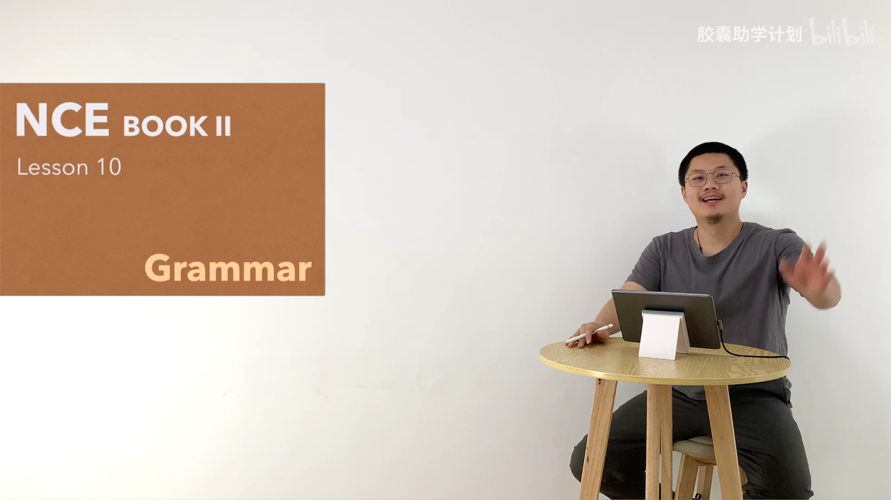

文字识别：胶囊助学计划 / NCE / BOOKII / Lesson 10 / Grammar

### 画面 00:00:02

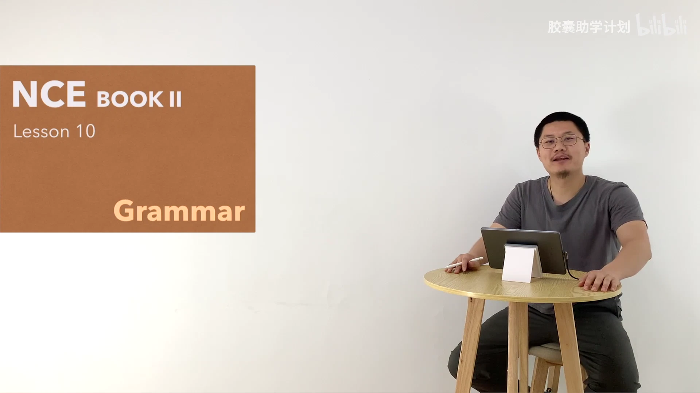

文字识别：胶囊助学计划 / NCE / BOOK "I / Lesson 10 / Grammar

### 画面 00:00:05

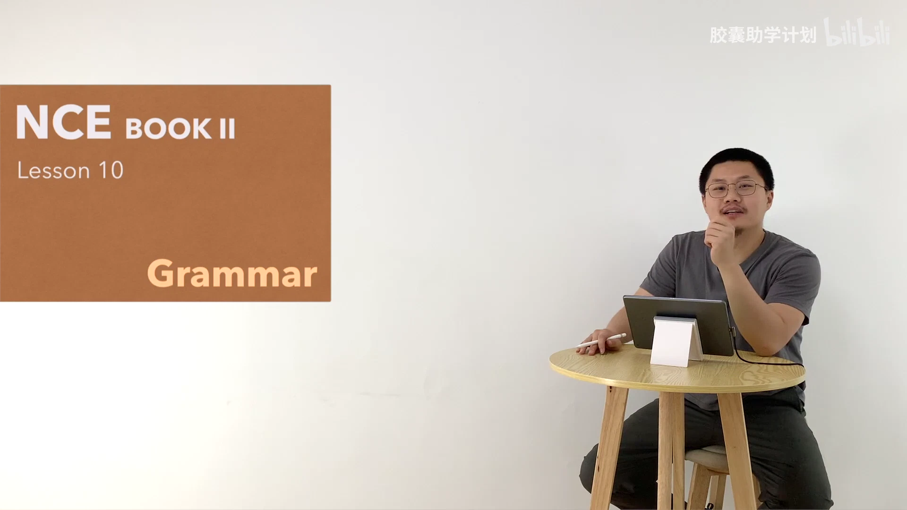

文字识别：胶囊助学计划 / NCE / BOOKII / Lesson 10 / Grammar

### 画面 00:00:08

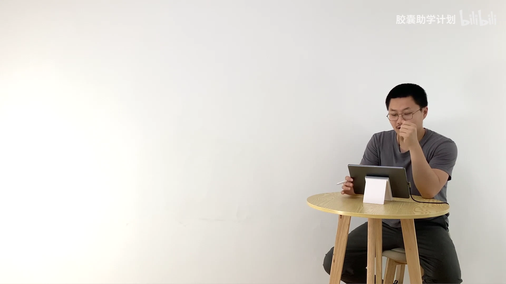

文字识别：胶囊助学计划

### 画面 00:00:10

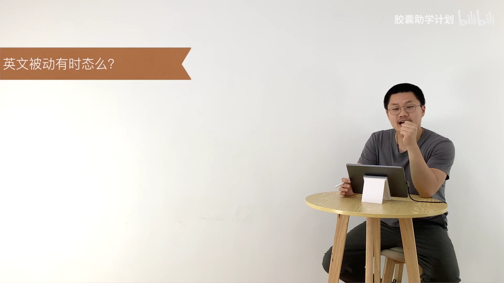

文字识别：胶囊助学计划 / 英文被动有时态么?

### 画面 00:00:12

文字识别：胶囊助学计划 / ① 英文被动有时态么？

### 画面 00:00:16

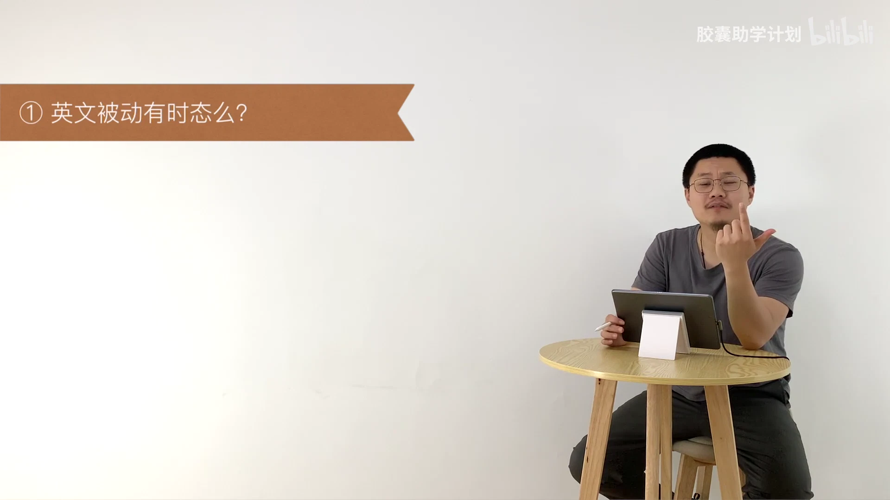

文字识别：胶囊助学计划 / ①英文被动有时态么？

### 画面 00:00:18

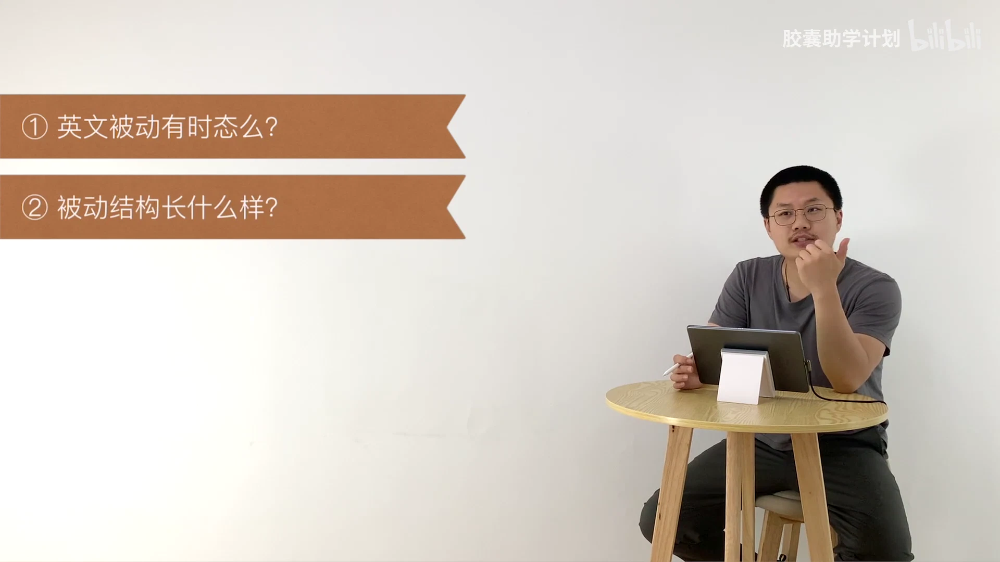

文字识别：胶囊助学计划 / ①英文被动有时态么？ / 被动结构长什么样?

### 画面 00:00:20

文字识别：胶囊助学计划 / ①英文被动有时态么? / 被动结构长什么样?

### 画面 00:00:22

文字识别：胶囊助学计划 / ①英文被动有时态么? / 被动结构长什么样?

### 画面 00:00:24

文字识别：胶囊助学计划 bilbl

### 画面 00:00:27

文字识别：胶囊助学计划

### 画面 00:00:29

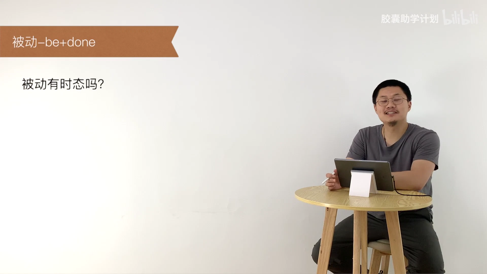

文字识别：胶囊助学计划 / 被动-be+done / 被动有时态吗?

## 00:00:30–00:01:00

一个问题啊，被动到底有没有时态这件事情啊？首先呢，我们看一些汉语啊，我们拿汉语尝试去猜测一下，昨天被打了，天天都挨打，和刚刚被打了，这明显就是我们刚刚学过的，对吧？前十课学过的时态，昨天被打了，一边一般过去时，天天都挨打，一般现在时，陈述一个生活习惯，只不过这个生活习惯是被动的，对吧？然后刚

### 画面 00:00:34

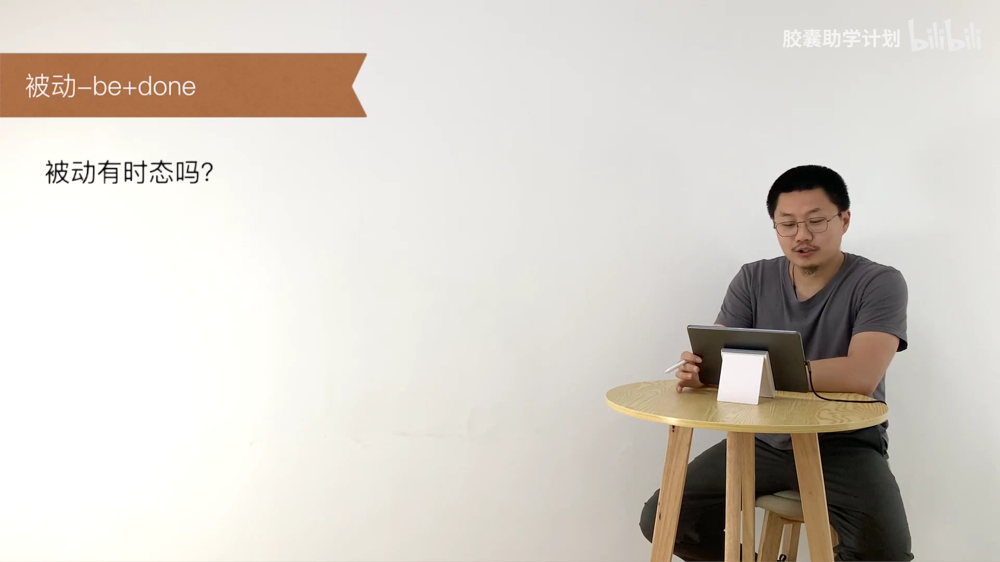

文字识别：胶囊助学计划 / 被动-be+done / 被动有时态吗?

### 画面 00:00:44

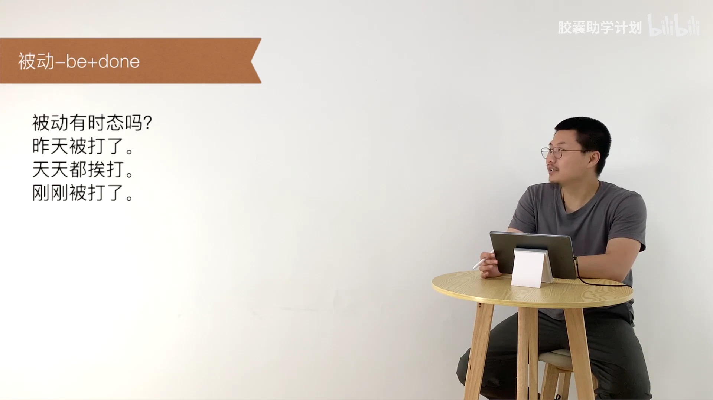

文字识别：胶囊助学计划 / 被动-be+done / 被动有时态吗? / 昨天被打了。 / 天天都挨打。 / 刚刚被打了。

### 画面 00:00:50

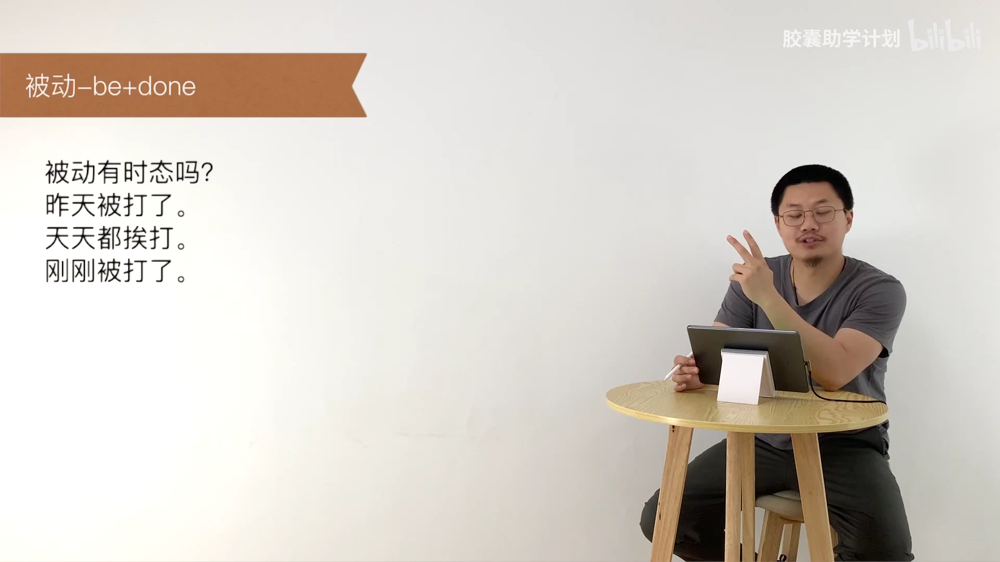

文字识别：胶囊助学计划 / 被动-be+done / 被动有时态吗? / 昨天被打了。 / 天天都挨打。 / 刚刚被打了。

### 画面 00:00:57

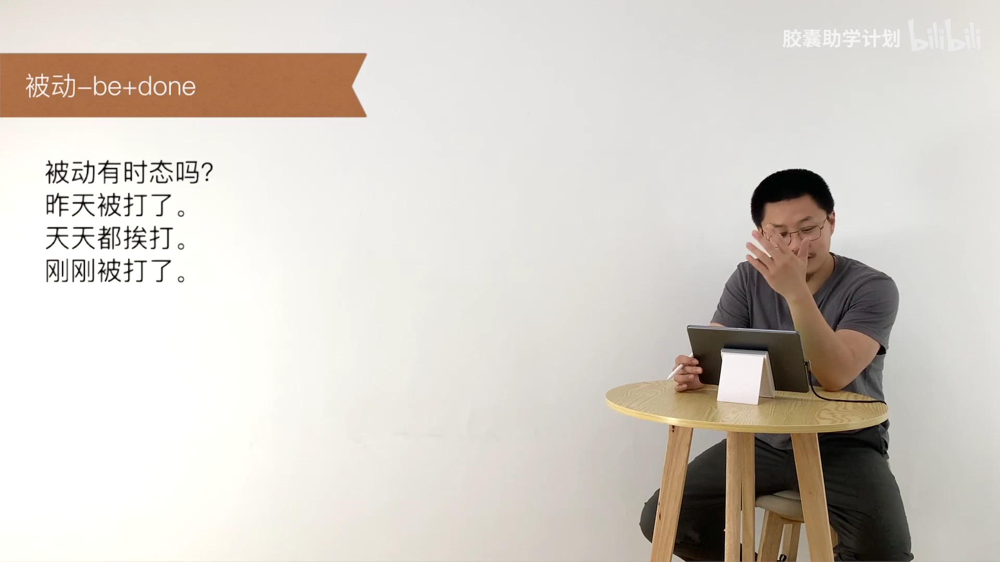

文字识别：胶囊助学计划 / 被动-be+done / 被动有时态吗? / 昨天被打了。 / C / 天天都挨打。 / 刚刚被打了。

## 00:01:00–00:01:30

刚被打了，你现在完成时，这个事情刚刚结束，对现在有一个影响，鼻青脸肿，对吧？OK，所以呢，各位要注意，首先我们的答案是被动是有时态的，那被动的结构在上面我给大家标出来了，be加但，在这儿呢，我又告诉各位说，be实际上表示的是时态，但表示的是被动。我们先看一下be和但这两个单词，我们熟不熟悉啊？我们先看一

### 画面 00:01:02

文字识别：胶囊助学计划 / 被动-be+done / 被动有时态吗? / 昨天被打了。 / 天天都挨打。 / 刚刚被打了。

### 画面 00:01:05

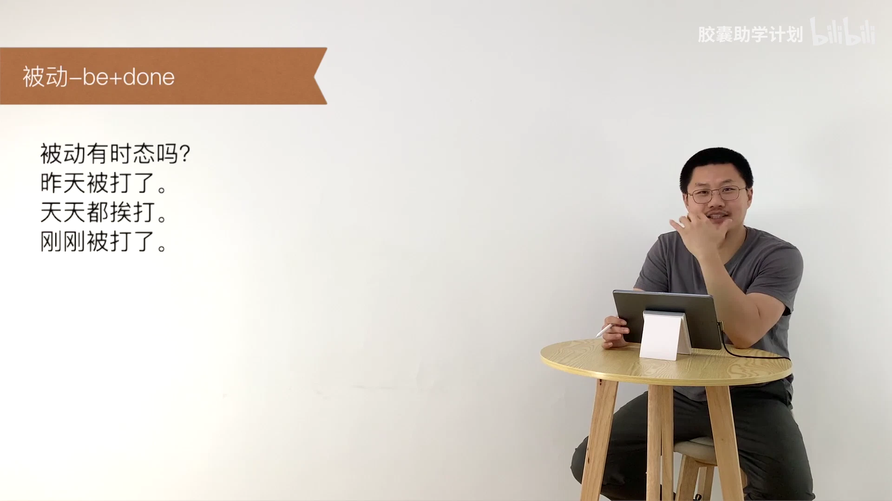

文字识别：胶囊助学计划 / 被动-be+done / 被动有时态吗? / 昨天被打了。 / 天天都挨打。 / 刚刚被打了。

### 画面 00:01:08

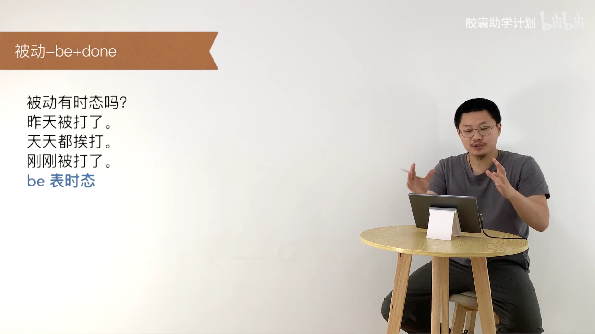

文字识别：胶囊助学计划 / 被动-be+done / 被动有时态吗? / 昨天被打了。 / 天天都挨打。 / 刚刚被打了。 / be表时态

### 画面 00:01:12

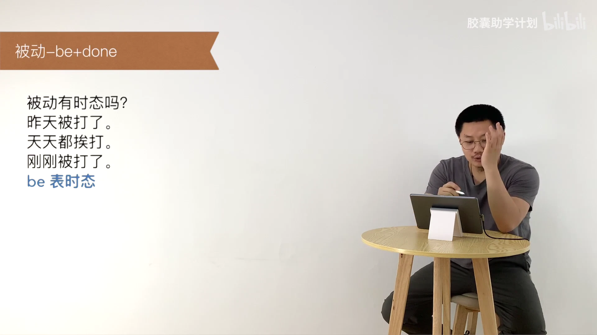

文字识别：胶囊助学计划 / 被动-be+done / 被动有时态吗? / 昨天被打了。 / 天天都挨打。 / 刚刚被打了。 / be表时态

### 画面 00:01:14

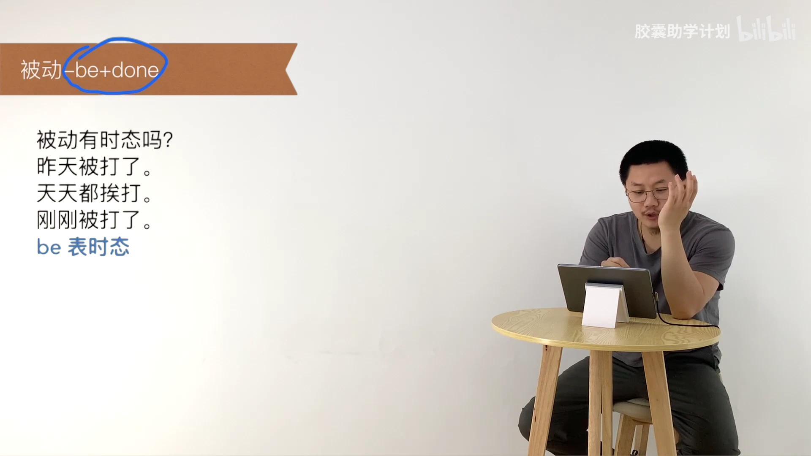

文字识别：胶囊助学计划 / 被动-be+done / 被动有时态吗? / 昨天被打了。 / 天天都挨打。 / 刚刚被打了。 / be表时态

### 画面 00:01:20

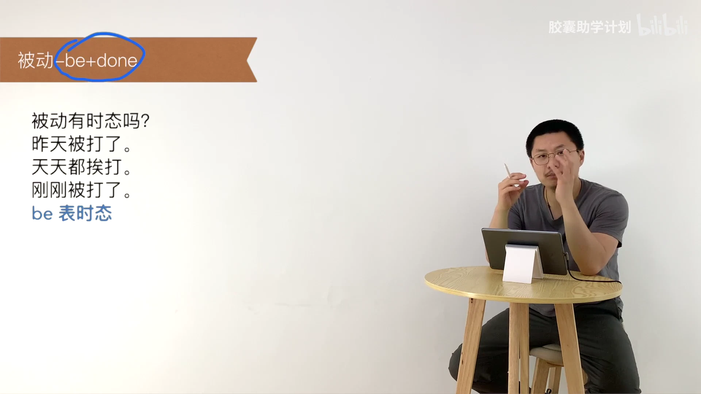

文字识别：胶囊助学计划 / 被动-be+done / 被动有时态吗? / 昨天被打了。 / 天天都挨打。 / 刚刚被打了。 / be表时态

### 画面 00:01:23

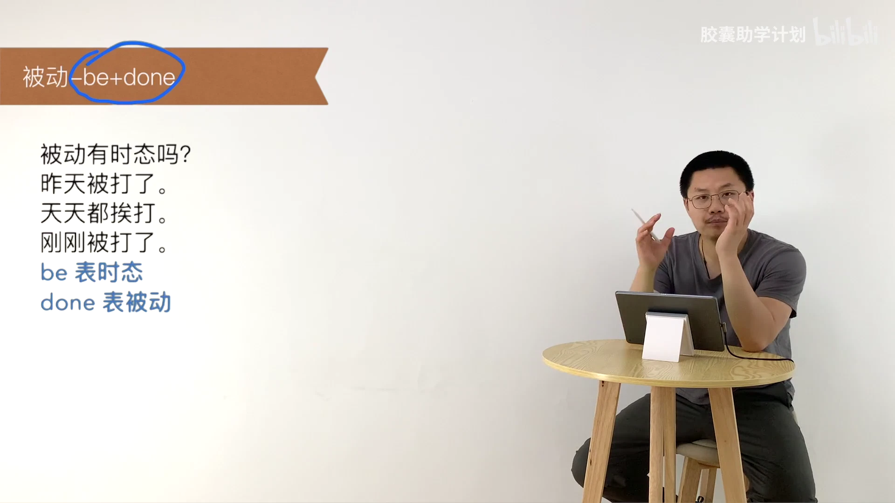

文字识别：胶囊助学计划 / 被动-be+done / 被动有时态吗? / 昨天被打了。 / 天天都挨打。 / 刚刚被打了。 / be表时态 / done 表被动

## 00:01:30–00:02:00

下 be， be 实际上我们很熟悉。我们现在至少应该知道它有如下几个情况。如果您学完前十课了的话，首先，am is are，其次，was were，再然后，be，这些单词都是 be 的某一种时态下的形式，对不对？那我们讲了 be 加但

### 画面 00:01:30

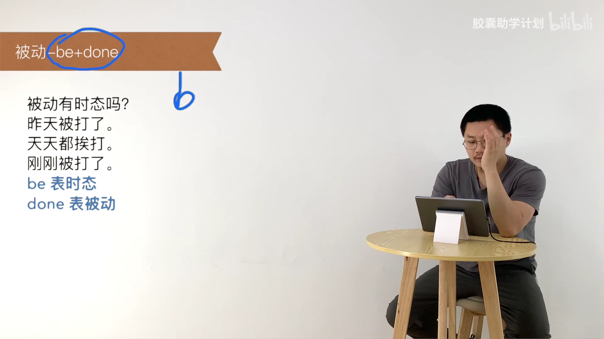

文字识别：胶囊助学计划 / 被动-be+done / 被动有时态吗? / 昨天被打了。 / 天天都挨打。 / 刚刚被打了。 / be表时态 / done 表被动

### 画面 00:01:32

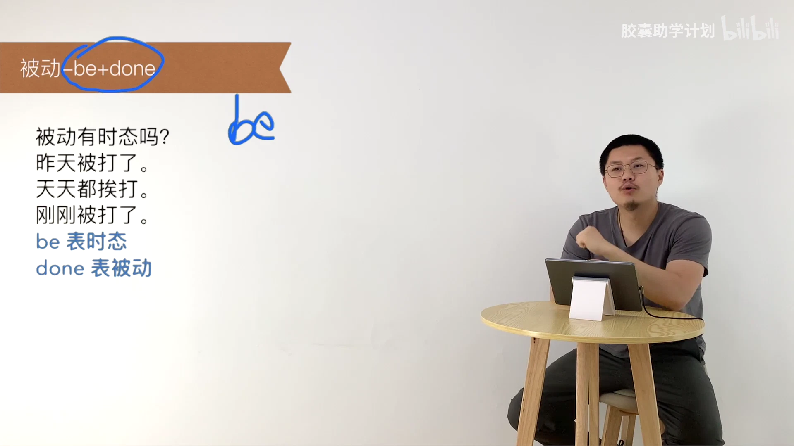

文字识别：胶囊助学计划 / 被动-be+done / be / 被动有时态吗? / 昨天被打了。 / 天天都挨打。 / 刚刚被打了。 / be表时态 / done 表被动

### 画面 00:01:39

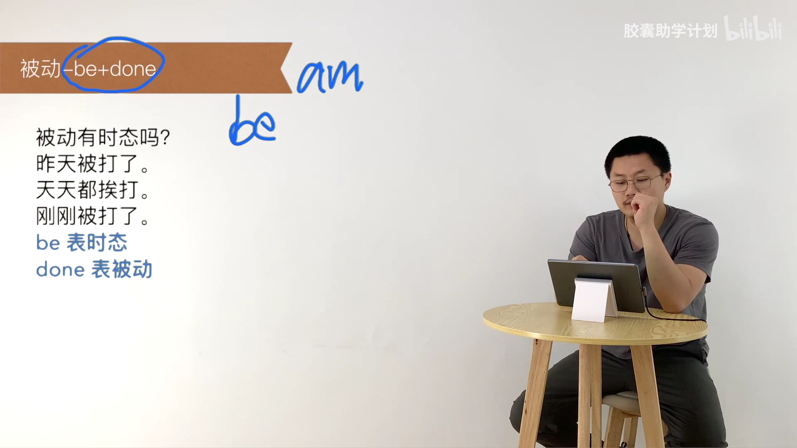

文字识别：Biltbili / 胶囊助学计划 / 被动-be+done / am / be / 被动有时态吗? / 昨天被打了。 / 天天都挨打。 / 刚刚被打了。 / be表时态 / done 表被动

### 画面 00:01:41

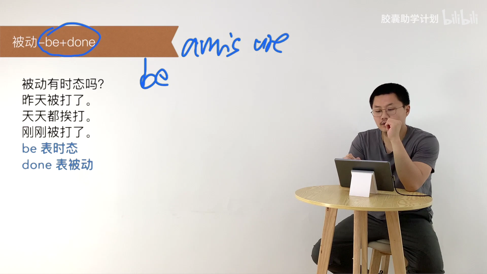

文字识别：Bilibili / 胶囊助学计划 / am's / ure / 被动-be+done / be / 被动有时态吗? / 昨天被打了。 / 天天都挨打。 / 刚刚被打了。 / be表时态 / done 表被动

### 画面 00:01:43

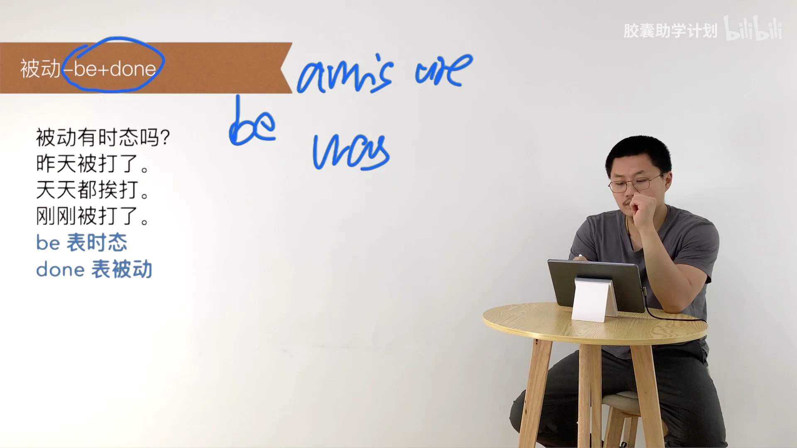

文字识别：Bibi / 胶囊助学计划 / am's / ure / 被动-be+done / be / 被动有时态吗? / WOy / 昨天被打了。 / 天天都挨打。 / 刚刚被打了。 / be表时态 / done 表被动

### 画面 00:01:45

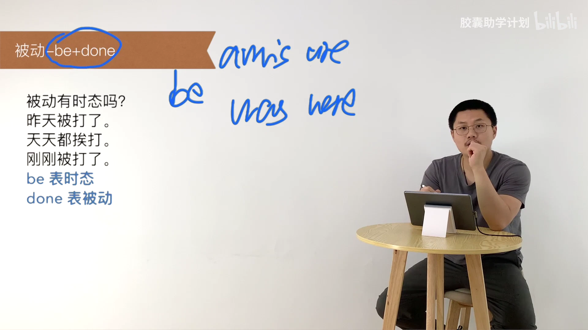

文字识别：Bibil / 胶囊助学计划 / am's / ure / 被动-be+done / be / were / 被动有时态吗? / WOy / 昨天被打了。 / 天天都挨打。 / 刚刚被打了。 / be表时态 / done 表被动

### 画面 00:01:47

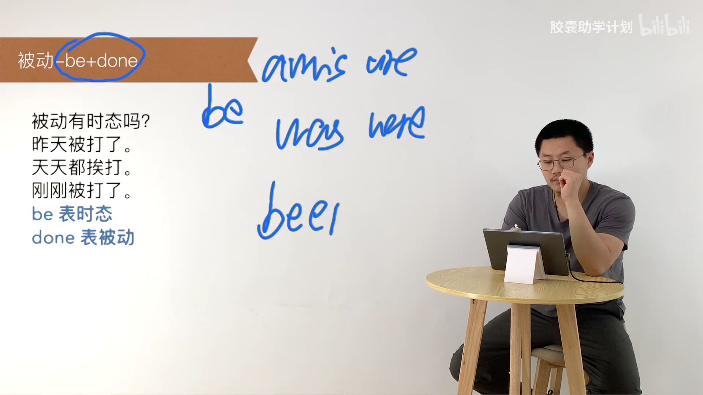

文字识别：Bilbil / 胶囊助学计划 / am's / ure / 被动-be+done / be / were / 被动有时态吗? / Woy / 昨天被打了。 / 天天都挨打。 / 刚刚被打了。 / beel / be表时态 / done 表被动

### 画面 00:01:50

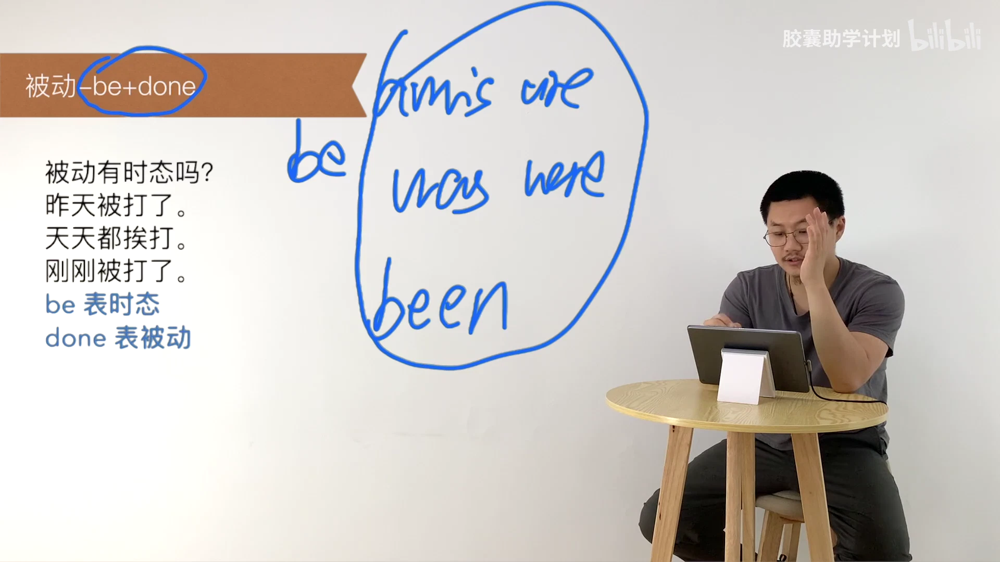

文字识别：Bilibili / 胶囊助学计划 / bmn's / ure / 被动-be+done / be / were / 被动有时态吗? / WOs / 昨天被打了。 / 天天都挨打。 / 刚刚被打了。 / been / be表时态 / done / 表被动

### 画面 00:01:52

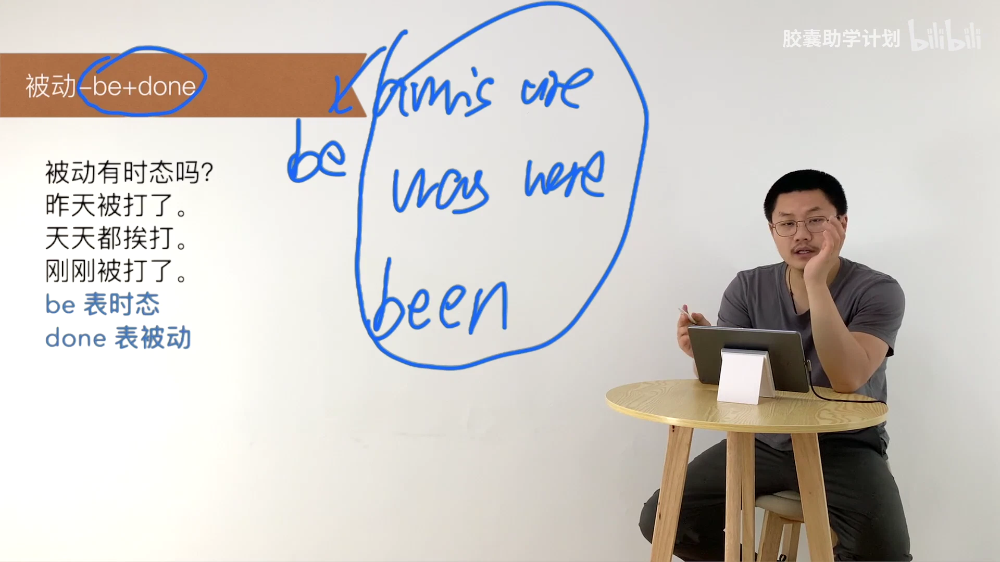

文字识别：Bilbli / 胶囊助学计划 / Khmns / ure / 被动-be+done / be / were / 被动有时态吗? / WOs / 昨天被打了。 / 天天都挨打。 / 刚刚被打了。 / been / be表时态 / done / 表被动

### 画面 00:01:56

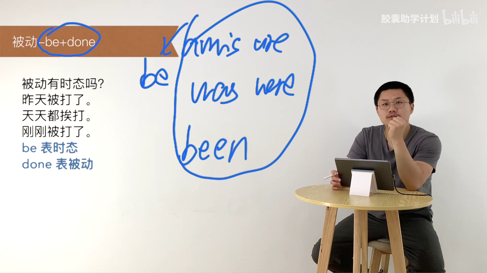

文字识别：Bibii / 胶囊助学计划 / Khmnis / ure / 被动-be+done / be / were / 被动有时态吗? / WOs / 昨天被打了。 / 天天都挨打。 / 刚刚被打了。 / been / be表时态 / done / 表被动

### 画面 00:01:59

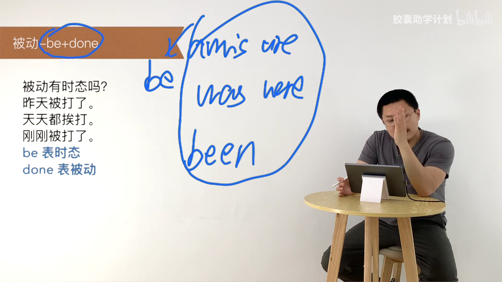

文字识别：胶囊助学计划 / Khmis / ure / 被动-be+done / be / were / 被动有时态吗? / WOs / 昨天被打了。 / 天天都挨打。 / 刚刚被打了。 / been / be表时态 / done / 表被动

## 00:02:00–00:02:30

是被动的基本结构， be 表示的是时态， but 表示的是被动。但我们既然学的是被动，各位记住啊， but 几乎就是永远不变的。那 but 在 have but 这个地方，过去分词我们学过了，那 be 就是要产生变化的。英文时态变化一定包含着结构上的变化，对吧？那我们接下来就一起看一下它有哪些结构上的变化。比如说，我们看第一个， am is are 加 but，

### 画面 00:02:03

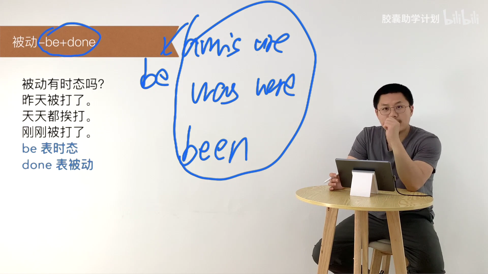

文字识别：胶囊助学计划 / Khmns / ure / 被动-be+done / be / were / 被动有时态吗? / WOs / 昨天被打了。 / 天天都挨打。 / 刚刚被打了。 / been / be表时态 / done / 表被动

### 画面 00:02:05

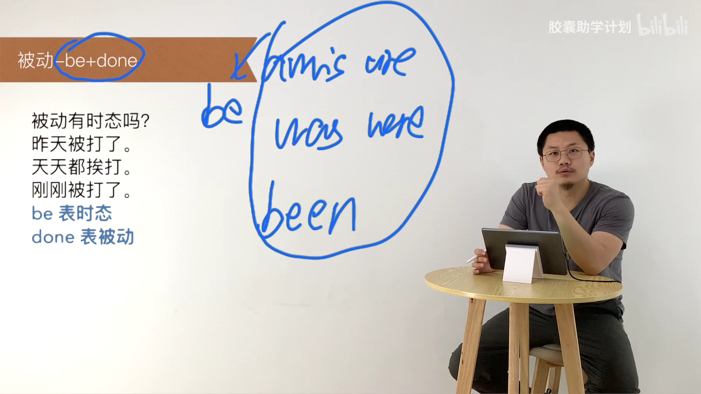

文字识别：Bilbli / 胶囊助学计划 / Khmnis / ure / 被动-be+done / be / were / 被动有时态吗? / WOs / 昨天被打了。 / 天天都挨打。 / 刚刚被打了。 / been / be表时态 / done / 表被动

### 画面 00:02:08

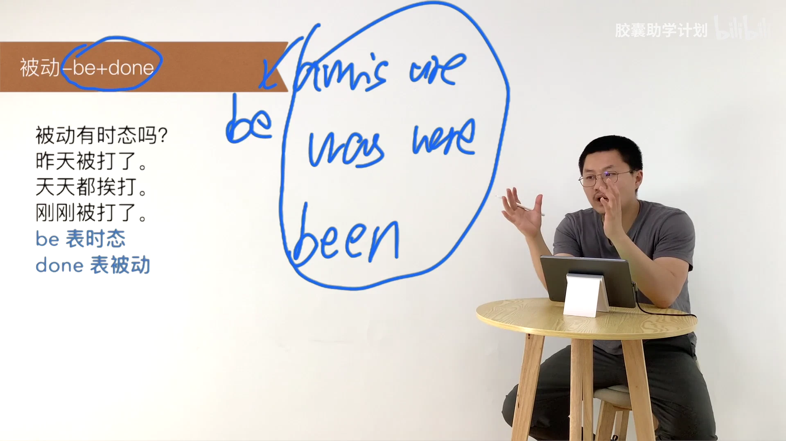

文字识别：胶囊助学计划 / Khms / ure / 被动-be+done / be / were / 被动有时态吗? / WOs / 昨天被打了。 / 天天都挨打。 / 刚刚被打了。 / been / be表时态 / done / 表被动

### 画面 00:02:14

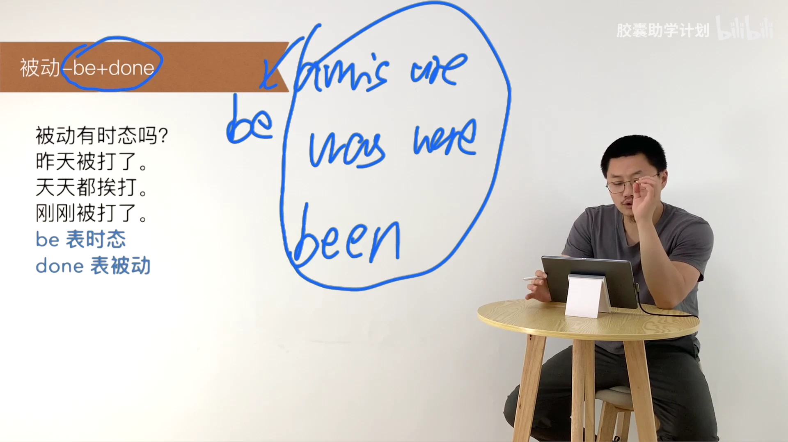

文字识别：胶囊助学计划 / khmns / ure / 被动-be+done / be / were / 被动有时态吗? / WOs / 昨天被打了。 / 天天都挨打。 / 刚刚被打了。 / been / be表时态 / done / 表被动

### 画面 00:02:16

文字识别：胶囊助学计划 / Khms / ure / 被动-be+done / be / were / 被动有时态吗? / WOs / 昨天被打了。 / 天天都挨打。 / 刚刚被打了。 / been / be表时态 / done / 表被动

### 画面 00:02:19

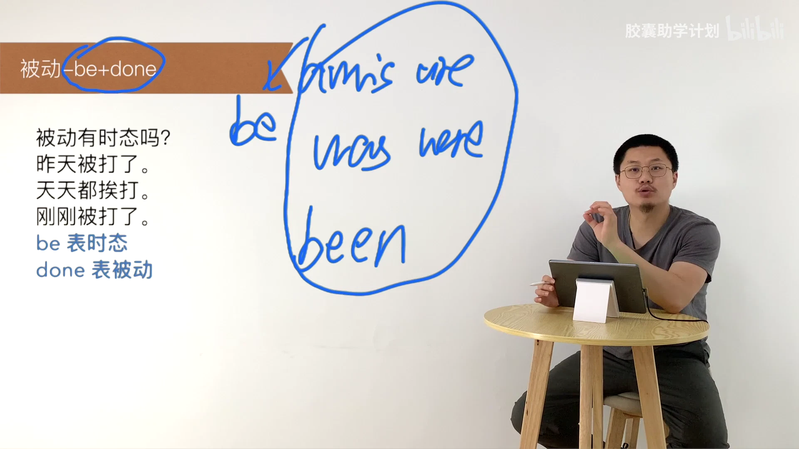

文字识别：胶囊助学计划 / khmns / ure / 被动-be+done / be / were / 被动有时态吗? / WOy / 昨天被打了。 / 天天都挨打。 / 刚刚被打了。 / been / be表时态 / done / 表被动

### 画面 00:02:21

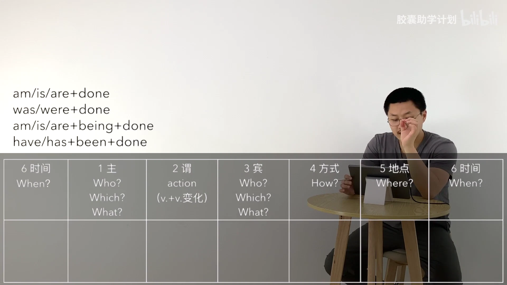

文字识别：胶囊助学计划 / am/is/are+done / was/were+done / am/is/are+being+done / have/has+been+done / 6时间 / 1主 / 2谓 / 3宾 / 4方式 / 5地点 / 6时间 / When? / Who? / action / Who? / How? / Where? / When? / Which? / (v.+v.变化) / Which? / What? / What?

## 00:02:30–00:03:00

你看dan不变，dan表被动，be表时态，M is R是什么时态之下用的？就是这个关键问题了，是不是一般现在时才用的？M is R陈述客观事实，对吧？I am a teacher，陈述客观事实，一般现在时，所以它就是一般现在时的被动，就是天天都挨打那句话。OK，那接下来第二个说What's word dan，dan

### 画面 00:02:51

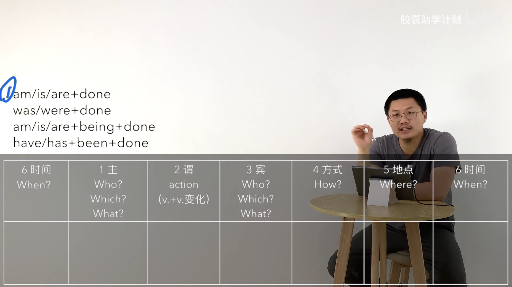

文字识别：am/is/are+done / was/were+done / am/is/are+being+done / have/has+been+done / 6时间 / 1主 / 2谓 / 3宾 / 4方式 / 5地点 / 6时间 / When? / Who? / action / Who? / How? / Where? / When? / Which? / (v.+v.变化) / Which? / What? / What?

## 00:03:00–00:03:30

但你发没发现还是不变，还是过去分词，它在这个地方表示的是被动。OK，那 was were 你要想 be 对吧，表示的是时态，什么时态之下用 was were 表时态对吧？什么情情况下用 was were？一般过去时，它就是一般过去时的被动，叫昨天挨打了，对吧？好，那你看啊， is 加 being 这个是各位不常见的，但最后还是有一个 but，但依旧表被动。然后下一个问

### 画面 00:03:21

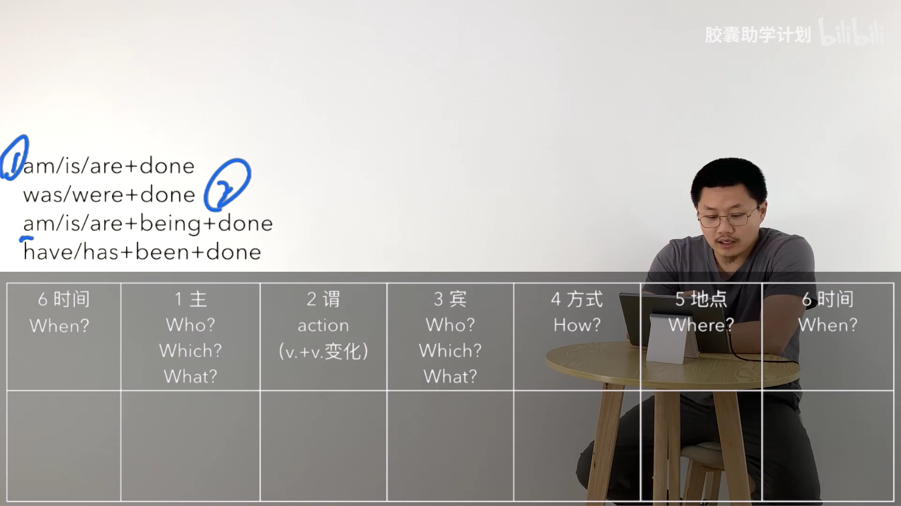

文字识别：胶囊助学计划 / am/is/are+done / was/were+done / am/is/are+being+done / have/has+been+done / 6时间 / 1主 / 2谓 / 3宾 / 4方式 / 5地点 / 6时间 / When? / Who? / action / Who? / How? / Where? / When? / Which? / (v.+v.变化) / Which? / What? / What?

### 画面 00:03:23

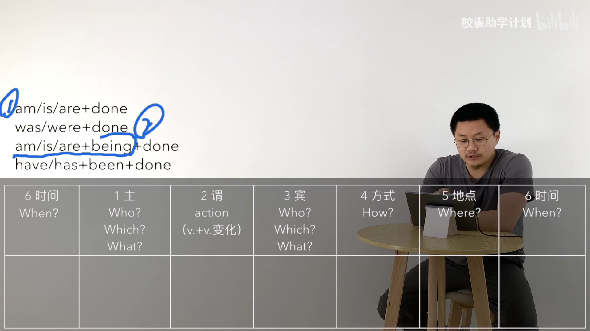

文字识别：胶囊助学计划 / am/is/are+done / was/were+done / am/is/are+being / Fdone / have/has+been+done / 6时间 / 1主 / 2谓 / 3宾 / 4方式 / 5地点 / 6时间 / When? / Who? / action / Who? / How? / Where? / When? / Which? / (v.+v.变化) / Which? / What? / What?

### 画面 00:03:26

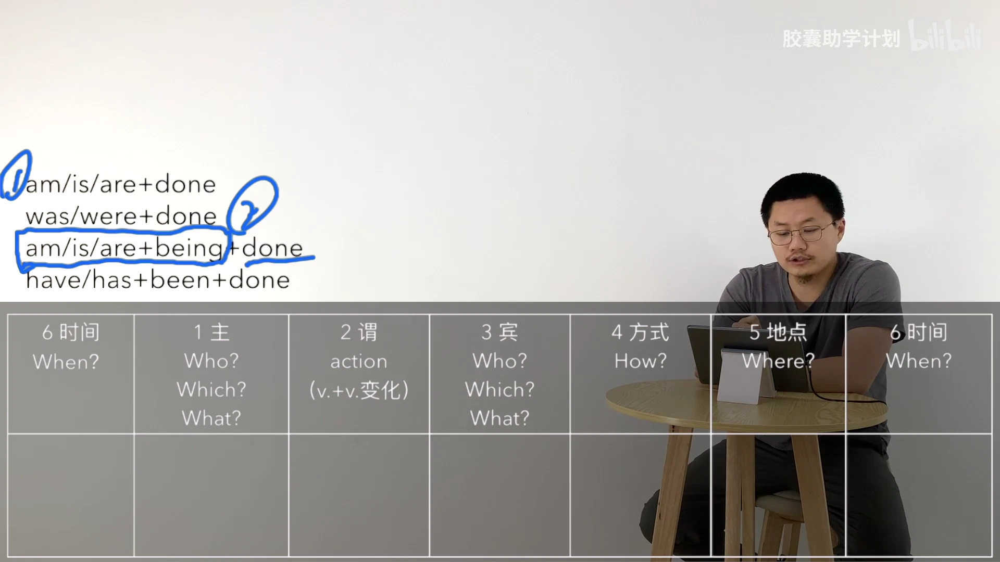

文字识别：胶囊助学计划 / am/is/are+done / was/were+done / am/is/are+being / Tdone / have/has+been+done / 6时间 / 1主 / 2谓 / 3宾 / 4方式 / 5地点 / 6时间 / When? / Who? / action / Who? / How? / Where? / When? / Which? / (v.+v.变化) / Which? / What? / What?

## 00:03:30–00:04:00

题就是 M S R 加 being，这是个什么时态？你看 M S R 加 being，你如果不熟悉，我把 being 给它换成 doing， M S R 加 doing，你可就熟了。这个叫什么时态？现在进行时，叫正在挨打呢，对吧？这个正在挨打是吧？ M S R 加 doing，只不过你想一下， be 这个单词这儿指的是动词的 I N G，对吧？那 be

### 画面 00:03:38

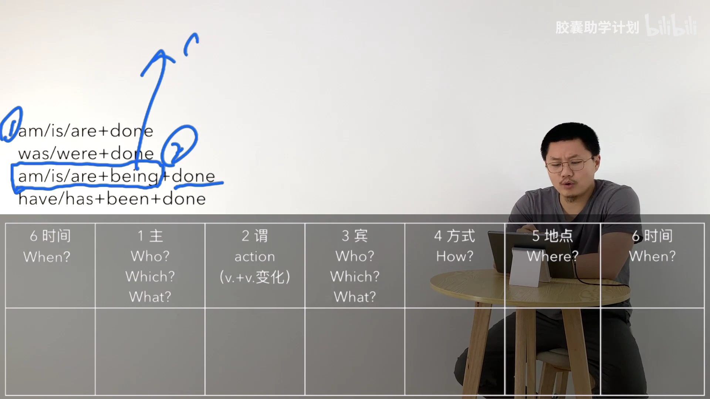

文字识别：胶囊助学计划 / am/is/are+done / was/were+done / am/is/are+being / Fdone / have/has+been+done / 6时间 / 1主 / 2谓 / 3宾 / 4方式 / 5地点 / 6时间 / When? / Who? / action / Who? / How? / Where? / When? / Which? / (v.+v.变化) / Which? / What? / What?

### 画面 00:03:40

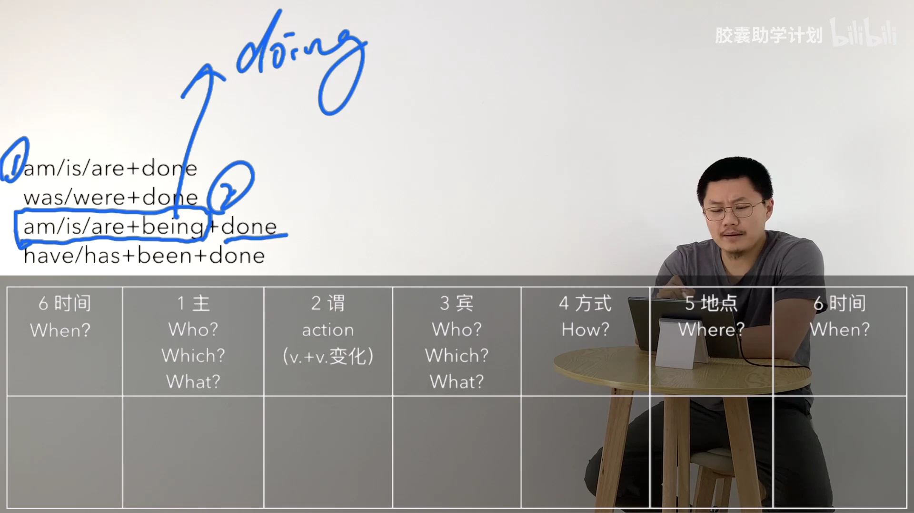

文字识别：doing / 胶囊助学计划 / am/is/are+done / was/were+dope / am/is/are+being / fdone / have/has+been+done / 6时间 / 1主 / 2谓 / 3宾 / 4方式 / 5地点 / 6时间 / When? / Who? / action / Who? / How? / Where? / When? / Which? / (v.+v.变化) / Which? / What? / What?

### 画面 00:03:42

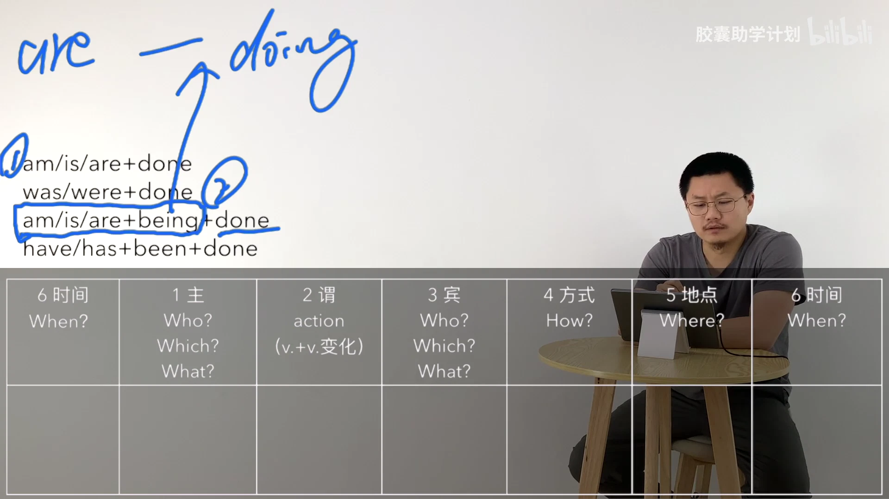

文字识别：doiny / 胶囊助学计划 / arc / am/is/are+done / was/were+done / am/is/are+being / fdone / have/has+been+done / 6时间 / 1主 / 2谓 / 3宾 / 4方式 / 5地点 / 6时间 / When? / Who? / action / Who? / How? / Where? / When? / Which? / (v.+v.变化) / Which? / What? / What?

### 画面 00:03:56

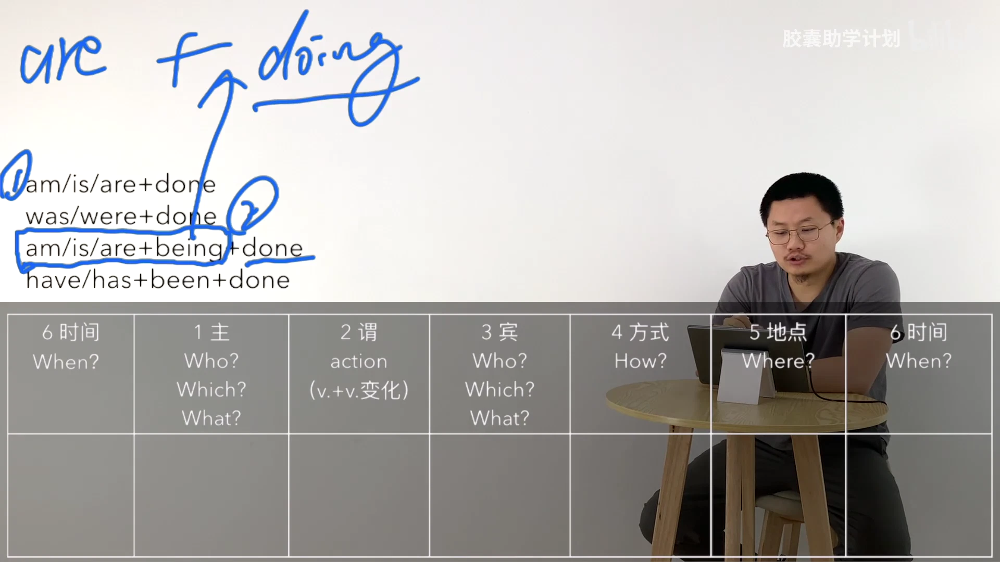

文字识别：dony / 胶囊助学计划 / arc / am/is/are+done / was/were+dope / am/is/are+being / Fdone / have/has+been+done / 6时间 / 1主 / 2谓 / 3宾 / 4方式 / 5地点 / 6时间 / When? / Who? / action / Who? / How? / Where? / When? / Which? / (v.+v.变化) / Which? / What? / What?

### 画面 00:03:58

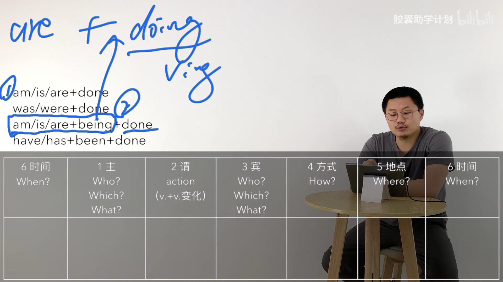

文字识别：din / 胶囊助学计划 / are / am/is/are+done / was/were+done / am/is/are+being / Fdone / have/has+been+done / 6时间 / 1主 / 2谓 / 3宾 / 4方式 / 5地点 / 6时间 / When? / Who? / action / Who? / How? / Where? / When? / Which? / (v.+v.变化) / Which? / What? / What?

## 00:04:00–00:04:30

这个单词，实际上它也有现在分词，就长成的叫做 being，放在这个句子当中永远不变。如果您在这儿听的有点懵，没事儿，一会儿我带着各位练啊，我只是尝试给大家推理一下这些结构是怎么来的，好吧？接下来我们再看最后一个叫 have has 加 been 再加待，那 have has been 这个可是常见了，对吧？I have been here for two hours. 我在这儿已经待了两个小

### 画面 00:04:00

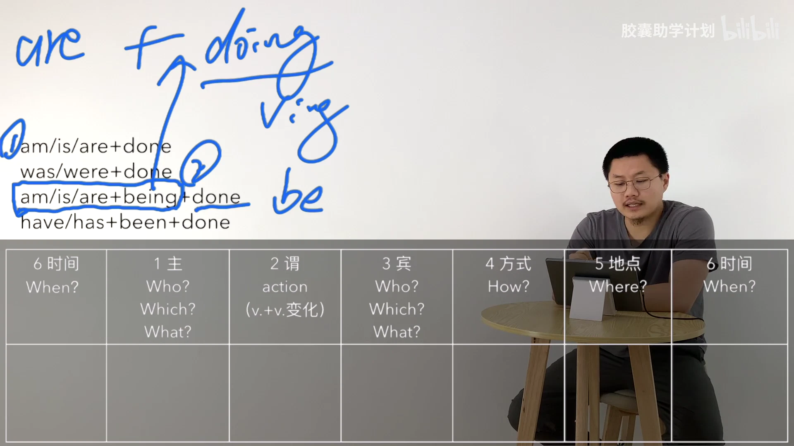

文字识别：胶囊助学计划 / arc / am/is/are+done / was/were+done / be / am/is/are+being / Fdone / have/has+been+done / 6时间 / 1主 / 2谓 / 3宾 / 4方式 / 5地点 / 6时间 / When? / Who? / action / Who? / How? / Where? / When? / Which? / (v.+v.变化) / Which? / What? / What?

### 画面 00:04:06

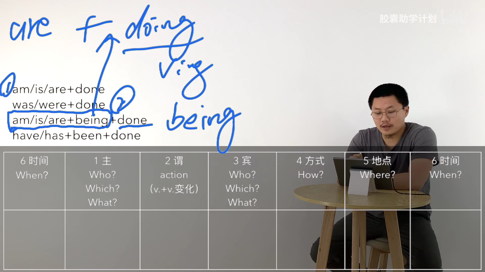

文字识别：胶囊助学计划 / arc / am/is/are+done / was/were+dope / being / am/is/are+being / Fdone / have/has+been+done / 6时间 / 1主 / 2谓 / 3宾 / 4方式 / 5地点 / 6时间 / When? / Who? / action / Who? / How? / Where? / When? / Which? / (v.+v.变化) / Which? / What? / What?

### 画面 00:04:14

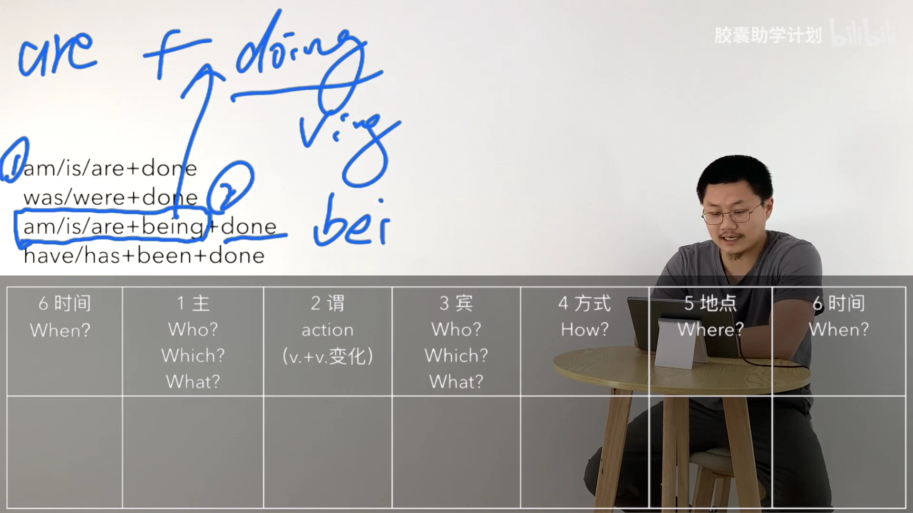

文字识别：胶囊助学计划 / arc / am/is/are+done / was/were+dope / bei / am/is/are+being / Fdone / have/has+been+done / 6时间 / 1主 / 2谓 / 3宾 / 4方式 / 5地点 / 6时间 / When? / Who? / action / Who? / How? / Where? / When? / Which? / (v.+v.变化) / Which? / What? / What?

### 画面 00:04:16

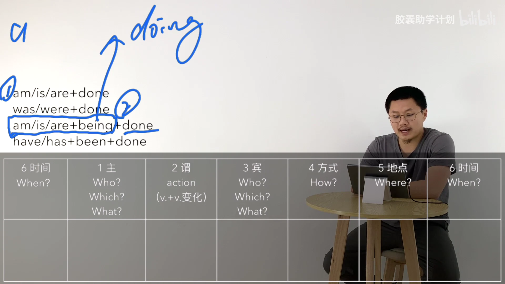

文字识别：doing / 胶囊助学计划 / am/is/are+done / was/were+dope / am/is/are+being / Fdone / have/has+been+done / 6时间 / 1主 / 2谓 / 3宾 / 4方式 / 5地点 / 6时间 / When? / Who? / action / Who? / How? / Where? / When? / Which? / (v.+v.变化) / Which? / What? / What?

### 画面 00:04:18

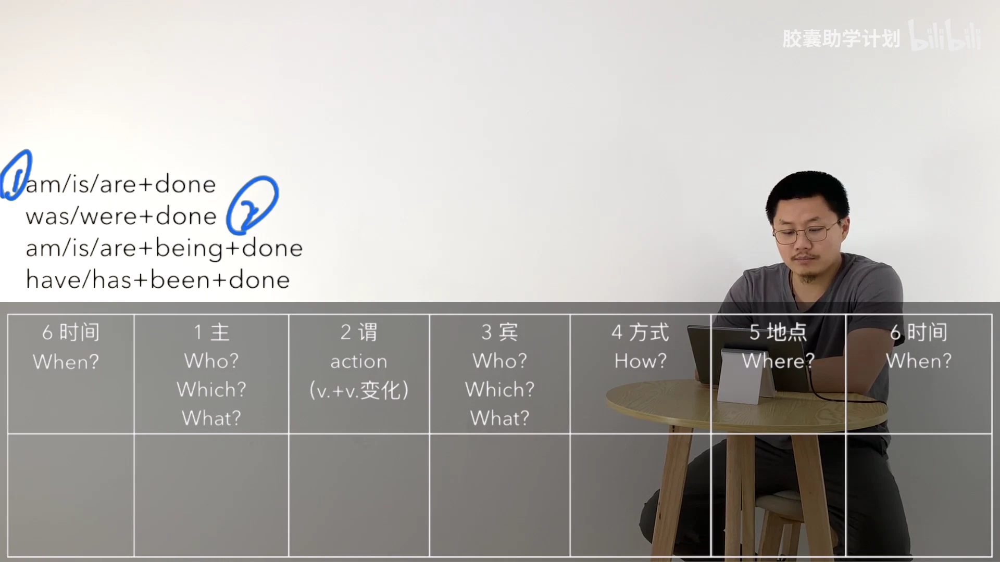

文字识别：胶囊助学计划 / am/is/are+done / was/were+done / am/is/are+being+done / have/has+been+done / 6时间 / 1主 / 2谓 / 3宾 / 4方式 / 5地点 / 6时间 / When? / Who? / action / Who? / How? / Where? / When? / Which? / (v.+v.变化) / Which? / What? / What?

### 画面 00:04:23

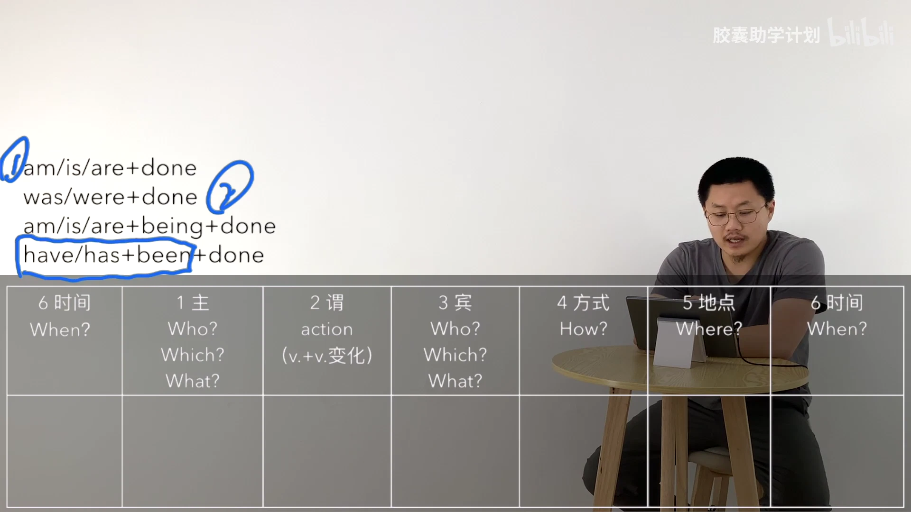

文字识别：胶囊助学计划 / am/is/are+done / was/were+done / am/is/are+being+done / have/has+been+done / 6时间 / 1主 / 2谓 / 3宾 / 4方式 / 5地点 / 6时间 / When? / Who? / action / Who? / How? / Where? / When? / Which? / (v.+v.变化) / Which? / What? / What?

### 画面 00:04:28

文字识别：胶囊助学计划 / am/is/are+done / was/were+done / am/is/are+being+done / have/has+been+done / 6时间 / 1主 / 2谓 / 3宾 / 4方式 / 5地点 / 6时间 / When? / Who? / action / Who? / How? / Where? / When? / Which? / (v.+v.变化) / Which? / What? / What?

## 00:04:30–00:05:00

了。Have加been，典型的现在完成时。那为什么还有一个has呢？由主语决定嘛。主语如果是he，那就是he has been there, has been here for two hours。这个是主动，后边你再去加一个than，就变成了现在完成时的被动。OK，这是我们这个视频当中重点要学习的四个结构。那这四个结构，各位注意，它都是非常关键的语法。六一二三四五六当中的二，动词加动

### 画面 00:04:44

文字识别：胶囊助学计划 / am/is/are+done / was/were+done / am/is/are+being+done / have/has+beenydone / 6时间 / 1主 / 2谓 / 3宾 / 4方式 / 5地点 / 6时间 / When? / Who? / action / Who? / How? / Where? / When? / Which? / (v.+v.变化) / Which? / What? / What?

### 画面 00:04:52

文字识别：胶囊助学计划 / am/is/are+done / was/were+done / m/is/are+being+done / have/has+beendone / 6时间 / 1主 / 2谓 / 3宾 / 4方式 / 5地点 / 6时间 / When? / Who? / action / Who? / How? / Where? / When? / Which? / (v.+v.变化) / Which? / What? / What?

### 画面 00:04:54

文字识别：胶囊助学计划 / am/is/are+done / was/were+done / m/is/are+being+done / have/has+beendone / 6时间 / 1主 / 2谓 / 3宾 / 4方式 / 5地点 / 6时间 / When? / Who? / actin / Who? / How? / Where? / When? / Which? / (V.+V.乏化） / Which? / What? / What?

## 00:05:00–00:05:30

词的变化，那接下来我们就进行一些造句和它的讲解练习啊。首先，am is are加但叫做，首先确定时态，它叫做陈述客观事实，只不过是被动的或生活习惯，只不过是被动的，对吧？每天都挨揍，这个也是被动的，虽然不是你的主动习惯了。OK，好，那接下来呢，我们尝试去造一些句子。我们先给大家一个肯定句啊，主动的叫 somebody cleans the office every day，说有这么一些人

### 画面 00:05:00

文字识别：胶囊助学计划 / am/is/are+done / was/were+done / am/is/are+being+done / have/has+been+done / 6时间 / 1主 / 2谓 / 3宾 / 4方式 / 5地点 / 6时间 / When? / Who? / action / Who? / How? / Where? / When? / Which? / (v.+v.变化) / Which? / What? / What?

### 画面 00:05:02

文字识别：胶囊助学计划 / am/is/are / +done

### 画面 00:05:10

文字识别：胶囊助学计划 / am/is/are / +done

### 画面 00:05:20

文字识别：胶囊助学计划 / am/is/are+done

### 画面 00:05:23

文字识别：胶囊助学计划 / am/is/are+done / Somebody cleans the office everyday.

## 00:05:30–00:06:00

people who clean the office every day. Every day, they clean the office every day. Every day, they clean the office every day. Every day, they clean the office every day. Every day, they clean the office every day. Every day, they clean the office every day. Every day, they clean the office every day. Every day, they clean the office every day. Every day, they clean the office every day. Every day, they clean the office every day. Every day, they clean the office every day. Every day, they clean the office every day. Every day, they clean the office every day. Every day, they clean the office every day. Every day, they clean the office every day. Every day, they clean the office every day. Every day, they clean the office every

### 画面 00:05:32

文字识别：胶囊助学计划 / am/is/are+done / Somebody cleans the office everyday. / △

### 画面 00:05:37

文字识别：am/is/are+done / Somebody cleans the office everyday. / △

### 画面 00:05:44

文字识别：胶囊助学计划 / am/is/are+done / Somebody cleans the office everyday. / △

### 画面 00:05:47

文字识别：am/is/are+done / Somebody cleans the office everyday. / △

### 画面 00:05:53

文字识别：胶囊助学计划 / am/is/are+done / Somebody cleans the office everyday. / △

### 画面 00:05:56

文字识别：胶囊助学计划 / am/is/are+done / Somebody cleans the office everyday.

### 画面 00:05:58

文字识别：胶囊助学计划 / am/is/are+done / Somebody / cleansthe office everyday.

## 00:06:00–00:06:30

调到了一这个位置，从语序上对吧？就是 the office。其次，接下来说它每天被打扫，你就不能用 cleans 了，你要用的是它的被动，叫 am is r 加 but 这个结构。于是这句话就变成了叫做 the office is cleaned every day。 is 加 cleaned，陈述的就是一个客观事实或生活习惯，一般现在时的被动 am is r 加

### 画面 00:06:06

文字识别：胶囊助学计划 / am/is/are+done / Somebody / cleansthe office everyday.

### 画面 00:06:10

文字识别：胶囊助学计划 / am/is/are+done / Somebody / cleansthe office everyday.

### 画面 00:06:12

文字识别：胶囊助学计划 / am/is/are+done / Somebody / cleansthe officeeveryday.

### 画面 00:06:15

文字识别：胶囊助学计划 / am/is/are+done / Somebody / cleans the office everyday. / The office is cleaned everyday.

### 画面 00:06:17

文字识别：胶囊助学计划 / am/is/are+done / Somebody cleans the office everyday. / The office is cleaned everyday.

### 画面 00:06:20

文字识别：胶囊助学计划 / am/is/are+done / Somebody cleans the office everyday. / The office is cleaned everyday.

### 画面 00:06:26

文字识别：胶囊助学计划 / am/is/are+done / Somebody cleans the office everyday. / The officeis cleanedeveryday.

## 00:06:30–00:07:00

但，但你要注意主语这个地方一定是办公室了，不是某人每天被打扫了，对吧？OK，那每天吧，它的否定和一般疑问句其实特别的简单，因为各位学到今天见到am is are这三个单词，你已经没有别的想法了，见到它就是在它后边加not变否定，把它提到句首变一般疑问句，被动也并不例外。比如说，the office is not cleaned every day，并不是每

### 画面 00:06:37

文字识别：胶囊助学计划 / am/is/are+done / Somebody cleans the office everyday. / The office is cleaned everyday.

### 画面 00:06:39

文字识别：胶囊助学计划 / am/is/are+done / Somebody cleans the office everyday. / The office is cleaned everyday.

### 画面 00:06:55

文字识别：胶囊助学计划 / am/is/are+done / Somebody cleans the office everyday. / The office is cleaned everyday. / The office is not cleaned everyday.

## 00:07:00–00:07:30

天都被打扫的，或者是我想问叫做 is提前 is the office cleaned every day? Okay, is加cleaned被动，非常的舒服。Okay,好 continue我们说 stamps in the post office都是新意单词 post office邮局 stamps邮票。那在这个地方我给了你一个单词叫做 sell叫做卖，那肯定是被卖对吧？啊，我们说邮局卖邮票，或邮

### 画面 00:07:10

文字识别：胶囊助学计划 / am/is/are+done / Somebody cleans the office everyday. / The office is cleaned everyday. / The office is not cleaned everyday. / Is the office cleaned everyday?

### 画面 00:07:13

文字识别：POST OFFICE / 胶囊助学计划 / am/is/are+done

### 画面 00:07:19

文字识别：POST OFFICE / 胶囊助学计划 / am/is/are+done / Stamps / in a post office.(sell)

### 画面 00:07:28

文字识别：POST OFFICE / 胶囊助学计划 / am/is/are+done / Stamps / in a post office.(sell)

## 00:07:30–00:08:00

票在邮局可以买。汉语这其实也是被动，只不过我们不用把“被”这个字儿总带着。英文呢，注意它是结构上的语言，所以第一个肯定是M A Z选一个，第二个肯定是动词的“done”这个结构，对吧？那M A Z选谁呢？这个就不用我教了，新一咱们学过太多次了。复数把“r”放在这个地方，对吧？好，接下来的“done”就是“sail”的“done”，就是“sold”，对吧？叫做“stamps are sold in a post office”。

### 画面 00:07:39

文字识别：POST OFFICE / 胶囊助学计划 / am/is/are+done / Stamps / in a post office.(sell)

### 画面 00:07:41

文字识别：POST / OFFICE / 胶囊助学计划 / am/is/are+done / Stamps / in a post office.(sell)

### 画面 00:07:43

文字识别：POST / OFFICE / 胶囊助学计划 / am/is/are)+done / Stamps / in a post office.(sell)

### 画面 00:07:49

文字识别：POST / OFFICE / 胶囊助学计划 / am/is/arej+done / Stamps / in a post office.(sell)

### 画面 00:07:59

文字识别：POST / OFFICE / 胶囊助学计划 / am/is/arej+done / Stamps / in a post office.(sell)

## 00:08:00–00:08:30

there you go. This is the simplest. Next, the next one is not difficult. It's called was were added. It's just that we replaced the "amazar" with "was were." So this becomes the simple past passive. Okay, let's make a sentence. Here we go. They built this house in 1921. They built this house in 1921. They built this house in 1921. They built this house in 1921. They built this house in 1921. They built this house in 1921. They built this house in 1921. They built this house in 1921. They built this house in 1921. They built this

### 画面 00:08:01

文字识别：胶囊助学计划 / was/were / +done

### 画面 00:08:06

文字识别：胶囊助学计划 / was/were / +done

### 画面 00:08:13

文字识别：胶囊助学计划 / was/were+done

### 画面 00:08:21

文字识别：胶囊助学计划 / was/were+done / They built this house in 1921.

### 画面 00:08:24

文字识别：胶囊助学计划 / was/were+done / They built this house in 1921.

### 画面 00:08:26

文字识别：胶囊助学计划 / was/were+done / They built this house in 1921.

## 00:08:30–00:09:00

谁被建造？一定是这个房子被建造，叫做 this house，对吧？接下来我们确定它的时态是一般过去时，那选择的结构就是 was were 加 but。于是我们看一下这句话，叫做 this house was built。注意 was were 加动词，注意啊，这儿是过去分词，上面是过去式，只是他们俩长得一样。这个房子被建造在一九二一

### 画面 00:08:34

文字识别：胶囊助学计划 / was/were+done / 7 / They built this house in 1921.

### 画面 00:08:37

文字识别：胶囊助学计划 / was/were+done / They buit his house in 1921.

### 画面 00:08:39

文字识别：胶囊助学计划 / was/were+done / They buit this house in 1921.

### 画面 00:08:41

文字识别：胶囊助学计划 / was/were+done / this house in 1921. / They / built / This / house / was / builtin 1921 by t / them.

### 画面 00:08:43

文字识别：胶囊助学计划 / was/were+done / They byilt this house in 1921. / This house was built in 1921 by them.

### 画面 00:08:48

文字识别：胶囊助学计划 / was/were+done / They built this house in 1921. / This house was built in 1921 by them.

### 画面 00:08:50

文字识别：胶囊助学计划 / was/werefdone / They built this house in 1921. / This /  house was built in 1921 by them.

### 画面 00:08:53

文字识别：胶囊助学计划 / was/werefdone / Theybuilt this / house in 1921. / This / house was / built in 1921 by them.

### 画面 00:08:59

文字识别：胶囊助学计划 / was/werefdone / Theybuiltthis / house in 1921. / This / house was built / in 1921 by them.

## 00:09:00–00:09:30

年，注意后边专门给大家又多了两个小单词，叫做 by the，这个 by 指的是被他们啊。我们再翻译一下这句话，叫做这个房子是被建造于一九二一年的，被他们建造的。OK，跟我们汉语语序稍有不同，老习惯。那你说它的否定句怎么办？和一般疑问句怎么办？见到 was/were，我相信各位没有别的想法了，就是 was/were 后边加 not，was/were 提

### 画面 00:09:02

文字识别：胶囊助学计划 / was/werefdone / Theybuiltthis / house in / 1921 / This / house was / built / in 1921 / by them.

### 画面 00:09:04

文字识别：胶囊助学计划 / was/werefdone / Theybuilt chis / house in / 192 / This / house / was / built / in 1921 / by them.

### 画面 00:09:08

文字识别：胶囊助学计划 / was/werefdone / Theybuiltthis / house in / 192 / This / house / was / built / in 1921 / by them.

### 画面 00:09:19

文字识别：胶囊助学计划 / was/werefdone / Theybuiltthis / house in 192L / This / house was / built / in 1921 by them.

### 画面 00:09:21

文字识别：胶囊助学计划 / was/were+done / They built this house in 1921. / This house was built in 1921 by them.

### 画面 00:09:23

文字识别：胶囊助学计划 / was/were+done / They built this house in 1921. / This house was built in 1921 by them.

### 画面 00:09:25

文字识别：胶囊助学计划 / was/were+done / They built this house in 1921. / This house was built in 1921 by them.

### 画面 00:09:27

文字识别：胶囊助学计划 / was/were+done / They built this house in 1921. / This house was built in 1921 by them.

## 00:09:30–00:10:00

前对吧？没有别的想法了。 Okay, 那 was 提前叫做 was this house built in 1921? 以及 this house was not built in 1921. 好，和我们之前学的是保持一致的，所以我没有专门的去给大家罗列出来。 Okay, continue. 我们接着造句. Someone cleaned the office yesterday. 第一步找到主语，第二步公式带进去，剩下照抄就行了，就这么简单。张嘴跟我读.

### 画面 00:09:31

文字识别：胶囊助学计划 / was/were+done / They built this house in 1921. / This house was built in 1921 by them.

### 画面 00:09:48

文字识别：胶囊助学计划 / was/were+done

### 画面 00:09:54

文字识别：胶囊助学计划 / was/were+done / Somebody cleaned the office yesterday.

### 画面 00:09:56

文字识别：胶囊助学计划 / was/were+done / Somebody cleaned the office yesterday.

### 画面 00:09:58

文字识别：胶囊助学计划 / was/were+done / Somebody cleaned the office yesterday.

## 00:10:00–00:10:30

The office was cleaned yesterday. Continue.说I to the party.我，你注意，invite叫做邀请。我邀请去了这个聚会，party。那就我被邀请，对吧？我被邀请之前的事情就是I was invited to the party. Okay, there you go.接下来我们再

### 画面 00:10:00

文字识别：胶囊助学计划 / was/were+done / Somebody cleaned the office yesterday. / The office was cleaned yesterday.

### 画面 00:10:04

文字识别：胶囊助学计划 / was/were+done

### 画面 00:10:09

文字识别：胶囊助学计划 / was/were+done / ①1 / to the party. (invite)

### 画面 00:10:12

文字识别：胶囊助学计划 / was/were+done / ①1 / to the party. (invite)

### 画面 00:10:15

文字识别：胶囊助学计划 / was/were+done / ①1 / to the party. (invite)

### 画面 00:10:19

文字识别：胶囊助学计划 / was/were+done / ①1 / to the party. (invite)

### 画面 00:10:23

文字识别：胶囊助学计划 / was/were+done / ①1 / to the party. (invite)

### 画面 00:10:25

文字识别：胶囊助学计划 / was/were+done / to the party. (invite) / 1

### 画面 00:10:28

文字识别：胶囊助学计划 / am/is/are / being / done

## 00:10:30–00:11:00

再看现在进行时。首先这两个合起来就是现在进行了，后边加上一个蛋，叫被动。Okay,注意am is are由主语确定，蛋换成动词的蛋，being永远保持不变。我们看一下如何变的啊？说Somebody is painting the room.某个人正在刷这个门。把它想变成叫做这个门正在被刷。门主语the door，

### 画面 00:10:30

文字识别：胶囊助学计划 / am/is/are / being / done

### 画面 00:10:32

文字识别：胶囊助学计划 / am/is/are / being / done

### 画面 00:10:34

文字识别：胶囊助学计划 / am/is/are / being / done

### 画面 00:10:36

文字识别：胶囊助学计划 / am/is/are / being / done

### 画面 00:10:38

文字识别：胶囊助学计划 / am/is/are+being+done

### 画面 00:10:40

文字识别：胶囊助学计划 / am/is/are+being+done

### 画面 00:10:43

文字识别：胶囊助学计划 / V. / am/is/are+being+done

### 画面 00:10:51

文字识别：胶囊助学计划 / V. / am/is/are+being+done / Somebody is painting the door.

### 画面 00:10:54

文字识别：胶囊助学计划 / V. / am/is/are+being+done / Somebody is painting the door.

## 00:11:00–00:11:30

后边 M S R 选谁？这很容易，being 不变，现在是 painting，你要把它换成 painted，也就是 paint 的 and 的这个形式，过去分词。于是这句话就变成了 the door 主语 is being painted， is 在这儿挑出来的 being 保持不变，painted 表示的是动词的过去分词，但它指的是这个门现在正在被

### 画面 00:11:01

文字识别：胶囊助学计划 / V. / am/is/are+being+done / Somebody is painting the door.

### 画面 00:11:03

文字识别：胶囊助学计划 / V. / am/is/ale+being+done / Somebody is painting the door.

### 画面 00:11:08

文字识别：胶囊助学计划 / V. / am/is/aye+being+done / Somebody is painting the door.

### 画面 00:11:11

文字识别：胶囊助学计划 / am/is/aye+being+done / Somebody is painting the door. / The door is being painted.

### 画面 00:11:13

文字识别：胶囊助学计划 / am/is/are+being+done / Somebody is painting the door. / The door is being painted.

### 画面 00:11:15

文字识别：胶囊助学计划 / am/is/are+being+done / Somebody is painting the door. / The door is being painted.

### 画面 00:11:17

文字识别：胶囊助学计划 / am/is/are+being+done / Somebody is painting the door. / The door is being painted.

### 画面 00:11:19

文字识别：胶囊助学计划 / am/is/are+being+done / Somebody is painting the door. / The door is being painted.

### 画面 00:11:22

文字识别：胶囊助学计划 / am/is/are+being+done / Somebody is painting the door. / The door is being painted.

### 画面 00:11:25

文字识别：胶囊助学计划 / am/is/are+being+done / Somebody is painting the door. / The door is being painted.

### 画面 00:11:28

文字识别：胶囊助学计划 / am/is/are+being+done / Somebody is painting the door. / The door is being painted.

## 00:11:30–00:12:00

上漆，OK，请勿入内。Is being painted表示现在一个动作正在被进行。Continue想变一般疑问句和否定句，还是见到is二，各位没有别的想法，is提前就可以了。跟我读，Is the door being painted? OK，那说否定，The door is not being painted，就这么简单。There you go. Continue说They are

### 画面 00:11:35

文字识别：胶囊助学计划 / am/is/are+being+done / Somebody is painting the door. / The door is being painted.

### 画面 00:11:38

文字识别：胶囊助学计划 / am/is/are+being+done / Somebody is painting the door. / The door is being painted.

### 画面 00:11:40

文字识别：胶囊助学计划 / am/is/are+being+done / Somebody is painting the door. / The door is being painted. / Is the door being painted?

### 画面 00:11:42

文字识别：胶囊助学计划 / am/is/are+being+done / Somebody is painting the door. / The door is being painted. / Is the door being painted?

### 画面 00:11:44

文字识别：胶囊助学计划 / am/is/are+being+done / Somebody is painting the door. / The door is being painted. / Is the door being painted?

### 画面 00:11:48

文字识别：胶囊助学计划 / am/is/are+being+done / Somebody is painting the door. / The door is being painted. / Is the door being painted?

### 画面 00:11:51

文字识别：胶囊助学计划 / am/is/are+being+done / Somebody is painting the door. / The door is being painted. / Is the door being painted? / The door is not being painted.

### 画面 00:11:55

文字识别：胶囊助学计划 / am/is/are+being+done / Somebody is painting the door. / The door is being painted. / Is the door being painted? / The door is not being painted.

### 画面 00:11:57

文字识别：胶囊助学计划 / am/is/are+being+done

### 画面 00:11:59

文字识别：胶囊助学计划 / am/is/are+being+done / They are building a bridge.

## 00:12:00–00:12:30

are building a bridge. 这是现在进行时的主动。那我现在想说这个桥正在被建造。A bridge 提到句首，剩下就是套公式了。am is are 选谁？Being 不变，动词要变成过去分词。这句话就变成了 a bridge is being built. Be being done, 对吧？非常舒服这个结构。这个桥正在被建造。Here we go. Continue.

### 画面 00:12:06

文字识别：胶囊助学计划 / am/is/are+being+done / They are building a bridge.

### 画面 00:12:08

文字识别：胶囊助学计划 / am/is/are+being+done / They are building a bridge.

### 画面 00:12:10

文字识别：胶囊助学计划 / am/is/aretbeing+done / They are building a bridge.

### 画面 00:12:12

文字识别：胶囊助学计划 / am/is/are+being+done / They are building a bridge.

### 画面 00:12:14

文字识别：胶囊助学计划 / am/is/aretbeino+done / They are building a bridge.

### 画面 00:12:17

文字识别：胶囊助学计划 / am/is/are+being+done / They are / building a bridge. / ridge is / s being / built.

### 画面 00:12:19

文字识别：胶囊助学计划 / am/is/are+being+done / They are building a bridge. / A bridge is being built.

### 画面 00:12:23

文字识别：胶囊助学计划 / am/is/are+being+done / They are building a bridge. / A bridge is being built.

### 画面 00:12:28

文字识别：胶囊助学计划 / am/is/are+being+done / They are building a bridge. / A bridge is being / built.

## 00:12:30–00:13:00

Say my car is at the garage. 在这个修理车库呢，它正在被修理，正在被修理。 It选谁？Is对吧？Being不变。Repair再加上done，二者结合变成了repaired. Very good. Repair的过去分词. Continue. Say we are building a new rain road around around the city. 我们正在建

### 画面 00:12:30

文字识别：胶囊助学计划 / am/is/are+being+done / My car is at the garage.

### 画面 00:12:35

文字识别：胶囊助学计划 / am/is/are+being+done / My car is at the garage. / It / .(repair)

### 画面 00:12:38

文字识别：胶囊助学计划 / am/is/are+being+done / My car is at the garage. / It / .(repair)

### 画面 00:12:40

文字识别：胶囊助学计划 / am/is/are+being+done / My dar is at the garage. / It / .(repair)

### 画面 00:12:42

文字识别：胶囊助学计划 / am/is/are+being+done / Mydar is p the garage. / It / _.(repair)

### 画面 00:12:45

文字识别：胶囊助学计划 / am/is/are+being*done / Mypar is p the grage. / It / (repair)

### 画面 00:12:47

文字识别：胶囊助学计划 / am/is/are+being*done / It / (repair)

### 画面 00:12:51

文字识别：胶囊助学计划 / Third Ring Road / NR / am/is/are+being+done

### 画面 00:12:56

文字识别：胶囊助学计划 / Third Ring Road / NR / am/is/are+being+done / We are building a new ring road round the city.

## 00:13:00–00:13:30

ring road. Ring指的是我们说这个戒指啊，环形。那 ring road，五环、六环啊，北京的五环、四环、三环是吧？这个我们管它叫 ring road. Around the city,就是围绕着这个城市正在建造。那我们也可以说一个新的呃环环线正在被建造，对吧？主语先确定，叫做 a new ring road. 它往前一提，然后

### 画面 00:13:01

文字识别：胶囊助学计划 / Third Ring Road / NR / am/is/are+being+done / We are building a new ring road round the city.

### 画面 00:13:03

文字识别：胶囊助学计划 / Third Ring, Road / NR / am/is/are+being+done / We are building a new ring road round the city.

### 画面 00:13:06

文字识别：胶囊助学计划 / Third Ring Road / NR / am/is/are+being+done / We are building a new ring road round the city.

### 画面 00:13:19

文字识别：胶囊助学计划 / Third Ring Road / NR / am/is/are+being+done / We are building a new ring road round the city.

### 画面 00:13:25

文字识别：胶囊助学计划 / Third Ring Road / NR / am/is/are+being+done / We are building a new ring road round the city.

### 画面 00:13:27

文字识别：胶囊助学计划 / Third Ring Road / NR / am/is/are+being+done / We are building / a new ring roadround the city.

## 00:13:30–00:14:00

are building 就变成了 am is are being，但这个结构我们看一下，叫做 a new railroad is being built，对吧？正在被建造。玩一个 continue，说 someone is using the computer at the moment，有个人啊正在使用这个电脑。现在我们不知道是谁，于是我们说电脑正在被使用就行了。叫做 the computer

### 画面 00:13:30

文字识别：胶囊助学计划 / Third Ring Road / NR / am/is/are+being+done / We are building / a new ring roadround the city.

### 画面 00:13:32

文字识别：胶囊助学计划 / Third Ring Road / NR / am/is/are+being+done / We are building / a new ring road/round the city.

### 画面 00:13:34

文字识别：胶囊助学计划 / Third Ring Road / am/is/are+beingtdone / We are building / a new ring road/round the city.

### 画面 00:13:37

文字识别：胶囊助学计划 / Third Ring Road / am/is/are+being+done / We are / building / a new / ring road / roundt / I the city. / A new ring / road / round / the / city.

### 画面 00:13:39

文字识别：胶囊助学计划 / Third Ring Road / am/is/are+being+done / We are building a new ring road round the city. / A new ring road / .round the city.

### 画面 00:13:41

文字识别：胶囊助学计划 / Third Ring Road / am/is/are+being+done / We are building a new ring road round the city. / A new ring road / round the / city.

### 画面 00:13:44

文字识别：胶囊助学计划 / Third Ring Road / am/is/are+being+done / We are buildinga new / fing rbad round the city. / A new ring road / round the city.

### 画面 00:13:46

文字识别：胶囊助学计划 / am/is/are+being+done

### 画面 00:13:48

文字识别：胶囊助学计划 / am/is/are+being+done / Someone is using the computer at the moment.

### 画面 00:13:59

文字识别：胶囊助学计划 / am/is/are+being+done / Someone is using the computer at the moment. / The computer / at the moment.

## 00:14:00–00:14:30

is being used at the moment. There you go. Continue. 接下来我们看一个小的电影片段，当中就出现了叫做 are being overwritten，正在被覆盖，优先级正在被降低。 Okay. Sir, the telephone. I'm afraid my protocols are being overwritten. Stark, we need to talk. You have reached the life model decoy of Tony Stark. Please leave a message. This is urgent. Then leave it urgent.

### 画面 00:14:01

文字识别：胶囊助学计划 / am/is/are+being+done / Someone is Using the cbmputer at the moment. / The computer / at the moment.

### 画面 00:14:04

文字识别：胶囊助学计划 / am/is/are+being+done / Someone is Using the cbmplter at the moment. / The computer / at the moment.

### 画面 00:14:06

文字识别：are being overridden / 胶囊助学计划 / L / 复仇者联盟 / The Avengers / (2012)

### 画面 00:14:10

文字识别：are being overridden / 胶囊助学计划 / 复仇者联盟 / The Avengers / (2012)

### 画面 00:14:12

文字识别：are being overridden / 胶囊助学计划 / 复仇者联盟 / The Avengers / (2012)

### 画面 00:14:14

文字识别：are being overridden / 胶囊助学计划 / 复仇者联盟 / The Avengers / (2012)

### 画面 00:14:17

文字识别：are being overridden / 胶囊助学计划 / 复仇者联盟 / 先生您的电话 / The Avengers / Sir, the telephone. / (2012)

### 画面 00:14:19

文字识别：are being overridden / 胶囊助学计划 / 复仇者联盟 / 恐怕我的程序被人改写了 / The Avengers / I'm afraid my protocols are being overridden. / (2012)

### 画面 00:14:21

文字识别：are being overridden / 胶囊助学计划 / 复仇者联盟 / 斯塔克我们得谈谈 / The Avengers / Mr Stark, we need to talk. / (2012)

### 画面 00:14:23

文字识别：are being overridden / 胶囊助学计划 / 复仇者联盟 / The Avengers / (2012)

### 画面 00:14:25

文字识别：are being overridden / 胶囊助学计划 / 复仇者联盟 / 你现在看到的是托尼·斯塔克的虚拟影像 / The Avengers / You have reached the life model decoy of Tony Stark. / (2012)

### 画面 00:14:27

文字识别：are being overridden / 胶囊助学计划 / 复仇者联盟 / -有事请留言-是急事 / The Avengers / — Please leave a message. - This is urgent. / (2012)

### 画面 00:14:29

文字识别：are being overridden / 胶囊助学计划 / 复仇者联盟 / 那就说得急一点 / The Avengers / Then leave it urgently. / (2012)

## 00:14:30–00:15:00

breach. Okay, are being overwritten.而一个，接下来我们看最后一个关键的结构，叫 have has been 再加上 that，现在完成时的被动。我们先看一个句子，说 This room looks nice. Someone has cleaned it. 好，某个人已经把它打扫过了。那叫做这个先想被动，主语是这个房间已经被打扫过了，对吧？叫做 This room looks nice. It 指

### 画面 00:14:31

文字识别：are being overridden / 胶囊助学计划 / 复仇者联盟 / The Avengers / (2012)

### 画面 00:14:33

文字识别：are being overridden / 胶囊助学计划 / 复仇者联盟 / The Avengers / (2012)

### 画面 00:14:35

文字识别：胶囊助学计划 / have/has / been / done

### 画面 00:14:37

文字识别：胶囊助学计划 / have/has / been / done

### 画面 00:14:39

文字识别：胶囊助学计划 / have/has / been / done

### 画面 00:14:41

文字识别：胶囊助学计划 / have/has / been / done

### 画面 00:14:43

文字识别：胶囊助学计划 / have/has been done

### 画面 00:14:51

文字识别：胶囊助学计划 / have/has been done / This room looks nice, somebody has cleaned it.

## 00:15:00–00:15:30

的是这个房间，往里带就行了。Have还是has呢？Has been不变，但，是这个动作的过去分词。动作指的是clean，往里一放就行了。叫做It has been clean. Very good. 变成一般疑问句，各位看到Have has，你也没有别的太多想法了，把它提前就行了。叫做Has it been clean？和否定句叫做It hasn't been clean.

### 画面 00:15:02

文字识别：胶囊助学计划 / have/has been done / This room looks nice, somebody has cleaned it. / This room looks nice, It

### 画面 00:15:06

文字识别：胶囊助学计划 / have/has been done / This room looks nice, somebody has cleaned it. / This room looks nice, It

### 画面 00:15:08

文字识别：胶囊助学计划 / have/has been done / This room looks nice, somebody has cleaned it. / This room looks nice, It

### 画面 00:15:12

文字识别：胶囊助学计划 / have/has been done / This room looks nice, somebody has -leanedit. / This room looks nice, It

### 画面 00:15:25

文字识别：胶囊助学计划 / have/has been done / This room looks nice, somebody has sleanedit. / This room looks nice, It / Has it been cleaned? / It hasn't been cleaned.

## 00:15:30–00:16:00

There you go. Okay, that this lesson, actually, want to learn this lesson. You see, why it is put in the tenth lesson? It has several prerequisites. First, if our tense of active learn well, at least these four tenses: simple past tense, simple present tense, present continuous tense and present perfect tense. You active tense learn well, then passive is just a formula, right? Secondly, you see their negative and general questions are all by these four tenses. Active, if you learn well, passive is exactly the same. OK.

### 画面 00:15:32

文字识别：胶囊助学计划 / have/has beendone / This room looks nice, somebedy has -leaned it. / This room looks nice, It / Has it been cleaned? / It hasn't been cleaned.

### 画面 00:15:34

文字识别：胶囊助学计划 / have/has been done / This room looks nice, somebedy has leaned it. / This room looks nice, It / Has it been cleaned? / It hasn't been cleaned.

### 画面 00:15:38

文字识别：胶囊助学计划 / have/has been done / This room looks nice, somebody has sleanedit. / This room looks nice, It / Has it been cleaned? / It hasn't been cleaned.

### 画面 00:15:52

文字识别：胶囊助学计划 / have/has been done / This room looks nice, somebedy has leaned it. / This room looks nice, It / Has it been cleaned? / It hasn't been cleaned.

## 00:16:00–00:16:30

一模一样。OK，不多说了，我们再造一个句子。They have built a new hospital near the airport. Have built已经建造了，那我们变成被动就是把它提前，对不对？对吧？OK，叫做啊，应该应该提不到这儿是吧？应该提到这儿啊，提主语。A new hospital has been built near the airport. 已经被建造了，玩

### 画面 00:16:01

文字识别：胶囊助学计划 / have/has been done / This room looks nice, somebady has sleaned it. / This room looks nice, It / Has it been cleaned? / It hasn't been cleaned.

### 画面 00:16:03

文字识别：胶囊助学计划 / have/has been done / They have built a new hospital near the airport.

### 画面 00:16:05

文字识别：胶囊助学计划 / have/has been done / They have built a new hospital near the airport.

### 画面 00:16:10

文字识别：胶囊助学计划 / have/has been done / They have built a new hospital near the airport.

### 画面 00:16:15

文字识别：胶囊助学计划 / have/has been done / They have builta new hospital near the airport

### 画面 00:16:20

文字识别：胶囊助学计划 / have/has been done / They have builtanewhospital near the airpor. / A new hospital / near the / airport.

### 画面 00:16:25

文字识别：胶囊助学计划 / have/has been done / newhospitalnear the airport. / They have built / A new hospital / near the / airport.

### 画面 00:16:29

文字识别：胶囊助学计划 / have/has been done / They have built / newhospital / near the / airport. / A new hospital / near the / airport.

## 00:16:30–00:17:00

Very good。接下来我们还是看一个小电影片段，叫做《I have been told》，叫做我已经被别人告诉了这么一件事儿。I have been told of a certain sea snake which has a very unusual method of attracting its prey. It will lie at the bottom of the ocean as if wounded. Then its enemies will approach, and yet it will lie quite still. And then its enemies will take

### 画面 00:16:31

文字识别：I have been told... / 胶囊助学计划 / 角斗士 / Gladiator / (2000)

### 画面 00:16:38

文字识别：I have been told... / 胶囊助学计划 / 角斗士 / Gladiator / (2000)

### 画面 00:16:40

文字识别：I have been told... / 胶囊助学计划 / 角斗士 / 我听说有一种海蛇 / Gladiator / (2000) / I have been told of a certain sea snake

### 画面 00:16:42

文字识别：I have been told... / 胶囊助学计划 / 角斗士 / 我听说有一种海蛇 / Gladiator / (2000) / I have been told of a certain sea snake

### 画面 00:16:44

文字识别：I have been told... / 胶囊助学计划 / 角斗士 / 用非常特别的方法来诱捕猎物 / Gladiator / which has a very unusual method of attracting its prey. / (2000)

### 画面 00:16:46

文字识别：I have been told... / 胶囊助学计划 / 角斗士 / 用非常特别的方法来诱捕猎物 / Gladiator / which has a very unusual method of attracting its prey. / (2000)

### 画面 00:16:48

文字识别：I have been told... / 胶囊助学计划 / 角斗士 / 它会假装受伤躺在海底 / Gladiator / It will lie at the bottom of the ocean as ifwounded. / (2000)

### 画面 00:16:50

文字识别：I have been told... / 胶囊助学计划 / 角斗士 / 它会假装受伤躺在海底 / Gladiator / It will lie at the bottom of the ocean as ifwounded. / (2000)

### 画面 00:16:52

文字识别：I have been told... / 胶囊助学计划 / 角斗士 / 接着它的敌人会渐渐的靠近 / Gladiator / Then its enemies will approach, / (2000)

### 画面 00:16:54

文字识别：I have been told... / 胶囊助学计划 / 角斗士 / 它会继续躺着不动 / Gladiator / (2000) / and yet it will lie quite still.

### 画面 00:16:56

文字识别：I have been told... / 胶囊助学计划 / 角斗士 / 它会继续躺着不动 / Gladiator / (2000) / and yet it will lie quite still.

### 画面 00:16:58

文字识别：I have been told... / 胶囊助学计划 / A / 角斗士 / 接着敌人会开始慢慢的咬它 / Gladiator / (2000) / And then its enemies will take little bites of it,

## 00:17:00–00:17:30

I have been told. 现在完成时的被动。 Okay, 我已经被告知了。 接下来我们做一些小的口语听力练习，全是包含 be 加 done， 当然是上面那四个不同的时态的 be 加 done， 被动的。 啊，来，我们稍微快一点。 Tell me about the new road. Are they building it outside

### 画面 00:17:00

文字识别：I have been told... / 胶囊助学计划 / 角斗士 / 接着敌人会开始慢慢的咬它 / Gladiator / (2000) / And then its enemies will take little bites of it,

### 画面 00:17:02

文字识别：I have been told... / 胶囊助学计划 / 角斗士 / 但它还是一动不动 / Gladiator / (2000) / and yet it remains still.

### 画面 00:17:04

文字识别：I have been told... / 胶囊助学计划 / 角斗士 / 但它还是一动不动 / Gladiator / (2000) / and yet it remains still.

### 画面 00:17:06

文字识别：I have been told.. / 胶囊助学计划 / 角斗士 / Gladiator / (2000)

### 画面 00:17:12

文字识别：胶囊助学计划 / Repetition drill / 训练目标： / 听力口语 / 练习bedone的句子 / Accuracy / Fluency

### 画面 00:17:14

文字识别：胶囊助学计划 / Repetition drill / 训练目标： / 听力口语 / 练习bedone的句子 / Accuracy / Fluency

### 画面 00:17:20

文字识别：胶囊助学计划 / Repetition drill / 训练目标： / 听力口语 / 练习bedone的句子 / Accuracy / Fluency

### 画面 00:17:23

文字识别：胶囊助学计划 / Repetition drill

### 画面 00:17:25

文字识别：胶囊助学计划 / Repetition drill / 1 T: Tell me about the new road. Are they / building it outside your house? / 金

### 画面 00:17:29

文字识别：胶囊助学计划 / Repetition drill / 1 T: Tell me about the new road. Are they / building it outside your house?

## 00:17:30–00:18:00

your house?等我讲讲这条新的路吧。我们先看一下这个思路啊，我慢慢给大家说三个，剩下的会快一点。他们正在建造它在你的房子外面吗？你要做的口语回答是，我先说汉语啊，叫做一条新的马路正在被建造，在我的房子外面。我们看一下是不是这样啊？一条新的马路 is being built，正在被建造，outside

### 画面 00:17:35

文字识别：胶囊助学计划 / Repetition drill / 1 T: Tell me about the new road. Are they / building it outside your house?

### 画面 00:17:37

文字识别：胶囊助学计划 / Repetition drill / 1 T: Tell me about the new road Are they / building it outside / e your house?

### 画面 00:17:42

文字识别：胶囊助学计划 / Repetition drill / tthe new road Are they / 1T:Tell me about / building i / it outside your / house?

### 画面 00:17:45

文字识别：胶囊助学计划 / Repetition drill / 1 T: Tell me aboutthe new road Are they / building it outside your house?

### 画面 00:17:51

文字识别：胶囊助学计划 / Repetition drill / tthe new road Are they / 1T:Tell me aboutt / building it outside your house?

### 画面 00:17:53

文字识别：胶囊助学计划 / Repetition drill / 1T:Tell / me about / the new road) / )Are they / building / it outside / e your H / house? / S: Yes, / the / new road is being / built / outside / my house.

### 画面 00:17:55

文字识别：胶囊助学计划 / Repetition drill / 1T:Tellr / me about / the new road / Are they / building / it outside / e your house? / S: Yes, / the / new road is being / built / outside / my house.

### 画面 00:17:59

文字识别：胶囊助学计划 / Repetition drill / 1T:Tell / me / about / the / new road / Are they / building / it outside / eyour / house? / S: Yes, / the / new road is being / built / outside / my / house.

## 00:18:00–00:18:30

my house, 在我的房子外面，看到了吧？由上面给的两句话推导出来第三句话。上面两句话给的是主动，底下第三句话用的是被动回答。继续. Tell me about the newspapers. Do they deliver them every morning? 每天早上都寄送吗？先确定时态，再确定主语，这句话就出来了。报纸是主语，每天都被寄送，对吧？每天都被送啊，送

### 画面 00:18:02

文字识别：胶囊助学计划 / Repetition drill

### 画面 00:18:06

文字识别：胶囊助学计划 / Repetition drill / 2 T: Tell me about the newspapers. Do they / deliver them every morning?

### 画面 00:18:12

文字识别：胶囊助学计划 / Repetition drill / 2 T: Tell me about the newspapers. Do they / deliver them every morning?

### 画面 00:18:14

文字识别：胶囊助学计划 / Repetition drill / 2 T: Tell me about the newspapers. Do they / deliver them every morning?

## 00:18:30–00:19:00

达，递送。那注意这个地方的动词是 deliver，时态是一般现在时。于是答案叫做，跟我读，The newspapers are delivered every morning，是不是很舒服，对吧？Continue，再来一个，Tell me about his work. Has he finished it？他已经完成了吗？那你要把它做出来的句子叫做，这个工作已经被他完成了，工作已经被完成了，对吧？叫做 his work

### 画面 00:18:36

文字识别：胶囊助学计划 / Repetition drill / 2 T: Tell me about the newspapers. Do they / deliver them every morning? / S: Yes, the newspapers are delivered every / morning.

### 画面 00:18:39

文字识别：胶囊助学计划 / Repetition drill / 2 T: Tell me about the newspapers. Do they / deliver them every morning? / S: Yes, the newspapers are delivered every / morning.

### 画面 00:18:41

文字识别：胶囊助学计划 / Repetition drill / 2 T:Tell me / : about the newspapers. Do they / deliver them every / morning? / S: Yes, t / the / newspapersare / delivered / every / morning.

### 画面 00:18:44

文字识别：胶囊助学计划 / Repetition drill / 2T:Tell me / about the newspapers. Do they / deliver / r them every / morning? / S: Yes, / the / newspapersare / delivered / every / morning.

### 画面 00:18:46

文字识别：胶囊助学计划 / Repetition drill / 3 T: Tell me about his work. Has he finished it?

### 画面 00:18:52

文字识别：胶囊助学计划 / Repetition drill / 3 T: Tell me about his work. Has he finished it?

### 画面 00:18:58

文字识别：胶囊助学计划 / Repetition drill / 3 T: Tell me about his work. Has he finished it? / S: Yes, his work has been finished.

## 00:19:00–00:19:30

has been finished. How do we judge that this is the passive of the present perfect? Because the question is the present perfect, right? Good. Next, our thinking is the same. We just speed up a little bit. Here we go. Tell me about the letter. Did he bring it this morning? Yes, the letter was brought this morning. Tell

### 画面 00:19:01

文字识别：胶囊助学计划 / Repetition drill / 3 T: Tell me about his work. Has he finished it? / S: Yes, his workhas been finished.

### 画面 00:19:03

文字识别：胶囊助学计划 / Repetition drill / 3 T: Tell me about his work. Has he finished it? / S: Yes, his work / <has been finished.

### 画面 00:19:05

文字识别：胶囊助学计划 / Repetition drill / 3 T: Tell me about his work.Has he finished it? / S: Yes, his work / has / been / finished.

### 画面 00:19:07

文字识别：胶囊助学计划 / Repetition drill / 3 T: Tell me about his work.Has he finished it? / S: Yes, his work / has / been / finished.

### 画面 00:19:09

文字识别：胶囊助学计划 / Repetition drill

### 画面 00:19:16

文字识别：胶囊助学计划 / Repetition drill / 4 T: Tell me about the letter. Did he bring it / this morning?

### 画面 00:19:19

文字识别：胶囊助学计划 / Repetition drill / 4 T: Tell me about the letter. Did he bring it / this morning?

## 00:19:30–00:20:00

about the bridge. Did they build it in 1942? Yes, the bridge was built in 1942. 各位张开嘴跟我一起读啊，或者您暂停，然后自己去想下边这句话被动应该怎么说。 Tell me about your watch. Have they damaged it? Yes, my watch has been damaged. Continue. Tell me about these books. Do they send them by post?

### 画面 00:19:35

文字识别：胶囊助学计划 / Repetition drill / 5 T: Tell me about the bridge. Did they / build it in 1942? / S: Yes, the bridge was built in 1942.

### 画面 00:19:42

文字识别：胶囊助学计划 / Repetition drill / 6 T: Tell me about your watch. Have they / damaged it?

### 画面 00:19:59

文字识别：胶囊助学计划 / Repetition drill / 7 T: Tell me about these books. Do they / send them by post? / S: Yes, these books are sent by post.

## 00:20:00–00:20:30

Yes, these books are sent by post. Continue. Tell me about your car. Are they repairing it? Yes, my car is being repaired. Next one. Tell me about your telephone. Has he repaired it? Yes, my telephone has been repaired. Continue. Tell me about those trees.

### 画面 00:20:04

文字识别：胶囊助学计划 / Repetition drill / 8 T: Tell me about your car. Are they / repairing it?

### 画面 00:20:12

文字识别：胶囊助学计划 / Repetition drill / 8 T: Tell me about your car. Are they / repairing / it? / S: Yes, my car is being repaired.

### 画面 00:20:14

文字识别：胶囊助学计划 / Repetition drill / 8 T: Tell me about your car. Are they / repairing i / it? / S: Yes, my car is being repaired.

### 画面 00:20:16

文字识别：胶囊助学计划 / Repetition drill / 9 T: Tell me about your telephone. Has he / repaired it?

### 画面 00:20:27

文字识别：胶囊助学计划 / Repetition drill / 10 T: Tell me about those trees. Are they / cutting them down?

## 00:20:30–00:21:00

Are they cutting them down? Yes, those trees are being cut down. 正在被砍倒。玩一个，接下来 pattern drill 练习的还是 be 加 done 的句子，练习的依旧是我们的准确性，可以慢，不能错啊，往里去带。来，来了。 Who was the hovercraft invented by? 注意 was invented，

### 画面 00:20:37

文字识别：胶囊助学计划 / Repetition drill / 10 T: Tell me about those trees. Are they / cutting them down? / S: Yes, those trees are being cut down.

### 画面 00:20:39

文字识别：胶囊助学计划 / Pattern drill / 训练目标： / 写作口语 / 练习be+done的句子 / Accuracy / Fluency

### 画面 00:20:41

文字识别：胶囊助学计划 / Pattern drill / 训练目标： / 写作口语 / 练习be+done的句子 / Accuracy / Fluency

### 画面 00:20:43

文字识别：胶囊助学计划 / Pattern drill / 训练目标： / 写作口语 / 练习be+done的句子 / Accuracy / Fluency

### 画面 00:20:45

文字识别：胶囊助学计划 / Pattern drill / 训练目标： / 写作口语 / 练习be+done的句子 / Fluency / Accuracy

### 画面 00:20:49

文字识别：胶囊助学计划 / Pattern drill / 1 T: the Hovercraft, invented -an Englishman / S1: Who was the Hovercraft invented by? / S2: I think it was invented by an Englishman. / this music/opera, composed-a German / that chair/table, made-my grandfather / this car/house, designed -an Italian / that competition/race, won-my friend

## 00:21:00–00:21:30

过去被动对吧？Hovercraft，哎，叫气垫船。不知道气垫船长什么样的，各位自己去搜索引擎看一下啊。说这个气垫船是被谁发明出来的呢？一般过去时的被动。I think，我认为 it was invented by an Englishman。它被发明出来，被一个英国人。OK，注意底下的往上去带就好了。这是第一题，练的是一般过去时的被动。Next one，

### 画面 00:21:19

文字识别：胶囊助学计划 / Pattern drill / 1 T: the Hovercraft, invented -an Englishman / S1: Who was the Hovercraf invented by? / S2: I think it was /  invented by an Englishman. / this music/opera, composed-a German / that chair/table, made-my grandfather / this car/house, designed -an Italian / that competition/race, won-my friend

### 画面 00:21:29

文字识别：胶囊助学计划 / Pattern drill / 2 T: built this bridge -in 1937 / S1: Who built this bridge? / S2: It was built in 1937 -that's all I know. / wrote this play - in 1861/in 1930 / invented the telephone - in America/in 1876 / made this piano - in Germany/in England / stole her diamonds - in the theatre/last night / discovered radium - in France/in 1898

## 00:21:30–00:22:00

who built this bridge?谁建造的这座桥？这这座桥呢？哎，build this bridge，往里去带就行了，对吧？It was built in 1930, ah, 37.它被建造在1937年. That's all I know.我只知道这么多了。注意，这是一般过去时的主动，这是一般过去时的被动。各各位把底下往上面去带。Jimmy, has

### 画面 00:21:58

文字识别：胶囊助学计划 / Pattern drill / 3 T: the house, painted / S1: Has the house been painted yet? / S2: It's being painted now. / the TV, repaired / the stereo, mended / the film , shown / the dishes, washed up / the lunch, served / the rubbish, collected

## 00:22:00–00:22:30

the house been painted yet?说这个房子已经被喷上，已经被刷好了吗？注意现在完成时的被动。而底下回答的是is being painted now，现在正在被刷漆。注意啊，现在进行时的被动。各位要做的是把底下带到上面来。Jenny, when was the house last painted?说这个房子上一次

### 画面 00:22:23

文字识别：胶囊助学计划 / Pattern drill / 4 T: house, painted -two years ago / S1: When was the house last painted? / S2: It was painted two years ago. / car/stereo, repaired -last week / rent, paid -a month ago / carpet/floor, cleaned -on Saturday

## 00:22:30–00:23:00

被这个刷漆啊是什么时候？注意一般过去时的被动。说 It was painted two years ago. Was 加 but 一般过去时的被动，底下往上带就好了。 Okay, recap. 本课的关键点就是这四个结构，这四个结构是非常重要的。各种时态啊，目前是四个时态的被动结构长成什么样子？ Okay, 好，那接下来我们看一下家庭作业。 Head and drill. 先写，保证

### 画面 00:22:41

文字识别：Recap / 胶囊助学计划 / am/is/are+done / Patterns / was/were+done / ＆ / am/is/are+being+done / Grammar / have/has+been+done

### 画面 00:22:43

文字识别：Recap / 胶囊助学计划 / am/is/are+done / Patterns / was/were+done / am/is/are+being+done / Grammar / have/has+been+done

### 画面 00:22:45

文字识别：Recap / 胶囊助学计划 / am/is/are+done / Patterns / was/were+done / ＆ / am/is/are+being+done / Grammar / have/has+been+done

### 画面 00:22:47

文字识别：Recap / 胶囊助学计划 / am/is/are+done / Patterns / was/were+done / ＆ / am/is/are+being+done / Grammar / have/has+been+done

### 画面 00:22:50

文字识别：胶囊助学计划 / Recap / am/is/are+done / Patterns / was/were+done / ＆ / am/is/are+being+done / Grammar / have/has+been+done

### 画面 00:22:55

文字识别：胶囊助学计划

### 画面 00:22:57

文字识别：胶囊助学计划 / 1. / Pattern Drill 写&朗读 / 专栏 / 4×4

### 画面 00:22:59

文字识别：胶囊助学计划 / 1. / Pattern Drill 写&朗读 / 专栏 / 4×4

## 00:23:00–00:23:30

对了之后，大声给他朗读出来，啊，专栏当中可以找到四乘四老习惯，尝试回忆，给自己讲解一遍今天的核心语法，提升我们自己的吸收效率。OK，那尝试翻阅红皮书中级，通过目录和索引找到本课的语法。如果您有业余的时间，除了看左边的讲解以外，右边的练习可以试着做一做，做完了之后不要忘了对答案。如果大家喜欢我们的课程呢，欢迎

### 画面 00:23:01

文字识别：1.f / Pattern Drill 写&朗读 / 专栏 / 4×4

### 画面 00:23:03

文字识别：胶囊助学计划 / Pattern Drill写&朗读 / 1. / 专栏 / 4X4 / 尝试回忆并给自己讲解一 / 遍今天的核心语法 / Study-Test / Learning Pyramid

### 画面 00:23:05

文字识别：胶囊助学计划 / Pattern Drill写&朗读 / 专栏 / 4×4 / 尝试回忆并给自己讲解一 / 遍今天的核心语法 / Study-Test / Learning Pyramid

### 画面 00:23:07

文字识别：胶囊助学计划 / Pattern Drill写&朗读 / 专栏 / 4×4 / 尝试回忆并给自己讲解一 / 遍今天的核心语法 / Study-Test / Learning Pyramid

### 画面 00:23:10

文字识别：胶囊助学计划 / Pattern Drill写&朗读 / 专栏 / 4×4 / 尝试回忆并给自己讲解一 / 遍今天的核心语法 / Study-Test / Learning Pyramid

### 画面 00:23:12

文字识别：胶囊助学计划 / Pattern Drill写&朗读 / 1. / 专栏 / 4×4 / 尝试回忆并给自己讲解一 / 遍今天的核心语法 / Study-Test / Learning Pyramid / 尝试翻阅红皮书（中级） / 通过目录或索引(Index) / 查找到本课语法

### 画面 00:23:14

文字识别：胶囊助学计划 / 1. f / Pattern Drill写&朗读 / 专栏 / 4X4 / 尝试回忆并给自己讲解一 / 遍今天的核心语法 / Study-Test / Learning Pyramid / 尝试翻阅红皮书（中级） / 通过目录或索引(Index) / 查找到本课语法

### 画面 00:23:16

文字识别：胶囊助学计划 / 1. f / Pattern Drill写&朗读 / 专栏 / 4×4 / 尝试回忆并给自己讲解一 / 遍今天的核心语法 / Study-Test / Learning Pyramid / 尝试翻阅红皮书（中级） / 通过目录或索引(Index) / 查找到本课语法

### 画面 00:23:19

文字识别：胶囊助学计划 / 1. ↑ / Pattern Drill写&朗读 / 专栏 / 4×4 / 尝试回忆并给自己讲解一 / 遍今天的核心语法 / Study-Test / Learning Pyramid / 尝试翻阅红皮书（中级） / 通过目录或索引(Index) / 查找到本课语法

### 画面 00:23:21

文字识别：胶囊助学计划 / 1. / Pattern Drill写&朗读 / 专栏 / 4×4 / 尝试回忆并给自己讲解一 / 遍今天的核心语法 / Study-Test / Learning Pyramid / 尝试翻阅红皮书（中级） / 通过目录或索引(Index) / 查找到本课语法

### 画面 00:23:24

文字识别：胶囊助学计划 / 1. / Pattern Drill写&朗读 / 专栏 / 4×4 / 尝试回忆并给自己讲解一 / 遍今天的核心语法 / Study-Test / Learning Pyramid / 尝试翻阅红皮书（中级） / 通过目录或索引(Index) / 查找到本课语法

### 画面 00:23:26

文字识别：胶囊助学计划 / Pattern Drill 写&朗读 / 1. / 专栏 / 4×4 / 尝试回忆并给自己讲解一 / 遍今天的核心语法 / Study-Test / Learning Pyramid / 尝试翻阅红皮书（中级） / 通过目录或索引(Index) / 查找到本课语法

### 画面 00:23:28

文字识别：胶囊助学计划

## 00:23:30–00:23:48

大家关注、订阅、一键三连，分享给那些需要的朋友。 See you next time.

### 画面 00:23:30

文字识别：胶囊助学计划

### 画面 00:23:33

文字识别：胶囊助学计划

### 画面 00:23:36

### 画面 00:23:38

文字识别：CAPSULEACADEMY / 胶囊助学计划 / 『 / 小红书 / Lecturer / Leo / OE

### 画面 00:23:41

文字识别：CAPSULEACADEMY / 胶囊助学计划 / 小红书 / Editor / OE

### 画面 00:23:44

文字识别：CAPSULEACADEMY / 胶囊助学计划 / 小红书 / Creator / Leo & Berlin

### 画面 00:23:46

文字识别：Bilibili / 胶囊助学计划 / 小红书

### 画面 00:23:48

文字识别：bilibili / 胶囊助学计划

