# L010 文章

快速机器解析：语音为单模型转写，未进行独立交叉校对或人工复核；画面每秒采样并按变化选帧，短时文字和标记可能遗漏。截图时间约有 1 秒误差。图片有损压缩；遇到疑点请按时间查看 Google Drive 原视频。

## 00:00:00–00:00:30

Hello everyone, welcome to Capsule Academy. This is Leo. Today we're going to learn new concept English book two lesson ten story. Hope you guys enjoyed.那我们直接进入文章啊。说 We have an old musical instrument. 我们拥有一个非常古老的乐器。主动陈述客观事实，一般现在时。

### 画面 00:00:00

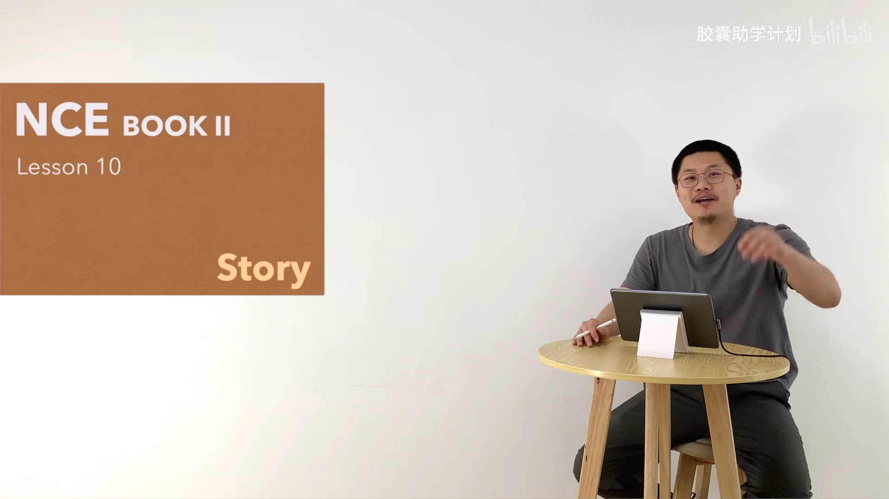

文字识别：胶囊助学计划 / NCE / BOOKII / Lesson 10 / Story

### 画面 00:00:02

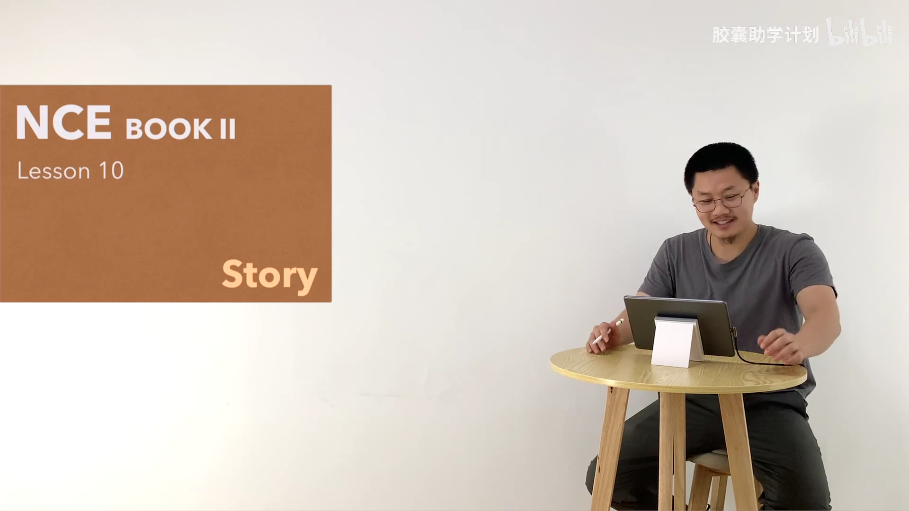

文字识别：bib / 胶囊助学计划 / NCE / BOOK"I / Lesson 10 / Story

### 画面 00:00:05

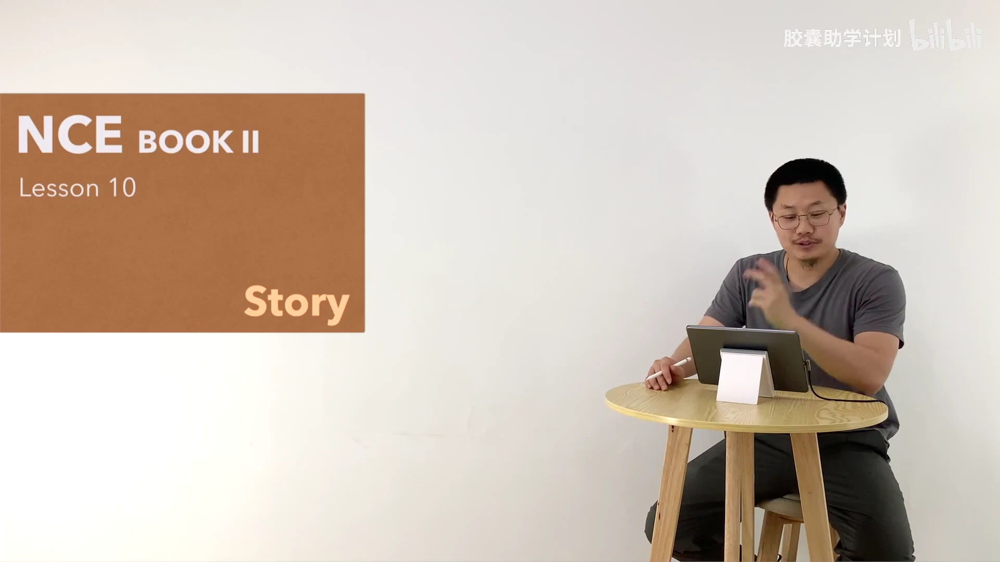

文字识别：胶囊助学计划 / NCE / BOOK"I / Lesson 10 / Story

### 画面 00:00:09

文字识别：胶囊助学计划bill / • / •

### 画面 00:00:13

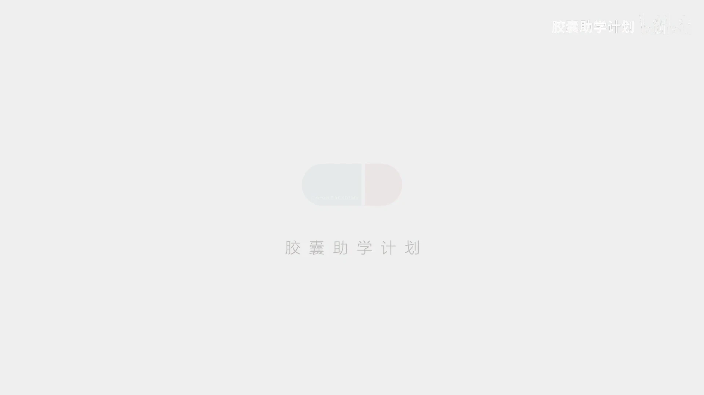

文字识别：交囊助学计划 / 胶囊助学计划

### 画面 00:00:15

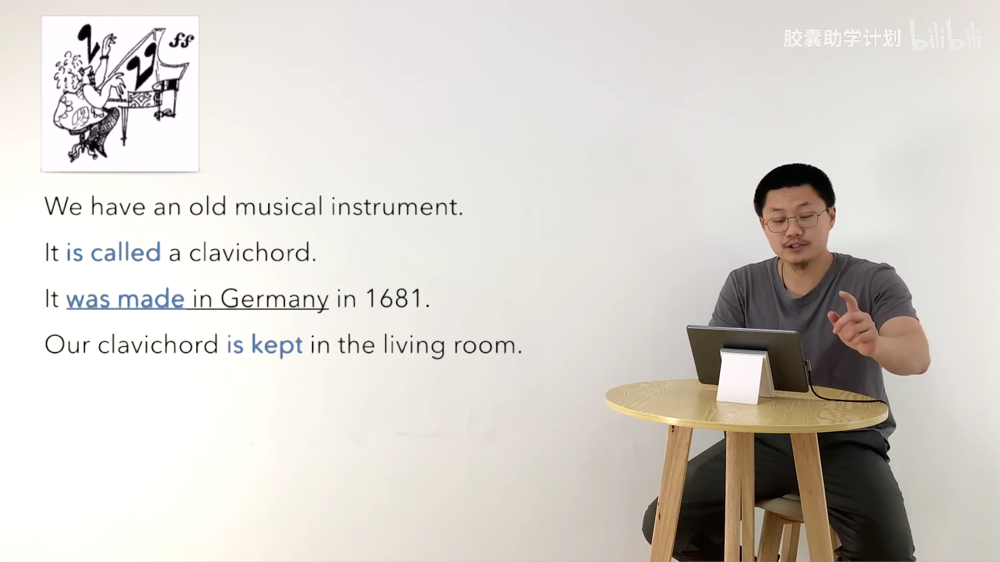

文字识别：胶囊助学计划出出 / We have an old musical instrument. / It is called a clavichord. / It was made in Germany in 1681. / Our clavichord is kept in the living room.

## 00:00:30–00:01:00

### 画面 00:00:39

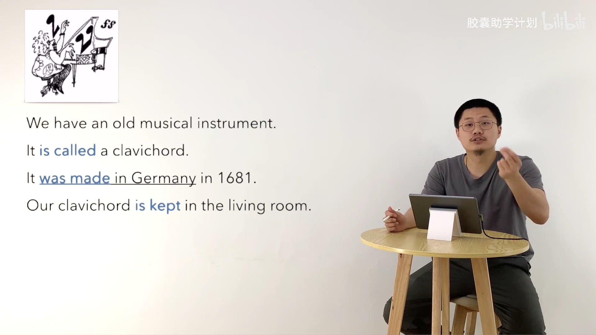

文字识别：胶囊助学计划iHL / ff / We have an old musical instrument. / It is called a clavichord. / It was made in Germany in 1681. / Our clavichord is kept in the living room.

### 画面 00:00:44

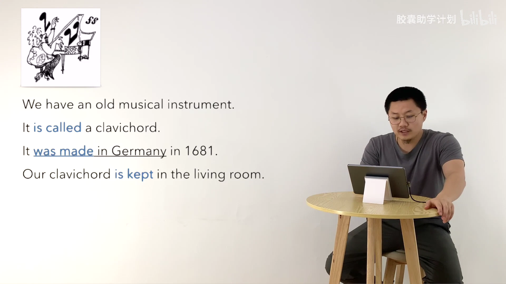

文字识别：胶囊助学计划H / fS / We have an old musical instrument. / It is called a clavichord. / It was made in Germany in 1681. / Our clavichord is kept in the living room.

### 画面 00:00:49

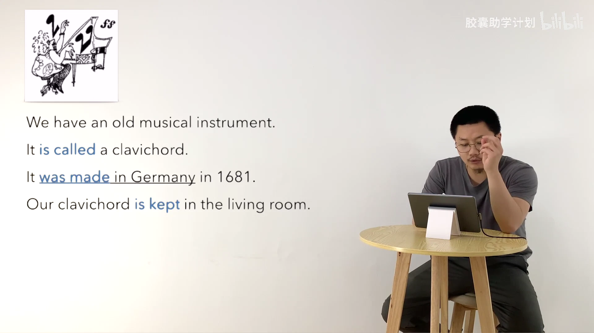

文字识别：fs / 胶囊助学计划l鼎 / We have an old musical instrument. / It is called a clavichord. / It was made in Germany in 1681. / Our clavichord is kept in the living room.

## 00:01:00–00:01:30

作在德国，在一六八一年啊，古董，故一般过去时的被动被制作，对吧？Our clavichord说我们这个古钢琴呢，is kept in the living room。陈述个客观事实，被存放在什么地方？注意这个keep就是一个呃，它它它的原型长成的是k e e p，对吧？OK，叫做keep啊。那kept呃is kept这地方叫做被保

### 画面 00:01:19

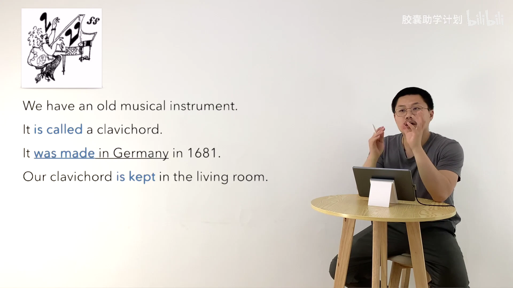

文字识别：胶囊助学计划l鼎 / ff / We have an old musical instrument. / It is called a clavichord. / It was made in Germany in 1681. / Our clavichord is kept in the living room.

### 画面 00:01:22

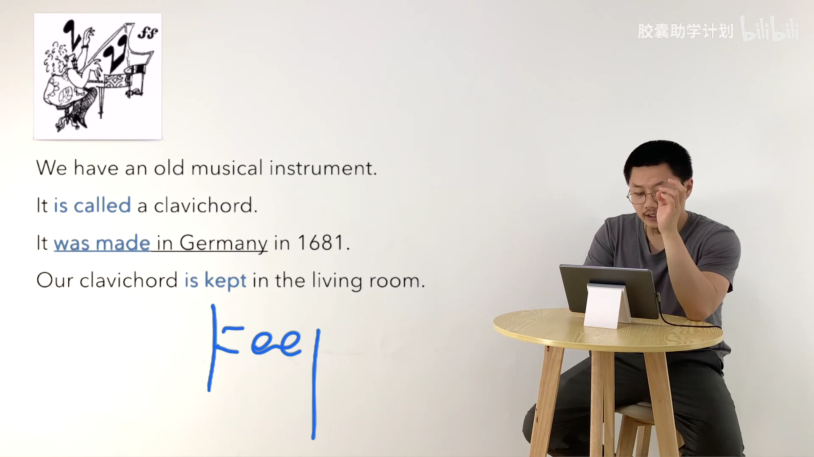

文字识别：胶囊助学计划Wl / ff / We have an old musical instrument. / It is called a clavichord. / It was made in Germany in 1681. / Our clavichord is kept in the living room. / にæe

### 画面 00:01:25

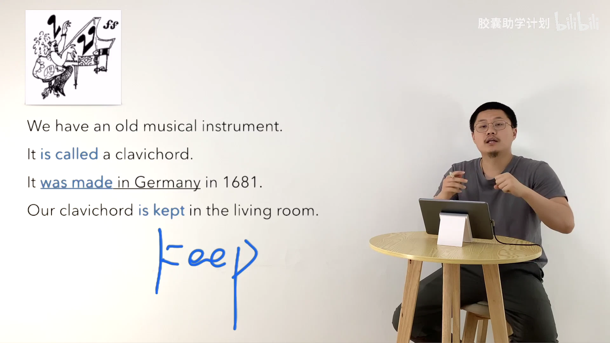

文字识别：SS / 胶囊助学计划b讲业 / We have an old musical instrument. / It is called a clavichord. / It was made in Germany in 1681. / Our clavichord is kept in the living room. / ee

## 00:01:30–00:02:00

stored in what什么地方, being stored in what什么地方. Continue. It has belonged to our family.注意这是主动被动，对吧？这个是目前各位要尝试自己去辨别的，由结构就可以判断。Have加done现在完成时的主动，Have been done那才是现在完成时的被动，对吧？说它呀属于我们家庭for a long time很长时间了，从过去一直

### 画面 00:01:31

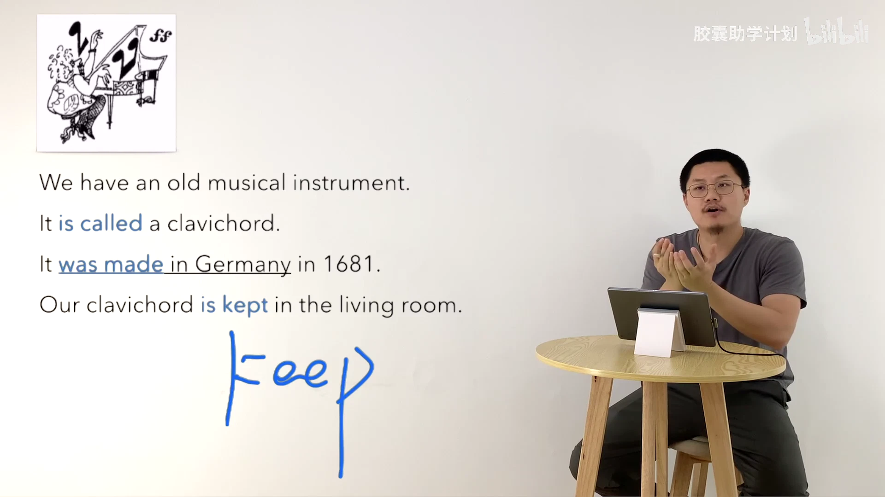

文字识别：胶囊助学计划H出 / We have an old musical instrument. / It is called a clavichord. / It was made in Germany in 1681. / Our clavichord is kept in the living room. / ee

### 画面 00:01:34

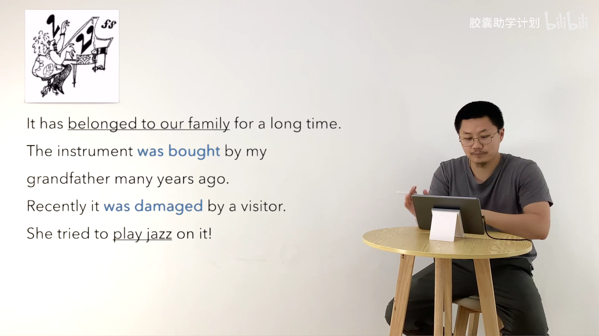

文字识别：胶囊助学计划l出 / fs / It has belonged to our family for a long time. / The instrument was bought by my / grandfather many years ago. / Recently it was damaged by a visitor. / She tried to play jazz on it!

## 00:02:00–00:02:30

持续到了现在，典型的现在完成时的第二个用法，对吧？好，注意这有一个习惯用法叫 belong to somebody，属于某人。其实我们新一九十七课我记得就学过，the instrument，说这个乐器啊 was bought，一般过去时被买了，by 被谁买的呢？My grandfather，被我的祖父母买的。Many years ago，许多年前就买了。Recently，最近，it was damaged，

### 画面 00:02:04

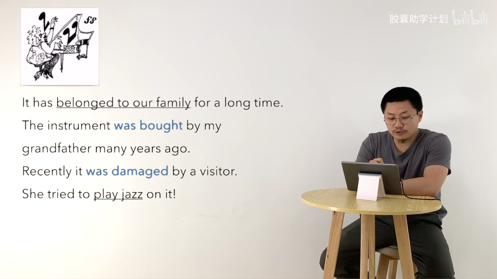

文字识别：胶囊助学计划bl出 / ff / It has belonged to our family for a long time. / The instrument was bought by my / grandfather many years ago. / Recently it was damaged by a visitor. / She tried to play jazz on it!

### 画面 00:02:27

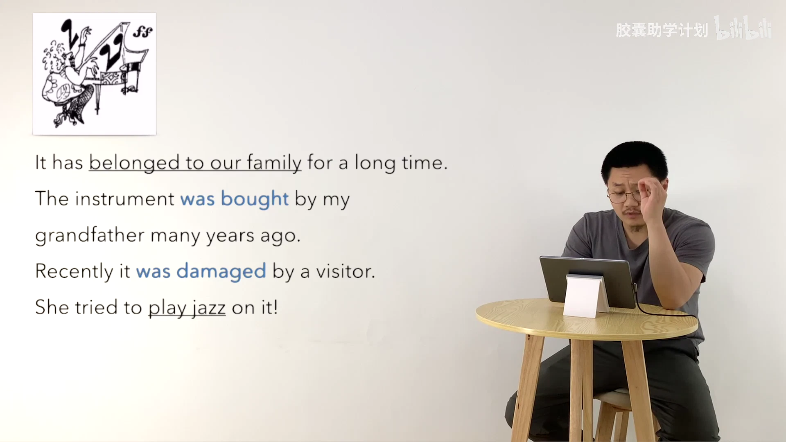

文字识别：胶囊助学计划W出 / fs / It has belonged to our family for a long time. / The instrument was bought by my / grandfather many years ago. / Recently it was damaged by a visitor. / She tried to play jazz on it!

## 00:02:30–00:03:00

被损毁了。为什么呢？A visitor配一个访客给损毁了。你看visitor这个单词，visit叫做拜访，后边加o r表示做这件事的人，访客。She tried to play jazz on it. 好，play jazz我们之前已经说过了，对吧？她尝试着去弹奏爵士乐。On it，在这个古钢琴的上面。

### 画面 00:02:57

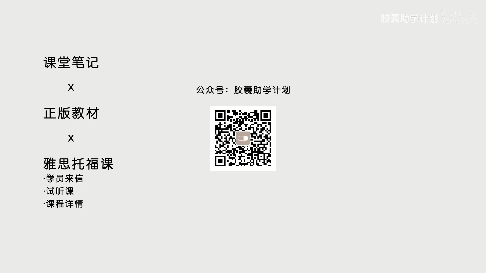

文字识别：胶囊助学计划计 / 课堂笔记 / X / 公众号：胶囊助学计划 / 正版教材 / X / 雅思托福课 / ·学员来信 / ·试听课 / ·课程详情

## 00:03:00–00:03:30

She struck the keys too hard. How struck? You think一下, it would struck twelve in thirty minutes time,还是in twenty minutes time?我们刚刚学过了吧, struck叫撞击,对吧?他敲击这个琴键too hard,过于的狠了. And导致什么了呢? Two of the strings两个琴弦were broken,直接就被敲坏了. Broken这个单词你可

### 画面 00:03:00

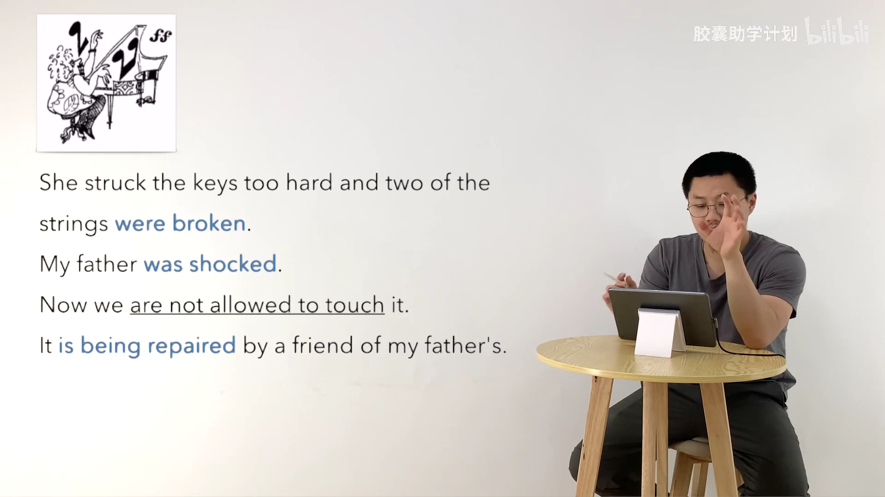

文字识别：胶囊助学计划bl出 / SS / She struck the keys too hard and two of the / strings were broken. / My father was shocked. / Now we are not allowed to touch it. / It is being repaired by a friend of my father's.

### 画面 00:03:13

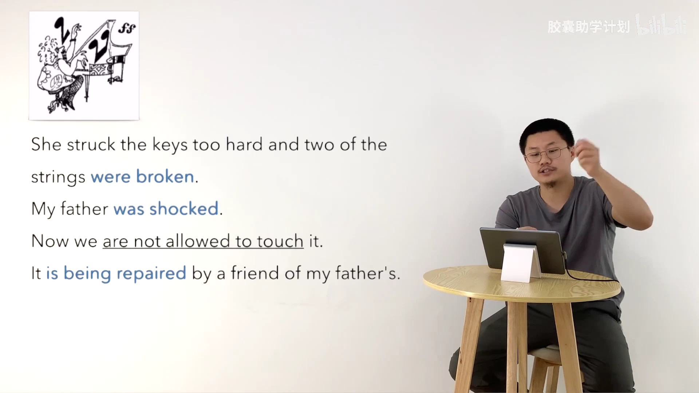

文字识别：胶囊助学计划册 / She struck the keys too hard and two of the / strings were broken. / My father was shocked. / Now we are not allowed to touch it. / It is being repaired by a friend of my father's.

### 画面 00:03:20

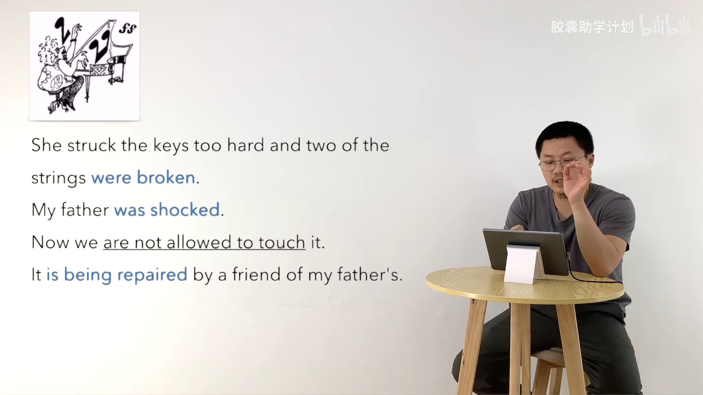

文字识别：胶囊助学计划出出 / ff / She struck the keys too hard and two of the / strings were broken. / My father was shocked. / Now we are not allowed to touch it. / It is being repaired by a friend of my father's.

## 00:03:30–00:04:00

以理解为是被动，也可以理解为直接，它是一个形容词。OK，非常的简单，就指的是损毁了啊。My father was shocked.我的父亲被震惊了。同理，这个地方你可以理解为它是一个被动，也可以理解为它是一个形容词，而不是但就是被震惊了，因为shocked本身就有被震惊了的意思。Now现在呢，we are not allowed.哎，我们用单词见过它，现

### 画面 00:03:33

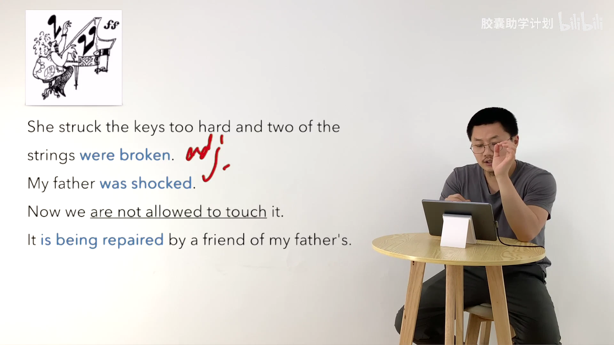

文字识别：胶囊助学计划l出 / She struck the keys too hard and two of the / strings were broken. / W / My father was shocked. / Now we are not allowed to touch it. / It is being repaired by a friend of my father's.

## 00:04:00–00:04:30

在又学过语法之后见到它，就能理解它是被动了，对不对？be加done叫被允许，那are not allowed就是不被允许to touch it。我们现在已经不被允许去触碰它了。It is being repaired，说它现在正在被修理，被谁呢？后面叫做a friend of my father's，我父亲的一个朋友啊，由后往前翻译就可以了啊，这你不用管它的什么双

### 画面 00:04:03

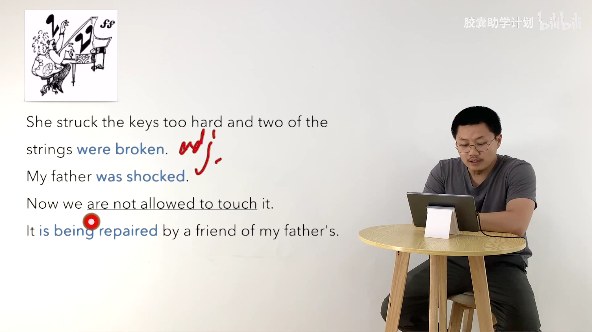

文字识别：胶囊助学计划H / She struck the keys too hard and two of the / strings were broken. / W / My father was shocked. / Now we are not allowed to touch it. / It is being repaired by a friend of my father's.

### 画面 00:04:14

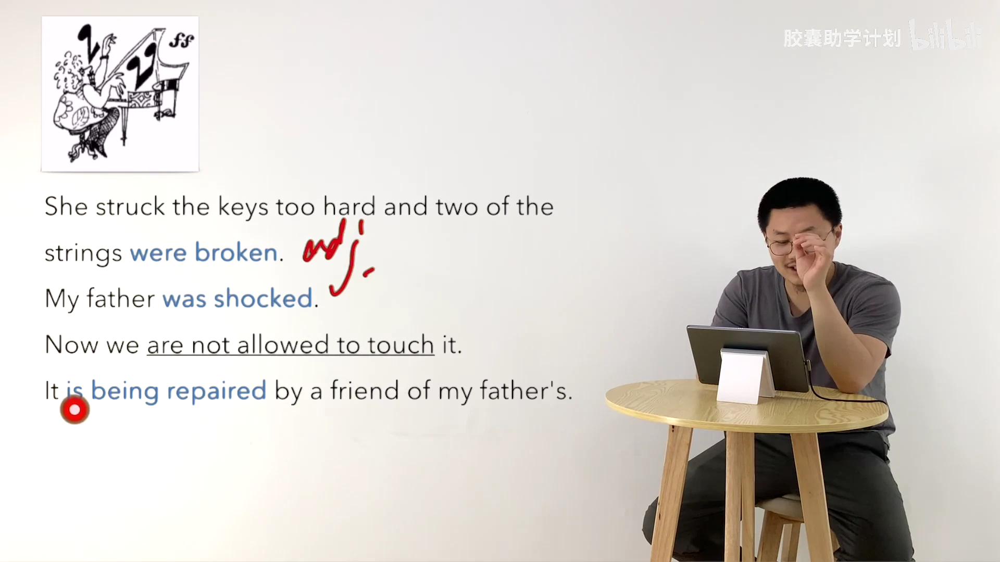

文字识别：胶囊助学计划l / She struck the keys too hard and two of the / strings were broken. / W / My father was shocked. / Now we are not allowed to touch it. / It is being repaired by a friend of my father's.

## 00:04:30–00:05:00

宾语那些东西啊，就是由后往前翻译。我父亲的朋友啊，我父亲的一个朋友啊，其实在这个地方对于大家来说最习惯的表达叫 my father's friend，对吧？啊， there you go。好，本课的习惯用法并不多啊，好几个我们之前要么见，要么在单词部分见过，要么在新一就见过了，对吧？OK，叫做这四个。接下来我们拿它还是去造句。第一个 be made in 加 S W 点就 somewhere

### 画面 00:04:33

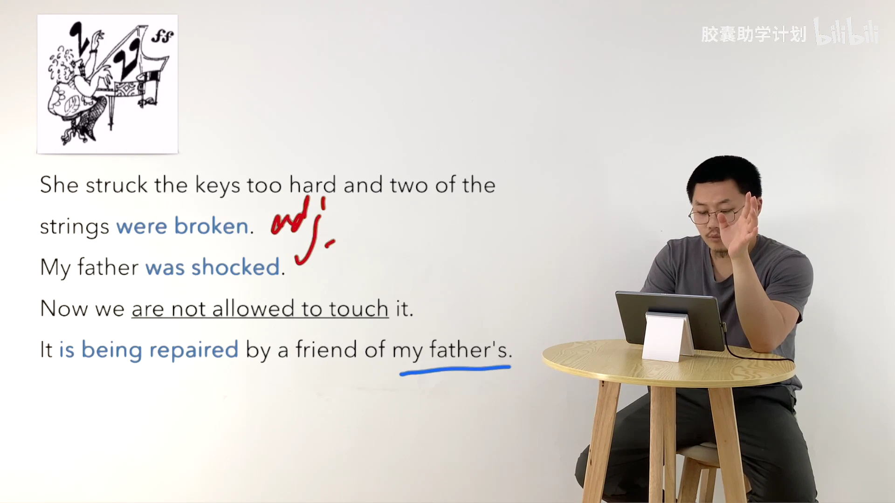

文字识别：胶囊助学计划ll / She struck the keys too hard and two of the / strings were broken. / W / My father was shocked. / Now we are not allowed to touch it. / It is being repaired by a friend of my father's.

### 画面 00:04:35

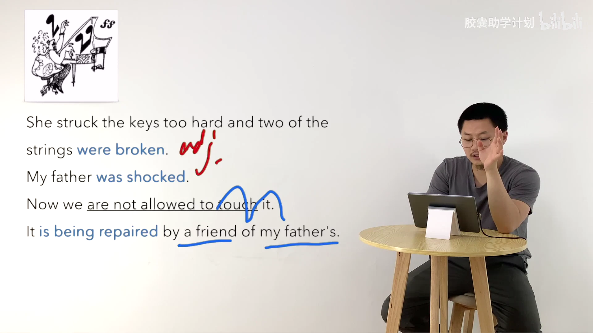

文字识别：胶囊助学计划ll / She struck the keys too hard and two of the / strings were broken. / My father was shocked. / Now we are not allowed to ouy / It is being repaired by a friend of my father's.

### 画面 00:04:38

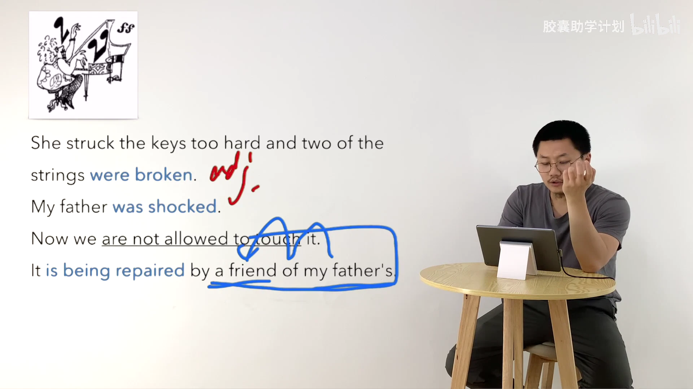

文字识别：胶囊助学计划出 / ff / She struck the keys too hard and two of the / strings were broken. / nd / My father was shocked. / Now we are not allowed to ouit. / It is being repaired by a friend of my father's

### 画面 00:04:43

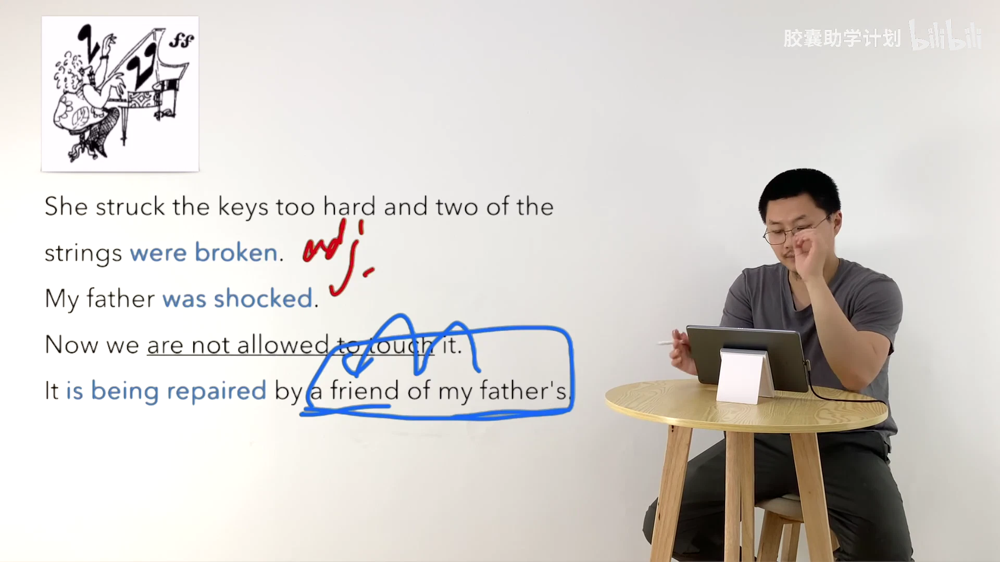

文字识别：胶囊助学计划i出 / She struck the keys too hard and two of the / strings were broken. / My father was shocked. / Nowwe are notallwedouit. / It is being repaired bya friend of my father's

### 画面 00:04:45

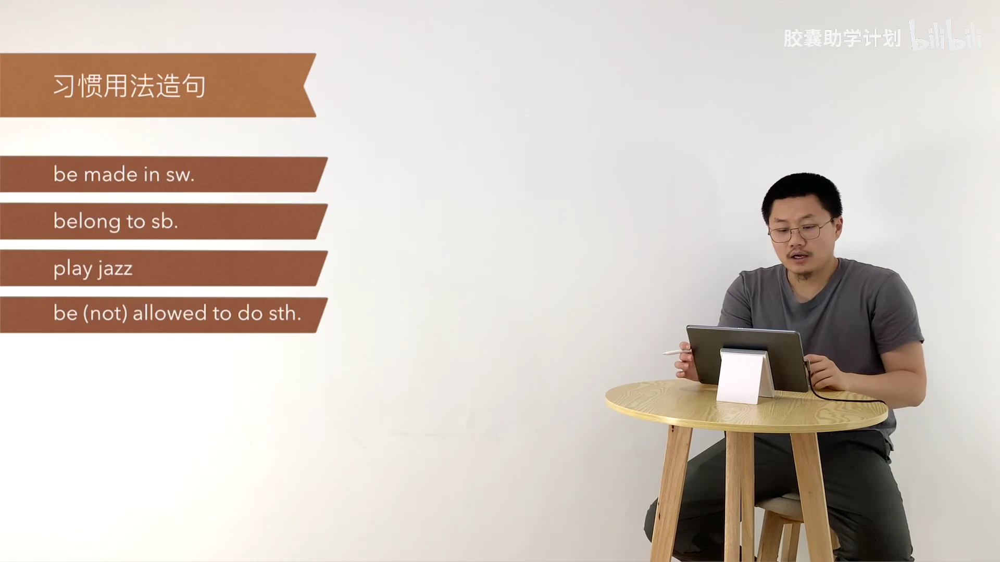

文字识别：LilL / 胶囊助学计划 / 习惯用法造句 / be made in sw. / belong to sb. / play jazz / be (not) allowed to do sth.

### 画面 00:04:47

文字识别：bifbi / 胶囊助学计划 / 习惯用法造句 / be made in sw. / belong to sb. / play jazz / be (not) allowed to do sth.

### 画面 00:04:49

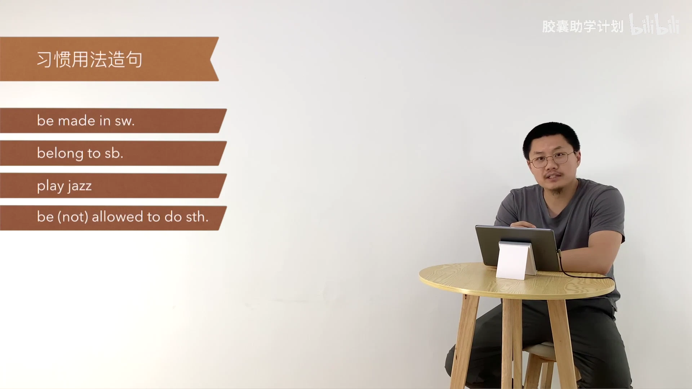

文字识别：胶囊助学计划 / 习惯用法造句 / be made in sw. / belong to sb. / play jazz / be (not) allowed to do sth.

### 画面 00:04:51

文字识别：bilibi / 胶囊助学计划 / 习惯用法造句 / be made in sw. / belong to sb. / play jazz / be (not) allowed to do sth.

### 画面 00:04:53

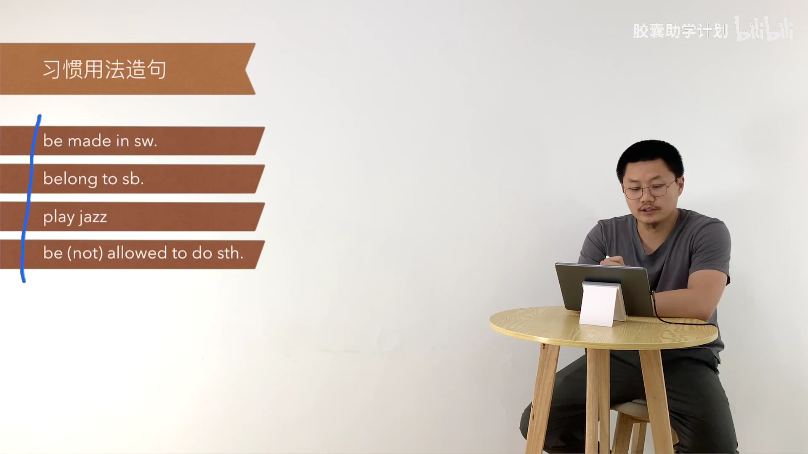

文字识别：bilibi / 胶囊助学计划 / 习惯用法造句 / be made in sw. / belong to sb. / play jazz / be (not) allowed to do sth.

### 画面 00:04:55

文字识别：网：v.+v.变化 / 胶囊助学计划 / 习惯用法造句指南 / 四句型转换 / 方式/地点/时间 / 其他习惯用法 / 其他单词+词性 / 原文摘抄+变 / 6123456 / be made in sw.

### 画面 00:04:57

文字识别：网：v.+v.变化 / 胶囊助学计划 / BiLii / 习惯用法造句指南 / 四句型转换 / 方式/地点/时间 / 其他习惯用法 / 其他单词+词性 / 原文摘抄+变 / 6123456 / be made in sw.

## 00:05:00–00:05:30

某地啊，比如说 The phone is made in China. 啊，这个手机是中国制造的。你看 Made in China 这个可能很多同学都知道这个表达吧？肯定句出来了，一般疑问句 Is the phone made in China? Where is the phone made? 这个手机在哪儿制作的？还有一个 Belong to somebody. 原文给了一句话说 It has belonged to our family for a long time. 我们看有一个

### 画面 00:05:00

文字识别：网：v.+v.变化 / 胶囊助学计划 / BIHBI / 习惯用法造句指南 / 四句型转换 / 方式/地点/时间 / 其他习惯用法 / 其他单词+词性 / 原文摘抄+变 / 6123456 / be made in sw.

### 画面 00:05:02

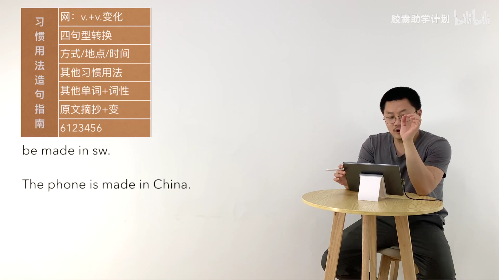

文字识别：网：v.+v.变化 / 胶囊助学计划 / 习惯用法造句指南 / 四句型转换 / 方式/地点/时间 / 其他习惯用法 / 其他单词+词性 / 原文摘抄+变 / 6123456 / be made in sw. / The phone is made in China.

### 画面 00:05:05

文字识别：网：v.+v.变化 / 胶囊助学计划 / BitLi / 习惯用法造句指南 / 四句型转换 / 方式/地点/时间 / 其他习惯用法 / 其他单词+词性 / 原文摘抄+变 / 6123456 / be made in sw. / The phone is made in China.

### 画面 00:05:07

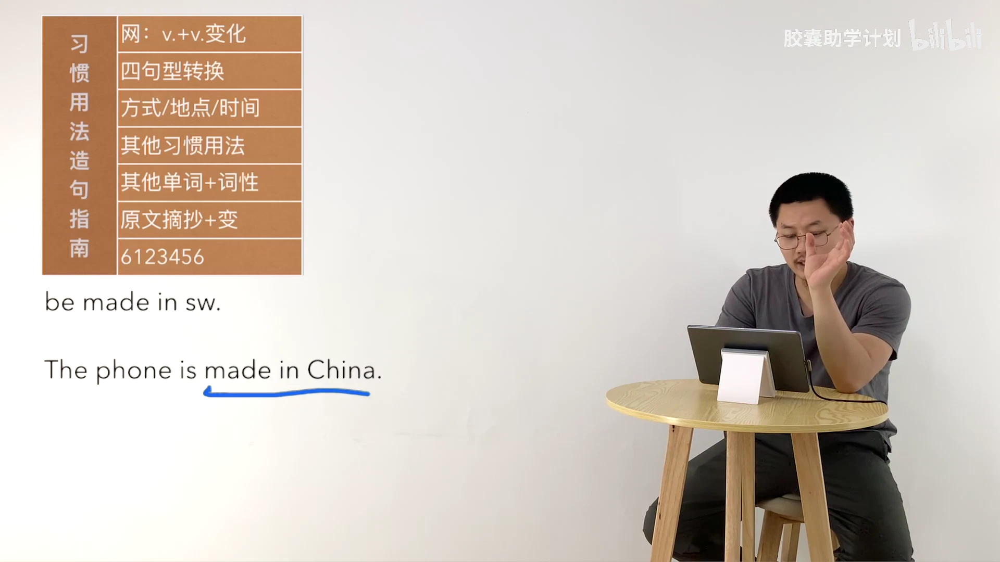

文字识别：网：v.+v.变化 / 胶囊助学计划 / 习惯用法造句指南 / 四句型转换 / 方式/地点/时间 / 其他习惯用法 / 其他单词+词性 / 原文摘抄+变 / 6123456 / be made in sw. / The phone is made in China.

### 画面 00:05:09

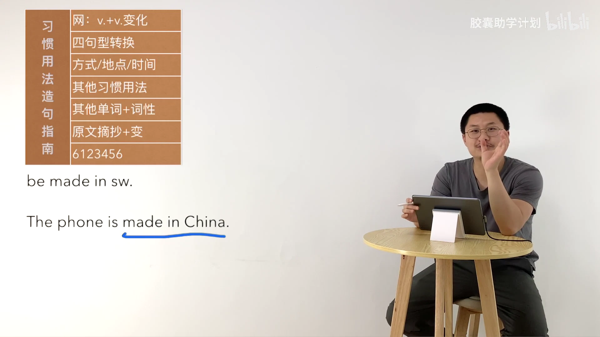

文字识别：网：v.+v.变化 / 胶囊助学计划 / Bitbi / 习惯用法造句指南 / 四句型转换 / 方式/地点/时间 / 其他习惯用法 / 其他单词+词性 / 原文摘抄+变 / 6123456 / be made in sw. / The phone is made in China.

### 画面 00:05:11

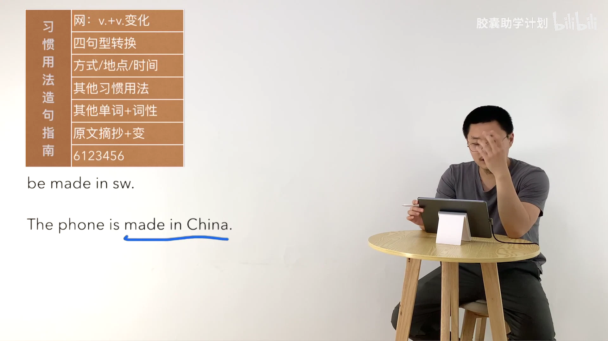

文字识别：网：v.+v.变化 / 胶囊助学计划 / Bitbi / 习惯用法造句指南 / 四句型转换 / 方式/地点/时间 / 其他习惯用法 / 其他单词+词性 / 原文摘抄+变 / 6123456 / be made in sw. / The phone is made in China.

### 画面 00:05:13

文字识别：网：v.+v.变化 / 胶囊助学计划 / bitbil / 习惯用法造句指南 / 四句型转换 / 方式/地点/时间 / 其他习惯用法 / 其他单词+词性 / 原文摘抄+变 / 6123456 / be made in sw. / The phone is made in China. / Is the phone made in China?

### 画面 00:05:15

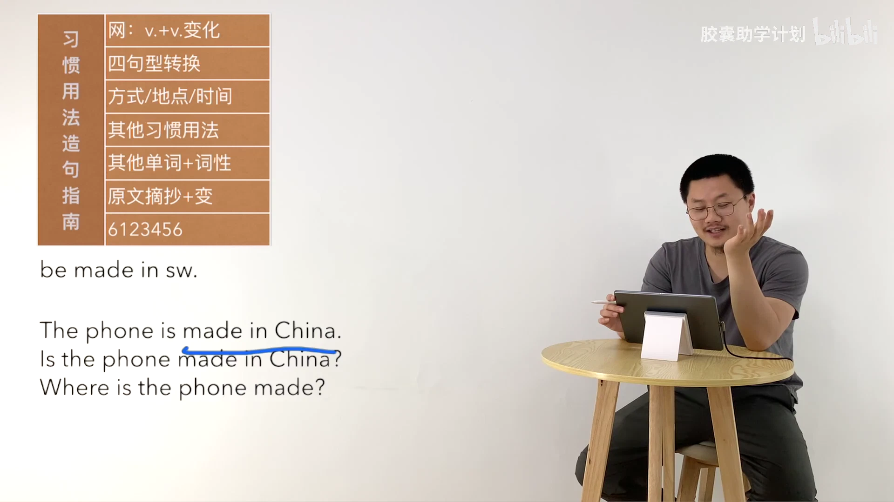

文字识别：网：v.+v.变化 / 胶囊助学计划 / Bibi / 习惯用法造句指南 / 四句型转换 / 方式/地点/时间 / 其他习惯用法 / 其他单词+词性 / 原文摘抄+变 / 6123456 / be made in sw. / The phone is made in China. / Is the phone made in China? / Where is the phone made?

### 画面 00:05:18

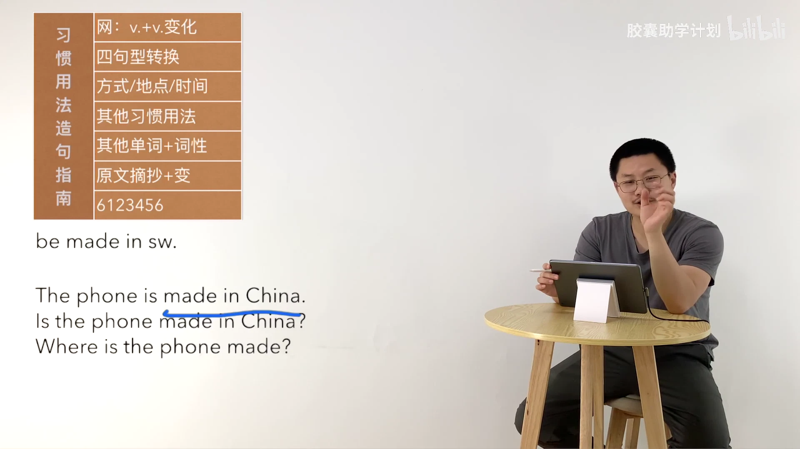

文字识别：网：v.+v.变化 / 胶囊助学计划 / LitLit / 习惯用法造句指南 / 四句型转换 / 方式/地点/时间 / 其他习惯用法 / 其他单词+词性 / 原文摘抄+变 / 6123456 / be made in sw. / The phone is made in China. / Is the phone made in China? / Where is the phone made?

### 画面 00:05:20

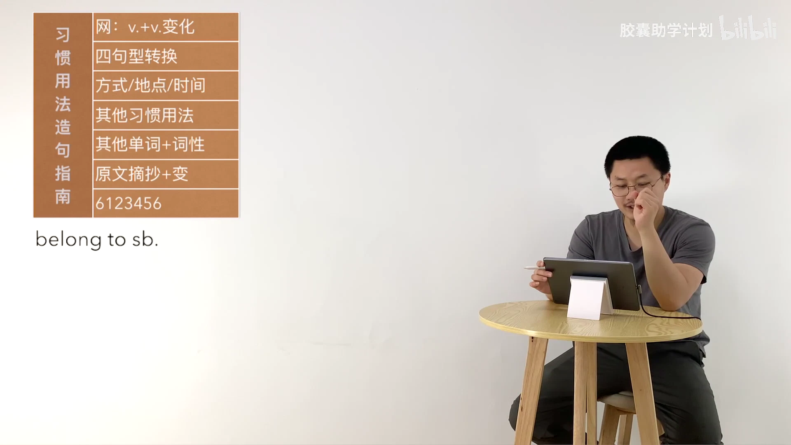

文字识别：网：v.+v.变化 / 胶囊助学计划 / Bilibi / 习惯用法造句指南 / 四句型转换 / 方式/地点/时间 / 其他习惯用法 / 其他单词+词性 / 原文摘抄+变 / 6123456 / belong to sb.

### 画面 00:05:22

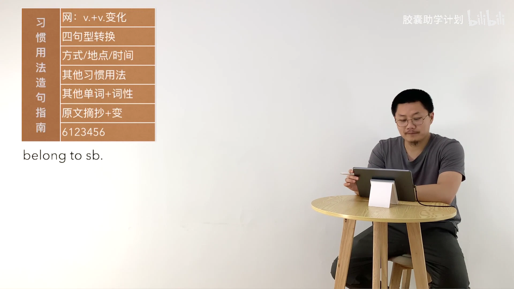

文字识别：网：v.+v.变化 / 胶囊助学计划 / BiL / 习惯用法造句指南 / 四句型转换 / 方式/地点/时间 / 其他习惯用法 / 其他单词+词性 / 原文摘抄+变 / 6123456 / belong to sb.

### 画面 00:05:24

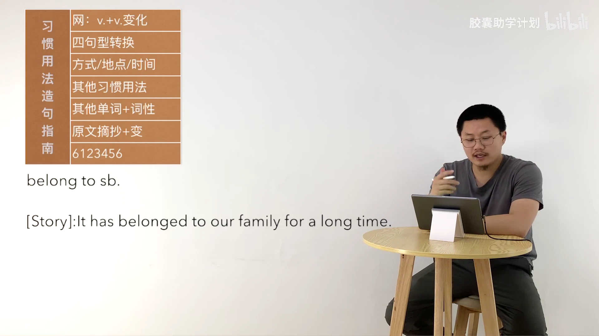

文字识别：网：v.+v.变化 / 胶囊助学计划 / bitLi / 习惯用法造句指南 / 四句型转换 / 方式/地点/时间 / 其他习惯用法 / 其他单词+词性 / 原文摘抄+变 / 6123456 / belong to sb. / [Story]:lt has belonged to our family for a long time.

### 画面 00:05:26

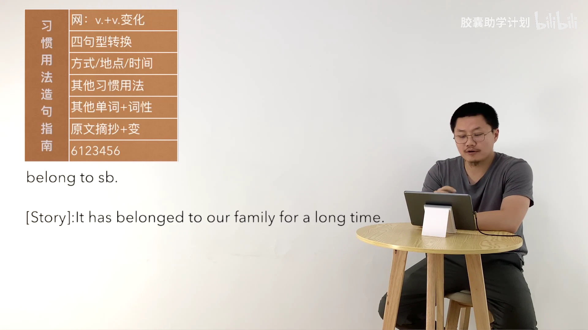

文字识别：网：v.+v.变化 / 胶囊助学计划 / bibii / 习惯用法造句指南 / 四句型转换 / 方式/地点/时间 / 其他习惯用法 / 其他单词+词性 / 原文摘抄+变 / 6123456 / belong to sb. / [Story]:lt has belonged to our family for a long time.

## 00:05:30–00:06:00

习惯用法造句的思路就是原文摘抄再加上变，对不对？好，叫做 Has it belonged to your family for a long time? 那我现在想对 your family 应该用 who 吧？ For a long time 应该用 when 还是 how long？想一下， how long 对不对？ There you go. 那 how long has it belonged to your family? There you go. 接下来呢，我们看一个小的电影片段当中出现了叫 This belongs to you. 这

### 画面 00:05:30

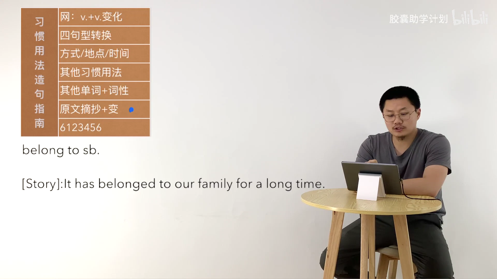

文字识别：网：v.+v.变化 / 胶囊助学计划 / 习惯用法造句指南 / 四句型转换 / 方式/地点/时间 / 其他习惯用法 / 其他单词+词性 / 原文摘抄+变 / 6123456 / belong to sb. / [Story]:lt has belonged to our family for a long time.

### 画面 00:05:32

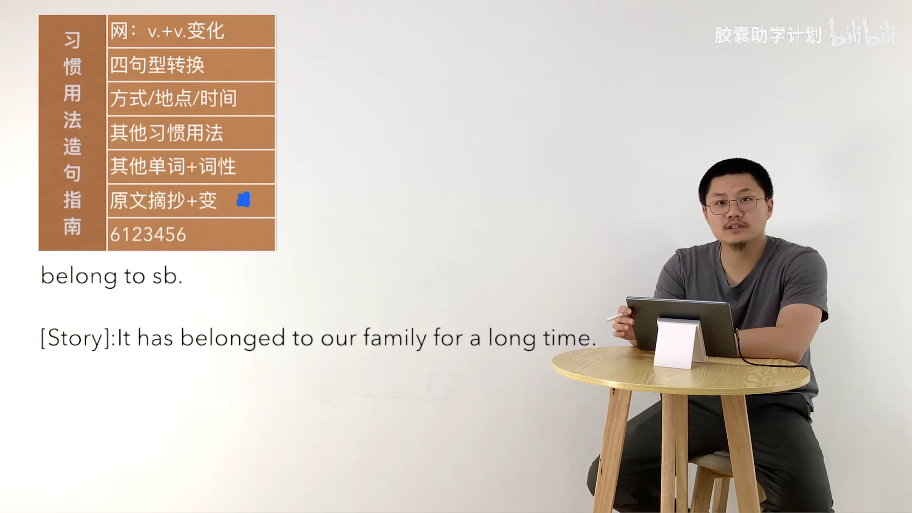

文字识别：网：v.+v.变化 / 胶囊助学计划 / 习惯用法造句指南 / 四句型转换 / 方式/地点/时间 / 其他习惯用法 / 其他单词+词性 / 原文摘抄+变 / 6123456 / belong to sb. / [Story]:lt has belonged to our family for a long time.

### 画面 00:05:35

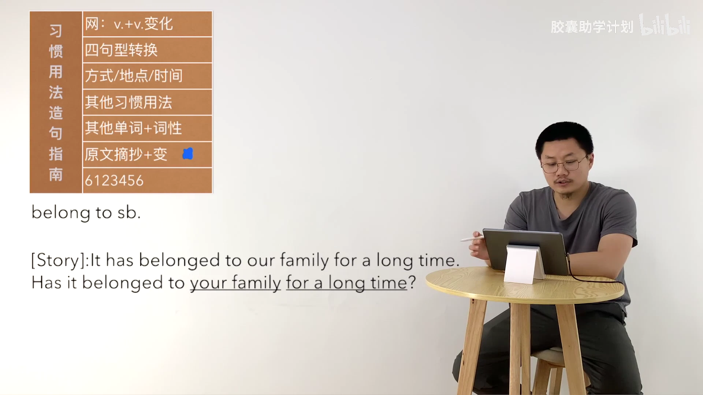

文字识别：网：v.+v.变化 / 胶囊助学计划 / 习惯用法造句指南 / 四句型转换 / 方式/地点/时间 / 其他习惯用法 / 其他单词+词性 / 原文摘抄+变 / 6123456 / belong to sb. / [Story]:lt has belonged to our family for a long time. / Has it belonged to your family for a long time?

### 画面 00:05:37

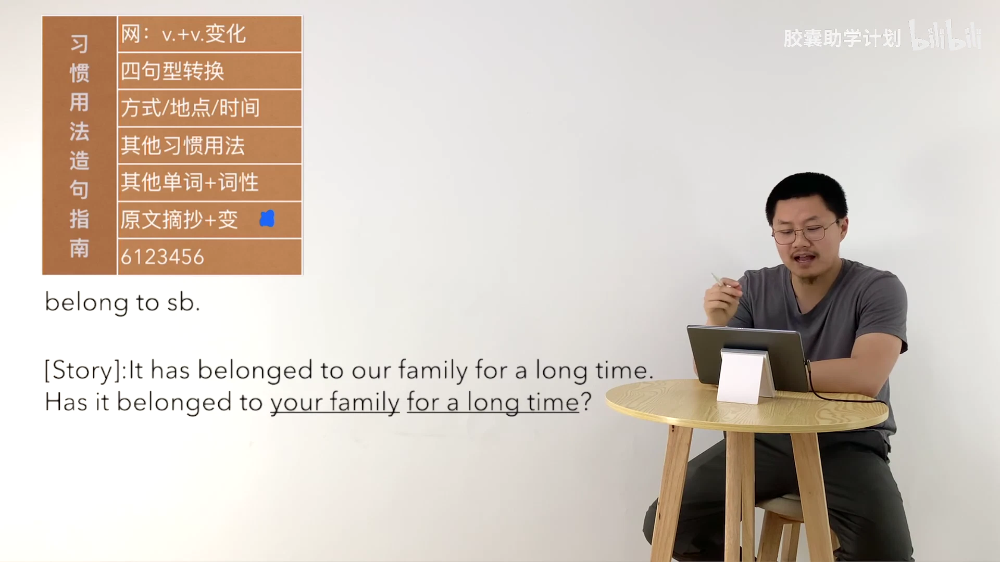

文字识别：网：v.+v.变化 / 胶囊助学计划 / Bitbit / 习惯用法造句指南 / 四句型转换 / 方式/地点/时间 / 其他习惯用法 / 其他单词+词性 / 原文摘抄+变 / 6123456 / belong to sb. / [Story]:lt has belonged to our family for a long time. / Has it belonged to your family for a long time?

### 画面 00:05:40

文字识别：网：v.+v.变化 / 胶囊助学计划 / 习惯用法造句指南 / 四句型转换 / 方式/地点/时间 / 其他习惯用法 / 其他单词+词性 / 原文摘抄+变 / 6123456 / belong to sb. / [Story]:lt has belonged to our family for a long time. / Has it belonged to your family for a long time?

### 画面 00:05:42

文字识别：网：v.+v.变化 / 胶囊助学计划 / bitL / 习惯用法造句指南 / 四句型转换 / 方式/地点/时间 / 其他习惯用法 / 其他单词+词性 / 原文摘抄+变 / 6123456 / belong to sb. / [Story]:It has belonged to our family for a long t / time. / Has it belonged to your family for a long time?

### 画面 00:05:45

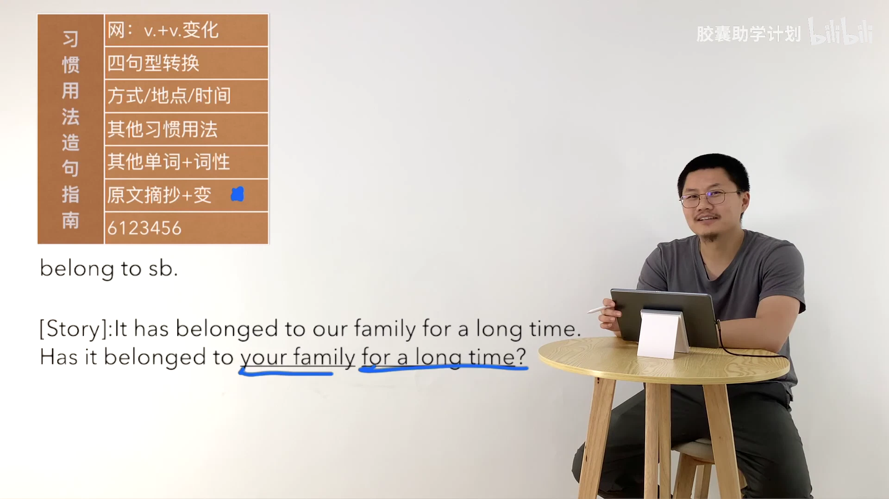

文字识别：网：v.+v.变化 / 胶囊助学计划 / Litbi / 习惯用法造句指南 / 四句型转换 / 方式/地点/时间 / 其他习惯用法 / 其他单词+词性 / 原文摘抄+变 / 6123456 / belong to sb. / [Story]:lt has belonged to our family for a long time. / Has it belonged to your family for a long time?

### 画面 00:05:48

文字识别：网：v.+v.变化 / 胶囊助学计划 / 习惯用法造句指南 / 四句型转换 / 方式/地点/时间 / 其他习惯用法 / 其他单词+词性 / 原文摘抄+变 / 6123456 / belong to sb. / [Story]:lt has belonged to our family for a long t / time. / Has it belonged to your family for a long time?

### 画面 00:05:50

文字识别：网：v.+v.变化 / 胶囊助学计划 / BitLii / 习惯用法造句指南 / 四句型转换 / 方式/地点/时间 / 其他习惯用法 / 其他单词+词性 / 原文摘抄+变 / 6123456 / belong to sb. / [Story]:Ilt has belonged to our family for a long time. / Has it belonged to your family for a long time?

### 画面 00:05:53

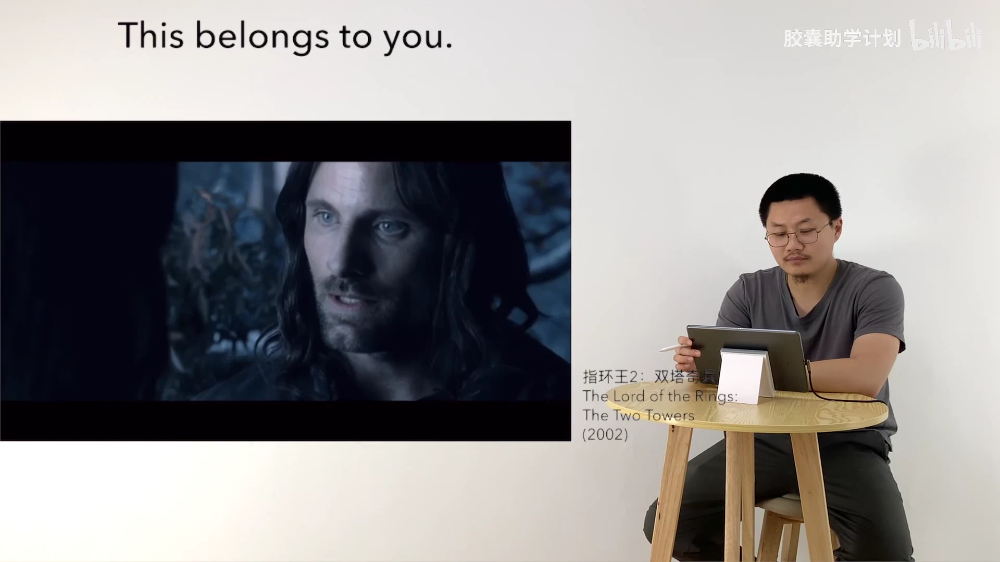

文字识别：This belongs to you. / 胶囊助学计划i出 / 指环王2：双塔奇兵 / The Lord of the Rings: / The Two Towers / (2002)

## 00:06:00–00:06:30

belongs to you. This belongs to you. It was a gift.

### 画面 00:06:01

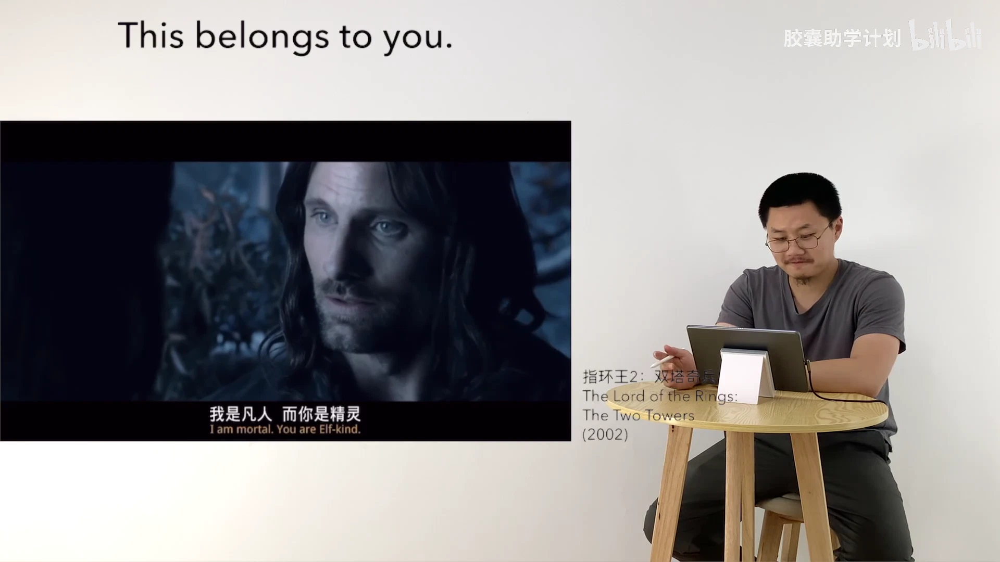

文字识别：This belongs to you. / Bii ii / 胶囊助学计划 / 指环王2：双塔奇宾 / The Lord of the Rings: / 我是凡人而你是精灵 / The Two Towers / I am mortal. You are Elf-kind. / (2002)

### 画面 00:06:03

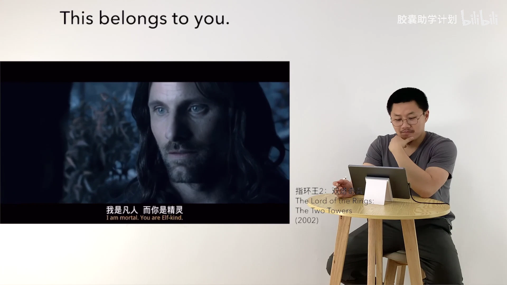

文字识别：This belongs to you. / 胶囊助学计划 / 指环王2：双塔奇兵 / The Lord of the Rings: / 我是凡人而你是精灵 / The Two Towers / I am mortal. You are Elf-kind. / (2002)

### 画面 00:06:05

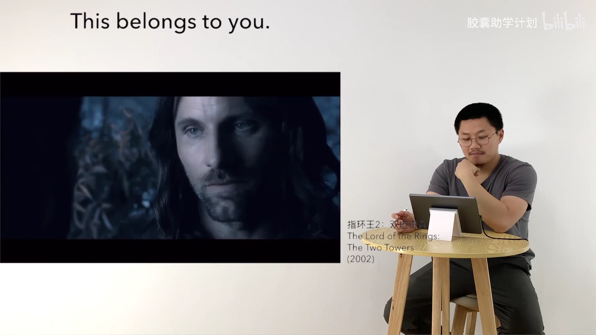

文字识别：This belongs to you. / 胶囊助学计划 / 指环王2：双塔奇具 / The Lord of the Rings: / The Two Towers / (2002)

### 画面 00:06:07

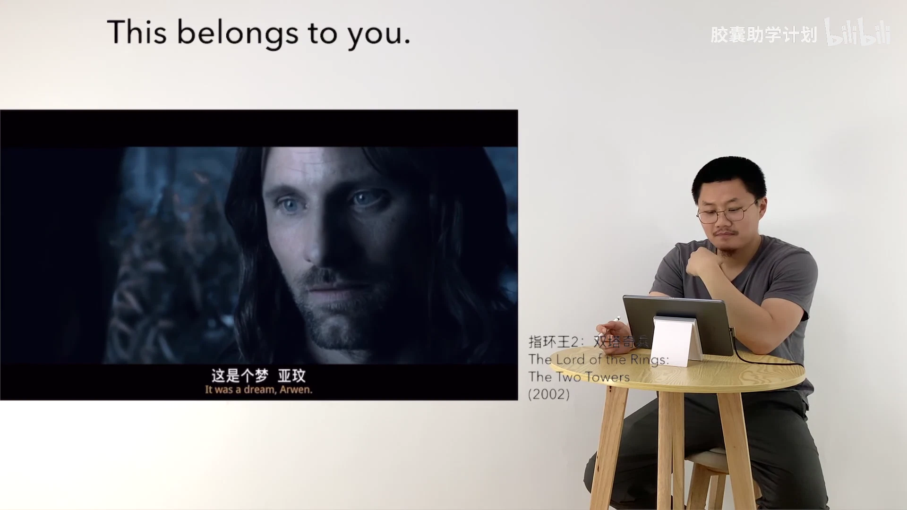

文字识别：This belongs to you. /  bitLit / 胶囊助学计划 / 指环王2：双塔奇宾 / The Lord of the Rings: / 这是个梦亚玟 / The Two Towers / It was a dream, Arwen. / (2002)

### 画面 00:06:10

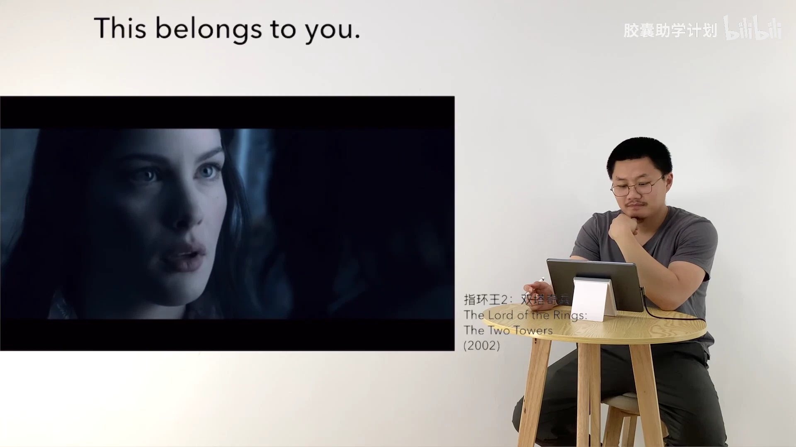

文字识别：This belongs to you. / 胶囊助学计划 / 指环王2：双塔奇宾 / The Lord of the Rings: / The Two Towers / (2002)

### 画面 00:06:13

文字识别：This belongs to you. / BitLi / 胶囊助学计划 / 指环王2：双塔奇宾 / The Lord of the Rings: / 我不信 / The Two Towers / I don't believe you. / (2002)

### 画面 00:06:15

文字识别：This belongs to you. / 胶囊助学计划il / 指环王2：双塔奇 / The Lord of the Rings: / The Two Towers / (2002)

### 画面 00:06:17

文字识别：This belongs to you. / 胶囊助学计划bl / 指环王2：双塔奇兵 / The Lord of the Rings: / The Two Towers / (2002)

### 画面 00:06:19

文字识别：This belongs to you. / 胶囊助学计划 / 指环王2：双塔奇具 / The Lord of the Rings: / The Two Towers / (2002)

### 画面 00:06:21

文字识别：This belongs to you. / 胶囊助学计划 / 小 / 指环王2：双塔奇兵 / The Lord of the Rings: / The Two Towers / (2002)

### 画面 00:06:23

文字识别：This belongs to you. / 胶囊助学计划 / 指环王2：双塔奇宾 / The Lord of the Rings: / The Two Towers / (2002)

### 画面 00:06:25

文字识别：This belongs to you. / 胶囊助学计划in / 指环王2：双塔奇兵 / The Lord of the Rings: / 这是属于你的 / The Two Towers / This belongs to you. / (2002)

### 画面 00:06:27

文字识别：This belongs to you. / 胶囊助学计划 / 指环王2：双塔奇宾 / The Lord of the Rings: / The Two Towers / (2002)

### 画面 00:06:29

文字识别：This belongs to you. / 胶囊助学计划 / 指环王2：双塔奇兵 / The Lord of the Rings: / 这是送给你的 / The Two Towers / It was a gift. / (2002)

## 00:06:30–00:07:00

### 画面 00:06:31

文字识别：This belongs to you. / 胶囊助学计划 / 指环王2：双塔奇具 / The Lord of the Rings: / The Two Towers / (2002)

### 画面 00:06:33

文字识别：This belongs to you. / 胶囊助学计划 / 指环王2：双塔奇兵 / The Lord of the Rings: / 留着吧 / The Two Towers / Keep it. / (2002)

### 画面 00:06:35

文字识别：This belongs to you. / 胶囊助学计划 / 指环王2：双塔奇兵 / The Lord of the Rings: / 留着吧 / The Two Towers / Keep it. / (2002)

### 画面 00:06:38

文字识别：网：v.+v.变化 / 胶囊助学计划 / BiBi / 习惯用法造句指南 / 四句型转换 / 方式/地点/时间 / 其他习惯用法 / 其他单词+词性 / 原文摘抄+变 / 6123456 / play jazz

### 画面 00:06:40

文字识别：网：v.+v.变化 / 胶囊助学计划 / 习惯用法造句指南 / 四句型转换 / 方式/地点/时间 / 其他习惯用法 / 其他单词+词性 / 原文摘抄+变 / 6123456 / play jazz

### 画面 00:06:43

文字识别：网：v.+v.变化 / 胶囊助学计划 / Bibit / 习惯用法造句指南 / 四句型转换 / 方式/地点/时间 / 其他习惯用法 / 其他单词+词性 / 原文摘抄+变 / 6123456 / play jazz / Listen, she is playing jazz.

### 画面 00:06:45

文字识别：网：v.+v.变化 / 胶囊助学计划 / 习惯用法造句指南 / 四句型转换 / 方式/地点/时间 / 其他习惯用法 / 其他单词+词性 / 原文摘抄+变 / 6123456 / play jazz / Listen, she is playing jazz.

### 画面 00:06:50

文字识别：网：v.+v.变化 / 胶囊助学计划 / 习惯用法造句指南 / 四句型转换 / 方式/地点/时间 / 其他习惯用法 / 其他单词+词性 / 原文摘抄+变 / 6123456 / play jazz / Listen, she is playing jazz.

### 画面 00:06:52

文字识别：网：v.+v.变化 / 胶囊助学计划 / 习惯用法造句指南 / 四句型转换 / 方式/地点/时间 / 其他习惯用法 / 其他单词+词性 / 原文摘抄+变 / 6123456 / play jazz / Listen, she is playing jazz. / She plays jazz every day.

### 画面 00:06:55

文字识别：网：v.+v.变化 / 胶囊助学计划 / 习惯用法造句指南 / 四句型转换 / 方式/地点/时间 / 其他习惯用法 / 其他单词+词性 / 原文摘抄+变 / 6123456 / play jazz / Listen, she is playing jazz. / She plays jazz every day.

### 画面 00:06:58

文字识别：Bitbi / 网：v.+v.变化 / 胶囊助学计划 / 习惯用法造句指南 / 四句型转换 / 方式/地点/时间 / 其他习惯用法 / 其他单词+词性 / 原文摘抄+变 / 6123456 / play jazz / Listen, she is playing jazz. / She / plays / jazz / every / day. / She is playing jazz tonight.

## 00:07:00–00:07:30

playing jazz tonight.虽然好像这两个时态是一样的，可是你仔细想一下，第二课我们学过，am/is/are加doing再加tonight表示的是什么来着？一般将来时跟begin to do一样，他今天晚上要去演奏或者弹奏爵士乐，对吧？Okay, there you go.或者说我们再换一个时态，第七课学过的叫做she was playing jazz when the phone rang.当这个电话

### 画面 00:07:00

文字识别：BiltLii / 习惯用法造句指南 / 网：v.+v.变化 / 胶囊助学计划 / 四句型转换 / 方式/地点/时间 / 其他习惯用法 / 其他单词+词性 / 原文摘抄+变 / 6123456 / play jazz / Listen, she is playing jazz. / She / plays / jazz / every / day. / She is playing jazz tonight.

### 画面 00:07:02

文字识别：网：v.+v.变化 / 胶囊助学计划 / Bitbi / 习惯用法造句指南 / 四句型转换 / 方式/地点/时间 / 其他习惯用法 / 其他单词+词性 / 原文摘抄+变 / 6123456 / play jazz / Listen, she is playing jazz. / She / plays / jazz / every / day. / She is playing jazz tonight.

### 画面 00:07:04

文字识别：习惯用法造句指南 / 网：v.+v.变化 / 胶囊助学计划 / Biltbil / 四句型转换 / 方式/地点/时间 / 其他习惯用法 / 其他单词+词性 / 原文摘抄+变 / 6123456 / play jazz / Listen, she is playing] / jazz. / She / plays / jazz / every / day. / She is playing / jazz / tonight.

### 画面 00:07:06

文字识别：习惯用法造句指南 / 网：v.+v.变化 / 胶囊助学计划 / 四句型转换 / 方式/地点/时间 / 其他习惯用法 / 其他单词+词性 / 原文摘抄+变 / 6123456 / play jazz / Listen, sheis playing / jazz. / She / plays / jazz / every / day. / She is playing / jazz / tonight.

### 画面 00:07:08

文字识别：网：v.+v.变化 / 胶囊助学计划 / 习惯用法造句指南 / 四句型转换 / 方式/地点/时间 / 其他习惯用法 / 其他单词+词性 / 原文摘抄+变 / 6123456 / play jazz / Listen, she is playing / jazz. / She / plays / jazz / every / day. / She is playing / jazz / tonight.

### 画面 00:07:10

文字识别：习惯用法造句指南 / 网：v.+v.变化 / 胶囊助学计划 / 四句型转换 / 方式/地点/时间 / 其他习惯用法 / 其他单词+词性 / 原文摘抄+变 / 6123456 / play jazz / Listen,  / ,she is playing / jazz. / She / plays / jazz / every / day. / She is playing / jazz / tonight.

### 画面 00:07:12

文字识别：习惯用法造句指南 / 网：v.+v.变化 / 胶囊助学计划 / BiBi / 四句型转换 / 方式/地点/时间 / 其他习惯用法 / 其他单词+词性 / 原文摘抄+变 / 6123456 / play jazz / Listen, s / sheis playing / jazz. / She / plays / jazz / every / day. / She is playing / jazzf / tonight

### 画面 00:07:15

文字识别：LiLi / 习惯用法造句指南 / 网：v.+v.变化 / 胶囊助学计划 / 四句型转换 / 方式/地点/时间 / 其他习惯用法 / 其他单词+词性 / 原文摘抄+变 / 6123456 / play jazz / Listen, sheis playing / jazz. / She / plays / jazz / every / day. / She is playing / jazztonight

### 画面 00:07:20

文字识别：网：v.+v.变化 / 胶囊助学计划 / 习惯用法造句指南 / 四句型转换 / 方式/地点/时间 / 其他习惯用法 / 其他单词+词性 / 原文摘抄+变 / 6123456 / play jazz / Listen, s / sheis playing / jazz. / She / plays / jazz / every / day. / She is playing / jazztonight

### 画面 00:07:22

文字识别：习惯用法造句指南 / 网：v.+v.变化 / 胶囊助学计划 / 四句型转换 / 方式/地点/时间 / 其他习惯用法 / 其他单词+词性 / 原文摘抄+变 / 6123456 / play jazz / Listen, s / she is playingj / jazz. / She / plays / jazz / every / day. / She / is playing / jazz / tonight / She / was / playing jazz / when t / the / phone rang.

### 画面 00:07:24

文字识别：Bibil / 习惯用法造句指南 / 网：v.+v.变化 / 胶囊助学计划 / 四句型转换 / 方式/地点/时间 / 其他习惯用法 / 其他单词+词性 / 原文摘抄+变 / 6123456 / play jazz / Listen, S / sheis playing / jazz. / She / plays / jazz / every / day. / She / is playing / jazz / tonight / She / was / playing jazz / when t / the / phone rang.

### 画面 00:07:26

文字识别：Litbi / 习惯用法造句指南 / 网：v.+v.变化 / 胶囊助学计划 / 四句型转换 / 方式/地点/时间 / 其他习惯用法 / 其他单词+词性 / 原文摘抄+变 / 6123456 / play jazz / Listen, s / sheis playing / jazz. / She / plays / jazz / every / day. / She / is playing / jazz / tonight / She / was / playing jazz / when / the / phone rang.

### 画面 00:07:28

文字识别：习惯用法造句指南 / 网：v.+v.变化 / 胶囊助学计划 / 四句型转换 / 方式/地点/时间 / 其他习惯用法 / 其他单词+词性 / 原文摘抄+变 / 6123456 / play jazz / Listen, / sheis playing / jazz. / She / plays / jazz / every / day. / She / is playing / jazz / tonioa / She / was / playing jazz / When / the / phone rang.

## 00:07:30–00:08:00

### 画面 00:07:30

文字识别：网：v.+v.变化 / 习惯用法造句指南 / 胶囊助学计划 / 四句型转换 / 方式/地点/时间 / 其他习惯用法 / 其他单词+词性 / 原文摘抄+变 / 6123456 / play jazz / Listen, / sheis playing / jazz. / She / plays / jazz / every / day. / She / is playing / jazz / tonioa / She / was / playing jazz / When / the / phone rang.

### 画面 00:07:32

文字识别：习惯用法造句指南 / 网：v.+v.变化 / 胶囊助学计划 / 四句型转换 / 方式/地点/时间 / 其他习惯用法 / 其他单词+词性 / 原文摘抄+变 / 6123456 / play jazz / Listen, S / sheis playing / jazz. / She / plays / jazz / every / day. / She / is playing / jazz / tonioo / She / was / playing jazz / When / the / phone rang.

### 画面 00:07:34

文字识别：网：v.+v.变化 / 胶囊助学计划 / 习惯用法造句指南 / 四句型转换 / 方式/地点/时间 / 其他习惯用法 / 其他单词+词性 / 原文摘抄+变 / 6123456 / be (not) allowed to do sth.

### 画面 00:07:36

文字识别：网：v.+v.变化 / 胶囊助学计划 / Litbii / 习惯用法造句指南 / 四句型转换 / 方式/地点/时间 / 其他习惯用法 / 其他单词+词性 / 原文摘抄+变 / 6123456 / be (not) allowed to do sth.

### 画面 00:07:38

文字识别：网：v.+v.变化 / 胶囊助学计划 / LitLii / 习惯用法造句指南 / 四句型转换 / 方式/地点/时间 / 其他习惯用法 / 其他单词+词性 / 原文摘抄+变 / 6123456 / be (not) allowed to do sth.

### 画面 00:07:40

文字识别：网：v.+v.变化 / 胶囊助学计划 / 习惯用法造句指南 / 四句型转换 / 方式/地点/时间 / 其他习惯用法 / 其他单词+词性 / 原文摘抄+变 / 6123456 / be (not) allowed to do sth.

### 画面 00:07:42

文字识别：网：v.+v.变化 / 胶囊助学计划 / 习惯用法造句指南 / 四句型转换 / 方式/地点/时间 / 其他习惯用法 / 其他单词+词性 / 原文摘抄+变 / 6123456 / be (not) allowed to do sth. / Sir, you are not allowed to smoke on the plane.

### 画面 00:07:45

文字识别：网：v.+v.变化 / 胶囊助学计划 /  Bitbit / 习惯用法造句指南 / 四句型转换 / 方式/地点/时间 / 其他习惯用法 / 其他单词+词性 / 原文摘抄+变 / 6123456 / be (not) allowed to do sth. / Sir, you are not allowed to smoke on the plane.

### 画面 00:07:47

文字识别：网：v.+v.变化 / 胶囊助学计划 / 习惯用法造句指南 / 四句型转换 / 方式/地点/时间 / 其他习惯用法 / 其他单词+词性 / 原文摘抄+变 / 6123456 / be (not) allowed to do sth. / Sir, you are not allowed to smoke on the plane.

### 画面 00:07:49

文字识别：网：v.+v.变化 / 胶囊助学计划 / 习惯用法造句指南 / 四句型转换 / 方式/地点/时间 / 其他习惯用法 / 其他单词+词性 / 原文摘抄+变 / 6123456 / be (not) allowed to do sth. / Sir, you are not allowed to smoke on the plane.

### 画面 00:07:51

文字识别：网：v.+v.变化 / 胶囊助学计划州 / 习惯用法造句指南 / 四句型转换 / 方式/地点/时间 / 其他习惯用法 / 其他单词+词性 / 原文摘抄+变 / 6123456 / be (not) allowed to do sth. / Sir, you are not allowed to smoke on the plane.

### 画面 00:07:55

文字识别：网：v.+v.变化 / 胶囊助学计划 / 习惯用法造句指南 / 四句型转换 / 方式/地点/时间 / 其他习惯用法 / 其他单词+词性 / 原文摘抄+变 / 6123456 / be (not) allowed to do sth. / Sir, you are not allowed to smoke on the plane.

### 画面 00:07:59

文字识别：网：v.+v.变化 / 胶囊助学计划 / 习惯用法造句指南 / 四句型转换 / 方式/地点/时间 / 其他习惯用法 / 其他单词+词性 / 原文摘抄+变 / 6123456 / be (not) allowed to do sth. / Sir, you are not allowed to smoke on the plane.

## 00:08:00–00:08:30

能能在飞机上抽烟呢？很有意思，各位可以去查一下。曾经美国有这么一段时间，飞机上是有抽烟区的，飞机上随时随地想抽就抽啊。所以这个并不是一直如此的啊。各位可以自己去查一下，很有意思。接下来，但是呢， you are allowed to use phone on the plane啊，你是允许在飞机上使用手机的。最原先也不允许，对吧？现在开始有无线WiFi了，是这个在飞机上，你也可以开始去使用

### 画面 00:08:02

文字识别：网：v.+v.变化 / 胶囊助学计划 / 习惯用法造句指南 / 四句型转换 / 方式/地点/时间 / 其他习惯用法 / 其他单词+词性 / 原文摘抄+变 / 6123456 / be (not) allowed to do sth. / Sir, you are not allowed to smoke on the plane.

### 画面 00:08:04

文字识别：网：v.+v.变化 / 胶囊助学计划 / 习惯用法造句指南 / 四句型转换 / 方式/地点/时间 / 其他习惯用法 / 其他单词+词性 / 原文摘抄+变 / 6123456 / be (not) allowed to do sth. / Sir, you are not allowed to smoke on the plane.

### 画面 00:08:07

文字识别：网：v.+v.变化 / 胶囊助学计划 / 习惯用法造句指南 / 四句型转换 / 方式/地点/时间 / 其他习惯用法 / 其他单词+词性 / 原文摘抄+变 / 6123456 / be (not) allowed to do sth. / Sir, you are not allowed to smoke on the plane.

### 画面 00:08:09

文字识别：网：v.+v.变化 / 胶囊助学计划 / 习惯用法造句指南 / 四句型转换 / 方式/地点/时间 / 其他习惯用法 / 其他单词+词性 / 原文摘抄+变 / 6123456 / be (not) allowed to do sth. / Sir, you are not allowed to smoke on the plane.

### 画面 00:08:11

文字识别：网：v.+v.变化 / 胶囊助学计划 / 习惯用法造句指南 / 四句型转换 / 方式/地点/时间 / 其他习惯用法 / 其他单词+词性 / 原文摘抄+变 / 6123456 / be (not) allowed to do sth. / Sir, you are not allowed to smoke on the plane.

### 画面 00:08:14

文字识别：网：v.+v.变化 / 胶囊助学计划 / 习惯用法造句指南 / 四句型转换 / 方式/地点/时间 / 其他习惯用法 / 其他单词+词性 / 原文摘抄+变 / 6123456 / be (not) allowed to do sth. / Sir, you are not allowed to smoke on the plane.

### 画面 00:08:16

文字识别：网：v.+v.变化 / 胶囊助学计划 / 习惯用法造句指南 / 四句型转换 / 方式/地点/时间 / 其他习惯用法 / 其他单词+词性 / 原文摘抄+变 / 6123456 / be (not) allowed to do sth. / Sir, you are not allowed to smoke on the plane. / You are allowed to use phone on the plane.

### 画面 00:08:19

文字识别：网：v.+v.变化 / 胶囊助学计划 /  bitbi / 习惯用法造句指南 / 四句型转换 / 方式/地点/时间 / 其他习惯用法 / 其他单词+词性 / 原文摘抄+变 / 6123456 / be (not) allowed to do sth. / Sir, you are not allowed to smoke on the plane. / You are allowed to use phone on the plane.

### 画面 00:08:22

文字识别：网：v.+v.变化 / 胶囊助学计划 / 习惯用法造句指南 / 四句型转换 / 方式/地点/时间 / 其他习惯用法 / 其他单词+词性 / 原文摘抄+变 / 6123456 / be (not) allowed to do sth. / Sir, you are not allowed to smoke on the plane. / You are allowed to use phone on the plane.

### 画面 00:08:24

文字识别：网：v.+v.变化 / 胶囊助学计划 / 习惯用法造句指南 / 四句型转换 / 方式/地点/时间 / 其他习惯用法 / 其他单词+词性 / 原文摘抄+变 / 6123456 / be (not) allowed to do sth. / Sir, you are not allowed to smoke on the plane. / You are allowed to use phone on the plane.

### 画面 00:08:29

文字识别：网：v.+v.变化 / 胶囊助学计划 / biibi / 习惯用法造句指南 / 四句型转换 / 方式/地点/时间 / 其他习惯用法 / 其他单词+词性 / 原文摘抄+变 / 6123456 / be (not) allowed to do sth. / Sir, you are not allowed to smoke on the plane. / You are allowed to use phone on the piane.

## 00:08:30–00:09:00

了。玩一个好，接下来我们看一个小的电影片段。他说，We are not allowed to run night ops.啊，我们不被允许去 run night ops。这个各位可能不太懂，我直接告诉各位一下它的意思。Run night ops就是执行夜晚的任务。啊，我们看一下。Gonna have to call it, guys. We're not allowed to run night ops. Colonel's orders. Sorry, guys. He's just gonna have to hang on till morning.

### 画面 00:08:31

文字识别：We're not allowed to run /  biLi / 胶囊助学计划 / night ops. / 阿凡达 / Avatar / (2009)

### 画面 00:08:41

文字识别：We're not allowed to run / Bitbi / 胶囊助学计划 / night ops. / 阿凡达 / Avatar / (2009)

### 画面 00:08:51

文字识别：We're not allowed to run / Litbi / 胶囊助学计划 / night ops. / 阿凡达 / 我们得回去了伙计们 / Avatar / I'm gonna have to call it, guys. / (2009)

### 画面 00:08:53

文字识别：We're not allowed to run / 胶囊助学计划 / night ops. / 阿凡达 / 上校命令我们不准夜间飞行 / Avatar / We're not allowed to run night ops. Colonel's orders. / (2009)

### 画面 00:08:55

文字识别：We're not allowed to run / Bitbit / 胶囊助学计划 / night ops. / 阿凡达 / 上校命令我们不准夜间飞行 / Avatar / We're not allowed to run night ops. Colonel's orders / (2009)

### 画面 00:08:57

文字识别：We're not allowed to run / Bitbit / 胶囊助学计划 / night ops. / 阿凡达 / 抱歉了博士他只能撑到明天早上了 / Avatar / I'm sorry, Doc, he's just gonna have to hang on till morning. / (2009)

### 画面 00:08:59

文字识别：We're not allowed to run / bitbii / 胶囊助学计划 / night ops. / 阿凡达 / 抱歉了博士他只能撑到明天早上了 / Avatar / I'm sorry, Doc, he's just gonna have to hang on till morning. / (2009)

## 00:09:00–00:09:30

He won't make it till morning. Okay, we're not allowed to run night ops.啊，我们不被允许执行夜晚飞行的这个任务啊，夜晚的操作。There you go. Recap. 文课的除了文章非常重要以外，就是这些习惯用法的造句了。

### 画面 00:09:01

文字识别：We're not allowed to run / LitLii / 胶囊助学计划 / night ops. / 阿凡达 / 他撑不到明天早上 / Avatar / He won't make it till morning. / (2009)

### 画面 00:09:03

文字识别：We're not allowed to run / 胶囊助学计划 / night ops. / 25 / 阿凡达 / Avatar / (2009)

### 画面 00:09:05

文字识别：We're not allowed to run / 胶囊助学计划 / night ops. / 阿凡达 / Avatar / (2009)

### 画面 00:09:07

文字识别：We're not allowed to run / 胶囊助学计划l / night ops. / 阿凡达 / Avatar / (2009)

### 画面 00:09:09

文字识别：We're not allowed to run / 胶囊助学计划 / night ops. / 阿凡达 / Avatar / (2009)

### 画面 00:09:11

文字识别：We're not allowed to run / 胶囊助学计划 / night ops. / 阿凡达 / Avatar / (2009)

### 画面 00:09:22

文字识别： bi ii / 胶囊助学计划 / Recap / be made in sw. / belong to sb. / Expression / play jazz / be allowed to do sth.

### 画面 00:09:24

文字识别：胶囊助学计划 / Recap / be made in sw. / belong to sb. / Expression / play jazz / be allowed to do sth.

### 画面 00:09:26

文字识别：Bibi / 胶囊助学计划 / Recap / be made in sw. / belong to sb. / Expression / play jazz / be allowed to do sth.

### 画面 00:09:28

文字识别：Lilbi / 胶囊助学计划 / Recap / be made in sw. / belong to sb. / Expression / playjazz / be allowed to do sth.

## 00:09:30–00:10:00

对。那看一下家庭作业，习惯用法造句老习惯啊。其次呢，文章要跟读至熟读成诵，甚至您不用专门花时间背单词啊。文章读熟了，这些自然而然就都明白了，包括单词，包括语法，包括习惯用法。OK，好，那以上就是本期视频的全部内容了。如果大家喜欢我们的课程呢，欢迎大家关注、订阅、一键三连支持，并分享给那些需要的朋友。See you next

### 画面 00:09:30

文字识别：胶囊助学计划H

### 画面 00:09:32

文字识别：胶囊助学计划 / 1. / 习惯用法造句/对话 / 【习惯用法造句指南】 / 每个5句

### 画面 00:09:34

文字识别：胶囊助学计划 / 1. / 习惯用法造句/对话 / 【习惯用法造句指南】 / 每个5句 / 文章跟读至熟读成诵 / 内化单词+语法+习惯用法 / 听力+口语+写作练习

### 画面 00:09:36

文字识别：Bitbil / 胶囊助学计划 / 1. / 习惯用法造句/对话 / 【习惯用法造句指南】 / 每个5句 / 文章跟读至熟读成诵 / 内化单词+语法+习惯用法 / 听力+口语+写作练习

### 画面 00:09:39

文字识别： BiLit / 胶囊助学计划 / 1. / 习惯用法造句/对话 / 【习惯用法造句指南】 / 每个5句 / 文章跟读至熟读成诵 / 内化单词+语法+习惯用法 / 听力+口语+写作练习

### 画面 00:09:41

文字识别：bitbli / 胶囊助学计划 / 习惯用法造句/对话 / 【习惯用法造句指南】 / 每个5句 / 文章跟读至熟读成诵 / 内化单词+语法+习惯用法 / 听力+口语+写作练习

### 画面 00:09:43

文字识别：bibl / 胶囊助学计划 / 习惯用法造句/对话 / 【习惯用法造句指南】 / 每个5句 / 2.文章跟读至熟读成诵 / 内化单词+语法+习惯用法 / 听力+口语+写作练习

### 画面 00:09:45

文字识别：胶囊助学计划 / 习惯用法造句/对话 / 【习惯用法造句指南】 / 每个5句 / 2.文章跟读至熟读成诵 / 内化单词+语法+习惯用法 / 听力+口语+写作练习

### 画面 00:09:48

文字识别：胶囊助学计划

### 画面 00:09:54

文字识别：胶囊助学计划H

## 00:10:00–00:10:12

time.

### 画面 00:10:00

### 画面 00:10:02

文字识别：運動字計划 / CAPSULEACADEMY / 胶囊助学计划 / 小红书 / Lecturer / □ / 口 / Leo / OE

### 画面 00:10:05

文字识别：臺珈字計切 / CAPSULEACADEMY / 胶囊助学计划 / 小红书 / Edito / OE

### 画面 00:10:08

文字识别：聖珈字計划 / CAPSULEACADEMY / 胶囊助学计划 / 小红书 / Creator / Leo & Berlin / OE

### 画面 00:10:10

文字识别：bilibili / 胶囊助学计划 / 胶囊助学计划 / 小红书

### 画面 00:10:12

文字识别：bilbili / 胶囊助学计划

