# L010 听说读写复述练习

快速机器解析：语音为单模型转写，未进行独立交叉校对或人工复核；画面每秒采样并按变化选帧，短时文字和标记可能遗漏。截图时间约有 1 秒误差。图片有损压缩；遇到疑点请按时间查看 Google Drive 原视频。

## 00:00:00–00:00:30

Hello everyone, welcome to Capsule Academy. This is Leo. Today we're going to learn New Concept English Book Two, Lesson Ten Practices. 那注意一个小点，进行如下练习，唯一的一个前提就是文章一定要跟读至熟读成诵，否则请勿开始。 Hope you enjoy it. 那我们先看第一个小的练习，Comprehension，听懂一般疑问句和特殊疑问句。您可以

### 画面 00:00:00

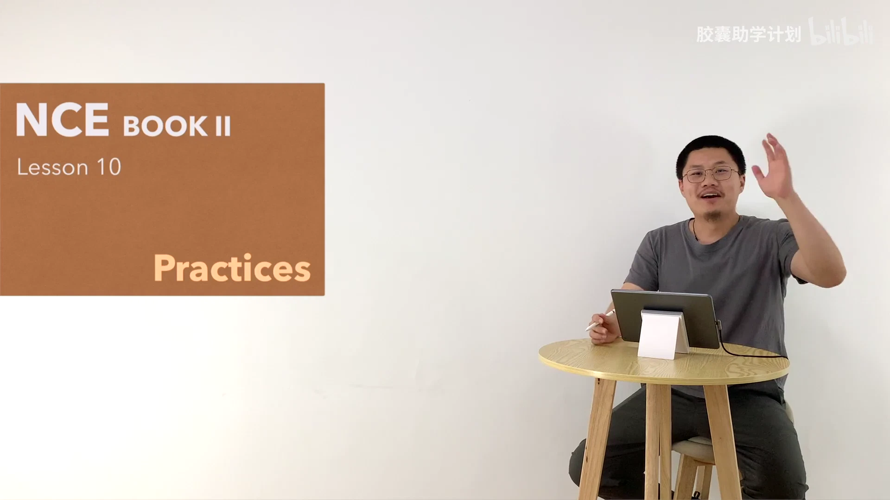

文字识别：胶囊助学计划 / NCE / BOOKI"I / Lesson 10 / Practices

### 画面 00:00:02

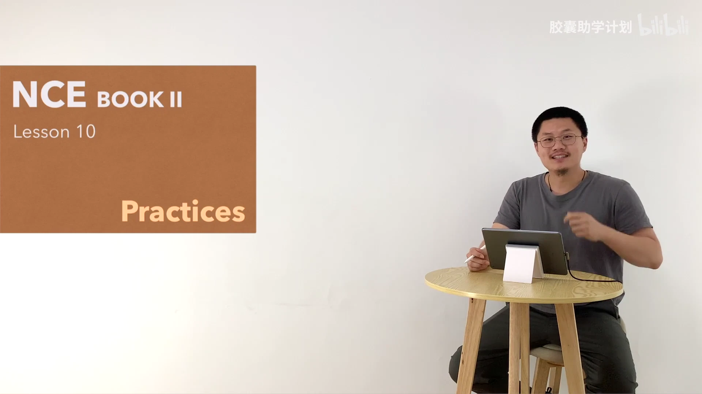

文字识别：胶囊助学计划 / NCE / BOOKI"I / Lesson 10 / Practices

### 画面 00:00:05

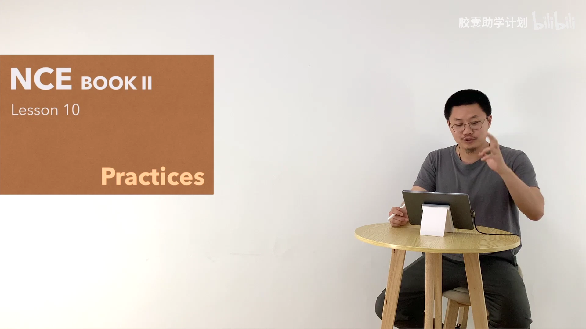

文字识别：胶囊助学计划 / NCE / BOOKI"I / Lesson 10 / Practices

### 画面 00:00:07

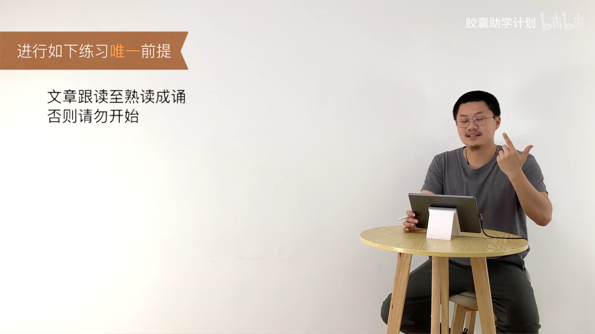

文字识别：胶囊助学计划 / 进行如下练习唯一前提 / 文章跟读至熟读成诵 / 否则请勿开始

### 画面 00:00:10

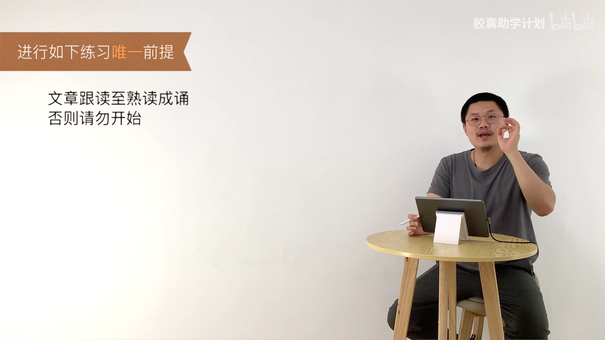

文字识别：胶囊助学计划 / 进行如下练习唯一前提 / 文章跟读至熟读成诵 / 否则请勿开始

### 画面 00:00:18

文字识别：胶囊助学计划bil出

### 画面 00:00:22

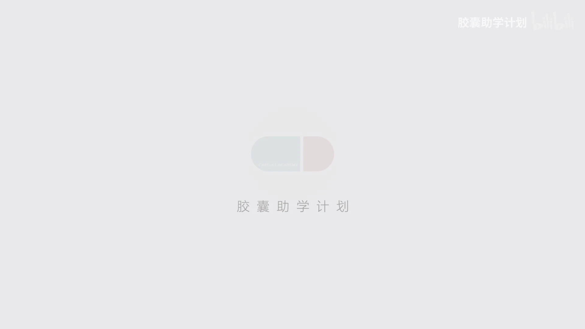

文字识别：胶囊助学计划

### 画面 00:00:24

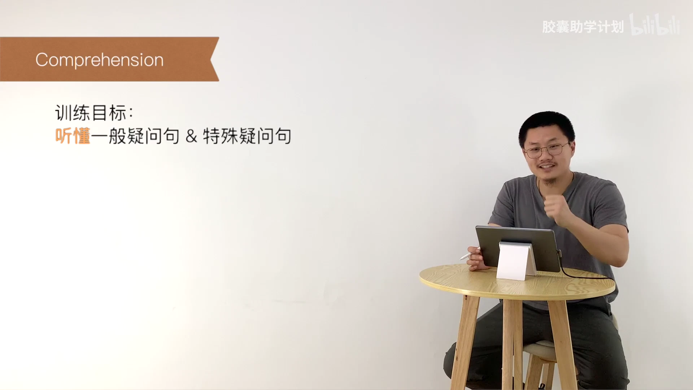

文字识别：胶囊助学计划 / Comprehension / 训练目标： / 听懂一般疑问句＆特殊疑问句

## 00:00:30–00:01:00

眼睛看着文章啊，但是不要看着我这个地方啊。我们进行听力口语练习来了。弟弟，What kind of instrument do we have？注意一个小点，What kind of指的是什么类型的？那答案就是an old one。Next one，What's it called？A clavichord。Next one，Where was it made？In

### 画面 00:00:35

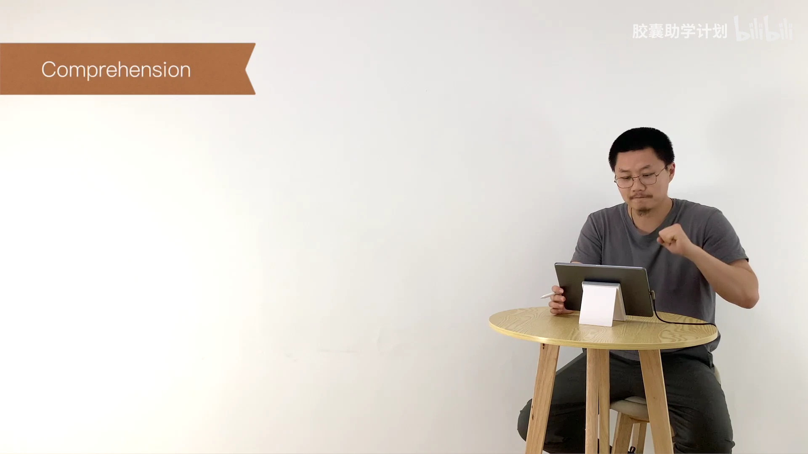

文字识别：胶囊助学计划 / Comprehension

### 画面 00:00:37

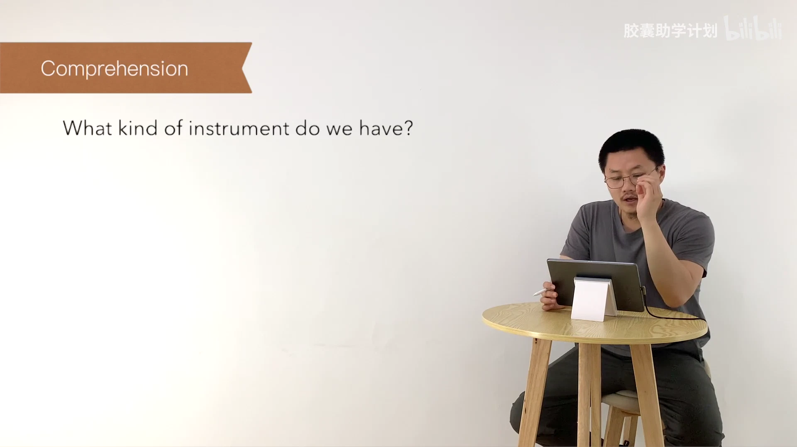

文字识别：胶囊助学计划 / Comprehension / What kind of instrument do we have?

### 画面 00:00:41

文字识别：胶囊助学计划 / Comprehension / What kind of instrument do we have?

## 00:01:00–00:01:30

Next one, when was it made? In 1681. Next one, where is our clavichord kept? In the living room. Next one, how long has it belonged to our family? For a long time. Next one, who bought it? My grandfather. Next one,

### 画面 00:01:11

文字识别：胶囊助学计划 / Comprehension / Where is our clavichord kept?

## 00:01:30–00:02:00

when was it bought? Many years ago. Next one, was it damaged recently? Yes, it was. Next one, who damaged it? A visitor did,或者说a visitor就可以了. Next one, what did she try to do? Play jazz on it. Continue. How did she

### 画面 00:01:41

文字识别：胶囊助学计划 / Comprehension

### 画面 00:01:51

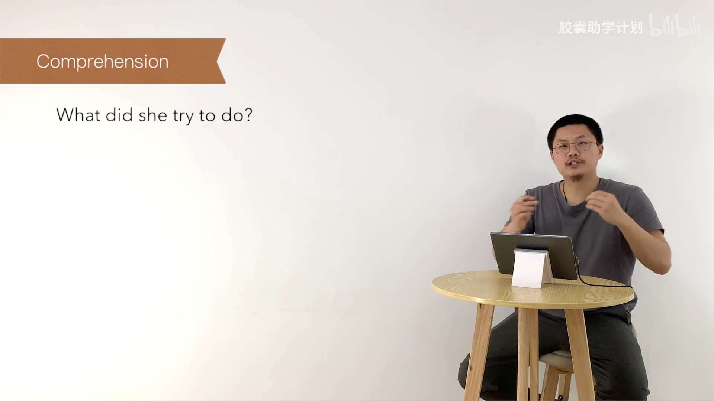

文字识别：胶囊助学计划 / Comprehension / What did she try to do?

### 画面 00:01:53

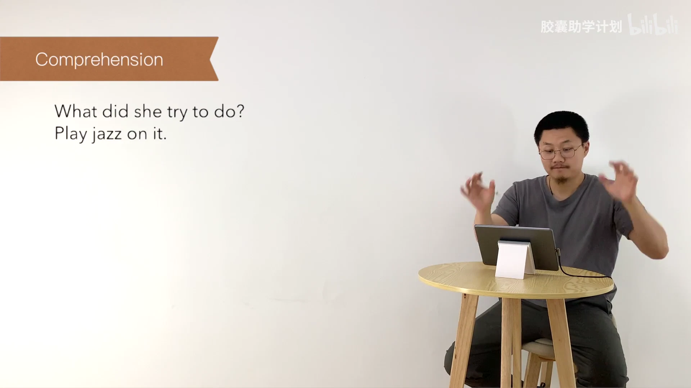

文字识别：胶囊助学计划 / Comprehension / What did she try to do? / Play jazz on it.

### 画面 00:01:56

文字识别：胶囊助学计划 / Comprehension / What did she try to do? / Play jazz on it.

### 画面 00:01:58

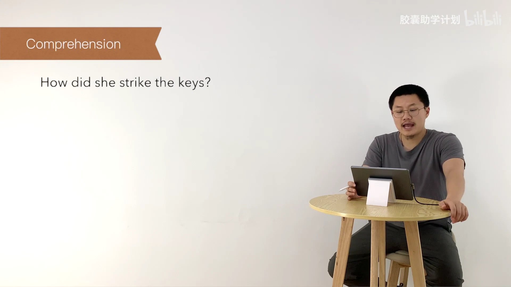

文字识别：胶囊助学计划 / Comprehension / How did she strike the keys?

## 00:02:00–00:02:30

struck the strike the keys? Very hard. Who was shocked? My father. How many strings were broken? Two. What aren't we allowed to do now? Touch it. Next one. Is it being repaired? Yes, it is.

### 画面 00:02:02

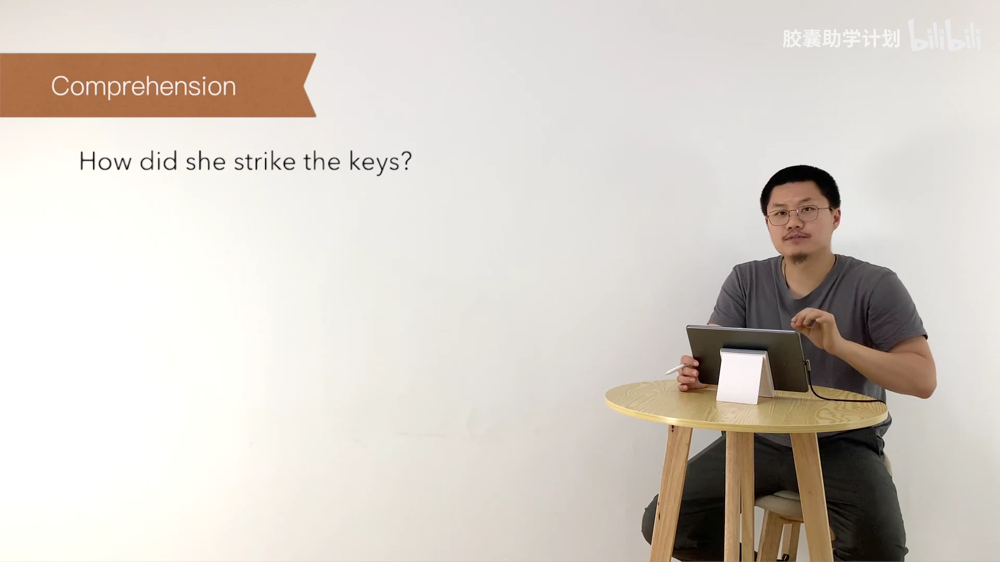

文字识别：胶囊助学计划 / Comprehension / How did she strike the keys?

### 画面 00:02:08

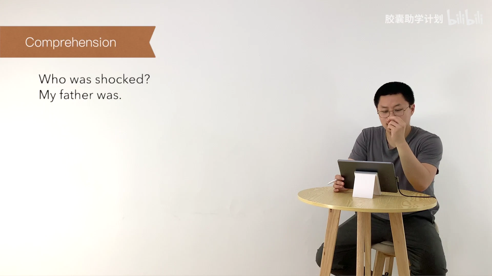

文字识别：胶囊助学计划 / Comprehension / Who was shocked? / My father was.

### 画面 00:02:11

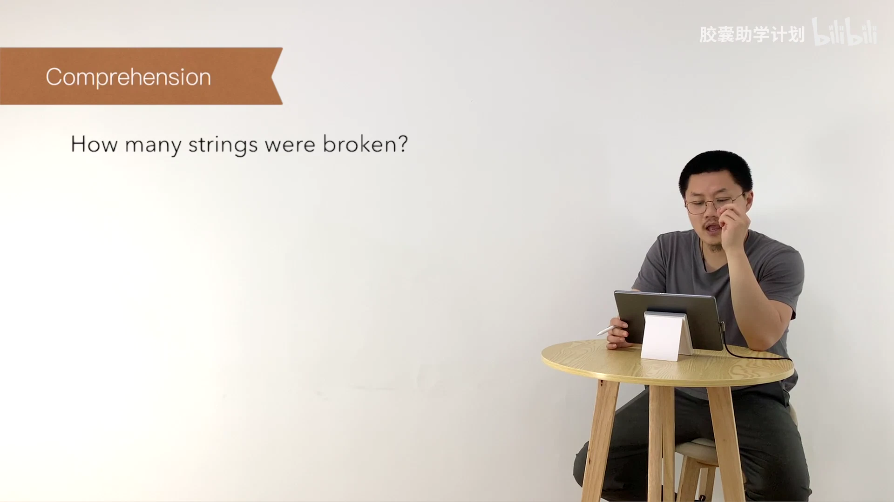

文字识别：胶囊助学计划 / Comprehension / How many strings were broken?

## 00:02:30–00:03:00

好，下一题，asking questions，会说一般疑问句、特殊疑问句，可以慢，不能错啊。来了，Ask me if we own an old musical instrument. 我们只说思路，变一般疑问句肯定是 do 提前，对吧？ Own 其实就是 have 的同义词，拥有嘛。然后 what kind，注意 what kind 要加上 what kind of 啊，它基本上是对形容词提问，问什么类型的，

### 画面 00:02:31

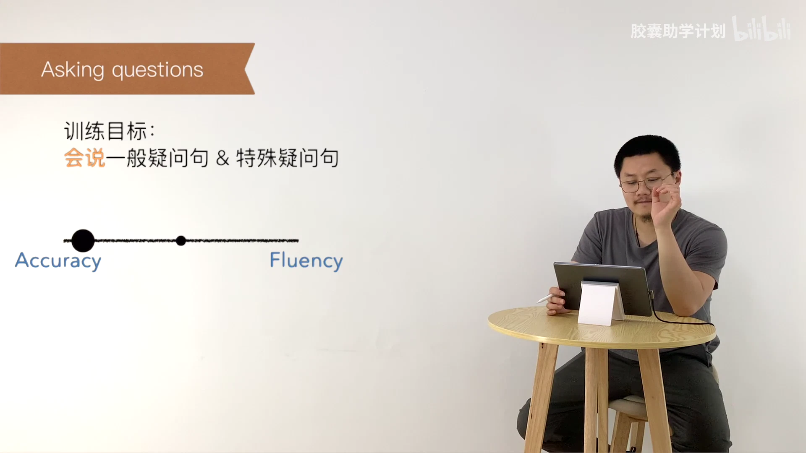

文字识别：胶囊助学计划 / Asking questions / 训练目标： / 会说一般疑问句＆特殊疑问句 / Accuracy / Fluency

### 画面 00:02:33

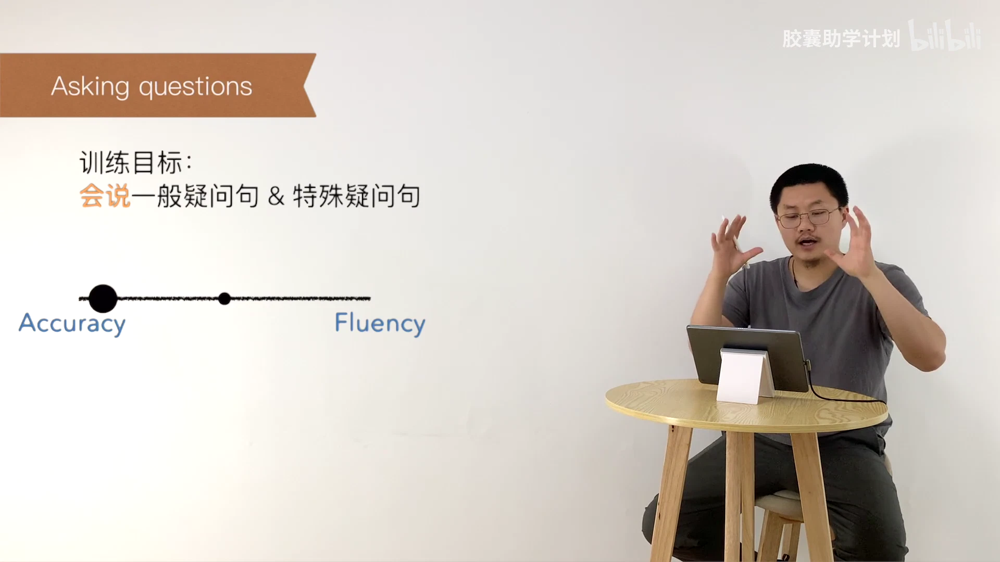

文字识别：胶囊助学计划 / Asking questions / 训练目标： / 会说一般疑问句＆特殊疑问句 / Accuracy / Fluency

### 画面 00:02:39

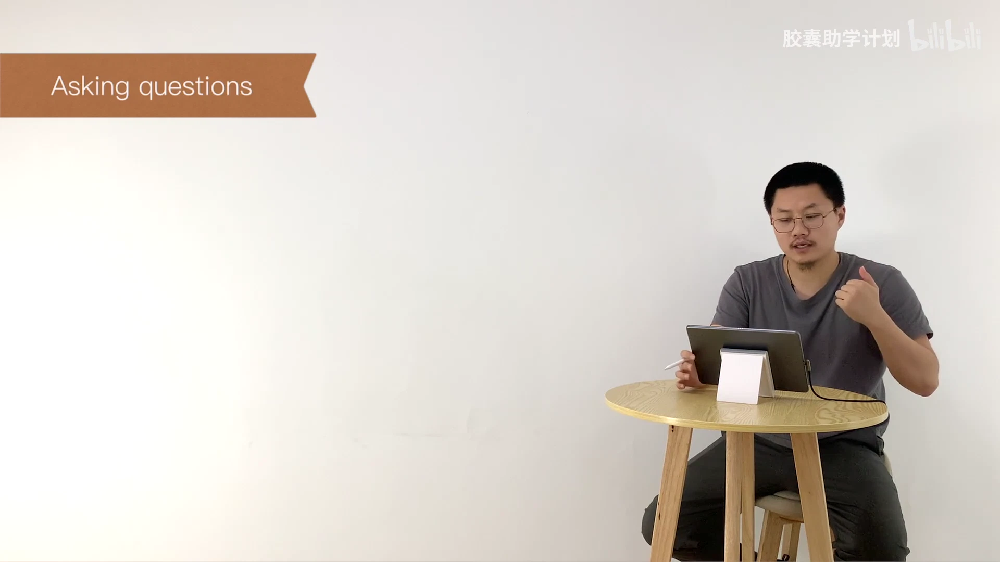

文字识别：胶囊助学计划 / Asking questions

### 画面 00:02:41

文字识别：胶囊助学计划 / Asking questions / T: Ask me if we own an old musical instrument.

### 画面 00:02:44

文字识别：胶囊助学计划 / Asking questions / T: Ask me if we own an old musical instrument.

### 画面 00:02:46

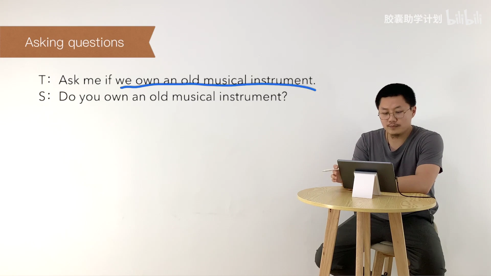

文字识别：胶囊助学计划 / Asking questions / T: Ask me if we own an old musical instrument. / S: Do you own an old musical instrument?

## 00:03:00–00:03:30

对吧？你肯定是对一个形容词提问。那 What kind of instrument do you own? 啊，你们拥有一个什么类型的乐器呢？非常古老的一个，来一个。好，It's called a clavichord. 我们在这儿只讲思路，不讲具体的答案啊。肯定是被动，is提前嘛。What a clavichord? 提问啊，它被叫做什么？It's kept in the living room. 好，is提前就行

### 画面 00:03:01

文字识别：胶囊助学计划 / Asking questions / T: Ask me if we own an old musical instrument. / S: Do you own an old musical instrument? / T: What kind...? / S: What kind of instrument do you own?

### 画面 00:03:10

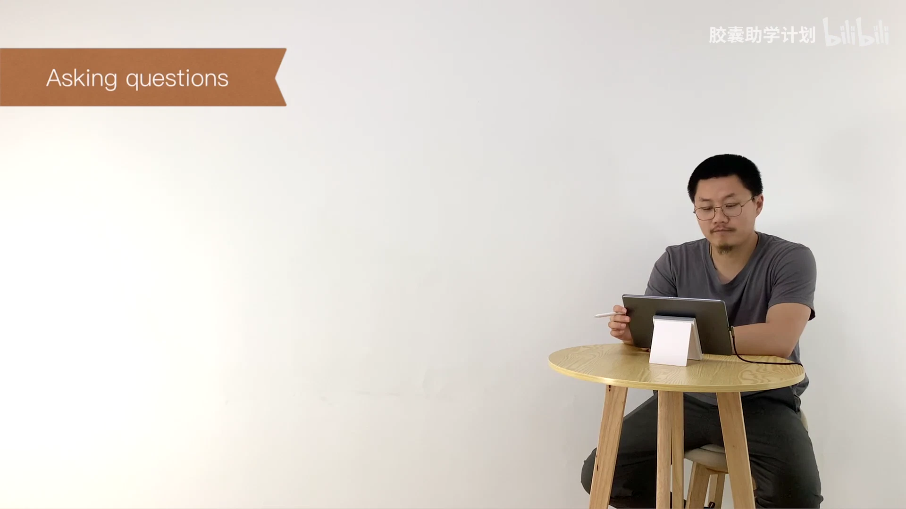

文字识别：胶囊助学计划 / Asking questions

### 画面 00:03:13

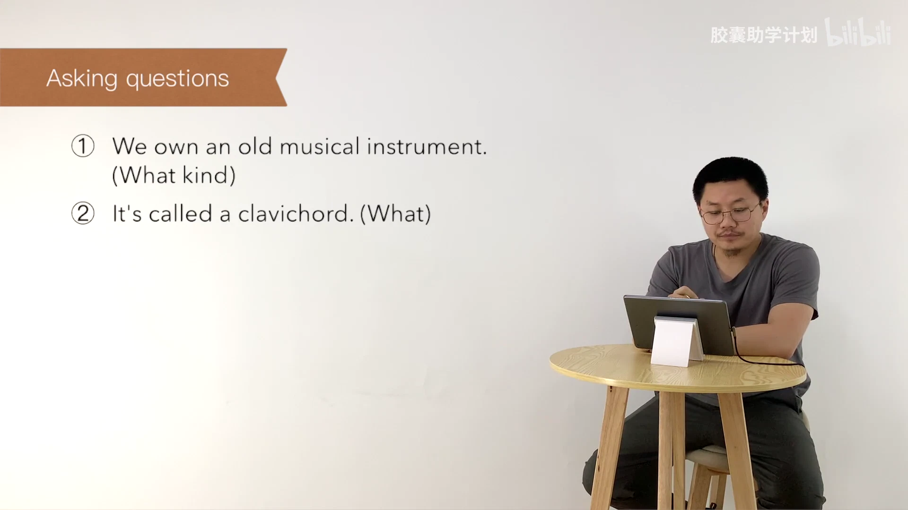

文字识别：胶囊助学计划 / Asking questions / We own an old musical instrument. / (What kind) / It's called a clavichord. (What)

### 画面 00:03:20

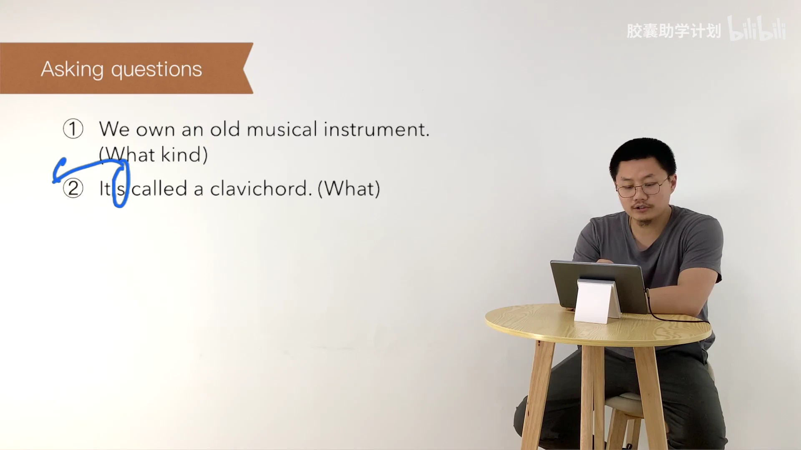

文字识别：胶囊助学计划 / Asking questions / We own an old musical instrument. / (What kind) / called a clavichord.(What) / It / S

### 画面 00:03:23

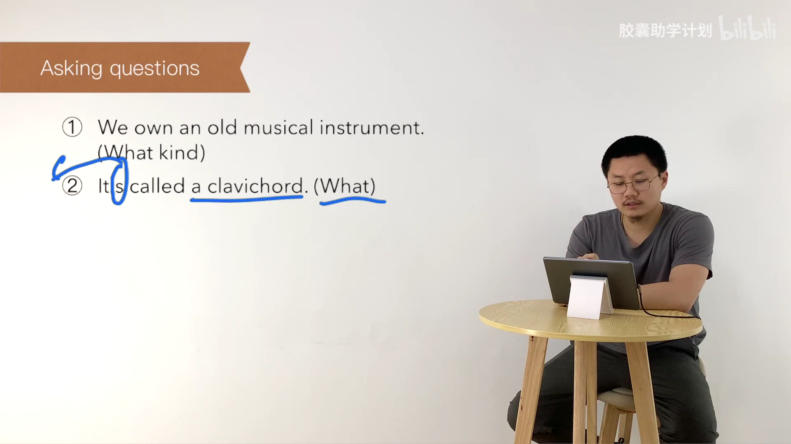

文字识别：胶囊助学计划 / Asking questions / We own an old musical instrument. / (What kind) / called a clavichord.(What) / It / S

### 画面 00:03:29

文字识别：胶囊助学计划 / Asking / questions / We own an old musical instrument. / (What kind) / called a clavichord. (What) / S / It's kept in the / living room. (Where)

## 00:03:30–00:04:00

了。Where对in the living room提问。It was made in Germany. Was提前。Where对in Germany。What对主语直接替代就行了，对吧？What was made in Germany? It was made in 1681.老习惯吧。Was提前。When对时间提问。What对主语提问。It has belonged to our family to us for a long time. Has提前，现在完成

### 画面 00:03:31

文字识别：胶囊助学计划 / Asking / questions / We / own an old musical instrument. / (What / kind) / called a clavichord. (What) / S / It's kept in the living room. (Where)

### 画面 00:03:34

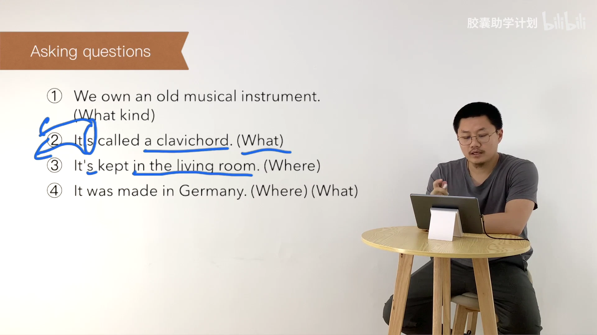

文字识别：胶囊助学计划 / Asking questions / We own an old musical instrument. / (What kind) / called a clavichord. (What) / S / It's kept in the living room. (Where) / It was made in Germany. (Where) (What)

### 画面 00:03:36

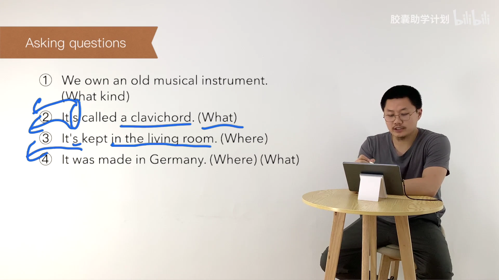

文字识别：胶囊助学计划 / Asking questions / We own an old musical instrument. / (What kind) / called a clavichord. (What) / It's kept in the living room. (Where) / It was made in Germany. (Where) (What)

### 画面 00:03:40

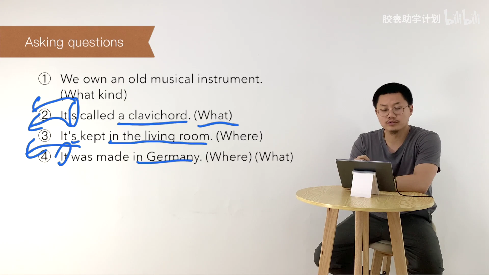

文字识别：胶囊助学计划 / Asking / questions / We / own an old musical instrument. / (What kind) / called a clavichord. (What) / It's kept in the living room. (Where) / was / made in Germany. (Where) (What)

### 画面 00:03:49

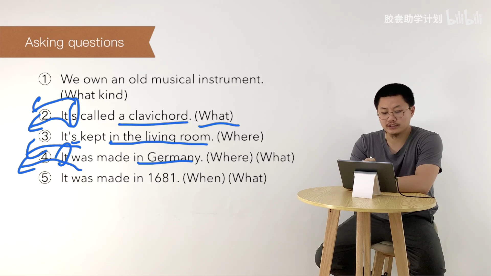

文字识别：胶囊助学计划 / Asking questions / We own an old musical instrument. / (What kind) / called a clavichord. (What) / S / It's kept in the living room. (Where) / was made in Germany. (Where) (What) / 5 / It was made in 1681.(When)(What)

### 画面 00:03:53

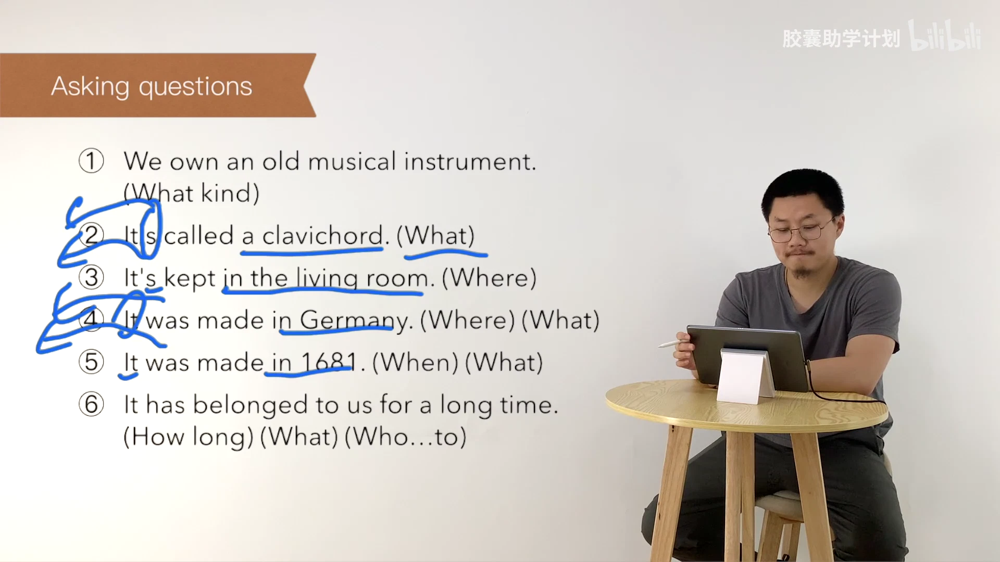

文字识别：胶囊助学计划 / Asking questions / We own an old musical instrument. / (What kind) / called a clavichord. (What) / Its / It's kept in the living room. (Where) / ①was made in Germany. (Where) (What) / 5 / It was made in 1681. (When)(What) / It has belonged to us for a long time. / (How long)(What) (Who...to)

### 画面 00:03:59

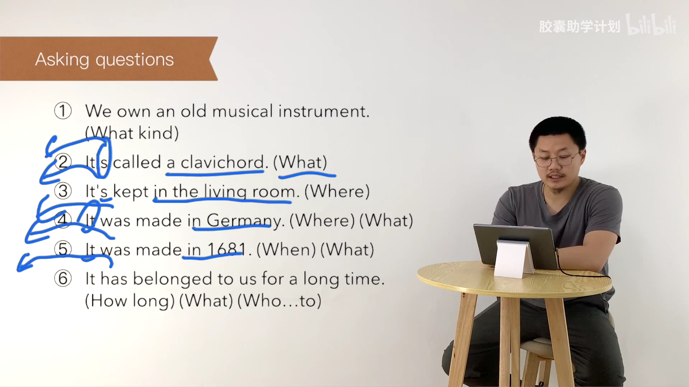

文字识别：胶囊助学计划 / Asking questions / We own an old musical instrument. / (What kind) / ltcalled a clavichord. (What) / It's kept in the living room. (Where) / was made in Germany. Where) (What) / 5 Jt was made in 1681. (When)(What) / It has belonged to us for a long time. / 6 / (How long)(What) (Who...to)

## 00:04:00–00:04:30

时对吧？How long对for a long time提问？What对主语提问？变不变一般疑问句？不变。Who对us提问？It was bought by my grandfather. Was提前？Who对my grandfather对吧？It was damaged recently. Was提前？When对recently提问？啊，When was it

### 画面 00:04:02

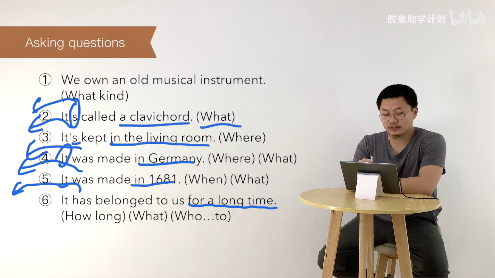

文字识别：胶囊助学计划 / Asking questions / We own an old musical instrument. / (What kind) / called a clavichord. (What) / lts / It's kept in the living room. (Where) / was made in Germany. (Where) (What) / ⑤ Jtwas madein 1681.(When) (What) / It has belonged to us for a long time. / (How long)(What) (Who...to)

### 画面 00:04:06

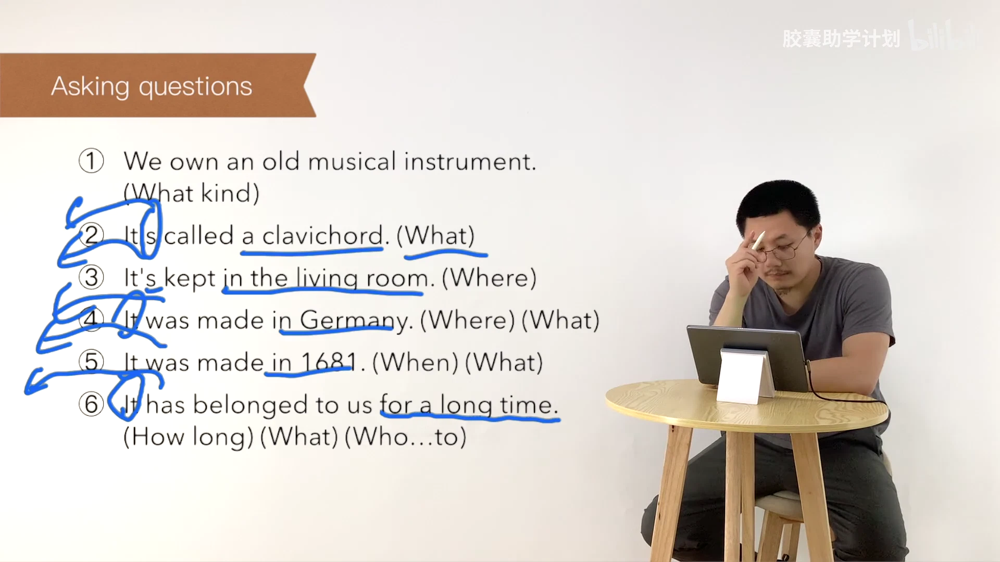

文字识别：胶囊助学计划 / Asking questions / We own an old musical instrument. / (What kind) / Itscalled a clavichord. (What) / It's kept in the living room. (Where) / was made in Germany.(Where)(What) / 5 Jt was madein 1681. (When) (What) /  has belonged to us for a long time. / 6 / (How long) (What) (Who...to)

### 画面 00:04:09

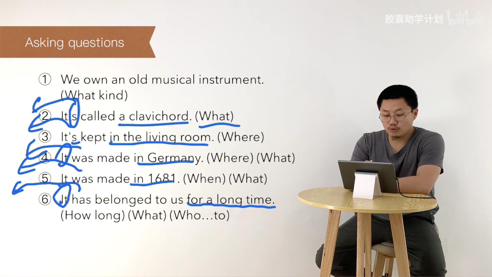

文字识别：胶囊助学计划 / Asking questions / We own an old musical instrument. / (What kind) / tscalled a clavichord. (What) / It's kept in the living room. (Where) / was made in Germany.(Where) (What) / 5 Jt was madein 1681. (When) (What) / has belonged to us for a long time. / 6 / (How long) (What) (Who...to)

### 画面 00:04:11

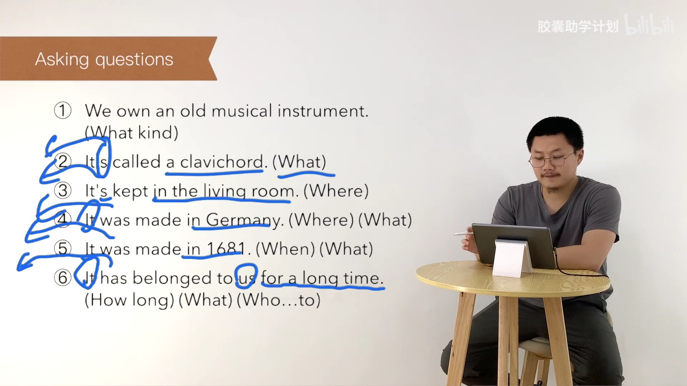

文字识别：胶囊助学计划 / Asking questions / We own an old musical instrument. / (What kind) / tscalled a clavichord. (What) / It's kept in the living room. (Where) / was made in Germany. (Where)(What) / 5 Jtwas made in 1681. (When) (What) / has belonged to for a long time. / 6 / (How long) (What) (Who...to)

### 画面 00:04:16

文字识别：胶囊助学计划 / Asking questions / We own an old musical instrument. / (What kind) / tcalled a clavichord. (What) / It's kept in the living room. (Where) / was madein Germany.(Where)(What) / 5 Jtwas made in 1681. (When)(What) / ⑥has belonged to for along time. / (How long) (What) (Who...to) / It was bought by my grandfather. (Who)

### 画面 00:04:19

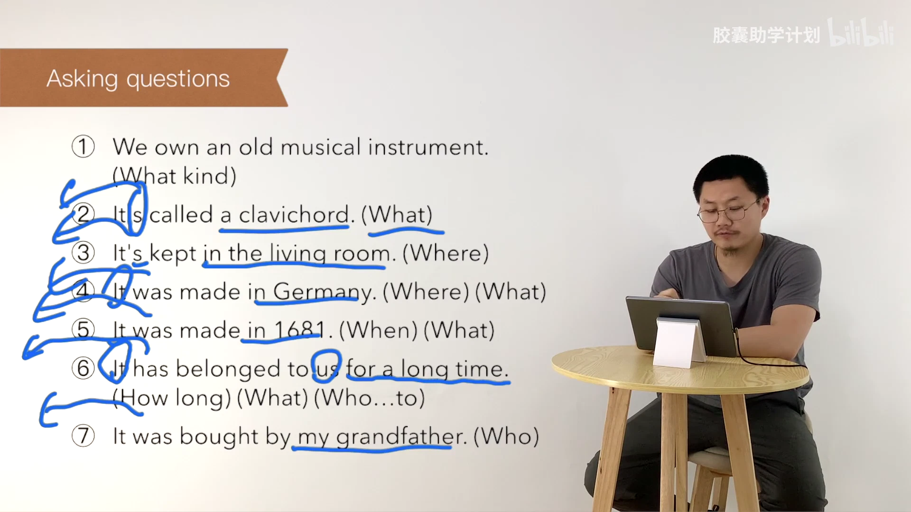

文字识别：胶囊助学计划 / Asking questions / We own an old musical instrument. / (What kind) / tcalled a clavichord. (What) / It's kept in the living room. (Where) / 5 Jtwas made in 1681. (When)(What) / ⑥has belonged to fora longtime. / (How long) (What) (Who...to) / It was bought by my grandfather. (Who)

### 画面 00:04:24

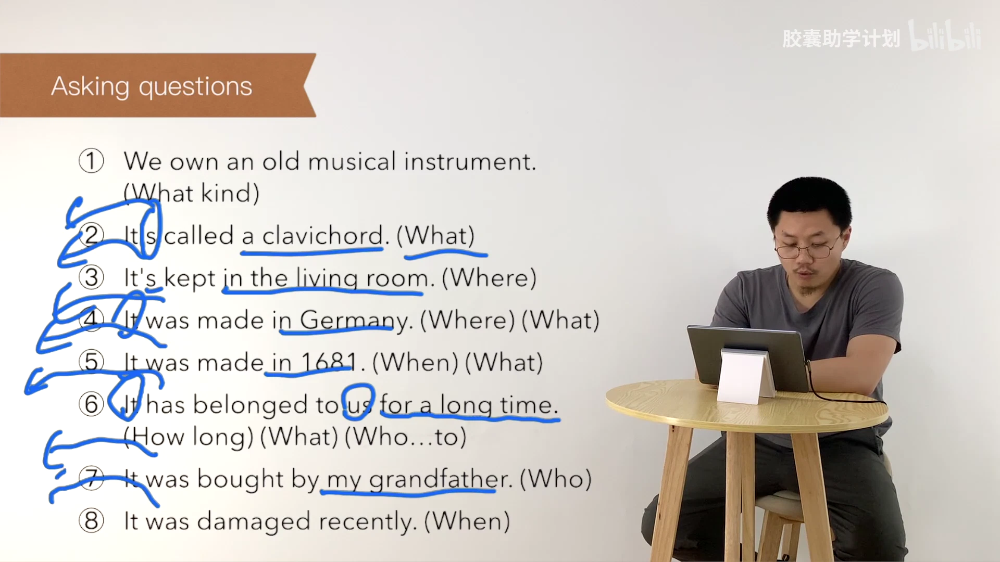

文字识别：胶囊助学计划 / Asking questions / We own an old musical instrument. / (What kind) / tcalled a clavichord.(What) / It's kept in the living room. (Where) / 5 Jtwas madein 1681. (When)(What) / ⑥has belonged to for along time. / (How long) (What) (Who...to) / ②t was bought by my grandfather. (Who) / It was damaged recently. (When) / 8

### 画面 00:04:26

文字识别：胶囊助学计划 / Asking questions / We own an old musical instrument. / (What kind) / tcalled a clavichord. (What) / It's kept in the living room. (Where) / 5 Jtwas made in 1681. (When)(What) / ⑥has belonged to fora long time. / (How long) (What) (Who...to) / t was bought by my grandfather.(Who) / It was damaged recently (When)

## 00:04:30–00:05:00

Very good. Next, tell the story.一定要尽可能的流利，可以错一点点，没事儿啊。我给大家还是只进行一个展示。您下课还是一定要自己去练。来了，We have an old musical instrument. It is called a clavichord. It was made in Germany in 1681, and our clavichord is kept in the living room. It has belonged to our family for

### 画面 00:04:30

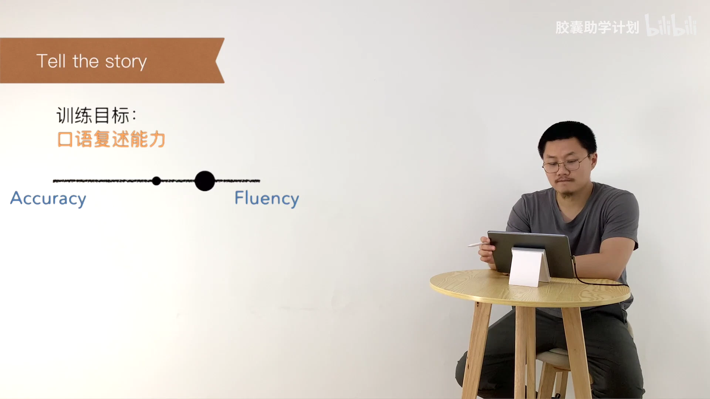

文字识别：胶囊助学计划 / Tell the story / 训练目标： / 口语复述能力 / Accuracy / Fluency

### 画面 00:04:32

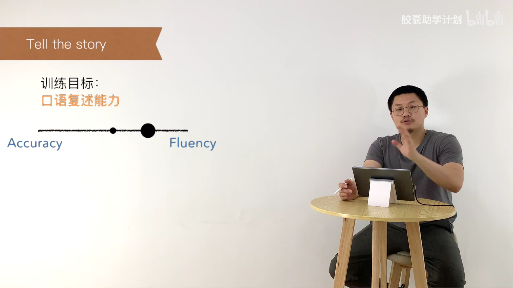

文字识别：胶囊助学计划 / Tell the story / 训练目标： / 口语复述能力 / Accuracy / Fluency

### 画面 00:04:34

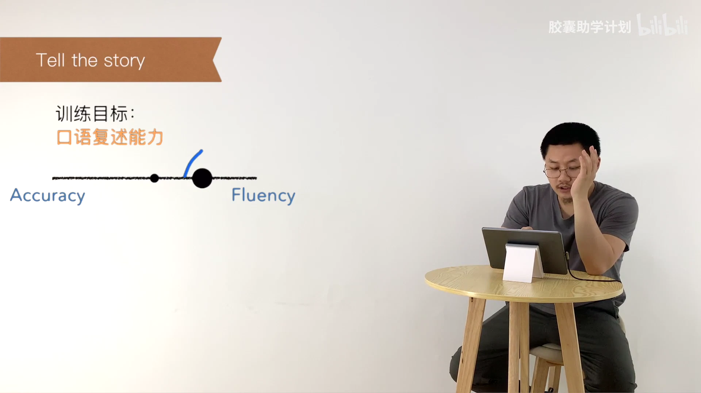

文字识别：胶囊助学计划 / Tell the story / 训练目标： / 口语复述能力 / Accuracy / Fluency

### 画面 00:04:36

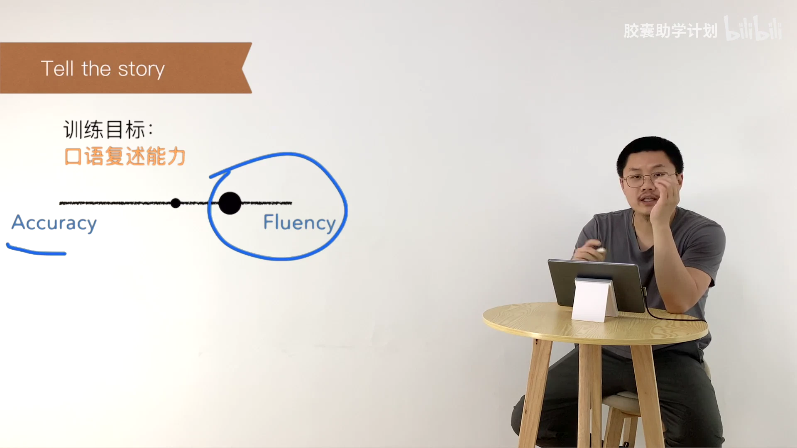

文字识别：胶囊助学计划 / Tell the story / 训练目标： / 口语复述能力 / Accuracy / Fluency

### 画面 00:04:38

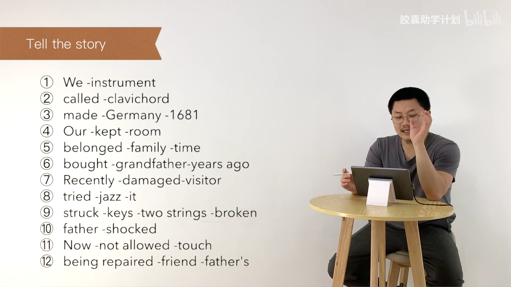

文字识别：胶囊助学计划 / Tell the story / We -instrument / called -clavichord / 2 / made -Germany -1681 / 3 / Our-kept-room / belonged -family -time / 5 / bought -grandfather-years ago / 6 / Recently -damaged-visitor / tried -jazz -it / struck -keys -two strings -broken / 10 / father -shocked / 11 / Now -not allowed -touch / 12 / ) being repaired -friend -father's

### 画面 00:04:47

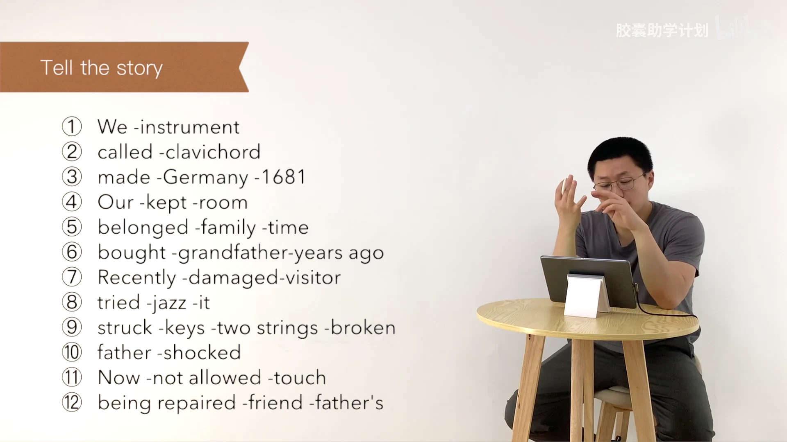

文字识别：胶囊助学计划 / Tell the story / We -instrument / 2 / called -clavichord / made -Germany -1681 / 3 / Our -kept -room / belonged -family -time / 5 / bought -grandfather-years ago / 6 / Recently -damaged-visitor / tried -jazz -it / struck -keys -two strings -broken / 10 / father-shocked / 11 / Now -not allowed -touch / 12 / being repaired -friend -father's

## 00:05:00–00:05:30

a long time. It was bought by my grandfather many years ago. Recently, a visitor damaged it. She tried to play jazz on it, and she struck the keys too hard, and two of the strings were broken. My father was shocked. Now we are not allowed to touch it. It is being repaired by a friend of my father's right now. Very good. Summary writing,摘要写作，老

### 画面 00:05:05

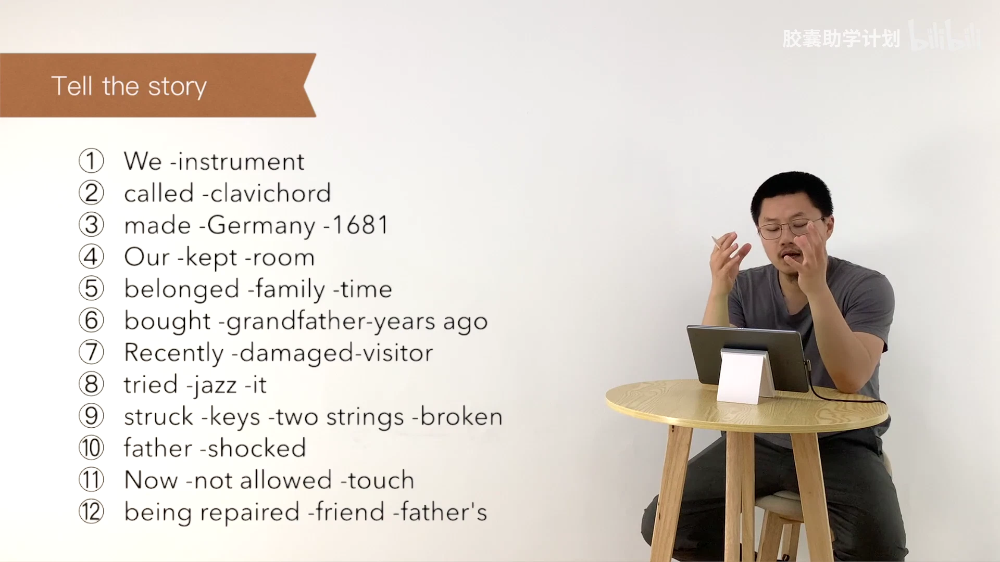

文字识别：胶囊助学计划 / Tell the story / 1 / We -instrument / called -clavichord / 2 / made -Germany -1681 / 3 / Our-kept -room / belonged -family -time / 5 / bought -grandfather-years ago / 6 / Recently -damaged-visitor / tried -jazz -it / struck -keys -two strings -broken / 10 / father -shocked / 11 / Now -not allowed -touch / 12 /  being repaired -friend -father's

### 画面 00:05:26

文字识别：胶囊助学计划 / Summary writing: Key / 训练目标： / 写作复述能力

## 00:05:30–00:06:00

习惯，各位需要做的事情就是自己写到这儿，对一下答案就可以了。这是练习我们写作的复述能力啊。各位将来想去写一封什么工作邮件呢？靠的就是这些，不要小瞧这些。OK，好，最后一道题，完全自由的对话，既练我们的 accuracy，又练我们的 fluency，对吧？流利性和我们的所谓准确性都练习。所以现在可能不太行，但是我们还是看一下他们是什么样的题啊？

### 画面 00:05:30

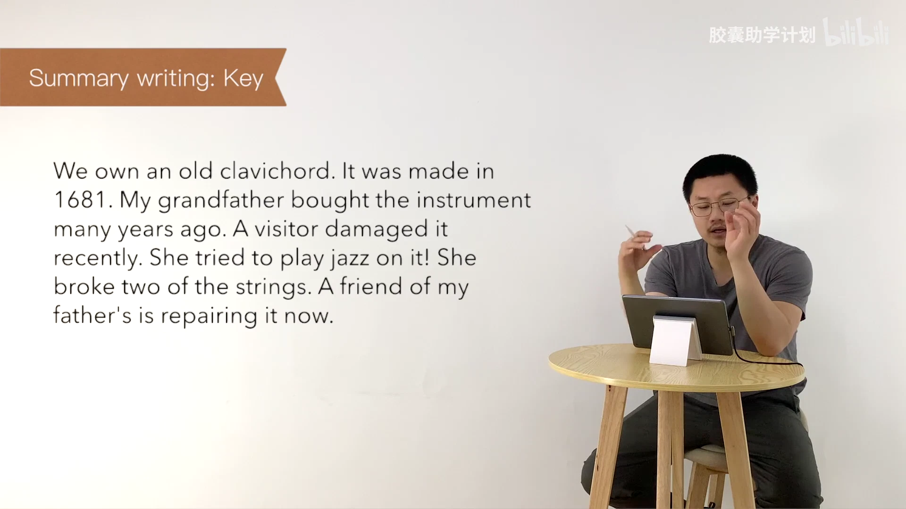

文字识别：胶囊助学计划 / Summary writing: Key / We own an old clavichord. It was made in / 1681. My grandfather bought the instrument / many years ago. A visitor damaged it / recently. She tried to play jazz on it! She / broke two of the strings. A friend of my / father's is repairing it now.

### 画面 00:05:37

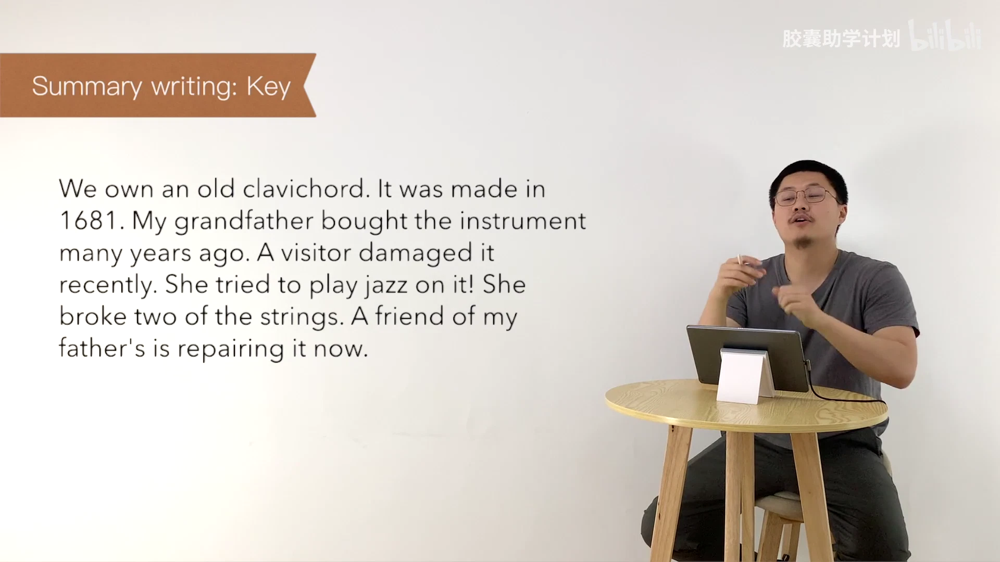

文字识别：胶囊助学计划 / Summary writing: Key / We own an old clavichord. It was made in / 1681. My grandfather bought the instrument / many years ago. A visitor damaged it / recently. She tried to play jazz on it! She / broke two of the strings. A friend of my / father's is repairing it now.

### 画面 00:05:39

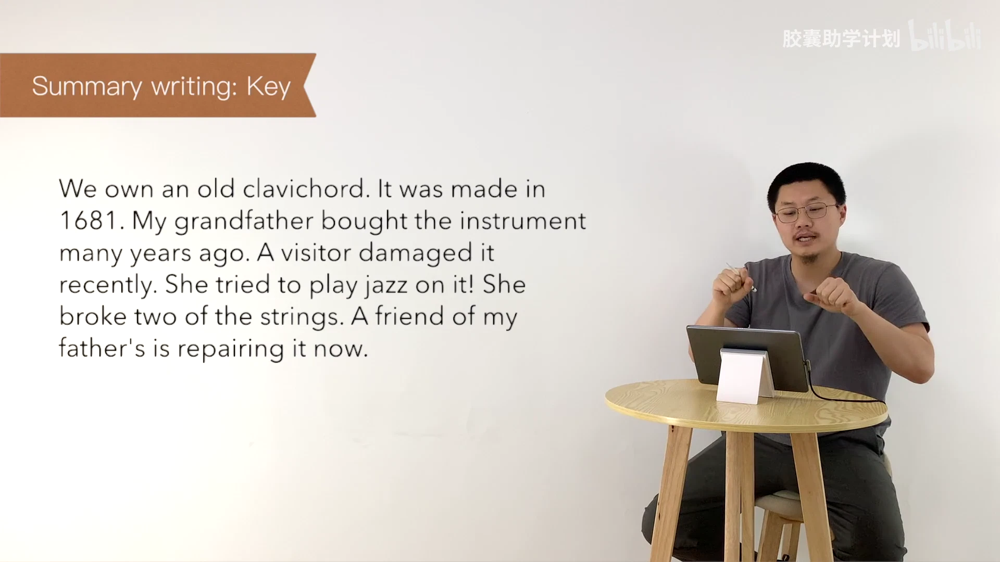

文字识别：胶囊助学计划 / Summary writing: Key / We own an old clavichord. It was made in / 1681. My grandfather bought the instrument / many years ago. A visitor damaged it / recently. She tried to play jazz on it! She / broke two of the strings. A friend of my / father's is repairing it now.

### 画面 00:05:43

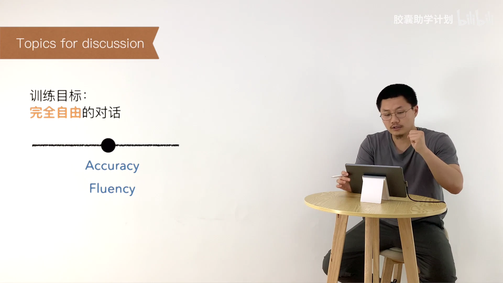

文字识别：胶囊助学计划 / Topics for discussion / 训练目标： / 完全自由的对话 / Accuracy / Fluency

### 画面 00:05:45

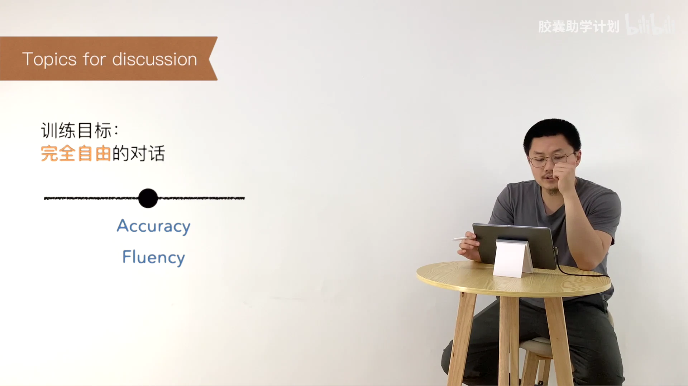

文字识别：胶囊助学计划 / Topics for discussion / 训练目标： / 完全自由的对话 / Accuracy / Fluency

### 画面 00:05:57

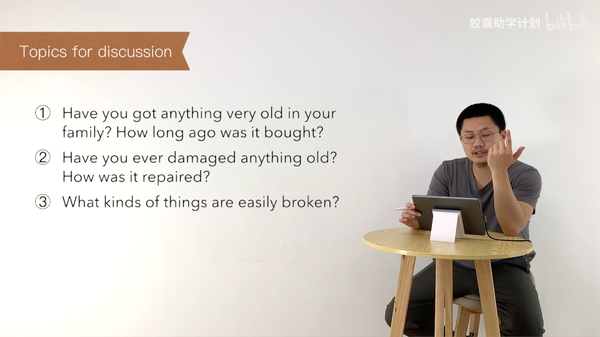

文字识别：胶囊助学计划 / Topics for discussion / Have you got anything very old in your / family? How long /  ago was it bought? / Have you ever damaged anything old? / How was it repaired? / What kinds of things are easily broken? / 3

### 画面 00:05:59

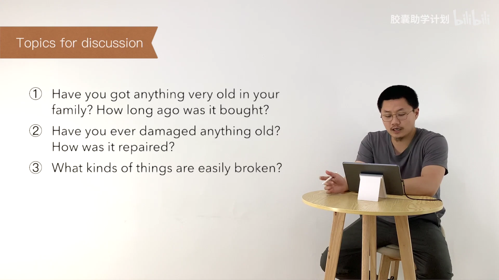

文字识别：胶囊助学计划 / Topics for discussion / Have you got anything very old in your / family? How long / ago was it bought? / Have you ever damaged anything old? / How was it repaired? / 3 / What kinds of things are easily k / broken?

## 00:06:00–00:06:30

Have you got anything very old in your family? 你们家族有非常古老的东西吗？How long ago was it bought? 多长时间之前买的这个东西？Have you ever damaged anything old? How was it repaired? 你以前损毁过比很古老的东西吗？这个它是如何被修理的？我希望你没有损毁过啊，可能要赔不少的钱。What kind of things are easily broken? 啊，什么事情是

### 画面 00:06:29

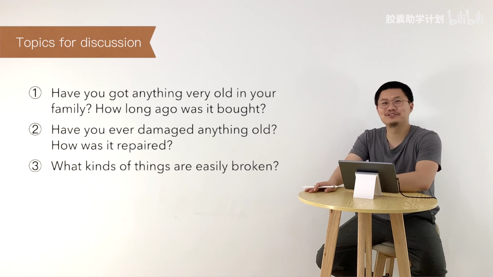

文字识别：胶囊助学计划 / Topics for discussion / Have you got anything very old in your / family? How long / ago was it bought? / Have you ever damaged anything old? / How was it repaired? / 3 / What kinds of things are easily l / broken?

## 00:06:30–00:07:00

很容易就被击碎的，对吧？你说 My heart is easily broken, 然后我很容易的心就碎了，是吧？OK，当然您可以说别的啊，都没没有问题的。那我们看一下本课将作业，Ask me if一定要先写，保证对了，然后看着自己写的大声朗读。摘要写作，您先写，来我们这儿对答案。Tell the story就像我课上做的那样，口语复述。专栏当中可以找到这些所有的练习。那

### 画面 00:06:31

文字识别：胶囊助学计划 / Topics for discussion / Have you got anything very old in your / family? How long / ago was it bought? / Have you ever damaged anything old? / How was it repaired? / 3 / What kinds of things are easily l / broken?

### 画面 00:06:33

文字识别：胶囊助学计划 / Topics for discussion / Have you got anything very old in your / family? How long / ago was it bought? / Have you ever damaged anything old? / How was it repaired? / 3 / What kinds of things are easily  / broken?

### 画面 00:06:36

文字识别：胶囊助学计划 / Topics for discussion / Have you got anything very old in your / family? How l / long / ago /  was it bought? / Have you ever damaged anything old? / How was it repaired? / 3 / What kinds of things a / are easily / broken?

### 画面 00:06:40

文字识别：胶囊助学计划

### 画面 00:06:42

文字识别：胶囊助学计划 / 1.Ask me if写&朗读

### 画面 00:06:44

文字识别：胶囊助学计划 / 1.A / Ask me if写&朗读

### 画面 00:06:46

文字识别：胶囊助学计划 / 1.Ask me if写&朗读

### 画面 00:06:48

文字识别：胶囊助学计划 / 1. / Ask me if写&朗读 / 2. / 摘要写作写&答案

### 画面 00:06:50

文字识别：胶囊助学计划 / 1.1 / Ask me if写&朗读 / 2. / 摘要写作写&答案

### 画面 00:06:52

文字识别：胶囊助学计划 / 1.Ask me if写&朗读 / 摘要写作写&答案 / 3.Tell the story 口语复述

### 画面 00:06:55

文字识别：胶囊助学计划 / 1.Ask me if写&朗读 / 摘要写作写&答案 / 3.Tell the story 口语复述

### 画面 00:06:57

文字识别：胶囊助学计划 / 1.Ask me if写&朗读 / 摘要写作写&答案 / 3.Tell the story 口语复述 / 专栏 / 4.

### 画面 00:06:59

文字识别：胶囊助学计划

## 00:07:00–00:07:25

以上就是本期视频的全部内容了。如果大家喜欢我们的课程呢，欢迎大家关注、订阅、一键三连支持我们，并分享给那些需要的朋友。这对我们非常的重要。See you next time.

### 画面 00:07:01

文字识别：胶囊助学计划

### 画面 00:07:04

文字识别：胶囊助学计划

### 画面 00:07:07

文字识别：胶囊助学计划

### 画面 00:07:09

文字识别：胶囊助学计划 / D

### 画面 00:07:12

文字识别：胶囊助学计划

### 画面 00:07:14

文字识别：CAPSULEACADEMY / 胶囊助学计划 / 小红书 / Lecturer / Leo / OE

### 画面 00:07:16

文字识别：CAPSULEACADEMY / 胶囊助学计划 / 小红书 / Photographer / □ / Berlin / OE

### 画面 00:07:18

文字识别：CAPSULEACADEMY / 胶囊助学计划 / 小红书 / Fditor / □ / 口 / Berlin / OE

### 画面 00:07:21

文字识别：CAPSULEACADEMY / 胶囊助学计划 / 小红书 / Creator / □ / Leo & Berlin / OE

### 画面 00:07:23

文字识别：bilibili / 胶囊助学计划

### 画面 00:07:24

文字识别：bilibili / 胶囊助学计划

