# L011 单词

快速机器解析：语音为单模型转写，未进行独立交叉校对或人工复核；画面每秒采样并按变化选帧，短时文字和标记可能遗漏。截图时间约有 1 秒误差。图片有损压缩；遇到疑点请按时间查看 Google Drive 原视频。

## 00:00:00–00:00:30

Hello everyone, welcome to Capsule Academy. This is Leo. Today we're going to learn New Concept English Book Two Lesson Eleven Words. 那老习惯进入正式课程之前，我们先看三个问题。第一，如何表达轮到你了。第二，如何表达收入不错。最后一个，如何表达礼尚往来。那带着这三个问题，Hope you guys enjoy. 好，那我们呢，先看第一个小的单词

### 画面 00:00:00

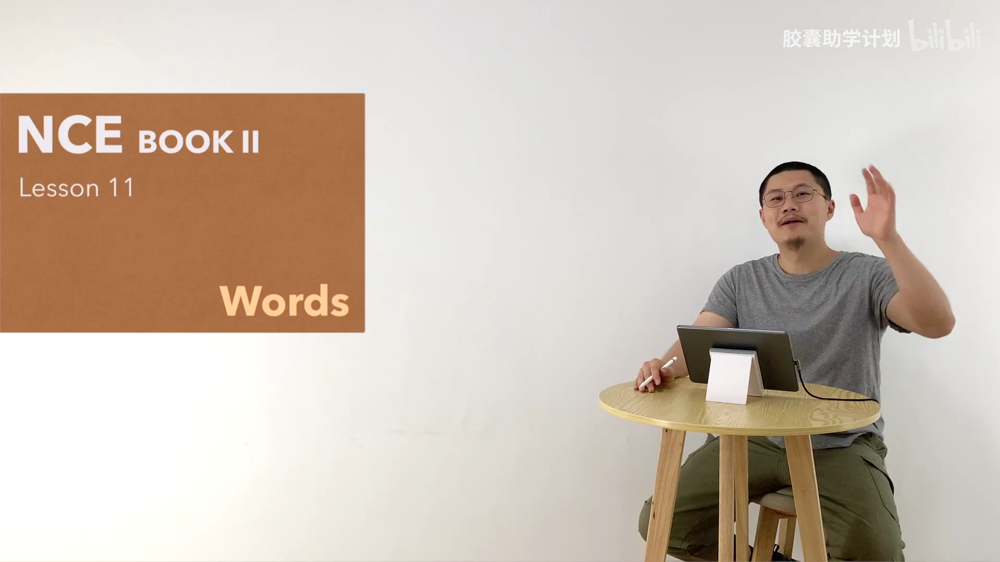

文字识别：胶囊助学计划 / NCE / BOOKII / Lesson 11 / Words

### 画面 00:00:04

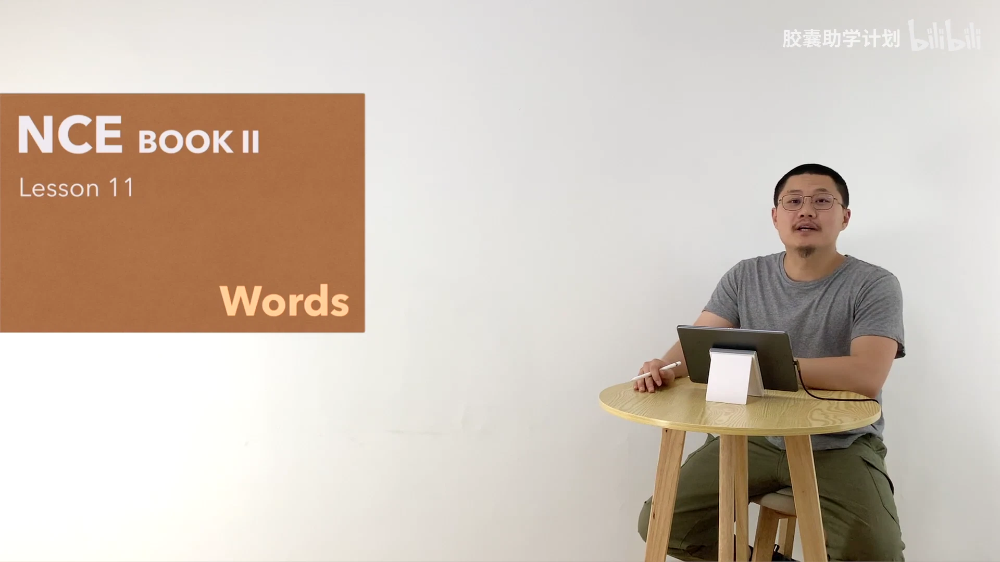

文字识别：胶囊助学计划 / NCE / BOOKII / Lesson 11 / Words

### 画面 00:00:06

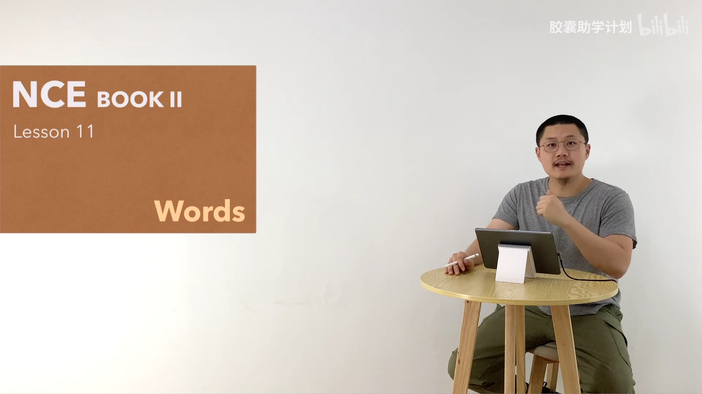

文字识别：胶囊助学计划 / NCE / BOOKI"I / Lesson 11 / Words

### 画面 00:00:08

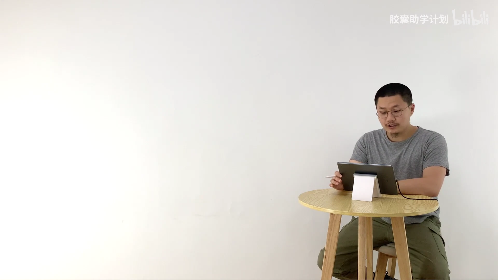

文字识别：胶囊助学计划

### 画面 00:00:10

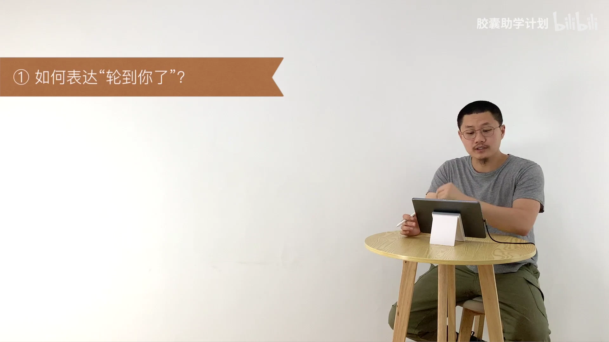

文字识别：胶囊助学计划 / ①如何表达“轮到你了”？

### 画面 00:00:12

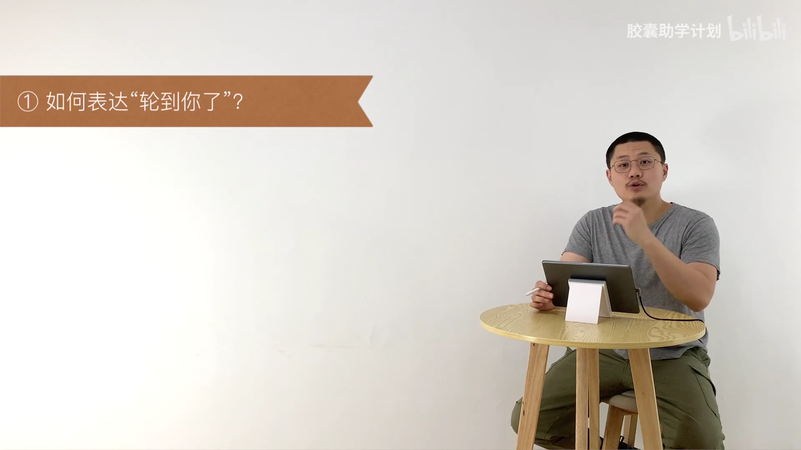

文字识别：胶囊助学计划 / ①如何表达“轮到你了”？

### 画面 00:00:14

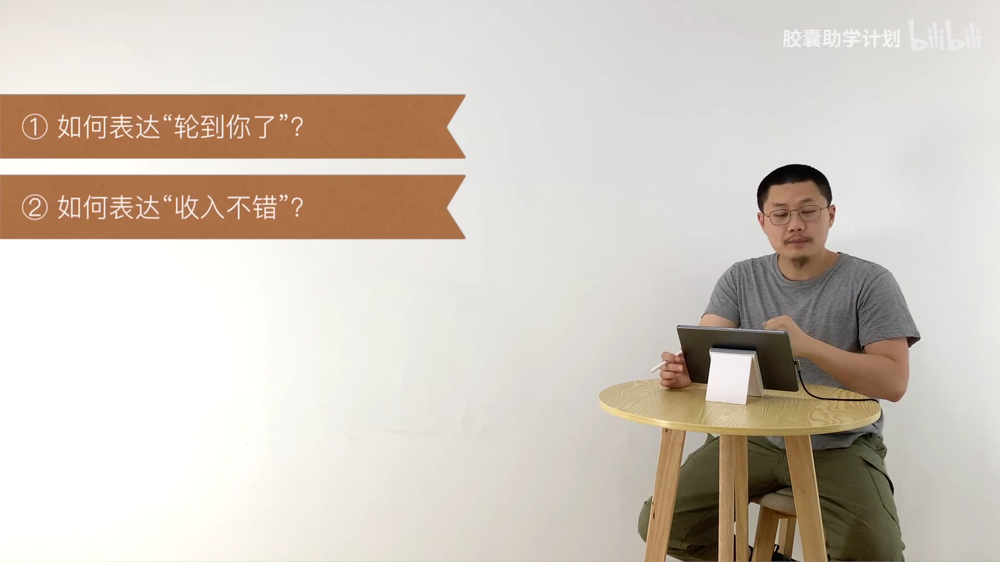

文字识别：胶囊助学计划 / ①如何表达“轮到你了”？ / 如何表达“收入不错”

### 画面 00:00:16

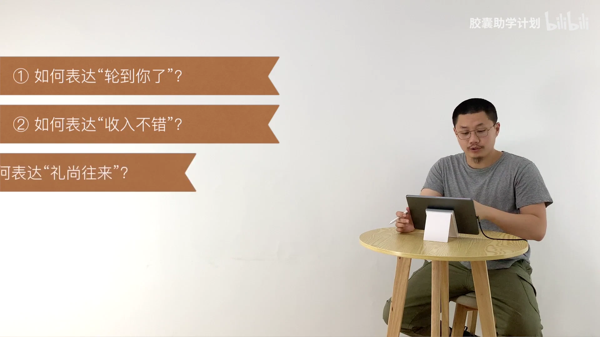

文字识别：胶囊助学计划 / ①如何表达“轮到你了”？ / 如何表达“收入不错” / 可表达“礼尚往来”?

### 画面 00:00:18

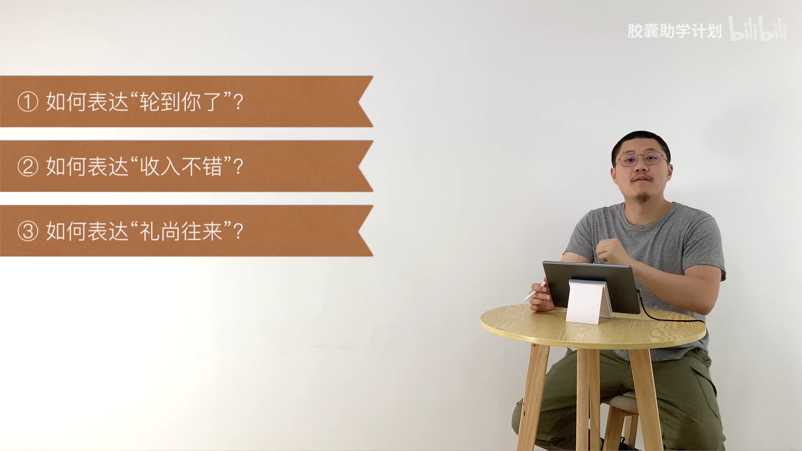

文字识别：胶囊助学计划 / ①如何表达“轮到你了”？ / 如何表达“收入不错” / 如何表达“礼尚往来”?

### 画面 00:00:20

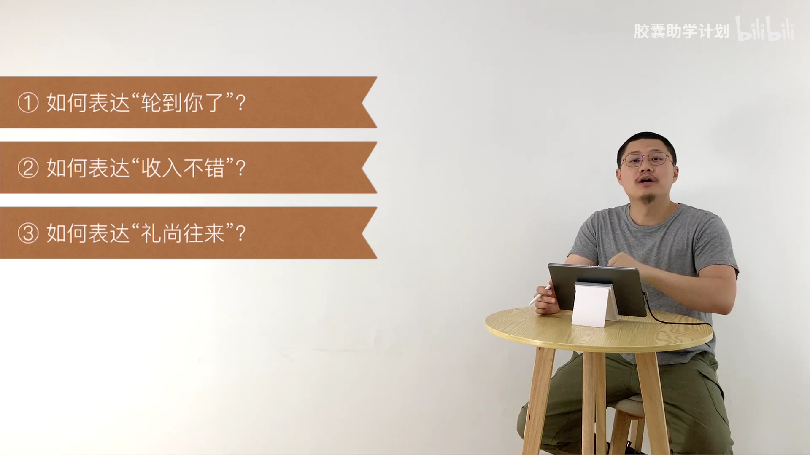

文字识别：胶囊助学计划 / ①如何表达“轮到你了”？ / 如何表达“收入不错 / 如何表达“礼尚往来”?

### 画面 00:00:22

文字识别：胶囊助学计划bll / •

### 画面 00:00:26

### 画面 00:00:28

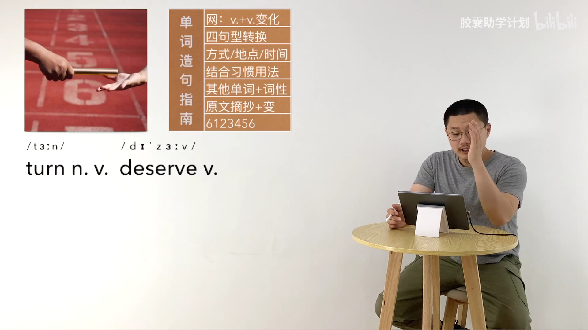

文字识别：单词造句指南 / 网：v.+v.变化 / 胶囊助学计划 / 四句型转换 / 方式/地点/时间 / 结合习惯用法 / 其他单词+词性 / 原文摘抄+变 / 6123456 / /t3:n/ / /dI'z3:ν/ / turn n.v.  / deserve v.

## 00:00:30–00:01:00

啊，跟我一起读一下，看着音标，来加个儿化音，对吧？来，turn，turn，好，它其实有两个词性，一个是名词词性，一个是动词词性。名词词性呢，本文在标题当中出现了，它的意思叫做行为或者说举止。那动词词性呢，其实也有很多啊，比如说我们之前应该就见过了。那一会儿呢，我们再提一个，它叫变得啊，变化变得怎么怎么样。下一个单词跟我一起读一下，叫做deserve，

### 画面 00:00:30

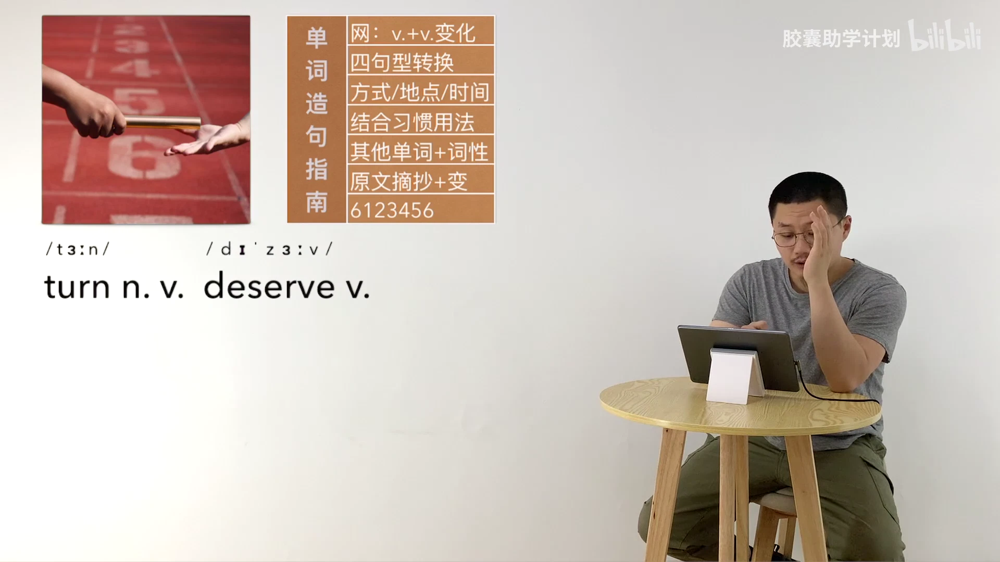

文字识别：单词造句指南 / 网：v.+v.变化 / 胶囊助学计划 / Bilibli / 四句型转换 / 方式/地点/时间 / 结合习惯用法 / 其他单词+词性 / 原文摘抄+变 / 6123456 / /t3:n/ / /dI'z3:ν/ / turn n.v. / deserve v.

### 画面 00:00:32

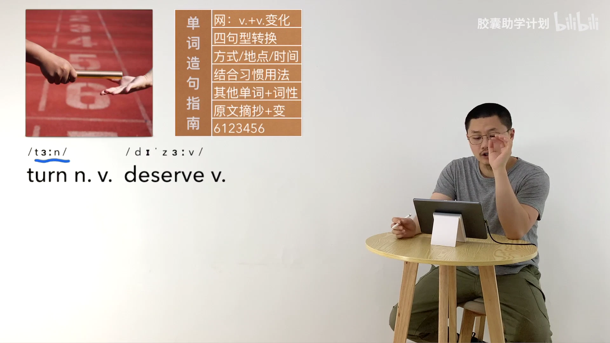

文字识别：单词造句指南 / 网：v.+v.变化 / 胶囊助学计划 / blbl / 四句型转换 / 方式/地点/时间 / 结合习惯用法 / 其他单词+词性 / 原文摘抄+变 / 6123456 / /t3:n/ / /dⅠ'z3:v/ / turn n. v. / deserve v.

### 画面 00:00:35

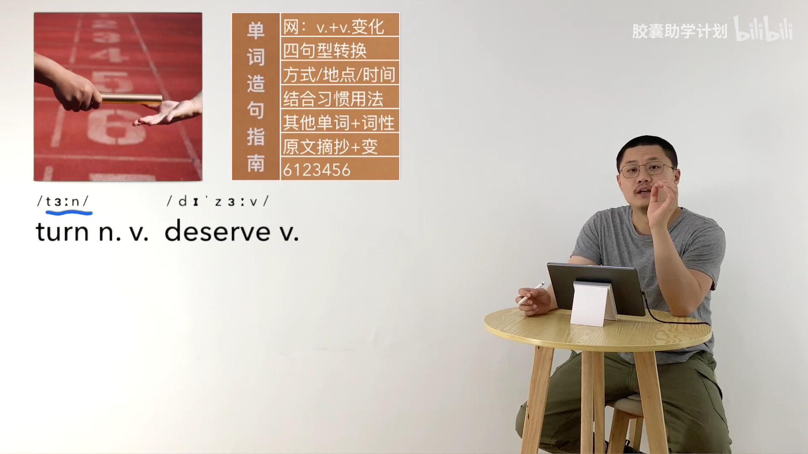

文字识别：单词造句指南 / 网：v.+v.变化 / 胶囊助学计划 / Bilibili / 四句型转换 / 方式/地点/时间 / 结合习惯用法 / 其他单词+词性 / 原文摘抄+变 / 6123456 / /t3:n/ / /dⅠ'z3:v/ / deserve v. / turn n.v.

### 画面 00:00:39

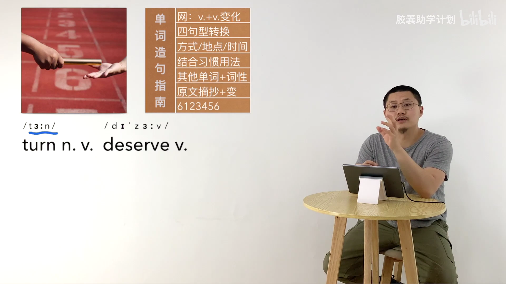

文字识别：单词造句指南 / 网：v.+v.变化 / 胶囊助学计划 / 四句型转换 / 方式/地点/时间 / 结合习惯用法 / 其他单词+词性 / 原文摘抄+变 / 6123456 / /t3:n/ / /dI'z3:v/ / turn n.v. / deserve V.

### 画面 00:00:41

文字识别：单词造句指南 / 网：v.+v.变化 / 胶囊助学计划 / 四句型转换 / 方式/地点/时间 / 结合习惯用法 / 其他单词+词性 / 原文摘抄+变 / 6123456 / /t3:n/ / /dI'z3:ν/ / turn n. v. / deserve v.

### 画面 00:00:45

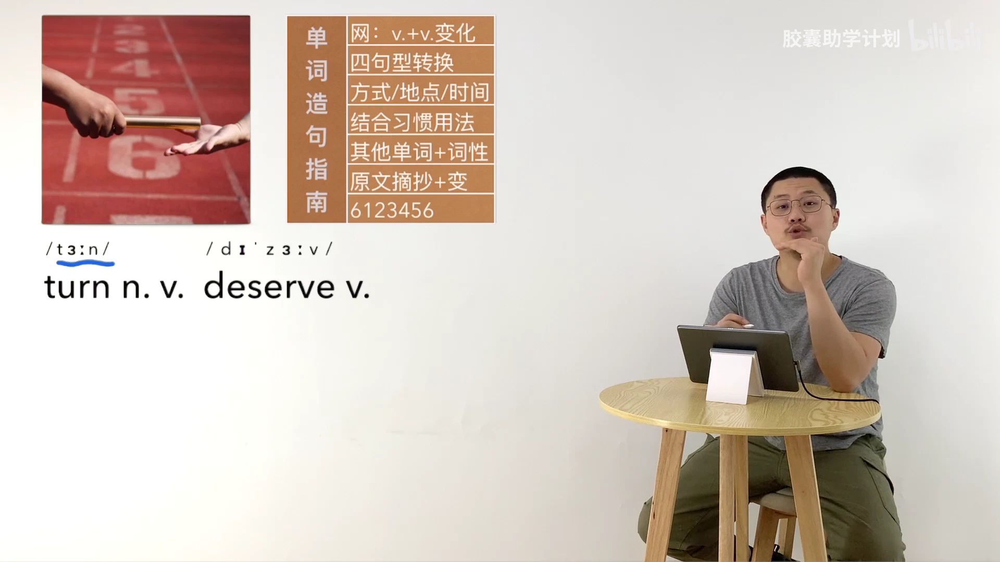

文字识别：单词造句指南 / 网：v.+v.变化 / 胶囊助学计划 / 四句型转换 / 方式/地点/时间 / 结合习惯用法 / 其他单词+词性 / 原文摘抄+变 / 6123456 / /t3:n/ / /dI'z3:ν/ / turn n.v. / deserve v.

### 画面 00:00:50

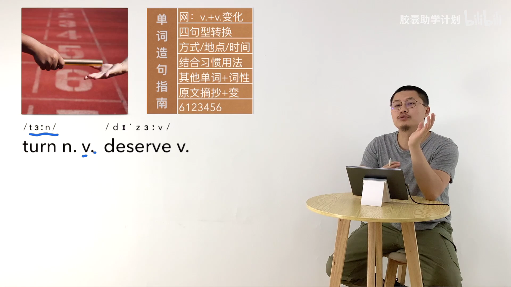

文字识别：单词造句指南 / 网：v.+v.变化 / 胶囊助学计划 / 四句型转换 / 方式/地点/时间 / 结合习惯用法 / 其他单词+词性 / 原文摘抄+变 / 6123456 / /t3:n/ / /dI'z3:ν/ / turn n.y. / deserve v.

### 画面 00:00:55

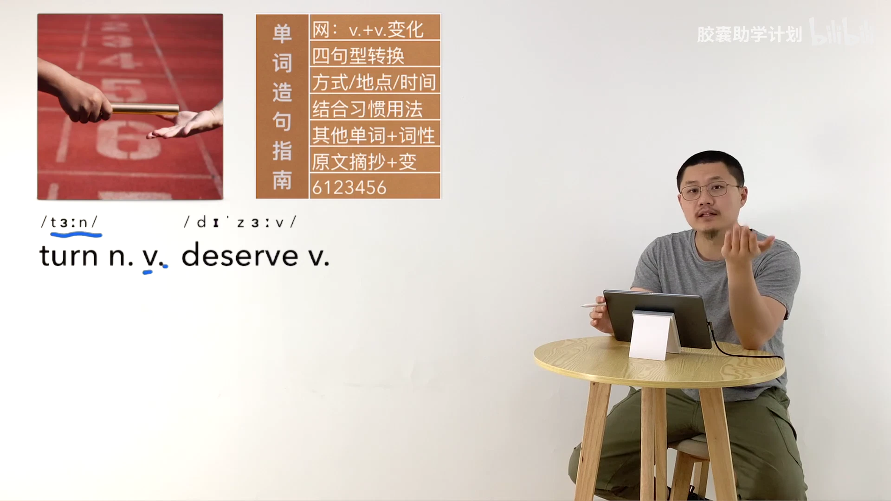

文字识别：单词造句指南 / 网：v.+v.变化 / 胶囊助学计划 / 四句型转换 / 方式/地点/时间 / 结合习惯用法 / 其他单词+词性 / 原文摘抄+变 / 6123456 / /t3:n/ / /dI'z3:ν/ / turn n. y. / deserve v.

### 画面 00:00:58

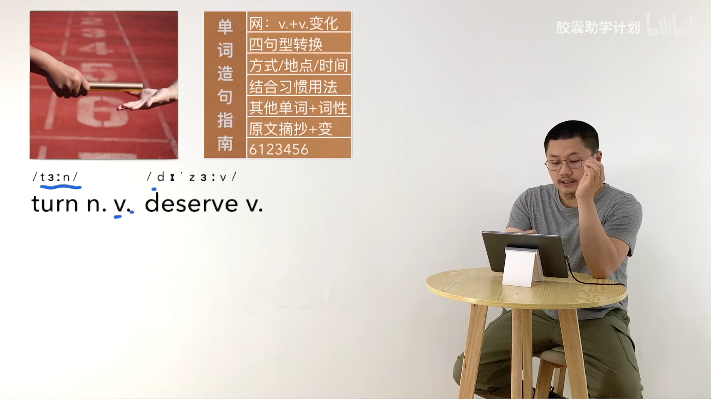

文字识别：单词造句指南 / 网：v.+v.变化 / 胶囊助学计划 / 四句型转换 / 方式/地点/时间 / 结合习惯用法 / 其他单词+词性 / 原文摘抄+变 / 6123456 / /t3:n/ / /d1'z3:v/ / turn n. v. / deserve v.

## 00:01:00–00:01:30

然后注意重音符号，所以音节重音音节在第二个音节上。跟我一起读一下，叫 deserve，deserve，OK，叫做值得或者说应该怎么怎么样，OK，好，比如说文章的标题就是一个非常好的 American slang 啊，美国俚语或者说他们的一种习惯表达，就类似于我们说胸有成竹这样的一些成语或者歇后语一样。他说的叫 one good turn deserves another，

### 画面 00:01:00

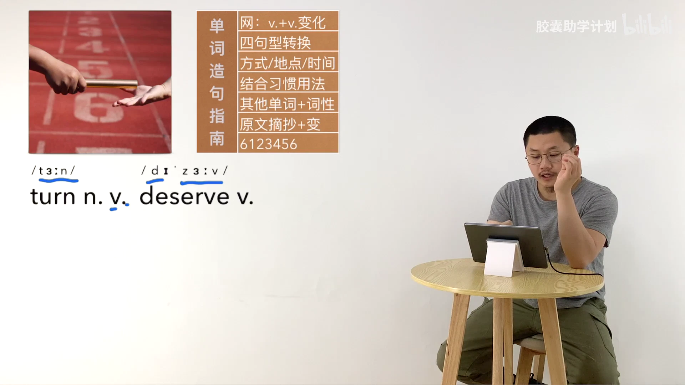

文字识别：单词造句指南 / 网：v.+v.变化 / 胶囊助学计划 / 四句型转换 / 方式/地点/时间 / 结合习惯用法 / 其他单词+词性 / 原文摘抄+变 / 6123456 / /t3:n/ / /dI'z3:ν/ / turn n. v. / deserve v.

### 画面 00:01:02

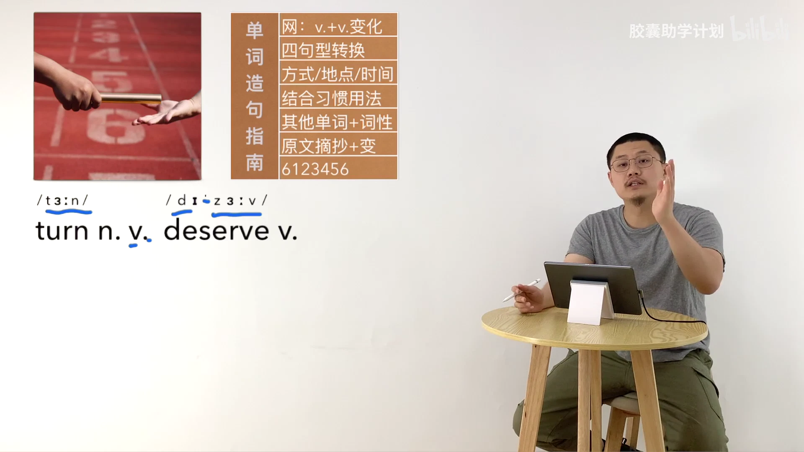

文字识别：单词造句指南 / 网：v.+v.变化 / 胶囊助学计划 / 四句型转换 / 方式/地点/时间 / 结合习惯用法 / 其他单词+词性 / 原文摘抄+变 / 6123456 / /t3:n/ / /d1 z3:v/ / turn n. v. / deserve v.

### 画面 00:01:04

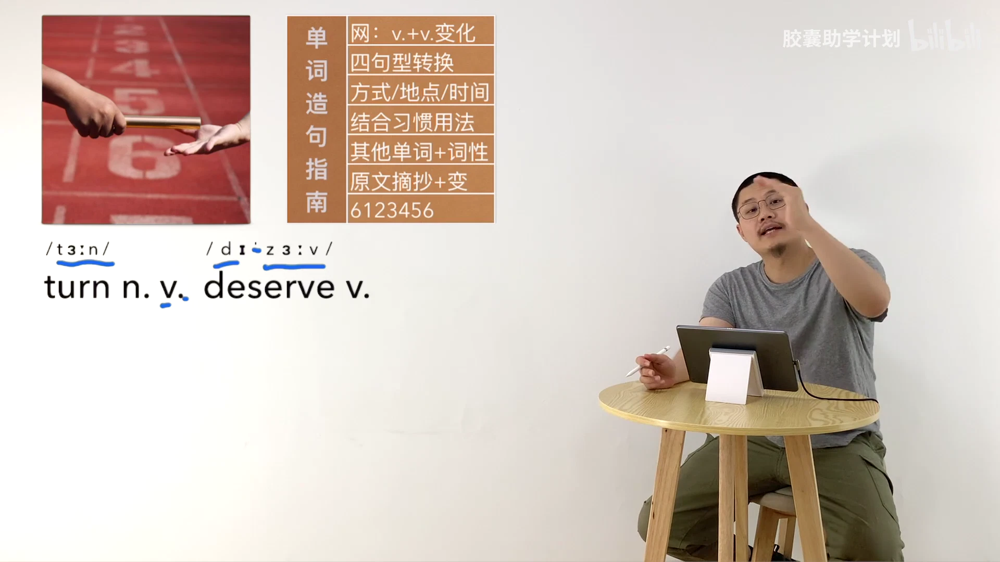

文字识别：单词造句指南 / 网：v.+v.变化 / 胶囊助学计划 / 四句型转换 / 方式/地点/时间 / 结合习惯用法 / 其他单词+词性 / 原文摘抄+变 / 6123456 / /t3:n/ / /dIiz3 :ν/ / turn n. v. / deserve v.

### 画面 00:01:06

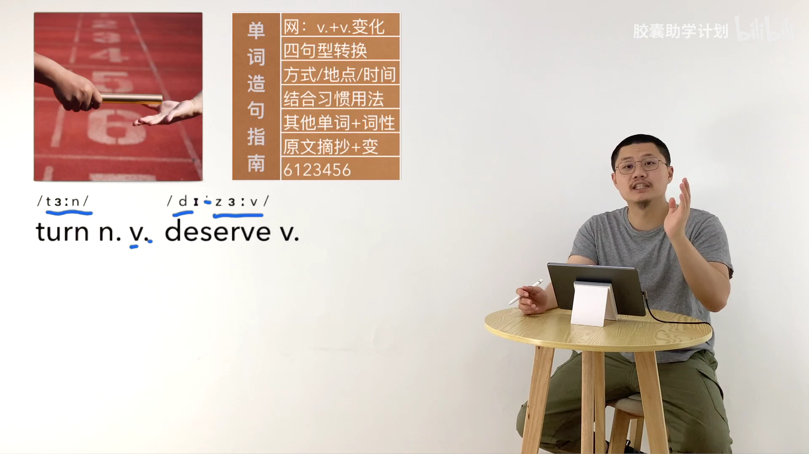

文字识别：单词造句指南 / 网：v.+v.变化 / 胶囊助学计划 / 四句型转换 / 方式/地点/时间 / 结合习惯用法 / 其他单词+词性 / 原文摘抄+变 / 6123456 / /t3:n/ / /d1 z3:v/ / turn n. v. / deserve v.

### 画面 00:01:10

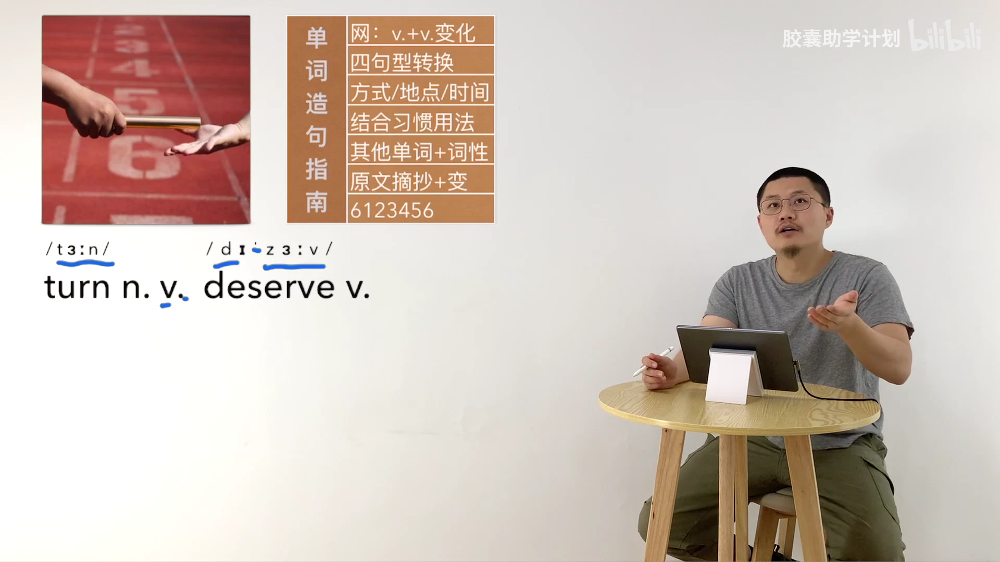

文字识别：单词造句指南 / 网：v.+v.变化 / 胶囊助学计划 / 四句型转换 / 方式/地点/时间 / 结合习惯用法 / 其他单词+词性 / 原文摘抄+变 / 6123456 / /t3:n/ / /d1iz3:v/ / deserve v. / turn n. v.

### 画面 00:01:13

文字识别：单词造句指南 / 网：v.+v.变化 / 胶囊助学计划 / 四句型转换 / 方式/地点/时间 / 结合习惯用法 / 其他单词+词性 / 原文摘抄+变 / 6123456 / /t3:n/ / /d1 z 3 :v / / turn n. v. / deserve v. / ① one good turn deserves another.

### 画面 00:01:15

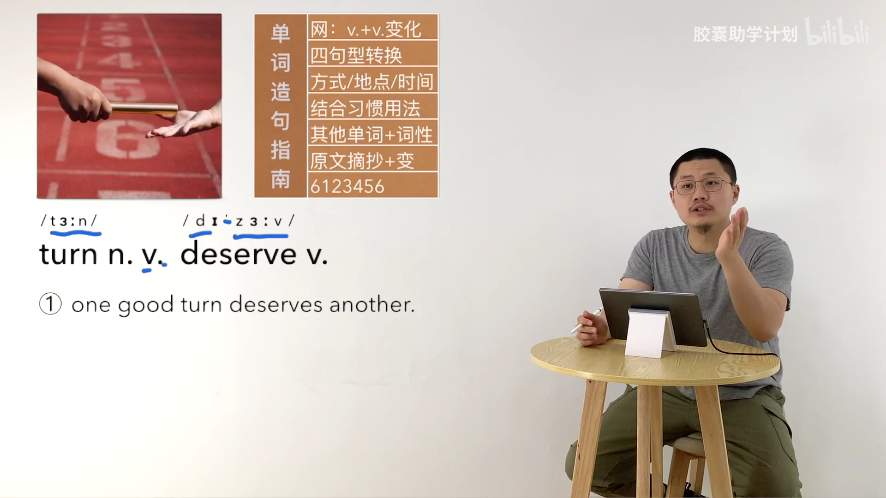

文字识别：单词造句指南 / 网：v.+v.变化 / 胶囊助学计划 / 四句型转换 / 方式/地点/时间 / 结合习惯用法 / 其他单词+词性 / 原文摘抄+变 / 6123456 / /t3:n/ / /dI z3:v/ / turn n. v. / deserve v. / ① one good turn deserves another.

### 画面 00:01:17

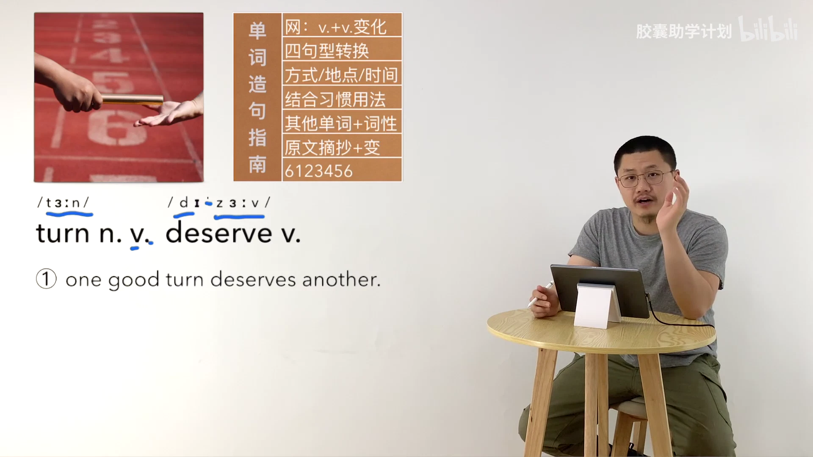

文字识别：单词造句指南 / 网：v.+v.变化 / 胶囊助学计划 / 四句型转换 / 方式/地点/时间 / 结合习惯用法 / 其他单词+词性 / 原文摘抄+变 / 6123456 / /t3:n/ / /d1iz 3 :v/ / turn n. v. / deserve v. / ① one good turn deserves another.

### 画面 00:01:20

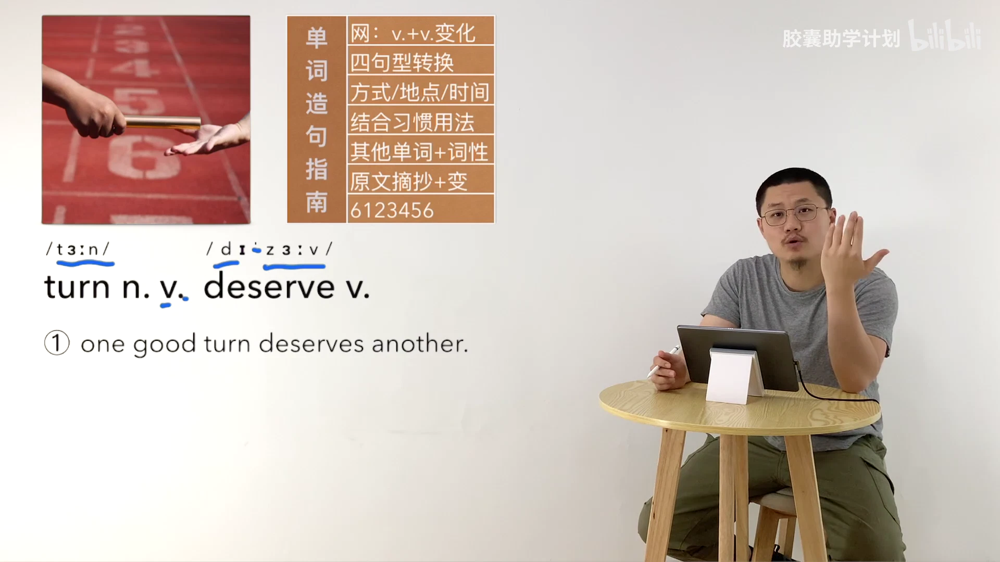

文字识别：单词造句指南 / 网：v.+v.变化 / 胶囊助学计划 / 四句型转换 / 方式/地点/时间 / 结合习惯用法 / 其他单词+词性 / 原文摘抄+变 / 6123456 / /t3:n/ / /dI z3 :v/ / turn n. v. / deserve v. / ① one good turn deserves another.

### 画面 00:01:25

文字识别：单词造句指南 / 网：v.+v.变化 / 胶囊助学计划 / 四句型转换 / 方式/地点/时间 / 结合习惯用法 / 其他单词+词性 / 原文摘抄+变 / 6123456 / /t3:n/ / /dI z3:v/ / turn n. v. / deserve v. / ① one good turn deserves another.

## 00:01:30–00:02:00

literal meaning, ah, says that a good behavior deserves another good behavior. You see, this literal meaning, you actually don't understand what it means. What he really wants to express is actually the question we asked at the beginning: How to express courtesy in English? Ah, a good behavior deserves another good behavior to give it feedback. Ah, one good turn deserves another. This is a relatively good habit usage. Please remember it. Next, turn. I just mentioned that there are

### 画面 00:01:30

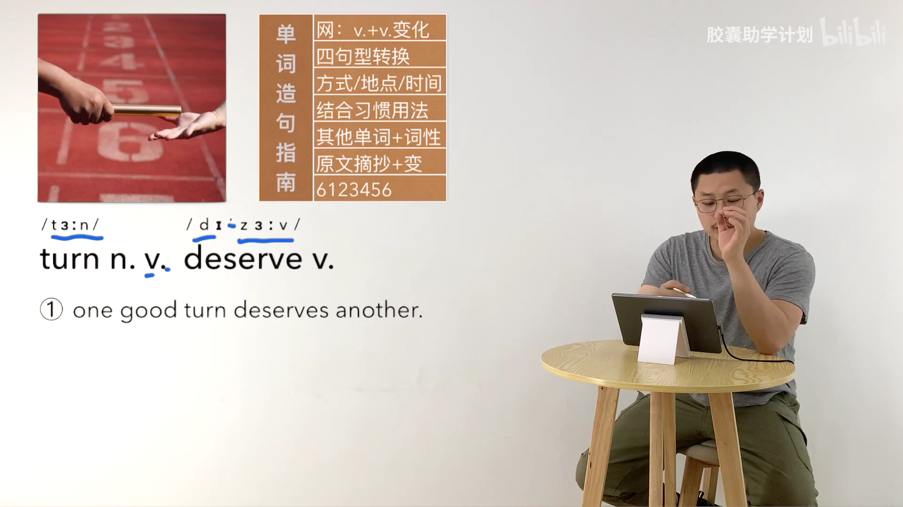

文字识别：单词造句指南 / 网：v.+v.变化 / 胶囊助学计划 / 四句型转换 / 方式/地点/时间 / 结合习惯用法 / 其他单词+词性 / 原文摘抄+变 / 6123456 / /t3:n/ / /d1iz3 :v / / turn n. v. / deserve v. / ① one good turn deserves another.

### 画面 00:01:33

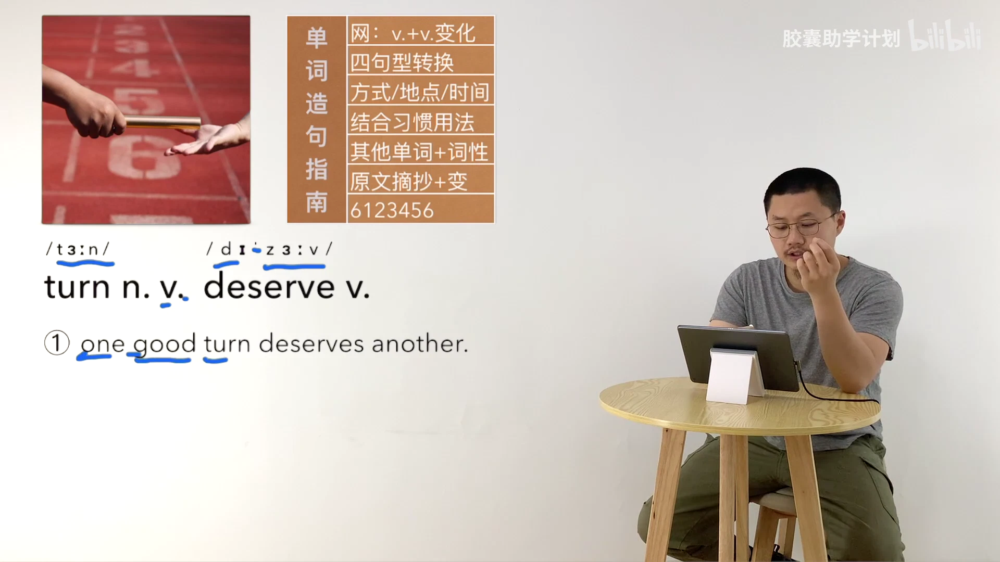

文字识别：单词造句指南 / 网：v.+v.变化 / 胶囊助学计划 / 四句型转换 / 方式/地点/时间 / 结合习惯用法 / 其他单词+词性 / 原文摘抄+变 / 6123456 / /t3:n/ / /d1iz 3 :v / / turn n. v. / deserve v. / ① one good turn deserves another.

### 画面 00:01:35

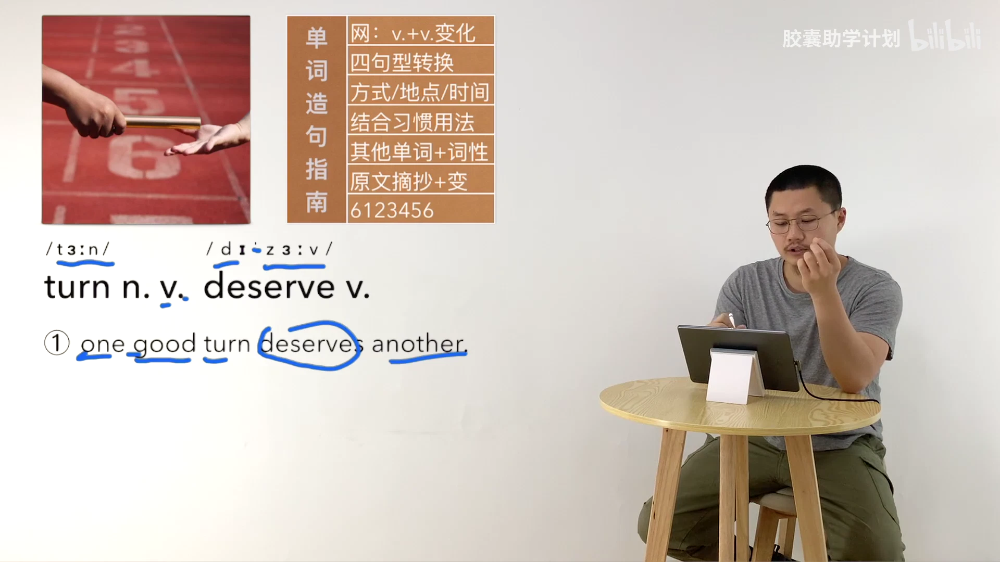

文字识别：单词造句指南 / 网：v.+v.变化 / 胶囊助学计划 / 四句型转换 / 方式/地点/时间 / 结合习惯用法 / 其他单词+词性 / 原文摘抄+变 / 6123456 / /t3:n/ / /dI z3:v/ / turn n. v. / deserve / V. / ①one good turn / deserve / another.

### 画面 00:01:37

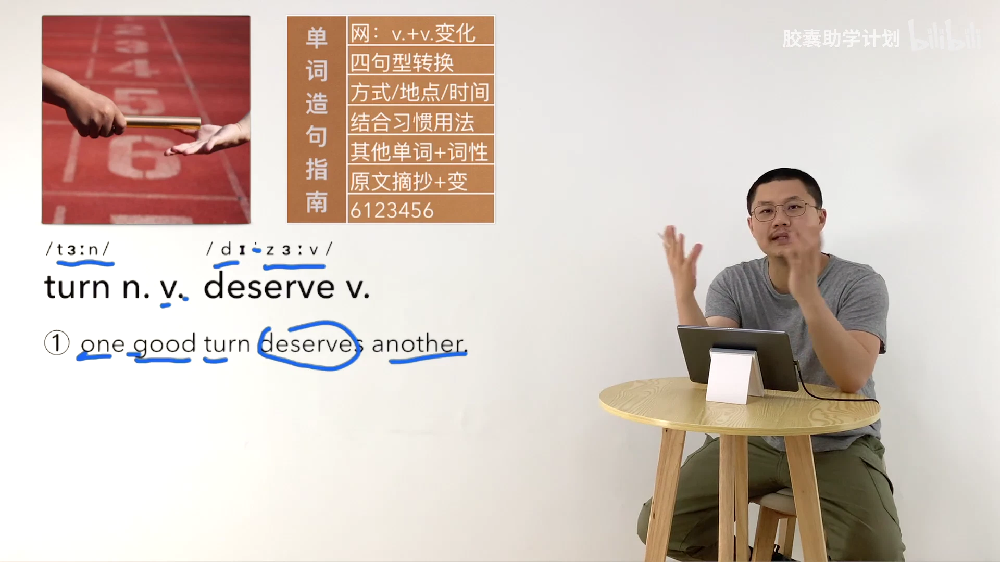

文字识别：单词造句指南 / 网：v.+v.变化 / 胶囊助学计划 / 四句型转换 / 方式/地点/时间 / 结合习惯用法 / 其他单词+词性 / 原文摘抄+变 / 6123456 / /t3:n/ / /d1 z3:v/ / turn n. v. / deserve / V. / ①one good turn / deserve / another

### 画面 00:01:40

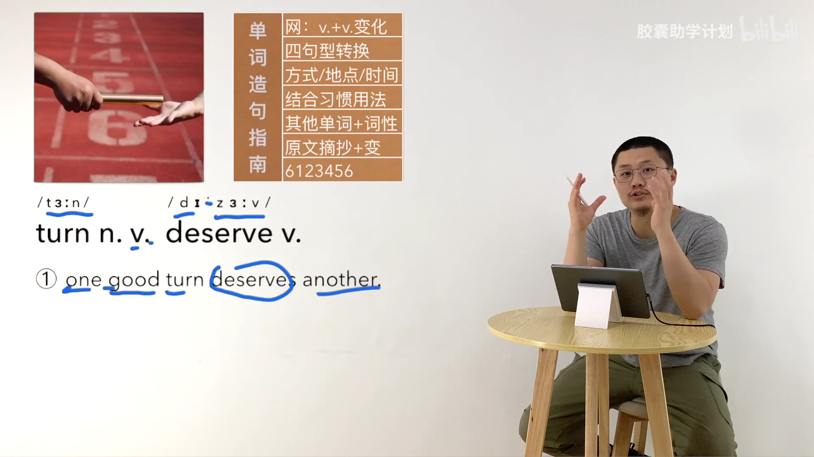

文字识别：单词造句指南 / 网：v.+v.变化 / 胶囊助学计划 / 四句型转换 / 方式/地点/时间 / 结合习惯用法 / 其他单词+词性 / 原文摘抄+变 / 6123456 / /t3:n/ / /d1 z3:v/ / turn n. v. / deserve / V. / ①one good turn / deserve / another.

### 画面 00:01:43

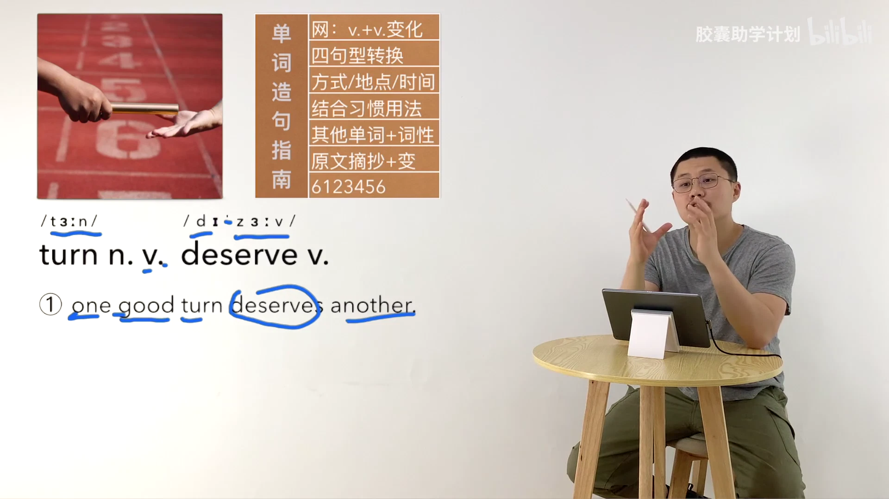

文字识别：单词造句指南 / 网：v.+v.变化 / 胶囊助学计划 / 四句型转换 / 方式/地点/时间 / 结合习惯用法 / 其他单词+词性 / 原文摘抄+变 / 6123456 / /t3:n/ / /dI z3:ν/ / turn n. v. / deserve / V. / ①one good turn / deserve / another

### 画面 00:01:45

文字识别：单词造句指南 / 网：v.+v.变化 / 胶囊助学计划 / 四句型转换 / 方式/地点/时间 / 结合习惯用法 / 其他单词+词性 / 原文摘抄+变 / 6123456 / /t3:n/ / /d1 z3:v/ / turn n. v. / deserve / V. / ①one good turn / deserve / another

### 画面 00:01:47

文字识别：单词造句指南 / 网：v.+v.变化 / 胶囊助学计划 / 四句型转换 / 方式/地点/时间 / 结合习惯用法 / 其他单词+词性 / 原文摘抄+变 / 6123456 / /t3:n/ / /d1 z3:v/ / turn n. v. / deserve / V. / one good turn / deserve / another

### 画面 00:01:50

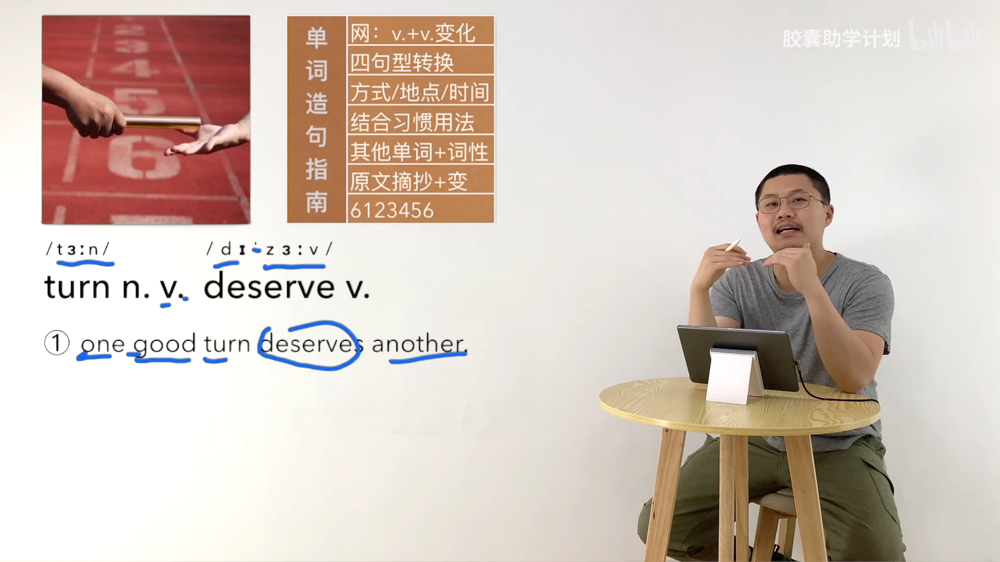

文字识别：单词造句指南 / 网：v.+v.变化 / 胶囊助学计划 / 四句型转换 / 方式/地点/时间 / 结合习惯用法 / 其他单词+词性 / 原文摘抄+变 / 6123456 / /t3:n/ / /dI z3:v/ / turn n. v. / deserve / V. / ①one good turn / deserve / another.

### 画面 00:01:55

文字识别：单词造句指南 / 网：v.+v.变化 / 胶囊助学计划 / 四句型转换 / 方式/地点/时间 / 结合习惯用法 / 其他单词+词性 / 原文摘抄+变 / 6123456 / /t3:n/ / /d1 z3:v/ / turn n. v. / deserve / V. / ①one good turn / deserve / another

### 画面 00:01:57

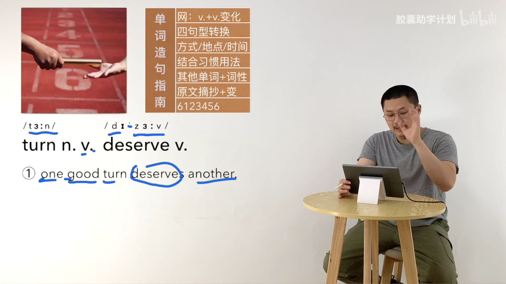

文字识别：单词造句指南 / 网：v.+v.变化 / 胶囊助学计划 / 四句型转换 / 方式/地点/时间 / 结合习惯用法 / 其他单词+词性 / 原文摘抄+变 / 6123456 / /t3:n/ / /d1 z3:v/ / turn n. v. / deserve / V. / ①one good turn / deserve / another

### 画面 00:01:59

文字识别：单词造句指南 / 网：v.+v.变化 / 胶囊助学计划 / 四句型转换 / 方式/地点/时间 / 结合习惯用法 / 其他单词+词性 / 原文摘抄+变 / 6123456 / /t3:n/ / /dI z3:v/ / turn n. v. / deserve / V. / 1 / one good turn / deserve / S / another / [变得]The / sky turned black and / it began to rain.

## 00:02:00–00:02:30

刚才我讲了，还有动词的意思，比如说它可以有一个意思叫做变得，比如说我们说 the sky turned black，啊，天空变黑了， and it began to rain，然后呢，开始下雨了。 Okay， I'm talking about yesterday，是吧？我现在正在聊昨天的事情啊，昨天天空逐渐变黑了，然后开始下雨。 Okay，变得。再然后呢？ Turn，还有这个次序的意思，比如说轮到谁了，我可以用英文说说轮到你了，叫做 is your

### 画面 00:02:01

文字识别：单词造句指南 / 网：v.+v.变化 / 胶囊助学计划 / 四句型转换 / 方式/地点/时间 / 结合习惯用法 / 其他单词+词性 / 原文摘抄+变 / 6123456 / /t3:n/ / /d1 z3:v/ / turn n. v. / deserve / V. / 1 / gne good turn / deserve / another / [变得]The / sky turned black and / it began to rain.

### 画面 00:02:05

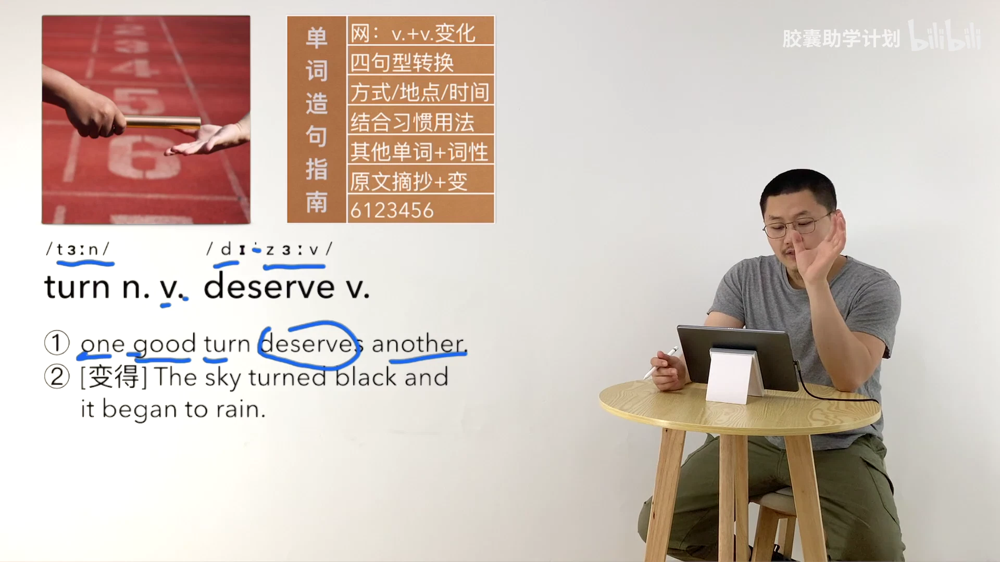

文字识别：单词造句指南 / 网：v.+v.变化 / 胶囊助学计划 / 四句型转换 / 方式/地点/时间 / 结合习惯用法 / 其他单词+词性 / 原文摘抄+变 / 6123456 / /t3:n/ / /dI z3:v/ / turn n. v. / deserve / V. / 1 / one good turn / deserve / another / [变得]The / sky t / turned black and / it began to rain.

### 画面 00:02:10

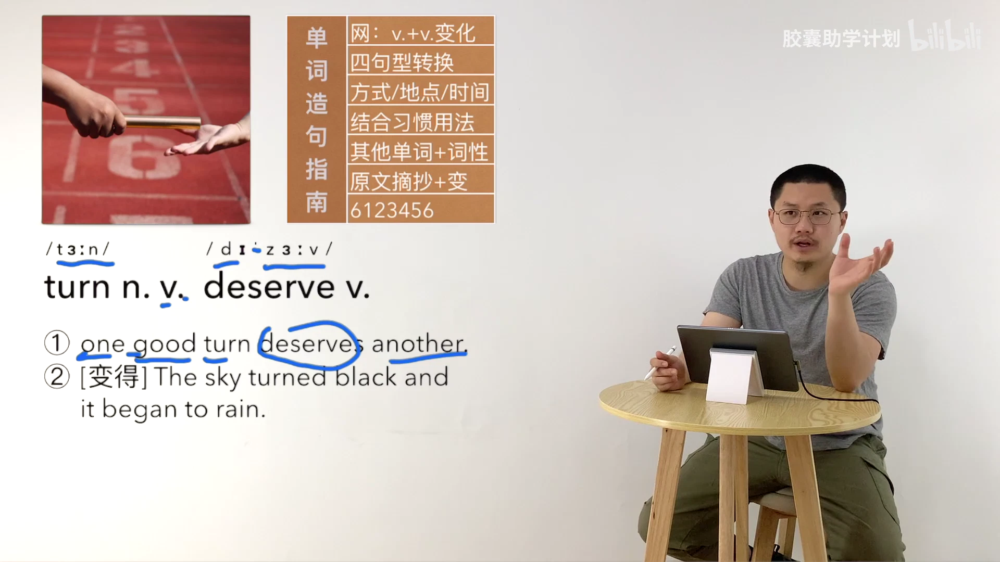

文字识别：单词造句指南 / 网：v.+v.变化 / 胶囊助学计划 / 四句型转换 / 方式/地点/时间 / 结合习惯用法 / 其他单词+词性 / 原文摘抄+变 / 6123456 / /t3:n/ / /d1 z3:v/ / turn n.v. / deserve / V. / 1 / one good turn / deserve / another / [变得]The / sky turned black and / it began to rain.

### 画面 00:02:13

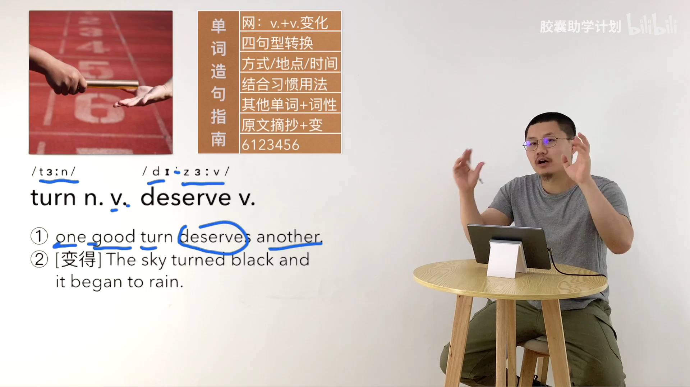

文字识别：单词造句指南 / 网：v.+v.变化 / 胶囊助学计划 / 四句型转换 / 方式/地点/时间 / 结合习惯用法 / 其他单词+词性 / 原文摘抄+变 / 6123456 / /t3:n/ / /dI z3:v/ / turn n. v. / deserve / V. / one good turn / deserve / another. / 1 / [变得]The / skyt / turned black and / it began to rain.

### 画面 00:02:15

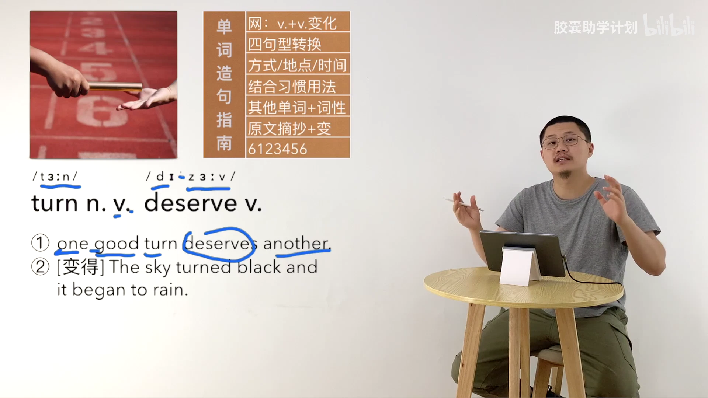

文字识别：单词造句指南 / 网：v.+v.变化 / 胶囊助学计划 / 四句型转换 / 方式/地点/时间 / 结合习惯用法 / 其他单词+词性 / 原文摘抄+变 / 6123456 / /t3:n/ / /d1 z3:v/ / turn n. v. / deserve / V. / 1 / one good turn / deserve / another / [变得]The / sky turned black and / it began to rain.

### 画面 00:02:18

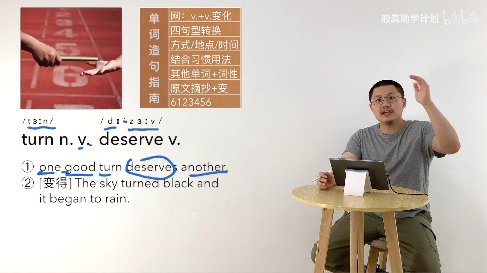

文字识别：单词造句指南 / 网：v.+v.变化 / 胶囊助学计划 / 四句型转换 / 方式/地点/时间 / 结合习惯用法 / 其他单词+词性 / 原文摘抄+变 / 6123456 / /t3:n/ / /d1 z3:v/ / turn n.v. / deserve / V. / 1 / one good turn / deserve / another / [变得]The / sky turned black and / it began to rain.

### 画面 00:02:20

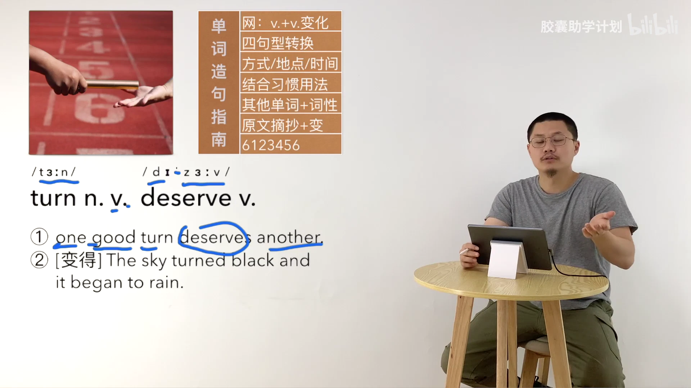

文字识别：单词造句指南 / 网：v.+v.变化 / 胶囊助学计划 / 四句型转换 / 方式/地点/时间 / 结合习惯用法 / 其他单词+词性 / 原文摘抄+变 / 6123456 / /t3:n/ / /dI z3:v/ / turn n.v. / deserve / V. / 1 / one good turn / deserve / another / S / [变得]The / sky turned black and / it began to rain.

### 画面 00:02:22

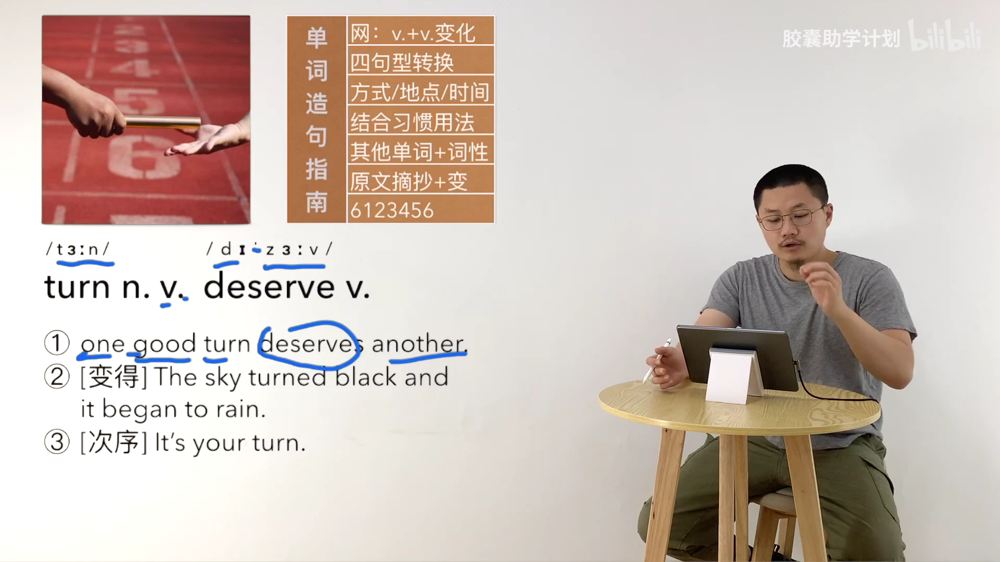

文字识别：单词造句指南 / 网：v.+v.变化 / 胶囊助学计划 / 四句型转换 / 方式/地点/时间 / 结合习惯用法 / 其他单词+词性 / 原文摘抄+变 / 6123456 / /t3:n/ / /d1iz3:v/ / turn n.v. / deserve / V. / 1 / one good turn / deserve / S / another / [变得]The / sky turned black and / it began to rain. / [次序] It's your turn.

### 画面 00:02:24

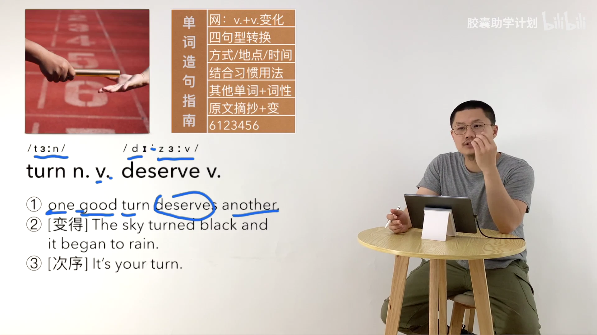

文字识别：单词造句指南 / 网：v.+v.变化 / 胶囊助学计划 / 四句型转换 / 方式/地点/时间 / 结合习惯用法 / 其他单词+词性 / 原文摘抄+变 / 6123456 / /t3:n/ / /dI z3:v/ / turn n.v. / deserve / V. / 1 / one good turn / deserve / another / [变得]The / sky turned black and / it began to rain. / [次序] It's your turn.

### 画面 00:02:26

文字识别：单词造句指南 / 网：v.+v.变化 / 胶囊助学计划 / 四句型转换 / 方式/地点/时间 / 结合习惯用法 / 其他单词+词性 / 原文摘抄+变 / 6123456 / /t3:n/ / /d1 z3:v/ / turn n.v. / deserve / V. / gne good turn / deserve / another / [变得]The / sky turned black and / it began to rain. / [次序] It's your turn.

## 00:02:30–00:03:00

turn 啊，轮到你了，次序到你了。那你说轮到我了，怎么说呢？那就说 is my turn. Okay, 这儿一个。接下来，那我们讲完了 turn，我们再说一下 deserve 这个单词。我们刚才讲了，对吧？它叫做值得啊。比如说 you deserve that，那这是口语当中非常常见的一句话，或者 you deserve it，对吧？deserve it 啊，连起来读叫 deserve it. Okay，那它的意思叫做你值得拥有这

### 画面 00:02:30

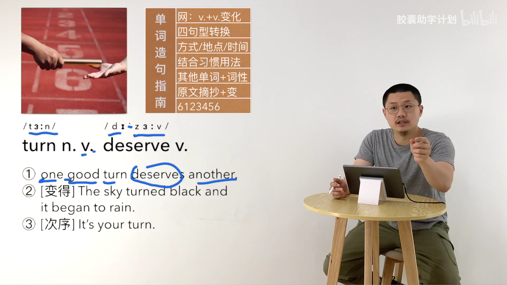

文字识别：单词造句指南 / 网：v.+v.变化 / 胶囊助学计划 / 四句型转换 / 方式/地点/时间 / 结合习惯用法 / 其他单词+词性 / 原文摘抄+变 / 6123456 / /t3:n/ / /d1 z3:v/ / turn n.v. / deserve / V. / 1 / one good turn / deserve / another / [变得]The / sky turned black and / it began to rain. / [次序] It's your turn.

### 画面 00:02:35

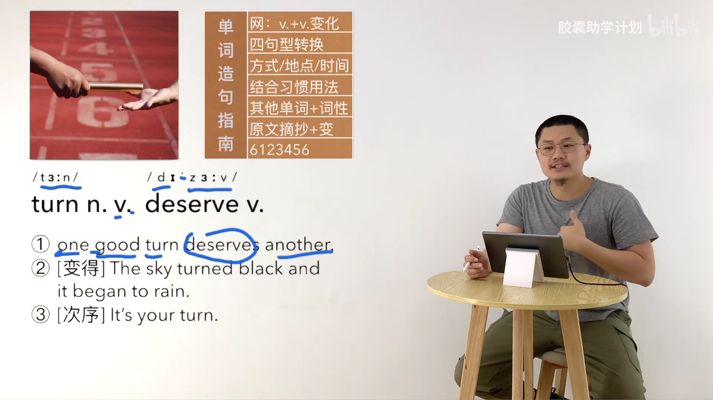

文字识别：单词造句指南 / 网：v.+v.变化 / 胶囊助学计划 / 四句型转换 / 方式/地点/时间 / 结合习惯用法 / 其他单词+词性 / 原文摘抄+变 / 6123456 / /t3:n/ / /dI z3 :v/ / turn n.v. / deserve v. / 1 / gne good turn / deserve / another / [变得]The / sky turned black and / it began to rain. / [次序] It's your turn.

### 画面 00:02:38

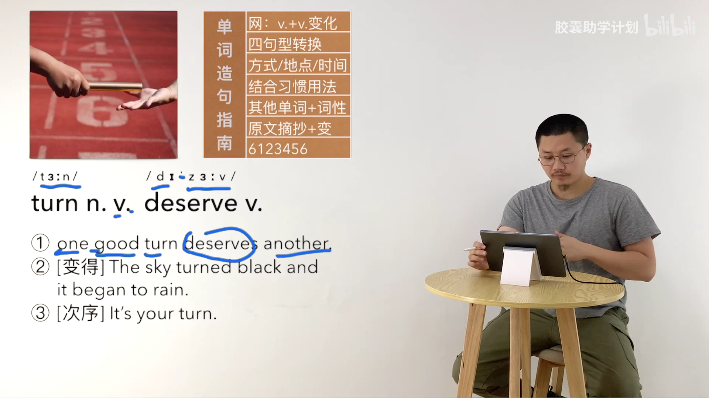

文字识别：单词造句指南 / 网：v.+v.变化 / 胶囊助学计划 / 四句型转换 / 方式/地点/时间 / 结合习惯用法 / 其他单词+词性 / 原文摘抄+变 / 6123456 / /t3:n/ / /dI z3:v/ / turn n.v. / deserve / V. / 1 / one good turn / deserve / another. / [变得]The / skyt / turned black and / it began to rain. / [次序] It's your turn.

### 画面 00:02:40

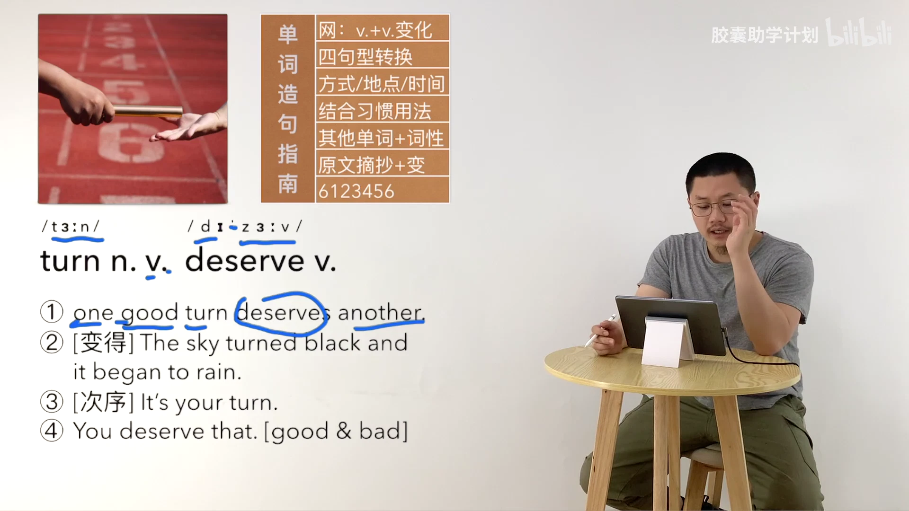

文字识别：单词造句指南 / 网：v.+v.变化 / 胶囊助学计划 / 四句型转换 / 方式/地点/时间 / 结合习惯用法 / 其他单词+词性 / 原文摘抄+变 / 6123456 / /t3:n/ / /dIiz3:ν/ / turn n. v. / deserve v. / ① / gne good turn / deserve; another / [变得] The sky turned black and / it began to rain. / [次序] It's your turn. / 3 / You deserve that.[good & bad]

### 画面 00:02:45

文字识别：单词造句指南 / 网：v.+v.变化 / 胶囊助学计划 / 四句型转换 / 方式/地点/时间 / 结合习惯用法 / 其他单词+词性 / 原文摘抄+变 / 6123456 / /t3:n/ / /dI z3:ν/ / turn n. v. / deserve V. / ① / gne good turn / deserve;a / another. / [变得] The sky turned black and / it began to rain. / [次序] It's your turn. / You deserve that. [good & bad]

### 画面 00:02:50

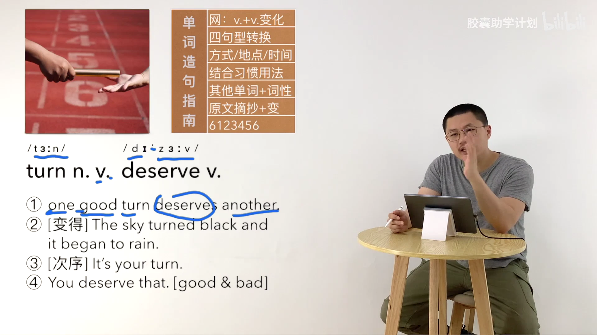

文字识别：单词造句指南 / 网：v.+v.变化 / 胶囊助学计划 / 四句型转换 / 方式/地点/时间 / 结合习惯用法 / 其他单词+词性 / 原文摘抄+变 / 6123456 / /t3:n/ / /dI z3 :v/ / turn n.v. / deserve v. / 1 / one good turn / deservesa / another. / [变得]The / e sky turned black and / it began to rain. / [次序] It's your turn. / You deserve that. [good & bad]

### 画面 00:02:53

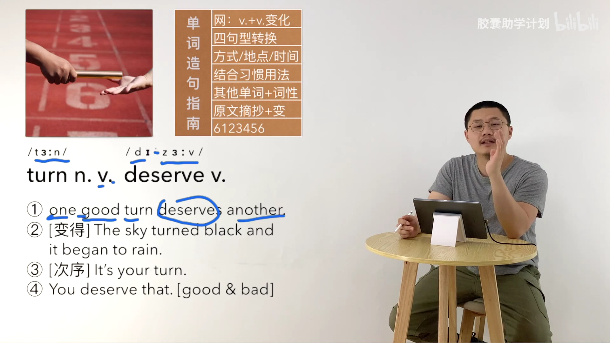

文字识别：单词造句指南 / 网：v.+v.变化 / 胶囊助学计划 / 四句型转换 / 方式/地点/时间 / 结合习惯用法 / 其他单词+词性 / 原文摘抄+变 / 6123456 / /t3:n/ / /dI z3:v/ / turn n. v. / deserve v. / 1 / one good turn / deservesa / another. / [变得] The sky turned black and / it began to rain. / [次序] It's your turn. / You deserve that. [good & bad]

### 画面 00:02:55

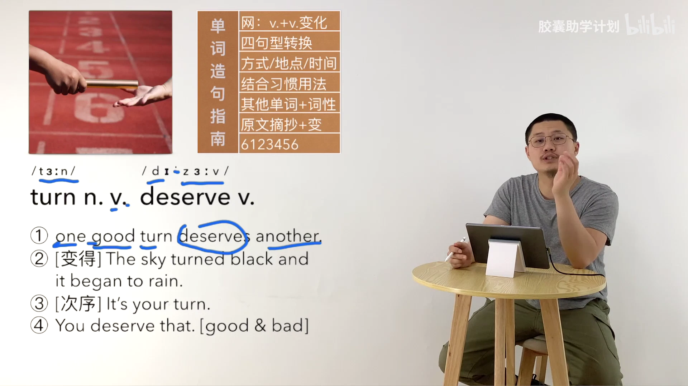

文字识别：单词造句指南 / 网：v.+v.变化 / 胶囊助学计划 / 四句型转换 / 方式/地点/时间 / 结合习惯用法 / 其他单词+词性 / 原文摘抄+变 / 6123456 / /t3:n/ / /d1 z3:v/ / turn n. v. / deserve v. / ① / one good turn / deservesa / another / [变得] The sky turned black and / it began to rain. / [次序] It's your turn. / You deserve that. [good & bad]

### 画面 00:02:58

文字识别：单词造句指南 / 网：v.+v.变化 / 胶囊助学计划 / 四句型转换 / 方式/地点/时间 / 结合习惯用法 / 其他单词+词性 / 原文摘抄+变 / 6123456 / /t3:n/ / /dI z3:v/ / turn n. v. / deserve v. / ① / one good turn / deservesa / another, / [变得] The sky turned black and / it began to rain. / [次序] It's your turn. / You deserve that. [good & bad]

## 00:03:00–00:03:30

个东西，你值得。其实我们看我后面给大家标了一个叫做 good or bad，对吧？就你应该得到这个东西。如果是好的事情呢，那就是你值得拥有啊！你付出了足够多的努力，然后你现在比如说呃考了一个很好的成绩，或者说你得到了一个什么样的奖牌啊，那我们可以这个跟别人说 you deserve that 啊，说这个别害羞是吧？你付出了那么多的努力，你值得拥有这个东西。那还有一种情

### 画面 00:03:00

文字识别：单词造句指南 / 网：v.+v.变化 / 胶囊助学计划 / 四句型转换 / 方式/地点/时间 / 结合习惯用法 / 其他单词+词性 / 原文摘抄+变 / 6123456 / /t3:n/ / /dI z3:ν/ / turn n.v. / deserve v. / ① / one good turn / deservesa / another. / [变得] The sky turned black and / it began to rain. / [次序] It's your turn. / You deserve that. [good & bad]

### 画面 00:03:03

文字识别：单词造句指南 / 网：v.+v.变化 / 胶囊助学计划 / 四句型转换 / 方式/地点/时间 / 结合习惯用法 / 其他单词+词性 / 原文摘抄+变 / 6123456 / /t3:n/ / /dI z 3:v/ / turn n. v. / deserve v. / ① / one good turn / deserve;a / another. / [变得] The sky turned black and / it began to rain. / [次序] It's your turn. / You deserve that. [good & bad]

### 画面 00:03:05

文字识别：单词造句指南 / 网：v.+v.变化 / 胶囊助学计划 / 四句型转换 / 方式/地点/时间 / 结合习惯用法 / 其他单词+词性 / 原文摘抄+变 / 6123456 / /t3:n/ / /dI z3 :v/ / turn n. v. / deserve v. / one good turn / deservesa / another. / [变得] The sky turned black and / it began to rain. / [次序] It's your turn. / You deserve that. [good & bad]

### 画面 00:03:08

文字识别：单词造句指南 / 网：v.+v.变化 / 胶囊助学计划 / 四句型转换 / 方式/地点/时间 / 结合习惯用法 / 其他单词+词性 / 原文摘抄+变 / 6123456 / /t3:n/ / /dI z3 :v/ / turn n. v. / deserve v. / 1 / one good turn / deservesa / another / [变得]The sky turned black and / it began to rain. / [次序] It's your turn. / You deserve that. [good & bad]

### 画面 00:03:10

文字识别：单词造句指南 / 网：v.+v.变化 / 胶囊助学计划 / 四句型转换 / 方式/地点/时间 / 结合习惯用法 / 其他单词+词性 / 原文摘抄+变 / 6123456 / /t3:n/ / /dI z3:ν/ / turn n. v. / deserve v. / ① / one good turn / deservesa / another. / [变得]The sky turned black and / it began to rain. / [次序] It's your turn. / You deserve that. [good & bad]

### 画面 00:03:13

文字识别：单词造句指南 / 网：v.+v.变化 / 胶囊助学计划 / 四句型转换 / 方式/地点/时间 / 结合习惯用法 / 其他单词+词性 / 原文摘抄+变 / 6123456 / /t3:n/ / /dI z3:v/ / turn n. v. / deserve v. / one good turn / deserve; another / [变得]The sky turned black and / it began to rain. / [次序] It's your turn. / You deserve that. [good & bad]

### 画面 00:03:15

文字识别：单词造句指南 / 网：v.+v.变化 / 胶囊助学计划 / 四句型转换 / 方式/地点/时间 / 结合习惯用法 / 其他单词+词性 / 原文摘抄+变 / 6123456 / /t3:n/ / /dI z3:v/ / turn n. v. / deserve v. / one good turn / deserve;a / another, / [变得] The sky turned black and / it began to rain. / [次序] It's your turn. / You deserve that. [good & bad]

### 画面 00:03:17

文字识别：单词造句指南 / 网：v.+v.变化 / 胶囊助学计划 / 四句型转换 / 方式/地点/时间 / 结合习惯用法 / 其他单词+词性 / 原文摘抄+变 / 6123456 / /t3:n/ / /dI z3:ν/ / turn n. v. / deserve v. / one good turn / deservesa / another / [变得]The sky turned black and / it began to rain. / [次序] It's your turn. / You deserve that. [good & bad]

### 画面 00:03:20

文字识别：单词造句指南 / 网：v.+v.变化 / 胶囊助学计划 / 四句型转换 / 方式/地点/时间 / 结合习惯用法 / 其他单词+词性 / 原文摘抄+变 / 6123456 / /t3:n/ / /dI z3 :v / / turn n. v. / deserve v. / ① / one good turn / deservesa / another. / [变得]The sky turned black and / it began to rain. / [次序] It's your turn. / You deserve that. [good & bad]

### 画面 00:03:22

文字识别：单词造句指南 / 网：v.+v.变化 / 胶囊助学计划 / 四句型转换 / 方式/地点/时间 / 结合习惯用法 / 其他单词+词性 / 原文摘抄+变 / 6123456 / /t3:n/ / /d1 z3:v/ / turn n.v. / deserve v. / 1 / gne good turn / deservesa / another, / [变得] The sky turned black and / it began to rain. / [次序] It's your turn. / You deserve that. [good & bad]

### 画面 00:03:25

文字识别：单词造句指南 / 网：v.+v.变化 / 胶囊助学计划 / 四句型转换 / 方式/地点/时间 / 结合习惯用法 / 其他单词+词性 / 原文摘抄+变 / 6123456 / /t3:n/ / /d1 z3:ν/ / turn n. v. / deserve v. / gne good turn / deservesa / another. / [变得] The sky turned black and / it began to rain. / [次序] It's your turn. / You deserve that. [good & bad]

## 00:03:30–00:04:00

况呢，就是 bad things，就是不好的事情发生了。比如说别的人啊，这个做了一堆伤天害理的事儿，然后呢被关进去了。那你就可以说，就你活该，就是 you deserve it，啊，你值得拥有这件东西。为什么呢？就你应该得到这个东西。为什么？因为你之前做了那么多不好的东西，所以它一般翻译成就你活该，叫 you deserve that。由情况去决定 you deserve that，或者说 I deserve it，啊，怎么去翻译？OK，好，

### 画面 00:03:30

文字识别：单词造句指南 / 网：v.+v.变化 / 胶囊助学计划 / 四句型转换 / 方式/地点/时间 / 结合习惯用法 / 其他单词+词性 / 原文摘抄+变 / 6123456 / /t3:n/ / /d1 z3 :v/ / turn n. v. / deserve v. / 1 / one good turn / deservesa / another / [变得]The / sky turned black and / it began to rain. / [次序] It's your turn. / 3 / You deserve that. [good & bad]

### 画面 00:03:32

文字识别：单词造句指南 / 网：v.+v.变化 / 胶囊助学计划 / 四句型转换 / 方式/地点/时间 / 结合习惯用法 / 其他单词+词性 / 原文摘抄+变 / 6123456 / /t3:n/ / /d1 z3:v/ / turn n. v. / deserve v. / one good turn / deserve; another / [变得] The sky turned black and / it began to rain. / [次序] It's your turn. / You deserve that. [good / bad

### 画面 00:03:34

文字识别：单词造句指南 / 网：v.+v.变化 / 胶囊助学计划 / 四句型转换 / 方式/地点/时间 / 结合习惯用法 / 其他单词+词性 / 原文摘抄+变 / 6123456 / /t3:n/ / /dI z3:v/ / turn n. v. / deserve v. / 1 / one good turn / deservesa / another. / [变得]The / sky turned black and / it began to rain. / [次序] It's your turn. / You deserve that. [good / bad

### 画面 00:03:36

文字识别：单词造句指南 / 网：v.+v.变化 / 胶囊助学计划 / 四句型转换 / 方式/地点/时间 / 结合习惯用法 / 其他单词+词性 / 原文摘抄+变 / 6123456 / /t3:n/ / /dI z3 :v/ / turn n. v. / deserve v. / - / one good turn / deservesa / another / [变得] The sky turned black and / it began to rain. / [次序] It's your turn. / 人 / You deserve that. [good / 8bad

### 画面 00:03:38

文字识别：单词造句指南 / 网：v.+v.变化 / 胶囊助学计划 / 四句型转换 / 方式/地点/时间 / 结合习惯用法 / 其他单词+词性 / 原文摘抄+变 / 6123456 / /t3:n/ / /d1 z3 :v/ / turn n.v. / deserve v. / へ / one good turn / deserve;a / another / [变得]The / e sky turned black and / it began to rain. / [次序] It's your turn. / 人 / You deserve that. [good / 8bad

### 画面 00:03:40

文字识别：单词造句指南 / 网：v.+v.变化 / 胶囊助学计划 / 四句型转换 / 方式/地点/时间 / 结合习惯用法 / 其他单词+词性 / 原文摘抄+变 / 6123456 / /t3:n/ / /d1 z3 :v/ / turn n. v. / deserve v. / one good turn / deserve; / another / [变得]The / sky turned black and / it began to rain. / [次序] It's your turn. / You deserve that. [good / &bad

### 画面 00:03:45

文字识别：单词造句指南 / 网：v.+v.变化 / 胶囊助学计划 / 四句型转换 / 方式/地点/时间 / 结合习惯用法 / 其他单词+词性 / 原文摘抄+变 / 6123456 / /t3:n/ / /d1 z3:v/ / turn n. v. / deserve v. / ① / gne good turn / deserve; / another. / [变得]The / e sky turned black and / it began to rain. / [次序] It's your turn. / You deserve that. [good / bad

### 画面 00:03:49

文字识别：单词造句指南 / 网：v.+v.变化 / 胶囊助学计划 / 四句型转换 / 方式/地点/时间 / 结合习惯用法 / 其他单词+词性 / 原文摘抄+变 / 6123456 / /t3:n/ / /dI z3:v/ / turn n.v. / deserve v. / one good turn / deservesa / another. / [变得] The sky turned black and / it began to rain. / [次序] It's your turn. / You deserve that. [good / &bad

### 画面 00:03:51

文字识别：单词造句指南 / 网：v.+v.变化 / 胶囊助学计划 / 四句型转换 / 方式/地点/时间 / 结合习惯用法 / 其他单词+词性 / 原文摘抄+变 / 6123456 / /t3:n/ / /d1 z3 :v / / turn n. v. / deserve v. / gne good turn / deserve;a / another / [变得] The sky turned black and / it began to rain. / [次序] It's your turn. / You deserve that. [good / 8bad

### 画面 00:03:55

文字识别：单词造句指南 / 网：v.+v.变化 / 胶囊助学计划 / 四句型转换 / 方式/地点/时间 / 结合习惯用法 / 其他单词+词性 / 原文摘抄+变 / 6123456 / /t3:n/ / /d1 z3:v/ / turn n.v. / deserve v. / 1 / one good turn / deserve / another / [变得] The sky turned black and / it began to rain. / [次序] It's your turn. / You deserve that. [good / &bad

### 画面 00:03:58

文字识别：单词造句指南 / 网：v.+v.变化 / 胶囊助学计划 / 四句型转换 / 方式/地点/时间 / 结合习惯用法 / 其他单词+词性 / 原文摘抄+变 / 6123456 / /t3:n/ / /d1 z3 :v / / turn n.v. / deserve v. / one good turn / deserve / another / [变得] The sky turned black and / it began to rain. / [次序] It's your turn. / You deserve that. [good / 8bad

## 00:04:00–00:04:30

那接下来我们看一个小的电影片段，当中出现了叫做 one good turn deserves another 礼尚往来来了，注意力集中。 That's a nice thing you're doing for Norma. Thank you, sir. One good turn deserves another. This just arrived for you, certified mail from the astronaut. OK，

### 画面 00:04:00

文字识别：one good turn deserves another. / 胶囊助学计划 / 魔盒 / TheBox / (2009)

### 画面 00:04:03

文字识别：one good turn deserves another. / 胶囊助学计划 / 魔盒 / The Box / (2009)

### 画面 00:04:09

文字识别：one good turn deserves another. / 胶囊助学计划 / HESE / 魔盒 / TheBox / (2009)

### 画面 00:04:11

文字识别：one good turn deserves another. / 胶囊助学计划 / CENTER / CED / HESE / 魔盒 / The Box / (2009)

### 画面 00:04:13

文字识别：one good turn deserves another. / 胶囊助学计划 / ESEARCE / 魔盒 / 你为诺玛做的这个真的很不错 / TheBox / That's a nice thing you're doing for Norma. / (2009)

### 画面 00:04:15

文字识别：one good turn deserves another. / 胶囊助学计划 / NNS / 魔盒 / 谢谢您 / TheBox / Thank you, sir. / (2009)

### 画面 00:04:17

文字识别：one good turn deserves another. / 胶囊助学计划 / 魔盒 / 好人有好报 / The Box / One good turn deserves another. / (2009)

### 画面 00:04:19

文字识别：one good turn deserves another. / 胶囊助学计划 / NAS / 魔盒 / 我刚刚收到这个鉴定书... / TheBox / This just arrived for you. Certified mail from. / (2009)

### 画面 00:04:21

文字识别：one good turn deserves another. / 胶囊助学计划 / 魔盒 / 我刚刚收到这个鉴定书.. / TheBox / This just arrived for you. Certified mail from. / (2009)

### 画面 00:04:23

文字识别：one good turn deserves another. / 胶囊助学计划 / 魔盒 / 宇航员协会寄来的 / The Box / The Astronaut Corps? / (2009)

### 画面 00:04:25

文字识别：one good turn deserves another. / 胶囊助学计划 / NAS / 魔盒 / TheBox / (2009)

### 画面 00:04:27

文字识别：one good turn deserves another. / 胶囊助学计划 / 魔盒 / TheBox / (2009)

### 画面 00:04:29

文字识别：one good turn deserves another. / 胶囊助学计划 / 魔盒 / TheBox / (2009)

## 00:04:30–00:05:00

那在这儿我想提一个小点，你看他的翻译叫One good turn deserves another，他说的是好人有好报也没有问题。为什么你要由这个场景去判断，对吧？他不是说这个男人啊，这个老爷子给了他一个好的回馈啊，实际上是另一个机构给了他一个回信或者回执。那这个里面很可能是好消息，所以他说One good turn deserves another啊，你为别人做了一件好事，哎，那这个轮到

### 画面 00:04:31

文字识别：one good turn deserves another. / 胶囊助学计划 / 魔盒 / TheBox / (2009)

### 画面 00:04:43

文字识别：one good turn deserves another. / 胶囊助学计划 / 魔盒 / The Box / (2009)

## 00:05:00–00:05:30

你了，别人为你也做了一件好事，叫 one good turn deserves another. Okay, very good. 接下来我们看下一个小的单词，是一个职业啊。我们其实在新一就提过了。那跟我读一下，叫做 lawyer lawyer 啊。我们把这个 e r 去掉啊。学到今天，各位应该知道 e r 往往表示做某件事情的人。那 law 指的是法律，做跟法律事务相关的人，我们管它叫律师。跟我读一下，叫做 lawyer。好，那它是一个名

### 画面 00:05:05

文字识别：单词造句指南 / 网：v.+v.变化 / 胶囊助学计划 / 四句型转换 / 方式/地点/时间 / 结合习惯用法 / 其他单词+词性 / 原文摘抄+变 / 6123456 / /lo1a/ / lawyer n.

### 画面 00:05:07

文字识别：单词造句指南 / 网：v.+v.变化 / 胶囊助学计划 / 四句型转换 / 方式/地点/时间 / 结合习惯用法 / 其他单词+词性 / 原文摘抄+变 / 6123456 / /lo1a/ / lawyer n.

### 画面 00:05:10

文字识别：单词造句指南 / 网：v.+v.变化 / 胶囊助学计划 / 四句型转换 / 方式/地点/时间 / 结合习惯用法 / 其他单词+词性 / 原文摘抄+变 / 6123456 / /lo1a/ / lawyer n.

### 画面 00:05:12

文字识别：单词造句指南 / 网：v.+v.变化 / 胶囊助学计划 / 四句型转换 / 方式/地点/时间 / 结合习惯用法 / 其他单词+词性 / 原文摘抄+变 / 6123456 / /lo1a/ / lawyer n.

### 画面 00:05:15

文字识别：单词造句指南 / 网：v.+v.变化 / 胶囊助学计划 / Bib / 四句型转换 / 方式/地点/时间 / 结合习惯用法 / 其他单词+词性 / 原文摘抄+变 / 6123456 / /lo1a/ / lawyer n.

### 画面 00:05:18

文字识别：单词造句指南 / 网：v.+v.变化 / 胶囊助学计划 / 四句型转换 / 方式/地点/时间 / 结合习惯用法 / 其他单词+词性 / 原文摘抄+变 / 6123456 / /lo1a/ / lawyer n.

### 画面 00:05:20

文字识别：单词造句指南 / 网：v.+v.变化 / 胶囊助学计划 / 四句型转换 / 方式/地点/时间 / 结合习惯用法 / 其他单词+词性 / 原文摘抄+变 / 6123456 / /lo1a/ / lawyer n.

### 画面 00:05:25

文字识别：单词造句指南 / 网：v.+v.变化 / 胶囊助学计划 / 四句型转换 / 方式/地点/时间 / 结合习惯用法 / 其他单词+词性 / 原文摘抄+变 / 6123456 / /lo1a/ / lawyer n.

### 画面 00:05:28

文字识别：单词造句指南 / 网：v.+v.变化 / 胶囊助学计划 / 四句型转换 / 方式/地点/时间 / 结合习惯用法 / 其他单词+词性 / 原文摘抄+变 / 6123456 / /lo1a/ / lawyer n.

## 00:05:30–00:06:00

词。你实际上想去造句的时候啊，最开始立刻想到的就是结合其他的习惯用法和其他的词性。那其他的词性就是找动词。其他的习惯用法呢，你也最好直接去找那些包含动词的习惯用法。比如说，我们举个例子啊，这对于各位来说应该不是很难造句的。A few days earlier, a lawyer knocked at my door. Okay,你看我在这儿其实用了两个习惯用法啊，第七和第六课我们分别学过的一个

### 画面 00:05:30

文字识别：单词造句指南 / 网：v.+v.变化 / 胶囊助学计划 / 四句型转换 / 方式/地点/时间 / 结合习惯用法 / 其他单词+词性 / 原文摘抄+变 / 6123456 / /lo1a/ / lawyer n.

### 画面 00:05:35

文字识别：单词造句指南 / 网：v.+v.变化 / 胶囊助学计划 / 四句型转换 / 方式/地点/时间 / 结合习惯用法 / 其他单词+词性 / 原文摘抄+变 / 6123456 / /lo1a/ / lawyer n.

### 画面 00:05:38

文字识别：单词造句指南 / 网：v.+v.变化 / 胶囊助学计划 / 四句型转换 / 方式/地点/时间 / 结合习惯用法 / 其他单词+词性 / 原文摘抄+变 / 6123456 / /lo1a/ / lawyer n.

### 画面 00:05:40

文字识别：单词造句指南 / 网：v.+v.变化 / 胶囊助学计划 / BiD / 四句型转换 / 方式/地点/时间 / 结合习惯用法 / 其他单词+词性 / 原文摘抄+变 / 6123456 / /lo1a/ / lawyer n.

### 画面 00:05:42

文字识别：单词造句指南 / 网：v.+v.变化 / 胶囊助学计划 / 四句型转换 / 方式/地点/时间 / 结合习惯用法 / 其他单词+词性 / 原文摘抄+变 / 6123456 / /lo1a/ / lawyer n.

### 画面 00:05:45

文字识别：单词造句指南 / 网：v.+v.变化 / 胶囊助学计划 / 四句型转换 / 方式/地点/时间 / 结合习惯用法 / 其他单词+词性 / 原文摘抄+变 / 6123456 / /lo1a/ / lawyer n.

### 画面 00:05:48

文字识别：单词造句指南 / 网：v.+v.变化 / 胶囊助学计划 / 四句型转换 / 方式/地点/时间 / 结合习惯用法 / 其他单词+词性 / 原文摘抄+变 / 6123456 / /lo1a/ / lawyer n. / ① A few days earlier, a lawyer knocked at my / door.L7 L6

### 画面 00:05:50

文字识别：单词造句指南 / 网：v.+v.变化 / 胶囊助学计划 / 四句型转换 / 方式/地点/时间 / 结合习惯用法 / 其他单词+词性 / 原文摘抄+变 / 6123456 / /lo1a/ / lawyer n. / ① A few days earlier, a lawyer knocked at my / door.L7 L6

### 画面 00:05:53

文字识别：单词造句指南 / 网：v.+v.变化 / 胶囊助学计划 / 四句型转换 / 方式/地点/时间 / 结合习惯用法 / 其他单词+词性 / 原文摘抄+变 / 6123456 / /lo1a/ / lawyer n. / ① A few days earlier, a lawyer knocked at my / door.L7 L6

### 画面 00:05:55

文字识别：单词造句指南 / 网：v.+v.变化 / 胶囊助学计划 / 四句型转换 / 方式/地点/时间 / 结合习惯用法 / 其他单词+词性 / 原文摘抄+变 / 6123456 / /lo1a/ / lawyer n. / ① A few days earlier, a lawyer knocked at my / door.L7 L6

### 画面 00:05:57

文字识别：单词造句指南 / 网：v.+v.变化 / 胶囊助学计划 / 四句型转换 / 方式/地点/时间 / 结合习惯用法 / 其他单词+词性 / 原文摘抄+变 / 6123456 / /lo1a/ / lawyer n. / ①Afew days earlier, a lawyer knocked at my / door.L7 L6

### 画面 00:05:59

文字识别：单词造句指南 / 网：v.+v.变化 / 胶囊助学计划 / 四句型转换 / 方式/地点/时间 / 结合习惯用法 / 其他单词+词性 / 原文摘抄+变 / 6123456 / /lo1a/ / lawyer n. / ①Afew days earlier, a lawyer knocked at my / door.L7 L6

## 00:06:00–00:06:30

叫 a few days earlier，对吧？几个月前啊，几天前。Knock at somebody's door，啊，这是我们在学乞丐那一课学过的，叫做敲门。那你看 knock at somebody's door，这叫敲某人的门。主语是谁？其实你不管他是 lawyer 也好，还是我们之前学过的 detectives 也好，还是 a friendly waiter 也好，您是随便往那放的，对不对？这就是我们造句的一个思路。那这个肯定句出来了，接下来你可以暂停啊，立刻进行一些口语的

### 画面 00:06:01

文字识别：单词造句指南 / 网：v.+v.变化 / 胶囊助学计划 / 四句型转换 / 方式/地点/时间 / 结合习惯用法 / 其他单词+词性 / 原文摘抄+变 / 6123456 / /lo1a/ / lawyer n. / ①Afew days earlier, a lawyer knocked at my / door.L7 L6

### 画面 00:06:04

文字识别：单词造句指南 / 网：v.+v.变化 / 胶囊助学计划 / 四句型转换 / 方式/地点/时间 / 结合习惯用法 / 其他单词+词性 / 原文摘抄+变 / 6123456 / /lo1a/ / lawyer n. / ①Afew days earlier, a lawyer knocked at my / door.L7L6

### 画面 00:06:06

文字识别：单词造句指南 / 网：v.+v.变化 / 胶囊助学计划 / 四句型转换 / 方式/地点/时间 / 结合习惯用法 / 其他单词+词性 / 原文摘抄+变 / 6123456 / /lo1a/ / lawyer n. / ①Afew days earlier, a lawyer knocked at my / door L7L6

### 画面 00:06:10

文字识别：单词造句指南 / 网：v.+v.变化 / 胶囊助学计划 / 四句型转换 / 方式/地点/时间 / 结合习惯用法 / 其他单词+词性 / 原文摘抄+变 / 6123456 / /lo1a/ / lawyer n. / ①Afew days earlier, a lawyer knocked at my / door L7L6

### 画面 00:06:13

文字识别：单词造句指南 / 网：v.+v.变化 / 胶囊助学计划 / 四句型转换 / 方式/地点/时间 / 结合习惯用法 / 其他单词+词性 / 原文摘抄+变 / 6123456 / /lo1a/ / lawyer n. / ①Afew days earlier, a lawyer knocked at my / door L7 L6

### 画面 00:06:15

文字识别：单词造句指南 / 网：v.+v.变化 / 胶囊助学计划 / 四句型转换 / 方式/地点/时间 / 结合习惯用法 / 其他单词+词性 / 原文摘抄+变 / 6123456 / /lo1a/ / lawyer n. / ①Afew days earlier, a lawyer knocked at my / door L7L6

### 画面 00:06:20

文字识别：单词造句指南 / 网：v.+v.变化 / 胶囊助学计划 / 四句型转换 / 方式/地点/时间 / 结合习惯用法 / 其他单词+词性 / 原文摘抄+变 / 6123456 / /lo1a/ / lawyer n. / ①Afew days earlier, a lawyer knocked at my / door L7 L6

### 画面 00:06:22

文字识别：单词造句指南 / 网：v.+v.变化 / 胶囊助学计划 / 四句型转换 / 方式/地点/时间 / 结合习惯用法 / 其他单词+词性 / 原文摘抄+变 / 6123456 / /lo1a/ / lawyer n. / ①Afew days earlier, a lawyer knocked at my / door L7L6

### 画面 00:06:24

文字识别：单词造句指南 / 网：v.+v.变化 / 胶囊助学计划 / 四句型转换 / 方式/地点/时间 / 结合习惯用法 / 其他单词+词性 / 原文摘抄+变 / 6123456 / /lo1a/ / lawyer n. / ①Afew days earlier, a lawyer knocked at my / door L7 L6

### 画面 00:06:26

文字识别：单词造句指南 / 网：v.+v.变化 / 胶囊助学计划 / 四句型转换 / 方式/地点/时间 / 结合习惯用法 / 其他单词+词性 / 原文摘抄+变 / 6123456 / /lo1a/ / lawyer n. / ①Afew days earlier, a lawyer knocked at my / door L7 L6

### 画面 00:06:28

文字识别：单词造句指南 / 网：v.+v.变化 / 胶囊助学计划 / 四句型转换 / 方式/地点/时间 / 结合习惯用法 / 其他单词+词性 / 原文摘抄+变 / 6123456 / /lo1a/ / lawyer n. / ①Afew days earlier, a lawyer knocked at my / door L7 L6

## 00:06:30–00:07:00

转化，比如说把它变成一般疑问句、否定句和各种特殊疑问句啊。各位的这个基础就是这样一点一点打造出来的。Continue, say he wins a prize for the best lawyer in the town.啊，这是我们在第八课比较级那课学到的。Win a prize for,对吧？The worst garden in the town.那课是这么说的。那我们现在说的是他获得了一个奖项，这个奖项是小镇上最棒的律师这个奖项。依

### 画面 00:06:30

文字识别：单词造句指南 / 网：v.+v.变化 / 胶囊助学计划 / 四句型转换 / 方式/地点/时间 / 结合习惯用法 / 其他单词+词性 / 原文摘抄+变 / 6123456 / /lo1a/ / lawyer n. / ①Afew days earlier, a lawyer knocked at my / door L7 L6

### 画面 00:06:35

文字识别：单词造句指南 / 网：v.+v.变化 / 胶囊助学计划 / 四句型转换 / 方式/地点/时间 / 结合习惯用法 / 其他单词+词性 / 原文摘抄+变 / 6123456 / /lo1a/ / lawyer n. / ①Afew days earlier, a lawyer knocked at my / door L7 L6

### 画面 00:06:39

文字识别：单词造句指南 / 网：v.+v.变化 / 胶囊助学计划 / 四句型转换 / 方式/地点/时间 / 结合习惯用法 / 其他单词+词性 / 原文摘抄+变 / 6123456 / /lo1a/ / lawyer n. / ①Afew days earlier, a lawyer knocked at my / door L7 L6 / He wins a prize for the best lawyer in the / town.L8

### 画面 00:06:41

文字识别：单词造句指南 / 网：v.+v.变化 / 胶囊助学计划 / 四句型转换 / 方式/地点/时间 / 结合习惯用法 / 其他单词+词性 / 原文摘抄+变 / 6123456 / /lo1a/ / lawyer n. / ① Afew days earlier, a lawyer knocked at my / door L7L6 / He wins a prize for the best lawyer in the / town.L8

### 画面 00:06:43

文字识别：单词造句指南 / 网：v.+v.变化 / 胶囊助学计划 / 四句型转换 / 方式/地点/时间 / 结合习惯用法 / 其他单词+词性 / 原文摘抄+变 / 6123456 / /lo1a/ / lawyer n. / ① Afew days earlier, a lawyer knocked at my / door L7 L6 / He wins a prize for the best lawyer in the / town.L8

### 画面 00:06:45

文字识别：单词造句指南 / 网：v.+v.变化 / 胶囊助学计划 / 四句型转换 / 方式/地点/时间 / 结合习惯用法 / 其他单词+词性 / 原文摘抄+变 / 6123456 / /lo1a/ / lawyer n. / ①Afew days earlier, a lawyer knocked at my / door L7L6 / He wins a prize for the best lawyer in the / town.L8

### 画面 00:06:50

文字识别：单词造句指南 / 网：v.+v.变化 / 胶囊助学计划 / 四句型转换 / 方式/地点/时间 / 结合习惯用法 / 其他单词+词性 / 原文摘抄+变 / 6123456 / /lo1a/ / lawyer n. / ①Afew days earlier, a lawyer knocked at my / door L7 L6 / He wins a prize for the best lawyer in the / town.L8

### 画面 00:06:55

文字识别：单词造句指南 / 网：v.+v.变化 / 胶囊助学计划 / 四句型转换 / 方式/地点/时间 / 结合习惯用法 / 其他单词+词性 / 原文摘抄+变 / 6123456 / /lo1a/ / lawyer n. / ①Afew days earlier, a lawyer knocked at my / door L7L6 / He wins a prize for the best lawyer in the / town.L8

## 00:07:00–00:07:30

旧老习惯，各位看一下我造句的思路，其实就是结合了第八课的一个带动词的习惯用法，非常简单。OK， next one，跟我一起读来 bank bank，新一我们学过它的意思有河岸的意思，对吧？但它其实也许更常见的一个意思指的是银行。OK，那它既然是一个名词，它又是一个银行，其实拿它去造句，你就可以去想一下它在六一二三四五六当中能做什么

### 画面 00:07:00

文字识别：单词造句指南 / 网：v.+v.变化 / 胶囊助学计划 / 四句型转换 / 方式/地点/时间 / 结合习惯用法 / 其他单词+词性 / 原文摘抄+变 / 6123456 / /lo1a/ / lawyer n. / ①Afew days earlier, a lawyer knocked at my / door L7 L6 / He wins a prize for the best lawyer in the / town.L8

### 画面 00:07:02

文字识别：单词造句指南 / 网：v.+v.变化 / 胶囊助学计划 / 四句型转换 / 方式/地点/时间 / 结合习惯用法 / 其他单词+词性 / 原文摘抄+变 / 6123456 / /|o1a/ / lawyer n. / ①Afew days earlier, a lawyer knocked at my / door L7L6 / He wins a prize for the best lawyer in the / town.L8

### 画面 00:07:04

文字识别：单词造句指南 / 网：v.+v.变化 / 胶囊助学计划 / 四句型转换 / 方式/地点/时间 / 结合习惯用法 / 其他单词+词性 / 原文摘抄+变 / 6123456 / /lo1a/ / lawyer n. / ①Afew days earlier, a lawyer knocked at my / door L7L6 / He wins a prize for the best lawyer in the / town.L8

### 画面 00:07:06

文字识别：单词造句指南 / 网：v.+v.变化 / 胶囊助学计划 / 四句型转换 / 方式/地点/时间 / 结合习惯用法 / 其他单词+词性 / 原文摘抄+变 / 6123456 / /lo1a/ / lawyer n. / ①Afew days earlier, a lawyer knocked at my / door L7 L6 / He wins a prize for the best lawyer in the / town.L8

### 画面 00:07:08

文字识别：单词造句指南 / 网：v.+v.变化 / 胶囊助学计划 / 四句型转换 / 方式/地点/时间 / Ulster Bank / 结合习惯用法 / 其他单词+词性 / 原文摘抄+变 / 6123456 / /bænk/ / bank n.

### 画面 00:07:10

文字识别：单词造句指南 / 网：v.+v.变化 / 胶囊助学计划 / 四句型转换 / 方式/地点/时间 / Uster Bank / 结合习惯用法 / 其他单词+词性 / 原文摘抄+变 / 6123456 / /bxnk/ / bank n.

### 画面 00:07:15

文字识别：单词造句指南 / 网：v.+v.变化 / 胶囊助学计划 / 四句型转换 / 方式/地点/时间 / Uster Bank / 结合习惯用法 / 其他单词+词性 / 原文摘抄+变 / 6123456 / /bænk/ / bank n.

### 画面 00:07:17

文字识别：单词造句指南 / 网：v.+v.变化 / 胶囊助学计划 / 四句型转换 / 方式/地点/时间 / Uster Bank / 结合习惯用法 / 其他单词+词性 / 原文摘抄+变 / 6123456 / /bxnk/ / bank n.

### 画面 00:07:20

文字识别：单词造句指南 / 网：v.+v.变化 / 胶囊助学计划 / 四句型转换 / 方式/地点/时间 / Ulster Bank / 结合习惯用法 / 其他单词+词性 / 原文摘抄+变 / 6123456 / /bænk/ / bank n.

### 画面 00:07:22

文字识别：单词造句指南 / 网：v.+v.变化 / 胶囊助学计划 / 四句型转换 / 方式/地点/时间 / Uster Bank / 结合习惯用法 / 其他单词+词性 / 原文摘抄+变 / 6123456 / /bænk/ / bank n.

### 画面 00:07:25

文字识别：单词造句指南 / 网：v.+v.变化 / 胶囊助学计划 / 四句型转换 / 方式/地点/时间 / Ulster Bank / 结合习惯用法 / 其他单词+词性 / 原文摘抄+变 / 6123456 / /bxnk/ / bank n.

### 画面 00:07:27

文字识别：单词造句指南 / 网：v.+v.变化 / 胶囊助学计划 / 四句型转换 / 方式/地点/时间 / Uster Bank / 结合习惯用法 / 其他单词+词性 / 原文摘抄+变 / 6123456 / /bxnk/ / bank n.

## 00:07:30–00:08:00

成分，对吧？能不能做六时间几乎不太可能，能不能做主语？哎，之前还不能，但我们学完第十课之后知道被动这个东西了，那它就可以去做主语了。我们可以说银行被怎么怎么样了，对不对？好，它不是动词，不能做二，能做宾语没问题，对吧？呃，最简单，I like this bank，对吧？灌水的一句话，我喜欢这家银行啊，这就是一个宾语了。能不能做副词啊？表示这个动动作发生时候

### 画面 00:07:30

文字识别：单词造句指南 / 网：v.+v.变化 / 胶囊助学计划 / 四句型转换 / 方式/地点/时间 / Uster Bank / 结合习惯用法 / 其他单词+词性 / 原文摘抄+变 / 6123456 / /bænk/ / bank n.

### 画面 00:07:35

文字识别：单词造句指南 / 网：v.+v.变化 / 胶囊助学计划 / 四句型转换 / 方式/地点/时间 / Uster Bank / 结合习惯用法 / 其他单词+词性 / 原文摘抄+变 / 6123456 / /bxnk/ / bank n.

### 画面 00:07:41

文字识别：单词造句指南 / 网：v.+v.变化 / 胶囊助学计划 / 四句型转换 / 方式/地点/时间 / Uster Bank / 结合习惯用法 / 其他单词+词性 / 原文摘抄+变 / 6123456 / /bænk/ / bank n.

### 画面 00:07:45

文字识别：单词造句指南 / 网：v.+v.变化 / 胶囊助学计划 / 四句型转换 / 方式/地点/时间 / Uster Bank / 结合习惯用法 / 其他单词+词性 / 原文摘抄+变 / 6123456 / /bænk/ / bank n.

### 画面 00:07:48

文字识别：单词造句指南 / 网：v.+v.变化 / 胶囊助学计划 / 四句型转换 / 方式/地点/时间 / Ulster Bank / 结合习惯用法 / 其他单词+词性 / 原文摘抄+变 / 6123456 / /bænk/ / bank n.

### 画面 00:07:50

文字识别：单词造句指南 / 网：v.+v.变化 / 胶囊助学计划 / 四句型转换 / 方式/地点/时间 / Uster Bank / 结合习惯用法 / 其他单词+词性 / 原文摘抄+变 / 6123456 / /bænk/ / bank n.

### 画面 00:07:55

文字识别：单词造句指南 / 网：v.+v.变化 / 胶囊助学计划 / 四句型转换 / 方式/地点/时间 / Uster Bank / 结合习惯用法 / 其他单词+词性 / 原文摘抄+变 / 6123456 / /bænk/ / bank n.

### 画面 00:07:59

文字识别：单词造句指南 / 网：v.+v.变化 / 胶囊助学计划 / 四句型转换 / 方式/地点/时间 / Uster Bank / 结合习惯用法 / 其他单词+词性 / 原文摘抄+变 / 6123456 / /bænk/ / bank n.

## 00:08:00–00:08:30

的这个状态呢，方式呢是不能的，不能做四，能不能做地点？当然可以做地点了。In the bank,对吧？Okay，玩一个。那接下来我们尝试去结合一些习惯用法，拿它去造句。跟我一起读。He is working for a big bank at the moment.他现在正在为一个大银行工作，现阶段，对吧？Okay，玩一个。Next one，说The bank is cleaned every night after work.啊，那银行每天下班

### 画面 00:08:01

文字识别：单词造句指南 / 网：v.+v.变化 / 胶囊助学计划 / 四句型转换 / 方式/地点/时间 / Uster Bank / 结合习惯用法 / 其他单词+词性 / 原文摘抄+变 / 6123456 / /bænk/ / bank n.

### 画面 00:08:04

文字识别：单词造句指南 / 网：v.+v.变化 / 胶囊助学计划 / 四句型转换 / 方式/地点/时间 / Uster Bank / 结合习惯用法 / 其他单词+词性 / 原文摘抄+变 / 6123456 / /bænk/ / bank n.

### 画面 00:08:06

文字识别：单词造句指南 / 网：v.+v.变化 / 胶囊助学计划 / 四句型转换 / 方式/地点/时间 / Uster Bank / 结合习惯用法 / 其他单词+词性 / 原文摘抄+变 / 6123456 / /bænk/ / bank n.

### 画面 00:08:08

文字识别：单词造句指南 / 网：v.+v.变化 / 胶囊助学计划 / 四句型转换 / 方式/地点/时间 / Uster Bank / 结合习惯用法 / 其他单词+词性 / 原文摘抄+变 / 6123456 / /bænk/ / bank n. / ① He is working for a big bank at the moment. L4

### 画面 00:08:10

文字识别：单词造句指南 / 网：v.+v.变化 / 胶囊助学计划 / 四句型转换 / 方式/地点/时间 / Ulster Bank / 结合习惯用法 / 其他单词+词性 / 原文摘抄+变 / 6123456 / /bænk/ / bank n. / ① He is working for a big bank at the moment. L4

### 画面 00:08:13

文字识别：单词造句指南 / 网：v.+v.变化 / 胶囊助学计划 / 四句型转换 / 方式/地点/时间 / Ulster Bank / 结合习惯用法 / 其他单词+词性 / 原文摘抄+变 / 6123456 / /bænk/ / bank n. / ① He is working for a big bank at the moment. L4

### 画面 00:08:15

文字识别：单词造句指南 / 网：v.+v.变化 / 胶囊助学计划 / 四句型转换 / 方式/地点/时间 / Ulster Bank / 结合习惯用法 / 其他单词+词性 / 原文摘抄+变 / 6123456 / /bænk/ / bank n. / ① He is working for a big bank at the moment. L4

### 画面 00:08:17

文字识别：单词造句指南 / 网：v.+v.变化 / 胶囊助学计划 / 四句型转换 / 方式/地点/时间 / Uster Bank / 结合习惯用法 / 其他单词+词性 / 原文摘抄+变 / 6123456 / /bænk/ / bank n. / ① He is working for a big bank at the moment. L4

### 画面 00:08:20

文字识别：单词造句指南 / 网：v.+v.变化 / 胶囊助学计划 / 四句型转换 / 方式/地点/时间 / Uster Bank / 结合习惯用法 / 其他单词+词性 / 原文摘抄+变 / 6123456 / /bænk/ / bank n. / ① He is working for a big bank at the moment. L4

### 画面 00:08:23

文字识别：单词造句指南 / 网：v.+v.变化 / 胶囊助学计划 / 四句型转换 / 方式/地点/时间 / Ulster Bank / 结合习惯用法 / 其他单词+词性 / 原文摘抄+变 / 6123456 / /bænk/ / bank n. / ① He is working for a big bank at the moment. L4 / The bank is cleaned every night after work. L10

### 画面 00:08:25

文字识别：单词造句指南 / 网：v.+v.变化 / 胶囊助学计划 / 四句型转换 / 方式/地点/时间 / Ulster Bank / 结合习惯用法 / 其他单词+词性 / 原文摘抄+变 / 6123456 / /bænk/ / bank n. / ① He is working for a big bank at the moment. L4 / The bank is cleaned every night after work. L10

### 画面 00:08:28

文字识别：单词造句指南 / 网：v.+v.变化 / 胶囊助学计划 / 四句型转换 / 方式/地点/时间 / Ulster Bank / 结合习惯用法 / 其他单词+词性 / 原文摘抄+变 / 6123456 / /bænk/ / bank n. / ① He is working for a big bank at the moment. L4 / The bank is cleaned every night after work. L10

## 00:08:30–00:09:00

之后啊，每晚都会被打扫清洁。注意，它是一般现在时的被动的结构，对吧？OK，continue说，The bank is being cleaned at the moment. Sorry, can't come in.啊，The bank is being cleaned at the moment.说不好意思，你现在还真不能进，是吧？刚刚比如说有人在里面吐了，或者说有人在里面不知道怎么样了，对吧？弄得非常的乱，非常的脏。说您现在不能进，The bank is being cleaned.现在进行时

### 画面 00:08:31

文字识别：单词造句指南 / 网：v.+v.变化 / 胶囊助学计划 / 四句型转换 / 方式/地点/时间 / Ulster Bank / 结合习惯用法 / 其他单词+词性 / 原文摘抄+变 / 6123456 / /bænk/ / bank n. / ① He is working for a big bank at the moment. L4 / The bank is cleaned every night after work. L10

### 画面 00:08:35

文字识别：单词造句指南 / 网：v.+v.变化 / 胶囊助学计划 / 四句型转换 / 方式/地点/时间 / Ulster Bank / 结合习惯用法 / 其他单词+词性 / 原文摘抄+变 / 6123456 / /bænk/ / bank n. / ① He is working for a big bank at the moment. L4 / The bank is cleaned every night after work. L10

### 画面 00:08:38

文字识别：单词造句指南 / 网：v.+v.变化 / 胶囊助学计划 / 四句型转换 / 方式/地点/时间 / Ulster Bank / 结合习惯用法 / 其他单词+词性 / 原文摘抄+变 / 6123456 / /bænk/ / bank n. / ① He is working for a big bank at the moment. L4 / The bank is cleaned every night after work. L10 / The bank is being cleaned at the moment.

### 画面 00:08:40

文字识别：单词造句指南 / 网：v.+v.变化 / 胶囊助学计划 / 四句型转换 / 方式/地点/时间 / Ulster Bank / 结合习惯用法 / 1 / 其他单词+词性 / 原文摘抄+变 / 6123456 / /bænk/ / bank n. / ① He is working for a big bank at the moment. L4 / The bank is cleaned every night after work. L10 / The bank is being cleaned at the moment.

### 画面 00:08:43

文字识别：单词造句指南 / 网：v.+v.变化 / 胶囊助学计划 / 四句型转换 / 方式/地点/时间 /  Ulster Bank / 结合习惯用法 / 其他单词+词性 / 原文摘抄+变 / 6123456 / /bænk/ / bank n. / ① He is working for a big bank at the moment. L4 / The bank is cleaned every night after work. L10 / The bank is being cleaned at the moment.

### 画面 00:08:45

文字识别：单词造句指南 / 网：v.+v.变化 / 胶囊助学计划 / 四句型转换 / 方式/地点/时间 / Ulster Bank / 结合习惯用法 / 1 / 其他单词+词性 / 原文摘抄+变 / 6123456 / /bænk/ / bank n. / ① He is working for a big bank at the moment. L4 / The bank is cleaned every night after work. L10 / The bank is being cleaned at the moment.

### 画面 00:08:50

文字识别：单词造句指南 / 网：v.+v.变化 / 胶囊助学计划 / 四句型转换 / 方式/地点/时间 / Ulster Bank / 结合习惯用法 / 其他单词+词性 / 原文摘抄+变 / 6123456 / /bænk/ / bank n. / ① He is working for a big bank at the moment. L4 / The bank is cleaned every night after work. L10 / The bank is being cleaned at the moment.

### 画面 00:08:59

文字识别：单词造句指南 / 网：v.+v.变化 / 胶囊助学计划 / 四句型转换 / 方式/地点/时间 / Ulster Bank / 结合习惯用法 / 其他单词+词性 / 原文摘抄+变 / 6123456 / /bænk/ / bank n. / ① He is working for a big bank at the moment. L4 / The bank is cleaned every night after work. L10 / The bank is being cleaned at the moment.

## 00:09:00–00:09:30

的被动，第十课我们刚刚学过，这是最基础的一些语法。M is are being done。OK，好，那各位在这儿想给大家总结的就是，我们之前我们管它就叫做动词加动词的变化，这些大的结构学完一定要把它整理下来，并且把它记住。接下来造句的时候不停的用它，您才能越用越熟啊。OK，田丽丽，下一个单词，我们先分一下音节，一二三，三个音节，一个两个元

### 画面 00:09:01

文字识别：单词造句指南 / 网：v.+v.变化 / 胶囊助学计划 / 四句型转换 / 方式/地点/时间 / Uster Bank / 结合习惯用法 / 其他单词+词性 / 原文摘抄+变 / 6123456 / /bænk/ / bank n. / ① He is working for a big bank at the moment. L4 / The bank is cleaned every night after work. L10 / The bank is being cleaned at the moment.

### 画面 00:09:05

文字识别：单词造句指南 / 网：v.+v.变化 / 胶囊助学计划 / 四句型转换 / 方式/地点/时间 / Uster Bank / 结合习惯用法 / 其他单词+词性 / 原文摘抄+变 / 6123456 / /bænk/ / bank n. / ① He is working for a big bank at the moment. L4 / The bank is cleaned every night after work. L10 / The bank is being cleaned at the moment.

### 画面 00:09:08

文字识别：单词造句指南 / 网：v.+v.变化 / 胶囊助学计划 / 四句型转换 / 方式/地点/时间 / Ulster Bank / 结合习惯用法 / 其他单词+词性 / 原文摘抄+变 / 6123456 / /bænk/ / bank n. / ① He is working for a big bank at the moment. L4 / The bank is cleaned every night after work. L10 / The bank is being cleaned at the moment.

### 画面 00:09:10

文字识别：单词造句指南 / 网：v.+v.变化 / 胶囊助学计划 / 四句型转换 / 方式/地点/时间 / Ulster Bank / 结合习惯用法 / 其他单词+词性 / 原文摘抄+变 / 6123456 / /bænk/ / bank n. / ① He is working for a big bank at the moment. L4 / The bank is cleaned every night after work. L10 / The bank is being cleaned at the moment.

### 画面 00:09:13

文字识别：单词造句指南 / 网：v.+v.变化 / 胶囊助学计划 / 四句型转换 / 方式/地点/时间 / Ulster Bank / 结合习惯用法 / 其他单词+词性 / 原文摘抄+变 / 6123456 / /bænk/ / bank n. / ① He is working for a big bank at the moment. L4 / The bank is cleaned every night after work. L10 / The bank is being cleaned at the moment.

### 画面 00:09:15

文字识别：单词造句指南 / 网：v.+v.变化 / 胶囊助学计划 / 四句型转换 / 方式/地点/时间 / Ulster Bank / 结合习惯用法 / 其他单词+词性 / 原文摘抄+变 / 6123456 / /bænk/ / bank n. / ① He is working for a big bank at the moment. L4 / The bank is cleaned every night after work. L10 / The bank is being cleaned at the moment.

### 画面 00:09:20

文字识别：单词造句指南 / 网：v.+v.变化 / 胶囊助学计划 / 四句型转换 / 方式/地点/时间 / Ulster Bank / 结合习惯用法 / 其他单词+词性 / 原文摘抄+变 / 6123456 / /bænk/ / bank n. / ① He is working for a big bank at the moment. L4 / The bank is cleaned every night after work. L10 / The bank is being cleaned at the moment.

### 画面 00:09:23

文字识别：单词造句指南 / 网：v.+v.变化 / 胶囊助学计划 / 四句型转换 / 方式/地点/时间 / 结合习惯用法 / 其他单词+词性 / 原文摘抄+变 / 6123456 / /'sælari/ / salary n.

### 画面 00:09:25

文字识别：单词造句指南 / 网：v.+v.变化 / 胶囊助学计划 / 四句型转换 / 方式/地点/时间 / 结合习惯用法 / 其他单词+词性 / 原文摘抄+变 / 6123456 / /'sælari/ / salary n.

## 00:09:30–00:10:00

元音中间一个辅音辅音给后面，对吧？我们在专门给大家录制的音标课程当中有去讲过。那跟我张嘴读一下，叫做 salary salary，啊，薪水啊，您发的薪水，每个月的薪水，哎，就叫做 salary。文章当中给了一个非常好的习惯用法，我们直接拿过来用一下，叫做 he gets a good salary。 get 这个单词啊，万金油，大多数情况下，它它最首先它最基本

### 画面 00:09:30

文字识别：单词造句指南 / 网：v.+v.变化 / 胶囊助学计划 / 四句型转换 / 方式/地点/时间 / 结合习惯用法 / 其他单词+词性 / 原文摘抄+变 / 6123456 / /'sælari/ / salary n.

### 画面 00:09:36

文字识别：单词造句指南 / 网：v.+v.变化 / 胶囊助学计划 / 四句型转换 / 方式/地点/时间 / 结合习惯用法 / 其他单词+词性 / 原文摘抄+变 / 6123456 / /'sælari/ / salary n.

### 画面 00:09:40

文字识别：单词造句指南 / 网：v.+v.变化 / 胶囊助学计划 / 四句型转换 / 方式/地点/时间 / 结合习惯用法 / 其他单词+词性 / 原文摘抄+变 / 6123456 / /'sælari/ / salary n.

### 画面 00:09:45

文字识别：单词造句指南 / 网：v.+v.变化 / 胶囊助学计划 / 四句型转换 / 方式/地点/时间 / 结合习惯用法 / 其他单词+词性 / 原文摘抄+变 / 6123456 / /sælari/ / salary n. / ① [Story]: He gets a good salary.

### 画面 00:09:50

文字识别：单词造句指南 / 网：v.+v.变化 / 胶囊助学计划 / 四句型转换 / 方式/地点/时间 / 结合习惯用法 / 其他单词+词性 / 原文摘抄+变 / 6123456 / /sælari/ / salary n. / ① [Story]: He gets a good salary.

### 画面 00:09:55

文字识别：单词造句指南 / 网：v.+v.变化 / 胶囊助学计划 / 四句型转换 / 方式/地点/时间 / 结合习惯用法 / 其他单词+词性 / 原文摘抄+变 / 6123456 / /'sælari/ / salary n. / ① [Story]: He / gets / a good salary.

## 00:10:00–00:10:30

的含义有获得的意思啊，比如说他获得了一个很好的薪水是没问题的。其次呢，您把它翻译成汉语的时候啊，就 get 这个单词，汉语怎么舒服怎么翻译，几乎永远是对的。比如说他这个赚的赚的还挺多啊，你在这儿的这个赚这个动词就可以用 get 去做一个翻译。OK，那肯定句出来了，我们从原文摘抄的，那原文摘抄加变，所谓的变就是四句型转换，对吧？叫做 Does he get

### 画面 00:10:00

文字识别：单词造句指南 / 网：v.+v.变化 / 胶囊助学计划 / 四句型转换 / 方式/地点/时间 / 结合习惯用法 / 其他单词+词性 / 原文摘抄+变 / 6123456 / /'sælari/ / salary n. / ① [Story]: He / a good salary. / gets

### 画面 00:10:05

文字识别：单词造句指南 / 网：v.+v.变化 / 胶囊助学计划 / 四句型转换 / 方式/地点/时间 / 结合习惯用法 / 其他单词+词性 / 原文摘抄+变 / 6123456 / /'sælari/ / salary n. / ① [Story]: He / gets / a good salary.

### 画面 00:10:10

文字识别：单词造句指南 / 网：v.+v.变化 / 胶囊助学计划 / 四句型转换 / 方式/地点/时间 / 结合习惯用法 / 其他单词+词性 / 原文摘抄+变 / 6123456 / /'sælari/ / salary n. / ① [Story]: He / gets / a good salary.

### 画面 00:10:18

文字识别：单词造句指南 / 网：v.+v.变化 / 胶囊助学计划 / 四句型转换 / 方式/地点/时间 / 结合习惯用法 / 其他单词+词性 / 原文摘抄+变 / 6123456 / /'sælari/ / salary n. / ① [Story]: He / a good salary. / gets

### 画面 00:10:20

文字识别：单词造句指南 / 网：v.+v.变化 / 胶囊助学计划 / 四句型转换 / 方式/地点/时间 / 结合习惯用法 / 其他单词+词性 / 原文摘抄+变 / 6123456 / /'sælari/ / salary n. / ① [Story]: He / gets / a good salary.

### 画面 00:10:24

文字识别：单词造句指南 / 网：v.+v.变化 / 胶囊助学计划 / 四句型转换 / 方式/地点/时间 / 结合习惯用法 / 其他单词+词性 / 原文摘抄+变 / 6123456 / /'sælari/ / salary n. / ① [Story]: He / gets / a good salary.

### 画面 00:10:26

文字识别：单词造句指南 / 网：v.+v.变化 / 胶囊助学计划 / 四句型转换 / 方式/地点/时间 / 结合习惯用法 / 其他单词+词性 / 原文摘抄+变 / 6123456 / /'sælari/ / salary n. / ① [Story]: He / a good salary. / gets

### 画面 00:10:28

文字识别：单词造句指南 / 网：v.+v.变化 / 胶囊助学计划 / 四句型转换 / 方式/地点/时间 / 结合习惯用法 / 其他单词+词性 / 原文摘抄+变 / 6123456 / /sælari/ / salary n. /  [Story]: He gets a good salary. / 1 / Does he get a good salary?

## 00:10:30–00:11:00

a good salary? Who gets a good salary? 对主语提问直接替代就可以了，就这么简单。 OK，那我依旧可以结合第七课的语法，比如说 When I was young，当我还很小的时候，My father got a very good salary。啊，那个时候他赚的钱还真不少啊，薪水还真的挺高的。 OK， When I was young，第七课咱们学过的对吧？当什么什么时候？ OK，好，接下来下一个单

### 画面 00:10:30

文字识别：单词造句指南 / 网：v.+v.变化 / 胶囊助学计划 / 四句型转换 / 方式/地点/时间 / 结合习惯用法 / 其他单词+词性 / 原文摘抄+变 / 6123456 / /sælari/ / salary n. / ①[Story]: He gets a good salary. / Does he get a good salary?

### 画面 00:10:35

文字识别：单词造句指南 / 网：v.+v.变化 / 胶囊助学计划 / 四句型转换 / 方式/地点/时间 / 结合习惯用法 / 其他单词+词性 / 原文摘抄+变 / 6123456 / /sælari/ / salary n. / [Story]: Hegets a good salary. / 1 / Does he get a good salary? / Who gets a good salary? / 3

### 画面 00:10:37

文字识别：单词造句指南 / 网：v.+v.变化 / 胶囊助学计划 / 四句型转换 / 方式/地点/时间 / 结合习惯用法 / 其他单词+词性 / 原文摘抄+变 / 6123456 / /'sælari/ / salary n. / ① [Story]: He getsa good salary. / Does he get a good salary? / Who gets a good salary? / 3 / When I was young, my father got a very / good salary. L7

### 画面 00:10:40

文字识别：单词造句指南 / 网：v.+v.变化 / 胶囊助学计划 / 四句型转换 / 方式/地点/时间 / 结合习惯用法 / 其他单词+词性 / 原文摘抄+变 / 6123456 / /'sæelari/ / salary n. / ① [Story]: He getsa good salary. / Does he get a good salary? / Who gets a good salary? / 3 / When I was young, my father got a very / good salary. L7

### 画面 00:10:45

文字识别：单词造句指南 / 网：v.+v.变化 / 胶囊助学计划 / 四句型转换 / 方式/地点/时间 / 结合习惯用法 / 其他单词+词性 / 原文摘抄+变 / 6123456 / /'sæelari/ / salary n. / ①[Story]: He getsa good salary. / Does he geta good salary? / Who gets a good salary? / 3 / When I was young, my father got a very / good salary. L7

### 画面 00:10:47

文字识别：单词造句指南 / 网：v.+v.变化 / 胶囊助学计划 / 四句型转换 / 方式/地点/时间 / 结合习惯用法 / 其他单词+词性 / 原文摘抄+变 / 6123456 / /'sæelari/ / salary n. / ① [Story]: He getsa good salary. / Does he get a good salary? / Who gets a good salary? / 3 / When I was young, my father got a very / good salary. L7

### 画面 00:10:50

文字识别：单词造句指南 / 网：v.+v.变化 / 胶囊助学计划 / 四句型转换 / 方式/地点/时间 / 结合习惯用法 / 其他单词+词性 / 原文摘抄+变 / 6123456 / /'sæelari/ / salary n. / ① [Story]: He getsa good salary. / Does he geta good salary? / Who gets a good salary? / 3 / When I was young, my father got a very / good salary. L7

### 画面 00:10:54

文字识别：单词造句指南 / 网：v.+v.变化 / 胶囊助学计划 / 四句型转换 / 方式/地点/时间 / 结合习惯用法 / 其他单词+词性 / 原文摘抄+变 / 6123456 / /'sæelari/ / salary n. / ① [Story]: He getsa good salary. / Does he get a good salary? / Who gets a good salary? / 3 / When I was young, my father got a very / good salary. L7

### 画面 00:10:56

文字识别：单词造句指南 / 网：v.+v.变化 / 胶囊助学计划 / 四句型转换 / 方式/地点/时间 / 结合习惯用法 / 其他单词+词性 / 原文摘抄+变 / 6123456 / /'sæelari/ / salary n. / ① [Story]: He getsa good salary. / Does he geta good salary? / Who gets a good salary? / 3 / When I was young, my father got a very / good salary. L7

### 画面 00:10:58

文字识别：单词造句指南 / 网：v.+v.变化 / 胶囊助学计划 / 四句型转换 / 方式/地点/时间 / 结合习惯用法 / 其他单词+词性 / 原文摘抄+变 / 6123456 / /1mi:diatli/ / immediately adv. + v.

## 00:11:00–00:11:30

词，你看这个单词就有点长了。我们先给它把元音音标标一下。OK，好，接下来分音节，无非就是两个元音，看中间有几个辅音，一个辅音给后面两个辅音一边一个，三个辅音具体情况具体看了。这个单词我带大家读一下啊，immediately，OK，immediately，边一个就指的是立

### 画面 00:11:00

文字识别：单词造句指南 / 网：v.+v.变化 / 胶囊助学计划 / Bilbil / 四句型转换 / 方式/地点/时间 / 结合习惯用法 / 其他单词+词性 / 原文摘抄+变 / 6123456 / /1mi:diatli/ / immediately adv. + v.

### 画面 00:11:02

文字识别：单词造句指南 / 网：v.+v.变化 / 胶囊助学计划 / Bib / 四句型转换 / 方式/地点/时间 / 结合习惯用法 / 其他单词+词性 / 原文摘抄+变 / 6123456 / /1mi:diatli/ / immediately adv. + v.

### 画面 00:11:06

文字识别：单词造句指南 / 网：v.+v.变化 / 胶囊助学计划 / Bilibili / 四句型转换 / 方式/地点/时间 / 结合习惯用法 / 其他单词+词性 / 原文摘抄+变 / 6123456 / /Imi:diatli/ / immediately adv. + v.

### 画面 00:11:10

文字识别：单词造句指南 / 网：v.+v.变化 / 胶囊助学计划 / 四句型转换 / 方式/地点/时间 / 结合习惯用法 / 其他单词+词性 / 原文摘抄+变 / 6123456 / /1mi:diatli/ / immediately adv. + v. / •

### 画面 00:11:16

文字识别：单词造句指南 / 网：v.+v.变化 / 胶囊助学计划 / 四句型转换 / 方式/地点/时间 / 结合习惯用法 / 其他单词+词性 / 原文摘抄+变 / 6123456 / /1mi:diatli/ / immediately adv. + v.

### 画面 00:11:19

文字识别：单词造句指南 / 网：v.+v.变化 / 胶囊助学计划 / 四句型转换 / 方式/地点/时间 / 结合习惯用法 / 其他单词+词性 / 原文摘抄+变 / 6123456 / /1mi:diatli/ / 0 / immediately adv. + v.

### 画面 00:11:21

文字识别：单词造句指南 / 网：v.+v.变化 / 胶囊助学计划 / 四句型转换 / 方式/地点/时间 / 结合习惯用法 / 其他单词+词性 / 原文摘抄+变 / 6123456 / /Imi:diatli/ / immediately adv. + v.

### 画面 00:11:25

文字识别：单词造句指南 / 网：v.+v.变化 / 胶囊助学计划 / 四句型转换 / 方式/地点/时间 / 结合习惯用法 / 其他单词+词性 / 原文摘抄+变 / 6123456 / /1mi:diatli/ / immediately adv. + v. / 0

### 画面 00:11:29

文字识别：单词造句指南 / 网：v.+v.变化 / 胶囊助学计划 / 四句型转换 / 方式/地点/时间 / 结合习惯用法 / 其他单词+词性 / 原文摘抄+变 / 6123456 / /Imi:diatli/ / immediately adv. + v.

## 00:11:30–00:12:00

即马上啊，有点像 at once 啊，立刻马上就去做一件事情。注意，它是一个副词。那副词我们讲过了，它最主要的功能啊，功能之一就是修饰动词，说这个动词是立刻发生的。比如说，我们造造一句话，说 he began to play jazz immediately。注意，这我结合了两个习惯用法，第一个叫 began to do something，第二个叫做 play jazz，分别在第九课、第十课咱们学过。那

### 画面 00:11:32

文字识别：单词造句指南 / 网：v.+v.变化 / 胶囊助学计划 / Bibil / 四句型转换 / 方式/地点/时间 / 结合习惯用法 / 其他单词+词性 / 原文摘抄+变 / 6123456 / /Imi:diatli/ / immediately adv. + v. / 0

### 画面 00:11:35

文字识别：单词造句指南 / 网：v.+v.变化 / 胶囊助学计划 / Biibil / 四句型转换 / 方式/地点/时间 / 结合习惯用法 / 其他单词+词性 / 原文摘抄+变 / 6123456 / /1mi:diatli/ / immediately adv. + v. / 0

### 画面 00:11:40

文字识别：单词造句指南 / 网：v.+v.变化 / 胶囊助学计划 / 四句型转换 / 方式/地点/时间 / 结合习惯用法 / 其他单词+词性 / 原文摘抄+变 / 6123456 / /Imi:diatli/ / immediately adv. + v.

### 画面 00:11:43

文字识别：单词造句指南 / 网：v.+v.变化 / 胶囊助学计划 / 四句型转换 / 方式/地点/时间 / 结合习惯用法 / 其他单词+词性 / 原文摘抄+变 / 6123456 / /1mi:diatli/ / immediately adv. + v.

### 画面 00:11:45

文字识别：单词造句指南 / 网：v.+v.变化 / 胶囊助学计划 / Bibi / 四句型转换 / 方式/地点/时间 / 结合习惯用法 / 其他单词+词性 / 原文摘抄+变 / 6123456 / /Imi:diatli/ / immediately adv. + v.

### 画面 00:11:47

文字识别：单词造句指南 / 网：v.+v.变化 / 胶囊助学计划 / 四句型转换 / 方式/地点/时间 / 结合习惯用法 / 其他单词+词性 / 原文摘抄+变 / 6123456 / /1mi:diatli/ / immediately adv. + v. / ① He began to play jazz immediately. L9 L10

### 画面 00:11:50

文字识别：单词造句指南 / 网：v.+v.变化 / 胶囊助学计划 / 四句型转换 / 方式/地点/时间 / 结合习惯用法 / 其他单词+词性 / 原文摘抄+变 / 6123456 / /1mi:diatli/ / immediately adv. + v. / ① He began to play jazz immediately. L9 L10

### 画面 00:11:53

文字识别：单词造句指南 / 网：v.+v.变化 / 胶囊助学计划 / 四句型转换 / 方式/地点/时间 / 结合习惯用法 / 其他单词+词性 / 原文摘抄+变 / 6123456 / /1mi:diatli/ / immediately adv. + v. / ① He began to play jazz immediately. L9 L10

### 画面 00:11:55

文字识别：单词造句指南 / 网：v.+v.变化 / 胶囊助学计划 / 四句型转换 / 方式/地点/时间 / 结合习惯用法 / 其他单词+词性 / 原文摘抄+变 / 6123456 / /1mi:diatli/ / immediately adv. + v. / ① He began to play jazz immediately. L9 L10

### 画面 00:11:57

文字识别：单词造句指南 / 网：v.+v.变化 / 胶囊助学计划 / 四句型转换 / 方式/地点/时间 / 结合习惯用法 / 其他单词+词性 / 原文摘抄+变 / 6123456 / /1mi:diatli/ / immediately adv. + v. / ① He began to play jazz immediately. L9 L10

## 00:12:00–00:12:30

我们就可以造一句话，说他立刻就开始弹绝弹奏爵士乐。He began to play jazz immediately.肯定句给各位了，因为我们地方有限，时间有限，各位下课要做的事情是把它变成各种各样的句型，甚至您能不能尝试换一个时态？那这句话就变成您自己的了，也就是您的造句。OK, continue.那我在这个地方给大家变了一下，叫做Did he begin to play jazz immediately?

### 画面 00:12:00

文字识别：单词造句指南 / 网：v.+v.变化 / 胶囊助学计划 / 四句型转换 / 方式/地点/时间 / 结合习惯用法 / 其他单词+词性 / 原文摘抄+变 / 6123456 / /1mi:diatli/ / immediately adv. + v. / 0 / ① He began to play jazz immediately. L9 L10

### 画面 00:12:03

文字识别：单词造句指南 / 网：v.+v.变化 / 胶囊助学计划 / 四句型转换 / 方式/地点/时间 / 结合习惯用法 / 其他单词+词性 / 原文摘抄+变 / 6123456 / /1mi:diatli/ / immediately adv. + v. / 0 / ① He began to play jazz immediately. L9 L10

### 画面 00:12:05

文字识别：单词造句指南 / 网：v.+v.变化 / 胶囊助学计划 / 四句型转换 / 方式/地点/时间 / 结合习惯用法 / 其他单词+词性 / 原文摘抄+变 / 6123456 / /Imi:diatli/ / immediately adv. + v. / ① He began to play jazz immediately. L9 L10

### 画面 00:12:08

文字识别：单词造句指南 / 网：v.+v.变化 / 胶囊助学计划 / 四句型转换 / 方式/地点/时间 / 结合习惯用法 / 其他单词+词性 / 原文摘抄+变 / 6123456 / /Imi:diat li/ / immediately adv. + v. / ① He began to play jazz immediately. L9 L10

### 画面 00:12:10

文字识别：单词造句指南 / 网：v.+v.变化 / 胶囊助学计划 / Bibil / 四句型转换 / 方式/地点/时间 / 结合习惯用法 / 其他单词+词性 / 原文摘抄+变 / 6123456 / /1mi:diatli/ / immediately adv. + v. / 0 / ① He began to play jazz immediately. L9 L10

### 画面 00:12:13

文字识别：单词造句指南 / 网：v.+v.变化 / 胶囊助学计划 / 四句型转换 / 方式/地点/时间 / 结合习惯用法 / 其他单词+词性 / 原文摘抄+变 / 6123456 / /1mi:diat li/ / immediately adv. + v. / ① He began to play jazz immediately. L9 L10

### 画面 00:12:15

文字识别：单词造句指南 / 网：v.+v.变化 / 胶囊助学计划 / BiiLil / 四句型转换 / 方式/地点/时间 / 结合习惯用法 / 其他单词+词性 / 原文摘抄+变 / 6123456 / /1mi:diatli/ / immediately adv. + v. / ① He began to play jazz immediately. L9 L10

### 画面 00:12:20

文字识别：单词造句指南 / 网：v.+v.变化 / 胶囊助学计划 / 四句型转换 / 方式/地点/时间 / 结合习惯用法 / 其他单词+词性 / 原文摘抄+变 / 6123456 / /1mi:diat li/ / immediately adv. + v. / ① He began to play jazz immediately. L9 L10

### 画面 00:12:23

文字识别：单词造句指南 / 网：v.+v.变化 / 胶囊助学计划 / 四句型转换 / 方式/地点/时间 / 结合习惯用法 / 其他单词+词性 / 原文摘抄+变 / 6123456 / /1mi:diat li/ / immediately a / adv. + v. / He began to play jazz immediately. L9 L10 / Did he begir to play jazz immediately?

### 画面 00:12:25

文字识别：单词造句指南 / 网：v.+v.变化 / 胶囊助学计划 / Bibl / 四句型转换 / 方式/地点/时间 / 结合习惯用法 / 其他单词+词性 / 原文摘抄+变 / 6123456 / /1mi:diatli/ / immediately adv. + v. / 0 / ① He began to play jazz immediately. L9 L10 / Did he begin to play jazz immediately?

### 画面 00:12:27

文字识别：单词造句指南 / 网：v.+v.变化 / 胶囊助学计划 / 四句型转换 / 方式/地点/时间 / 结合习惯用法 / 其他单词+词性 / 原文摘抄+变 / 6123456 / /1mi:diatli/ / immediately adv. + v. / ① He began to play jazz immediately. L9 L10 / Did he begin to play jazz immediately?

## 00:12:30–00:13:00

Very good. Ah,那接下来呢，我们看一个小的电影片段啊。这个单词还挺常见的，但是不是很好读。我带着各位再读一遍，然后我们在文章当中再听，在这个这个电影当中再听一遍啊。来跟我读 immediately，连起来 immediately, immediately. Okay, very good.那接下来我们看一下这个电影片段. Tommy Williams came to Shawshank in 1965 on a two-year stretch for

### 画面 00:12:30

文字识别：We liked him immediately. / Bilbili / 胶囊助学计划 / 肖申克的救赎 / The Shawshank Redemption / (1994)

### 画面 00:12:32

文字识别：We liked him immediately. / 胶囊助学计划 / 肖申克的救赎 / The Shawshank Redemption / (1994)

### 画面 00:12:34

文字识别：We liked him immediately. / 胶囊助学计划 / 肖申克的救赎 / The Shawshank Redemption / (1994)

### 画面 00:12:36

文字识别：We liked him immediately. / 胶囊助学计划 / 肖申克的救赎 / The Shawshank Redemption / (1994)

### 画面 00:12:56

文字识别：We liked him immediately. / 胶囊助学计划 / 肖申克的救赎 / The Shawshank Redemption / (1994)

### 画面 00:12:58

文字识别：We liked him immediately. / 胶囊助学计划 / 肖申克的救赎 / 汤米·威廉姆斯1965年来到肖申克监狱 / The Shawshank Redemption / Tommy Williams came to Shawshank in 1965 / (1994)

## 00:13:00–00:13:30

B and E. That's breaking and entering to you. Cops caught him sneaking TV sets out the back door of a JC Penney. Young punk, Mr. Rock and Roll, cocky as hell. Hey, come on, old boys! Moving like molasses. Make me look bad. We liked him immediately. We liked him immediately. There you go. We立刻就喜欢上了他。这个副词在说喜欢，对吧？花了多长时间？

### 画面 00:13:00

文字识别：We liked him immediately. / 胶囊助学计划 / 肖申克的救赎 / 刑期两年 罪名非法闯入 / The Shawshank Redemption / on a two-year stretch for B&E. That's breaking and entering to you. / (1994)

### 画面 00:13:02

文字识别：We liked him immediately. / 胶囊助学计划 / 肖申克的救赎 / 刑期两年 罪名非法闯入 / The Shawshank Redemption / on a two-year stretch for B&E.That's breaking and entering to you. / (1994)

### 画面 00:13:04

文字识别：We liked him immediately. / 胶囊助学计划 / 肖申克的救赎 / 抱着电视机溜出商店时被警察抓住 / The Shawshank Redemption / The cops caught him sneaking TV sets out the back door of a JC Penney. / (1994)

### 画面 00:13:06

文字识别：We liked him immediately. / 胶囊助学计划 / 肖申克的救赎 / 抱着电视机溜出商店时被警察抓住 / The Shawshank Redemption / The cops caught him sneaking TV sets out the back door ofa JC Penney / (1994)

### 画面 00:13:08

文字识别：We liked him immediately. / Bilbil / 胶囊助学计划 / 肖申克的救赎 / The Shawshank Redemption / (1994)

### 画面 00:13:10

文字识别：We liked him immediately. / Bilbil / 胶囊助学计划 / 肖申克的救赎 / 狂热的摇滚先生 / The Shawshank Redemption / MrRock'n'roll. / (1994)

### 画面 00:13:12

文字识别：We liked him immediately. / 胶囊助学计划 / 肖申克的救赎 / 特别自命不凡 / The Shawshank Redemption / Cocky as hell. / (1994)

### 画面 00:13:14

文字识别：We liked him immediately. / 胶囊助学计划 / 肖申克的救赎 / 快点老头子动作这么慢 / The Shawshank Redemption / Hey. come on, old boys! Moving like molasses! / (1994)

### 画面 00:13:16

文字识别：We liked him immediately. / 胶囊助学计划 / 肖申克的救赎 / 让我看上太没劲 / The Shawshank Redemption / Making me look bad. / (1994)

### 画面 00:13:18

文字识别：We liked him immediately. / 胶囊助学计划 / 肖申克的救赎 / 我们都很喜欢他 / The Shawshank Redemption / We liked him immediately. / (1994)

### 画面 00:13:20

文字识别：We liked him immediately. / 胶囊助学计划 / 肖申克的救赎 / The Shawshank Redemption / (1994)

### 画面 00:13:25

文字识别：We liked him immediately. / 胶囊助学计划 / 肖申克的救赎 / The Shawshank Redemption / (1994)

### 画面 00:13:27

文字识别：We liked him i / immediately. / 胶囊助学计划 / 肖申克的救赎 / The Shawshank Redemption / (1994)

### 画面 00:13:29

文字识别：胶囊助学计划 / Recap / Words / one good t / turn deserves another. / Expression / get a good salary / It's your turn

## 00:13:30–00:14:00

那接下来呢？我们就简单 recap 复习一下本课的。除了当然，本课的单词啊，我们一般都不会打出来了，除非它很特殊。那 expression 在这儿，各位多学了几个。第一个是标题，礼尚往来。第二个是赚的还不错的一个薪水，可以当做一个习惯用法了。第三个呢，It's your turn, It's my turn，轮到谁谁谁了？OK，玩一个。那我们看一下本课的家庭作业。首先，单词造句或者对

### 画面 00:13:31

文字识别：胶囊助学计划 / Recap / Words / one good turn deserves another. / Expression / get a good salary / It's your turn

### 画面 00:13:33

文字识别：胶囊助学计划 / Recap / Words / one good turn deserves another. / Expression / get a good salary / It's your turn

### 画面 00:13:35

文字识别：胶囊助学计划 / Recap / Words / one goodt / turn deserves another. / Expression / get a good salary / It's your turn

### 画面 00:13:37

文字识别：胶囊助学计划 / Recap / Words / one good t /  turn deserves another. / Expression / get a good salary / It's your turn

### 画面 00:13:39

文字识别：胶囊助学计划 / Recap / Words / one / egoodt / turn deserves another. / Expression / get a good salary / It's your turn

### 画面 00:13:41

文字识别：bilibili / 胶囊助学计划 / Recap / Words / one / egood / turn deserves another. / Expression / get a good salary / It's your turn

### 画面 00:13:43

文字识别：blibili / 胶囊助学计划 / Recap / Words / one good / turn deserves another. / Expression / get a good salary / It's your turn / 0

### 画面 00:13:45

文字识别：bilbili / 胶囊助学计划 / Recap / Words / one good / turn deserves another. / Expression / get a good salary / It's your turn

### 画面 00:13:47

文字识别：胶囊助学计划 / Recap / Words / one good / turn deserves another. / Expression / get a good salary / It's your turn

### 画面 00:13:50

文字识别：胶囊助学计划 / Recap / Words / one good turn deserves another. / Expression / get a good salary / It's your turn

### 画面 00:13:53

文字识别：胶囊助学计划 / Recap / Words / one good t / turn deserves another. / Expression / get a good salary / It's your turn

### 画面 00:13:55

文字识别：胶囊助学计划

### 画面 00:13:57

文字识别：胶囊助学计划 / 单词造句/对话 / 1. / 【单词造句指南】 / 每个5句

### 画面 00:13:59

文字识别：胶囊助学计划 / 单词造句/对话 / 1. / 【单词造句指南】 / 每个5句

## 00:14:00–00:14:30

话，各位一定要配合这些单词造句指南。每个单词，各位造五句话。接下来呢，你要去反复听这些电影片段，直到能听出这些关键的短语或者说句子。OK，那以上呢就是本期视频的全部内容了。See you next time.

### 画面 00:14:03

文字识别：胶囊助学计划 / 单词造句/对话 / 1. / 【单词造句指南】 / 每个5句

### 画面 00:14:05

文字识别：胶囊助学计划 / 单词造句/对话 / 【单词造句指南】 / 每个5句

### 画面 00:14:07

文字识别：胶囊助学计划 / 单词造句/对话 / 【单词造句指南】 / 每个5句 / 2.反复听电影片段，直到能 / 听出关键短语/句子

### 画面 00:14:09

文字识别：胶囊助学计划 / 单词造句/对话 / 【单词造句指南】 / 每个5句 / 反复听电影片段，直到能 / 听出关键短语/句子

### 画面 00:14:13

文字识别：胶囊助学计划 / 单词造句/对话 / 【单词造句指南】 / 每个5句 / 2.反复听电影片段，直到能 / 听出关键短语/句子

### 画面 00:14:15

文字识别：胶囊助学计划

### 画面 00:14:18

文字识别：胶囊助学计划

### 画面 00:14:20

文字识别：CAPSULEACADEMY / 胶囊助学计划 / 小红书 / Lecturer / □ / Leo / OE

### 画面 00:14:23

文字识别：CAPSULEACADEMY / 胶囊助学计划 / 小红书 / Photographer / Berlin / OE

### 画面 00:14:25

文字识别：CAPSULEACADEMY / 胶囊助学计划 / 『 / 小红书 / Editor / □ / Berlin / OE

### 画面 00:14:28

文字识别：CAPSULEACADEMY / 胶囊助学计划 / 小红书

## 00:14:30–00:14:31

### 画面 00:14:30

文字识别：bilibili / 胶囊助学计划

