# L011 文章

快速机器解析：语音为单模型转写，未进行独立交叉校对或人工复核；画面每秒采样并按变化选帧，短时文字和标记可能遗漏。截图时间约有 1 秒误差。图片有损压缩；遇到疑点请按时间查看 Google Drive 原视频。

## 00:00:00–00:00:30

Hello everyone, welcome to Capsule Academy. This is Leo. Today we're going to learn new concept in English book two, lesson eleven, story. Hope you can enjoy.好，那我们直接看文章啊。说 I was having dinner. 好，注意提一个小点，十一课不存在新的语法，十一课是对前十课的一个复

### 画面 00:00:00

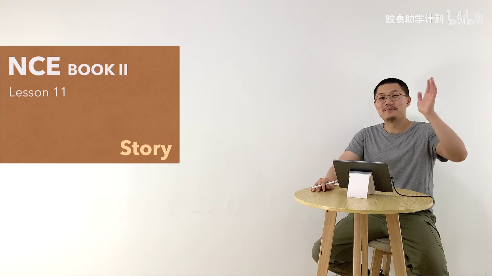

文字识别：胶囊助学计划 / NCE / BOOKⅡI / Lesson 11 / Story

### 画面 00:00:02

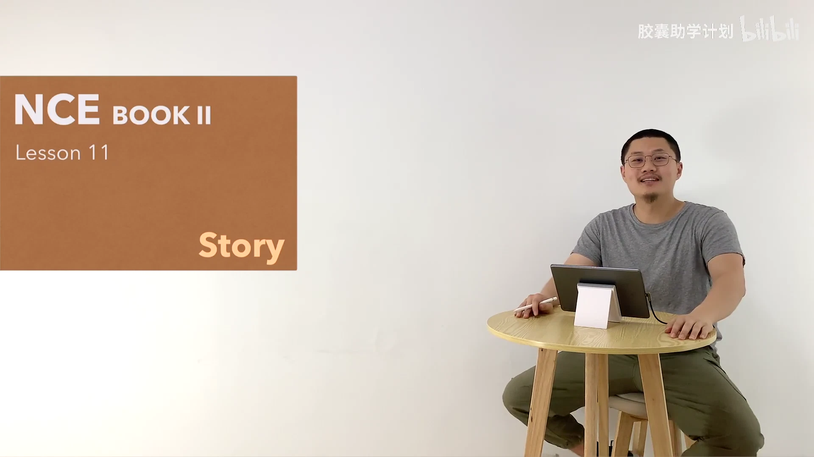

文字识别：胶囊助学计划 / NCE / BOOKⅡI / Lesson 11 / Story

### 画面 00:00:05

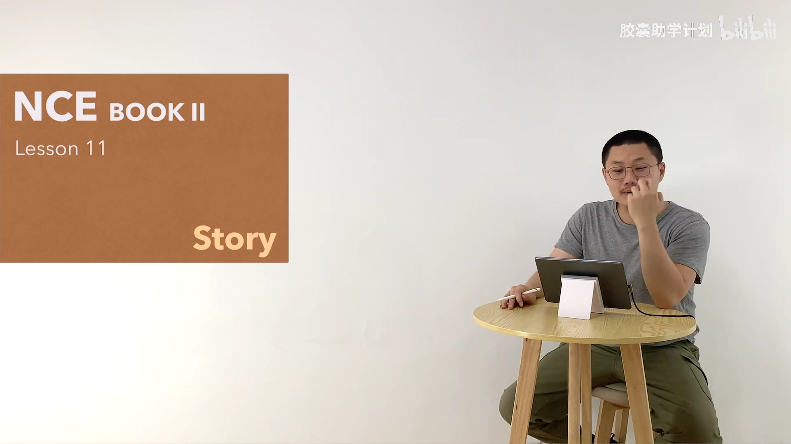

文字识别：胶囊助学计划 / NCE / BOOK ⅡI / Lesson 11 / Story

### 画面 00:00:07

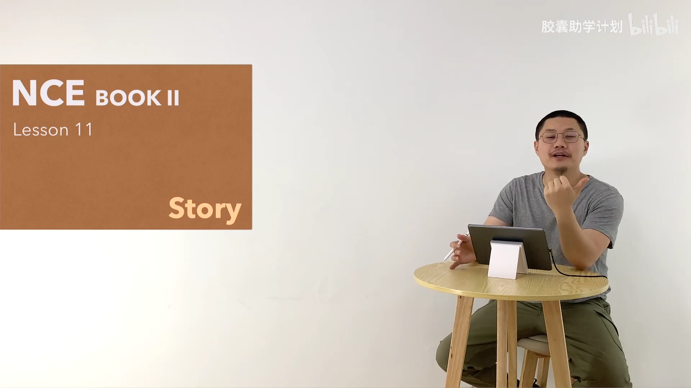

文字识别：胶囊助学计划 / NCE / BOOKII / Lesson 11 / Story

### 画面 00:00:09

文字识别：胶囊助学计划l / •

### 画面 00:00:13

文字识别：助学计划一新 / 胶囊助学计划

### 画面 00:00:15

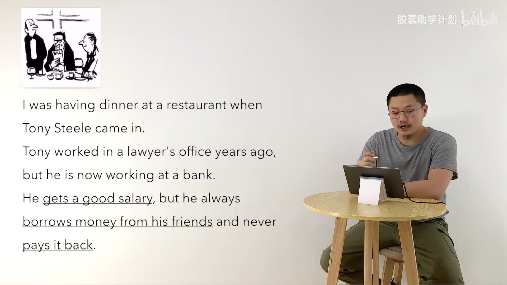

文字识别：胶囊助学计划l山 / I was having dinner at a restaurant when / Tony Steele came in. / Tony worked in a lawyer's office years ago, / but he is now working at a bank. / He gets a good salary, but he always / borrows money from his friends and never / pays it back.

### 画面 00:00:19

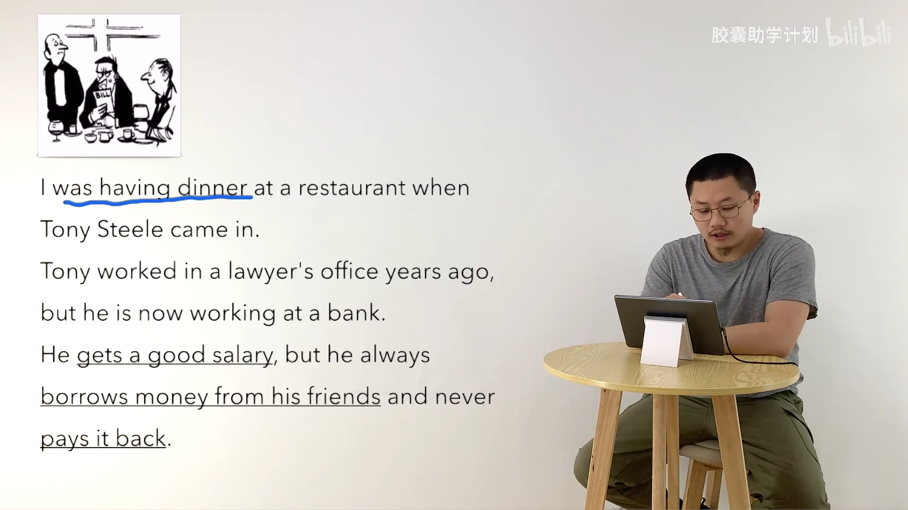

文字识别：胶囊助学计划l / I was having dinner at a restaurant when / Tony Steele came in. / Tony worked in a lawyer's office years ago, / but he is now working at a bank. / He gets a good salary, but he always / borrows money from his friends and never / pays it back.

### 画面 00:00:22

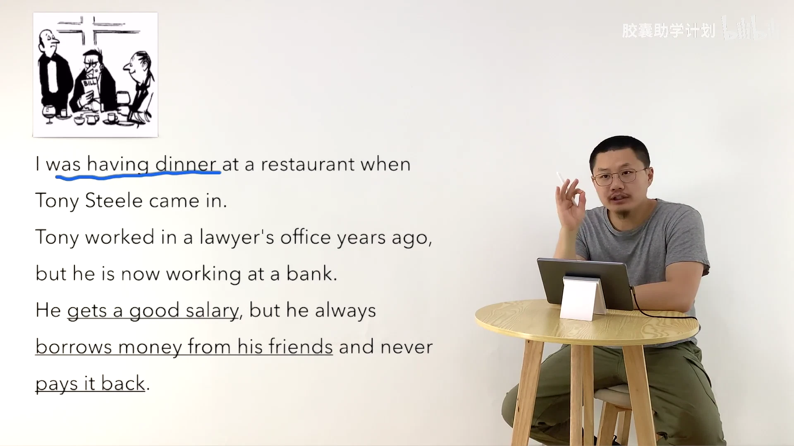

文字识别：胶囊助学计划训 / I was having dinner at a restaurant when / Tony Steele came in. / Tony worked in a lawyer's office years ago, / but he is now working at a bank. / He gets a good salary, but he always / borrows money from his friends and never / pays it back.

### 画面 00:00:27

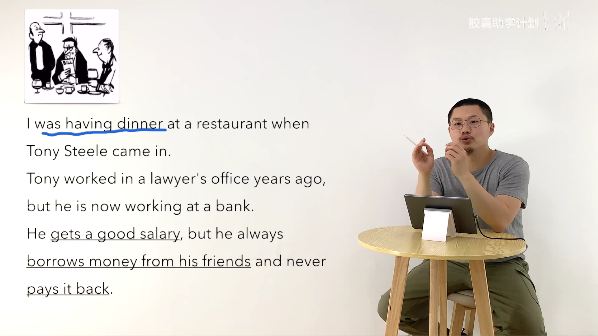

文字识别：胶囊助学计划 / I was having dinner at a restaurant when / Tony Steele came in. / Tony worked in a lawyer's office years ago, / but he is now working at a bank. / He gets a good salary, but he always / borrows money from his friends and never / pays it back.

## 00:00:30–00:01:00

习啊，每个单元都是如此。每到这一课，我就会提醒各位，这课我们就是复习前面咱们学到的一些关键的语法。比如说 was having dinner，这是咱们第七课学过的，对吧？过去进行时。When 当什么什么时候？说我当时啊正在吃晚餐。At a restaurant，在一家餐厅。When 当什么呢？Tony still came in。当他进来的时候，我正在吃晚餐。Tony

### 画面 00:00:30

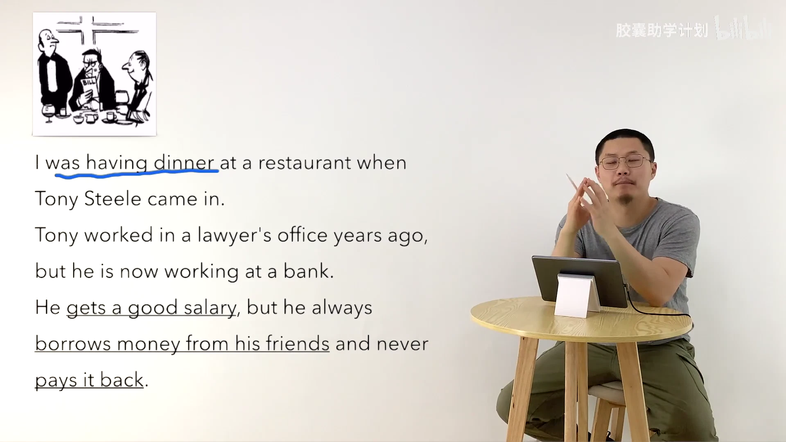

文字识别：胶囊助学计划 / I was having dinner at a restaurant when / Tony Steele came in. / Tony worked in a lawyer's office years ago, / but he is now working at a bank. / He gets a good salary, but he always / borrows money from his friends and never / pays it back.

### 画面 00:00:35

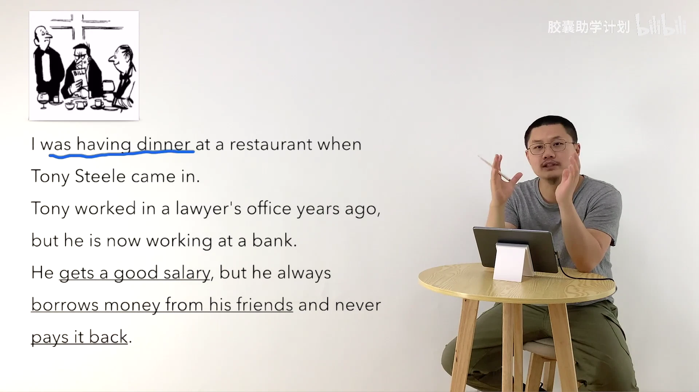

文字识别：胶囊助学计划 / I was having dinner at a restaurant when / Tony Steele came in. / Tony worked in a lawyer's office years ago, / but he is now working at a bank. / He gets a good salary, but he always / borrows money from his friends and never / pays it back.

## 00:01:00–00:01:30

说：“这个Tony老师啊，worked in a lawyer's office years ago。说他在哪？他工作在什么地方工作呢？A lawyer's office, lawyer's office叫律师的办公室啊，其实就是律所了。各位可以理解为years ago，许多年前啊，多年前。But但是呢，he is now他现在呢working at a bank。注意，他现阶段正在银行工作，

### 画面 00:01:05

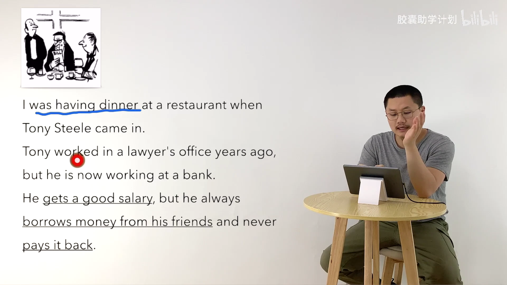

文字识别：胶囊助学计划出 / I was having dinner at a restaurant when / Tony Steele came in. / Tony worked in a lawyer's office years ago, / but he is now working at a bank. / He gets a good salary, but he always / borrows money from his friends and never / pays it back.

### 画面 00:01:12

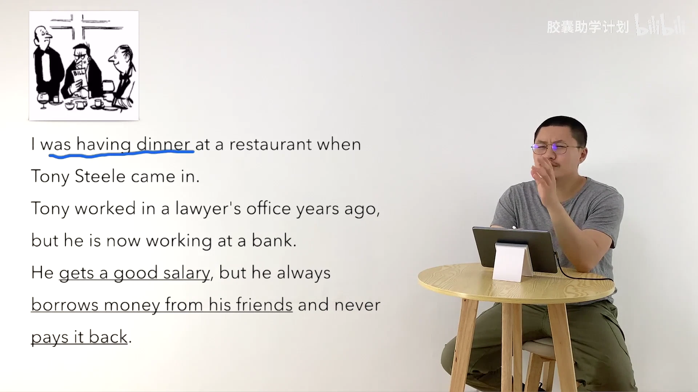

文字识别：胶囊助学计划 / I was having dinner at a restaurant when / Tony Steele came in. / Tony worked in a lawyer's office years ago, / but he is now working at a bank. / He gets a good salary, but he always / borrows money from his friends and never / pays it back.

### 画面 00:01:16

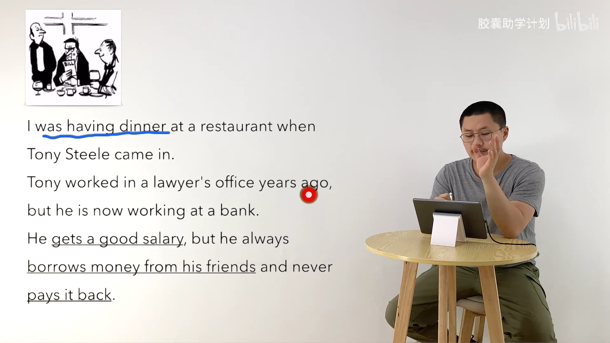

文字识别：胶囊助学计划出 / I was having dinner at a restaurant when / Tony Steele came in. / Tony worked in a lawyer's office years ago, / but he is now working at a bank. / He gets a good salary, but he always / borrows money from his friends and never / pays it back.

### 画面 00:01:19

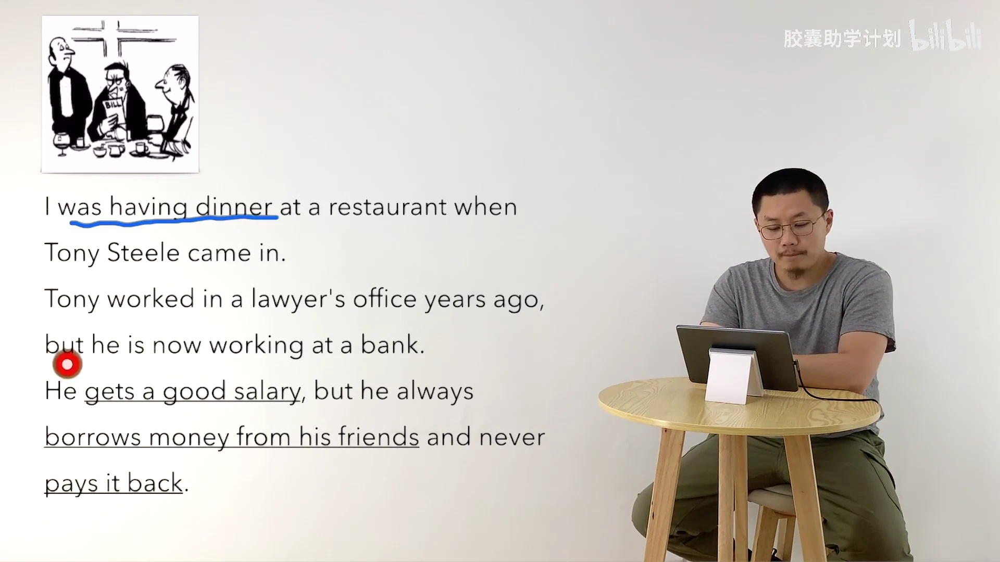

文字识别：胶囊助学计划l出 / I was having dinner at a restaurant when / Tony Steele came in. / Tony worked in a lawyer's office years ago, / but he is now working at a bank. / He gets a good salary, but he always / borrows money from his friends and never / pays it back.

## 00:01:30–00:02:00

并不是指他现在人正在银行工作。这我们第二课学过，be doing可以有一个用法，叫表示现阶段，对吧？比如说，我可以说我最近在学日语，那叫做 I'm learning Japanese these days。但我现在实际上正在给大家上英语课，但是呢，进阶现阶段我正在学习日语，叫做 I'm learning Japanese these days。这很好的复习了第二课咱们学过的一个现在进行时的用法。Okay, he gets

### 画面 00:01:30

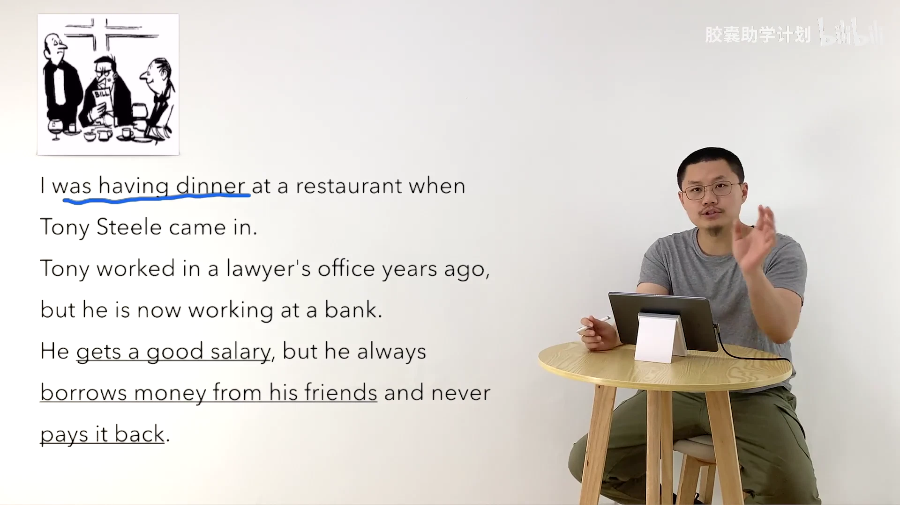

文字识别：胶囊助学计划 / I was having dinner at a restaurant when / Tony Steele came in. / Tony worked in a lawyer's office years ago, / but he is now working at a bank. / He gets a good salary, but he always / borrows money from his friends and never / pays it back.

### 画面 00:01:34

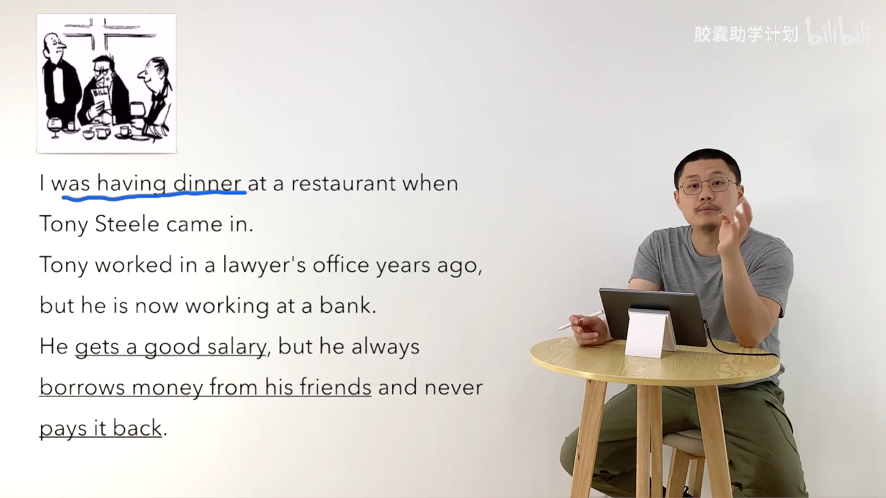

文字识别：胶囊助学计划 / I was having dinner at a restaurant when / Tony Steele came in. / Tony worked in a lawyer's office years ago, / but he is now working at a bank. / He gets a good salary, but he always / borrows money from his friends and never / pays it back.

### 画面 00:01:38

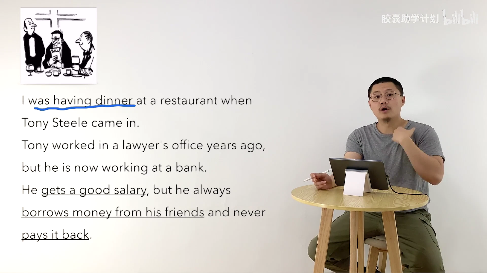

文字识别：胶囊助学计划m / I was having dinner at a restaurant when / Tony Steele came in. / Tony worked in a lawyer's office years ago, / but he is now working at a bank. / He gets a good salary, but he always / borrows money from his friends and never / pays it back.

### 画面 00:01:40

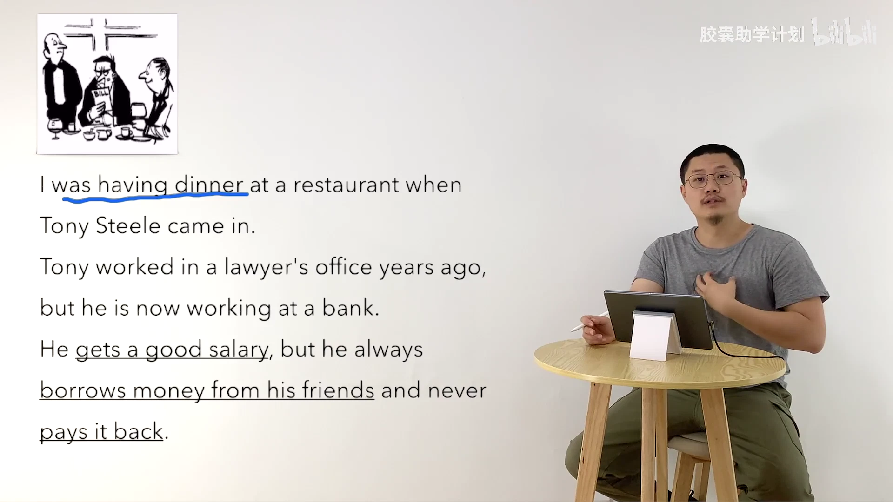

文字识别：胶囊助学计划业 / I was having dinner at a restaurant when / Tony Steele came in. / Tony worked in a lawyer's office years ago, / but he is now working at a bank. / He gets a good salary, but he always / borrows money from his friends and never / pays it back.

### 画面 00:01:44

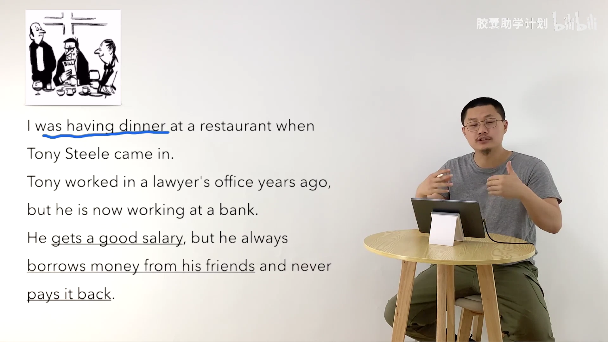

文字识别：胶囊助学计划ll / I was having dinner at a restaurant when / Tony Steele came in. / Tony worked in a lawyer's office years ago, / but he is now working at a bank. / He gets a good salary, but he always / borrows money from his friends and never / pays it back.

### 画面 00:01:52

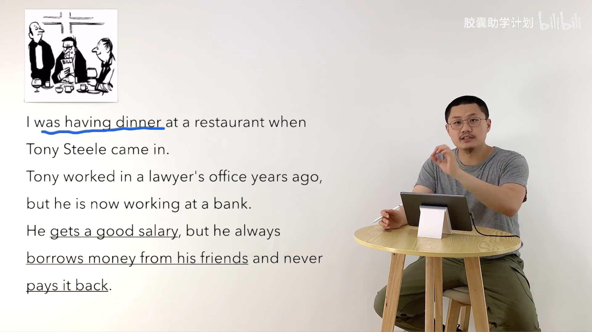

文字识别：胶囊助学计划ll / I was having dinner at a restaurant when / Tony Steele came in. / Tony worked in a lawyer's office years ago, / but he is now working at a bank. / He gets a good salary, but he always / borrows money from his friends and never / pays it back.

### 画面 00:01:54

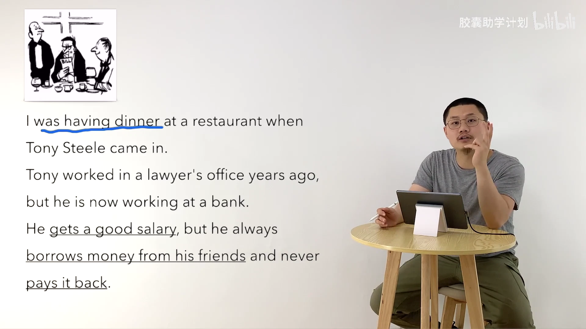

文字识别：胶囊助学计划H / I was having dinner at a restaurant when / Tony Steele came in. / Tony worked in a lawyer's office years ago, / but he is now working at a bank. / He gets a good salary, but he always / borrows money from his friends and never / pays it back.

### 画面 00:01:58

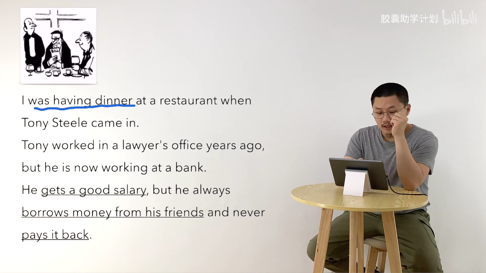

文字识别：胶囊助学计划业 / I was having dinner at a restaurant when / Tony Steele came in. / Tony worked in a lawyer's office years ago, / but he is now working at a bank. / He gets a good salary, but he always / borrows money from his friends and never / pays it back.

## 00:02:00–00:02:30

a good salary. 好了，立刻又转了一个时态，变成了什么时态呢？一般现在时。我就陈述一个客观事实，说他呀，薪水还不错。Get a good salary. 在讲单词那个部分，我们提到了。But但是，he always他总是怎么样呢？注意看，它放在动词的前面，这个也是我们之前第二课就学过的，对吧？好，他总是怎么样呢？Borrows money from his friends. 好，借

### 画面 00:02:28

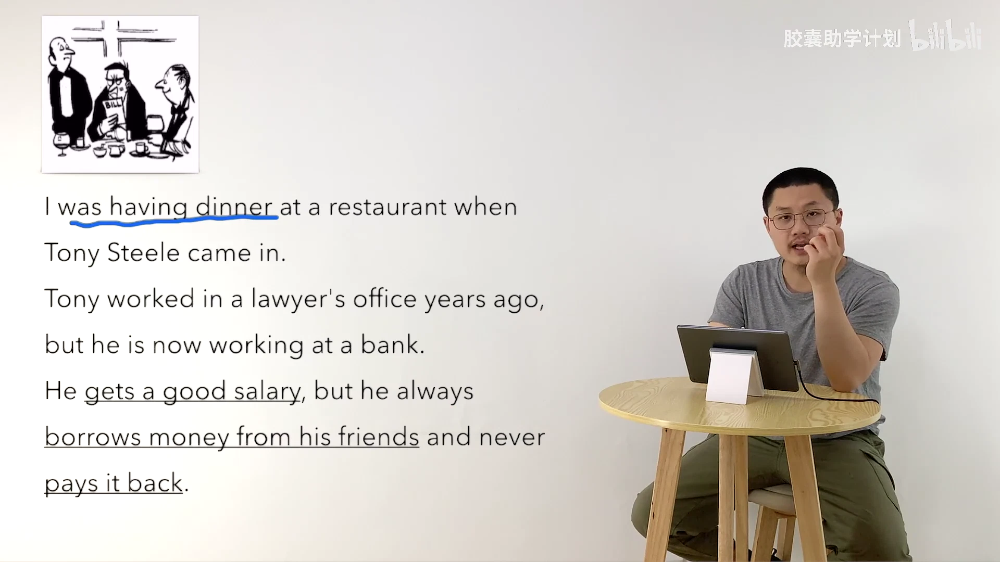

文字识别：胶囊助学计划出 / I was having dinner at a restaurant when / Tony Steele came in. / Tony worked in a lawyer's office years ago, / but he is now working at a bank. / He gets a good salary, but he always / borrows money from his friends and never / pays it back.

## 00:02:30–00:03:00

钱从他朋友那里借钱，不是借钱给他的朋友啊，是从他朋友那里借钱借出来，借到他自己手里啊。这个习惯用法一会儿我们就会造句，叫 borrow something from somebody。然后注意一下它的时态，依旧是陈述客观事实，描述的是一个他的其实是生活习惯了，类似于对吧？就自己有钱，但是呢，总找别人借啊，这是描述这样一个生活习惯。And never pays it back.然

### 画面 00:02:33

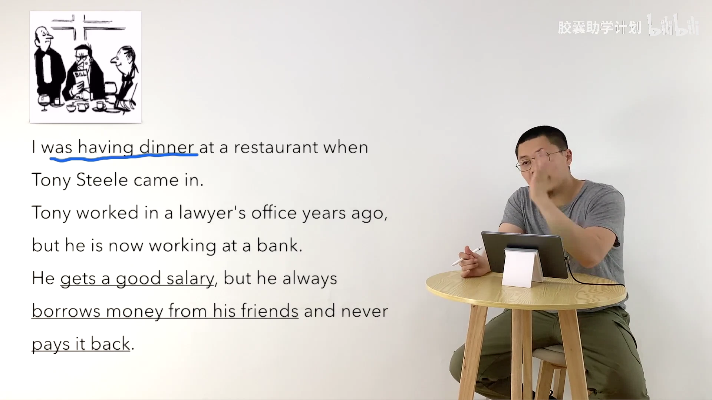

文字识别：胶囊助学计划bl / I was having dinner at a restaurant when / Tony Steele came in. / Tony worked in a lawyer's office years ago, / but he is now working at a bank. / He gets a good salary, but he always / borrows money from his friends and never / pays it back.

### 画面 00:02:40

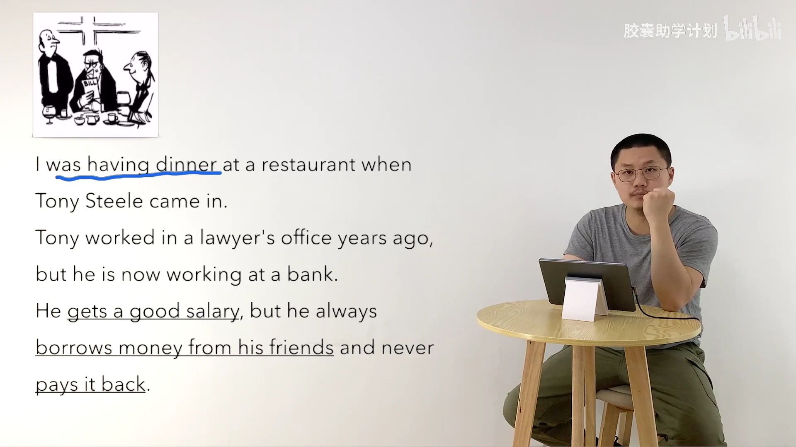

文字识别：胶囊助学计划出 / I was having dinner at a restaurant when / Tony Steele came in. / Tony worked in a lawyer's office years ago, / but he is now working at a bank. / He gets a good salary, but he always / borrows money from his friends and never / pays it back.

### 画面 00:02:50

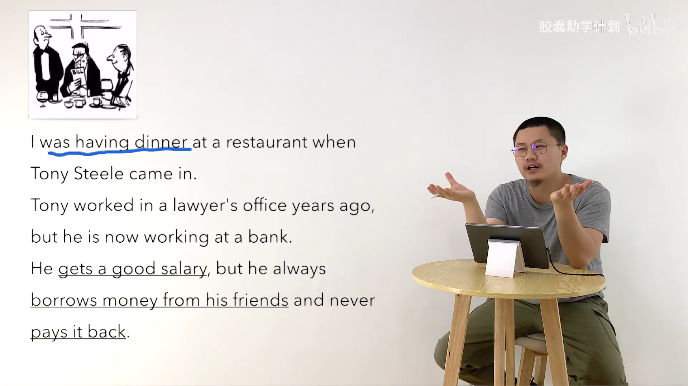

文字识别：胶囊助学计划 / I was having dinner at a restaurant when / Tony Steele came in. / Tony worked in a lawyer's office years ago, / but he is now working at a bank. / He gets a good salary, but he always / borrows money from his friends and never / pays it back.

### 画面 00:02:58

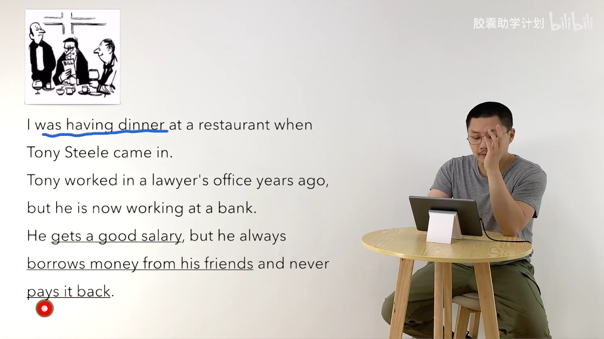

文字识别：胶囊助学计划l业 / I was having dinner at a restaurant when / Tony Steele came in. / Tony worked in a lawyer's office years ago, / but he is now working at a bank. / He gets a good salary, but he always / borrows money from his friends and never / pays it back.

## 00:03:00–00:03:30

### 画面 00:03:01

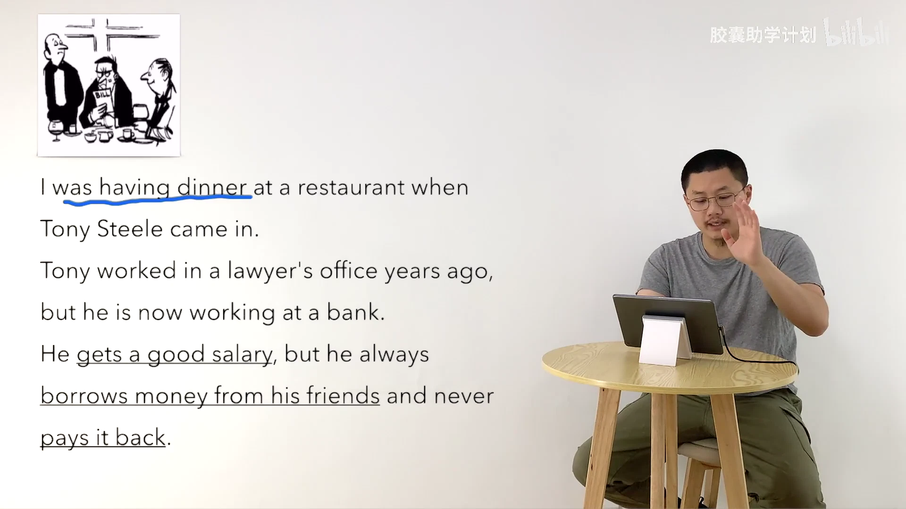

文字识别：胶囊助学计划 / I was having dinner at a restaurant when / Tony Steele came in. / Tony worked in a lawyer's office years ago, / but he is now working at a bank. / He gets a good salary, but he always / borrows money from his friends and never / pays it back.

### 画面 00:03:05

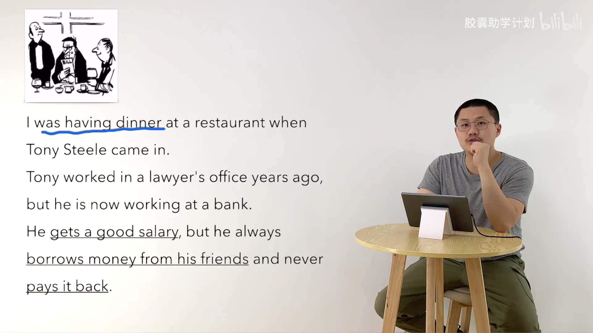

文字识别：胶囊助学计划l / I was having dinner at a restaurant when / Tony Steele came in. / Tony worked in a lawyer's office years ago, / but he is now working at a bank. / He gets a good salary, but he always / borrows money from his friends and never / pays it back.

### 画面 00:03:11

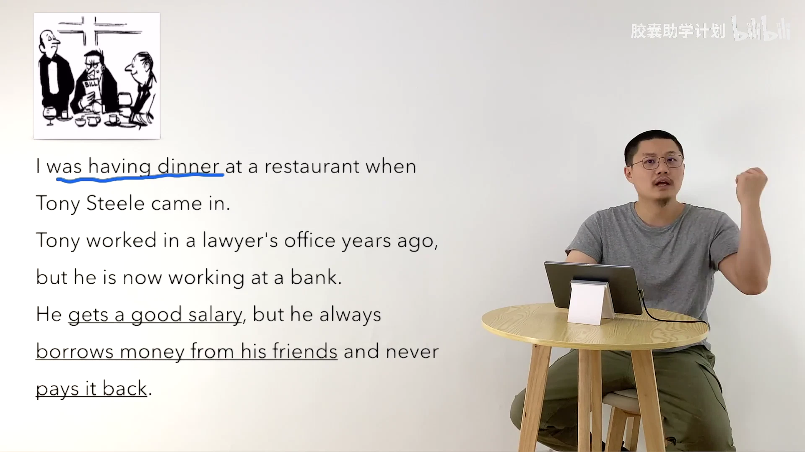

文字识别：胶囊助学计划 / I was having dinner at a restaurant when / Tony Steele came in. / Tony worked in a lawyer's office years ago, / but he is now working at a bank. / He gets a good salary, but he always / borrows money from his friends and never / pays it back.

### 画面 00:03:19

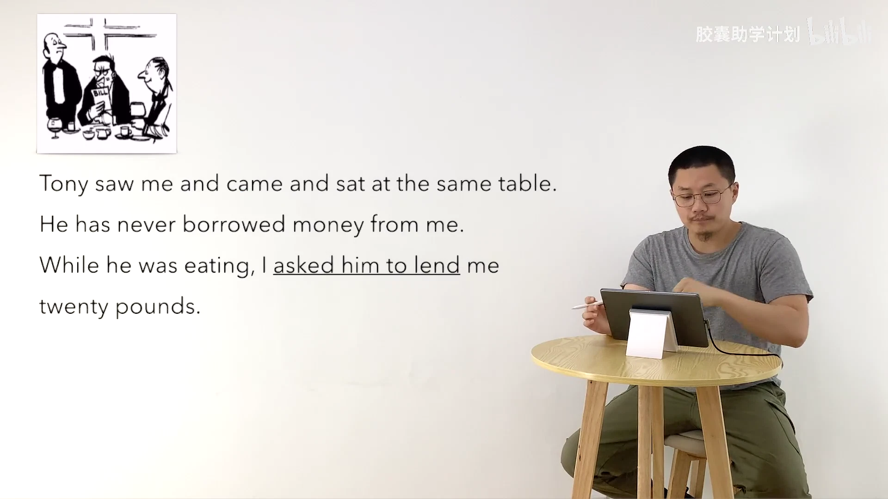

文字识别：胶囊助学计划 / Tony saw me and came and sat at the same table. / 2 / He has never borrowed money from me. / While he was eating, I asked him to lend me / twenty pounds.

## 00:03:30–00:04:00

来了。再然后呢？他用了一段文字去给你交代说 Tony 之前是干什么的，他的生活习惯是什么样的，陈述了一些客观事实。借总借钱，但总不还，对吧？然后又回到了这个场景当中。这个场景是 Tony saw me, Tony 看见我了, and came, 然后过来了, and sat at the same table, 然后坐在了一个桌子上。又又转化成了一般过去时，因为我在陈述过去的事情了，对吧？

### 画面 00:03:34

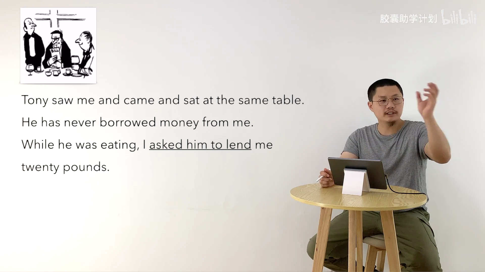

文字识别：胶囊助学计划LHDI / Tony saw me and came and sat at the same table. / He has never borrowed money from me. / While he was eating, I asked him to lend me / twenty pounds.

### 画面 00:03:44

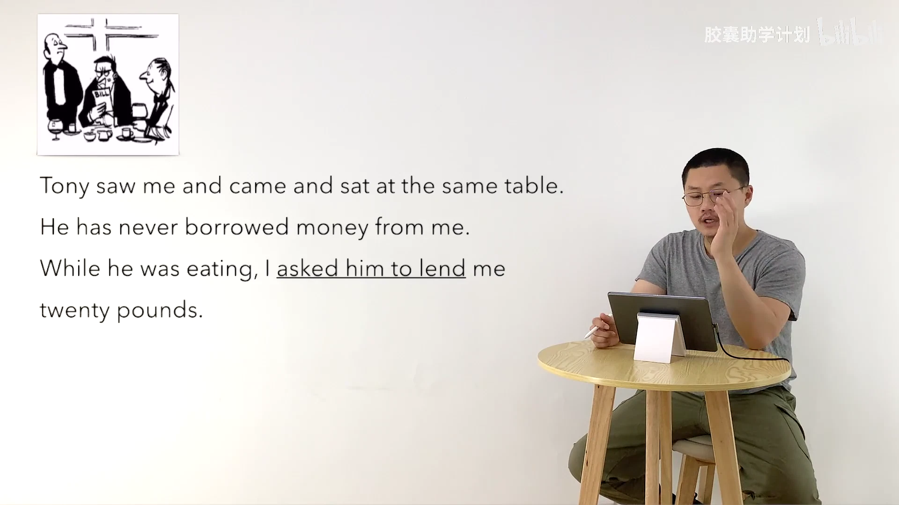

文字识别：胶囊助学计划川 / Tony saw me and came and sat at the same table. / He has never borrowed money from me. / While he was eating, I asked him to lend me / twenty pounds.

### 画面 00:03:47

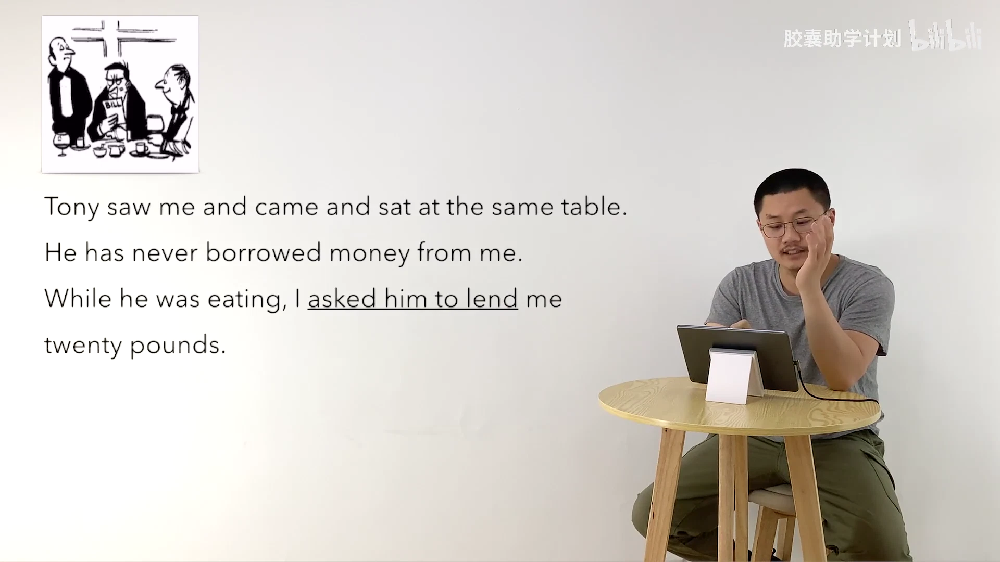

文字识别：胶囊助学计划出 / Tony saw me and came and sat at the same table. / He has never borrowed money from me. / While he was eating, I asked him to lend me / twenty pounds.

### 画面 00:03:53

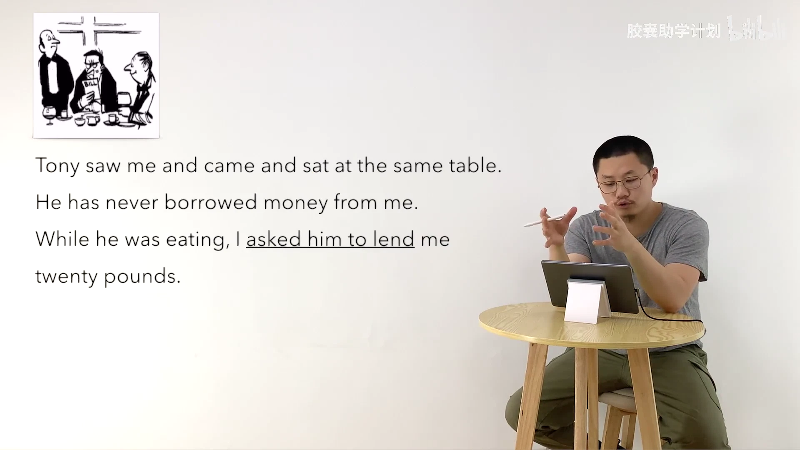

文字识别：胶囊助学计划州 / Tony saw me and came and sat at the same table. / He has never borrowed money from me. / While he was eating, I asked him to lend me / twenty pounds.

### 画面 00:03:56

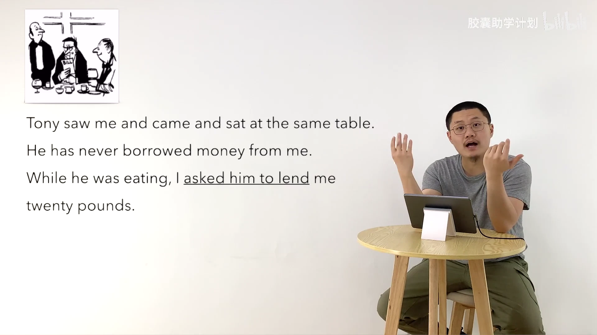

文字识别：胶囊助学计划 / Tony saw me and came and sat at the same table. / He has never borrowed money from me. / While he was eating, I asked him to lend me / twenty pounds.

### 画面 00:03:59

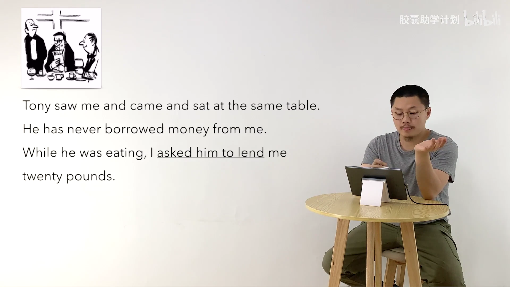

文字识别：胶囊助学计划m / Tony saw me and came and sat at the same table. / He has never borrowed money from me. / While he was eating, I asked him to lend me / twenty pounds.

## 00:04:00–00:04:30

He has never borrowed money from me.他呀一直都没从我这儿借过钱，从过去持续到现在就从来没借过钱。你看，典型的现在完成时，对吧？He has never borrowed money from me.当然了，如果在美式英语当中，你可以直接把它变成He never borrowed money from me.啊，美式英语当中大多数情况下可以直接用一般过去时去替代现在完成时。Okay, While he was eating,

### 画面 00:04:06

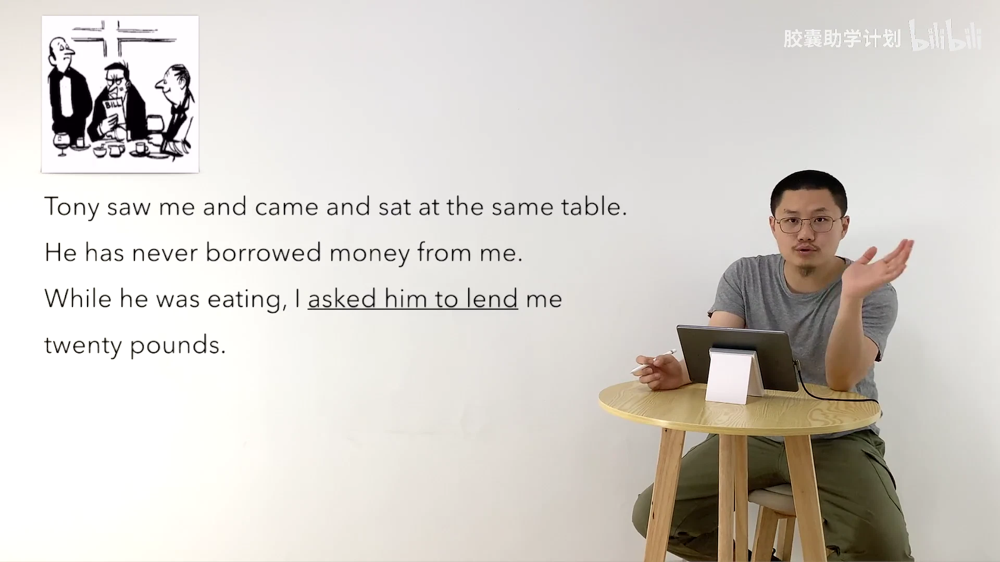

文字识别：胶囊助学计划bW业 / Tony saw me and came and sat at the same table. / He has never borrowed money from me. / While he was eating, I asked him to lend me / twenty pounds.

### 画面 00:04:08

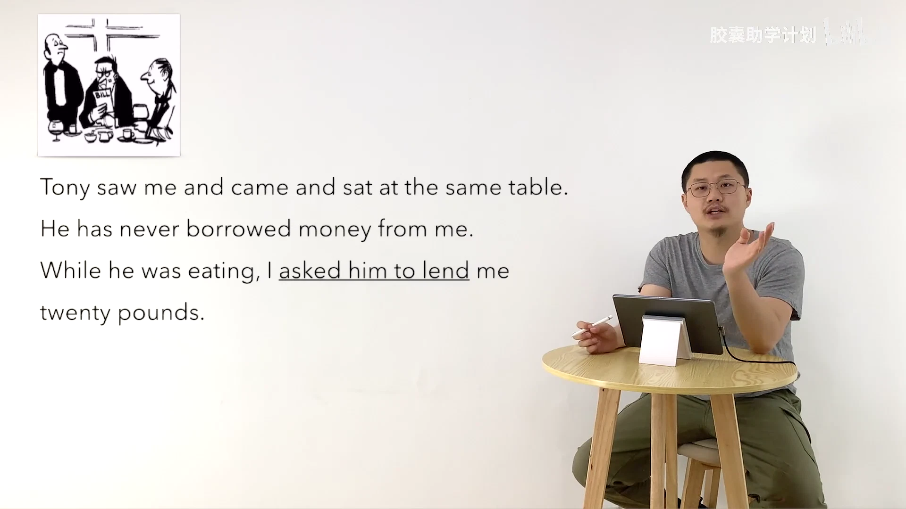

文字识别：胶囊助学计划 / Tony saw me and came and sat at the same table. / He has never borrowed money from me. / While he was eating, I asked him to lend me / twenty pounds.

### 画面 00:04:10

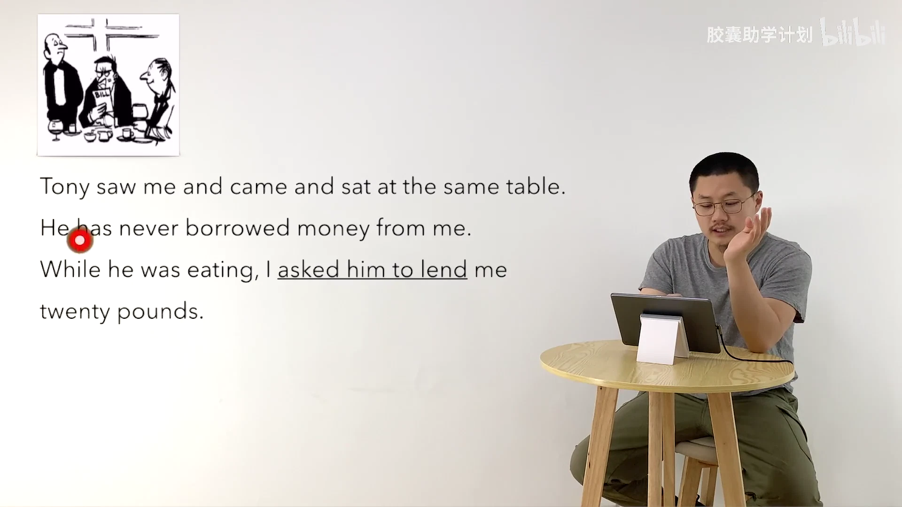

文字识别：胶囊助学计划MD / Tony saw me and came and sat at the same table. / He has never borrowed money from me. / While he was eating, I asked him to lend me / twenty pounds.

### 画面 00:04:13

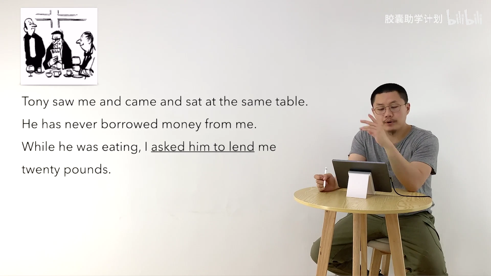

文字识别：胶囊助学计划ll / Tony saw me and came and sat at the same table. / He has never borrowed money from me. / While he was eating, I asked him to lend me / twenty pounds.

### 画面 00:04:25

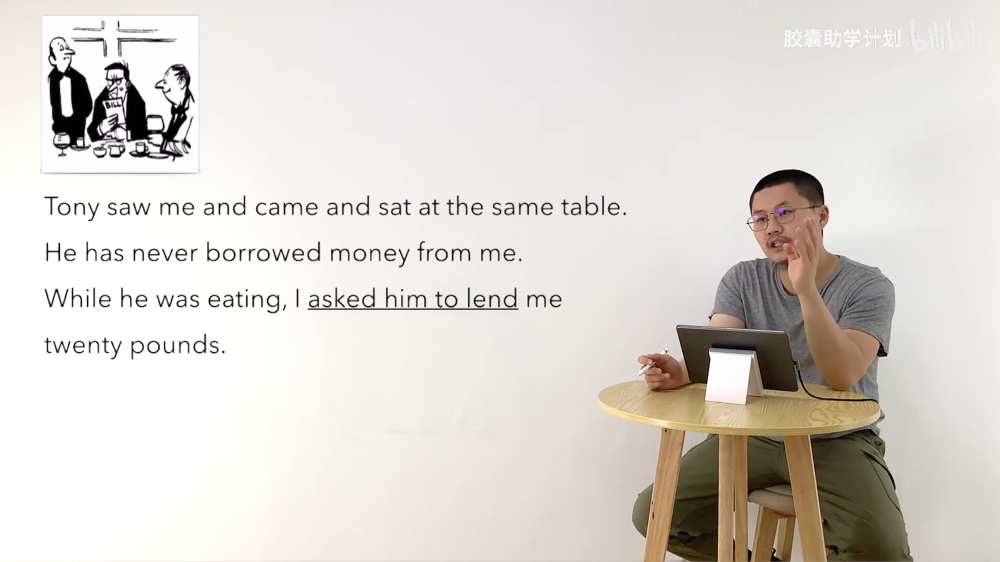

文字识别：胶囊助学计划州 / Tony saw me and came and sat at the same table. / He has never borrowed money from me. / While he was eating, I asked him to lend me / twenty pounds.

### 画面 00:04:27

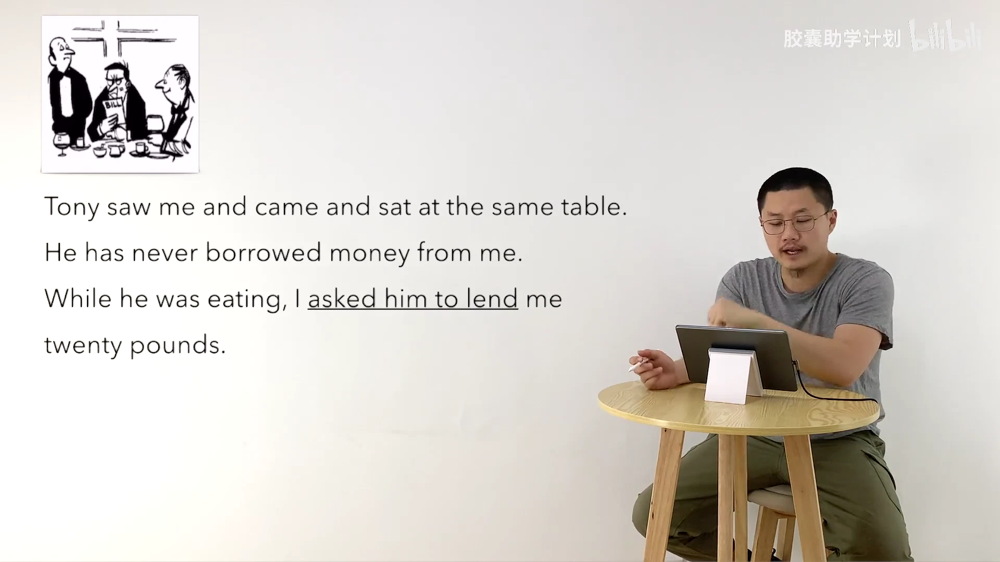

文字识别：胶囊助学计划M / Tony saw me and came and sat at the same table. / He has never borrowed money from me. / While he was eating, I asked him to lend me / twenty pounds.

## 00:04:30–00:05:00

说当他正在吃饭的时候，当他正吃的时候，啊，这个写文章的这个男主啊，赵倩儿啊，他就开始做了一件事，说I asked him to lend me twenty pounds.说我呀要他去借给我二十磅啊，我开始要求他去借给我二十磅啊，他不是总找别人借钱吗？我故意逗着他玩，我要让他借我二十磅。OK，所以这有一个习惯用法叫ask somebody to do something，

### 画面 00:04:31

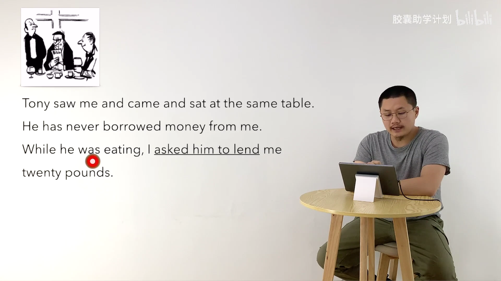

文字识别：胶囊助学计划bH册 / Tony saw me and came and sat at the same table. / He has never borrowed money from me. / While he was eating, I asked him to lend me / twenty pounds.

## 00:05:00–00:05:30

要某人去做某件事情. Very good. To my surprise, 这个习惯用法我们之前见过了，叫 to somebody's surprise. 令某人感到惊讶的是, he gave me the money immediately. 他把钱给我 immediately, 立刻啊. 所以刚才我们讲到了嘛，对吧？副词最主要的作用之一就是说这个句子当中的动词的状态形式方式的，对吧？比如说

### 画面 00:05:01

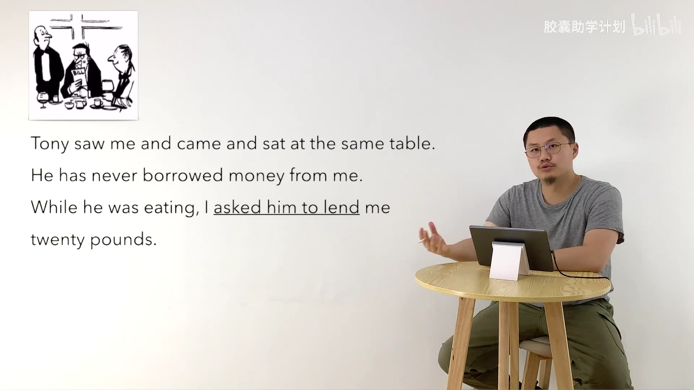

文字识别：胶囊助学计划l / Tony saw me and came and sat at the same table. / He has never borrowed money from me. / While he was eating, I asked him to lend me / twenty pounds.

### 画面 00:05:04

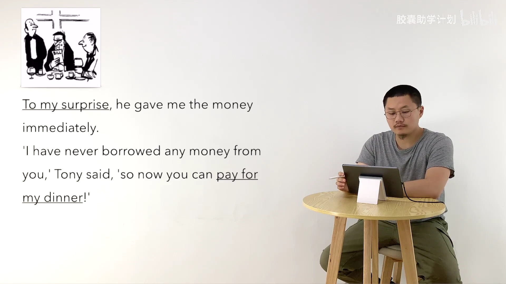

文字识别：胶囊助学计划 / To my surprise, he gave me the money / immediately. / 'I have never borrowed any money from / you,'Tony said,'so now you can pay for / my dinner!'

### 画面 00:05:27

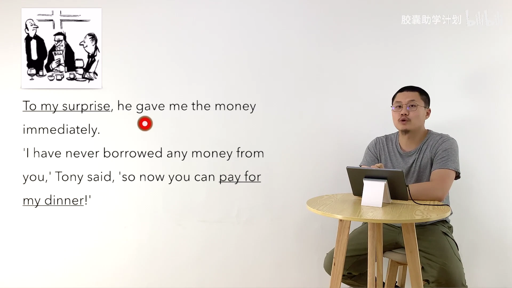

文字识别：胶囊助学计划 / To my surprise, he gave me the money / immediately. / 'I have never borrowed any money from / you,'Tony said,'so now you can pay for / my dinner!'

## 00:05:30–00:06:00

give 叫做给，那立刻就给和给这个感受不太一样，对吧？就是你看他虽然经常找别人借钱，但是呢，当我找他借钱的时候呢，他没犹豫没含糊，直接就借给我了啊，就能起到这样一个小的作用。有没有 immediately 就会出现这样一点小的作用，对吧？那你如果语感特别好，在这儿你可能想到的问题就是，哎，这个人他总找别人借钱，为什么他我一管他一借钱，他立刻就借给我了呢？对吧？文章当中这个我了呢，你就会继

### 画面 00:05:31

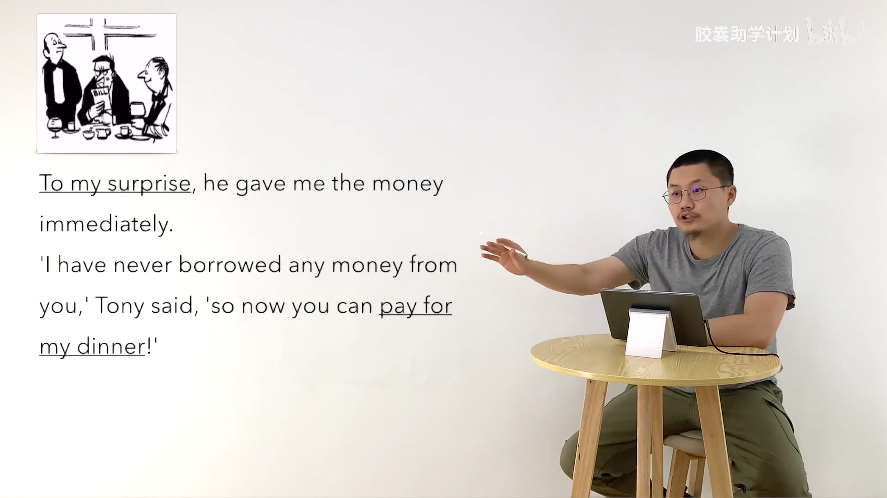

文字识别：胶囊助学计划 / To my surprise, he gave me the money / immediately. / 'I have never borrowed any money from / you,' Tony said, 'so now you can pay for / my dinner!'

### 画面 00:05:34

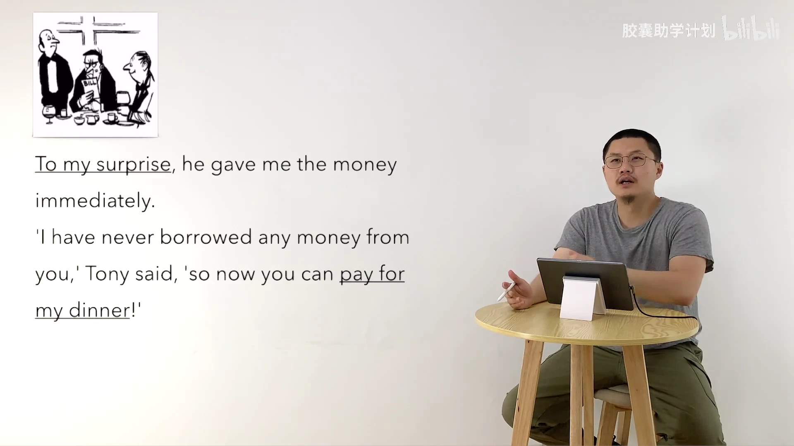

文字识别：胶囊助学计划 / bil / To my surprise, he gave me the money / immediately. / 'I have never borrowed any money from / you,' Tony said, 'so now you can pay for / my dinner!'

### 画面 00:05:44

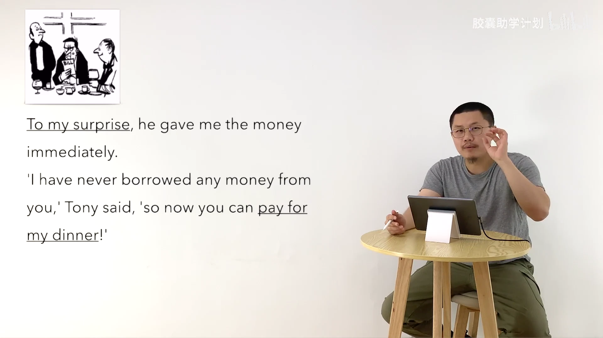

文字识别：胶囊助学计划 / To my surprise, he gave me the money / immediately. / 'I have never borrowed any money from / you,'Tony said,'so now you can pay for / my dinner!'

### 画面 00:05:48

文字识别：胶囊助学计划 / To my surprise, he gave me the money / immediately. / 'I have never borrowed any money from / you,' Tony said, 'so now you can pay for / my dinner!'

### 画面 00:05:51

文字识别：胶囊助学计划 / To my surprise, he gave me the money / immediately. / 'I have never borrowed any money from / you,' Tony said, 'so now you can pay for / my dinner!'

### 画面 00:05:54

文字识别：胶囊助学计划 / To my surprise, he gave me the money / immediately. / 'I have never borrowed any money from / you,' Tony said, 'so now you can pay for / my dinner!'

## 00:06:00–00:06:30

继续往下读了，解决这个问题。然后 Tony 说了一句话啊，注意引号，I have never borrowed any money from you. 我从来都没向管你借过钱，没向你借过钱。 Tony said. Tony 说道，哎，这是是实话。 So 所以呢，Now 现在 you can pay for my dinner. 现在呀，你可以支付我晚餐的账单了，你可以为我的晚餐买单

### 画面 00:06:00

文字识别：胶囊助学计划l / To my surprise, he gave me the money / immediately. / 'I have never borrowed any money from / you,'Tony said,'so now you can pay for / my dinner!'

### 画面 00:06:02

文字识别：biLil / 胶囊助学计划 / To my surprise, he gave me the money / immediately. / 'I have never borrowed any money from / you,'Tony said,'so now you can pay for / my dinner!'

## 00:06:30–00:07:00

了，OK, very good,哈，很有意思。就为什么立刻给借你这钱了呢？你你再想一下标题啊，礼尚往来，我借了你二十块钱，你请我吃顿饭，不过分吧？对吧？OK, so pay for my dinner, pay for something叫做支付某一个东西啊，就是花钱去买某个东西啊。当然，它指的是支付的意思，它并不是买啊，它是付款的意思。OK, 那接下来呢，我们就看把本课的习惯用法摘出来，然后

### 画面 00:06:32

文字识别：u bilt bili / 胶囊助学计划 / To my surprise, he gave me the money / immediately. / 'I have never borrowed any money from / you,' Tony said, 'so now you can pay for / my dinner!'

### 画面 00:06:56

文字识别：Biltbi / 胶囊助学计划 / 习惯用法造句 / get a good salary / borrow sth.from sb. / pay it back / ask sb.to do sth. / pay for sth.

### 画面 00:06:58

文字识别：LitLit / 胶囊助学计划 / 习惯用法造句 / get a good salary / borrow sth. from sb. / pay it back / ask sb.to do sth. / pay for sth.

## 00:07:00–00:07:30

我们尝试拿这些习惯用法去造句啊。我们一个一个来。第一个，get a good salary。单词部分我们讲过了，我们接下来再讲一下啊。比如说，我们结合第七课的，I got a good salary a few years earlier。张嘴跟我读啊，我几年前获得了一个很好的收入。Continue，变成一般疑问句，Did you get a good salary a few years earlier？以及Why did you get a good salary a few years

### 画面 00:07:00

文字识别：胶囊助学计划 / 习惯用法造句 / get a good salary / borrow sth. from sb. / pay it back / ask sb.to do sth. / pay for sth.

### 画面 00:07:02

文字识别：bibi / 胶囊助学计划 / 习惯用法造句 / get a good salary / borrow sth. from sb. / pay it back / ask sb.to do sth. / pay for sth.

### 画面 00:07:04

文字识别：网：v.+v.变化 / 胶囊助学计划 / Blt Bilt / 习惯用法造句指南 / 四句型转换 / 方式/地点/时间 / 其他习惯用法 / 其他单词+词性 / 原文摘抄+变 / 6123456 / get a good salary

### 画面 00:07:06

文字识别：网：v.+v.变化 / 胶囊助学计划 / Bii / 习惯用法造句指南 / 四句型转换 / 方式/地点/时间 / 其他习惯用法 / 其他单词+词性 / 原文摘抄+变 / 6123456 / get a good salary

### 画面 00:07:09

文字识别：网：v.+v.变化 / 胶囊助学计划 / 习惯用法造句指南 / 四句型转换 / 方式/地点/时间 / 其他习惯用法 / 其他单词+词性 / 原文摘抄+变 / 6123456 / get a good salary / I got a good salary a few years earlier. L7

### 画面 00:07:11

文字识别：网：v.+v.变化 / 胶囊助学计划 / 习惯用法造句指南 / 四句型转换 / 方式/地点/时间 / 其他习惯用法 / 其他单词+词性 / 原文摘抄+变 / 6123456 / get a good salary / I got a good salary a few years earlier. L7

### 画面 00:07:14

文字识别：网：v.+v.变化 / 胶囊助学计划 / 习惯用法造句指南 / 四句型转换 / 方式/地点/时间 / 其他习惯用法 / 其他单词+词性 / 原文摘抄+变 / 6123456 / get a good salary / I got a good salary a few years earlier. L7

### 画面 00:07:16

文字识别：网：v.+v.变化 / 胶囊助学计划 / 习惯用法造句指南 / 四句型转换 / 方式/地点/时间 / 其他习惯用法 / 其他单词+词性 / 原文摘抄+变 / 6123456 / get a good salary / I got a good salary a few years earlier. L7

### 画面 00:07:19

文字识别：网：v.+v.变化 / 胶囊助学计划 / 习惯 / 四句型转换 / 用 / 方式/地点/时间 / 法 / 造 / 其他习惯用法 / 旭句指南 / 其他单词+词性 / 原文摘抄+变 / 6123456 / get a good salary / I got a good salary a few years earlier. L7 / Did you get a good salary a few years earlier? / Why did you get a good salary a few years earlier?

### 画面 00:07:21

文字识别：网：v.+v.变化 / 胶囊助学计划 / 习惯 / 四句型转换 / 伙用法造句指南 / 方式/地点/时间 / 其他习惯用法 / 其他单词+词性 / 原文摘抄+变 / 6123456 / get a good salary / I got a good salary a few years earlier. L7 / Did you get a good salary a few years earlier? / Why did you get a good salary a few years earlier?

### 画面 00:07:23

文字识别：网：v.+v.变化 / 胶囊助学计划 / 习惯 / 四句型转换 / 从用法造句指南 / 方式/地点/时间 / 其他习惯用法 / 其他单词+词性 / 原文摘抄+变 / 6123456 / get a good salary / I got a good salary a few years earlier. L7 / Did you get a good salary a few years earlier? / Why did you get a good salary a few years earlier?

### 画面 00:07:25

文字识别：网：v.+v.变化 / 胶囊助学计划 / 习惯 / 四句型转换 / 用法 / 方式/地点/时间 / 么造句指南 / 其他习惯用法 / 其他单词+词性 / 原文摘抄+变 / 6123456 / get a good salary / I got a good salary a few years earlier. L7 / Did you get a good salary a few years earlier? / Why did you get a good salary a few years earlier?

### 画面 00:07:28

文字识别：网：v.+v.变化 / 胶囊助学计划 / 习惯 / 四句型转换 / 用法造句指南 / 方式/地点/时间 / 其他习惯用法 / 其他单词+词性 / 原文摘抄+变 / 6123456 / get a good salary / I got a good salary a few years earlier. L7 / Did you get a good salary a few years earlier? / Why did you get a good salary a few years earlier?

## 00:07:30–00:08:00

years earlier. Okay, there you go.下一个习惯用法叫 borrow something from somebody，从某人那个地方借来某个东西。Okay，注意这个点。那比如说我们结合第十课和第十三课，好，呃，第三课的单词。注意，你看在这儿我结合的不是其他习惯用法了，我结合的是其他单词，叫做 I borrowed some musical instruments。第十课的单词 from that friendly waiter。第三课的单词，

### 画面 00:07:30

文字识别：网：v.+v.变化 / 胶囊助学计划 / 习惯 / 四句型转换 / 伙用法造句指南 / 方式/地点/时间 / 其他习惯用法 / 其他单词+词性 / 原文摘抄+变 / 6123456 / get a good salary / I got a good salary a few years earlier. L7 / Did you get a good salary a few years earlier? / Why did you get a good salary a few years earlier?

### 画面 00:07:32

文字识别：网：v.+v.变化 / 胶囊助学计划 / Bitbi / 习惯用法造句指南 / 四句型转换 / 方式/地点/时间 / 其他习惯用法 / 其他单词+词性 / 原文摘抄+变 / 6123456 / borrow sth.from sb.

### 画面 00:07:34

文字识别：网：v.+v.变化 / 胶囊助学计划 / Bitb / 习惯用法造句指南 / 四句型转换 / 方式/地点/时间 / 其他习惯用法 / 其他单词+词性 / 原文摘抄+变 / 6123456 / borrow sth. from sb.

### 画面 00:07:36

文字识别：网：v.+v.变化 / 胶囊助学计划 / 习惯用法造句指南 / 四句型转换 / 方式/地点/时间 / 其他习惯用法 / 其他单词+词性 / 原文摘抄+变 / 6123456 / borrow sth. from sb.

### 画面 00:07:38

文字识别：网：v.+v.变化 / 胶囊助学计划川 / 习惯用法造句指南 / 四句型转换 / 方式/地点/时间 / 其他习惯用法 / 其他单词+词性 / 原文摘抄+变 / 6123456 / borrow sth. from sb.

### 画面 00:07:40

文字识别：网：v.+v.变化 / 胶囊助学计划 / 习惯用法造句指南 / 四句型转换 / 方式/地点/时间 / 其他习惯用法 / 其他单词+词性 / 原文摘抄+变 / 6123456 / borrow sth.from sb. / I borrowed some musical instruments from that / friendly waiter. L10 L3

### 画面 00:07:42

文字识别：网：v.+v.变化 / 胶囊助学计划 / 习惯用法造句指南 / 四句型转换 / 方式/地点/时间 / 其他习惯用法 / 其他单词+词性 / 原文摘抄+变 / 6123456 / borrow sth.from sb. / I borrowed some musical instruments from that / friendly waiter. L10 L3

### 画面 00:07:44

文字识别：网：v.+v.变化 / 胶囊助学计划 / BitLil / 习惯用法造句指南 / 四句型转换 / 方式/地点/时间 / 其他习惯用法 / 其他单词+词性 / 原文摘抄+变 / 6123456 / borrow sth.from sb. / I borrowed some musical instruments from that / friendly waiter. L10 L3

### 画面 00:07:46

文字识别：网：v.+v.变化 / 胶囊助学计划 / 习惯用法造句指南 / 四句型转换 / 方式/地点/时间 / 其他习惯用法 / 其他单词+词性 / 原文摘抄+变 / 6123456 / borrow sth.from sb. / I borrowed some musical instruments from that / friendly waiter. L10 L3

### 画面 00:07:50

文字识别：网：v.+v.变化 / 胶囊助学计划 / 习惯用法造句指南 / 四句型转换 / 方式/地点/时间 / 其他习惯用法 / 其他单词+词性 / 原文摘抄+变 / 6123456 / borrow sth.from sb. / I borrowed some musical instruments from that / friendly waiter. L10 L3

### 画面 00:07:55

文字识别：网：v.+v.变化 / 胶囊助学计划 / 习惯用法造句指南 / 四句型转换 / 方式/地点/时间 / 其他习惯用法 / 其他单词+词性 / 原文摘抄+变 / 6123456 / borrow sth.from sb. / I borrowed some musical instruments from that / friendly waiter. L10 L3

## 00:08:00–00:08:30

在这儿我想提什么呢？大家最容易忘了的，其实就是单词和习惯用法这种东西。语法是课课都出现，你倒是不那么容易忘，对吧？单词总忘怎么办？有几个好的办法。除了你经常往前去翻，另一个就是接下来再去造句的时候，习惯用法造句，或单接下来单词造句的时候，你记着不停的结合前面学过的单词或习惯用法，当然还有语法，

### 画面 00:08:00

文字识别：网：v.+v.变化 / 胶囊助学计划 / 习惯用法造句指南 / 四句型转换 / 方式/地点/时间 / 其他习惯用法 / 其他单词+词性 / 原文摘抄+变 / 6123456 / borrow sth.from sb. / I borrowed some musical instruments from that / friendly waiter. L10 L3

### 画面 00:08:03

文字识别：网：v.+v.变化 / 胶囊助学计划 / 习惯用法造句指南 / 四句型转换 / 方式/地点/时间 / 其他习惯用法 / 其他单词+词性 / 原文摘抄+变 / 6123456 / borrow sth.from sb. / I borrowed some musical instruments from that / friendly waiter. L10 L3

### 画面 00:08:05

文字识别：网：v.+v.变化 / 胶囊助学计划 / 习惯用法造句指南 / 四句型转换 / 方式/地点/时间 / 其他习惯用法 / 其他单词+词性 / 原文摘抄+变 / 6123456 / borrow sth.from sb. / I borrowed some musical instruments from that / friendly waiter. L10 L3

### 画面 00:08:08

文字识别：网：v.+v.变化 / 胶囊助学计划 / 习惯用法造句指南 / 四句型转换 / 方式/地点/时间 / 其他习惯用法 / 其他单词+词性 / 原文摘抄+变 / 6123456 / borrow sth. from sb. / I borrowed some musical instruments from that / friendly waiter. L10 L3

### 画面 00:08:10

文字识别：胶囊助学计划 / 网：v.+v.变化 / 习惯用法造句指南 / 四句型转换 / 方式/地点/时间 / 其他习惯用法 / 其他单词+词性 / 原文摘抄+变 / 6123456 / borrow sth.from sb. / I borrowed some musical instruments from that / friendly waiter. L10 L3

### 画面 00:08:14

文字识别：网：v.+v.变化 / 胶囊助学计划 / 习惯用法造句指南 / 四句型转换 / 方式/地点/时间 / 其他习惯用法 / 其他单词+词性 / 原文摘抄+变 / 6123456 / borrow sth.from sb. / I borrowed some musical instruments from that / friendly waiter. L10 L3

### 画面 00:08:16

文字识别：网：v.+v.变化 / 胶囊助学计划 / 习惯用法造句指南 / 四句型转换 / 方式/地点/时间 / 其他习惯用法 / 其他单词+词性 / 原文摘抄+变 / 6123456 / borrow sth.from sb. / I borrowed some musical instruments from that / friendly waiter. L10 L3

### 画面 00:08:19

文字识别：网：v.+v.变化 / 胶囊助学计划 / 习惯用法造句指南 / 四句型转换 / 方式/地点/时间 / 其他习惯用法 / 其他单词+词性 / 原文摘抄+变 / 6123456 / borrow sth.from sb. / I borrowed some musical instruments from that / friendly waiter. L10 L3

### 画面 00:08:21

文字识别：网：v.+v.变化 / 胶囊助学计划 / 习惯用法造句指南 / 四句型转换 / 方式/地点/时间 / 其他习惯用法 / 其他单词+词性 / 原文摘抄+变 / 6123456 / borrow sth.from sb. / I borrowed some musical instruments from that / friendly waiter. L10 L3

### 画面 00:08:23

文字识别：网：v.+v.变化 / 胶囊助学计划 / 习惯用法造句指南 / 四句型转换 / 方式/地点/时间 / 其他习惯用法 / 其他单词+词性 / 原文摘抄+变 / 6123456 / borrow sth.from sb. / I borrowed some musical instruments from that / friendly waiter. L10 L3

### 画面 00:08:25

文字识别：胶囊助学计划LH / 网：v.+v.变化 / 习惯用法造句指南 / 四句型转换 / 方式/地点/时间 / 其他习惯用法 / 其他单词+词性 / 原文摘抄+变 / 6123456 / borrow sth.from sb. / I borrowed some musical instruments from that / friendly waiter. L10 L3

## 00:08:30–00:09:00

你不停的拉着它，对吧？你你 musical instrument 在那课你印象不是特别深，到第十课的时候，说我借了一些东西，借什么呢？你就开始往前翻，别自己去查新的单词，咱就把之前的单词先背下来，对吧？过犹不及啊，先掌握之前的就可以了。来一个，那接下来我还可以造一个句子，叫做 Did you borrow anything from that detective？你看第七课的 detective，我又给他拉过来造一下句，所以在这儿其实给大家顺道

### 画面 00:08:30

文字识别：网：v.+v.变化 / 胶囊助学计划 / 习惯用法造句指南 / 四句型转换 / 方式/地点/时间 / 其他习惯用法 / 其他单词+词性 / 原文摘抄+变 / 6123456 / borrow sth.from sb. / I borrowed some musical instruments from that / friendly waiter. L10 L3

### 画面 00:08:35

文字识别：网：v.+v.变化 / 胶囊助学计划 / 习惯用法造句指南 / 四句型转换 / 方式/地点/时间 / 其他习惯用法 / 其他单词+词性 / 原文摘抄+变 / 6123456 / borrow sth. from sb. / I borrowed some musical instruments from that / friendly waiter. L10 L3

### 画面 00:08:40

文字识别：网：v.+v.变化 / 胶囊助学计划 / 习惯用法造句指南 / 四句型转换 / 方式/地点/时间 / 其他习惯用法 / 其他单词+词性 / 原文摘抄+变 / 6123456 / borrow sth.from sb. / I borrowed some musical instruments from that / friendly waiter. L10 L3

### 画面 00:08:42

文字识别：胶囊助学计划 / 网：v.+v.变化 / 习惯用法造句指南 / 四句型转换 / 方式/地点/时间 / 其他习惯用法 / 其他单词+词性 / 原文摘抄+变 / 6123456 / borrow sth.from sb. / I borrowed some musical instruments from that / friendly waiter. L10 L3

### 画面 00:08:45

文字识别：网：v.+v.变化 / 胶囊助学计划 / 习惯用法造句指南 / 四句型转换 / 方式/地点/时间 / 其他习惯用法 / 其他单词+词性 / 原文摘抄+变 / 6123456 / borrow sth.from sb. / I borrowed some musical instruments from that / friendly waiter. L10 L3

### 画面 00:08:47

文字识别：网：v.+v.变化 / 胶囊助学计划 / 习惯用法造句指南 / 四句型转换 / 方式/地点/时间 / 其他习惯用法 / 其他单词+词性 / 原文摘抄+变 / 6123456 / borrow sth. from sb. / I borrowed some musical instruments from that / friendly waiter. L10 L3 / Did you borrow anything from that detective?

### 画面 00:08:49

文字识别：网：v.+v.变化 / 胶囊助学计划 / 习惯用法造句指南 / 四句型转换 / 方式/地点/时间 / 其他习惯用法 / 其他单词+词性 / 原文摘抄+变 / 6123456 / borrow sth. from sb. / I borrowed some musical instruments from that / friendly waiter. L10 L3 / Did you borrow anything from that detective?

### 画面 00:08:51

文字识别：网：v.+v.变化 / 胶囊助学计划 / 习惯用法造句指南 / 四句型转换 / 方式/地点/时间 / 其他习惯用法 / 其他单词+词性 / 原文摘抄+变 / 6123456 / borrow sth.from sb. / I borrowed some musical instruments from that / friendly waiter. L10 L3 / Did you borrow anything from that detective?

### 画面 00:08:53

文字识别：网：v.+v.变化 / 胶囊助学计划 / 习惯用法造句指南 / 四句型转换 / 方式/地点/时间 / 其他习惯用法 / 其他单词+词性 / 原文摘抄+变 / 6123456 / borrow sth. from sb. / I borrowed some musical instruments from that / friendly waiter. L10 L3 / Did you borrow anything from that detective?

### 画面 00:08:55

文字识别：网：v.+v.变化 / 胶囊助学计划 / 习惯用法造句指南 / 四句型转换 / 方式/地点/时间 / 其他习惯用法 / 其他单词+词性 / 原文摘抄+变 / 6123456 / borrow sth. from sb. / I borrowed some musical instruments from that / friendly waiter. L10 L3 / Did you borrow anything from that detective?

### 画面 00:08:59

文字识别：网：v.+v.变化 / 胶囊助学计划 / 习惯用法造句指南 / 四句型转换 / 方式/地点/时间 / 其他习惯用法 / 其他单词+词性 / 原文摘抄+变 / 6123456 / borrow sth. from sb. / I borrowed some musical instruments from that / friendly waiter. L10 L3 / Did you borrow anything from that detective?

## 00:09:00–00:09:30

分享了一下如何去背单词，就是接下来造句的时候把之前的单词拉过来，一起去放在一个句子当中。OK，Very good。那接下来呢，我们看一个小的电影片段，它出现了叫做 I'm gonna borrow a car from 啊，注意 gonna 指的是口语 be going to do 的 gonna do。OK，意思是一样的，叫做我要我打算啊借一辆车从谁那个地方。

### 画面 00:09:01

文字识别：网：v.+v.变化 / 胶囊助学计划 / 习惯用法造句指南 / 四句型转换 / 方式/地点/时间 / 其他习惯用法 / 其他单词+词性 / 原文摘抄+变 / 6123456 / borrow sth. from sb. / I borrowed some musical instruments from that / friendly waiter. L10 L3 / Did you borrow anything from that detective?

### 画面 00:09:05

文字识别：网：v.+v.变化 / 胶囊助学计划 / 习惯用法造句指南 / 四句型转换 / 方式/地点/时间 / 其他习惯用法 / 其他单词+词性 / 原文摘抄+变 / 6123456 / borrow sth. from sb. / I borrowed some musical instruments from that / friendly waiter. L10 L3 / Did you borrow anything from that detective?

### 画面 00:09:09

文字识别：I'm gonna borrow a car from... / ubiltbili / 胶囊助学计划 / 老无所依 / No Country for Old Men / (2007)

### 画面 00:09:12

文字识别：I'm gonna borrow a car from... / 胶囊助学计划 / 老无所依 / No Country for Old Men / (2007)

### 画面 00:09:15

文字识别：I'm gonna borrow a car from... / 胶囊助学计划 / 老无所依 / No Country for Old Men / (2007)

### 画面 00:09:24

文字识别：I'm gonna borrow a car from... / 胶囊助学计划 / 老无所依 / No Country for Old Men / (2007)

### 画面 00:09:27

文字识别：I'm gonna borrow a car from... / biltbili / 胶囊助学计划 / 老无所依 / No Country for Old Men / (2007)

### 画面 00:09:29

文字识别：I'm gonna borrow a car from... / 胶囊助学计划 / 老无所依 / No Country for Old Men / (2007)

## 00:09:30–00:10:00

Wow, the way to Del Rio. We'll borrow a car from Roberto. You can't afford one. I don't want to register. Look, I'll call you in a couple days. Promise. Yes, I do. Okay, we're going to borrow a car from somebody. From某人那个地方借一辆车。来一个，Kanini，接下来下一个习惯用法叫做要求某人去做某件事情。啊，我们尝试去结合之前学过的各种习惯用法，对吧？其实

### 画面 00:09:31

文字识别：I'm gonna borrow a car from... / 胶囊助学计划 / 老无所依 / -为什么要长途跋涉去德里奥 / No Country for Old Men / -Why all the way to Del Rio? / (2007)

### 画面 00:09:33

文字识别：I'm gonna borrow a car from... / 胶囊助学计划 / 老无所依 / -我要向罗伯托借辆车 / No Country for Old Men / -I'm gonna borrow a car from Roberto. / (2007)

### 画面 00:09:35

文字识别：I'm gonna borrow a car from... / 胶囊助学计划 / 老无所依 / -你能买得起车的 / No Country for Old Men / -You can afford one? / (2007)

### 画面 00:09:37

文字识别：I'm gonna borrow a car from... / 胶囊助学计划 / 老无所依 / -我不想去登记 / No Country for Old Men / -I don't want to register it. / (2007)

### 画面 00:09:39

文字识别：I'm gonna borrow a car from... / 胶囊助学计划 / 老无所依 / -瞧我几天后会打电话给你 / No Country for Old Men / -Look, I'll call you in a couple days. / (2007)

### 画面 00:09:41

文字识别：I'm gonna borrow a car from... / 胶囊助学计划 / 老无所依 / 是的我保证 / No Country for Old Men / Yes,Ido. / (2007)

### 画面 00:09:43

文字识别：I'm gonna borrow a car from... / 胶囊助学计划 / 老无所依 / No Country for Old Men / (2007)

### 画面 00:09:46

文字识别：I'm gonna borrow a car from... / 胶囊助学计划bl / 老无所依 / No Country for Old Men / (2007)

### 画面 00:09:49

文字识别：网：v.+v.变化 / 胶囊助学计划 / 习惯用法造句指南 / 四句型转换 / 方式/地点/时间 / 其他习惯用法 / 其他单词+词性 / 原文摘抄+变 / 6123456 / ask sb. to do sth.

### 画面 00:09:51

文字识别：网：v.+v.变化 / 胶囊助学计划 / 习惯用法造句指南 / 四句型转换 / 方式/地点/时间 / 其他习惯用法 / 其他单词+词性 / 原文摘抄+变 / 6123456 / ask sb. to do sth.

### 画面 00:09:54

文字识别：网：v.+v.变化 / 胶囊助学计划 / 习惯用法造句指南 / 四句型转换 / 方式/地点/时间 / 其他习惯用法 / 其他单词+词性 / 原文摘抄+变 / 6123456 / ask sb. to do sth.

### 画面 00:09:56

文字识别：网：v.+v.变化 / 胶囊助学计划 / 习惯用法造句指南 / 四句型转换 / 方式/地点/时间 / 其他习惯用法 / 其他单词+词性 / 原文摘抄+变 / 6123456 / ask sb.to do sth. / My grandfather asked me to play jazz yesterday. L10

## 00:10:00–00:10:30

跟刚才如何背单词思路是一样的。您如何把那些习惯用法背下来呢？接下来造句的时候，不停的拉着他们。OK，比如说我们结合第十课的 play jazz，跟我一起读。My grandfather asked me to play jazz yesterday. Next one，结合第六课的 stand on my head. My father asked me to stand on my head yesterday. 啊，每个人对对我做出了一些要求。Continue，

### 画面 00:10:00

文字识别：网：v.+v.变化 / 胶囊助学计划 / 习惯用法造句指南 / 四句型转换 / 方式/地点/时间 / 其他习惯用法 / 其他单词+词性 / 原文摘抄+变 / 6123456 / ask sb.to do sth. /  My grandfather asked me to play jazz yesterday. L10

### 画面 00:10:05

文字识别：网：v.+v.变化 / 胶囊助学计划 / 习惯用法造句指南 / 四句型转换 / 方式/地点/时间 / 其他习惯用法 / 其他单词+词性 / 原文摘抄+变 / 6123456 / ask sb.to do sth. /  My grandfather asked me to play jazz yesterday. L10

### 画面 00:10:10

文字识别：网：v.+v.变化 / 胶囊助学计划 / 习惯用法造句指南 / 四句型转换 / 方式/地点/时间 / 其他习惯用法 / 其他单词+词性 / 原文摘抄+变 / 6123456 / ask sb.to do sth. /  My grandfather asked me to play jazz yesterday. L10

### 画面 00:10:14

文字识别：网：v.+v.变化 / 胶囊助学计划 / 习惯用法造句指南 / 四句型转换 / 方式/地点/时间 / 其他习惯用法 / 其他单词+词性 / 原文摘抄+变 / 6123456 / ask sb.to do sth. /  My grandfather asked me to play jazz yesterday. L10

### 画面 00:10:16

文字识别：网：v.+v.变化 / 胶囊助学计划 / 习惯用法造句指南 / 四句型转换 / 方式/地点/时间 / 其他习惯用法 / 其他单词+词性 / 原文摘抄+变 / 6123456 / ask sb.to do sth. /  My grandfather asked me to play jazz yesterday. L10

### 画面 00:10:18

文字识别：网：v.+v.变化 / 胶囊助学计划 / BiltBilt / 习惯用法造句指南 / 四句型转换 / 方式/地点/时间 / 其他习惯用法 / 其他单词+词性 / 原文摘抄+变 / 6123456 / ask sb.to do sth. /  My grandfather asked me to play jazz yesterday. L10 / My father asked me to stand on my head yesterday. L6

### 画面 00:10:20

文字识别：网：v.+v.变化 / 胶囊助学计划 / 习惯用法造句指南 / 四句型转换 / 方式/地点/时间 / 其他习惯用法 / 其他单词+词性 / 原文摘抄+变 / 6123456 / ask sb.to do sth. /  My grandfather asked me to play jazz yesterday. L10 / My father asked me to stand on my head yesterday. L6

### 画面 00:10:23

文字识别：网：v.+v.变化 / 胶囊助学计划 / 习惯用法造句指南 / 四句型转换 / 方式/地点/时间 / 其他习惯用法 / 其他单词+词性 / 原文摘抄+变 / 6123456 / ask sb.to do sth. / My grandfather asked me to play jazz yesterday. L10 / My father asked me to stand on my head yesterday. L6

### 画面 00:10:25

文字识别：网：v.+v.变化 / 胶囊助学计划 / 习惯用法造句指南 / 四句型转换 / 方式/地点/时间 / 其他习惯用法 / 其他单词+词性 / 原文摘抄+变 / 6123456 / ask sb.to do sth. / My grandfather asked me to play jazz yesterday. L10 / My father asked me to stand on my head yesterday. L6

### 画面 00:10:28

文字识别：网：v.+v.变化 / 胶囊助学计划 / 习惯用法造句指南 / 四句型转换 / 方式/地点/时间 / 其他习惯用法 / 其他单词+词性 / 原文摘抄+变 / 6123456 / ask sb.to do sth. / My grandfather asked me to play jazz yesterday. L10 / My father asked me to stand on my head yesterday. L6 / My girlfriend lent me some money and asked me to pay it / back a few days earlier. L3 L11

## 00:10:30–00:11:00

哎, lend somebody something,借给某人某物,对吧?然后呢, pay it back,哎,把它还回来。这个我们在文章当中提过了,对吧?就是还钱啊。在这个地方理解为,来跟我读,My girlfriend lent me some money, and asked me to pay it back a few days earlier.你看, a few days earlier也是我们之前学过的习惯用法。OK, one more,最后一个,My best friend

### 画面 00:10:30

文字识别：网：v.+v.变化 / 胶囊助学计划 / 习惯 / 四句型转换 / 伙用法造句指南 / 方式/地点/时间 / 其他习惯用法 / 其他单词+词性 / 原文摘抄+变 / 6123456 / ask sb.to do sth. / My grandfather asked me to play jazz yesterday. L10 / My father asked me to stand on my head yesterday. L6 / My girlfriend lent me some money and asked me to pay it / back a few days Carlier. L3 L11

### 画面 00:10:35

文字识别：胶囊助学计划l / 网：v.+v.变化 / 习惯 / 四句型转换 / 用法造句指南 / 方式/地点/时间 / 其他习惯用法 / 其他单词+词性 / 原文摘抄+变 / 6123456 / ask sb. to do sth. / My grandfather asked me to play jazz yesterday. L10 / My father asked me to stand on my head yesterday. L6 / My girlfriend lent me some money and asked me to payit / bad / a few days earlier. L3 L11

### 画面 00:10:40

文字识别：网：v.+v.变化 / 胶囊助学计划 / 习惯 / 四句型转换 / 用法造 / 方式/地点/时间 / 其他习惯用法 / 旭句指南 / 其他单词+词性 / 原文摘抄+变 / 6123456 / ask sb. to do sth. / My grandfather asked me to play jazz yesterday. L10 / My father asked me to stand on my head yesterday. L6 / My girlfriend lent me some money and asked me to payit / back a few days earlier. L3 L11

### 画面 00:10:45

文字识别：网：v.+v.变化 / 胶囊助学计划 / 习惯 / 四句型转换 / 用 / 方式/地点/时间 / 用法造句指南 / 其他习惯用法 / 其他单词+词性 / 原文摘抄+变 / 6123456 / ask sb.to do sth. / My grandfather asked me to play jazz yesterday. L10 / My father asked me to stand on my head yesterday. L6 / My girlfriend lent me some money and asked me to payit / back a few days earlier. L3 L11

### 画面 00:10:50

文字识别：网：v.+v.变化 / 胶囊助学计划 / 习惯 / 四句型转换 / 用法造句指南 / 方式/地点/时间 / 其他习惯用法 / 其他单词+词性 / 原文摘抄+变 / 6123456 / ask sb. to do sth. / My grandfather asked me to play jazz yesterday. L10 / My father asked me to stand on my head yesterday. L6 / My girlfriend lent me some money and asked me to payit / back a few days earlier. L3 L11

### 画面 00:10:53

文字识别：网：v.+v.变化 / 胶囊助学计划 / BiltLl / 习惯 / 四句型转换 / 用 / 方式/地点/时间 / 法 / 造 / 其他习惯用法 / 旭句指南 / 其他单词+词性 / 原文摘抄+变 / 6123456 / ask sb.to do sth. / My grandfather asked me to play jazz yesterday. L10 / My father asked me to stand on my head yesterday. L6 / My girlfriend lent me some money and asked me to payit / back a few days earlier. L3 L11

### 画面 00:10:55

文字识别：网：v.+v.变化 / 胶囊助学计划l / 习惯 / 四句型转换 / 用 / 方式/地点/时间 / 法 / 造 / 其他习惯用法 / 旭句指南 / 其他单词+词性 / 原文摘抄+变 / 6123456 / ask sb.to do sth. / My grandfather asked me to play jazz yesterday. L10 / My father asked me to stand on my head yesterday. L6 / My girlfriend lent me some money and asked me to payit / back a few days earlier. L3 L11

### 画面 00:10:57

文字识别：胶囊助学计划Ml / 网：v.+v.变化 / 习 / 惯 / 四句型转换 / 用 / 方式/地点/时间 / 法 / 造 / 其他习惯用法 / 旭句指南 / 其他单词+词性 / 原文摘抄+变 / 6123456 / ask sb.to do sth. / My grandfather asked me to play jazz yesterday. L10 / My father asked me to stand on my head yesterday. L6 / My girlfriend lent me some money and asked me to pay it / back a few days earlier. L3 L11 / My best friend asked me to send a postcard to him ast / month. L3

## 00:11:00–00:11:30

asked me to send a postcard to him last month. 注意 send something to somebody. 第三课咱们学的习惯用法，来一个。那在这儿还是总结一下，都放在一起。思路就是把之前的习惯用法拉过来，和本课的习惯用法进行一个结合。 Continue. 接下来我们看一个小的电影片段，出现了叫 ask somebody to do something，叫做要你坐下来啊，让

### 画面 00:11:00

文字识别：网：v.+v.变化 / 胶囊助学计划bll / 习 / 惯 / 四句型转换 / 用 / 方式/地点/时间 / 法 / 造 / 其他习惯用法 / 句指南 / 其他单词+词性 / 原文摘抄+变 / 6123456 / ask sb.to do sth. / My grandfather asked me to play jazz yesterday. L10 / My father asked me to stand on my head yesterday. L6 / My girlfriend lent me some money and asked me to pay it / back a few days earlier. L3 L11 / My best friend asked me to send a postcard to him ast / month. L3

### 画面 00:11:05

文字识别：胶囊助学计划出 / 网：v.+v.变化 / 习 / 惯 / 四句型转换 / 用 / 方式/地点/时间 / 法 / 其他习惯用法 / 造 / 句指南 / 其他单词+词性 / 原文摘抄+变 / 6123456 / ask sb.to do sth. / My grandfather asked me to play jazz yesterday. L10 / My father asked me to stand on my head yesterday. L6 / My girlfriend lent me some money and asked me to payit / back a few days earlier. L3 L11 / My best friend asked me to send a postcard to him ast / month. L3

### 画面 00:11:10

文字识别：胶囊助学计划LI / 网：v.+v.变化 / 习 / 惯 / 四句型转换 / 用 / 方式/地点/时间 / 法 / 其他习惯用法 / 造 / 句指南 / 其他单词+词性 / 原文摘抄+变 / 6123456 / ask sb. to do sth. / My grandfather asked me to play jazz yesterday. L10 / My father asked me to stand on my head yesterday. L6 / My girlfriend lent me some money and asked me to payit / back a few days earlier. L3 L11 / My best friend asked me to send a postcard to him ast / month. L3

### 画面 00:11:15

文字识别：网：v.+v.变化 / 胶囊助学计划 / 习 / 惯 / 四句型转换 / 用 / 方式/地点/时间 / 法 / 其他习惯用法 / 造 / 旭句指南 / 其他单词+词性 / 原文摘抄+变 / 6123456 / ask sb.to do sth. / My grandfather asked me to play jazz yesterday. L10 / My father asked me to stand on my head yesterday. L6 / My girlfriend lent me some money and asked me to pay it / back a few days earlier. L3 L11 / My best friend asked me to send a postcard to him ast / month. L3

### 画面 00:11:20

文字识别：网：v.+v.变化 / 胶囊助学计划l / 习 / 惯 / 四句型转换 / 用 / 方式/地点/时间 / 法 / 其他习惯用法 / 造 / 句 / 其他单词+词性 / 指南 / 原文摘抄+变 / 6123456 / ask sb.to do sth. / My grandfather asked me to play jazz yesterday. L10 / My father asked me to stand on my head yesterday. L6 / My girlfriend lent me some money and asked me to pay it / back a few days earlier. L3 L11 / My best friend asked me to send a postcard to him ast / month.L3

### 画面 00:11:22

文字识别：ask you to sit down... / 胶囊助学计划l / 黑客帝国 / The Matrix / (1999)

### 画面 00:11:25

文字识别：ask you to sit down... / 胶囊助学计划 / 黑客帝国 / The Matrix / (1999)

## 00:11:30–00:12:00

你坐下来啊，来了。 Yeah, I'd ask you to sit down, but you're not going to anyway. And don't worry about the vase. What is? That vase. I'm sorry. I said don't worry about it. I'll get one of my kids to fix it. How did you know? Okay,再来一遍。

### 画面 00:11:32

文字识别：ask you to sit down... / u biLil / 胶囊助学计划 / 黑客帝国 / 很香吧 / The Matrix / Smell good, don't they? / (1999)

### 画面 00:11:34

文字识别：ask you to sit down... / 胶囊助学计划 / 黑客帝国 / The Matrix / (1999)

### 画面 00:11:37

文字识别：ask you to sit down... / 胶囊助学计划bl / 黑客帝国 / 我本来是要请你坐下的 / The Matrix / I'd ask you to sit down.. / (1999)

### 画面 00:11:39

文字识别：ask you to sit down... / BiltBili / 胶囊助学计划 / 黑客帝国 / 不过反正你也不会坐 / The Matrix / but you're not going to anyway. / (1999)

### 画面 00:11:41

文字识别：ask you to sit down... / 胶囊助学计划出 / 黑客帝国 / The Matrix / (1999)

### 画面 00:11:43

文字识别：ask you to sit down... / Bitbi / 胶囊助学计划 / 黑客帝国 / -花瓶的事没关系-什么花瓶 / The Matrix / -And don't worry about the vase.- What vase? / (1999)

### 画面 00:11:45

文字识别：ask you to sit down... / 胶囊助学计划出 / 黑客帝国 / The Matrix / (1999)

### 画面 00:11:47

文字识别：ask you to sit down... / 胶囊助学计划b业 / 黑客帝国 / The Matrix / (1999)

### 画面 00:11:49

文字识别：ask you to sit down... / 胶囊助学计划l业 / 黑客帝国 / The Matrix / (1999)

### 画面 00:11:51

文字识别：ask you to sit down... / 胶囊助学计划 / 黑客帝国 / 我说过没关系 / The Matrix / I said, don't worry about it. / (1999)

### 画面 00:11:53

文字识别：ask you to sit down... / 胶囊助学计划出 / 黑客帝国 / The Matrix / (1999)

### 画面 00:11:55

文字识别：ask you to sit down... / 胶囊助学计划bili / 黑客帝国 / 我找个孩子补好吧 / The Matrix / Il get one of my kids to fix it. / (1999)

### 画面 00:11:57

文字识别：ask you to sit down... / 胶囊助学计划bubil / 黑客帝国 / 你怎么知道的 / The Matrix / How did you know? / (1999)

## 00:12:00–00:12:30

好，下一个小的习惯用法叫 pay back，还回来，对吧？它最基本的意思就还回来。那我们经常还的是钱，对吧？Pay back, very good.跟我读，I gave him some money and asked him to never pay it back.你注意，你看啊，我们结合了多少个习惯用法？Give somebody something，给某人某物；ask somebody to do something，对吧？I never pay it back，啊，是吧？我给他了一些钱，然后要求他永远不用还这

### 画面 00:12:00

文字识别：网：v.+v.变化 / 胶囊助学计划 / 习惯用法造句指南 / 四句型转换 / 方式/地点/时间 / 其他习惯用法 / 其他单词+词性 / 原文摘抄+变 / 6123456 / pay it back

### 画面 00:12:02

文字识别：网：v.+v.变化 / 胶囊助学计划 / 习惯用法造句指南 / 四句型转换 / 方式/地点/时间 / 其他习惯用法 / 其他单词+词性 / 原文摘抄+变 / 6123456 / pay it back

### 画面 00:12:05

文字识别：网：v.+v.变化 / 胶囊助学计划 / 习惯用法造句指南 / 四句型转换 / 方式/地点/时间 / 其他习惯用法 / 其他单词+词性 / 原文摘抄+变 / 6123456 / pay it back

### 画面 00:12:07

文字识别：网：v.+v.变化 / 胶囊助学计划 / 习惯用法造句指南 / 四句型转换 / 方式/地点/时间 / 其他习惯用法 / 其他单词+词性 / 原文摘抄+变 / 6123456 / pay it back

### 画面 00:12:09

文字识别：网：v.+v.变化 / 胶囊助学计划 / 习惯用法造句指南 / 四句型转换 / 方式/地点/时间 / 其他习惯用法 / 其他单词+词性 / 原文摘抄+变 / 6123456 / pay it back / I gave him some money, and asked him to / never pay it back. L11

### 画面 00:12:11

文字识别：网：v.+v.变化 / 胶囊助学计划 / 习惯用法造句指南 / 四句型转换 / 方式/地点/时间 / 其他习惯用法 / 其他单词+词性 / 原文摘抄+变 / 6123456 / pay it back / I gave him some money, and asked him to / never pay it back. L11

### 画面 00:12:14

文字识别：网：v.+v.变化 / 胶囊助学计划 / 习惯用法造句指南 / 四句型转换 / 方式/地点/时间 / 其他习惯用法 / 其他单词+词性 / 原文摘抄+变 / 6123456 / pay it back / I gave him some money, and asked him to / never pay it back. L11

### 画面 00:12:16

文字识别：网：v.+v.变化 / 胶囊助学计划 / 习惯用法造句指南 / 四句型转换 / 方式/地点/时间 / 其他习惯用法 / 其他单词+词性 / 原文摘抄+变 / 6123456 / pay it back / I gave him some money, and asked him to / never pay it back. L11

### 画面 00:12:21

文字识别：网：v.+v.变化 / 胶囊助学计划 / 习惯用法造句指南 / 四句型转换 / 方式/地点/时间 / 其他习惯用法 / 其他单词+词性 / 原文摘抄+变 / 6123456 / pay it back / I gave him some money, and asked him to / never pay it back. L11

### 画面 00:12:26

文字识别：网：v.+v.变化 / 胶囊助学计划 / 习惯用法造句指南 / 四句型转换 / 方式/地点/时间 / 其他习惯用法 / 其他单词+词性 / 原文摘抄+变 / 6123456 / pay it back / I gave him some money, and asked him to / never pay it back. L11

### 画面 00:12:29

文字识别：网：v.+v.变化 / 胶囊助学计划 / 习惯用法造句指南 / 四句型转换 / 方式/地点/时间 / 其他习惯用法 / 其他单词+词性 / 原文摘抄+变 / 6123456 / pay it back / I gave him some money, and asked him to / never pay it back. L11

## 00:12:30–00:13:00

些钱，你永远不用把这些钱还给我了。Okay, very good.那还我还可以说就don't pay it back啊，不用还回来了，没事儿，没多少，对吧？Don't pay it back. Okay,接下来我们看一个小电影片段，叫I'm not paying this back.那it this都OK了，是吧？小的代词I'm not paying this back，就我不会把这个还回来了。Okay, take this money and get on this bus, and I promise you I will never bother you again. Shut up! Please get

### 画面 00:12:31

文字识别：网：v.+v.变化 / 胶囊助学计划 / 习惯用法造句指南 / 四句型转换 / 方式/地点/时间 / 其他习惯用法 / 其他单词+词性 / 原文摘抄+变 / 6123456 / pay it back / I gave him some money, and asked him to / never pay it back. L11

### 画面 00:12:34

文字识别：网：v.+v.变化 / 胶囊助学计划 / 习惯用法造句指南 / 四句型转换 / 方式/地点/时间 / 其他习惯用法 / 其他单词+词性 / 原文摘抄+变 / 6123456 / pay it back / I gave him some money, and asked him to / never pay it back. L11 / Don't pay it back.

### 画面 00:12:36

文字识别：网：v.+v.变化 / 胶囊助学计划 / 习惯用法造句指南 / 四句型转换 / 方式/地点/时间 / 其他习惯用法 / 其他单词+词性 / 原文摘抄+变 / 6123456 / pay it back / I gave him some money, and asked him to / never pay it back. L11 / Don't pay it back.

### 画面 00:12:39

文字识别：I'm not paying this back. / 胶囊助学计划 / DIRECT BUS / 搏击俱乐部 / Fight Club / (1999)

### 画面 00:12:51

文字识别：I'm not paying this back. / 胶囊助学计划 / DIRECT BUS / 搏击俱乐部 / Fight Club / (1999)

### 画面 00:12:53

文字识别：I'm not paying this back. / BiLil / 胶囊助学计划 / DIRECT BUS / 搏击俱乐部 / Fight Club / (1999)

### 画面 00:12:55

文字识别：I'm not paying this back. / 胶囊助学计划 / DIRECT BUS / 搏击俱乐部 / 拿着钱上车去 / Fight Club / Take this money and get on this bus. / (1999)

### 画面 00:12:57

文字识别：I'm not paying this back. / 胶囊助学计划 / DIRECT BUS / 搏击俱乐部 / 我保证再也不骚扰你 / Fight Club / And I promise you I would never bother you again. / (1999)

### 画面 00:12:59

文字识别：I'm not paying / y this back. / 胶囊助学计划 / RESTAURANT / LEN / 搏击俱乐部 / Fight Club / (1999)

## 00:13:00–00:13:30

on the bus. Please get on the bus. Why are you doing this? Because they think you're some kind of a threat. I I can't explain it right now. Just trust me. If I see where you're going, you will not be safe. I'm not paying this back. I consider it asshole tax. It's fine. Remember, stay out of major cities for at least a couple of days, okay? Okay, I'm not paying this back.啊，我不还这个钱了。来一个，接下来 pay for something，支付某个东西，比如说 the dinner was paid for

### 画面 00:13:01

文字识别：I'm not paying this back. / 胶囊助学计划 / RESTAURANT / 搏击俱乐部 / 求你上车去吧快上车 / Fight Club / Please get on the bus. Please get on the bus. / (1999)

### 画面 00:13:03

文字识别：I'm not paying this back. / 胶囊助学计划 / 2 / 搏击俱乐部 / Fight Club / (1999)

### 画面 00:13:05

文字识别：I'm not paying this back. / 胶囊助学计划 / DIRECTBUS / 搏击俱乐部 / 你为什么这么做 / Fight Club / Why are you doing this? / (1999)

### 画面 00:13:07

文字识别：I'm not paying this back. / 胶囊助学计划 / DIRECT BUS / 搏击俱乐部 / 我现在没法给你解释 请相信我 / Fight Club / I can't explain it right now, just trust me! / (1999)

### 画面 00:13:09

文字识别：I'm not paying this back. / 胶囊助学计划 / DARECT BUS / 搏击俱乐部 / 要是我看到你要去的地方你就会有危险 / Fight Club / If I see where you're going. you will not be safe. / (1999)

### 画面 00:13:11

文字识别：I'm not paying this back. / 胶囊助学计划 / 搏击俱乐部 / 我不会还你的就当你欠我的情债了 / Fight Club / I'm not paving this back, I consider it's asshole tax. / (1999)

### 画面 00:13:13

文字识别：I'm not paying this back. / 胶囊助学计划 / 搏击俱乐部 / 我不会还你的 就当你欠我的情债了 / Fight Club / I'm not paving this back. I consider it's asshole tax. / (1999)

### 画面 00:13:15

文字识别：I'm not paying this back. / 胶囊助学计划 / 搏击俱乐部 / 好吧记住远离大城市 / Fight Club / Fine. Remember, stay out of maior cities / (1999)

### 画面 00:13:17

文字识别：I'm not paying this back. / 胶囊助学计划 / 搏击俱乐部 / 至少几天好吗 / Fight Club / for at least a couple of days, ok? / (1999)

### 画面 00:13:19

文字识别：I'm not paying this back. / 胶囊助学计划， / 搏击俱乐部 / 至少几天好吗 / Fight Club / for at least a couple of days, ok? / (1999)

### 画面 00:13:21

文字识别：网：v.+v.变化 / 胶囊助学计划 / 习惯用法造句指南 / 四句型转换 / 方式/地点/时间 / 其他习惯用法 / 其他单词+词性 / 原文摘抄+变 / 6123456 / pay for sth.

### 画面 00:13:23

文字识别：网：v.+v.变化 / 胶囊助学计划 / 习惯用法造句指南 / 四句型转换 / 方式/地点/时间 / 其他习惯用法 / 其他单词+词性 / 原文摘抄+变 / 6123456 / pay for sth.

### 画面 00:13:25

文字识别：网：v.+v.变化 / 胶囊助学计划 / Lit / 习惯用法造句指南 / 四句型转换 / 方式/地点/时间 / 其他习惯用法 / 其他单词+词性 / 原文摘抄+变 / 6123456 / pay for sth.

### 画面 00:13:27

文字识别：网：v.+v.变化 / 胶囊助学计划 / 习惯用法造句指南 / 四句型转换 / 方式/地点/时间 / 其他习惯用法 / 其他单词+词性 / 原文摘抄+变 / 6123456 / pay for sth. / The dinner was paid for by someone.

## 00:13:30–00:14:00

### 画面 00:13:31

文字识别：网：v.+v.变化 / 胶囊助学计划 / 习惯用法造句指南 / 四句型转换 / 方式/地点/时间 / 其他习惯用法 / 其他单词+词性 / 原文摘抄+变 / 6123456 / pay for sth. / The dinner was paid for by someone.

### 画面 00:13:34

文字识别：网：v.+v.变化 / 胶囊助学计划 / 习惯用法造句指南 / 四句型转换 / 方式/地点/时间 / 其他习惯用法 / 其他单词+词性 / 原文摘抄+变 / 6123456 / pay for sth. / The dinner was paid for by someone.

### 画面 00:13:36

文字识别：网：v.+v.变化 / 胶囊助学计划 / 习惯用法造句指南 / 四句型转换 / 方式/地点/时间 / 其他习惯用法 / 其他单词+词性 / 原文摘抄+变 / 6123456 / pay for sth. / The dinner was paid for by someone.

### 画面 00:13:38

文字识别：网：v.+v.变化 / 胶囊助学计划 / 习惯用法造句指南 / 四句型转换 / 方式/地点/时间 / 其他习惯用法 / 其他单词+词性 / 原文摘抄+变 / 6123456 / pay for sth. / The dinner was paid for by someone.

### 画面 00:13:41

文字识别：网：v.+v.变化 / 胶囊助学计划 / 习惯用法造句指南 / 四句型转换 / 方式/地点/时间 / 其他习惯用法 / 其他单词+词性 / 原文摘抄+变 / 6123456 / pay for sth. / The dinner was paid for by someone.

### 画面 00:13:43

文字识别：网：v.+v.变化 / 胶囊助学计划 / 习惯用法造句指南 / 四句型转换 / 方式/地点/时间 / 其他习惯用法 / 其他单词+词性 / 原文摘抄+变 / 6123456 / pay for sth. / The dinner was paid for by someone.

### 画面 00:13:45

文字识别：网：v.+v.变化 / 胶囊助学计划 / 习惯用法造句指南 / 四句型转换 / 方式/地点/时间 / 其他习惯用法 / 其他单词+词性 / 原文摘抄+变 / 6123456 / pay for sth. / The dinner was paid for by someone. / We can pay for this.

### 画面 00:13:47

文字识别：网：v.+v.变化 / 胶囊助学计划 / 习惯用法造句指南 / 四句型转换 / 方式/地点/时间 / 其他习惯用法 / 其他单词+词性 / 原文摘抄+变 / 6123456 / pay for sth. / The dinner was paid for by someone. / We can pay for this.

### 画面 00:13:50

文字识别：网：v.+v.变化 / 胶囊助学计划 / LiL / 习惯用法造句指南 / 四句型转换 / 方式/地点/时间 / 其他习惯用法 / 其他单词+词性 / 原文摘抄+变 / 6123456 / pay for sth. / The dinner was paid for by someone. / We can pay for this.

### 画面 00:13:52

文字识别：网：v.+v.变化 / 胶囊助学计划 / 习惯用法造句指南 / 四句型转换 / 方式/地点/时间 / 其他习惯用法 / 其他单词+词性 / 原文摘抄+变 / 6123456 / pay for sth. / The dinner was paid for by someone. / We can pay for this.

### 画面 00:13:55

文字识别：网：v.+v.变化 / 胶囊助学计划 / 习惯用法造句指南 / 四句型转换 / 方式/地点/时间 / 其他习惯用法 / 其他单词+词性 / 原文摘抄+变 / 6123456 / pay for sth. / The dinner was paid for by someone. / We can pay for this. / How can we pay for this?

### 画面 00:13:57

文字识别：网：v.+v.变化 / 胶囊助学计划 / 习惯用法造句指南 / 四句型转换 / 方式/地点/时间 / 其他习惯用法 / 其他单词+词性 / 原文摘抄+变 / 6123456 / pay for sth. / The dinner was paid for by someone. / We can pay for this. / How can we pay for this?

### 画面 00:13:59

文字识别：网：v.+v.变化 / 胶囊助学计划 / BiL / 习惯用法造句指南 / 四句型转换 / 方式/地点/时间 / 其他习惯用法 / 其他单词+词性 / 原文摘抄+变 / 6123456 / pay for sth. / The dinner was paid for by someone. / We can pay for this. / How can we pay for this?

## 00:14:00–00:14:30

我们如何才能啊这个支付得起这个东西啊？I don't know. OK，那一个好。Recap本课关键点，当然除了文章以外啊，您要读熟。那老习惯就是这些非常关键的习惯用法，这是比我们新一多了很多的东西，对吧？OK，那家庭作业呢？习惯用法，各位要去造句。我上课给大家造了一些句子，讲了一些思路，对吧？您模仿我这些思路，自己再去造一些句

### 画面 00:14:01

文字识别：网：v.+v.变化 / 胶囊助学计划 / u Bilt Bil / 习惯用法造句指南 / 四句型转换 / 方式/地点/时间 / 其他习惯用法 / 其他单词+词性 / 原文摘抄+变 / 6123456 / pay for sth. / The dinner was paid for by someone. / We can pay for this. / How can we pay for this?

### 画面 00:14:04

文字识别：网：v.+v.变化 / 胶囊助学计划 / 习惯用法造句指南 / 四句型转换 / 方式/地点/时间 / 其他习惯用法 / 其他单词+词性 / 原文摘抄+变 / 6123456 / pay for sth. / The dinner was paid for by someone. / We can pay for this. / How can we pay for this?

### 画面 00:14:06

文字识别：胶囊助学计划 / Recap / get a good salary / borrow sth.from sb. / Expression / pay it back / pay for sth. / ask sb. to do sth.

### 画面 00:14:08

文字识别：胶囊助学计划 / Recap / get a good salary / borrow sth.from sb. / Expression / pay it back / pay for sth. / ask sb. to do sth.

### 画面 00:14:10

文字识别：Bilt i / 胶囊助学计划 / Recap / get a good salary / borrow sth.from sb. / Expression / pay it back / pay for sth. / ask sb. to do sth.

### 画面 00:14:12

文字识别：biltBili / 胶囊助学计划 / Recap / get a good salary / borrow sth. from sb. / Expression / pay it back / pay for sth. / ask sb. to do sth.

### 画面 00:14:14

文字识别：胶囊助学计划 / Recap / get a good salary / borrow sth.from sb. / Expression / pay it back / pay for sth. / ask sb. to do sth.

### 画面 00:14:16

文字识别：LiBil / 胶囊助学计划 / Recap / get a good salary / borrow sth.from sb. / Expression / pay it back / pay for sth. / ask sb. to do sth.

### 画面 00:14:18

文字识别：胶囊助学计划

### 画面 00:14:20

文字识别：胶囊助学计划 / 1. / 习惯用法造句/对话 / 【习惯用法造句指南】 / 每个5句

### 画面 00:14:22

文字识别：胶囊助学计划H / 1. / 习惯用法造句/对话 / 【习惯用法造句指南】 / 每个5句

### 画面 00:14:26

文字识别：胶囊助学计划 / 1. / 习惯用法造句/对话 / 【习惯用法造句指南】 / 每个5句

## 00:14:30–00:15:00

子，老习惯五个文章呢，跟读至熟读成诵，对我们的作用是内化单词、语法和习惯用法，并且提升大家的听力、口语和写作啊，不不是提升了，是我们接下来的练习啊，需要文章各位读的非常熟，我们才能做这些练习，对吧？那当然也同时是提升。OK，那以上呢就是本期视频的全部内容了。See you next time。

### 画面 00:14:30

文字识别：胶囊助学计划 / 1. / 习惯用法造句/对话 / 【习惯用法造句指南】 / 每个5句

### 画面 00:14:32

文字识别：胶囊助学计划 / 1. / 习惯用法造句/对话 / 【习惯用法造句指南】 / 每个5句 / 文章跟读至熟读成诵 / 内化单词+语法+习惯用法 / 听力+口语+写作练习

### 画面 00:14:35

文字识别：胶囊助学计划 / 1. / 习惯用法造句/对话 / 【习惯用法造句指南】 / 每个5句 / 文章跟读至熟读成诵 / 化单词+语法+习惯用法 / 听力+口语+写作练习

### 画面 00:14:37

文字识别：胶囊助学计划bll / 1. / 习惯用法造句/对话 / 【习惯用法造句指南】 / 每个5句 / 文章跟读至熟读成诵 / 内化单词+语法+习惯用法 / 听力+口语+写作练习

### 画面 00:14:41

文字识别：胶囊助学计划 / 1. / 习惯用法造句/对话 / 【习惯用法造句指南】 / 每个5句 / 文章跟读至熟读成诵 / 内化单词+语法+习惯用法 / 听力+口语+写作练习

### 画面 00:14:46

文字识别：胶囊助学计划 / 1. / 习惯用法造句/对话 / 【习惯用法造句指南】 / 每个5句 / 文章跟读至熟读成诵 / 内化单词+语法+习惯用法 / 听力+口语+写作练习

### 画面 00:14:48

文字识别：胶囊助学计划bu / 1. / 习惯用法造句/对话 / 【习惯用法造句指南】 / 每个5句 / 文章跟读至熟读成诵 / 内化单词+语法+习惯用法 / 听力+口语+写作练习

### 画面 00:14:50

文字识别：u Bilt Bii / 胶囊助学计划 / 1. / 习惯用法造句/对话 / 【习惯用法造句指南】 / 每个5句 / 文章跟读至熟读成诵 / 内化单词+语法+习惯用法 / 听力+口语+写作练习

### 画面 00:14:52

文字识别：胶囊助学计划bl / 不

### 画面 00:14:55

### 画面 00:14:57

文字识别：CAPSULEACADEMY / 胶囊助学计划 / 小红书 / Lecturer / Leo / 0

### 画面 00:14:59

文字识别：CAPSULEACADEMY / 胶囊助学计划 / 小红书 / Photographer / Berlin

## 00:15:00–00:15:07

### 画面 00:15:01

文字识别：CAPSULEACADEMY / 胶囊助学计划 / 小红书 / Editor / Berlin

### 画面 00:15:04

文字识别：CAPSULEACADEMY / 胶囊助学计划 / 小红书 / □ / 口

### 画面 00:15:06

文字识别：bilibili / 胶囊助学计划

### 画面 00:15:07

文字识别：bilibili / 胶囊助学计划

