# L011 听说读写复述练习

快速机器解析：语音为单模型转写，未进行独立交叉校对或人工复核；画面每秒采样并按变化选帧，短时文字和标记可能遗漏。截图时间约有 1 秒误差。图片有损压缩；遇到疑点请按时间查看 Google Drive 原视频。

## 00:00:00–00:00:30

Hello everyone, welcome to Capsule Academy. This is Leo. Today we're going to learn New Concept English Book Two Lesson Eleven Practices. 那注意一个小点，进行如下练习，唯一的一个前提就是文章一定要跟读至熟读成诵啊，否则请勿开始。 Hope you guys enjoy. 那我们先看第一道题，Comprehension. 训练目标能让各位听懂一般疑问句和特殊

### 画面 00:00:00

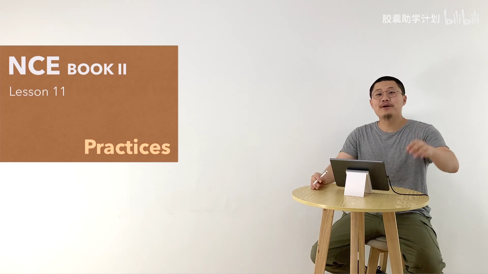

文字识别：Bitl / 胶囊助学计划 / NCE / BOOKII / Lesson 11 / Practices

### 画面 00:00:02

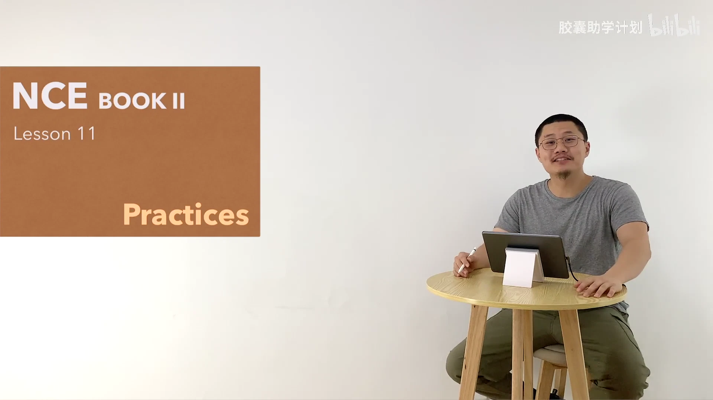

文字识别：b / 胶囊助学计划 / NCE / BOOKII / Lesson 11 / Practices

### 画面 00:00:05

文字识别：biltbi / 胶囊助学计划 / NCE / BOOKII / Lesson 11 / Practices

### 画面 00:00:07

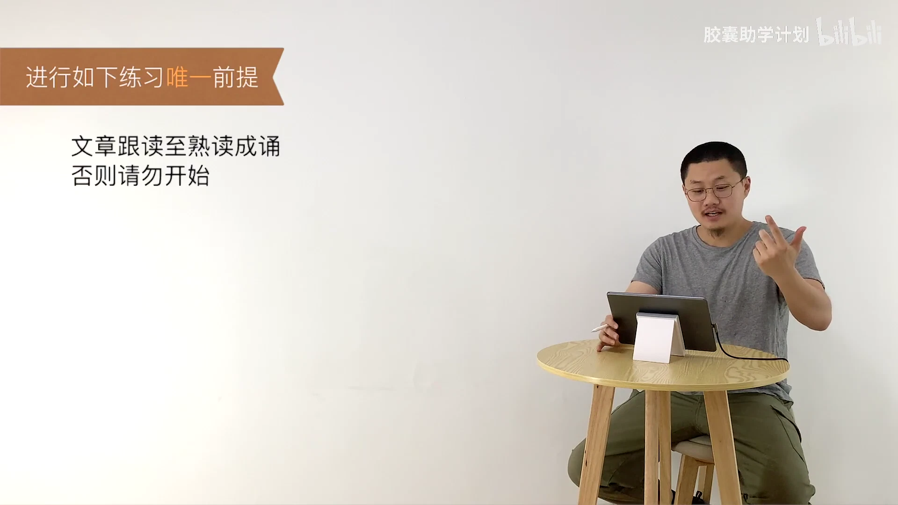

文字识别：胶囊助学计划 / 进行如下练习唯一前提 / 文章跟读至熟读成诵 / 否则请勿开始

### 画面 00:00:09

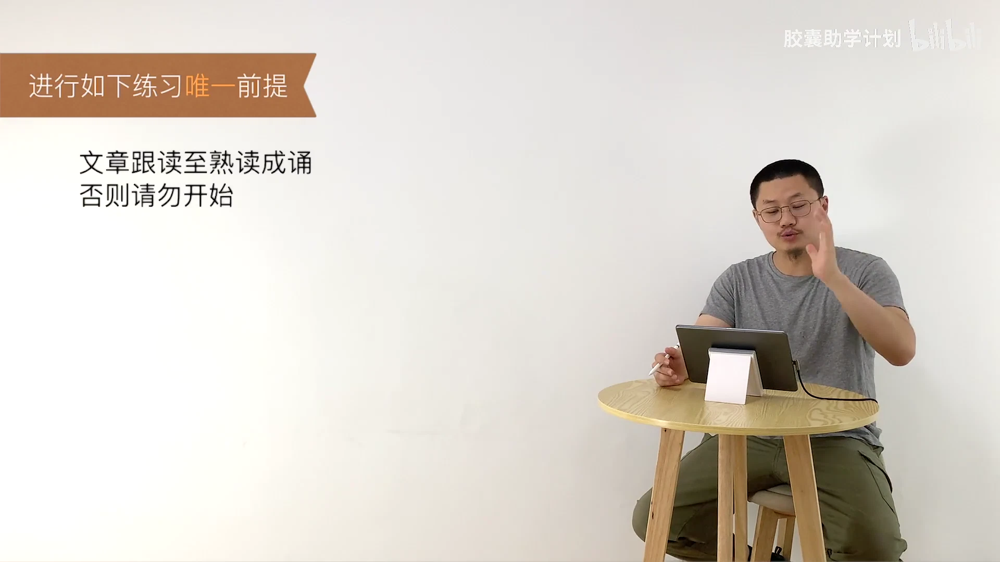

文字识别：胶囊助学计划 / 进行如下练习唯一前提 / 文章跟读至熟读成诵 / 否则请勿开始

### 画面 00:00:12

文字识别：胶囊助学计划 / 进行如下练习唯一前提 / 文章跟读至熟读成诵 / 否则请勿开始

### 画面 00:00:15

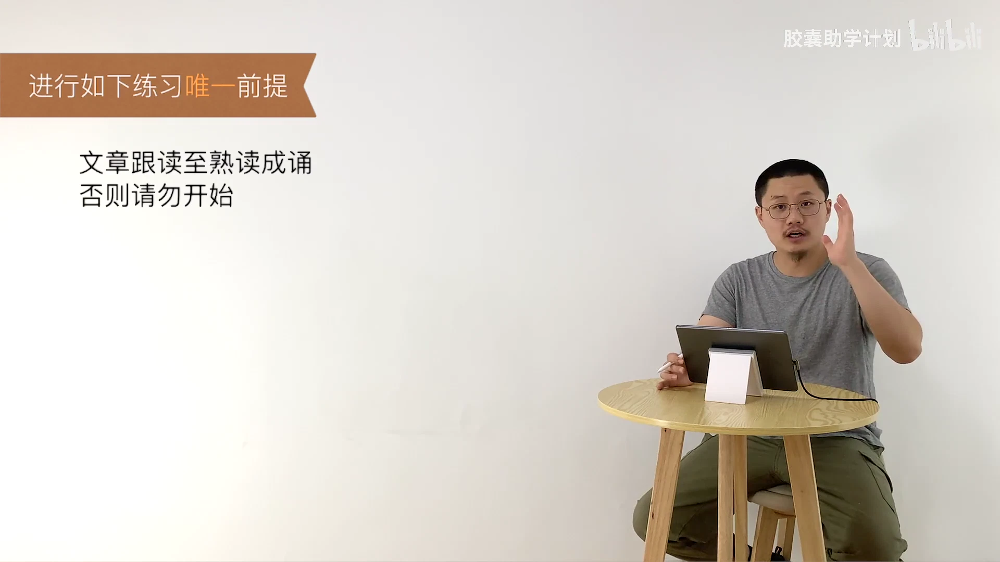

文字识别：胶囊助学计划 / 进行如下练习唯一前提 / 文章跟读至熟读成诵 / 否则请勿开始

### 画面 00:00:18

文字识别：胶囊助学计划i / •

### 画面 00:00:22

文字识别：助学讲划信聯 / 胶囊助学计划

### 画面 00:00:24

文字识别：胶囊助学计划 / Comprehension / 训练目标： / 听懂一般疑问句＆特殊疑问句

### 画面 00:00:28

文字识别：胶囊助学计划 / Comprehension / 训练目标： / 听懂一般疑问句＆特殊疑问句

## 00:00:30–00:01:00

疑问句，尤其是如果您文章读的特别熟了之后，OK来了。那第一题，各位看着文章回答我的问题，做听力口语训练。第一个题，Where were you having dinner? Answer at a restaurant. Next one, Who came in? Tony Steele. Next one, Did he once work in a lawyer's office?

### 画面 00:00:30

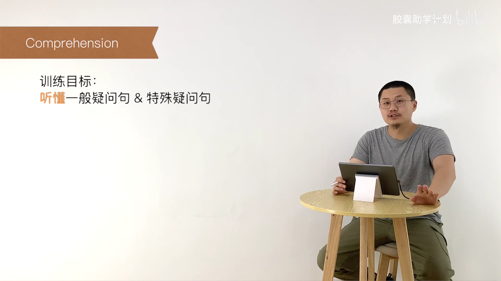

文字识别：胶囊助学计划 / Comprehension / 训练目标： / 听懂一般疑问句＆特殊疑问句

### 画面 00:00:33

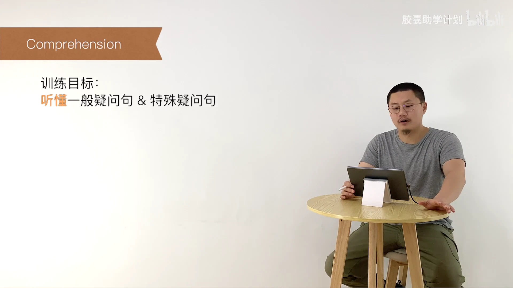

文字识别：胶囊助学计划训 / Comprehension / 训练目标： / 听懂一般疑问句＆特殊疑问句

### 画面 00:00:35

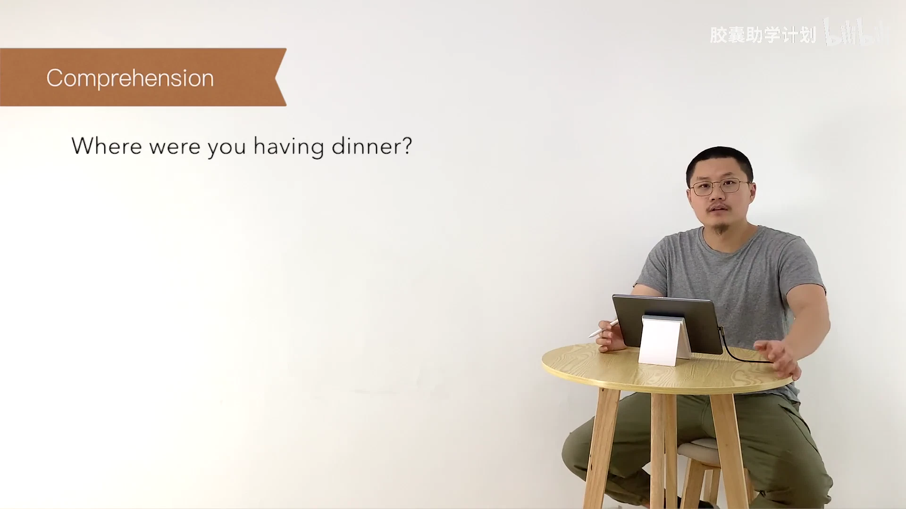

文字识别：胶囊助学计划 / Comprehension / Where were you having dinner?

### 画面 00:00:40

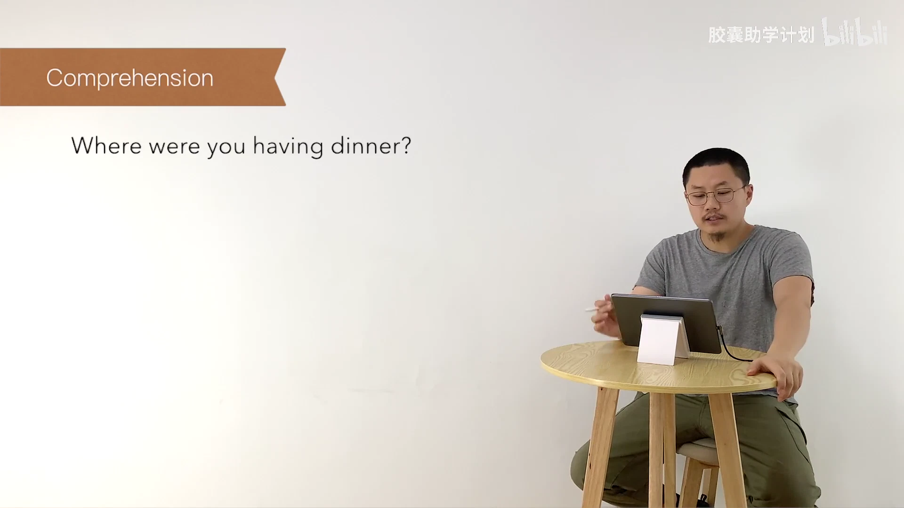

文字识别： bilt Li / 胶囊助学计划 / Comprehension / Where were you having dinner?

### 画面 00:00:53

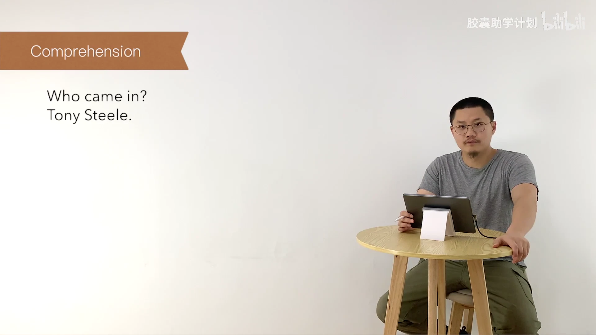

文字识别：胶囊助学计划 / u bitb / Comprehension / Who came in? / Tony Steele.

## 00:01:00–00:01:30

Yes, he did. Next one. How long ago was that? Ah, that指的就是刚才那道题，对吧？ He worked in a lawyer's office. Answer: Years ago. Next one. Where is he working now? At a bank. Next one. Is he paid a good salary? 哎，可以抬头看一下，这个 is 加 paid 其实就是个被动，对吧？他被支付了很好

### 画面 00:01:07

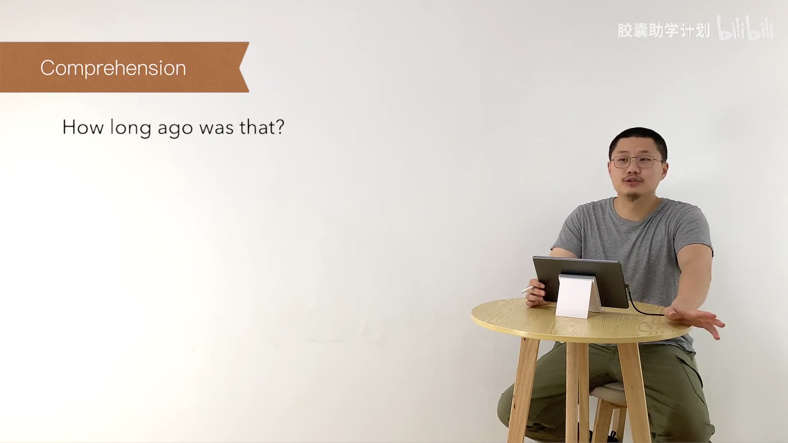

文字识别：胶囊助学计划 / Comprehension / How long ago was that?

### 画面 00:01:11

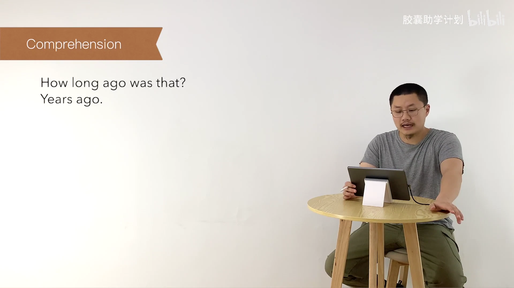

文字识别：胶囊助学计划 / Comprehension / How long ago was that? / Years ago.

### 画面 00:01:24

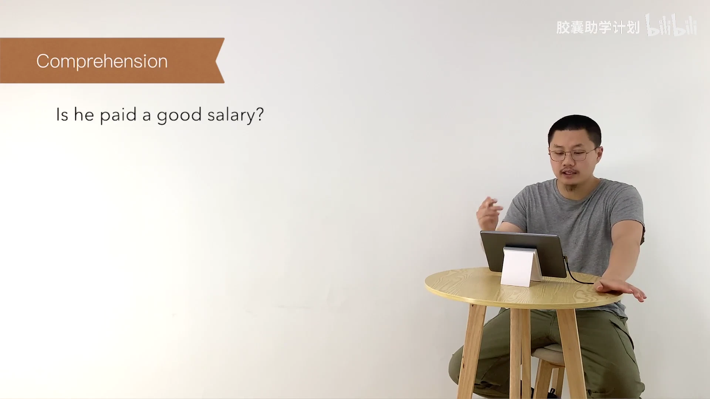

文字识别：u LiLi / 胶囊助学计划 / Comprehension / Is he paid a good salary?

## 00:01:30–00:02:00

的薪水。Yes, he is. Next one. What does he always do? Borrows money from his friends. Next one. Do you think he needs to borrow money? No, I don't. Continue. Does he ever pay it back? No, he doesn't. Continue. What did Tony do when he saw you?

### 画面 00:01:30

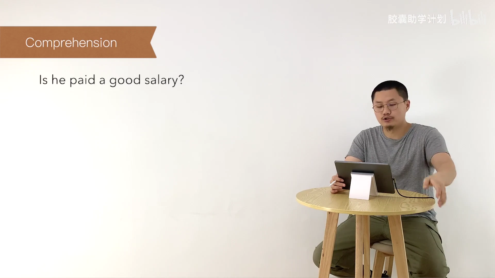

文字识别：胶囊助学计划 / Comprehension / Is he paid a good salary?

### 画面 00:01:37

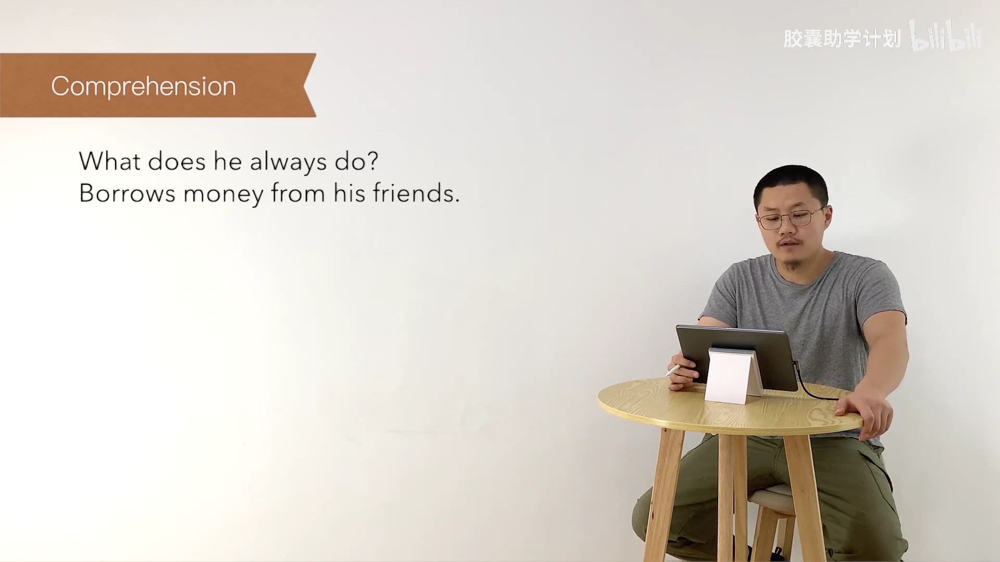

文字识别：胶囊助学计划 / Comprehension / What does he always do? / Borrows money from his friends.

### 画面 00:01:41

文字识别：胶囊助学计划m / Comprehension / Do you think he needs to borrow money?

### 画面 00:01:58

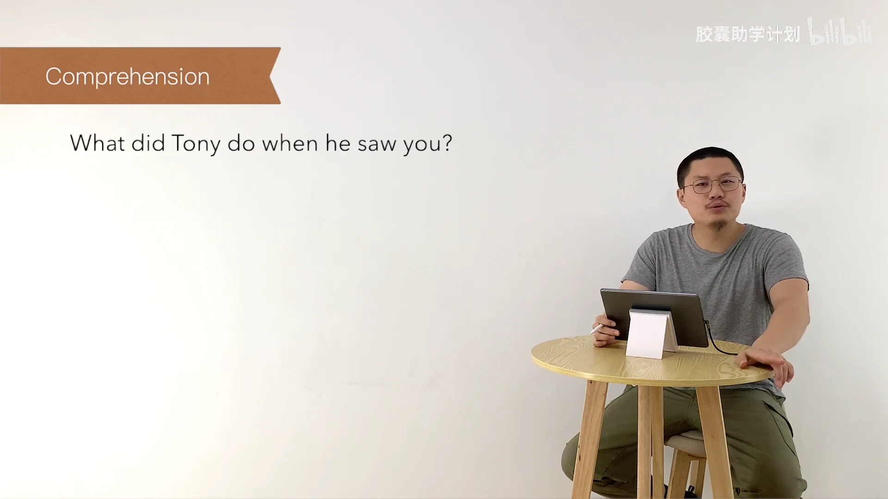

文字识别：胶囊助学计划 / Comprehension / What did Tony do when he saw you?

## 00:02:00–00:02:30

came and sat at the same table, right? Next one, have you ever lent him any money? No, I haven't. Next one, did you have dinner together? Yes, we did. Continue. What did you ask him during dinner? To lend me

### 画面 00:02:06

文字识别：胶囊助学计划 / Comprehension / Have you ever lent him any money?

### 画面 00:02:13

文字识别：Lil / 胶囊助学计划 / Comprehension / Have you ever lent him any money? / No, I haven't.

### 画面 00:02:19

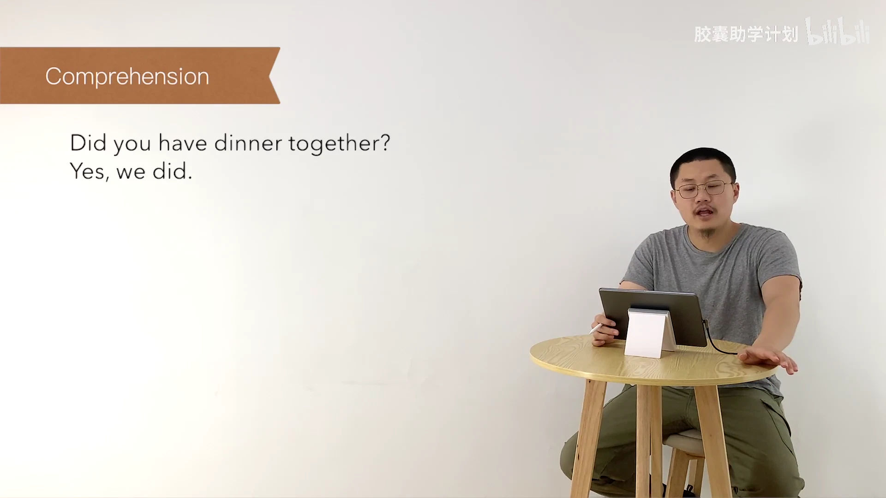

文字识别： biltbil / 胶囊助学计划 / Comprehension / Did you have dinner together? / Yes, we did. / 7

### 画面 00:02:22

文字识别：胶囊助学计划 / Comprehension / What did you ask him during dinner?

### 画面 00:02:25

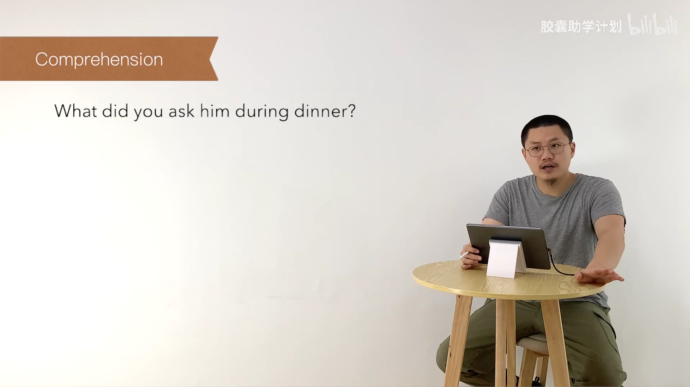

文字识别：bitLii / 胶囊助学计划 / Comprehension / What did you ask him during dinner?

## 00:02:30–00:03:00

twenty pounds. Maria, next one. What did he give you immediately? The money. Next one. Were you surprised? Surprised? Okay, surprised. Yes, I was. Did he pay for the dinner? No, he didn't. Okay,下一道题asking questions.这个是让我们主动去做练习了。我们要自己能

### 画面 00:02:34

文字识别：biibi / 胶囊助学计划 / Comprehension / What did he give you immediately?

### 画面 00:02:37

文字识别：胶囊助学计划 / Comprehension / What did he give you immediately? / The money.

### 画面 00:02:41

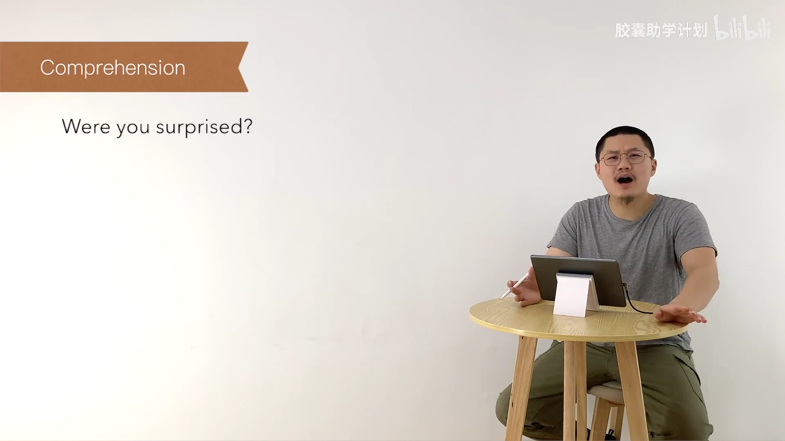

文字识别：胶囊助学计划 / Comprehension / Were you surprised?

### 画面 00:02:43

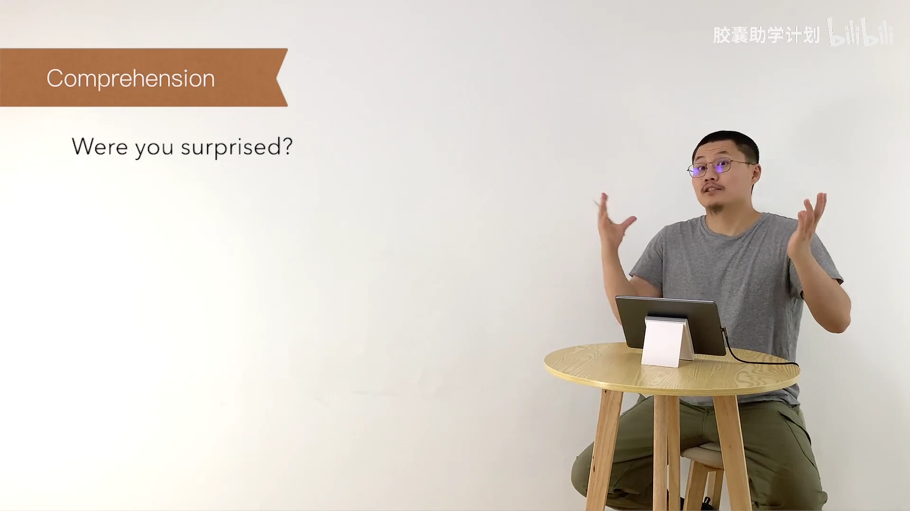

文字识别：胶囊助学计划 / Comprehension / Were you surprised?

### 画面 00:02:45

文字识别：胶囊助学计划 / Comprehension / Were you surprised? / Yes, I was.

### 画面 00:02:49

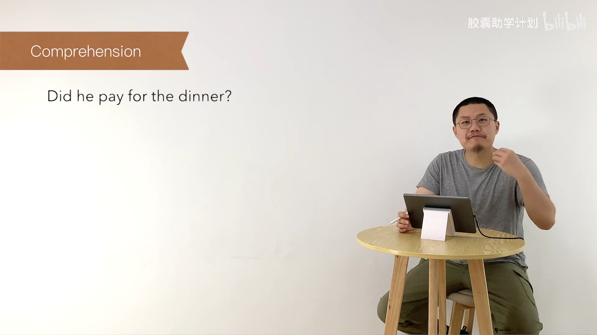

文字识别：胶囊助学计划 / Comprehension / Did he pay for the dinner?

### 画面 00:02:53

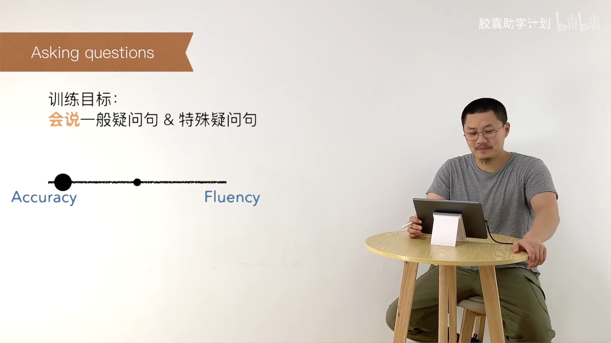

文字识别：胶囊助学计划 / Asking questions / 训练目标： / 会说一般疑问句＆特殊疑问句 / Accuracy / Fluency

### 画面 00:02:56

文字识别：bitBi / 胶囊助学计划 / Asking questions / 训练目标： / 会说一般疑问句＆特殊疑问句 / Accuracy / Fluency

## 00:03:00–00:03:30

说出来。刚才是能听懂，对吧？现在是要求各位能说出来一般疑问句和特殊疑问句，就是能问别人一些问题了。OK，好，那我们看第一个，只是一个例句，叫 ask me if 不重要。I was having dinner at a restaurant，过去进行时，was were 提前，对吧？那就变成了 Were you having dinner at a restaurant？如果我用 where，那肯定是对 at a restaurant 提问，于是答案变成了 Where were you having dinner？你之前在什么地方

### 画面 00:03:03

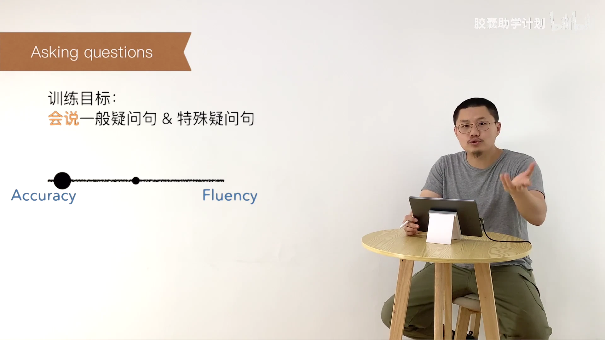

文字识别：胶囊助学计划川 / Asking questions / 训练目标： / 会说一般疑问句＆特殊疑问句 / Accuracy / Fluency

### 画面 00:03:08

文字识别：胶囊助学计划 / Asking questions

### 画面 00:03:11

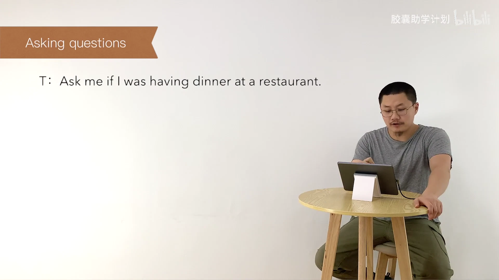

文字识别：胶囊助学计划 / Asking questions / T: Ask me if I was having dinner at a restaurant.

### 画面 00:03:25

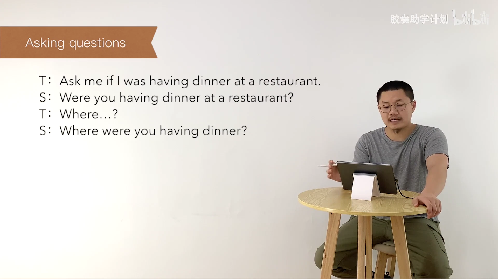

文字识别：u biil / 胶囊助学计划 / Asking questions / T: Ask me if I was having dinner at a restaurant. / S: Were you having dinner at a restaurant? / T: Where...? / S: Where were you having dinner?

### 画面 00:03:28

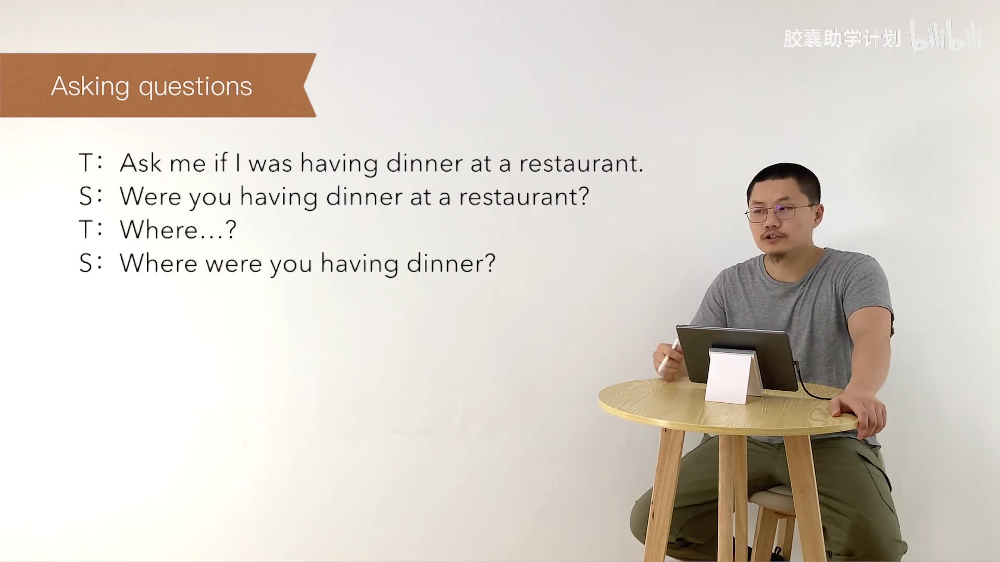

文字识别：胶囊助学计划 / Asking questions / T: Ask me if I was having dinner at a restaurant. / S: Were you having dinner at a restaurant? / T: Where...? / S: Where were you having dinner?

## 00:03:30–00:04:00

### 画面 00:03:31

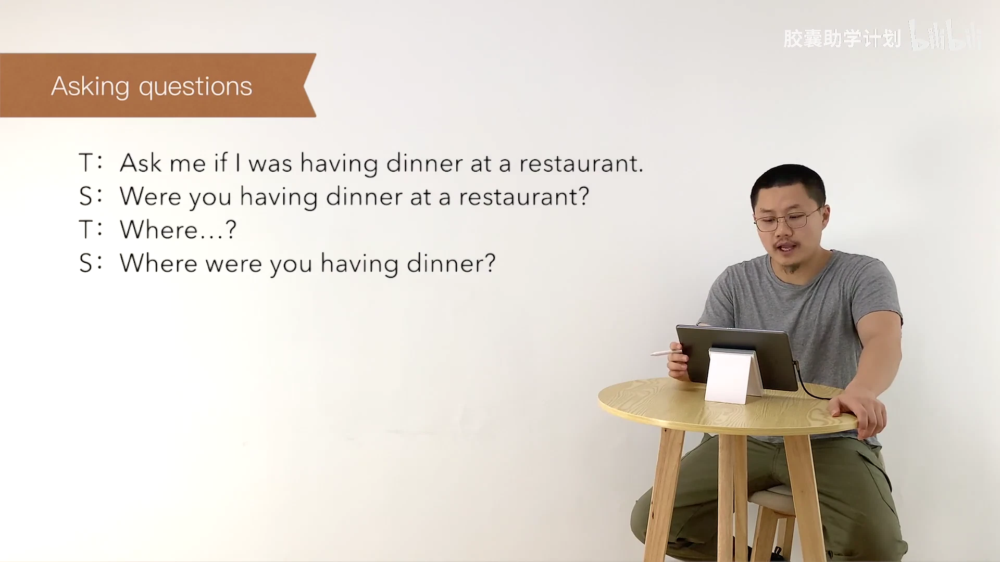

文字识别：胶囊助学计划M / Asking questions / T: Ask me if I was having dinner at a restaurant. / S: Were you having dinner at a restaurant? / T: Where...? / S: Where were you having dinner?

### 画面 00:03:33

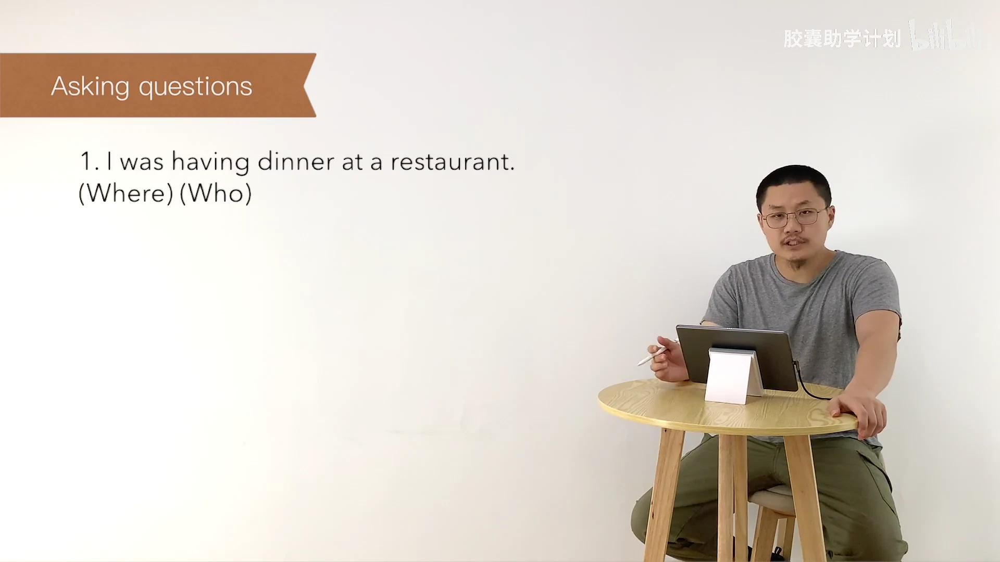

文字识别：胶囊助学计划 / Asking questions / 1.I was having dinner at a restaurant. / (Where)(Who)

### 画面 00:03:37

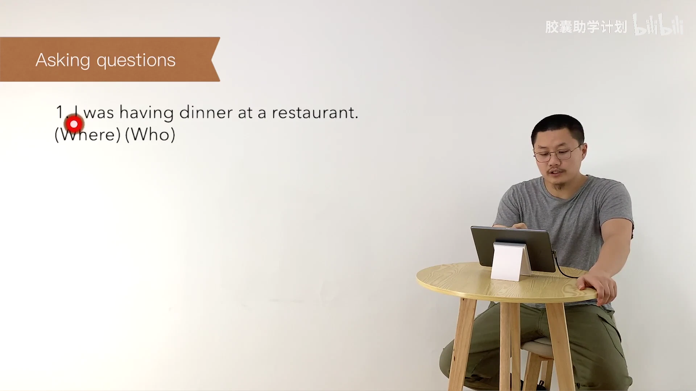

文字识别：bitbi / 胶囊助学计划 / Asking questions / 1 ↓ was having dinner at a restaurant. / (Where)(Who)

### 画面 00:03:48

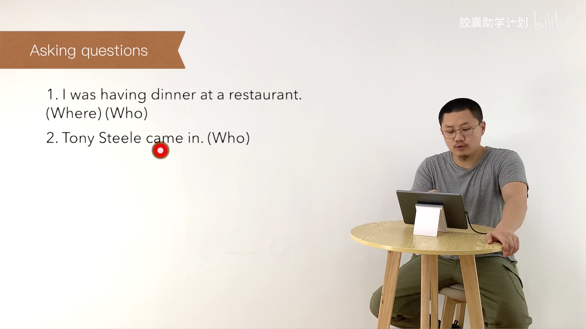

文字识别：胶囊助学计划 / Asking questions / 1.I was having dinner at a restaurant. / (Where)(Who) / 2.Tony Steele came in.(Who)

### 画面 00:03:51

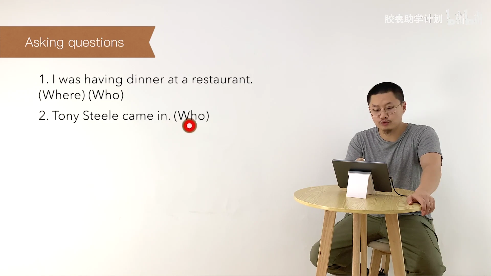

文字识别：胶囊助学计划 / Asking questions / 1.I was having dinner at a restaurant. / (Where)(Who) / 2.Tony Steele came in.(Who)

### 画面 00:03:55

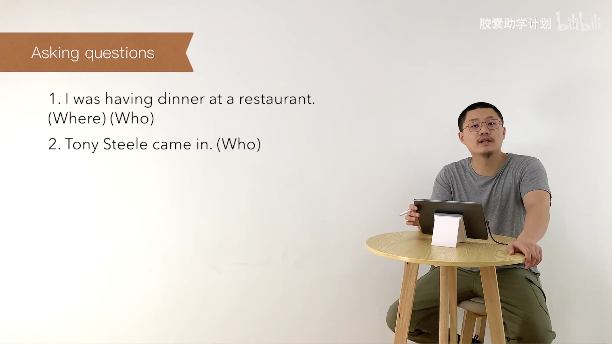

文字识别：胶囊助学计划 / Asking questions / 1.I was having dinner at a restaurant. / (Where)(Who) / 2.Tony Steele came in.(Who)

### 画面 00:03:59

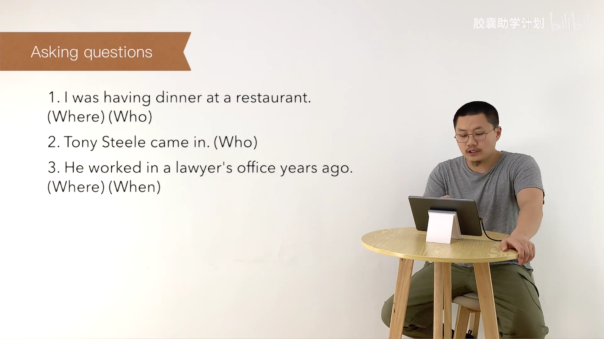

文字识别：胶囊助学计划 / Asking questions / 1.I was having dinner at a restaurant. / (Where)(Who) / 2.Tony Steele came in.(Who) / 3. He worked in a lawyer's office years ago. / (Where)(When)

## 00:04:00–00:04:30

lawyer's office years ago. 不重要，注意这儿很重要。Worked一般过去时，did提前。Where对，in a lawyer's office。When对，years ago。Okay.接下来，He is working at a bank now. 哎，现在进行时，is提前。Where对，at a bank提问。Continue. He gets a good salary. 好，一般现在时，谁提前？Does提前，动词换回原形。What

### 画面 00:04:20

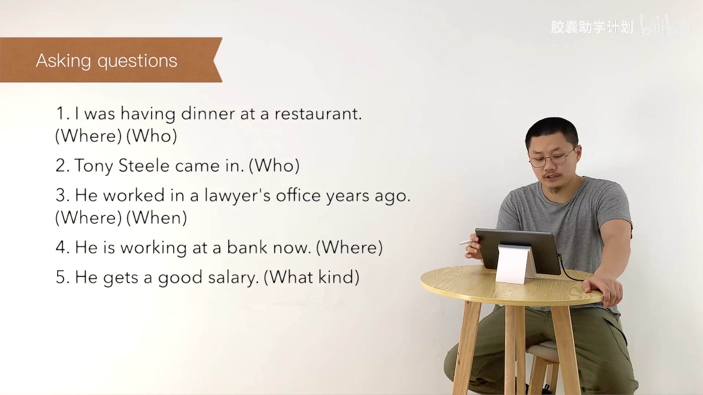

文字识别：胶囊助学计划 / Asking questions / 1.I was having dinner at a restaurant. / (Where)(Who) / 2.Tony Steele came in.(Who) / 3. He worked in a lawyer's office years ago. / (Where)(When) / 4. He is working at a bank now. (Where) / 5. He gets a good salary. (What kind)

## 00:04:30–00:05:00

kind?这地方提一句，我们之前讲过，今天再讲，以后每次见到我都尽可能会多提。叫What kind?你要再加一个单词叫of，它往往是对形容词提问，因为它问的是什么类型嘛，对吧？你喜欢什么样的苹果？你的答案绝对不是苹果，对吧？你的答案是不同方、不同颜色，对吧？不同种类，对吧？它们类似于起到的都是形容词的作用。所以这里只有good是提问啊，是能

### 画面 00:04:33

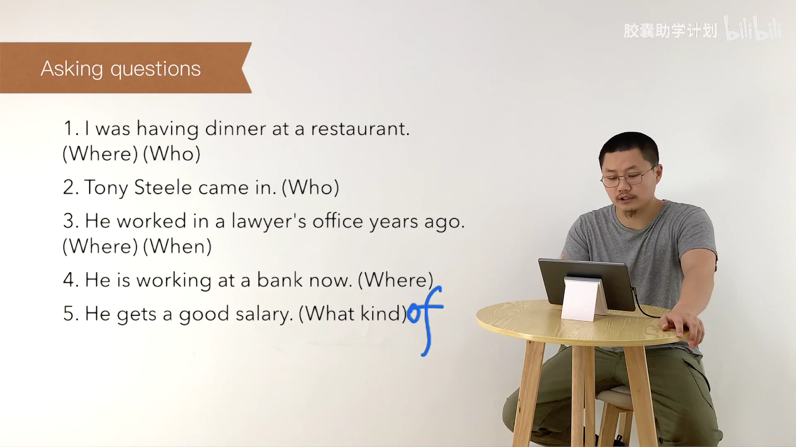

文字识别：胶囊助学计划 / Asking questions / 1.I was having dinner at a restaurant. / (Where)(Who) / 2.Tony Steele came in.(Who) / 3. He worked in a lawyer's office years ago. / (Where) (When) / 4. He is working at a bank now. (Where) / 5. He gets a good salary. (What kind)of

### 画面 00:04:38

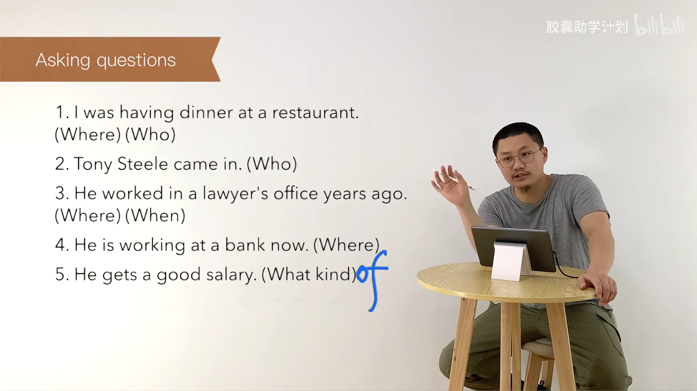

文字识别：胶囊助学计划 / Asking questions / 1.I was having dinner at a restaurant. / (Where)(Who) / 2. Tony Steele came in.(Who) / 3. He worked in a lawyer's office years ago. / (Where) (When) / 4. He is working at a bank now. (Where) / 5. He gets a good salary. (What kind)of

### 画面 00:04:53

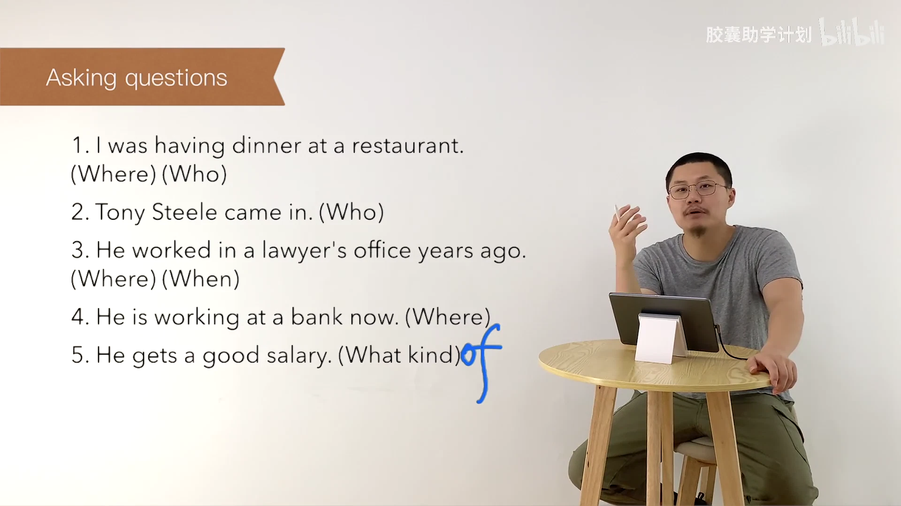

文字识别：胶囊助学计划H / Asking questions / 1.I was having dinner at a restaurant. / (Where)(Who) / 2.Tony Steele came in.(Who) / 3. He worked in a lawyer's office years ago. / (Where) (When) / 4. He is working at a bank now. (Where) / 5. He gets a good salary.(What kind)of

## 00:05:00–00:05:30

被 what kind of 去提问的，或者说能回答 what kind of 的，所以它答案叫做 what kind of salary does he get 啊？他获得了一个什么类型的薪水？OK，他薪水怎么样？Next one, he always borrows money from his friends. 一般现在时还是 does 提前就可以了，borrow 换回原形。Who from？这个地方呢，各位呃，他虽然给的是 who 点点点 from 啊，你其实把它当成 who 就行了。您

### 画面 00:05:06

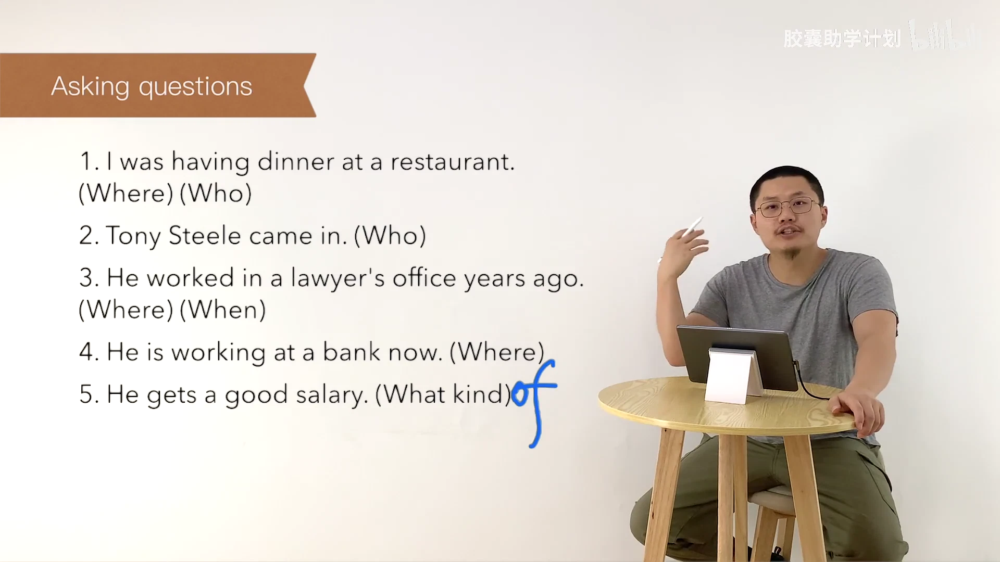

文字识别：胶囊助学计划 / Asking questions / 1.I was having dinner at a restaurant. / (Where)(Who) / 2.Tony Steele came in.(Who) / 3. He worked in a lawyer's office years ago. / (Where) (When) / 4. He is working at a bank now. (Where) / 5. He gets a good salary.(What kind)of

### 画面 00:05:09

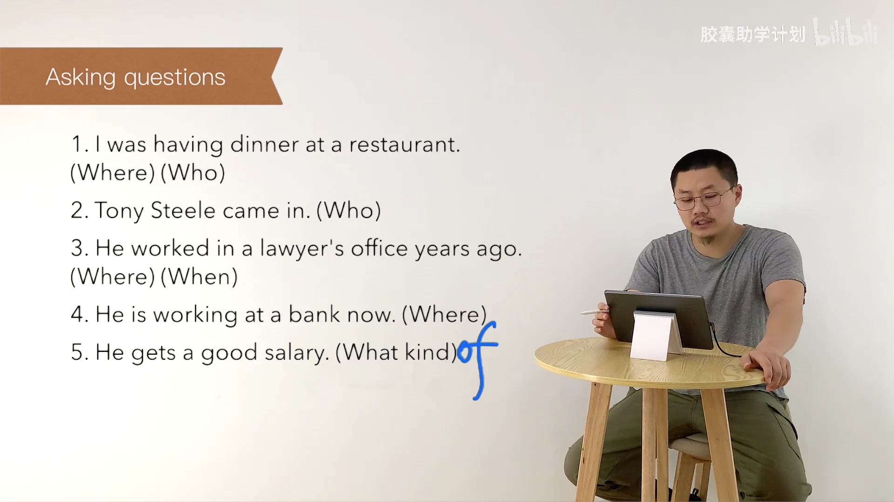

文字识别：胶囊助学计划 / Asking questions / 1.I was having dinner at a restaurant. / (Where)(Who) / 2. Tony Steele came in. (Who) / 3. He worked in a lawyer's office years ago. / (Where) (When) / 4. He is working at a bank now. (Where) / 5. He gets a good salary.(What kind)of

### 画面 00:05:14

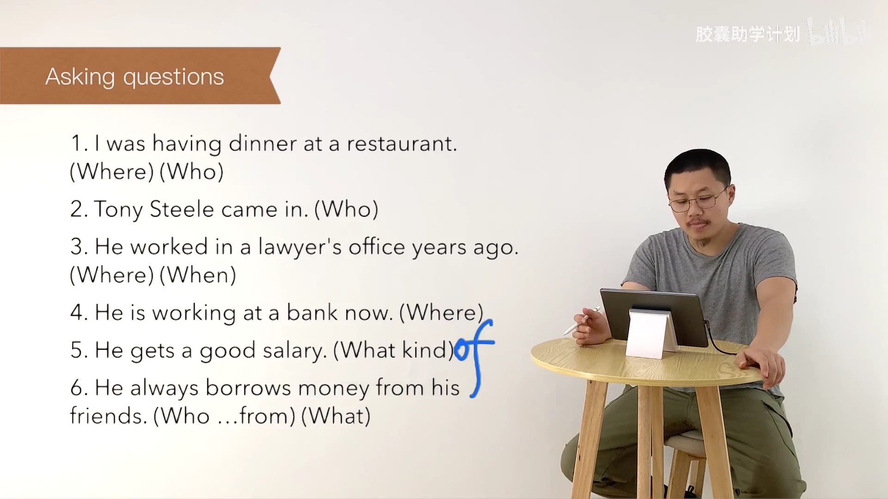

文字识别：胶囊助学计划 / Asking questions / 1.I was having dinner at a restaurant. / (Where)(Who) / 2. Tony Steele came in. (Who) / 3. He worked in a lawyer's office years ago. / (Where) (When) / 4. He is working at a bank now. (Where) / 5. He gets a good salary. (What kind)of / 6. He always borrows money from his / friends. (Who ...from) (What)

### 画面 00:05:17

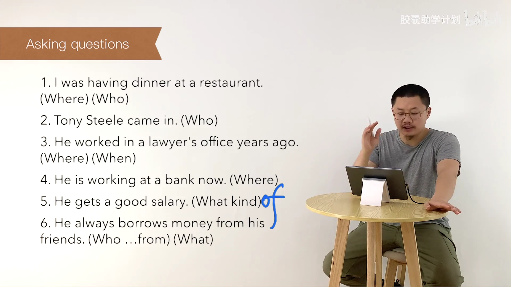

文字识别：胶囊助学计划 / Asking questions / 1.I was having dinner at a restaurant. / (Where)(Who) / 2. Tony Steele came in. (Who) / 3. He worked in a lawyer's office years ago. / (Where)(When) / 4. He is working at a bank now. (Where) / 5. He gets a good salary. (What kind)of / 6. He always borrows money from his / friends. (Who ...from) (What)

### 画面 00:05:25

文字识别：胶囊助学计划 / Asking questions / 1.I was having dinner at a restaurant. / (Where)(Who) / 2. Tony Steele came in. (Who) / 3. He worked in a lawyer's office years ago. / (Where) (When) / 4. He is working at a bank now. (Where) / 5. He gets a good salary. (What kind)of / 6. He always borrows money from his / friends. (Who ...from) (What)

## 00:05:30–00:06:00

对主语提问，主语提问；该对 his friends 提问，对 his friends 提问，两个都可以写一下啊。只是要注意一下，对主语提问的时候，不要变一般疑问句了。OK，那 what 就是 money 提问，对吧？What does he always borrow from his friends？啊，他总是找他的朋友借什么东西？完一个。Next one， Tony saw me. did 提前，动词换原形。Who 对 me 和 Tony 都可以提问，区别依旧是主语的问题。

### 画面 00:05:30

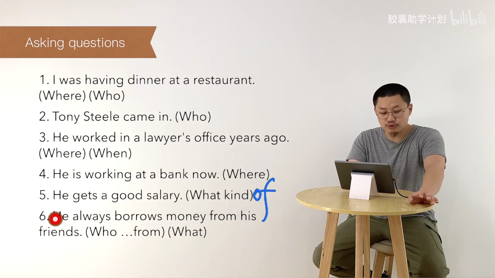

文字识别：胶囊助学计划 / Asking questions / 1.I was having dinner at a restaurant. / (Where)(Who) / 2.Tony Steele came in.(Who) / 3. He worked in a lawyer's office years ago. / (Where) (When) / 4. He is working at a bank now. (Where) / 5. He gets a good salary. (What kind)of / Oe always borrows money from his / friends. (Who ...from) (What)

### 画面 00:05:35

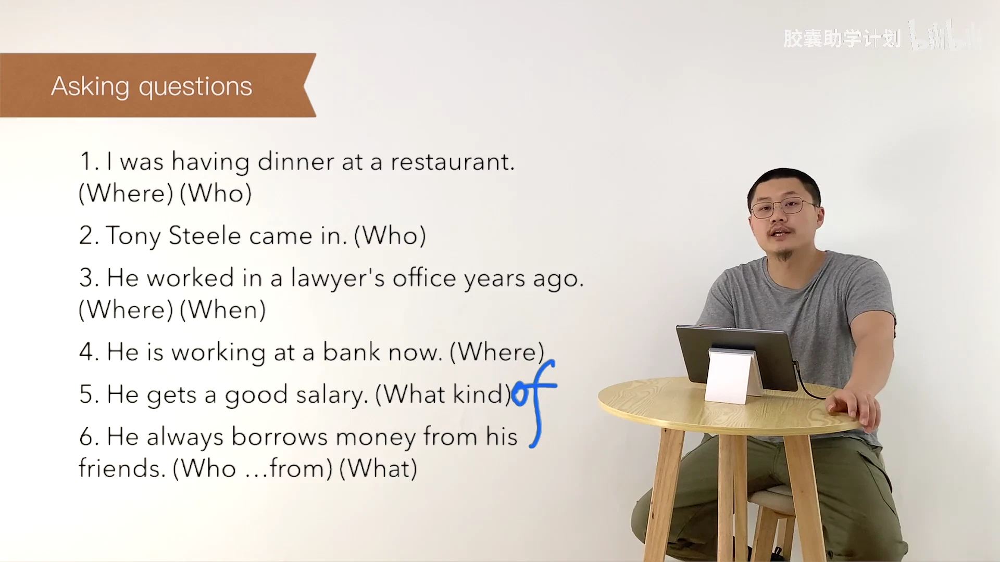

文字识别：胶囊助学计划 / Asking questions / 1.I was having dinner at a restaurant. / (Where)(Who) / 2.Tony Steele came in. (Who) / 3. He worked in a lawyer's office years ago. / (Where) (When) / 4. He is working at a bank now. (Where) / 5. He gets a good salary. (What kind)of / 6. He always borrows money from his / friends. (Who ...from) (What)

### 画面 00:05:44

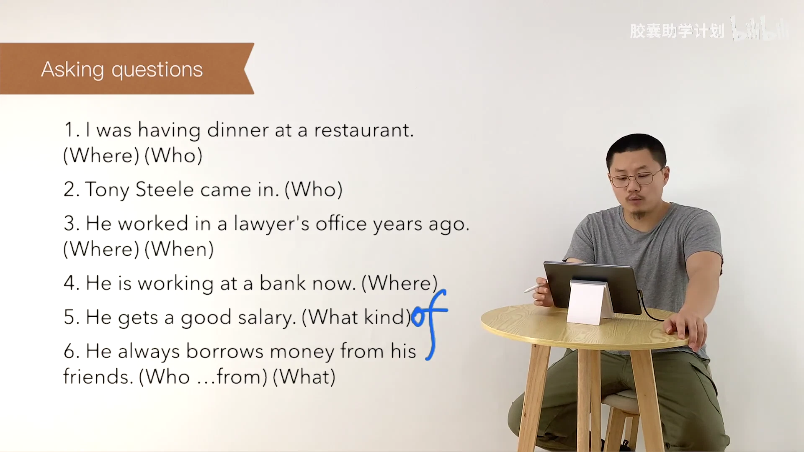

文字识别：胶囊助学计划 / Asking questions / 1.I was having dinner at a restaurant. / (Where)(Who) / 2.Tony Steele came in.(Who) / 3. He worked in a lawyer's office years ago. / (Where) (When) / 4. He is working at a bank now. (Where) / 5. He gets a good salary.(What kind)of / 6. He always borrows money from his / friends. (Who ...from) (What)

### 画面 00:05:48

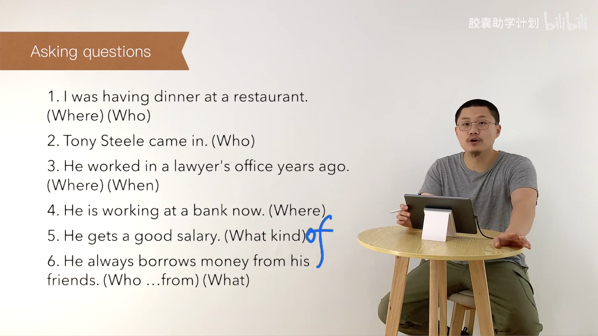

文字识别：胶囊助学计划H / Asking questions / 1.I was having dinner at a restaurant. / (Where)(Who) / 2.Tony Steele came in.(Who) / 3. He worked in a lawyer's office years ago. / (Where) (When) / 4. He is working at a bank now. (Where) / 5. He gets a good salary. (What kind)of / 6. He always borrows money from his / friends. (Who ...from) (What) / 2

### 画面 00:05:50

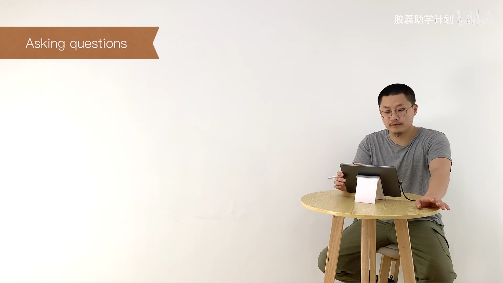

文字识别：胶囊助学计划i / Asking questions

### 画面 00:05:53

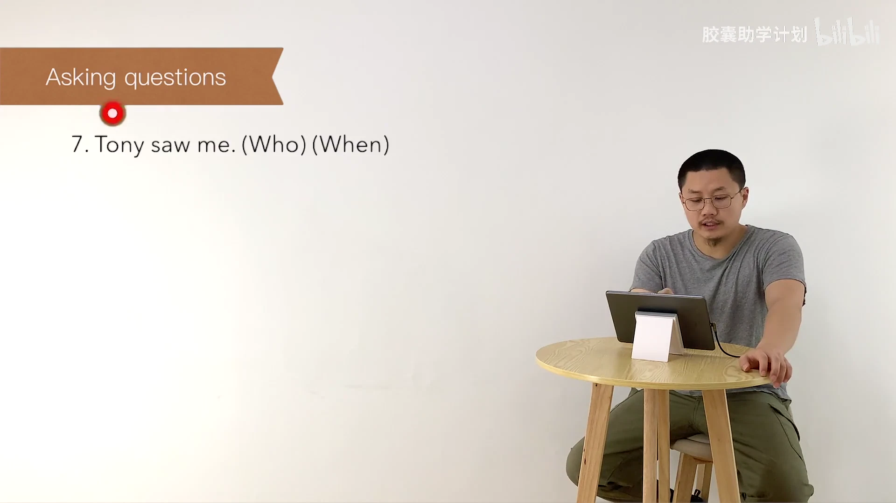

文字识别：Lilb / 胶囊助学计划 / Asking questions / 7.Tony saw me. (Who)(When)

### 画面 00:05:57

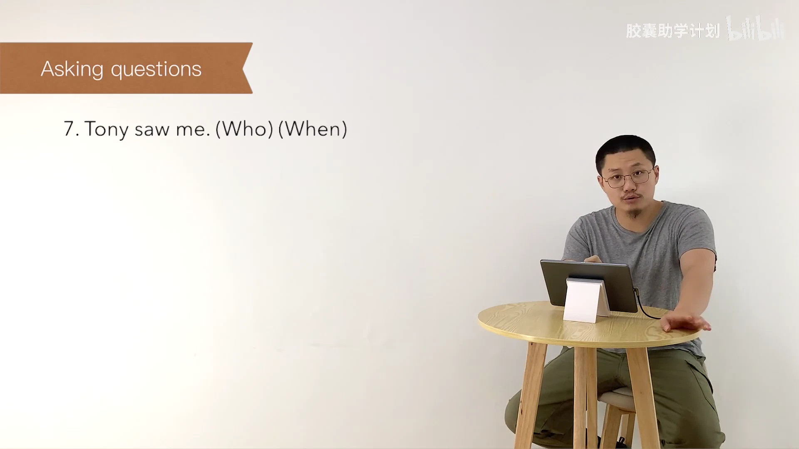

文字识别：b / 胶囊助学计划 / Asking questions / 7.Tony saw me. (Who)(When)

## 00:06:00–00:06:30

When整句提问。He sat at my table. Did提前。Where对at my table提问。Where did he sit？他坐在什么地方？I asked him to lend me twenty pounds. Did提前。How much？那直接对twenty pounds提问就行了。钱对吧？Okay. He gave me the money immediately. Did提前对吧？When那直接对immediately提问。或者您直接可以对整句提问。When did he give you the money immediately？

### 画面 00:06:01

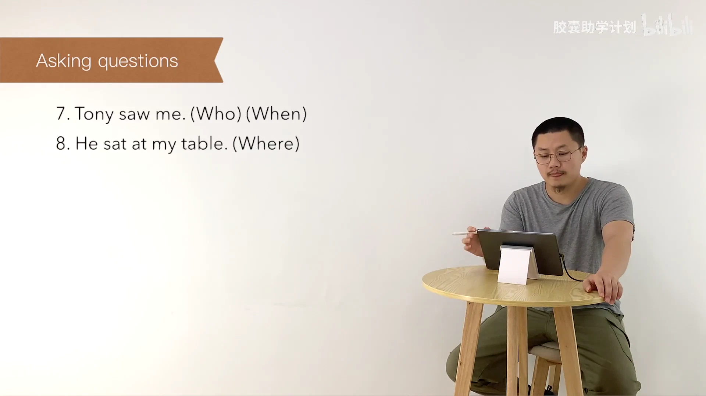

文字识别：胶囊助学计划 / Asking questions / 7.Tony saw me. (Who)(When) / 8. He sat at my table. (Where)

### 画面 00:06:16

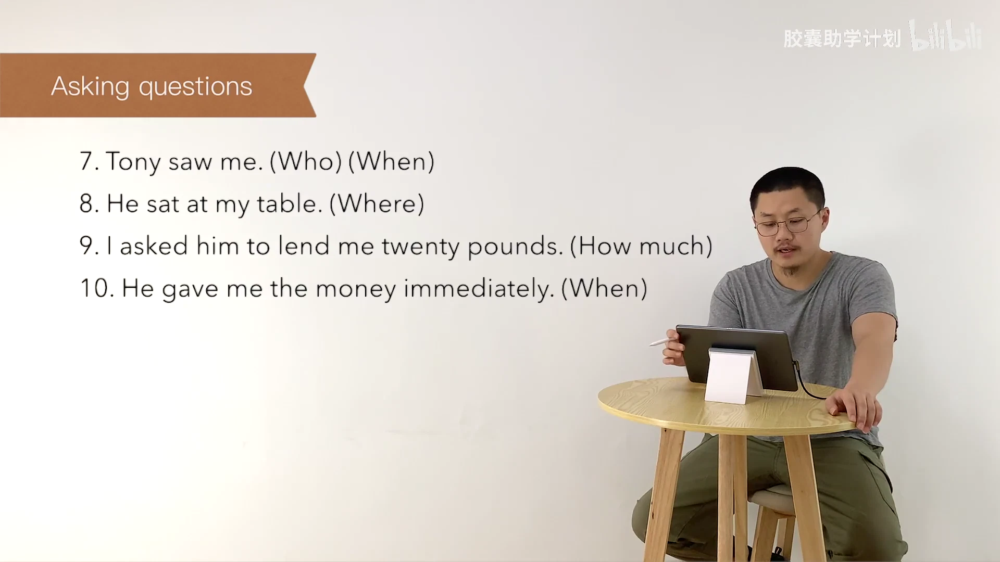

文字识别：胶囊助学计划l / Asking questions / 7.Tony saw me. (Who)(When) / 8. He sat at my table. (Where) / 9.I asked him to lend me twenty pounds. (How much) / 10. He gave me the money immediately. (When)

### 画面 00:06:24

文字识别：胶囊助学计划m / Asking questions / 7.Tony saw me. (Who)(When) / 8. He sat at my table. (Where) / 9.I asked him to lend me twenty pounds. (How much) / 10. He gave me the money immediately. (When)

### 画面 00:06:26

文字识别：胶囊助学计划 / Asking questions / 7.Tony saw me. (Who)(When) / 8. He sat at my table. (Where) / 9.I asked him to lend me twenty pounds. (How much) / 10. He gave me the money immediately. (When)

## 00:06:30–00:07:00

那你的回答可以是 last night, 对吧？没有问题啊。就是他不是说嘛, having dinner, OK? 接下来, I must pay for this dinner. Must往前一提就行了。这新一六十三课就讲过。Why? 整句话，整个一般疑问句提问啊。Why must I pay for the dinner? 啊，我为什么必须要给你支付这个晚餐呢？Cause I've just lent you twenty pounds. 啊，我刚借了你二十磅，是吧？One good turn deserves another. 啊，礼尚往来嘛。OK.

### 画面 00:06:31

文字识别：胶囊助学计划 / Asking questions / 7.Tony saw me. (Who)(When) / 8. He sat at my table. (Where) / 9.I asked him to lend me twenty pounds. (How much) / 10. He gave me the money immediately. (When)

### 画面 00:06:34

文字识别：胶囊助学计划 / Asking questions / 7.Tony saw me. (Who)(When) / 8. He sat at my table. (Where) / 9.I asked him to lend me twenty pounds. (How much) / 10. He gave me the money immediately. (When)

### 画面 00:06:37

文字识别：胶囊助学计划 / Asking questions / 7.Tony saw me. (Who) (When) / 8. He sat at my table. (Where) / 9.I asked him to lend me twenty pounds. (How much) / 10. He gave me the money immediately. (When) / 11.I must pay for his dinner. (Why)

### 画面 00:06:40

文字识别：胶囊助学计划H / Asking questions / 7.Tony saw me. (Who) (When) / 8. He sat at my table. (Where) / 9.I asked him to lend me twenty pounds. (How much) / 10. He gave me the money immediately. (When) / 11.I must pay for his dinner. (Why) / 7

### 画面 00:06:44

文字识别：胶囊助学计划H / Asking questions / 7.Tony saw me. (Who)(When) / 8. He sat at my table. (Where) / 9.I asked him to lend me twenty pounds. (How much) / 10. He gave me the money immediately. (When) / 11.I must pay for his dinner. (Why)

### 画面 00:06:52

文字识别：胶囊助学计划H / Asking questions / 7.Tony saw me. (Who)(When) / 8. He sat at my table. (Where) / 9.I asked him to lend me twenty pounds. (How much) / 10. He gave me the money immediately. (When) / 11.I must pay for his dinner. (Why)

### 画面 00:06:55

文字识别：胶囊助学计划 / Asking questions / 7.Tony saw me. (Who) (When) / 8. He sat at my table. (Where) / 9.I asked him to lend me twenty pounds. (How much) / 10. He gave me the money immediately. (When) / 11.I must pay for his dinner. (Why) / 2

### 画面 00:06:59

文字识别：胶囊助学计划。H / Tell the story / 训练目标： / 口语复述能力 / Accuracy / Fluency

## 00:07:00–00:07:30

接下来 tell the story，复数口语复数练习练的是 fluency 流利性，不练 accuracy。啊，当然你不能完全错了，是吧？还是要有一点点准确性的，但可以错一点点。一定要流利。我上课只做展示，各位课下一定要自己去练，慢慢口语就会越来越好了。OK，那来了，看这些关键词啊。I was having dinner at a restaurant when Tony

### 画面 00:07:02

文字识别：Bib / 胶囊助学计划 / Tell the story / 训练目标： / 口语复述能力 / Accuracy / Fluency

### 画面 00:07:05

文字识别：胶囊助学计划 / Tell the story / 训练目标： / 口语复述能力 / Accuracy / Fluency

### 画面 00:07:09

文字识别：胶囊助学计划 / Tell the story / 训练目标： / 口语复述能力 / Accuracy / Fluency

### 画面 00:07:11

文字识别：胶囊助学计划 / Tell the story / 训练目标： / 口语复述能力 / Accuracy / Fluency

### 画面 00:07:13

文字识别：胶囊助学计划 / Tell the story / dinner -restaurant -Tony Steele / 1 / worked -lawyer's office-now -bank / good salary -always borrows -his friends / -never -back / saw me -came -sat -table / never borrowed -me / While -eating -asked -lend me twenty / pounds / surprise -gave me -immediately / 'I -never-money-you,'Tony-,' so now-pay- / dinner'

### 画面 00:07:15

文字识别：胶囊助学计划 / Tell the story / dinner -restaurant -Tony Steele / 1 / worked -lawyer's office-now -bank / good salary -always borrows -his friends / -never -back / saw me -came -sat -table / never borrowed -me / While -eating -asked -lend me twenty / pounds / surprise -gave me -immediately / 'I -never-money-you,'Tony-,' so now-pay- / dinner'

### 画面 00:07:18

文字识别：胶囊助学计划 / Tell the story / dinner -restaurant -Tony Steele / 1 / worked -lawyer's office-now -bank / good salary -always borrows -his friends / -never -back / saw me -came -sat -table / never borrowed -me / While -eating -asked -lend me twenty / pounds / surprise -gave me -immediately / 'I -never-money-you'Tony-,' so now-pay- / dinner'

### 画面 00:07:21

文字识别：胶囊助学计划l / Tell the story / dinner -restaurant -Tony Steele / worked -lawyer's office-now -bank / good salary -always borrows -his friends / -never -back / saw me -came -sat -table / never borrowed -me / While -eating -asked -lend me twenty / pounds / surprise -gave me -immediately / 'I -never-money-you'Tony-,' so now-pay- / dinner'

### 画面 00:07:24

文字识别：胶囊助学计划 / Tell the story / dinner -restaurant -Tony Steele / 1 / worked -lawyer's office-now -bank / good salary -always borrows -his friends / -never -back / saw me -came -sat -table / never borrowed -me / While -eating -asked -lend me twenty / pounds / surprise -gave me -immediately / 'I -never-money-you'Tony-,' so now-pay- / dinner'

## 00:07:30–00:08:00

still came in. He worked at in a lawyer's office years ago and now he's working at a bank. He gets a good salary and he always borrows money from his friends, but he never pays it back. Tony saw me and came and sat at the same table. He has never borrowed any money from me. While he was eating, I asked him to lend me twenty pounds. To my surprise, he gave me the money immediately.

### 画面 00:07:47

文字识别：胶囊助学计划 / Tell the story / dinner -restaurant -Tony Steele / 1 / worked -lawyer's office-now -bank / good salary -always borrows -his friends / -never -back / saw me -came -sat -table / never borrowed -me / While -eating -asked -lend me twenty / pounds / surprise -gave me -immediately / 'I -never-money-you'Tony-,' so now-pay- / dinner'

## 00:08:00–00:08:30

I have never borrowed any money from you, Tony said. So now you can pay for my dinner. Okay, very good. Summer writing, journal写作，我们在这儿只提供答案，各位课下要自己去写。这个对于我们将来能自己写出邮件帮助是非常大的。Okay,啊，当然对考试也有很大的帮助了。Continue,完全自由的对话，我们目前也许还做不了，但我们先熟悉一下这个话题，并且

### 画面 00:08:02

文字识别：胶囊助学计划 / Tell the story / dinner -restaurant -Tony Steele / worked -lawyer's office-now -bank / good salary -always borrows -his friends / -never -back / saw me -came -sat -table / never borrowed -me / While -eating -asked -lend me twenty / pounds / surprise -gave me -immediately / 'I -never-money-you'Tony-,' so now-pay- / dinner'

### 画面 00:08:07

文字识别：胶囊助学计划 / Summary writing: Key / 训练目标： / 写作复述能力

### 画面 00:08:09

文字识别：BitBil / 胶囊助学计划 / Summary writing: Key / 训练目标： / 写作复述能力

### 画面 00:08:11

文字识别：胶囊助学计划bl业 / Summary writing: Key / I was having dinner at a restaurant. I saw / Tony Steele after a while. He always borrows / money from his friends. Tony sat at my table. / I asked him to lend me twenty pounds. He / gave me the money at once. He wanted me / to pay for his dinner.

### 画面 00:08:15

文字识别：胶囊助学计划bML / Summary writing: Key / I was having dinner at a restaurant. I saw / Tony Steele after a while. He always borrows / money from his friends. Tony sat at my table. / I asked him to lend me twenty pounds. He / gave me the money at once. He wanted me / to pay for his dinner.

### 画面 00:08:18

文字识别：胶囊助学计划l / Summary writing: Key / I was having dinner at a restaurant. I saw / Tony Steele after a while. He always borrows / money from his friends. Tony sat at my table. / I asked him to lend me twenty pounds. He / gave me the money at once. He wanted me / to pay for his dinner.

### 画面 00:08:22

文字识别：bilt il / 胶囊助学计划 / Topics for discussion / 训练目标： / 完全自由的对话 / Accuracy / Fluency

### 画面 00:08:27

文字识别：胶囊助学计划 / Topics for discussion / Do you think it's a good idea to lend / money to your friends? Why/Why not? / Would you lend money to a stranger? / Why/Why not? / In what ways can we help other people?

### 画面 00:08:29

文字识别：胶囊助学计划 / Topics for discussion / Do you think it's a good idea to lend / money to your friends? Why/Why not? / Would you lend money to a stranger? / Why/Why not? / In what ways can we help other people? / 2

## 00:08:30–00:09:00

知道这是我们最终学习的目的。第一题说，Do you think it's a good idea to lend money to your friends? Why or why not? 你觉得给你朋友借钱是好吗？好还是不好？Would you lend money to a stranger? Why or why not? 你愿意把钱借给一个陌生人吗？注意啊，愿意还是不愿意，这个实际上 yes or no 就可以回答了。关键要回答 why 啊 why not? Okay, continue. In what ways can we

### 画面 00:08:32

文字识别：bilt bilt / 胶囊助学计划 / Topics for discussion / Do you think it's a good idea to lend / money to your friends? Why/Why not? / Would you lend money to a stranger? / Why/Why not? / In what ways can we help other people?

### 画面 00:08:39

文字识别：胶囊助学计划 / Topics for discussion / Do you think it's a good idea to lend / money to your friends? Why/Why not? / Would you lend money to a stranger? / Why/Why not? / In what ways can we help other people?

### 画面 00:08:42

文字识别：胶囊助学计划 / Topics for discussion / Do you think it's a good idea to lend / money to your friends? Why/Why not? / Would you lend money to a stranger? / Why/Why not? / In what ways can we help other people?

### 画面 00:08:48

文字识别：胶囊助学计划 / Topics for discussion / Do you think it's a good idea to lend / money to your friends? Why/Why not? / Would you lend money to a stranger? / Why/Why not? / In what ways can we help other people?

### 画面 00:08:58

文字识别：胶囊助学计划 / Topics for discussion / Do you think it's a good idea to lend / money to your friends? Why/Why not? / Would you lend money to a stranger? / Why/Why not? / In what ways can we help other people? / 3

## 00:09:00–00:09:30

help other people? So,用什么样的方式，我们还能用什么样的方式去帮助别人？当然，除了他肯定这个意思指的是除了直接给别人钱以外。OK，好，那我们看一下本课将作业。第一，ask me if各位写下来，然后把您写的答案保证是对的，然后大声朗读出来。摘要写作老习惯，写完了之后去对一下答案啊。Tell the story.如果各位文章读的很熟了，那你应该是可以

### 画面 00:09:11

文字识别：胶囊助学计划 u

### 画面 00:09:13

文字识别：胶囊助学计划。 / 1.Ask me if写&朗读

### 画面 00:09:15

文字识别：胶囊助学计划 / 1.Ask me if写&朗读

### 画面 00:09:18

文字识别：胶囊助学计划b / 1.Ask me if写&朗读 / 摘要写作写&答案 / 2

### 画面 00:09:20

文字识别：胶囊助学计划出 / 1.Ask me if写&朗读 / 2. / 摘要写作写&答案

### 画面 00:09:24

文字识别：胶囊助学计划 / 1.Ask me if写&朗读 / 摘要写作写&答案 / 3.Tell the story 口语复述

### 画面 00:09:26

文字识别：胶囊助学计划 / 1.Ask me if写&朗读 / 摘要写作写&答案 / 3.Tell the story 口语复述

### 画面 00:09:29

文字识别：胶囊助学计划 / 1.Ask me if写&朗读 / 摘要写作写&答案 / 3.Tell the story 口语复述

## 00:09:30–00:09:53

把它尝试复述下来了。最后呢，各位可以在专栏当中找到这些练习。OK，那以上就是本期视频的全部内容了。See you next time.

### 画面 00:09:31

文字识别：胶囊助学计划 / 1.Ask me if写&朗读 / 摘要写作写&答案 / 3.Tell the story 口语复述

### 画面 00:09:33

文字识别：胶囊助学计划 / 1.Ask me if写&朗读 / 摘要写作写&答案 / 3.Tell the story 口语复述 / 专栏

### 画面 00:09:35

文字识别：胶囊助学计划 / 1.Ask me if写&朗读 / 摘要写作写&答案 / 3.Tell the story 口语复述 / 专栏 / 4.

### 画面 00:09:37

文字识别：胶囊助学计划i

### 画面 00:09:39

文字识别：胶囊助学计划i / 不

### 画面 00:09:41

文字识别：CAPSULEACADEMY / 胶囊助学计划 / 小红书 / Lecturer / OE / 0

### 画面 00:09:43

文字识别：CAPSULEACADEMY / 胶囊助学计划 / 小红书 / Photoa. / OE

### 画面 00:09:46

文字识别：CAPSULEACADEMY / 胶囊助学计划 / 小红书 / Editor / Berlin

### 画面 00:09:49

文字识别：CAPSULEACADEMY / 胶囊助学计划 / 小红书 / □ / 口 / Leo &Berlin

### 画面 00:09:51

文字识别：bilibili / 胶囊助学计划

### 画面 00:09:52

文字识别：bilibili / 胶囊助学计划

