# L012 单词

快速机器解析：语音为单模型转写，未进行独立交叉校对或人工复核；画面每秒采样并按变化选帧，短时文字和标记可能遗漏。截图时间约有 1 秒误差。图片有损压缩；遇到疑点请按时间查看 Google Drive 原视频。

## 00:00:00–00:00:30

Hello everyone, welcome to Capsule Academy. This is Leo. Today we're going to learn New Concept English Book Two, Lesson Twelve, Words. That old habit. Before entering the formal class, we will first look at a few questions. First, how to express a lucky person. Second, how to express feeling proud of you. Feeling proud of you. That with these two questions, hope you can enjoy. Good. Then we will first look at the first small word. We will look at the phonetic. Please read with me. It is

### 画面 00:00:00

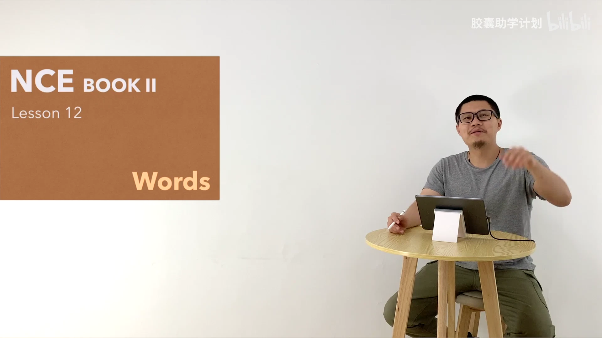

文字识别：胶囊助学计划 / NCE / BOOKII / Lesson 12 / Words

### 画面 00:00:02

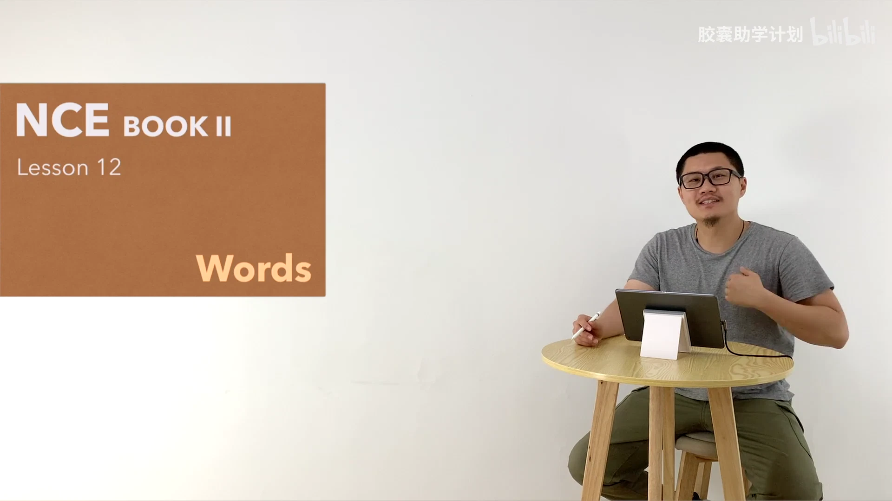

文字识别：胶囊助学计划 / NCE / BOOKII / Lesson 12 / Words

### 画面 00:00:05

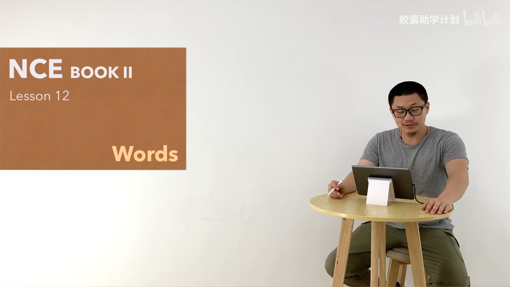

文字识别：胶囊助学计划 / NCE / BOOKⅡI / Lesson 12 / Words

### 画面 00:00:07

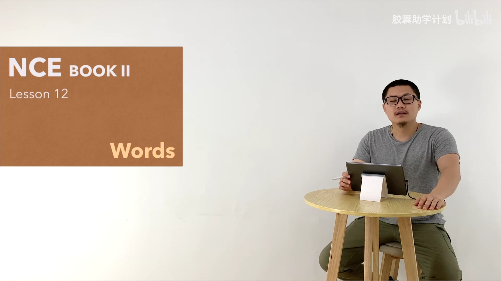

文字识别：胶囊助学计划 / NCE / BOOK I"I / Lesson 12 / Words

### 画面 00:00:09

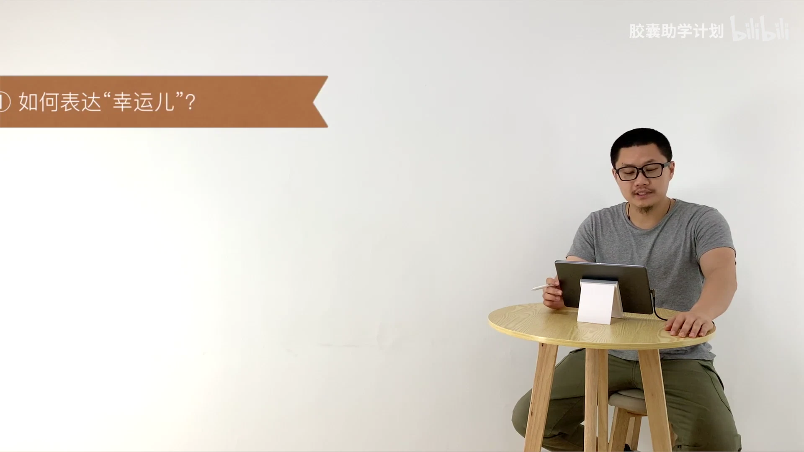

文字识别：胶囊助学计划 / 如何表达“幸运儿”？

### 画面 00:00:11

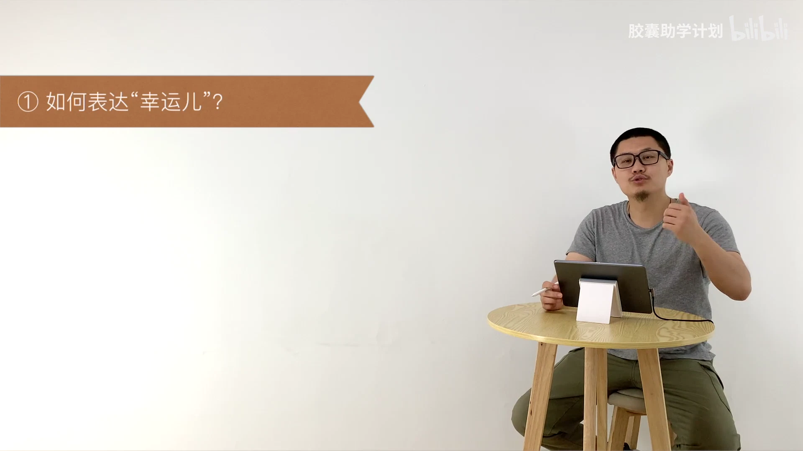

文字识别：胶囊助学计划 / ①如何表达“幸运儿”?

### 画面 00:00:13

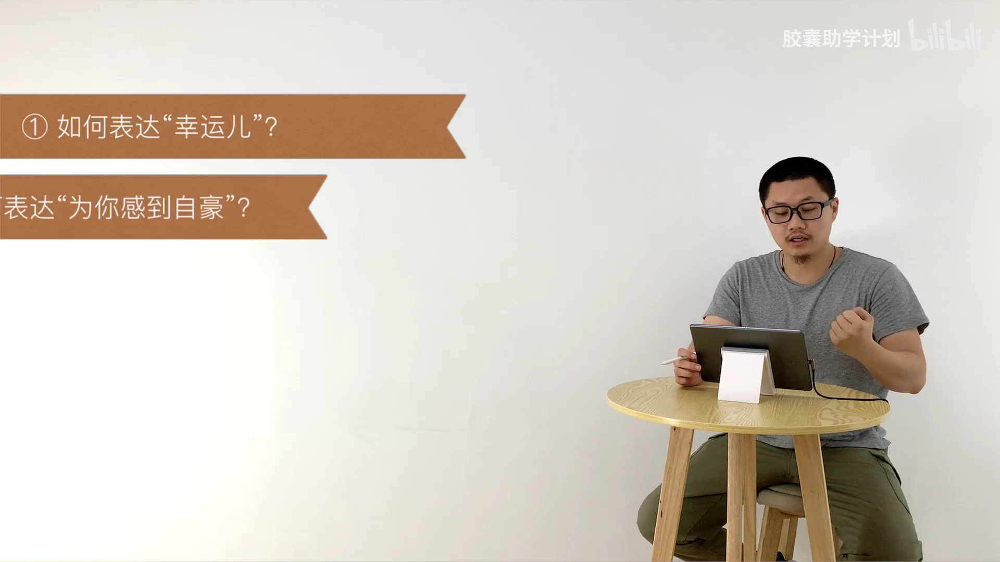

文字识别：胶囊助学计划 / ①如何表达“幸运儿”? / 表达“为你感到自豪”?

### 画面 00:00:15

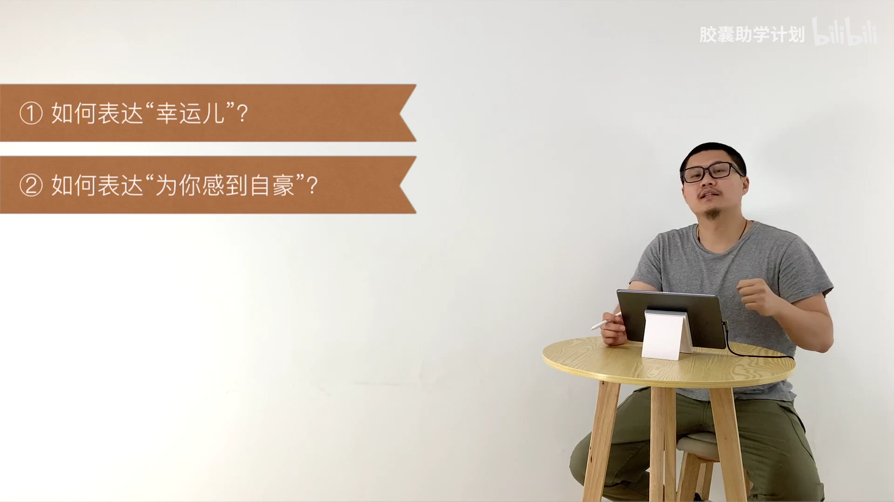

文字识别：胶囊助学计划 / ①如何表达“幸运儿”? / 如何表达“为你感到自豪”?

### 画面 00:00:20

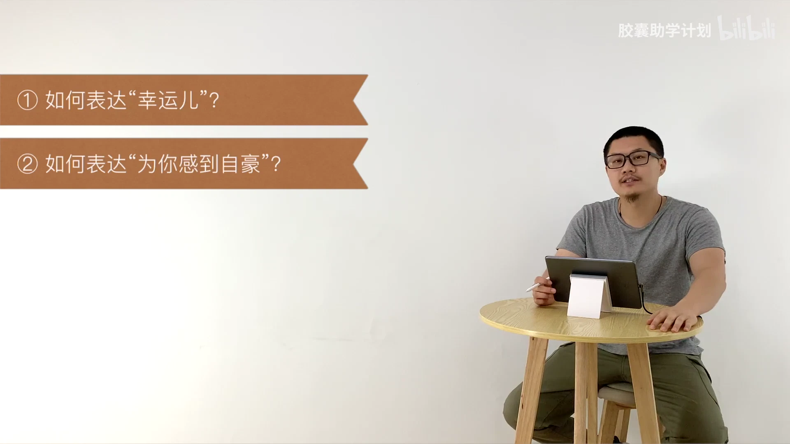

文字识别：胶囊助学计划 / ①如何表达“幸运儿”？ / 如何表达“为你感到自豪”?

### 画面 00:00:22

文字识别：胶囊助学计划b出l

### 画面 00:00:24

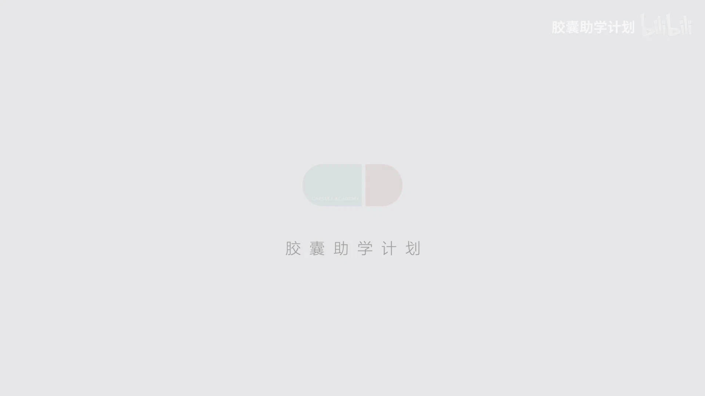

文字识别：胶囊助学计划 / 胶囊助学计划

### 画面 00:00:26

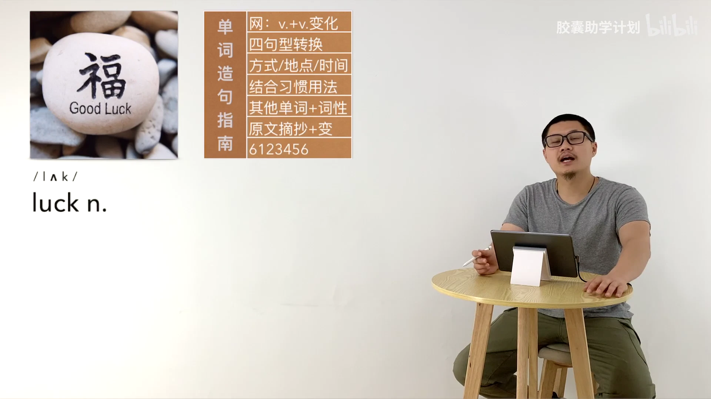

文字识别：单词造句指南 / 网：v.+v.变化 / 胶囊助学计划 / 四句型转换 / 福 / 方式/地点/时间 / 结合习惯用法 / Good Luck / 其他单词+词性 / 原文摘抄+变 / 6123456 / / |Λk/ / luck n.

### 画面 00:00:28

文字识别：单词造句指南 / 网：v.+v.变化 / 胶囊助学计划 / 四句型转换 / 福 / 方式/地点/时间 / 结合习惯用法 / Good Luck / 其他单词+词性 / 原文摘抄+变 / 6123456 / /|Λk/ / luck n.

## 00:00:30–00:01:00

叫做 luck luck，就是好运气啊，好运气。最简单，我们去祝福别人啊，祝你好运，就是 good luck 这样的一个小的短语。那 luck 这个单词，其实我们可以把它做几个小的扩充，比如说我们现在看到 good luck 的这个 luck，它是一个名词，它最常见的另一个 lucky，对吧？OK，啊，就表示的是形容词，幸运的。OK，那你注意 unlucky，U

### 画面 00:00:30

文字识别：单词造句指南 / 网：v.+v.变化 / 胶囊助学计划 / 四句型转换 / 福 / 方式/地点/时间 / 结合习惯用法 / Good Luck / 其他单词+词性 / 原文摘抄+变 / 6123456 / /|Λk/ / luck n.

### 画面 00:00:32

文字识别：单词造句指南 / 网：v.+v.变化 / 胶囊助学计划 / 四句型转换 / 福 / 方式/地点/时间 / 结合习惯用法 / Good Luck / 其他单词+词性 / 原文摘抄+变 / 6123456 / /|Λk/ / luck n.

### 画面 00:00:35

文字识别：单词造句指南 / 网：v.+v.变化 / 胶囊助学计划 / 四句型转换 / 福 / 方式/地点/时间 / 结合习惯用法 / Good Luck / 其他单词+词性 / 原文摘抄+变 / 6123456 / /|Λk/ / luck n. / 1 / good luck

### 画面 00:00:40

文字识别：单词造句指南 / 网：v.+v.变化 / 胶囊助学计划 / 四句型转换 / 福 / 方式/地点/时间 / 结合习惯用法 / Good Luck / 其他单词+词性 / 原文摘抄+变 / 6123456 / /|Λk/ / luck n. / good luck

### 画面 00:00:43

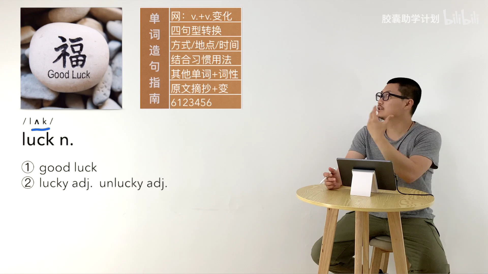

文字识别：单词造句指南 / 网：v.+v.变化 / 胶囊助学计划 / 四句型转换 / 福 / 方式/地点/时间 / 结合习惯用法 / Good Luck / 其他单词+词性 / 原文摘抄+变 / 6123456 / /|Λk/ / luck n. / good luck / lucky adj. unlucky adj.

### 画面 00:00:45

文字识别：单词造句指南 / 网：v.+v.变化 / 胶囊助学计划 / 四句型转换 / 福 / 方式/地点/时间 / 结合习惯用法 / Good Luck / 其他单词+词性 / 原文摘抄+变 / 6123456 / /|Λk/ / luck n. / 1 / good luck / lucky adj. unlucky adj.

### 画面 00:00:47

文字识别：单词造句指南 / 网：v.+v.变化 / 胶囊助学计划 / 四句型转换 / 福 / 方式/地点/时间 / 结合习惯用法 / Good Luck / 其他单词+词性 / 原文摘抄+变 / 6123456 / /|Λk/ / luck n. / good luck / lucky adj. unlucky adj.

### 画面 00:00:50

文字识别：单词造句指南 / 网：v.+v.变化 / 胶囊助学计划 / 四句型转换 / 福 / 方式/地点/时间 / 结合习惯用法 / Good Luck / 其他单词+词性 / 原文摘抄+变 / 6123456 / / |Λk/ / luck n. / 1 / good luck / lucky adj. unlucky adj.

### 画面 00:00:53

文字识别：单词造句指南 / 网：v.+v.变化 / 胶囊助学计划 / 四句型转换 / 福 / 方式/地点/时间 / 结合习惯用法 / Good Luck / 其他单词+词性 / 原文摘抄+变 / 6123456 / /|Λk/ / luck n. / 1 / good luck / lucky adj. unlucky adj.

### 画面 00:00:55

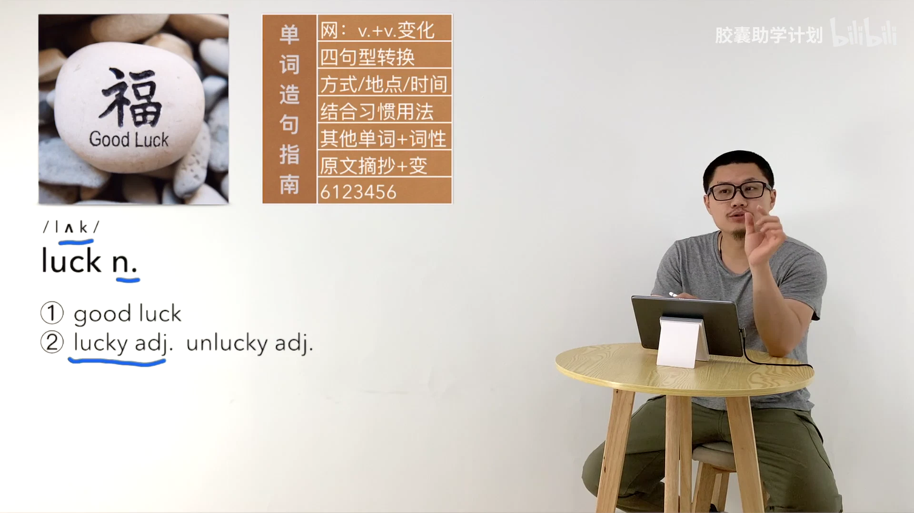

文字识别：单词造句指南 / 网：v.+v.变化 / 胶囊助学计划 / 四句型转换 / 福 / 方式/地点/时间 / 结合习惯用法 / Good Luck / 其他单词+词性 / 原文摘抄+变 / 6123456 / /|Λk/ / luck n. / good luck / 7 / lucky adj. unlucky adj.

### 画面 00:00:59

文字识别：单词造句指南 / 网：v.+v.变化 / 胶囊助学计划 / 四句型转换 / 福 / 方式/地点/时间 / 结合习惯用法 / Good Luck / 其他单词+词性 / 原文摘抄+变 / 6123456 / / |Λk/ / luck n. / good luck / 7 / unucky adj. / lucky adj.

## 00:01:00–00:01:30

N这个早在新概念一册untidy是吧？早在二十九课我们就讲过，U N表示一个否定。比如说tidy表示的是干净整洁的，那untidy就是不干净不整洁的。Lucky指的是幸运的，那unlucky就是不幸运的。我们不妨把这三个单词其实放到一起去背，对于大家来说反而可能记得更容易一些。OK，好，接下来呢，那我们说如何表示一个幸运

### 画面 00:01:01

文字识别：单词造句指南 / 网：v.+v.变化 / 胶囊助学计划 / 四句型转换 / 福 / 方式/地点/时间 / 结合习惯用法 / Good Luck / 其他单词+词性 / 原文摘抄+变 / 6123456 / /|Ak/ / luck n. / 1 / good luck / unucky adj. / lucky adj.

### 画面 00:01:06

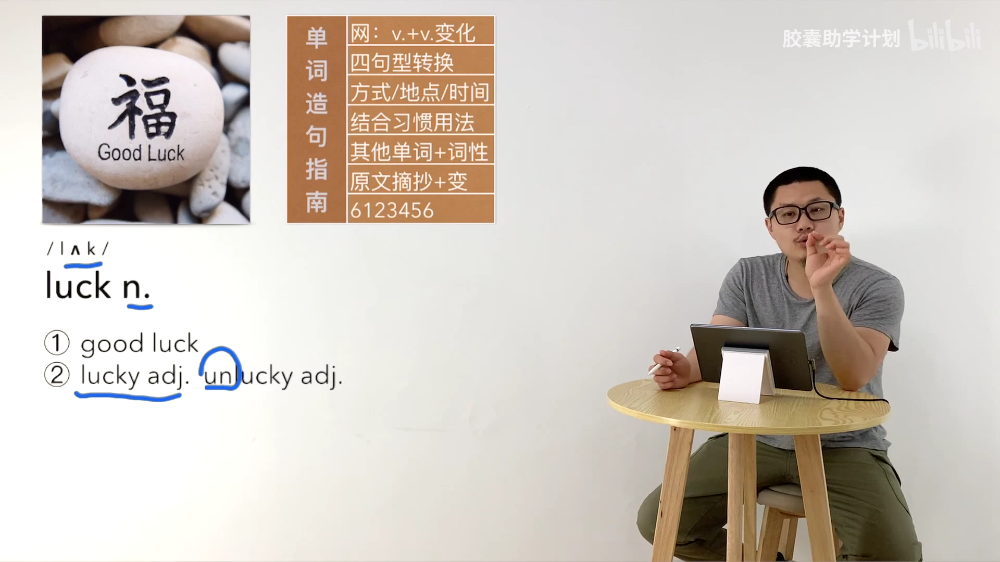

文字识别：单词造句指南 / 网：v.+v.变化 / 胶囊助学计划 / 四句型转换 / 福 / 方式/地点/时间 / 结合习惯用法 / Good Luck / 其他单词+词性 / 原文摘抄+变 / 6123456 / /|Λk/ / luck n. / good luck / 7 / unucky adj. / lucky adj.

### 画面 00:01:08

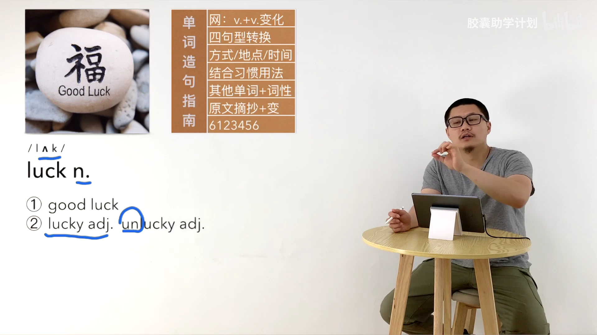

文字识别：单词造句指南 / 网：v.+v.变化 / 胶囊助学计划 / 四句型转换 / 福 / 方式/地点/时间 / 结合习惯用法 / Good Luck / 其他单词+词性 / 原文摘抄+变 / 6123456 / /|Λk/ / luck n. / 1 / good luck / Unucky adj. / lucky adj.

### 画面 00:01:10

文字识别：单词造句指南 / 网：v.+v.变化 / 胶囊助学计划 / 四句型转换 / 福 / 方式/地点/时间 / 结合习惯用法 / Good Luck / 其他单词+词性 / 原文摘抄+变 / 6123456 / /|Λk/ / luck n. / good luck / 7 / unucky adj. / lucky adj.

### 画面 00:01:15

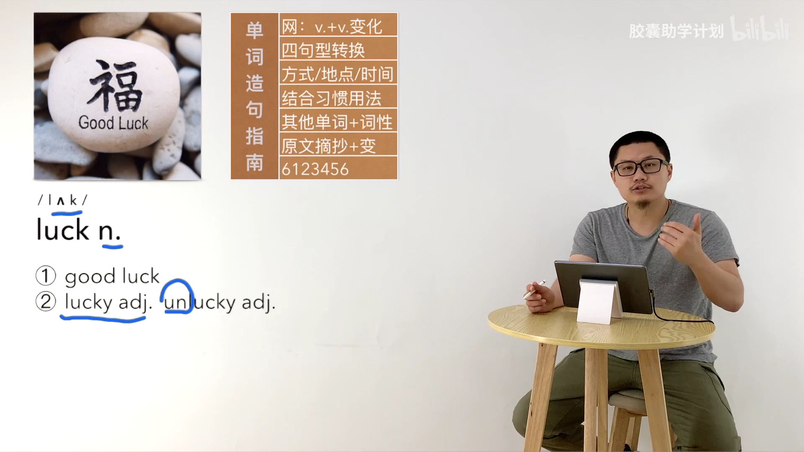

文字识别：单词造句指南 / 网：v.+v.变化 / 胶囊助学计划 / 四句型转换 / 福 / 方式/地点/时间 / 结合习惯用法 / Good Luck / 其他单词+词性 / 原文摘抄+变 / 6123456 / /|Λk/ / luck n. / 1 / good luck / unucky adj. / lucky adj.

### 画面 00:01:17

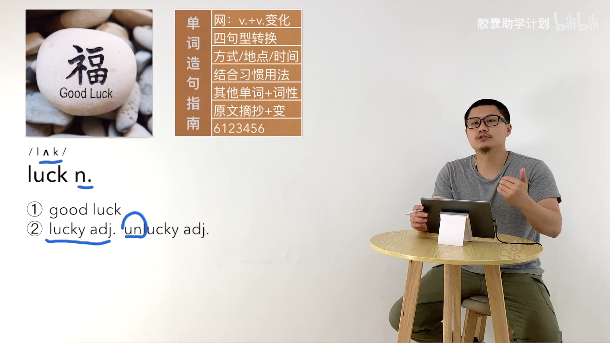

文字识别：单词造句指南 / 网：v.+v.变化 / 胶囊助学计划 / 四句型转换 / 福 / 方式/地点/时间 / 结合习惯用法 / Good Luck / 其他单词+词性 / 原文摘抄+变 / 6123456 / /|Λk/ / luck n. / 1 / good luck / unucky adj. / lucky adj.

### 画面 00:01:19

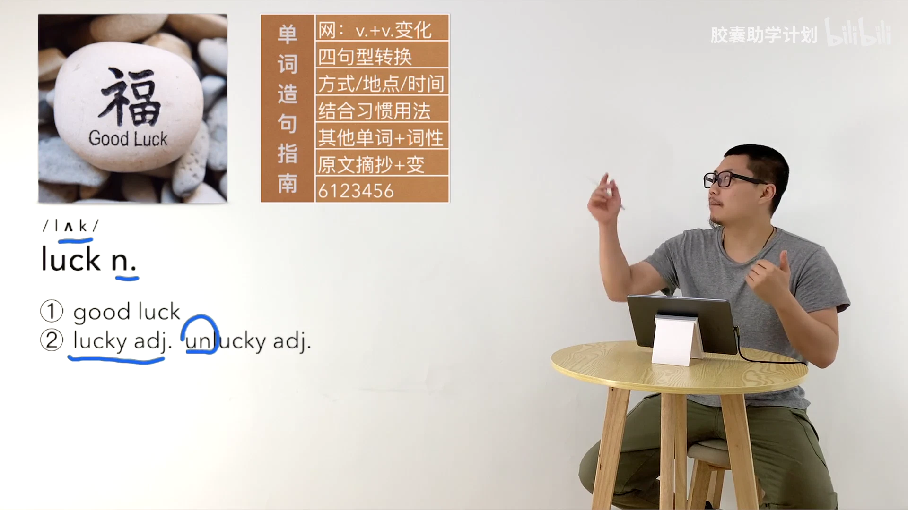

文字识别：单词造句指南 / 网：v.+v.变化 / 胶囊助学计划 / 四句型转换 / 福 / 方式/地点/时间 / 结合习惯用法 / Good Luck / 其他单词+词性 / 原文摘抄+变 / 6123456 / /|Λk/ / luck n. / 1 / 1 / good luck / unucky adj. / lucky adj.

### 画面 00:01:21

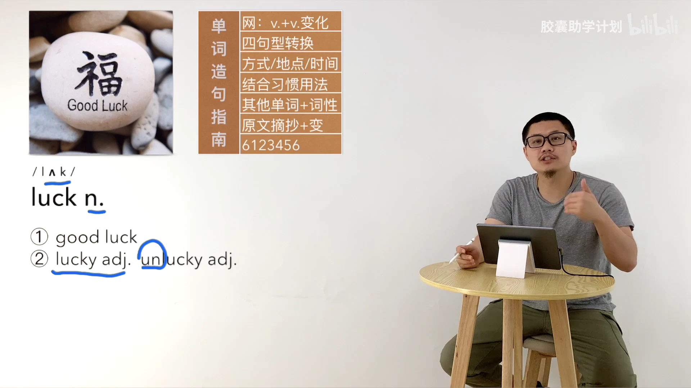

文字识别：单词造句指南 / 网：v.+v.变化 / 胶囊助学计划 / 四句型转换 / 福 / 方式/地点/时间 / 结合习惯用法 / Good Luck / 其他单词+词性 / 原文摘抄+变 / 6123456 / /|Λk/ / luck n. / good luck / 7 / unucky adj. / lucky adj.

### 画面 00:01:24

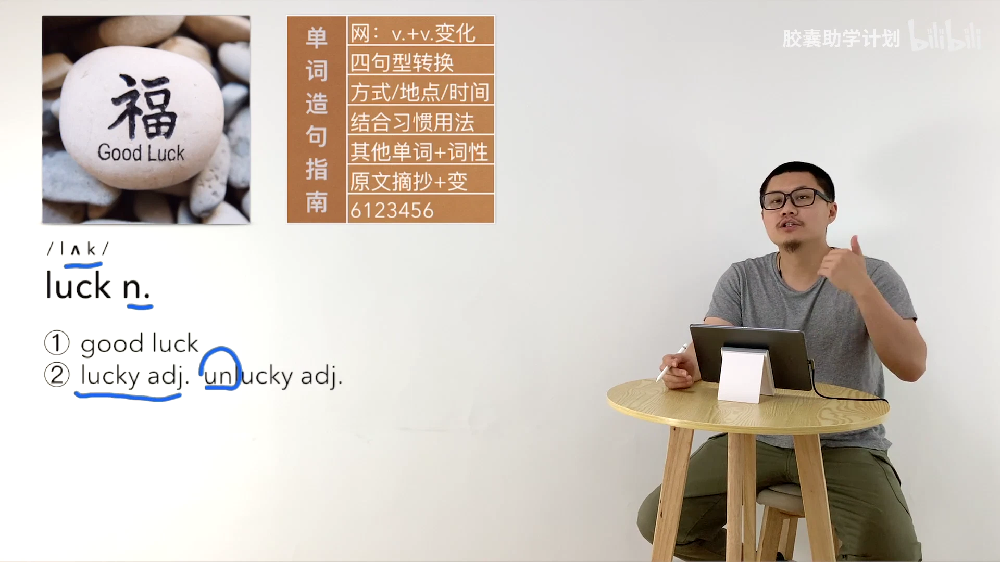

文字识别：单词造句指南 / 网：v.+v.变化 / 胶囊助学计划 / 四句型转换 / 福 / 方式/地点/时间 / 结合习惯用法 / Good Luck / 其他单词+词性 / 原文摘抄+变 / 6123456 / /|Λk/ / luck n. / good luck / 7 / unucky adj. / lucky adj.

### 画面 00:01:26

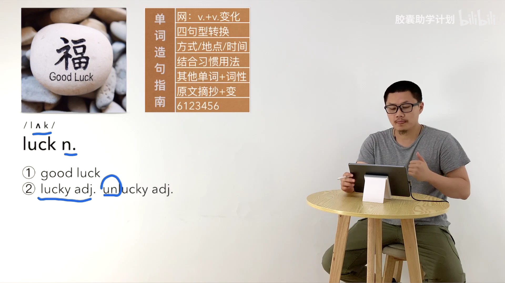

文字识别：单词造句指南 / 网：v.+v.变化 / 胶囊助学计划 / 四句型转换 / 福 / 方式/地点/时间 / 结合习惯用法 / Good Luck / 其他单词+词性 / 原文摘抄+变 / 6123456 / /|Λk/ / luck n. / 1 / good luck / unucky adj. / lucky adj.

### 画面 00:01:29

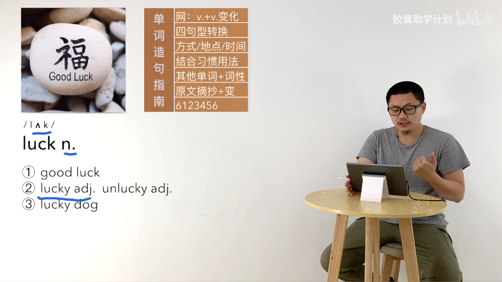

文字识别：单词造句指南 / 网：v.+v.变化 / 胶囊助学计划 / 四句型转换 / 福 / 方式/地点/时间 / 结合习惯用法 / Good Luck / 其他单词+词性 / 原文摘抄+变 / 6123456 / /|Λk/ / luck n. / 1 / good luck / lucky adj. unlucky adj. / Tucky dog

## 00:01:30–00:02:00

儿呢？你就能看到西方世界是非常喜欢狗的。他不说 lucky son, OK, 他不说幸运的儿子，不是这个意思。他用的是 lucky dog, 啊, you lucky dog, 啊，你这个幸运儿啊。OK, 好，那 you lucky dog, 刚才我们说了叫幸运儿。接下来我们在这个小的电影片段当中一起去看一下他如何去使用这个 you lucky dog, 啊，你这个幸运儿的。 This is a very nice specimen. OK, what's a Magdalena? A later

### 画面 00:01:31

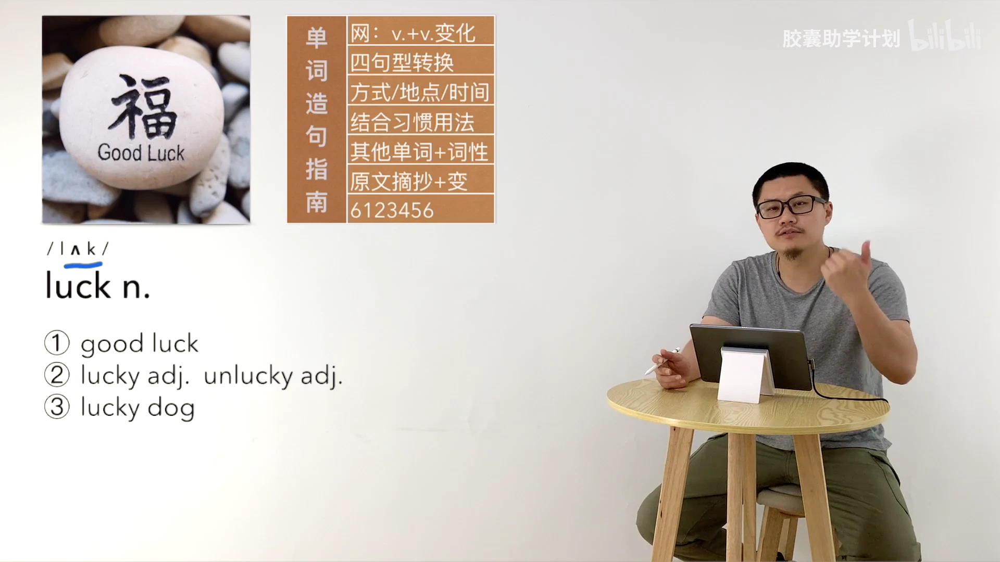

文字识别：单词造句指南 / 网：v.+v.变化 / 胶囊助学计划 / 四句型转换 / 福 / 方式/地点/时间 / 结合习惯用法 / Good Luck / 其他单词+词性 / 原文摘抄+变 / 6123456 / /|Λk/ / luck n. / 1 / good luck / lucky adj. unlucky adj. / 2 / ③ lucky dog

### 画面 00:01:35

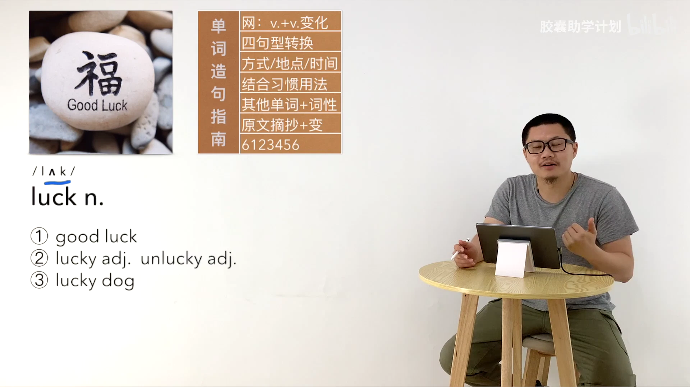

文字识别：单词造句指南 / 网：v.+v.变化 / 胶囊助学计划 / 四句型转换 / 福 / 方式/地点/时间 / 结合习惯用法 / Good Luck / 其他单词+词性 / 原文摘抄+变 / 6123456 / /|Λk/ / luck n. / 1 / good luck /  lucky adj. unlucky adj. / 2 / ③ lucky dog

### 画面 00:01:40

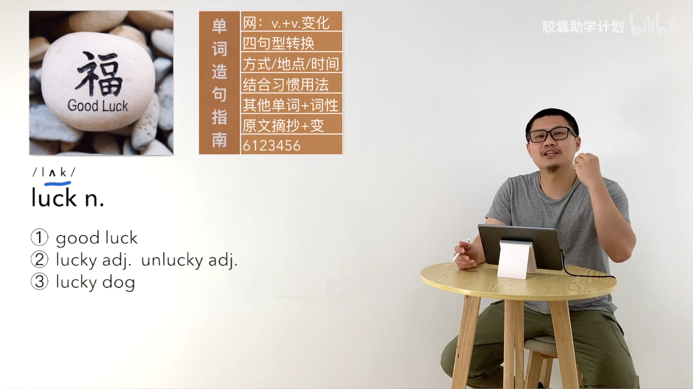

文字识别：单词造句指南 / 网：v.+v.变化 / 胶囊助学计划 / 四句型转换 / 福 / 方式/地点/时间 / 结合习惯用法 / Good Luck / 其他单词+词性 / 原文摘抄+变 / 6123456 / /|Λk/ / luck n. / 1 / good luck / lucky adj. unlucky adj. / 2） / ③ lucky dog

### 画面 00:01:43

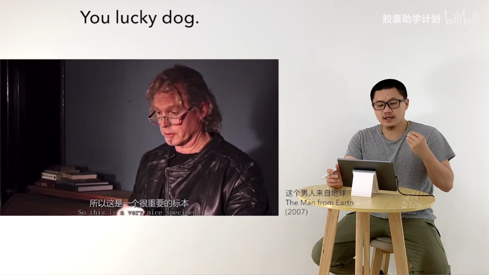

文字识别：You lucky dog. / 胶囊助学计划 / 这个男人来自地球 / 所以这是一个很重要的标本 / The Man from Earth / So this is a very nice specimen. / (2007)

### 画面 00:01:45

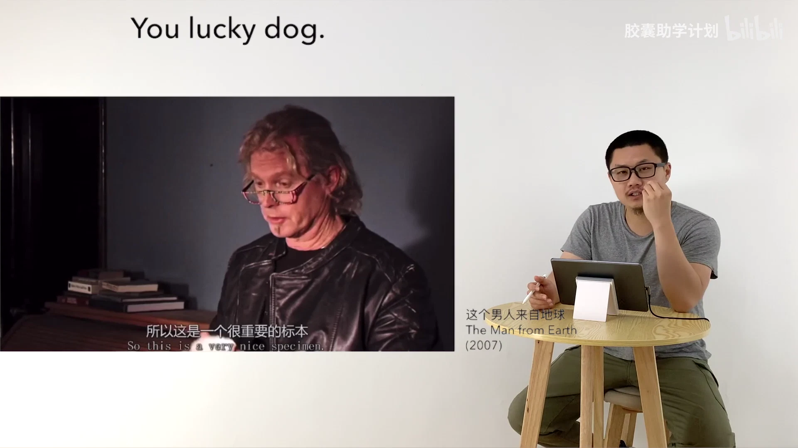

文字识别：You lucky dog. / 胶囊助学计划 / 这个男人来自地球 / 所以这是一个很重要的标本 / The Man from Earth / So Lhis is a very nice specimen. / (2007)

### 画面 00:01:54

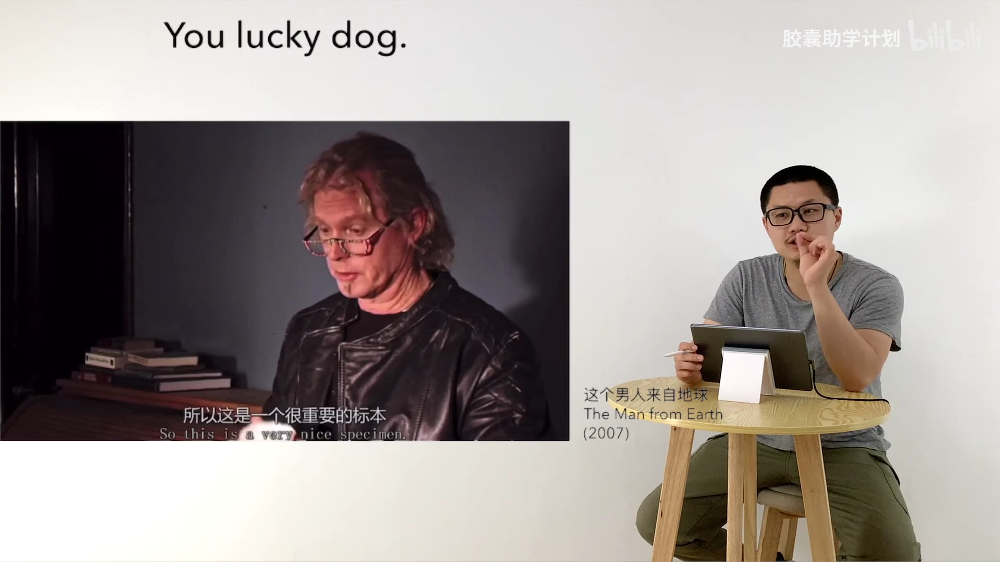

文字识别：You lucky dog. / 胶囊助学计划 / 这个男人来自地球 / 所以这是一个很重要的标本 / The Man from Earth / So Lhis is a very nice specimen. / (2007)

### 画面 00:01:56

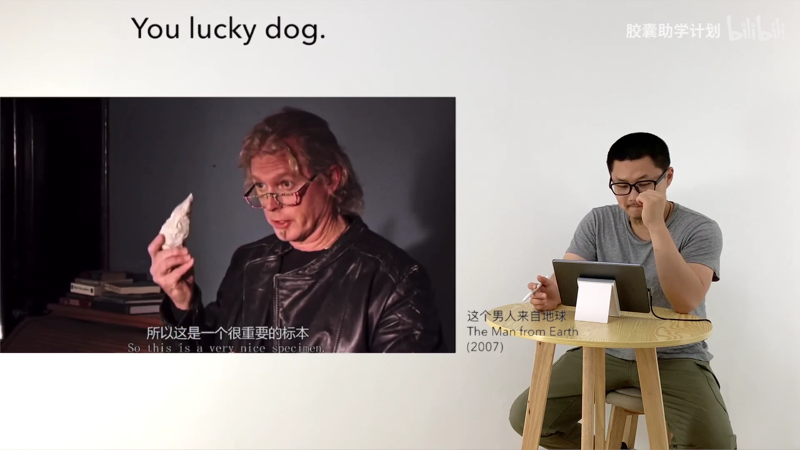

文字识别：You lucky dog. / 胶囊助学计划 / 这个男人来自地球 / 所以这是一个很重要的标本 / The Man from Earth / So this is a very nice specimen. / (2007)

### 画面 00:01:58

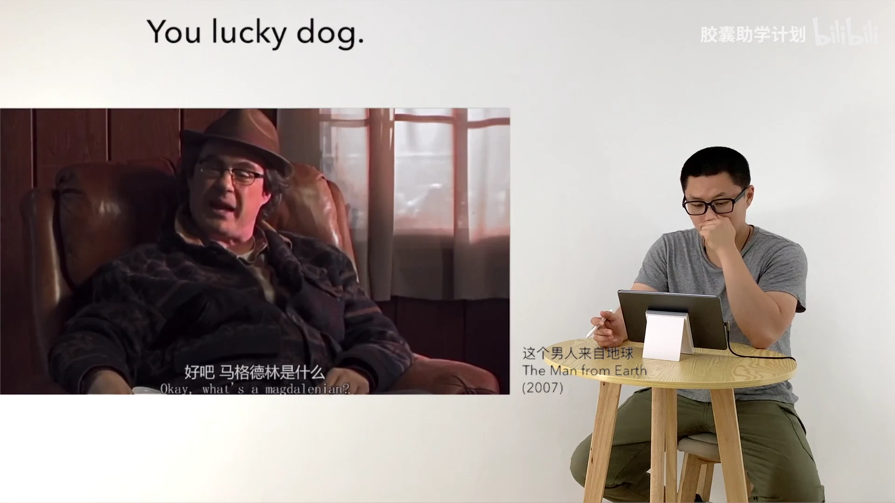

文字识别：You lucky dog. / 胶囊助学计划 / 这个男人来自地球 / 好吧马格德林是什么 / The Man from Earth / Okay, what's a magdalenian2 / (2007)

## 00:02:00–00:02:30

Cromagnon, without getting technical, it's the final culture of the Upper Paleolithic. Stones can speak, eh? So we get that time. Believe it or not, from a thrift shop, a quarter. You lucky dog! Me, I gotta go digging for this kind of stuff. Okay, you lucky dog!啊，你这个你运气太好了，是吧？就指的其实就是你是个幸运儿。Okay, here we go.接下来下一个单词啊，我们还是看一下音标，然后分一下音节。来，

### 画面 00:02:00

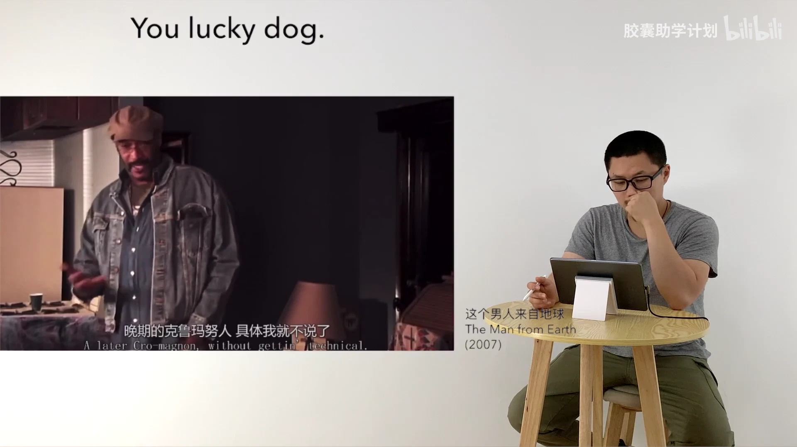

文字识别：You lucky dog. / biltbili / 胶囊助学计划 / 这个男人来自地球 / 晚期的克鲁玛努人具体我就不说了 / The Man from Earth / later Cro-magnon, without gettin'luechnical / (2007)

### 画面 00:02:02

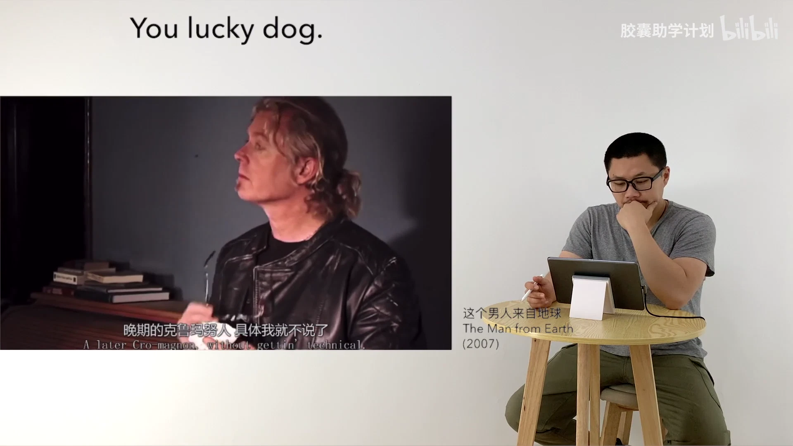

文字识别：You lucky dog. / bilibil / 胶囊助学计划 / 这个男人来自地球 / 晚期的克鲁玛努人具体我就不说了 / The Man from Earth / A later Cro magnon. without gettin' Uechnical / (2007)

### 画面 00:02:04

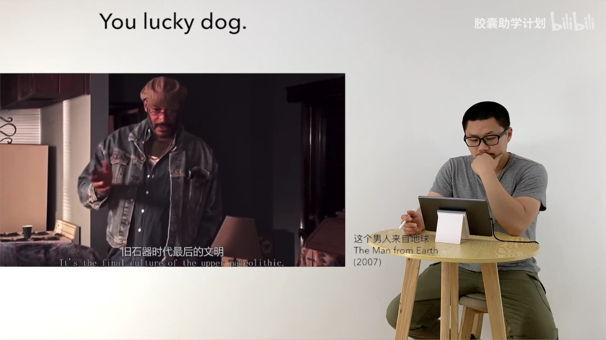

文字识别：You lucky dog. / bibii / 胶囊助学计划 / 这个男人来自地球 / 旧石器时代最后的文明 / The Man from Earth / It's the final culture of the upper paleolithic. / (2007)

### 画面 00:02:06

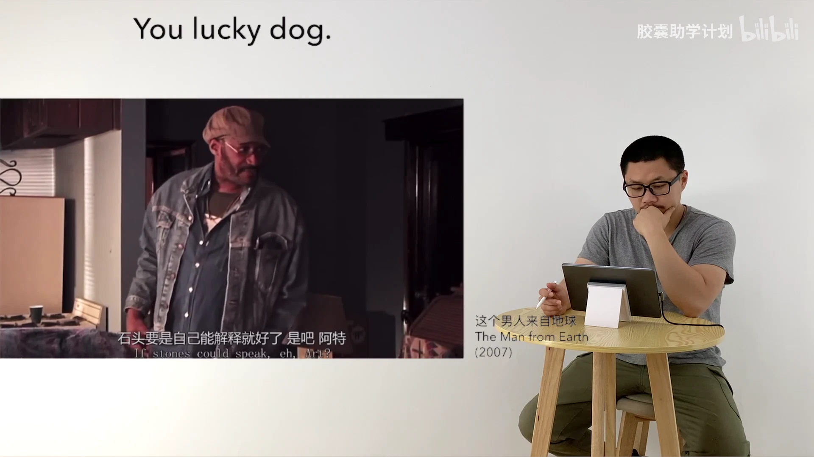

文字识别：You lucky dog. / Bilbil / 胶囊助学计划 / 这个男人来自地球 / 石头要是自己能解释就好了是吧阿特 / The Man from Earth / Tf stones could speak, eh, Art? / (2007)

### 画面 00:02:08

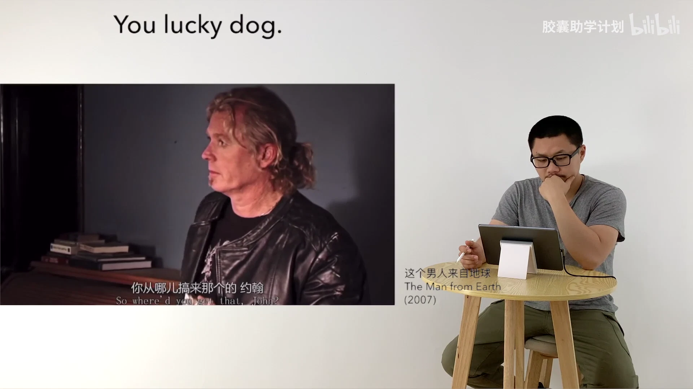

文字识别：You lucky dog. / bilibi / 胶囊助学计划 / 这个男人来自地球 / 你从哪儿搞来那个的约翰 / The Man from Earth / So where' d yoo get / Lhal / (2007)

### 画面 00:02:10

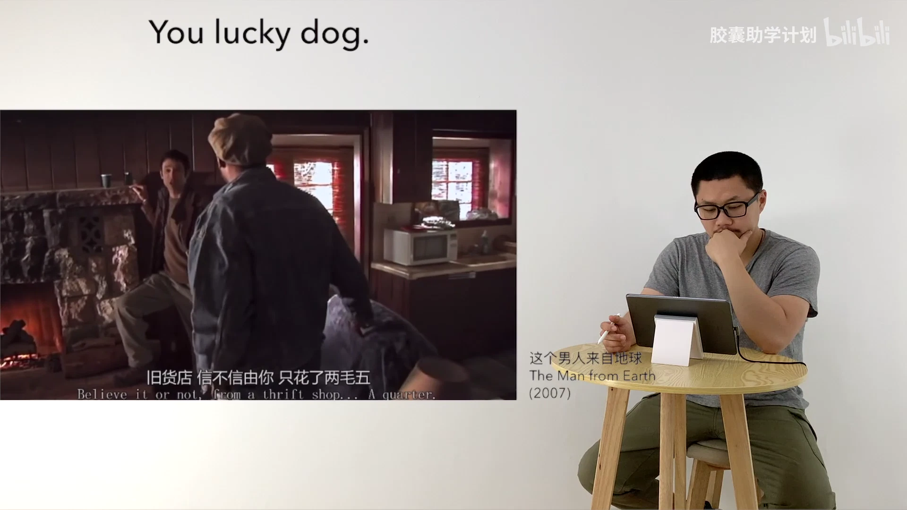

文字识别：You lucky dog. / Bilbil / 胶囊助学计划 / 这个男人来自地球 / 旧货店信不信由你只花了两毛五 / The Man from Earth / Believe it or not, / from a thrift shop... / quarter. / (2007)

### 画面 00:02:12

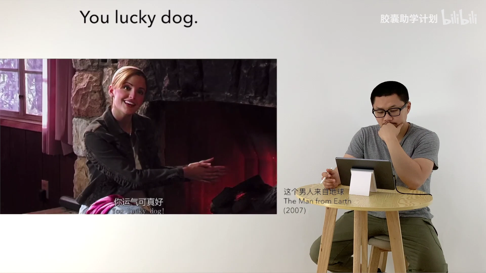

文字识别：You lucky dog. / bibil / 胶囊助学计划 / 这个男人来自地球 / 你运气可真好 / The Man from Earth / You lucky dog! / (2007)

### 画面 00:02:14

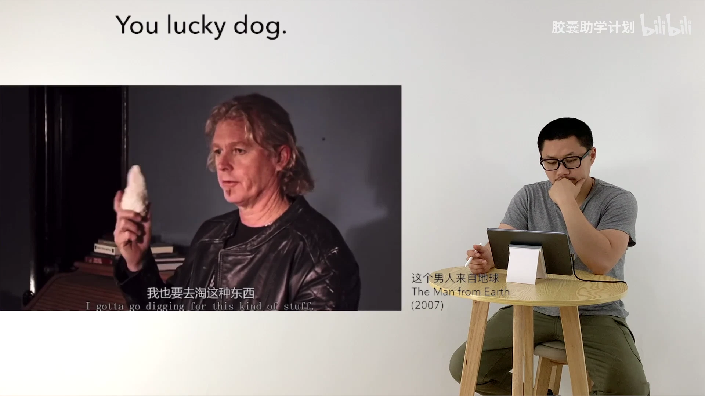

文字识别：You lucky dog. / 胶囊助学计划bilb出 / 这个男人来自地球 / 我也要去淘这种东西 / The Man from Earth / I gotta go digging for this kind of sturr / (2007)

### 画面 00:02:16

文字识别：You lucky dog. / 胶囊助学计划bi出 / 这个男人来自地球 / 我也要去淘这种东西 / The Man from Earth / gotta go digging for this kind of stuff. / (2007)

### 画面 00:02:19

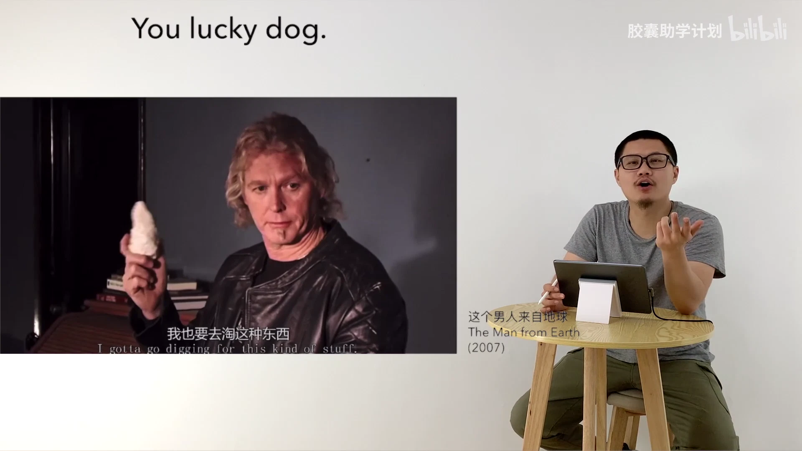

文字识别：You lucky dog. / 胶囊助学计划bil出 / 这个男人来自地球 / 我也要去淘这种东西 / The Man from Earth / gotta go digging for this kind of stuff. / (2007)

### 画面 00:02:21

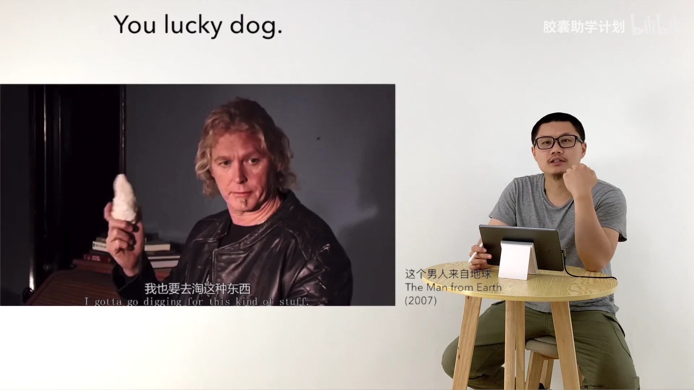

文字识别：You lucky dog. / 胶囊助学计划 / 这个男人来自地球 / 我也要去淘这种东西 / The Man from Earth / I gotta go digging for this kind of stufr. / (2007)

### 画面 00:02:23

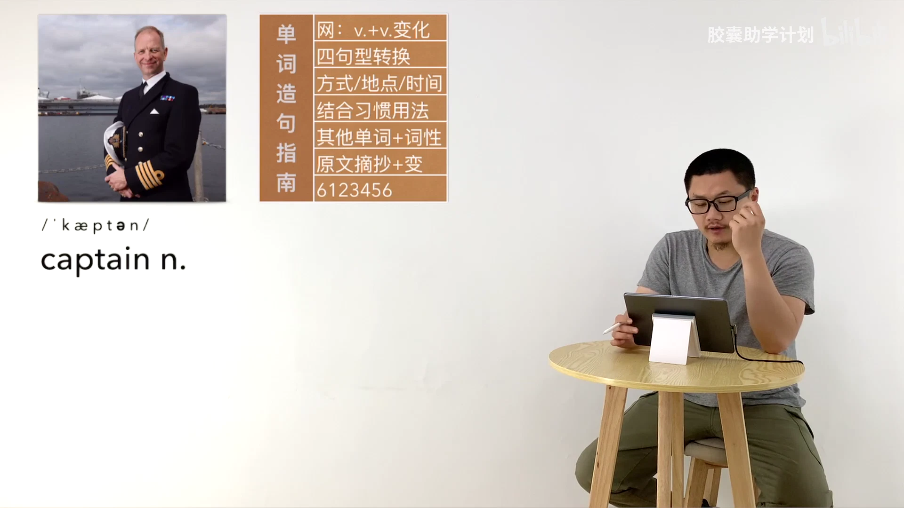

文字识别：单词造句指南 / 网：v.+v.变化 / 胶囊助学计划 / 四句型转换 / 方式/地点/时间 / 结合习惯用法 / 其他单词+词性 / 原文摘抄+变 / 6123456 / /'kæptan/ / captain n.

### 画面 00:02:25

文字识别：单词造句指南 / 网：v.+v.变化 / 胶囊助学计划 / 四句型转换 / 方式/地点/时间 / 结合习惯用法 / 其他单词+词性 / 原文摘抄+变 / 6123456 / /'kæptan/ / captain n.

### 画面 00:02:29

文字识别：单词造句指南 / 网：v.+v.变化 / 胶囊助学计划 / 四句型转换 / 方式/地点/时间 / 结合习惯用法 / 其他单词+词性 / 原文摘抄+变 / 6123456 / /'kæptan/ / captain n.

## 00:02:30–00:03:00

captain captain连起来啊，captain there you go，那它指的是船长啊，a captain my captain啊，OK好，那既然它是，你看它现在是一个名词，你回想一下，第三课我们学过一个单词叫waiter，对吧？第六课我们学过一个单词叫做beggar，第七课我们学过一个单词叫detective，它本质上都是一码事儿，对吧？不管你是乞丐也好，你是船长也好啊，你是侦探也好，你是服务员也好，

### 画面 00:02:31

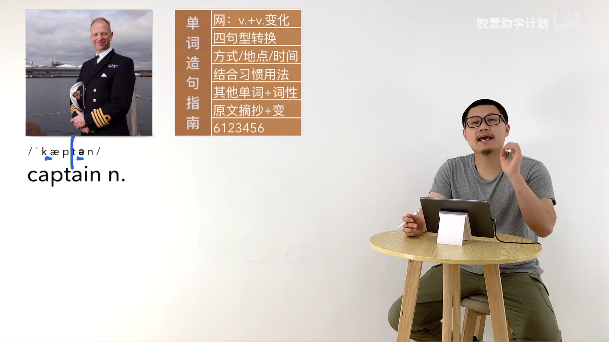

文字识别：单词造句指南 / 网：v.+v.变化 / 胶囊助学计划 / 四句型转换 / 方式/地点/时间 / 结合习惯用法 / 其他单词+词性 / 原文摘抄+变 / 6123456 / /'kæptan/ / captain n.

### 画面 00:02:35

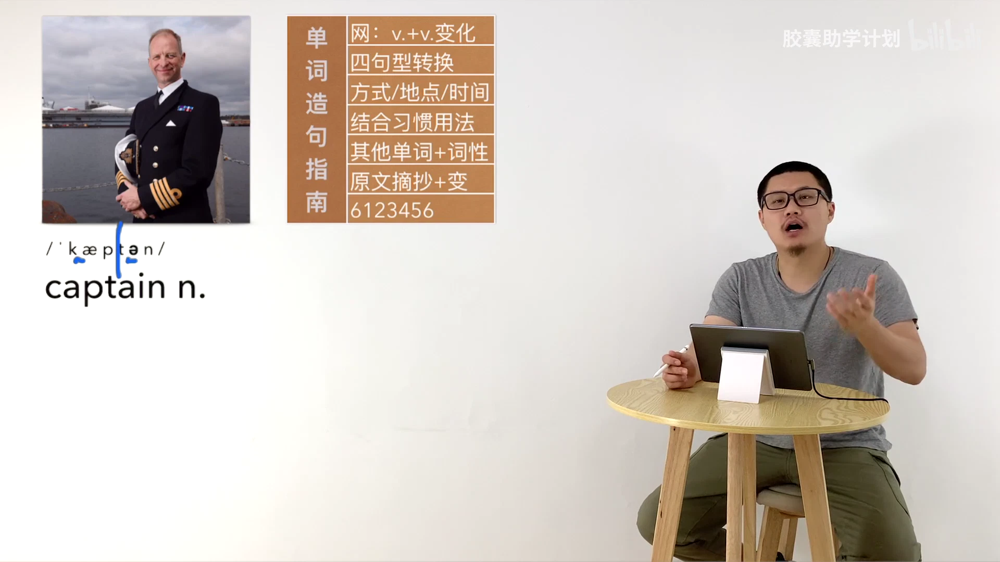

文字识别：单词造句指南 / 网：v.+v.变化 / 胶囊助学计划 / 四句型转换 / 方式/地点/时间 / 结合习惯用法 / 其他单词+词性 / 原文摘抄+变 / 6123456 / /'kæptan/ / captain n.

### 画面 00:02:38

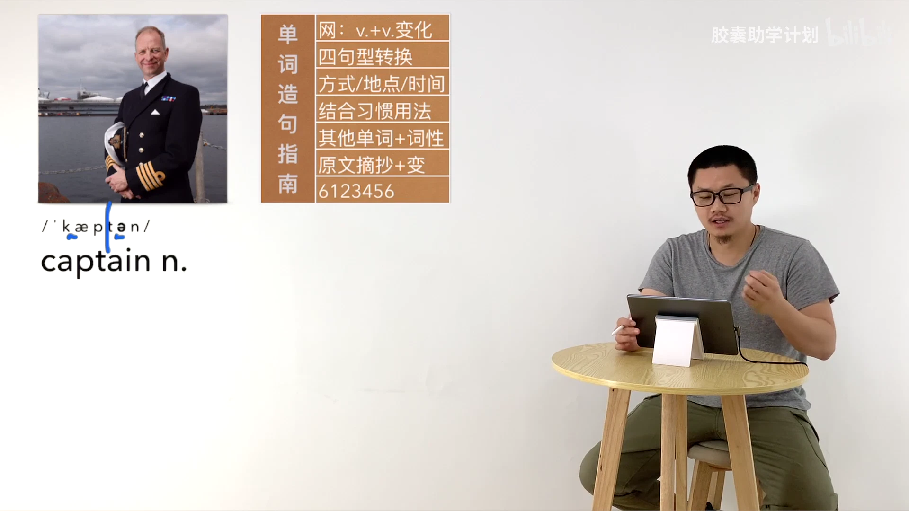

文字识别：单词造句指南 / 网：v.+v.变化 / 胶囊助学计划 / 四句型转换 / 方式/地点/时间 / 结合习惯用法 / 其他单词+词性 / 原文摘抄+变 / 6123456 / /'kæptan/ / captain n.

### 画面 00:02:40

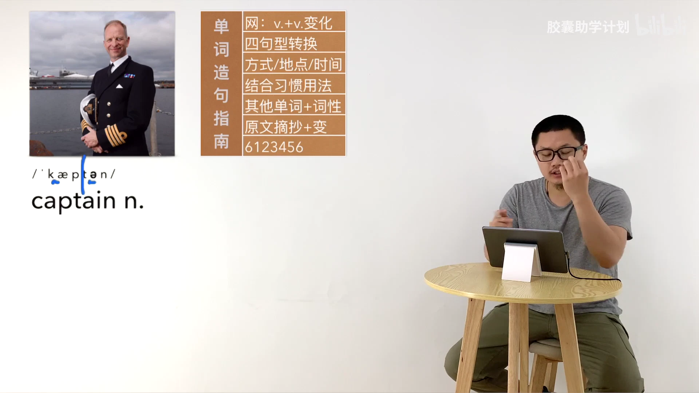

文字识别：单词造句指南 / 网：v.+v.变化 / 胶囊助学计划 / 四句型转换 / 方式/地点/时间 / 结合习惯用法 / 其他单词+词性 / 原文摘抄+变 / 6123456 / /'kæptan/ / captain n.

### 画面 00:02:42

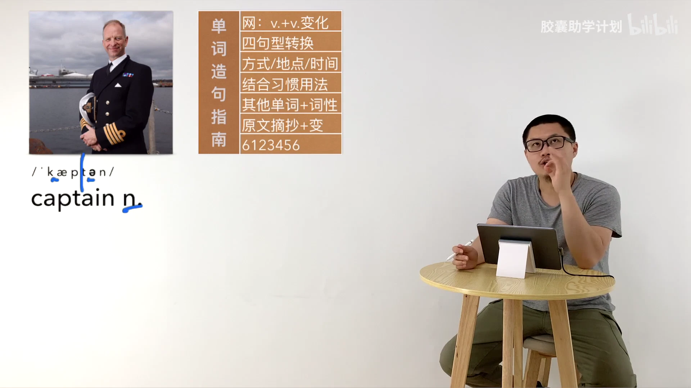

文字识别：单词造句指南 / 网：v.+v.变化 / 胶囊助学计划 / 四句型转换 / 方式/地点/时间 / 结合习惯用法 / 其他单词+词性 / 原文摘抄+变 / 6123456 / /'kæptan/ / captain / n

### 画面 00:02:45

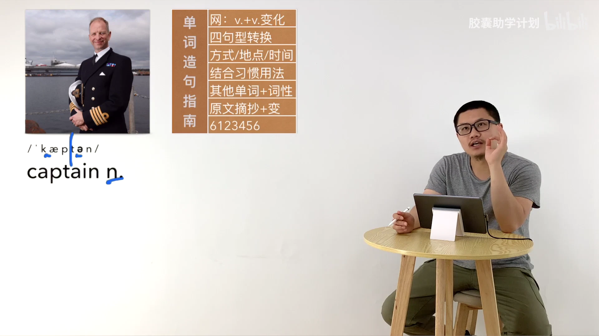

文字识别：单词造句指南 / 网：v.+v.变化 / 胶囊助学计划 / 四句型转换 / 方式/地点/时间 / 结合习惯用法 / 其他单词+词性 / 原文摘抄+变 / 6123456 / /'kæptan/ / captain / n

### 画面 00:02:50

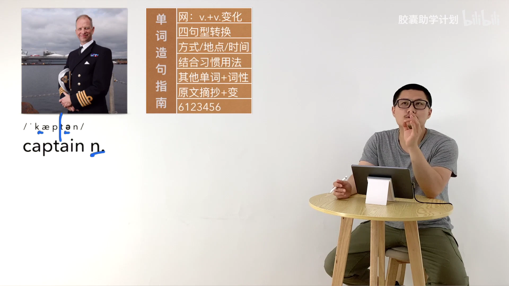

文字识别：单词造句指南 / 网：v.+v.变化 / 胶囊助学计划 / 四句型转换 / 方式/地点/时间 / 结合习惯用法 / 其他单词+词性 / 原文摘抄+变 / 6123456 / /'kæptan/ / captain / n

### 画面 00:02:55

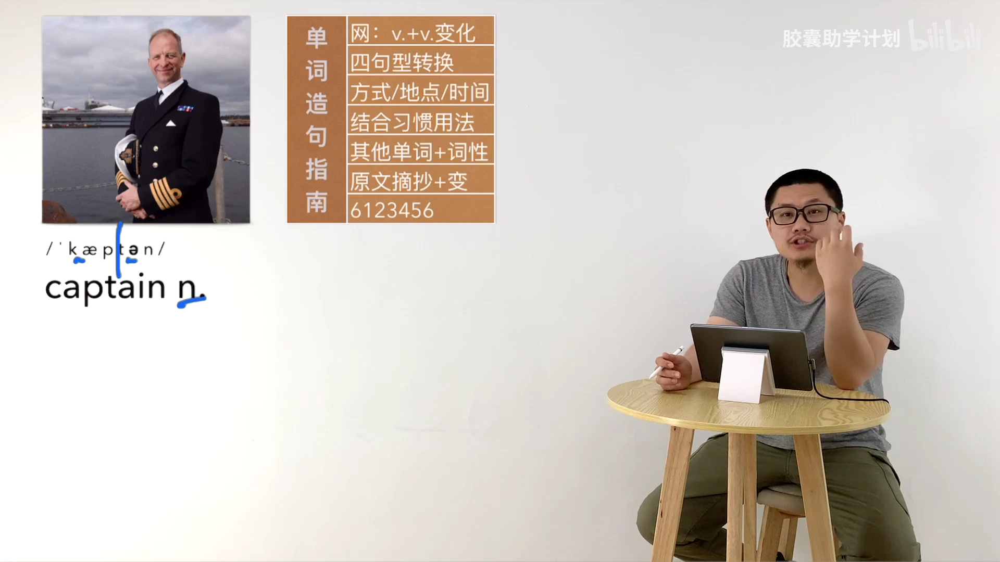

文字识别：单词造句指南 / 网：v.+v.变化 / 胶囊助学计划 / 四句型转换 / 方式/地点/时间 / 结合习惯用法 / 其他单词+词性 / 原文摘抄+变 / 6123456 / /'kæptan/ / captain / n

## 00:03:00–00:03:30

你想拿它去造句，其实接下来无非就那么几招。最快的思思路就是你找一个动词，对吧？往前翻去找这些动词，或者找一个包含动词的习惯用法，造出来肯定句，然后再做别的句型的一些调整。那我在这儿给大家举一些小的例子，比如说，The captain has just asked me to help him，是吧？这个船长啊，刚刚询问我，要求我去帮他一下，是

### 画面 00:03:00

文字识别：单词造句指南 / 网：v.+v.变化 / 胶囊助学计划 / 四句型转换 / 方式/地点/时间 / 结合习惯用法 / 其他单词+词性 / 原文摘抄+变 / 6123456 / /'kæptan/ / captain / n

### 画面 00:03:05

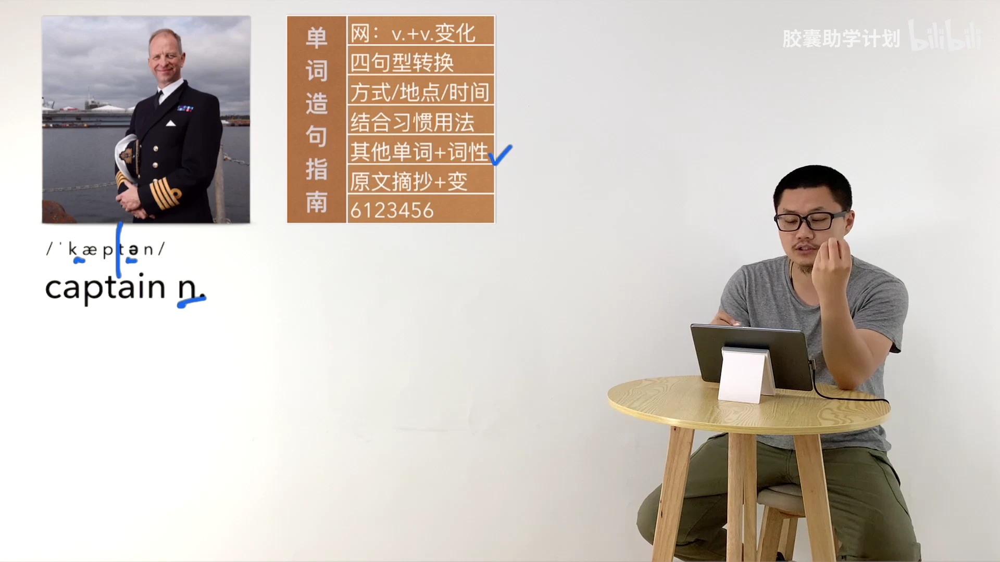

文字识别：单词造句指南 / 网：v.+v.变化 / 胶囊助学计划 / 四句型转换 / 方式/地点/时间 / 结合习惯用法 / 其他单词+词性 / 原文摘抄+变 / 6123456 / /'kæptan/ / captain / n

### 画面 00:03:10

文字识别：单词造句指南 / 网：v.+v.变化 / 胶囊助学计划 / 四句型转换 / 方式/地点/时间 / 结合习惯用法 / 其他单词+词性 / 原文摘抄+变 / 6123456 / /'kæptan/ / captain / n

### 画面 00:03:15

文字识别：单词造句指南 / 网：v.+v.变化 / 胶囊助学计划 / 四句型转换 / 方式/地点/时间 / 结合习惯用法 / 其他单词+词性 / 原文摘抄+变 / 6123456 / /'kæptan/ / captain / n

### 画面 00:03:19

文字识别：单词造句指南 / 网：v.+v.变化 / 胶囊助学计划 / 四句型转换 / 方式/地点/时间 / 结合习惯用法 / 其他单词+词性 / 原文摘抄+变 / 6123456 / /'kæptan/ / captain n. / ① The captain has just asked me to help him. / L11

### 画面 00:03:21

文字识别：单词造句指南 / 网：v.+v.变化 / 胶囊助学计划 / 四句型转换 / 方式/地点/时间 / 结合习惯用法 / 其他单词+词性 / 原文摘抄+变 / 6123456 / /'kæptan/ / captain ! / n / ① The captain has just asked me to help him. / L11

### 画面 00:03:25

文字识别：单词造句指南 / 网：v.+v.变化 / 胶囊助学计划 / 四句型转换 / 方式/地点/时间 / 结合习惯用法 / 其他单词+词性 / 原文摘抄+变 / 6123456 / /'kæptan/ / captain n. / ① The captain has just asked me to help him. / L11

## 00:03:30–00:04:00

吧？要要让我去帮他一下，ask somebody to do something. 十一课我们刚刚学过。接下来呢？I borrowed some money from our captain. 我找 I borrow something from somebody, 对吧？十一课咱们学了，复习这一课，找他借了一些钱。And he told me not to pay it back. 好，pay it back，也是我们十一课学的，就还钱啊。我找他要一些钱，然后 captain 说不用还了。OK，very good. 那你看这两句话肯定句出来了。

### 画面 00:03:30

文字识别：单词造句指南 / 网：v.+v.变化 / 胶囊助学计划 / 四句型转换 / 方式/地点/时间 / 结合习惯用法 / 其他单词+词性 / 原文摘抄+变 / 6123456 / /'kæptan/ / captain n. / ① The captain has just asked me to help him. / L11

### 画面 00:03:35

文字识别：单词造句指南 / 网：v.+v.变化 / 胶囊助学计划 / 四句型转换 / 方式/地点/时间 / 结合习惯用法 / 其他单词+词性 / 原文摘抄+变 / 6123456 / /'kæptan/ / captain n / ① The captain has just asked me to help him. / L11 / ) I borrowed some money from our captain / 2 / and he told me not to pay it back. L11

### 画面 00:03:37

文字识别：单词造句指南 / 网：v.+v.变化 / 胶囊助学计划 / 四句型转换 / 方式/地点/时间 / 结合习惯用法 / 其他单词+词性 / 原文摘抄+变 / 6123456 / /'kæptan/ / captain n / ① The captain has just asked me to help him. / L11 / ) I borrowed some money from our captain / 2 / and he told me not to pay it back. L11

### 画面 00:03:40

文字识别：单词造句指南 / 网：v.+v.变化 / 胶囊助学计划 / 四句型转换 / 方式/地点/时间 / 结合习惯用法 / 其他单词+词性 / 原文摘抄+变 / 6123456 / /'kæptan/ / captain n / ① The captain has just asked me to help him. / L11 /  I borrowed some money from our captain / 2 / and he told me not to pay it back. L11

### 画面 00:03:45

文字识别：单词造句指南 / 网：v.+v.变化 / 胶囊助学计划 / 四句型转换 / 方式/地点/时间 / 结合习惯用法 / 其他单词+词性 / 原文摘抄+变 / 6123456 / /'kæptan/ / captain n / ① The captain has just asked me to help him. / L11 / ) I borrowed some money from our captain / 2 / and he told me not to pay it back. L11

### 画面 00:03:50

文字识别：单词造句指南 / 网：v.+v.变化 / 胶囊助学计划 / 四句型转换 / 方式/地点/时间 / 结合习惯用法 / 其他单词+词性 / 原文摘抄+变 / 6123456 / /'kæptan/ / captain n. / ① The captain has just asked me to help him. / L11 /  I borrowed some money from our captain / 2 / and he told me not to pay it back. L11

### 画面 00:03:52

文字识别：单词造句指南 / 网：v.+v.变化 / 胶囊助学计划 / 四句型转换 / 方式/地点/时间 / 结合习惯用法 / 其他单词+词性 / 原文摘抄+变 / 6123456 / /'kæptan/ / captain n / ① The captain has just asked me to help him. / L11 / ) I borrowed some money from our captain / 2 / and he told me not to pay it back. L11

### 画面 00:03:55

文字识别：单词造句指南 / 网：v.+v.变化 / 胶囊助学计划 / 四句型转换 / 方式/地点/时间 / 结合习惯用法 / 其他单词+词性 / 原文摘抄+变 / 6123456 / /'kæptan/ / captain n / ① The captain has just asked me to help him. / L11 / ) I borrowed some money from our captain / 2 / and he told me not to pay it back. L11

### 画面 00:03:57

文字识别：单词造句指南 / 网：v.+v.变化 / 胶囊助学计划 / 四句型转换 / 方式/地点/时间 / 结合习惯用法 / 其他单词+词性 / 原文摘抄+变 / 6123456 / /'kæptan/ / captain n / ① The captain has just asked me to help him. / L11 /  I borrowed some money from our captain / 2 / and he told me not to pay it back. L11

## 00:04:00–00:04:30

各位，如果想再往下去深耕一下，您做的事情是前两步，要么比如说你换一个时态，比如说 I'm going to, I'm gonna, I'm gonna borrow some money from our captain, 是吧？我准备要去管他借一些钱，我计划打算是这个样子的。你也可以再进行哎纵向的深耕，所谓的四句型的转换。OK，这儿一个。接下来下一个单词跟我一起读，叫做 sale。最后舌尖是要放在沙音上的

### 画面 00:04:00

文字识别：单词造句指南 / 网：v.+v.变化 / 胶囊助学计划 / 四句型转换 / 方式/地点/时间 / 结合习惯用法 / 其他单词+词性 / 原文摘抄+变 / 6123456 / /'kæptan/ / captain n / ① The captain has just asked me to help him. / L11 /  I borrowed some money from our captain / 2 / and he told me not to pay it back. L11

### 画面 00:04:04

文字识别：单词造句指南 / 网：v.+v.变化 / 胶囊助学计划 / 四句型转换 / 方式/地点/时间 / 结合习惯用法 / 其他单词+词性 / 原文摘抄+变 / 6123456 / /'kæptan/ / captain n / ① The captain has just asked me to help him. / L11 /  I borrowed some money from our captain / 2 / and he told me not to pay it back. L11

### 画面 00:04:06

文字识别：单词造句指南 / 网：v.+v.变化 / 胶囊助学计划 / 四句型转换 / 方式/地点/时间 / 结合习惯用法 / 其他单词+词性 / 原文摘抄+变 / 6123456 / /'kæptan/ / captain n / ① The captain has just asked me to help him. / L11 / ) I borrowed some money from our captain / 2 / and he told me not to pay it back. L11

### 画面 00:04:08

文字识别：单词造句指南 / 网：v.+v.变化 / 胶囊助学计划 / 四句型转换 / 方式/地点/时间 / 结合习惯用法 / 其他单词+词性 / 原文摘抄+变 / 6123456 / /'kæptan/ / captain n / ① The captain has just asked me to help him. / L11 / ) I borrowed some money from our captain / 2 / and he told me not to pay it back. L11

### 画面 00:04:10

文字识别：单词造句指南 / 网：v.+v.变化 / 胶囊助学计划 / 四句型转换 / 方式/地点/时间 / 结合习惯用法 / 其他单词+词性 / 原文摘抄+变 / 6123456 / /'kæptan/ / captain n / ① The captain has just asked me to help him. / L11 / ) I borrowed some money from our captain / 2 / and he told me not to pay it back. L11

### 画面 00:04:15

文字识别：单词造句指南 / 网：v.+v.变化 / 胶囊助学计划 / 四句型转换 / 方式/地点/时间 / 结合习惯用法 / 其他单词+词性 / 原文摘抄+变 / 6123456 / /'kæptan/ / captain n / ① The captain has just asked me to help him. / L11 / ) I borrowed some money from our captain / 2 / and he told me not to pay it back. L11

### 画面 00:04:20

文字识别：单词造句指南 / 网：v.+v.变化 / 胶囊助学计划 / 四句型转换 / 方式/地点/时间 / 结合习惯用法 / 其他单词+词性 / 原文摘抄+变 / 6123456 / /'kæptan/ / captain n / ① The captain has just asked me to help him. / L11 / ) I borrowed some money from our captain / and he told me not to pay it back. L11

### 画面 00:04:23

文字识别：单词造句指南 / 网：v.+v.变化 / 胶囊助学计划 / 四句型转换 / 方式/地点/时间 / 结合习惯用法 / 其他单词+词性 / 原文摘抄+变 / 6123456 / /serl/ / sail v.

### 画面 00:04:25

文字识别：单词造句指南 / 网：v.+v.变化 / 胶囊助学计划 / 四句型转换 / 方式/地点/时间 / 结合习惯用法 / 其他单词+词性 / 原文摘抄+变 / 6123456 / /serl/ / sail / V.

## 00:04:30–00:05:00

那它表示的意思是航行啊，往往比如说指的是这种船啊，帆船啊，在海上的航行，我们管它叫做sail。那拿它去造句呢？我们回顾一个小点，叫原文摘抄再加上变，就是您自己去看到这个单词，你不太会用啊，或者说你不太敢去用啊，不知道怎么去用的时候，回到原文，原文给了一句话叫Charles Ellison will sail from Portsmouth tomorrow.

### 画面 00:04:30

文字识别：单词造句指南 / 网：v.+v.变化 / 胶囊助学计划 / 四句型转换 / 方式/地点/时间 / 结合习惯用法 / 其他单词+词性 / 原文摘抄+变 / 6123456 / /serl/ / sail / V.

### 画面 00:04:35

文字识别：单词造句指南 / 网：v.+v.变化 / 胶囊助学计划 / 四句型转换 / 方式/地点/时间 / 结合习惯用法 / 其他单词+词性 / 原文摘抄+变 / 6123456 / /seil/ / sail / V.

### 画面 00:04:40

文字识别：单词造句指南 / 网：v.+v.变化 / 胶囊助学计划 / 四句型转换 / 方式/地点/时间 / 结合习惯用法 / 其他单词+词性 / 原文摘抄+变 / 6123456 / /seil/ / sail / V.

### 画面 00:04:43

文字识别：单词造句指南 / 网：v.+v.变化 / 胶囊助学计划 / 四句型转换 / 方式/地点/时间 / 结合习惯用法 / 其他单词+词性 / 原文摘抄+变 / 6123456 / /serl/ / sail / V. / [Story]: Charles Alison will sail from / Portsmouth tomorrow.

### 画面 00:04:45

文字识别：单词造句指南 / 网：v.+v.变化 / 胶囊助学计划 / 四句型转换 / 方式/地点/时间 / 结合习惯用法 / 其他单词+词性 / 原文摘抄+变 / 6123456 / /serl/ / sail / V. / 1 / [Story]: Charles Alison will sail from / Portsmouth tomorrow.

### 画面 00:04:47

文字识别：单词造句指南 / 网：v.+v.变化 / 胶囊助学计划 / 四句型转换 / 方式/地点/时间 / 结合习惯用法 / 其他单词+词性 / 原文摘抄+变 / 6123456 / /serl/ / sail / V. / [Story]: Charles Alison will sail from / Portsmouth tomorrow.

### 画面 00:04:49

文字识别：单词造句指南 / 网：v.+v.变化 / 胶囊助学计划 / 四句型转换 / 方式/地点/时间 / 结合习惯用法 / 其他单词+词性 / 原文摘抄+变 / 6123456 / /seil/ / sail / V. / [Story]: Charles Alison will sail from / 1 / Portsmouth tomorrow.

### 画面 00:04:51

文字识别：单词造句指南 / 网：v.+v.变化 / 胶囊助学计划 / 四句型转换 / 方式/地点/时间 / 结合习惯用法 / 其他单词+词性 / 原文摘抄+变 / 6123456 / /serl/ / sail / V. / [Story]: Charles Alison will sail from / 1 / :) / Portsmouth tomorrow.

### 画面 00:04:55

文字识别：单词造句指南 / 网：v.+v.变化 / 胶囊助学计划 / 四句型转换 / 方式/地点/时间 / 结合习惯用法 / 其他单词+词性 / 原文摘抄+变 / 6123456 / /serl/ / sail / V. / [Story]: Charles Alison will sail from / 1 / Portsmouth tomorrow.

### 画面 00:04:59

文字识别：单词造句指南 / 网：v.+v.变化 / 胶囊助学计划 / 四句型转换 / 方式/地点/时间 / 结合习惯用法 / 其他单词+词性 / 原文摘抄+变 / 6123456 / /seil/ / sail / V. / 1 / [Story]: Charles Alison will sail from / Portsmouth tomorrow.

## 00:05:00–00:05:30

好, Charles Ellison, C A大写,一看是一个人将航行从从后边那就是一个地名了,对吧?从 Portsmouth这个地方,您不需要知道它是哪,你只需要知道还是一个地方就可以了. OK,然后tomorrow叫做明天,那怎么变呢?变其实是跟四句型连在一起的,变个一般疑问句,Will Charles Ellison sail from Portsmouth tomorrow? OK, one一个.接下来,那我也可以用特殊疑问词when叫做When

### 画面 00:05:01

文字识别：单词造句指南 / 网：v.+v.变化 / 胶囊助学计划 / 四句型转换 / 方式/地点/时间 / 结合习惯用法 / 其他单词+词性 / 原文摘抄+变 / 6123456 / /serl/ / sail / V. / [Story]:Charles Alison will sail from / Portsmouth tomorrow.

### 画面 00:05:03

文字识别：单词造句指南 / 网：v.+v.变化 / 胶囊助学计划 / 四句型转换 / 方式/地点/时间 / 结合习惯用法 / 其他单词+词性 / 原文摘抄+变 / 6123456 / /serl/ / sail / V. / [Story]: Charles Alison will sail from / Portsmouth tomorrow.

### 画面 00:05:05

文字识别：单词造句指南 / 网：v.+v.变化 / 胶囊助学计划 / 四句型转换 / 方式/地点/时间 / 结合习惯用法 / 其他单词+词性 / 原文摘抄+变 / 6123456 / /seil/ / sail / V. / [Story]: Charles Alison will sail / From / Portsmouth tomorrow.

### 画面 00:05:07

文字识别：单词造句指南 / 网：v.+v.变化 / 胶囊助学计划 / 四句型转换 / 方式/地点/时间 / 结合习惯用法 / 其他单词+词性 / 原文摘抄+变 / 6123456 / /seil/ / sail / V. / [Story]: Charles Alison will sail / from / Portsmouth tomorrow.

### 画面 00:05:10

文字识别：单词造句指南 / 网：v.+v.变化 / 胶囊助学计划 / 四句型转换 / 方式/地点/时间 / 结合习惯用法 / 其他单词+词性 / 原文摘抄+变 / 6123456 / /serl/ / sail / V. / [Story]: Charles Alison will sail / from / Portsmouth tomorrow.

### 画面 00:05:15

文字识别：单词造句指南 / 网：v.+v.变化 / 胶囊助学计划 / 四句型转换 / 方式/地点/时间 / 结合习惯用法 / 其他单词+词性 / 原文摘抄+变 / 6123456 / /serl/ / sail / V. / [Story]: Charles Alison will sail from / 1 / Portsmouth tomorrow.

### 画面 00:05:17

文字识别：单词造句指南 / 网：v.+v.变化 / 胶囊助学计划 / 四句型转换 / 方式/地点/时间 / 结合习惯用法 / 其他单词+词性 / 原文摘抄+变 / 6123456 / /seil/ / sail / V. / 1 / [Story]: Charles Alison will sail from / Portsmouth tomorrow.

### 画面 00:05:19

文字识别：单词造句指南 / 网：v.+v.变化 / 胶囊助学计划 / 四句型转换 / 方式/地点/时间 / 结合习惯用法 / 其他单词+词性 / 原文摘抄+变 / 6123456 / /serl/ / sail / V. / [Story]: Charles Alison will sail from / 1 / Portsmouth tomorrow.

### 画面 00:05:21

文字识别：单词造句指南 / 网：v.+v.变化 / 胶囊助学计划 / 四句型转换 / 方式/地点/时间 / 结合习惯用法 / 其他单词+词性 / 原文摘抄+变 / 6123456 / /seil/ / sail / V. / ① [Story]: Charles Alison will sail from / Portsmouth tomorrow. / Will Charles Alison sail from Portsmouth / tomorrow?

### 画面 00:05:25

文字识别：单词造句指南 / 网：v.+v.变化 / 胶囊助学计划 / 四句型转换 / 方式/地点/时间 / 结合习惯用法 / 其他单词+词性 / 原文摘抄+变 / 6123456 / /seil/ / sail / V. / ① [Story]: Charles Alison will sail from / Portsmouth tomorrow. / Will Charles Alison sail from Portsmouth / tomorrow?

### 画面 00:05:27

文字识别：单词造句指南 / 网：v.+v.变化 / 胶囊助学计划 / 四句型转换 / 方式/地点/时间 / 结合习惯用法 / 其他单词+词性 / 原文摘抄+变 / 6123456 / /seil/ / sail v. / ① [Story]: Charles Alison will sail from / Portsmouth tomorrow. / Will Charles Alison sail from Portsmouth / tomorrow? / When will Charles Alison sail from / Portsmouth?

## 00:05:30–00:06:00

will Charles Allison sail from Portsmouth? 他什么时候要从这个地方开航啊？ OK，来一个。 Next one，下一个单词跟我读一下，看一下音标啊。来，叫做 harbor， harbor。 OK，注意一下这两个单词，你看它们的拼写稍有不同。其实，在新一我们就提过叫 color，对吧？ C O L O U R 还是 C O L O R？有没有这个 U 这个字母？区别就是一个是英式写法，一个是

### 画面 00:05:30

文字识别：单词造句指南 / 网：v.+v.变化 / 胶囊助学计划 / 四句型转换 / 方式/地点/时间 / 结合习惯用法 / 其他单词+词性 / 原文摘抄+变 / 6123456 / /seil/ / sail v. / ① [Story]: Charles Alison will sail from / Portsmouth tomorrow. / Will Charles Alison sail from Portsmouth / tomorrow? / When will Charles Alison sail from / Portsmouth?

### 画面 00:05:34

文字识别：单词造句指南 / 网：v.+v.变化 / 胶囊助学计划 / 四句型转换 / 方式/地点/时间 / 结合习惯用法 / 其他单词+词性 / 原文摘抄+变 / 6123456 / /seil/ / sail v. / ① [Story]: Charles Alison will sail from / Portsmouth tomorrow. / Will Charles Alison sail from Portsmouth / tomorrow? / When will Charles Alison sail from / Portsmouth?

### 画面 00:05:36

文字识别：单词造句指南 / 网：v.+v.变化 / 胶囊助学计划 / 四句型转换 / 方式/地点/时间 / 结合习惯用法 / 其他单词+词性 / 原文摘抄+变 / 6123456 / /seil/ / sail v. / ① [Story]: Charles Alison will sail from / Portsmouth tomorrow. / Will Charles Alison sail from Portsmouth / tomorrow? / When will Charles Alison sail from / Portsmouth?

### 画面 00:05:38

文字识别：单词造句指南 / 网：v.+v.变化 / 胶囊助学计划 / 四句型转换 / 方式/地点/时间 / 结合习惯用法 / 其他单词+词性 / 原文摘抄+变 / 6123456 / /ha:ba/ / harbour n. harbor

### 画面 00:05:40

文字识别：单词造句指南 / 网：v.+v.变化 / 胶囊助学计划 / 四句型转换 / 方式/地点/时间 / 结合习惯用法 / 其他单词+词性 / 原文摘抄+变 / 6123456 / /ha:ba/ / harbour n. harbor

### 画面 00:05:42

文字识别：单词造句指南 / 网：v.+v.变化 / 胶囊助学计划 / 四句型转换 / 方式/地点/时间 / 结合习惯用法 / 其他单词+词性 / 原文摘抄+变 / 6123456 / /ha:ba/ / harbour n. harbor

### 画面 00:05:45

文字识别：单词造句指南 / 网：v.+v.变化 / 胶囊助学计划 / 四句型转换 / 方式/地点/时间 / 结合习惯用法 / 其他单词+词性 / 原文摘抄+变 / 6123456 / /ha:ba/ / harbour n. harbor

### 画面 00:05:47

文字识别：单词造句指南 / 网：v.+v.变化 / 胶囊助学计划 / 四句型转换 / 方式/地点/时间 / 结合习惯用法 / 其他单词+词性 / 原文摘抄+变 / 6123456 / /ha:ba/ / harbour n. harbor

### 画面 00:05:50

文字识别：单词造句指南 / 网：v.+v.变化 / 胶囊助学计划 / 四句型转换 / 方式/地点/时间 / 结合习惯用法 / 其他单词+词性 / 原文摘抄+变 / 6123456 / /ha:ba/ / harbour n. harbor

### 画面 00:05:55

文字识别：单词造句指南 / 网：v.+v.变化 / 胶囊助学计划 / 四句型转换 / 方式/地点/时间 / 结合习惯用法 / 其他单词+词性 / 原文摘抄+变 / 6123456 / /ha:ba/ / harbour n. harbor

## 00:06:00–00:06:30

美式写法，但是差别没有那么的大。OK，好，那它们含义是一样的，都表示的是港口。各位两个单词，呃，会一个基本上就没有问题了。在英文世界大部分状态下，您会一个就随便用了。OK，您不用担心说，前比如说我给大家举个例子啊，前面是英式英英式的，后边是美式的，你说我在美国要用英式的，别人是不是看不懂？不用担心看得懂啊。OK，这是一个。那接

### 画面 00:06:00

文字识别：单词造句指南 / 网：v.+v.变化 / 胶囊助学计划 / 四句型转换 / 方式/地点/时间 / 结合习惯用法 / 其他单词+词性 / 原文摘抄+变 / 6123456 / /ha:ba/ / harbour n. harbor

### 画面 00:06:04

文字识别：单词造句指南 / 网：v.+v.变化 / 胶囊助学计划 / 四句型转换 / 方式/地点/时间 / 结合习惯用法 / 其他单词+词性 / 原文摘抄+变 / 6123456 / /ha:ba/ / harbour n. harbor

### 画面 00:06:06

文字识别：单词造句指南 / 网：v.+v.变化 / 胶囊助学计划 / Bitbil / 四句型转换 / 方式/地点/时间 / 结合习惯用法 / 其他单词+词性 / 原文摘抄+变 / 6123456 / /ha:ba/ / harbour n. harbor

### 画面 00:06:10

文字识别：单词造句指南 / 网：v.+v.变化 / 胶囊助学计划 / 四句型转换 / 方式/地点/时间 / 结合习惯用法 / 其他单词+词性 / 原文摘抄+变 / 6123456 / /ha:ba/ / harbour n. harbor

### 画面 00:06:15

文字识别：单词造句指南 / 网：v.+v.变化 / 胶囊助学计划 / 四句型转换 / 方式/地点/时间 / 结合习惯用法 / 其他单词+词性 / 原文摘抄+变 / 6123456 / /ha:ba/ / harbour n. harbor

### 画面 00:06:19

文字识别：单词造句指南 / 网：v.+v.变化 / 胶囊助学计划 / Bibl / 四句型转换 / 方式/地点/时间 / 结合习惯用法 / 其他单词+词性 / 原文摘抄+变 / 6123456 / /ha:ba/ / harbour n. harbor

### 画面 00:06:21

文字识别：单词造句指南 / 网：v.+v.变化 / 胶囊助学计划 / 四句型转换 / 方式/地点/时间 / 结合习惯用法 / 其他单词+词性 / 原文摘抄+变 / 6123456 / /ha:ba/ / harbour n. harbor

### 画面 00:06:23

文字识别：单词造句指南 / 网：v.+v.变化 / 胶囊助学计划 / Bibil / 四句型转换 / 方式/地点/时间 / 结合习惯用法 / 其他单词+词性 / 原文摘抄+变 / 6123456 / /ha:ba/ / harbour n. harbor / 类

### 画面 00:06:25

文字识别：单词造句指南 / 网：v.+v.变化 / 胶囊助学计划 / BilBil / 四句型转换 / 方式/地点/时间 / 结合习惯用法 / 其他单词+词性 / 原文摘抄+变 / 6123456 / /ha:ba/ / harbour n. harbor

### 画面 00:06:28

文字识别：单词造句指南 / 网：v.+v.变化 / 胶囊助学计划 / Bibil / 四句型转换 / 方式/地点/时间 / 结合习惯用法 / 其他单词+词性 / 原文摘抄+变 / 6123456 / /ha:ba/ / harbour n. harbor

## 00:06:30–00:07:00

下来，那注意一小圈儿。如果它指的是港口的话，我们就结合六一二三四五六，先思考一下它在句子当中能做什么成分。六时间是不行的，主语没有问题，但是它去做主语的时候，你可能就要跟第十课的语法连起来。第十课我们讲的是被动，对不对？就是一定是这个港口被怎么怎么样了。港口它不是个人，它没法做出主动的动作，那它经常是被怎么怎么样了，对吧？那它没法，它不是

### 画面 00:06:30

文字识别：单词造句指南 / 网：v.+v.变化 / 胶囊助学计划 / Bilbill / 四句型转换 / 方式/地点/时间 / 结合习惯用法 / 其他单词+词性 / 原文摘抄+变 / 6123456 / /ha:ba/ / harbour n. harbor

### 画面 00:06:32

文字识别：单词造句指南 / 网：v.+v.变化 / 胶囊助学计划 / 四句型转换 / 方式/地点/时间 / 结合习惯用法 / 其他单词+词性 / 原文摘抄+变 / 6123456 / /ha:ba/ / harbour n. harbor

### 画面 00:06:34

文字识别：单词造句指南 / 网：v.+v.变化 / 胶囊助学计划 / 四句型转换 / 方式/地点/时间 / 结合习惯用法 / 其他单词+词性 / 原文摘抄+变 / 6123456 / /ha:ba/ / harbour n. harbor / ①6123456

### 画面 00:06:36

文字识别：单词造句指南 / 网：v.+v.变化 / 胶囊助学计划 / 四句型转换 / 方式/地点/时间 / 结合习惯用法 / 其他单词+词性 / 原文摘抄+变 / 6123456 / /ha:ba/ / harbour n. harbor / 1 / 6123456

### 画面 00:06:40

文字识别：单词造句指南 / 网：v.+v.变化 / 胶囊助学计划 / 四句型转换 / 方式/地点/时间 / 结合习惯用法 / 其他单词+词性 / 原文摘抄+变 / 6123456 / /ha:ba/ / harbour n. harbor / 1 / 6123456

### 画面 00:06:45

文字识别：单词造句指南 / 网：v.+v.变化 / 胶囊助学计划 / 四句型转换 / 方式/地点/时间 / 结合习惯用法 / 其他单词+词性 / 原文摘抄+变 / 6123456 / /ha:ba/ / harbour n. harbor / ①6123456

### 画面 00:06:50

文字识别：单词造句指南 / 网：v.+v.变化 / 胶囊助学计划 / 四句型转换 / 方式/地点/时间 / 结合习惯用法 / 其他单词+词性 / 原文摘抄+变 / 6123456 / /ha:ba/ / harbour n. harbor / ①6123456

### 画面 00:06:55

文字识别：单词造句指南 / 网：v.+v.变化 / 胶囊助学计划 / 四句型转换 / 方式/地点/时间 / 结合习惯用法 / 其他单词+词性 / 原文摘抄+变 / 6123456 / /ha:ba/ / harbour n. harbor / ①6123456

## 00:07:00–00:07:30

动词，它不能做二。那它可以做三，对吧？啊，就是这个港口被建啊建，他们建造了一个港口，对吧？那这个港口就是个宾语。当然了，它不能做四。四这个地方往往是一个副词，指的是动作的方式。你这个港口肯定不是个方式。五呢，做一个地点，地点是没问题的。完，我在港口散步，对吧？就我们随便一举一个例子就可以了，它肯定是可以地点的。那我们就造一个一，造一个三，造一个五。比如说，

### 画面 00:07:00

文字识别：单词造句指南 / 网：v.+v.变化 / 胶囊助学计划 / 四句型转换 / 方式/地点/时间 / 结合习惯用法 / 其他单词+词性 / 原文摘抄+变 / 6123456 / /ha:ba/ / harbour n. harbor / ①6123456

### 画面 00:07:04

文字识别：单词造句指南 / 网：v.+v.变化 / 胶囊助学计划 / 四句型转换 / 方式/地点/时间 / 结合习惯用法 / 其他单词+词性 / 原文摘抄+变 / 6123456 / /ha:ba/ / harbour n. harbor / ①6123456

### 画面 00:07:06

文字识别：单词造句指南 / 网：v.+v.变化 / 胶囊助学计划 / 四句型转换 / 方式/地点/时间 / 结合习惯用法 / 其他单词+词性 / 原文摘抄+变 / 6123456 / /ha:ba/ / harbour n. harbor / ①6123456

### 画面 00:07:10

文字识别：单词造句指南 / 网：v.+v.变化 / 四句型转换 / 方式/地点/时间 / 结合习惯用法 / 其他单词+词性 / 原文摘抄+变 / 6123456 / /ha:ba/ / harbour n. harbor / 1 / 6123456

### 画面 00:07:15

文字识别：单词造句指南 / 网：v.+v.变化 / 胶囊助学计划 / 四句型转换 / 方式/地点/时间 / 结合习惯用法 / 其他单词+词性 / 原文摘抄+变 / 6123456 / /ha:ba/ / harbour n. harbor / ①6123456

### 画面 00:07:20

文字识别：单词造句指南 / 网：v.+v.变化 / 胶囊助学计划 / 四句型转换 / 方式/地点/时间 / 结合习惯用法 / 其他单词+词性 / 原文摘抄+变 / 6123456 / /ha:ba/ / harbour n. harbor / 1 / 6123456

### 画面 00:07:22

文字识别：单词造句指南 / 网：v.+v.变化 / 胶囊助学计划 / 四句型转换 / 方式/地点/时间 / 结合习惯用法 / 其他单词+词性 / 原文摘抄+变 / 6123456 / /ha:ba/ / harbour n. harbor / ①6123456

### 画面 00:07:24

文字识别：单词造句指南 / 网：v.+v.变化 / 胶囊助学计划 / 四句型转换 / 方式/地点/时间 / 结合习惯用法 / 其他单词+词性 / 原文摘抄+变 / 6123456 / /ha:ba/ / harbour n. harbor / ①6123456

### 画面 00:07:26

文字识别：单词造句指南 / 网：v.+v.变化 / 胶囊助学计划 / 四句型转换 / 方式/地点/时间 / 结合习惯用法 / 其他单词+词性 / 原文摘抄+变 / 6123456 / /ha:ba/ / harbour n. harbor / 1 / 6123456

### 画面 00:07:29

文字识别：单词造句指南 / 网：v.+v.变化 / 胶囊助学计划 / 四句型转换 / 方式/地点/时间 / 结合习惯用法 / 其他单词+词性 / 原文摘抄+变 / 6123456 / /ha:ba/ / harbour n. harbor / ①6123456 / This harbour was built many years ago.

## 00:07:30–00:08:00

this harbor was built many years ago。好，注意几个小点。首先，我们判断它是一的位置，对吧？然后 was built 是二，然后 many years ago 是一个六，是一个非常简单的 一、二、六，对吧？OK，主谓再加上一个时间。然后呢，它用的这个 was built 实际上是我们所谓的叫动词加动词的变化。第十课咱们学的，对吧？各位要整理一下，总结一下这些被动，以后造句子我们用得到。接

### 画面 00:07:31

文字识别：单词造句指南 / 网：v.+v.变化 / 胶囊助学计划 / 四句型转换 / 方式/地点/时间 / 结合习惯用法 / 其他单词+词性 / 原文摘抄+变 / 6123456 / /ha:ba/ / harbour n. harbor / ①6123456 / This harbour was built many years ago.

### 画面 00:07:34

文字识别：单词造句指南 / 网：v.+v.变化 / 胶囊助学计划 / 四句型转换 / 方式/地点/时间 / 结合习惯用法 / 其他单词+词性 / 原文摘抄+变 / 6123456 / /ha:ba/ / harbour n. harbor / ①6123456 / This harbour was built many years ago.

### 画面 00:07:36

文字识别：单词造句指南 / 网：v.+v.变化 / 胶囊助学计划 / 四句型转换 / 方式/地点/时间 / 结合习惯用法 / 其他单词+词性 / 原文摘抄+变 / 6123456 / /ha:ba/ / harbour n. harbor / 1 / 6123456 / This harbour was built many years ago.

### 画面 00:07:39

文字识别：单词造句指南 / 网：v.+v.变化 / 胶囊助学计划 / 四句型转换 / 方式/地点/时间 / 结合习惯用法 / 其他单词+词性 / 原文摘抄+变 / 6123456 / /h a:ba/ / harbour n. harbor / 1 / 6123456 / This harboyr was built many years ago.

### 画面 00:07:41

文字识别：单词造句指南 / 网：v.+v.变化 / 胶囊助学计划 / 四句型转换 / 方式/地点/时间 / 结合习惯用法 / 其他单词+词性 / 原文摘抄+变 / 6123456 / /h a:ba/ / harbour n. harbor / 1 / 6123456 / This harboyr was built many years ago. / 2 / 6

### 画面 00:07:43

文字识别：单词造句指南 / 网：v.+v.变化 / 胶囊助学计划 / 四句型转换 / 方式/地点/时间 / 结合习惯用法 / 其他单词+词性 / 原文摘抄+变 / 6123456 / /h a:ba/ / harbour n. harbor / 1 / 6123456 / This harboyr was built many years ago. / 2 / 6

### 画面 00:07:45

文字识别：单词造句指南 / 网：v.+v.变化 / 胶囊助学计划 / 四句型转换 / 方式/地点/时间 / 结合习惯用法 / 其他单词+词性 / 原文摘抄+变 / 6123456 / /h a：ba/ / harbour n. harbor / 1 / 6123456 / This harboyr was built many years ago. / 2 / 6

### 画面 00:07:48

文字识别：单词造句指南 / 网：v.+v.变化 / 胶囊助学计划 / 四句型转换 / 方式/地点/时间 / 结合习惯用法 / 其他单词+词性 / 原文摘抄+变 / 6123456 / /h a:ba/ / harbour n. harbor / 1 / 6123456 / This harboyr was built many years ago. / 6

### 画面 00:07:50

文字识别：单词造句指南 / 网：v.+v.变化 / 胶囊助学计划 / 四句型转换 / 方式/地点/时间 / 结合习惯用法 / 其他单词+词性 / 原文摘抄+变 / 6123456 / /h a:ba/ / harbour n. harbor / 1 / 6123456 / This harboyr was built many years ago. / 2 / 6

### 画面 00:07:52

文字识别：单词造句指南 / 网：v.+v.变化 / 胶囊助学计划 / 四句型转换 / 方式/地点/时间 / 结合习惯用法 / 其他单词+词性 / 原文摘抄+变 / 6123456 / /h a:ba/ / harbour n. harbor / 1 / 6123456 / This harbour was built many years ago. / 2 / 6

### 画面 00:07:55

文字识别：单词造句指南 / 网：v.+v.变化 / 胶囊助学计划 / 四句型转换 / 方式/地点/时间 / 结合习惯用法 / 其他单词+词性 / 原文摘抄+变 / 6123456 / /h a:ba/ / harbour n. harbor / 6123456 / 1 / This harbour was built many years ago. / 6

### 画面 00:07:59

文字识别：单词造句指南 / 网：v.+v.变化 / 胶囊助学计划 / 四句型转换 / 方式/地点/时间 / 结合习惯用法 / 其他单词+词性 / 原文摘抄+变 / 6123456 / /h a:ba/ / harbour n. harbor / 1 / 6123456 / This harbour was built many years ago. / 6

## 00:08:00–00:08:30

接下来，我们再造一个它在三的位置，叫做把它其实换成主动就好了呀。 They built this harbor many years ago, 是吧？那你看 they 一、二、三、六，对吧？他们许多年前建造的这个港口。好，最后呢，我们再来一个它处于五的位置，叫 I met your mom at the harbor many years ago. 那这可能是一个父亲给他的孩子去讲，对吧？他的恋爱史，说我在哪个地方见到你的

### 画面 00:08:01

文字识别：单词造句指南 / 网：v.+v.变化 / 胶囊助学计划 / 四句型转换 / 方式/地点/时间 / 结合习惯用法 / 其他单词+词性 / 原文摘抄+变 / 6123456 / /ha:ba/ / harbour n. harbor / 1 / 6123456 / This harbour was built many years ago. / They built this harbour many years ago.

### 画面 00:08:03

文字识别：单词造句指南 / 网：v.+v.变化 / 胶囊助学计划 / 四句型转换 / 方式/地点/时间 / 结合习惯用法 / 其他单词+词性 / 原文摘抄+变 / 6123456 / /ha:ba/ / harbour n. harbor / 1 / 6123456 / This harbour was built many years ago. / They built this harbour many years ago.

### 画面 00:08:05

文字识别：单词造句指南 / 网：v.+v.变化 / 胶囊助学计划 / 四句型转换 / 方式/地点/时间 / 结合习惯用法 / 其他单词+词性 / 原文摘抄+变 / 6123456 / /ha:ba/ / harbour n. harbor / ①6123456 / This harbour was built many years ago. / They built this harbour many years ago.

### 画面 00:08:07

文字识别：单词造句指南 / 网：v.+v.变化 / 胶囊助学计划 / 四句型转换 / 方式/地点/时间 / 结合习惯用法 / 其他单词+词性 / 原文摘抄+变 / 6123456 / /ha:ba/ / harbour n. harbor / ①6123456 / This harbour was built many years ago. / They built this harbour many years ago.

### 画面 00:08:09

文字识别：单词造句指南 / 网：v.+v.变化 / 胶囊助学计划 / 四句型转换 / 方式/地点/时间 / 结合习惯用法 / 其他单词+词性 / 原文摘抄+变 / 6123456 / /ha:ba/ / harbour n. harbor / ①6123456 / This harbour was built many years ago. / They built this harbour many years ago.

### 画面 00:08:11

文字识别：单词造句指南 / 网：v.+v.变化 / 胶囊助学计划 / 四句型转换 / 方式/地点/时间 / 结合习惯用法 / 其他单词+词性 / 原文摘抄+变 / 6123456 / /ha:ba/ / harbour n. harbor / 1 / 6123456 / This harbour was built many years ago. / They built this harbour many years ago.

### 画面 00:08:13

文字识别：单词造句指南 / 网：v.+v.变化 / 胶囊助学计划 / 四句型转换 / 方式/地点/时间 / 结合习惯用法 / 其他单词+词性 / 原文摘抄+变 / 6123456 / /ha:ba/ / harbour n. harbor / 1 / 6123456 / This harbour was built many years ago. / They built this harbour many years ago.

### 画面 00:08:15

文字识别：单词造句指南 / 网：v.+v.变化 / 胶囊助学计划 / 四句型转换 / 方式/地点/时间 / 结合习惯用法 / 其他单词+词性 / 原文摘抄+变 / 6123456 / /ha:ba/ / harbour n. harbor / 1 / 6123456 / This harbour was built many years ago. / They built this harbour many years ago.

### 画面 00:08:17

文字识别：单词造句指南 / 网：v.+v.变化 / 胶囊助学计划 / 四句型转换 / 方式/地点/时间 / 结合习惯用法 / 其他单词+词性 / 原文摘抄+变 / 6123456 / /ha:ba/ / harbour n. harbor / 1 / 6123456 / This harbour was built many years ago. / They built this harbour many years ago. / I met your mom at the harbour many years ago.

### 画面 00:08:19

文字识别：单词造句指南 / 网：v.+v.变化 / 胶囊助学计划 / 四句型转换 / 方式/地点/时间 / 结合习惯用法 / 其他单词+词性 / 原文摘抄+变 / 6123456 / /ha:ba/ / harbour n. harbor / ①6123456 / This harbour was built many years ago. / They built this harbour many years ago. / 3 / ④ I met your mom at the harbour many years ago.

### 画面 00:08:21

文字识别：单词造句指南 / 网：v.+v.变化 / 胶囊助学计划 / 四句型转换 / 方式/地点/时间 / 结合习惯用法 / 其他单词+词性 / 原文摘抄+变 / 6123456 / /ha:ba/ / harbour n. harbor / ①6123456 / This harbour was built many years ago. / They built this harbour many years ago. / 3 / ④ I met your mom at the harbour many years ago.

### 画面 00:08:24

文字识别：单词造句指南 / 网：v.+v.变化 / 胶囊助学计划 / 四句型转换 / 方式/地点/时间 / 结合习惯用法 / 其他单词+词性 / 原文摘抄+变 / 6123456 / /ha:ba/ / harbour n. harbor / ①6123456 / This harbour was built many years ago. / They built this harbour many years ago. / 3 / ④ I met your mom at the harbour many years ago.

### 画面 00:08:26

文字识别：单词造句指南 / 网：v.+v.变化 / 胶囊助学计划 / 四句型转换 / 方式/地点/时间 / 结合习惯用法 / 其他单词+词性 / 原文摘抄+变 / 6123456 / /ha:ba/ / harbour n. harbor / ①6123456 / This harbour was built many years ago. / They built this harbour many years ago. / 3 /  I met your mom at the harbour many years ago.

### 画面 00:08:29

文字识别：单词造句指南 / 网：v.+v.变化 / 胶囊助学计划 / 四句型转换 / 方式/地点/时间 / 结合习惯用法 / 其他单词+词性 / 原文摘抄+变 / 6123456 / /ha:ba/ / harbour n. harbor / ①6123456 / This harbour was built many years ago. / They built this harbour many years ago. / 3 / ④ I met your mom at the harbour many years ago.

## 00:08:30–00:09:00

母亲的呢？叫 I met your mom 一二三，at the harbor。在哪个地方 met 这个动作发生了呢？在港口这个地方，时间是 many years ago。OK，那我给大家，哎，把思路讲清楚了，造了三个肯定句。各位在这地方，要么您暂停屏幕，要么课下去造句的时候翻回到这个地方去，把它做动词的变化，换个时态，或者是四句型肯定句、否定句、一般疑问句。

### 画面 00:08:32

文字识别：单词造句指南 / 网：v.+v.变化 / 胶囊 / 四句型转换 / 方式/地点/时间 / 结合习惯用法 / 其他单词+词性 / 原文摘抄+变 / 6123456 / /ha:ba/ / harbour n. harbor / ①6123456 / This harbour was built many years ago. / They built this harbour many years ago. / 3 / ④ I met your mom at the harbour many years ago.

### 画面 00:08:34

文字识别：单词造句指南 / 网：v.+v.变化 / 四句型转换 / 方式/地点/时间 / 结合习惯用法 / 其他单词+词性 / 原文摘抄+变 / 6123456 / /ha:ba/ / harbour n. harbor / ①6123456 / This harbour was built many years ago. / They built this harbour many years ago. / 3 /  I met your mom at the harbour many years ago.

### 画面 00:08:37

文字识别：单词造句指南 / 网：v.+v.变化 / 胶囊助学计划 / 四句型转换 / 方式/地点/时间 / 结合习惯用法 / 其他单词+词性 / 原文摘抄+变 / 6123456 / /ha:ba/ / harbour n. harbor / ①6123456 / This harbour was built many years ago. / They built this harbour many years ago. / 3 / ④ I met your mom at the harbour many years ago.

### 画面 00:08:39

文字识别：单词造句指南 / 网：v.+v.变化 / 胶囊助学计划 / 四句型转换 / 方式/地点/时间 / 结合习惯用法 / 其他单词+词性 / 原文摘抄+变 / 6123456 / /ha:ba/ / harbour n. harbor / ①6123456 / This harbour was built many years ago. / They built this harbour many years ago. / 3 /  I met your mom at the harbour many years ago.

### 画面 00:08:42

文字识别：单词造句指南 / 网：v.+v.变化 / 胶囊助学计划 / 四句型转换 / 方式/地点/时间 / 结合习惯用法 / 其他单词+词性 / 原文摘抄+变 / 6123456 / /ha:ba/ / harbour n. harbor / ①6123456 / This harbour was built many years ago. / They built this harbour many years ago. / 3 /  I met your mom at the harbour many years ago.

### 画面 00:08:44

文字识别：单词造句指南 / 网：v.+v.变化 / 胶囊助学计划 / 四句型转换 / 方式/地点/时间 / 结合习惯用法 / 其他单词+词性 / 原文摘抄+变 / 6123456 / /ha:ba/ / harbour n. harbor / ①6123456 / This harbour was built many years ago. / They built this harbour many years ago. /  I met your mom at the harbour many years ago. / 4

### 画面 00:08:49

文字识别：单词造句指南 / 网：v.+v.变化 / 胶囊助学计划 / 四句型转换 / 方式/地点/时间 / 结合习惯用法 / 其他单词+词性 / 原文摘抄+变 / 6123456 / /h a:ba/ / harbour n. harbor / 1 / 6123456 / This harbour was built many years ago. / They built this harbour many years ago. / - /  I met your mom at the harbour many years ago.

### 画面 00:08:54

文字识别：单词造句指南 / 网：v.+v.变化c / 胶囊助学计划 / 四句型转换 / 方式/地点/时间 / 结合习惯用法 / 其他单词+词性 / 原文摘抄+变 / 6123456 / /ha:ba/ / harbour n. harbor / 1 / 6123456 / This harbour was built many years ago. / They built this harbour many years ago. /  I met your mom at the harbour many years ago. / A

### 画面 00:08:57

文字识别：单词造句指南 / 网：v.+v.变化c / 胶囊助学计划 / 四句型转换 / 方式/地点/时间 / 结合习惯用法 / 其他单词+词性 / 原文摘抄+变 / 6123456 / /ha:ba/ / harbour n. harbor / ①6123456 / This harbour was built many years ago. / They built this harbour many years ago. /  I met your mom at the harbour many years ago. / 4

### 画面 00:08:59

文字识别：单词造句指南 / 网：v.+v.变化 / 胶囊助学计划 / 四句型转换 / 方式/地点/时间 / 结合习惯用法 / 其他单词+词性 / 原文摘抄+变 / 6123456 / /praud/ / proud

## 00:09:00–00:09:30

不多说了。下一个单词跟我读啊，看一下音标。来，proud，嘴可能要变化稍微大一点，你可以就是您张开嘴啊。我们汉语说话可以不张嘴，英语说话嘴型变化故意夸张一点。proud，OK，那proud这个单词它往往不单独使用，它往往是跟这个句型连在一起。这个习惯用法叫做be proud of，叫做我对什么什么感到骄傲。那比如说我们举个例子，

### 画面 00:09:01

文字识别：单词造句指南 / 网：v.+v.变化 / 胶囊助学计划 / 四句型转换 / 方式/地点/时间 / 结合习惯用法 / 其他单词+词性 / 原文摘抄+变 / 6123456 / /praud/ / proud

### 画面 00:09:04

文字识别：单词造句指南 / 网：v.+v.变化 / 胶囊助学计划 / 四句型转换 / 方式/地点/时间 / 结合习惯用法 / 其他单词+词性 / 原文摘抄+变 / 6123456 / /praud/ / proud

### 画面 00:09:09

文字识别：单词造句指南 / 网：v.+v.变化 / 胶囊助学计划 / 四句型转换 / 方式/地点/时间 / 结合习惯用法 / 其他单词+词性 / 原文摘抄+变 / 6123456 / /praud/ / proud

### 画面 00:09:14

文字识别：单词造句指南 / 网：v.+v.变化 / 胶囊助学计划 / 四句型转换 / 方式/地点/时间 / 结合习惯用法 / 其他单词+词性 / 原文摘抄+变 / 6123456 / /praud/ / proud

### 画面 00:09:16

文字识别：单词造句指南 / 网：v.+v.变化 / 胶囊助学计划 / 四句型转换 / 方式/地点/时间 / 结合习惯用法 / 其他单词+词性 / 原文摘抄+变 / 6123456 / /praud/ / proud

### 画面 00:09:18

文字识别：单词造句指南 / 网：v.+v.变化 / 胶囊助学计划 / 四句型转换 / 方式/地点/时间 / 结合习惯用法 / 其他单词+词性 / 原文摘抄+变 / 6123456 / /praud/ / proud / ① be proud of

### 画面 00:09:20

文字识别：单词造句指南 / 网：v.+v.变化 / 胶囊助学计划 / 四句型转换 / 方式/地点/时间 / 结合习惯用法 / 其他单词+词性 / 原文摘抄+变 / 6123456 / /praud/ / proud / ① be proud of

### 画面 00:09:22

文字识别：单词造句指南 / 网：v.+v.变化 / 胶囊助学计划 / 四句型转换 / 方式/地点/时间 / 结合习惯用法 / 其他单词+词性 / 原文摘抄+变 / 6123456 / /praud/ / proud / ① be proud of

### 画面 00:09:24

文字识别：单词造句指南 / 网：v.+v.变化 / 胶囊助学计划 / 四句型转换 / 方式/地点/时间 / 结合习惯用法 / 其他单词+词性 / 原文摘抄+变 / 6123456 / /praud/ / proud / ① be proud of

### 画面 00:09:26

文字识别：单词造句指南 / 网：v.+v.变化 / 胶囊助学计划 / 四句型转换 / 方式/地点/时间 / 结合习惯用法 / 其他单词+词性 / 原文摘抄+变 / 6123456 / /praud/ / proud / ① be proud of

### 画面 00:09:29

文字识别：单词造句指南 / 网：v.+v.变化 / 胶囊助学计划 / 四句型转换 / 方式/地点/时间 / 结合习惯用法 / 其他单词+词性 / 原文摘抄+变 / 6123456 / /praud/ / proud / ① be proud of / The captain is very proud of me.

## 00:09:30–00:10:00

叫做 The captain is very proud of me. 好，你看前面是个主语，然后 be proud of somebody，对吧？某人啊啊。 The captain is very proud of me. 船长因为我而感到骄傲或自豪。或者说，我们结合一个之前的习惯用法，叫 I won a prize for the best lawyer in New York. 我会获得了纽约市啊或纽约州最棒的律

### 画面 00:09:31

文字识别：单词造句指南 / 网：v.+v.变化 / 胶囊助学计划 / 四句型转换 / 方式/地点/时间 / 结合习惯用法 / 其他单词+词性 / 原文摘抄+变 / 6123456 / /praud/ / proud / ① be proud of / The captain is very proud of me.

### 画面 00:09:34

文字识别：单词造句指南 / 网：v.+v.变化 / 胶囊助学计划 / 四句型转换 / 方式/地点/时间 / 结合习惯用法 / 其他单词+词性 / 原文摘抄+变 / 6123456 / /praud/ / proud / ① be proud of /  The captain is very proud of me. / 2）

### 画面 00:09:36

文字识别：单词造句指南 / 网：v.+v.变化 / 胶囊助学计划 / 四句型转换 / 方式/地点/时间 / 结合习惯用法 / 其他单词+词性 / 原文摘抄+变 / 6123456 / /praud/ / proud / ① be proud of / The captain is very proud of me.

### 画面 00:09:38

文字识别：单词造句指南 / 网：v.+v.变化 / 胶囊助学计划 / 四句型转换 / 方式/地点/时间 / 结合习惯用法 / 其他单词+词性 / 原文摘抄+变 / 6123456 / /praud/ / proud / ① be proud of / The captain is very proud of / ne.

### 画面 00:09:40

文字识别：单词造句指南 / 网：v.+v.变化 / 胶囊助学计划 / 四句型转换 / 方式/地点/时间 / 结合习惯用法 / 其他单词+词性 / 原文摘抄+变 / 6123456 / /praud/ / proud / ① be proud of / The captain is very proud of / ne.

### 画面 00:09:43

文字识别：单词造句指南 / 网：v.+v.变化 / 胶囊助学计划 / 四句型转换 / 方式/地点/时间 / 结合习惯用法 / 其他单词+词性 / 原文摘抄+变 / 6123456 / /praud/ / proud / ① be proud of / The captain is very proud of / ne.

### 画面 00:09:45

文字识别：单词造句指南 / 网：v.+v.变化 / 胶囊助学计划 / 四句型转换 / 方式/地点/时间 / 结合习惯用法 / 其他单词+词性 / 原文摘抄+变 / 6123456 / /praud/ / proud / be proud of / The captain is very proud of / ne. / I won a prize for the best tawyer in New / York and my parents are very proud of me. / L8

### 画面 00:09:47

文字识别：单词造句指南 / 网：v.+v.变化 / 胶囊助学计划 / 四句型转换 / 方式/地点/时间 / 结合习惯用法 / 其他单词+词性 / 原文摘抄+变 / 6123456 / /praud/ / proud / ① be proud of / The captain is very proud of me. / 2 /  I won a prize for the best lawyer in New / 3 / York and my parents are very proud of me. / L8

### 画面 00:09:49

文字识别：单词造句指南 / 网：v.+v.变化 / 胶囊助学计划 / 四句型转换 / 方式/地点/时间 / 结合习惯用法 / 其他单词+词性 / 原文摘抄+变 / 6123456 / /praud/ / proud / ① be proud of / The captain is very proud of me. / 2 / 3 / I won a prize for the best lawyer in New / York and my parents are very proud of me. / L8

### 画面 00:09:54

文字识别：单词造句指南 / 网：v.+v.变化 / 胶囊助学计划 / 四句型转换 / 方式/地点/时间 / 结合习惯用法 / 其他单词+词性 / 原文摘抄+变 / 6123456 / /praud/ / proud / ① be proud of / The captain is very proud of me. / 2 / I won a prize for the best lawyer in New / 3 / York and my parents are very proud of me. / L8

### 画面 00:09:59

文字识别：单词造句指南 / 网：v.+v.变化 / 胶囊助学计划 / 四句型转换 / 方式/地点/时间 / 结合习惯用法 / 其他单词+词性 / 原文摘抄+变 / 6123456 / /praud/ / proud / ① be proud of /  The captain is very proud of me. / 2 / 3 /  I won a prize for the best lawyer in New / York and my parents are very proud of me. / L8

## 00:10:00–00:10:30

师啊，这样的一个奖项，and my parents are very proud of me. 然后呢，我的父母就因此而对我感到非常的骄傲和自豪。注意一下时态的转换，获得这个奖项，陈述的是过去的事情。那他们因为我而骄傲和自豪呢？你要用的是一般现在时，陈述客观事实。如果你用一般过去时了呢，它当然就会有不同的语言效果了。Was very proud of me. 那可能指的是当时

### 画面 00:10:02

文字识别：单词造句指南 / 网：v.+v.变化 / 胶囊助学计划 / 四句型转换 / 方式/地点/时间 / 结合习惯用法 / 其他单词+词性 / 原文摘抄+变 / 6123456 / /praud/ / proud / ① be proud of / The captain is very proud of me. / 2 / 3 / ) I won a prize for the best lawyer in New / York and my parents are very proud of me. / L8

### 画面 00:10:04

文字识别：单词造句指南 / 网：v.+v.变化 / 胶囊助学计划 / 四句型转换 / 方式/地点/时间 / 结合习惯用法 / 其他单词+词性 / 原文摘抄+变 / 6123456 / /praud/ / proud / ① be proud of / The captain is very proud of me. / 2 / I won a prize for the best lawyer in New / 3 / York and my parents are very proud of me. / L8

### 画面 00:10:09

文字识别：单词造句指南 / 网：v.+v.变化 / 胶囊助学计划 / 四句型转换 / 方式/地点/时间 / 结合习惯用法 / 其他单词+词性 / 原文摘抄+变 / 6123456 / /praud/ / proud / ① be proud of /  The captain is very proud of me. / 2 / 3 / ) I won a prize for the best lawyer in New / York and my parents are very proud of me. / L8

### 画面 00:10:11

文字识别：单词造句指南 / 网：v.+v.变化 / 胶囊助学计划 / 四句型转换 / 方式/地点/时间 / 结合习惯用法 / 其他单词+词性 / 原文摘抄+变 / 6123456 / /praud/ / proud / ① be proud of / The captain is very proud of me. / 2） / I Won a prize for the best lawyer in New / 3 / York and my parents are very proud of me. / L8

### 画面 00:10:14

文字识别：单词造句指南 / 网：v.+v.变化 / 胶囊助学计划 / 四句型转换 / 方式/地点/时间 / 结合习惯用法 / 其他单词+词性 / 原文摘抄+变 / 6123456 / /praud/ / proud / ① be proud of / The captain is very proud of me. / 2 / wona prize for the best lawyer in New / 3 / York and my parents are very proud of me. / L8

### 画面 00:10:17

文字识别：单词造句指南 / 网：v.+v.变化 / 胶囊助学计划 / 四句型转换 / 方式/地点/时间 / 结合习惯用法 / 其他单词+词性 / 原文摘抄+变 / 6123456 / /praud/ / proud / ① be proud of / The captain is very proud of me. / 2 / wona prize for the best lawyer in New / 3 / York and my parents are very proud of me. / L8

### 画面 00:10:19

文字识别：单词造句指南 / 网：v.+v.变化 / 胶囊助学计划 / 四句型转换 / 方式/地点/时间 / 结合习惯用法 / 其他单词+词性 / 原文摘抄+变 / 6123456 / /praud/ / proud / ① be proud of / The captain is very proud of me. / 2 / 3 / wona prize for the best lawyer in New / York and my parents are very proud of me. / L8

### 画面 00:10:22

文字识别：单词造句指南 / 网：v.+v.变化 / 胶囊助学计划 / 四句型转换 / 方式/地点/时间 / 结合习惯用法 / 其他单词+词性 / 原文摘抄+变 / 6123456 / /praud/ / proud / ① be proud of / The captain is very proud of me. / 2 / won a prize for the best lawyer in New / 3 / York and my parents are very proud of me. / L8 / n

### 画面 00:10:24

文字识别：单词造句指南 / 网：v.+v.变化 / 胶囊助学计划 / 四句型转换 / 方式/地点/时间 / 结合习惯用法 / 其他单词+词性 / 原文摘抄+变 / 6123456 / /praud/ / proud / ① be proud of / The captain is very proud of me. / 2 / 3 / won / a prize for the best lawyer in New / York and my parents are very proud of me. / L8 / was

### 画面 00:10:27

文字识别：单词造句指南 / 网：v.+v.变化 / 胶囊助学计划 / 四句型转换 / 方式/地点/时间 / 结合习惯用法 / 其他单词+词性 / 原文摘抄+变 / 6123456 / /praud/ / proud / ① be proud of / The captain is very proud of me. / 2 / 3 / won / a prize for the best lawyer in New / York and my parents are very proud of me. / L8 / was

### 画面 00:10:29

文字识别：单词造句指南 / 网：v.+v.变化 / 胶囊助学计划 / 四句型转换 / 方式/地点/时间 / 结合习惯用法 / 其他单词+词性 / 原文摘抄+变 / 6123456 / /praud/ / proud / ① be proud of / The captain is very proud of me. / 3 / von / a prize for the best lawyer in New / York and my parents are very proud of me. / L8 / was

## 00:10:30–00:11:00

我得的时候吧，他们得这个奖项的时候，他们还挺因为我感到自豪的。后来呢，就又不行了，对吧？或者呢，这有另一种可能性，就是他的父母过世了，所以才用 was proud of me，因为他们人已经不在了。 Okay，好，那这是我们用的第八课的叫 win a prize for。 Okay，接下来我们看一个小的电影片段，当中出出现了叫做 he's proud of you，他因为你而骄傲，因为你而

### 画面 00:10:34

文字识别：单词造句指南 / 网：v.+v.变化 / 胶囊助学计划 / 四句型转换 / 方式/地点/时间 / 结合习惯用法 / 其他单词+词性 / 原文摘抄+变 / 6123456 / /praud/ / proud / ① be proud of / The captain is very proud of me. / 2 / wona prize for the best lawyer in New / 3 / York and my parents are very proud of me. / L8 / nas

### 画面 00:10:39

文字识别：单词造句指南 / 网：v.+v.变化 / 胶囊助学计划 / 四句型转换 / 方式/地点/时间 / 结合习惯用法 / 其他单词+词性 / 原文摘抄+变 / 6123456 / /praud/ / proud / ① be proud of / The captain is very proud of me. / 3 / wona prize for the best lawyer in New / York and my parents are very proud of me. / L8 / was

### 画面 00:10:42

文字识别：单词造句指南 / 网：v.+v.变化 / 胶囊助学计划 / 四句型转换 / 方式/地点/时间 / 结合习惯用法 / 其他单词+词性 / 原文摘抄+变 / 6123456 / /praud/ / proud / ① be proud of / The captain is very proud of me. / wona prize for the best lawyer in New / 3 / York and my parents are very proud of me. / L8 / was

### 画面 00:10:44

文字识别：单词造句指南 / 网：v.+v.变化 / 胶囊助学计划 / 四句型转换 / 方式/地点/时间 / 结合习惯用法 / 其他单词+词性 / 原文摘抄+变 / 6123456 / /praud/ / proud / ① be proud of / The captain is very proud of me. / 2 / wona prize for the best lawyer in New / 3 / York and my parents are very proud of me. / L8 / was

### 画面 00:10:48

文字识别：单词造句指南 / 网：v.+v.变化 / 胶囊助学计划 / 四句型转换 / 方式/地点/时间 / 结合习惯用法 / 其他单词+词性 / 原文摘抄+变 / 6123456 / /praud/ / proud / ① be proud of / The captain is very proud of me. / 2 / 3 / wona prize for the best lawyer in New / York and my parents are very proud of me. / L8 / was

### 画面 00:10:50

文字识别：单词造句指南 / 网：v.+v.变化 / 胶囊助学计划 / 四句型转换 / 方式/地点/时间 / 结合习惯用法 / 其他单词+词性 / 原文摘抄+变 / 6123456 / /praud/ / proud / ① be proud of / The captain is very proud of me. / 2 / 3 / wora prize for the best lawyer in New / York and my parents are very proud of me. / L8 / was

### 画面 00:10:52

文字识别：He's proud of you. / 胶囊助学计划 / 肖申克的救赎 / The Shawshank Redemption / (1994)

### 画面 00:10:54

文字识别：He's proud of you. / 胶囊助学计划 / 肖申克的救赎 / The Shawshank Redemption / (1994)

### 画面 00:10:56

文字识别：He's proud of you. / bilbili / 胶囊助学计划 / 肖申克的救赎 / The Shawshank Redemption / (1994)

## 00:11:00–00:11:30

of you, proud. Okay. Feel bad. Let him down. Oh, that's crap, kid. He's proud of you. We've been friends a long time, so I know him as good as anybody. Smart fella, ain't he? Okay, he's proud of you. Ah, very simple. He's proud of you. Ah, he's proud of you. He's proud of you.

### 画面 00:11:02

文字识别：He's proud of you. / bilibil / 胶囊助学计划 / 肖申克的救赎 / 真后悔 / The Shawshank Redemption / I feel bad. / (1994)

### 画面 00:11:04

文字识别：He's proud of you. / Biibili / 胶囊助学计划 / 肖申克的救赎 / 让他失望 / The Shawshank Redemption / I let him down. / (1994)

### 画面 00:11:06

文字识别：He's proud of you. / biibili / 胶囊助学计划 / 肖申克的救赎 / 胡说 / The Shawshank Redemption / That's crap, kid. / (1994)

### 画面 00:11:08

文字识别：He's proud of you. / bilbli / 胶囊助学计划 / 肖申克的救赎 / The Shawshank Redemption / (1994)

### 画面 00:11:10

文字识别：He's proud of you. / Bilibili / 胶囊助学计划 / 肖申克的救赎 / 多年的交情我摸透他了 / The Shawshank Redemption / We're old friends,I know him as good as anybody. / (1994)

### 画面 00:11:12

文字识别：He's proud of you. / Bilbili / 胶囊助学计划 / 肖申克的救赎 / 他是聪明人 / The Shawshank Redemption / Smart fellow, ain't he? / (1994)

### 画面 00:11:14

文字识别：He's proud of you. /  bilbili / 胶囊助学计划 / 肖申克的救赎 / The Shawshank Redemption / (1994)

### 画面 00:11:17

文字识别：He's proud of you. / 胶囊助学计划 / 肖申克的救赎 / The Shawshank Redemption / (1994)

### 画面 00:11:19

文字识别：单词造句指南 / 网：v.+v.变化 / 胶囊助学计划 / 四句型转换 / 方式/地点/时间 / 结合习惯用法 / 其他单词+词性 / 原文摘抄+变 / 6123456 / /Im'po:tant/ / important adj. + n.

### 画面 00:11:24

文字识别：单词造句指南 / 网：v.+v.变化 / 胶囊助学计划 / 四句型转换 / 方式/地点/时间 / 结合习惯用法 / 其他单词+词性 / 原文摘抄+变 / 6123456 / /Im'po:tant/ / important adj. + n.

### 画面 00:11:29

文字识别：单词造句指南 / 网：v.+v.变化 / 胶囊助学计划 / 四句型转换 / 方式/地点/时间 / 结合习惯用法 / 其他单词+词性 / 原文摘抄+变 / 6123456 / /Im'po:tant/ / important adj. + n.

## 00:11:30–00:12:00

连起来important, important好重要的，它是个形容词。我们想造句一定要看词性，你要带着一个名词。光有名词还不够，还要再去找动词，对吧？就是形容词要是这么想，形容词找一个名词，不一定非找名词。当然，如果是be的话，对吧？那大部分情况下找一个名词，然后还要再找一个动词。OK，比如说，接下来我会给大家找一个电影片段啊，我们马上会看到，

### 画面 00:11:34

文字识别：单词造句指南 / 网：v.+v.变化 / 胶囊助学计划 / 四句型转换 / 方式/地点/时间 / 结合习惯用法 / 其他单词+词性 / 原文摘抄+变 / 6123456 / /Im'poitant/ / important adj. + n.

### 画面 00:11:38

文字识别：单词造句指南 / 网：v.+v.变化 / 胶囊助学计划 / 四句型转换 / 方式/地点/时间 / 结合习惯用法 / 其他单词+词性 / 原文摘抄+变 / 6123456 / /Im'po:tant/ / important adj. + n.

### 画面 00:11:40

文字识别：单词造句指南 / 网：v.+v.变化 / 胶囊助学计划 / 四句型转换 / 方式/地点/时间 / 结合习惯用法 / 其他单词+词性 / 原文摘抄+变 / 6123456 / /Im'poitant/ / important adj. + n.

### 画面 00:11:42

文字识别：单词造句指南 / 网：v.+v.变化 / 胶囊助学计划 / 四句型转换 / 方式/地点/时间 / 结合习惯用法 / 其他单词+词性 / 原文摘抄+变 / 6123456 / /Im'po:tant/ / important adj. + n.

### 画面 00:11:44

文字识别：单词造句指南 / 网：v.+v.变化 / 胶囊助学计划 / 四句型转换 / 方式/地点/时间 / 结合习惯用法 / 其他单词+词性 / MPORTANT / 原文摘抄+变 / 6123456 / /Im'po:tant/ / f√. / important adj. + n.

### 画面 00:11:47

文字识别：单词造句指南 / 网：v.+v.变化 / 胶囊助学计划 / 四句型转换 / 方式/地点/时间 / 结合习惯用法 / 其他单词+词性 / MPORTANT / 原文摘抄+变 / 6123456 / /Im'po:tant/ / f√. / important adj. + n.

### 画面 00:11:50

文字识别：单词造句指南 / 网：v.+v.变化 / 胶囊助学计划 / 四句型转换 / 方式/地点/时间 / 结合习惯用法 / 其他单词+词性 / MPORTANT / 原文摘抄+变 / 6123456 / /Im'po:tant/ / f√. / important adj. + n.

### 画面 00:11:54

文字识别：单词造句指南 / 网：v.+v.变化 / 胶囊助学计划 / 四句型转换 / 方式/地点/时间 / 结合习惯用法 / 其他单词+词性 / MPORTANT / 原文摘抄+变 / 6123456 / /Im'po:tant/ / f√. / important adj. + n.

### 画面 00:11:56

文字识别：单词造句指南 / 网：v.+v.变化 / 胶囊助学计划 / 四句型转换 / 方式/地点/时间 / 结合习惯用法 / 其他单词+词性 / 原文摘抄+变 / 6123456 / /Im'po:tant/ / important adj. +n.fV. / ① I got a very important question to ask you.

### 画面 00:11:58

文字识别：单词造句指南 / 网：v.+v.变化 / 胶囊助学计划 / 四句型转换 / 方式/地点/时间 / 结合习惯用法 / 其他单词+词性 / 原文摘抄+变 / 6123456 / /Im'po:tant/ / .f√. / important adj. + n.t / ① I got a very important question to ask you.

## 00:12:00–00:12:30

其中有一句话叫做 I got a very important question to ask you. 我有一个非常重要的问题要问你一下。这个一会儿我们进入电影一起看啊。这个跟我们之前学的习惯用法没有关系。接下来，比如说我们配合一个第三课的习惯用法叫 make a decision. Decision是一个名词，我只不过现在把它变成叫做 make a important decision，是吧？你比如说 last night I made a very important decision.

### 画面 00:12:00

文字识别：单词造句指南 / 网：v.+v.变化 / 胶囊助学计划 / 四句型转换 / 方式/地点/时间 / 结合习惯用法 / 其他单词+词性 / 原文摘抄+变 / 6123456 / /Im'po:tant/ / f√. / important adj. + n. / ① I got a very important question to ask you.

### 画面 00:12:04

文字识别：单词造句指南 / 网：v.+v.变化 / 胶囊助学计划 / 四句型转换 / 方式/地点/时间 / 结合习惯用法 / 其他单词+词性 / 原文摘抄+变 / 6123456 / /Im'po:tant/ / f√. / important adj. + n. / ① I got a very important question to ask you.

### 画面 00:12:09

文字识别：单词造句指南 / 网：v.+v.变化 / 胶囊助学计划 / 四句型转换 / 方式/地点/时间 / 结合习惯用法 / 其他单词+词性 / 原文摘抄+变 / 6123456 / /Im'po:tant/ / .f√. / important adj. + n.t / ① I got a very important question to ask you.

### 画面 00:12:12

文字识别：单词造句指南 / 网：v.+v.变化 / 胶囊助学计划 / 四句型转换 / 方式/地点/时间 / 结合习惯用法 / 其他单词+词性 / 原文摘抄+变 / 6123456 / /Im'po:tant/ / .f√. / important adj. + n. / ① I got a very important question to ask you. / Last night, I made a very important / decision. L3

### 画面 00:12:14

文字识别：单词造句指南 / 网：v.+v.变化 / 胶囊助学计划 / 四句型转换 / 方式/地点/时间 / 结合习惯用法 / 其他单词+词性 / 原文摘抄+变 / 6123456 / /Im'po:tant/ / f√. / important adj. + n.t / ① I got a very important question to ask you. / Last night, I made a very important / decision. L3

### 画面 00:12:19

文字识别：单词造句指南 / 网：v.+v.变化 / 胶囊助学计划 / 四句型转换 / 方式/地点/时间 / 结合习惯用法 / 其他单词+词性 / 原文摘抄+变 / 6123456 / /Im'po:tant/ / .f√. / important adj. + n.t / ① I got a very important question to ask you. / Last night, I made a very important / decision. L3

### 画面 00:12:24

文字识别：单词造句指南 / 网：v.+v.变化 / 胶囊助学计划 / 四句型转换 / 方式/地点/时间 / 结合习惯用法 / 其他单词+词性 / 原文摘抄+变 / 6123456 / /Im'po:tant/ / important adj. +n.fV. / ① I got a very important question to ask you. / Last night, I made a very important / decision. L3

### 画面 00:12:27

文字识别：单词造句指南 / 网：v.+v.变化 / 胶囊助学计划 / 四句型转换 / 方式/地点/时间 / 结合习惯用法 / 其他单词+词性 / 原文摘抄+变 / 6123456 / /Im'po:tant/ / .f√. / important adj. + n.t / ① I got a very important question to ask you. / Last night, I made a very important / decision. L3

### 画面 00:12:29

文字识别：单词造句指南 / 网：v.+v.变化 / 胶囊助学计划 / 四句型转换 / 方式/地点/时间 / 结合习惯用法 / 其他单词+词性 / 原文摘抄+变 / 6123456 / /Im'po:tant/ / .f√. / important adj. + n.t / ① I got a very important question to ask you. / Last night, I made a very important / decision. L3

## 00:12:30–00:13:00

你看，我们无非就是把 make a decision 前面加了一个 very important，对吧？肯定句出来了，四句型转换，各位自己去做。接下来第四课 find something 形容词。你看 find something 形容词 important，恰好就是形容词，完美的放进去了。叫 I find this message very important. 我呀发现这个信息这个消息啊非常的重要。Find something 形容词。那把它变成一般疑问句，再变

### 画面 00:12:34

文字识别：单词造句指南 / 网：v.+v.变化 / 胶囊助学计划 / 四句型转换 / 方式/地点/时间 / 结合习惯用法 / 其他单词+词性 / 原文摘抄+变 / 6123456 / /Im'po:tant/ / important adj. +n.fV. / ① I got a very important question to ask you. / Last night, I made a very important / decision. L3

### 画面 00:12:38

文字识别：单词造句指南 / 网：v.+v.变化 / 胶囊助学计划 / 四句型转换 / 方式/地点/时间 / 结合习惯用法 / 其他单词+词性 / 原文摘抄+变 / 6123456 / /Im'po:tant/ / important adj. +n.f V. / ① I got a very important question to ask you. / Last night, I made a very important / decision. L3 /  I find this message very important. L4

### 画面 00:12:40

文字识别：单词造句指南 / 网：v.+v.变化 / 胶囊助学计划 / 四句型转换 / 方式/地点/时间 / 结合习惯用法 / 其他单词+词性 / 原文摘抄+变 / 6123456 / /Im'po:tant/ / important adj. +n.fV. / ① I got a very important question to ask you. / Last night, I made a very important / decision. L3 /  I find this message very important. L4

### 画面 00:12:44

文字识别：单词造句指南 / 网：v.+v.变化 / 胶囊助学计划 / 四句型转换 / 方式/地点/时间 / 结合习惯用法 / 其他单词+词性 / 原文摘抄+变 / 6123456 / /Im'po:tant/ / important adj. +n.fV. / ① I got a very important question to ask you. / Last night, I made a very important / decision. L3 /  I find this message very important. L4

### 画面 00:12:49

文字识别：单词造句指南 / 网：v.+v.变化 / 胶囊助学计划 / 四句型转换 / 方式/地点/时间 / 结合习惯用法 / 其他单词+词性 / 原文摘抄+变 / 6123456 / /Im'po:tant/ / important adj. +nf V. / ① I got a very important question to ask you. / Last night, I made a very important / decision. L3 /  I find this message very important. L4

### 画面 00:12:51

文字识别：单词造句指南 / 网：v.+v.变化 / 胶囊助学计划 / 四句型转换 / 方式/地点/时间 / 结合习惯用法 / 其他单词+词性 / 原文摘抄+变 / 6123456 / /Im'po:tant/ / important adj. +nfV. / ① I got a very important question to ask you. / Last night, I made a very important / decision. L3 /  I find this message very important. L4

### 画面 00:12:53

文字识别：单词造句指南 / 网：v.+v.变化 / 胶囊助学计划 / 四句型转换 / 方式/地点/时间 / 结合习惯用法 / 其他单词+词性 / 原文摘抄+变 / 6123456 / /Im'po:tant/ / important adj. +nf V. / ① I got a very important question to ask you. / Last night, I made a very important / decision. L3 /  I find this message very important. L4

### 画面 00:12:55

文字识别：单词造句指南 / 网：v.+v.变化 / 胶囊助学计划 / 四句型转换 / 方式/地点/时间 / 结合习惯用法 / 其他单词+词性 / 原文摘抄+变 / 6123456 / /Im'po:tant/ / important adj. +n.f V. / ① I got a very important question to ask you. / Last night, I made a very important / decision. L3 /  I find this message very important. L4

### 画面 00:12:57

文字识别：单词造句指南 / 网：v.+v.变化 / 胶囊助学计划 / 四句型转换 / 方式/地点/时间 / 结合习惯用法 / 其他单词+词性 / 原文摘抄+变 / 6123456 / /Im'po:tant/ / important adj +n.f V. / ① I got a very important question to ask you. / Last night, I made a very important / decision. L3 / Ifind / this r / message very important. L4 / Why do you find this message very / important?

### 画面 00:12:59

文字识别：单词造句指南 / 网：v.+v.变化 / 胶囊助学计划 / 四句型转换 / 方式/地点/时间 / 结合习惯用法 / 其他单词+词性 / 原文摘抄+变 / 6123456 / /Im'po:tant/ / important adj. +nfV. / ① I got a very important question to ask you. / Last night, I made a very important / decision. L3 / I find this message very important. L4 / Why do you find this message very / important?

## 00:13:00–00:13:30

成特殊疑问句，叫做 Why do you find this message very important? 为什么你认为这个消息非常重要呢？好，同理，各位要自己去变啊。 Okay,接下来我们看这个电影片段. Hey, folks, something I've been thinking about. I got a very important question to ask you. How would you like to go into the shrimping business with me? Okay.

### 画面 00:13:02

文字识别：单词造句指南 / 网：v.+v.变化 / 胶囊助学计划 / 四句型转换 / 方式/地点/时间 / 结合习惯用法 / 其他单词+词性 / 原文摘抄+变 / 6123456 / /Im'po:tant/ / important adj. +n.f V. / ① I got a very important question to ask you. / Last night, I made a very important / 2 / decision. L3 / I find t / I this message very important. L4 / Why do you find this message very / important?

### 画面 00:13:04

文字识别：单词造句指南 / 网：v.+v.变化 / 胶囊助学计划 / 四句型转换 / 方式/地点/时间 / 结合习惯用法 / 其他单词+词性 / 原文摘抄+变 / 6123456 / /Im'po:tant/ / important adj +nf V. / ① I got a very important question to ask you. / Last night, I made a very important / decision. L3 / I find this message very important. L4 / Why do you find this message very / important?

### 画面 00:13:06

文字识别：单词造句指南 / 网：v.+v.变化 / 胶囊助学计划 / 四句型转换 / 方式/地点/时间 / 结合习惯用法 / 其他单词+词性 / 原文摘抄+变 / 6123456 / /Im'po:tant/ / important adj. +n.f V. / ① I got a very important question to ask you. / Last night, I made a very important / decision. L3 / I find t / I this message very important. L4 / Why do you find this message very / important?

### 画面 00:13:09

文字识别：I got a very important question / 胶囊助学计划 / to ask you. / 阿甘正传 / Forrest Gump / (1994)

### 画面 00:13:15

文字识别：I got a very important question / 胶囊助学计划 / to ask you. / 阿甘正传 / Forrest Gump / 我在考虑一件事 / (1994) / something I been thinking about.

### 画面 00:13:20

文字识别：I got a very important question / 胶囊助学计划 / to ask you. / 阿甘正传 / Forrest Gump / 我有个很重要的问题要问你 / (1994) / I got a very important question to ask you.

### 画面 00:13:23

文字识别：I got a very important question / 胶囊助学计划 / to ask you. / 阿甘正传 / Forrest Gump / 你想不想 / (1994) / How would you like to go

## 00:13:30–00:14:00

Okay. I got a very important question to ask you. I got a very important question to ask you, man. Okay. Good. Very good. That. Next, recap. This class, ah, this video, we mainly learned. Of course, besides this class' words, there are also some small ones, whether it's phrases, or sentences, or collocations. Lucky dog, lucky dog. Lucky dog.

### 画面 00:13:30

文字识别：I got a very important question / 胶囊助学计划 / to ask you. / 阿甘正传 / Forrest Gump / (1994)

### 画面 00:13:32

文字识别：I got a very important question / 胶囊助学计划 / to ask you. / 阿甘正传 / Forrest Gump / (1994)

### 画面 00:13:38

文字识别：胶囊助学计划 / Recap / Words / lucky dog / be proud of / Expression / I got a very important question / to / askyou.

### 画面 00:13:40

文字识别：胶囊助学计划 / Recap / Words / lucky dog / be proud of / Expression / I got a very important question / to ask you.

### 画面 00:13:44

文字识别：胶囊助学计划 / Recap / Words / lucky dog / be proud of / Expression / I got a very important question / to / askyou.

### 画面 00:13:46

文字识别：胶囊助学计划 / Recap / Words / lucky dog / be proud of / Expression / I got a very important question / to / askyou.

### 画面 00:13:48

文字识别：胶囊助学计划 / Recap / Words / lucky dog / be proud of / Expression / I got a very important question / to / ask you.

### 画面 00:13:50

文字识别：胶囊助学计划 / Recap / Words / lucky dog / be proud of / Expression / I got a very important question / to ask you.

### 画面 00:13:52

文字识别：胶囊助学计划 / Recap / Words / lucky dog / be proud of / Expression / I got a very important question / to ask you.

### 画面 00:13:54

文字识别：胶囊助学计划 / Recap / Words / lucky dog / be proud of / Expression / I got a very important question / to ask you.

### 画面 00:13:56

文字识别：胶囊助学计划 / Recap / Words / lucky dog / be proud of / Expression / Igot a veryi /  important question / to / askyou.

### 画面 00:13:58

文字识别：胶囊助学计划 / Recap / Words / lucky dog / be proud of / Expression / I got a very in /  important question / to / ask you.

## 00:14:00–00:14:30

以及最后一句话叫做“我有一个非常重要的问题想问你一下”。好，那我们看一下本课的家庭作业。第一个老习惯，单词造句或者对话结合的是我们单词造句指南，依旧是造五个句子。接下来反复听电影片段，直到能听出这些关键的句子或者是短语。这个是一个非常好的实战类的听力训练。OK，呃，那如果大家喜欢我们的课程呢，欢迎大家关

### 画面 00:14:00

文字识别：胶囊助学计划 / Recap / Words / lucky dog / be proud of / Expression / Igot a very i /  important question / to / ask you.

### 画面 00:14:02

文字识别：胶囊助学计划 / Recap / Words / lucky dog / be proud of / Expression / I got a very important question / to ask you.

### 画面 00:14:04

文字识别：胶囊助学计划 / Recap / Words / lucky dog / be proud of / Expression / I got a very important question / to / askyou.

### 画面 00:14:06

文字识别：胶囊助学计划

### 画面 00:14:08

文字识别：胶囊助学计划 / 单词造句/对话 / 1. / 【单词造句指南】 / 每个5句

### 画面 00:14:10

文字识别：胶囊助学计划 / 单词造句/对话 / 1. / 【单词造句指南】 / 每个5句

### 画面 00:14:14

文字识别：胶囊助学计划 / 单词造句/对话 / 【单词造句指南】 / 每个5句 / 反复听电影片段，直到能 / 听出关键短语/句子

### 画面 00:14:16

文字识别：胶囊助学计划 / 单词造句/对话 / 【单词造句指南】 / 每个5句 / 反复听电影片段，直到能 / 听出关键短语/句子

### 画面 00:14:19

文字识别：胶囊助学计划 / 单词造句/对话 / 【单词造句指南】 / 每个5句 / 2.反复听电影片段，直到能 / 听出关键短语/句子

### 画面 00:14:24

文字识别：胶囊助学计划 / 单词造句/对话 / 【单词造句指南】 / 每个5句 / 2.反复听电影片段，直到能 / 听出关键短语/句子

### 画面 00:14:26

文字识别：胶囊助学计划 / 👍

## 00:14:30–00:14:49

注、订阅、一键三连，分享给那些需要的朋友。以上就是本期视频的全部内容了。See you next time.

### 画面 00:14:31

文字识别：胶囊助学计划

### 画面 00:14:36

文字识别：胶囊助学计划

### 画面 00:14:38

文字识别：CAPSULEACADEMY / 胶囊助学计划 / 小红书 / □ / 口 / Lecturer / OE

### 画面 00:14:40

文字识别：CAPSULEACADEMY / 胶囊助学计划 / 小红书 / □ / Photographer / OE

### 画面 00:14:43

文字识别：CAPSULEACADEMY / 胶囊助学计划 / 小红书 / Editor / □ / Berlin / OE

### 画面 00:14:46

文字识别：CAPSULEACADEMY / 胶囊助学计划 / 小红书

### 画面 00:14:48

文字识别：bilibili / 胶囊助学计划

### 画面 00:14:49

文字识别：bilibili / 胶囊助学计划

