# L012 语法

快速机器解析：语音为单模型转写，未进行独立交叉校对或人工复核；画面每秒采样并按变化选帧，短时文字和标记可能遗漏。截图时间约有 1 秒误差。图片有损压缩；遇到疑点请按时间查看 Google Drive 原视频。

## 00:00:00–00:00:30

Hello everyone, welcome to Capsule Academy. This is Leo. Today we're going to learn New Concept English Book Two, Lesson Twelve, Grammar. 那老习惯的进入正式课程之前，我们先看两个问题。第一个，它是一般将来时的 will 如何去用；第二个，是一般将来时的 shall 如何去用。带着这两个问题， hope you can enjoy it. 好，那我们上来啊，还是回到这个第一课

### 画面 00:00:00

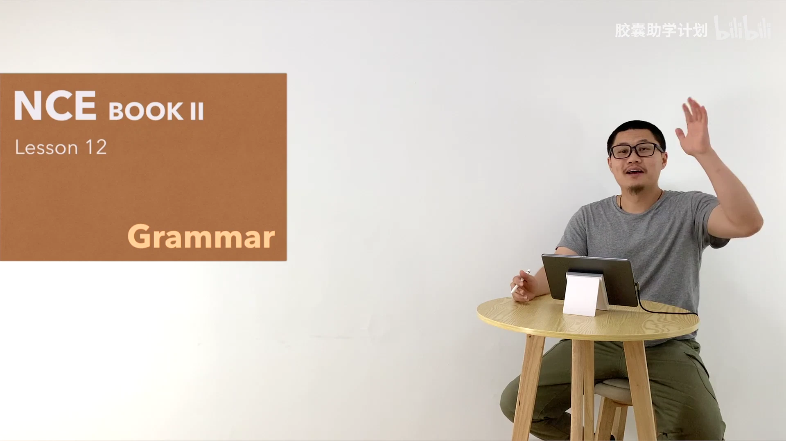

文字识别：胶囊助学计划 / NCE / BOOKⅡI / Lesson 12 / Grammar

### 画面 00:00:02

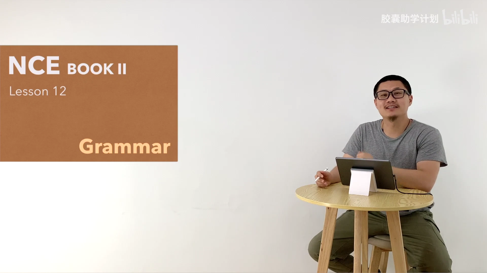

文字识别：胶囊助学计划 / NCE / BOOKII / Lesson 12 / Grammar

### 画面 00:00:04

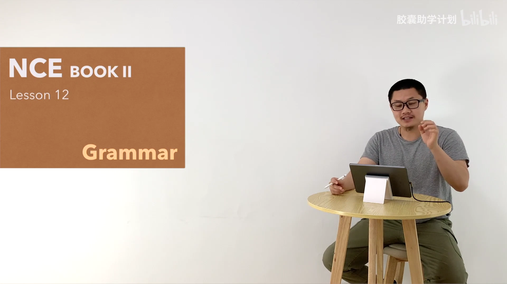

文字识别：胶囊助学计划 / NCE / BOOKII / Lesson 12 / Grammar

### 画面 00:00:06

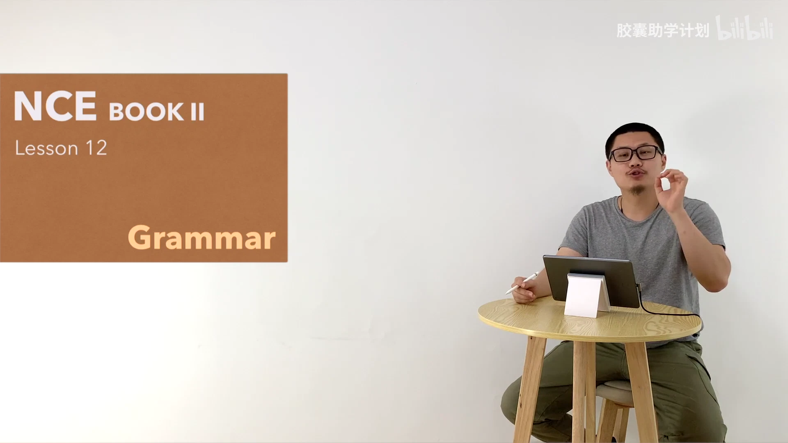

文字识别：胶囊助学计划 / NCE / BOOKⅡI / Lesson 12 / Grammar

### 画面 00:00:08

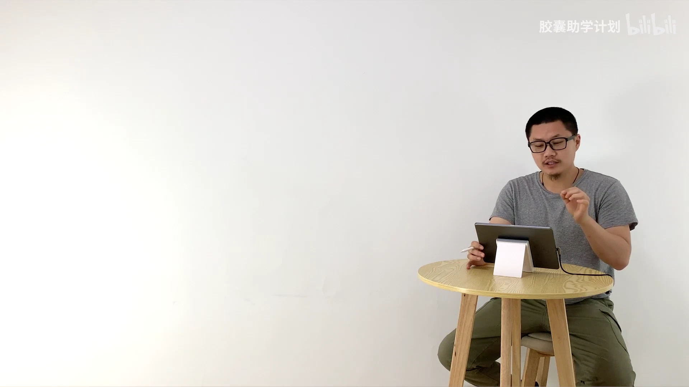

文字识别：胶囊助学计划

### 画面 00:00:10

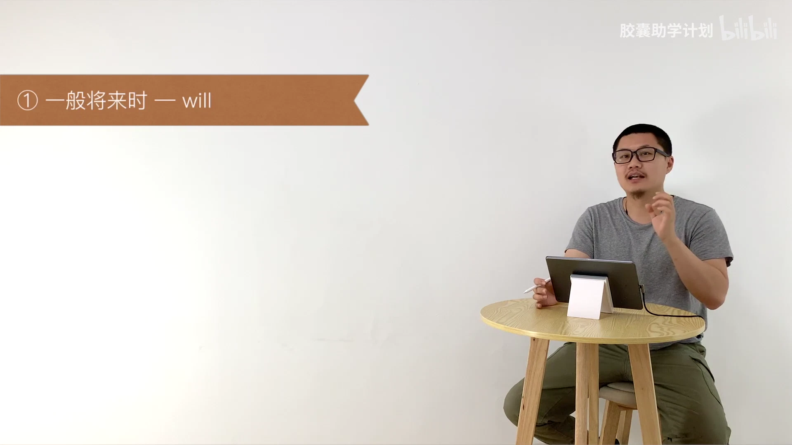

文字识别：胶囊助学计划 / ①一般将来时—will

### 画面 00:00:15

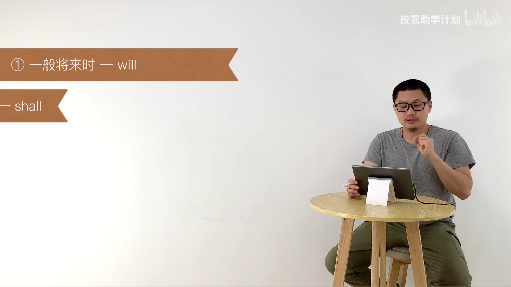

文字识别：胶囊助学计划 / ① 一般将来时一will / shall

### 画面 00:00:17

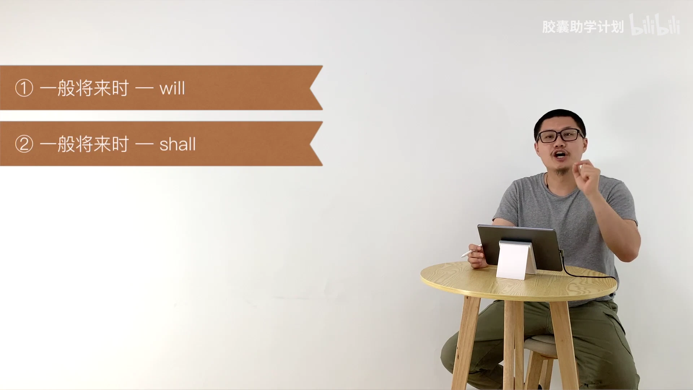

文字识别：胶囊助学计划 / ① 一般将来时—will / 一般将来时一 shall

### 画面 00:00:20

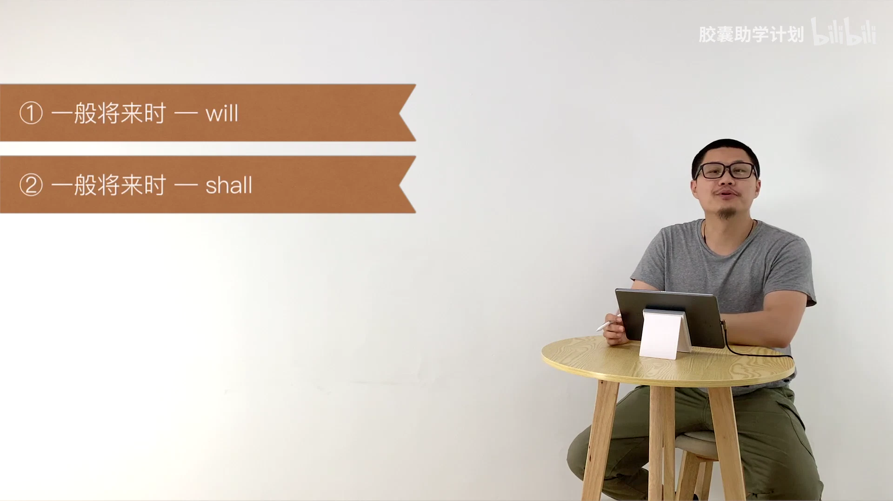

文字识别：胶囊助学计划 / ① 一般将来时—will / 一般将来时一 shall

### 画面 00:00:22

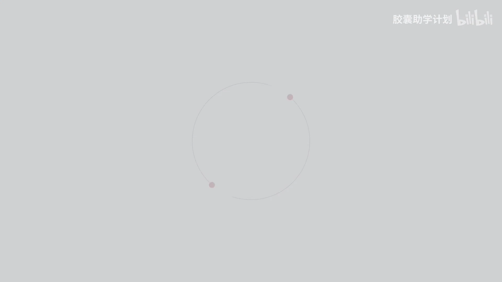

文字识别：胶囊助学计划 bilbl / • / •

### 画面 00:00:26

### 画面 00:00:28

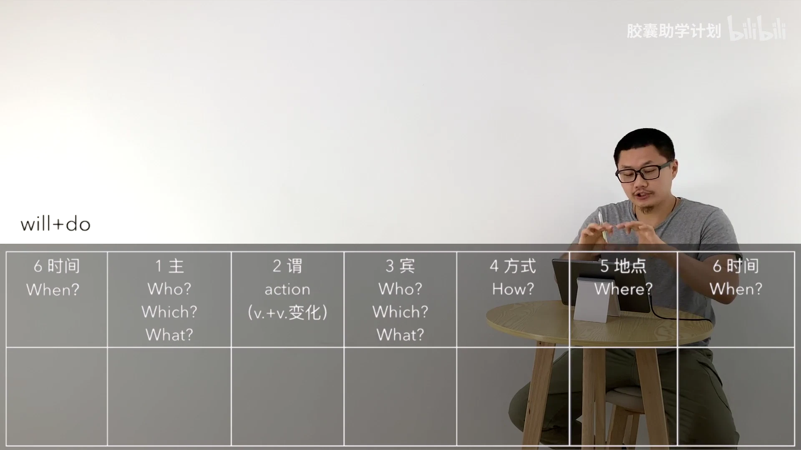

文字识别：胶囊助学计划 / will+do / 6时间 / 1主 / 2谓 / 3宾 / 4方式 / 5地点 / 6时间 / When? / Who? / action / Who? / How? / Where? / When? / Which? / (v.+v.变化) / Which? / What? / What?

## 00:00:30–00:01:00

就学过的语序，这个非常的重要啊。这个语序甚至直接到第三册，甚至第四册啊，以及将来大家可能读更难的英文，都会起到非常棒的一个辅助的作用。那我们看一下本课我们要学的 will do。首先，各位要知道这个 do 指的是动词的原形，will 指的是一般将来时。那它既然是时态，我们之前学到的所有时态都是处于谓语这个地方的，谓语即为

### 画面 00:00:45

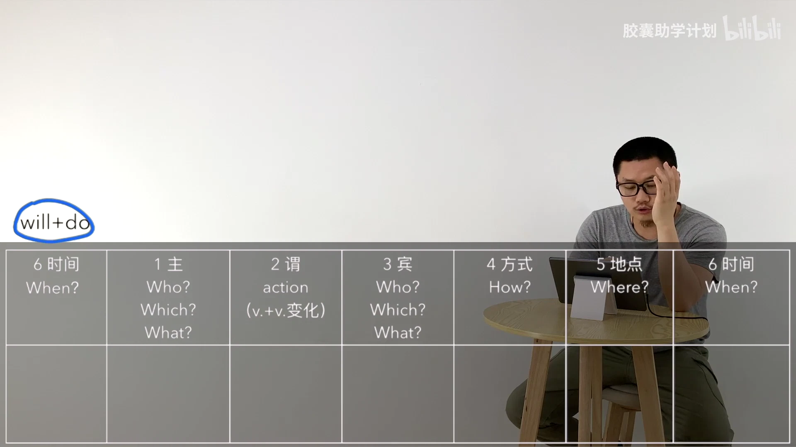

文字识别：Bilbili / 胶囊助学计划 / will+do / 6时间 / 1主 / 2谓 / 3宾 / 4方式 / 5地点 / 6时间 / When? / Who? / action / Who? / How? / Where? / When? / Which? / (v.+v.变化) / Which? / What? / What?

### 画面 00:00:55

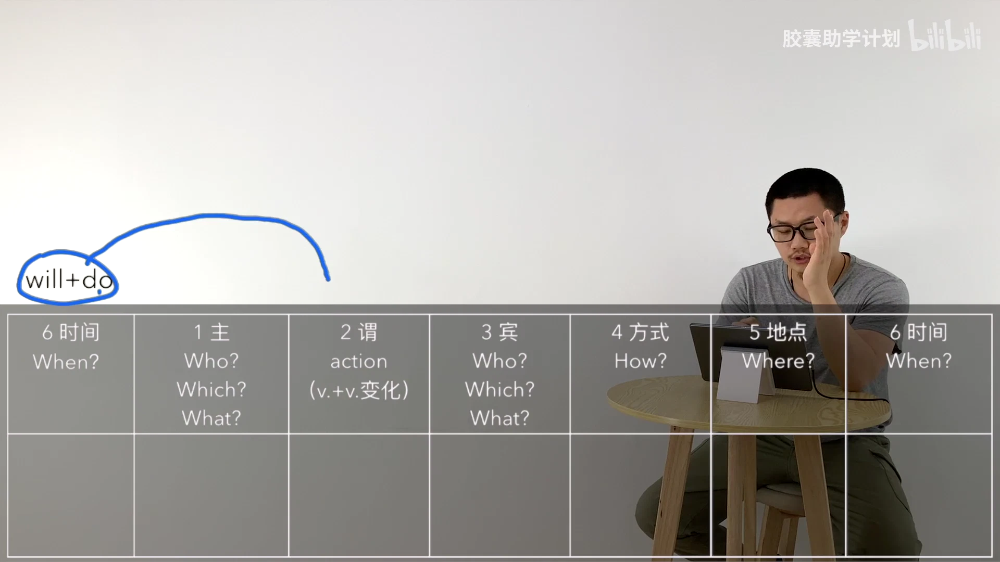

文字识别：bilbii / 胶囊助学计划 / will+do / 6时间 / 1主 / 2谓 / 3宾 / 4方式 / 5地点 / 6时间 / When? / Who? / action / Who? / How? / Where? / When? / Which? / (v.+v.变化) / Which? / What? / What?

## 00:01:00–00:01:30

动词加动词的变化。你看动词 fly 啊，就是动词原形。什么叫动词变化呢？您前面加了个 will，还是加了个 can 啊，还是变成 be going to do fly，对吧？ Be going to fly，还是 be flying 啊？这个就是我们所谓叫动词的变化。那可知本课的语法还是比较重要的。 OK，好，接下来呢，我们先看一下这两个单词的含义，它们往往表示的是将或者说会，我们管它叫一般将来时

### 画面 00:01:20

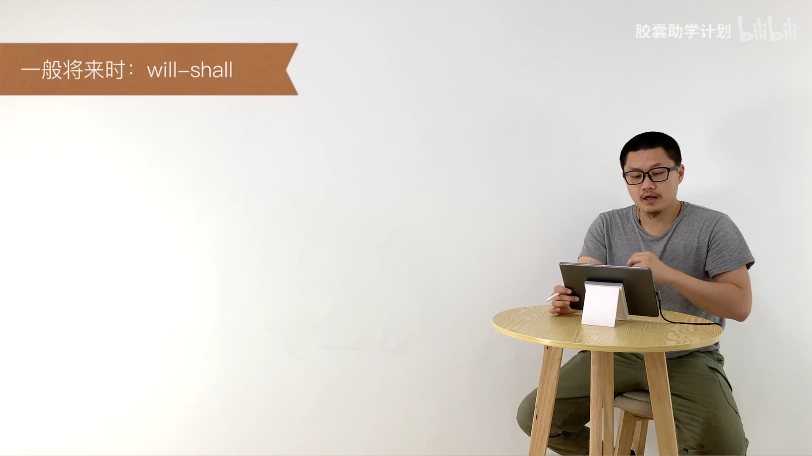

文字识别：胶囊助学计划 / 一般将来时：will-shall

### 画面 00:01:22

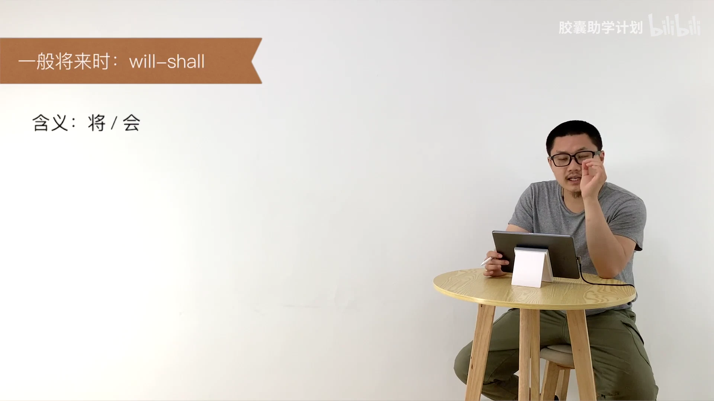

文字识别：胶囊助学计划 / 一般将来时：will-shall / 含义：将/会

## 00:01:30–00:02:00

嘛，肯定指的是未来的事情，对不对？好，那它的肯定句，老习惯，接下来我们讲四句型。那它的肯定句很简单，叫主语加 will 加 do 加其他。这个实际上在新概念一册九十一课、九十三课，我们已经花了大量的精力和时间去讲解过了，并且在我们专门给大家录制的语法单项当中，这个课程当中也花了大量时间精力去解释。那今天呢，我们就是简单的带着大家复习一下，OK？

### 画面 00:01:30

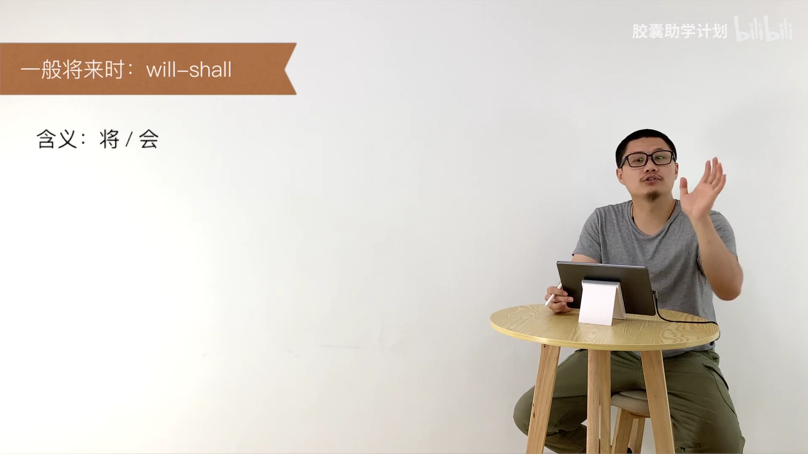

文字识别：胶囊助学计划 / 一般将来时：will-shall / 含义：将/会

### 画面 00:01:37

文字识别：胶囊助学计划 / 一般将来时：will-shall / 含义：将/会 / 肯定句 / 主+ will + do + 其他

### 画面 00:01:40

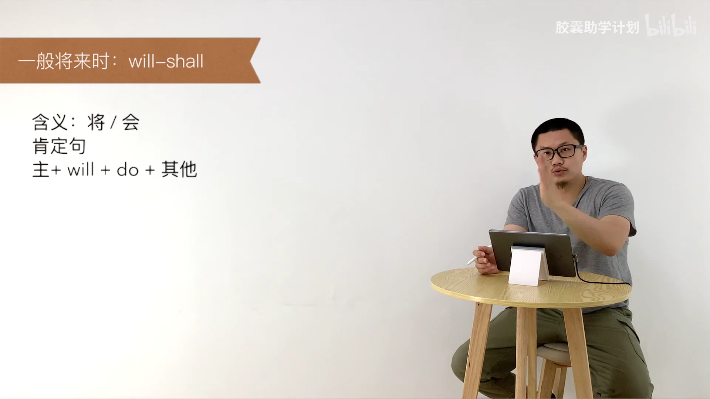

文字识别：胶囊助学计划 / 一般将来时：will-shall / 含义：将/会 / 肯定句 / 主+ will + do +其他

### 画面 00:01:47

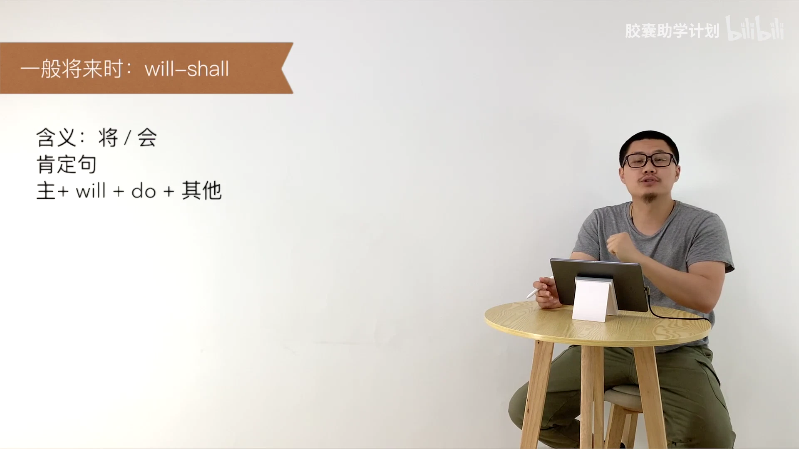

文字识别：胶囊助学计划 / 一般将来时：will-shall / 含义：将/会 / 肯定句 / 主+ will + do + 其他

### 画面 00:01:51

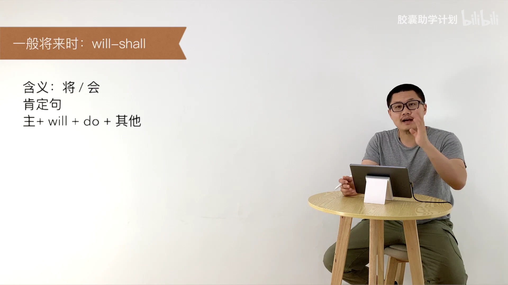

文字识别：胶囊助学计划 / 一般将来时：will-shall / 含义：将/会 / 肯定句 / 主+ will + do + 其他

### 画面 00:01:59

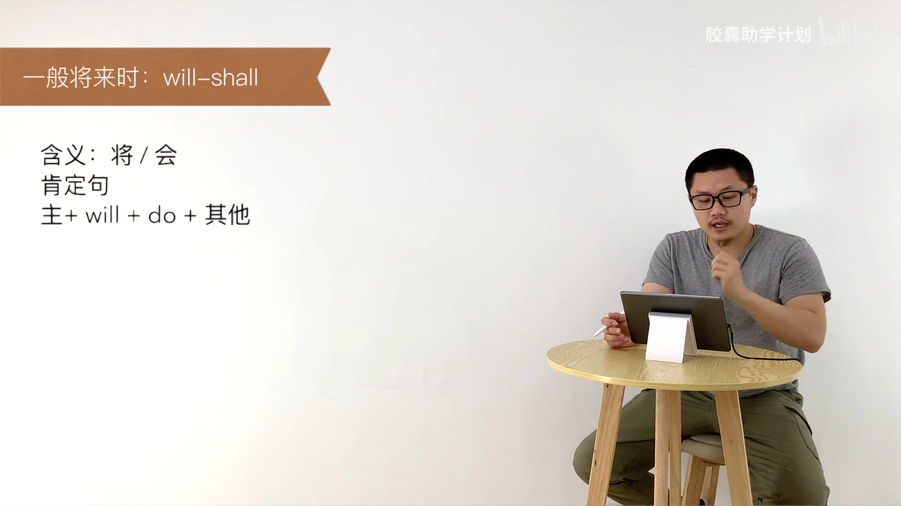

文字识别：胶囊助学计划 / 一般将来时：will-shall / 含义：将/会 / 肯定句 / 主+ will + do +其他

## 00:02:00–00:02:30

好，那注意一个小点，这个do指的是动词的原形。比如说，我们造看三个小的对比啊，说It is eleven o'clock now. Sarah is at work. 现在在工作，一般现在时。At eleven o'clock yesterday, she was at work. 注意一般过去时was，对吧？以及At eleven o'clock tomorrow, she will be at work. 注意一个小点，你看will加动词原形，

### 画面 00:02:01

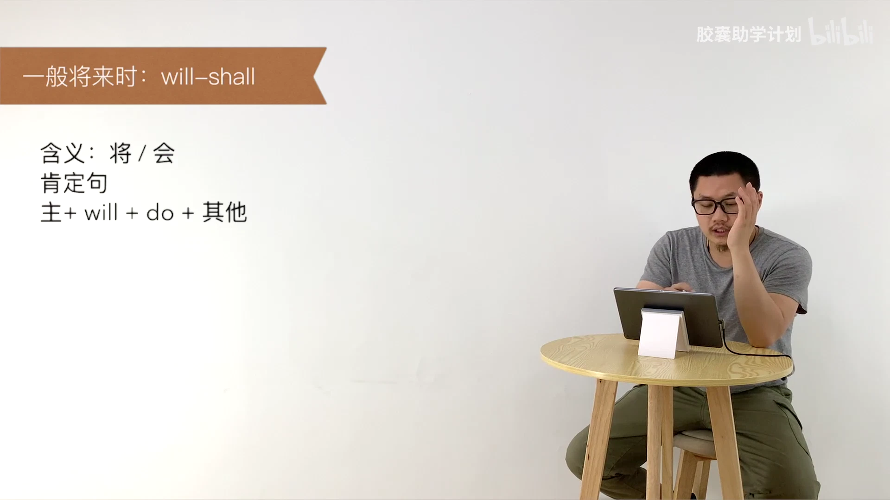

文字识别：胶囊助学计划 / 一般将来时：will-shall / 含义：将/会 / 肯定句 / 主+ will + do +其他

### 画面 00:02:05

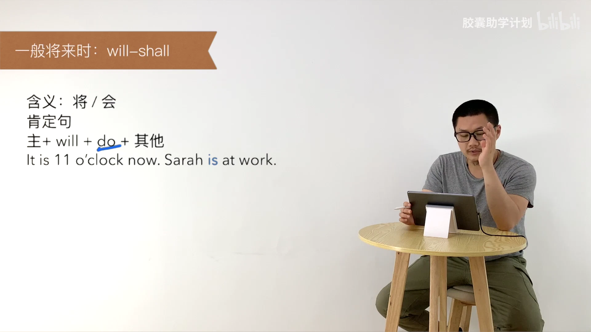

文字识别：胶囊助学计划 / 一般将来时：will-shall / 含义：将/会 / 肯定句 / 主+will +do+其他 / It is 11 o'clock now. Sarah is at work.

### 画面 00:02:21

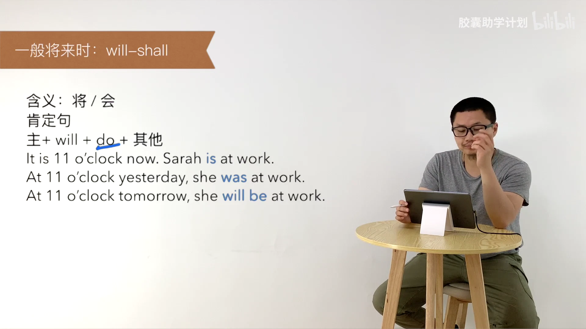

文字识别：胶囊助学计划 / 一般将来时：will-shall / 含义：将/会 / 肯定句 / 主+will + do +其他 / It is 11 o'clock now. Sarah is at work. / At 11 o'clock yesterday, she was at work. / At 11 o'clock tomorrow, she will be at work.

### 画面 00:02:26

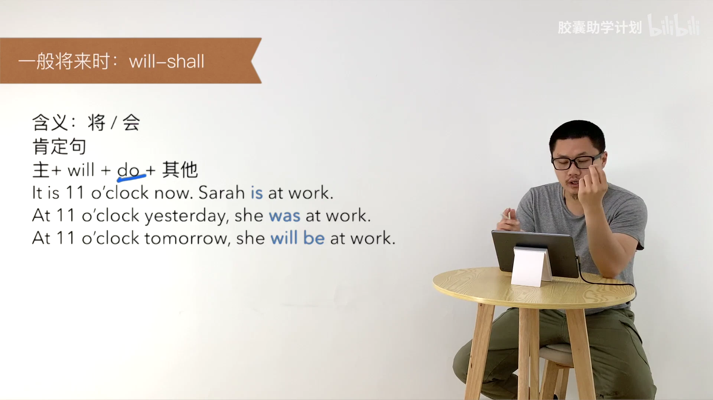

文字识别：胶囊助学计划 / 一般将来时：will-shall / 含义：将/会 / 肯定句 / 主+will + do+其他 / It is 11 o'clock now. Sarah is at work. / At 11 o'clock yesterday, she was at work. / At 11 o'clock tomorrow, she will be at work.

## 00:02:30–00:03:00

形，注意这个地方有一个小点，可能这个知识点大家对于大家来说不是那么容易理解啊。 Be 指的是动词原形，当它变成一般现在时的时候，它有三个状态叫 am is are，陈述客观事实，陈述过去的事情的时候，它有两个状态是 was 加 were，对吧？好，然后呢，我们实际上在被动的那个地方还见过它另外两种情况，就是 have done 的那种

### 画面 00:02:36

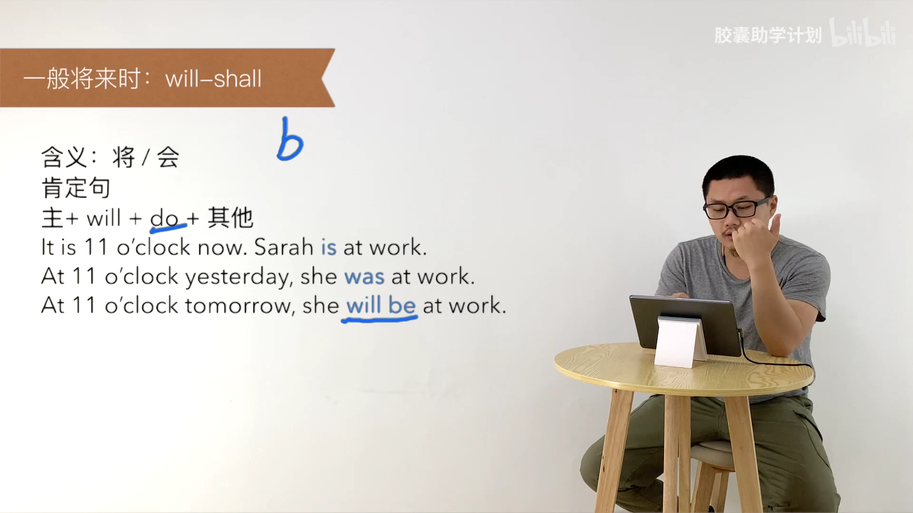

文字识别：胶囊助学计划 / 一般将来时：will-shall / D / 含义：将/会 / 肯定句 / 主+will + do+其他 / It is 11 o'clock now. Sarah is at work. / At 11 o'clock yesterday, she was at work. / At 11 o'clock tomorrow, she will be at work.

### 画面 00:02:40

文字识别：胶囊助学计划 / 一般将来时：will-shall / be / 含义：将/会 / 肯定句 / 主+will + do+其他 / It is 11 o'clock now. Sarah is at work. / At 11 o'clock yesterday, she was at work. / At 11 o'clock tomorrow, she will be at work.

### 画面 00:02:43

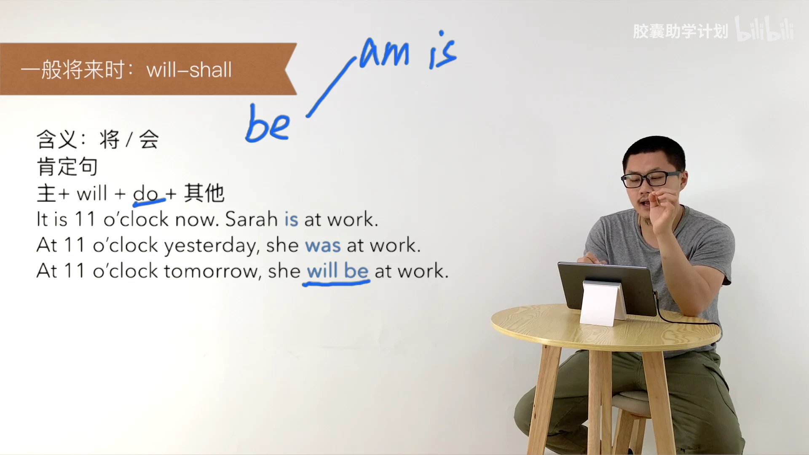

文字识别：胶囊助学计划 / am / 一般将来时：will-shall / be / 含义：将/会 / 肯定句 / 主+will + do+其他 / It is 11 o'clock now. Sarah is at work. / At 11 o'clock yesterday, she was at work. / At 11 o'clock tomorrow, she will be at work.

### 画面 00:02:45

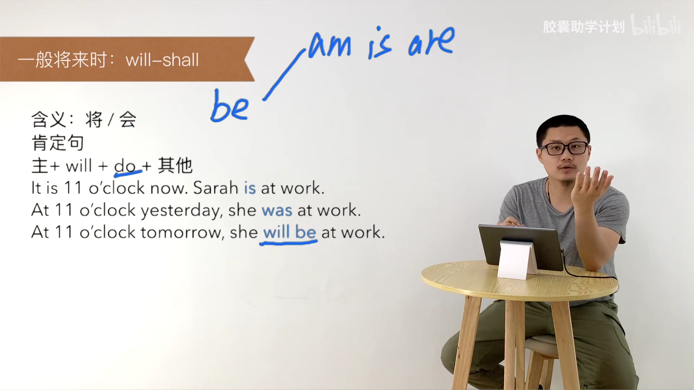

文字识别：胶囊助学计划 / am is are / 一般将来时：will-shall / be / 含义：将/会 / 肯定句 / 主+will + do+其他 / It is 11 o'clock now. Sarah is at work. / At 11 o'clock yesterday, she was at work. / At 11 o'clock tomorrow, she will be at work.

### 画面 00:02:49

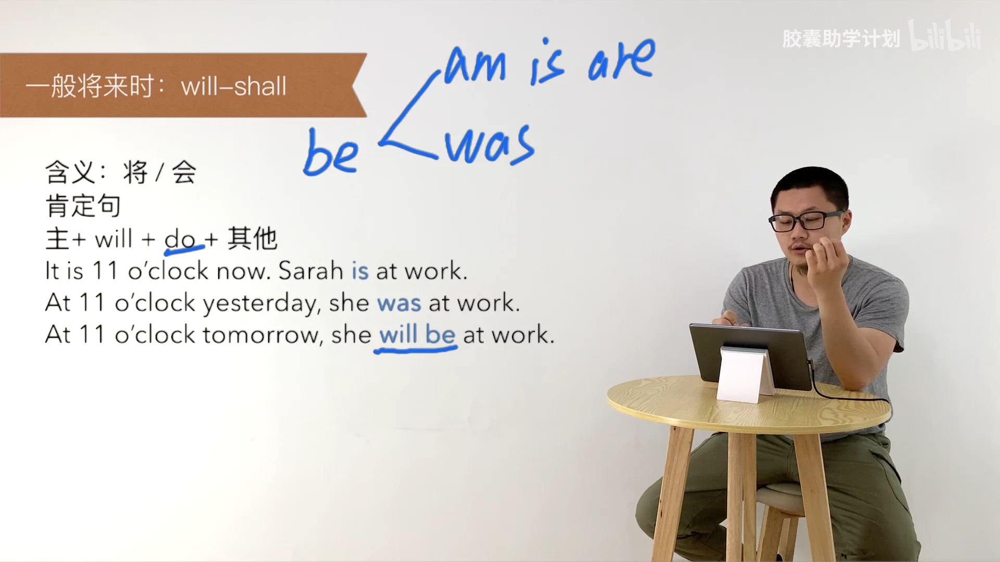

文字识别：胶囊助学计划 / am is are / 一般将来时：will-shall / be / /Was / 含义：将/会 / 肯定句 / 主+will+do+其他 / It is 11 o'clock now. Sarah is at work. / At 11 o'clock yesterday, she was at work. / At 11 o'clock tomorrow, she will be at work.

### 画面 00:02:51

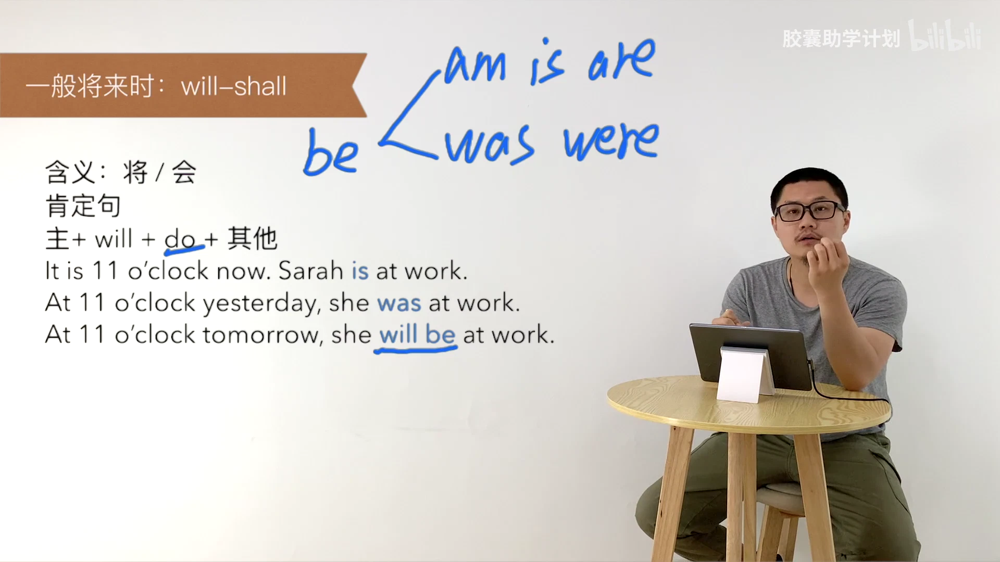

文字识别：胶囊助学计划 / am is are / 一般将来时：will-shall / be / /Was / were / 含义：将/会 / 肯定句 / 主+will+ do+其他 / It is 11 o'clock now. Sarah is at work. / At 11 o'clock yesterday, she was at work. / At 11 o'clock tomorrow, she will be at work.

## 00:03:00–00:03:30

状态之下呢，它的状态叫做 been，也就是说 be 是原形，been 是这个原形的过去分词，对吧？好，以及它还有一个状态是什么呢？就是 being。这个实际上我们在第十课讲被动的时候，现在进行时的被动，对吧？M A Z R 加 being 加 done 那个地方也有去解释过。那各位其实今天啊，你基本上就见到全家谱了。be 指的就是动词原形。那这儿

### 画面 00:03:00

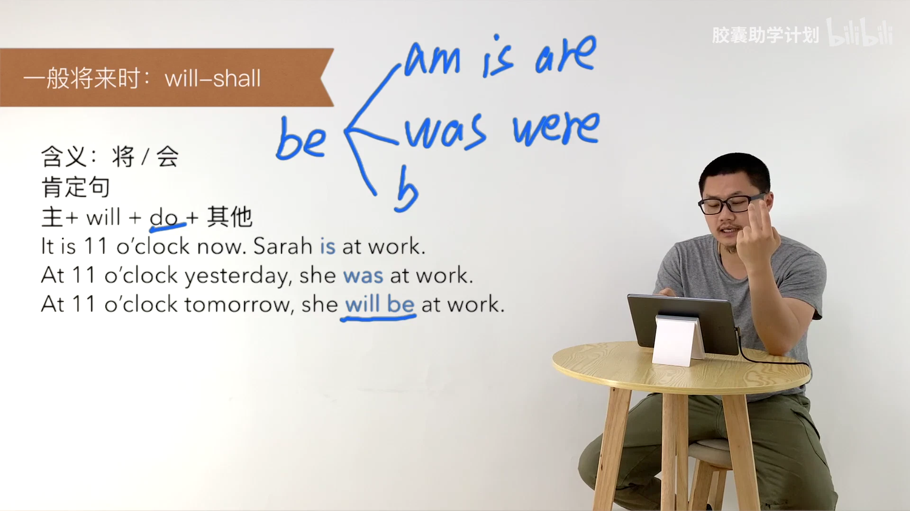

文字识别：胶囊助学计划 / am is are / 一般将来时：will-shall / be / /Was / were / 含义：将/会 / 肯定句 / 主+will + do+其他 / It is 11 o'clock now. Sarah is at work. / At 11 o'clock yesterday, she was at work. / At 11 o'clock tomorrow, she will be at work.

### 画面 00:03:02

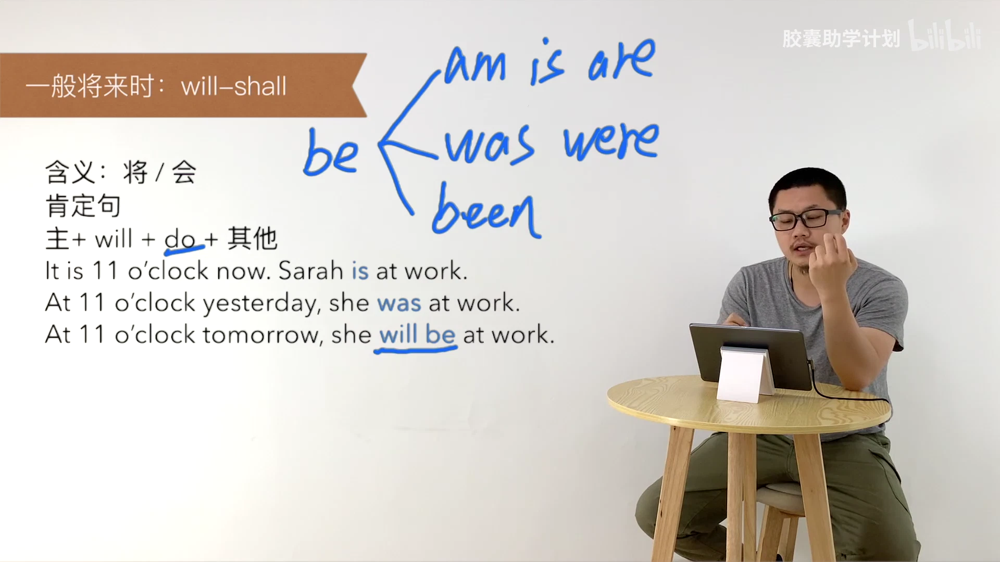

文字识别：胶囊助学计划 / am is are / 一般将来时：will-shall / be / /Was / were / 含义：将/会 / been / 肯定句 / 主+will + do +其他 / It is 11 o'clock now. Sarah is at work. / At 11 o'clock yesterday, she was at work. / At 11 o'clock tomorrow, she will be at work.

### 画面 00:03:06

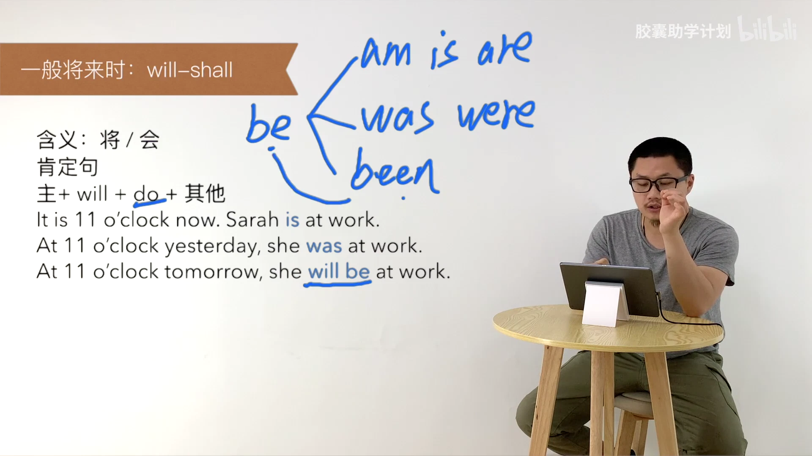

文字识别：胶囊助学计划 / am is are / 一般将来时：willshall / be / lWas / were / 含义：将/会 / been / 肯定句 / 主+will+ do+其他 / It is 11 o'clock now. Sarah is at work. / At 11 o'clock yesterday, she was at work. / At 11 o'clock tomorrow, she will be at work.

### 画面 00:03:11

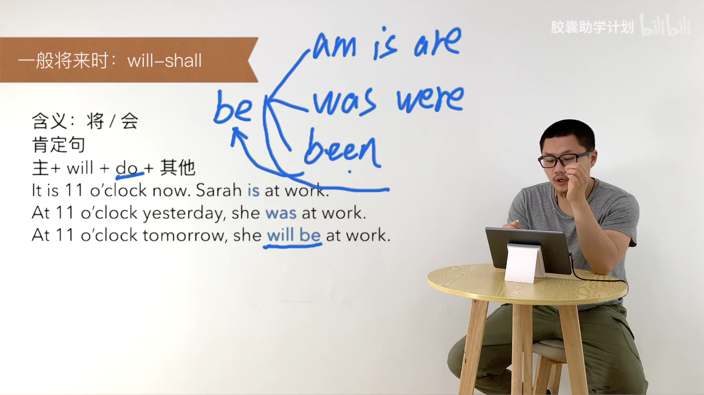

文字识别：胶囊助学计划 / am is are / 一般将来时：will-shall / be / /Was / were / 含义：将/会 / been / 肯定句 / 主+will+ do+其他 / It is 11 o'clock now. Sarah is at work. / At 11 o'clock yesterday, she was at work. / At 11 o'clock tomorrow, she will be at work.

### 画面 00:03:13

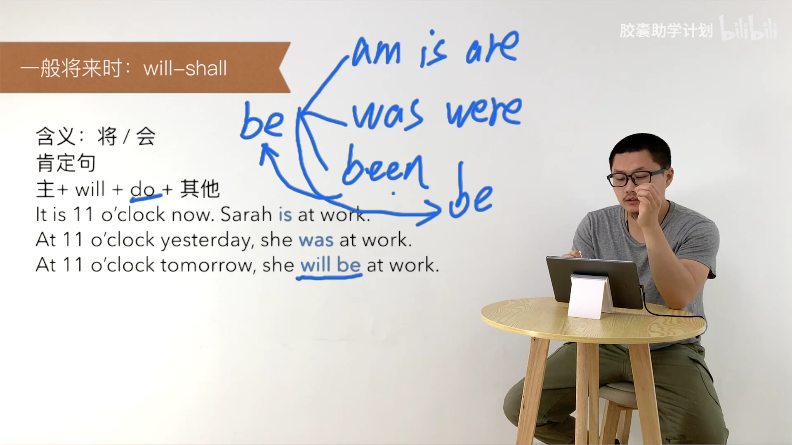

文字识别：胶囊助学计划 / am is are / 一般将来时：will-shall / be / Was / were / 含义：将/会 / been / 肯定句 / be / 主+ will + do +其他 / It is 11 o'clock now. Sarah is at work. / At 11 o'clock yesterday, she was at work. / At 11 o'clock tomorrow, she will be at work.

### 画面 00:03:15

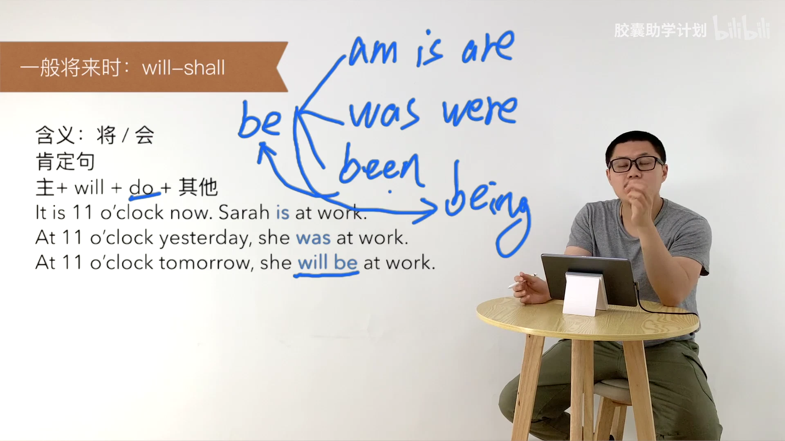

文字识别：胶囊助学计划 / am is are / 一般将来时：will-shall / be / /Was / were / 含义：将/会 / been / 肯定句 / bemy / 主+will+ do+其他 / It is 11 o'clock now. Sarah is at work. / At 11 o'clock yesterday, she was at work. / At 11 o'clock tomorrow, she will be at work.

### 画面 00:03:18

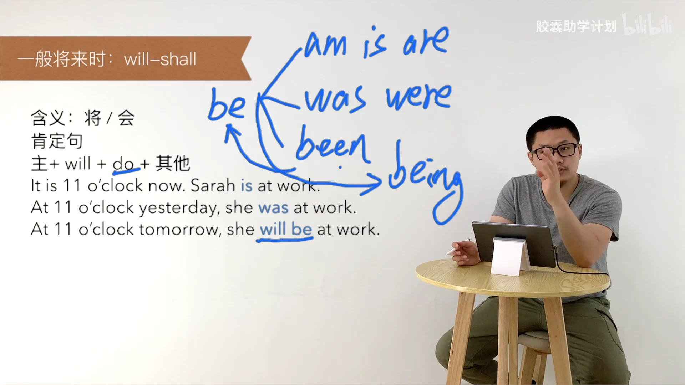

文字识别：胶囊助学计划 / am is are / 一般将来时：will-shall / be / /Was / were / 含义：将/会 / been / 入 / 肯定句 / bem / 主+will + do+其他 / It is 11 o'clock now. Sarah is at work. / At 11 o'clock yesterday, she was at work. / At 11 o'clock tomorrow, she will be at work.

### 画面 00:03:24

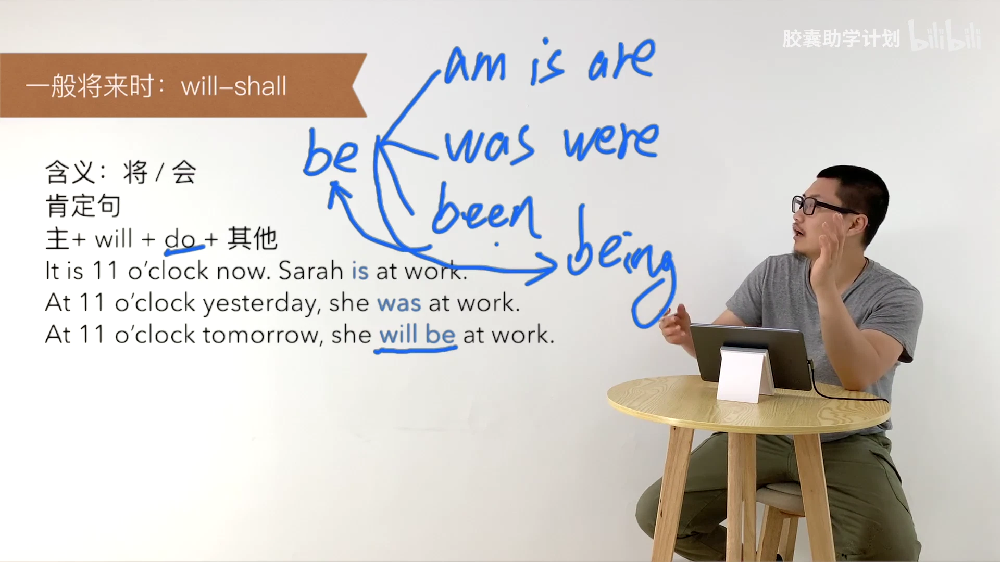

文字识别：胶囊助学计划 / am is are / 一般将来时：will-shall / be / /Was / were / 含义：将/会 / been / 肯定句 / bem / 主+ will + do +其他 / It is 11 o'clock now. Sarah is at work. / At 11 o'clock yesterday, she was at work. / At 11 o'clock tomorrow, she will be at work.

## 00:03:30–00:04:00

为什么是 will be 呢？因为我们刚才讲了 will 后边加的是动词的原形。您不能用 am/is/ was/were been 或 being，要用它的原形，也就是 be。我希望我讲清楚了。OK，那明天十一点钟，它将在工作。OK，将会，这就是我们的肯定句，非常的简单。那它实际上，注意还有一个小的缩写，比如说 I 后边加 P L L， she 后边加 P L L， we 后

### 画面 00:03:33

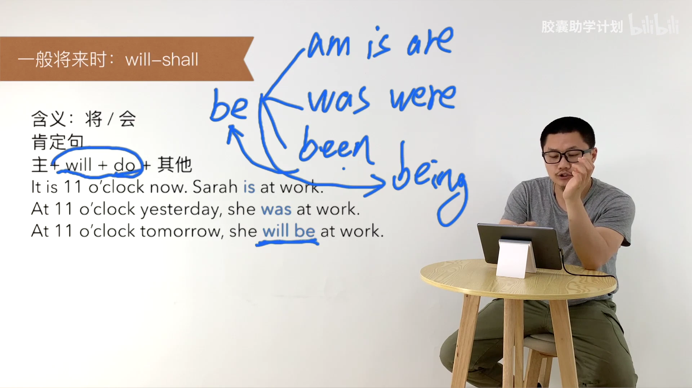

文字识别：胶囊助学计划 / am is are / 一般将来时：will-shall / be / /Was / were / 含义：将/会 / been / 肯定句 / bem / 主+will+ do+其他 / It is 11 o'clock now. Sarah is at work. / At 11 o'clock yesterday, she was at work. / At 11 o'clock tomorrow, she will be at work.

### 画面 00:03:35

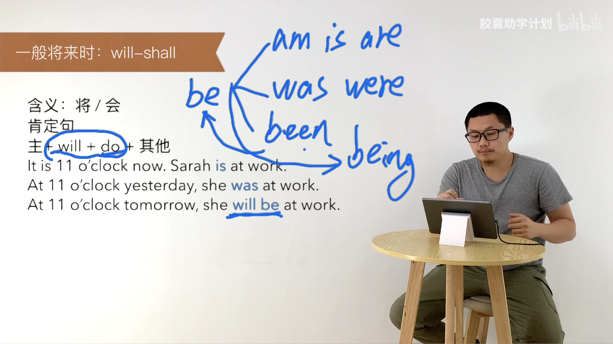

文字识别：胶囊助学计划 / am is are / 一般将来时：willshall / be / /Was / were / 含义：将/会 / been / 肯定句 / bem / 主 / will +do+其他 / It is 11 o'clock now. Sarah is at work. / At 11 o'clock yesterday, she was at work. / At 11 o'clock tomorrow, she will be at work.

### 画面 00:03:37

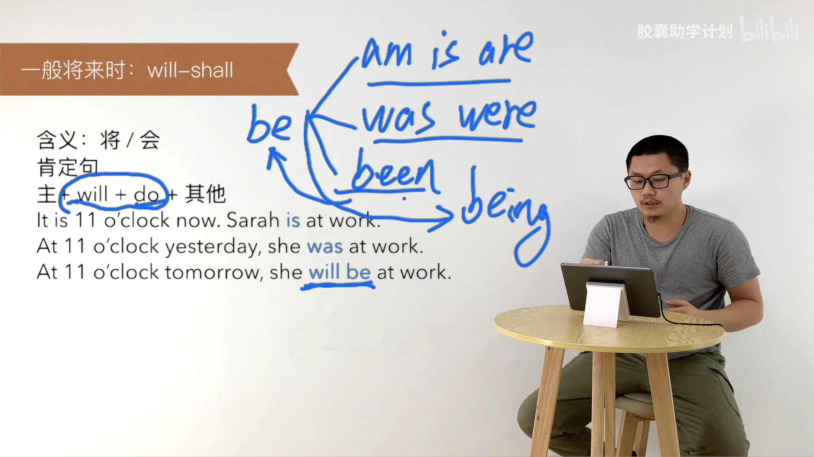

文字识别：胶囊助学计划 / am / is are / 一般将来时：will-shall / be / /Was / were / 含义：将/会 / 入 / been / 肯定句 / bem / 主 / will+do+其他 / It is 11 o'clock now. Sarah is at work. / At 11 o'clock yesterday, she was at work. / At 11 o'clock tomorrow, she will be at work.

### 画面 00:03:40

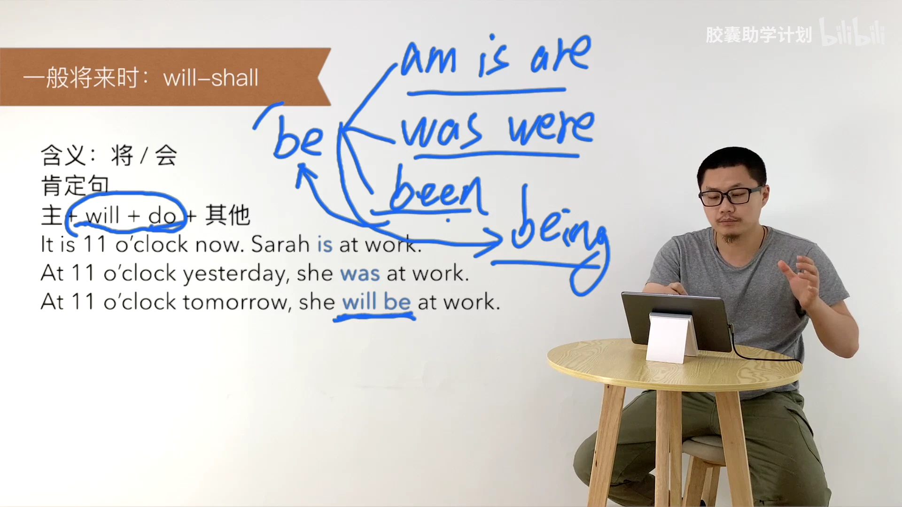

文字识别：胶囊助学计划 / am / is are / 一般将来时：will-shall / be / /Was / were / 含义：将/会 / been / 肯定句 / bem / 主 / will+do+其他 / It is 11 o'clock now. Sarah is at work. / At 11 o'clock yesterday, she was at work. / At 11 o'clock tomorrow, she will be at work.

### 画面 00:03:42

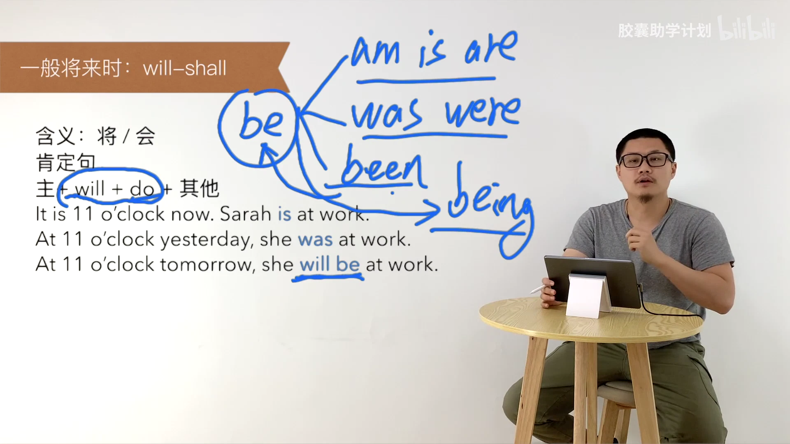

文字识别：胶囊助学计划 / am / isare / 一般将来时：will-shall / /Was / were / be / 含义：将/会 / been / 肯定句 / bem / 主 / will +do+其他 / It is 11 o'clock now. Sarah is at work. / At 11 o'clock yesterday, she was at work. / At 11 o'clock tomorrow, she will be at work.

### 画面 00:03:50

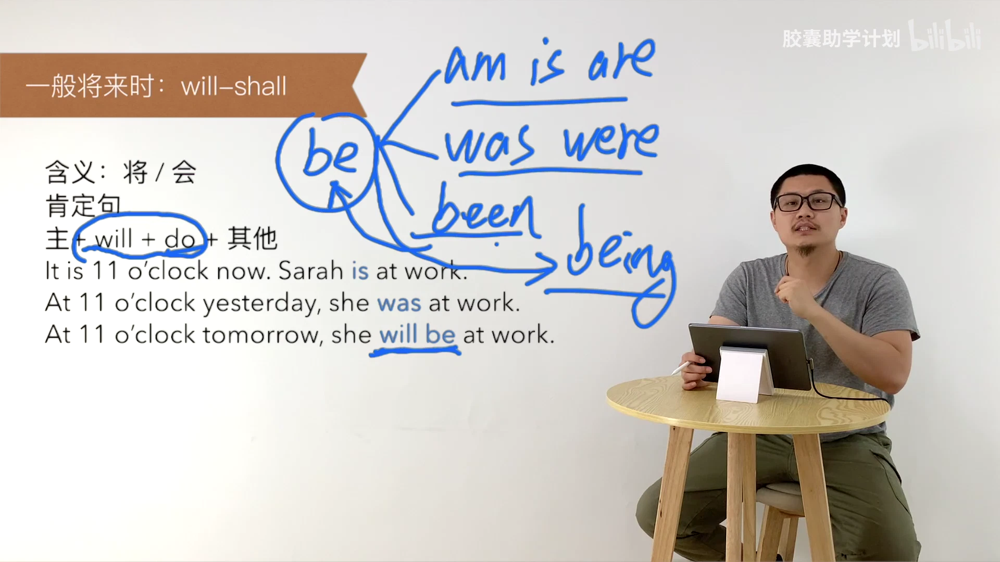

文字识别：胶囊助学计划 / am / isare / 一般将来时：willshall / were / /Was / be / 含义：将/会 / been / 肯定句 / bem / 主 / will +do+其他 / It is 11 o'clock now. Sarah is at work. / At 11 o'clock yesterday, she was at work. / At 11 o'clock tomorrow, she will be at work.

### 画面 00:03:53

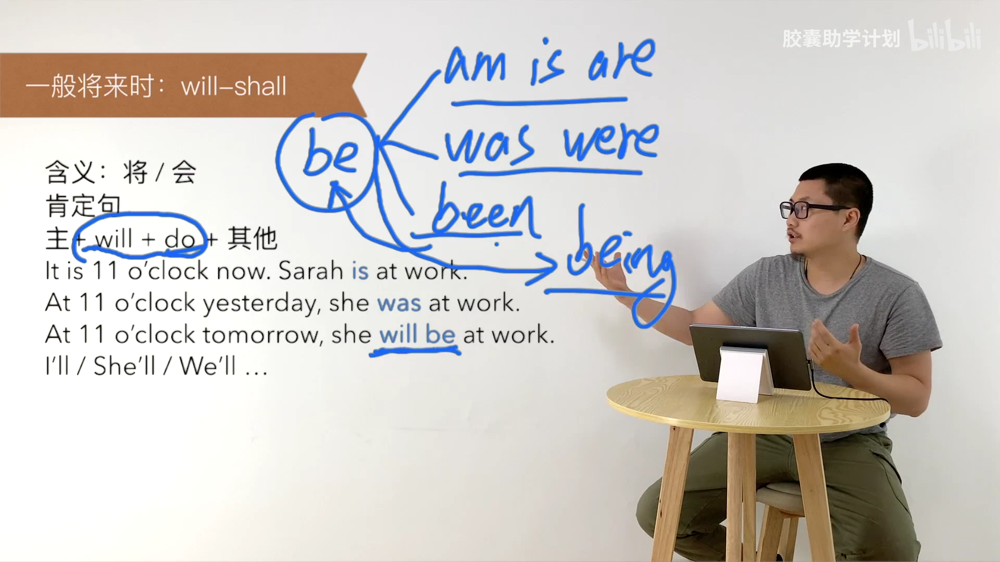

文字识别：胶囊助学计划 / am / isare / 一般将来时：will-shall / /Was / were / be / 含义：将/会 / been / 肯定句 / beiny / 主 / will +do+其他 / It is 11 o'clock now. Sarah is at work. / At 11 o'clock yesterday, she was at work. / At 11 o'clock tomorrow, she will be at work. / I'Il/She'll/We'll..

### 画面 00:03:56

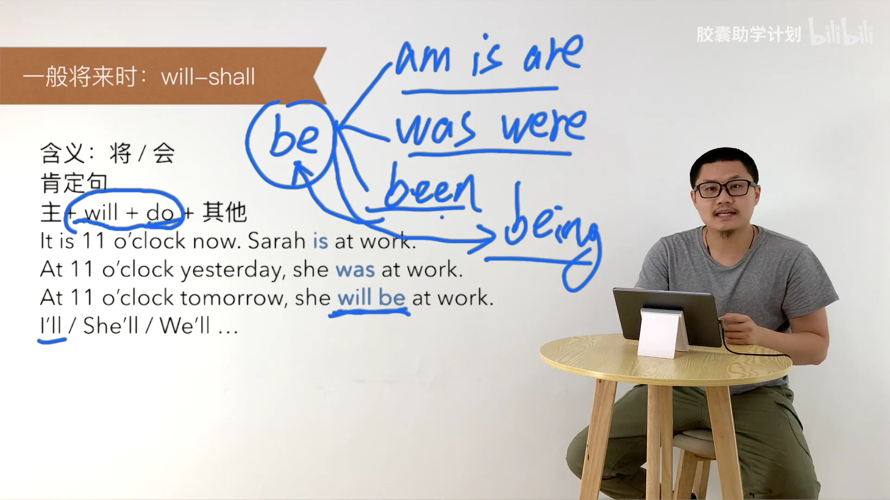

文字识别：胶囊助学计划 / am / is are / 一般将来时：will-shall / /Was / were / be / 含义：将/会 / been / 肯定句 / bew / 主 / will +do+其他 / It is 11 o'clock now. Sarah is at work. / At 11 o'clock yesterday, she was at work. / At 11 o'clock tomorrow, she will be at work. / I'll/She'l/We'll.

## 00:04:00–00:04:30

边加 p l l， p l l 只发一个辅音，就是，哎，舌尖舔沙音。比如说 i，你看，我们只读这个音叫 i，再加上舌尖沙音就是 i l， ok。那后边是 she，就是 she l， ok。 we 就是 will， ok。哪儿一个？接下来，它有一个肯定句当中非常常用的用法，我们管它叫当机立断的决定

### 画面 00:04:00

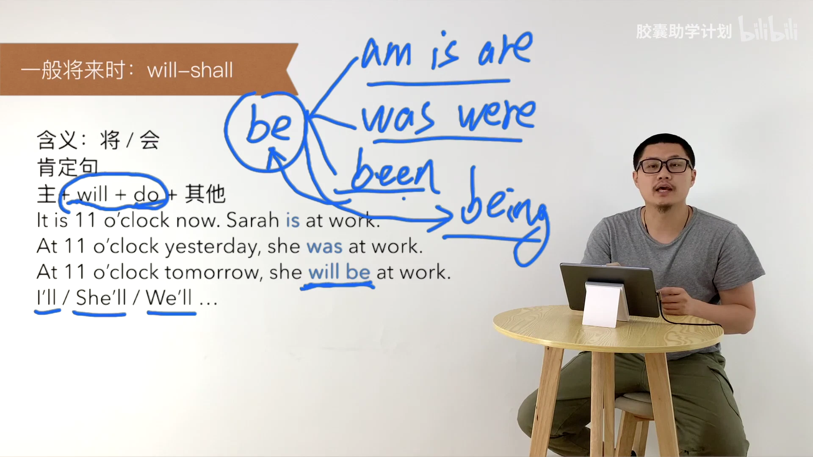

文字识别：胶囊助学计划 / am / are / 一般将来时：will-shall / /Was / were / be / 含义：将/会 / been / 肯定句 / ben / 主 / will + do+其他 / It is 11 o'clock now. Sarah is at work. / At 11 o'clock yesterday, she was at work. / At 11 o'clock tomorrow, she will be at work. / I'Il/She'll/We'lI

### 画面 00:04:05

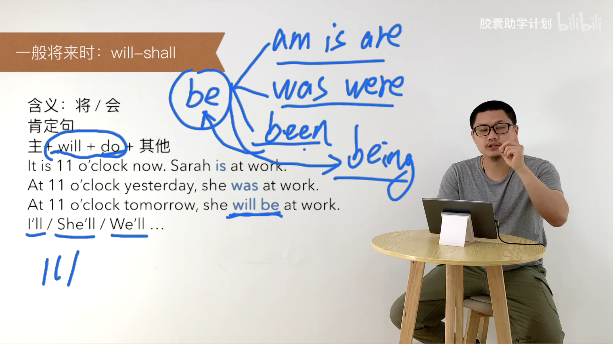

文字识别：胶囊助学计划 / am / are / 一般将来时：will-shall / /Was / were / be / 含义：将/会 / been / 肯定句 / bem / 主 / will + do+ / 其他 / It is 11 o'clock now. Sarah is at work. / At 11 o'clock yesterday, she was at work. / At 11 o'clock tomorrow, she will be at work. / I'Il/She'll/We'lI / 11/

### 画面 00:04:07

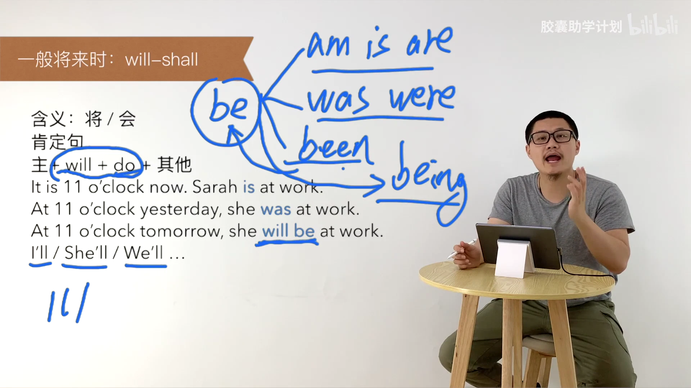

文字识别：胶囊助学计划 / am / are / 一般将来时：will-shall / /was / were / be / 含义：将/会 / been / 肯定句 / bem / 主 / will + do+ / 其他 / It is 11 o'clock now. Sarah is at work. / At 11 o'clock yesterday, she was at work. / At 11 o'clock tomorrow, she will be at work. / I'Il/She'll/We'lI / 11/

### 画面 00:04:09

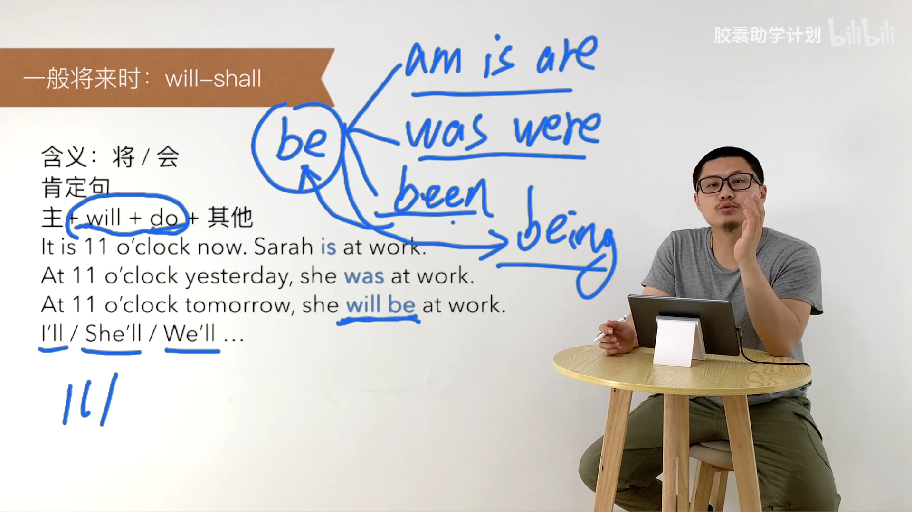

文字识别：胶囊助学计划 / am / are / 一般将来时：willshall / /Was / were / be / 含义：将/会 / been / 肯定句 / hem / 主 / will + do+ 1 / 其他 / It is 11 o'clock now. Sarah is at work. / At 11 o'clock yesterday, she was at work. / At 11 o'clock tomorrow, she will be at work. / I'Il/She'll/We'lI / 11/

### 画面 00:04:21

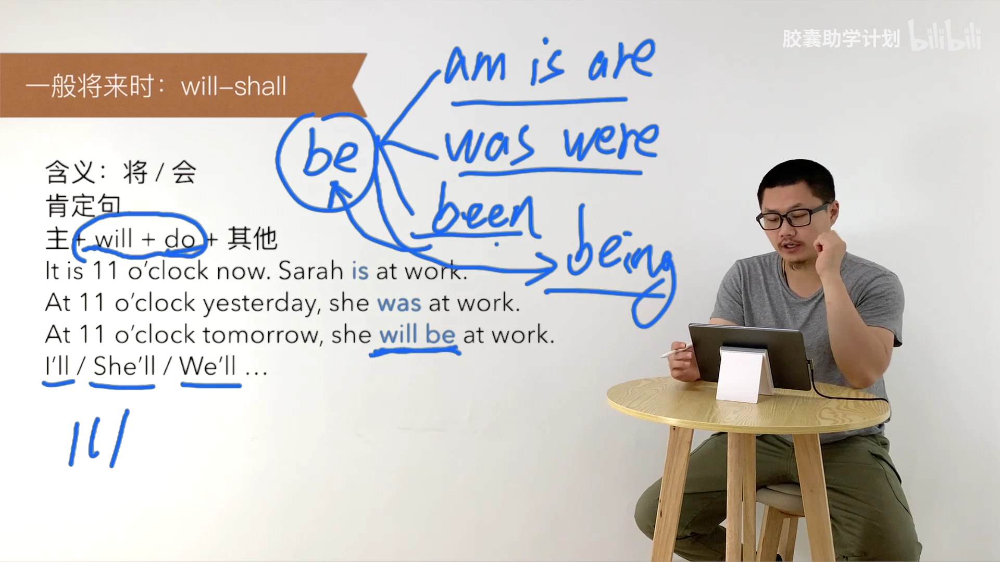

文字识别：胶囊助学计划 / am / are / 一般将来时：will-shall / were / /Was / be / 含义：将/会 / been / 肯定句 / bem / 主 / will + do+  / 其他 / It is 11 o'clock now. Sarah is at work. / At 11 o'clock yesterday, she was at work. / At 11 o'clock tomorrow, she will be at work. / I'Il/She'll/We'lI / 1/

### 画面 00:04:23

文字识别：胶囊助学计划 / 一般将来时：will-shall / 含义：将/会(当机立断的决定）

### 画面 00:04:29

文字识别：胶囊助学计划 / 一般将来时：will-shall / 含义：将/会(当机立断的决定)

## 00:04:30–00:05:00

啊，依旧在我们的语法单项视频和新概念一册九十一课当中有专门花时间精力给大家讲解啊，当机立断的一个决定。比如说啊，它的结构不变。比如说说 it's too heavy。A说了一句话啊，我朋友说了一句话，我说 it's too heavy。我刚才说的说 don't worry, man, I'll carry it for you。啊，比如说一个小姑娘对吧？我的一个女性朋友她说这个东西太沉了，我说别担心，I'll carry it for you，我来帮你拿吧。

### 画面 00:04:41

文字识别：胶囊助学计划 / 一般将来时：will-shall / 含义：将/会(当机立断的决定） / 肯定句 / 主+ will + do +其他 / It's too heavy.

### 画面 00:04:45

文字识别：胶囊助学计划 / 一般将来时：will-shall / 含义：将/会(当机立断的决定） / 肯定句 / 主+ will + do +其他 / It's too heavy. / I'll carry it for you.

### 画面 00:04:57

文字识别：胶囊助学计划 / 一般将来时：will-shall / 含义：将/会(当机立断的决定） / 肯定句 / 主+ will + do +其他 / It's too heavy. / I'll carry it for you.

## 00:05:00–00:05:30

see, this is first, I help you take it. This is a future action, right? This is my immediate decision. Before you say it, I haven't decided to help you take it. Okay, so I say I'll carry it for you. Next, we watch a small movie clip. In the movie clip, there is an immediate decision called I'll get it. Before you say this, I don't know. When you say it, I'll help you take it. Immediate decision comes. Not without your valiant.

### 画面 00:05:03

文字识别：胶囊助学计划 / 一般将来时：will-shall / 含义：将/会(当机立断的决定） / 肯定句 / 主+ will + do +其他 / It's too heavy. / I'll carry it for you.

### 画面 00:05:06

文字识别：胶囊助学计划 / 一般将来时：will-shall / 含义：将/会(当机立断的决定) / 肯定句 / 主+ will + do +其他 / It's too heavy. / I'll carry it for you.

### 画面 00:05:11

文字识别：胶囊助学计划 / 一般将来时：will-shall / 含义：将/会(当机立断的决定） / 肯定句 / 主+ will +do +其他 / It's too heavy. / I'll carry it for you.

### 画面 00:05:13

文字识别：I'll get it. / 胶囊助学计划 / 随波逐流 / 我要结婚啦 / Just Go with It / I'm getting married! / (2011)

### 画面 00:05:15

文字识别：I'll get it. / 胶囊助学计划 / 随波逐流 / 我要结婚啦 / Just Go with It / I'm getting married! / (2011)

### 画面 00:05:28

文字识别：I'll get it. / 胶囊助学计划 / 随波逐流 / Just Go with It / (2011)

## 00:05:30–00:06:00

your veil, you're not. Where's that bad boy? Oh, I think I left it upstairs. Oh, don't worry, I'll get it. This. Oh,你看，他说 I think I left it upstairs.你看，我觉得呀，我应该是把它遗留在楼上了，落在楼上了，对吧？然后他说 Don't worry, I'll get it for you,是吧？别别担心啊，我来给你拿。在你说之前，我是我也不知道它在什么地方，对吧？Okay, there you go.

### 画面 00:05:30

文字识别：I'll get it. / 胶囊助学计划 / 随波逐流 / 没有面纱可不行 / Just Go with It / Not without your veil, you're not. / (2011)

### 画面 00:05:32

文字识别：I'll get it. / 胶囊助学计划 / 随波逐流 / 那破玩意儿在哪里 / Just Go with It / Where is that bad boy? / (2011)

### 画面 00:05:34

文字识别：I'll get it. / 胶囊助学计划 / 随波逐流 / 我大概把它留在楼上了 / Just Go with It / Oh,I think I left it upstairs. / (2011)

### 画面 00:05:36

文字识别：I'll get it. / 胶囊助学计划 / 随波逐流 / 别担心我去拿 / Just Go with It / Don't worry.'ll get it, / (2011)

### 画面 00:05:38

文字识别：I'll get it. / 胶囊助学计划 / 随波逐流 / 别担心我去拿 / Just Go with It / Don't worry.'ll get it, / (2011)

### 画面 00:05:40

文字识别：I'll get it. / 胶囊助学计划 / 随波逐流 / 嫂嫂 / Just Go with It / sis. / (2011)

### 画面 00:05:42

文字识别：I'll get it. / 胶囊助学计划 / 随波逐流 / 嫂嫂 / Just Go with It / sis. / (2011)

## 00:06:00–00:06:30

好，接下来呢，我们看一下它的否定句。其实，首先如果各位基础好，就不用我讲了，你已经知道在什么地方了，对吧？好，我们先直接给答案啊，就是 will 后边加 not。那当然还有一个缩写，但缩写的状态区别比较大，叫做 won't。 OK， won't。那注意一个小点，你其实可以把 will 跟哪几个单词对标一下呢？它们的用法几乎都就是它们的这个结构上的用法啊，不是含义上的用法，几乎是一致的。 Can,

### 画面 00:06:00

文字识别：胶囊助学计划 / 一般将来时：will-shall / 含义：将/会 / 否定句

### 画面 00:06:03

文字识别：胶囊助学计划 / 一般将来时：will-shall / 含义：将/会 / 否定句

### 画面 00:06:10

文字识别：胶囊助学计划 / 一般将来时：will-shall / 含义：将/会 / 否定句 / 主+will + not (won't)

### 画面 00:06:13

文字识别：胶囊助学计划 / 一般将来时：will-shall / 含义：将/会 / 否定句 / 主+will + not / (won't)

### 画面 00:06:15

文字识别：胶囊助学计划 / 一般将来时：will-shall / 含义：将/会 / 否定句 / 主+will + not / (won't)

### 画面 00:06:26

文字识别：胶囊助学计划 / 一般将来时：will-shall / 含义：将/会 / 否定句 / 主+will + not / (won't)

## 00:06:30–00:07:00

must，你想一下，can是后边加not，must后边是加not，对吧？好，will是一样的，后边加not。比如说，我们造一句话，说I'm sorry I was late this morning。我很抱歉，我今天早晨迟到了。过去的事情，然后但是我现在在说，对吧？我现在在回顾，然后我说It won't happen again。说它以后不会再发生了。你看，那它的肯定句如果是会，否定句就是不会嘛，对吧？以后不会再发生了。It

### 画面 00:06:30

文字识别：胶囊助学计划 / 一般将来时：will-shall / 含义：将/会 / 否定句 / 主+will + not / (won't)

### 画面 00:06:36

文字识别：胶囊助学计划 / 一般将来时：will-shall / 含义：将/会 / 否定句 / 主+will + not / (won't)

### 画面 00:06:39

文字识别：胶囊助学计划 / 一般将来时：will-shall / 含义：将/会 / 否定句 / 主+will + not / (won't) / I'm sorry I was Tate this morning.

### 画面 00:06:42

文字识别：胶囊助学计划 / 一般将来时：will-shall / 含义：将/会 / 否定句 / 主+will + not (won't) / I'm sorry I was Tate this morning.

### 画面 00:06:45

文字识别：胶囊助学计划 / 一般将来时：will-shall / 含义：将/会 / 否定句 / 主+will + not (won't) / I'm sorry I was Tate this morning.

### 画面 00:06:48

文字识别：胶囊助学计划 / 一般将来时：will-shall / 含义：将/会 / 否定句 / 主+will + not / (won't) / I'm sorry I was Tate this morning. / It won't happen again.

### 画面 00:06:51

文字识别：胶囊助学计划 / 一般将来时：will-shall / 含义：将/会 / 否定句 / 主+will + not / (won't) / I'm sorry I was Tate this morning. / It won't happen again.

### 画面 00:06:56

文字识别：胶囊助学计划 / 一般将来时：will-shall / 含义：将/会 / 否定句 / 主+will + not / (won't) / I'm sorry I was Tate this morning. / It won't happen again.

### 画面 00:06:59

文字识别：胶囊助学计划 / 一般将来时：will-shall / 含义：将/会 / 否定句 / 主+will + not / (won't) / I'm sorry I was Tate this morning. / It won't happen again.

## 00:07:00–00:07:30

won't happen again. Very good. 接下来一般疑问句还是，如果你基础好，你知已经知道了，will提前。如果您想不起来了，那你就回想这个点，叫做 will 跟 can 与 must，逻辑上是一致的，都是提到句首。于是你需要做的事情，无非就是把 will 提到句首，will 加主语，再加上一个 do。好，比如说 Will you help me? 你愿意帮我一下吗？

### 画面 00:07:02

文字识别：胶囊助学计划 / 一般将来时：will-shall / 含义：将/会 / 一般疑问句

### 画面 00:07:04

文字识别：胶囊助学计划 / 一般将来时：will-shall / 含义：将/会 / 一般疑问句

### 画面 00:07:07

文字识别：胶囊助学计划 / 一般将来时：will-shall / 含义：将/会 / 一般疑问句

### 画面 00:07:10

文字识别：胶囊助学计划 / 一般将来时：will-shall / 含义：将/会 / 一般疑问句

### 画面 00:07:12

文字识别：胶囊助学计划 / 一般将来时：will-shall / 含义：将/会 / 一般疑问句

### 画面 00:07:17

文字识别：胶囊助学计划 / 一般将来时：will-shall / 含义：将/会 / 一般疑问句

### 画面 00:07:21

文字识别：胶囊助学计划 / 一般将来时：will-shall / 含义：将/会 / 一般疑问句 / Will + 主 + do …?

### 画面 00:07:24

文字识别：胶囊助学计划 / 一般将来时：will-shall / 含义：将/会 / 一般疑问句 / Will + 主 + do …?

### 画面 00:07:26

文字识别：胶囊助学计划 / 一般将来时：will-shall / 含义：将/会 / 一般疑问句 / Will+ 主 + do ..? / Will you help me?

### 画面 00:07:29

文字识别：胶囊助学计划 / 一般将来时：will-shall / 含义：将/会 / 一般疑问句 / Will+ 主 + do ..? / Will you help me?

## 00:07:30–00:08:00

这个帮一定是未来的，不是过去。过去就是你已经帮过我了，这不存在愿不愿意的事儿了，对吧？好，所以 will you help me？在口语当中， will 这样的一个一般疑问句还挺常见的。OK，好，接下来呢，我们看一下 shall 这个单词。shall 这个单词啊是有一点意思的。注意，首先它要满足几个条件。那它首先必须是一般将来时是没问题了。其次，它的主语只能是这两个，

### 画面 00:07:33

文字识别：胶囊助学计划 / 一般将来时：will-shall / 含义：将/会 / 一般疑问句 / Will +主 + do ..? / Will you help me?

### 画面 00:07:42

文字识别：胶囊助学计划 / 一般将来时：will-shall / 含义：将/会 / 一般疑问句 / Will+ 主 + do ….? / Will you help me?

### 画面 00:07:45

文字识别：胶囊助学计划 / 一般将来时：will-shall / 肯定句 / l/We+ shall + do + 其他

### 画面 00:07:47

文字识别：胶囊助学计划 / 一般将来时：will-shall / 肯定句 / l/We+ shall + do + 其他

### 画面 00:07:50

文字识别：胶囊助学计划 / 一般将来时：will-shall / 肯定句 / l/We+ shall + do +其他

### 画面 00:07:57

文字识别：Bilbili / 胶囊助学计划 / 一般将来时：will-shall / 肯定句 / l/We+shall + do +其他

### 画面 00:07:59

文字识别：Bilibili / 胶囊助学计划 / 一般将来时：will-shall / 肯定句 / l/We+ shall + do +其他

## 00:08:00–00:08:30

I或者是We啊。大多数情况下，除了极少数的情况下，我们在这儿是想不到的。那个以后也许你会见到啊。I和We做主语的时候，我们后面是可以用Shall，但同时各位记住也可以用Will。在这儿我稍微往里挖一点，给各位解释一下啊。在非常传统或者说几十年前的英式英语当中，I跟We后面

### 画面 00:08:03

文字识别：胶囊助学计划 / 一般将来时：will-shall / 肯定句 / l/We+ shall+ do +其他

### 画面 00:08:14

文字识别：胶囊 / 一般将来时：will-shall / 肯定句 / l/We+ shall+ do +其他

### 画面 00:08:17

文字识别：胶囊助学计划 / 一般将来时：will-shall / will / 肯定句 / l/We+ shall + do +其他

### 画面 00:08:19

文字识别：胶囊助学计划 / 一般将来时：will-shall / will / 肯定句 / l/We+ shall+ do +其他

### 画面 00:08:21

文字识别：胶囊助学计划 / 一般将来时：will-shall / will / 肯定句 / l/We+ shall+ do +其他

### 画面 00:08:28

文字识别：胶囊助学计划 / 一般将来时：will-shall / will / 肯定句 / l/We+ shall+ do +其他

## 00:08:30–00:09:00

是不允许用will的，只能用shall。但随着美国人英语越来越就所谓美式英语越来越强势，开始出现了一个状态，就是美国人不管你这个，他美式英语当中，I和we后面他们就用will，啊，就开始不用shall了。于是随着美式英语对英式英语的这种影响越来越大，英式英语也逐渐变成了I和we后面也可以用

### 画面 00:08:46

文字识别：胶囊助学计划 / 一般将来时：will-shall / will / 肯定句 / l/We+ shall+ do +其他

### 画面 00:08:52

文字识别：胶囊助学计划 / 一般将来时：will-shall / will / 肯定句 / l/We+ shall+ do +其他

### 画面 00:08:56

文字识别：胶囊助学计划 / 一般将来时：will-shall / will / 肯定句 / l/We+ shall+ do +其他

## 00:09:00–00:09:30

will，也可以用 shall，后来甚至变成了大多数情况下其实已经开始不用 shall 了。那我们为什么还要讲呢？就是还是有人会用，见到您懂它，其实就是 will 就可以了。 OK，好，那它的用法其实跟 will 是一模一样，后边加 do 啊是一个肯定形式，它的否定呢跟 will 一模一样，只是在后边加上一个 not，它的缩写呢比较的神奇，放在这个地方音标我也

### 画面 00:09:01

文字识别：胶囊助学计划 / 一般将来时：will-shall / will / 肯定句 / l/We+ shall+ do +其他

### 画面 00:09:05

文字识别：胶囊助学计划 / 一般将来时：will-shall / will / 肯定句 / l/We+ shall+ do +其他

### 画面 00:09:12

文字识别：胶囊助学计划 / 一般将来时：will-shall / will / 肯定句 / l/We+ shall+ do +其他

### 画面 00:09:15

文字识别：胶囊助学计划 / 一般将来时：will-shall / will / 肯定句 / l/We+ shall +do +其他

### 画面 00:09:17

文字识别：胶囊助学计划 / 一般将来时：will-shall / will / 肯定句 / l/We+ shall+ do +其他

### 画面 00:09:20

文字识别：胶囊助学计划 / 一般将来时：will-shall / will / 肯定句 / l/We+ shall+ do +其他

### 画面 00:09:22

文字识别：胶囊助学计划 / 一般将来时：will-shall / will / 肯定句 / l/We+ shall+ do +其他 / 否定句 / / fa:nt/ / I/We+ shall + not / (shan't)

### 画面 00:09:26

文字识别：胶囊助学计划 / 一般将来时：will-shall / will / 肯定句 / l/We+ shall + do +其他 / 否定句 / 1 fa:nt/ / I/We+ shall + not / (shan't)

### 画面 00:09:28

文字识别：胶囊助学计划 / 一般将来时：will-shall / will / 肯定句 / l/We+ shall+ do +其他 / 否定句 / 1 fa:nt/ / I/We+ shall + not / (shan't)

## 00:09:30–00:10:00

给大家了，带着大家读一下，叫做 short 啊。但是你见到的几率不会那么的高，远远低于 will 啊。对于大家来说，主动上会 will 就可以了，被动上看到 shall 或 short 能懂它是什么就可以。 OK，好，一般疑问句呢，其实就是把 shall 提到句首，跟 will 基本上没有区别，后边加 I 或者是 we，所以主语一定是第一人称，可单数可复数啊，就这两个单词，对吧？好，

### 画面 00:09:31

文字识别：胶囊助学计划 / 一般将来时：will-shall / will / 肯定句 / l/We+ shall+ do +其他 / 否定句 / / fa:nt/ / I/We+ shall + not / (shan't)

### 画面 00:09:35

文字识别：胶囊助学计划 / 一般将来时：will-shall / will / 肯定句 / l/We+ shall+ do +其他 / 否定句 / / a:nt/ / I/We+ shall + not / (shan't)

### 画面 00:09:44

文字识别：胶囊助学计划 / 一般将来时：will-shall / will / 肯定句 / l/We+ shall+ do +其他 / 否定句 / / ∫a:nt/ / I/We+ shall + not / (shan't)

### 画面 00:09:48

文字识别：胶囊助学计划 / 一般将来时：will-shall / will / 肯定句 / l/We+ shall+ do +其他 / 否定句 / 1 fa:nt/ / I/We+ shall + not / (shan't) / 一般疑问句 / Shall + l/we ...

### 画面 00:09:55

文字识别：胶囊助学计划 / 一般将来时：will-shall / will / 肯定句 / l/We+ shall+ do +其他 / 否定句 / 1 fa:nt/ / I/We+ shall + not / (shan't) / 一般疑问句 / Shall + l/we ...

### 画面 00:09:58

文字识别：胶囊助学计划 / 一般将来时：will-shall / will / 肯定句 / l/We+shall+ do +其他 / 否定句 / / fa:nt/ / I/We+ shall + not / (shan't) / 一般疑问句 / Shall + l/we ...

## 00:10:00–00:10:30

接下来我们看一个小的电影片段，就出现了叫 Shall we dance？啊，OK，就咱们跳个舞呗，一定指的是未来的这样一件事情。OK， I would love to，这是给大家做的一个小的拓展，就我很乐意，我很愿意。来了， Shall we dance, Mr. Park？ I would love to.

### 画面 00:10:00

文字识别：Shall we dance? / 胶囊助学计划 / I would love to / 谈谈情，跳跳舞 / Shall We Dance / (2004)

### 画面 00:10:06

文字识别：Shall we dance? / 胶囊助学计划 / I would love to / 谈谈情，跳跳舞 / Shall We Dance / (2004)

### 画面 00:10:11

文字识别：Shall we dance? / 胶囊助学计划 / I would love to / 谈谈情，跳跳舞 / Shall We Dance / (2004)

### 画面 00:10:13

文字识别：Shall we dance? / 胶囊助学计划 / I would love to / 谈谈情，跳跳舞 / Shall We Dance / (2004)

### 画面 00:10:15

文字识别：Shall we dance? / 胶囊助学计划 / I would love to / 谈谈情，跳跳舞 / Shall We Dance / (2004)

### 画面 00:10:17

文字识别：Shall we dance? / 胶囊助学计划 / I would love to / 谈谈情，跳跳舞 / Shall We Dance / (2004)

### 画面 00:10:19

文字识别：Shall we dance? / 胶囊助学计划 / I would love to / 谈谈情，跳跳舞 / Shall We Dance / (2004)

### 画面 00:10:21

文字识别：Shall we dance? / 胶囊助学计划 / I would love to / 谈谈情，跳跳舞 / 来跳舞吧克拉克先生 / Shall We Dance / Shall we dance, Mr, Clark? / (2004)

### 画面 00:10:23

文字识别：Shall we dance? / 胶囊助学计划 / I would love to / 谈谈情，跳跳舞 / 愿意奉陪 / Shall We Dance / I would love to / (2004)

### 画面 00:10:25

文字识别：Shall we dance? / 胶囊助学计划 / I would love to / 谈谈情，跳跳舞 / Shall We Dance / (2004)

### 画面 00:10:27

文字识别：Shall we dance? / 胶囊助学计划 / I would love to / 谈谈情，跳跳舞 / Shall We Dance / (2004)

### 画面 00:10:29

文字识别：Shall we dance? / 胶囊助学计划 / I would love to / 谈谈情，跳跳舞 / Shall We Dance / (2004)

## 00:10:30–00:11:00

Shall we dance?啊，我们跳个舞呗。啊，接下来我们做一些小的口语听力练习啊。我们要做的事情呢是 repetition drill啊，它更多练习我们的是 accuracy，所谓的叫做语言的这个准确性。啊，OK，好，那接下来第一道题啊，各位只需要张开嘴跟我读就行了。在这个地方啊，来，Hasn't Captain Ellison sailed yet?

### 画面 00:10:31

文字识别：Shall we dance? / 胶囊助学计划 / I would love to / 谈谈情，跳跳舞 / Shall We Dance / (2004)

### 画面 00:10:33

文字识别：Shall we dance? / 胶囊助学计划 / I would love to / 谈谈情，跳跳舞 / Shall We Dance / (2004)

### 画面 00:10:35

文字识别：胶囊助学计划 / Repetition drill / 训练目标： / 听力口语 / 练习包含will/shall的句子 / Accuracy / Fluency

### 画面 00:10:37

文字识别：胶囊助学计划 / Repetition drill / 训练目标： / 听力口语 / 练习包含will/shall的句子 / Accuracy / Fluency

### 画面 00:10:39

文字识别：Bilbli / 胶囊助学计划 / Repetition drill / 训练目标： / 听力口语 / 练习包含will/shall的句子 / Accuracy / Fluency

### 画面 00:10:41

文字识别：bitbli / 胶囊助学计划 / Repetition drill / 训练目标： / 听力口语 / 练习包含will/shall的句子 / Accuracy / Fluency

### 画面 00:10:48

文字识别：Bilibili / 胶囊助学计划 / Repetition drill / 训练目标： / 听力口语 / 练习包含will/shall的句子 / Accuracy / Fluency

### 画面 00:10:50

文字识别：胶囊助学计划bib出 / Repetition drill

### 画面 00:10:52

文字识别：胶囊助学计划 / Repetition drill / 1 T: Hasn't Captain Alison sailed yet?

### 画面 00:10:55

文字识别：胶囊助学计划 / Repetition drill / 1 T: Hasn't Captain Alison sailed yet?

## 00:11:00–00:11:30

He还没有开始吗？No, he will sail tomorrow. He明天才开始航行。Will看到了啊。接下来next one, haven't you met Captain Allison yet? No, I shall meet him tomorrow. 我明天会去见他。注意这儿的shall可以换成will。OK，好，接下来全是这样的了。张嘴跟我读就OK了。来了啊，haven't you and Mary seen

### 画面 00:11:07

文字识别：胶囊助学计划 / Repetition drill / 1 T: Hasn't Captain Alison sailed yet? / S: No, he will sail tomorrow.

### 画面 00:11:10

文字识别：胶囊助学计划 / Repetition drill / 2 T: Haven't you met Captain Alison yet?

## 00:11:30–00:12:00

this film yet? No, we shall see it tomorrow. Next one. Haven't Tom and Mary arrived yet? No, they will arrive tomorrow. Next one. Haven't you read this magazine yet? No, I shall read it tomorrow. Next one. Haven't you and Mary

### 画面 00:11:40

文字识别：胶囊助学计划 / Repetition drill / 4 T: Haven't Tom and Mary arrived yet?

## 00:12:00–00:12:30

written those postcards yet? No, we shall write them tomorrow. Next one, hasn't he bought that book yet? No, he will buy it tomorrow. Ah,注意这是两个时态，对吧？上面是现在完成时，他还没有怎么怎么样吗？底下是一般将来时。Continue, hasn't you said goodbye to him yet? No, I shall say

### 画面 00:12:03

文字识别：胶囊助学计划 / Repetition drill / 6 T: Haven't you and Mary written those / postcards yet? / S: No, we shall write them tomorrow.

### 画面 00:12:08

文字识别：胶囊助学计划 / Repetition drill / 7 T: Hasn't he bought that book yet?

### 画面 00:12:17

文字识别：胶囊助学计划 / Repetition drill / 7 T: Hasn't he bought that book yet? / S: No, he will buy it tomorrow.

### 画面 00:12:22

文字识别：胶囊助学计划 / Repetition drill

### 画面 00:12:26

文字识别：胶囊助学计划 / Repetition drill / 8 T: Haven't you said goodbye to him yet?

### 画面 00:12:29

文字识别：胶囊助学计划 / Repetition drill / 8 T: Haven't you said goodbye to him yet? / S: No, I shall say goodbye to him tomorrow.

## 00:12:30–00:13:00

goodbye to him tomorrow. Next one, hasn't Mary washed those dishes yet? No, she will wash them tomorrow. Next one, haven't you and Tom done your homework yet? No, we shall do it tomorrow. Okay, here we go.接下来 pattern drill 我们练习的是写作和口语，对吧？我们先写下来，然后再

### 画面 00:12:33

文字识别：胶囊助学计划 / Repetition drill / 9 T: Hasn't Mary washed those dishes yet?

### 画面 00:12:35

文字识别：胶囊助学计划 / Repetition drill / 9 T: Hasn't Mary washed those dishes yet?

### 画面 00:12:41

文字识别：胶囊助学计划 / Repetition drill / 9 T: Hasn't Mary washed those dishes yet? / S: No, she will wash them tomorrow.

### 画面 00:12:43

文字识别：胶囊助学计划 / Repetition drill / 10 T: Haven't you and Tom done your / homework yet?

### 画面 00:12:53

文字识别：胶囊助学计划 / Pattern drill / 训练目标： / 写作口语 / 练习包含will/shall的句子 / Accuracy / Fluency

## 00:13:00–00:13:30

去把它呃张嘴读出来。OK，那练习的是我们的 accuracy 准确性啊，呃不是 fluency 不是流利性啊，一定不能错，可以慢啊来了。那我们看第一题老习惯对吧？这个地方我们已经做过很多了，我们带着大家看一下 S E S 二，各位课下自己去往里带来了。S 一一个人说，Student one 说，When will you have time to post letters？你什么时候能有时间去寄出这些

### 画面 00:13:03

文字识别：胶囊助学计划 / Pattern drill / 训练目标： / 写作口语 / 练习包含will/shall的句子 / Accuracy / Fluency

### 画面 00:13:12

文字识别：胶囊助学计划 / Pattern drill / 1 T: post the letters -at lunchtime / S1: When will you have time to post the letters? / S2:IⅢ / post them at lunchtime. / wash your clothes -after supper / do your homework -tonight / pack your cases -at night / get some stamps -before lunch

### 画面 00:13:16

文字识别：胶囊助学计划 / Pattern drill / 1 T: post the letters -at lunchtime / S1: When will you have time to post the letters? / S2: I'll post them at lunchtime. / wash your clothes -after supper / do your homework -tonight / pack your cases -at night / get some stamps -before lunch

## 00:13:30–00:14:00

信呢？好，post letters，把前面这些往里带就行了，对吧？I'll post them at lunchtime. 我会把他们邮寄出去，在午饭的时间。哎，at lunchtime就是后面的这些往里去带就行了啊。是 will 的特殊疑问句和肯定句。Next one, Have you telephoned the doctor yet? Doctor yet? 啊，你已经给医生打电话了吗？

### 画面 00:13:46

文字识别：胶囊助学计划 / Pattern drill / 1 T: post the letters -at lunchtime / S1: When will you have time to post the letters? / S2: I'll post them at lunchtime. / wash your clothes -after supper / do your homework -tonight / pack your cases -at night / get some stamps -before lunch

### 画面 00:13:51

文字识别：胶囊助学计划 / Pattern drill / 2 T: telephone the doctor -tomorrow / S1: / Have you telephoned the doctor yet? / S2:No, 'll telephone / him tomorrow. / see / Mary -the day a / after tomorrow / sell your house -next week / feed the dogs -this evening / pay the rent -next month

## 00:14:00–00:14:30

现在完成时，对吧？说你已经给医生打电话了吗？No, I'll telephone him tomorrow.不，我明天再给他去打吧。一般将来时，OK，肯定句。然后各位要做的事情是把这些前面的动词短语带到黄字部分，后面的时间带到蓝字部分。Next one, you won't eat too much, will you?你不会吃太多的，对吧？OK，啊，反义疑问句，对吧？这是我们新学的，

### 画面 00:14:09

文字识别：胶囊助学计划 / Pattern drill / 2 T: telephone the doctor -tomorrow / S1: / Have you telephoned the doctor yet? / S2:No, 'll telephone / him tomorrow. / see / Mary -the day a / after tomorrow / sell your house -next week / feed the dogs -this evening / pay the rent -next month

### 画面 00:14:12

文字识别：胶囊助学计划 / Pattern drill / 2T: telephone the doctor -tomorrow / S1: / Have you / telephoned the doctor yet? / S2:No, IIlt / telephone / him tomorrow. / see / Mary -the day / after tomorrow / sell your house -next week / feed the / e dogs -this evening / pay the rent -next month

### 画面 00:14:21

文字识别：胶囊助学计划 / Pattern drill / 3 T: you-eat too much / S1: You won't eat too much, will you? / S2: Don't worry! We won't eat much. / she -spend too much / she -cook too much / he -drink too heavily / you -swim too far / they -stay up too late / he -be away too long / you -be back too late

## 00:14:30–00:15:00

Will you? Don't worry, 别担心。We won't eat too much. 我们不会吃太多的。你看，连续的是两个否定的练习。各位要做的事情，同理啊，把前面的主语往里带，然后呢，后面当然还有这样的一些小的动词短语往里面去带。OK, 好，Next one. I want to see John. 我想看一下 John. When will he be back? 注意这个地方，be back 指

### 画面 00:14:50

文字识别：胶囊助学计划 / Pattern drill / 4 T: John, back -at lunchtime / S1: I want to see John. When'll he be back? / S2: He'll be back at lunchtime. You can see him then. / Mary -in -this evening/after five / you -back at work -tomorrow/next week / your husband -at home -at six/tonight / that film -on -next Sunday/next month

## 00:15:00–00:15:30

的是什么呢？就是回来啊，back就是回来啊。他什么时候能回来呢？He will be back. 好，他会回来 at lunch time. 在午饭点的时间，you can see him there. 你那个时候就可以看到他们了。好，我在这个地方把这个关于副词的这个地方专门给大家标出来，然后给大家讲一下它分别是什么意思。首先，be in就是在，back at work就是就是back，只不过back at work，

### 画面 00:15:19

文字识别：胶囊助学计划 / Pattern drill / 4 T: John, back -at lunchtime / S1: I want to see John. When'll he be back? / S2: He'll be back at lunchtime. You can see him then. / Mary -in -this evening/after five / you -back at work -tomorrow/next week / your husband -at home -at six/tonight / that film -on -next Sunday/next month

### 画面 00:15:22

文字识别：胶囊助学计划 / Pattern drill / 4T: John, back -at lunchtime / S1: I want to see John. When'll he be back? / S2: He'll be back at lunchtime. You can see him then. / Mary -in -this evening/after five / you -back at work -tomorrow/next week / your husband -at home -at six/tonight / that film -on -next Sunday/next month

### 画面 00:15:26

文字识别：胶囊助学计划 / Pattern drill / 4 T: John, back -at lunchtime / S1: I want to see John. When'll he be back? / S2: He'l be back at lunchtime. You can see him then. / Mary -in -this evening/after five / you / -back at work-tomorrow/next week / your husband -at home -at six/tonight / that film -on -next Sunday/next month

## 00:15:30–00:16:00

你只说back，不知道是回到什么地方。那back at work就是回到工作的地方。OK，那be at home就是在家。那be on，你由主语看这个地方，它指的是film。那be on指的是什么呢？就是上映。比如说What's on啊，什么电影在上映？OK，各位要做的事情，一就是把它带进去就好了。那本课recap关键的语法其实就是will do和shall do的四句

### 画面 00:15:37

文字识别：胶囊助学计划 / Pattern drill / 4 T: John, back -at lunchtime / S1: Iwant to see / John. When'll he be back? / S2: He'll be back at lunchtime. You can seel / him then. / Mary -in -this evening/after five / you / -back at work-tomorrow/next week / your husband -at home -at six/tonight / that film -on -next Sunday/next month

### 画面 00:15:40

文字识别：胶囊助学计划 / Pattern drill / 4 T: John, back -at lunchtime / S1: I want to see / John. When'll he be back? / S2:He'l be back at lunchtime. You can see / him then. / Mary -in -this  / evening/after five / you / -back at work -tomorrow/next week / your husband -at home -at six/tonight / that film / -on -next Sunday/next month

### 画面 00:15:52

文字识别：胶囊助学计划 / Recap / Patterns / will+do / shall+do / Grammar

### 画面 00:15:54

文字识别：胶囊助学计划 / Recap / Patterns / will+do / ＆ / shall+do / Grammar

### 画面 00:15:56

文字识别：胶囊助学计划 / Recap / Patterns / will+do / ＆ / shall+do / Grammar

### 画面 00:15:58

文字识别：胶囊助学计划 / Recap / Patterns / Will+do / ＆ / shall+do / Grammar

## 00:16:00–00:16:30

型转换，更重要的对于各位来说都不是 shall，只要知道就行了。更多来说应该是 will。那我们看一下家庭作业。首先第一个 pattern drill，各位除了写以外，还要大声去把它朗读出来。专栏当中可以找到各位四道题，每道题写四个。尝试回忆，给自己讲解一遍今天的核心语法。这个对于语法这个部分，这两个事情尝试回忆并讲解，自我讲解非

### 画面 00:16:00

文字识别：Recap / 胶囊助学计划 / Patterns / Will+do / ＆ / shall+do / Grammar

### 画面 00:16:05

文字识别：Recap / 胶囊助学计划 / Patterns / Will+do / ＆ / shall+do / Grammar

### 画面 00:16:08

文字识别：胶囊助学计划

### 画面 00:16:10

文字识别：胶囊助学计划 / 1. / Pattern Drill 写&朗读 / 专栏 / 4×4

### 画面 00:16:13

文字识别：胶囊助学计划 / 1. / Pattern Drill写&朗读 / 专栏 / 4×4

### 画面 00:16:15

文字识别：胶囊助学计划 / 1. / Pattern Drill写&朗读 / 专栏 / 4×4

### 画面 00:16:17

文字识别：胶囊助学计划 / 1.f / Pattern Drill写&朗读 / 专栏 / 4×4

### 画面 00:16:19

文字识别：胶囊助学计划 / Pattern Drill写&朗读 / 专栏 / 4X4 / 尝试回忆并给自己讲解一 / 遍今天的核心语法 / Study-Test / Learning Pyramid

### 画面 00:16:21

文字识别：胶囊助学计划 / Pattern Drill写&朗读 / 专栏 / 4X4 / 尝试回忆并给自己讲解一 / 遍今天的核心语法 / Study-Test / Learning Pyramid

### 画面 00:16:25

文字识别：胶囊助学计划 / Pattern Drill写&朗读 / 专栏 / 4×4 / 尝试回忆并给自己讲解一 / 遍今天的核心语法 / Study-Test / Learning Pyramid

### 画面 00:16:28

文字识别：Pattern Drill写&朗读 / 专栏 / 4×4 / 尝试回忆并给自己讲解一 / 遍今天的核心语法 / Study-Test / Learning Pyramid

## 00:16:30–00:17:00

常的重要，对吧？我在专门给大家录制的那个视频，对吧？导致英语学习失败的十大原因的第一个原因当中，有非常详细的讲解，为什么要这样做？这样做如何能高效的提升我们的吸收效率，对吧？好，最后呢，各位可以尝试翻阅一下红皮书，利用目录或者索引，注意是中级的红皮书啊，找到本课的will这个语法点。当然初级当中也有啊。OK，那以上呢就是本期视频的全

### 画面 00:16:30

文字识别：胶囊助学计划 / 1. / Pattern Drill写&朗读 / 专栏 / 4×4 / 尝试回忆并给自己讲解一 / 遍今天的核心语法 / Study-Test / Learning Pyramid

### 画面 00:16:33

文字识别：胶囊助学计划 / Pattern Drill写&朗读 / 1. / 专栏 / 4×4 / 尝试回忆并给自己讲解一 / 遍今天的核心语法 / Study-Test / Learning Pyramid

### 画面 00:16:35

文字识别：胶囊助学计划 / Pattern Drill写&朗读 / 专栏 / 4×4 / 尝试回忆并给自己讲解一 / 遍今天的核心语法 / Study-Test / Learning Pyramid

### 画面 00:16:40

文字识别：胶囊助学计划 / Pattern Drill写&朗读 / 专栏 / 4X4 / 尝试回忆并给自己讲解一 / 遍今天的核心语法 / Study-Test / Learning Pyramid

### 画面 00:16:45

文字识别：胶囊助学计划 / Pattern Drill写&朗读 / 专栏 / 4X4 / 尝试回忆并给自己讲解一 / 遍今天的核心语法 / Study-Test / Learning Pyramid

### 画面 00:16:47

文字识别：胶囊助学计划 / Pattern Drill 写&朗读 / 1. / 专栏 / 4×4 / 尝试回忆并给自己讲解一 / 遍今天的核心语法 / Study-Test / Learning Pyramid / 尝试翻阅红皮书（中级） / 通过目录或索引(Index) / 查找到本课语法

### 画面 00:16:50

文字识别：胶囊助学计划 / Pattern Drill 写&朗读 / 1. f / 专栏 / 4×4 / 尝试回忆并给自己讲解一 / 遍今天的核心语法 / Study-Test / Learning Pyramid / 尝试翻阅红皮书（中级） / 通过目录或索引(Index) / 查找到本课语法

### 画面 00:16:53

文字识别：胶囊助学计划 / Pattern Drill写&朗读 / 1. f / 专栏 / 4×4 / 尝试回忆并给自己讲解一 / 遍今天的核心语法 / Study-Test / Learning Pyramid / 尝试翻阅红皮书（中级） / 通过目录或索引(Index) / 查找到本课语法

### 画面 00:16:55

文字识别：胶囊助学计划 / Pattern Drill写&朗读 / 1. f / 专栏 / 4×4 / 尝试回忆并给自己讲解一 / 遍今天的核心语法 / Study-Test / Learning Pyramid / 尝试翻阅红皮书（中级） / 通过目录或索引(Index) / 查找到本课语法

### 画面 00:16:57

文字识别：胶囊助学计划

### 画面 00:16:59

文字识别：胶囊助学计划

## 00:17:00–00:17:20

部内容了。如果大家喜欢我们的课程，欢迎大家关注、订阅、一键三连，分享给那些需要的朋友。See you next time.

### 画面 00:17:02

文字识别：胶囊助学计划

### 画面 00:17:07

文字识别：胶囊助学计划

### 画面 00:17:09

文字识别：CAPSULEACADEMY / 胶囊助学计划 / 小红书 / □ / Lecturer / OE

### 画面 00:17:11

文字识别：CAPSULEACADEMY / 胶囊助学计划 / 小红书 / □ / Photoaranh. / OE

### 画面 00:17:14

文字识别：CAPSULEACADEMY / 胶囊助学计划 / 小红书 / Editor / Berlin / OE

### 画面 00:17:17

文字识别：CAPSULEACADEMY / 胶囊助学计划 / 『 / 小红书 / OE

### 画面 00:17:19

文字识别：bilibili / 胶囊助学计划

### 画面 00:17:20

文字识别：bilibili / 胶囊助学计划

