# L012 文章

快速机器解析：语音为单模型转写，未进行独立交叉校对或人工复核；画面每秒采样并按变化选帧，短时文字和标记可能遗漏。截图时间约有 1 秒误差。图片有损压缩；遇到疑点请按时间查看 Google Drive 原视频。

## 00:00:00–00:00:30

Hello everyone, welcome to Capsule Academy. This is Leo. Today we are going to learn new concept English book two lesson twelve story. Hope you gonna enjoy.好了，我们上来直接看文章啊。来说 our neighbor 啊，我们的邻居 Captain Charles Ellison, Charles Ellison 这个船长。注意一个小点，这个我们在之前

### 画面 00:00:00

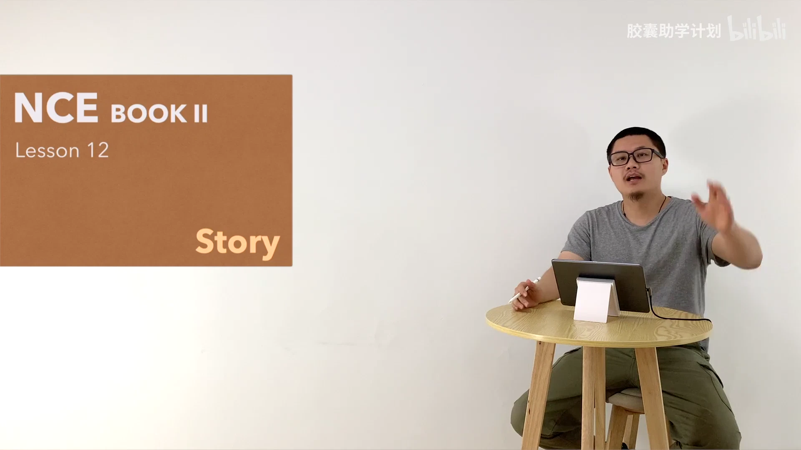

文字识别：胶囊助学计划 / NCE / BOOKⅡI / Lesson 12 / Story

### 画面 00:00:02

文字识别：胶囊助学计划 / NCE / BOOKⅡI / Lesson 12 / Story

### 画面 00:00:05

文字识别：胶囊助学计划 / NCE / BOOK"I / Lesson 12 / Story

### 画面 00:00:08

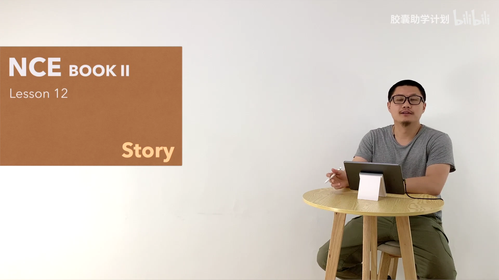

文字识别：胶囊助学计划 / NCE / BOOKⅡI / Lesson 12 / Story

### 画面 00:00:10

文字识别：胶囊助学计划bill / •

### 画面 00:00:14

文字识别：胶囊助学计划

### 画面 00:00:16

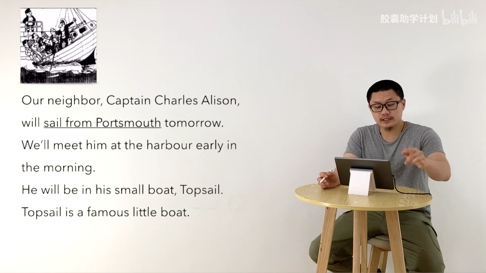

文字识别：胶囊助学计划 / Our neighbor, Captain Charles Alison, / will sail from Portsmouth tomorrow. / We'll meet him at the harbour early in / the morning. / He will be in his small boat, Topsail. / Topsail is a famous little boat.

### 画面 00:00:18

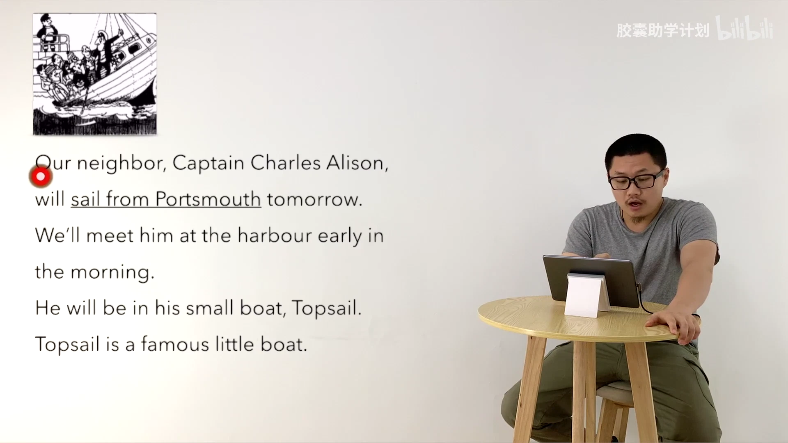

文字识别：胶囊助学计划 / Our neighbor, Captain Charles Alison, / will sail from Portsmouth tomorrow. / We'll meet him at the harbour early in / the morning. / He will be in his small boat, Topsail. / Topsail is a famous little boat.

## 00:00:30–00:01:00

就有讲解过一点点啊，今天再提一句，我们的邻居和 Captain Charles Ellison 其实是一个人，对吧？我们的邻居他的名字我们管他叫 Captain Charles Ellison，所以他们处于的是相同地位的，在这个句子当中，语法上我们管它叫同位语。不知道同位语不影响大家读懂这几个单词，但是以后我们会学到一个叫同位语从句

### 画面 00:00:47

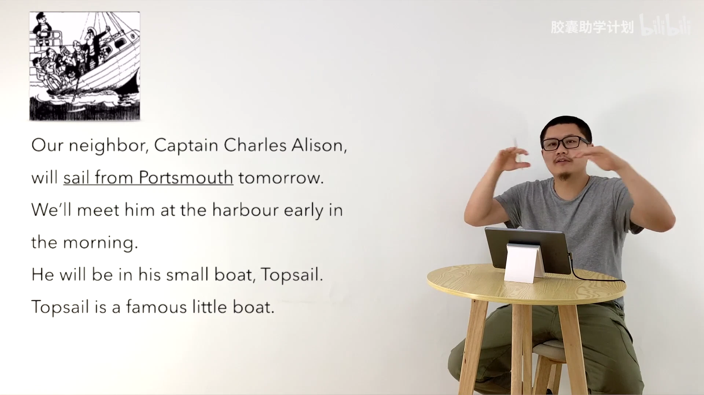

文字识别：胶囊助学计划 / Our neighbor, Captain Charles Alison, / will sail from Portsmouth tomorrow. / We'll meet him at the harbour early in / the morning. / He will be in his small boat, Topsail. / Topsail is a famous litle boat.

### 画面 00:00:54

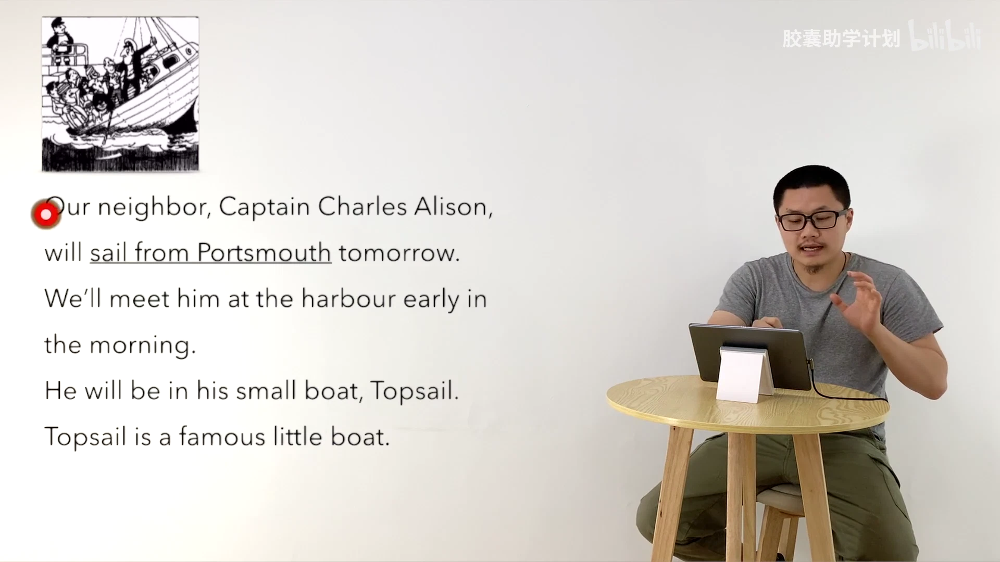

文字识别：胶囊助学计划 / Pur neighbor, Captain Charles Alison, / will sail from Portsmouth tomorrow. / We'll meet him at the harbour early in / the morning. / He will be in his small boat, Topsail. / Topsail is a famous litle boat.

## 00:01:00–00:01:30

啊，所以大家提前了解同位语到底是个什么东西是有帮助的。就是它俩其实说的是一码事儿。比如说我，对吧？我说 I'm Leo 啊，我 I'm your English teacher 啊，Leo 啊，my English teacher ，逗号 Leo，OK，就是一码事儿，对吧？一个人，那儿一个。接下来将 sail from Portsmouth tomorrow，将从 Portsmouth 这个港口啊航行出发，明天啊，这是我们在单词的部分已

### 画面 00:01:07

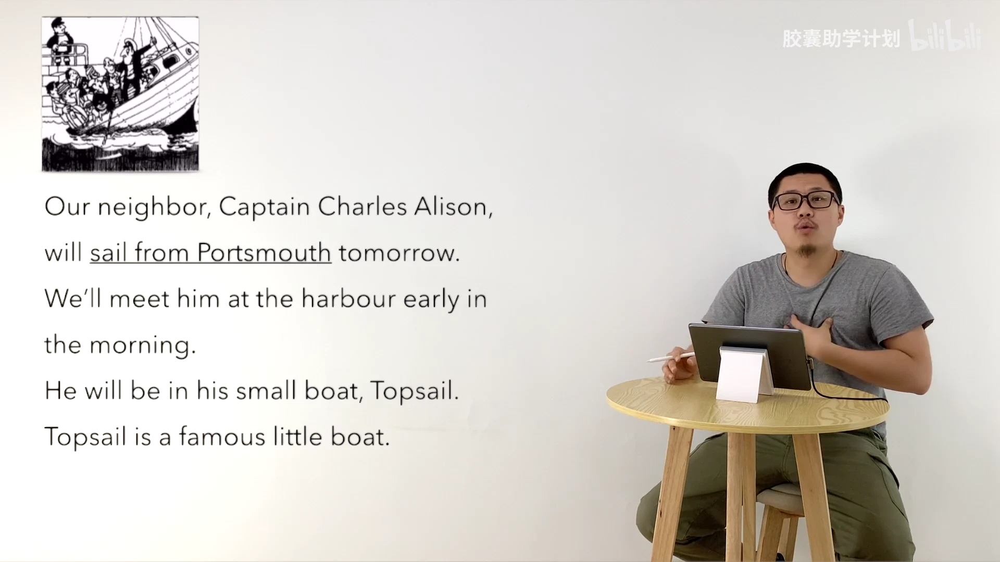

文字识别：胶囊助学计划 / Our neighbor, Captain Charles Alison, / will sail from Portsmouth tomorrow. / We'll meet him at the harbour early in / the morning. / He will be in his small boat, Topsail. / Topsail is a famous little boat.

### 画面 00:01:11

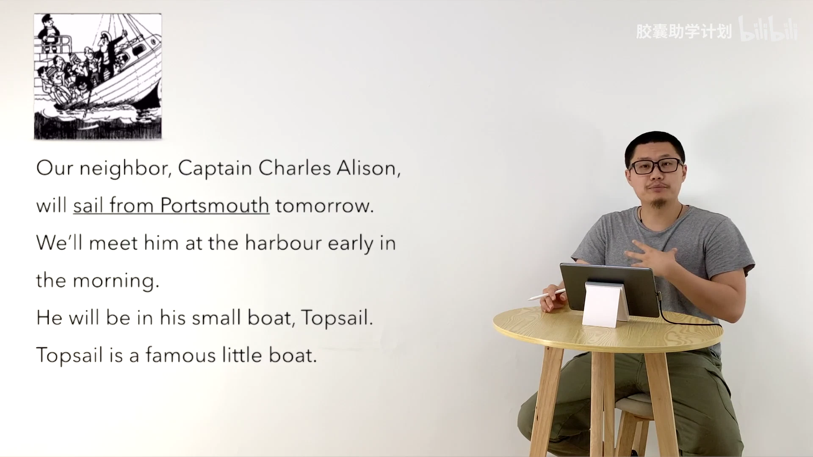

文字识别：胶囊助学计划 / Our neighbor, Captain Charles Alison, / will sail from Portsmouth tomorrow. / We'll meet him at the harbour early in / the morning. / He will be in his small boat, Topsail. / Topsail is a famous little boat.

### 画面 00:01:17

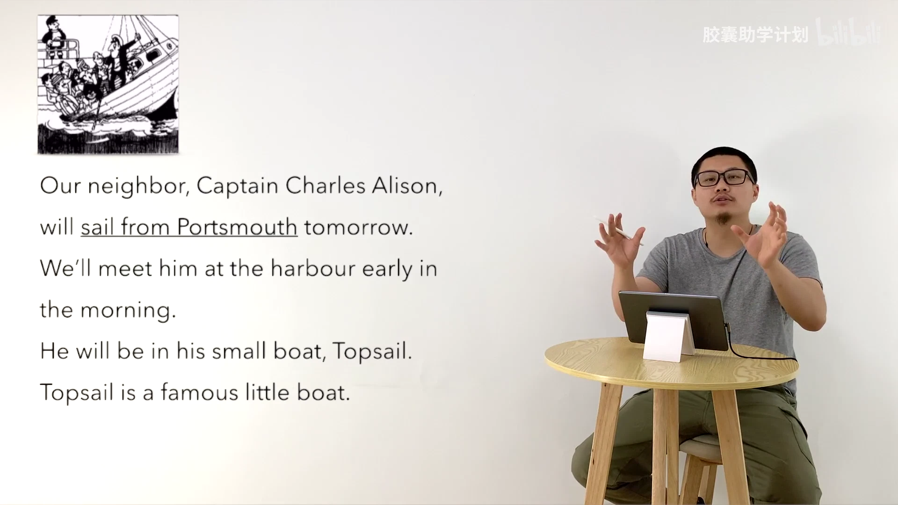

文字识别：胶囊助学计划 / Our neighbor, Captain Charles Alison, / will sail from Portsmouth tomorrow. / We'll meet him at the harbour early in / the morning. / He will be in his small boat, Topsail. / Topsail is a famous little boat.

## 00:01:30–00:02:00

经引用过这句话了，也比较简单啊。从什么什么地方航行出发？We'll meet him at the harbor。注意，你看有一个小的缩写，meet him。哎，注意，对于大家来说，meet是遇见的意思，对吧？我们在这儿完全可以从遇见这个角度去往下推，就我们会去见他。OK，at the harbor叫在港口，early很早，in the morning哎，早晨更早的一些时间啊，就是早晨早一些时

### 画面 00:01:44

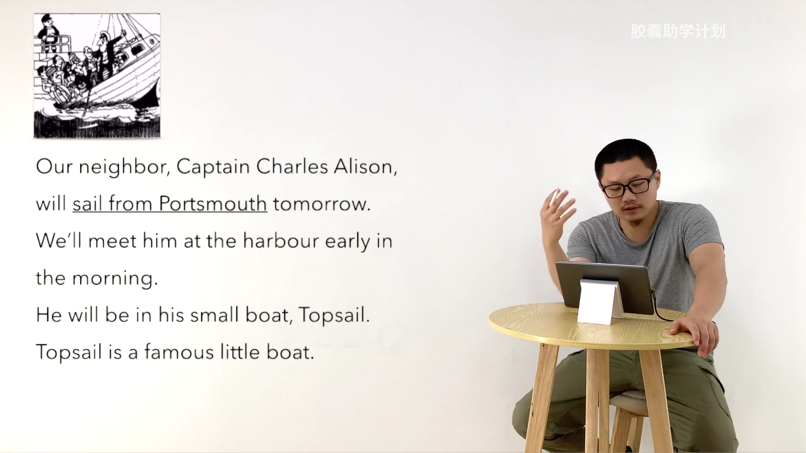

文字识别：力学计划 / Our neighbor, Captain Charles Alison, / will sail from Portsmouth tomorrow. / We'll meet him at the harbour early in / the morning. / He will be in his small boat, Topsail. / Topsail is a famous lile boat.

### 画面 00:01:51

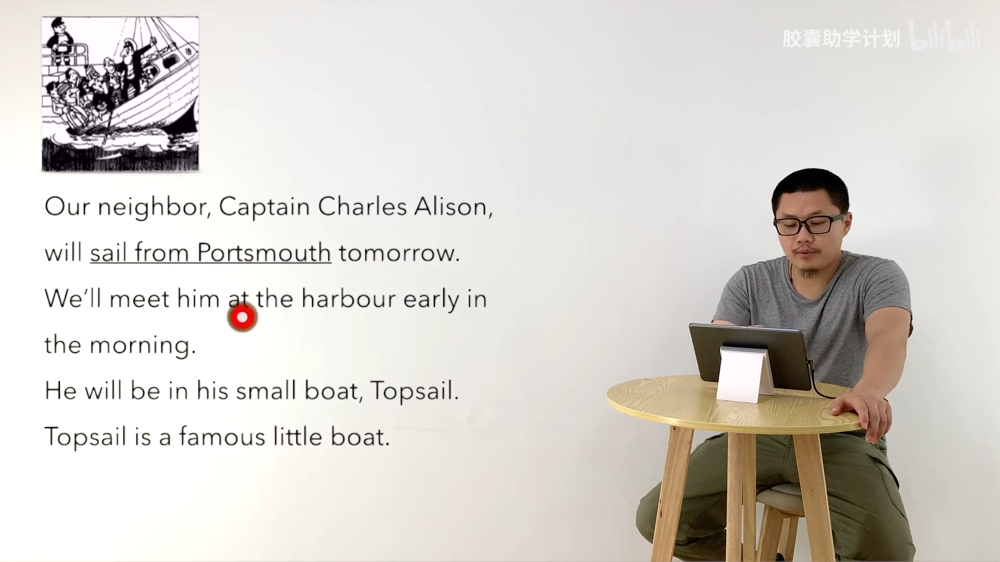

文字识别：胶囊助学计划 / Our neighbor, Captain Charles Alison, / will sail from Portsmouth tomorrow. / We'll meet him at the harbour early in / the morning. / He will be in his small boat, Topsail. / Topsail is a famous little boat.

## 00:02:00–00:02:30

候，比如说七点、八点都叫做 in the morning。那 early in the morning 就是在早晨早一些的时间，可能就是五点钟或六点钟。Okay, he will be in his small boat, topsail.你看 his small boat 和 topsail, topsail 是他船的名字，各位不需要去记啊。好，其实是一码事，对吧？我们管它叫同位语，刚刚讲过。然后这个地方的 be 呢，我也之前给大家在语法的部分有去讲解一

### 画面 00:02:03

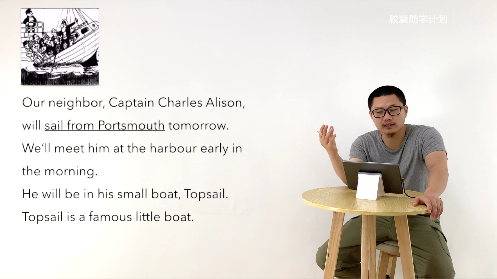

文字识别：Our neighbor, Captain Charles Alison, / will sail from Portsmouth tomorrow. / We'll meet him at the harbour early in / the morning. / He will be in his small boat, Topsail. / Topsail is a famous little boat.

### 画面 00:02:10

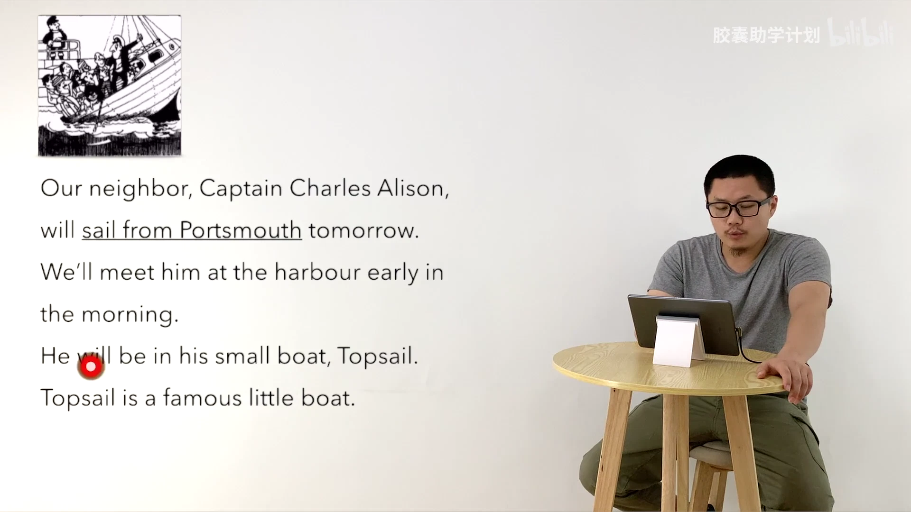

文字识别：胶囊助学计划 / Our neighbor, Captain Charles Alison, / will sail from Portsmouth tomorrow. / We'll meet him at the harbour early in / the morning. / He / jll be in his small boat, Topsail. / Topsail is a famous little boat.

## 00:02:30–00:03:00

下，其实这个 be 就是 am is are was were being 和 been 的原型，对吧？如果说他现在在他的这个小船里，那您需要做的事情就是把 will be 换成 is 就可以了。如果是他曾经呢，那就是把 will be 换成 was 啊，就这么简单。接下来他说 Topseal is a famous little boat. Topseal 这个船呢是一个非常有名的小船。注意

### 画面 00:02:32

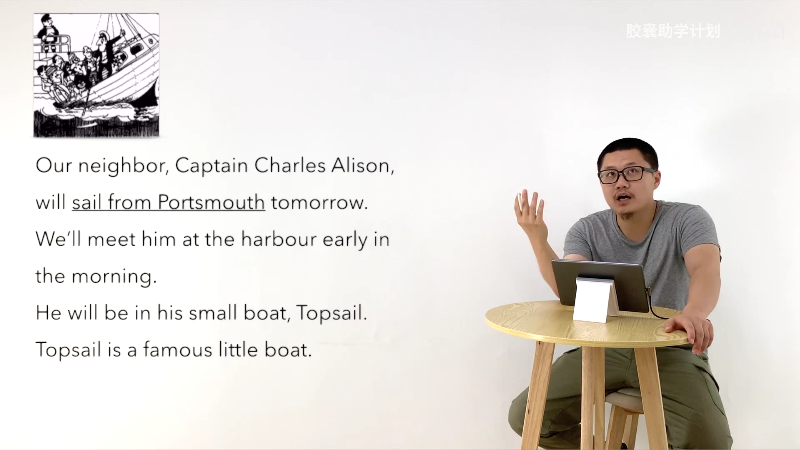

文字识别：Our neighbor, Captain Charles Alison, / will sail from Portsmouth tomorrow. / We'll meet him at the harbour early in / the morning. / He will be in his small boat, Topsail. / Topsail is a famous little boat.

### 画面 00:02:36

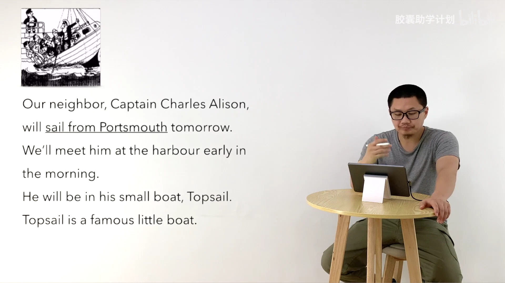

文字识别：胶囊助学计划 / Our neighbor, Captain Charles Alison, / will sail from Portsmouth tomorrow. / We'll meet him at the harbour early in / the morning. / He will be in his small boat, Topsail. / Topsail is a famous little boat.

### 画面 00:02:44

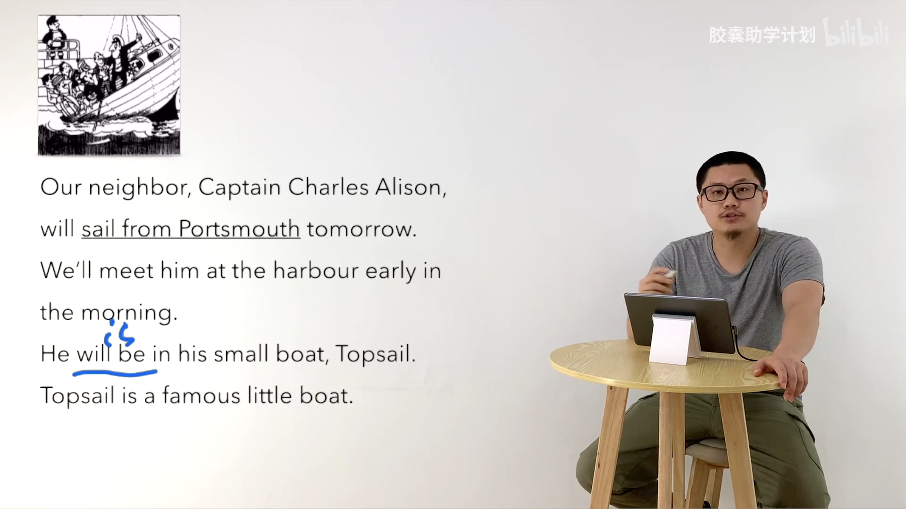

文字识别：胶囊助学计划 / Our neighbor, Captain Charles Alison, / will sail from Portsmouth tomorrow. / We'll meet him at the harbour early in / the morning. / He wilf Be in his small boat, Topsail. / Topsail is a famous little boat.

### 画面 00:02:46

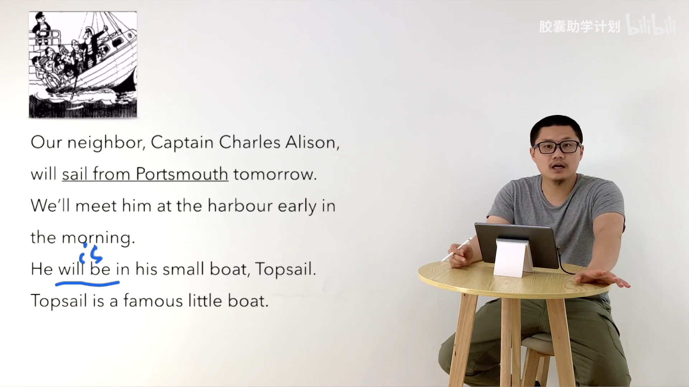

文字识别：胶囊助学计划 / Our neighbor, Captain Charles Alison, / will sail from Portsmouth tomorrow. / We'll meet him at the harbour early in / the morning. / He will Be in his small boat, Topsail. / Topsail is a famous little boat.

### 画面 00:02:50

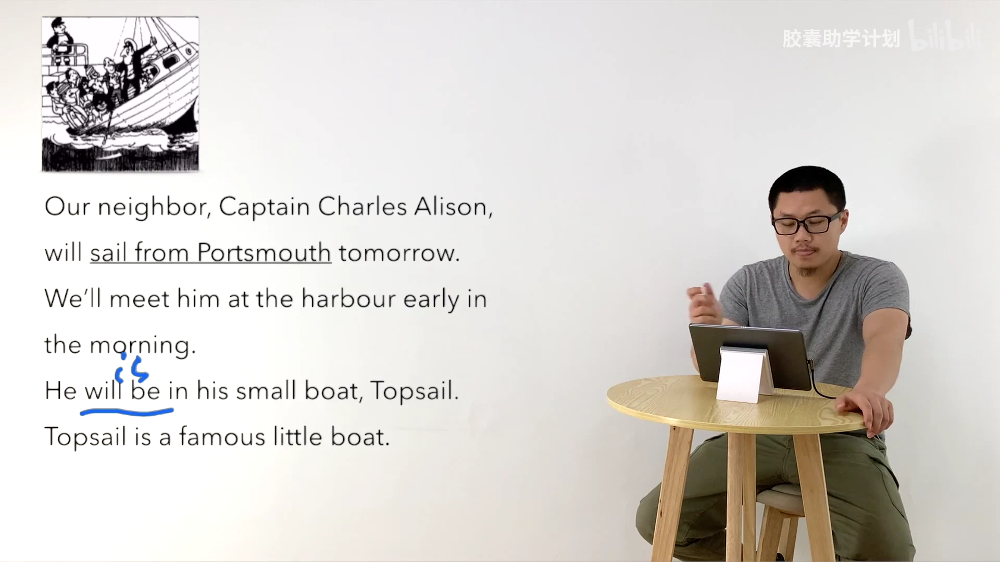

文字识别：胶囊助学计划 / Our neighbor, Captain Charles Alison, / will sail from Portsmouth tomorrow. / We'll meet him at the harbour early in / the morning. / He will Be in his small boat, Topsail. / Topsail is a famous little boat.

## 00:03:00–00:03:30

famous 啊形容词表示有名的 engineer. It has sailed. 好了，你看整篇文章，刚才那些句子基本都是一般将来时，在这儿突然出现了一个 has 加 sailed. 各位如果语法基础还不错，应该能想到了，这个是现在完成时。那现在完成时我们讲过两个用法，一个叫言之过去意在当下，一个叫从过去重复

### 画面 00:03:04

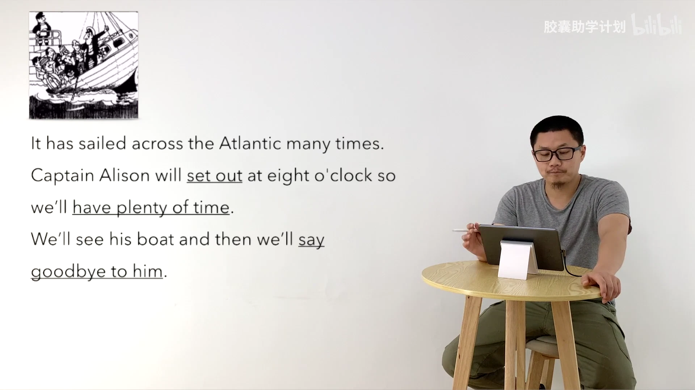

文字识别：胶囊助学计划 / It has sailed across the Atlantic many times. / Captain Alison will set out at eight o'clock so / we'll have plenty of time. / We'll see his boat and then we'll say / goodbye to him.

## 00:03:30–00:04:00

或持续到现在，我们看一下啊，说它已经航行 across the Atlantic，穿越 Atlantic 指的是欧洲和美洲啊，之也就是美国啊，南美啊，整个这个之间的那片大洋，我们管它叫大西洋。那中国和美国中间的那个，我们管它叫太平洋，对吧？好，穿越这个大西洋 many times 许多次了，

### 画面 00:03:34

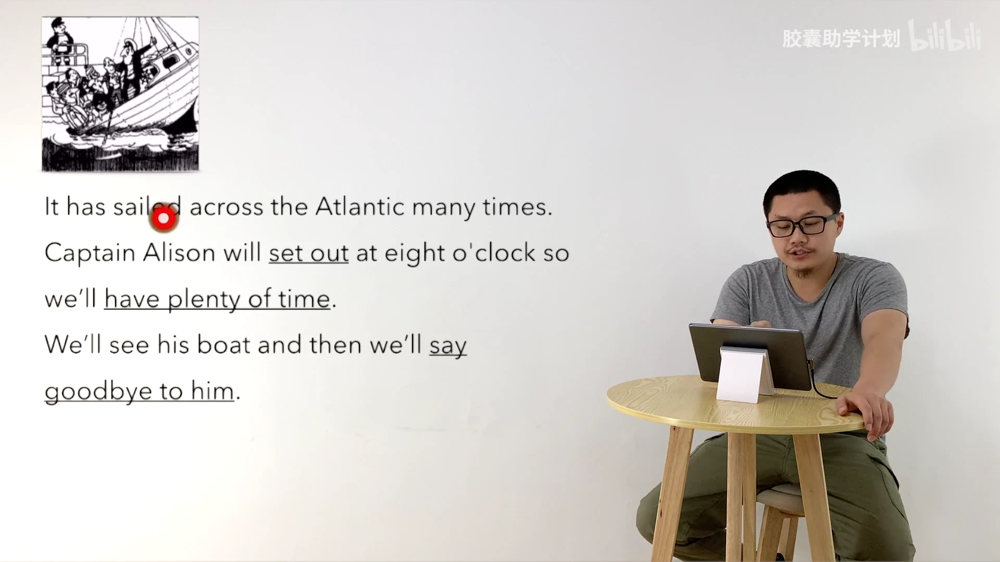

文字识别：胶囊助学计划 / It has sail / across the Atlantic many times. / Captain Alison will set out at eight o'clock so / we'll have plenty of time. / We'll see his boat and then we'll say / goodbye to him.

### 画面 00:03:42

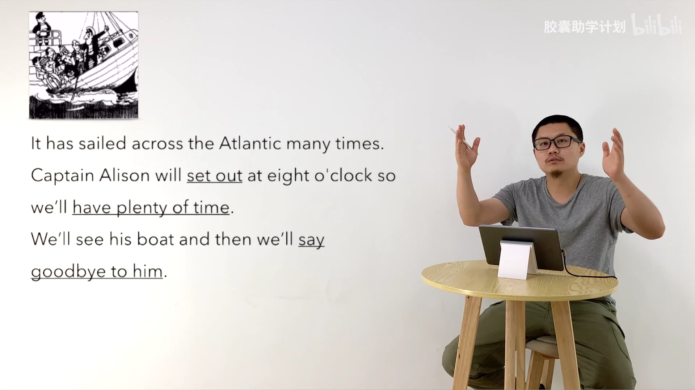

文字识别：胶囊助学计划 / It has sailed across the Atlantic many times. / Captain Alison will set out at eight o'clock so / we'll have plenty of time. / We'll see his boat and then we'll say / goodbye to him.

### 画面 00:03:45

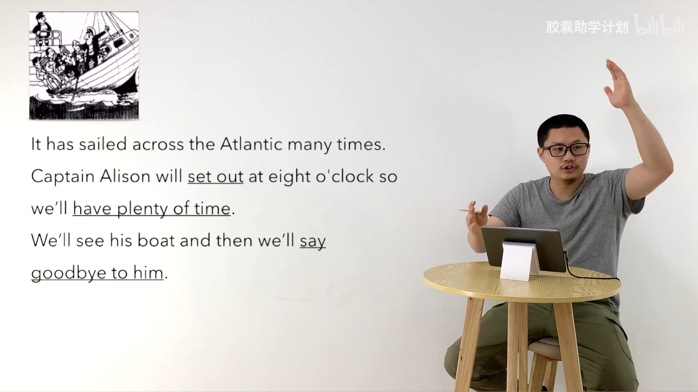

文字识别：胶囊助学计划 / It has sailed across the Atlantic many times. / Captain Alison will set out at eight o'clock so / we'll have plenty of time. / We'll see his boat and then we'll say / goodbye to him.

### 画面 00:03:48

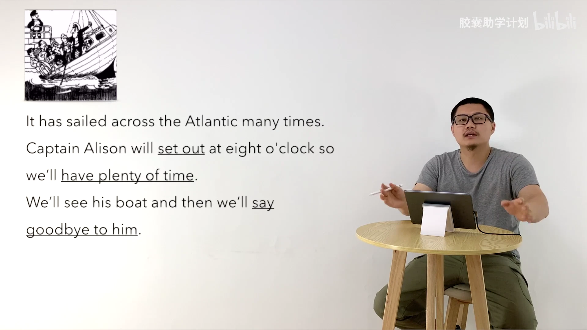

文字识别：胶囊助学计划 / It has sailed across the Atlantic many times. / Captain Alison will set out at eight o'clock so / we'll have plenty of time. / We'll see his boat and then we'll say / goodbye to him.

## 00:04:00–00:04:30

有两个用法，言之过去意在当下，另一个叫做持续或重复许多次，是不是重复？从过去重复到了现在，对吧？好，所以典型的现在完成时，Captain Ellison will将set out，这是一个小的短语，set out出发啊，将出发。At eight o'clock在八点钟的时候，so所以呢，哎，这二十五课我们会重点讲解这些小的连词，现在各位

### 画面 00:04:18

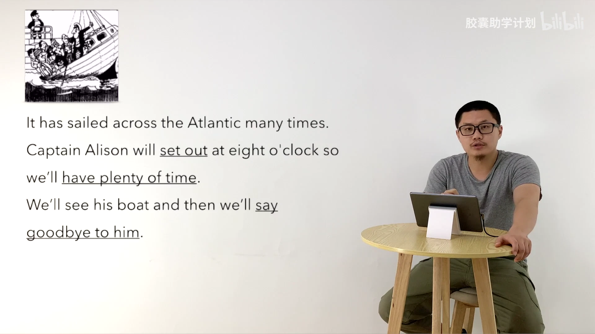

文字识别：胶囊助学计划 / It has sailed across the Atlantic many times. / Captain Alison will set out at eight o'clock so / we'll have plenty of time. / We'll see his boat and then we'll say / goodbye to him.

## 00:04:30–00:05:00

见到能认识就可以了。叫所以，will have plenty of time， have plenty of time，一个小的习惯用法叫拥有足够多的时间啊，have plenty of time。 will see his boat，我们会看他的这个船， and then 啊， and 就是然后， then 其实还是然后， and then 合起来就翻译成然后就行了。然后呢， will 我们会做一件事情， say goodbye to him，因为都是明儿早晨的事儿，对吧？所以全是一般

### 画面 00:04:46

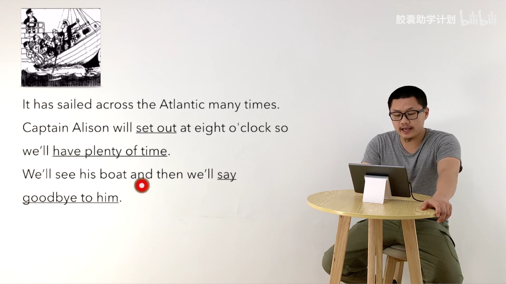

文字识别：胶囊助学计划 / It has sailed across the Atlantic many times. / Captain Alison will set out at eight o'clock so / we'll have plenty of time. / We'll see his boat and then we'll say / goodbye to him.

### 画面 00:04:53

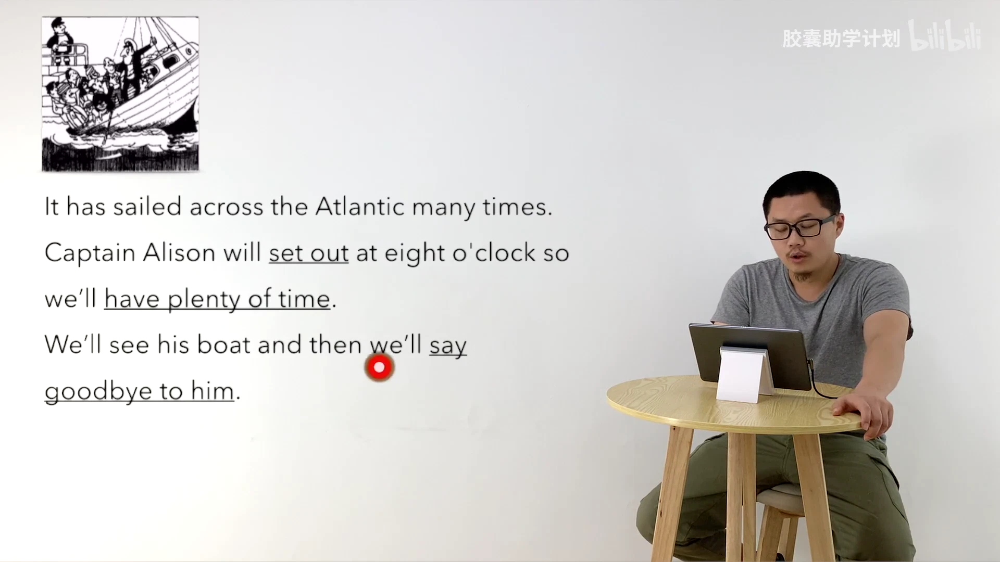

文字识别：胶囊助学计划 / It has sailed across the Atlantic many times. / Captain Alison will set out at eight o'clock so / we'll have plenty of time. / We'll see his boat and then we'll say / goodbye to him.

## 00:05:00–00:05:30

将来时。我们会 say goodbye to him, say goodbye to somebody. 啊，说拜拜对某人。这个跟汉语来说应该已经几乎很像了，对吧？和他说再见。 Continue. He will be away for two months. 好，各位啊，其实可以把它当习惯用法，也可以，其实就是字面翻译。他 will be 就是将嘛，away 就是一个小的单词，叫做离开嘛。

### 画面 00:05:12

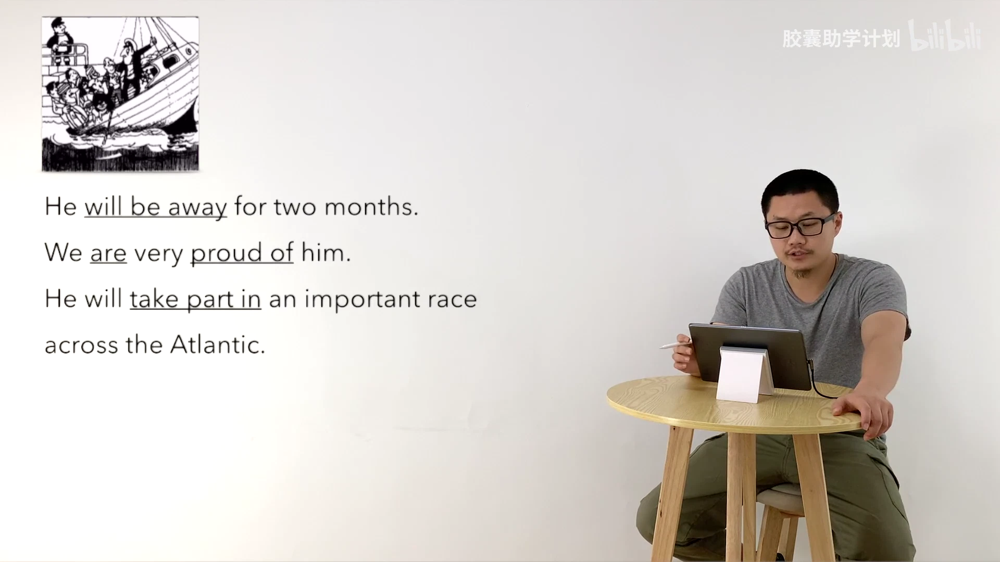

文字识别：胶囊助学计划 / He will be away for two months. / We are very proud of him. / He will take part in an important race / across the Atlantic.

### 画面 00:05:28

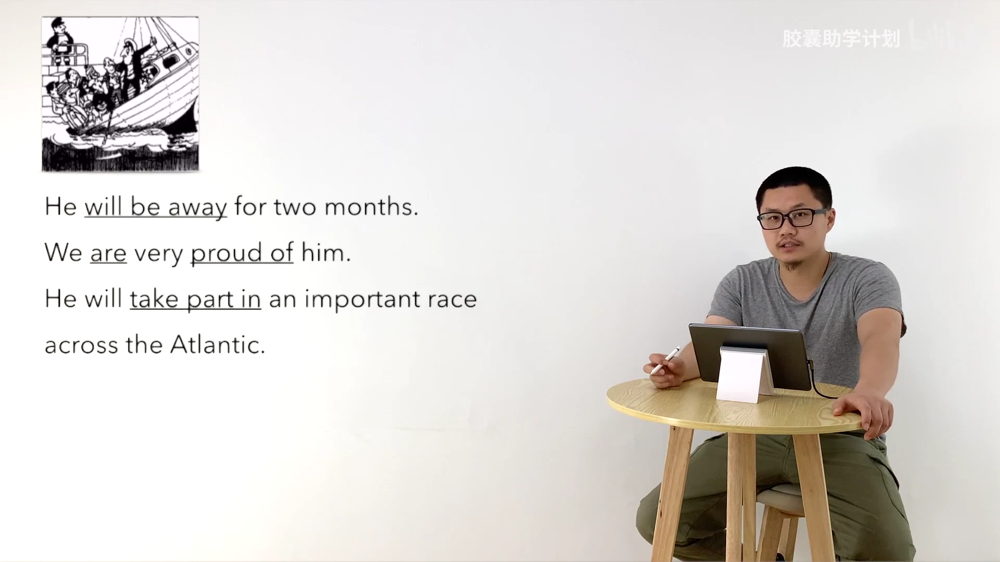

文字识别：胶囊助学计划 / He will be away for two months. / We are very proud of him. / He will take part in an important race / across the Atlantic.

## 00:05:30–00:06:00

他将离开 for two months，叫做两个月，他将离开两个月，对吧？We are very proud of him. 我们呢，非常的为他感到骄傲，或者因为他而骄傲或自豪啊。Be proud of. 单词部分我们讲过了。He will. 他将 take part in. 他将注意 take part in 指的是参加啊，有点像我们在第八课学过的那个 enter 啊 competition，对吧？Take part in. 他

### 画面 00:05:58

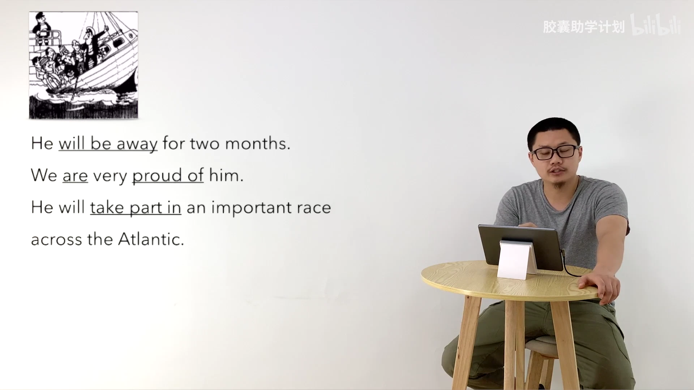

文字识别：胶囊助学计划 / He will be away for two months. / We are very proud of him. / He will take part in an important race / across the Atlantic.

## 00:06:00–00:06:30

将参加什么呢？An important race,一个非常重要的race啊，这是我们新一就学过的单词，叫比赛。一个非常重要的比赛，across the Atlantic，穿越大西洋，完一个。接下来呢，本课除了单词以外，当然又回到这个地方了，叫做各种习惯用法。习惯用法，我们的关键点那必然是造句。Sail from some place.好，原文给的是Charles Edison will sail

### 画面 00:06:16

文字识别：胶囊助学计划 / 习惯用法造句 / sail from sw. / set out / have plenty of time / say goodbye to sb. / will be away / A be proud of B / take part in

### 画面 00:06:18

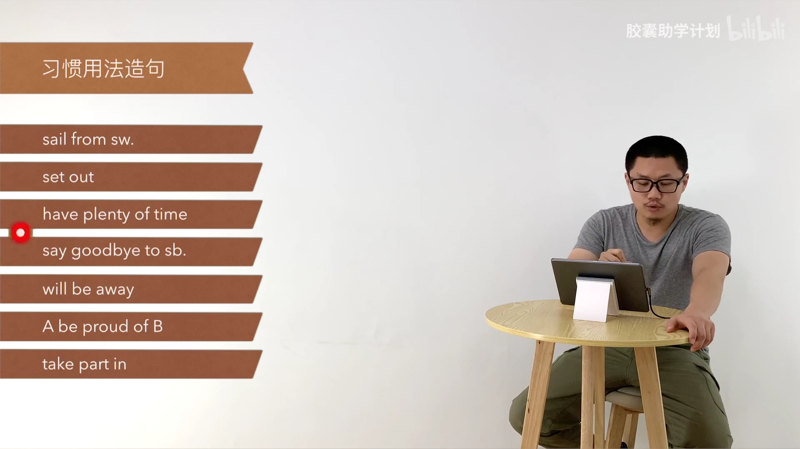

文字识别：胶囊助学计划 / 习惯用法造句 / sail from sw. / set out / have plenty of time / say goodbye to sb. / will be away / A be proud of B / take part in

### 画面 00:06:20

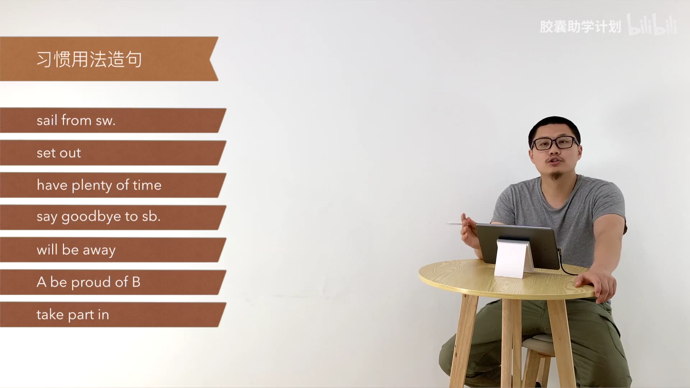

文字识别：胶囊助学计划 / 习惯用法造句 / sail from sw. / set out / have plenty of time / say goodbye to sb. / will be away / A be proud of B / take / part in

### 画面 00:06:22

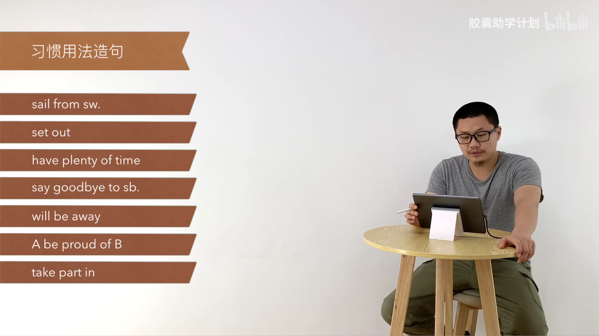

文字识别：胶囊助学计划 / 习惯用法造句 / sail from sw. / set out / have plenty of time / say goodbye to sb. / will be away / A be proud of B / take / part in

### 画面 00:06:24

文字识别：网：v.+v.变化 / 习惯用法造句指南 / 胶囊助学计划 / 四句型转换 / 方式/地点/时间 / 其他习惯用法 / 其他单词+词性 / 原文摘抄+变 / 6123456 / sail from sw.

### 画面 00:06:26

文字识别：网：v.+v.变化 / 习惯用法造句指南 / 胶囊助学计划 / 四句型转换 / 方式/地点/时间 / 其他习惯用法 / 其他单词+词性 / 原文摘抄+变 / 6123456 / sail from sw. / [Story]: Charles Alison will sail from / Portsmouth tomorrow.

### 画面 00:06:28

文字识别：网：v.+v.变化 / 习惯用法造句指南 / 胶囊助学计划 / 四句型转换 / 方式/地点/时间 / 其他习惯用法 / 其他单词+词性 / 原文摘抄+变 / 6123456 / sail from sw. / [Story]: Charles Alison will sail from / Portsmouth tomorrow.

## 00:06:30–00:07:00

sail from Portsmouth tomorrow?变完一般疑问句了之后，这在单词部分我们都讲过了。我在这儿只是提思路，各位如下的特殊疑问词绝对都可以套进去。各位要做的事情就是，要么暂停屏幕口语变一变，要么就是写家庭作业的时候记住这个思路，拿sail from s w点指的是somewhere某地啊，拿这个习惯用法造句的时候把它带进去就好了。接下来，set out指的是

### 画面 00:06:30

文字识别：网：v.+v.变化 / 习惯用法造句指南 / 胶囊助学计划 / 四句型转换 / 方式/地点/时间 / 其他习惯用法 / 其他单词+词性 / 原文摘抄+变 / 6123456 / sail from sw. / [Story]: Charles Alison will sail from / Portsmouth tomorrow.

### 画面 00:06:32

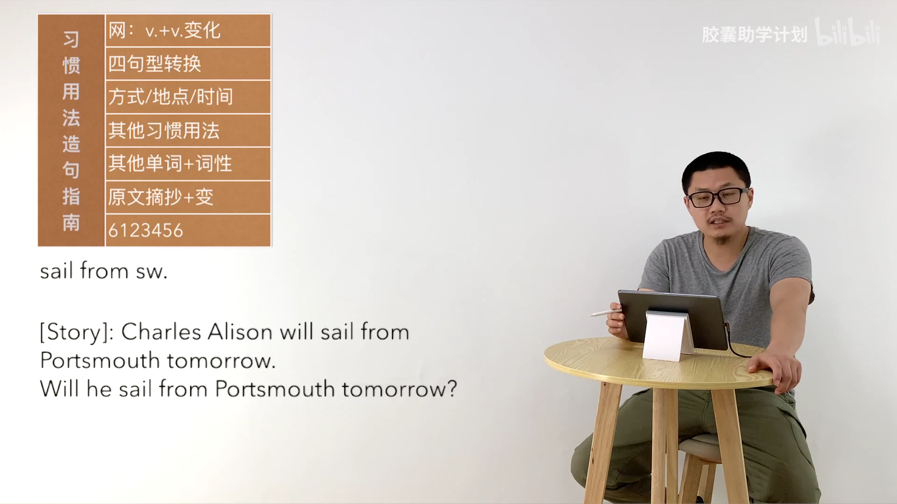

文字识别：网：v.+v.变化 / 习惯用法造句指南 / 胶囊助学计划 / 四句型转换 / 方式/地点/时间 / 其他习惯用法 / 其他单词+词性 / 原文摘抄+变 / 6123456 / sail from sw. / [Story]: Charles Alison will sail from / Portsmouth tomorrow. / Will he sail from Portsmouth tomorrow?

### 画面 00:06:34

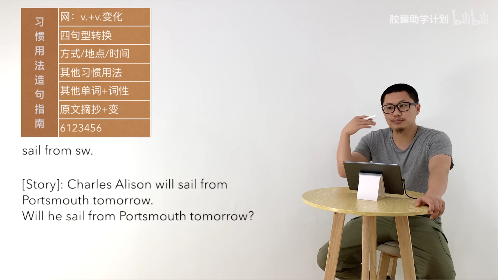

文字识别：网：v.+v.变化 / 习惯用法造句指南 / 胶囊助学计划 / 四句型转换 / 方式/地点/时间 / 其他习惯用法 / 其他单词+词性 / 原文摘抄+变 / 6123456 / sail from sw. / [Story]: Charles Alison will sail from / Portsmouth tomorrow. / Will he sail from Portsmouth tomorrow?

### 画面 00:06:36

文字识别：网：v.+v.变化 / 习惯用法造句指南 / 胶囊助学计划 / 四句型转换 / 方式/地点/时间 / 其他习惯用法 / 其他单词+词性 / 原文摘抄+变 / 6123456 / sail from sw. / [Story]: Charles Alison will sail from / Portsmouth tomorrow. / Will he sail from Portsmouth tomorrow?

### 画面 00:06:38

文字识别：习惯用法造句指南 / 网：v.+v.变化 / 胶囊助学计划 / 四句型转换 / 方式/地点/时间 / 其他习惯用法 / 其他单词+词性 / 原文摘抄+变 / 6123456 / sail from sw. / [Story]: Charles Alison will sail from / Portsmouth tomorrow. / Will he sail from Portsmouth tomorrow? / who/when/where/why

### 画面 00:06:40

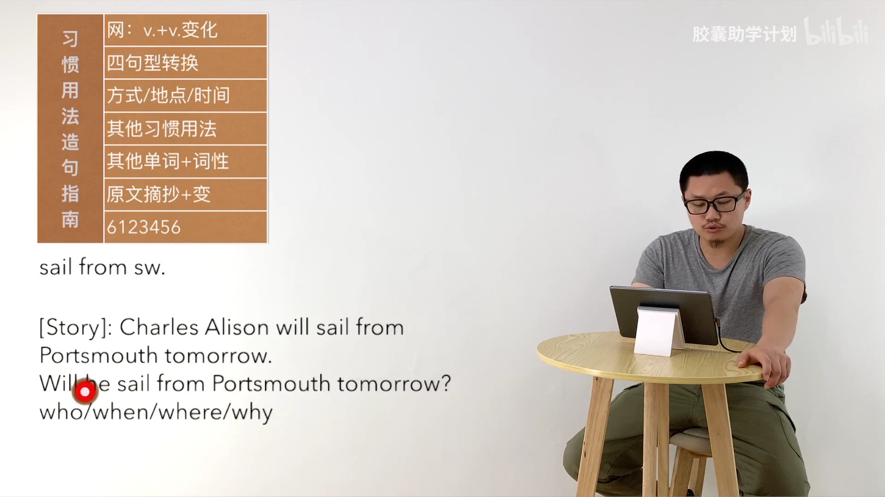

文字识别：习惯用法造句指南 / 网：v.+v.变化 / 胶囊助学计划 / 四句型转换 / 方式/地点/时间 / 其他习惯用法 / 其他单词+词性 / 原文摘抄+变 / 6123456 / sail from sw. / [Story]: Charles Alison will sail from / Portsmouth tomorrow. / Willbe sail from Portsmouth tomorrow? / who/when/where/why

### 画面 00:06:43

文字识别：习惯用法造句指南 / 网：v.+v.变化 / 胶囊助学计划 / 四句型转换 / 方式/地点/时间 / 其他习惯用法 / 其他单词+词性 / 原文摘抄+变 / 6123456 / sail from sw. / [Story]: Charles Alison will sail from / Portsmouth tomorrow. / Will he sail from Portsmouth tomorrow? / who/when/where/why

### 画面 00:06:45

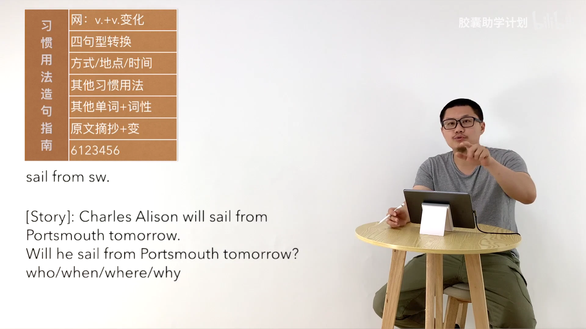

文字识别：网：v.+v.变化 / 习惯用法造句指南 / 胶囊助学计划 / 四句型转换 / 方式/地点/时间 / 其他习惯用法 / 其他单词+词性 / 原文摘抄+变 / 6123456 / sail from sw. / [Story]: Charles Alison will sail from / Portsmouth tomorrow. / Will he sail from Portsmouth tomorrow? / who/when/where/why

### 画面 00:06:47

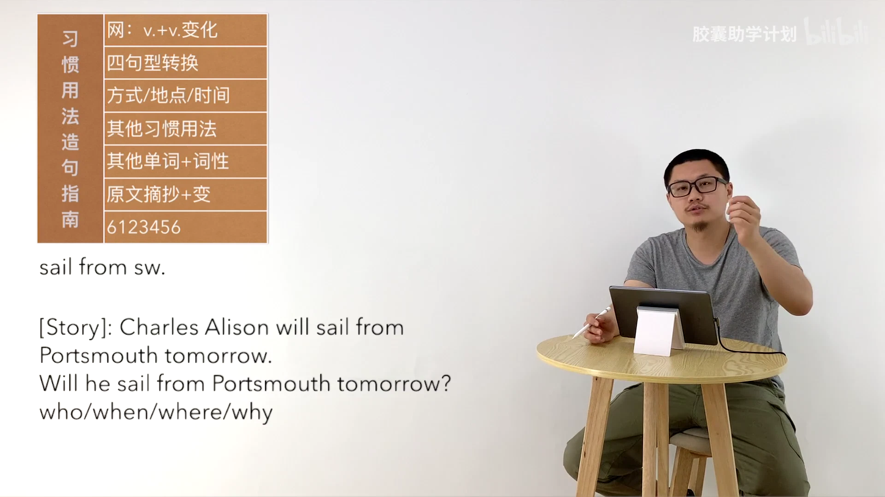

文字识别：网：v.+v.变化 / 习惯用法造句指南 / 胶囊助学计划 / 四句型转换 / 方式/地点/时间 / 其他习惯用法 / 其他单词+词性 / 原文摘抄+变 / 6123456 / sail from sw. / [Story]: Charles Alison will sail from / Portsmouth tomorrow. / Will he sail from Portsmouth tomorrow? / who/when/where/why

### 画面 00:06:50

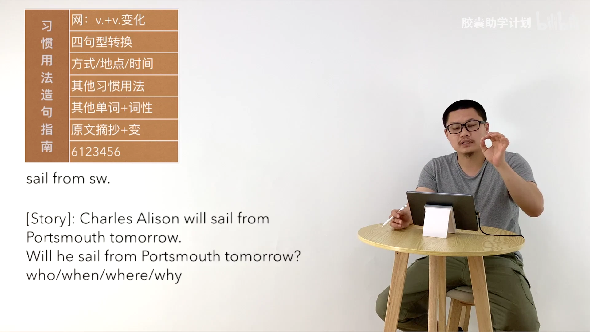

文字识别：网：v.+v.变化 / 习惯用法造句指南 / 胶囊助学计划 / 四句型转换 / 方式/地点/时间 / 其他习惯用法 / 其他单词+词性 / 原文摘抄+变 / 6123456 / sail from sw. / [Story]: Charles Alison will sail from / Portsmouth tomorrow. / Will he sail from Portsmouth tomorrow? / who/when/where/why

### 画面 00:06:54

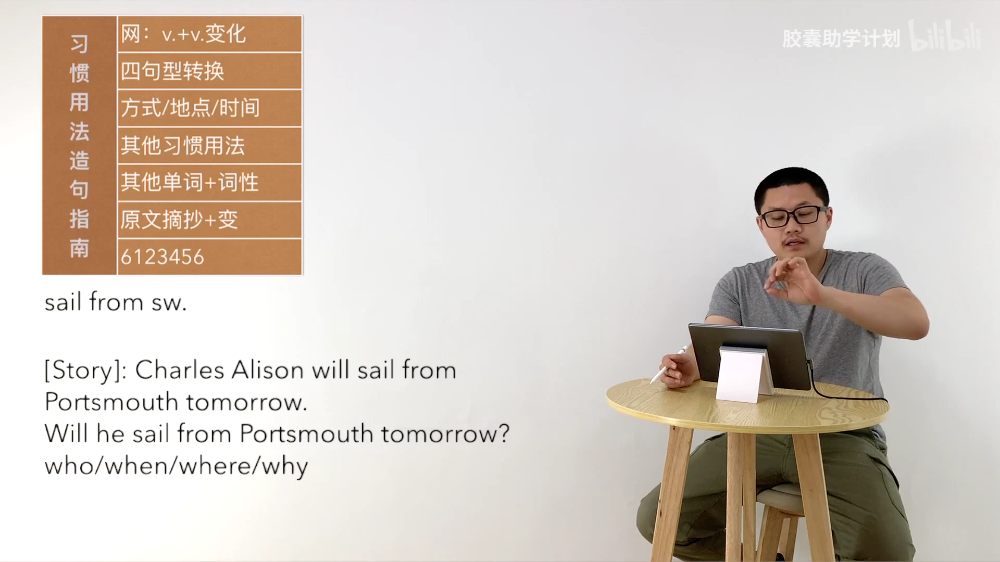

文字识别：习惯用法造句指南 / 网：v.+v.变化 / 胶囊助学计划 / 四句型转换 / 方式/地点/时间 / 其他习惯用法 / 其他单词+词性 / 原文摘抄+变 / 6123456 / sail from sw. / [Story]: Charles Alison will sail from / Portsmouth tomorrow. / Will he sail from Portsmouth tomorrow? / who/when/where/why

### 画面 00:06:56

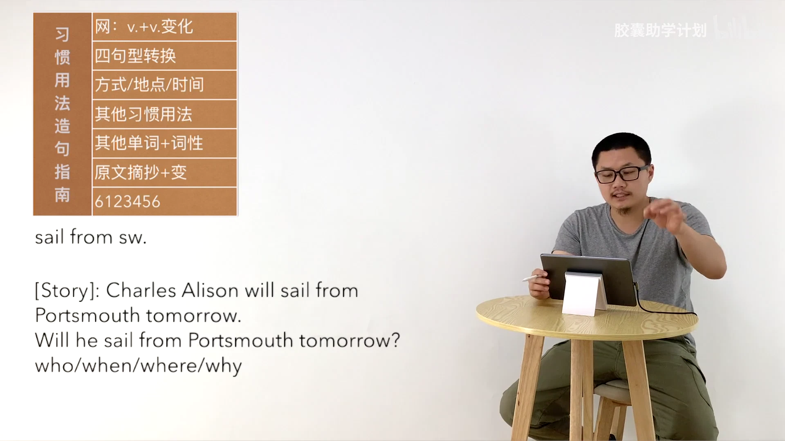

文字识别：网：v.+v.变化 / 习惯用法造句指南 / 胶囊助学计划 / 四句型转换 / 方式/地点/时间 / 其他习惯用法 / 其他单词+词性 / 原文摘抄+变 / 6123456 / sail from sw. / [Story]: Charles Alison will sail from / Portsmouth tomorrow. / Will he sail from Portsmouth tomorrow? / who/when/where/why

### 画面 00:06:58

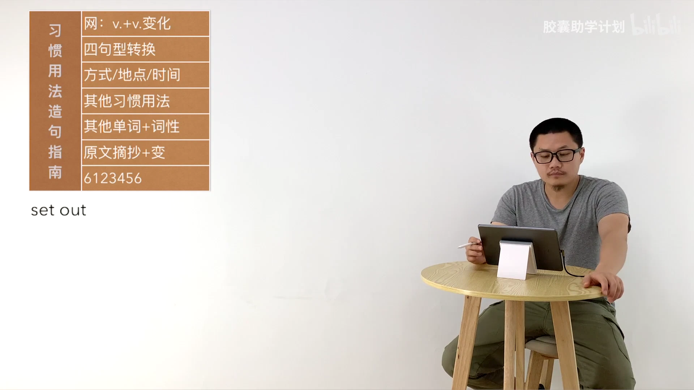

文字识别：习惯用法造句指南 / 网：v.+v.变化 / 胶囊助学计划 / 四句型转换 / 方式/地点/时间 / 其他习惯用法 / 其他单词+词性 / 原文摘抄+变 / 6123456 / set out

## 00:07:00–00:07:30

出发。I'll set I will set out at eight.我将在八点钟出发，and fly to Auckland.然后飞去奥克兰。那你看我们第四课学的叫fly to some place，对吧？结合了本课的set out，我将出发，以及我们可以这这句话还比较常用，叫When will we set out？我们什么时候出发呢？OK，这儿一个。接下来我们看一个小电影片段，当中

### 画面 00:07:00

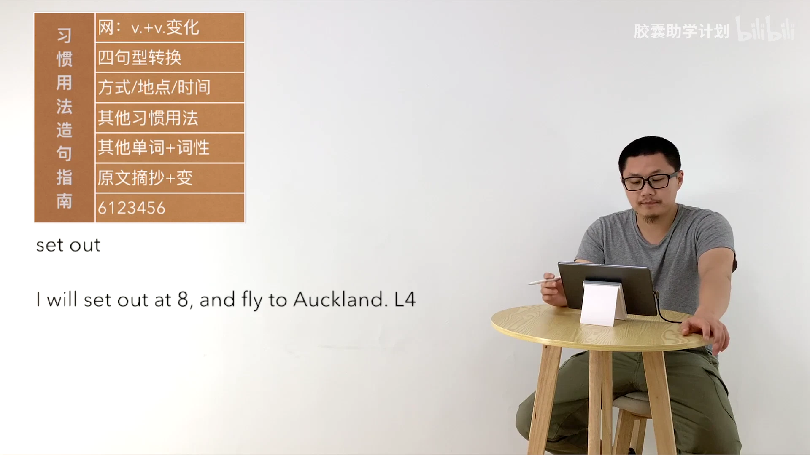

文字识别：网：v.+v.变化 / 习惯用法造句指南 / 胶囊助学计划 / 四句型转换 / 方式/地点/时间 / 其他习惯用法 / 其他单词+词性 / 原文摘抄+变 / 6123456 / set out / I will set out at 8, and fly to Auckland. L4

### 画面 00:07:02

文字识别：网：v.+v.变化 / 习惯用法造句指南 / 胶囊助学计划 / 四句型转换 / 方式/地点/时间 / 其他习惯用法 / 其他单词+词性 / 原文摘抄+变 / 6123456 / set out / I will set out at 8, and fly to Auckland. L4

### 画面 00:07:05

文字识别：网：v.+v.变化 / 习惯用法造句指南 / 胶囊助学计划 / 四句型转换 / 方式/地点/时间 / 其他习惯用法 / 其他单词+词性 / 原文摘抄+变 / 6123456 / set out / I will set out at 8, and fly to Auckland. L4

### 画面 00:07:08

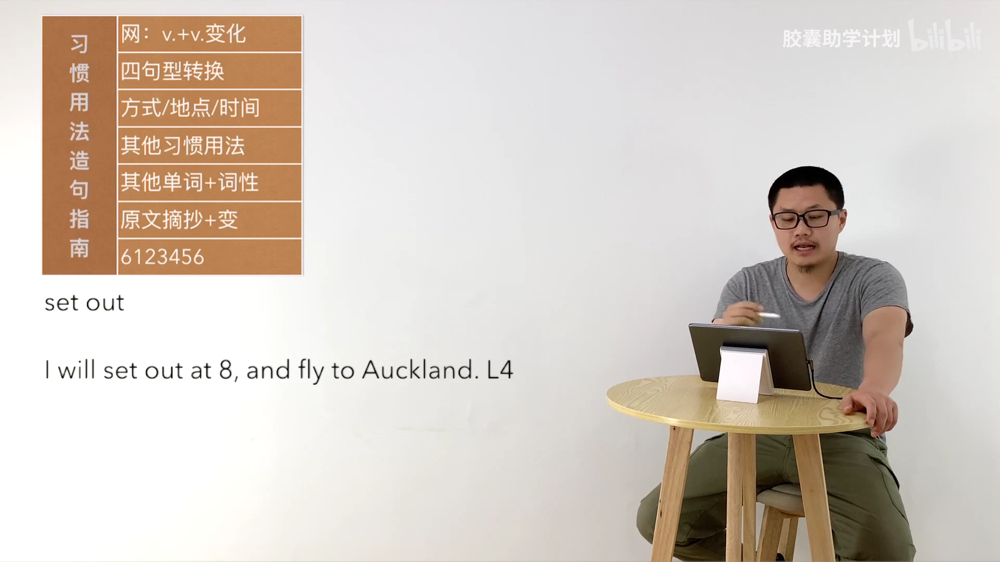

文字识别：网：v.+v.变化 / 习惯用法造句指南 / 胶囊助学计划 / 四句型转换 / 方式/地点/时间 / 其他习惯用法 / 其他单词+词性 / 原文摘抄+变 / 6123456 / set out / I will set out at 8, and fly to Auckland. L4

### 画面 00:07:10

文字识别：网：v.+v.变化 / 习惯用法造句指南 / 胶囊助学计划 / 四句型转换 / 方式/地点/时间 / 其他习惯用法 / 其他单词+词性 / 原文摘抄+变 / 6123456 / set out / I will set out at 8, and fly to Auckland. L4

### 画面 00:07:15

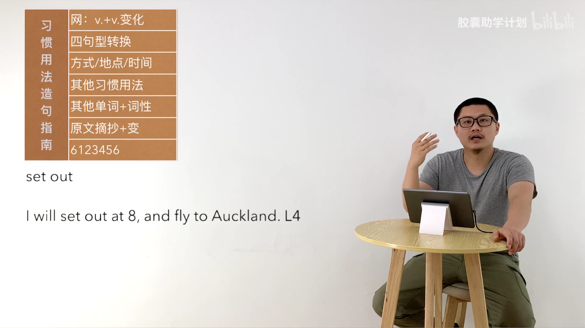

文字识别：网：v.+v.变化 / 习惯用法造句指南 / 胶囊助学计划 / 四句型转换 / 方式/地点/时间 / 其他习惯用法 / 其他单词+词性 / 原文摘抄+变 / 6123456 / set out / I will set out at 8, and fly to Auckland. L4

### 画面 00:07:18

文字识别：网：v.+v.变化 / 习惯用法造句指南 / 胶囊助学计划 / 四句型转换 / 方式/地点/时间 / 其他习惯用法 / 其他单词+词性 / 原文摘抄+变 / 6123456 / set out / I will set out at 8, and fly to Auckland. L4 / When will we set out?

### 画面 00:07:20

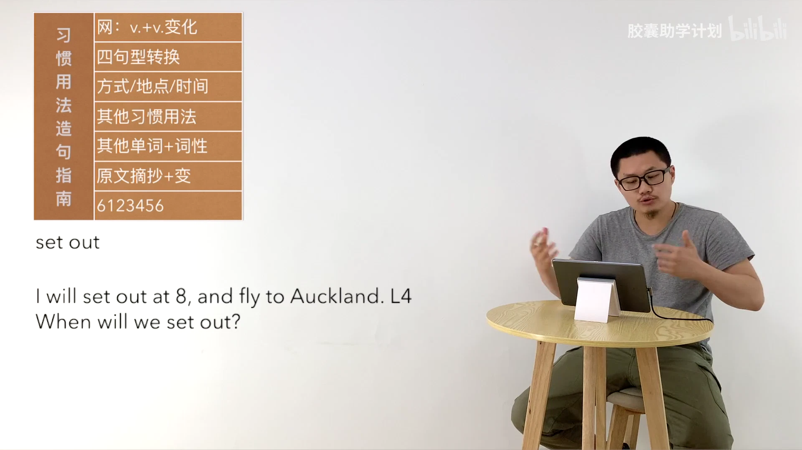

文字识别：网：v.+v.变化 / 习惯用法造句指南 / 胶囊助学计划 / 四句型转换 / 方式/地点/时间 / 其他习惯用法 / 其他单词+词性 / 原文摘抄+变 / 6123456 / set out / I will set out at 8, and fly to Auckland. L4 / When will we set out?

### 画面 00:07:23

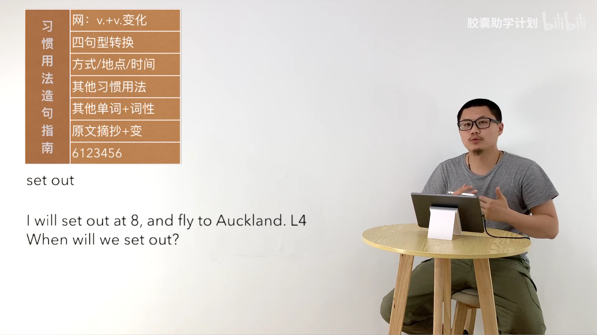

文字识别：网：v.+v.变化 / 习惯用法造句指南 / 胶囊助学计划 / 四句型转换 / 方式/地点/时间 / 其他习惯用法 / 其他单词+词性 / 原文摘抄+变 / 6123456 / set out / I will set out at 8, and fly to Auckland. L4 / When will we set out?

### 画面 00:07:25

文字识别：习惯用法造句指南 / 网：v.+v.变化 / 胶囊助学计划 / 四句型转换 / 方式/地点/时间 / 其他习惯用法 / 其他单词+词性 / 原文摘抄+变 / 6123456 / set out / I will set out at 8, and fly to Auckland. L4 / When will we set out?

### 画面 00:07:27

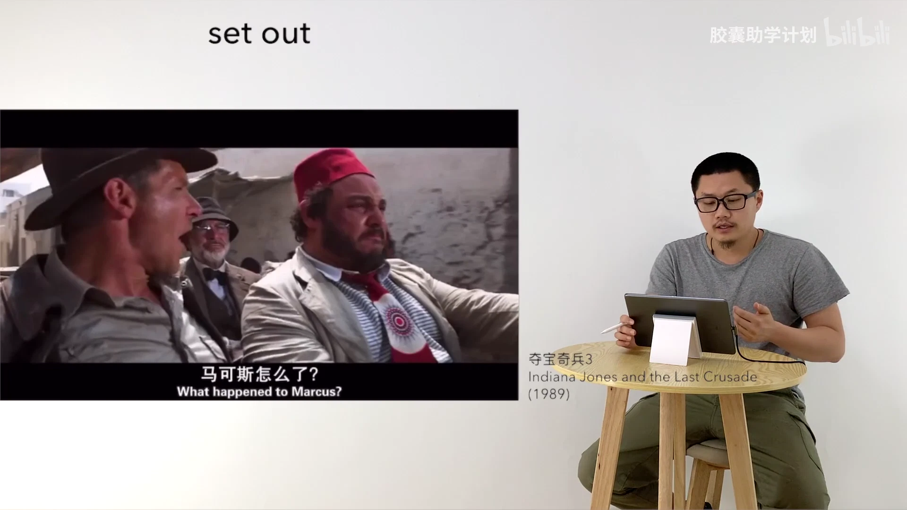

文字识别：set out / 胶囊助学计划 / 夺宝奇兵3 / 马可斯怎么了？ / Indiana Jones and the Last Crusade / What happened to Marcus? / (1989)

## 00:07:30–00:08:00

就出现了 set out 这个小的短语，集中注意来了。 What happened to Marcus Sala? They set out across the desert this afternoon. I believe they took Mr. Brody with them. Now they have the map. And in this celebration, there's no silver medal for finishing second. Okay, very good. Set out across the desert. Okay,语速比较快，各位不妨可以多听几遍啊。

### 画面 00:07:31

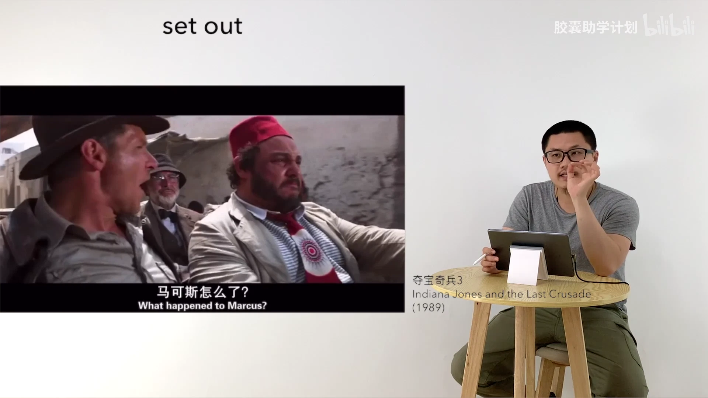

文字识别：set out / 胶囊助学计划 / 夺宝奇兵3 / 马可斯怎么了？ / Indiana Jones and the Last Crusade / What happened to Marcus? / (1989)

### 画面 00:07:34

文字识别：set out / 胶囊助学计划 / 夺宝奇兵3 / 马可斯怎么了？ / Indiana Jones and the Last Crusade / What happened to Marcus? / (1989)

### 画面 00:07:36

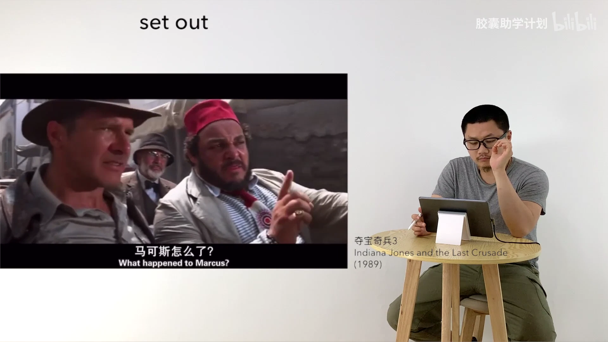

文字识别：set out / 胶囊助学计划 / 夺宝奇兵3 / 马可斯怎么了？ / Indiana Jones and the Last Crusade / What happened to Marcus? / (1989)

### 画面 00:07:38

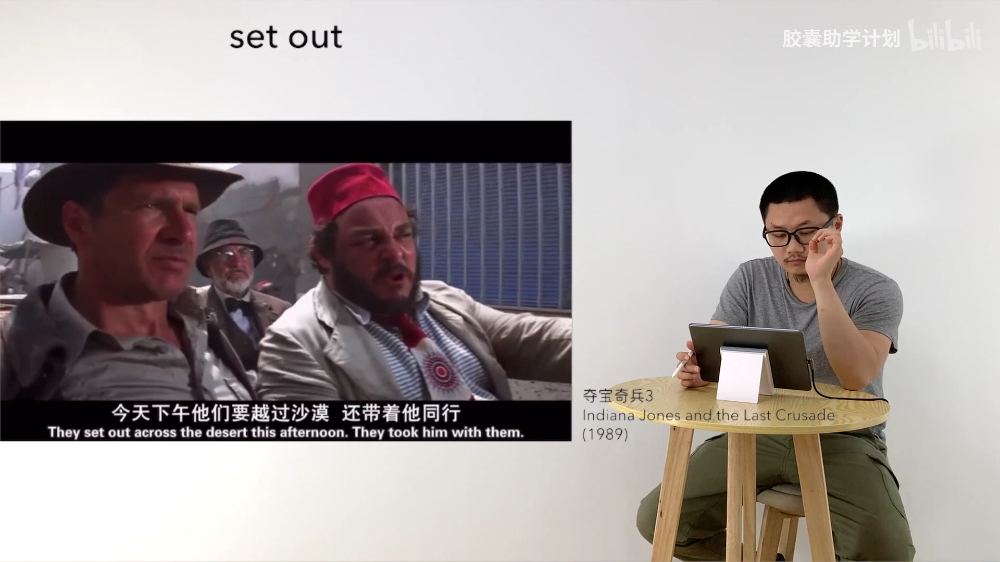

文字识别：set out / 胶囊助学计划 / 夺宝奇兵3 / 今天下午他们要越过沙漠还带着他同行 / Indiana Jones and the Last Crusade / They set out across the desert this afternoon. They took him with them. / (1989)

### 画面 00:07:40

文字识别：set out / 胶囊助学计划 / 夺宝奇兵3 / 今天下午他们要越过沙漠还带着他同行 / Indiana Jones and the Last Crusade / They set out across the desert this afternoon. They took him with them. / (1989)

### 画面 00:07:42

文字识别：set out / 胶囊助学计划 / 夺宝奇兵3 / 今天下午他们要越过沙漠还带着他同行 / Indiana Jones and the Last Crusade / They set out across the desert this afternoon. They took him with them. / (1989)

### 画面 00:07:44

文字识别：set out / 胶囊助学计划 / 夺宝奇兵3 / 他们拿到地图了 / Indiana Jones and the Last Crusade / Now they have the map! / (1989)

### 画面 00:07:46

文字识别：set out / 胶囊助学计划 / 夺宝奇兵3 / Indiana Jones and the Last Crusade / (1989)

### 画面 00:07:48

文字识别：set out / 胶囊助学计划 / 夺宝奇兵3 / 在这场比赛中第二名还是拿不到奖牌 / Indiana Jones and the Last Crusade / In this race, there's no silver medal for finishing second. / (1989)

### 画面 00:07:50

文字识别：set out / 胶囊助学计划 / 夺宝奇兵3 / 在这场比赛中第二名还是拿不到奖牌 / Indiana Jones and the Last Crusade / In this race, there's no silver medal for finishing second. / (1989)

### 画面 00:07:52

文字识别：set out / 胶囊助学计划 / 夺宝奇兵3 / Indiana Jones and the Last Crusade / (1989)

### 画面 00:07:55

文字识别：set out / 胶囊助学计划 / 夺宝奇兵3 / Indiana Jones and the Last Crusade / (1989)

## 00:08:00–00:08:30

接下来我们看这个小的短语叫 have plenty of time，有足够多的时间。我们来一句说，We'll have plenty of time and we'll spend three days in Beijing. 第三课学的 spend some time in some place 或者 at some place，对吧？在花费一些时间在某地，我们将拥有足够多的时间。接下来呢，看一个小的电影片段当中出现了 have plenty of time。注意力集中，来了。 What's up? So kids,

### 画面 00:08:00

文字识别：习惯用法造句指南 / 网：v.+v.变化 / 胶囊助学计划 / 四句型转换 / 方式/地点/时间 / 其他习惯用法 / 其他单词+词性 / 原文摘抄+变 / 6123456 / have plenty of time

### 画面 00:08:02

文字识别：网：v.+v.变化 / 习惯用法造句指南 / 胶囊助学计划 / 四句型转换 / 方式/地点/时间 / 其他习惯用法 / 其他单词+词性 / 原文摘抄+变 / 6123456 / have plenty of time

### 画面 00:08:04

文字识别：习惯用法造句指南 / 网：v.+v.变化 / 胶囊助学计划 / 四句型转换 / 方式/地点/时间 / 其他习惯用法 / 其他单词+词性 / 原文摘抄+变 / 6123456 / have plenty of time

### 画面 00:08:06

文字识别：习惯用法造句指南 / 网：v.+v.变化 / 胶囊助学计划 / 四句型转换 / 方式/地点/时间 / 其他习惯用法 / 其他单词+词性 / 原文摘抄+变 / 6123456 / have plenty of time / We'll have plenty of time and we'll spend / three days in Beijing. L3

### 画面 00:08:10

文字识别：网：v.+v.变化 / 习惯用法造句指南 / 胶囊助学计划 / 四句型转换 / 方式/地点/时间 / 其他习惯用法 / 其他单词+词性 / 原文摘抄+变 / 6123456 / have plenty of time / We'll have plenty of time and we'll spend / three days in Beijing. L3

### 画面 00:08:15

文字识别：网：v.+v.变化 / 习惯用法造句指南 / 胶囊助学计划 / 四句型转换 / 方式/地点/时间 / 其他习惯用法 / 其他单词+词性 / 原文摘抄+变 / 6123456 / have plenty of time / We'll have plenty of time and we'll spend / three days in Beijing. L3

### 画面 00:08:20

文字识别：have plenty of time / 胶囊助学计划 / 随波逐流 / 甜心，怎么了？ / Just Go with It / Hey, sweetie! What's going on? What's up? / (2011)

### 画面 00:08:28

文字识别：have plenty of time / 胶囊助学计划 / 随波逐流 / 甜心，怎么了？ / Just Go with It / Hey, sweetie! What's going on? What's up? / (2011)

## 00:08:30–00:09:00

I just got off the phone with your mom, and you guys are gonna have plenty of time to spend with your dad tomorrow because she and I are gonna have a nice long spa day. Awesome, awesome, awesome, you guys, you guys. I'll see you in a minute, okay? I love you. Okay, have plenty of time,拥有足够多的时间. Continue, say goodbye to somebody,叫对某人说再见.

### 画面 00:08:30

文字识别：have plenty of time / 胶囊助学计划 / 随波逐流 / 孩子们，我刚跟你们母亲通过话 / Just Go with It / So, kids, I just got off the phone with your mom / (2011)

### 画面 00:08:32

文字识别：have plenty of time / 胶囊助学计划 / 随波逐流 / Just Go with It / (2011)

### 画面 00:08:35

文字识别：have plenty of time / 胶囊助学计划 / 随波逐流 / 跟爸爸一起玩 / Just Go with It / to spend with your dad tomorrow / (2011)

### 画面 00:08:37

文字识别：have plenty of time / 胶囊助学计划 / 随波逐流 / 因为她和我整天都要去做水疗 / Just Go with It / because she and I are gonna have a nice, long spa day. / (2011)

### 画面 00:08:39

文字识别：have plenty of time / 胶囊助学计划 / 随波逐流 / Just Go with It / (2011)

### 画面 00:08:42

文字识别：have plenty of time / 胶囊助学计划 / 随波逐流 / 帅啦！太好了 / Just Go with It / Awesome! Awesome, awesome. / (2011)

### 画面 00:08:44

文字识别：have plenty of time / 胶囊助学计划 / 随波逐流 / 你们真是. / Just Go with It / Youguys are so.… / (2011)

### 画面 00:08:46

文字识别：have plenty of time / 胶囊助学计划 / 随波逐流 / 待会再见，好吗？我爱你 / Just Go with It / I'll seeyou in a minute, okay? I love you. / (2011)

### 画面 00:08:48

文字识别：have plenty of time / 胶囊助学计划 / 随波逐流 / Just Go with It / (2011)

### 画面 00:08:50

文字识别：have plenty of time / 胶囊助学计划 / 随波逐流 / Just Go with It / (2011)

### 画面 00:08:55

文字识别：网：v.+v.变化 / 习惯用法造句指南 / 胶囊助学计划 / 四句型转换 / 方式/地点/时间 / 其他习惯用法 / 其他单词+词性 / 原文摘抄+变 / 6123456 / say goodbye to sb.

### 画面 00:08:57

文字识别：网：v.+v.变化 / 习惯用法造句指南 / 胶囊助学计划 / 四句型转换 / 方式/地点/时间 / 其他习惯用法 / 其他单词+词性 / 原文摘抄+变 / 6123456 / say goodbye to sb.

## 00:09:00–00:09:30

比如说 Come here and say goodbye to your aunt. 那这个可能是家长对孩子说的，说来过来跟你阿姨说再见，say goodbye to somebody. OK. 好，比如说我们结合十一课的习惯用法，叫 ask somebody to do something. 叫做 My parents ask me to say goodbye to him. 啊，我的父母啊要求我对他说再见啊，让我对他说拜拜. OK. 肯定句给各位了，剩下的句型就靠各位自己去处理了.

### 画面 00:09:00

文字识别：网：v.+v.变化 / 习惯用法造句指南 / 胶囊助学计划 / 四句型转换 / 方式/地点/时间 / 其他习惯用法 / 其他单词+词性 / 原文摘抄+变 / 6123456 / say goodbye to sb. / Come here and say goodbye to your aunt.

### 画面 00:09:02

文字识别：网：v.+v.变化 / 习惯用法造句指南 / 胶囊助学计划 / 四句型转换 / 方式/地点/时间 / 其他习惯用法 / 其他单词+词性 / 原文摘抄+变 / 6123456 / say goodbye to sb. / Come here and say goodbye to your aunt.

### 画面 00:09:05

文字识别：网：v.+v.变化 / 习惯用法造句指南 / 胶囊助学计划 / 四句型转换 / 方式/地点/时间 / 其他习惯用法 / 其他单词+词性 / 原文摘抄+变 / 6123456 / say goodbye to sb. / Come here and say goodbye to your aunt.

### 画面 00:09:09

文字识别：网：v.+v.变化 / 习惯用法造句指南 / 胶囊助学计划 / 四句型转换 / 方式/地点/时间 / 其他习惯用法 / 其他单词+词性 / 原文摘抄+变 / 6123456 / say goodbye to sb. / Come here and say goodbye to your aunt.

### 画面 00:09:11

文字识别：网：v.+v.变化 / 习惯用法造句指南 / 胶囊助学计划 / 四句型转换 / 方式/地点/时间 / 其他习惯用法 / 其他单词+词性 / 原文摘抄+变 / 6123456 / say goodbye to sb. / Come here and say goodbye to your aunt. / My parents asked me to say goodbye to him. L11

### 画面 00:09:15

文字识别：网：v.+v.变化 / 习惯用法造句指南 / 胶囊助学计划 / 四句型转换 / 方式/地点/时间 / 其他习惯用法 / 其他单词+词性 / 原文摘抄+变 / 6123456 / say goodbye to sb. / Come here and say goodbye to your aunt. / My parents asked me to say goodbye to him. L11

### 画面 00:09:19

文字识别：网：v.+v.变化 / 习惯用法造句指南 / 胶囊助学计划 / 四句型转换 / 方式/地点/时间 / 其他习惯用法 / 其他单词+词性 / 原文摘抄+变 / 6123456 / say goodbye to sb. / Come here and say goodbye to your aunt. / My parents asked me to say goodbye to him. L11

### 画面 00:09:21

文字识别：网：v.+v.变化 / 习惯用法造句指南 / 胶囊助学计划 / 四句型转换 / 方式/地点/时间 / 其他习惯用法 / 其他单词+词性 / 原文摘抄+变 / 6123456 / say goodbye to sb. / Come here and say goodbye to your aunt. / My parents asked me to say goodbye to him. L11

### 画面 00:09:25

文字识别：网：v.+v.变化 / 习惯用法造句指南 / 胶囊助学计划 / 四句型转换 / 方式/地点/时间 / 其他习惯用法 / 其他单词+词性 / 原文摘抄+变 / 6123456 / say goodbye to sb. / Come here and say goodbye to your aunt. / My parents asked me to say goodbye to him. L11

## 00:09:30–00:10:00

Okay,好，我们接下来看一个小电影片段，出现了 say goodbye to somebody，注意力集中了，还出现了两次哦。 You say goodbye to me, man. Sure, I'm gonna say goodbye to you, Charles. Mack, Mack, yeah, thank you, Mack. Thank you. I'll never forget you, sir. Okay, I'm gonna say goodbye to you. Aren't you gonna say goodbye to me? Okay,好，接下来 will be away. 注

### 画面 00:09:30

文字识别：say goodbye to sb / 胶囊助学计划 / 飞越疯人院 / 吉姆 / One Flew Over the Cuckoo's Nest / Jimmy. / (1975)

### 画面 00:09:38

文字识别：say goodbye to sb / 胶囊助学计划 / 飞越疯人院 / One Flew Over the Cuckoo's Nest / (1975)

### 画面 00:09:40

文字识别：say goodbye to sb / 胶囊助学计划 / 飞越疯人院 / 你不跟我说再见吗 麦克? / One Flew Over the Cuckoo's Nest / Aren't you gonna say goodbye to me, Mac? / (1975)

### 画面 00:09:42

文字识别：say goodbye to sb / 胶囊助学计划 / 飞越疯人院 / 当然会再见查理 / One Flew Over the Cuckoo's Nest / Sure, I'm gonna say goodbye to you, Charles. / (1975)

### 画面 00:09:44

文字识别：say goodbye to sb / 胶囊助学计划 / 飞越疯人院 / One Flew Over the Cuckoo's Nest / (1975)

### 画面 00:09:46

文字识别：say goodbye to sb / 胶囊助学计划 / 飞越疯人院 / One Flew Over the Cuckoo's Nest / (1975)

### 画面 00:09:48

文字识别：say goodbye to sb / 胶囊助学计划 / 飞越疯人院 / 谢谢你麦克 / One Flew Over the Cuckoo's Nest / Thank you, Mac. / (1975)

### 画面 00:09:50

文字识别：say goodbye to sb / 胶囊助学计划 / 飞越疯人院 / One Flew Over the Cuckoo's Nest / (1975)

### 画面 00:09:52

文字识别：say goodbye to sb / 胶囊助学计划 / 飞越疯人院 / 我不会忘记你的 / One Flew Over the Cuckoo's Nest / I'Il never forget you. / (1975)

### 画面 00:09:57

文字识别：网：v.+v.变化 / 习惯用法造句指南 / 胶囊助学计划 / 四句型转换 / 方式/地点/时间 / 其他习惯用法 / 其他单词+词性 / 原文摘抄+变 / 6123456 / will be away

### 画面 00:09:59

文字识别：网：v.+v.变化 / 习惯用法造句指南 / 胶囊助学计划 / 四句型转换 / 方式/地点/时间 / 其他习惯用法 / 其他单词+词性 / 原文摘抄+变 / 6123456 / will be away

## 00:10:00–00:10:30

意我们实际上现在是把它当一个小的习惯用法在处理的啊。您不当习惯用法也没有说太大的问题啊。说原文给的是 he will be away for two months. 接下来把它变一般疑问句，will 提前，Will he be away for two months? 对，for two months 提问用的是 how long。在讲现在完成时的时候我们提过，对吧？所以这句话就变成了 how long will he be away? 他将离开多长时间？OK。

### 画面 00:10:01

文字识别：网：v.+v.变化 / 习惯用法造句指南 / 胶囊助学计划 / 四句型转换 / 方式/地点/时间 / 其他习惯用法 / 其他单词+词性 / 原文摘抄+变 / 6123456 / will be away

### 画面 00:10:04

文字识别：习惯用法造句指南 / 网：v.+v.变化 / 胶囊助学计划 / 四句型转换 / 方式/地点/时间 / 其他习惯用法 / 其他单词+词性 / 原文摘抄+变 / 6123456 / will be away

### 画面 00:10:06

文字识别：网：v.+v.变化 / 习惯用法造句指南 / 胶囊助学计划 / 四句型转换 / 方式/地点/时间 / 其他习惯用法 / 其他单词+词性 / 原文摘抄+变 / 6123456 / will be away

### 画面 00:10:08

文字识别：网：v.+v.变化 / 习惯用法造句指南 / 胶囊助学计划 / 四句型转换 / 方式/地点/时间 / 其他习惯用法 / 其他单词+词性 / 原文摘抄+变 / 6123456 / will be away / [Story]: He will be away for two months.

### 画面 00:10:10

文字识别：网：v.+v.变化 / 习惯用法造句指南 / 胶囊助学计划 / 四句型转换 / 方式/地点/时间 / 其他习惯用法 / 其他单词+词性 / 原文摘抄+变 / 6123456 / will be away / [Story]: He will be away for two months.

### 画面 00:10:12

文字识别：网：v.+v.变化 / 习惯用法造句指南 / 胶囊助学计划 / 四句型转换 / 方式/地点/时间 / 其他习惯用法 / 其他单词+词性 / 原文摘抄+变 / 6123456 / will be away / [Story]: He will be away for two months. / Will he be away for two months?

### 画面 00:10:15

文字识别：习惯用法造句指南 / 网：v.+v.变化 / 胶囊助学计划 / 四句型转换 / 方式/地点/时间 / 其他习惯用法 / 其他单词+词性 / 原文摘抄+变 / 6123456 / will be away / [Story]: He will be away for two months. / Will he be away for two months?

### 画面 00:10:17

文字识别：网：v.+v.变化 / 习惯用法造句指南 / 胶囊助学计划 / 四句型转换 / 方式/地点/时间 / 其他习惯用法 / 其他单词+词性 / 原文摘抄+变 / 6123456 / will be away / [Story]: He will be away for two months. / Will he be away for two months? / How long will he be away?

### 画面 00:10:20

文字识别：网：v.+v.变化 / 习惯用法造句指南 / 胶囊助学计划 / 四句型转换 / 方式/地点/时间 / 其他习惯用法 / 其他单词+词性 / 原文摘抄+变 / 6123456 / will be away / [Story]: He will be away for two months. / Will he be away for two months? / How long will he be away?

### 画面 00:10:25

文字识别：网：v.+v.变化 / 习惯用法造句指南 / 胶囊助学计划 / 四句型转换 / 方式/地点/时间 / 其他习惯用法 / 其他单词+词性 / 原文摘抄+变 / 6123456 / will be away / [Story]: He will be away for two months. / Will he be away for two months? / How long will he be away?

### 画面 00:10:29

文字识别：习惯用法造句指南 / 网：v.+v.变化 / 胶囊助学计划 / 四句型转换 / 方式/地点/时间 / 其他习惯用法 / 其他单词+词性 / 原文摘抄+变 / 6123456 / will be away / [Story]: He will be away for two months. / Will he be away for two months? / How long will he be away? / Who will be away for two months?

## 00:10:30–00:11:00

那以及我如果对主语提问，那各位在这儿注意，直接替代主语，不要变一般疑问句了，就是Who will be away for two months?谁要离开两个月？我没听清，是吧？你再说一遍。那一个，以及Why will he be away for two months?他为什么要离开两个月呢？Okay, Why放到句首，直接替代，就啊，这直接加一般疑问句就可以了。Okay,接下来A be

### 画面 00:10:31

文字识别：习惯用法造句指南 / 网：v.+v.变化 / 胶囊助学计划 / 四句型转换 / 方式/地点/时间 / 其他习惯用法 / 其他单词+词性 / 原文摘抄+变 / 6123456 / will be away / [Story]: He will be away for two months. / Will he be away for two months? / How long will he be away? / Who will be away for two months?

### 画面 00:10:34

文字识别：网：v.+v.变化 / 习惯用法造句指南 / 胶囊助学计划 / 四句型转换 / 方式/地点/时间 / 其他习惯用法 / 其他单词+词性 / 原文摘抄+变 / 6123456 / will be away / [Story]: He will be away for two months. / Will he be away for two months? / How long will he be away? / Who will be away for two months?

### 画面 00:10:36

文字识别：习惯用法造句指南 / 网：v.+v.变化 / 胶囊助学计划 / 四句型转换 / 方式/地点/时间 / 其他习惯用法 / 其他单词+词性 / 原文摘抄+变 / 6123456 / will be away / [Story]: He will be away for two months. / Will he be away for two months? / How long will he be away? / Who will be away for two months?

### 画面 00:10:39

文字识别：习惯用法造句指南 / 网：v.+v.变化 / 胶囊助学计划 / 四句型转换 / 方式/地点/时间 / 其他习惯用法 / 其他单词+词性 / 原文摘抄+变 / 6123456 / will be away / [Story]: He will be away for two months. / Will he be away for two months? / How long will he be away? / Who will be away for two months?

### 画面 00:10:41

文字识别：习惯用法造句指南 / 网：v.+v.变化 / 胶囊助学计划 / 四句型转换 / 方式/地点/时间 / 其他习惯用法 / 其他单词+词性 / 原文摘抄+变 / 6123456 / will be away / [Story]: He will be away for two months. / Will he be away for two months? / How long will he be away? / Who will be away for two months?

### 画面 00:10:45

文字识别：习惯用法造句指南 / 网：v.+v.变化 / 胶囊助学计划 / 四句型转换 / 方式/地点/时间 / 其他习惯用法 / 其他单词+词性 / 原文摘抄+变 / 6123456 / will be away / [Story]: He will be away for two months. / Will he be away for two months? / How long will he be away? / Who will be away for two months? / Why will he be away for two months?

### 画面 00:10:48

文字识别：习惯用法造句指南 / 网：v.+v.变化 / 胶囊助学计划 / 四句型转换 / 方式/地点/时间 / 其他习惯用法 / 其他单词+词性 / 原文摘抄+变 / 6123456 / will be away / [Story]: He will be away for two months. / Will he be away for two months? / How long will he be away? / Who will be away for two months? / Why will he be away for two months?

### 画面 00:10:50

文字识别：习惯用法造句指南 / 网：v.+v.变化 / 胶囊助学计划 / 四句型转换 / 方式/地点/时间 / 其他习惯用法 / 其他单词+词性 / 原文摘抄+变 / 6123456 / will be away / [Story]: He will be away for two months. / Will he be away for two months? / How long will he be away? / Who will be away for two months? / Why will he be away for two months?

### 画面 00:10:55

文字识别：习惯用法造句指南 / 网：v.+v.变化 / 胶囊助学计划 / 四句型转换 / 方式/地点/时间 / 其他习惯用法 / 其他单词+词性 / 原文摘抄+变 / 6123456 / will be away / [Story]: He will be away for two months. / Will he be away for two months? / How long will he be away? / Who will be away for two months? / Why will he be away for two months?

### 画面 00:10:57

文字识别：网：v.+v.变化 / 习惯用法造句指南 / 胶囊助学计划 / 四句型转换 / 方式/地点/时间 / 其他习惯用法 / 其他单词+词性 / 原文摘抄+变 / 6123456 / A be proud of B

### 画面 00:10:59

文字识别：网：v.+v.变化 / 习惯用法造句指南 / 胶囊助学计划 / 四句型转换 / 方式/地点/时间 / 其他习惯用法 / 其他单词+词性 / 原文摘抄+变 / 6123456 / A be proud of B

## 00:11:00–00:11:30

proud of B. 因为单词部分我们已经讲过了，在这儿就给大家简单来几个句子就行了。口语当中常用的，I'm proud of you. 啊，在这儿可能他口语说的时候不会说 I am，对吧？他直接就是连连读了，是吧？Am啊，proud of you，或者说 My parents are proud of me. 啊，我父母因我是感到骄傲或自豪啊，非常简单，我们不再多说了。下一个，take part in，指的是参加某个

### 画面 00:11:01

文字识别：网：v.+v.变化 / 习惯用法造句指南 / 胶囊助学计划 / 四句型转换 / 方式/地点/时间 / 其他习惯用法 / 其他单词+词性 / 原文摘抄+变 / 6123456 / A be proud of B

### 画面 00:11:03

文字识别：网：v.+v.变化 / 习惯用法造句指南 / 胶囊助学计划 / 四句型转换 / 方式/地点/时间 / 其他习惯用法 / 其他单词+词性 / 原文摘抄+变 / 6123456 / A be proud of B / Iam proud of you.

### 画面 00:11:05

文字识别：网：v.+v.变化 / 习惯用法造句指南 / 胶囊助学计划 / 四句型转换 / 方式/地点/时间 / 其他习惯用法 / 其他单词+词性 / 原文摘抄+变 / 6123456 / A be proud of B / Iam proud of you.

### 画面 00:11:07

文字识别：网：v.+v.变化 / 习惯用法造句指南 / 胶囊助学计划 / 四句型转换 / 方式/地点/时间 / 其他习惯用法 / 其他单词+词性 / 原文摘抄+变 / 6123456 / A be proud of B / Iam proud of you.

### 画面 00:11:10

文字识别：网：v.+v.变化 / 习惯用法造句指南 / 胶囊助学计划 / 四句型转换 / 方式/地点/时间 / 其他习惯用法 / 其他单词+词性 / 原文摘抄+变 / 6123456 / A be proud of B / Iam proud of you.

### 画面 00:11:15

文字识别：网：v.+v.变化 / 习惯用法造句指南 / 胶囊助学计划 / 四句型转换 / 方式/地点/时间 / 其他习惯用法 / 其他单词+词性 / 原文摘抄+变 / 6123456 / A be proud of B / Iam proud of you.

### 画面 00:11:17

文字识别：网：v.+v.变化 / 胶囊助学计划 / 习惯用法造句指南 / 四句型转换 / 方式/地点/时间 / 其他习惯用法 / 其他单词+词性 / 原文摘抄+变 / 6123456 / A be proud of B / I am proud of you. / My parents are proud of me.

### 画面 00:11:20

文字识别：习惯用法造句指南 / 网：v.+v.变化 / 胶囊助学计划 / 四句型转换 / 方式/地点/时间 / 其他习惯用法 / 其他单词+词性 / 原文摘抄+变 / 6123456 / A be proud of B / I am proud of you. / My parents are proud of me.

### 画面 00:11:23

文字识别：网：v.+v.变化 / 习惯用法造句指南 / 胶囊助学计划 / 四句型转换 / 方式/地点/时间 / 其他习惯用法 / 其他单词+词性 / 原文摘抄+变 / 6123456 / take part in

### 画面 00:11:25

文字识别：网：v.+v.变化 / 习惯用法造句指南 / 胶囊助学计划 / 四句型转换 / 方式/地点/时间 / 其他习惯用法 / 其他单词+词性 / 原文摘抄+变 / 6123456 / take part in

### 画面 00:11:29

文字识别：网：v.+v.变化 / 习惯用法造句指南 / 胶囊助学计划 / 四句型转换 / 方式/地点/时间 / 其他习惯用法 / 其他单词+词性 / 原文摘抄+变 / 6123456 / take part in

## 00:11:30–00:12:00

比赛啊。OK，比如说呢，He refused to take part in the race. 第九课我们学过的叫 refuse to do something，他拒绝参加这个比赛。肯定句给各位了，一般疑问句来吧，跟我张嘴读。Did he refuse to take part in the race? Here we go. 接下来，Why did he refuse to take part in the race? 那当然了，你也可以对主语提问，变不变一般疑问句，各位自己想一下。这回我不说了啊。好，

### 画面 00:11:31

文字识别：网：v.+v.变化 / 胶囊助学计划 / 习惯用法造句指南 / 四句型转换 / 方式/地点/时间 / 其他习惯用法 / 其他单词+词性 / 原文摘抄+变 / 6123456 / take part in / He refused to take part in the race. L9

### 画面 00:11:33

文字识别：网：v.+v.变化 / 习惯用法造句指南 / 胶囊助学计划 / 四句型转换 / 方式/地点/时间 / 其他习惯用法 / 其他单词+词性 / 原文摘抄+变 / 6123456 / take part in / He refused to take part in the race. L9

### 画面 00:11:35

文字识别：习惯用法造句指南 / 网：v.+v.变化 / 胶囊助学计划 / 四句型转换 / 方式/地点/时间 / 其他习惯用法 / 其他单词+词性 / 原文摘抄+变 / 6123456 / take part in / He refused to take part in the race. L9

### 画面 00:11:40

文字识别：习惯用法造句指南 / 网：v.+v.变化 / 胶囊助学计划 / 四句型转换 / 方式/地点/时间 / 其他习惯用法 / 其他单词+词性 / 原文摘抄+变 / 6123456 / take part in / He refused to take part in the race. L9

### 画面 00:11:42

文字识别：习惯用法造句指南 / 网：v.+v.变化 / 胶囊助学计划 / 四句型转换 / 方式/地点/时间 / 其他习惯用法 / 其他单词+词性 / 原文摘抄+变 / 6123456 / take part in / He refused to take part in the race. L9 / Did he refuse to take part in the race?

### 画面 00:11:44

文字识别：网：v.+v.变化 / 习惯用法造句指南 / 胶囊助学计划 / 四句型转换 / 方式/地点/时间 / 其他习惯用法 / 其他单词+词性 / 原文摘抄+变 / 6123456 / take part in / He refused to take part in the race. L9 / Did he refuse to take part in the race?

### 画面 00:11:46

文字识别：网：v.+v.变化 / 习惯用法造句指南 / 胶囊助学计划 / 四句型转换 / 方式/地点/时间 / 其他习惯用法 / 其他单词+词性 / 原文摘抄+变 / 6123456 / take part in / He refused to take part in the race. L9 / Did he refuse to take part in the race?

### 画面 00:11:50

文字识别：习惯用法造句指南 / 网：v.+v.变化 / 胶囊助学计划 / 四句型转换 / 方式/地点/时间 / 其他习惯用法 / 其他单词+词性 / 原文摘抄+变 / 6123456 / take part in / He refused to take part in the race. L9 / Did he refuse to take part in the race? / Why did he refuse to take part in the race?

### 画面 00:11:55

文字识别：网：v.+v.变化 / 胶囊助学计划出 / 习惯用法造句指南 / 四句型转换 / 方式/地点/时间 / 其他习惯用法 / 其他单词+词性 / 原文摘抄+变 / 6123456 / take part in / He refused to take part in the race. L9 / Did he refuse to take part in the race? / Why did he refuse to take part in the race?

### 画面 00:11:59

文字识别：网：v.+v.变化 / 习惯用法造句指南 / 胶囊助学计划 / 四句型转换 / 方式/地点/时间 / 其他习惯用法 / 其他单词+词性 / 原文摘抄+变 / 6123456 / take part in / He refused to take part in the race. L9 / Did he refuse to take part in the race? / Why did he refuse to take part in the race?

## 00:12:00–00:12:30

以及呢，我在查这个的时候查到了一九七九年邓小平，最近正好是奥运会对吧？邓小平说过一句话，我觉得还很很棒。当然他说的是汉语啊，我们这是翻译过来的英文，说的是China is preparing, preparing to take part in the Moscow Olympic Games。好，说中国正在准备着要去参加莫斯科的运动会啊，下一届的运动会。这儿一个，好，

### 画面 00:12:01

文字识别：网：v.+v.变化 / 习惯 / 胶囊助学计划 / 四句型转换 / 用 / 方式/地点/时间 / 法 / 么造句指南 / 其他习惯用法 / 其他单词+词性 / 原文摘抄+变 / 6123456 / take part in / He refused to take part in the race. L9 / Did he refuse to take part in the race? / Why did he refuse to take part in the race? / '"China is preparing to take part in the Moscow / Olympic Games." Deng Xiaoping 1979

### 画面 00:12:03

文字识别：网：v.+v.变化 / 胶囊助学计划 / 习惯 / 四句型转换 / 用 / 方式/地点/时间 / 法 / 么造句指南 / 其他习惯用法 / 其他单词+词性 / 原文摘抄+变 / 6123456 / take part in / He refused to take part in the race. L9 / Did he refuse to take part in the race? / Why did he refuse to take part in the race? / '"China is preparing to take part in the Moscow / Olympic Games." Deng Xiaoping 1979

### 画面 00:12:05

文字识别：习惯 / 网：v.+v.变化 / 胶囊助学计划 / 四句型转换 / 用 / 方式/地点/时间 / 法 / 其他习惯用法 / 造 / 旭句指南 / 其他单词+词性 / 原文摘抄+变 / 6123456 / take part in / He refused to take part in the race. L9 / Did he refuse to take part in the race? / Why did he refuse to take part in the race? / '"China is preparing to take part in the Moscow / Olympic Games." Deng Xiaoping 1979

### 画面 00:12:08

文字识别：习惯 / 网：v.+v.变化 / 胶囊助学计划 / 四句型转换 / 用 / 方式/地点/时间 / 法 / 么造句指南 / 其他习惯用法 / 其他单词+词性 / 原文摘抄+变 / 6123456 / take part in / He refused to take part in the race. L9 / Did he refuse to take part in the race? / Why did he refuse to take part in the race? / '"China is preparing to take part in the Moscow / Olympic Games." Deng Xiaoping 1979

### 画面 00:12:10

文字识别：习惯 / 网：v.+v.变化 / 胶囊助学计划 / 四句型转换 / 用 / 方式/地点/时间 / 市法造句指南 / 其他习惯用法 / 其他单词+词性 / 原文摘抄+变 / 6123456 / take part in / He refused to take part in the race. L9 / Did he refuse to take part in the race? / Why did he refuse to take part in the race? / '"China is preparing to take part in the Moscow / Olympic Games." Deng Xiaoping 1979

### 画面 00:12:13

文字识别：网：v.+v.变化 / 胶囊助学计划 / 习惯 / 四句型转换 / 用 / 方式/地点/时间 / 法 / 其他习惯用法 / 造 / 旭句指南 / 其他单词+词性 / 原文摘抄+变 / 6123456 / take part in / He refused to take part in the race. L9 / Did he refuse to take part in the race? / Why did he refuse to take part in the race? / '"China is preparing to take part in the Moscow / Olympic Games." Deng Xiaoping 1979

### 画面 00:12:15

文字识别：网：v.+v.变化 / 胶囊助学计划 / 习惯 / 四句型转换 / 用 / 方式/地点/时间 / 法 / 么造句指南 / 其他习惯用法 / 其他单词+词性 / 原文摘抄+变 / 6123456 / take part in / He refused to take part in the race. L9 / Did he refuse to take part in the race? / Why did he refuse to take part in the race? / '"China is preparing to take part in the Moscow / Olympic Games." Deng Xiaoping 1979

### 画面 00:12:18

文字识别：网：v.+v.变化 / 胶囊助学计划 / 习惯 / 四句型转换 / 用 / 方式/地点/时间 / 法 / 造 / 其他习惯用法 / 旭句指南 / 其他单词+词性 / 原文摘抄+变 / 6123456 / take part in / He refused to take part in the race. L9 / Did he refuse to take part in the race? / Why did he refuse to take part in the race? / "'China is preparing totake part in the Moscow / Olympic Games." Deng Xiaoping 1979

### 画面 00:12:20

文字识别：网：v.+v.变化 / 胶囊助学计划 / 习惯 / 四句型转换 / 用 / 方式/地点/时间 / 法 / 么造句指南 / 其他习惯用法 / 其他单词+词性 / 原文摘抄+变 / 6123456 / take part in / He refused to take part in the race. L9 / Did he refuse to take part in the race? / Why did he refuse to take part in the race? / "'China is preparing totake part in the Moscow / Olympic Games / Deng Xiaoping 1979

### 画面 00:12:22

文字识别：网：v.+v.变化 / 胶囊助学计划 / 习惯 / 四句型转换 / 用 / 方式/地点/时间 / 法 / 其他习惯用法 / 造 / 旭句指南 / 其他单词+词性 / 原文摘抄+变 / 6123456 / take part in / He refused to take part in the race. L9 / Did he refuse to take part in the race? / Why did he refuse to take part in the race? / "'China is preparing totake part in the Moscow / Olympic Games / Deng Xiaoping 1979

### 画面 00:12:25

文字识别：习惯 / 网：v.+v.变化 / 胶囊助学计划 / 四句型转换 / 用 / 方式/地点/时间 / 法 / 其他习惯用法 / 造 / 旭句指南 / 其他单词+词性 / 原文摘抄+变 / 6123456 / take part in / He refused to take part in the race. L9 / Did he refuse to take part in the race? / Why did he refuse to take part in the race? / "'China is preparing totake part in the Moscow / Olympic Games / Deng Xiaoping 1979

### 画面 00:12:28

文字识别：习惯 / 网：v.+v.变化 / 胶囊助学计划 / 四句型转换 / 用 / 方式/地点/时间 / 法 / 其他习惯用法 / 造 / 旭句指南 / 其他单词+词性 / 原文摘抄+变 / 6123456 / take part in / He refused to take part in the race. L9 / Did he refuse to take part in the race? / Why did he refuse to take part in the race? / "'China is preparing totake part in the Moscow / Olympic Games / Deng Xiaoping 1979

## 00:12:30–00:13:00

地儿，好，接下来我们看一下本课啊这些习惯用法， sail from啊从某个地方航行等等一系列，这必然是今天各位学习的一个重点了。于是我们看家庭作业，习惯用法造句，还是再次强调，一定要按照这个思路去造句。我不停的在用，您千万别完全放弃它，自己去随便想个辙造句啊。五句话，文章跟读至熟

### 画面 00:12:30

文字识别：胶囊助学计划 / Recap / sail / from s / SW. / set / out / have / plenty / of time / Expression / will bea / away / Abe / proud / ofB / say / 'goodbye to sb. / take / e part in

### 画面 00:12:32

文字识别：胶囊助学计划 / Recap / sail from sw. / set / out / have / plenty of time / Expression / will be away / Aber / proud / ofB / say goodbye to sb. / take part in

### 画面 00:12:34

文字识别：胶囊助学计划 / Recap / sail / from sw. / set / out / have / plenty of time / Expression / will be away / Abe / proud / ofB / say9 / goodbye to sb. / take part in

### 画面 00:12:36

文字识别：Recap / 胶囊助学计划 / sail / from / sW. / set / out / have / plenty / of time / Expression / will be / away / Abe / proud / ofB / say / goodbye to sb. / take / part in

### 画面 00:12:38

文字识别：胶囊助学计划 / Recap / sail / froms / sW. / set / out / have / plenty of time / Expression / will be a / away / Abe / proud / ofB / say / goodbye to sb. / take / part in

### 画面 00:12:40

文字识别：胶囊助学计划 / Recap / sail / from / SW. / set / out / have / plenty / of time / Expression / will be / away / Abe / proud / ofB / say / 'goodbye to sb. / take part in

### 画面 00:12:42

文字识别：胶囊助学计划 / Recap / sail / from / SW. / set / out / have / plenty / of time / Expression / will be a / away / Abe / proud / ofB / say / 'goodbye to sb. / take part in

### 画面 00:12:44

文字识别：胶囊助学计划 / 习惯用法造句/对话 / 1. / 【习惯用法造句指南】 / 每个5句

### 画面 00:12:46

文字识别：胶囊助学计划 / 习惯用法造句/对话 / 1. / 【习惯用法造句指南】 / 每个5句

### 画面 00:12:48

文字识别：胶囊助学计划 / 习惯用法造句/对话 / 1. / 【习惯用法造句指南】 / 每个5句

### 画面 00:12:50

文字识别：胶囊助学计划 / 1. / 习惯用法造句/对话 / 【习惯用法造句指南】 / 每个5句

### 画面 00:12:53

文字识别：胶囊助学计划 / 1. / 习惯用法造句/对话 / 【习惯用法造句指南】 / 每个5句

### 画面 00:12:55

文字识别：胶囊助学计划 / 1. / 习惯用法造句/对话 / 【习惯用法造句指南】 / 每个5句

### 画面 00:12:57

文字识别：胶囊助学计划 / 1. / 习惯用法造句/对话 / 【习惯用法造句指南】 / 每个5句 / 文章跟读至熟读成诵 / 内化单词+语法+习惯用法 / 听力+口语+写作练习

### 画面 00:12:59

文字识别：胶囊助学计划 / 习惯用法造句/对话 / 【习惯用法造句指南】 / 每个5句 / 文章跟读至熟读成诵 / 内化单词+语法+习惯用法 / 听力+口语+写作练习

## 00:13:00–00:13:30

读成诵，我们可以把本课的单词、语法、习惯用法内化掉。所谓的内化，就是不知不觉就会了啊。读的遍数多了就好了。接下来的下一个练习，当然也取决于文章的熟读成诵程度。那以上呢，就是本期视频的全部内容了。如果大家喜欢我们的课程，欢迎大家关注、订阅、一键三连，并分享给那些需要的朋友。See you next time.

### 画面 00:13:01

文字识别：胶囊助学计划 / 习惯用法造句/对话 / 【习惯用法造句指南】 / 每个5句 / 文章跟读至熟读成诵 / 内化单词+语法+习惯用法 / 听力+口语+写作练习

### 画面 00:13:03

文字识别：胶囊助学计划 / 习惯用法造句/对话 / 【习惯用法造句指南】 / 每个5句 / 文章跟读至熟读成诵 / 内化单词+语法+习惯用法 / 听力+口语+写作练习

### 画面 00:13:05

文字识别：胶囊助学计划 / 1. / 习惯用法造句/对话 / 【习惯用法造句指南】 / 每个5句 / 文章跟读至熟读成诵 / 内化单词+语法+习惯用法 / 听力+口语+写作练习

### 画面 00:13:07

文字识别：胶囊助学计划 / 1. / 习惯用法造句/对话 / 【习惯用法造句指南】 / 每个5句 / 文章跟读至熟读成诵 / 内化单词+语法+习惯用法 / 听力+口语+写作练习

### 画面 00:13:10

文字识别：胶囊助学计划 / 1. / 习惯用法造句/对话 / 【习惯用法造句指南】 / 每个5句 / 文章跟读至熟读成诵 / 内化单词+语法+习惯用法 / 听力+口语+写作练习

### 画面 00:13:12

文字识别：胶囊助学计划 / 习惯用法造句/对话 / 【习惯用法造句指南】 / 每个5句 / 文章跟读至熟读成诵 / 内化单词+语法+习惯用法 / 听力+口语+写作练习

### 画面 00:13:14

文字识别：胶囊助学计划

### 画面 00:13:22

文字识别：胶囊助学计划

### 画面 00:13:27

### 画面 00:13:29

文字识别：CAPSULEACADEMY / 胶囊助学计划 / 『 / 小红书 / Lecturer / Leo / OE

## 00:13:30–00:13:39

### 画面 00:13:31

文字识别：CAPSULEACADEMY / 胶囊助学计划 / 小红书 / Photographer / Berlin / OE

### 画面 00:13:33

文字识别：CAPSULEACADEMY / 胶囊助学计划 / 小红书 / Editor / □ / Berlin / OE

### 画面 00:13:36

文字识别：CAPSULEACADEMY / 胶囊助学计划 / 『 / 小红书

### 画面 00:13:38

文字识别：bilibili / 胶囊助学计划

### 画面 00:13:39

文字识别：bilibili / 胶囊助学计划

