# L013 单词

快速机器解析：语音为单模型转写，未进行独立交叉校对或人工复核；画面每秒采样并按变化选帧，短时文字和标记可能遗漏。截图时间约有 1 秒误差。图片有损压缩；遇到疑点请按时间查看 Google Drive 原视频。

## 00:00:00–00:00:30

Hello everyone, welcome to Capsule Academy. This is Leo. Today we're going to learn New Concept English Book Two Lesson Thirteen Words. 那老习惯啊，进入正式课程之前，我们先看几个小的问题。第一，如何表达加入俱乐部？第二，如何表达演出？那最后一个问题，如何表达 over？啊，这是一个副词。OK，那带着这三个问题，Hope you gonna enjoy it. OK，那我们先看

### 画面 00:00:00

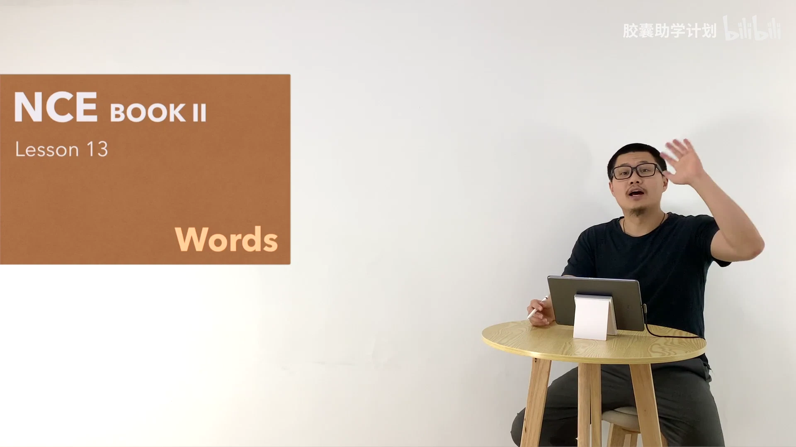

文字识别：胶囊助学计划 / NCE / BOOKⅡI / Lesson 13 / Words

### 画面 00:00:05

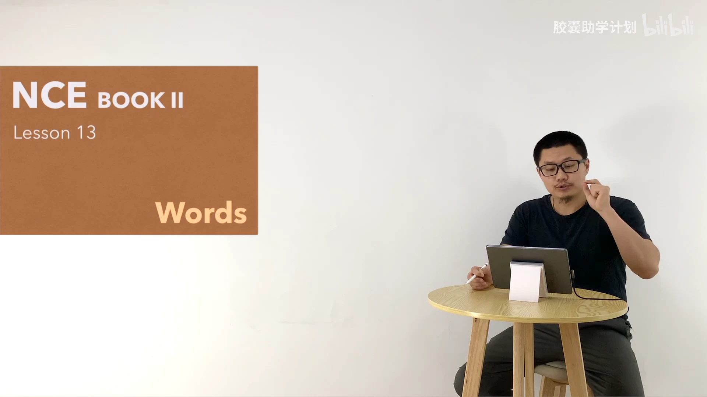

文字识别：胶囊助学计划 / NCE / BOOKII / Lesson 13 / Words

### 画面 00:00:09

文字识别：胶囊助学计划 / •

### 画面 00:00:11

文字识别：胶囊助学计划 / 何表达“加入俱乐部”?

### 画面 00:00:13

文字识别：胶囊助学计划 / ①如何表达“加入俱乐部”？

### 画面 00:00:15

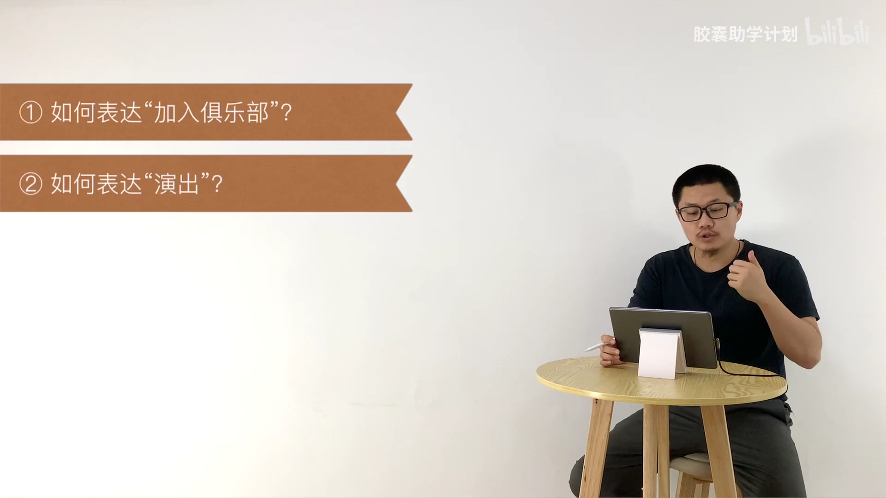

文字识别：胶囊助学计划 / ①如何表达“加入俱乐部”? / 如何表达“演出”

### 画面 00:00:17

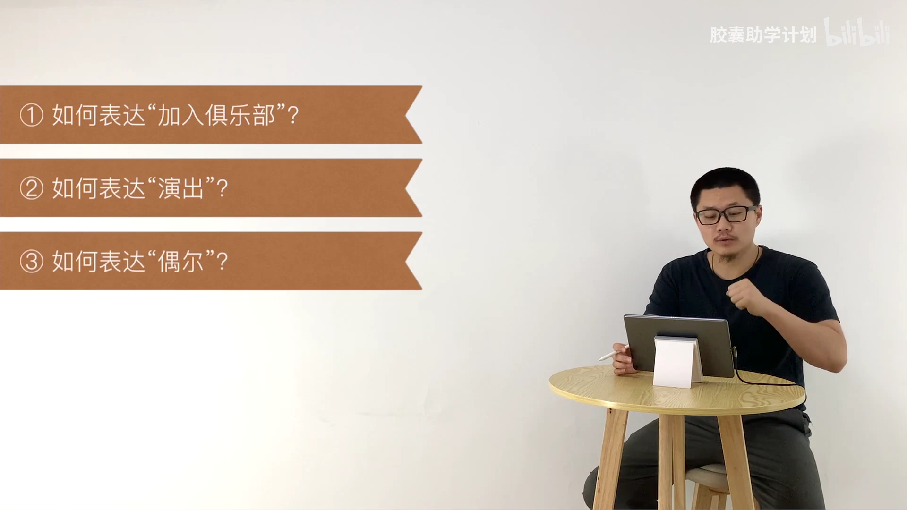

文字识别：胶囊助学计划 / ①如何表达“加入俱乐部”？ / 如何表达“演出” / 如何表达“偶尔”？

### 画面 00:00:20

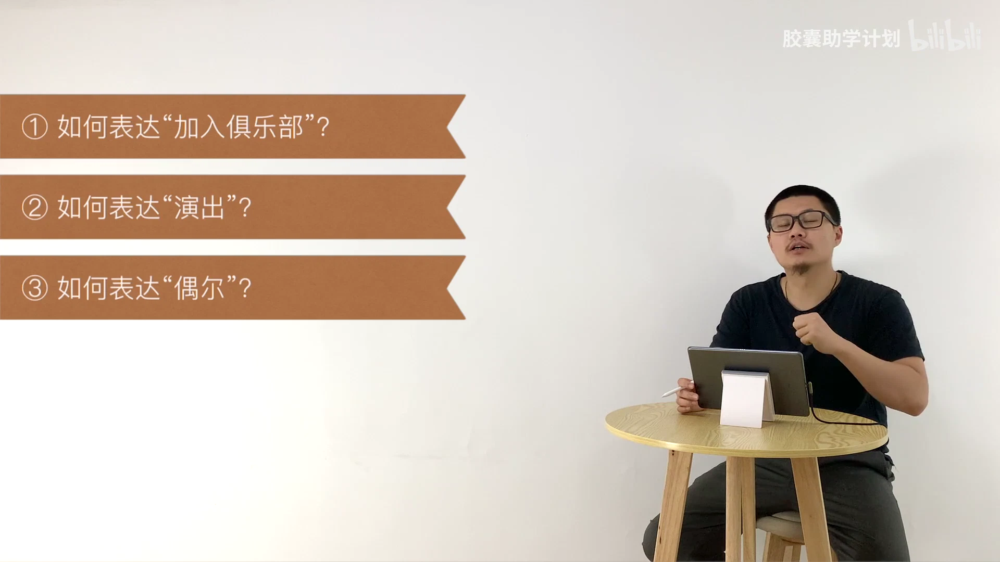

文字识别：胶囊助学计划 / ①如何表达“加入俱乐部”？ / 如何表达“演出” / 如何表达“偶尔”？

### 画面 00:00:24

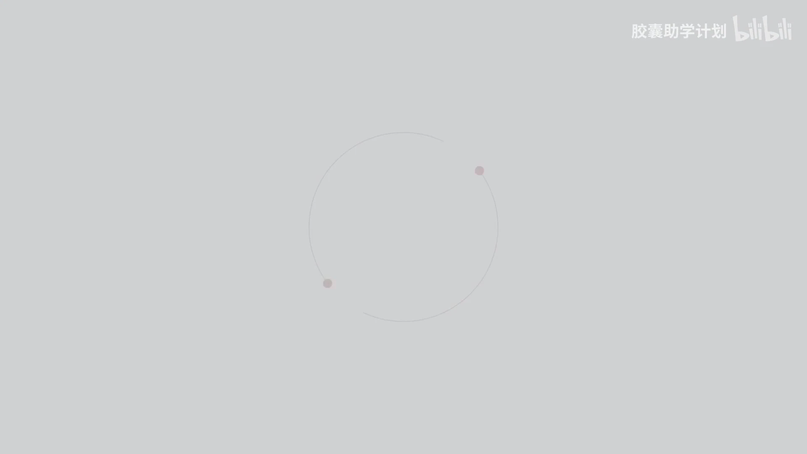

文字识别：胶囊助学计划bill / •

### 画面 00:00:28

## 00:00:30–00:01:00

第一个小的单词啊，我们看这音标，来跟我一起读一下，group，group。好，我们很长时间没有回顾这个知识点了，我们现在回顾一下所谓叫自然拼读法则啊。如果各位学过新一再来学新二，那您的自然拼读法则应该已经还不错了啊。如果没有学新一，可能您还不太了解这个知识点。比如说g啊，这个字母放在单词当中去发的是g，p这个字母放在单词当中去发的是p啊，这是我们管它叫自然拼读法则。怎么

### 画面 00:00:30

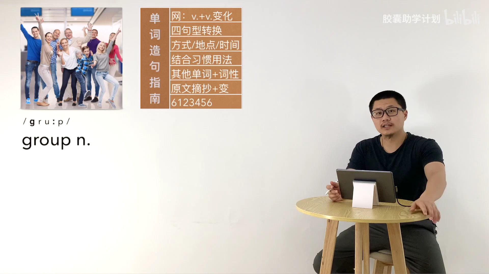

文字识别：单词造句指南 / 网：v.+v.变化 / 胶囊助学计划 / 四句型转换 / 方式/地点/时间 / 结合习惯用法 / 其他单词+词性 / 原文摘抄+变 / 6123456 / /gru:p/ / group n.

### 画面 00:00:32

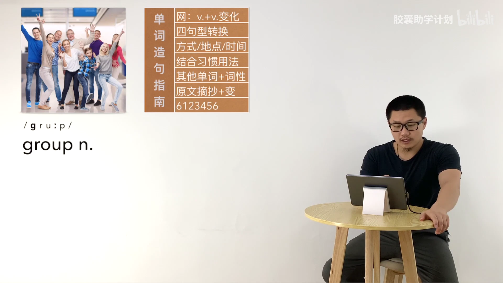

文字识别：单词造句指南 / 网：v.+v.变化 / 胶囊助学计划 / 四句型转换 / 方式/地点/时间 / 结合习惯用法 / 其他单词+词性 / 原文摘抄+变 / 6123456 / /gru:p/ / group n.

### 画面 00:00:34

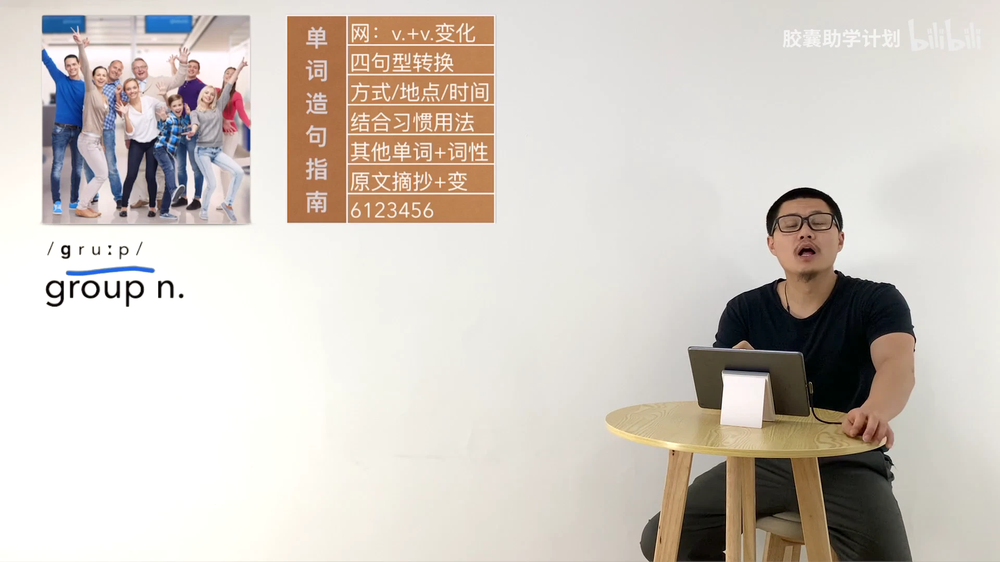

文字识别：单词造句指南 / 网：v.+v.变化 / 胶囊助学计划 / 四句型转换 / 方式/地点/时间 / 结合习惯用法 / 其他单词+词性 / 原文摘抄+变 / 6123456 / /gru:p/ / group / n.

### 画面 00:00:37

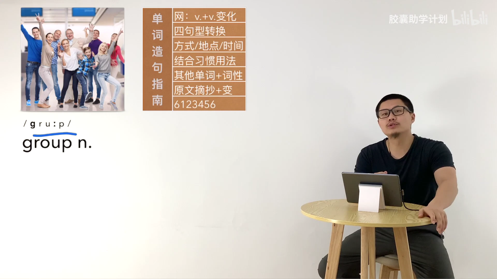

文字识别：单词造句指南 / 网：v.+v.变化 / 胶囊助学计划 / 四句型转换 / 方式/地点/时间 / 结合习惯用法 / 其他单词+词性 / 原文摘抄+变 / 6123456 / /gruip/ / group / n.

### 画面 00:00:41

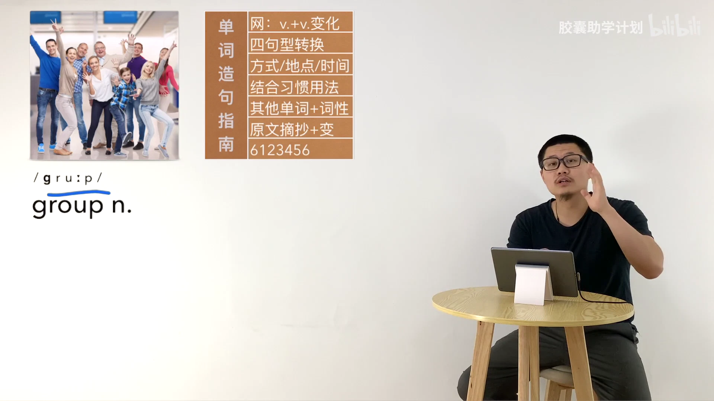

文字识别：单词造句指南 / 网：v.+v.变化 / 胶囊助学计划 / 四句型转换 / 方式/地点/时间 / 结合习惯用法 / 其他单词+词性 / 原文摘抄+变 / 6123456 / /gru:p/ / group / n.

### 画面 00:00:45

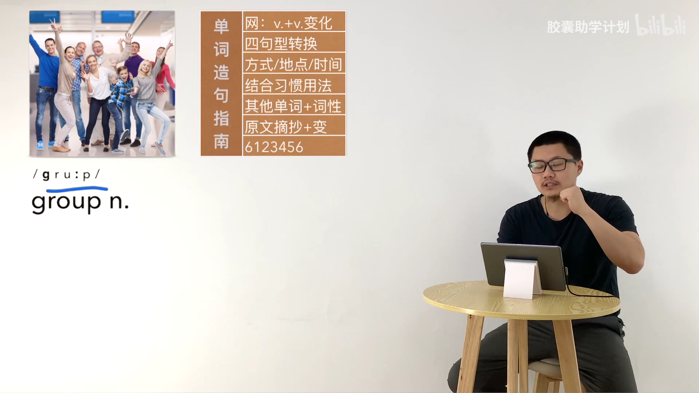

文字识别：单词造句指南 / 网：v.+v.变化 / 胶囊助学计划 / 四句型转换 / 方式/地点/时间 / 结合习惯用法 / 其他单词+词性 / 原文摘抄+变 / 6123456 / /gru:p/ / group / n.

### 画面 00:00:50

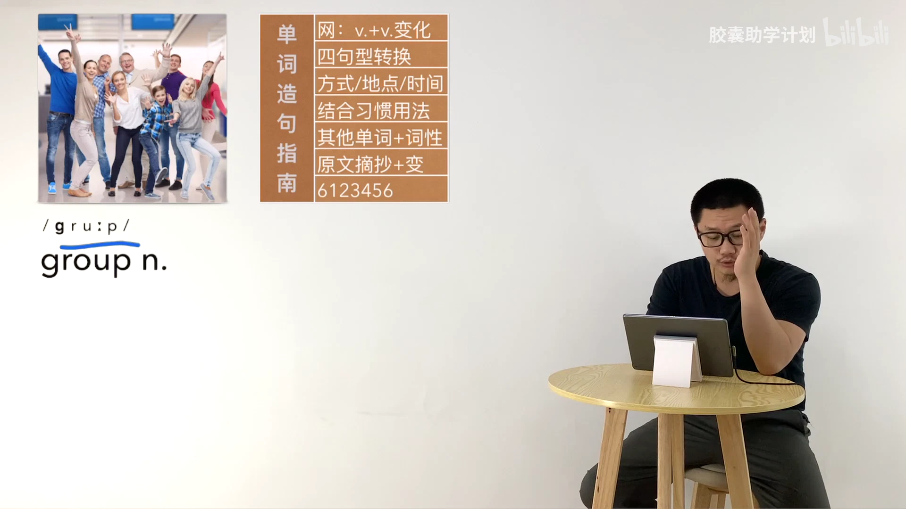

文字识别：单词造句指南 / 网：v.+v.变化 / 胶囊助学计划 / 四句型转换 / 方式/地点/时间 / 结合习惯用法 / 其他单词+词性 / 原文摘抄+变 / 6123456 / /gru:p/ / group / n.

### 画面 00:00:55

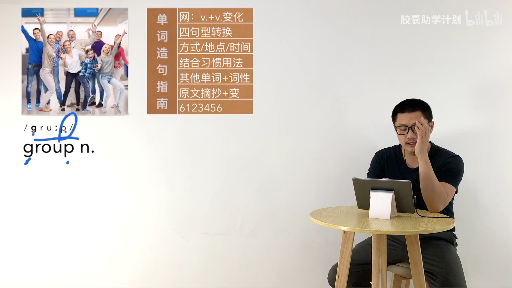

文字识别：单词造句指南 / 网：v.+v.变化 / 胶囊助学计划 / 四句型转换 / 方式/地点/时间 / 结合习惯用法 / 其他单词+词性 / 原文摘抄+变 / 6123456 / /gru: / group n.

## 00:01:00–00:01:30

用啊？为什么要学它？怎么学它啊？我们专门给大家录制一个视频，各位不妨可以去看一下。那它就是一组啊，它经常实际上用的一个短语叫 a group of 啊，叫一组怎么样怎么样的人，类似于一个量词，比如说 a group of students like the picture in the picture, right？好，叫一组学生啊啊，一些学生啊，然后 a group of waiters waiters 我们之前学过了，叫服务员。那 a group of captains 刚刚学过啊，我们管它叫船

### 画面 00:01:00

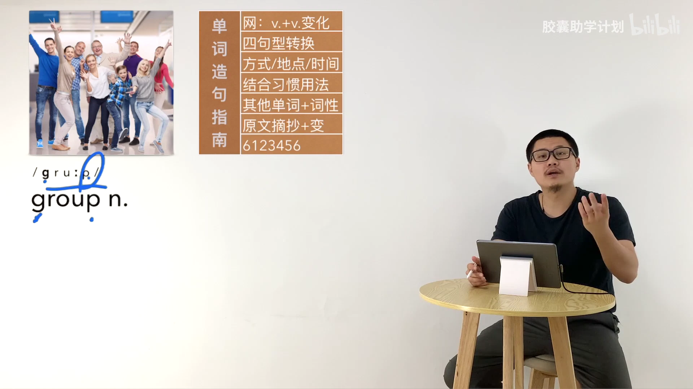

文字识别：单词造句指南 / 网：v.+v.变化 / 胶囊助学计划 / 四句型转换 / 方式/地点/时间 / 结合习惯用法 / 其他单词+词性 / 原文摘抄+变 / 6123456 / /gru / group n.

### 画面 00:01:05

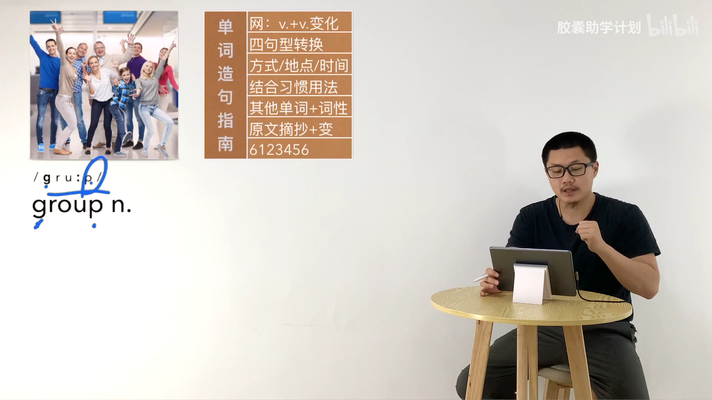

文字识别：单词造句指南 / 网：v.+v.变化 / 胶囊助学计划 / 四句型转换 / 方式/地点/时间 / 结合习惯用法 / 其他单词+词性 / 原文摘抄+变 / 6123456 / /gru / group /  n.

### 画面 00:01:08

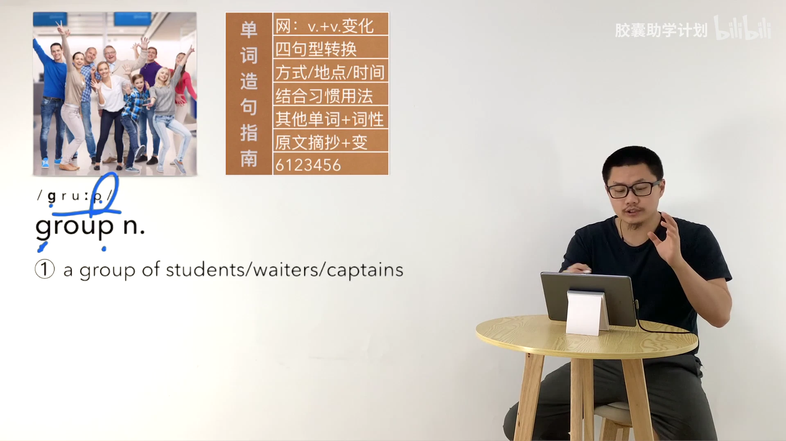

文字识别：单词造句指南 / 网：v.+v.变化 / 胶囊助学计划 / 四句型转换 / 方式/地点/时间 / 结合习惯用法 / 其他单词+词性 / 原文摘抄+变 / 6123456 / /gru: / group /  n. / a group of students/waiters/captains / 1

### 画面 00:01:10

文字识别：单词造句指南 / 网：v.+v.变化 / 胶囊助学计划 / 四句型转换 / 方式/地点/时间 / 结合习惯用法 / 其他单词+词性 / 原文摘抄+变 / 6123456 / /gru: / group n. / a group of students/waiters/captains

### 画面 00:01:15

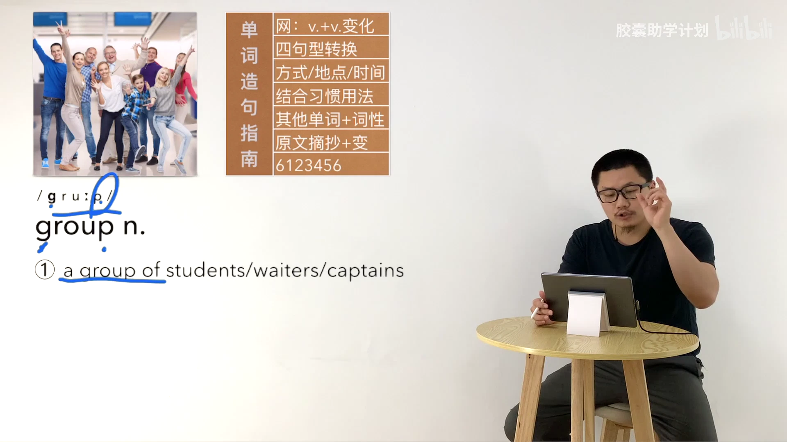

文字识别：单词造句指南 / 网：v.+v.变化 / 胶囊助学计划 / 四句型转换 / 方式/地点/时间 / 结合习惯用法 / 其他单词+词性 / 原文摘抄+变 / 6123456 / /gru / group n. / a group of students/waiters/captains / ～

### 画面 00:01:20

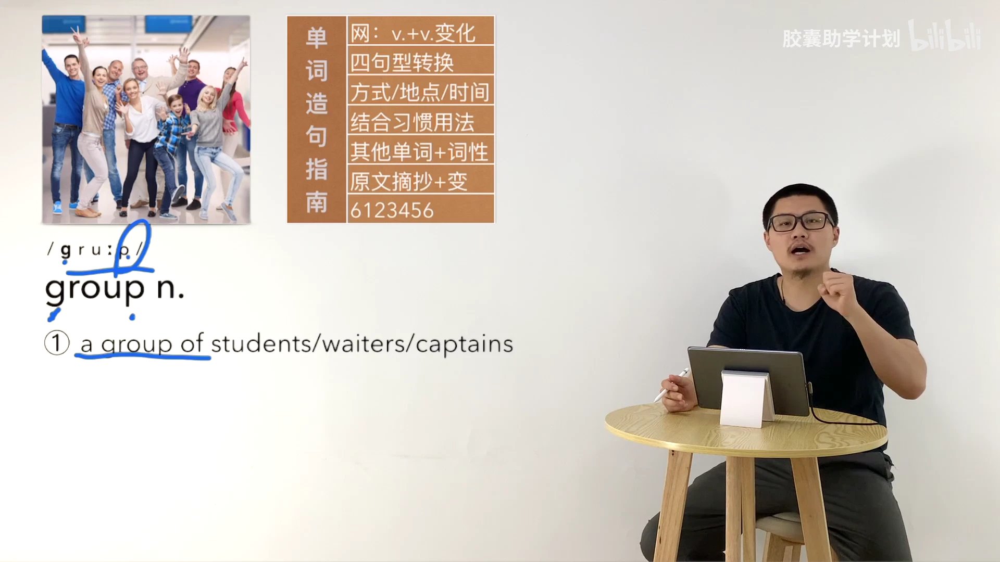

文字识别：单词造句指南 / 网：v.+v.变化 / 胶囊助学计划 / 四句型转换 / 方式/地点/时间 / 结合习惯用法 / 其他单词+词性 / 原文摘抄+变 / 6123456 / /gru: / group n. / a group of students/waiters/captains

## 00:01:30–00:02:00

长，对吧？哎，就就这么一组船长，有这么一一票子人啊。OK，那拿他们去造句，你想一下，a group of再加上一个名词，它在六一二三四五六当中主要的位置其实就是两个位置，一和三，要么主语，要么宾语，对吧？OK，那你看，我们结合第十课的习惯用法，叫做play jazz，把它们连起来，叫做Look，a group of students are playing jazz there啊，说瞧啊，有那么一群，有这么一

### 画面 00:01:30

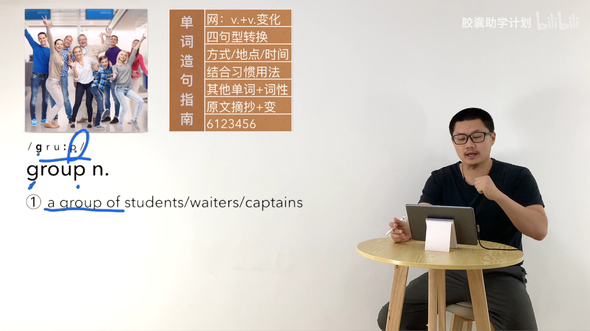

文字识别：单词造句指南 / 网：v.+v.变化 / 胶囊助学计划 / 四句型转换 / 方式/地点/时间 / 结合习惯用法 / 其他单词+词性 / 原文摘抄+变 / 6123456 / /gru / group n. / a group of students/waiters/captains

### 画面 00:01:35

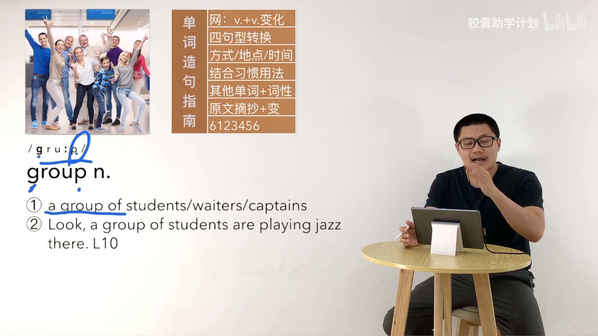

文字识别：单词造句指南 / 网：v.+v.变化 / 胶囊助学计划 / 四句型转换 / 方式/地点/时间 / 结合习惯用法 / 其他单词+词性 / 原文摘抄+变 / 6123456 / /gru: / group n. / a group of students/waiters/captains / Look, a group of students are playing jazz / there.L10

### 画面 00:01:40

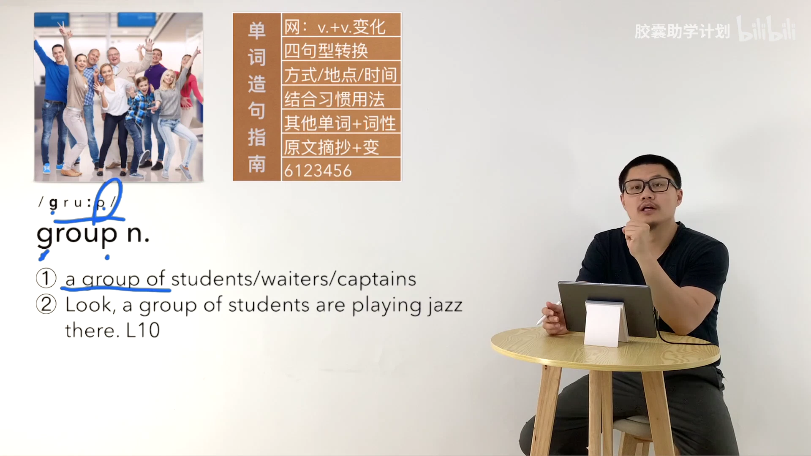

文字识别：单词造句指南 / 网：v.+v.变化 / 胶囊助学计划 / 四句型转换 / 方式/地点/时间 / 结合习惯用法 / 其他单词+词性 / 原文摘抄+变 / 6123456 / /gru: / group n. / a aroup of students/waiters/captains / 1 / Look, a group of students are playing jazz / there.L10

### 画面 00:01:42

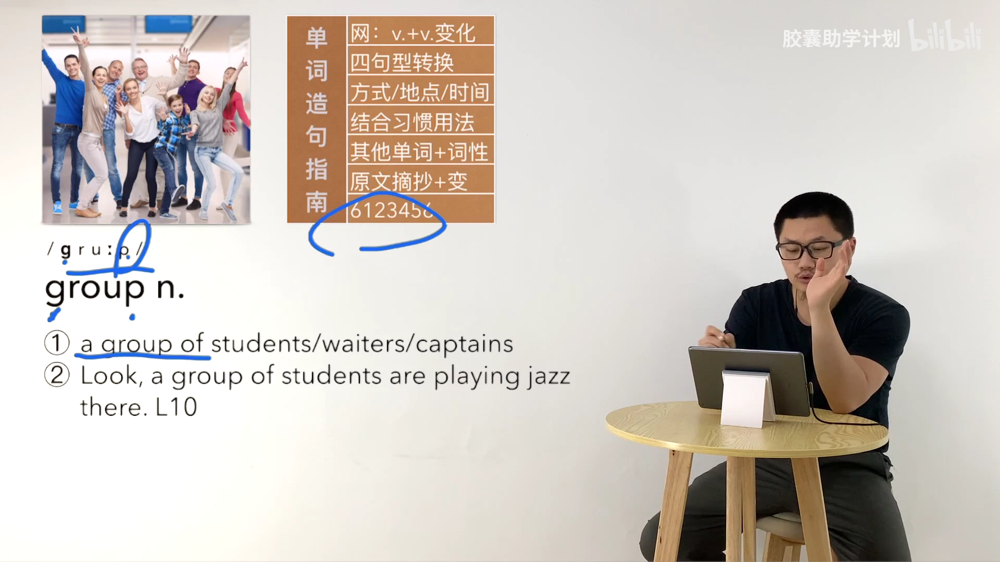

文字识别：单词造句指南 / 网：v.+v.变化 / 胶囊助学计划 / 四句型转换 / 方式/地点/时间 / 结合习惯用法 / 其他单词+词性 / 原文摘抄+变 / 6123456 / /gru: / group /  n. / a group of students/waiters/captains / Look, a group of students are playing jazz / there.L10

### 画面 00:01:45

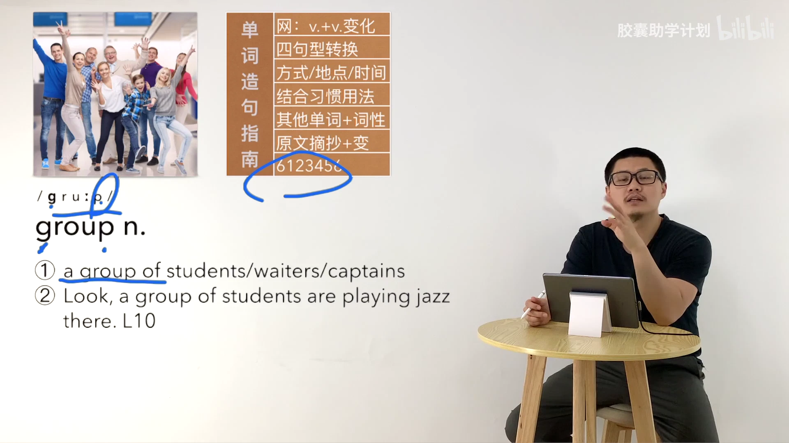

文字识别：单词造句指南 / 网：v.+v.变化 / 胶囊助学计划 / 四句型转换 / 方式/地点/时间 / 结合习惯用法 / 其他单词+词性 / 原文摘抄+变 / 6123456 / /gru: / group n. / a qroup of students/waiters/captains / Look, a group of students are playing jazz / there.L10

### 画面 00:01:50

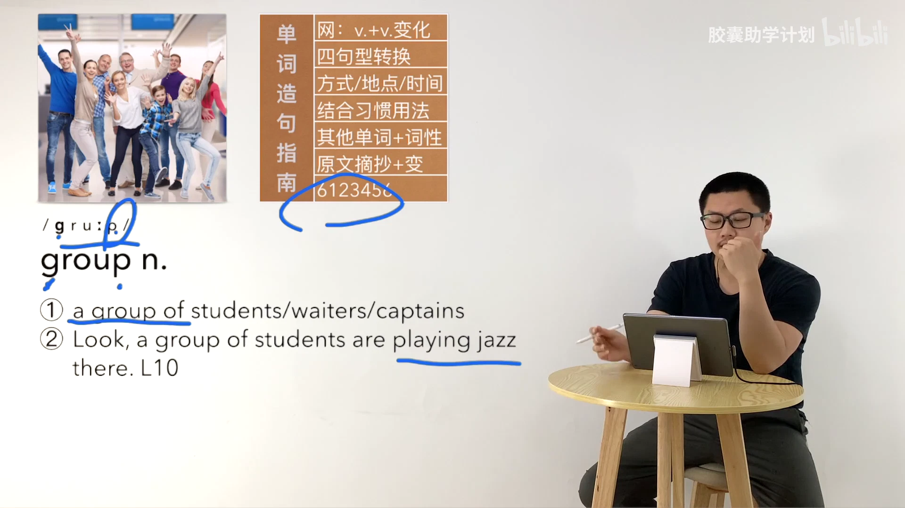

文字识别：单词造句指南 / 网：v.+v.变化 / 胶囊助学计划 / 四句型转换 / 方式/地点/时间 / 结合习惯用法 / 其他单词+词性 / 原文摘抄+变 / 6123456 / /gru: / group / o n. / a group of students/waiters/captains / Look, a group of students are playing jazz / there.L10

### 画面 00:01:55

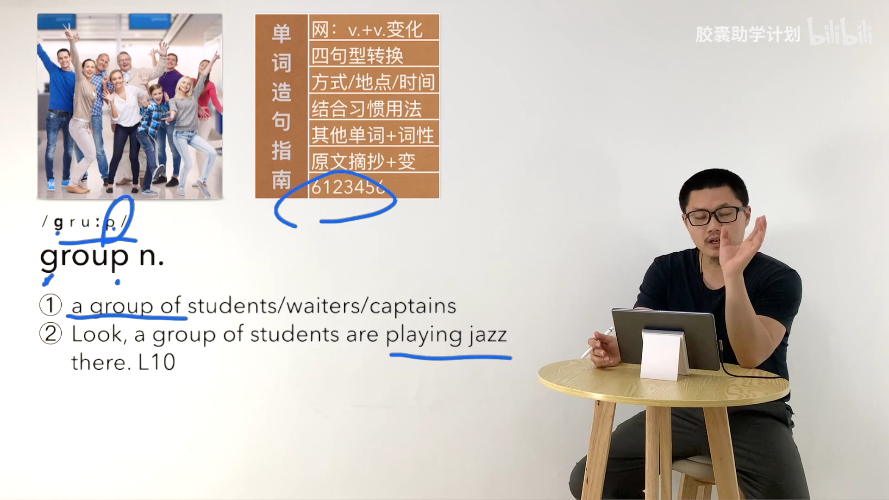

文字识别：单词造句指南 / 网：v.+v.变化 / 胶囊助学计划 / 四句型转换 / 方式/地点/时间 / 结合习惯用法 / 其他单词+词性 / 原文摘抄+变 / 6123456 / /gru: / group / n. / a aroup of students/waiters/captains / 1 / Look, a group of students are playing jazz / there.L10

## 00:02:00–00:02:30

一组的啊，这个这个呃学生在那边正在弹奏爵士乐，OK play jazz，第十课学的，或者是怎么样呢？A group of detectives are keeping guard at the door. OK，注意 keep guard，对吧？守卫、守护啊，这是我们第七课学的一个习惯用法。OK，那造句的时候呢，其实在这个地方往，对吧？动词加动词的变化，我们在这里两个句子都选择的是现在进行时，正在做某件

### 画面 00:02:00

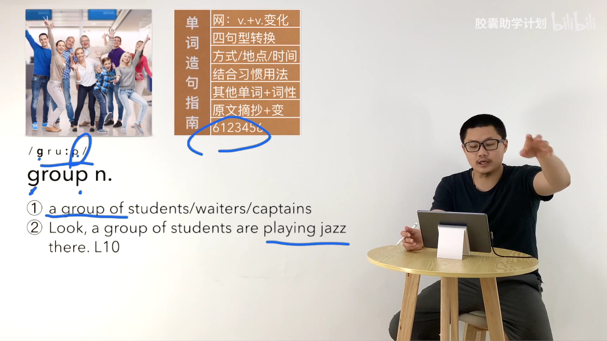

文字识别：单词造句指南 / 网：v.+v.变化 / 胶囊助学计划 / 四句型转换 / 方式/地点/时间 / 结合习惯用法 / 其他单词+词性 / 原文摘抄+变 / 6123456 / /gru: / group /  n. / a group of students/waiters/captains / 1 / Look, a group of students are playing jazz / there.L10

### 画面 00:02:05

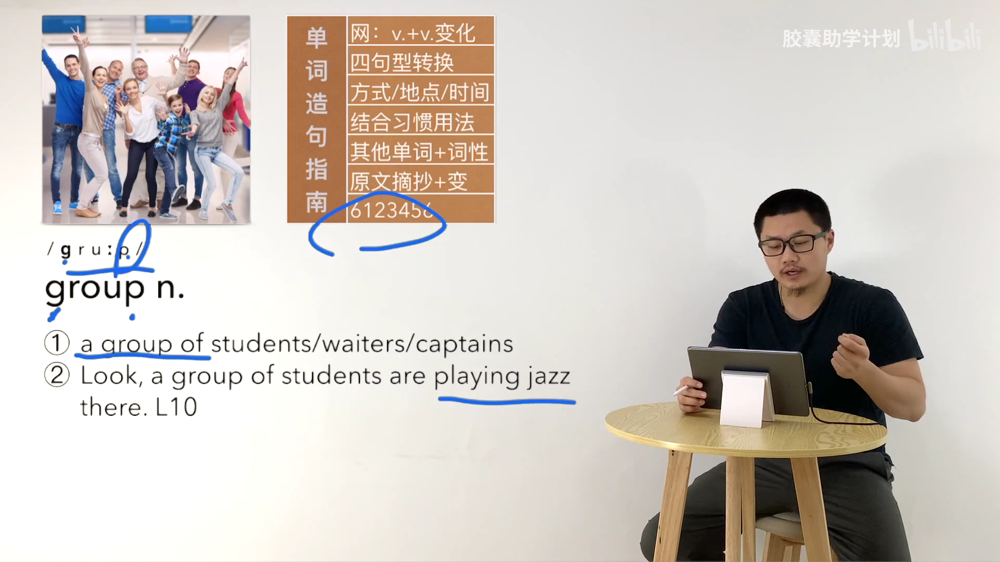

文字识别：单词造句指南 / 网：v.+v.变化 / 胶囊助学计划 / 四句型转换 / 方式/地点/时间 / 结合习惯用法 / 其他单词+词性 / 原文摘抄+变 / 6123456 / /gru: / group /  n. / a group of students/waiters/captains / 1 / Look, a group of students are playing jazz / there.L10

### 画面 00:02:08

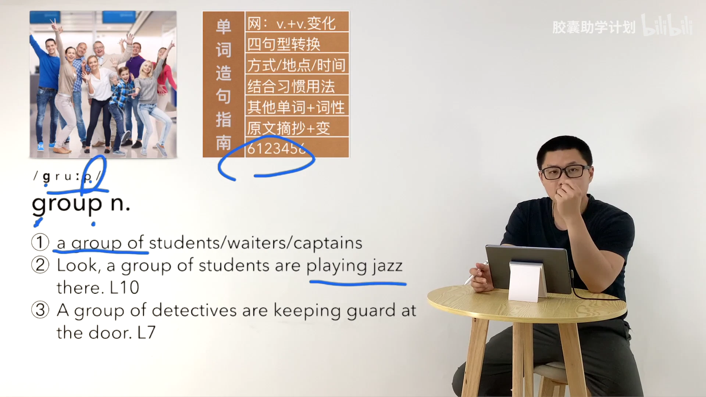

文字识别：单词造句指南 / 网：v.+v.变化 / 胶囊助学计划 / 四句型转换 / 方式/地点/时间 / 结合习惯用法 / 其他单词+词性 / 原文摘抄+变 / 6123456 / /gru: / group n. / a group of students/waiters/captains / 1 / Look, a group of students are playing jazz / there.L10 / A group of detectives are keeping guard at / the door. L7

### 画面 00:02:10

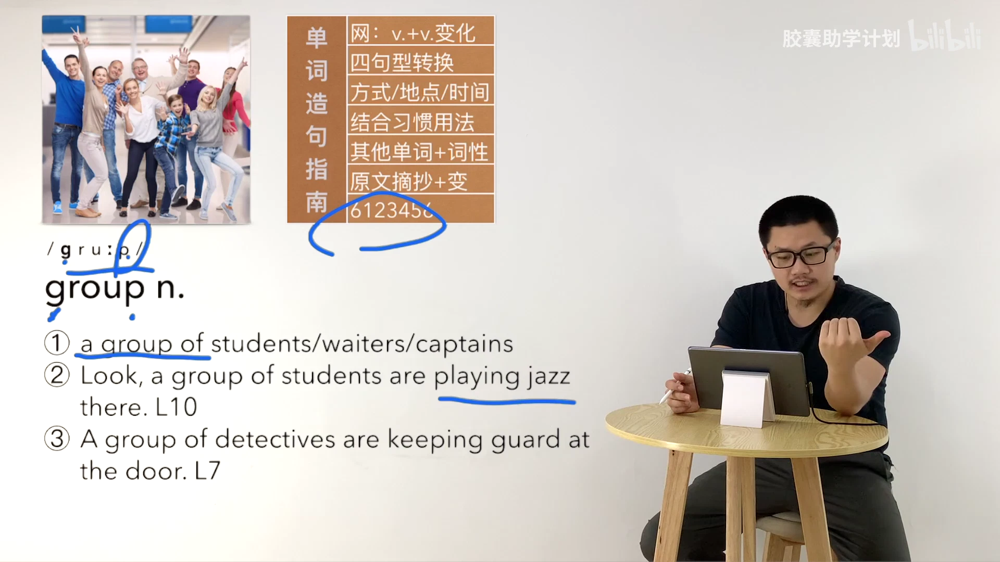

文字识别：单词造句指南 / 网：v.+v.变化 / 胶囊助学计划 / 四句型转换 / 方式/地点/时间 / 结合习惯用法 / 其他单词+词性 / 原文摘抄+变 / 6123456 / /gru: / group n. / a group of students/waiters/captains / Look, a group of students are playing jazz / there.L10 /  A group of detectives are keeping guard at / the door. L7

### 画面 00:02:14

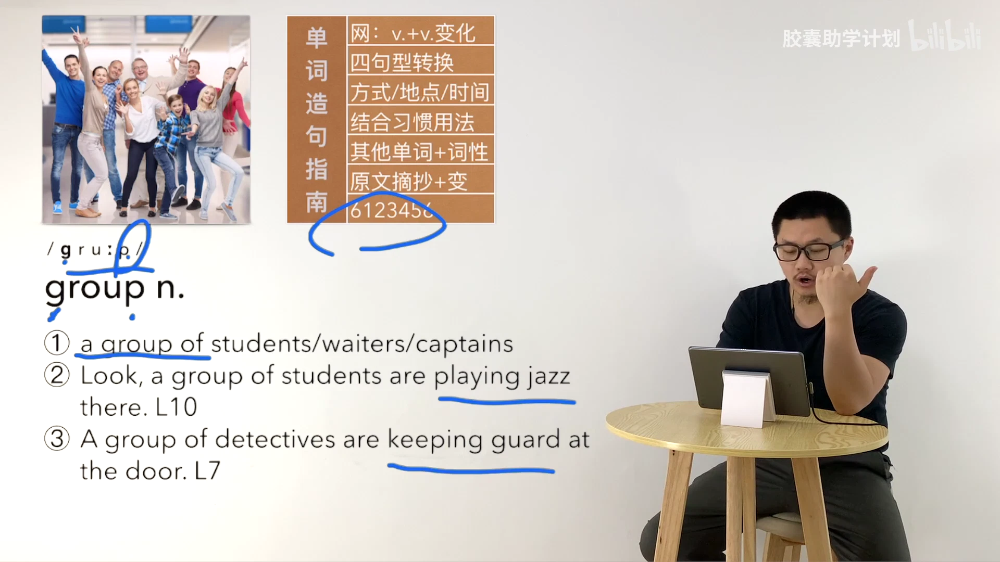

文字识别：单词造句指南 / 网：v.+v.变化 / 胶囊助学计划 / 四句型转换 / 方式/地点/时间 / 结合习惯用法 / 其他单词+词性 / 原文摘抄+变 / 6123456 / /gru: / group n. / a aroup of students/waiters/captains / 1 / Look, a group of students are playing jazz / there.L10 / A group of detectives are keeping guard at / the door. L7

### 画面 00:02:16

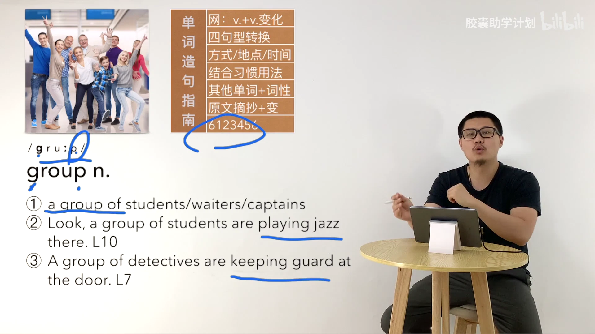

文字识别：单词造句指南 / 网：v.+v.变化 / 胶囊助学计划 / 四句型转换 / 方式/地点/时间 / 结合习惯用法 / 其他单词+词性 / 原文摘抄+变 / 6123456 / /gru: / group n. / a group of students/waiters/captains / 1 / Look, a group of students are playing jazz / there.L10 / A group of detectives are keeping guard at / the door. L7

### 画面 00:02:18

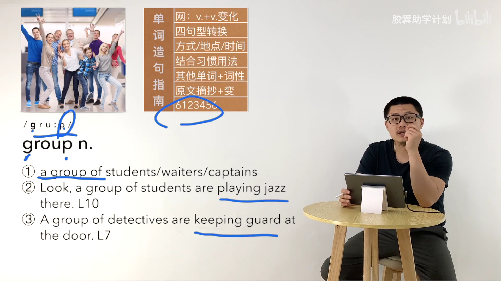

文字识别：单词造句指南 / 网：v.+v.变化 / 胶囊助学计划 / 四句型转换 / 方式/地点/时间 / 结合习惯用法 / 其他单词+词性 / 原文摘抄+变 / 6123456 / /gru: / group n. / a group of students/waiters/captains / 1 / Look, a group of students are playing jazz / there.L10 / A group of detectives are keeping guard at / the door. L7

### 画面 00:02:20

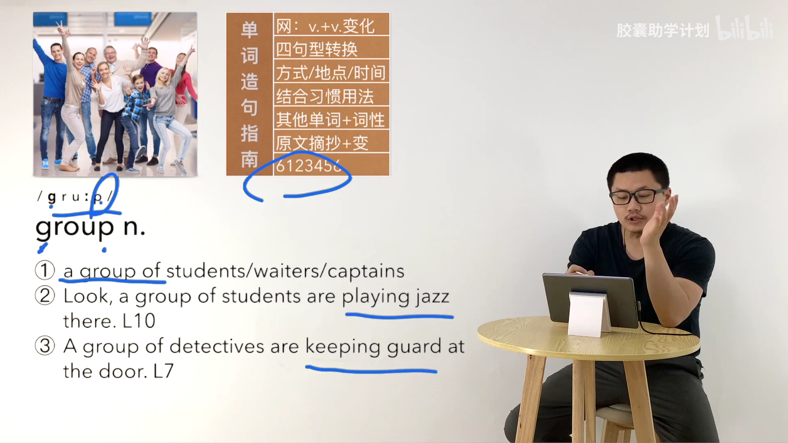

文字识别：单词造句指南 / 网：v.+v.变化 / 胶囊助学计划 / 四句型转换 / 方式/地点/时间 / 结合习惯用法 / 其他单词+词性 / 原文摘抄+变 / 6123456 / /gru: / group n. / a group of students/waiters/captains / 1 / Look, a group of students are playing jazz / there.L10 / A group of detectives are keeping guard at / the door. L7

### 画面 00:02:22

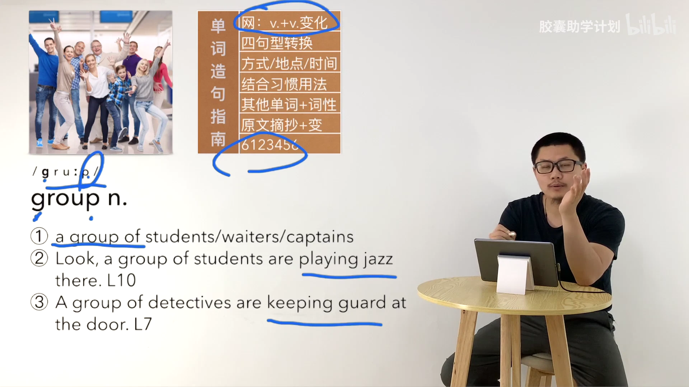

文字识别：单词造句指南 / 网：V.+v.变化 / 胶囊助学计划 / 四句型转换 / 方式/地点/时间 / 结合习惯用法 / 其他单词+词性 / 原文摘抄+变 / 6123456 / /gru: / group n. / a group of students/waiters/captains / 1 / Look, a group of students are playing jazz / there.L10 / A group of detectives are keeping guard at / the door. L7

### 画面 00:02:25

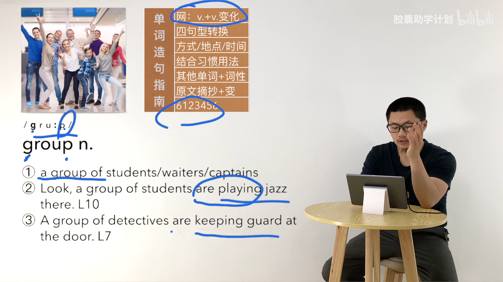

文字识别：单词造句指南 / 网：v.+v.变化 / 胶囊助学计划 / 四句型转换 / 方式/地点/时间 / 结合习惯用法 / 其他单词+词性 / 原文摘抄+变 / 6123456 / /gru: / group / n. / a group of students/waiters/captains / 1 / Look, a group of students are playing jazz / there.L10 / A group of detectives are keeping guard at / the door. L7

### 画面 00:02:27

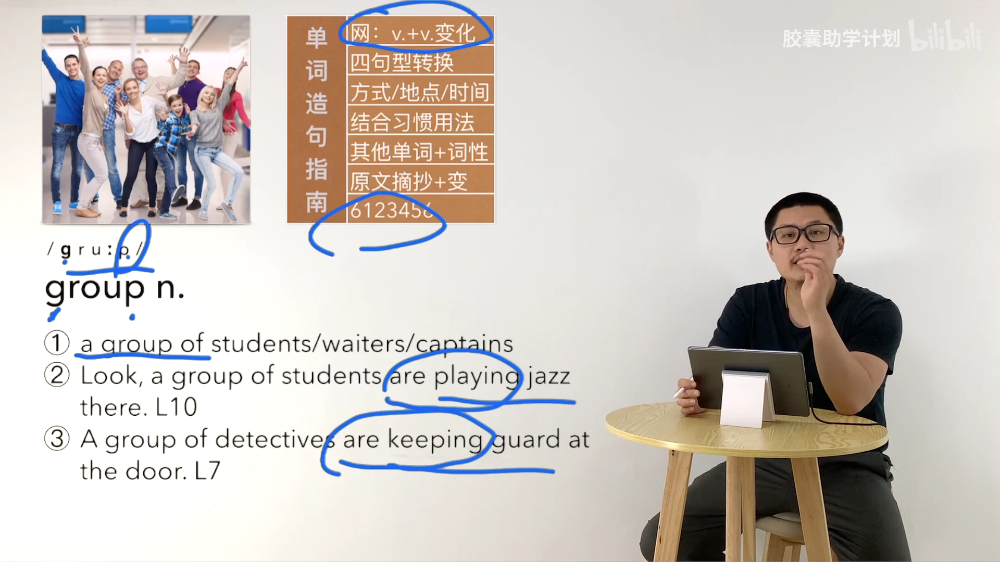

文字识别：单词造句指南 / 网：v.+v.变化 / 胶囊助学计划 / 四句型转换 / 方式/地点/时间 / 结合习惯用法 / 其他单词+词性 / 原文摘抄+变 / 6123456 / /gru / group / n. / 1 / a group of students/waiters/captains / Look, a group of students are playing jazz / there.L10 / A group of detectivep are keeping guard at / the / door.L7

## 00:02:30–00:03:00

事情，那这也是大家比较熟悉的一个时态了。OK，好，再然后，a group of captains will will spend three days here.啊，将花费三天的时间，度过三天的时间在这里啊。比如说，他们去了一个酒店啊，然后集中培训，对吧？啊，叫做 spend some time somewhere，这是咱们第三课学过的习惯用法。各位看到我在这儿用到了结合其他的习惯用法单词造句，对吧？Next

### 画面 00:02:31

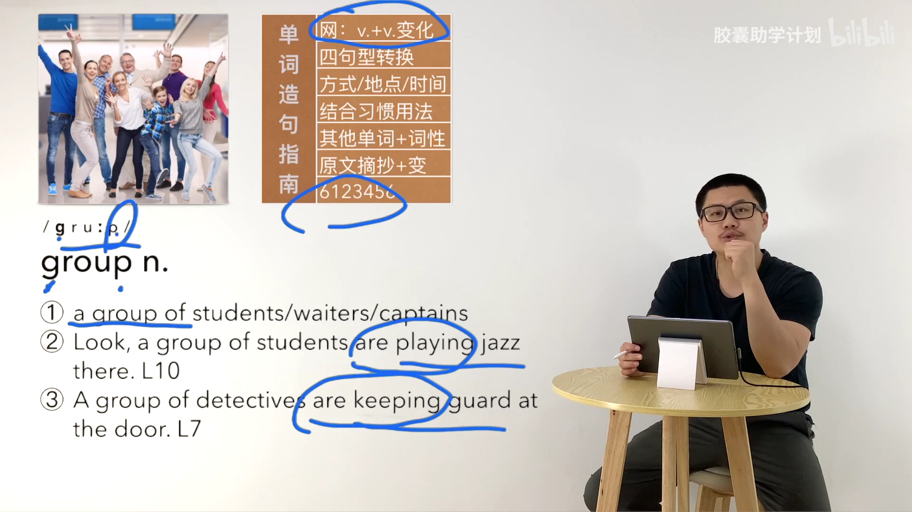

文字识别：单词造句指南 / 网：v.+v.变化 / 胶囊助学计划 / 四句型转换 / 方式/地点/时间 / 结合习惯用法 / 其他单词+词性 / 原文摘抄+变 / 6123456 / /gru / group / n. / 1 / a group of students/waiters/captains / Look, a group of studentsare playing jazz / there.L10 / A group of detectivep are keeping guard at / the / door.L7

### 画面 00:02:33

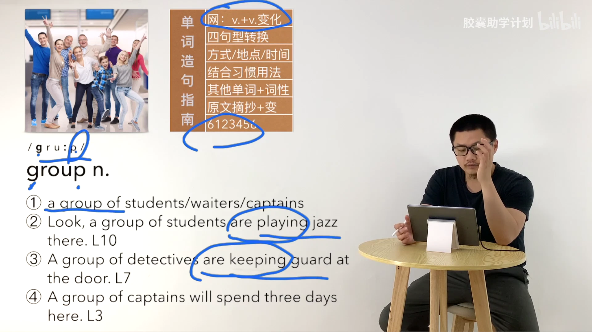

文字识别：单词造句指南 / 网：v.+v.变化 / 胶囊助学计划 / 四句型转换 / 方式/地点/时间 / 结合习惯用法 / 其他单词+词性 / 原文摘抄+变 / 6123456 / /gru: / group / n. / 1 / a group of students/waiters/captains / Look, a group of students are playing jazz / there.L10 / A group of detectivep are keeping guard at / the / door. L7 / A group of captains wills / I spend three days / here.L3

### 画面 00:02:36

文字识别：单词造句指南 / 网：V.+V.变化 / 胶囊助学计划 / 四句型转换 / 方式/地点/时间 / 结合习惯用法 / 其他单词+词性 / 原文摘抄+变 / 6123456 / /gru: / group / n. / 1 / a group of students/waiters/captains / Look, a group of students are playing jazz / there.L10 / A group of detectivep are keeping guard at / the / door. L7 / A group of captains will s / I spend three days / here. L3

### 画面 00:02:40

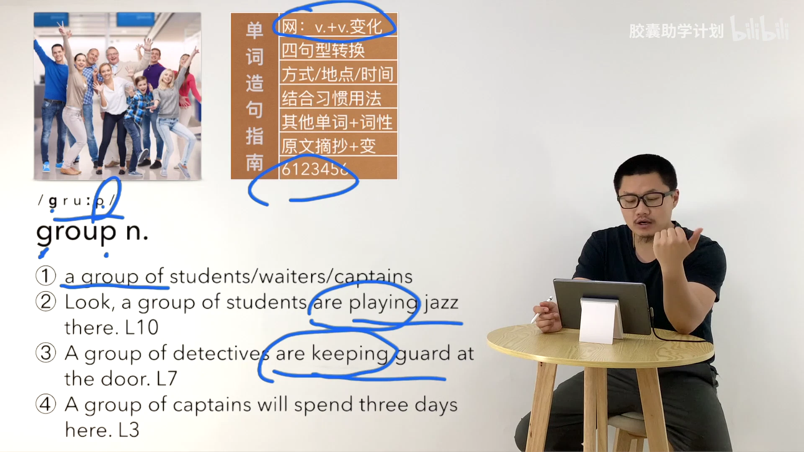

文字识别：单词造句指南 / 网：v.+v.变化 / 胶囊助学计划 / 四句型转换 / 方式/地点/时间 / 结合习惯用法 / 其他单词+词性 / 原文摘抄+变 / 6123456 / /gru: / group / n. / 1 / a group of students/waiters/captains / Look, a group of students are playing jazz / there.L10 / A group of detectivep are keeping guard at / the / door. L7 / A group of captains wills / I spend three days / here. L3

### 画面 00:02:45

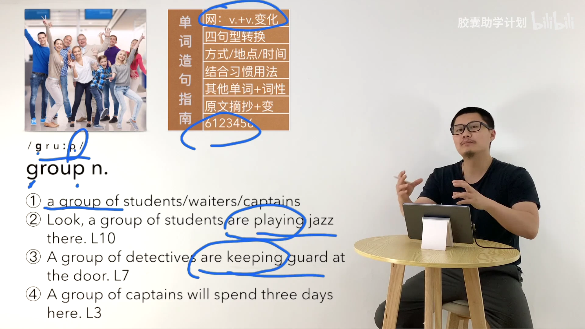

文字识别：单词造句指南 / 网：v.+v.变化 / 胶囊助学计划 / 四句型转换 / 方式/地点/时间 / 结合习惯用法 / 其他单词+词性 / 原文摘抄+变 / 6123456 / /gru: / group / n. / 1 / a group of students/waiters/captains / Look, a group of students are playing jazz / there.L10 / A group of detectivep are keeping guard at / the / door. L7 / A group of captains wills / I spend three days / here. L3

### 画面 00:02:50

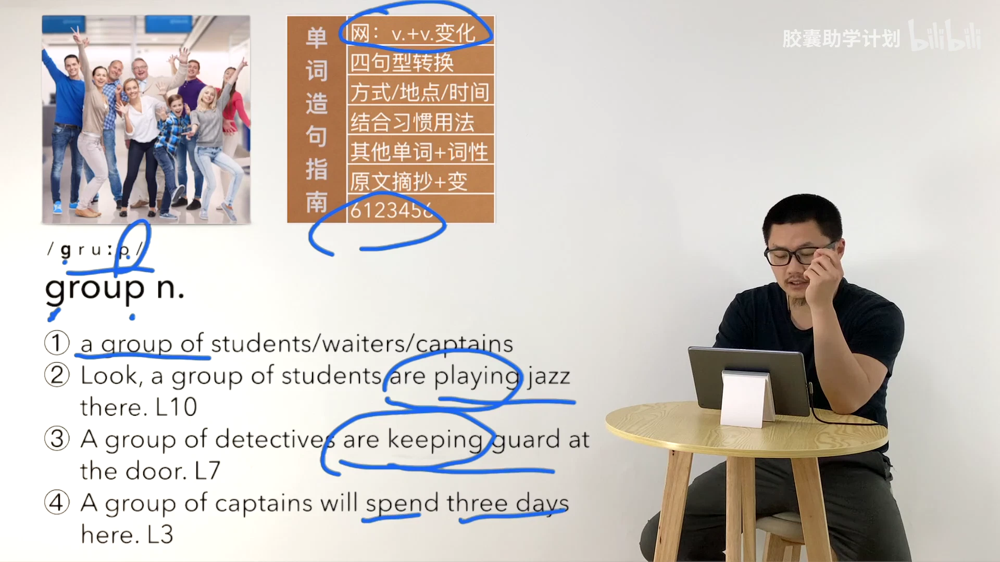

文字识别：单词造句指南 / 网：v.+v.变化 / 胶囊助学计划 / 四句型转换 / 方式/地点/时间 / 结合习惯用法 / 其他单词+词性 / 原文摘抄+变 / 6123456 / /gru: / group / n. / 1 / a group of students/waiters/captains / Look, a group of students are playing jazz / there.L10 / A group of detectivep are keepingguard at / the / door. L7 / A group of captains will / spend /  three davs / here.L3

### 画面 00:02:54

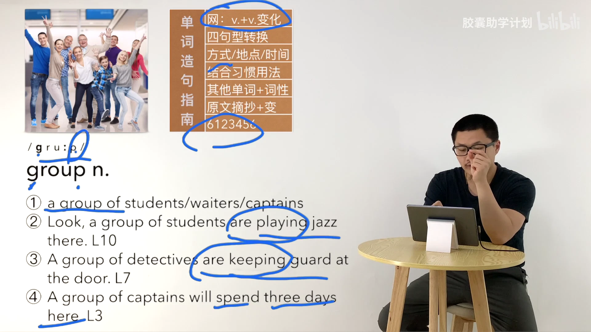

文字识别：单词造句指南 / 网：v.+v.变化 / 胶囊助学计划 / 四句型转换 / 方式/地点/时间 / 给合习惯用法 / 其他单词+词性 / 原文摘抄+变 / 6123456 / /gru: / group / n. / 1 / a group of students/waiters/captains / Look, a group of students are playing jazz / there.L10 / Agroup /  of detectivep are keeping guard at / the / door. L7 / A group of captains will / spend / three days / hereL3

### 画面 00:02:56

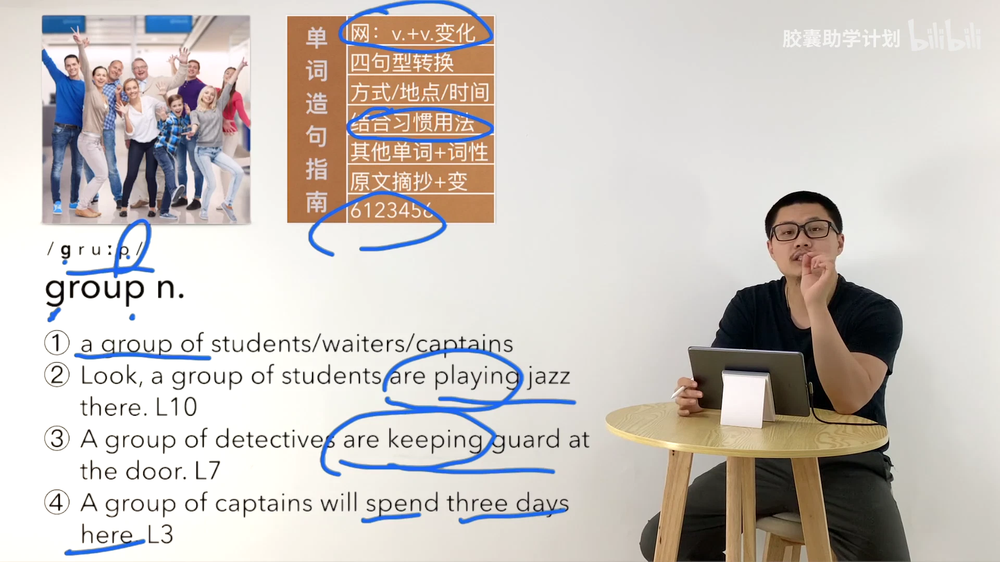

文字识别：单词造句指南 / 网：v.+v.变化 / 胶囊助学计划 / 四句型转换 / 方式/地点/时间 / 品合习惯用法 / 其他单词+词性 / 原文摘抄+变 / 6123456 / /gru: / group / n. / 1 / a group of students/waiters/captains / Look, a group of students are playing jazz / there.L10 / Agroup / of detectivep are keepingguard at / the / door. L7 / A group of captains will / spend / three davs / here_L3

### 画面 00:02:59

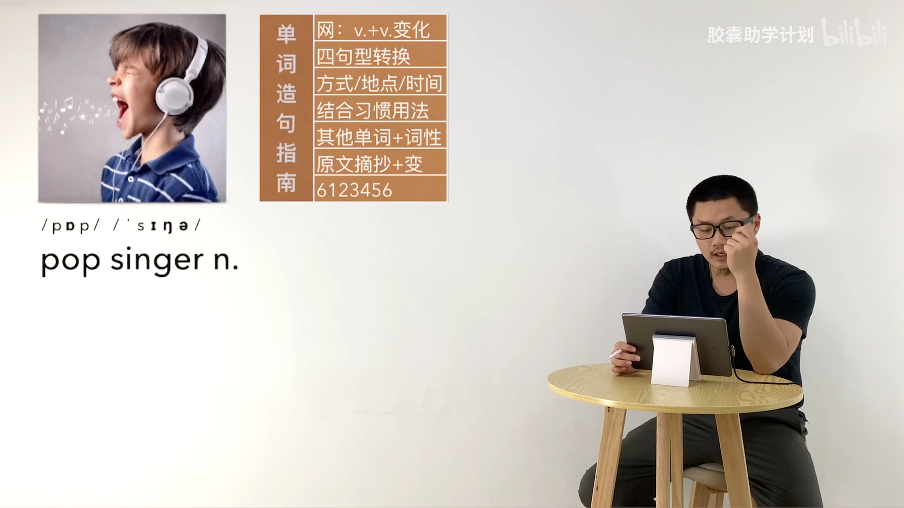

文字识别：单词造句指南 / 网：v.+v.变化 / 胶囊助学计划 / 四句型转换 / 方式/地点/时间 / 结合习惯用法 / 其他单词+词性 / 原文摘抄+变 / 6123456 / /ppp//sina/ / pop singer n.

## 00:03:00–00:03:30

我们一起读一下，叫做 pop singer，pop singer，啊，管它叫流行歌手，啊，流行歌手。好，pop singer 这个单词就是歌手，对吧？你可以是各种各样的歌手。那 pop 在这儿起到了类似于形容词的作用，它叫做流行的。OK，所以叫 pop singer，流行歌手。那你还可以最常用的几个叫做 pop music，啊，叫做流行音乐，或者说 pop song，啊，也是流行音乐，对吧？流行歌曲。那 pop star 就是流行的

### 画面 00:03:01

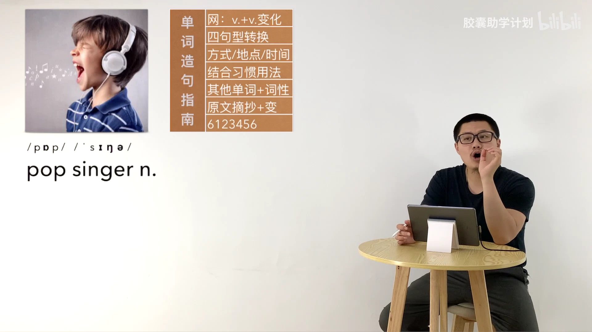

文字识别：单词造句指南 / 网：v.+v.变化 / 胶囊助学计划 / 四句型转换 / 方式/地点/时间 / 结合习惯用法 / 其他单词+词性 / 原文摘抄+变 / 6123456 / /ppp//sina/ / pop singer n.

### 画面 00:03:05

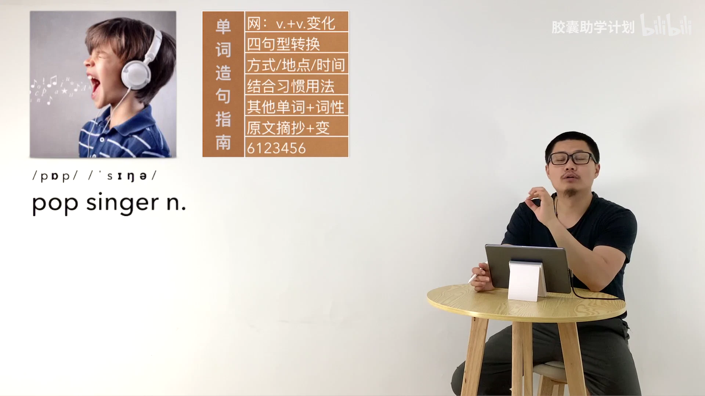

文字识别：单词造句指南 / 网：v.+v.变化 / 胶囊助学计划 / 四句型转换 / 方式/地点/时间 / 结合习惯用法 / 其他单词+词性 / 原文摘抄+变 / 6123456 / /ppp//sina/ / pop singer n.

### 画面 00:03:08

文字识别：单词造句指南 / 网：v.+v.变化 / 胶囊助学计划 / 四句型转换 / 方式/地点/时间 / 结合习惯用法 / 其他单词+词性 / 原文摘抄+变 / 6123456 / /ppp//sina/ / pop singer n.

### 画面 00:03:10

文字识别：单词造句指南 / 网：v.+v.变化 / 胶囊助学计划 / 四句型转换 / 方式/地点/时间 / 结合习惯用法 / 其他单词+词性 / 原文摘抄+变 / 6123456 / /ppp//sna/ / pop singer n.

### 画面 00:03:15

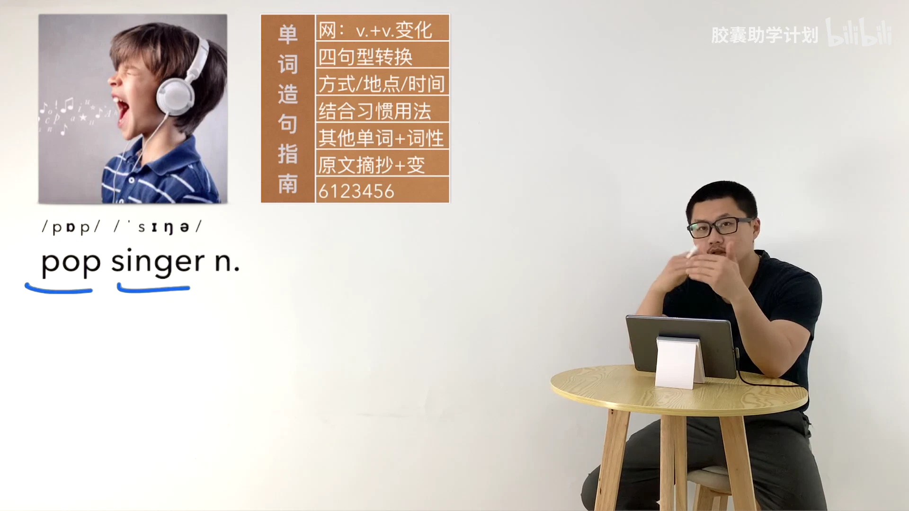

文字识别：单词造句指南 / 网：v.+v.变化 / 胶囊助学计划 / 四句型转换 / 方式/地点/时间 / 结合习惯用法 / 其他单词+词性 / 原文摘抄+变 / 6123456 / /ppp//sna/ / pop singer n.

### 画面 00:03:20

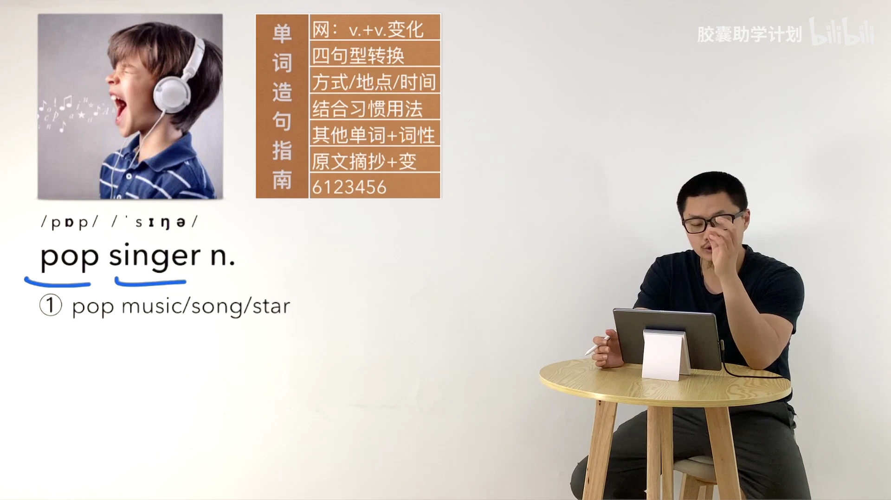

文字识别：单词造句指南 / 网：v.+v.变化 / 胶囊助学计划 / 四句型转换 / 方式/地点/时间 / 结合习惯用法 / 其他单词+词性 / 原文摘抄+变 / 6123456 / /ppp//sna/ / pop singer n. / pop music/song/star

### 画面 00:03:25

文字识别：单词造句指南 / 网：v.+v.变化 / 胶囊助学计划 / 四句型转换 / 方式/地点/时间 / 结合习惯用法 / 其他单词+词性 / 原文摘抄+变 / 6123456 / /ppp//sna/ / pop singer n. / pop music/song/star

## 00:03:30–00:04:00

明星啊，Star有星星的意思，天上的星星数不清啊啊，那地上呢？我们说这个人的这个明星也叫做Star，叫Pop Star啊，流行明星。Next one，我们尝试拿它去造句子，你还是要想的是，不管它是Pop Singer、Pop Music、Pop Song还是Pop Star，它在六一二三四五六当中，它本质上都是一个名词为核心的，对吧？那在六一二三四五六当中，它最长处语的位置依旧是一和三，你去做一个

### 画面 00:03:30

文字识别：单词造句指南 / 网：v.+v.变化 / 胶囊助学计划 / 四句型转换 / 方式/地点/时间 / 结合习惯用法 / 其他单词+词性 / 原文摘抄+变 / 6123456 / /ppp//sina/ / pop singer n. / pop music/song/star

### 画面 00:03:34

文字识别：单词造句指南 / 网：v.+v.变化 / 胶囊助学计划 / 四句型转换 / 方式/地点/时间 / 结合习惯用法 / 其他单词+词性 / 原文摘抄+变 / 6123456 / /ppp//sina/ / pop singer n. / pop music/song/star

### 画面 00:03:36

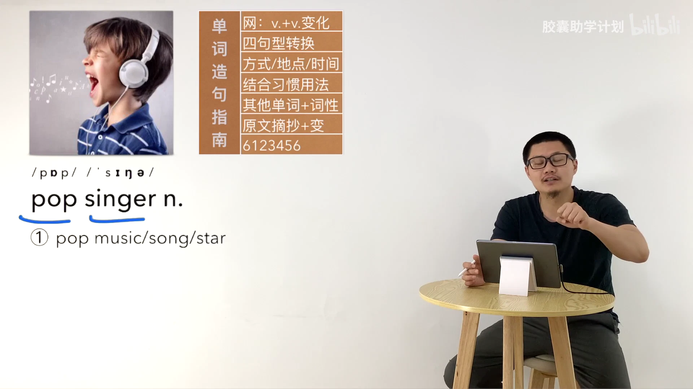

文字识别：单词造句指南 / 网：v.+v.变化 / 胶囊助学计划 / 四句型转换 / 方式/地点/时间 / 结合习惯用法 / 其他单词+词性 / 原文摘抄+变 / 6123456 / /pDp//sina/ / pop singer n. / pop music/song/star

### 画面 00:03:40

文字识别：单词造句指南 / 网：v.+v.变化 / 胶囊助学计划 / 四句型转换 / 方式/地点/时间 / 结合习惯用法 / 其他单词+词性 / 原文摘抄+变 / 6123456 / /ppp//sina/ / pop singer n. / pop music/song/star

### 画面 00:03:42

文字识别：单词造句指南 / 网：v.+v.变化 / 胶囊助学计划 / 四句型转换 / 方式/地点/时间 / 结合习惯用法 / 其他单词+词性 / 原文摘抄+变 / 6123456 / /pDp//sina/ / pop singer n. / pop music/song/star / The famous pop singer moved to our street / yesterday. L6

### 画面 00:03:45

文字识别：单词造句指南 / 网：v.+v.变化 / 胶囊助学计划 / 四句型转换 / 方式/地点/时间 / 结合习惯用法 / 其他单词+词性 / 原文摘抄+变 / 6123456 / /pDp//sina/ / pop singer n. / pop music/song/star / The famous pop singer moved to our street / yesterday. L6

### 画面 00:03:47

文字识别：单词造句指南 / 网：v.+v.变化 / 胶囊助学计划 / 四句型转换 / 方式/地点/时间 / 结合习惯用法 / 其他单词+词性 / 原文摘抄+变 / 6123456 / /ppp//isina/ / pop singern. / pop music/song/star / The famous pop / singer moved to our street / yesterday. L6

### 画面 00:03:50

文字识别：单词造句指南 / 网：v.+v.变化 / 胶囊助学计划 / 四句型转换 / 方式/地点/时间 / 结合习惯用法 / 其他单词+词性 / 原文摘抄+变 / 6123456 / /ppp//isina/ / pops / singern. / pop music/song/star / The famous pop / singer moved to our street / yesterday. L6

### 画面 00:03:55

文字识别：单词造句指南 / 网：v.+v.变化 / 胶囊助学计划 / 四句型转换 / 方式/地点/时间 / 结合习惯用法 / 其他单词+词性 / 原文摘抄+变 / 6123456 / /ppp//isina/ / pops / singern. / pop music/song/star / The famous pop / singer moved to our street / yesterday. L6

## 00:04:00–00:04:30

判断。那作为地点，你比如说 pop music 能不能作为地点呢？你硬去想，也许也有啊。你比如说这句话，在这首歌，在这个流行歌当中啊，也是可以的。但是我们直接最直接的想法就是一和三。比如说 the famous pop singer moved to some place. 第六课咱们学过的，对吧？搬去某地啊，搬去了我们家那条街 yesterday 昨天。好，注意 move to somebody 这地方两个点，第一个是一般

### 画面 00:04:01

文字识别：单词造句指南 / 网：v.+v.变化 / 胶囊助学计划 / 四句型转换 / 方式/地点/时间 / 结合习惯用法 / 其他单词+词性 / 原文摘抄+变 / 6123456 / /ppp//sina/ / pops / singern. / pop music/sonq/star / The famous pop / singer moved to our street / yesterday. L6

### 画面 00:04:05

文字识别：单词造句指南 / 网：v.+v.变化 / 胶囊助学计划 / 四句型转换 / 方式/地点/时间 / 结合习惯用法 / 其他单词+词性 / 原文摘抄+变 / 6123456 / /ppp//sina/ / pop / singern. / pop music/song/star / The famous pop / singer moved to our street / yesterday. L6

### 画面 00:04:12

文字识别：单词造句指南 / 网：v.+v.变化 / 胶囊助学计划 / 四句型转换 / 方式/地点/时间 / 结合习惯用法 / 其他单词+词性 / 原文摘抄+变 / 6123456 / /ppp//sina/ / pop / singern. / pop music/song/star / The famous pop / singer moved to our street / yesterday. L6

### 画面 00:04:15

文字识别：单词造句指南 / 网：v.+v.变化 / 胶囊助学计划 / 四句型转换 / 方式/地点/时间 / 结合习惯用法 / 其他单词+词性 / 原文摘抄+变 / 6123456 / /ppp//sina/ / pop / singern. / pop music/song/star / The famous pop / singer moved to our street / yesterday. L6

### 画面 00:04:17

文字识别：单词造句指南 / 网：v.+v.变化 / 胶囊助学计划 / 四句型转换 / 方式/地点/时间 / 结合习惯用法 / 其他单词+词性 / 原文摘抄+变 / 6123456 / /ppp//sina/ / pop / singern. / pop music/song/star / The f / famous pop / singer moved to our street / yesteraay. Lo

### 画面 00:04:19

文字识别：单词造句指南 / 网：v.+v.变化 / 胶囊助学计划 / 四句型转换 / 方式/地点/时间 / 结合习惯用法 / 其他单词+词性 / 原文摘抄+变 / 6123456 / /ρpｐ//sina/ / pop / singern. / popI / music/sonq/star / The / famous / pop / singe moved to our street / yesteraay. Lo

### 画面 00:04:21

文字识别：单词造句指南 / 网：v.+v.变化 / 胶囊助学计划 / 四句型转换 / 方式/地点/时间 / 结合习惯用法 / 其他单词+词性 / 原文摘抄+变 / 6123456 / /ppp//sina/ / pop / singern. / pop music/sonq/star / The / famous pop / singe moved to our street / yesterday.Lo

### 画面 00:04:25

文字识别：单词造句指南 / 网：v.+v.变化 / 胶囊助学计划 / 四句型转换 / 方式/地点/时间 / 结合习惯用法 / 其他单词+词性 / 原文摘抄+变 / 6123456 / /ppp//sina/ / pop / singern. / pOPI / music/sonq/star / The / famous pop / singe moved to our street / yesterday.Lo

## 00:04:30–00:05:00

过去时，我们选择的动词变化是一般过去时这个时态。其次呢，我们选择了第六课的一个习惯用法，move to somewhere，搬到了某地。再接下来，我们就可以把它变一般疑问句了，对吧？四句型的转换，did往前一提，剩下跟我读一遍，来，Did the famous pop singer move to your street yesterday? 然后各种特殊疑问词就跟上来了，对吧？OK，那各位要做的事情是暂停啊，然后张开嘴看着一般疑问句，把这些特

### 画面 00:04:30

文字识别：单词造句指南 / 网：v.+v.变化 / 胶囊助学计划 / 四句型转换 / 方式/地点/时间 / 结合习惯用法 / 其他单词+词性 / 原文摘抄+变 / 6123456 / na/ / pop / singern. / pOp / music/sonq/star / The / famous / pop / singer mov / ed / O / ours / street / yesteraay. Lo

### 画面 00:04:32

文字识别：单词造句指南 / 网：v.+v.变化 / 胶囊助学计划 / 四句型转换 / 方式/地点/时间 / 结合习惯用法 / 其他单词+词性 / 原文摘抄+变 / 6123456 / /ppp//si / na/ / pop / singern. / pop / music/sonq/star / The / famous / pop / singer move / ed / ours / street / yesterday. Lo

### 画面 00:04:35

文字识别：单词造句指南 / 网：v.+v.变化 / 胶囊助学计划 / 四句型转换 / 方式/地点/时间 / 结合习惯用法 / 其他单词+词性 / 原文摘抄+变 / 6123456 / /ppp//si / na/ / pop / singern. / pOP / music/sonq/star / The / famous / pop / singer moved / ours / street / yesterday.Lo

### 画面 00:04:40

文字识别：单词造句指南 / 网：v.+v.变化 / 胶囊助学计划 / 四句型转换 / 方式/地点/时间 / 结合习惯用法 / 其他单词+词性 / 原文摘抄+变 / 6123456 / /pｐp//sina/ / pop / singern. / pOp / music/sonq/star / The / famous / pop / singer moved / ours / street / yesterday. Lo / Did t / the / famous / pop / singer move to your / street yesterday?

### 画面 00:04:43

文字识别：单词造句指南 / 网：v.+v.变化 / 胶囊助学计划 / 四句型转换 / 方式/地点/时间 / 结合习惯用法 / 其他单词+词性 / 原文摘抄+变 / 6123456 / /ppp//s1 / na/ / pop / singern. / pOp / music/sonq/star / The / famous / pop / singer moved / our / street / yesterday. Lo / Did / the / famous / pop / singer move / e to your / street yesterday?

### 画面 00:04:46

文字识别：单词造句指南 / 网：v.+v.变化 / 胶囊助学计划 / 四句型转换 / 方式/地点/时间 / 结合习惯用法 / 其他单词+词性 / 原文摘抄+变 / 6123456 / /ρｐｐ// sina/ / pop / singern. / pOp / music/sonq/star / The / famous / pop / singer moved / ours / street / yesterday. Lo / Did  / the / famous / pop / singer move / eto your / street yesterday?

### 画面 00:04:48

文字识别：单词造句指南 / 网：v.+v.变化 / 胶囊助学计划 / 四句型转换 / 方式/地点/时间 / 结合习惯用法 / 其他单词+词性 / 原文摘抄+变 / 6123456 / /ρpｐ//sia/ / pop / singern. / 1 / pOp / music/sonq/star / The / famous / pop / singer moved / our9 / street / yesterday. Lo / Did  / the / famous / pop / singer move / e to your / street yesterday?

### 画面 00:04:50

文字识别：单词造句指南 / 网：v.+v.变化 / 胶囊助学计划 / 四句型转换 / 方式/地点/时间 / 结合习惯用法 / 其他单词+词性 / 原文摘抄+变 / 6123456 / /ppp//sina/ / pop / singern. / pOp / music/sonq/star / The / famous / pop / singer moved / ours / street / yesterday. Lo / Did t / the / famous / pop / singer move to your / street yesterday?

### 画面 00:04:53

文字识别：单词造句指南 / 网：v.+v.变化 / 胶囊助学计划 / 四句型转换 / 方式/地点/时间 / 结合习惯用法 / 其他单词+词性 / 原文摘抄+变 / 6123456 / /ρｐｐ// sina/ / pop / singern. / pOp / music/sonq/star / The / famous pop / singer moved / our street / yesteraay. Lo / Did the / famous / pop / singer move to your / street yesterday? / why/when/where/who

### 画面 00:04:55

文字识别：单词造句指南 / 网：v.+v.变化 / 胶囊助学计划 / 四句型转换 / 方式/地点/时间 / 结合习惯用法 / 其他单词+词性 / 原文摘抄+变 / 6123456 / /ppp//isina/ / pop / singern. / pop / music/sonq/star / The / famous pop / singe moved / ours / street / yesterday.Lo / Did the t / famous / pop / singer move to your / street yesterday? / why/when/where/who

## 00:05:00–00:05:30

殊疑问句大声的给他哎读出来就OK了，好吧？啊，我们不多说了，下一个单词跟我读一下，叫做club，club，club本身最基本的含义叫做什么呢？或者我们说最原始的含义叫做俱乐部啊，比如说高尔夫球俱乐部、网球俱乐部、各种各样的俱乐部，我们管它叫club啊。这个呢，其实呃呃，OK啊。然后呢，我们其实还有一个啊，比如说night club啊，这个现在很多人当我们去说，

### 画面 00:05:00

文字识别：单词造句指南 / 网：v.+v.变化 / 胶囊助学计划 / 四句型转换 / 方式/地点/时间 / 结合习惯用法 / 其他单词+词性 / 原文摘抄+变 / 6123456 / /ppp//isina/ / pop / singern. / 1 / pop / music/sonq/star / The / famous / pop / singer moved / 0 / ours / street / yesterday.Lo / Did the / famous / pop / singer move to your / street yesterday? / why/when/where/who

### 画面 00:05:05

文字识别：单词造句指南 / 网：v.+v.变化 / 胶囊助学计划 / 四句型转换 / 方式/地点/时间 / 结合习惯用法 / 其他单词+词性 / 原文摘抄+变 / 6123456 / /klab/ / club n. + v.

### 画面 00:05:07

文字识别：单词造句指南 / 网：v.+v.变化 / 胶囊助学计划 / 四句型转换 / 方式/地点/时间 / 结合习惯用法 / 其他单词+词性 / 原文摘抄+变 / 6123456 / /klab/ / club n. + v.

### 画面 00:05:10

文字识别：单词造句指南 / 网：v.+v.变化 / 胶囊助学计划 / 四句型转换 / 方式/地点/时间 / 结合习惯用法 / 其他单词+词性 / 原文摘抄+变 / 6123456 / /klab/ / club n. + v.

### 画面 00:05:15

文字识别：单词造句指南 / 网：v.+v.变化 / 胶囊助学计划 / 四句型转换 / 方式/地点/时间 / 结合习惯用法 / 其他单词+词性 / 原文摘抄+变 / 6123456 / /klab/ / club n. + v.

### 画面 00:05:20

文字识别：单词造句指南 / 网：v.+v.变化 / 胶囊助学计划 / 四句型转换 / 方式/地点/时间 / 结合习惯用法 / 其他单词+词性 / 原文摘抄+变 / 6123456 / /klab/ / club n. + v.

### 画面 00:05:25

文字识别：单词造句指南 / 网：v.+v.变化 / 胶囊助学计划 / 四句型转换 / 方式/地点/时间 / 结合习惯用法 / 其他单词+词性 / 原文摘抄+变 / 6123456 / /klab/ / club n. + v. / night club / tennis club / 1

### 画面 00:05:27

文字识别：单词造句指南 / 网：v.+v.变化 / 胶囊助学计划 / 四句型转换 / 方式/地点/时间 / 结合习惯用法 / 其他单词+词性 / 原文摘抄+变 / 6123456 / /klab/ / club n. + v. / night club / tennis club

## 00:05:30–00:06:00

尤其是年轻人，当他去说 club 的时候，他可能直接指的叫 night club， night 叫夜晚， club 叫俱乐部，夜晚俱乐部啊，其实就是夜店啊。 OK，好，那 tennis club 就是刚才我说的叫网球俱乐部啊，这是完全两个不同的概念了。那它是一个名词，我们很多的时候是不是就要加一个动词？这个关键的动词在这儿给大家补充一个小的动词，非常常用，也并不难啊。拓展一小点点啊，大家都了，如果听了我课程这么长时间，应该都

### 画面 00:05:30

文字识别：单词造句指南 / 网：v.+v.变化 / 胶囊助学计划 / 四句型转换 / 方式/地点/时间 / 结合习惯用法 / 其他单词+词性 / 原文摘抄+变 / 6123456 / /klab/ / club n. + v. / night club / tennis club

### 画面 00:05:41

文字识别：单词造句指南 / 网：v.+v.变化 / 胶囊助学计划 / 四句型转换 / 方式/地点/时间 / 结合习惯用法 / 其他单词+词性 / 原文摘抄+变 / 6123456 / /klab/ / club n. + v. / night club / tennis club

### 画面 00:05:45

文字识别：单词造句指南 / 网：v.+v.变化 / 胶囊助学计划 / 四句型转换 / 方式/地点/时间 / 结合习惯用法 / 其他单词+词性 / 原文摘抄+变 / 6123456 / /klab/ / club n. + v. / night club / tennis club

### 画面 00:05:47

文字识别：单词造句指南 / 网：v.+v.变化 / 胶囊助学计划 / 四句型转换 / 方式/地点/时间 / 结合习惯用法 / 其他单词+词性 / 原文摘抄+变 / 6123456 / /klab/ / club n. +(v. / night club / tennis club

### 画面 00:05:50

文字识别：单词造句指南 / 网：v.+v.变化 / 胶囊助学计划 / 四句型转换 / 方式/地点/时间 / 结合习惯用法 / 其他单词+词性 / 原文摘抄+变 / 6123456 / /klab/ / club n. +(v. / night club / tennis club / join v.

### 画面 00:05:52

文字识别：单词造句指南 / 网：v.+v.变化 / 胶囊助学计划 / Bilbil / 四句型转换 / 方式/地点/时间 / 结合习惯用法 / 其他单词+词性 / 原文摘抄+变 / 6123456 / /klab/ / club n. + v. / night club / tennis club / join v.

### 画面 00:05:55

文字识别：单词造句指南 / 网：v.+v.变化 / 胶囊助学计划 / 四句型转换 / 方式/地点/时间 / 结合习惯用法 / 其他单词+词性 / 原文摘抄+变 / 6123456 / /klab/ / club n. + v. / night club / tennis club / join v.

## 00:06:00–00:06:30

了解了对吧？我轻易是不给大家疯狂拓展的，OK？好，谨小慎微啊。Join，在这个地方，它的意思叫做加入。好，那join the club叫加入这个俱乐部。好，你看动词加名词都有了，接下来无非我们就是想一些习惯用法，想一些时态或者动词的变化，也可以是情态动词，对吧？好，比如说我造了一个句子叫做I've just joined the tennis club，说我刚刚

### 画面 00:06:00

文字识别：单词造句指南 / 网：v.+v.变化 / 胶囊助学计划 / 四句型转换 / 方式/地点/时间 / 结合习惯用法 / 其他单词+词性 / 原文摘抄+变 / 6123456 / /klab/ / club n. + v. / night club / tennis club / join v.

### 画面 00:06:08

文字识别：单词造句指南 / 网：v.+v.变化 / 胶囊助学计划 / 四句型转换 / 方式/地点/时间 / 结合习惯用法 / 其他单词+词性 / 原文摘抄+变 / 6123456 / /klab/ / club n. + v. / night club / tennis club / join v.

### 画面 00:06:10

文字识别：单词造句指南 / 网：v.+v.变化 / 胶囊助学计划 / 四句型转换 / 方式/地点/时间 / 结合习惯用法 / 其他单词+词性 / 原文摘抄+变 / 6123456 / /klab/ / club n. + v. / night club / tennis club / join v.

### 画面 00:06:16

文字识别：单词造句指南 / 网：v.+v.变化 / 胶囊助学计划 / 四句型转换 / 方式/地点/时间 / 结合习惯用法 / 其他单词+词性 / 原文摘抄+变 / 6123456 / /klab/ / club n. + v. / night club / tennis club / join v.

### 画面 00:06:20

文字识别：单词造句指南 / 网：v.+v.变化 / 胶囊助学计划bibl / 四句型转换 / 方式/地点/时间 / 结合习惯用法 / 其他单词+词性 / 原文摘抄+变 / 6123456 / /klab/ / club n. + v. / night club / tennis club / join v.

### 画面 00:06:24

文字识别：单词造句指南 / 网：v.+v.变化 / 胶囊助学计划 / 四句型转换 / 方式/地点/时间 / 结合习惯用法 / 其他单词+词性 / 原文摘抄+变 / 6123456 / /klab/ / club n. + v. / night club / tennis club / 1 / join v. / 2 / o I've just joined the tennis club.

### 画面 00:06:26

文字识别：单词造句指南 / 网：v.+v.变化 / 胶囊助学计划 / 四句型转换 / 方式/地点/时间 / 结合习惯用法 / 其他单词+词性 / 原文摘抄+变 / 6123456 / /klab/ / club n. + v. / night club / tennis club / join v. / o I've just joined the tennis club.

### 画面 00:06:28

文字识别：单词造句指南 / 网：v.+v.变化 / 胶囊助学计划 / 四句型转换 / 方式/地点/时间 / 结合习惯用法 / 其他单词+词性 / 原文摘抄+变 / 6123456 / /klab/ / club n. + v. / night club / tennis club / 1 / join v. / 2 / o I've just joined the tennis club.

## 00:06:30–00:07:00

加入了这个网球的俱乐部，肯定去给您了。剩下的四进行转化，您自己哎张嘴，顺便就给他解决掉就好了。再来，比如说我没有现在用 join 了，我用的是 refuse to do something，加了一个 go to the night club，对吧？然后说的是这个小姑娘 she refused to go to the night club with him，啊，她拒绝和这名男士一起去夜店，refuse to do something，对吧？呃，第九课学的，再然后呢，我们第十课还学到

### 画面 00:06:30

文字识别：单词造句指南 / 网：v.+v.变化 / 胶囊助学计划 / 四句型转换 / 方式/地点/时间 / 结合习惯用法 / 其他单词+词性 / 原文摘抄+变 / 6123456 / /klab/ / club n. + v. / night club / tennis club / 1 / join v. / 2 / o I've just joined the tennis club.

### 画面 00:06:33

文字识别：单词造句指南 / 网：v.+v.变化 / 胶囊助学计划 / 四句型转换 / 方式/地点/时间 / 结合习惯用法 / 其他单词+词性 / 原文摘抄+变 / 6123456 / /klab/ / club n. + v. / night club / tennis club / join v. / 2 / o I've just joined the tennis club.

### 画面 00:06:35

文字识别：单词造句指南 / 网：v.+v.变化 / 胶囊助学计划 / 四句型转换 / 方式/地点/时间 / 结合习惯用法 / 其他单词+词性 / 原文摘抄+变 / 6123456 / /klab/ / club n. + v. / night club / tennis club / join v. / o I've just joined the tennis club.

### 画面 00:06:38

文字识别：单词造句指南 / 网：v.+v.变化 / 胶囊助学计划 / 四句型转换 / 方式/地点/时间 / 结合习惯用法 / 其他单词+词性 / 原文摘抄+变 / 6123456 / /klab/ / club n. + v. / night club / tennis club / join v. / 2 / o I've just joined the tennis club. / She refused to go to the night club with / him.L9

### 画面 00:06:40

文字识别：单词造句指南 / 网：v.+v.变化 / 胶囊助学计划 / 四句型转换 / 方式/地点/时间 / 结合习惯用法 / 其他单词+词性 / 原文摘抄+变 / 6123456 / /klab/ / club n. + v. / night club / tennis club / join v. / 2 / o I've just joined the tennis club. / She refused to go to the night club with / him.L9

### 画面 00:06:42

文字识别：单词造句指南 / 网：v.+v.变化 / 胶囊助学计划 / 四句型转换 / 方式/地点/时间 / 结合习惯用法 / 其他单词+词性 / 原文摘抄+变 / 6123456 / /klab/ / club n. + v. / night club / tennis club / 1 / join v. / 2 / o I've just joined the tennis club. / She refused to go to the night club with / him.T9

### 画面 00:06:44

文字识别：单词造句指南 / 网：v.+v.变化 / 胶囊助学计划 / 四句型转换 / 方式/地点/时间 / 结合习惯用法 / 其他单词+词性 / 原文摘抄+变 / 6123456 / /klab/ / club n. + v. / night club / tennis club / 1 / join v. / 2 / o I've just joined the tennis club. / She refused to go to the night club with / him.T9

### 画面 00:06:46

文字识别：单词造句指南 / 网：v.+v.变化 / 胶囊助学计划 / 四句型转换 / 方式/地点/时间 / 结合习惯用法 / 其他单词+词性 / 原文摘抄+变 / 6123456 / /klab/ / club n. + v. / ① / night club / tennis club / join v. / 2 / o I've just joined the tennis club. / She refused to go to the night club with / him.T9

### 画面 00:06:51

文字识别：单词造句指南 / 网：v.+v.变化 / 胶囊助学计划 / 四句型转换 / 方式/地点/时间 / 结合习惯用法 / 其他单词+词性 / 原文摘抄+变 / 6123456 / /klab/ / club n. + v. / night club / tennis club / 1 / join v. / 2 / o I've just joined the tennis club. / She refused to go to the night club with / him.T9

### 画面 00:06:55

文字识别：单词造句指南 / 网：v.+v.变化 / 胶囊助学计划 / 四句型转换 / 方式/地点/时间 / 结合习惯用法 / 其他单词+词性 / 原文摘抄+变 / 6123456 / /klab/ / club n. + v. / night club / tennis club / 1 / join v. / 2 / o I've just joined the tennis club. / She refused to go to the night club with / him.T9

### 画面 00:06:57

文字识别：单词造句指南 / 网：v.+v.变化 / 胶囊助学计划 / 四句型转换 / 方式/地点/时间 / 结合习惯用法 / 其他单词+词性 / 原文摘抄+变 / 6123456 / /klab/ / club n. + v. / 1 / night club / tennis club / 2 / join v. / o I've just joined the tennis club. / She refused to go to the night club with / him.T9 / This night club has been cleaned. L10

## 00:07:00–00:07:30

了被动，这个是大家在动词加动词变化这个地方容易遗忘的啊。我们动词加动词变化最重要的三个部分就是情态动词、时态，外加一个被动啊。当然，以后我们还会学虚拟，但那个不是我们造句子用的，很多的时候啊，出其至少。OK，那被动出来了，叫做 has been cleaned，叫做已经被打扫干净了，这是我们第十课学的现在完成时的被动。当然，底下我在这儿又罗列了一些一般，

### 画面 00:07:00

文字识别：单词造句指南 / 网：v.+v.变化 / 胶囊助学计划 / 四句型转换 / 方式/地点/时间 / 结合习惯用法 / 其他单词+词性 / 原文摘抄+变 / 6123456 / /klab/ / club n. + v. / 1 / night club / tennis club / 2) / join v. / o I've just joined the tennis club. / She refused to go to the night club with / him.T9 / This night club has been cleaned. L10

### 画面 00:07:03

文字识别：单词造句指南 / 网：v.+v.变化 / 胶囊助学计划 / 四句型转换 / 方式/地点/时间 / 结合习惯用法 / 其他单词+词性 / 原文摘抄+变 / 6123456 / /klab/ / club n. + v. / night club / tennis club / 2 / join v. / o I've just joined the tennis club. / She refused to go to the night club with / him.L9 / This night club has been cleaned. L10

### 画面 00:07:05

文字识别：单词造句指南 / 网：v.+v.变化 / 胶囊助学计划 / 四句型转换 / 方式/地点/时间 / 结合习惯用法 / 其他单词+词性 / 原文摘抄+变 / 6123456 / /klab/ / club n. + v. / night club / tennis club / 1 / join v. / 2 / o I've just joined the tennis club. / She refused to go to the night club with / him.T9 / This night club has been cleaned. L10

### 画面 00:07:10

文字识别：单词造句指南 / 网：v.+V.变化 / 胶囊助学计划 / 四句型转换 / 方式/地点/时间 / 结合习惯用法 / 其他单词+词性 / 原文摘抄+变 / 6123456 / /klab/ / club n. + v. / 1 / night club / tennis club / join v. / 2 / o I've just joined the tennis club. / She refused to go to the night club with / him.T9 / This night club has been cleaned. L10

### 画面 00:07:15

文字识别：单词造句指南 / 网：V.+V.变化 / 胶囊助学计划 / 四句型转换 / 方式/地点/时间 / 结合习惯用法 / 其他单词+词性 / 原文摘抄+变 / 6123456 / /klab/ / club n. + v. / 1 / night club / tennis club / 2 / join v. / o I've just joined the tennis club. / She refused to go to the night club with / him.L9 / This night club has been cleaned. L10

### 画面 00:07:18

文字识别：单词造句指南 / 网：v.+v.变化 / 胶囊助学计划 / 四句型转换 / 方式/地点/时间 / 结合习惯用法 / 其他单词+词性 / 原文摘抄+变 / 6123456 / /klab/ / club n. + v. / 1 / night club / tennis club / 2 / join v. / o I've just joined the tennis club. / She refused to go to the night club with / him.T9 / This night club has been cleaned. L10

### 画面 00:07:20

文字识别：单词造句指南 / 网：v.+v.变化 / 胶囊助学计划 / 四句型转换 / 方式/地点/时间 / 结合习惯用法 / 其他单词+词性 / 原文摘抄+变 / 6123456 / /klab/ / club n. + v. / 1 / night club / tennis club / 2 / join v. / o I've just joined the tennis club. / She refused to go to the night club with / him.T9 / This night club has been cleaned. L10

### 画面 00:07:22

文字识别：单词造句指南 / 网：v.+v.变化 / 胶囊助学计划 / 四句型转换 / 方式/地点/时间 / 结合习惯用法 / 其他单词+词性 / 原文摘抄+变 / 6123456 / /klab/ / club n. + v. / night club / tennis club / 1 / join v. / 2 / o I've just joined the tennis club. / She refused to go to the night club with / him.T9 / This night club has been cleaned. L10

### 画面 00:07:25

文字识别：单词造句指南 / 网：v.+v.变化 / 胶囊助学计划 / 四句型转换 / 方式/地点/时间 / 结合习惯用法 / 其他单词+词性 / 原文摘抄+变 / 6123456 / /klab/ / club n. + v. / 1 / night club / tennis club / 2 / join v. / o I've just joined the tennis club. / She refused to go to the night club with / him.L9 / This night club has been cleaned. L10 / o is cleaned / was cleaned / is being clean

### 画面 00:07:27

文字识别：单词造句指南 / 网：v.+v.变化 / 胶囊助学计划 / 四句型转换 / 方式/地点/时间 / 结合习惯用法 / 其他单词+词性 / 原文摘抄+变 / 6123456 / /klab/ / club n. + v. / 1 / night club / tennis club / 2 / join v. / o I've just joined the tennis club. / She refused to go to the night club with / him.L9 / This night club has been cleaned. L10 / o is cleaned / was cleaned / is being clean

### 画面 00:07:29

文字识别：单词造句指南 / 网：v.+v.变化 / 胶囊助学计划 / 四句型转换 / 方式/地点/时间 / 结合习惯用法 / 其他单词+词性 / 原文摘抄+变 / 6123456 / /klab/ / club n. + v. / 1 / night club / tennis club / join v. / 2 / o I've just joined the tennis club. / She refused to go to the night club with / him.L9 / This night club has been cleaned. L10 / o is cleaned / was cleaned 7 is being clean

## 00:07:30–00:08:00

过，比如说第一个，哎，一般现在时的被动啊，叫做每天都会被打扫，对吧？或者说昨天被打扫了，一般过去时的被动和正在被打扫，be being done，对吧？am is are being再加上done，玩一个。下一个单词，看着音标，我们先一起拼一下，叫做performance，performance，OK，玩一个，注意它的意思叫演出。你看我们汉语啊也分词

### 画面 00:07:31

文字识别：单词造句指南 / 网：v.+v.变化 / 胶囊助学计划 / 四句型转换 / 方式/地点/时间 / 结合习惯用法 / 其他单词+词性 / 原文摘抄+变 / 6123456 / /klab/ / club n. + v. / 1 / night club / tennis club / 2 / join v. / o I've just joined the tennis club. / She refused to go to the night club with / him.L9 / This night club has been cleaned. L10 / o is cleaned / was cleaned / is being clean

### 画面 00:07:34

文字识别：单词造句指南 / 网：v.+v.变化 / 胶囊助学计划 / 四句型转换 / 方式/地点/时间 / 结合习惯用法 / 其他单词+词性 / 原文摘抄+变 / 6123456 / /klab/ / club n. + v. / 1 / night club / tennis club / 2 / join v. / o I've just joined the tennis club. / She refused to go to the night club with / him.T9 / This night club has been cleaned. L10 / o is cleaned / was cleaned / is being clean

### 画面 00:07:36

文字识别：单词造句指南 / 网：v.+v.变化 / 胶囊助学计划 / 四句型转换 / 方式/地点/时间 / 结合习惯用法 / 其他单词+词性 / 原文摘抄+变 / 6123456 / /klab/ / club n. + v. / 1 / night club / tennis club / 2 / join v. / o I've just joined the tennis club. / She refused to go to the night club with / him.L9 / This night club has been cleaned. L10 / o is cleaned / was cleaned / is being clean

### 画面 00:07:39

文字识别：单词造句指南 / 网：v.+v.变化 / 胶囊助学计划 / 四句型转换 / 方式/地点/时间 / 结合习惯用法 / 其他单词+词性 / 原文摘抄+变 / 6123456 / /klab/ / club n. + v. / 1 / night club / tennis club / join v. / 2 / o I've just joined the tennis club. / She refused to go to the night club with / him.T9 / This night club has been cleaned. L10 / o is cleaned / was cleaned / is being clean

### 画面 00:07:41

文字识别：单词造句指南 / 网：v.+v.变化 / 胶囊助学计划 / 四句型转换 / 方式/地点/时间 / 结合习惯用法 / 其他单词+词性 / 原文摘抄+变 / 6123456 / /klab/ / club n. + v. / 1 / night club / tennis club / join v. / 2 / o I've just joined the tennis club. / She refused to go to the night club with / him.L9 / This night club has been cleaned. L10 / o is cleaned / was cleaned / is being clean

### 画面 00:07:44

文字识别：单词造句指南 / 网：v.+v.变化 / 胶囊助学计划 / 四句型转换 / 方式/地点/时间 / 结合习惯用法 / 其他单词+词性 / 原文摘抄+变 / 6123456 / /pafo:mans/ / performance n.

### 画面 00:07:46

文字识别：单词造句指南 / 网：v.+v.变化 / 胶囊助学计划 / 四句型转换 / 方式/地点/时间 / 结合习惯用法 / 其他单词+词性 / 原文摘抄+变 / 6123456 / /pafo:mans/ / performance n.

### 画面 00:07:50

文字识别：单词造句指南 / 网：v.+v.变化 / 胶囊助学计划 / 四句型转换 / 方式/地点/时间 / 结合习惯用法 / 其他单词+词性 / 原文摘抄+变 / 6123456 / /pafo:mans/ / performance n.

### 画面 00:07:53

文字识别：单词造句指南 / 网：v.+v.变化 / 胶囊助学计划 / 四句型转换 / 方式/地点/时间 / 结合习惯用法 / 其他单词+词性 / 原文摘抄+变 / 6123456 / /pafo:mans/ / performance n.

### 画面 00:07:55

文字识别：单词造句指南 / 网：v.+v.变化 / 胶囊助学计划 / 四句型转换 / 方式/地点/时间 / 结合习惯用法 / 其他单词+词性 / 原文摘抄+变 / 6123456 / /pafo:mans/ / performance n.

## 00:08:00–00:08:30

性，但是动词的演出，名词的演出都是演出这两个字儿，对吧？而且我们说话的时候，昨天去演出了是吧？我昨天去演出了。你注意啊，我看了一场演出。大多数人的时候是不会去仔细去思考说这里边的演出到底是个名词还是动词。你只要知道意思就行了。语英文这个语言，我们很多的时候至少要强调的几个词性，比如说它是名词还是动词。注意，它是个名词，所以它就不存在说动词的变化，什么时态变化，对吧？那怎么办呢？有一

### 画面 00:08:00

文字识别：单词造句指南 / 网：v.+v.变化 / 胶囊助学计划 / 四句型转换 / 方式/地点/时间 / 结合习惯用法 / 其他单词+词性 / 原文摘抄+变 / 6123456 / /pafo:mans/ / performance n.

### 画面 00:08:05

文字识别：单词造句指南 / 网：v.+v.变化 / 胶囊助学计划 / 四句型转换 / 方式/地点/时间 / 结合习惯用法 / 其他单词+词性 / 原文摘抄+变 / 6123456 / /pafo:mans/ / performance n.

### 画面 00:08:10

文字识别：单词造句指南 / 网：v.+v.变化 / 胶囊助学计划 / 四句型转换 / 方式/地点/时间 / 结合习惯用法 / 其他单词+词性 / 原文摘抄+变 / 6123456 / /pafo:mans/ / performance n.

### 画面 00:08:16

文字识别：单词造句指南 / 网：v.+v.变化 / 胶囊助学计划 / 四句型转换 / 方式/地点/时间 / 结合习惯用法 / 其他单词+词性 / 原文摘抄+变 / 6123456 / /pa'fo:mans/ / performance n.

### 画面 00:08:20

文字识别：单词造句指南 / 网：v.+v.变化 / 胶囊助学计划 / 四句型转换 / 方式/地点/时间 / 结合习惯用法 / 其他单词+词性 / 原文摘抄+变 / 6123456 / /pafo:mans/ / performance n.

### 画面 00:08:25

文字识别：单词造句指南 / 网：v.+v.变化 / 胶囊助学计划 / 四句型转换 / 方式/地点/时间 / 结合习惯用法 / 其他单词+词性 / 原文摘抄+变 / 6123456 / /pafo:mans/ / performance n.

### 画面 00:08:27

文字识别：胶囊助学计划 / 四句型转换 / 方式/地点/时间 / 结合习惯用法 / 其他单词+词性 / 原文摘抄+变 / 6123456 / /pafo:mans/ / performance / n.

## 00:08:30–00:09:00

个小单词叫 give a performance，叫给一场演出啊，不是 give a performance 合起来的意思还是演出，只不过变成了动词，由 give 去引导表示演出，对吧？那有了它，我们就好造句子了。比如说 they are giving a performance，他们正在演出，动词加动词变化，或者说 they give a performance every weekend，他们每周末都会去演出，生活习惯一般现在时，或者说 they

### 画面 00:08:30

文字识别：胶囊助学计划 / 四句型转换 / 方式/地点/时间 / 结合习惯用法 / 其他单词+词性 / 原文摘抄+变 / 6123456 / /pa'fo:mans/ / performance n. / give a performance

### 画面 00:08:35

文字识别：胶囊助学计划 / 四句型转换 / 方式/地点/时间 / 结合习惯用法 / 其他单词+词性 / 原文摘抄+变 / 6123456 / /pafo:mans/ / performance n. / 1 / give a performance

### 画面 00:08:40

文字识别：胶囊助学计划 / 四句型转换 / 方式/地点/时间 / 结合习惯用法 / 其他单词+词性 / 原文摘抄+变 / 6123456 / /pafo:mans/ / performance n. / 1 / give a performance

### 画面 00:08:45

文字识别：胶囊助学计划 / 四句型转换 / 方式/地点/时间 / 结合习惯用法 / 其他单词+词性 / 原文摘抄+变 / 6123456 / /pafo:mans/ / performance n. / give a performance / 1 / They are giving a performance.

### 画面 00:08:50

文字识别：胶囊助学计划 / 四句型转换 / 方式/地点/时间 / 结合习惯用法 / 其他单词+词性 / 原文摘抄+变 / 6123456 / /pafo:mans/ / performance n. / 1 / give a performance / They are giving a performance. / They give a performance every weekend. / 3

### 画面 00:08:52

文字识别：胶囊助学计划 / 四句型转换 / 方式/地点/时间 / 结合习惯用法 / 其他单词+词性 / 原文摘抄+变 / 6123456 / /pafo:mans/ / performance n. / give a performance / They are giving a performance. / They give a performance every weekend. / 3

### 画面 00:08:54

文字识别：胶囊助学计划 / 四句型转换 / 方式/地点/时间 / 结合习惯用法 / 其他单词+词性 / 原文摘抄+变 / 6123456 / /pafo:mans/ / performance n. / give a performance / They are giving a performance. / They give a performance every weekend. / 3

### 画面 00:08:56

文字识别：胶囊助学计划 / 四句型转换 / 方式/地点/时间 / 结合习惯用法 / 其他单词+词性 / 原文摘抄+变 / 6123456 / /pa'fo:mans/ / performance n. / give a performance / They are giving a performance. / They give a performance every weekend. / 3

### 画面 00:08:59

文字识别：单网：v.+v.变化 / 胶囊助学计划 / 干词造句指南 / 四句型转换 / 方式/地点/时间 / 结合习惯用法 / 其他单词+词性 / 原文摘抄+变 / 6123456 / /pafo:mans/ / performance n. / 1 / give a performance / They are giving a performance. / They give a performance every weekend. / 3 / They were giving a performance while the / police came in.

## 00:09:00–00:09:30

were giving a performance while the police came in. 他们正在演出，当警察破门而入的时候，对吧？或者说警察进来的时候啊，扰民了，对吧？OK，分别用到了不同的动词加动词的变化，即为在这儿用的都是时态。OK，好，接下来我们看一个小的电影片段，当中出现了叫做 give a performance 这个短语，各位注意听了。 I know it's been a struggle.

### 画面 00:09:01

文字识别：单网：v.+v.变化 / 胶囊助学计划 / 干词造句指南 / 四句型转换 / 方式/地点/时间 / 结合习惯用法 / 其他单词+词性 / 原文摘抄+变 / 6123456 / /pafo:mans/ / performance n. / 1 / give a performance / They are giving a performance. / They give a performance every weekend. / 3 / They were giving a performance while the / 4 / police came in.

### 画面 00:09:05

文字识别：单网：v.+v.变化 / 胶囊助学计划 / 干词造句指南 / 四句型转换 / 方式/地点/时间 / 结合习惯用法 / 其他单词+词性 / 原文摘抄+变 / 6123456 / /pafo:mans/ / performance n. / 1 / give a performance / They are giving a performance. / They give a performance every weekend. / 3 / They were giving a performance while the / police came in.

### 画面 00:09:07

文字识别：单网：v.+v.变化 / 胶囊助学计划 / 干词造句指南 / 四句型转换 / 方式/地点/时间 / 结合习惯用法 / 其他单词+词性 / 原文摘抄+变 / 6123456 / /pafo:mans/ / performance n. / 1 / give a performance / They are giving a performance. / They give a performance every weekend. / 3 / They were giving a performance while the / police came in.

### 画面 00:09:10

文字识别：单网：v.+v.变化 / 胶囊助学计划 / 干词造句指南 / 四句型转换 / 方式/地点/时间 / 结合习惯用法 / 其他单词+词性 / 原文摘抄+变 / 6123456 / /pafo:mans/ / performance n. / 1 / give a performance / They are giving a performance. / They give a performance every weekend. / 3 / They were giving a performance while the / police came in.

### 画面 00:09:12

文字识别：单网：v.+v.变化 / 胶囊助学计划 / 干词造句指南 / 四句型转换 / 方式/地点/时间 / 结合习惯用法 / 其他单词+词性 / 原文摘抄+变 / 6123456 / /pafo:mans/ / performance n. / 1 / give a performance / They are giving a performance. / They give a performance every weekend. / 3 / They were giving a performance while the / police came in.

### 画面 00:09:14

文字识别：单网：v.+v.变化 / 胶囊助学计划 / 干词造句指南 / 四句型转换 / 方式/地点/时间 / 结合习惯用法 / 其他单词+词性 / 原文摘抄+变 / 6123456 / /pafo:mans/ / performance n. / 1 / give a performance / Theyare giving a performance. / Theygiva performance every weekend. / 3 / They / were giving / a performance while the / police / came / in.

### 画面 00:09:16

文字识别：单网：v.+v.变化 / 胶囊助学计划 / 干词造句指南 / 四句型转换 / 方式/地点/时间 / 结合习惯用法 / 其他单词+词性 / 原文摘抄+变 / 6123456 / /pafo:mans/ / performance n. / 1 / give a performance / Theyare givinga performance. / Theygiv a performance every weekend. / 3 / They / were giving / a performance while the / police / came / in.

### 画面 00:09:19

文字识别：give a great performance / 胶囊助学计划 / 黑天鹅 / Black Swan / (2010)

### 画面 00:09:29

文字识别：give a great performance / 胶囊助学计划 / 黑天鹅 / 我知道这很艰难 / Black Swan / (2010) / I know it's been a struaale.

## 00:09:30–00:10:00

but you just had a breakthrough this morning. Tomorrow is yours. Just give a great performance, and you won't have to worry about Lily or anybody else. Now go home and rest. Okay,那他用的是give a great performance，对吧？无非就是把performance前面加了

### 画面 00:09:31

文字识别：give a great performance / 胶囊助学计划 / 黑天鹅 / 可你今早的表现有了很大突破 / Black Swan / (2010) / But vou iust had a breakthrouah this mornina.

### 画面 00:09:33

文字识别：give a great performance / 胶囊助学计划 / 黑天鹅 / 可你今早的表现有了很大突破 / Black Swan / (2010) / But vou iust had a breakthrouah this mornina.

### 画面 00:09:35

文字识别：give a great performance / 胶囊助学计划 / 黑天鹅 / Black Swan / (2010)

### 画面 00:09:37

文字识别：give a great performance / 胶囊助学计划 / 黑天鹅 / 明天舞台是属于你的去展示最完美的你 / Black Swan / (2010) / Tomorrow is vours. Just aive a areat performance.

### 画面 00:09:39

文字识别：give a great performance / 胶囊助学计划 / 黑天鹅 / 不要担心莉莉或是任何人 / Black Swan / (2010) / And vou won't have to worry about Lilv or anvbody else.

### 画面 00:09:41

文字识别：give a great performance / 胶囊助学计划 / 黑天鹅 / Black Swan / (2010)

### 画面 00:09:43

文字识别：give a great performance / 胶囊助学计划 / 黑天鹅 / Black Swan / (2010)

### 画面 00:09:45

文字识别：give a great performance / 胶囊助学计划 / 黑天鹅 / Black Swan / (2010)

### 画面 00:09:47

文字识别：give a great performance / 胶囊助学计划 / 黑天鹅 / Black Swan / (2010)

### 画面 00:09:49

文字识别：give a great performance / 胶囊助学计划 / 黑天鹅 / Black Swan / (2010)

### 画面 00:09:51

文字识别：give a great performance / 胶囊助学计划 / 黑天鹅 / Black Swan / (2010)

### 画面 00:09:53

文字识别：give a great performance / 胶囊助学计划 / 黑天鹅 / Black Swan / (2010)

## 00:10:00–00:10:30

一个 great, OK, 好啊，完美的演出。下一个单词来读一下, occasion, occasion, occasion, 它是一个名词。那后面呢，实际上我给了大家一个叫 occasionally, 好，你看它 ly 结尾是吧？我们新一就见过了这样的很多的词啊。其实新概念二册第一课咱们也学过了, rudely, 对吧？loudly, 还有一个，它都是副词。它们两个名词和副词虽然形式上看书

### 画面 00:10:02

文字识别：单词造句指南 / 网：v.+v.变化 / 胶囊助学计划 / 四句型转换 / 方式/地点/时间 / 结合习惯用法 / 其他单词+词性 / 原文摘抄+变 / 6123456 / /akei3an/ / occasion n. occasionally adv.

### 画面 00:10:04

文字识别：单词造句指南 / 网：v.+v.变化 / 胶囊助学计划 / 四句型转换 / 方式/地点/时间 / 结合习惯用法 / 其他单词+词性 / 原文摘抄+变 / 6123456 / /a'kei3an/ / occasion n. occasionally adv.

### 画面 00:10:06

文字识别：单词造句指南 / 网：v.+v.变化 / 胶囊助学计划 / 四句型转换 / 方式/地点/时间 / 结合习惯用法 / 其他单词+词性 / 原文摘抄+变 / 6123456 / /akei3an/ / occasion n. occasionally adv.

### 画面 00:10:11

文字识别：单词造句指南 / 网：v.+v.变化 / 胶囊助学计划 / 四句型转换 / 方式/地点/时间 / 结合习惯用法 / 其他单词+词性 / 原文摘抄+变 / 6123456 / /a'kei3an/ / occasion n. occasionally ady.

### 画面 00:10:15

文字识别：单词造句指南 / 网：v.+v.变化 / 胶囊助学计划 / 四句型转换 / 方式/地点/时间 / 结合习惯用法 / 其他单词+词性 / 原文摘抄+变 / 6123456 / /a'kei3an/ / occasion n. occasionally ady.

### 画面 00:10:17

文字识别：单词造句指南 / 网：v.+v.变化 / 胶囊助学计划 / 四句型转换 / 方式/地点/时间 / 结合习惯用法 / 其他单词+词性 / 原文摘抄+变 / 6123456 / /a'kei3an/ / ly/adv. / occasion n.  / occasiona

### 画面 00:10:19

文字识别：单词造句指南 / 网：v.+v.变化 / 胶囊助学计划 / 四句型转换 / 方式/地点/时间 / 结合习惯用法 / 其他单词+词性 / 原文摘抄+变 / 6123456 / /akei3an/ / occasion n. occasionally adv.

### 画面 00:10:21

文字识别：单词造句指南 / 网：v.+v.变化 / 胶囊助学计划 / 四句型转换 / 方式/地点/时间 / 结合习惯用法 / 其他单词+词性 / 原文摘抄+变 / 6123456 / /a'kei3an/ / occasion n. occasionally ady.

### 画面 00:10:25

文字识别：单词造句指南 / 网：v.+v.变化 / 胶囊助学计划 / 四句型转换 / 方式/地点/时间 / 结合习惯用法 / 其他单词+词性 / 原文摘抄+变 / 6123456 / /a'kei3an/ / occasion n. occasionally adv.

## 00:10:30–00:11:00

写上长得很像，意思上其实不太一样。Occasion叫做场合，什么样的场合？比如说，on this occasion叫做在这个场合之下啊。比如说，在不同的场合你要做不同的事情，对吧？那在这个场合之下你会怎么样呢？在这种情景之下你会怎么样呢？而occasionally是另一个意思，一会儿我们马上会讲到。我们先造一个句子：On this occasion, I always get very angry.说在这种场合之下，我总是变

### 画面 00:10:30

文字识别：单词造句指南 / 网：v.+v.变化 / 胶囊助学计划 / 四句型转换 / 方式/地点/时间 / 结合习惯用法 / 其他单词+词性 / 原文摘抄+变 / 6123456 / /akei3an/ / occasion n. occasionally ady.

### 画面 00:10:35

文字识别：单词造句指南 / 网：v.+v.变化 / 胶囊助学计划 / 四句型转换 / 方式/地点/时间 / 结合习惯用法 / 其他单词+词性 / 原文摘抄+变 / 6123456 / /a'kei3an/ / occasion n. occasionally adv.

### 画面 00:10:38

文字识别：单词造句指南 / 网：v.+v.变化 / 胶囊助学计划 / 四句型转换 / 方式/地点/时间 / 结合习惯用法 / 其他单词+词性 / 原文摘抄+变 / 6123456 / /a'kei3an/ / occasion n. occasionally adv. / ① on this occasion

### 画面 00:10:40

文字识别：单词造句指南 / 网：v.+v.变化 / 胶囊助学计划 / 四句型转换 / 方式/地点/时间 / 结合习惯用法 / 其他单词+词性 / 原文摘抄+变 / 6123456 / /a'kei3an/ / occasion n. occasionally adv. / ① on this occasion

### 画面 00:10:45

文字识别：单词造句指南 / 网：v.+v.变化 / 胶囊助学计划 / 四句型转换 / 方式/地点/时间 / 结合习惯用法 / 其他单词+词性 / 原文摘抄+变 / 6123456 / /akei3an/ / occasion n. occasionally adv. / ① on this occasion

### 画面 00:10:50

文字识别：单词造句指南 / 网：v.+v.变化 / 胶囊助学计划 / 四句型转换 / 方式/地点/时间 / 结合习惯用法 / 其他单词+词性 / 原文摘抄+变 / 6123456 / /akei3an/ / occasion n. occasionally adv. / ① on this occasion

### 画面 00:10:53

文字识别：单词造句指南 / 网：v.+v.变化 / 胶囊助学计划 / 四句型转换 / 方式/地点/时间 / 结合习惯用法 / 其他单词+词性 / 原文摘抄+变 / 6123456 / /a'kei3an/ / occasion n. occasionally adv. / ① on this occasion / ) On this occasion, I always get very angry. L1 / 2

### 画面 00:10:55

文字识别：单词造句指南 / 网：v.+v.变化 / 胶囊助学计划 / 四句型转换 / 方式/地点/时间 / 结合习惯用法 / 其他单词+词性 / 原文摘抄+变 / 6123456 / /a'kei3an/ / occasion n. occasionally adv. / ① on this occasion /  On this occasion, I always get very angry. L1 / 2）

## 00:11:00–00:11:30

特别的愤怒啊！你比如说我吧，对吧？看到一些不公的事情啊，比如说马路上一个不公的事情，我就会经常变得怒不可遏啊！所以啊，always get very angry。陈述的是一种客观的事实，对吧？我见到这种情况，我就会变得极度的愤怒，很难控制自己的情绪啊！叫做 get very angry。第一课学的 get angry。好，那接下来呢？我们看说 they only meet occasionally。你看啊，他们仅仅是

### 画面 00:11:00

文字识别：单词造句指南 / 网：v.+v.变化 / 胶囊助学计划 / 四句型转换 / 方式/地点/时间 / 结合习惯用法 / 其他单词+词性 / 原文摘抄+变 / 6123456 / /a'kei3an/ / occasion n. occasionally adv. / ① on this occasion / ) On this occasion, I always get very angry. L1 / 2

### 画面 00:11:05

文字识别：单词造句指南 / 网：v.+v.变化 / 胶囊助学计划 / 四句型转换 / 方式/地点/时间 / 结合习惯用法 / 其他单词+词性 / 原文摘抄+变 / 6123456 / /a'kei3an/ / occasion n. occasionally adv. / ① on this occasion /  On this occasion, I always get very angry. L1 / 2

### 画面 00:11:10

文字识别：单词造句指南 / 网：v.+v.变化 / 胶囊助学计划 / 四句型转换 / 方式/地点/时间 / 结合习惯用法 / 其他单词+词性 / 原文摘抄+变 / 6123456 / /a'kei3an/ / occasion n. occasionally adv. / ① on this occasion / ) On this occasion, I always get very angry. L1 / 2

### 画面 00:11:15

文字识别：单词造句指南 / 网：v.+v.变化 / 胶囊助学计划 / 四句型转换 / 方式/地点/时间 / 结合习惯用法 / 其他单词+词性 / 原文摘抄+变 / 6123456 / /a'kei3an/ / occasion n. occasionally adv. / ① on this occasion /  On this occasion, I always get very angry. L1 / 2

### 画面 00:11:20

文字识别：单词造句指南 / 网：v.+v.变化 / 胶囊助学计划 / 四句型转换 / 方式/地点/时间 / 结合习惯用法 / 其他单词+词性 / 原文摘抄+变 / 6123456 / /a'kei3an/ / occasion n. occasionally adv. / ① on this occasion / ) On this occasion, I always get very angry. L1 / 2

### 画面 00:11:23

文字识别：单词造句指南 / 网：v.+v.变化 / 胶囊助学计划 / 四句型转换 / 方式/地点/时间 / 结合习惯用法 / 其他单词+词性 / 原文摘抄+变 / 6123456 / /a'kei3an/ / occasion n. occasionally adv. / ① on this occasion / On this occasion, I always get very angry. L1 / 2 / They only meet occasionally.

### 画面 00:11:25

文字识别：单词造句指南 / 网：v.+v.变化 / 胶囊助学计划 / 四句型转换 / 方式/地点/时间 / 结合习惯用法 / 其他单词+词性 / 原文摘抄+变 / 6123456 / /a'kei3an/ / occasion n. occasionally adv. / ① on this occasion / On this occasion, I always get very angry. L1 / 2 / They only meet occasionally.

### 画面 00:11:27

文字识别：单词造句指南 / 网：v.+v.变化 / 胶囊助学计划 / 四句型转换 / 方式/地点/时间 / 结合习惯用法 / 其他单词+词性 / 原文摘抄+变 / 6123456 / /a'kei3an/ / occasion n. occasionally adv. / ① on this occasion / On this occasion, I always get very angry. L1 / 2 / They only meet occasionally.

## 00:11:30–00:12:00

见到彼此啊，见面 occasionally，其实有点像 sometimes，就是偶尔啊，时不时的啊，它是一个副词啊，表示的类似于是一个频率，有点像咱们之前学的什么 usually， always， sometimes 等等这些单词。 OK，好，接下来我们看一个小的电影片段啊，这个电影片段当中首先出现了 occasionally，时不时的，其次又出现了一个很有用的小的短语

### 画面 00:11:30

文字识别：单词造句指南 / 网：v.+v.变化 / 胶囊助学计划 / 四句型转换 / 方式/地点/时间 / 结合习惯用法 / 其他单词+词性 / 原文摘抄+变 / 6123456 / /a'kei3an/ / occasion n. occasionally adv. / ① on this occasion / On this occasion, I always get very angry. L1 / They only meet occasionally.

### 画面 00:11:33

文字识别：单词造句指南 / 网：v.+v.变化 / 胶囊助学计划 / 四句型转换 / 方式/地点/时间 / 结合习惯用法 / 其他单词+词性 / 原文摘抄+变 / 6123456 / /a'kei3an/ / occasionally adv. / occasion n. / 1 / on this occasion / On this / occasion +always get very angry. L1 / They only meetoccasionally.

### 画面 00:11:35

文字识别：单词造句指南 / 网：v.+v.变化 / 胶囊助学计划 / 四句型转换 / 方式/地点/时间 / 结合习惯用法 / 其他单词+词性 / 原文摘抄+变 / 6123456 / /a'kei3an/ / occasionally adv. / occasion n. / ① / on this occasion / On this occasion + always get very angry. L1 / They only meetoccasionally.

### 画面 00:11:46

文字识别：单词造句指南 / 网：v.+v.变化 / 胶囊助学计划 / 四句型转换 / 方式/地点/时间 / 结合习惯用法 / 其他单词+词性 / 原文摘抄+变 / 6123456 / /a'kei3an/ / occasionally adv. / occasion n.( / 1 / on this occasion / On this occasion + always get very angry. L1 / They only meetoccasionally.

### 画面 00:11:50

文字识别：occasionally / 胶囊助学计划 / take out the trash / 钢铁侠 / Iron Man / (2008)

### 画面 00:11:58

文字识别：occasionally / 胶囊助学计划 / take out the trash / 钢铁侠 / Iron Man / (2008)

## 00:12:00–00:12:30

take out the trash. Take拿out拿出去trash垃圾啊，时不时的要把垃圾拿出去。当然了，在这儿它是一个呃这个隐喻是吧？指的是对方啊，指的是你就是垃圾，我要把你带出去，对吧？在这儿不是指的生活垃圾啊。各位看一下。 After all these years, Tony still has you picking the dry cleaning. I do anything and everything that Mr. Spark requires, including occasionally taking out the trash.

### 画面 00:12:00

文字识别：occasionally / 胶囊助学计划 / take out the trash / 钢铁侠 / Iron Man / (2008)

### 画面 00:12:03

文字识别：occasionally / 胶囊助学计划 / take out the trash / 钢铁侠 / Iron Man / (2008)

### 画面 00:12:19

文字识别：occasionally / 胶囊助学计划 / take out the trash / 钢铁侠 / Iron Man / (2008)

### 画面 00:12:21

文字识别：occasionally / 胶囊助学计划 / take out the trash / 钢铁侠 / 这么多年了托尼还让你去取干洗的衣服？ / Iron Man / (2008) / After all these years, Tony still has you picking up the dry cleaning?

### 画面 00:12:23

文字识别：occasionally / 胶囊助学计划 / take out the trash / 钢铁侠 / 这么多年了托尼还让你去取干洗的衣服？ / Iron Man / (2008) / After all these years, Tony still has you picking up the dry cleaning?

### 画面 00:12:25

文字识别：occasionally / take out the trash / 钢铁侠 / 斯塔克先生让我做什么我就做什么 / Iron Man / (2008) / I do anything and everything that Mr. Stark requires

### 画面 00:12:27

文字识别：occasionally / 胶囊助学计划 / take out the trash / 钢铁侠 / Iron Man / (2008)

### 画面 00:12:29

文字识别：occasionally / 胶囊助学计划 / take out the trash / 钢铁侠 / 也包括偶尔将垃圾扫地出门还有问题吗？ / Iron Man / (2008) / Including occasionally taking out the trash. Would that be all?

## 00:12:30–00:13:00

will that be all? Okay, occasionally take out the trash,指的就是这个女的是吧？啊，我时不时还会把垃圾带出去。比如说你啊，当然没直说了是吧？Okay,那recap本课我们学到的几个关键点：nightclub, tennis club，以及怎么去加入叫做join和occasionally。当然，别的单词也重要啊。这些是我在这儿给大家小小的拓展了一下。Okay，其次呢，就是这样的一些小的习惯用法。各位家庭作业

### 画面 00:12:31

文字识别：occasionally / 胶囊助学计划 / take out the trash / 钢铁侠 / Iron Man / (2008)

### 画面 00:12:34

文字识别：occasionally / 胶囊助学计划 / take out the trash / 钢铁侠 / Iron Man / (2008)

### 画面 00:12:36

文字识别：occasionally / 胶囊助学计划 / take out the trash / 钢铁侠 / Iron Man / (2008)

### 画面 00:12:39

文字识别：occasionally / 胶囊助学计划 / take out the trash / 钢铁侠 / Iron Man / (2008)

### 画面 00:12:41

文字识别：Recap / 胶囊助学计划 / night club / tennis club / Words / join v. / occasionally / a group of / pop / music/song/star / Expression / givea / aperformance / on / this / occasion

### 画面 00:12:43

文字识别：Recap / 胶囊助学计划 / night club / tennis club / Words / join v. / occasionally / a group of / pop / music/song/star / Expression / givea / aperformance / on / this / occasion

### 画面 00:12:45

文字识别：Recap / 胶囊助学计划 / night club / tennis club / Words / join v. / occasionally / a group of / pop / music/song/star / Expression / givea / a / a performance / on / this / occasion

### 画面 00:12:47

文字识别：胶囊助学计划 / Recap / night club/ tennis club / Words / join v. / occasionally / a group of / pop / music/song/star / Expression / give / a / aperformance / on / this / occasion

### 画面 00:12:50

文字识别：Recap / 胶囊助学计划 / night club/ tennis club / Words / join v. / occasionally / a group of / pop / music/song/star / Expression / give / a / a performance / on / this / occasion

### 画面 00:12:53

文字识别：胶囊助学计划 / Recap / night club/ tennis club / Words / join v. / occasionally /  group of / pop / music/song/star / Expression / givea / a / aperformance / on / this / occasion

### 画面 00:12:55

文字识别：Recap / 胶囊助学计划 / night club/ tennis club / Words / join v. / occasionally / a group / of / pop / music/song/star / Expression / givea / a / a performance / on / this / occasion

### 画面 00:12:57

文字识别：Recap / 胶囊助学计划 / night club / tennis club / Words / join v. / occasionally / a /  group of / pop / music/song/star / Expression / give a performance / on / this / occasion

## 00:13:00–00:13:30

必然是拿它们造句，对不对？来了，第一个单词造句或者造小的对话啊，您自己随便去选选，但是一定不要脱离我这个单词造句指南，自己想怎么造怎么造，错误率非常的高。您只要按照我这个单词造句指南去造句，错误率非常的低啊。每个单词五句话不都说，然后反复听这些电影片段，做这个听力练习，把关键的这个呃短语或者句子给它听出来，好吧？那以

### 画面 00:13:00

文字识别：Recap / 胶囊助学计划 / night club/ tennis club / Words / join v. / occasionally / a group of / pop / music/song/star / Expression / givea / aperformance / on / this / occasion

### 画面 00:13:02

文字识别：胶囊助学计划 / 单词造句/对话 / 【单词造句指南】 / 每个5句

### 画面 00:13:04

文字识别：胶囊助学计划 / 单词造句/对话 / 1. / 【单词造句指南】 / 每个5句

### 画面 00:13:06

文字识别：胶囊助学计划 / 单词造句/对话 / 1. / 【单词造句指南】 / 每个5句

### 画面 00:13:09

文字识别：胶囊助学计划 / 单词造句/对话 / 1. / 【单词造句指南】 / 每个5句

### 画面 00:13:11

文字识别：胶囊助学计划 / 单词造句/对话 / 1. / 【单词造句指南】 / 每个5句

### 画面 00:13:13

文字识别：胶囊助学计划 / 单词造句/对话 / 1. / 【单词造句指南】 / 每个5句

### 画面 00:13:15

文字识别：胶囊助学计划 / 单词造句/对话 / 1. / 【单词造句指南】 / 每个5句

### 画面 00:13:20

文字识别：胶囊助学计划 / 单词造句/对话 / 【单词造句指南】 / 每个5句 / 反复听电影片段，直到能 / 听出关键短语/句子

### 画面 00:13:22

文字识别：胶囊助学计划 / 单词造句/对话 / 【单词造句指南】 / 每个5句 / ，反复听电影片段，直到能 / 听出关键短语/句子

### 画面 00:13:24

文字识别：胶囊助学计划 / 单词造句/对话 / 【单词造句指南】 / 每个5句 / 反复听电影片段，直到能 / 听出关键短语/句子

### 画面 00:13:26

文字识别：胶囊助学计划 / 单词造句/对话 / 【单词造句指南】 / 每个5句 / 2.反复听电影片段，直到能 / 听出关键短语/句子

### 画面 00:13:29

文字识别：胶囊助学计划

## 00:13:30–00:13:45

上呢就是本期视频的全部内容了。See you next time.

### 画面 00:13:33

### 画面 00:13:35

文字识别：CAPSULEACADEMY / 胶囊助学计划 / 小红书 / Lecturer / 口 / Leo / OE

### 画面 00:13:38

文字识别：CAPSULEACADEMY / 胶囊助学计划 / 小红书 / Editor / OE

### 画面 00:13:41

文字识别：CAPSULEACADEMY / 胶囊助学计划 / 小红书 / Creator / □ / Leo & Berlin / OE

### 画面 00:13:43

文字识别：bilibili / 胶囊助学计划

### 画面 00:13:45

文字识别：bilibili / 胶囊助学计划

