# L013 语法

快速机器解析：语音为单模型转写，未进行独立交叉校对或人工复核；画面每秒采样并按变化选帧，短时文字和标记可能遗漏。截图时间约有 1 秒误差。图片有损压缩；遇到疑点请按时间查看 Google Drive 原视频。

## 00:00:00–00:00:30

Hello everyone, welcome to Capsule Academy. This is Leo. Today we're going to learn New Concept English Book Two, Lesson Thirteen, Grammar. 啊，老习惯啊。进入正式课程之前，我们先看一个问题：将来进行时到底长成什么样子，以及如何去用？这是我们学到一个新的时态。Hope you can enjoy. 好了啊，长成什么样子？我们直接看，叫做 will 再加 be doing。看到它是不是有一些

### 画面 00:00:00

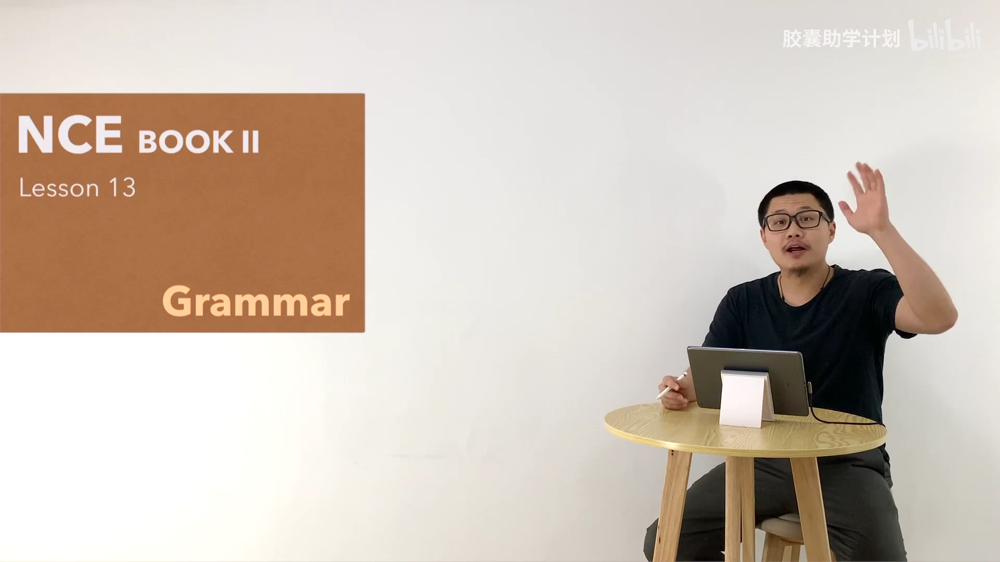

文字识别：胶囊助学计划 / NCE / BOOKII / Lesson 13 / Grammar

### 画面 00:00:02

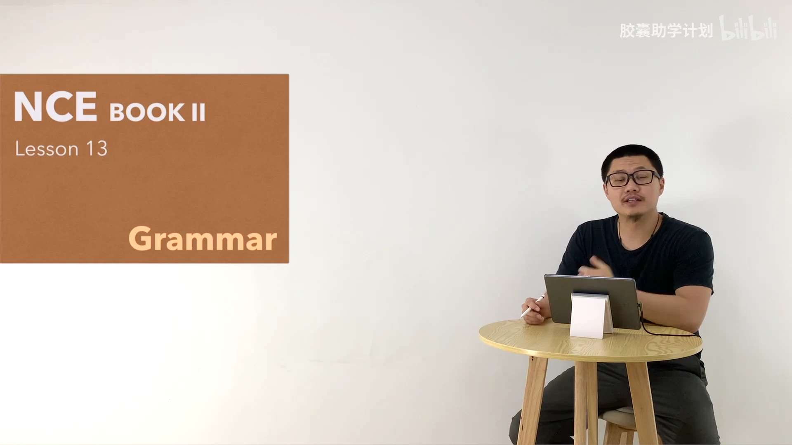

文字识别：胶囊助学计划 / NCE / BOOKII / Lesson 13 / Grammar

### 画面 00:00:05

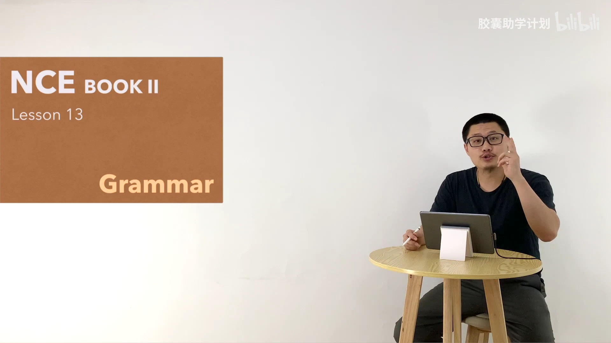

文字识别：胶囊助学计划 / NCE / BOOKII / Lesson 13 / Grammar

### 画面 00:00:09

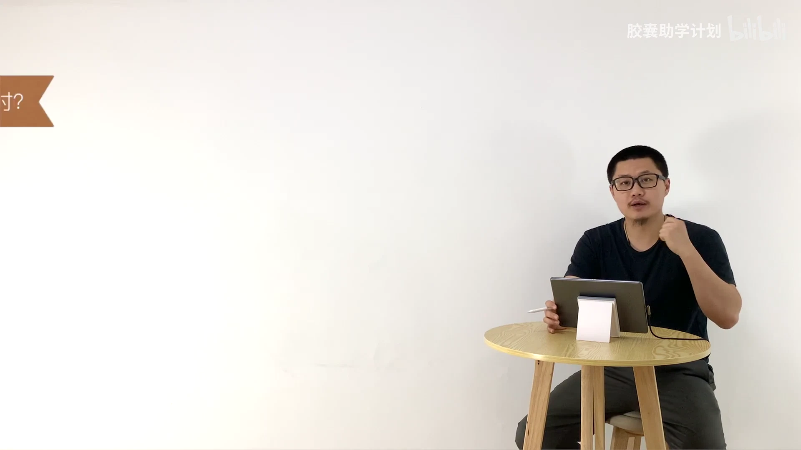

文字识别：胶囊助学计划 / 寸?

### 画面 00:00:11

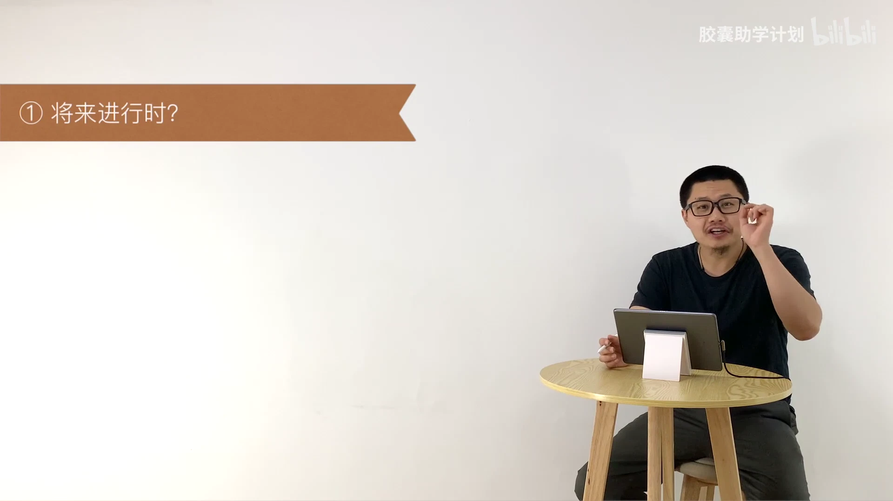

文字识别：胶囊助学计划 / ①将来进行时？

### 画面 00:00:15

文字识别：胶囊助学计划 / ①将来进行时?

### 画面 00:00:19

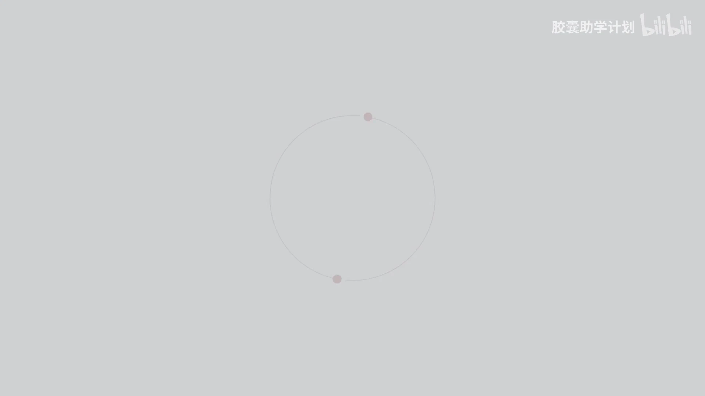

文字识别：胶囊助学计划 bilb出 / •

### 画面 00:00:22

文字识别：胶囊助学计划 / 胶囊助学计划

### 画面 00:00:24

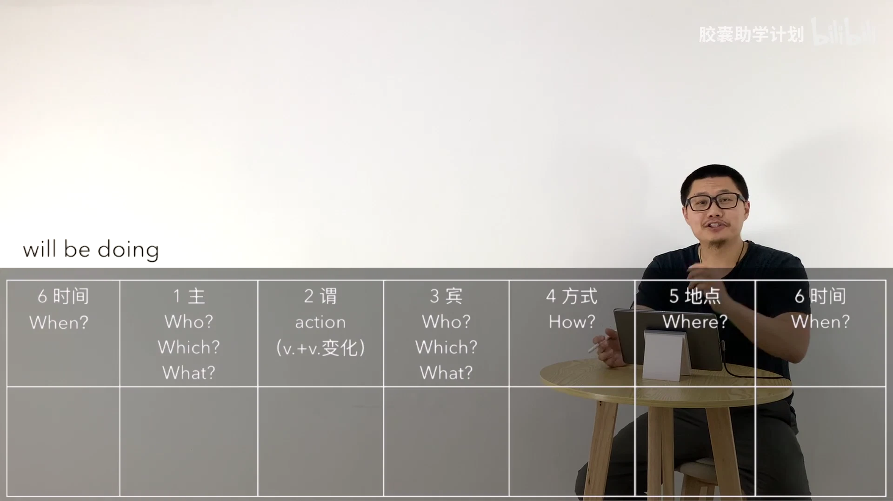

文字识别：胶囊助学计划 / will be doing / 6时间 / 1主 / 2谓 / 3宾 / 4方式 / 5地点 / 6时间 / When? / Who? / action / Who? / How? / Where? / When? / Which? / (v.+v.变化) / Which? / What? / What?

### 画面 00:00:27

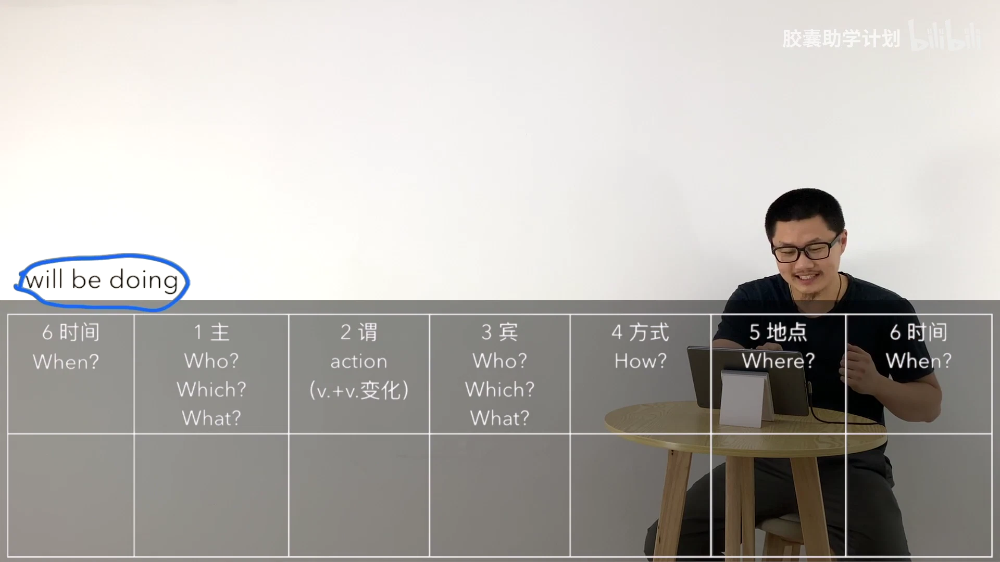

文字识别：胶囊助学计划 / Will be doing / 6时间 / 1主 / 2谓 / 3宾 / 4方式 / 5地点 / 6时间 / When? / Who? / action / Who? / How? / Where? / When? / Which? / (v.+v.变化) / Which? / What? / What?

## 00:00:30–00:01:00

眼熟？里面的每个环节、每个部分您都见过。比如说 will 这个单词，咱们之前学过了，一般将来时 will 加 do，对吧？以及后边的 be 加 doing。我们虽然没有见过直接的 be 加 doing，但是您见过 be 的变体加 doing。比如说 am is are 加 doing，我们学过，对吧？比如说第二课学的，比如说第七课啊，我没记错的话，咱们还学了 was were 加 doing，叫过去进行时啊，现在进行时将啊，过去进行时，咱就差

### 画面 00:00:35

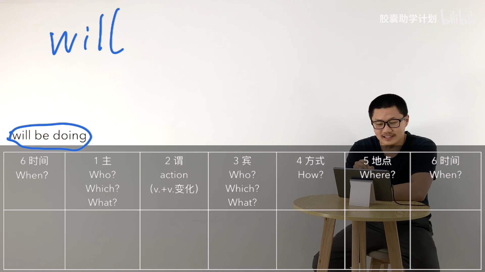

文字识别：胶囊助学计划 / Wi / will be / doing / 6时间 / 1主 / 2谓 / 3宾 / 4方式 / 5地点 / 6时间 / When? / Who? / action / Who? / How? / Where? / When? / Which? / (v.+v.变化) / Which? / What? / What?

### 画面 00:00:38

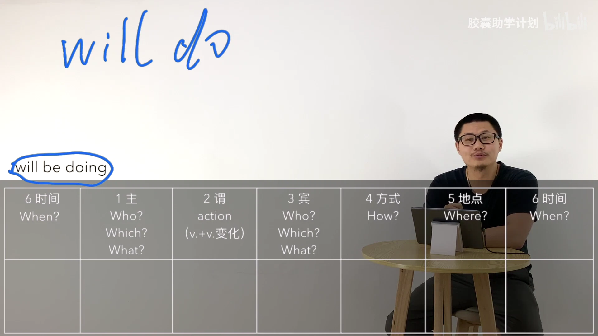

文字识别：胶囊助学计划 / wil / will be / doing / 6时间 / 1主 / 2谓 / 3宾 / 4方式 / 5地点 / 6时间 / When? / Who? / action / Who? / How? / Where? / When? / Which? / (v.+v.变化) / Which? / What? / What?

### 画面 00:00:40

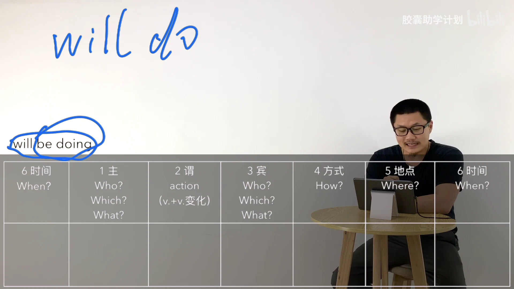

文字识别：胶囊助学计划 / wil / Will / be / doing / 6时间 / 1主 / 2谓 / 3宾 / 4方式 / 5地点 / 6时间 / When? / Who? / action / Who? / How? / Where? / When? / Which? / (v.+v.变化) / Which? / What? / What?

## 00:01:00–00:01:30

个将来进行时了。将来进行时无非就是把 am is are was were 换回了原形 be 啊，再讲被动那一课，我重点讲了，各位想一下啊，然后前面又加了一个 will，于是变成了 will 加 be 加 doing，表示将来进行时。那它呢，在六一二三四五六当中的语法位置是处于二这个地方的，非常重要啊，各位记住啊，所有跟二相关的语法几乎是绝对不能错的，有一些小的语

### 画面 00:01:10

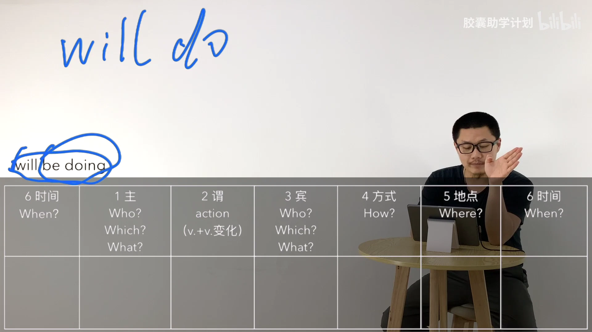

文字识别：胶囊助学计划 / wil / Willk / be / doing / 6时间 / 1主 / 2谓 / 3宾 / 4方式 / 5地点 / 6时间 / When? / Who? / action / Who? / How? / Where? / When? / Which? / (v.+v.变化) / Which? / What? / What?

### 画面 00:01:20

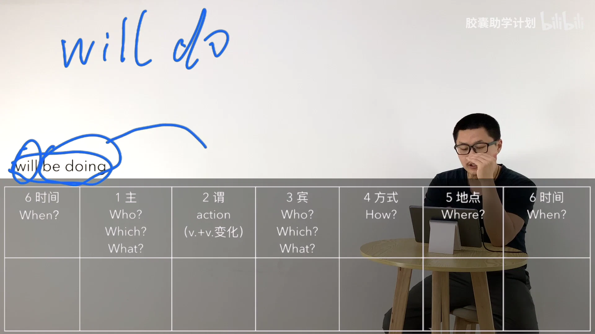

文字识别：胶囊助学计划 / Wil / wil / be / doing / 6时间 / 1主 / 2谓 / 3宾 / 4方式 / 5地点 / 6时间 / When? / Who? / action / Who? / How? / Where? / When? / Which? / (v.+v.变化) / Which? / What? / What?

### 画面 00:01:22

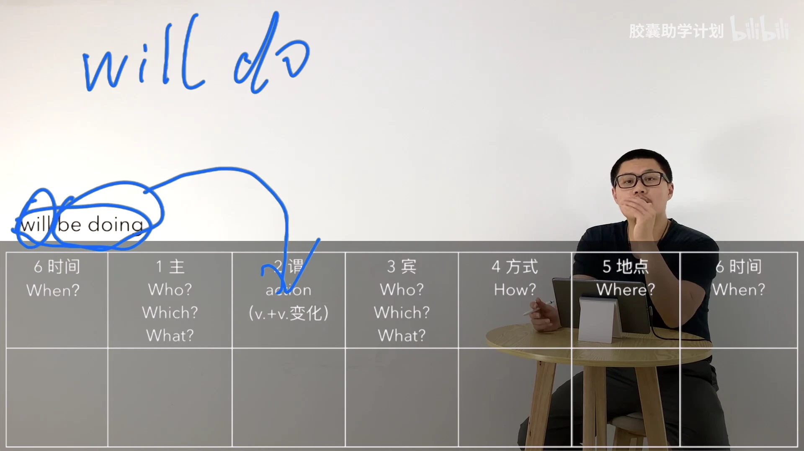

文字识别：胶囊助学计划 / wil / will / be / doina / 6时间 / 1主 / 谓 / 3宾 / 4方式 / 5地点 / 时间 / When? / Who? / aMon / Who? / How? / Where? / When? / Which? / (v.+v.变化) / Which? / What? / What?

## 00:01:30–00:02:00

法，您考试错了会减分，但是生活实际应用当中错了可能没有事情。比如说跟一相关的，跟三相关的啊一些语法，比如说 a and the，您用错了，不太注意啊。我说的不是考试啊，实际生活当中影响也许没那么大啊。你说 a apple an apple，别人都听得懂，考试一定扣分，对吧？但是比如说四五六啊，这个 in the morning the 您忘说了，您说 in morning，别人能不能听

### 画面 00:01:36

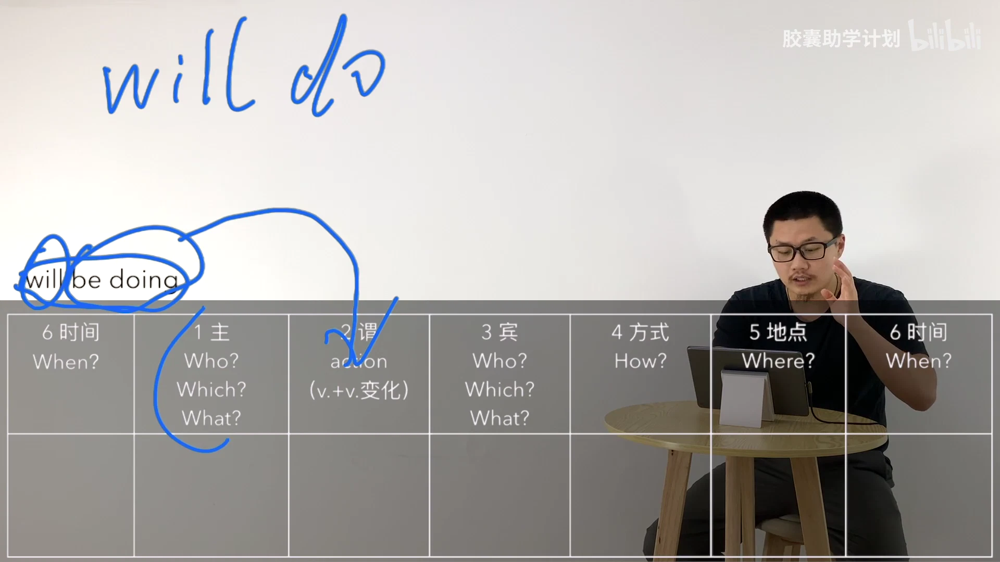

文字识别：胶囊助学计划 / wil / will / be / doina / 6时间 / 1主 / 谓 / 3宾 / 4方式 / 5地点 / 6时间 / When? / Who? / aMon / Who? / How? / Where? / When? / Which? / (v.+v.变化) / Which? / What? / What?

### 画面 00:01:38

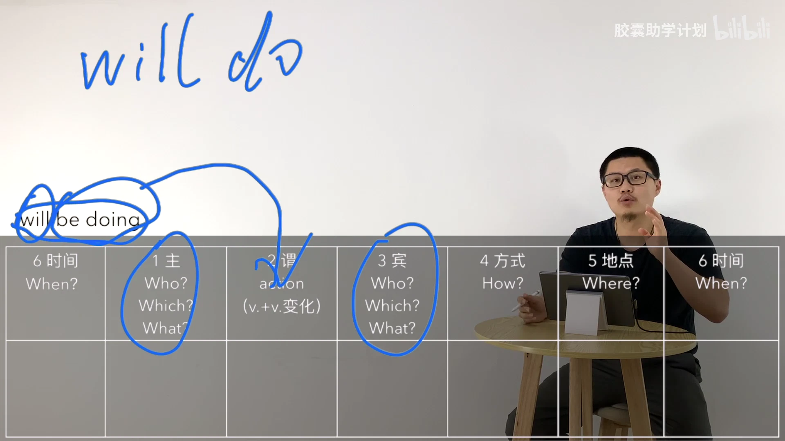

文字识别：胶囊助学计划 / will / will / be / doing / 6时间 / 1主 / 谓 / 3宾 / 4方式 / 5地点 / 6时间 / When? / Who? / aMon / Who? / How? / Where? / When? / Which? / (v.+v.变化) / Which? / What / What?

### 画面 00:01:54

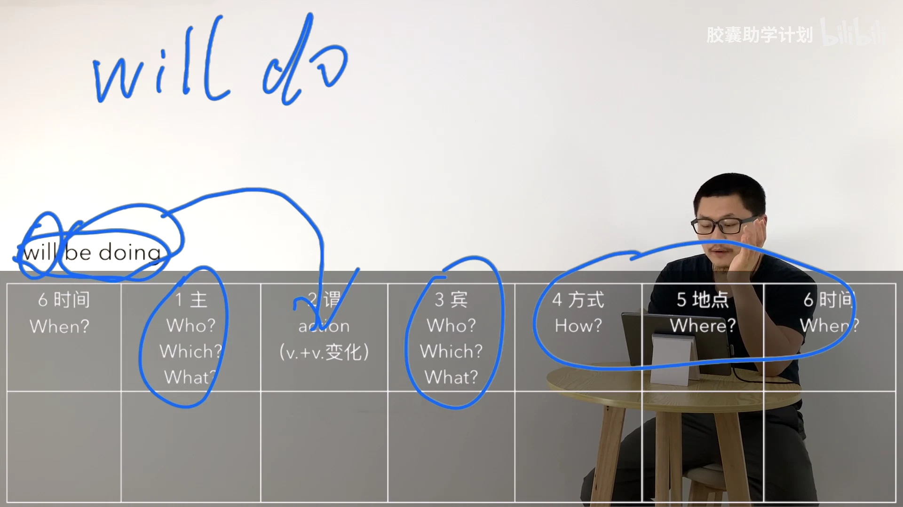

文字识别：胶囊助学计划 / will / will / be / doing / 6时间 / 1主 / 谓 / 3宾 / 4方式 / 5地点 / 6时间 / When? / Who? / aMon / Who? / How? / Where? / When / Which? / (v.+v.变化) / Which? / What / What?

## 00:02:00–00:02:30

懂？没有问题，都本身就没有太多的含义。但考试还是错啊！各位把这两个在这个地方还是要分开一点啊，所以它很重要，这个语法。接下来我们一起看一下 will be doing 的用法。它第一个用法叫做将来某个动作正在进行，这个应该特别好推出来了。为什么呢？您想一下，现在进行时指的是最核心的用法了，当然现在一个动作正在进行，过去进行时说的是过去一个动作正在进行，对吧？

### 画面 00:02:08

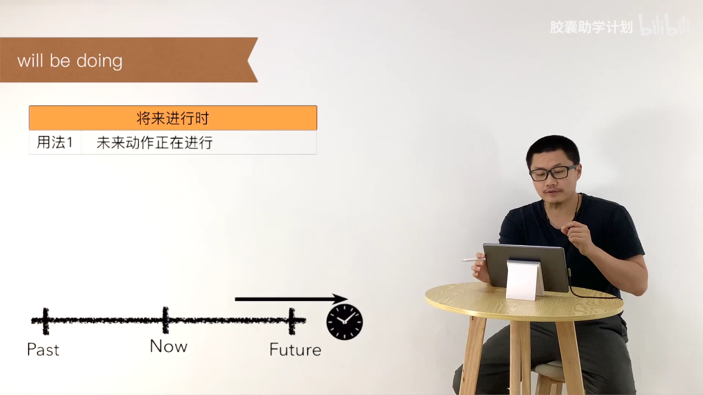

文字识别：胶囊助学计划 / will be doing / 将来进行时 / 用法1 / 未来动作正在进行 / Now / Past / Future

### 画面 00:02:11

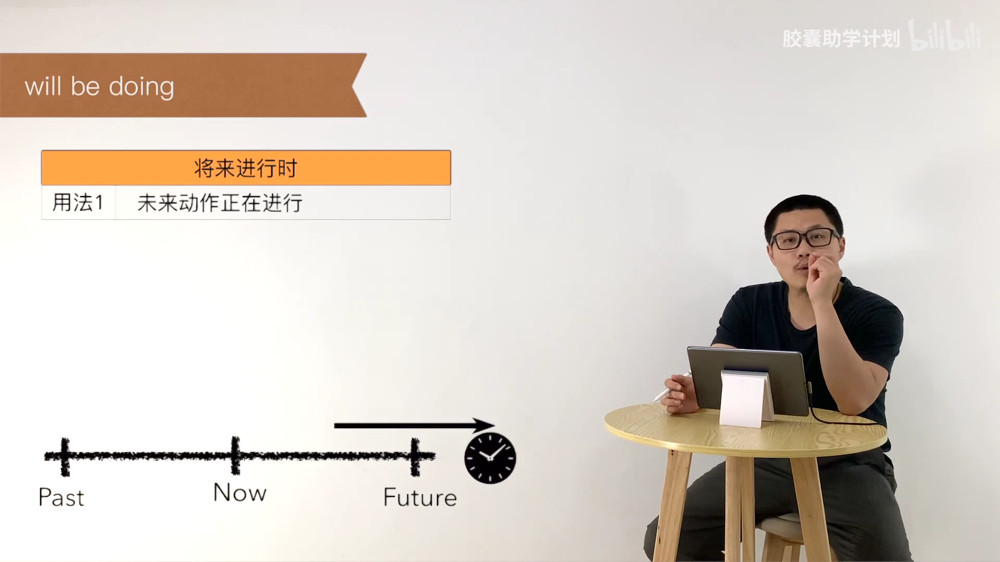

文字识别：胶囊助学计划 / will be doing / 将来进行时 / 用法1 / 未来动作正在进行 / Now / Past / Future

### 画面 00:02:15

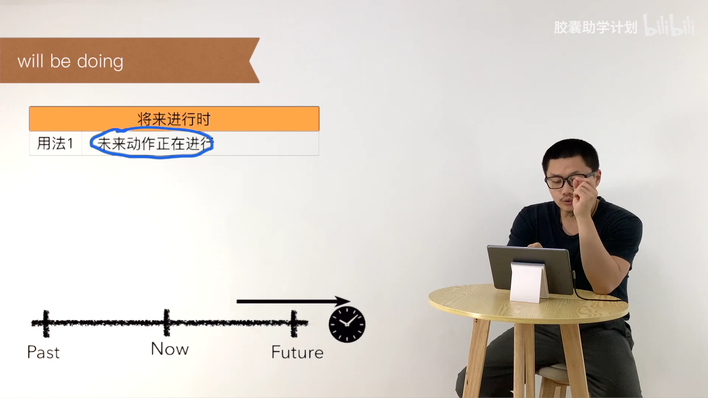

文字识别：胶囊助学计划 / will be doing / 将来进行时 / 用法1 / 未来动作正在进行 / Now / Past / Future

### 画面 00:02:17

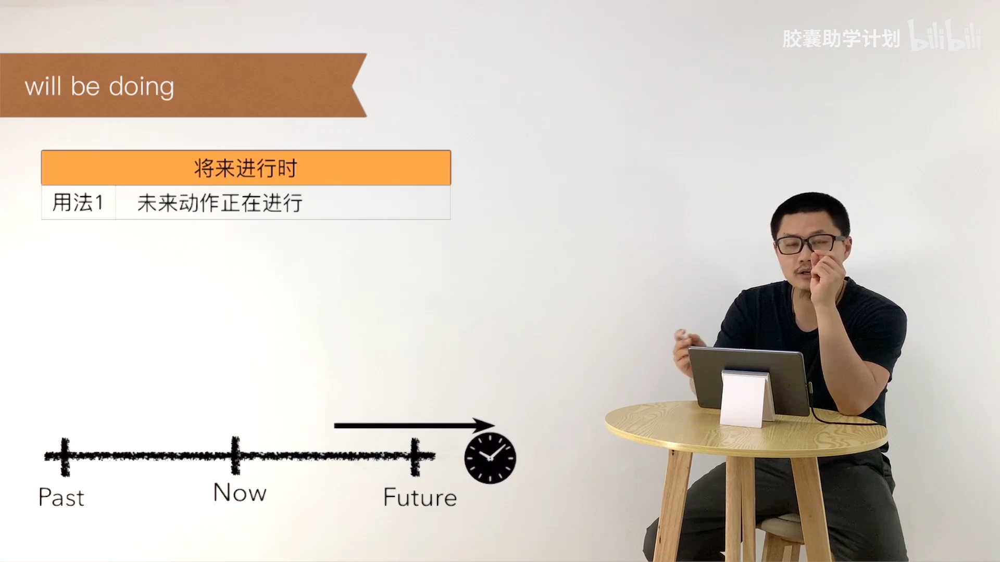

文字识别：胶囊助学计划 / will be doing / 将来进行时 / 用法1 / 未来动作正在进行 / Now / Past / Future

### 画面 00:02:20

文字识别：胶囊助学计划 / will be doing / 将来进行时 / 用法1 / 未来动作正在进行 / Now / Past / Future

### 画面 00:02:23

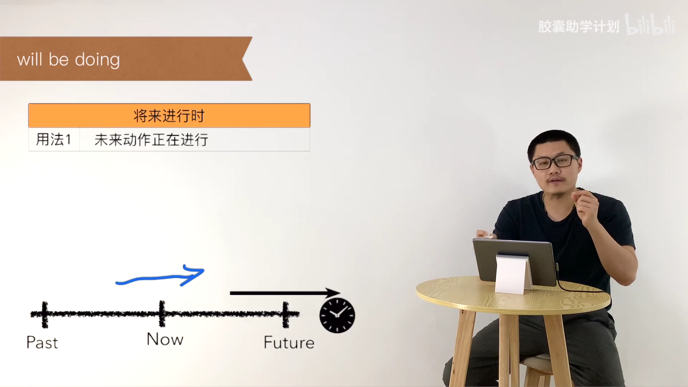

文字识别：胶囊助学计划 / will be doing / 将来进行时 / 用法1 / 未来动作正在进行 / Now / Past / Future

### 画面 00:02:27

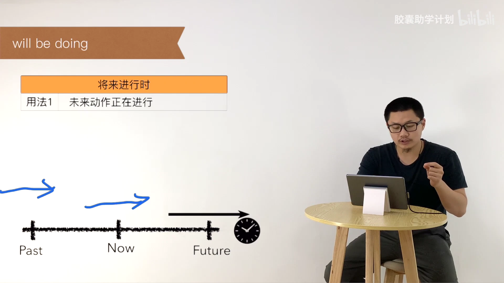

文字识别：胶囊助学计划 / will be doing / 将来进行时 / 用法1 / 未来动作正在进行 / Now / Past / Future

## 00:02:30–00:03:00

这两个您懂了。那将来进行时的核心用法说的是将来一个动作正在进行，是不是就很容易理解了，对吧？OK，好，那接下来呢，我们看一下它的结构，Will be doing。我们刚刚讲过了，也简单的分析了一下，它为什么是这个样子，对吧？Be doing前面加了一个Will。好，肯定句呢就是Will be doing。比如说，Don't call me after ten，十点之后别给我打电话。I will be sleeping，我会正在睡觉了。肯定是现在

### 画面 00:02:33

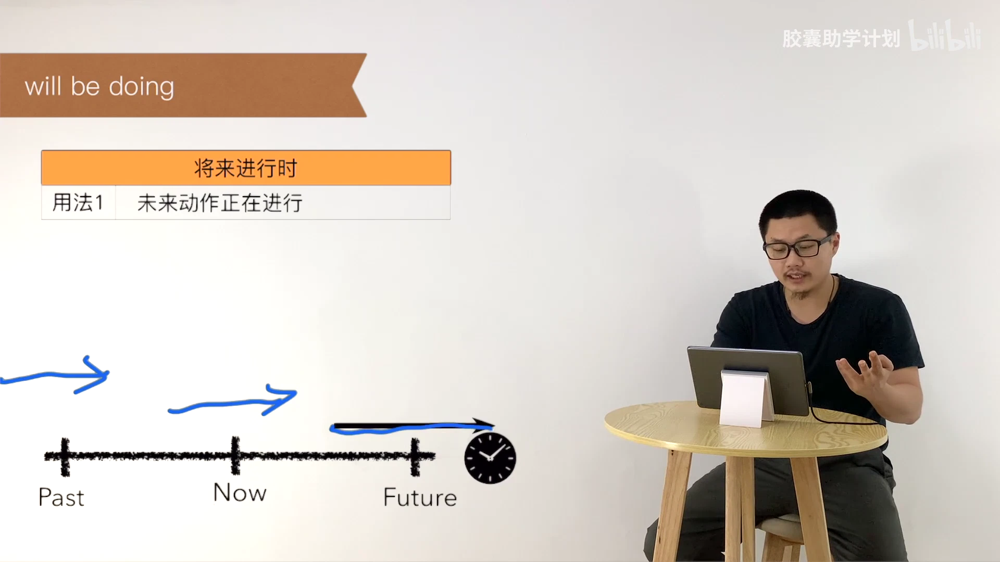

文字识别：胶囊助学计划 / will be doing / 将来进行时 / 用法1 / 未来动作正在进行 / Now / Past / Future

### 画面 00:02:35

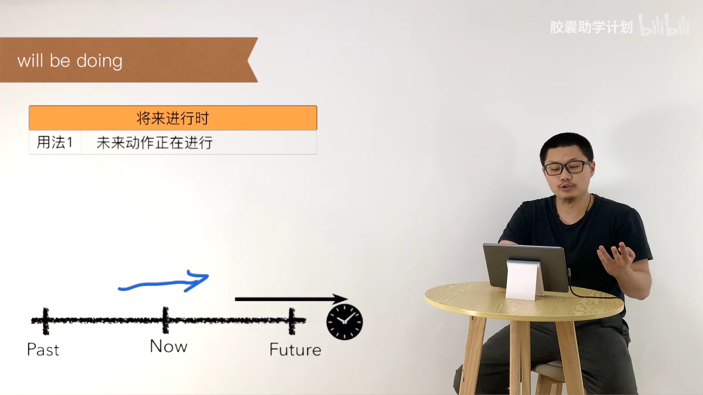

文字识别：胶囊助学计划 / will be doing / 将来进行时 / 用法1 / 未来动作正在进行 / Now / Past / Future

### 画面 00:02:38

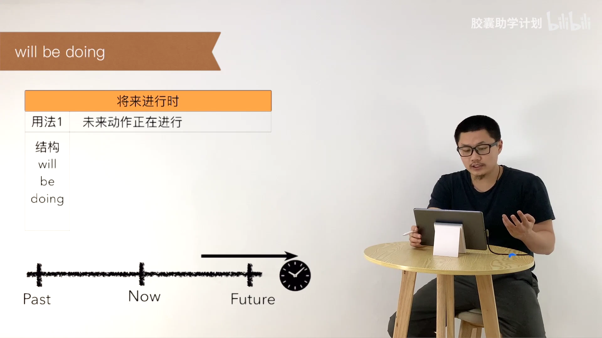

文字识别：胶囊助学计划 / will be doing / 将来进行时 / 用法1 / 未来动作正在进行 / 结构 / will / be / doing / Past / Now / Future

### 画面 00:02:41

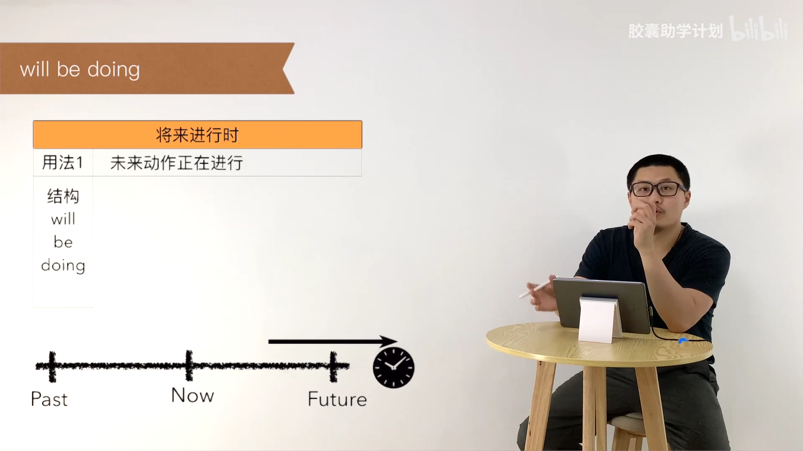

文字识别：胶囊助学计划 / will be doing / 将来进行时 / 用法1 / 未来动作正在进行 / 结构 / will / be / doing / Now / Past / Future

### 画面 00:02:54

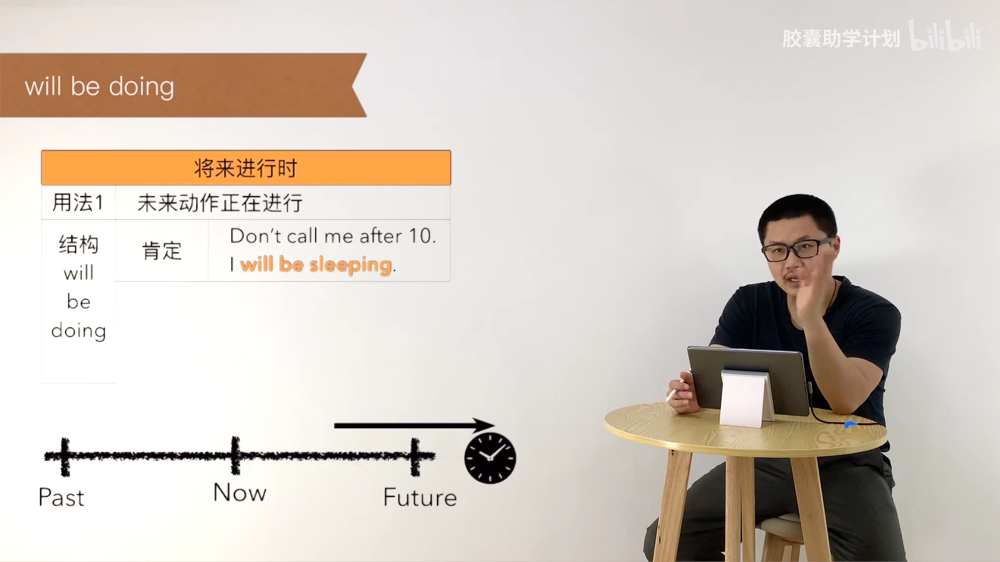

文字识别：胶囊助学计划 / will be doing / 将来进行时 / 用法1 / 未来动作正在进行 / Don't call me after 10. / 结构 / 肯定 / I will be sleeping. / will / be / doing / Now / Past / Future

## 00:03:00–00:03:30

说，对吧？比如说我们现在在录课的时候是下午六点钟，那我说今天晚上十点之后别给我打电话了。I will be sleeping，将来十点，对吧？一个动作正在进行。OK，那它的否定呢？各位在这个地方就靠猜就行了。您以前见到 will 的时候，就是把 will 后边加 not 变一般疑问句，就是 will 提前，在这儿也猜不出别的花样来了，对吧？那您猜的基本就是对的。Will 后边加 not 变成 won't。OK，

### 画面 00:03:04

文字识别：胶囊助学计划 / will be doing / 将来进行时 / 用法1 / 未来动作正在进行 / Don't call me after 10. / 结构 / 肯定 / I will be sleeping. / will / be / doing / Past / Now / Future

### 画面 00:03:09

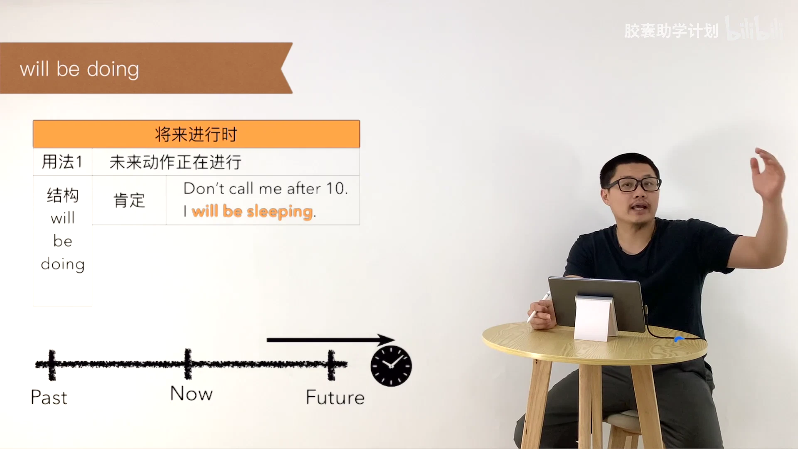

文字识别：胶囊助学计划 / will be doing / 将来进行时 / 用法1 / 未来动作正在进行 / Don't call me after 10. / 结构 / 肯定 / I will be sleeping. / will / be / doing / Now / Past / Future

### 画面 00:03:14

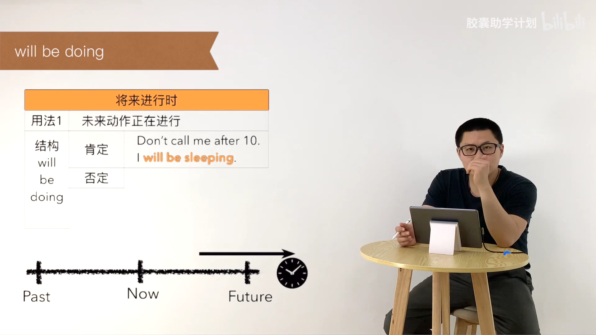

文字识别：胶囊助学计划 / will be doing / 将来进行时 / 用法1 / 未来动作正在进行 / Don't call me after 10. / 结构 / 肯定 / I will be sleeping. / will / be / 否定 / doing / Now / Past / Future

### 画面 00:03:17

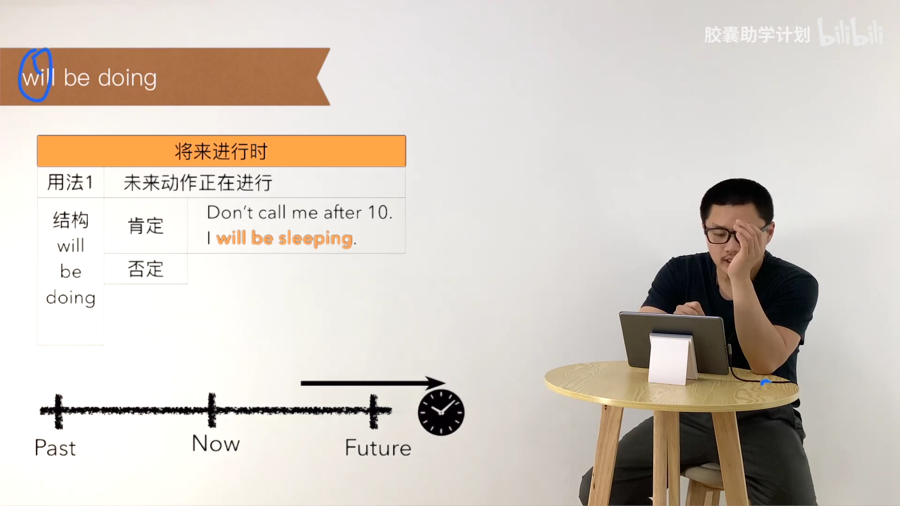

文字识别：胶囊助学计划 / be doing / wi / 将来进行时 / 用法1 / 未来动作正在进行 / Don't call me after 10. / 结构 / 肯定 / I will be sleeping. / will / be / 否定 / doing / Now / Past / Future

### 画面 00:03:28

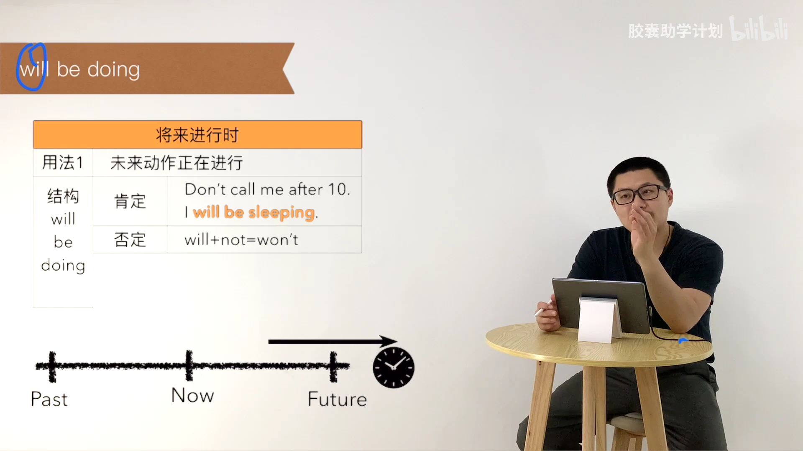

文字识别：胶囊助学计划 / be doing / wi / 将来进行时 / 用法1 / 未来动作正在进行 / Don't call me after 10. / 结构 / 肯定 / I will be sleeping. / will / be / 否定 / will+not=won't / doing / Past / Now / Future

## 00:03:30–00:04:00

won't. Okay, 那一般疑问句就是 will 提到句首。那它有一个小的难点啊，其实也不能算难点，我们就是给它对比一下，就是现在进行时、过去进行时和将来进行时这三个时态，咱们放到一起去说。比如说在这儿给大家三句话啊，我们逐个去看。第一句话，At ten o'clock yesterday, Tina was in her office. She was working. 她当时正在工作，昨天的事儿嘛，对吧？So it's ten o'clock

### 画面 00:03:31

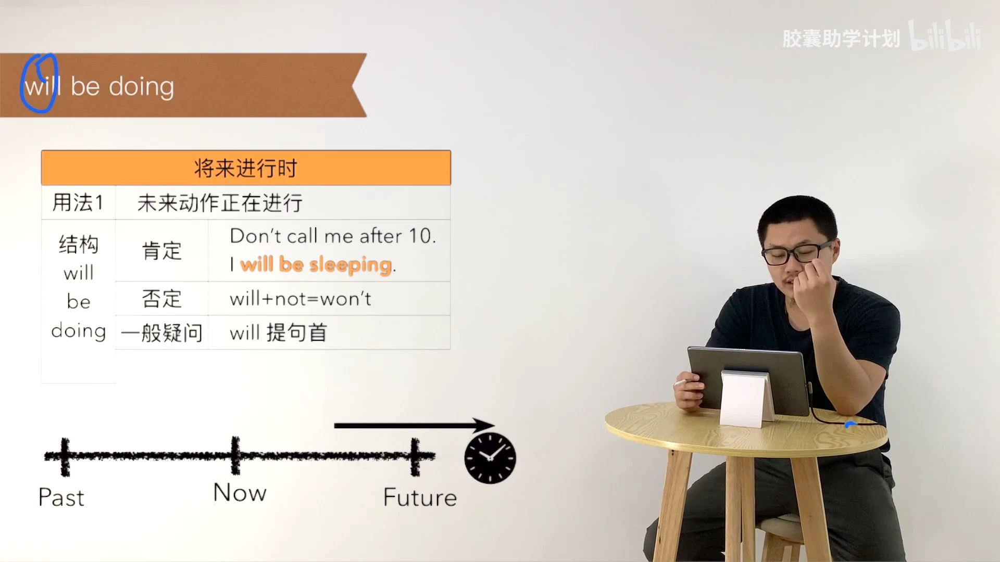

文字识别：胶囊助学计划 / be doing / wi / 将来进行时 / 用法1 / 未来动作正在进行 / Don't call me after 10. / 结构 / 肯定 / I will be sleeping. / will / be / 否定 / will+not=won't / doing / 一般疑问 / will提句首 / Past / Now / Future

### 画面 00:03:36

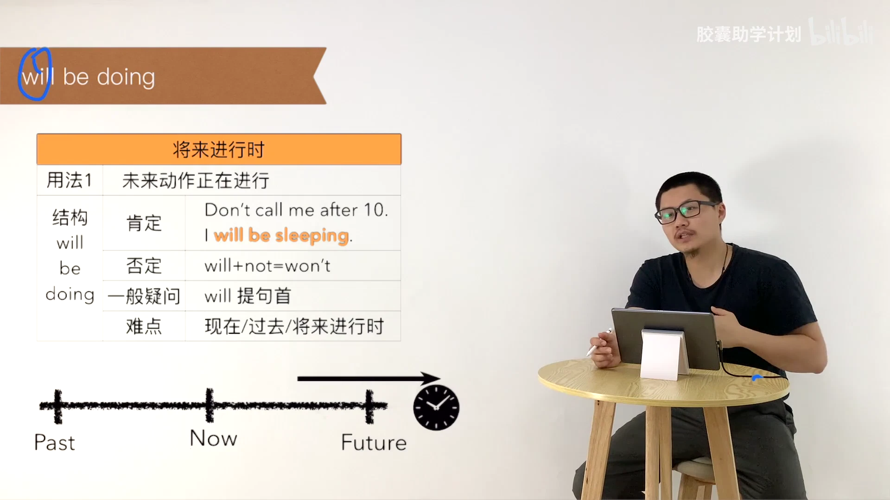

文字识别：胶囊助学计划 / be doing / wi / 将来进行时 / 用法1 / 未来动作正在进行 / Don't call me after 10. / 结构 / 肯定 / I will be sleeping. / will / be / 否定 / will+not=won't / doing / 一般疑问 / will提句首 / 难点 / 现在/过去/将来进行时 / Past / Now / Future

### 画面 00:03:43

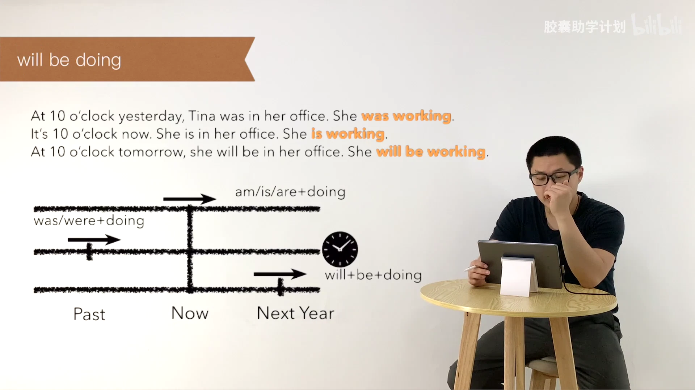

文字识别：胶囊助学计划 / will be doing / At 10 o'clock yesterday, Tina was in her office. She was working. / o'clock now. She is in her office. She is working. / It's / 10 / At 10 o'clock tomorrow, she /  will be in her office. She will be working. / am/is/are+doing / was/were+doing / will+be+doing / Past / Now / Next Year

### 画面 00:03:47

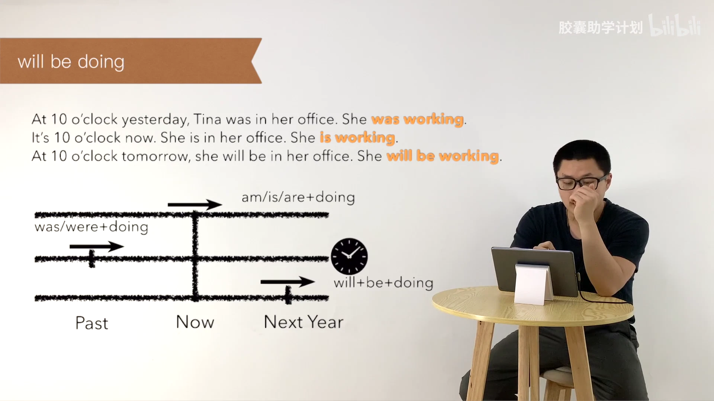

文字识别：胶囊助学计划 / will be doing / At 10 o'clock yesterday, Tina was in her office. She was working. / It's / 10 / o'clock now. She is in her  / office. She is working. / At 10 o'clock tomorrow, she /  will be in her office. She wil be working. / am/is/are+doing / was/were+doing / will+be+doing / Past / Now / Next Year

### 画面 00:03:51

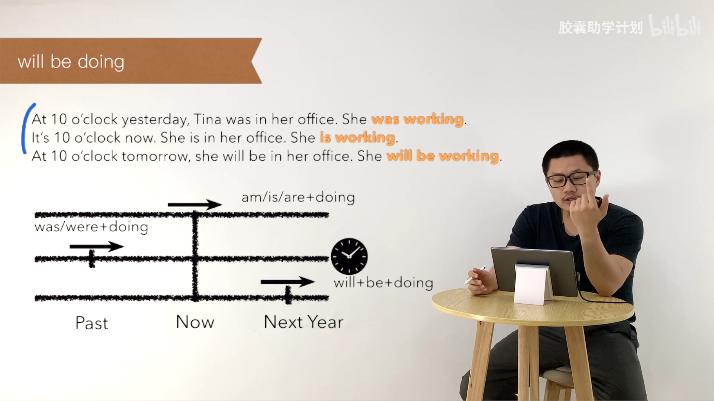

文字识别：胶囊助学计划 / will be doing / At 10 o'clock yesterday, Tina was in her office. She was working. / It's / 10 o'clock now. She is in her d / office. She is working. / At 10 o'clock tomorrow, she / : will be in her office. She will be working. / am/is/are+doing / was/were+doing / will+be+doing / Past / Now / Next Year

## 00:04:00–00:04:30

now. She's in her office. She's working.她现在正在工作。最后一个，at ten o'clock tomorrow, she will be in her office. She will be working.她将正在工作。Will be doing.一个是昨天，一个是现在，一个是将来，对吧？非常舒服。然后呢，配合这个图，您看，现在一个动作正在进行，对吧？将来一个动作正在进行，过去一个动作正在进行，三个时态很

### 画面 00:04:02

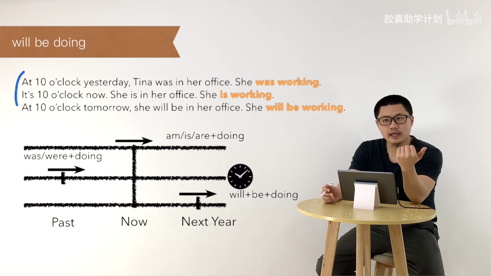

文字识别：胶囊助学计划 / will be doing / At 10 o'clock yesterday, Tina was in her office. She was working. / It's / 10 o'clock now. She is in her d / office. She is working. / At 10 o'clock tomorrow, she /  will be in her office. She will be working. / am/is/are+doing / was/were+doing / will+be+doing / Past / Now / Next Year

### 画面 00:04:05

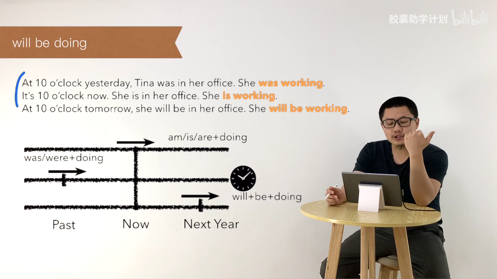

文字识别：胶囊助学计划 / will be doing / At 10 o'clock yesterday, Tina was in her office. She was working. / It's / 10 o'clock now. She is in her c / office. She is working. / At 10 o'clock tomorrow, she /  will be in her office. She wil be working. / am/is/are+doing / was/were+doing / will+be+doing / Past / Now / Next Year

### 画面 00:04:13

文字识别：胶囊助学计划 / will be doing / At 10 o'clock yesterday, Tina was in her office. She was working. / It's / 10 o'clock now. She is in her / office. She is working. / At 10 o'clock tomorrow, she /  will be in her office. She will be working. / am/is/are+doing / was/were+doing / will+be+doing / Past / Now / Next Year

### 画面 00:04:15

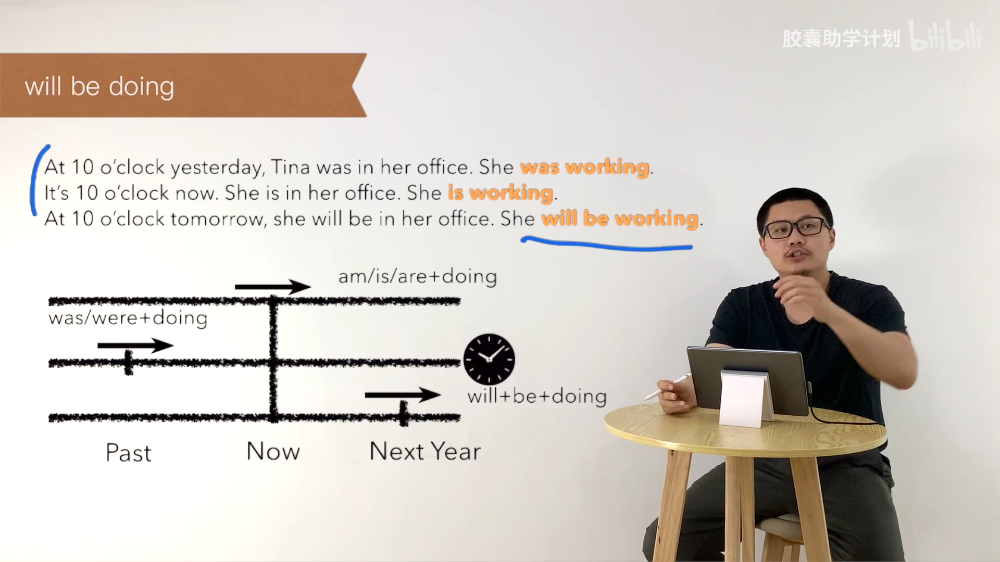

文字识别：胶囊助学计划 / will be doing / At 10 o'clock yesterday, Tina was in her office. She was working. / It's / 10 o'clock now. She is in her office. She is working. / At 10 o'clock tomorrow, she /  will be in her office. She wil be working. / am/is/are+doing / was/were+doing / will+be+doing / Past / Now / Next Year

### 画面 00:04:22

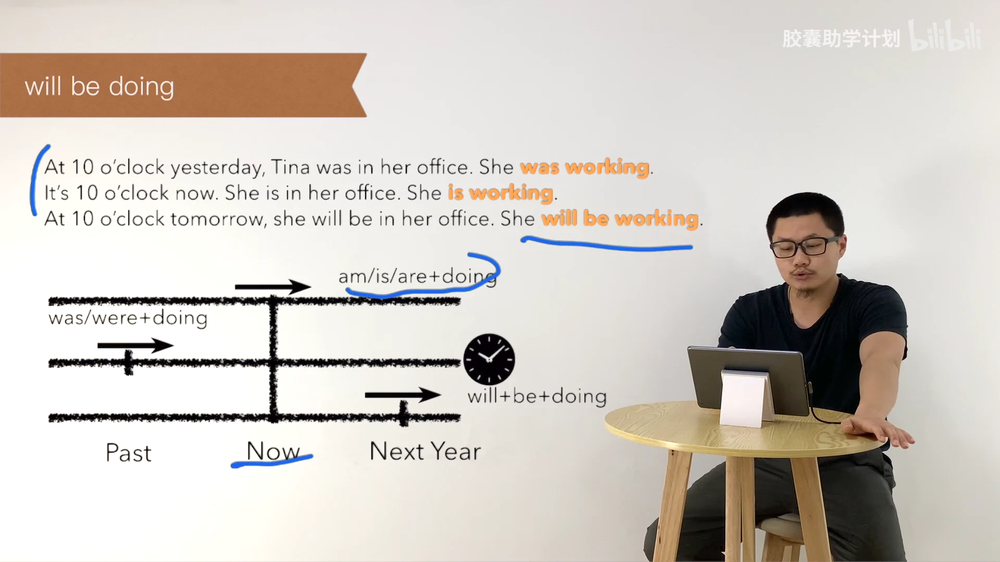

文字识别：胶囊助学计划 / will be doing / At 10 o'clock yesterday, / Tina was in her office. She  / was working. / It's / 10 / o'clock now. She is in her / office. / She / is working. / At 10 o'clock tomorrow, she / will be in her office. She will be working. / am/is/are+doine / was/were+doing / will+be+doing / Past / Now / Next Year

### 画面 00:04:24

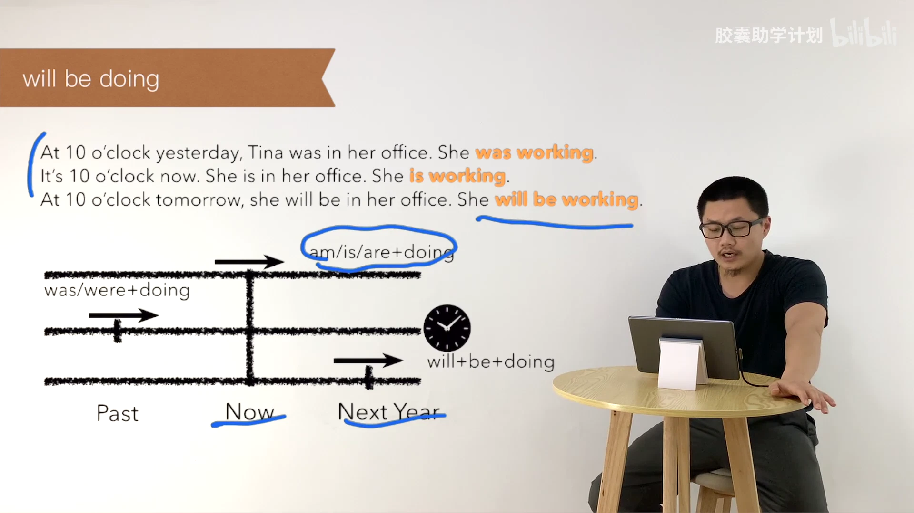

文字识别：胶囊助学计划 / will be doing / At 10 o'clock yesterday, / Tina was in her office. She / was working. / It's / 10 / o'clock / now. / She / isin / her / office. / She / is working. / At / 10 / o'clock tomorrow,  / she / will l / be / in her / office. She / will be working. / am/is/are+doine / was/were+doing / will+be+doing / Past / Now / Next Year

### 画面 00:04:26

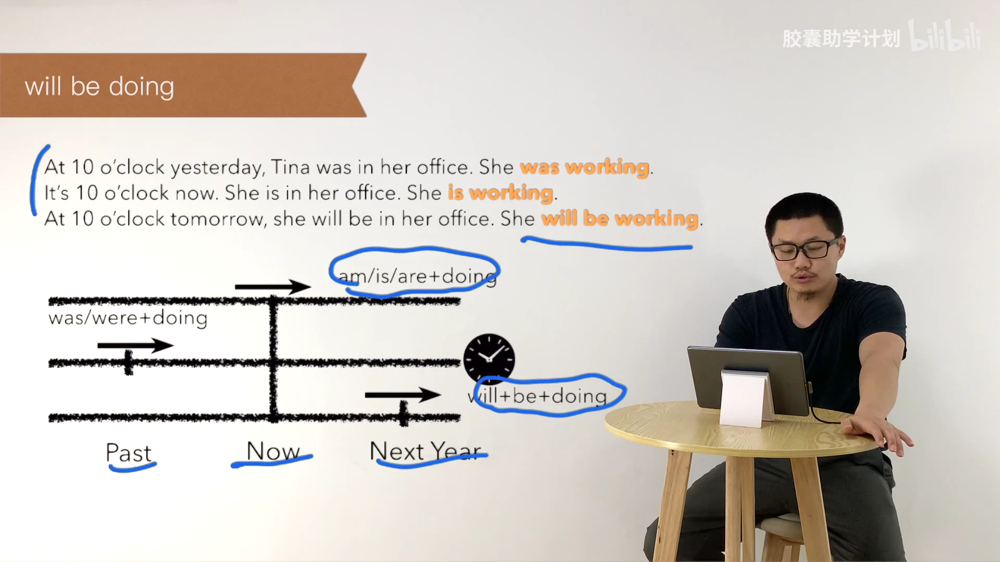

文字识别：胶囊助学计划 / will / be doing / At1 / : 10 o'clock yesterday, / Tina was in her office. She / was working. / It's / 10 / o'clock / now. / She / isin / her / office. / She / is working. / At1 / 10 / o'clockt / tomorrow, / she / will / be / in / her / office. She / will be working. / am/is/are+doins / was/were+doing / fl+be+doing / Past / Now / Next Year

### 画面 00:04:28

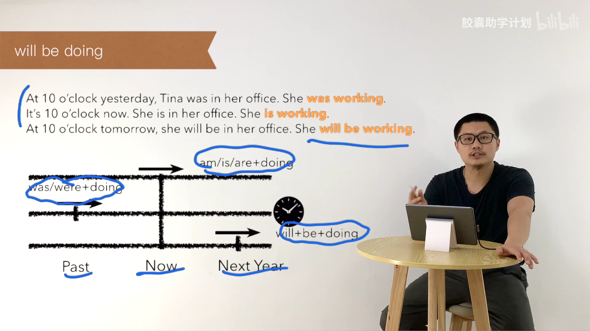

文字识别：胶囊助学计划 / will be doing / At 10 o'clock yesterday, / Tina was in her office. She / was working. / It's / 10 / o'clock / now.9 / She / is in / her / office. / She / is working. / At10 / o'clock tomorrow,  / ,she / will be / in her / office. She /  will be working. / am/is/are+doine / Was/were+doine / l+be+doing / Past / Now / Next Year

## 00:04:30–00:05:00

完美，大家现在已经这套线儿学完了，对吧？今天的课如果您学好了，当然它还有第二个用法，这个是啊，就是我们从过去进行时和将来进行时是没有办法完全把它推啊，从过现在进行时和过去进行时是没有办法把它推出来的，它还可以表示计划，比如说结构是不变的啊，比如说 I will be meeting him tomorrow，这句话它不是想表达明天我会正在见他，对吧？这个也

### 画面 00:04:32

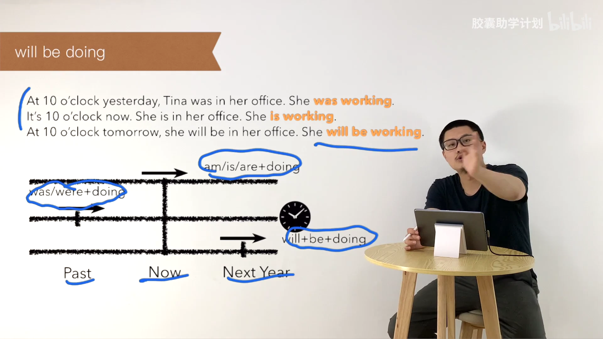

文字识别：胶囊助学计划 / will be doing / At 10 o'clock yesterday, / Tina was in her office. She / was working. / It's / 10 / o'clock / now. / She / is in / her / office. / She / is working. / At 10 o'clock tomorrow, she / will be / in her / office. She will be working. / am/is/are+doing / Was/were+doine / ijl+be+doing / Past / Now / Next Year

### 画面 00:04:34

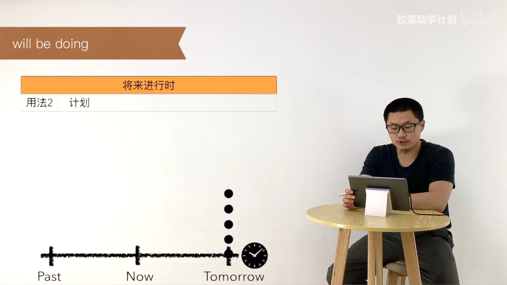

文字识别：胶囊助学计划 / will be doing / 将来进行时 / 用法2 / 计划 / Past / Now / Tomorrow

### 画面 00:04:36

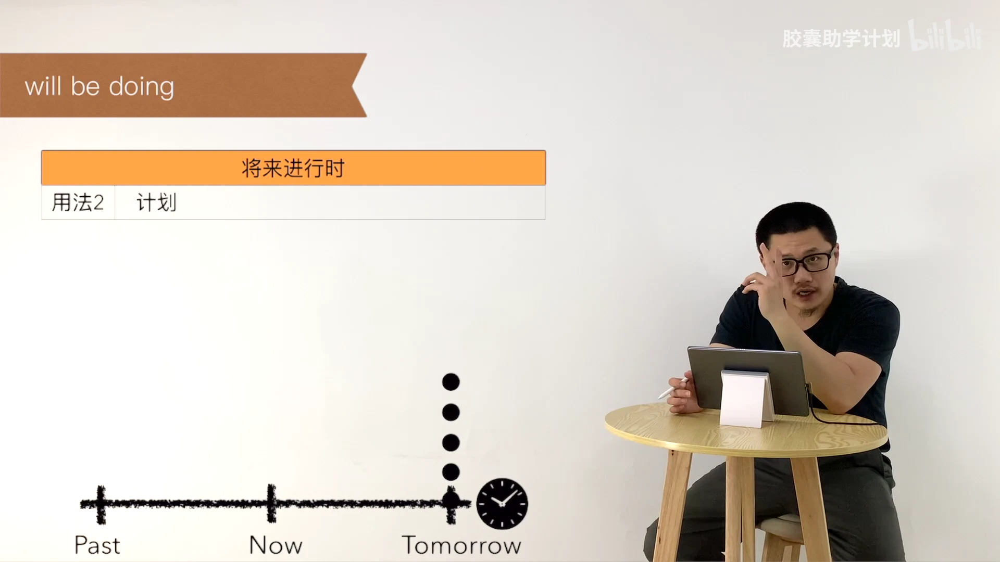

文字识别：胶囊助学计划 / will be doing / 将来进行时 / 用法2 / 计划 / Past / Now / Tomorrow

### 画面 00:04:40

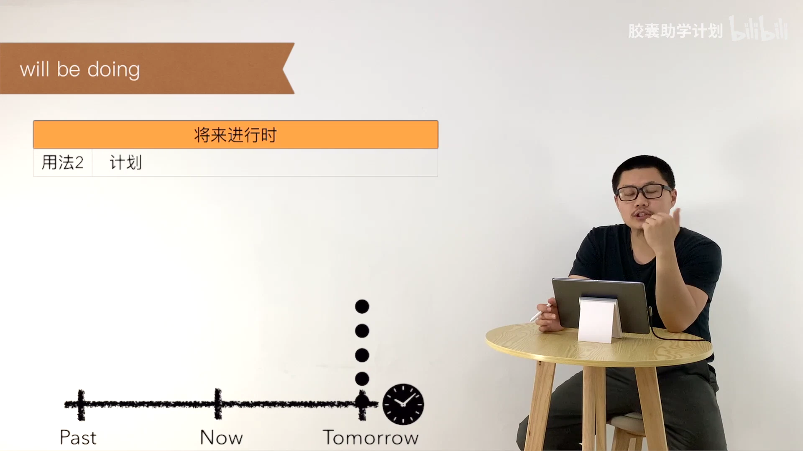

文字识别：胶囊助学计划 / will be doing / 将来进行时 / 用法2 / 计划 / Past / Now / Tomorrow

### 画面 00:04:57

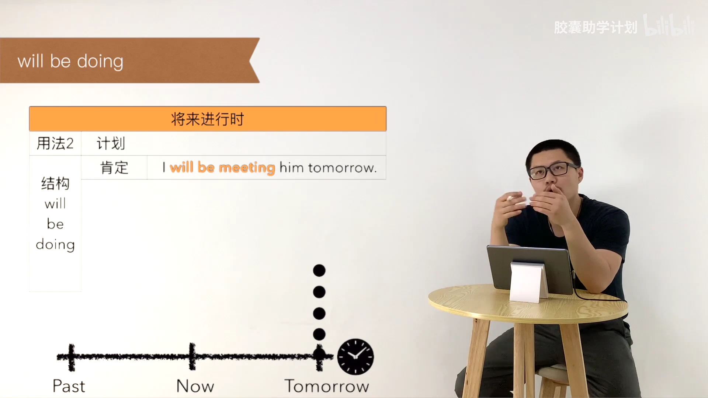

文字识别：胶囊助学计划 / will be doing / 将来进行时 / 用法2 / 计划 / 肯定 / I will be meeting / him tomorrow. / 结构 / will / be / doing / Past / Now / Tomorrow

## 00:05:00–00:05:30

译不太通，对不对？他想表达的其实就是明天我要去见他，我计划打算了去见他。OK，那它的否定句和一般疑问句，各位注意我这句话啊，一个结构，一个时态，结构一般不变，你有不同的用法，随便都OK，但是结构不变，结构就是我们的肯定句长成什么样子，否定句、一般疑问句长成什么样子，它是不变的。所以否定句 will 后边加 not，

### 画面 00:05:17

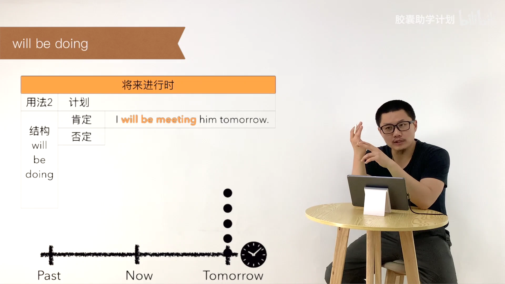

文字识别：胶囊助学计划 / will be doing / 将来进行时 / 用法2 / 计划 / 肯定 / I will be meeting / him tomorrow. / 结构 / 否定 / will / be / doing / Past / Now / Tomorrow

### 画面 00:05:26

文字识别：胶囊助学计划 / will be doing / 将来进行时 / 用法2 / 计划 / 肯定 / I will be meeting / him tomorrow. / 结构 / 否定 / will / be / doing / Past / Now / Tomorrow

### 画面 00:05:28

文字识别：胶囊助学计划 / will be doing / 将来进行时 / 用法2 / 计划 / 肯定 / I will be meeting / him tomorrow. / 结构 / 否定 / will+not=won't / will / be / doing / Past / Now / Tomorrow

## 00:05:30–00:06:00

跟刚才没区别。一般疑问句 will 提句首，OK？那它的难点就是，目前到现在我们已经至少学过了三个可以表示计划打算的，有没有什么区别呢？第一个我们管它叫将来进行时，第二个叫现在进行时，第二科学的对吧？第三个叫做一般将来时啊。这三个结构都可以表示计划打算，有没有什么区别呢？好，我们看一下。首先这三句话各位可以理解为就是没区

### 画面 00:05:35

文字识别：胶囊助学计划 / will be doing / 将来进行时 / 用法2 / 计划 / 肯定 / I will be meeting / him tomorrow. / 结构 / 否定 / will+not=won't / will / 一般疑问 / will 提句首 / be / will be doing / doing / 难点 / am/is/are doing / am/is/are going to do / Past / Now / Tomorrow

### 画面 00:05:54

文字识别：胶囊助学计划 / will be doing / 同 / He is taking a test next week. / He will be taking a test next week. / He is going to take a test next week. / 异 / am/is/are doing / 表将来最好+未来时间

### 画面 00:05:56

文字识别：胶囊助学计划 / will be doing / 同 / He is taking a test next week. / He /  will be taking a test next week. / He is going to take a test next week. / 异 / am/is/are doing / 表将来最好+未来时间

### 画面 00:05:58

文字识别：胶囊助学计划 / will be doing / 同 / He is taking a test next week. / He / will be taking a test next week. / He is going to take a test next week. / 异 / am/is/are doing / 表将来最好+未来时间

## 00:06:00–00:06:30

别。你看是不同的结构，对不对？Be doing, he is taking a test next week，或者 he will be taking，或者是 he is going to take，没问题，这三个都没什么本质上的区别，对不对？OK，那有一点点区别的是什么呢？因为 I'm is 二加 doing 啊，他见到他，比如说 I'm eating，我正在吃饭，你见到他最基本的含义，因为它表示的是现在一个动作正在进行，它虽

### 画面 00:06:00

文字识别：胶囊助学计划 / will be doing / 同 / He / is taking / a test next week. / He / will be t / taking / a test next week. / He / is going / totake / a test next week. / 异 / am/is/are / doing / 表将来最好+未来时间

### 画面 00:06:13

文字识别：胶囊助学计划 / will be doing / 同 / He is taking / a test next week. / He / will be taking / a test next week. / He / is going / totake / a test next week. / 异 / am/is/are / doing / 表将来最好+未来时间

### 画面 00:06:17

文字识别：胶囊助学计划 / will be doing / 同 / He / is taking / a test next week. / will be taking / He / a test next week. / He / is going to take / a test next week. / 异 / am/is/are / doing / 表将来最好+未来时间

### 画面 00:06:25

文字识别：胶囊助学计划 / will be doing / 同 / He / eis taking / a test next week. / He / will be taking / a test next week. / He / is going / totake / a test next week. / 异 / am/is/are / doing / 表将来最好+未来时间

## 00:06:30–00:07:00

然可以表计划打算，但是呢，如果你不加上未来的时间，比如说 next week, next week, next week，别人的下意识就会认为现在正在做这件事情，对吧？所以我说的是最好加上啊，表将来最好加未来时间。可不可以不加呢？由上下文场景决定。比如说我问你说 What are you going to do? What are gonna do next week? 你下周要干什么去？你说 I'm meeting Leo，说我要去见 Leo，别人一定

### 画面 00:06:32

文字识别：胶囊助学计划 / will be doing / 同 / He / is taking / a test next week. / He / will be1 / taking / atest / next week. / He / is going / totake / a test next week. / 异 / am/is/are / doing / 表将来最好+未来时间

### 画面 00:06:34

文字识别：胶囊助学计划 / will be doing / 同 / He is taking / a test next week. / He / will be taking / a test next week. / He / is going to take / a test next week. / 异 / am/is/are / doing / 表将来最好+未来时间

### 画面 00:06:37

文字识别：胶囊助学计划 / will / I be doing / 同 / He / e is taking / a test / next week. / He / will be / taking / a / test next week. / He / is going / tot / take / a test next wee / 异 / am/is/are / doing / 表将来最好+未来时间

### 画面 00:06:40

文字识别：胶囊助学计划 / will / be doing / 同 / He / is taking / a test / next week. / He / will bef / taking / test next week. / a / He / is going / to take / a test next wee / 异 / am/is/are / doing / 表将来最好+未来时间

### 画面 00:06:48

文字识别：胶囊助学计划 / will be doing / 同 / He / e is taking / a test next week. / He / will be t / taking / a / test next week. / He / is going / totake / a test next wee / 异 / am/is/are / doing / 表将来最好+未来时间

### 画面 00:06:56

文字识别：胶囊助学计划 / will / be doing / 同 / He is taking / a testr / next week. / He / will be t / taking / a / test next week. / He / is going / to take / a test next wee / 异 / am/is/are / doing / 表将来最好+未来时间

## 00:07:00–00:07:30

能明白，因为问的就是下一周。各位在这地方注意一下就可以了啊。所以大部分情况下没有区别，不要想歪。OK，好，接下来我们看一个小的视频片段。这个视频片段当中出现了非常多次的 will be doing，啊，各位注意力集中了。 What are your plans for Friday? Hey Hilda, I will be shopping on Friday to buy my sister a present. How about you? I will be working on my science report and I will be working on my English essay. Will you

### 画面 00:07:03

文字识别：胶囊助学计划 / will / I be doing / 同 / He / e is taking / a test next week. / He / will bet / taking / a / test next week. / He / is going / totake / a test next weel / 异 / am/is/are / doing / 表将来最好+未来时间

### 画面 00:07:07

文字识别：will be doing / 胶囊助学计划 / Hey Marissa! / What are your plans for friday? / Ana Dilara Martinez

### 画面 00:07:09

文字识别：will be doing / 胶囊助学计划 / Hey Marissa! / What are your plans for friday? / Ana Dilara Martinez

### 画面 00:07:11

文字识别：will be doing / 胶囊助学计划 / Hey Marissa! / What arey / your plans for friday? / Ana Dilara Martinez

### 画面 00:07:13

文字识别：will be  / doing / 胶囊助学计划 / Hey Marissa! / What are your plans for friday? / Ana Dilara Martinez

### 画面 00:07:15

文字识别：Will be doing / 胶囊助学计划 / Hey Marissa! / What are your plans for friday? / Ana Dilara Martinez

### 画面 00:07:17

文字识别：will be doing / 胶囊助学计划 / Hey Marissa! / What are your plans for friday? / Ana Dilara Martinez

### 画面 00:07:19

文字识别：Will be / doing / 胶囊助学计划 / Hey Hievda! l will be / shopping on / friday / Ana Dilara Martinez

### 画面 00:07:21

文字识别：Will  / be / doing / 胶囊助学计划 / Hey Hievda! I will be / shopping on / friday / Ana Dilara Martinez

### 画面 00:07:23

文字识别：will be / doing / 胶囊助学计划 / to buy my / sister a / a / present. / How / about / you? / Ana Dilara Martinez

### 画面 00:07:25

文字识别：will be doing / 胶囊助学计划 / I will be working on / my / Science / report / Ana Dilara Martinez

### 画面 00:07:27

文字识别：will be / doing / 胶囊助学计划 / and I will be / working on / my / English essay. / Ana Dilara Martinez

### 画面 00:07:29

文字识别：will be doing / 胶囊助学计划 / tching the / Na / Mission Impossible moy / Ana Dilara Martinez

## 00:07:30–00:08:00

be watching the new Mission Impossible movie out on Saturday? No, I will not be watching the movie since I have so much work to do. Sam and I will be watching the movie on Saturday. Do you want to join us? Sounds like fun. Yeah, I would love to go with you guys. What time do you think you guys will be leaving to go to the movies? Sam and I will be leaving around twelve thirty since we live close to the movie theater. What time will you be leaving? I think I will be

### 画面 00:07:31

文字识别：Will be / doing / 胶囊助学计划 / Will / you be watching / the / new / Mission / Impossible / movie / Ana Dilara Martinez

### 画面 00:07:33

文字识别：Will be doing / 胶囊助学计划 / out on Saturday? / Ana Dilara Martinez

### 画面 00:07:35

文字识别：Will be doing / 胶囊助学计划 / No,Iwill not be /  watching the / movie, / Ana Dilara Martinez

### 画面 00:07:37

文字识别：will be doing / 胶囊助学计划 / since I have so much / work to do. / Ana Dilara Martinez

### 画面 00:07:39

文字识别：Will be doing / 胶囊助学计划 / Sam and I will be / e watching. / the / movie on saturday. / Ana Dilara Martinez

### 画面 00:07:41

文字识别：will be doing / 胶囊助学计划 / Sam and I will be watching the / movie onsaturday. / Ana Dilara Martinez

### 画面 00:07:43

文字识别：will be doing / 胶囊助学计划 / Do you want to join / us? / Ana Dilara Martinez

### 画面 00:07:45

文字识别：Will be doing / 胶囊助学计划 / Sounds like fun! Yea, I would love / to go with you / guys. / Ana Dilara Martinez

### 画面 00:07:47

文字识别：will be / doing / 胶囊助学计划 / What-time / do-you / think / you winl / be leaving / to go to / the / movies? / Ana Dilara Martinez

### 画面 00:07:49

文字识别：will be / doing / 胶囊助学计划 / What1 / time / do you / think / you will / be leaving / to go to / the / movies? / Ana Dilara Martinez

### 画面 00:07:51

文字识别：Will be doing / 胶囊助学计划 / Sam and I will be leaving around / 12.30, since we live close to the / Ana Dilara Martinez

### 画面 00:07:53

文字识别：will be doing / 胶囊助学计划 / Sam and I will be leaving around / 12.30, since we live close to the / Ana Dilara Martinez

### 画面 00:07:55

文字识别：will be doing / 胶囊助学计划 / Ana Dilara Martinez

### 画面 00:07:57

文字识别：Will be doing / 胶囊助学计划 / movie theatre.What / time will / be leaving? / you / Ana Dilara Martinez

### 画面 00:07:59

文字识别：will be / doing / 胶囊助学计划 / IthinkI / will be leaving / myl / house / at / 12 / Ana Dilara Martinez

## 00:08:00–00:08:30

leaving my house at twelve to.啊，各位能看到这个视频当中，大多数或者说几乎所有的 will be doing 表示的都是这周末的一个计划打算，对吧？哎，就是我们的第二个用法。OK，那不多说，我们接下来进行一些口语听力练习，当然都是包含 will be doing 的。各位在这儿啊，我读一句，您张嘴跟我读一句就行了。来，第一句话， Didn't the Greenwood boys arrive yesterday? No,

### 画面 00:08:01

文字识别：will be / doing / 胶囊助学计划 / I think I will be leaving / my house / at / 12 / Ana Dilara Martinez

### 画面 00:08:03

文字识别：Will be / doing / 胶囊助学计划 / I thinkI /  will be leaving / my / house / at / 12 / Ana Dilara Martinez

### 画面 00:08:05

文字识别：will be / doing / 胶囊助学计划 / I think I will be leaving / myk / house / at / 12 / Ana Dilara Martinez

### 画面 00:08:10

文字识别：will be / doing / 胶囊助学计划 / I think I will be leaving / my k / house / at / 12 / Ana Dilara Martinez

### 画面 00:08:12

文字识别：Will be / doing / 胶囊助学计划 / I think I will be leaving / myk / house / at / 12 / Ana Dilara Martinez

### 画面 00:08:14

文字识别：胶囊助学计划 / Repetition drill / 训练目标： / 听力口语 / 练习包含will be doing的句子 / Accuracy / Fluency

### 画面 00:08:19

文字识别：胶囊助学计划 / Repetition drill

### 画面 00:08:22

文字识别：胶囊助学计划 / Repetition drill / 1 T: Didn't the Greenwood Boys arrive yesterday?

### 画面 00:08:25

文字识别：胶囊助学计划 / Repetition drill / 1 T: Didn't the Greenwood Boys arrive yesterday?

### 画面 00:08:28

文字识别：胶囊助学计划 / Repetition drill / 1 T: Didn't the Greenwood Boys arrive yesterday?

## 00:08:30–00:09:00

they will be arriving tomorrow. 不啊，他们将明天到达。第二个用法，对吧？ Okay, 那这个就否定疑问句啊。各位，如果这个语法您不会的话，新概念一册六十七课啊，这个去那地方找就可以了。 Continue. Didn't you write to Tom yesterday? No, I shall be writing him tomorrow. Okay, 这地方注意一个小点，我们在讲 will 那个地方提到了人

### 画面 00:08:30

文字识别：胶囊助学计划 / Repetition drill / 1 T: Didn't the Greenwood Boys arrive yesterday? / S: No, they will be arriving tomorrow.

### 画面 00:08:33

文字识别：胶囊助学计划 / Repetition drill / 1 T: Didn't the Greenwood Boys arrive yesterday? / S: No, they will be arriving tomorrow.

### 画面 00:08:35

文字识别：胶囊助学计划 / Repetition drill / 1 T: Didn't the Greenwood Boys arrive yesterday? / S: No, they will be arriving tomorrow.

### 画面 00:08:38

文字识别：胶囊助学计划 / Repetition drill / 1T: / Didn'tthe / Greenwood Boys / arrive / yesterday? / S: No, they will be arriving / tomorrow.

### 画面 00:08:41

文字识别：胶囊助学计划 / Repetition drill / 1T: / Didn' / the / Greenwood Boys / arrive / yesterday? / S:No, they will be arriving / tomorrow.

### 画面 00:08:43

文字识别：胶囊助学计划 / Repetition drill / 1T: / Didn't / the / : Greenwood Boys / arrive / yesterday? / S: No, they will be arriving t / tomorrow.

### 画面 00:08:46

文字识别：胶囊助学计划 / Repetition drill / 2 T: Didn't you write to Tom yesterday?

### 画面 00:08:50

文字识别：胶囊助学计划 / Repetition drill / 2 T: Didn't you write to Tom yesterday? / S: No.I shall be writing to him tomorrow.

### 画面 00:08:57

文字识别：胶囊助学计划 / Repetition drill / 2 T: Didn't you write to Tom yesterday? / S: No.I shall be writing to him tomorrow.

## 00:09:00–00:09:30

称当主语是 I 和 We 的时候，后边除了可以用 Will 还可以用 Shall，但大多数情况下各位可以不用啊，您见到要懂就可以了，就这么简单啊。 Next one, didn't you and Tom play football yesterday? 说难道昨天你们不是这个踢球了吗？对吧？你们昨天踢球了吗？不是。说 No, we shall be playing football tomorrow. 我们计划打算明天去。 Next one, didn't

### 画面 00:09:00

文字识别：胶囊助学计划 / Repetition drill / 2 T: Didn't you write to Tom yesterday? / S: No.I shall be writing to him tomorrow.

### 画面 00:09:03

文字识别：胶囊助学计划 / Repetition drill / 2 T: Didn't you write to Tom yesterday? / S: No.I shall be writing to him tomorrow.

### 画面 00:09:09

文字识别：胶囊助学计划 / Repetition drill / 2 T: Didn't you write to Tom yesterday? / S: No.I shall be writing to him tomorrow.

### 画面 00:09:12

文字识别：胶囊助学计划 / Repetition drill / 3 T: Didn't you and Tom play football yesterday?

### 画面 00:09:17

文字识别：胶囊助学计划 / Repetition drill / 3 T: Didn't you and Tom play football yesterday?

### 画面 00:09:23

文字识别：胶囊助学计划 / Repetition drill / 3 T: Didn't you and Tom play football yesterday? / S: No, we shall be playing football tomorrow.

### 画面 00:09:28

文字识别：胶囊助学计划 / Repetition drill / 4 T: Didn't you see Tom yesterday?

## 00:09:30–00:10:00

you see Tom yesterday? No, I shall be seeing him tomorrow. Next one, didn't they give a performance yesterday? No, they will be giving a performance tomorrow. Next one, didn't she meet him yesterday? No, she will be meeting him tomorrow. Next one, didn't Captain

### 画面 00:09:31

文字识别：胶囊助学计划 / Repetition drill / 4 T: Didn't you see Tom yesterday?

### 画面 00:09:42

文字识别：胶囊助学计划 / Repetition drill / 5 T: Didn't they give a performance yesterday? / S: No, they will be giving a performance tomorrow.

### 画面 00:09:48

文字识别：胶囊助学计划 / Repetition drill / 6 T: Didn't she meet him yesterday?

### 画面 00:09:55

文字识别：胶囊助学计划 / Repetition drill / 6 T: Didn't she meet him yesterday? / S: No, she will be meeting him tomorrow.

### 画面 00:09:58

文字识别：胶囊助学计划 / Repetition drill / 7 T: Didn't Captain Alison sail yesterday?

## 00:10:00–00:10:30

Allison sail yesterday? No, he will be sailing tomorrow. Next one, didn't you and Mary go to London yesterday? No, we shall be going to London tomorrow. Here the shall可以换成will啊. Okay, continue. Didn't she iron those clothes yesterday? No, she will be ironing them tomorrow.啊，这个单词

### 画面 00:10:13

文字识别：胶囊助学计划 / Repetition drill / 8 T: Didn't you and Mary go to London yesterday? / S: No, we shall be going to London tomorrow.

### 画面 00:10:20

文字识别：胶囊助学计划 / Repetition drill

### 画面 00:10:25

文字识别：胶囊助学计划 / Repetition drill / 9 T: Didn't she iron those clothes yesterday? / S: No, she will be ironing them tomorrow.

## 00:10:30–00:11:00

means. Ah, I'll make a fuss. Ah, you guys can check it yourself. You will definitely find it has both a noun and a verb. First, you need to find the verb. The verb may have many meanings. Then you can find which verb can be combined with clothes. I believe you can find it. I won't teach you. You can try to find it yourself. Next one. Didn't your teacher correct those exercise books yesterday? No, he will be

### 画面 00:10:30

文字识别：胶囊助学计划 / Repetition drill / 9 T: Didn't sheiron those clothes yesterday? / S: No, she will be ironing them tomorrow.

### 画面 00:10:32

文字识别：胶囊助学计划 / Repetition drill / 9 T: Didn't she ironthose clothes yesterday? / S: No, she will beironing / them tomorrow.

### 画面 00:10:34

文字识别：胶囊助学计划 / Repetition drill / 9T: / Didn't sheironthose / clothesyesterday? / S:No, she / will beironing / them tomorrow.

### 画面 00:10:49

文字识别：胶囊助学计划 / Repetition drill / Didn't sheironthose clothesyesterday? / 9T:[ / S:No, she / will beironing / them tomorrow.

### 画面 00:10:52

文字识别：胶囊助学计划 / Repetition drill / 10 T: Didn't your teacher correct those / exercise books yesterday?

### 画面 00:10:56

文字识别：胶囊助学计划 / Repetition drill / 10 T: Didn't your teacher correct those / exercise books yesterday?

## 00:11:00–00:11:30

correcting them tomorrow. Okay,好，下一个练习 pattern drill，这是我们的写作口语练习。各位先写下来四乘四，对吧？再大声把它朗读出来。OK，好，我们老习惯啊，我在这个地方只给大家讲前三个，各位下课要把底下的带上去啊。来了，What will you be doing this time next year?说 this time叫现在这个时间，但是是 next year叫做明

### 画面 00:11:03

文字识别：胶囊助学计划 / Pattern drill / 训练目标： / 写作口语 / 练习包含will be doing的句子 / Accuracy / Fluency

### 画面 00:11:07

文字识别：胶囊助学计划 / Pattern drill / 训练目标： / 写作口语 / 练习包含will be doing的句子 / Accuracy / Fluency

### 画面 00:11:09

文字识别：胶囊助学计划 / Pattern drill / 训练目标： / 写作口语 / 练习包含will bedoing的句子 / Accuracy / Fluency

### 画面 00:11:13

文字识别：胶囊助学计划 / Pattern drill / 1.T: next year - taking my final exams / S1: What willyou be doing this t /  time next year? / S2: I'll be taking my final exams. / next month-studying/working for my exams / next week -lying on the sand/beach / next year-starting a job/at the university

## 00:11:30–00:12:00

年的现在这个时间，对吧？现在是二零二一年，那说明年的这个时间，二零二二年的现在这个时间，你将正在做什么呢？你将去做什么呢？Okay, will be doing. Ah, I'll be taking my final exams. 我将会正在做考我这些最终的考试，对吧？啊，期末考试。Okay, there you go. Next one, it's raining again. 啊，这第二个课学了，说 what a day is raining again，是吧？It's raining outside. Okay, 又正在下

### 画面 00:11:43

文字识别：胶囊助学计划 / Pattern drill / 1.T: next year - taking my final exams / S1: What willyou be doing this t / time next year? / S2: I'll be taking my final exams. / next month-studying/working for my exams / next week -lying on the sand/beach / next year-starting a job/at the university

### 画面 00:11:51

文字识别：胶囊助学计划 / Pattern drill / 2.T: it's raining / S1: / It's raining / again. / S2:I hope it won't still be raining / tomorrow. / she's crying / they're drilling / the road / it's snowing / he's feeling ill

## 00:12:00–00:12:30

雨了。I hope我希望怎么样呢？It won't不会still be raining tomorrow.明天啊就不会正在依旧在下雨了。Okay, won't be doing啊否定对吧？将来进行时的否定，各位把底下带上去就OK了。这儿对比了两个时态，现在进行时和将来进行时。Next one, I shall go to the station tomorrow.说明天啊我要去这个车站啊。I I'll

### 画面 00:12:03

文字识别：胶囊助学计划 / Pattern drill / 2.T:i / it's raining / S1: / It's raining / again. / S2: Ihope / e it won't still ber / raining / tomorrow. / she's crying / they're / drilling / the road / it's snowing / he's feeling ill

### 画面 00:12:13

文字识别：胶囊助学计划 / Pattern drill / 2.T: it's raining / S1:I / It's raining / again. / S2:I hope it won't still be raining / tomorrow. / she's crying / they're drilling / the road / it's snowing / he's feeling ill

### 画面 00:12:18

文字识别：胶囊助学计划 / Pattern drill / 2.T: it's raining / S1: / It's raining / again. / S2:I hope it won't still be raining / tomorrow. / she's crying / they're drilling / the road / it's snowing / he's feeling ill

### 画面 00:12:21

文字识别：胶囊助学计划 / Pattern drill / 3.T: go to the station / S1: I shall go to the station tomorrow. / S2: I'll be seeing you then. I'll be going there too. / go to the bank / ride in the park / read in the library / shop at Smith's

### 画面 00:12:23

文字识别：胶囊助学计划 / Pattern drill / 3.T: go to the station / S1: I shall go to the station tomorrow. / S2: I'll be seeing you then. I'll be going there too. / go to the bank / ride in the park / read in the library / shop at Smith's

## 00:12:30–00:13:00

be seeing you there. 那是我那个时候去见你吧。I'll be going there too. 我也会去那里的。哎，这是我的一个计划打算，对吧？OK，最后一个，第一句话，What a lot of invitations to write. 有好多的 invitations. 这个单词啊，各位可能还真不太会啊。Invitations，各位查一下，它表示的是邀请函啊。在这地方可以理解为是邀请信，对吧？说我有好多的邀请信

### 画面 00:12:40

文字识别：胶囊助学计划 / Pattern drill / 4.T: invitations to write / S1: What a lot of invitations to write! / S2: I'm afraid so. We'll probably be writing / them all day. / food to cook / work to do / papers to read / clothes to wash

### 画面 00:12:55

文字识别：胶囊助学计划 / Pattern drill / 4.T: invitations to write / S1: What a lot of invitations to write! / S2: I'm afraid so. We'll probably be writing / them all day. / food to cook / work to do / papers to read / clothes to wash

### 画面 00:12:59

文字识别：胶囊助学计划 / Pattern drill / 4.T: invitations to write / S1: What a lot of invitations to write! / S2: I'm afraid so. We'll probably be writing / them all day. / food to cook / work to do / papers to read / clothes to wash

## 00:13:00–00:13:30

要去写呀，邀请函要去写呀。I'm afraid so.啊，比如说两个人要结婚了，对吧？你要邀请别人来参加你的婚礼，对吧？我恐怕是了。Will probably be writing them all day.我们很可能会一整天都持续的写他们。OK，而一个那不多说了。我们本课学到的关键语法点就是will be doing。对于他来说，各位要知道的几个核心点，第一个是两个用法，对

### 画面 00:13:11

文字识别：胶囊助学计划 / Pattern drill / 4.T: invitations to write / S1: What a lot of invitations to write! / S2: I'm afraid so. We'll probably be writing / them all day. / food to cook / work to do / papers to read / clothes to wash

### 画面 00:13:16

文字识别：胶囊助学计划 / Pattern drill / 4.T: invitations to write / S1: What a lot of invitations to write! / S2: I'm afraid so. We'll probably be writing / them all day. / food to cook / work to do / papers to read / clothes to wash

### 画面 00:13:18

文字识别：胶囊助学计划 / Recap / Patterns / ＆ / will be doing / Grammar

### 画面 00:13:20

文字识别：胶囊助学计划 / Recap / Patterns / ＆ / will be doing / Grammar

### 画面 00:13:24

文字识别：胶囊助学计划 / Recap / Patterns / ＆ / will be doing / Grammar

### 画面 00:13:26

文字识别：胶囊助学计划 / Recap / Patterns / ＆ / will be doing / Grammar

### 画面 00:13:28

文字识别：胶囊助学计划 / Recap / Patterns / ＆ / will be doing / Grammar

## 00:13:30–00:14:00

吧？都是什么？你要给自己讲一遍。第二是肯定句、否定句、一般疑问句，再加特殊疑问句，它分别长成什么样子？各位给自己造一个例句，然后把它变一下就可以了。OK，不多说，家庭作业，Patent友老习惯，先写，看着自己写的东西大声朗读啊。专栏当中可以找得到四乘四啊，以及尝试回忆并给自己讲解一遍今天的核心语法点，基于的是如下的两个学习思路。

### 画面 00:13:30

文字识别：Recap / 胶囊助学计划 / Patterns / ＆ / will be doing / Grammar

### 画面 00:13:32

文字识别：胶囊助学计划 / Recap / Patterns / ＆ / will be doing / Grammar

### 画面 00:13:35

文字识别：Recap / 胶囊助学计划 / Patterns / ＆ / will be doing / Grammar

### 画面 00:13:37

文字识别：胶囊助学计划 / Recap / Patterns / ＆ / will be doing / Grammar

### 画面 00:13:39

文字识别：胶囊助学计划 / Recap / Patterns / ＆ / will be doing / Grammar

### 画面 00:13:41

文字识别：胶囊助学计划 / Recap / Patterns / ＆ / will be doing / Grammar

### 画面 00:13:43

文字识别：胶囊助学计划

### 画面 00:13:45

文字识别：胶囊助学计划 / Pattern Drill写&朗读 / 1. / 专栏 / 4×4

### 画面 00:13:50

文字识别：胶囊助学计划 / 1. / Pattern Drill 写&朗读 / 专栏 / 4×4

### 画面 00:13:52

文字识别：胶囊助学计划 / Pattern Drill写&朗读 / 专栏 / 4×4 / 尝试回忆并给自己讲解一 / 遍今天的核心语法 / Study-Test / Learning Pyramid

### 画面 00:13:54

文字识别：胶囊助学计划 / Pattern Drill写&朗读 / 专栏 / 4×4 / 尝试回忆并给自己讲解一 / 遍今天的核心语法 / Study-Test / Learning Pyramid

### 画面 00:13:56

文字识别：胶囊助学计划 / Pattern Drill写&朗读 / 专栏 / 4×4 / 尝试回忆并给自己讲解一 / 遍今天的核心语法 / Study-Test / Learning Pyramid

### 画面 00:13:59

文字识别：胶囊助学计划 / Pattern Drill写&朗读 / 1. / 专栏 / 4×4 / 尝试回忆并给自己讲解一 / 遍今天的核心语法 / Study-Test / Learning Pyramid

## 00:14:00–00:14:30

OK，那最后呢，我们买了红皮书，红皮书一个最大的用途，对吧？各位去查找目录或索引，然后呢，看找到这个语法，把右面的练习不妨试着写一下。这个是给大家基础比较好的同学额外多留的一些作业啊。OK，那以上的就是本期视频的全部内容了。See you next time。

### 画面 00:14:01

文字识别：胶囊助学计划 / 1. f / Pattern Drill 写&朗读 / 专栏 / 4X4 / 尝试回忆并给自己讲解一 / 遍今天的核心语法 / Study-Test / Learning Pyramid / 尝试翻阅红皮书（中级） / 通过目录或索引(Index) / 查找到本课语法

### 画面 00:14:03

文字识别：胶囊助学计划 / 1. f / Pattern Drill 写&朗读 / 专栏 / 4X4 / 尝试回忆并给自己讲解一 / 遍今天的核心语法 / Study-Test / Learning Pyramid / 尝试翻阅红皮书（中级） / 通过目录或索引(Index) / 查找到本课语法

### 画面 00:14:05

文字识别：胶囊助学计划 / 1. f / Pattern Drill写&朗读 / 专栏 / 4×4 / 尝试回忆并给自己讲解一 / 遍今天的核心语法 / Study-Test / Learning Pyramid / 尝试翻阅红皮书（中级） / 通过目录或索引(Index) / 查找到本课语法

### 画面 00:14:08

文字识别：胶囊助学计划 / 1. f / Pattern Drill写&朗读 / 专栏 / 4×4 / 尝试回忆并给自己讲解一 / 遍今天的核心语法 / Study-Test / Learning Pyramid / 尝试翻阅红皮书（中级） / 通过目录或索引(Index) / 查找到本课语法

### 画面 00:14:10

文字识别：胶囊助学计划 / Pattern Drill 写&朗读 / 1. f / 专栏 / 4×4 / 尝试回忆并给自己讲解一 / 遍今天的核心语法 / Study-Test / Learning Pyramid / 尝试翻阅红皮书（中级） / 通过目录或索引(Index) / 查找到本课语法

### 画面 00:14:12

文字识别：胶囊助学计划 / Pattern Drill 写&朗读 / 1. f / 专栏 / 4×4 / 尝试回忆并给自己讲解一 / 遍今天的核心语法 / Study-Test / Learning Pyramid / 尝试翻阅红皮书（中级） / 通过目录或索引(Index) / 查找到本课语法

### 画面 00:14:14

文字识别：胶囊助学计划 / 1.f / Pattern Drill写&朗读 / 专栏 / 4×4 / 尝试回忆并给自己讲解一 / 遍今天的核心语法 / Study-Test / Learning Pyramid / 尝试翻阅红皮书（中级） / 通过目录或索引(Index) / 查找到本课语法

### 画面 00:14:16

文字识别：胶囊助学计划 / Pattern Drill写&朗读 / 1. / 专栏 / 4×4 / 尝试回忆并给自己讲解一 / 遍今天的核心语法 / Study-Test / Learning Pyramid / 尝试翻阅红皮书（中级） / 通过目录或索引(Index) / 查找到本课语法

### 画面 00:14:18

文字识别：胶囊助学计划 / 专

### 画面 00:14:21

文字识别：胶囊助学计划

### 画面 00:14:23

文字识别：CAPSULEACADEMY / 胶囊助学计划 / 小红书 / Lecturo. / OE

### 画面 00:14:25

文字识别：CAPSULEACADEMY / 胶囊助学计划 / 『 / 小红书 / Photo. / OE

### 画面 00:14:28

文字识别：CAPSULEACADEMY / 胶囊助学计划 / 『 / 小红书 / Editor / □ / Berlin / OE

## 00:14:30–00:14:35

### 画面 00:14:31

文字识别：CAPSULEACADEMY / 胶囊助学计划 / 『 / 小红书 / 品 / Leo & Berlin

### 画面 00:14:33

文字识别：bilibili / 胶囊助学计划

### 画面 00:14:34

文字识别：bilibili / 胶囊助学计划

