# L013 文章

快速机器解析：语音为单模型转写，未进行独立交叉校对或人工复核；画面每秒采样并按变化选帧，短时文字和标记可能遗漏。截图时间约有 1 秒误差。图片有损压缩；遇到疑点请按时间查看 Google Drive 原视频。

## 00:00:00–00:00:30

Hello everyone, welcome to Capsule Academy. This is Leo. Today we're going to learn New Concept English Book Two, Lesson Thirteen, Story. Hope you guys enjoy. Good. Okay, so let's start with the story. The Green Wood Boys. Okay, this is the story of the Green Wood Boys. Okay, this is the story of the Green Wood Boys. Okay, this is the story of the Green Wood Boys. Okay, this is the story of the Green Wood Boys. Okay, this is the story of the Green Wood Boys. Okay, this is the story of the Green Wood Boys. Okay, this is the story of the Green Wood Boys.

### 画面 00:00:00

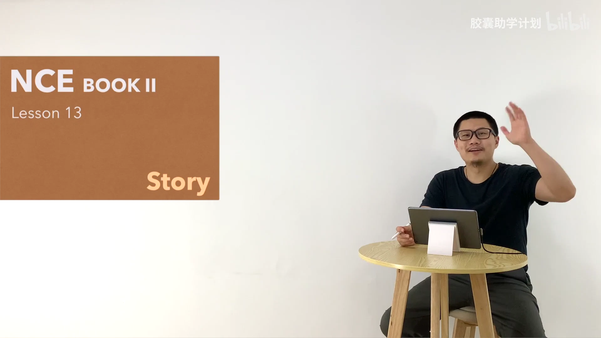

文字识别：胶囊助学计划 / NCE / BOOKⅡI / Lesson 13 / Story

### 画面 00:00:02

文字识别：胶囊助学计划 / NCE / BOOKⅡI / Lesson 13 / Story

### 画面 00:00:05

文字识别：胶囊助学计划 / NCE / BOOK"I / Lesson 13 / 一 / Story

### 画面 00:00:08

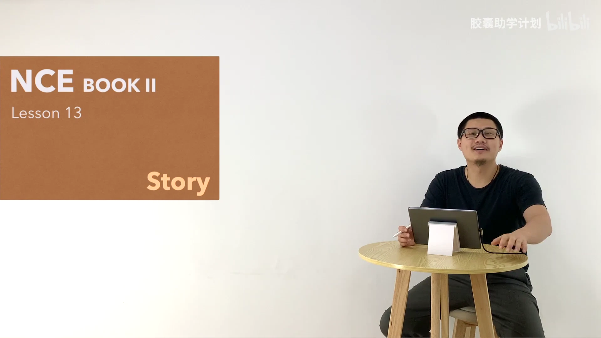

文字识别：胶囊助学计划 / NCE / BOOKⅡI / Lesson 13 / Story

### 画面 00:00:10

文字识别：胶囊助学计划bill

### 画面 00:00:13

文字识别：胶囊助学计划

### 画面 00:00:15

文字识别：胶囊助学计划 / The Greenwood Boys are a group of / pop singers. / At present,they are visiting all parts of / the country. / They will be arriving here tomorrow.

### 画面 00:00:17

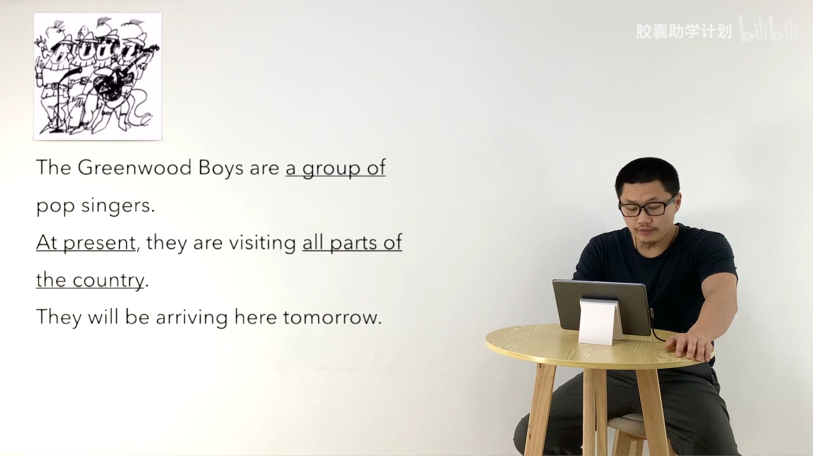

文字识别：胶囊助学计划 / The Greenwood Boys are a group of / pop singers. / At present,they are visiting all parts of / the country. / They will be arriving here tomorrow.

### 画面 00:00:23

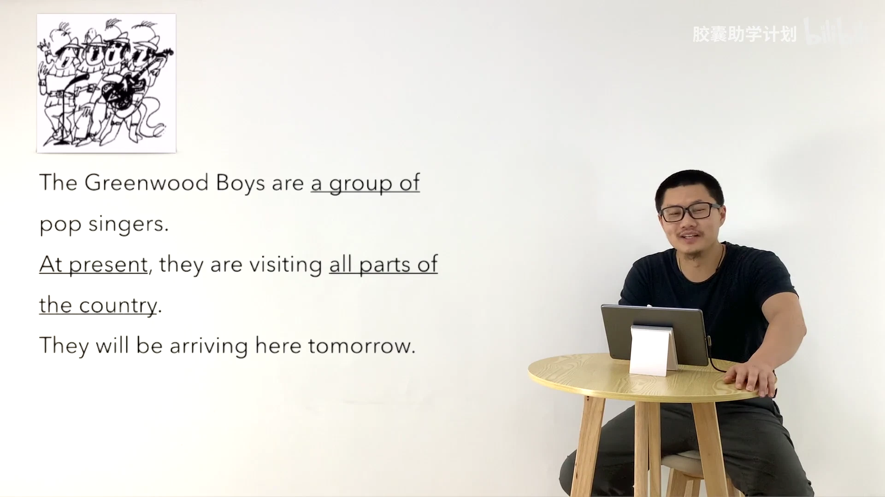

文字识别：胶囊助学计划 / The Greenwood Boys are a group of / pop singers. / At present,they are visiting all parts of / the country. / They will be arriving here tomorrow.

## 00:00:30–00:01:00

是吧？啊，这个小男孩们是吧？绿林少年啊，是什么呢？啊，这个为什么我这样翻译啊？因为它不是一个，比如说像Beatles啊，我们翻译成披头士啊，它是这个呃，在国内已经达成了一个统一的啊，这个就是大家公认的一种翻译方式。这个呢，就是他编出来的一个乐队啊，不是真正存在的啊。但是实际上，我总觉得这是一个Beatles是吧？好，是什么呢？Group of pop singers

### 画面 00:00:49

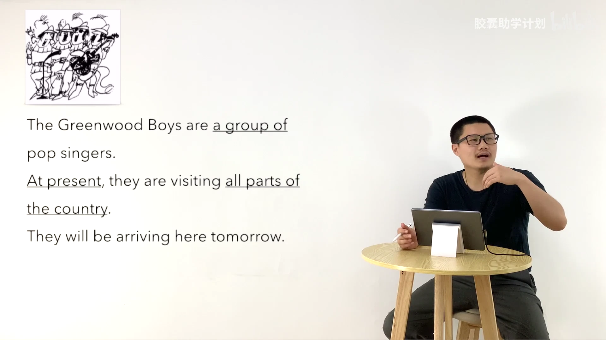

文字识别：胶囊助学计划 / The Greenwood Boys are a group of / pop singers. / At present,they are visiting all parts of / the country. / They will be arriving here tomorrow.

## 00:01:00–00:01:30

is a a group of. 我们在讲单词部分就学过了，是吧？是一组啊，这个流行歌手啊，是就其实那你说什么叫一组流行歌手？就是一个乐队嘛，你可以这样理解。At present，这个小的短语啊，两个单词组成的短语非常常见，就类似于 now at the moment，啊，就是现在啊。现在呢， they are visiting，他们正在啊拜访啊 visit，还有参观啊拜访是吧？那你说他们这个乐

### 画面 00:01:01

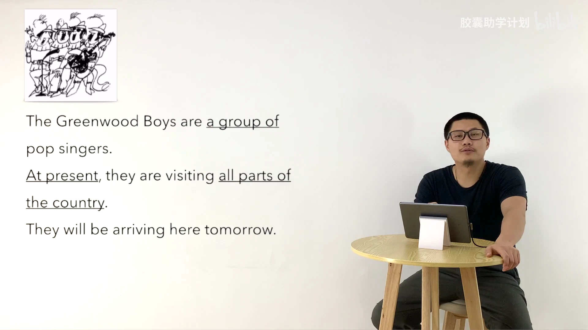

文字识别：胶囊助学计划 / The Greenwood Boys are a group of / pop singers. / At present,they are visiting all parts of / the country. / They will be arriving here tomorrow.

### 画面 00:01:16

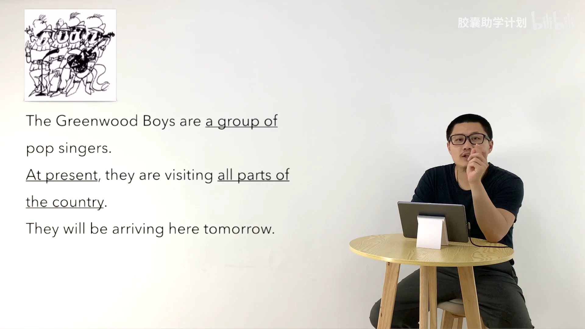

文字识别：胶囊助学计划 / The Greenwood Boys are a group of / pop singers. / At present,they are visiting all parts of / the country. / They will be arriving here tomorrow.

### 画面 00:01:29

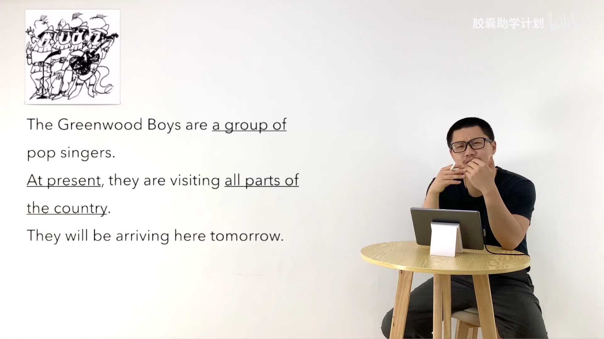

文字识别：胶囊助学计划 / The Greenwood Boys are a group of / pop singers. / At present,they are visiting all parts of / the country. / They will be arriving here tomorrow.

## 00:01:30–00:02:00

队正在拜访，不知道什么意思。我们往后看啊，all parts of the country啊，我把它当习惯用法了。但我们不当习惯用法，其实就是一个A of B结构。早在新概念一册二十五课我们就学过了。由后往前翻译，这个国家的所有的部分啊，其实翻译成汉语舒服一点叫全国各地啊。他们现在他们正在拜访全国各地。你要再结合他们是一个乐队，那你说什么叫拜访全

### 画面 00:01:33

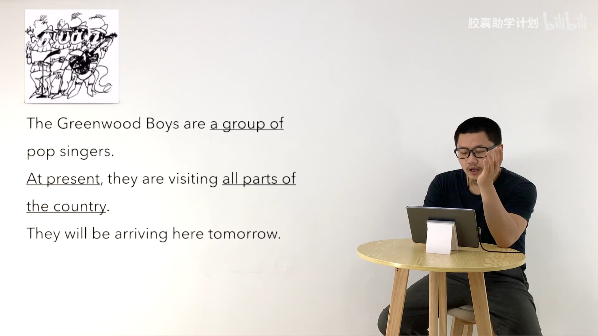

文字识别：胶囊助学计划 / The Greenwood Boys are a group of / pop singers. / At present,they are visiting all parts of / the country. / They will be arriving here tomorrow.

### 画面 00:01:52

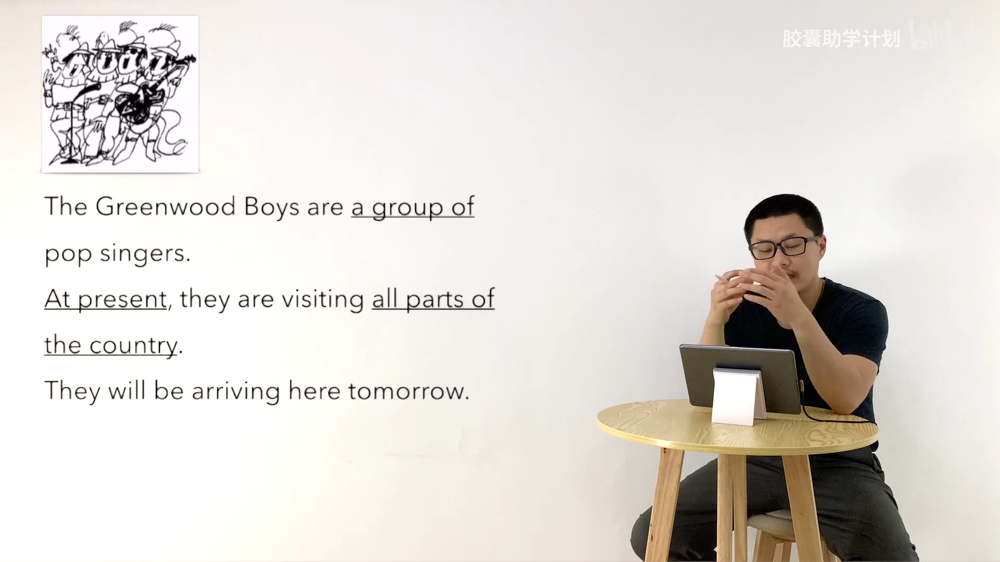

文字识别：胶囊助学计划 / The Greenwood Boys are a group of / pop singers. / At present, they are visiting all parts of / the country. / They will be arriving here tomorrow.

## 00:02:00–00:02:30

国各地？这儿的 visiting 翻译成拜访就明显不舒服了，对吧？参观全国各地明显就不舒服了。他们就是全国巡演吧，对吧？翻译成汉语就很舒服了。所以你看，巡演您现在不会表达，但是你知道 visiting all parts of the country，如果再加上主语是乐队，那就可以翻译成巡演了，对不对？They will be arriving here tomorrow. 哎，这是他们的一个计划打算。Will be doing 啊，他们将到达这

### 画面 00:02:19

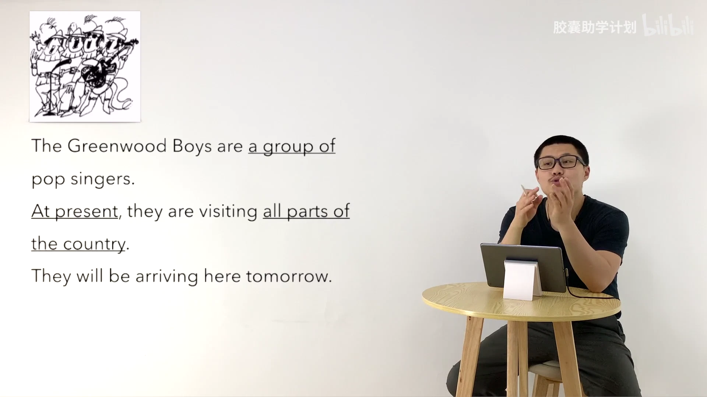

文字识别：胶囊助学计划 / The Greenwood Boys are a group of / pop singers. / At present,they are visiting all parts of / the country. / They will be arriving here tomorrow.

## 00:02:30–00:03:00

这里。明天，OK。目前都还很简单，不多说，接着往下走。They will be coming by train.说他们呀将怎么样呢？Coming，他们将来 by train，啊，坐火车来。And以及呢，接下来看这个不同的地方啊。Most of the young people in the town.好，我们先不往后看了。Most of叫大多数，young people年轻人in the

### 画面 00:02:32

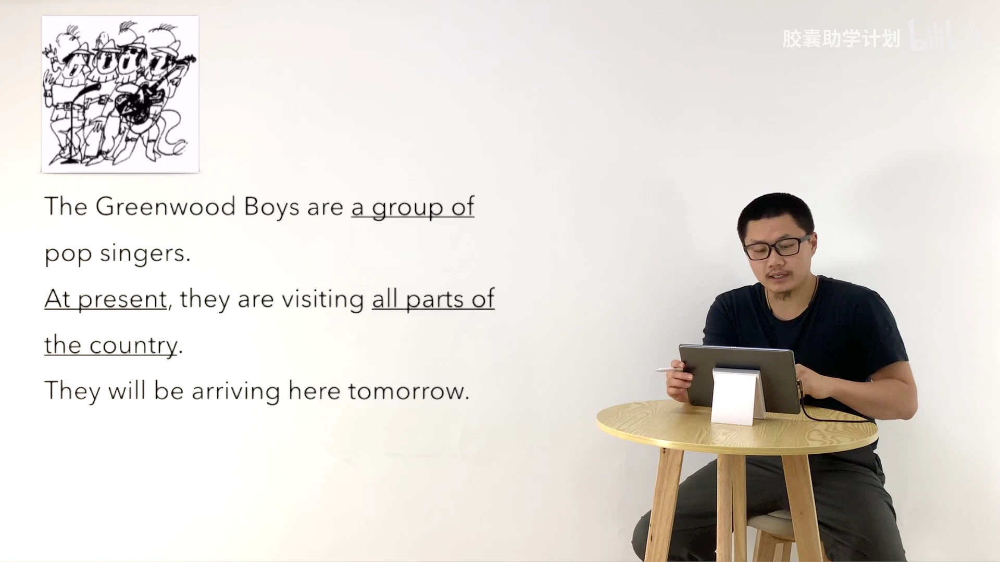

文字识别：胶囊助学计划 / The Greenwood Boys are a group of / pop singers. / At present,they are visiting all parts of / the country. / They will be arriving here tomorrow.

### 画面 00:02:34

文字识别：胶囊助学计划 / They will be coming by train and most of the / young people in the town will be meeting them at / the station. / Tomorrow evening they will be singing at the / Workers'Club. / The Greenwood Boys wil be staying for five days.

## 00:03:00–00:03:30

town，叫做在这个小镇上的。注意啊，它的核心词只有一个，就是我标蓝的这个名词啊，叫做人，对吧？好，你看啊，如果我们把它去掉，把黄字部分全部去掉，不管它是形容还是限定词，全部给它去掉，就变成了 people will be meeting them at the station. Will be meeting 将去见他们，对吧？就是将去迎接他们 at the station 在这个火车站啊，因为说了嘛，

### 画面 00:03:04

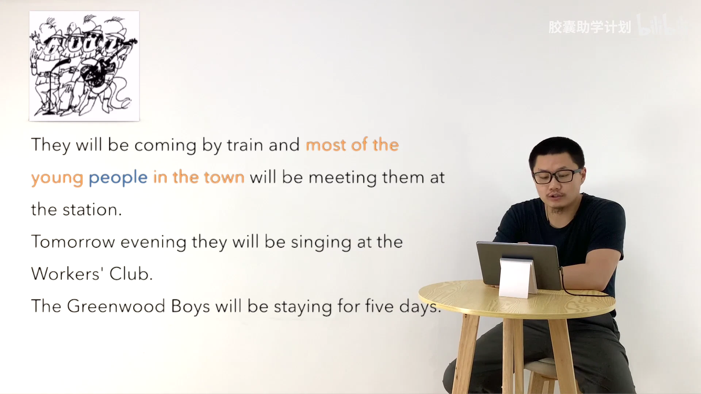

文字识别：胶囊助学计划 / They will be coming by train and most of the / young people in the town will be meeting them at / the station. / Tomorrow evening they will be singing at the / Workers'Club. / The Greenwood Boys will be staying for five days.

## 00:03:30–00:04:00

by train，对吧？人将去火车站见他们。你看，这个人是没有限定语的，是全世界人吗？还是全城市的人？还是什么样的人，对吧？你想，他们是流行乐队的歌手。好，那大多数可能跟young联系就比较紧密了，对吧？而不是跟old这个单词。所以呢，一个young，哎，比如说全世界六十亿人，对吧？Young啊，我们假设有三十亿，那就可能一个young就三十，另外三十亿就

### 画面 00:03:34

文字识别：胶囊助学计划 / They will be coming by train and most of the / young people in the town will be meeting them at / the station. / Tomorrow evening they will be singing at the / Workers'Club. / The Greenwood Boys will be staying for five days.

## 00:04:00–00:04:30

不算了。再然后又加了一个 in the town 啊，这个小镇，这个世界上假设有一万个小镇，那只有这一个小镇上的年轻人，对吧？又加了一个，也不是所有年轻人，叫做 most of，大多数的这个小镇上的年轻人。各位可以看到了吧？我们汉语是这样翻译的，人是放到最后面的核心词，而英语呢有前有后，这个是我们从二十八课、二十九课、三十课啊开始学到的一个非常重要的语法。比如说这个

### 画面 00:04:04

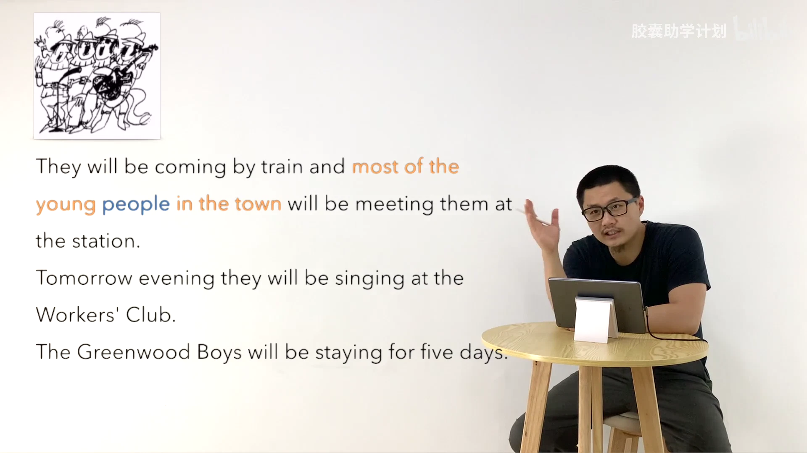

文字识别：胶囊助学计划 / They will be coming by train and most of the / young people in the town will be meeting them at / the station. / Tomorrow evening they will be singing at the / Workers'Club. / The Greenwood Boys will be staying for five days.

## 00:04:30–00:05:00

就是一个介词引导的小短语后置了，去做一个定语限定这个 people 什么地方的人的小镇里边的人。 OK，好，当然这是有一点点超纲的小知识点啊。在火车站去见他们。 Tomorrow evening 明儿晚，明天晚上。 They will be singing 他们将会唱歌。在哪儿呢？ At the workers' club 啊，就是一个地方。什么地方呢？ Workers' club worker 叫做工人， club 叫俱乐部

### 画面 00:04:34

文字识别：胶囊助学计划 / They will be coming by train and most of the / young people in the town will be meeting them at / the station. / Tomorrow evening they will be singing at the / Workers'Club. / The Greenwood Boys will be staying for five days.

## 00:05:00–00:05:30

啊，工体是吧？来北京工体了，不是啊，工人俱乐部啊。The Greenwood Boys 啊，就是这个绿林少年呢，will be staying。他们有一个计划，将停留，停留多长时间呢？For five days，他们将停留五天的时间。这儿我提出一个小的问题，对，For five days 用特殊疑问词用谁提问？各位自己去想一下。如果您忘了的话，回顾一下新概念一册八十九课

### 画面 00:05:03

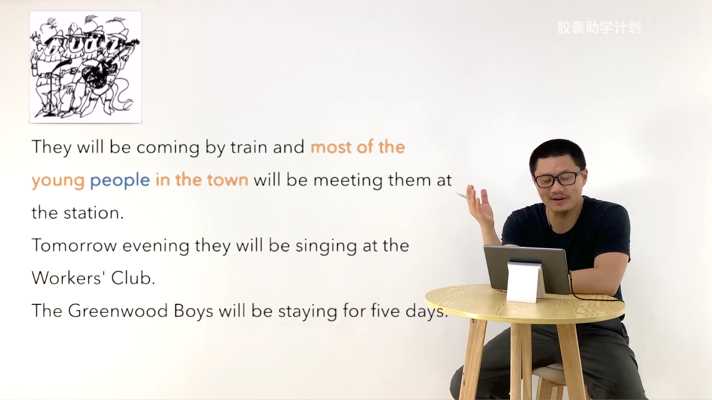

文字识别：They will be coming by train and most of the / young people in the town will be meeting them at / the station. / Tomorrow evening they will be singing at the / Workers'Club. / The Greenwood Boys wil be staying for five days.

### 画面 00:05:06

文字识别：胶囊助学计划 / They will be coming by train and most of the / young people in the town will be meeting them at / the station. / Tomorrow evening they will be singing at the / Workers'Club. / The Greenwood Boys will be staying for five days.

### 画面 00:05:15

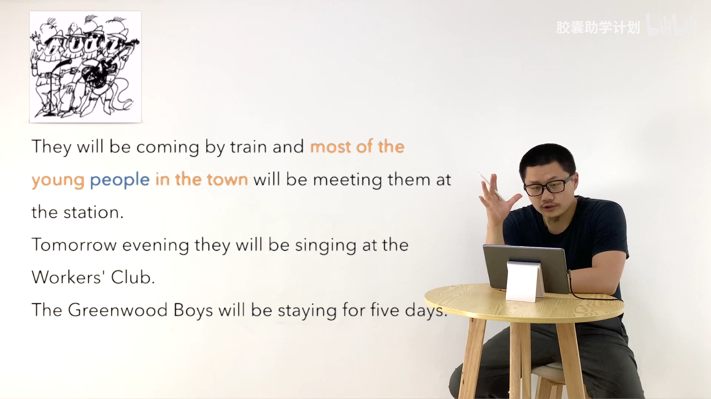

文字识别：胶囊助学计划 / They will be coming by train and most of the / young people in the town will be meeting them at / the station. / Tomorrow evening they will be singing at the / Workers'Club. / The Greenwood Boys will be staying for five days.

### 画面 00:05:18

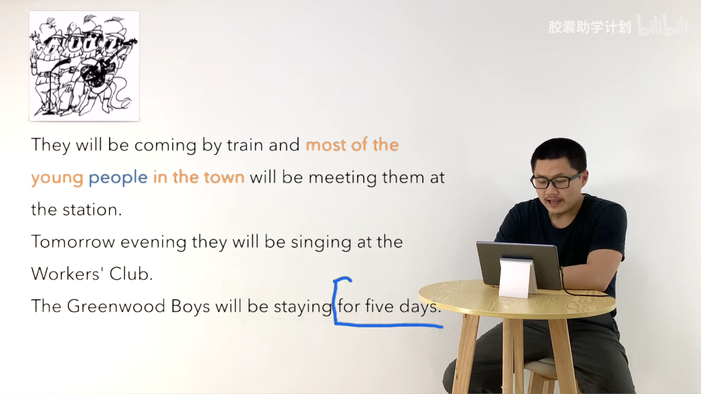

文字识别：胶囊助学计划 / They will be coming by train and most of the / young people in the town will be meeting them at / the station. / Tomorrow evening they will be singing at the / Workers'Club. / The Greenwood Boys will be stayingf / for five days.

### 画面 00:05:21

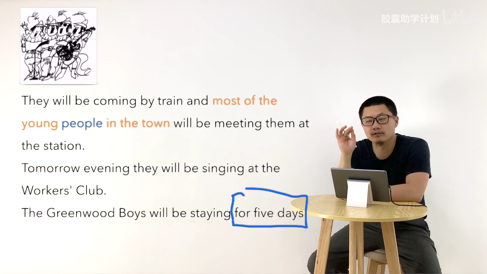

文字识别：胶囊助学计划 / They will be coming by train and most of the / young people in the town will be meeting them at / the station. / Tomorrow evening they will be singing at the / Workers'Club. / The Greenwood Boys will be stayingfor five days

## 00:05:30–00:06:00

和新概念二册，我们讲现在完成时的时候是如何去讲的？尤其是现在完成时第二用法，从过去持续到现在，经常跟 since 跟 for 去连用的时候，我们用什么去对 for 加一段时间提问？好吧，好，接下来 during this time 在这个期间呢， they will 他们将 give five performances。这个我们讲单词的时候提到了，他们将哎举办五场演出 as usual。

### 画面 00:05:47

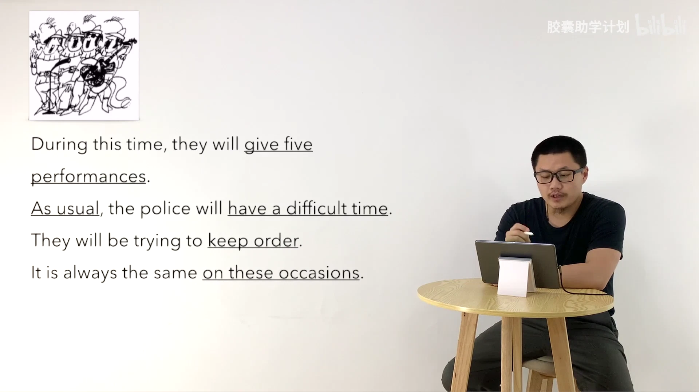

文字识别：胶囊助学计划 / During this time, they will give five / performances. / As usual, the police will have a difficult time. / They will be trying to keep order. / It is always the same on these occasions.

### 画面 00:05:52

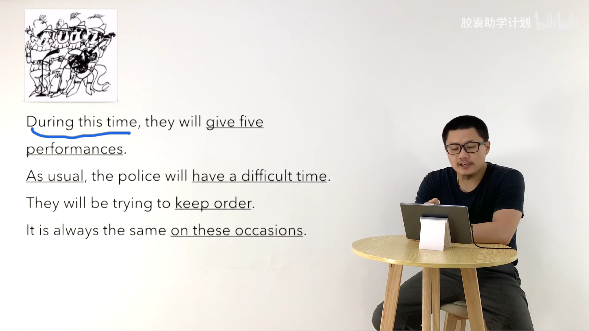

文字识别：胶囊助学计划 / During this time, they will give five / performances. / As usual, the police will have a difficult time. / They will be trying to keep order. / It is always the same on these occasions.

### 画面 00:05:54

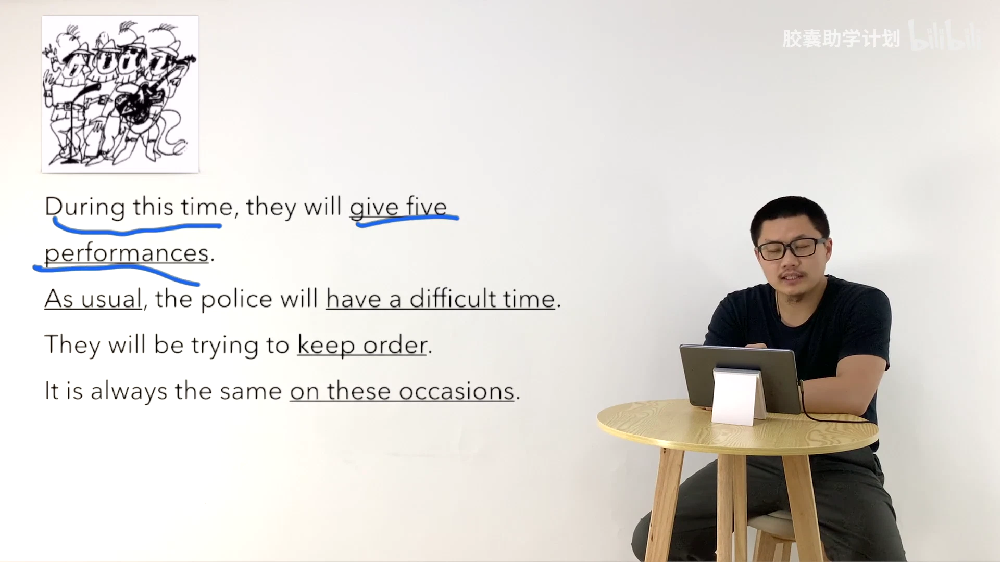

文字识别：胶囊助学计划 / During this time, they will give five_ / performances. / As usual, the police will have a difficult time. / They will be trying to keep order. / It is always the same on these occasions.

### 画面 00:05:59

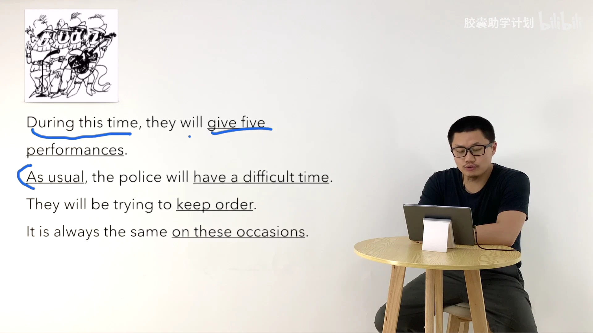

文字识别：胶囊助学计划 / During this time, they will give five / performances. / As usual, the police will have a difficult time. / They will be trying to keep order. / It is always the same on these occasions.

## 00:06:00–00:06:30

好，这是一个很小的短语，叫像往常一样啊，和通常的状态下是一样的。 The plays will have a difficult time. 说将有一个特别困难的一段时间或者时光啊。 Have a difficult time 就是一个小的短语啊。 那你这个自己去脑补一下就行了，对吧？这个摇滚乐队是吧来了，然后都是年轻人，充满了荷尔蒙是吧？可能就会出现一些小的问题，什么打个架呀，砸个东西啊，对吧？或者

### 画面 00:06:01

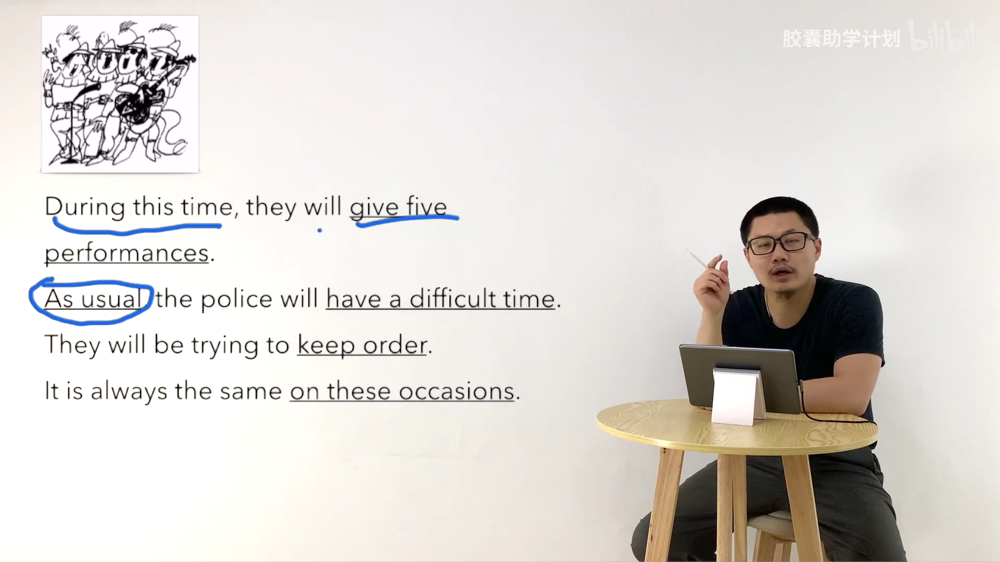

文字识别：胶囊助学计划 / During this time, they will give five / performances. / As usualt / Dthe police will have a difficult time. / They will be trying to keep order. / It is always the same on these occasions.

## 00:06:30–00:07:00

当然了，这不是一定的，对吧？但是要维持秩序，人也很多嘛，对不对？They will be trying to.好了，他们将尝试着 try to do something.之前我们就学过了，在这不做多提了啊。他们将尝试着去 keep order.小的短语，保持秩序，keep保持 order秩序，keep order保持秩序啊。It is always the same.说这个呀，总是一样的。字面意思就可以理解了。最后有一个小的短语 on

### 画面 00:06:31

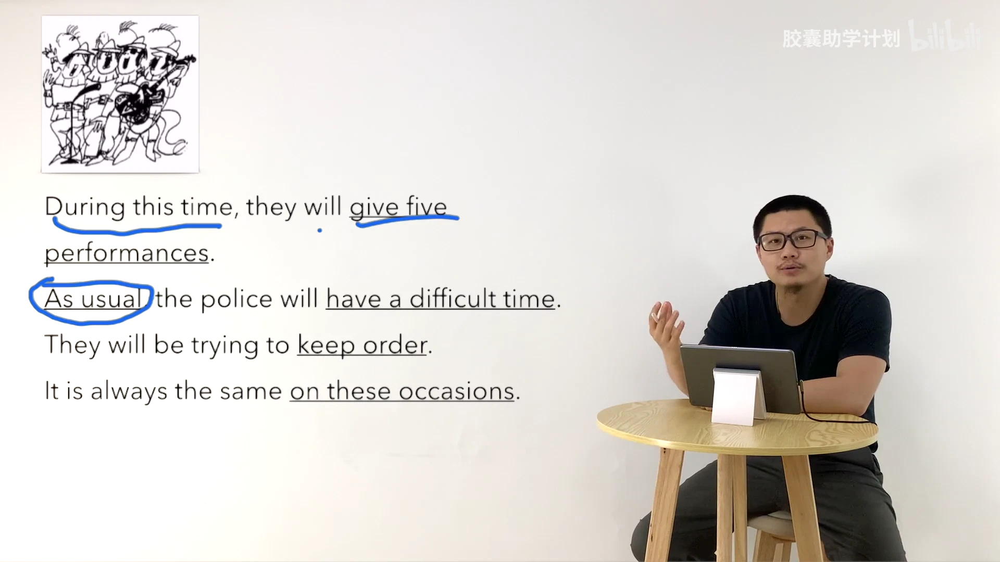

文字识别：胶囊助学计划 / During this time, they will give five / performances. / As usualt / the police will have a difficult time. / They will be trying to keep order. / It is always the same on these occasions.

### 画面 00:06:46

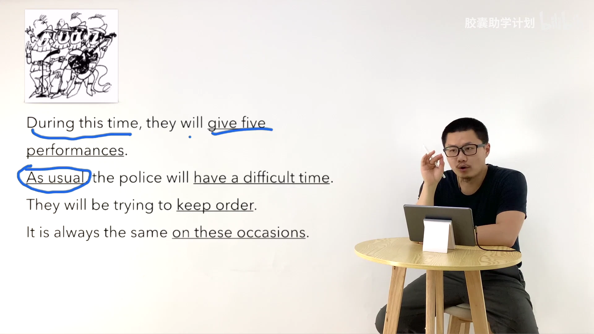

文字识别：胶囊助学计划 / During this time, they will give five / performances. / As usual / Dthe police will have a difficult time. / They will be trying to keep order. / It is always the same on these occasions.

### 画面 00:06:52

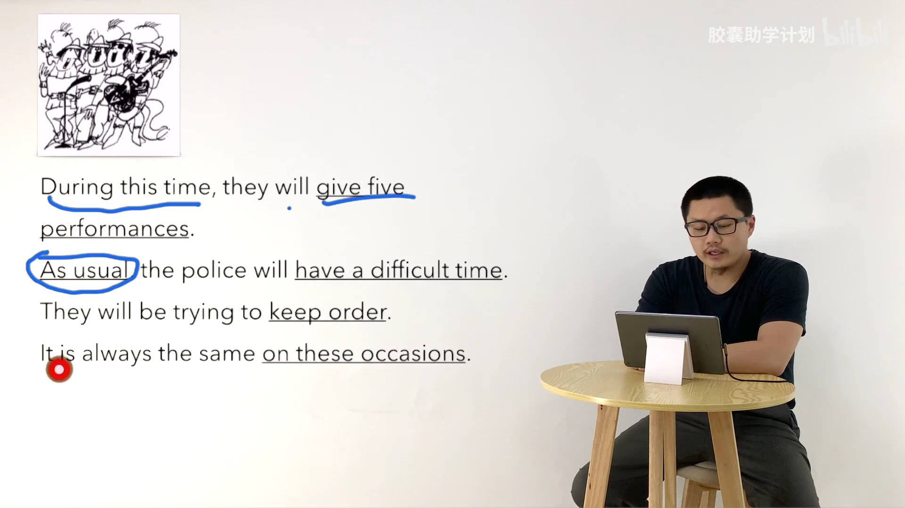

文字识别：胶囊助学计划 / During this time, they will give five / performances. / As usualt / Dthe police will have a difficult time. / They will be trying to keep order. / Itis always the same on these occasions.

## 00:07:00–00:07:30

on these occasions，跟我们单词部分讲的是一样的，在这样一些场合之下，他们总是一样的。哪些场合呢？就是上面这句话啊，他们举办无偿演出，然后呢，警察会比较的有一个有一段维持，他们需要维持秩序，然后他们将度过一段比较困难的时光，对吧？在这种情况下，总是一样的。OK，这些事情。然后一个，接下来我们就把本课的习惯用法

### 画面 00:07:08

文字识别：交囊 / 计划 / During this time, they will give five_ / performances. / As usual / the police will have a difficult time. / They will be trying to keep order. / It is always the same on these occasions.

### 画面 00:07:10

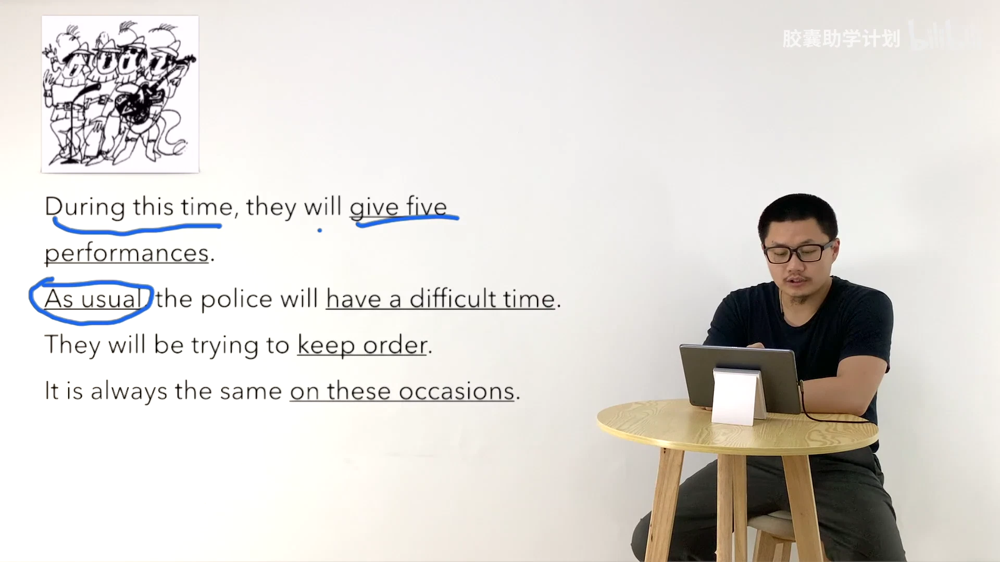

文字识别：胶囊助学计划 / During this time, they will give five / performances. / As usual / Dthe police will have a difficult time. / They will be trying to keep order. / It is always the same on these occasions.

### 画面 00:07:26

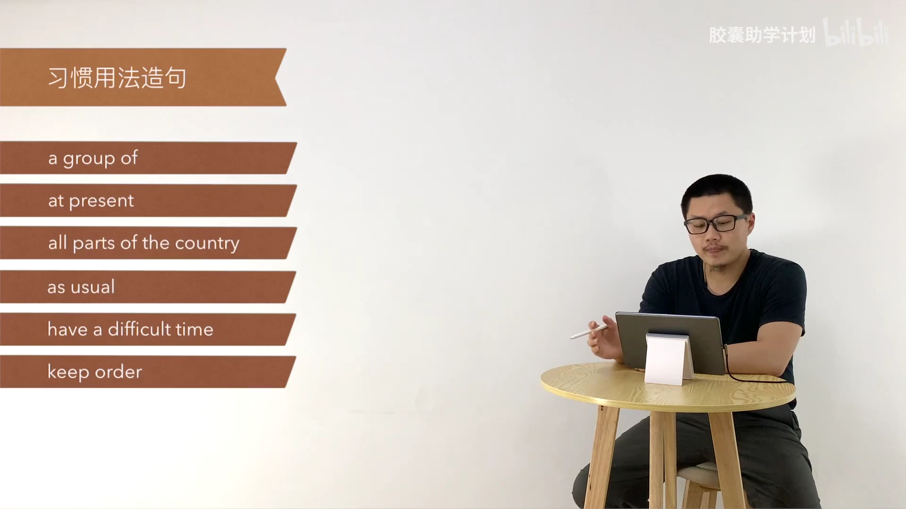

文字识别：胶囊助学计划 / 习惯用法造句 / a group of / at present / all parts of the country / as usual / have a difficult time / keep order

### 画面 00:07:28

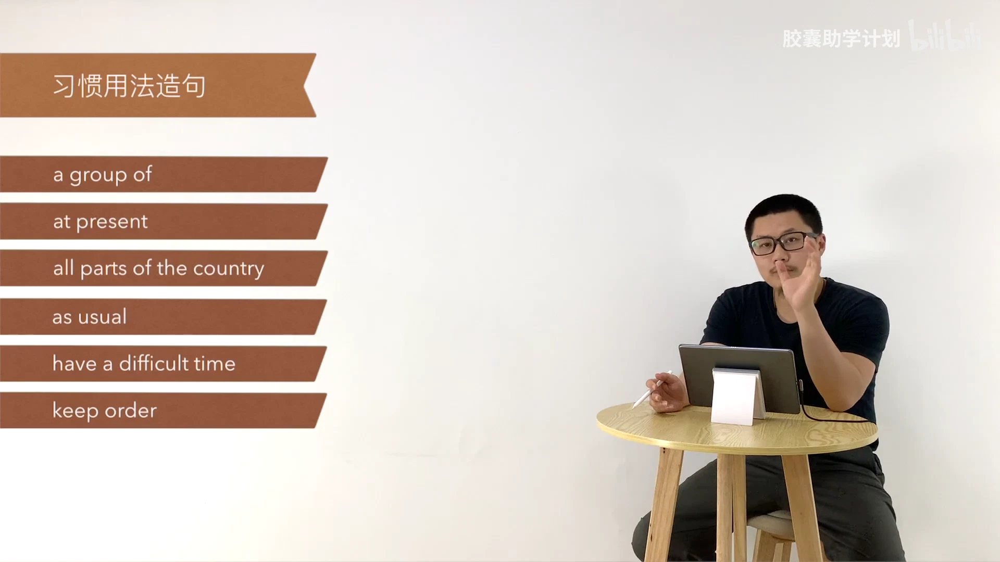

文字识别：胶囊助学计划 / 习惯用法造句 / a group of / at present / all parts of the country / as usual / have a difficult time / keep order

## 00:07:30–00:08:00

拉出来给大家去造句了啊，来了。第一个 a group of 单词部分我们讲过了，在这儿简单提一下就行了。比如说 a group of pop singers will be arriving here tomorrow. Will be doing 变个一般疑问句，will 提前，剩下照抄，对吧？然后再来几个不同的特殊疑问词，唯一需要注意的就是，当你对主语 a group of pop singers 提问的时候，任何特殊疑问词对主语提问的时候，怎么样？

### 画面 00:07:30

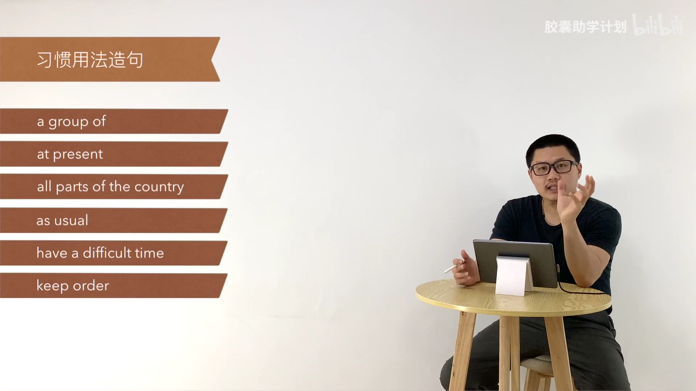

文字识别：胶囊助学计划 / 习惯用法造句 / a group of / at present / all parts of the country / as usual / have a difficult time / keep order

### 画面 00:07:32

文字识别：网：v.+v.变化 / 习惯用法造句指南 / 胶囊助学计划 / 四句型转换 / 方式/地点/时间 / 其他习惯用法 / 其他单词+词性 / 原文摘抄+变 / 6123456 / a group of

### 画面 00:07:34

文字识别：网：v.+v.变化 / 习惯用法造句指南 / 胶囊助学计划 / 四句型转换 / 方式/地点/时间 / 其他习惯用法 / 其他单词+词性 / 原文摘抄+变 / 6123456 / a group of

### 画面 00:07:36

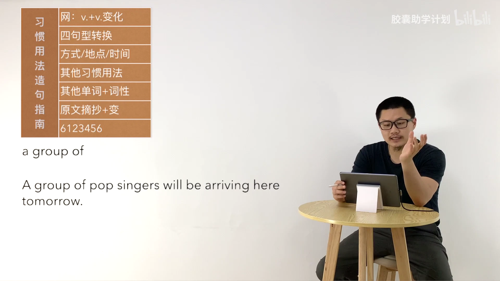

文字识别：习惯用法造句指南 / 网：v.+v.变化 / 胶囊助学计划 / 四句型转换 / 方式/地点/时间 / 其他习惯用法 / 其他单词+词性 / 原文摘抄+变 / 6123456 / a group of / A group of pop singers will be arriving # / here / tomorrow.

### 画面 00:07:39

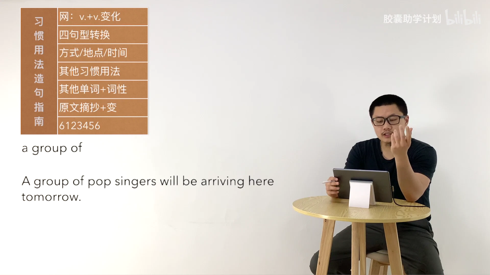

文字识别：习惯用法造句指南 / 网：v.+v.变化 / 胶囊助学计划 / 四句型转换 / 方式/地点/时间 / 其他习惯用法 / 其他单词+词性 / 原文摘抄+变 / 6123456 / a group of / A group of pop singers will be arriving here / tomorrow.

### 画面 00:07:41

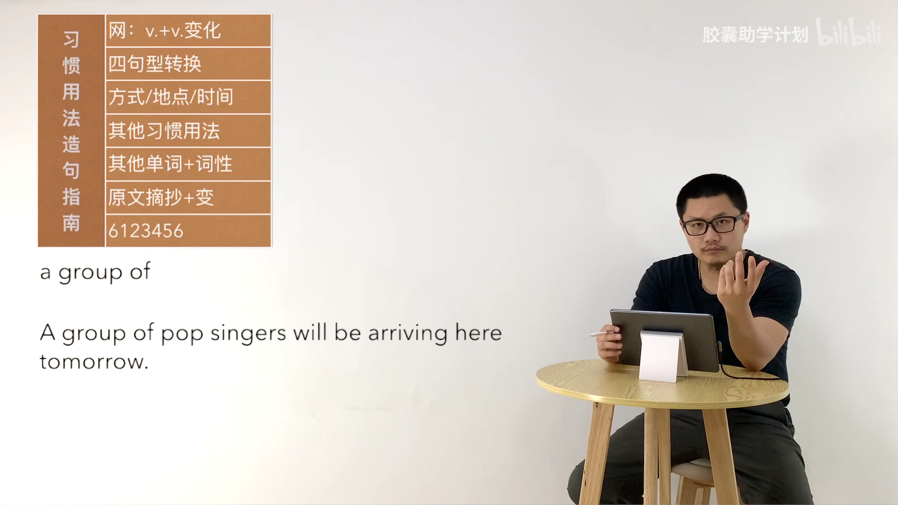

文字识别：习惯用法造句指南 / 网：v.+v.变化 / 胶囊助学计划 / 四句型转换 / 方式/地点/时间 / 其他习惯用法 / 其他单词+词性 / 原文摘抄+变 / 6123456 / a group of / A group of pop singers will be arriving here / tomorrow.

### 画面 00:07:44

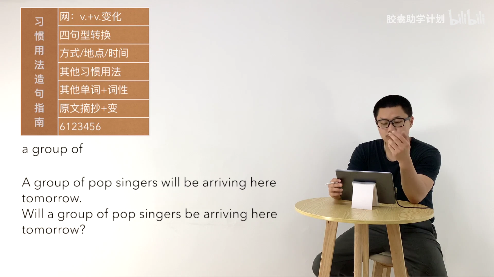

文字识别：网：v.+v.变化 / 习惯用法造句指南 / 胶囊助学计划 / 四句型转换 / 方式/地点/时间 / 其他习惯用法 / 其他单词+词性 / 原文摘抄+变 / 6123456 / a group of / A group of pop singers will be arriving / here / tomorrow. / Will a group of pop singers be arriving here / tomorrow?

### 画面 00:07:46

文字识别：网：v.+v.变化 / 习惯用法造句指南 / 胶囊助学计划 / 四句型转换 / 方式/地点/时间 / 其他习惯用法 / 其他单词+词性 / 原文摘抄+变 / 6123456 / a group of / A group of pop singers will be arriving here / tomorrow. / Will a group of pop singers be arriving here / tomorrow?

### 画面 00:07:48

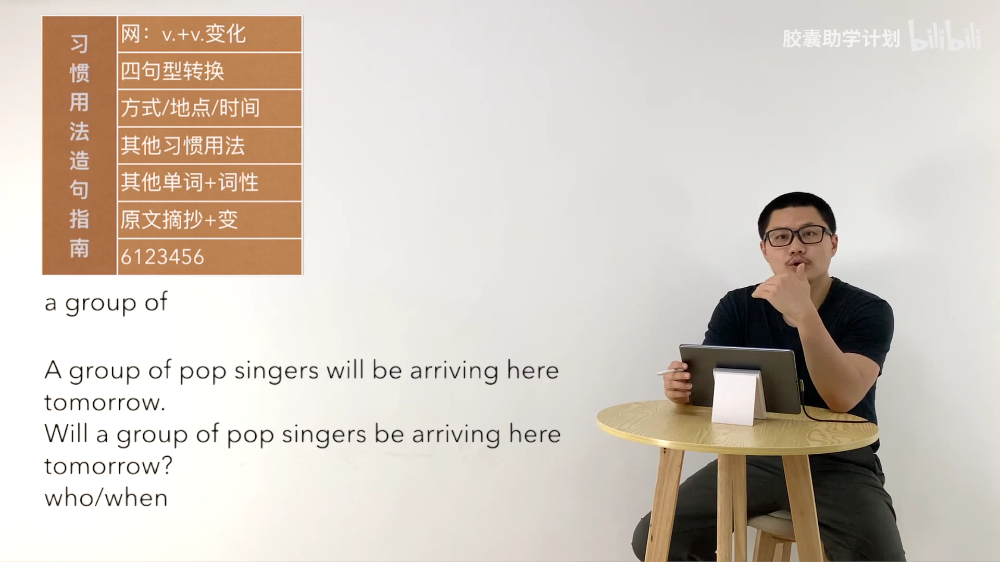

文字识别：习惯用法造句指南 / 网：v.+v.变化 / 胶囊助学计划 / 四句型转换 / 方式/地点/时间 / 其他习惯用法 / 其他单词+词性 / 原文摘抄+变 / 6123456 / a group of / A group of pop singers will be arriving here / tomorrow. / Will a group of pop singers be arriving here / tomorrow? / who/when

### 画面 00:07:50

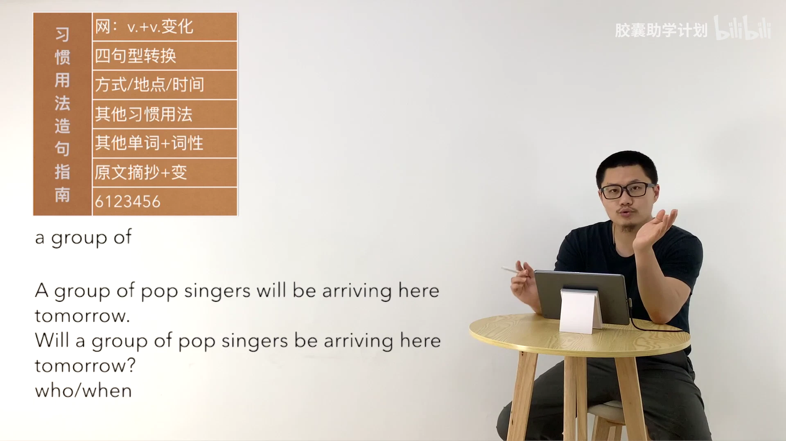

文字识别：习惯用法造句指南 / 网：v.+v.变化 / 胶囊助学计划 / 四句型转换 / 方式/地点/时间 / 其他习惯用法 / 其他单词+词性 / 原文摘抄+变 / 6123456 / a group of / A group of pop singers will be arriving here / tomorrow. / Will a group of pop singers be arriving here / tomorrow? / who/when

### 画面 00:07:54

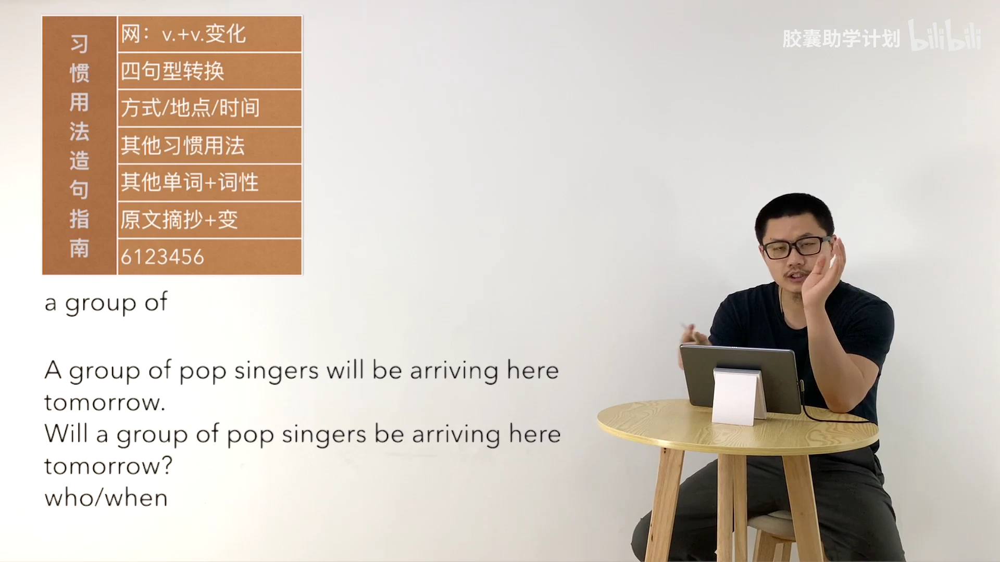

文字识别：习惯用法造句指南 / 网：v.+v.变化 / 胶囊助学计划 / 四句型转换 / 方式/地点/时间 / 其他习惯用法 / 其他单词+词性 / 原文摘抄+变 / 6123456 / a group of / A group of pop singers will be arriving H / here / tomorrow. / Will a group of pop singers be arriving here / tomorrow? / who/when

### 画面 00:07:56

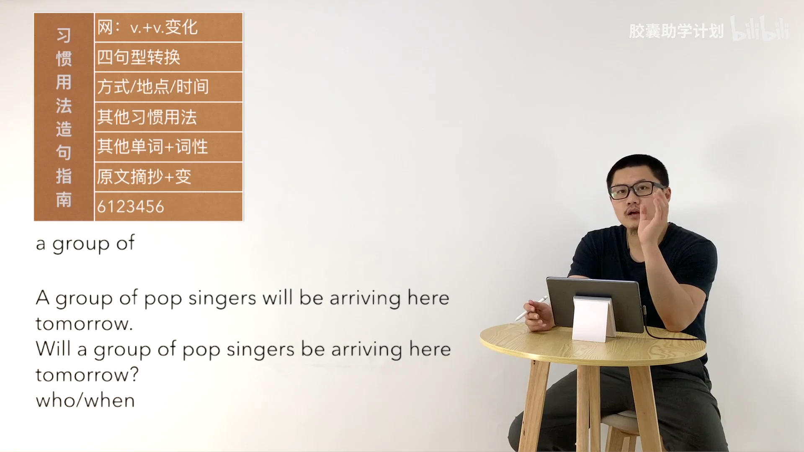

文字识别：网：v.+v.变化 / 习惯用法造句指南 / 胶囊助学计划 / 四句型转换 / 方式/地点/时间 / 其他习惯用法 / 其他单词+词性 / 原文摘抄+变 / 6123456 / a group of / A group of pop singers will be arriving H / here / tomorrow. / Will a group of pop singers be arriving here / tomorrow? / who/when

### 画面 00:07:59

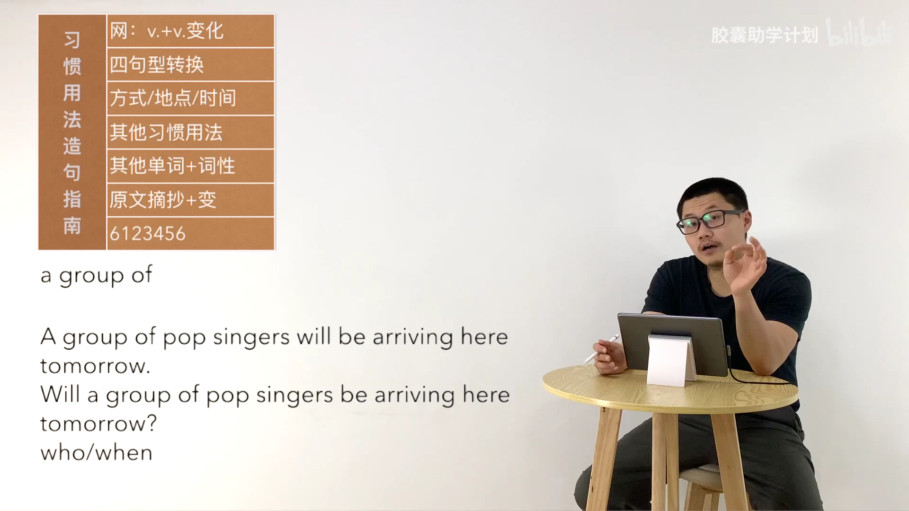

文字识别：网：v.+v.变化 / 习惯用法造句指南 / 胶囊助学计划 / 四句型转换 / 方式/地点/时间 / 其他习惯用法 / 其他单词+词性 / 原文摘抄+变 / 6123456 / a group of / A group of pop singers will be arriving here / tomorrow. / Will a group of pop singers be arriving here / tomorrow? / who/when

## 00:08:00–00:08:30

想一下那个事儿？不用变一般疑问句了，对吧？就这么简单啊。好，at present，它表示的是 now at the moment。我已经告诉各位它的含义了。那您现在立刻要想的是六一二三四五六当中，它它它做什么？做时间做六，对吧？那它往往跟什么时态连起来？往往可能是跟现在进行时这个时态连起来的，对吧？所以你看，你参考了，思考了一下这个地方，对吧？思考了一下这个地

### 画面 00:08:02

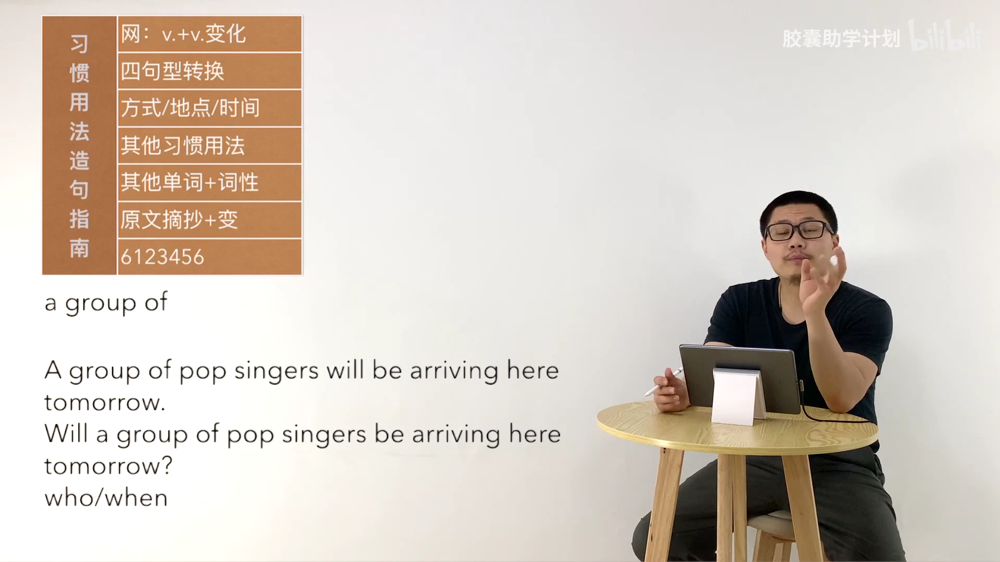

文字识别：网：v.+v.变化 / 习惯用法造句指南 / 胶囊助学计划 / 四句型转换 / 方式/地点/时间 / 其他习惯用法 / 其他单词+词性 / 原文摘抄+变 / 6123456 / a group of / A group of pop singers will be arriving here / tomorrow. / Will a group of pop singers be arriving here / tomorrow? / who/when

### 画面 00:08:04

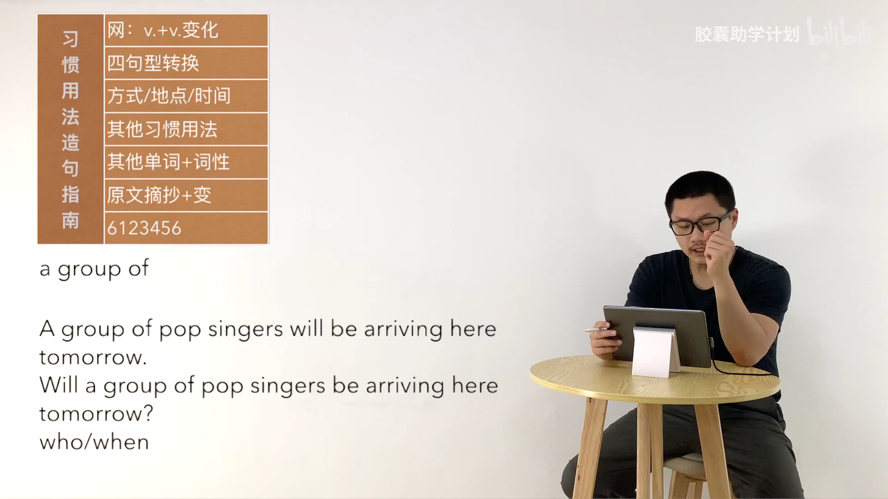

文字识别：网：v.+v.变化 / 习惯用法造句指南 / 胶囊助学计划 / 四句型转换 / 方式/地点/时间 / 其他习惯用法 / 其他单词+词性 / 原文摘抄+变 / 6123456 / a group of / A group of pop singers will be arriving h / here / tomorrow. / Will a group of pop singers be arriving here / tomorrow? / who/when

### 画面 00:08:06

文字识别：习惯用法造句指南 / 网：v.+v.变化 / 胶囊助学计划 / 四句型转换 / 方式/地点/时间 / 其他习惯用法 / 其他单词+词性 / 原文摘抄+变 / 6123456 / at present

### 画面 00:08:08

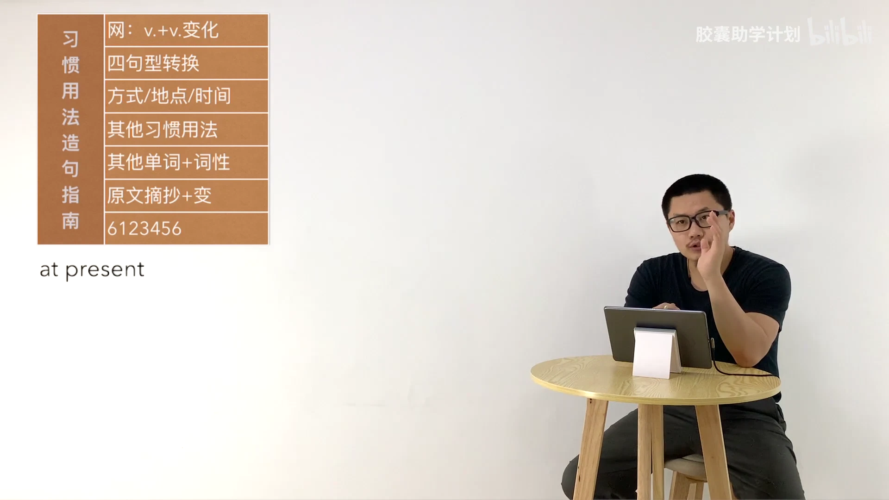

文字识别：习惯用法造句指南 / 网：v.+v.变化 / 胶囊助学计划 / 四句型转换 / 方式/地点/时间 / 其他习惯用法 / 其他单词+词性 / 原文摘抄+变 / 6123456 / at present

### 画面 00:08:10

文字识别：习惯用法造句指南 / 网：v.+v.变化 / 胶囊助学计划 / 四句型转换 / 方式/地点/时间 / 其他习惯用法 / 其他单词+词性 / 原文摘抄+变 / 6123456 / at present

### 画面 00:08:13

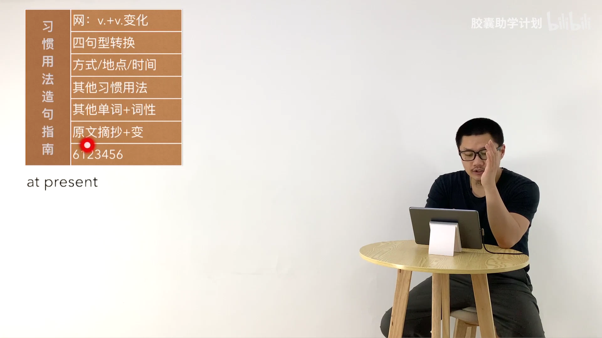

文字识别：网：v.+v.变化 / 习惯用法造句指南 / 胶囊助学计划 / 四句型转换 / 方式/地点/时间 / 其他习惯用法 / 其他单词+词性 / 原文摘抄+变 / 6123456 / at present

### 画面 00:08:15

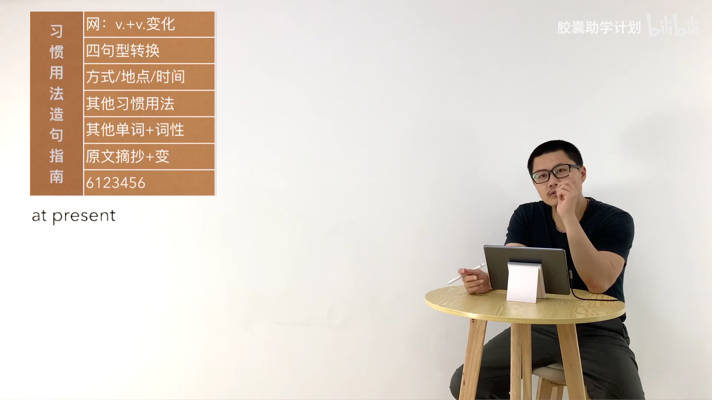

文字识别：网：v.+v.变化 / 习惯用法造句指南 / 胶囊助学计划 / 四句型转换 / 方式/地点/时间 / 其他习惯用法 / 其他单词+词性 / 原文摘抄+变 / 6123456 / at present

### 画面 00:08:17

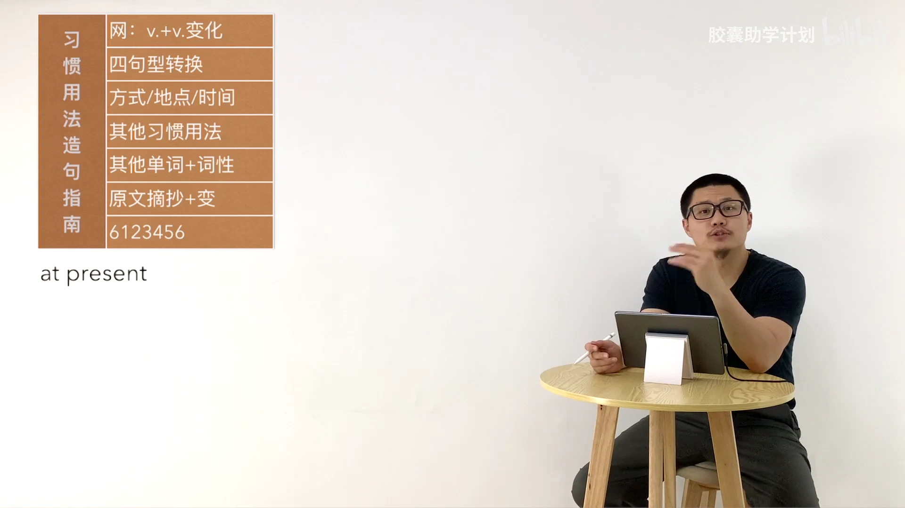

文字识别：习惯用法造句指南 / 网：v.+v.变化 / 胶囊助学计划 / 四句型转换 / 方式/地点/时间 / 其他习惯用法 / 其他单词+词性 / 原文摘抄+变 / 6123456 / at present

### 画面 00:08:19

文字识别：习惯用法造句指南 / 网：v.+v.变化 / 胶囊助学计划 / 四句型转换 / 方式/地点/时间 / 其他习惯用法 / 其他单词+词性 / 原文摘抄+变 / 6123456 / at present

### 画面 00:08:22

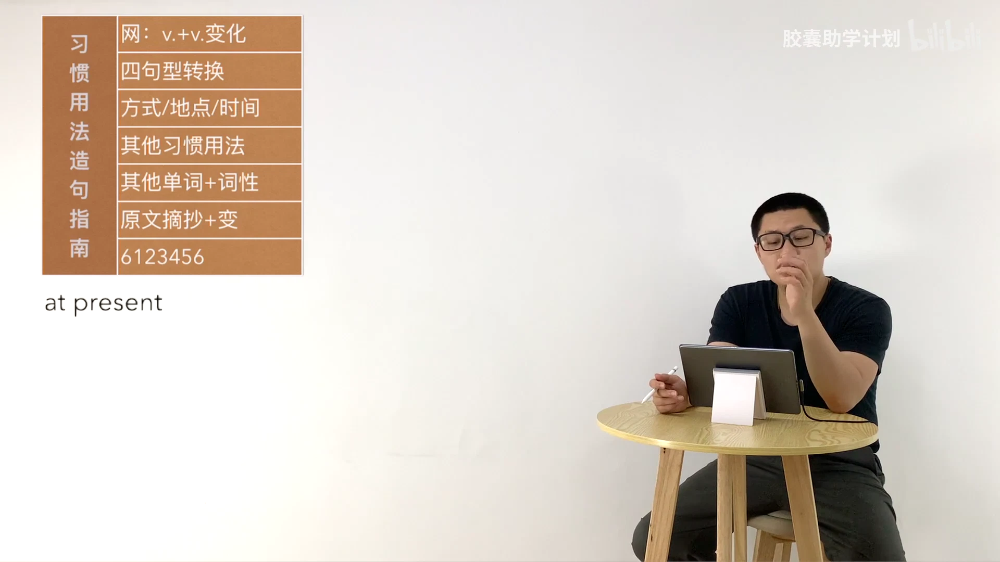

文字识别：习惯用法造句指南 / 网：v.+v.变化 / 胶囊助学计划 / 四句型转换 / 方式/地点/时间 / 其他习惯用法 / 其他单词+词性 / 原文摘抄+变 / 6123456 / at present

### 画面 00:08:24

文字识别：习惯用法造句指南 / 网：v.+v.变化 / 胶囊助学计划 / 四句型转换 / 方式/地点/时间 / 其他习惯用法 / 其他单词+词性 / 原文摘抄+变 / 6123456 / at present

### 画面 00:08:27

文字识别：网：v.+v.变化 / 习惯用法造句指南 / 胶囊助学计划 / 四句型转换 / 方式/地点/时间 / 其他习惯用法 / 其他单词+词性 / 原文摘抄+变 / 6123456 / at present

### 画面 00:08:29

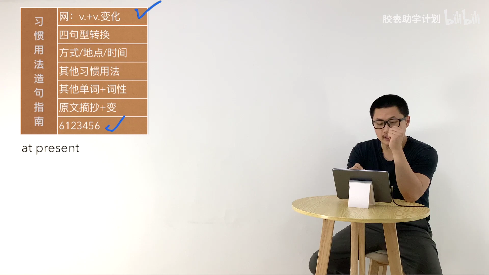

文字识别：网：v.+v.变化 / 习惯用法造句指南 / 胶囊助学计划 / 四句型转换 / 方式/地点/时间 / 其他习惯用法 / 其他单词+词性 / 原文摘抄+变 / 6123456 / at present

## 00:08:30–00:09:00

方。OK，那接下来我们来了。说At present, a large crowd of people is gathering in front of the theater. OK，第九课我们学的对吧？好，a large crowd of people.那is gathering表示的是现在正在进行。OK，接下来at present依旧是现在。Two detectives is keeping guard.啊，sorry，这个地方应该是are keeping guard at

### 画面 00:08:31

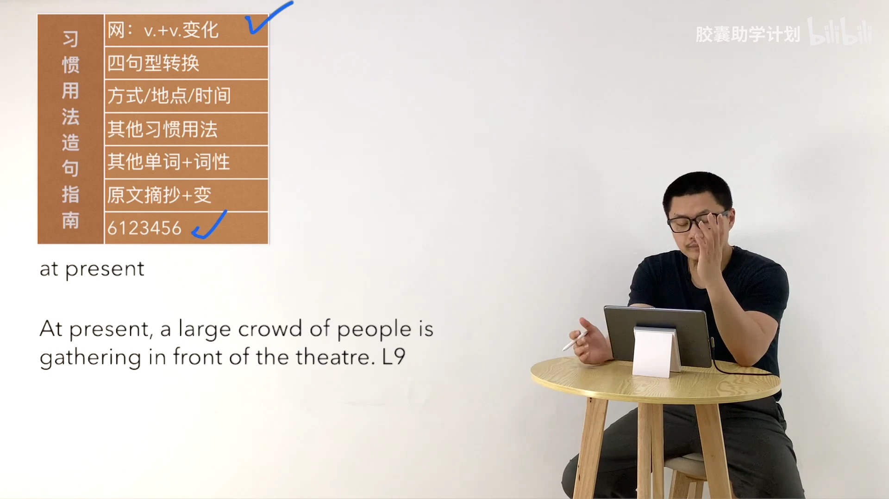

文字识别：习惯用法造句指南 / 网：v.+v.变化 / 胶囊助学计划 / 四句型转换 / 方式/地点/时间 / 其他习惯用法 / 其他单词+词性 / 原文摘抄+变 / 6123456 / at present / At present, a large crowd of people is / gathering in front of the theatre. L9

### 画面 00:08:33

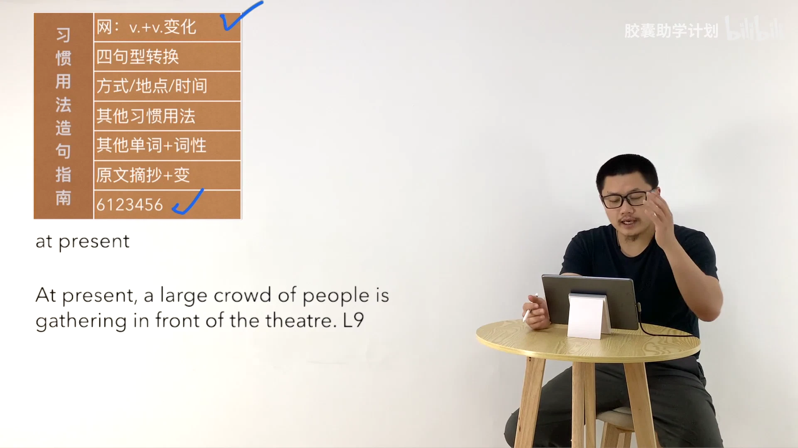

文字识别：网：v.+v.变化 / 习惯用法造句指南 / 胶囊助学计划 / 四句型转换 / 方式/地点/时间 / 其他习惯用法 / 其他单词+词性 / 原文摘抄+变 / 6123456 / at present / At present, a large crowd of people is / gathering in front of the theatre. L9

### 画面 00:08:35

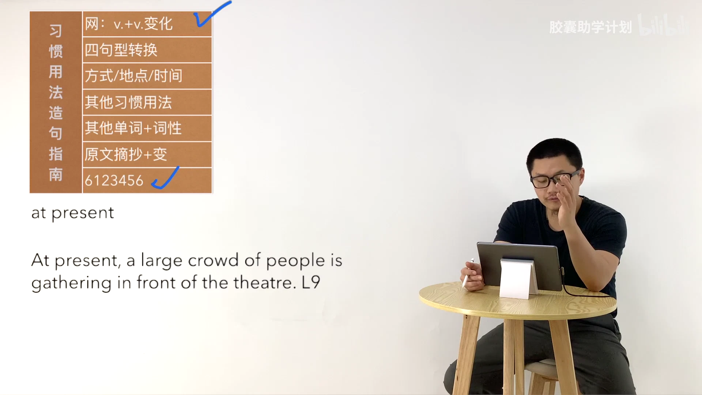

文字识别：网：v.+v.变化 / 习惯用法造句指南 / 胶囊助学计划 / 四句型转换 / 方式/地点/时间 / 其他习惯用法 / 其他单词+词性 / 原文摘抄+变 / 6123456 / at present / At present, a large crowd of people is / gathering in front of the theatre. L9

### 画面 00:08:37

文字识别：网：v.+v.变化 / 习惯用法造句指南 / 胶囊助学计划 / 四句型转换 / 方式/地点/时间 / 其他习惯用法 / 其他单词+词性 / 原文摘抄+变 / 6123456 / at present / At present, a large crowd of people is / gathering in front of the theatre. L9

### 画面 00:08:39

文字识别：网：v.+v.变化 / 习惯用法造句指南 / 胶囊助学计划 / 四句型转换 / 方式/地点/时间 / 其他习惯用法 / 其他单词+词性 / 原文摘抄+变 / 6123456 / at present / At present, a large crowd of people is / gathering in front of the theatre. L9

### 画面 00:08:41

文字识别：网：v.+v.变化 / 习惯用法造句指南 / 胶囊助学计划 / 四句型转换 / 方式/地点/时间 / 其他习惯用法 / 其他单词+词性 / 原文摘抄+变 / 6123456 / at present / At present, a large crowd of people is / gathering in front of the theatre. L9

### 画面 00:08:44

文字识别：网：v.+v.变化 / 习惯用法造句指南 / 胶囊助学计划 / 四句型转换 / 方式/地点/时间 / 其他习惯用法 / 其他单词+词性 / 原文摘抄+变 / 6123456 / at present / At present, a large crowd of people is / gathering in front of the theatre. L9

### 画面 00:08:46

文字识别：网：v.+v.变化 / 习惯用法造句指南 / 胶囊助学计划 / 四句型转换 / 方式/地点/时间 / 其他习惯用法 / 其他单词+词性 / 原文摘抄+变 / 6123456 / at present / At present, a large crowd of people is / gathering in front of the theatre. L9

### 画面 00:08:48

文字识别：习惯用法造句指南 / 网：v.+v.变化 / 胶囊助学计划 / 四句型转换 / 方式/地点/时间 / 其他习惯用法 / 其他单词+词性 / 原文摘抄+变 / 6123456 / at present / At present, a large crowd of people is / gatherina in front of the theatre. L9

### 画面 00:08:50

文字识别：网：v.+v.变化 / 习惯用法造句指南 / 胶囊助学计划 / 四句型转换 / 方式/地点/时间 / 其他习惯用法 / 其他单词+词性 / 原文摘抄+变 / 6123456 / at present / At present, a large crowd of people is / gatherina in front of the theatre. L9 / At present, two detectives is keeping guard / at the door. L7

### 画面 00:08:52

文字识别：习惯用法造句指南 / 网：v.+v.变化 / 胶囊助学计划 / 四句型转换 / 方式/地点/时间 / 其他习惯用法 / 其他单词+词性 / 原文摘抄+变 / 6123456 / at present / At present, a large crowd of people is / gatherina in front of the theatre. L9 / At present, two detectives is keeping guard / at the door. L7

### 画面 00:08:54

文字识别：网：v.+v.变化 / 习惯用法造句指南 / 胶囊助学计划 / 四句型转换 / 方式/地点/时间 / 其他习惯用法 / 其他单词+词性 / 原文摘抄+变 / 6123456 / at present / At present, a large crowd of people is / gatherina in front of the theatre. L9 / At present, two detectives is keeping guard / at the door.L7

### 画面 00:08:57

文字识别：网：v.+v.变化 / 习惯用法造句指南 / 胶囊助学计划 / 四句型转换 / 方式/地点/时间 / 其他习惯用法 / 其他单词+词性 / 原文摘抄+变 / 6123456 / at present / At present, a large crowd of people is / gatherina in front of the theatre. L9 / At present, two detectivesskeeping guard / at the door.L7

### 画面 00:08:59

文字识别：网：v.+v.变化 / 习惯用法造句指南 / 胶囊助学计划 / 四句型转换 / 方式/地点/时间 / 其他习惯用法 / 其他单词+词性 / 原文摘抄+变 / 6123456 / at present / At present, a large / crowd / I of people is / gatherinain / front of the / theatre. L9 / At present, two detectivesskeeping guard / at the door. L7 / are

## 00:09:00–00:09:30

the door. Ah, now,

### 画面 00:09:04

文字识别：网：v.+v.变化 / 习惯用法造句指南 / 胶囊助学计划 / 四句型转换 / 方式/地点/时间 / 其他习惯用法 / 其他单词+词性 / 原文摘抄+变 / 6123456 / at present / At present, a large crowd of people is / gatherinain front of the / theatre. L9 / At present, two detectivesskeeping guard / at the door. L7 / are

### 画面 00:09:06

文字识别：网：v.+v.变化 / 习惯用法造句指南 / 胶囊助学计划 / 四句型转换 / 方式/地点/时间 / 其他习惯用法 / 其他单词+词性 / 原文摘抄+变 / 6123456 / at present / At present, a large crowd of people is / gatherina in front of the / theatre. L9 / At present, two detectivesSkeeping guard / at the door. L7 / are

### 画面 00:09:09

文字识别：at present / 胶囊助学计划 / 根西岛文学与土 / 豆皮馅饼俱乐部 / The Guernsey / Literary and / Potato Peel / Pie / Society / (2018)

### 画面 00:09:11

文字识别：at present / 胶囊助学计划 / 根西岛文学与土 / 豆皮馅饼俱乐部 / The Guernsey / Literary and / Potato Peel Pie / Society / (2018)

### 画面 00:09:13

文字识别：at present / 胶囊助学计划 / 根西岛文学与 / 豆皮馅饼俱乐部 / The Guernsey / Literary and / Potato Peel Pie / Society / (2018)

### 画面 00:09:15

文字识别：at present / 胶囊助学计划 / 根西岛文学与土 / 豆皮馅饼俱乐部 / The Guernsey / Literary and / Potato Peel Pie / Society / (2018)

### 画面 00:09:17

文字识别：at present / 胶囊助学计划 / 根西岛文学与土 / 豆皮馅饼俱乐部 / The Guernsey / Literary and / Potato PeeNPie / 我只有内在美 / Society / (2018) / I am only beautiful on the inside.

### 画面 00:09:19

文字识别：at present / 根西岛文学与土 / 豆皮馅饼俱乐部 / The Guernsey / Literary and: / Potato PeelPie / 你兼具外在美与内在美 / Society / (2018) / You are beautiful on the outside as well.

### 画面 00:09:21

文字识别：at present / 根西岛文学与土 / 豆皮馅饼俱乐部 / The Guernsey / Literary and: / Potato Peef Pie / 你兼具外在美与内在美 / Society / (2018) / You are beautiful on the outside as well.

### 画面 00:09:23

文字识别：at present / 根西岛文学与土 / 豆皮馅饼俱乐部 / The Guernsey / Literary and: / Potato PeefPie / 一男人喜欢那样-胡说！ / Society / (2018) / —And men do like that. -Nonsense.

### 画面 00:09:26

文字识别：at present / 9 / 根西岛文学与土 / 豆皮馅饼俱乐部 / The Guernsey / Literary and / Potato PeefPie / 你一定有喜欢的人 / Society / There must be someone here you like. / (2018)

### 画面 00:09:28

文字识别：at present / 根西岛文学与土 / 豆皮馅饼俱乐部 / The Guernsey / Literary and / Potato PeelPie / Society / (2018)

## 00:09:30–00:10:00

but I have wandering heights, don't I? Do you not mind being alone? I suppose sometimes. Okay, no, not at present.不啊，现在没有喜欢的男人，对吧？Okay,好，接下来all parts of the country。好，这个地方你看，我们给大家讲的是由后往前翻译就好了，对吧？我没有故意没有提学术术语，什么of介词引导的那些，我们不管它是吧？您见到A of B结构，几乎就是

### 画面 00:09:32

文字识别：at present / 根西岛文学与土 / 豆皮馅饼俱乐部 / The Guernsey / Literary ands / Potato PeelPie / 但我有《呼啸山庄》是 / 是吧？ / Society / But I have"Wuthering Heights", don't I? / (2018)

### 画面 00:09:34

文字识别：at present / 根西岛文学与土 / 豆皮馅饼俱乐部 / The Guernsey / Literary and / Potato PeelPie / Society / (2018)

### 画面 00:09:36

文字识别：at present / 根西岛文学与土 / 豆皮馅饼俱乐部 / The Guernsey / Literary and / Potato Peel / Pie / Society / (2018)

### 画面 00:09:40

文字识别：at present / 根西岛文学与土 / 豆皮馅饼俱乐部 / The Guernsey / Literary and / Potato Peel / 有时候 / Society / Sometimes. / (2018)

### 画面 00:09:43

文字识别：at present / 胶囊助学计划 / 根西岛文学与土 / 豆皮馅饼俱乐部 / The Guernsey / Literary and / Potato Peel / 有时候 / Society / Sometimes. / (2018)

### 画面 00:09:46

文字识别：习惯用法造句指南 / 网：v.+v.变化 / 胶囊助学计划 / 四句型转换 / 方式/地点/时间 / 其他习惯用法 / 其他单词+词性 / 原文摘抄+变 / 6123456 / all parts of the country

### 画面 00:09:48

文字识别：网：v.+v.变化 / 习惯用法造句指南 / 胶囊助学计划 / 四句型转换 / 方式/地点/时间 / 其他习惯用法 / 其他单词+词性 / 原文摘抄+变 / 6123456 / all parts of the country

### 画面 00:09:50

文字识别：网：v.+v.变化 / 习惯用法造句指南 / 胶囊助学计划 / 四句型转换 / 方式/地点/时间 / 其他习惯用法 / 其他单词+词性 / 原文摘抄+变 / 6123456 / all parts of the country

### 画面 00:09:52

文字识别：习惯用法造句指南 / 网：v.+v.变化 / 胶囊助学计划 / 四句型转换 / 方式/地点/时间 / 其他习惯用法 / 其他单词+词性 / 原文摘抄+变 / 612345 / all parts of the country

### 画面 00:09:54

文字识别：习惯用法造句指南 / 网：v.+v.变化 / 胶囊助学计划 / 四句型转换 / 方式/地点/时间 / 其他习惯用法 / 其他单词+词性 / 原文摘抄+变 / 612345 / all parts of the country

### 画面 00:09:57

文字识别：习惯用法造句指南 / 网：v.+v.变化 / 胶囊助学计划 / 四句型转换 / 方式/地点/时间 / 其他习惯用法 / 其他单词+词性 / 原文摘抄+变 / 612345 / all parts of the country

### 画面 00:09:59

文字识别：习惯用法造句指南 / 网：v.+v.变化 / 胶囊助学计划 / 四句型转换 / 方式/地点/时间 / 其他习惯用法 / 其他单词+词性 / 原文摘抄+变 / 612345 / all parts of the country

## 00:10:00–00:10:30

这么翻译就 O K 了。好，接下来，比如说，那你可以说 all parts of the country。那 country 是可以换的。比如说 all parts of China, Beijing, our town, school, 啊，全全校各地是吧？啊，全镇各地，全北京各地，全中国各地，这些地方是您可以随便换的，对不对？好，比如说 we'll have plenty of time. 十二课咱们学的 and travel all parts of China. 我们将有足够多的时间，然后来中国整个

### 画面 00:10:01

文字识别：习惯用法造句指南 / 网：v.+v.变化 / 胶囊助学计划 / 四句型转换 / 方式/地点/时间 / 其他习惯用法 / 其他单词+词性 / 原文摘抄+变 / 612345 / all parts of the country / all parts of China/Beijing/our town/school

### 画面 00:10:03

文字识别：习惯用法造句指南 / 网：v.+v.变化 / 胶囊助学计划 / 四句型转换 / 方式/地点/时间 / 其他习惯用法 / 其他单词+词性 / 原文摘抄+变 / 612345 / allparts of the country / all parts of China/Beijing/our town/school

### 画面 00:10:05

文字识别：网：v.+v.变化 / 习惯用法造句指南 / 胶囊助学计划 / 四句型转换 / 方式/地点/时间 / 其他习惯用法 / 其他单词+词性 / 原文摘抄+变 / 612345 / all parts of the country / all parts of China/Beijing/our town/school

### 画面 00:10:08

文字识别：网：v.+v.变化 / 习惯用法造句指南 / 胶囊助学计划 / 四句型转换 / 方式/地点/时间 / 其他习惯用法 / 其他单词+词性 / 原文摘抄+变 / 612345 / all parts of the country / all parts of China/Beiling/our town/school

### 画面 00:10:10

文字识别：网：v.+v.变化 / 习惯用法造句指南 / 胶囊助学计划 / 四句型转换 / 方式/地点/时间 / 其他习惯用法 / 其他单词+词性 / 原文摘抄+变 / 612345 / all parts of the country / all parts of China/Beiling/our town/scheol

### 画面 00:10:12

文字识别：习惯用法造句指南 / 网：v.+v.变化 / 胶囊助学计划 / 四句型转换 / 方式/地点/时间 / 其他习惯用法 / 其他单词+词性 / 原文摘抄+变 / 612345 / all parts of the country / all parts of China/Beiling/our town/scheol

### 画面 00:10:14

文字识别：网：v.+v.变化 / 习惯用法造句指南 / 胶囊助学计划 / 四句型转换 / 方式/地点/时间 / 其他习惯用法 / 其他单词+词性 / 原文摘抄+变 / 612345 / all parts of the country / all parts of China/Beiling/our town/scheol

### 画面 00:10:16

文字识别：习惯用法造句指南 / 网：v.+v.变化 / 胶囊助学计划 / 四句型转换 / 方式/地点/时间 / 其他习惯用法 / 其他单词+词性 / 原文摘抄+变 / 612345 / all parts of the country / all parts of China/Beiling/our town/scheol

### 画面 00:10:19

文字识别：网：v.+v.变化 / 习惯用法造句指南 / 胶囊助学计划 / 四句型转换 / 方式/地点/时间 / 其他习惯用法 / 其他单词+词性 / 原文摘抄+变 / 612345 / allparts of the country / all parts of China/Beiling/our town/scheol / We'll have plenty of time and travel all parts / of China.L12

### 画面 00:10:21

文字识别：网：v.+v.变化 / 习惯用法造句指南 / 胶囊助学计划 / 四句型转换 / 方式/地点/时间 / 其他习惯用法 / 其他单词+词性 / 原文摘抄+变 / 612 / allparts of the country / all parts of China/Beiling/our town/scheol / We'll have plenty of time and travel all parts / of China.L12

### 画面 00:10:23

文字识别：网：v.+v.变化 / 习惯用法造句指南 / 胶囊助学计划 / 四句型转换 / 方式/地点/时间 / 其他习惯用法 / 其他单词+词性 / 原文摘抄+变 / 612 / all parts of the country / all parts of China/Beiling/our town/scheol / We'll have plenty of time and travel all parts / of China.L12

### 画面 00:10:25

文字识别：网：v.+v.变化 / 习惯用法造句指南 / 胶囊助学计划 / 四句型转换 / 方式/地点/时间 / 其他习惯用法 / 其他单词+词性 / 原文摘抄+变 / 612345 / allparts of the country / all parts of China/Beiling/our town/scheol / We'll have plenty of time and travel all parts / of China.L12

### 画面 00:10:29

文字识别：网：v.+v.变化 / 习惯用法造句指南 / 胶囊助学计划 / 四句型转换 / 方式/地点/时间 / 其他习惯用法 / 其他单词+词性 / 原文摘抄+变 / 612 / allparts of the country / allparts / of China/Beiling/our town/scheol / We'll have / plenty of time / and travel allparts / of China.L12

## 00:10:30–00:11:00

都走一遍啊，比如说这是两个外国人背包客，对吧？来中国间隔年啊，gap year啊，他们可以说的一句话。接下来你是不是还可以用各种特殊疑问词去问？这就是我们所谓的四句型转化，这个永远不要忘，对吧？就是当您这个造句子黔驴技穷的时候，你总是要想一下，哎，这肯定句我变没变一般疑问句？OK，好，接下来as usual叫做像往常一样，这个其实不是那么好造句，这个时候更多的时候你要去想

### 画面 00:10:32

文字识别：习惯用法造句指南 / 网：v.+v.变化 / 胶囊助学计划 / 四句型转换 / 方式/地点/时间 / 其他习惯用法 / 其他单词+词性 / 原文摘抄+变 / 612 / all parts of the country / all parts of China/Beiling/our town/scheol / We'll have plenty of time and travel all parts / of China.L12

### 画面 00:10:34

文字识别：网：v.+v.变化 / 习惯用法造句指南 / 胶囊助学计划 / 四句型转换 / 方式/地点/时间 / 其他习惯用法 / 其他单词+词性 / 原文摘抄+变 / 612345 / all parts of the country / all parts of China/Beiling/our town/scheol / We'll have plenty of time and travel all parts / of China.L12

### 画面 00:10:38

文字识别：网：v.+v.变化 / 习惯用法造句指南 / 胶囊助学计划 / 四句型转换 / 方式/地点/时间 / 其他习惯用法 / 其他单词+词性 / 原文摘抄+变 / 612 / all parts of the country / all parts of China/Beiling/our town/scheol / We'll have plenty of time and travel all parts / of China.L12 / why...

### 画面 00:10:40

文字识别：网：v.+v.变化 / 习惯用法造句指南 / 胶囊助学计划 / 四句型转换 / 方式/地点/时间 / 其他习惯用法 / 其他单词+词性 / 原文摘抄+变 / 612345 / all parts of the country / allparts / of China/Beiling/our town/scheol / We'll have / plenty of time / and travel all parts / of China.L12 / why...

### 画面 00:10:42

文字识别：网：v.+v.变化 / 习惯用法造句指南 / 胶囊助学计划 / 四句型转换 / 方式/地点/时间 / 其他习惯用法 / 其他单词+词性 / 原文摘抄+变 / 61234 / all parts of the country / all parts of China/Beiling/our town/scheol / We'll have plenty of time and travel all parts / of China.L12 / why...

### 画面 00:10:44

文字识别：网：v.+v.变化 / 习惯用法造句指南 / 胶囊助学计划 / 四句型转换 / 方式/地点/时间 / 其他习惯用法 / 其他单词+词性 / 原文摘抄+变 / 612 / all parts of the country / all parts of China/Beiling/our town/scheol / We'll have plenty of time and travel all parts / of China.L12 / why...

### 画面 00:10:47

文字识别：网：v.+v.变化 / 习惯用法造句指南 / 胶囊助学计划 / 四句型转换 / 方式/地点/时间 / 其他习惯用法 / 其他单词+词性 / 原文摘抄+变 / 612 / 34 / all parts of the country / all parts of China/Beiling/our town/scheol / We'll have plenty of time and travel all parts / of China.L12 / why...

### 画面 00:10:49

文字识别：网：v.+v.变化 / 习惯用法造句指南 / 胶囊助学计划 / 四句型转换 / 方式/地点/时间 / 其他习惯用法 / 其他单词+词性 / 原文摘抄+变 / 612 / allparts of the country / allparts / of China/Beiling/our town/scheol / We'll have  / plenty of time / and travel all parts / of China.L12 / why...

### 画面 00:10:52

文字识别：习惯用法造句指南 / 网：v.+v.变化 / 胶囊助学计划 / 四句型转换 / 方式/地点/时间 / 其他习惯用法 / 其他单词+词性 / 原文摘抄+变 / 6123456 / as usual

### 画面 00:10:54

文字识别：网：v.+v.变化 / 习惯用法造句指南 / 胶囊助学计划 / 四句型转换 / 方式/地点/时间 / 其他习惯用法 / 其他单词+词性 / 原文摘抄+变 / 6123456 / as usual

### 画面 00:10:56

文字识别：网：v.+v.变化 / 习惯用法造句指南 / 胶囊助学计划 / 四句型转换 / 方式/地点/时间 / 其他习惯用法 / 其他单词+词性 / 原文摘抄+变 / 6123456 / as usual

### 画面 00:10:59

文字识别：网：v.+v.变化 / 习惯用法造句指南 / 胶囊助学计划 / 四句型转换 / 方式/地点/时间 / 其他习惯用法 / 其他单词+词性 / 原文摘抄+变 / 6123456 / as usual

## 00:11:00–00:11:30

的就是我要造一个什么样。比如说，我给大家举个例子吧。先啊，比如说 as usual, the room is being cleaned by two people. 像往常一样，这个房间正在被两个人去打扫啊。实际上，像我造这句话的时候，我是怎么造出来的呢？我可能不是先去想六二三四五六，我甚至不想 as usual，我就想我先造一句话出来，造一句话出来，这句话前面几乎就可以加 as usual。啊，像往

### 画面 00:11:02

文字识别：网：v.+v.变化 / 习惯用法造句指南 / 胶囊助学计划 / 四句型转换 / 方式/地点/时间 / 其他习惯用法 / 其他单词+词性 / 原文摘抄+变 / 6123456 / as usual / As usual, the room is being cleaned by two people.1

### 画面 00:11:04

文字识别：网：v.+v.变化 / 胶囊助学计划 / Biltbili / 习惯用法造句指南 / 四句型转换 / 方式/地点/时间 / 其他习惯用法 / 其他单词+词性 / 原文摘抄+变 / 6123456 / as usual / As usual, the room is being cleaned by two people. L1

### 画面 00:11:06

文字识别：网：v.+v.变化 / 胶囊助学计划 / bibli / 习惯用法造句指南 / 四句型转换 / 方式/地点/时间 / 其他习惯用法 / 其他单词+词性 / 原文摘抄+变 / 6123456 / as usual / As usual, the room is being cleaned by two people. L10

### 画面 00:11:08

文字识别：网：v.+v.变化 / 胶囊助学计划 / Bilbil / 习惯用法造句指南 / 四句型转换 / 方式/地点/时间 / 其他习惯用法 / 其他单词+词性 / 原文摘抄+变 / 6123456 / as usual / As usual, the room is being cleaned by two people. L1

### 画面 00:11:10

文字识别：网：v.+v.变化 / 习惯用法造句指南 / 胶囊助学计划 / 四句型转换 / 方式/地点/时间 / 其他习惯用法 / 其他单词+词性 / 原文摘抄+变 / 6123456 / as usual / As usual, the room is being cleaned by two people. L10

### 画面 00:11:13

文字识别：网：v.+v.变化 / 习惯用法造句指南 / 胶囊助学计划 / 四句型转换 / 方式/地点/时间 / 其他习惯用法 / 其他单词+词性 / 原文摘抄+变 / 6123456 / as usual / As usual, the room is being cleaned by two people. L1

### 画面 00:11:15

文字识别：网：v.+v.变化 / 习惯用法造句指南 / 胶囊助学计划 / 四句型转换 / 方式/地点/时间 / 其他习惯用法 / 其他单词+词性 / 原文摘抄+变 / 6123456 / as usual / As usual, the room is being cleaned by two people. L1

### 画面 00:11:17

文字识别：网：v.+v.变化 / 习惯用法造句指南 / 胶囊助学计划 / 四句型转换 / 方式/地点/时间 / 其他习惯用法 / 其他单词+词性 / 原文摘抄+变 / 6123456 / as usual / As usual, the room is being cleaned by two people. L1

### 画面 00:11:19

文字识别：网：v.+v.变化 / 胶囊助学计划 / 习惯用法造句指南 / 四句型转换 / 方式/地点/时间 / 其他习惯用法 / 其他单词+词性 / 原文摘抄+变 / 6123456 / as usual / As usual, the room is being cleaned by two people. L1

### 画面 00:11:21

文字识别：习惯用法造句指南 / 网：v.+v.变化 / 胶囊助学计划 / 四句型转换 / 方式/地点/时间 / 其他习惯用法 / 其他单词+词性 / 原文摘抄+变 / 6123456 / as usual / As usual / the room is being cleaned by two people. L1

### 画面 00:11:23

文字识别：习惯用法造句指南 / 网：v.+v.变化 / 胶囊助学计划 / 四句型转换 / 方式/地点/时间 / 其他习惯用法 / 其他单词+词性 / 原文摘抄+变 / 6123456 / as usual / As usual / the room is being cleaned by two people. L1

### 画面 00:11:25

文字识别：习惯用法造句指南 / 网：v.+v.变化 / 胶囊助学计划 / 四句型转换 / 方式/地点/时间 / 其他习惯用法 / 其他单词+词性 / 原文摘抄+变 / 6123456 / as usual / As usual / the room is being cleaned by two people / L1C

### 画面 00:11:27

文字识别：网：v.+v.变化 / 习惯用法造句指南 / 胶囊助学计划 / 四句型转换 / 方式/地点/时间 / 其他习惯用法 / 其他单词+词性 / 原文摘抄+变 / 6123456 / as usual / As usual / the room is being cleaned by two people

### 画面 00:11:29

文字识别：习惯用法造句指南 / 网：v.+v.变化 / 胶囊助学计划 / 四句型转换 / 方式/地点/时间 / 其他习惯用法 / 其他单词+词性 / 原文摘抄+变 / 6123456 / as usual / As usual / the room is being cleaned by two people

## 00:11:30–00:12:00

常一样，比如说像往常一样，他拒绝了我啊，像往常一样，他转头过去了啊。你看，这些都是我们之前学过的习惯用法吧？Turn around,对吧？Refuse to do something,啊，像往常一样，他尝试着去做某事儿，try to do something,对吧？所以像这种啊，我给各位的建议就是，您先造一个句子啊，结合之前的习惯用法和语法，然后as usual帮往里一放，放进去语句是通的，这事儿就够了。OK，比如说as usual,

### 画面 00:11:31

文字识别：网：v.+v.变化 / 习惯用法造句指南 / 胶囊助学计划 / 四句型转换 / 方式/地点/时间 / 其他习惯用法 / 其他单词+词性 / 原文摘抄+变 / 6123456 / as usual / As usual / the room is being cleaned by two people

### 画面 00:11:34

文字识别：网：v.+v.变化 / 习惯用法造句指南 / 胶囊助学计划 / 四句型转换 / 方式/地点/时间 / 其他习惯用法 / 其他单词+词性 / 原文摘抄+变 / 6123456 / as usual / As usual / the room is being cleaned by two people / L1

### 画面 00:11:38

文字识别：网：v.+v.变化 / 习惯用法造句指南 / 胶囊助学计划 / 四句型转换 / 方式/地点/时间 / 其他习惯用法 / 其他单词+词性 / 原文摘抄+变 / 6123456 / as usual / As usual / the room is being cleaned by two people

### 画面 00:11:40

文字识别：网：v.+v.变化 / 习惯用法造句指南 / 胶囊助学计划 / 四句型转换 / 方式/地点/时间 / 其他习惯用法 / 其他单词+词性 / 原文摘抄+变 / 6123456 / as usual / As usual / the room is being cleaned by two people

### 画面 00:11:42

文字识别：网：v.+v.变化 / 习惯用法造句指南 / 胶囊助学计划 / 四句型转换 / 方式/地点/时间 / 其他习惯用法 / 其他单词+词性 / 原文摘抄+变 / 6123456 / as usual / As usual / the room is being cleaned by two people

### 画面 00:11:44

文字识别：网：v.+v.变化 / 习惯用法造句指南 / 胶囊助学计划 / 四句型转换 / 方式/地点/时间 / 其他习惯用法 / 其他单词+词性 / 原文摘抄+变 / 6123456 / as usual / As usual / the room is being cleaned by two people

### 画面 00:11:47

文字识别：网：v.+v.变化 / 习惯用法造句指南 / 胶囊助学计划 / 四句型转换 / 方式/地点/时间 / 其他习惯用法 / 其他单词+词性 / 原文摘抄+变 / 6123456 / as usual / As usual / the room is being cleaned by two people

### 画面 00:11:49

文字识别：习惯用法造句指南 / 网：v.+v.变化 / 胶囊助学计划 / 四句型转换 / 方式/地点/时间 / 其他习惯用法 / 其他单词+词性 / 原文摘抄+变 / 6123456 / as usual / As usual / the room is being cleaned by two people

### 画面 00:11:51

文字识别：网：v.+v.变化 / 习惯用法造句指南 / 胶囊助学计划 / 四句型转换 / 方式/地点/时间 / 其他习惯用法 / 其他单词+词性 / 原文摘抄+变 / 6123456 / as usual / As usual / the room is being cleaned by two people

### 画面 00:11:54

文字识别：网：v.+v.变化 / 习惯用法造句指南 / 胶囊助学计划 / 四句型转换 / 方式/地点/时间 / 其他习惯用法 / 其他单词+词性 / 原文摘抄+变 / 6123456 / as usual / As usual / the room is being cleaned by two people

### 画面 00:11:56

文字识别：网：v.+v.变化 / 习惯用法造句指南 / 胶囊助学计划 / 四句型转换 / 方式/地点/时间 / 其他习惯用法 / 其他单词+词性 / 原文摘抄+变 / 6123456 / as usual / As usual / the room is being cleaned by two people / As usual, / we / will set out at 6 in the morning. L12

### 画面 00:11:58

文字识别：习惯用法造句指南 / 网：v.+v.变化 / 胶囊助学计划 / 四句型转换 / 方式/地点/时间 / 其他习惯用法 / 其他单词+词性 / 原文摘抄+变 / 6123456 / as usual / As usual / the room is being cleaned by two people. L1 / As usual, / we will set out at 6 in the morning. L12

## 00:12:00–00:12:30

they will set out at six in the morning,是吧？像往常一样，他们将在六点钟早晨出发。Set out，十二课咱们学的。OK，下一个，下一个，have a difficult time，哎，度过一段困难的时光。好，比如说，I'm having a difficult time these days。好，注意一个小点，一个是be加doing，一个是these days。我们在新概念二册第二课讲过，说be am is are加doing现在进行时，它除

### 画面 00:12:00

文字识别：网：v.+v.变化 / 胶囊助学计划 / Biibili / 习惯用法造句指南 / 四句型转换 / 方式/地点/时间 / 其他习惯用法 / 其他单词+词性 / 原文摘抄+变 / 6123456 / as usual / As usual, the room is being cleaned by two people. L1 / As usual, we will set out at 6 in the morning. L12

### 画面 00:12:03

文字识别：网：v.+v.变化 / 胶囊助学计划 / bilbli / 习惯用法造句指南 / 四句型转换 / 方式/地点/时间 / 其他习惯用法 / 其他单词+词性 / 原文摘抄+变 / 6123456 / as usual / As usual, the room is being cleaned by two people. L1 / As usual, we will set out at 6 in the morning. L12

### 画面 00:12:05

文字识别：网：v.+v.变化 / 胶囊助学计划 / biibili / 习惯用法造句指南 / 四句型转换 / 方式/地点/时间 / 其他习惯用法 / 其他单词+词性 / 原文摘抄+变 / 6123456 / as usual / As usual, the room is being cleaned by two people. L1 / we will set out at 6 in the morning. L12 / As usua

### 画面 00:12:07

文字识别：网：v.+v.变化 / 胶囊助学计划 / biibili / 习惯用法造句指南 / 四句型转换 / 方式/地点/时间 / 其他习惯用法 / 其他单词+词性 / 原文摘抄+变 / 6123456 / as usual / As usual, the room is being cleaned by two people. L1 / we will set out at 6 in the morning. L12 / As usua

### 画面 00:12:09

文字识别：网：v.+v.变化 / 胶囊助学计划 / bilbili / 习惯用法造句指南 / 四句型转换 / 方式/地点/时间 / 其他习惯用法 / 其他单词+词性 / 原文摘抄+变 / 6123456 / have a difficult time

### 画面 00:12:11

文字识别：习惯用法造句指南 / 网：v.+v.变化 / 胶囊助学计划 / 四句型转换 / 方式/地点/时间 / 其他习惯用法 / 其他单词+词性 / 原文摘抄+变 / 6123456 / have a difficult time

### 画面 00:12:13

文字识别：习惯用法造句指南 / 网：v.+v.变化 / 胶囊助学计划 / 四句型转换 / 方式/地点/时间 / 其他习惯用法 / 其他单词+词性 / 原文摘抄+变 / 6123456 / have a difficult time

### 画面 00:12:15

文字识别：网：v.+v.变化 / 习惯用法造句指南 / 胶囊助学计划 / 四句型转换 / 方式/地点/时间 / 其他习惯用法 / 其他单词+词性 / 原文摘抄+变 / 6123456 / have a difficult time / I'm having a difficult time these days, but it'll / pass.L2

### 画面 00:12:17

文字识别：网：v.+v.变化 / 习惯用法造句指南 / 胶囊助学计划 / 四句型转换 / 方式/地点/时间 / 其他习惯用法 / 其他单词+词性 / 原文摘抄+变 / 6123456 / have a difficult time / I'm having a difficult time these days, but it'll / pass.L2

### 画面 00:12:19

文字识别：网：v.+v.变化 / 习惯用法造句指南 / 胶囊助学计划 / 四句型转换 / 方式/地点/时间 / 其他习惯用法 / 其他单词+词性 / 原文摘抄+变 / 6123456 / have a difficult time / I'm having a difficult time these days, but it'll / pass.L2

### 画面 00:12:21

文字识别：网：v.+v.变化 / 习惯用法造句指南 / 胶囊助学计划 / 四句型转换 / 方式/地点/时间 / 其他习惯用法 / 其他单词+词性 / 原文摘抄+变 / 6123456 / have a difficult time / I'm having a difficult time these days, but it'll / pass.L2

### 画面 00:12:23

文字识别：网：v.+v.变化 / 习惯用法造句指南 / 胶囊助学计划 / 四句型转换 / 方式/地点/时间 / 其他习惯用法 / 其他单词+词性 / 原文摘抄+变 / 6123456 / have a difficult time / I'm having a difficult time these days, but it'll / pass.L2

### 画面 00:12:25

文字识别：网：v.+v.变化 / 习惯用法造句指南 / 胶囊助学计划 / 四句型转换 / 方式/地点/时间 / 其他习惯用法 / 其他单词+词性 / 原文摘抄+变 / 6123456 / have a difficult time / I'm having a difficult time these days, but it'll / pass.L2

### 画面 00:12:27

文字识别：网：v.+v.变化 / 习惯用法造句指南 / 胶囊助学计划 / 四句型转换 / 方式/地点/时间 / 其他习惯用法 / 其他单词+词性 / 原文摘抄+变 / 6123456 / have a difficult time / I'm having a difficult time these days, but it'll / pass.L2

## 00:12:30–00:13:00

了可以表达现在正在做什么，还可以表示现阶段，对吧？我不一定现在正在做这件事儿。比如说，I'm learning Japanese these days. 啊，最近我正在学日语，对吧？I'm learning Japanese，但我现在正在给大家上课，对吧？现阶段，那它表示的是最近这些日子呀，我这个日子过的挺难的啊，各种各样的破事儿都来了，叫 having a difficult time。但是呢，it will pass. 啊，这个事儿会过去的啊，

### 画面 00:12:30

文字识别：网：v.+v.变化 / 习惯用法造句指南 / 胶囊助学计划 / 四句型转换 / 方式/地点/时间 / 其他习惯用法 / 其他单词+词性 / 原文摘抄+变 / 6123456 / have a difficult time / I'm having a difficult time these days, but it'll / pass.L2

### 画面 00:12:32

文字识别：习惯用法造句指南 / 网：v.+v.变化 / 胶囊助学计划 / 四句型转换 / 方式/地点/时间 / 其他习惯用法 / 其他单词+词性 / 原文摘抄+变 / 6123456 / have a difficult time / I'm having a difficult time these days, but it'll / pass.L2

### 画面 00:12:35

文字识别：网：v.+v.变化 / 习惯用法造句指南 / 胶囊助学计划 / 四句型转换 / 方式/地点/时间 / 其他习惯用法 / 其他单词+词性 / 原文摘抄+变 / 6123456 / have a difficult time / I'm having a difficult time these days, but it'll / pass.L2

### 画面 00:12:37

文字识别：习惯用法造句指南 / 网：v.+v.变化 / 胶囊助学计划 / 四句型转换 / 方式/地点/时间 / 其他习惯用法 / 其他单词+词性 / 原文摘抄+变 / 6123456 / have a difficult time / I'm having a difficult time these days, but it'll / pass.L2

### 画面 00:12:39

文字识别：网：v.+v.变化 / 习惯用法造句指南 / 胶囊助学计划 / 四句型转换 / 方式/地点/时间 / 其他习惯用法 / 其他单词+词性 / 原文摘抄+变 / 6123456 / have a difficult time / I'm having a difficult time these days, but it'll / pass.L2

### 画面 00:12:41

文字识别：习惯用法造句指南 / 网：v.+v.变化 / 胶囊助学计划 / 四句型转换 / 方式/地点/时间 / 其他习惯用法 / 其他单词+词性 / 原文摘抄+变 / 6123456 / have a difficult time / I'm having a difficult time these days, but it'll / pass.L2

### 画面 00:12:44

文字识别：习惯用法造句指南 / 网：v.+v.变化 / 胶囊助学计划 / 四句型转换 / 方式/地点/时间 / 其他习惯用法 / 其他单词+词性 / 原文摘抄+变 / 6123456 / have a difficult time / I'm having a difficult time these days, but it'll / pass.L2

### 画面 00:12:46

文字识别：网：v.+v.变化 / 习惯用法造句指南 / 胶囊助学计划 / 四句型转换 / 方式/地点/时间 / 其他习惯用法 / 其他单词+词性 / 原文摘抄+变 / 6123456 / have a difficult time / I'm having a difficult time these days, but it'll / pass.L2

### 画面 00:12:48

文字识别：网：v.+v.变化 / 习惯用法造句指南 / 胶囊助学计划 / 四句型转换 / 方式/地点/时间 / 其他习惯用法 / 其他单词+词性 / 原文摘抄+变 / 6123456 / have a difficult time / Lm having a difficult time these days, but it'll / pass.L2

### 画面 00:12:50

文字识别：网：v.+v.变化 / 习惯用法造句指南 / 胶囊助学计划 / 四句型转换 / 方式/地点/时间 / 其他习惯用法 / 其他单词+词性 / 原文摘抄+变 / 6123456 / have a difficult time / I'm having a difficult time these days, but it'll / pass. L2

### 画面 00:12:55

文字识别：网：v.+v.变化 / 习惯用法造句指南 / 胶囊助学计划 / 四句型转换 / 方式/地点/时间 / 其他习惯用法 / 其他单词+词性 / 原文摘抄+变 / 6123456 / have a difficult time / I'm having a difficult timethese days, but it' / pass. L2

### 画面 00:12:58

文字识别：网：v.+v.变化 / 习惯用法造句指南 / 胶囊助学计划 / 四句型转换 / 方式/地点/时间 / 其他习惯用法 / 其他单词+词性 / 原文摘抄+变 / 6123456 / have a difficult time / I'm having a difficult time these days, but it'll / pass.

## 00:13:00–00:13:30

都会过去的。OK，好，比如说再来一个，说 I had a very difficult time last year. 好了，注意，这是我们结合了第三课的一个语法，一般过去时啊，指的是去年的时候啊啊，去年我一个人在新西兰，是吧，待了将近整整一年的时间啊，因为隔离封城嘛，对吧？所以我就可以说 I had a very difficult time last year. OK，好，接下来我们看一个小的电影片段当中出现了 have a difficult

### 画面 00:13:00

文字识别：网：v.+v.变化 / 习惯用法造句指南 / 胶囊助学计划 / 四句型转换 / 方式/地点/时间 / 其他习惯用法 / 其他单词+词性 / 原文摘抄+变 / 6123456 / have a difficult time / I'm having a difficult time these days, but it'll / pass.

### 画面 00:13:02

文字识别：网：v.+v.变化 / 习惯用法造句指南 / 胶囊助学计划 / 四句型转换 / 方式/地点/时间 / 其他习惯用法 / 其他单词+词性 / 原文摘抄+变 / 6123456 / have a difficult time / I'm having a difficult time these days, but it'll / pass. / I had a very o / difficult time last year. L3

### 画面 00:13:04

文字识别：网：v.+v.变化 / 习惯用法造句指南 / 胶囊助学计划 / 四句型转换 / 方式/地点/时间 / 其他习惯用法 / 其他单词+词性 / 原文摘抄+变 / 6123456 / have a difficult time / I'm having a difficult time these days, but it'll / pass. / I had a very o / difficult time last year. L3

### 画面 00:13:06

文字识别：网：v.+v.变化 / 习惯用法造句指南 / 胶囊助学计划 / 四句型转换 / 方式/地点/时间 / 其他习惯用法 / 其他单词+词性 / 原文摘抄+变 / 6123456 / have a difficult time / I'm having a difficult time these days, but it'll / pass. / I had a very o / difficult time last year. L3

### 画面 00:13:08

文字识别：网：v.+v.变化 / 习惯用法造句指南 / 胶囊助学计划 / 四句型转换 / 方式/地点/时间 / 其他习惯用法 / 其他单词+词性 / 原文摘抄+变 / 6123456 / have a difficult time / I'm having a difficult timethese days, but it'll / pass. / I had a very / difficult time last year. L3

### 画面 00:13:10

文字识别：网：v.+v.变化 / 习惯用法造句指南 / 胶囊助学计划 / 四句型转换 / 方式/地点/时间 / 其他习惯用法 / 其他单词+词性 / 原文摘抄+变 / 6123456 / have a difficult time / I'm having a difficult time these days, but it'll / pass. / I had a very  / difficult time last year. L3

### 画面 00:13:12

文字识别：网：v.+v.变化 / 习惯用法造句指南 / 胶囊助学计划 / 四句型转换 / 方式/地点/时间 / 其他习惯用法 / 其他单词+词性 / 原文摘抄+变 / 6123456 / have a difficult time / I'm having a difficult time these days, but it'll / pass. / I had a very / difficult time last year. L3

### 画面 00:13:14

文字识别：网：v.+v.变化 / 习惯用法造句指南 / 胶囊助学计划 / 四句型转换 / 方式/地点/时间 / 其他习惯用法 / 其他单词+词性 / 原文摘抄+变 / 6123456 / have a difficult time / I'm having a difficult time these days, but it'll / pass. / I had a very / difficult time last year. L3

### 画面 00:13:16

文字识别：网：v.+v.变化 / 习惯用法造句指南 / 胶囊助学计划 / 四句型转换 / 方式/地点/时间 / 其他习惯用法 / 其他单词+词性 / 原文摘抄+变 / 6123456 / have a difficult time / I'm having a difficult time these days, but it'll / pass. / I had a very  / difficult time last year. L3

### 画面 00:13:19

文字识别：网：v.+v.变化 / 习惯用法造句指南 / 胶囊助学计划 / 四句型转换 / 方式/地点/时间 / 其他习惯用法 / 其他单词+词性 / 原文摘抄+变 / 6123456 / have a difficult time / I'm having a difficult time these days, but it'll / pass. / I had a very / difficult time last year. L3

### 画面 00:13:21

文字识别：网：v.+v.变化 / 习惯用法造句指南 / 胶囊助学计划 / 四句型转换 / 方式/地点/时间 / 其他习惯用法 / 其他单词+词性 / 原文摘抄+变 / 6123456 / have a difficult time / I'm having a difficult time these days, but it'll / pass. / I had a very / difficult time last year. L3

### 画面 00:13:23

文字识别：网：v.+v.变化 / 习惯用法造句指南 / 胶囊助学计划 / 四句型转换 / 方式/地点/时间 / 其他习惯用法 / 其他单词+词性 / 原文摘抄+变 / 6123456 / have a difficult time / I'm having a difficult time these days, but it'll / pass. / I had a very / difficult time last year. L3

### 画面 00:13:25

文字识别：have a difficult time / 胶囊助学计划 / 副作用 / Side Effects / (2013)

### 画面 00:13:27

文字识别：have a difficult time / 胶囊助学计划 / 副作用 / Side Effects / (2013)

## 00:13:30–00:14:00

time. The staff told me you are having a difficult time. So I've added medication that will help. Okay, ah, I heard you are having a difficult time. Okay,好 keep order很简单，我们之前学过了一个叫 keep guard，是吧？这个保持警戒啊，不是啊，它指的是这个保卫保安工作，是吧？那 keep order保持秩序啊，维持秩序。 Okay，原文哎又

### 画面 00:13:32

文字识别：have a difficult time / 胶囊助学计划 / 副作用 / 工作人员说你最近情绪不太稳定 / Side Effects / The staff told me you were having a difficult time. / (2013)

### 画面 00:13:34

文字识别：have a difficult time / 胶囊助学计划 / 副作用 / Side Effects / (2013)

### 画面 00:13:37

文字识别：have a difficult time / 胶囊助学计划 / 副作用 / Side Effects / (2013)

### 画面 00:13:43

文字识别：have a difficult time / 胶囊助学计划 / 副作用 / Side Effects / (2013)

### 画面 00:13:45

文字识别：习惯用法造句指南 / 网：v.+v.变化 / 胶囊助学计划 / 四句型转换 / 方式/地点/时间 / 其他习惯用法 / 其他单词+词性 / 原文摘抄+变 / 6123456 / keep order

### 画面 00:13:47

文字识别：网：v.+v.变化 / 习惯用法造句指南 / 胶囊助学计划 / 四句型转换 / 方式/地点/时间 / 其他习惯用法 / 其他单词+词性 / 原文摘抄+变 / 6123456 / keep order

### 画面 00:13:49

文字识别：网：v.+v.变化 / 习惯用法造句指南 / 胶囊助学计划 / 四句型转换 / 方式/地点/时间 / 其他习惯用法 / 其他单词+词性 / 原文摘抄+变 / 6123456 / keep order

### 画面 00:13:51

文字识别：网：v.+v.变化 / 习惯用法造句指南 / 胶囊助学计划 / 四句型转换 / 方式/地点/时间 / 其他习惯用法 / 其他单词+词性 / 原文摘抄+变 / 6123456 / keep order

### 画面 00:13:54

文字识别：网：v.+v.变化 / 习惯用法造句指南 / 胶囊助学计划 / 四句型转换 / 方式/地点/时间 / 其他习惯用法 / 其他单词+词性 / 原文摘抄+变 / 6123456 / keep order

### 画面 00:13:56

文字识别：习惯用法造句指南 / 网：v.+v.变化 / 胶囊助学计划 / 四句型转换 / 方式/地点/时间 / 其他习惯用法 / 其他单词+词性 / 原文摘抄+变 / 6123456 / keep order

### 画面 00:13:58

文字识别：网：v.+v.变化 / 习惯用法造句指南 / 胶囊助学计划 / 四句型转换 / 方式/地点/时间 / 其他习惯用法 / 其他单词+词性 / 原文摘抄+变 / 6123456 / keep order / [Story]: They will be trying to keep order.

## 00:14:00–00:14:30

来了，我们用一下这个啊。原文给的是 they will be trying to keep order. Will提前，Will they be trying to keep order?再来上各种特殊疑问词，How will they be trying to keep order?他们将如何去保持秩序呢？哎，方案一二三四五，对吧？措施一二三四五，等等等等，不多说了。接下来看一个非常有名的电影片段，电影片段当中出现了好多次的 keep order。来了。

### 画面 00:14:00

文字识别：网：v.+v.变化 / 习惯用法造句指南 / 胶囊助学计划 / 四句型转换 / 方式/地点/时间 / 其他习惯用法 / 其他单词+词性 / 原文摘抄+变 / 6123456 / keep order / [Story]: They will be trying to keep order.

### 画面 00:14:03

文字识别：网：v.+v.变化 / 习惯用法造句指南 / 胶囊助学计划 / 四句型转换 / 方式/地点/时间 / 其他习惯用法 / 其他单词+词性 / 原文摘抄+变 / 6123456 / keep order / [Story]: They will be trying to keep order.

### 画面 00:14:05

文字识别：网：v.+v.变化 / 习惯用法造句指南 / 胶囊助学计划 / 四句型转换 / 方式/地点/时间 / 其他习惯用法 / 其他单词+词性 / 原文摘抄+变 / 6123456 / keep order / [Story]: They will be trying to keep order. / Will they be trying to keep order?

### 画面 00:14:08

文字识别：网：v.+v.变化 / 习惯用法造句指南 / 胶囊助学计划 / 四句型转换 / 方式/地点/时间 / 其他习惯用法 / 其他单词+词性 / 原文摘抄+变 / 6123456 / keep order / [Story]: They will be trying to keep order. / Will they be trying to keep order? / how/why/who...

### 画面 00:14:10

文字识别：网：v.+v.变化 / 习惯用法造句指南 / 胶囊助学计划 / 四句型转换 / 方式/地点/时间 / 其他习惯用法 / 其他单词+词性 / 原文摘抄+变 / 6123456 / keep order / [Story]: They wil be trying to keep order. / Will they be trying to keep order? / how/why/who...

### 画面 00:14:13

文字识别：网：v.+v.变化 / 习惯用法造句指南 / 胶囊助学计划 / 四句型转换 / 方式/地点/时间 / 其他习惯用法 / 其他单词+词性 / 原文摘抄+变 / 6123456 / keep order / [Story]: They wil be trying to keep order. / Will they k /  be trying to / o keep order? / how/why/who..

### 画面 00:14:15

文字识别：网：v.+v.变化 / 习惯用法造句指南 / 胶囊助学计划 / 四句型转换 / 方式/地点/时间 / 其他习惯用法 / 其他单词+词性 / 原文摘抄+变 / 6123456 / keep order / [Story]: They will be trying to keep order. / Will they be trying to keep order? / how/why/who...

### 画面 00:14:20

文字识别：keep order / 胶囊助学计划 / 泰坦尼克号 / Titanic / (1997)

### 画面 00:14:23

文字识别：keep order / 胶囊助学计划 / 泰坦尼克号 / Titanic / (1997)

### 画面 00:14:28

文字识别：keep order / 胶囊助学计划 / 泰坦尼克号 / 保持秩序！在这里保持秩序！ / Titanic / Keep order! Keep order here! / (1997)

## 00:14:30–00:15:00

### 画面 00:14:30

文字识别：keep order / 胶囊助学计划 / 泰坦尼克号 / 回去！回去！回去！ / Titanic / Back!Back!Back! / (1997)

### 画面 00:14:32

文字识别：keep order / 胶囊助学计划 / 泰坦尼克号 / 回去！回去！回去！ / Titanic / Back! Back! Back! / (1997)

### 画面 00:14:34

文字识别：keep order / 胶囊助学计划 / 泰坦尼克号 / Titanic / (1997)

### 画面 00:14:36

文字识别：keep order / 胶囊助学计划 / 泰坦尼克号 / Titanic / (1997)

### 画面 00:14:38

文字识别：keep order / 胶囊助学计划 / 泰坦尼克号 / 抓住她！ / Titanic / Hold on to her! / (1997)

### 画面 00:14:40

文字识别：keep order / 胶囊助学计划 / 泰坦尼克号 / 把她拽进来！ / Titanic / Pull her in! / (1997)

### 画面 00:14:42

文字识别：keep order / 胶囊助学计划 / 泰坦尼克号 / 回去 我说过否则我.. / Titanic / Get back, I say, or I"l. / (1997)

### 画面 00:14:44

文字识别：keep order / 胶囊助学计划 / 泰坦尼克号 / 回去我说过否则我. / Titanic / Get back, I say, or "l.. / (1997)

### 画面 00:14:46

文字识别：keep order / 胶囊助学计划 / 泰坦尼克号 / 把你们当狗一样开枪打死！ / Titanic / shoot you all like dogs! / (1997)

### 画面 00:14:48

文字识别：keep order / 胶囊助学计划 / 泰坦尼克号 / 保持秩序！ / Titanic / Keep order here! / (1997)

### 画面 00:14:50

文字识别：keep order / 胶囊助学计划 / 泰坦尼克号 / 保持秩序 我说了 / Titanic / Keep order, I say. / (1997)

### 画面 00:14:52

文字识别：keep order / 胶囊助学计划 / 泰坦尼克号 / Titanic / (1997)

### 画面 00:14:54

文字识别：keep order / 胶囊助学计划 / 泰坦尼克号 / Titanic / (1997)

### 画面 00:14:59

文字识别：胶囊助学计划 / Recap / a group of / at / present / allparts / of the country / as usual / Expression / have / a difficult time / a / give / five / performances / keep order / on these occasions

## 00:15:00–00:15:30

那 recap 本课的所有习惯用法都在这个地方了。我们老习惯依旧，接下来是家庭作业。第一个家庭作业一定是习惯用法造句，每个五句话啊。文章熟读成诵非常有用，让我们直接把单词、语法和习惯用法，这是我们学习每一课最重要的三个部分，对吧？哎，直接内化掉。然后下一课的练习呢，也跟文章熟读成诵是直接挂钩的。那以上呢，就是本期视频的全部内容了。See you next time.

### 画面 00:15:01

文字识别：胶囊助学计划 / Recap / a group of / at / present / all / parts / of the country / as usual / Expression / have / a difficult time / give / five / performances / keep / order / ont / these / occasions

### 画面 00:15:03

文字识别：胶囊助学计划 / Recap / group of / a / at / present / all / parts / of the country / Expression / as / usual / have / difficult time / a / give / five / performances / keep / order / on / these / occasions

### 画面 00:15:05

文字识别：胶囊助学计划

### 画面 00:15:07

文字识别：胶囊助学计划 / 1. / 习惯用法造句/对话 / 【习惯用法造句指南】 / 每个5句

### 画面 00:15:09

文字识别：胶囊助学计划 / 1. / 习惯用法造句/对话 / 【习惯用法造句指南】 / 每个5句

### 画面 00:15:11

文字识别：胶囊助学计划 / 1. / 习惯用法造句/对话 / 【习惯用法造句指南】 / 每个5句 / 文章跟读至熟读成诵 / 内化单词+语法+习惯用法 / 听力+口语+写作练习

### 画面 00:15:13

文字识别：胶囊助学计划 / 习惯用法造句/对话 / 【习惯用法造句指南】 / 每个5句 / 文章跟读至熟读成诵 / 内化单词+语法+习惯用法 / 听力+口语+写作练习

### 画面 00:15:15

文字识别：胶囊助学计划 / 1. / 习惯用法造句/对话 / 【习惯用法造句指南】 / 每个5句 / 文章跟读至熟读成诵 / 内化单词+语法+习惯用法 / 听力+口语+写作练习

### 画面 00:15:17

文字识别：胶囊助学计划 / 1. / 习惯用法造句/对话 / 【习惯用法造句指南】 / 每个5句 / 文章跟读至熟读成诵 / 内化单词+语法+习惯用法 / 听力+口语+写作练习

### 画面 00:15:20

文字识别：胶囊助学计划 / 1. / 习惯用法造句/对话 / 【习惯用法造句指南】 / 每个5句 / 文章跟读至熟读成诵 / 内化单词+语法+习惯用法 / 听力+口语+写作练习

### 画面 00:15:22

文字识别：胶囊助学计划 / 1. / 习惯用法造句/对话 / 【习惯用法造句指南】 / 每个5句 / 文章跟读至熟读成诵 / 内化单词+语法+习惯用法 / 听力+口语+写作练习

### 画面 00:15:24

文字识别：胶囊助学计划 / 1. / 习惯用法造句/对话 / 【习惯用法造句指南】 / 每个5句 / 文章跟读至熟读成诵 / 内化单词+语法+习惯用法 / 听力+口语+写作练习

### 画面 00:15:26

文字识别：胶囊助学计划

## 00:15:30–00:15:42

### 画面 00:15:30

### 画面 00:15:32

文字识别：CAPSULEACADEMY / 胶囊助学计划 / 小红书 / Lecturer / Leo / OE

### 画面 00:15:35

文字识别：CAPSULEACADEMY / 胶囊助学计划 / 小红书 / □ / Editor / OE

### 画面 00:15:38

文字识别：CAPSULEACADEMY / 胶囊助学计划 / 小红书 / Creator / □ / Leo & Berlin / OE

### 画面 00:15:40

文字识别：Bilibili / 胶囊助学计划 / 小红书

### 画面 00:15:42

文字识别：bilibili / 胶囊助学计划

