# L013 听说读写复述练习

快速机器解析：语音为单模型转写，未进行独立交叉校对或人工复核；画面每秒采样并按变化选帧，短时文字和标记可能遗漏。截图时间约有 1 秒误差。图片有损压缩；遇到疑点请按时间查看 Google Drive 原视频。

## 00:00:00–00:00:30

Hello everyone, welcome to Capsule Academy. This is Leo. Today we're going to learn New Concept English Book Two, Lesson Thirteen Practices. 那老习惯啊，各位要注意一件事情，就是进行如下练习，唯一的前提就是文章一定要跟读至熟读成诵，不管读多少遍都行啊。您读五遍也行，五十遍也行，五百遍也行啊，达到这样的一个水平，否则请勿开始。 Hope you gonna enjoy.

### 画面 00:00:00

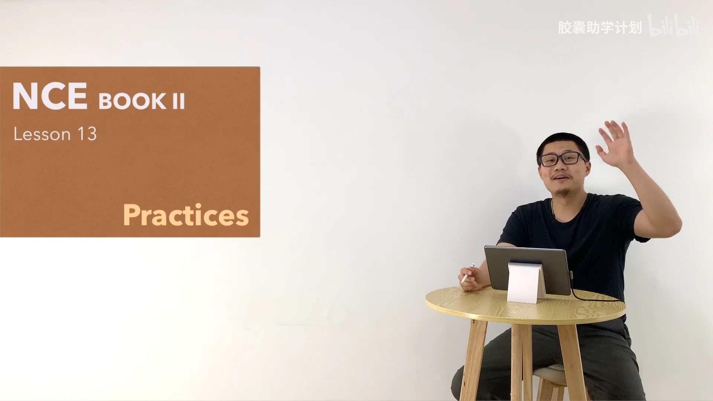

文字识别：胶囊助学计划 / NCE / BOOKII / Lesson 13 / Practices

### 画面 00:00:02

文字识别：胶囊助学计划 / NCE / BOOKII / Lesson 13 / Practices

### 画面 00:00:06

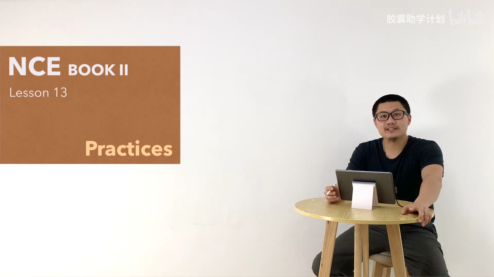

文字识别：胶囊助学计划 / NCE / BOOKII / Lesson 13 / Practices

### 画面 00:00:09

文字识别：胶囊助学计划 / 进行如下练习唯一前提 / 文章跟读至熟读成诵 / 否则请勿开始

### 画面 00:00:27

文字识别：胶囊助学计划bll

## 00:00:30–00:01:00

好，那我们先看第一题 comprehension 训练目标听懂一般疑问句和特殊疑问句。各位这个地方您要看着书或者啊直接眼睛离开屏幕听我问一句，然后您回答一句。来了，第一题，What are the Greenwood boys? A group of pop singers. Next one, What are they doing at present? 答案 visiting

### 画面 00:00:31

### 画面 00:00:33

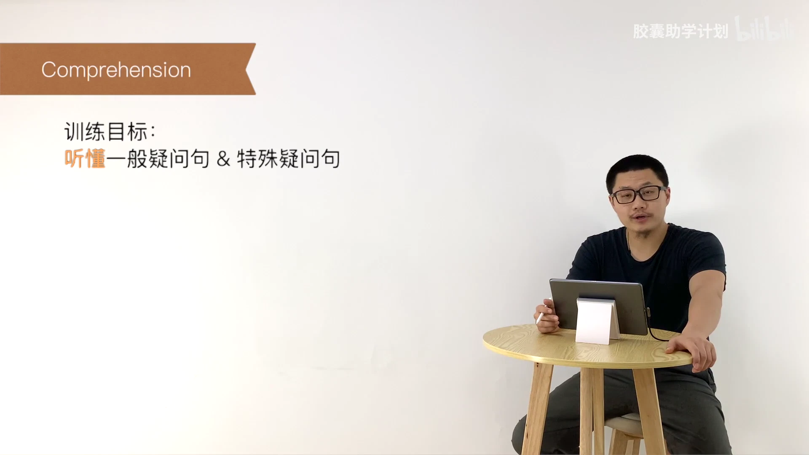

文字识别：胶囊助学计划 / Comprehension / 训练目标： / 听懂一般疑问句＆特殊疑问句

### 画面 00:00:41

文字识别：胶囊助学计划 / Comprehension

### 画面 00:00:49

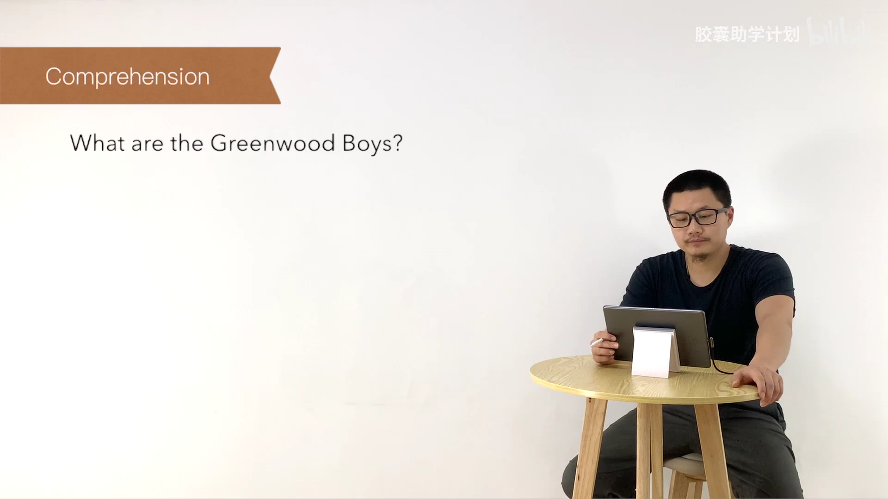

文字识别：胶囊助学计划 / Comprehension / What are the Greenwood Boys?

### 画面 00:00:58

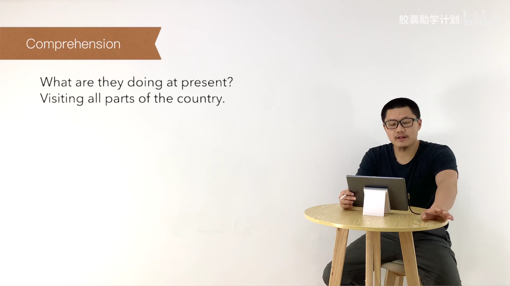

文字识别：胶囊助学计划 / Comprehension / What are t /  they doing at present? / Visiting a / all parts of the country.

## 00:01:00–00:01:30

all parts of the country. Next one: Are they making a world tour? Answer: No, they aren't. 好，这个地方我提一小下啊，这个 world tour 是什么意思？就是全球巡回演出啊，不是，他们是全国的，对吧？OK. Next one: Where will they be arriving tomorrow? Here in this town, 对吧？对于这个作者来说啊。

### 画面 00:01:03

文字识别：胶囊助学计划 / Comprehension / Are they making a world tour?

### 画面 00:01:11

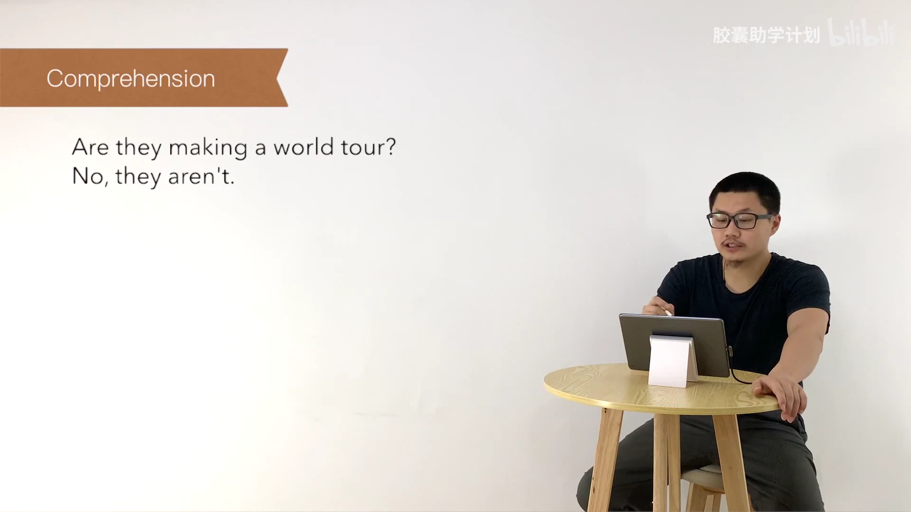

文字识别：胶囊助学计划 / Comprehension / Are they making a world tour? / No, they aren't.

### 画面 00:01:18

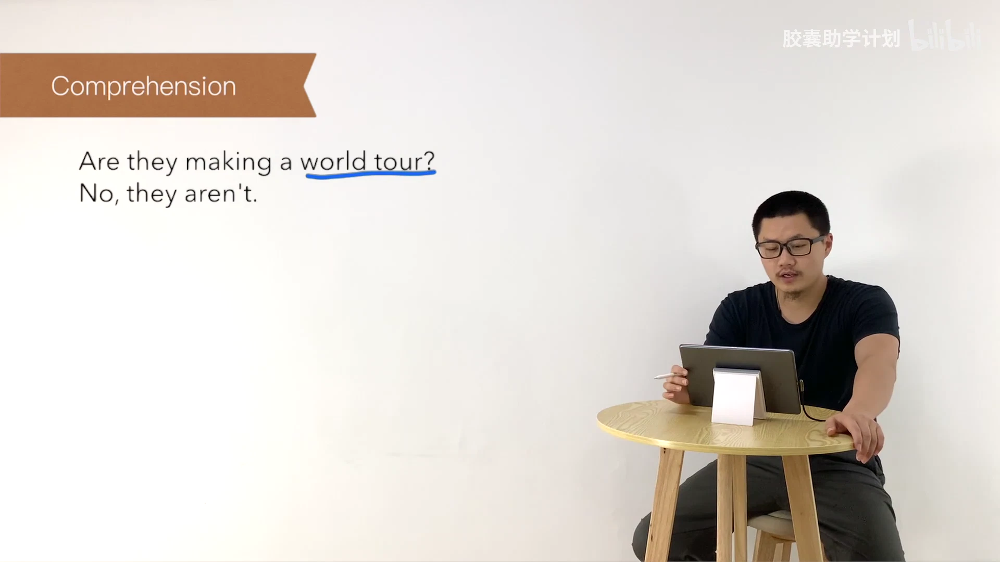

文字识别：胶囊助学计划 / Comprehension / Are they making a world tour? / No, they aren't.

### 画面 00:01:20

文字识别：胶囊助学计划 / Comprehension / Where will they be arriving tomorrow?

## 00:01:30–00:02:00

Next one, how will they be coming? How, by train. Next one, who will be meeting them at the station? Most of the young people in the town. You cannot just say people, right? Next one, do you think there will be many old people in the crowd? No, I don't, right? That already said, right? Based on common sense judgment, right? Second, the original

### 画面 00:01:37

文字识别：胶囊助学计划 / Comprehension / Who'll be meeting them at the station?

### 画面 00:01:47

文字识别：胶囊助学计划 / Comprehension / Do you think there'll be many old people in / the crowd?

### 画面 00:01:54

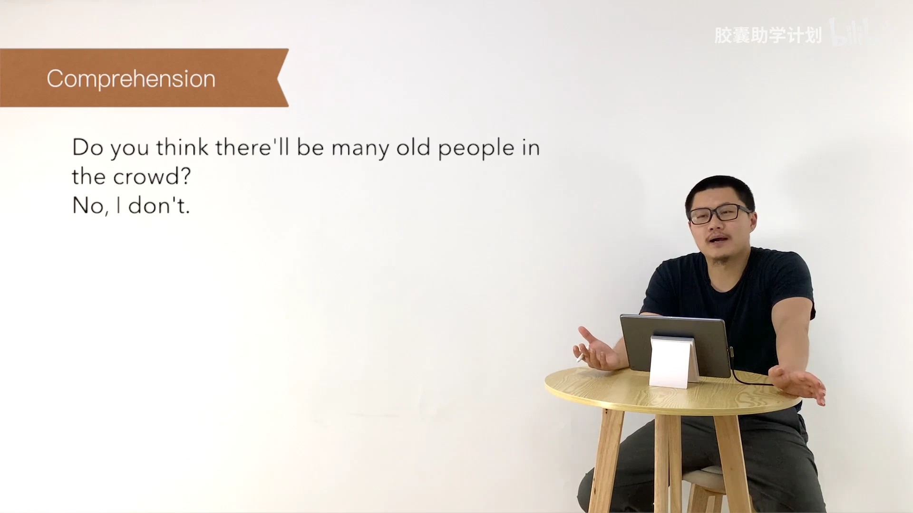

文字识别：胶囊助学计划 / Comprehension / Do you think there'll be many old people in / the crowd? / No,Idon't.

### 画面 00:01:59

文字识别：胶囊助学计划 / Comprehension / Do you think there'll be many old people in / the crowd? / No,Idon't.

## 00:02:00–00:02:30

Next one, where will they be singing tomorrow at the workers' club? Next one, will the Greenwood boys be staying the whole week? No, they won't. They will be staying here for five days, 对吧？好，那下一个就来了。How long will they be staying then? For five days, 对吧？答案其实也就出来了。我在视频啊，在这个

### 画面 00:02:01

文字识别：胶囊助学计划 / Comprehension / Where wil they be singing tomorrow?

### 画面 00:02:09

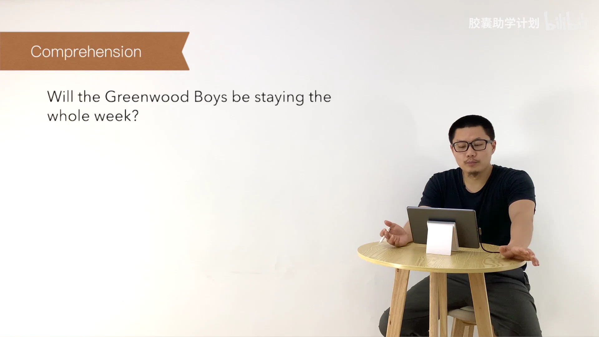

文字识别：胶囊助学计划 / Comprehension / Will the Greenwood Boys be staying the / whole week?

### 画面 00:02:12

文字识别：胶囊助学计划 / Comprehension / Will the Greenwood Boys be staying the / whole week?

### 画面 00:02:15

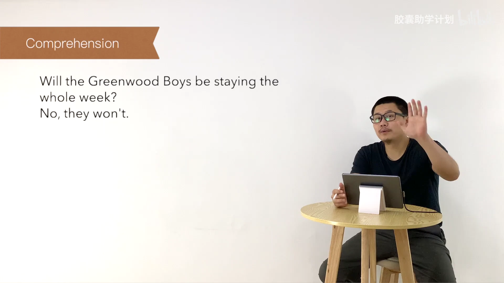

文字识别：胶囊助学计划 / Comprehension / Will the Greenwood Boys be staying the / whole week? / No, they won't.

### 画面 00:02:18

文字识别：胶囊助学计划 / Comprehension

### 画面 00:02:26

文字识别：胶囊助学计划 / Comprehension / Howl /  long wil they be staying then? / For five / days.

### 画面 00:02:28

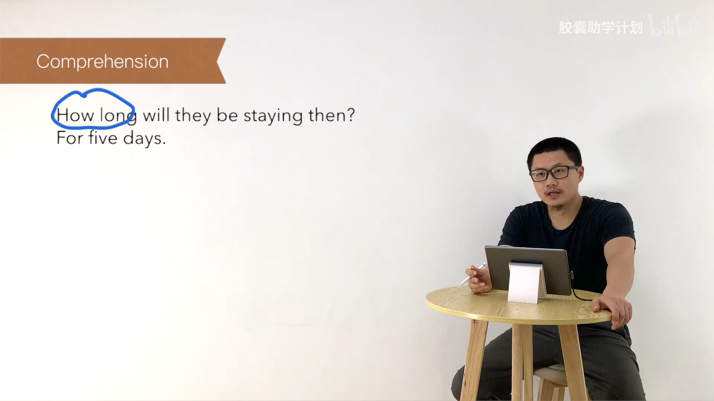

文字识别：胶囊助学计划 / Comprehension / Howlong /  will they be staying then? / For five / days.

## 00:02:30–00:03:00

文章的一个视频当中问了大家这个问题，对吧？各位，答案就在这个地方。对，for five days提问用谁？Continuing. Will they be giving a performance on every night of their stay?啊，every night of their stay就是他们停留的每个夜晚都会举办演出吗？这个就是数学题，是吧？举办五场演出，待五天。Yes, they will. Next one. How many

### 画面 00:02:31

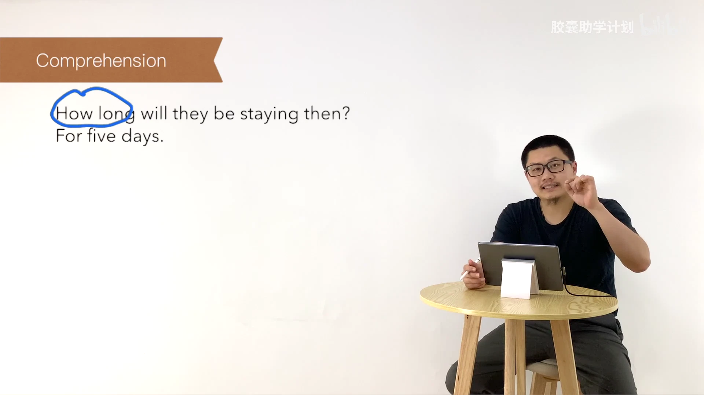

文字识别：胶囊助学计划 / Comprehension / How long /  will they be staying then? / For five / days.

### 画面 00:02:34

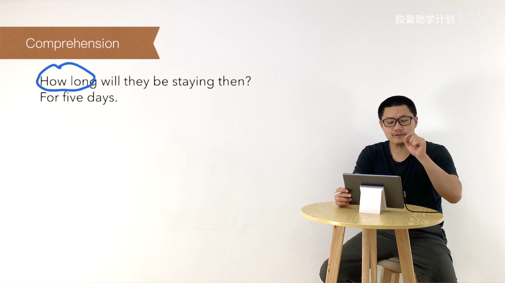

文字识别：胶囊助学计划 / Comprehension / How long /  will they be staying then? / For five / days.

### 画面 00:02:37

文字识别：胶囊助学计划 / Comprehension

### 画面 00:02:41

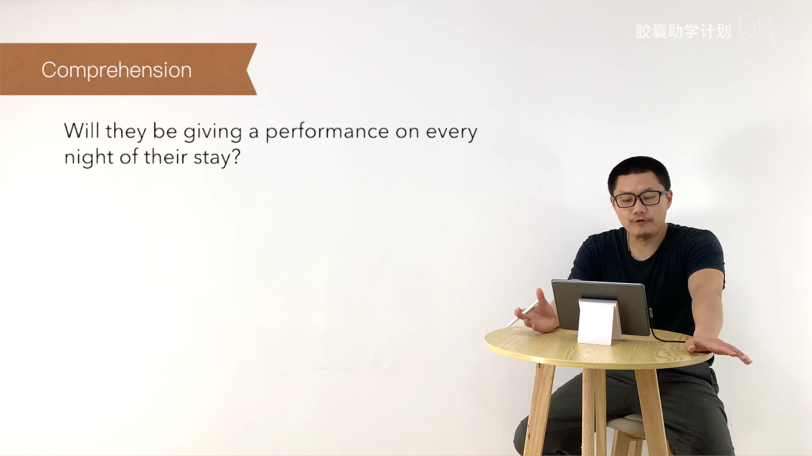

文字识别：胶囊助学计划 / Comprehension / Will t / I they be / giving a performance on every / night of their s / stay?

### 画面 00:02:46

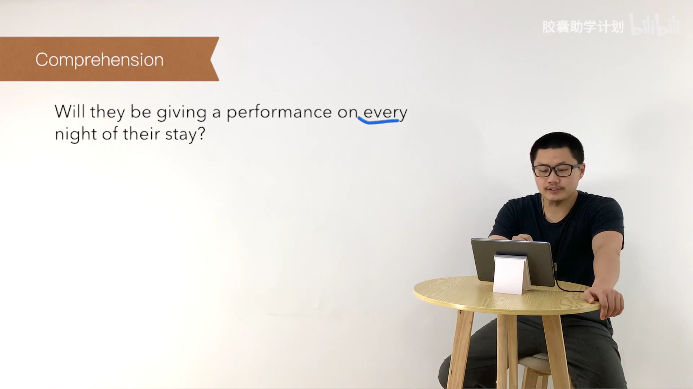

文字识别：胶囊助学计划 / Comprehension / Will they be / giving a performance on every / night of their s / stay?

### 画面 00:02:50

文字识别：胶囊助学计划 / Comprehension / Will / they / be / giving a performance on every / night / of their s / stay?

### 画面 00:02:53

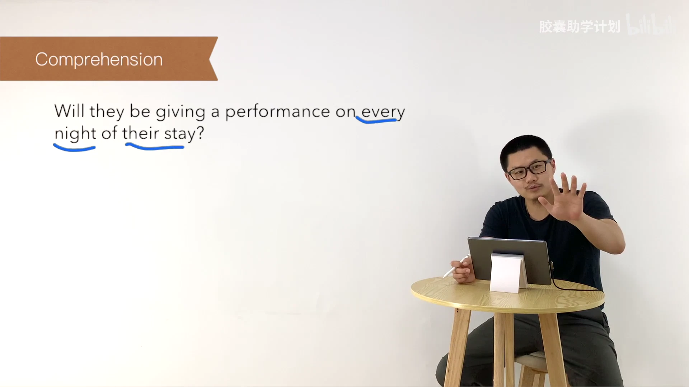

文字识别：胶囊助学计划 / Comprehension / Will / theyl / be / giving a performance on every / night / of their s / stay?

### 画面 00:02:55

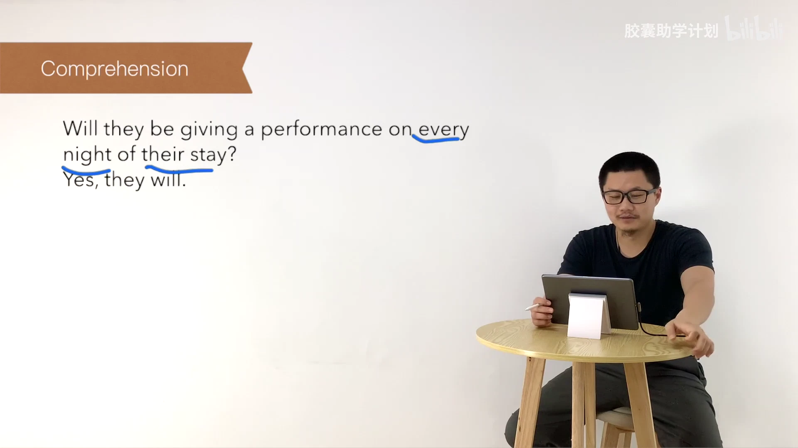

文字识别：胶囊助学计划 / Comprehension / WilI / they / be / giving / a performance c / onevery / night / of their / stay? / Yes, they / will.

### 画面 00:02:57

文字识别：胶囊助学计划 / Comprehension

## 00:03:00–00:03:30

performances will they give? Five. Next one, who will have a difficult time? Please. Okay,接下来 asking questions,各位练的我们是将来自己能问出来问题。那问题包括一般疑问句和特殊疑问句。先看第一个例子, ask me if the Greenwood boys are a group of pop singers.一般疑问句二提前就可以了，非常的简单，对吧？然后 who,那你可以对

### 画面 00:03:07

文字识别：胶囊助学计划 / Comprehension / Who'll have a difficult time? / The police will.

### 画面 00:03:09

文字识别：胶囊助学计划 / Asking questions / 训练目标： / 会说一般疑问句＆特殊疑问句 / Accuracy / Fluency

### 画面 00:03:12

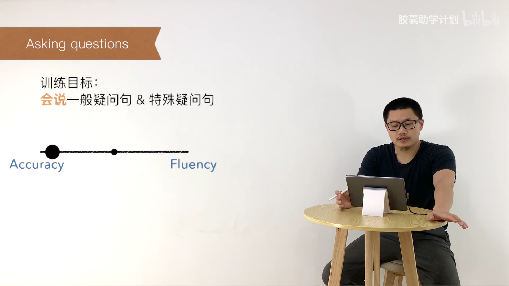

文字识别：胶囊助学计划 / Asking questions / 训练目标： / 会说一般疑问句＆特殊疑问句 / Accuracy / Fluency

### 画面 00:03:16

文字识别：胶囊助学计划 / Asking questions / 训练目标： / 会说一般疑问句＆特殊疑问句 / Accuracy / Fluency

### 画面 00:03:18

文字识别：胶囊助学计划 / Asking questions / T: Ask me if The Greenwood Boys are a / group of pop singers.

### 画面 00:03:20

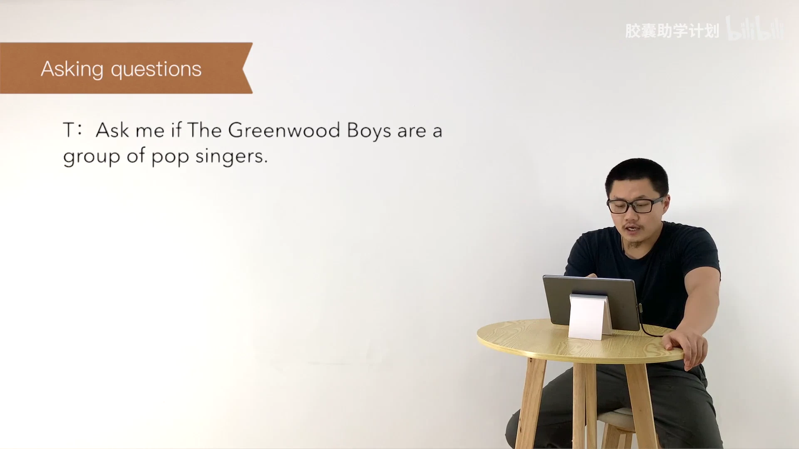

文字识别：胶囊助学计划 / Asking questions / T: Ask me if The Greenwood Boys are a / group of pop singers.

### 画面 00:03:25

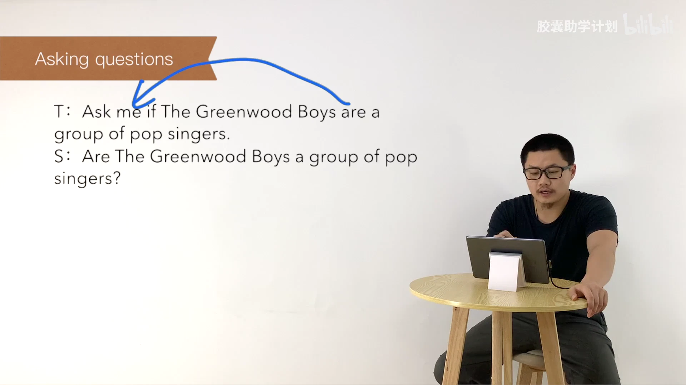

文字识别：胶囊助学计划 / Asking / questions / T:Ask / me if / The / Greenwood Boys are a / group / ofpop / singers. / S:Are / The / Greenwood Boys a group of pop / singers?

## 00:03:30–00:04:00

The Greenwood Boys 提问，也可以对 a group of pop singers 提问。只是啊，你如果对 The Greenwood Boys 提问，答案会有点怪啊，所以我们直接对 a group of pop singers 提问，叫做 Who are the Greenwood Boys? 啊，谁是绿林少年？答案就是 a group of pop singers，对吧？好，接下来呢，各位这个地方我只提供思路，您下课要自己写答案，然后大声朗读出来。首先啊，句子都不用读完，They are visiting，

### 画面 00:03:30

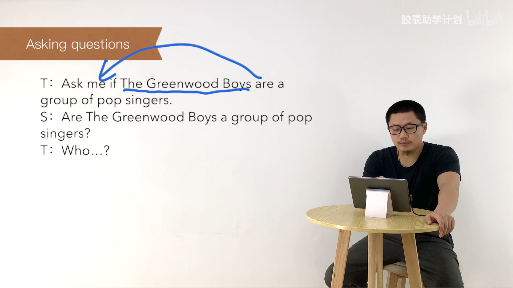

文字识别：胶囊助学计划 / Asking / questions / T:Ask / meif / The / Greenwood Boys are a / group / of pop / singers. / S: / : Are / The / Greenwood Boys a group of pop / singers? / T: Who...?

### 画面 00:03:33

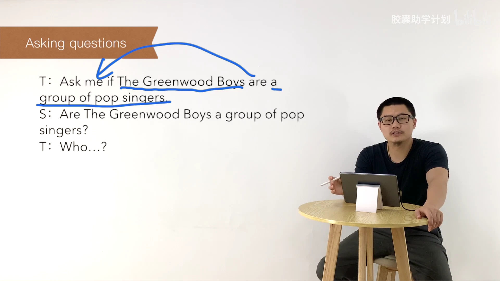

文字识别：胶囊助学计划 / Asking / questions / T:Ask / meif / The / Greenwood Boys are a / group / of pop / singers. / S:Are / The / Greenwood Boys a group of pop / singers? / T: Who..?

### 画面 00:03:43

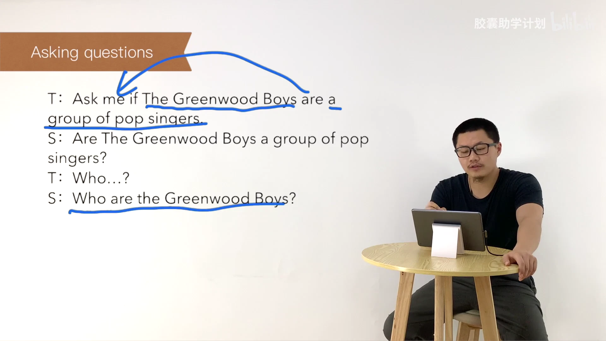

文字识别：胶囊助学计划 / Asking / questions / T:Ask / meif / The / Greenwood Boys are a / group / ofpop / singers. / S:Are / The / Greenwood Boys a group  / of pop / singers? / T: / Who...? / S: / Who are / the / Greenwood Boys?

### 画面 00:03:49

文字识别：胶囊助学计划 / Asking questions

### 画面 00:03:51

文字识别：胶囊助学计划 / Asking / questions / 1.The / : Greenwood Boys are a group of pop / singers.(Who) / 2.They're /  visiting all parts of the country at / present.( / . (Which parts)(When)

### 画面 00:03:57

文字识别：胶囊助学计划 / Asking / questions / 1.The / Greenwood Boys a / are a group of pop / singers. (Who) / 2. They're visiting a / all parts of the country at / present. (Which parts) (When)

## 00:04:00–00:04:30

现在进行时，一般疑问句，二提前。那我们先讲简单的，问非常简单，就是对at present提问，对吧？现在。而which parts这个地方会稍微难一点点。Which parts问的是哪个部分？你怎么确定他对谁提问呢？啊，像这种又又是偶尔出现一次，对吧？你就想谁能回答他？那all parts是回答which parts的，所以which parts就对all

### 画面 00:04:01

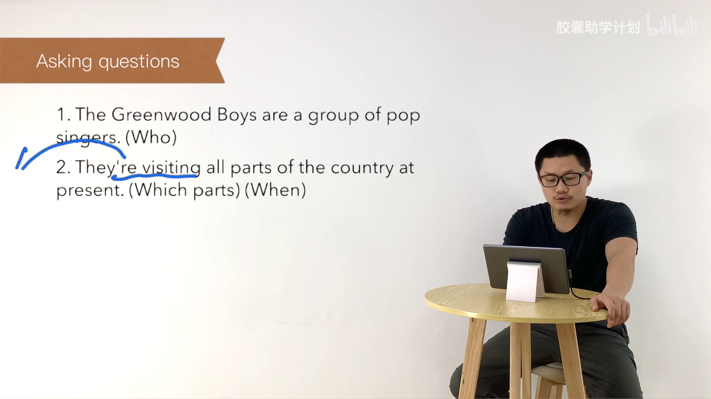

文字识别：胶囊助学计划 / Asking / questions / 1.The / Greenwood / Boys / are a group / ofpop / singers. / (Who) / 2. They're visiting / all parts / of the country at / present. (Which parts) (When)

### 画面 00:04:07

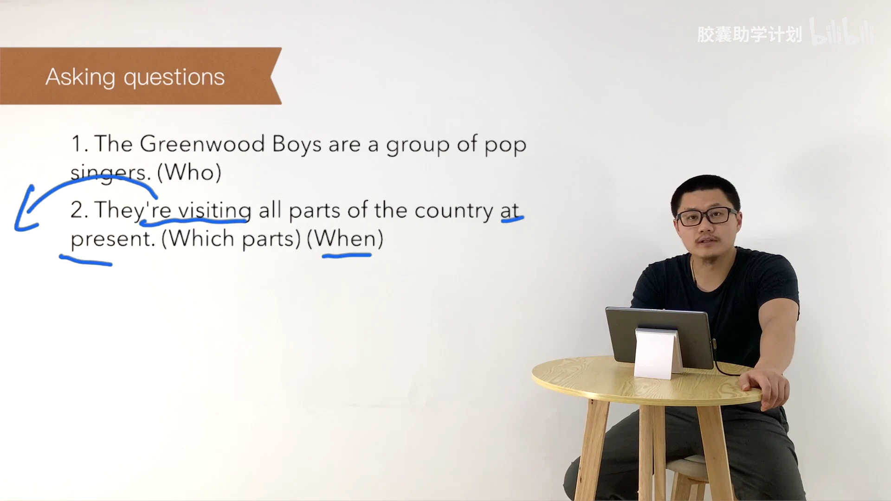

文字识别：胶囊助学计划 / Asking / questions / 1.The / Greenwood / Boys / are a group / ofpop / singers. / (Who) / 2. They're visiting / all parts / of the / ecountry / at / present. / (Which / parts)(When)

### 画面 00:04:11

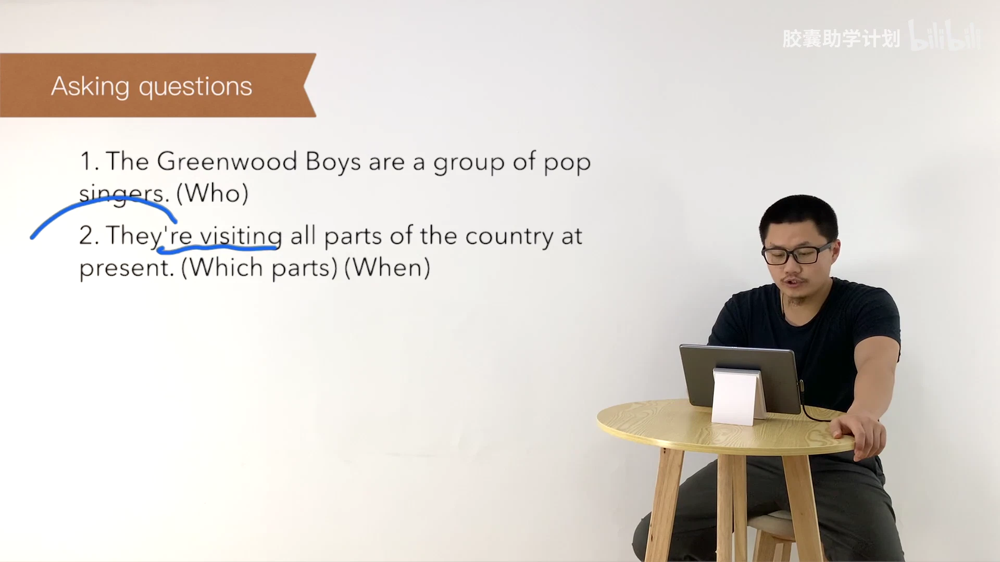

文字识别：胶囊助学计划 / Asking / questions / 1.The / Greenwood E / Boys / are a group /  of pop / singers. / (Who) / 2. They're visiting / all parts / of the country at / present. (Which parts) (When)

### 画面 00:04:13

文字识别：胶囊助学计划 / Asking / questions / 1.The / Greenwood Boys are a group of pop / singers.(Who) / 2.They're /  visiting all parts of the country at / (Which parts)(When) / present.

### 画面 00:04:15

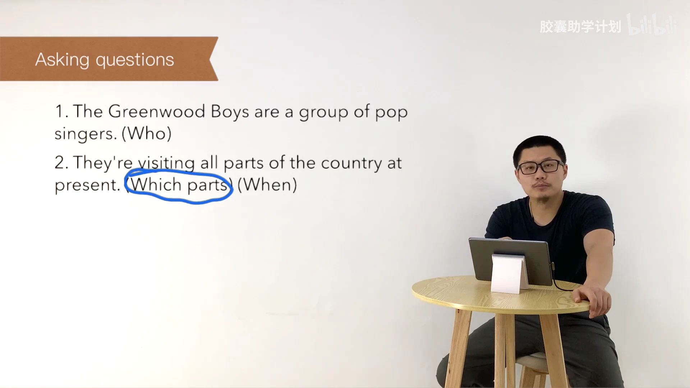

文字识别：胶囊助学计划 / Asking / questions / 1.The / Greenwood Boys are a group of pop / singers.(Who) / 2. They're yisiting all parts of the country at / Which parts / (When) / present.

### 画面 00:04:25

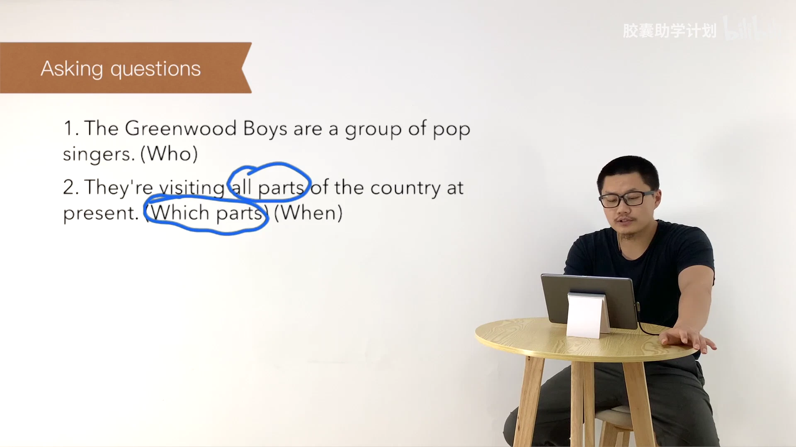

文字识别：胶囊助学计划 / Asking / questions / 1.The / Greenwood / Boys / are a group / ofpop / singers.( / .(Who) / 2. They're visiting allparts of the country at / Which parts / (When) / present.

## 00:04:30–00:05:00

parts 提问啊，各位自己去想这句话啊。那我对 all parts 提问完了之后，注意 all parts of the country 实际上合起来是一个部分。所以您在造这句话的时候，答案听好了，应该是 which parts of the country are they visiting at present? 他们正在这个演出啊，正在巡演这个国家的哪些部分？他们正在这个国家的哪些地

### 画面 00:04:36

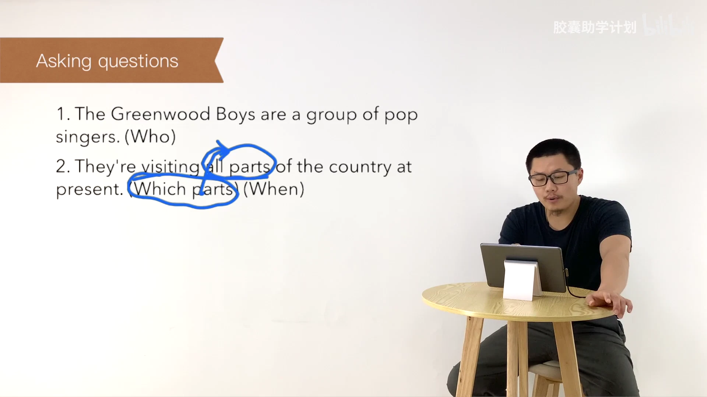

文字识别：胶囊助学计划 / Asking / questions / 1.The / Greenwood / Boys / are a group / ofpop / singers. / (Who) / 2. They're visiting / partsof the country at / Which parts / (When) / present.

### 画面 00:04:38

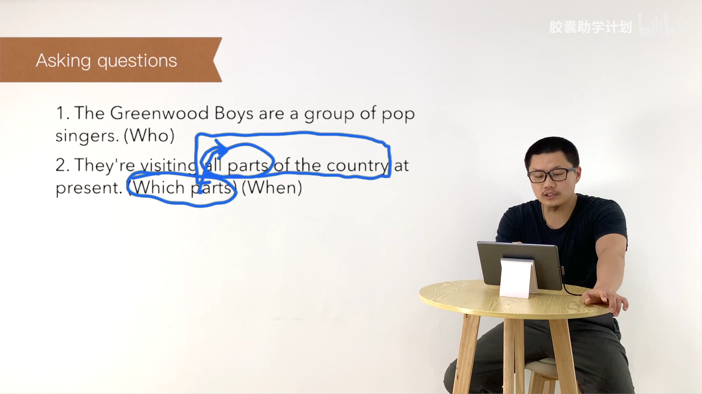

文字识别：胶囊助学计划 / Asking / questions / 1.The / Greenwood / Boys / are / a group / of pop / singers. / (Who) / 2. They're visitind / partsof the country / at / Which / parts / (When) / present.

### 画面 00:04:54

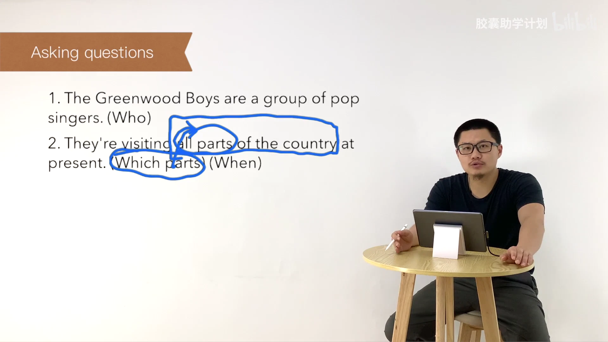

文字识别：胶囊助学计划 / Asking / questions / 1.The / Greenwood / Boys / are / agroup / ofpop / singers. / (Who) / 2. They're visitind / partsof the country / at / Which / parts / (When) / present.

## 00:05:00–00:05:30

方进行巡演？答案是 all parts of the country. Okay,好. They will be arriving here tomorrow. Will提前就行了。When对tomorrow提问啊。They will be coming by train. Will提前。How对by train提问啊？如何来的？对吧？Most of the young people in the town will be meeting啊。一般疑问句Will提前。Who可以对them提问？可以对主语Most of the young people in the town提问。

### 画面 00:05:05

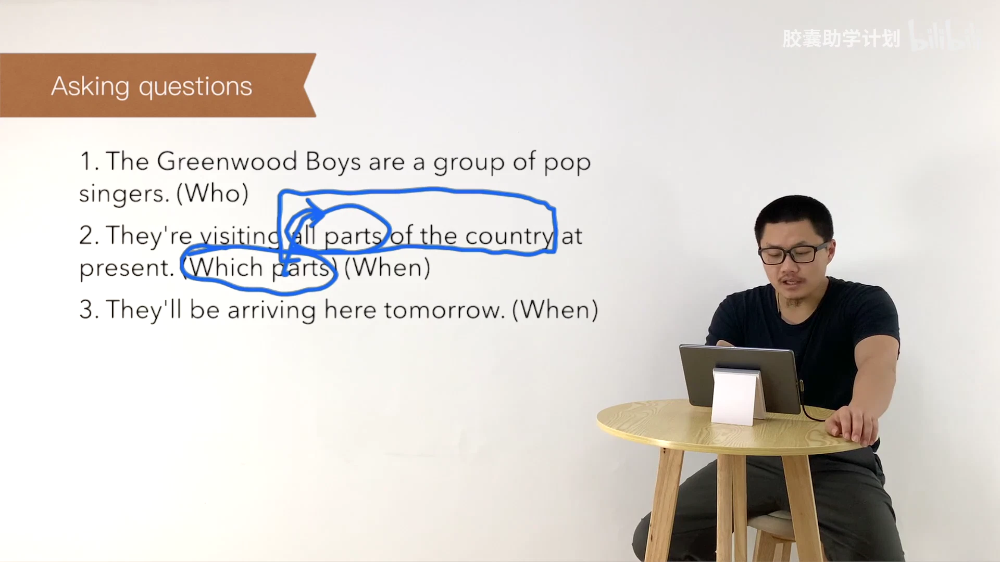

文字识别：胶囊助学计划 / Asking / questions / 1.The / Greenwood / Boys / are a group / of pop / singers. / (Who) / 2. They're visitind / partsof the country / at / Which / parts / (When) / present. / 3.They'll be / arriving / here / tomorrow.(When)

### 画面 00:05:08

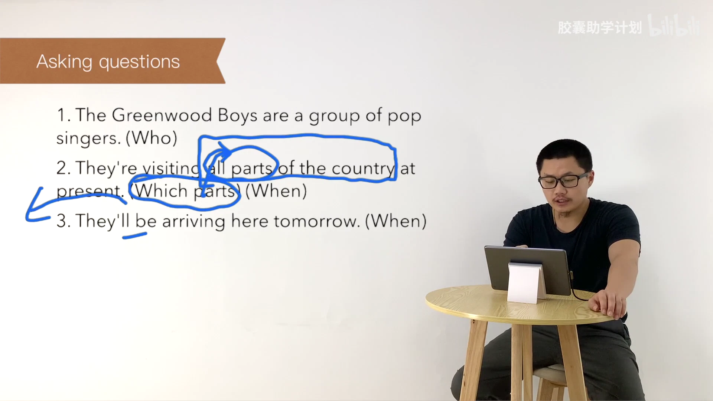

文字识别：胶囊助学计划 / Asking / questions / 1.The / Greenwood / Boys / are / agroup / ofpop / singers. / (Who) / 2. They're visitind / partsof the country / at / present. / Which / parts / (When) / 3. They'll be / arriving / here / tomorrow.(When)

### 画面 00:05:10

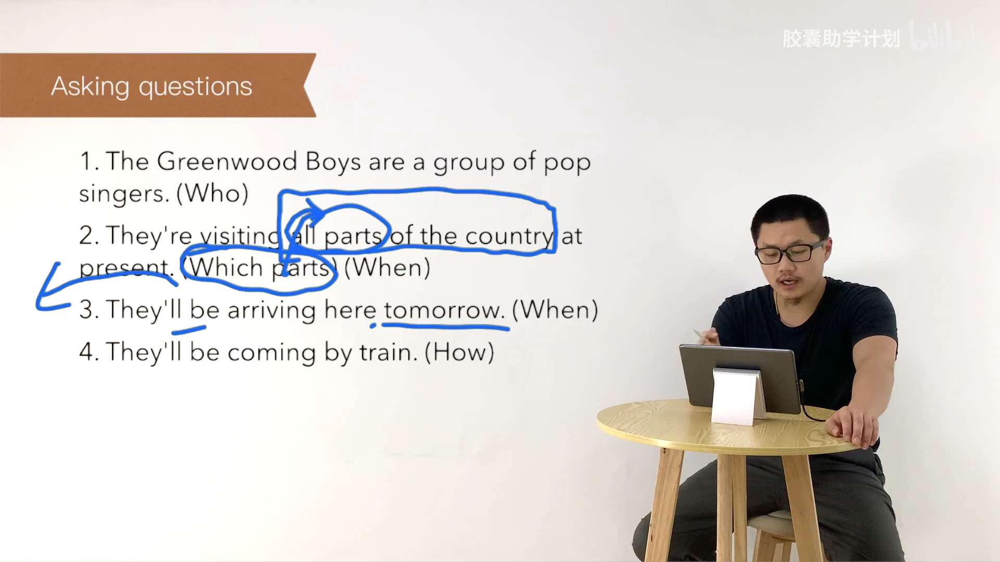

文字识别：胶囊助学计划 / Asking / questions / 1.The / Greenwood / Boys / are / agroup / ofpop / singers. / (Who) / 2. They're visitind / parts of the country / at / present. / Which / parts / (When) / 3.They'll be / arriving / here / tomorrow.(When) / 4. They'll be / coming / byt / train.(How)

### 画面 00:05:12

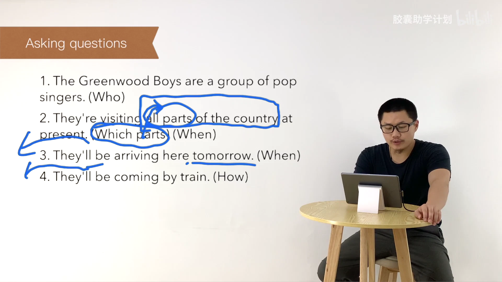

文字识别：胶囊助学计划 / Asking / questions / 1.The / Greenwood / Boys / are / agroup / ofpop / singers. / (Who) / 2. They're visitind / partsof the country / at / present. / Which / parts / (When) / 3.They'l be / arriving / here / tomorrow.(When) / 4.They'll be / coming / byt / train.(How)

### 画面 00:05:15

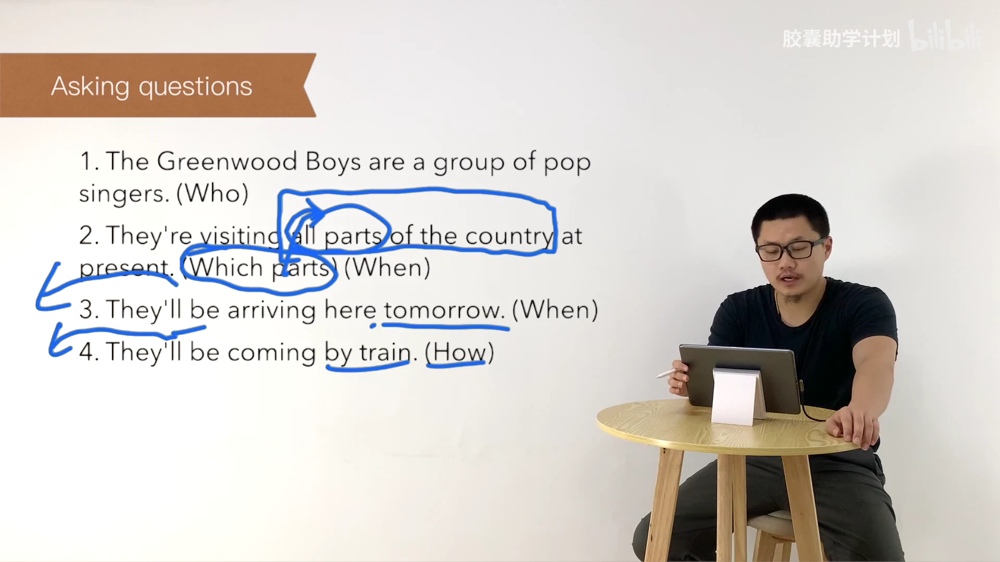

文字识别：胶囊助学计划 / Asking / questions / 1.The / Greenwood / Boys / are / agroup / ofpop / singers. / (Who) / 2. They're visitind / partsof the country / at / present. / Which / parts / (When) / 3.They'll be / arriving / here / tomorrow.(When) / 4.They'll be / coming / by train. (How)

### 画面 00:05:17

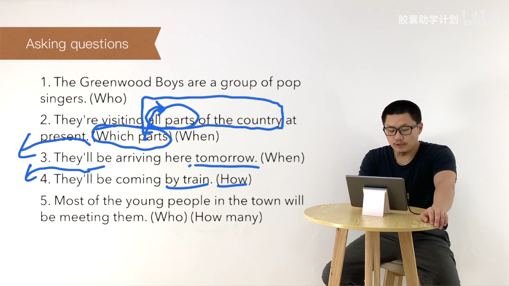

文字识别：胶囊助学计划 / Asking / questions / Greenwood Boys / 1.The / are a group / of pop / singers. (Who) / parts of the country / 2. They're yisitind / at / present. / Which / parts / (When) / 3.They'l be / arriving / here tomorrow. (When) / 4. They'll be / coming / by train. (How) / 5. Most of the / young / people in / the / town will / be meeting / them.(Who)(How many)

### 画面 00:05:21

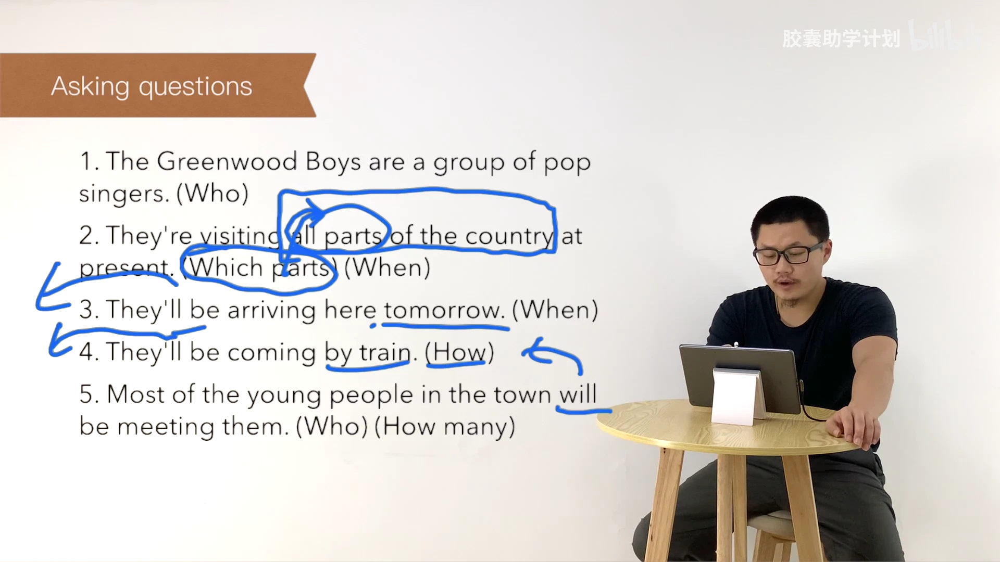

文字识别：胶囊助学计划 / Asking / questions / 1.The / Greenwood E / Boys / are a group / of pop / singers. (Who) / I parts of the country / 2. They're visitind / at / present. / Which / parts (When) / 3.They'l be / arriving / here / e tomorrow.(When) / 4. They'll be / coming / by train. (How) / 5.Most of the / young / people in / the / town_will / be meeting / them.(Who)(How many)

### 画面 00:05:24

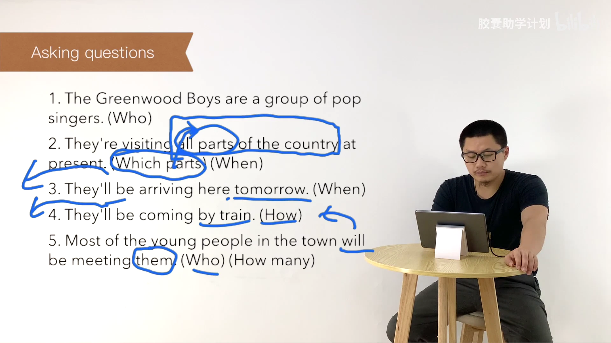

文字识别：胶囊助学计划 / Asking / questions / 1.The / Greenwood / Boys / are a group / ofpop / singers. / .(Who) / 2. They're visitind / parts of the country / at / all / present. / Which / parts / (When) / 3.They'l be / arriving / here /  tomorrow.(When) / 4. They'll be / coming / by train. (How) / 5. Most of the young / people in / the / town will / be meeting / them /  (Who) (How many)

### 画面 00:05:27

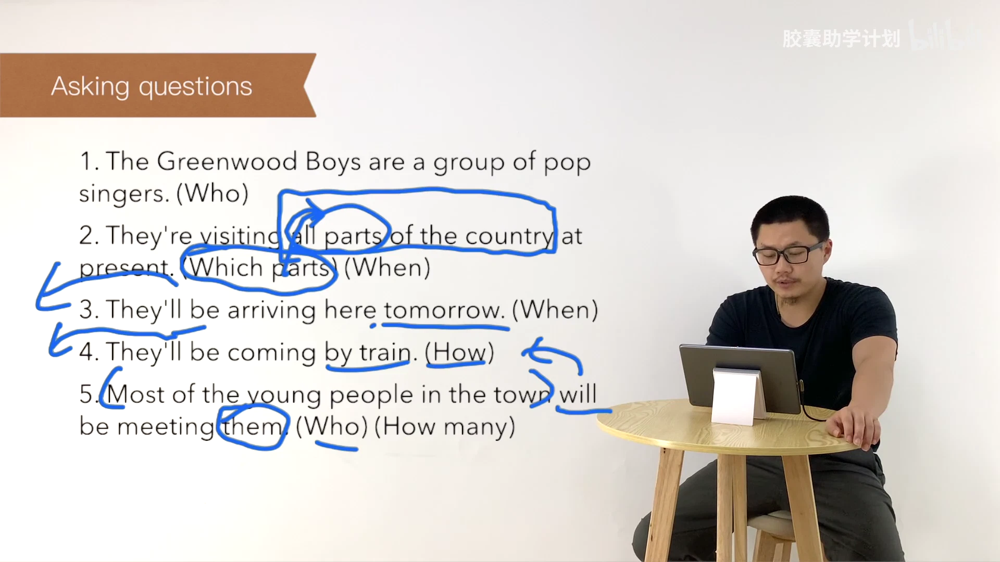

文字识别：胶囊助学计划 / Asking / questions / 1.The / Greenwood / Boys / are a group / of pop / singers. / (Who) / 2. They're visiting / parts of the country / at / present. / Which / parts / (When) / 3.They'll be / arriving / here /  tomorrow.(When) / 4. They 'll be / coming / by train. (How) / Most o / 5 / ofthe young / people in / the / towp / will / be meeting / them / (Who)(How many)

## 00:05:30–00:06:00

而 how many？你想一下，how many应该对谁提问？这个地方谁能回答 how many？对吧？How many问多少？这没有一个，一二三四五。但是 most of，是不是好像是能回答 how many的多少大多数啊？所以他答案是 how many young people in the town？然后巴拉巴拉后边直接照抄就行了。OK，答案说完了啊。下一个，they will be waiting at the

### 画面 00:05:32

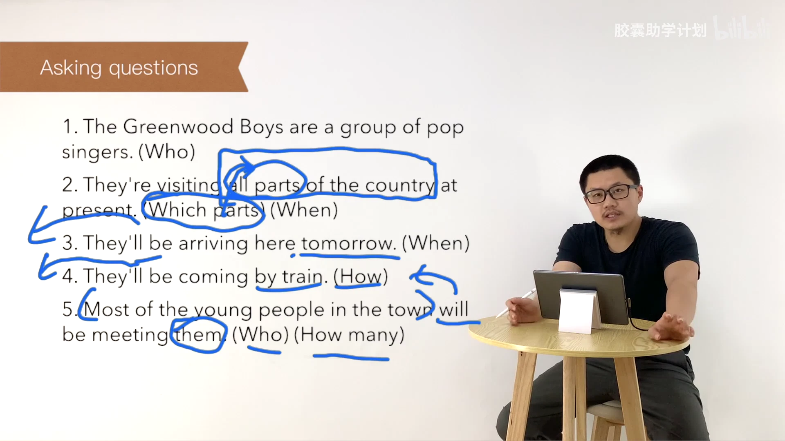

文字识别：胶囊助学计划 / Asking / questions / 1.The / Greenwood / Boys / are a group / ofpop / singers. / (Who) / 2. They're visitind / parts of the country / at / present. / Which / parts / (When) / 3.They'l be / arriving / here /  tomorrow.(When) / 4.They'll be / coming / by train. (How) / 5Most of the young / 5 / people in / the / towd / will / be meeting / them / (Who) (How many)

### 画面 00:05:42

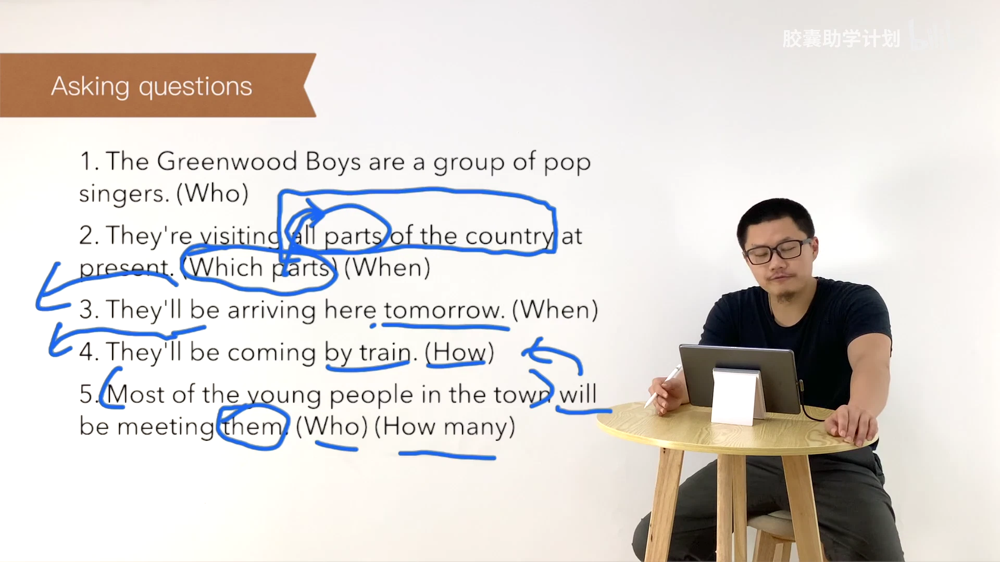

文字识别：胶囊助学计划 / Asking / questions / 1.The / Greenwood / Boys / are a group / of pop / singers. / (Who) / 2. They're visitind / parts of the country / at / present. / Which / parts / (When) / 3.They'l be / arriving / here / tomorrow.(When) / 4.They 'll be / coming / by train. (How) / .Mosto / 5 / of the young / people in / the / towDwill / be meeting / them / (Who)(How many)

### 画面 00:05:53

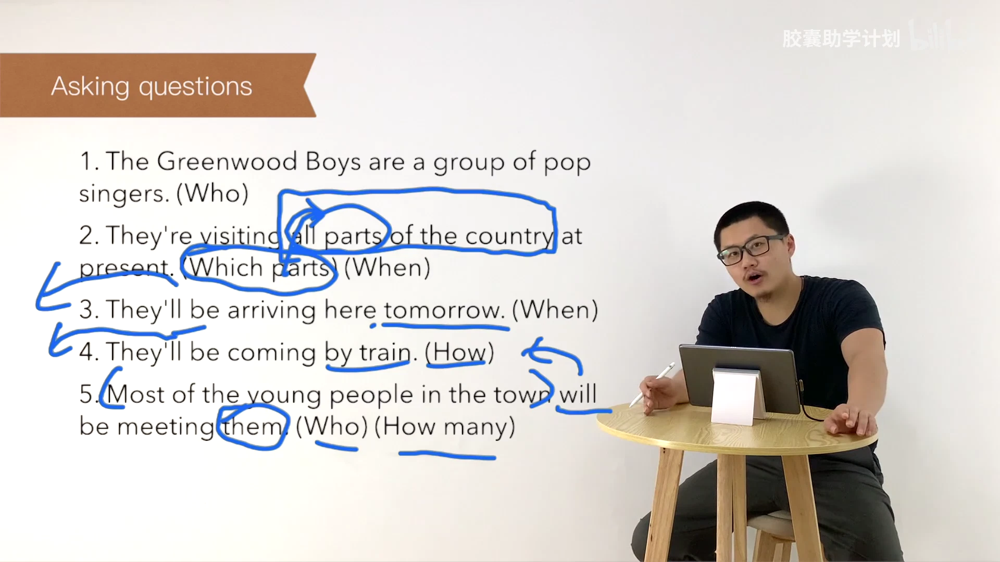

文字识别：胶囊助学计划 / Asking / questions / 1.The / Greenwood / Boys / are a group / ofpop / singers. / (Who) / 2. They're visitind / parts of the country / at / all / present. / Which / parts / (When) / 3.They'l be / arriving / here / e tomorrow.(When) / - / 4.They 'll be / coming / by train. (How) / 5Most of the young / 5 / people in / the / towdwill / be meeting / them /  (Who) (How many)

### 画面 00:05:56

文字识别：胶囊助学计划 / Asking questions

### 画面 00:05:59

文字识别：胶囊助学计划 / Asking questions / 6. They'l be waiting at the station. (Where)

## 00:06:00–00:06:30

station. Will提前Where对at the station提问。The Greenwood boys will be staying还是will提前？那How long就是对for five days对吧？在讲文章那个地方我问了这个问题。那Where Where就是对整句话提问嘛，对吧？这里边没有出现地点，整句话提问。答案我说一下啊。Where will the Greenwood boys be staying for five days? Okay.第八题They will give five performances.

### 画面 00:06:01

文字识别：胶囊助学计划 / Asking / questions / 6. They'll be waiting at the station. (Where)

### 画面 00:06:03

文字识别：胶囊助学计划 / Asking / questions / 6. They'l be waiting / at the / station. (Where) / 7.The / Greenwood / Boys / will be s / staying / for five / days. / (How long)(Where)

### 画面 00:06:06

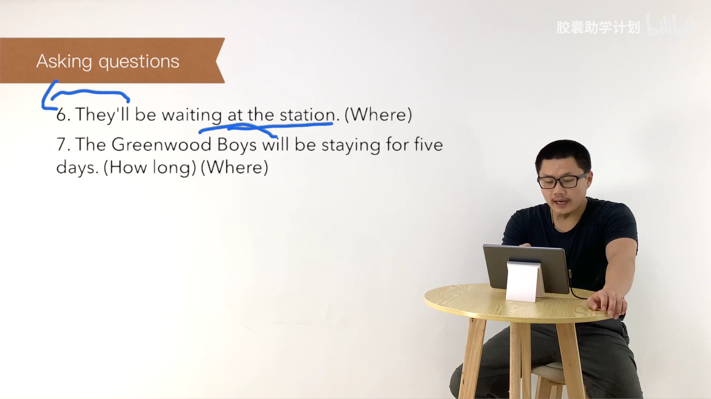

文字识别：胶囊助学计划 / Asking / questions / 6. They'll be waiting / at the / station.(Where) / 7.The / Greenwood / Boys / will be / staying / for five / days. / (How / long)(Where)

### 画面 00:06:09

文字识别：胶囊助学计划 / Asking / questions / 6. They'll k / be / waiting / at the / station.(Where) / 7.The / Greenwood / Boys / will be / staying / for five / days. / (How / long)(Where)

### 画面 00:06:18

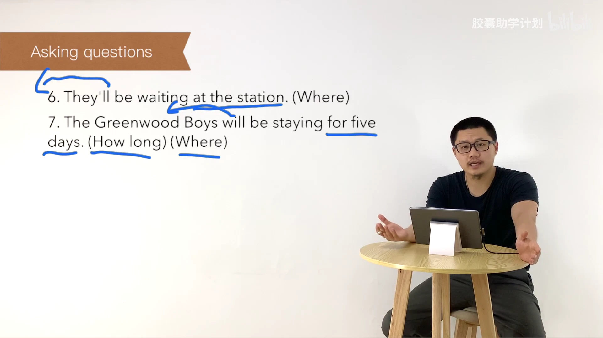

文字识别：胶囊助学计划 / Asking / questions / 6. They'll  / be / waiting / at the / station.(Where) / 7.The / Greenwood / Boys / will / be / staying / for five / days. / (How / long)(Where)

### 画面 00:06:27

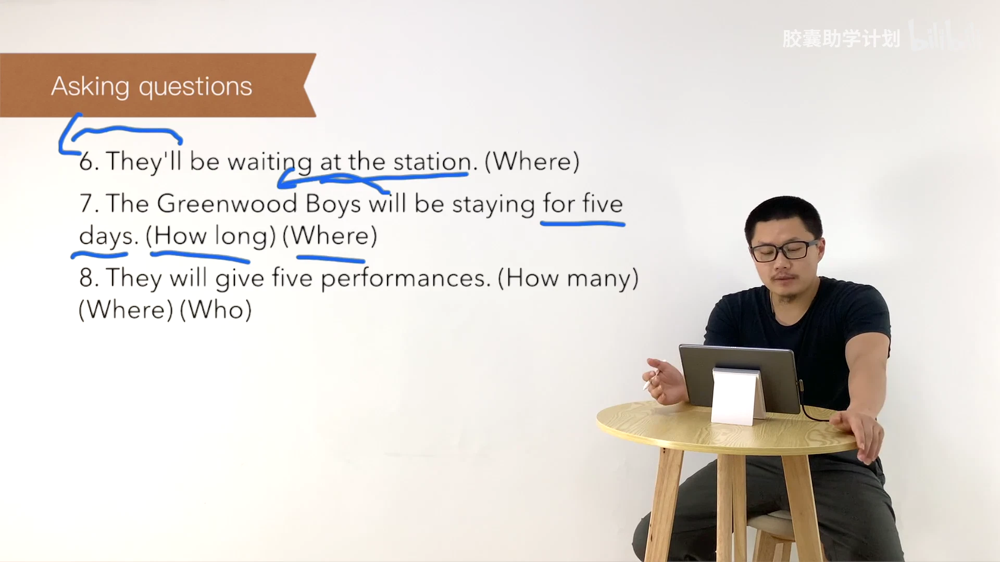

文字识别：胶囊助学计划 / Asking / questions / 6. They'l be waiting / at the / station.(Where) / 7.The / Greenwood / Boys / will be / staying / for five / days. / (How / long)(Where) / 8.They / will / give / five / performances.(How many) / (Where) (Who)

### 画面 00:06:29

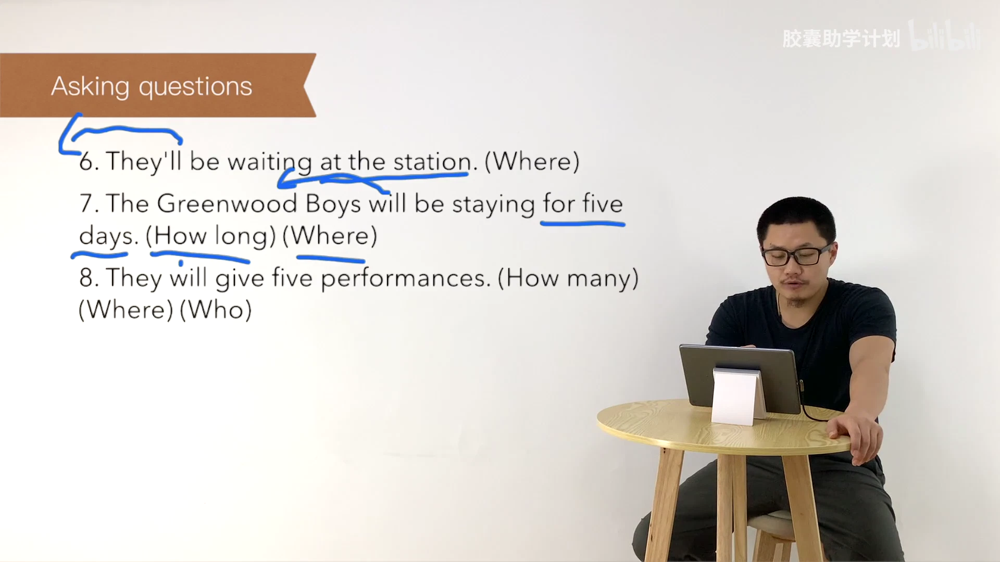

文字识别：胶囊助学计划 / Asking / questions / 6. They'll be waiting / at the / station.(Where) / 7.The / Greenwood / Boys / will be / staying / for five / days. / (How / long) (Where) / 8.They will / give / five / performances.(How many) / (Where) (Who)

## 00:06:30–00:07:00

Will提前，How many对five提问，所以叫How many performances will they give?你不能说How many will they give performances? Okay, How many要带着performances一起提前啊。Where整句话提问，Who对主语提问，不用变一般疑问句。第九个，They will be seen at the workers' club. Will提前，Where对at

### 画面 00:06:31

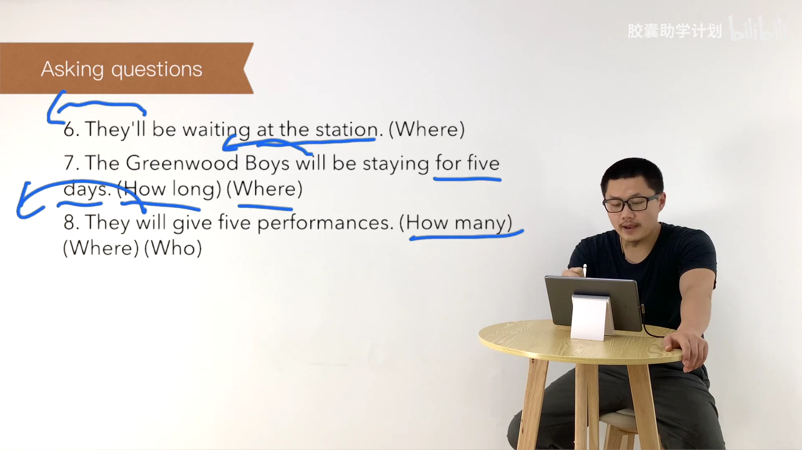

文字识别：胶囊助学计划 / Asking / questions / 6. They'Il k / be / waiting / at the / station.(Where) / 7.The / Greenwood / Boys / will / be / staying / for five / days.How / long)(Where) / 8.They will / give / five / performances.(How / v many) / (Where)(Who)

### 画面 00:06:52

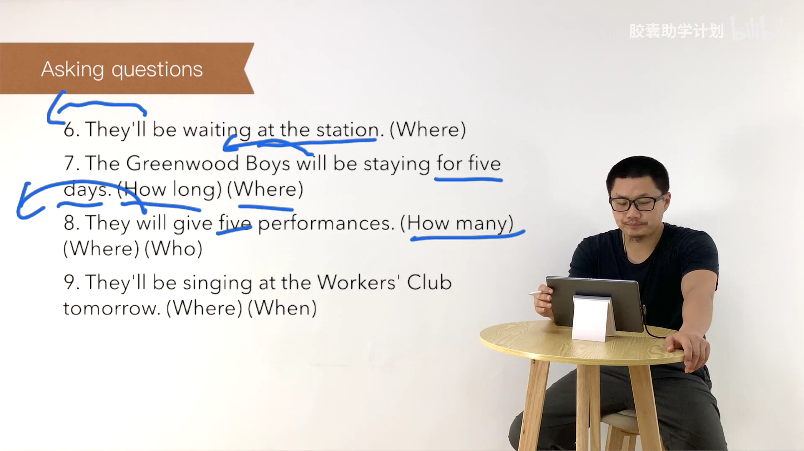

文字识别：胶囊助学计划 / Asking / questions / 6. They'll be waiting a / at the / station.(Where) / 7.The / Greenwood / Boys / will be / staying / for five / days.How / long) (Where) / 8.They will / give / five / performances.(How many) / (Where) (Who) / 9. They'll be / singing / at the / Workers' / Club / tomorrow. / (Where)(When)

### 画面 00:06:57

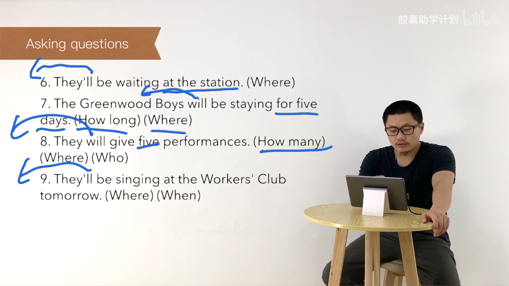

文字识别：胶囊助学计划 / Asking / questions / 6. They'll be /  waiting / at the / station.(Where) / 7.The / Greenwood / Boys / will be / staying / for five / days. Howl / long)(Where) / 8.They / will / give / five  /  performances.(How many) / (Where) (Who) / 9. / .They'll / be / singing / at the / Workers' / Club / tomorrow. / (Where)(When)

## 00:07:00–00:07:30

the workers' club提问啊？When对tomorrow提问，非常的简单。接下来tell the story，这是目前为止唯一一个大量练习我们fluency对吧？练习我们流利性的一个练习啊！各位一定是基于文章非常熟了，您再来看这些关键词。我还是只给大家做一个示范。来了，眼睛跟上啊！Greenwood boys are a group of pop singers.

### 画面 00:07:01

文字识别：胶囊助学计划 / Asking / questions / 6. They'll be / waiting / at the / station.(Where) / 7.The / Greenwood / Boys / will be / staying / for five / days. How / long) (Where) / 8.They will / give / five / performances.(How many) / (Where)(Who) / 9.They'lI / be / singing / at the / Workers' / Club / tomorrow. / (Where)(When)

### 画面 00:07:04

文字识别：胶囊助学计划 / Tell the story / 训练目标： / 口语复述能力 / Accuracy / Fluency

### 画面 00:07:09

文字识别：胶囊助学计划 / Tell the story / 训练目标： / 口语复述能力 / Accuracy / Fluency

### 画面 00:07:11

文字识别：胶囊助学计划 / Tell the story / 训练目标： / 口语复述能力 / Accuracy / Fluency

### 画面 00:07:16

文字识别：胶囊助学计划 / Tell the story / ① / Greenwood Boys -group -pop / At present -visiting -country / 2 / arriving -tomorrow / by train -young people -station / 4 / Tomorrow -singing -Workers' Club / 5 / Greenwood Boys -staying -five days / 6 / During -time -five performances / 8 / As usual -police -difficult / 9 / trying -keep order / 10 / always the same -occasions

## 00:07:30–00:08:00

At present, they are visiting all parts of the country. They will be arriving here tomorrow. They will be coming by train. Most of the young people in the town will be meeting them at the station tomorrow. They will be singing at the workers' club. Greenwood Boys will be staying here for five days, and during this time, they will give five performances. As usual, the police will have a difficult time, and they will be trying to keep order. It is always the same

### 画面 00:07:46

文字识别：胶囊助学计划 / Tell the story / ① / Greenwood Boys -group -pop / At present -visiting -country / 2 / arriving -tomorrow / by train -young people -station / 4 / Tomorrow -singing -Workers' Club / 5 / Greenwood Boys -staying -five days / 6 / During -time -five performances / 8 / As usual -police -difficult / 9 / trying -keep order / ① / always the same -occasions

## 00:08:00–00:08:30

on these occasions. Very good.重点是流利性而不是准确性，对吧？您可以错一点点啊，但是要速度上还是要提上来，不能太磕磕绊绊啊。炫造句子那就不行了。OK，然后 summary writing 就是我们摘要写作啊，在这个地方只给大家提供答案，各位课下自己去写，写完来对一下答案就好了。OK，好，然后最后一题 topic for discussion，这是对于基础特别好的同学才可以啊，甚至不是基础特别好，

### 画面 00:08:04

文字识别：胶囊助学计划 / Tell the story / 1 / Greenwood Boys -group -pop / At present -visiting -country / 2 / arriving -tomorrow / by train -young people -station / Tomorrow -singing -Workers' Club / 5 / Greenwood Boys -staying -five days / 6 / During -time -five performances / 8 / As usual -police -difficult / 9 / trying -keep order / 10 / always the same -occasions

### 画面 00:08:12

文字识别：胶囊助学计划 / Summary writing: Key / 训练目标： / 写作复述能力

### 画面 00:08:16

文字识别：胶囊助学计划 / Summary writing: Key / The Greenwood Boys are pop singers. They / will be coming here tomorrow. Most of the / young people in the town will be meeting / them at the station. They will give five / performances. The police will be trying to / keep order as usual.

### 画面 00:08:22

文字识别：胶囊助学计划 / Topics for discussion / 训练目标： / 完全自由的对话 / Accuracy / Fluency

## 00:08:30–00:09:00

应该是英语水平特别好，光基础都没用啊。这是我们所有练习最终唯一的目的，就是完全自由的对话和听说啊。那我们看一下这三道题啊。第一个，Describe a concert you have been to or heard about.啊，你给我们说一个你听过的，你自己去听过的音乐会，或者说你你这个听别人说过的音乐会啊。说What do you think you'll be doing this time next year?说你认为明年的这个时

### 画面 00:08:39

文字识别：胶囊助学计划 / Topics for discussion / Describe a concert you have been to, or / heard about. / What do you think you'll be doing this / time next year? / Do you prefer pop or classical songs/ / singers? Why?

### 画面 00:08:53

文字识别：胶囊助学计划 / Topics for discussion / Describe a concert you have been to, or / heard about. / What do you think you'll be doing this / time next year? / Do you prefer pop or classical songs/ / singers? Why?

## 00:09:00–00:09:30

候你会正在做什么呢？Hopefully, I'll be still. I will be still doing,叫能啊the the capsule academy啊. Okay, hopefully.说Do you prefer pop or classical songs?啊，你更喜欢流行音乐呢，还是古典乐？啊，a singers啊songs or singers啊，你更喜欢流行音乐、古典音乐，还是流行歌手或古典歌手啊？说Why啊？为什么？Okay.好，家

### 画面 00:09:13

文字识别：胶囊助学计划 / Topics for discussion / Describe a concert you have been to, or / heard about. / What do you think you'll be doing this / time next year? / Do you prefer pop or classical songs/ / singers? Why?

### 画面 00:09:29

文字识别：胶囊助学计划

## 00:09:30–00:10:00

庭作业. Ask me if.老习惯先写，看着自己的答案，保证是对的，然后大声朗读。摘要写作啊，这是练习我们的写作啊。Tell the story是练习我们口语复述能力。专栏部分，各位都可以找到这些啊，这些这个题啊，都可以找到这些题。那以上呢，就是本期视频的全部内容了。See you next time.

### 画面 00:09:31

文字识别：胶囊助学计划 / 1.Ask me if写&朗读

### 画面 00:09:34

文字识别：胶囊助学计划 / 1.Ask me if写&朗读

### 画面 00:09:36

文字识别：胶囊助学计划 / 1. / Ask me if写&朗读 / 2. / 摘要写作写&答案

### 画面 00:09:38

文字识别：胶囊助学计划 / 1.Askme if写&朗读 / 摘要写作写&答案 / 3.Tell the story 口语复述

### 画面 00:09:40

文字识别：胶囊助学计划 / 1.Ask me if写&朗读 / 摘要写作写&答案 / 3.Tell the story 口语复述

### 画面 00:09:42

文字识别：胶囊助学计划 / 1.Ask me if写&朗读 / 摘要写作写&答案 / 3.Tell the story 口语复述 / 专栏 / 4.

### 画面 00:09:45

文字识别：胶囊助学计划 / 1.Ask me if写&朗读 / 摘要写作写&答案 / 3.Tell the story 口语复述 / 专栏 / 4.

### 画面 00:09:48

文字识别：胶囊助学计划

### 画面 00:09:50

文字识别：胶囊助学计划 / 1

### 画面 00:09:52

### 画面 00:09:54

文字识别：CAPSULEACADEMY / 胶囊助学计划 / 小红书 / Lecturer / □ / 口 / Leo / OE

### 画面 00:09:56

文字识别：CAPSULEACADEMY / 胶囊助学计划 / 小红书 / Photographer / Berlin / OE

### 画面 00:09:58

文字识别：CAPSULEACADEMY / 胶囊助学计划 / 『 / 小红书 / Editor / □ / Berlin / OE

## 00:10:00–00:10:04

### 画面 00:10:01

文字识别：CAPSULEACADEMY / 胶囊助学计划 / 小红书

### 画面 00:10:03

文字识别：bilibili / 胶囊助学计划

