# L014 单词

快速机器解析：语音为单模型转写，未进行独立交叉校对或人工复核；画面每秒采样并按变化选帧，短时文字和标记可能遗漏。截图时间约有 1 秒误差。图片有损压缩；遇到疑点请按时间查看 Google Drive 原视频。

## 00:00:00–00:00:30

Hello everyone, welcome to Capsule Academy. This is Leo. Today we're going to learn New Concept English Book Two Lesson Fourteen Words. 那老习惯进入正式课程之前呢，我们先看三个小的问题。第一个问题，如何表达一段有趣的经历？第二，如何用英文去表达向某人挥手或招手？第三呢，最后一个问题，如何表达去旅行？来带着这三个问题，Hope you gonna enjoy it.

### 画面 00:00:00

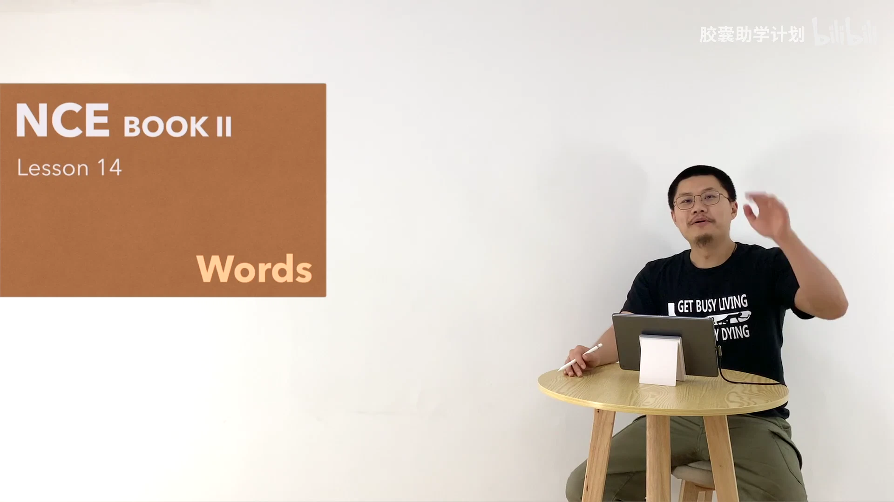

文字识别：胶囊助学计划 / NCE / BOOKII / Lesson 14 / Words / GET BUSY LIVING / YDYING

### 画面 00:00:05

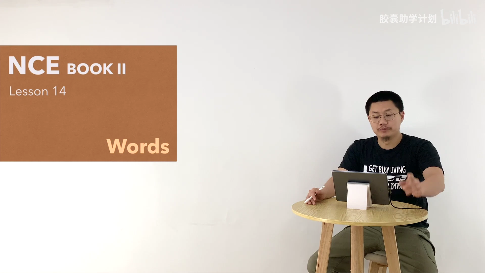

文字识别：胶囊助学计划 / NCE / BOOKI"I / Lesson 14 / Words / IGET BUSY LVING / DYIN

### 画面 00:00:09

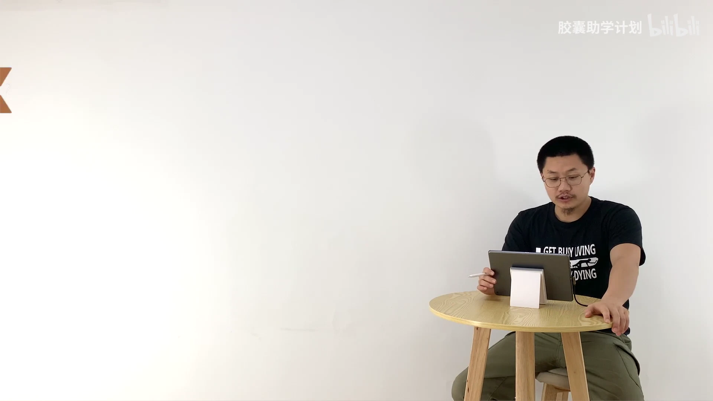

文字识别：胶囊助学计划 /  GET RIIY VING / DYING

### 画面 00:00:11

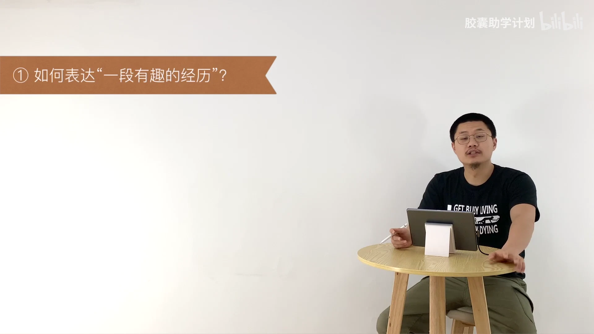

文字识别：胶囊助学计划 / ①如何表达“一段有趣的经历”？ / GFT RIIY LNING / YDYING

### 画面 00:00:15

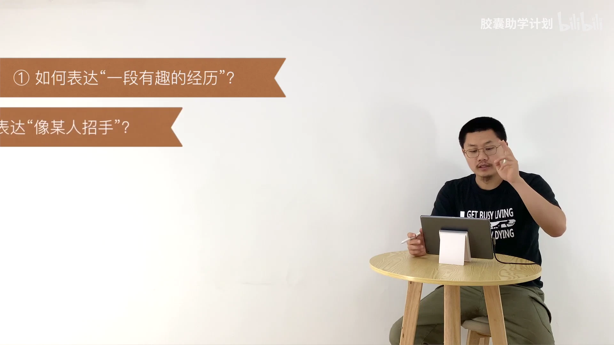

文字识别：胶囊助学计划 / ①如何表达“一段有趣的经历” / 表达“像某人招手”? / GET RUSY LVING / YDYING

### 画面 00:00:17

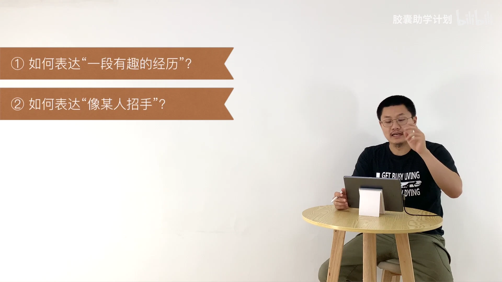

文字识别：胶囊助学计划 / ①如何表达“一段有趣的经历”? / 如何表达“像某人招手”? / GET RISY LVING / DYING

### 画面 00:00:20

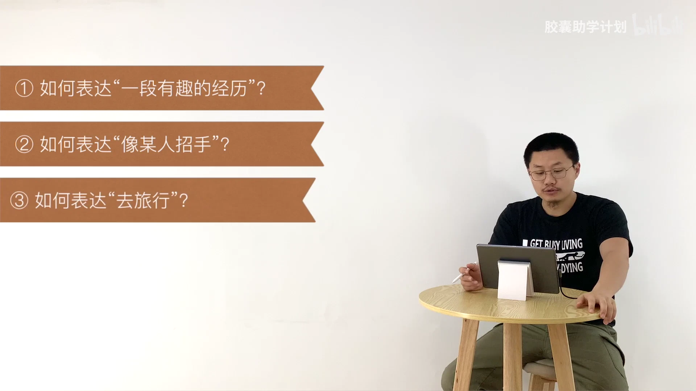

文字识别：胶囊助学计划 / ①如何表达“一段有趣的经历” / 如何表达“像某人招手” / 如何表达“去旅行”? / GFT RIIY LVING / VDYING

### 画面 00:00:22

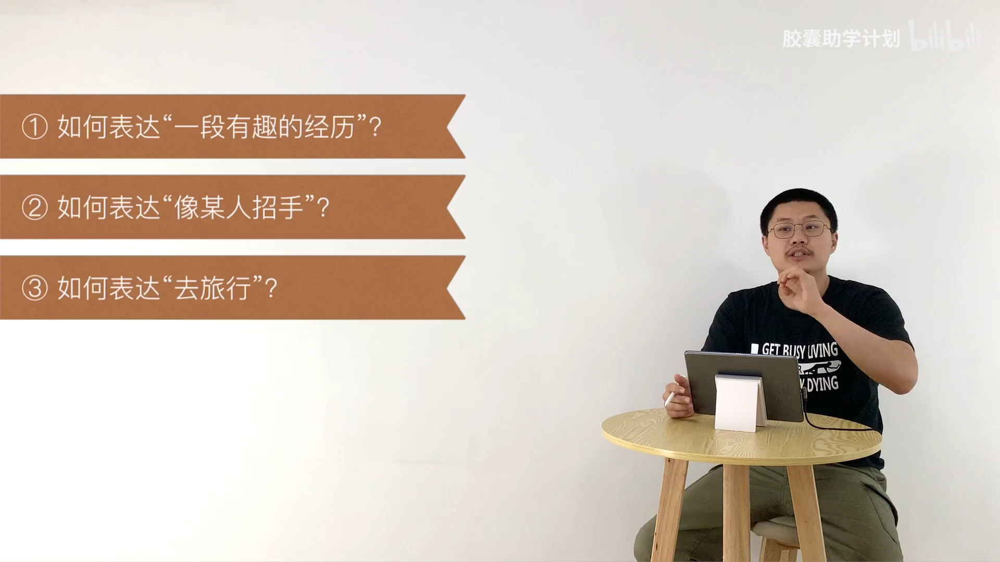

文字识别：胶囊助学计划 / ①如何表达“一段有趣的经历” / 如何表达“像某人招手” / 如何表达“去旅行”? / GET RIISY UVING / VDYING

### 画面 00:00:25

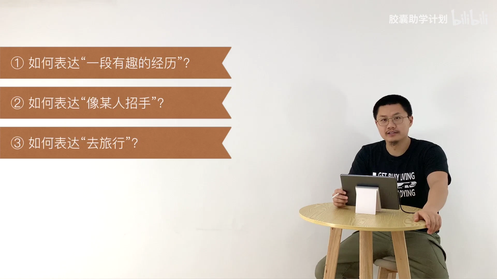

文字识别：胶囊助学计划 / ①如何表达“一段有趣的经历”? / 如何表达“像某人招手” / 如何表达“去旅行”? /  CET DIY VING / DYING

### 画面 00:00:27

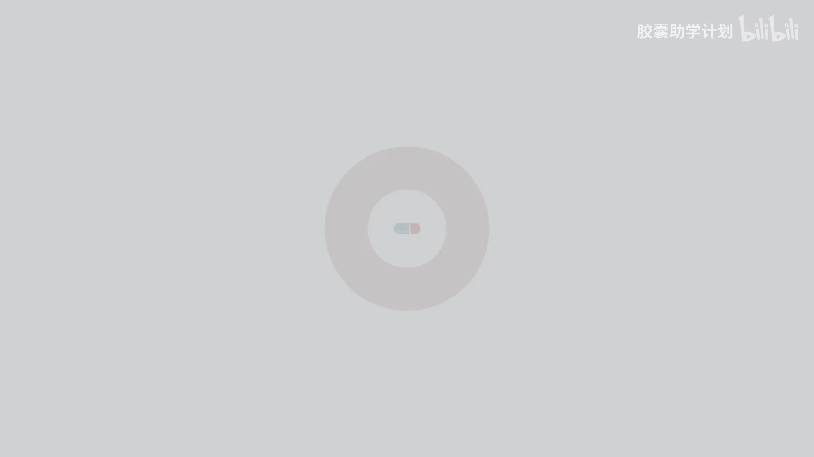

文字识别：胶囊助学计划bill

## 00:00:30–00:01:00

好，那我们上来先看第一个小的单词啊，我们看一下音标，来，a amusing，OK，连起来读 amusing，注意啊，这个地方注意小仙儿，不要仅仅因为后边有 ing 就以为它是一个动词的现在分词，对吧？它也可能是形容词，比如说咱们之前就学过的 exciting，interesting，amusing，今天学到的，对吧？那 amusing 的意思就表示很有趣

### 画面 00:00:30

### 画面 00:00:32

文字识别：单词造句指南 / 网：v.+v.变化 / 胶囊助学计划 / 四句型转换 / 方式/地点/时间 / 结合习惯用法 / 其他单词+词性 / 原文摘抄+变 / 6123456 / /a'mjuizin/ / amusing adj. / USYVING / R / DYING

### 画面 00:00:34

文字识别：单词造句指南 / 网：v.+v.变化 / 胶囊助学计划 / 四句型转换 / 方式/地点/时间 / 结合习惯用法 / 其他单词+词性 / 原文摘抄+变 / 6123456 / /a'mjuizin/ / amusing adj. / BUSY VING / R. / RDVING

### 画面 00:00:36

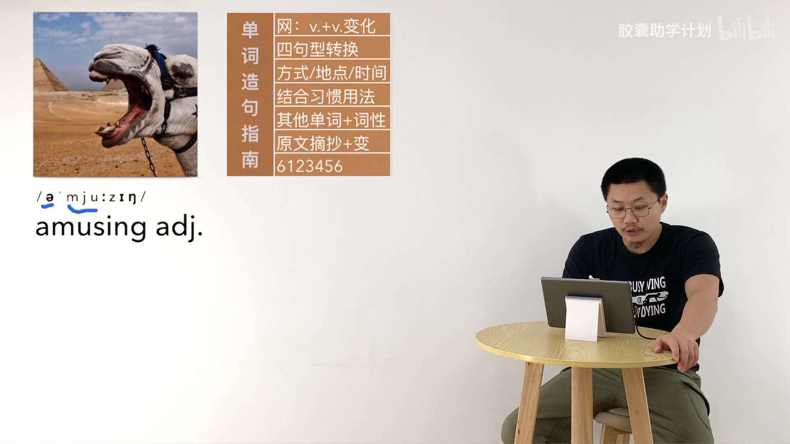

文字识别：单词造句指南 / 网：v.+v.变化 / 胶囊助学计划 / 四句型转换 / 方式/地点/时间 / 结合习惯用法 / 其他单词+词性 / 原文摘抄+变 / 6123456 / /a'mju:zin/ / amusing adj. / USY VING / DVING

### 画面 00:00:39

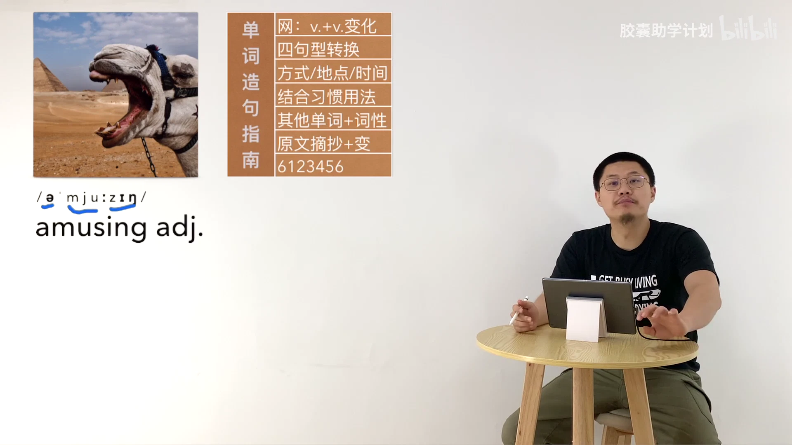

文字识别：单词造句指南 / 网：v.+v.变化 / 胶囊助学计划 / 四句型转换 / 方式/地点/时间 / 结合习惯用法 / 其他单词+词性 / 原文摘抄+变 / 6123456 / /a'mjuizin / amusing adj. / CET DIVY NING

### 画面 00:00:41

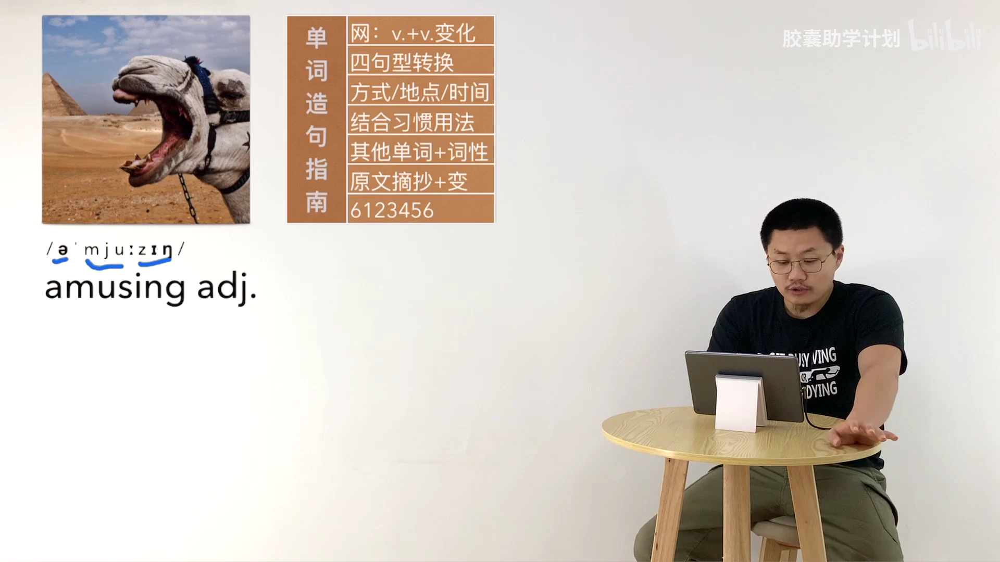

文字识别：单词造句指南 / 网：v.+v.变化 / 胶囊助学计划 / 四句型转换 / 方式/地点/时间 / 结合习惯用法 / 其他单词+词性 / 原文摘抄+变 / 6123456 / /a'mjuizin / amusing adj. / JYVING / RDYING

### 画面 00:00:44

文字识别：单词造句指南 / 网：v.+v.变化 / 胶囊助学计划 / 四句型转换 / 方式/地点/时间 / 结合习惯用法 / 其他单词+词性 / 原文摘抄+变 / 6123456 / /a'mju:zIn / amusing / adj. / VING / ANING

### 画面 00:00:46

文字识别：单词造句指南 / 网：v.+v.变化 / 胶囊助学计划 / 四句型转换 / 方式/地点/时间 / 结合习惯用法 / 其他单词+词性 / 原文摘抄+变 / 6123456 / /a'mju:zin / amusing / adj. / YVING / PINING

### 画面 00:00:50

文字识别：单词造句指南 / 网：v.+v.变化 / 胶囊助学计划 / 四句型转换 / 方式/地点/时间 / 结合习惯用法 / 其他单词+词性 / 原文摘抄+变 / 6123456 / /a'mju:zIn / amusing / adj. / CY/NING / YING

### 画面 00:00:55

文字识别：单词造句指南 / 网：v.+v.变化 / 胶囊助学计划 / 四句型转换 / 方式/地点/时间 / 结合习惯用法 / 其他单词+词性 / 原文摘抄+变 / 6123456 / /a'mju:zin / amusing / adj. / YVING / VING

## 00:01:00–00:01:30

啊，有点类似于我们之前学过的 interesting 或者说 funny 啊，是有类似的重合点在里面的，不完全相同 amusing。那它是个形容词，我们造句基本上可能就要配合着另一个词性名词了，对吧？OK，当然了，不，你直接说 this is amusing， this is interesting 也是可以的。那 is 其实也算 be 动词嘛，对不对？OK，那我们就可以结合一个我们之前学过的啊， fine 加

### 画面 00:01:00

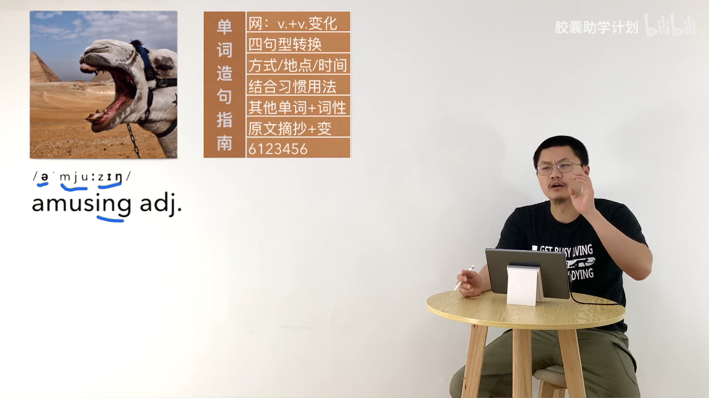

文字识别：单词造句指南 / 网：v.+v.变化 / 胶囊助学计划 / 四句型转换 / 方式/地点/时间 / 结合习惯用法 / 其他单词+词性 / 原文摘抄+变 / 6123456 / /a'mjuizIn / amusing / adj. / GET DLIY VING / DYING

### 画面 00:01:05

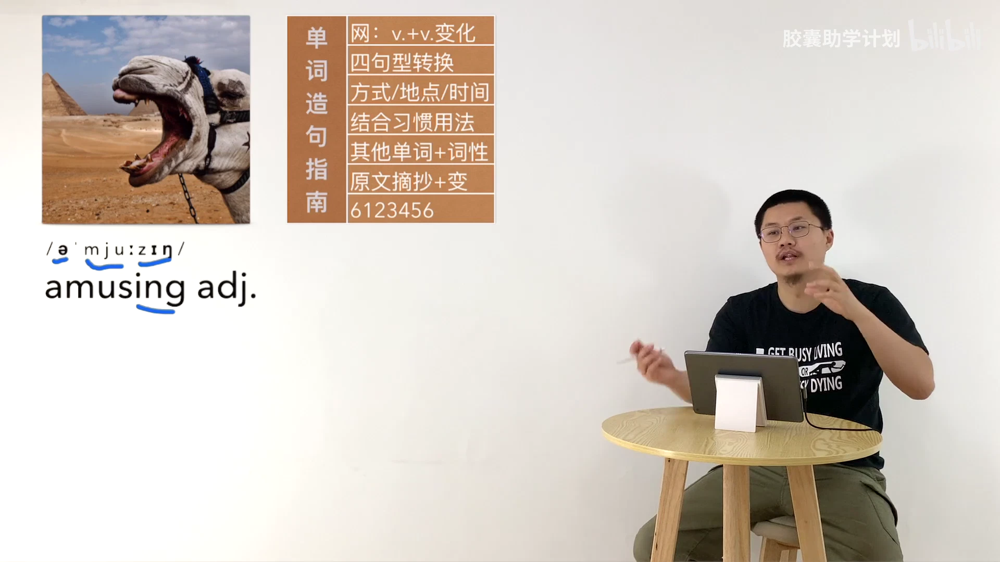

文字识别：单词造句指南 / 网：v.+v.变化 / 胶囊助学计划 / 四句型转换 / 方式/地点/时间 / 结合习惯用法 / 其他单词+词性 / 原文摘抄+变 / 6123456 / /a'mju:zIn / amusing / adj. /  CET BUSY LVING / ORT / YDYING

### 画面 00:01:10

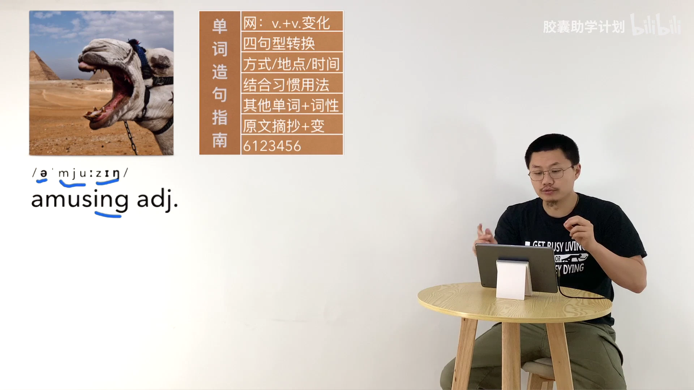

文字识别：单词造句指南 / 网：v.+v.变化 / 胶囊助学计划 / 四句型转换 / 方式/地点/时间 / 结合习惯用法 / 其他单词+词性 / 原文摘抄+变 / 6123456 / /a'mjuizIn / amusing / adj. / GET DUJSY UVIN / SYDYING

### 画面 00:01:14

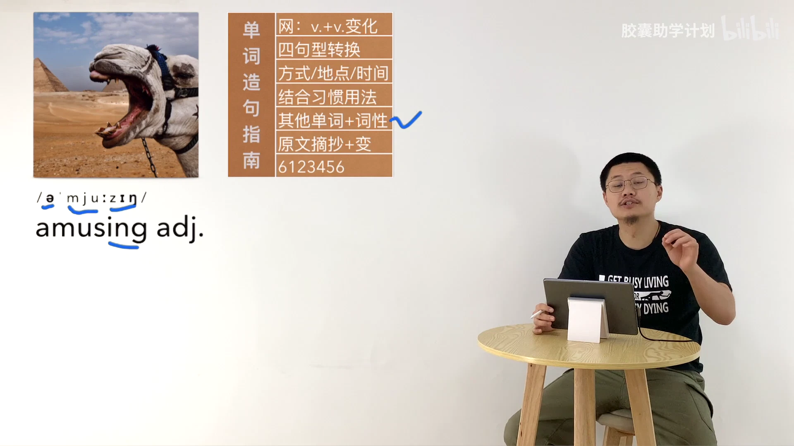

文字识别：单词造句指南 / 网：v.+v.变化 / 胶囊助学计划 / 四句型转换 / 方式/地点/时间 / 结合习惯用法 / 其他单词+词性 / 原文摘抄+变 / 6123456 / /a'mju:zIn / amusing / adj. / GET DISY VING / R / YDYING

### 画面 00:01:16

文字识别：单词造句指南 / 网：v.+v.变化 / 胶囊助学计划 / 四句型转换 / 方式/地点/时间 / 结合习惯用法 / 其他单词+词性 / 原文摘抄+变 / 6123456 / ® / /a'mju:zin / amusing / adj. / GET RIISY UVING / KDYING

### 画面 00:01:20

文字识别：单词造句指南 / 网：v.+v.变化 / 胶囊助学计划 / 四句型转换 / 方式/地点/时间 / 结合习惯用法 / 其他单词+词性 / 原文摘抄+变 / 6123456 / /a'mjuizin / adj. / amusing / GET DIISY LVIN / DYING

### 画面 00:01:25

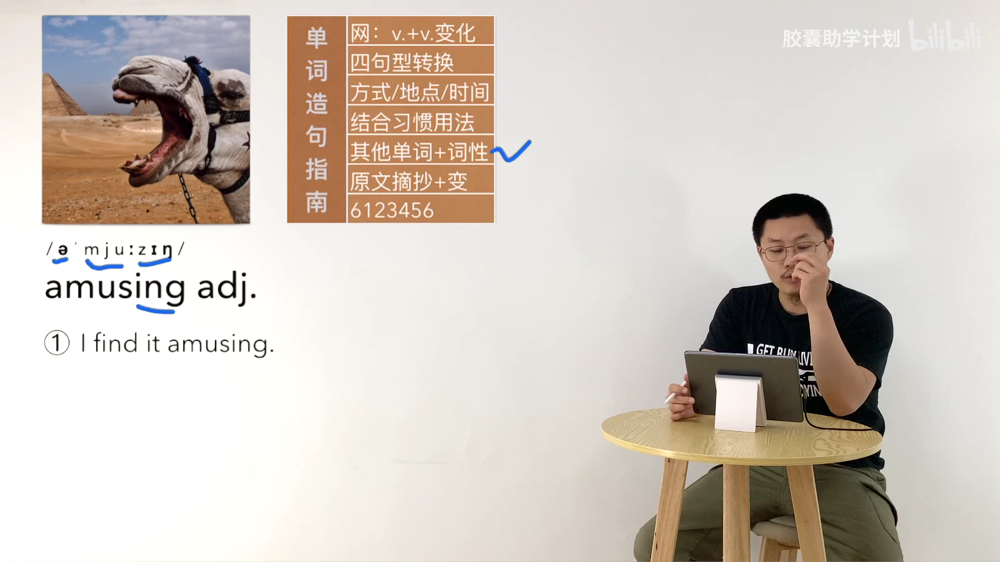

文字识别：单词造句指南 / 网：v.+v.变化 / 胶囊助学计划 / 四句型转换 / 方式/地点/时间 / 结合习惯用法 / 其他单词+词性 / 原文摘抄+变 / 6123456 / /a'mjuizin / amusing / adj. /  I find it amusing. / 1 / GFT RIIN / IV

## 00:01:30–00:02:00

名词再加一个形容词啊，认为某件事情怎么怎么样。比如说 I find it amusing. 这有一个小的连读，注意注意一下啊，叫 find it 而不是 find it 啊 find it. Okay, so I find it amusing. 就我觉得这事儿啊还挺有意思的. Okay, 那这个事儿呢可以是之前您说的任何一件事情. 就 I find it amusing. Okay, next one, 我们可以加一个 took part in. 你看一下我这个句子怎么造出来的啊？各位在这儿要学的是

### 画面 00:01:30

文字识别：单词造句指南 / 网：v.+v.变化 / 胶囊助学计划 / 四句型转换 / 方式/地点/时间 / 结合习惯用法 / 其他单词+词性 / 原文摘抄+变 / 6123456 / /a'mjuizin / amusing / adj. / ① I find it amusing.

### 画面 00:01:35

文字识别：单词造句指南 / 网：v.+v.变化 / 胶囊助学计划 / 四句型转换 / 方式/地点/时间 / 结合习惯用法 / 其他单词+词性 / 原文摘抄+变 / 6123456 / /a'mjuizin / adj. / amusing /  I find it amusing. / 1

### 画面 00:01:40

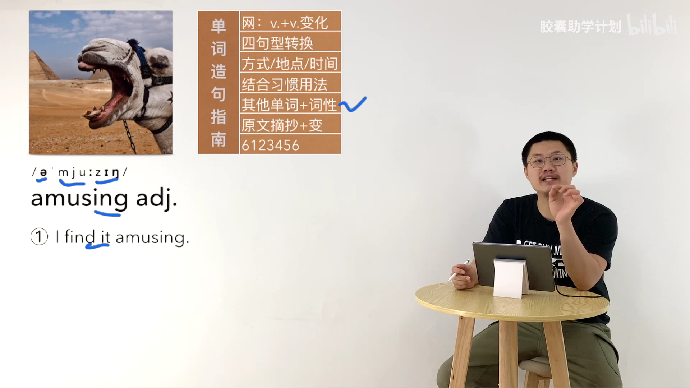

文字识别：单词造句指南 / 网：v.+v.变化 / 胶囊助学计划 / 四句型转换 / 方式/地点/时间 / 结合习惯用法 / 其他单词+词性 / 原文摘抄+变 / 6123456 / /a'mjuizin / amusing / adj. / ①I find it amusing.

### 画面 00:01:45

文字识别：单词造句指南 / 网：v.+v.变化 / 胶囊助学计划 / 四句型转换 / 方式/地点/时间 / 结合习惯用法 / 其他单词+词性 / 原文摘抄+变 / 6123456 / /a'mju:zin / amusing / adj. / ①I find it amusing.

### 画面 00:01:50

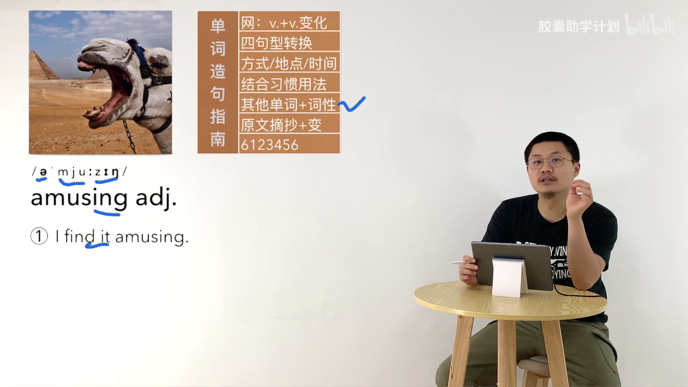

文字识别：单词造句指南 / 网：v.+v.变化 / 胶囊助学计划 / 四句型转换 / 方式/地点/时间 / 结合习惯用法 / 其他单词+词性 / 原文摘抄+变 / 6123456 / /a'mjuizIn / amusing / adj. / ①I find it amusing. / YVIN / VING

### 画面 00:01:54

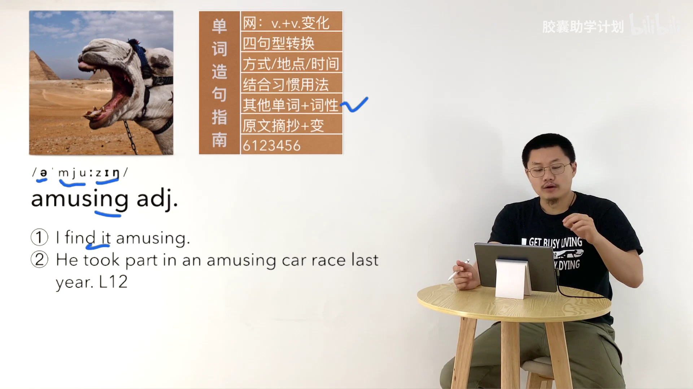

文字识别：单词造句指南 / 网：v.+v.变化 / 胶囊助学计划 / 四句型转换 / 方式/地点/时间 / 结合习惯用法 / 其他单词+词性 / 原文摘抄+变 / 6123456 / /a'mjuizin / adj. / amusing / 1 / )I find it amusing. / GET RUISY LVING / He took part in an amusing car race last / YDYING / year. L12

### 画面 00:01:56

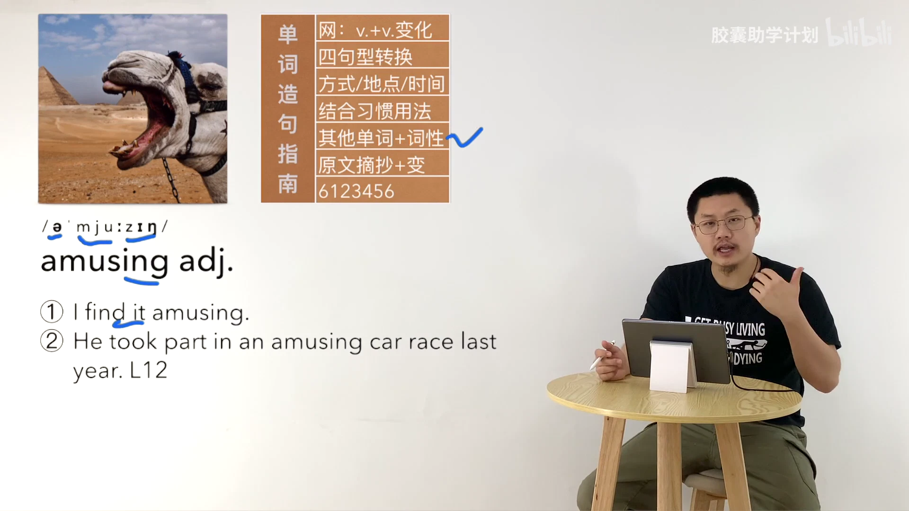

文字识别：单词造句指南 / 网：v.+v.变化 / 胶囊助学计划 / 四句型转换 / 方式/地点/时间 / 结合习惯用法 / 其他单词+词性 / 原文摘抄+变 / 6123456 / /a'mjuizin / amusing / adj. / I find it amusing. / 1 / He took part in an amusing car race last / DYING / year. L12

## 00:02:00–00:02:30

思路。你看，amusing是一个形容词，然后配合了一个car race，合起来是类似于一个名词短语，对吧？汽车比赛。那amusing car race叫一个有趣的汽车比赛。然后怎么用动词跟它连起来呢？十二课咱们学过一个叫做take part in啊，叫做参加参与，对吧？那我们就可以说He took part in an amusing car race last year. OK，然后注意我们用到的时态，动词加动词的变化，用的是一般

### 画面 00:02:00

文字识别：单词造句指南 / 网：v.+v.变化 / 胶囊助学计划 / 四句型转换 / 方式/地点/时间 / 结合习惯用法 / 其他单词+词性 / 原文摘抄+变 / 6123456 / /a'mjuizin / adj. / amusing / )I find it amusing. / 1 / USYVING / He took part in an amusing car race last / IDVING / year. L12

### 画面 00:02:02

文字识别：单词造句指南 / 网：v.+v.变化 / 胶囊助学计划 / 四句型转换 / 方式/地点/时间 / 结合习惯用法 / 其他单词+词性 / 原文摘抄+变 / 6123456 / /a'mju:zIn / adj. / amusing / I find it amusing. / 1 / JSYVING / He took part in an amusing / car race last / DVING / year. L12

### 画面 00:02:04

文字识别：单词造句指南 / 网：v.+v.变化 / 胶囊助学计划 / 四句型转换 / 方式/地点/时间 / 结合习惯用法 / 其他单词+词性 / 原文摘抄+变 / 6123456 / /a'mjuizIn / adj. / amusing / I find it amusing. / 1 / USYVING / He took part in an amusing / car race / last / DYING / year. L12

### 画面 00:02:06

文字识别：单词造句指南 / 网：v.+v.变化 / 胶囊助学计划 / 四句型转换 / 方式/地点/时间 / 结合习惯用法 / 其他单词+词性 / 原文摘抄+变 / 6123456 / /a'mjuizin / adj. / amusing / I find it amusing. / 1 / CFT / 'ISYVING / He took part in an amusing / car race / last / DYING / year. L12

### 画面 00:02:10

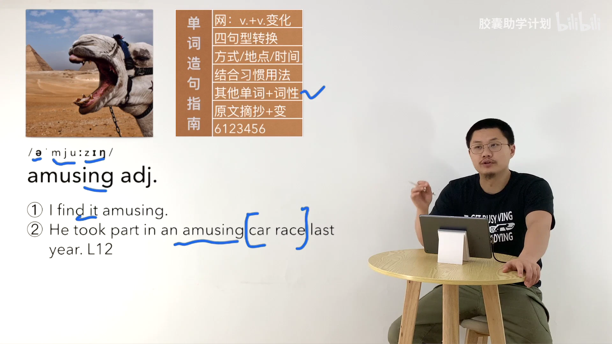

文字识别：单词造句指南 / 网：v.+v.变化 / 胶囊助学计划 / 四句型转换 / 方式/地点/时间 / 结合习惯用法 / 其他单词+词性 / 原文摘抄+变 / 6123456 / /a'mjuizIn / amusing / adj. / I find it amusing. / 1 / UISYVING / He took part in an amusing / car race / last / DYING / year. L12

### 画面 00:02:15

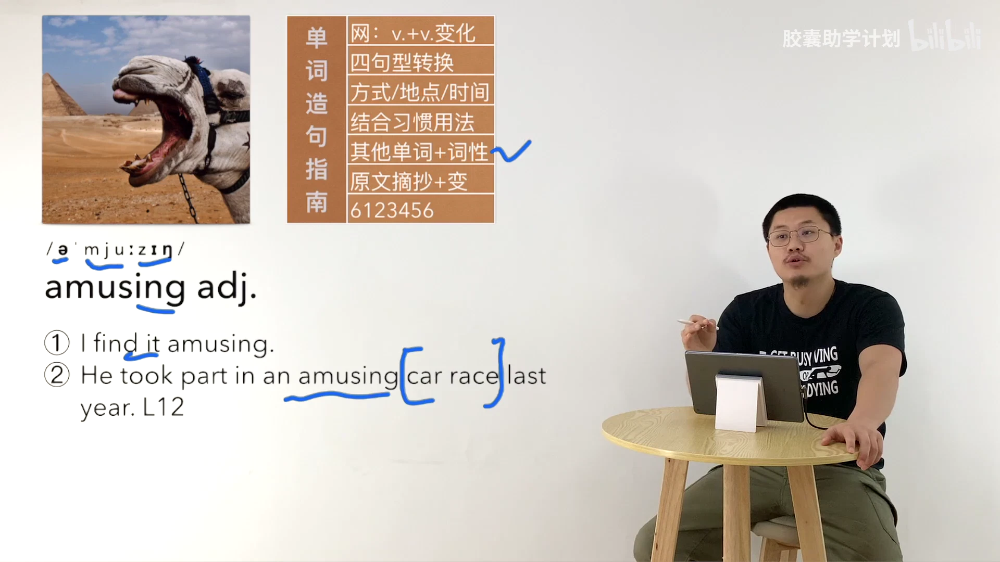

文字识别：单词造句指南 / 网：v.+v.变化 / 胶囊助学计划 / 四句型转换 / 方式/地点/时间 / 结合习惯用法 / 其他单词+词性 / 原文摘抄+变 / 6123456 / /a'mjuizIn / adj. / amusing / I find it amusing. / 1 / USYVING / He took part in an amusing / car race / last / DYING / year. L12

### 画面 00:02:20

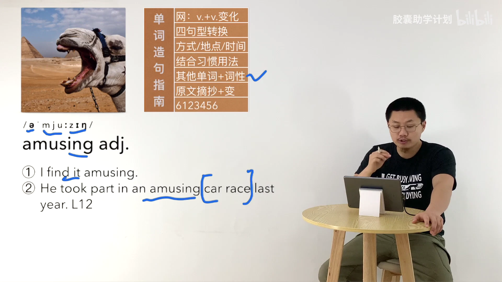

文字识别：单词造句指南 / 网：v.+v.变化 / 胶囊助学计划 / 四句型转换 / 方式/地点/时间 / 结合习惯用法 / 其他单词+词性 / 原文摘抄+变 / 6123456 / /a'mjuizIn / amusing / adj. / I find it amusing. / 1 / IGET BUSY NING / He took part in an amusing / car race / last / R / XDYING / year. L12

### 画面 00:02:25

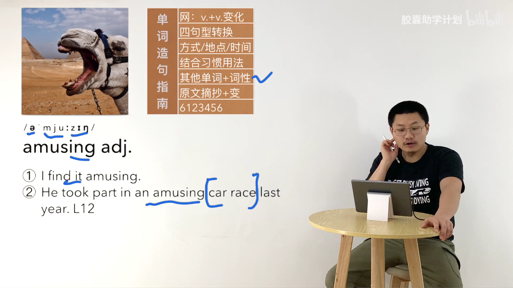

文字识别：单词造句指南 / 网：v.+v.变化 / 胶囊助学计划 / 四句型转换 / 方式/地点/时间 / 结合习惯用法 / 其他单词+词性 / 原文摘抄+变 / 6123456 / /a'mjuizIn / adj. / amusing / I find it amusing. / 1 / SYIVING / He took part in an amusing / car race / last / R / IDYING / year. L12

## 00:02:30–00:03:00

过去式，OK，那这是个肯定句，您自己课下可以进行四句型转换。来了，接下来我们配合十三课，will be doing，这是我们刚刚学过的，各位希望您还记得，表示将来进行时。说，She will be taking part in an amusing car race next week。你看第二句话和第三句话唯一的区别，其实第二句话造出来，第三句话您应该就能造出来了，无非只是换了一点点

### 画面 00:02:30

文字识别：单词造句指南 / 网：v.+v.变化 / 胶囊助学计划 / 四句型转换 / 方式/地点/时间 / 结合习惯用法 / 其他单词+词性 / 原文摘抄+变 / 6123456 / /a'mjuizin / adj. / amusing / Ifind it amusing. / 1 / GET LISY NING / He took part in an amusing / car race / last / DYING / year. L12

### 画面 00:02:34

文字识别：单词造句指南 / 网：v.+v.变化 / 胶囊助学计划 / 四句型转换 / 方式/地点/时间 / 结合习惯用法 / 其他单词+词性 / 原文摘抄+变 / 6123456 / /amjuizIn / adj. / amusing / I find it amusing. / 1 / 'ISYNING / He took part in an amusing / car race / last / DYING / year. L12

### 画面 00:02:36

文字识别：单词造句指南 / 网：v.+v.变化 / 胶囊助学计划 / 四句型转换 / 方式/地点/时间 / 结合习惯用法 / 其他单词+词性 / 原文摘抄+变 / 6123456 / /a'mjuizin / amusing adj. / ①I find it amusing. / GET BIY VNING / He took part in an amusing / car race / last / MDYING / year. L12 / She will be taking part in an amusing car / race next week. L13

### 画面 00:02:38

文字识别：单词造句指南 / 网：v.+v.变化 / 胶囊助学计划 / 四句型转换 / 方式/地点/时间 / 结合习惯用法 / 其他单词+词性 / 原文摘抄+变 / 6123456 / /a'mjuizin / adj. / amusing / ① I find it amusing. / "UISY.NVING / He took part in an amusing / car race / last / OR / YDYING / year. L12 / She will be taking part in an amusing car / race next week.L13

### 画面 00:02:40

文字识别：单词造句指南 / 网：v.+v.变化 / 胶囊助学计划 / 四句型转换 / 方式/地点/时间 / 结合习惯用法 / 其他单词+词性 / 原文摘抄+变 / 6123456 / /a'mjuizin / amusing / adj. / ①I find it amusing. / USYVING / He took part in an amusing / car race / last / IDYING / year. L12 / She will be taking part in an amusing / car / next week.L13 / race

### 画面 00:02:45

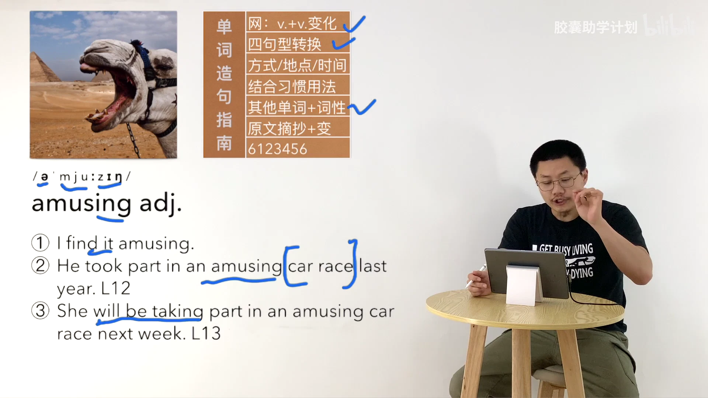

文字识别：单词造句指南 / 网：v.+v.变化 / 胶囊助学计划 / 四句型转换 / 方式/地点/时间 / 结合习惯用法 / 其他单词+词性 / 原文摘抄+变 / 6123456 / /a'mjuizin / adj. / amusing / ① I find it amusing. / GET RIY LVING / He took part in an amusing / car race / last / VDYING / year. L12 / She will be taking part in an amusing car / next week.L13 / race

### 画面 00:02:50

文字识别：单词造句指南 / 网：v.+v.变化 / 胶囊助学计划 / 四句型转换 / 方式/地点/时间 / 结合习惯用法 / 其他单词+词性 / 原文摘抄+变 / 6123456 / /a'mjuizin / adj. / amusing / ①I find it amusing. /  GET PIY NING / He took part in an amusing / car race / last / DYING / year. L12 / She will be taking part in an amusing car / next week.L13 / race

### 画面 00:02:53

文字识别：单词造句指南 / 网：v.+v.变化 / 胶囊助学计划 / 四句型转换 / 方式/地点/时间 / 结合习惯用法 / 其他单词+词性 / 原文摘抄+变 / 6123456 / /a'mjuizin / amusing / adj. / I find it amusing. / 1 / USYVING / He took part in an amusing / car race / last / DYING / year. L12 / She / will be taking part in an amusing  / car / next week. L13 / race

### 画面 00:02:55

文字识别：单词造句指南 / 网：v.+v.变化 / 胶囊助学计划 / 四句型转换 / 方式/地点/时间 / 结合习惯用法 / 其他单词+词性 / 原文摘抄+变 / 6123456 / /a'mju:zIn / amusing / adj. / I find it amusing. / 1 / USYVING / He took part in an amusing / car race / last / SIPDYING / year. L12 / She will be taking part in an amusing car / next week.L13 / race

## 00:03:00–00:03:30

时间，对吧？你从过去转到未来，肯定是要换时间的。其次呢，就是换了一下动词的变化形式。我在这儿呢，具体展现形式就是从一般过去时换成了将来进行时。 Okay, very good. 接下来我们看一个小的电影片段，它当中就出现了叫 I find it amusing. 我们做一个小的听力训练. How difficult could it possibly be to play the great banter? You can go back to being yourself now, Ruth. For nothing. I'd rather be him for now.

### 画面 00:03:00

文字识别：单词造句指南 / 网：v.+v.变化 / 胶囊助学计划 / 四句型转换 / 方式/地点/时间 / 结合习惯用法 / 其他单词+词性 / 原文摘抄+变 / 6123456 / /a'mjuizIn / amusing / adj. / I find it amusing. / 1 / JSYVING / He took part in an amusing / last / car race / IDVING / year. L12 / She / e will be taking part in an amusing / car / next week. L13 / race

### 画面 00:03:05

文字识别：单词造句指南 / 网：v.+v.变化 / 胶囊助学计划 / 四句型转换 / 方式/地点/时间 / 结合习惯用法 / 其他单词+词性 / 原文摘抄+变 / 6123456 / /amjuizin / amusing / adj. / I find it amusing. / 1 / SYVING / He took part in an amusing / car race / last / DYING / year. L12 / She / will be taking part in an amusing / car / race / next week. L13

### 画面 00:03:07

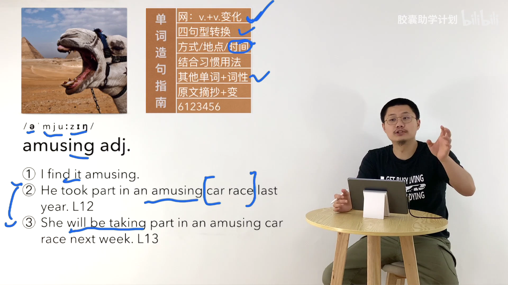

文字识别：单词造句指南 / 网：v.+v.变化 / 胶囊助学计划 / 四句型转换 / 方式/地点/付间 / 结合习惯用法 / 其他单词+词性 / 原文摘抄+变 / 6123456 / /a'mjuizin / amusing / adj. / I find it amusing. / 1 / GET DIY VING / He took part in an amusing / car race / last / DYING / year. L12 / She / e will be taking part in an amusing car / next week.L13 / race

### 画面 00:03:10

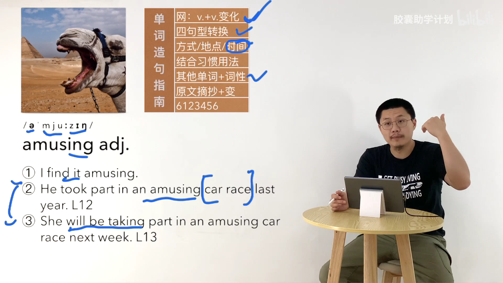

文字识别：单词造句指南 / 网：v.+v.变化 / 胶囊助学计划 / 四句型转换 / 方式/地点/时间 / 结合习惯用法 / 其他单词+词性 / 原文摘抄+变 / 6123456 / /amju:zIn / adj. / amusing / I find it amusing. / 1 /  CRT PIY NING / He took part in an amusing / car race / last / MDYING / year. L12 / She / will be taking part in an amusing / car / race / next week. L13

### 画面 00:03:14

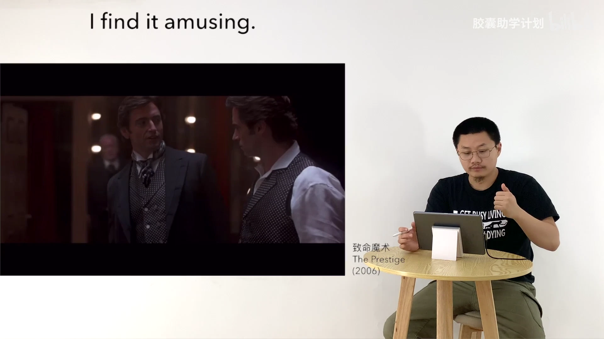

文字识别：I find it amusing. / 胶囊助学计划 /  CRT PUSY NINC / DYING / 致命魔术 / The Prestige / (2006)

### 画面 00:03:23

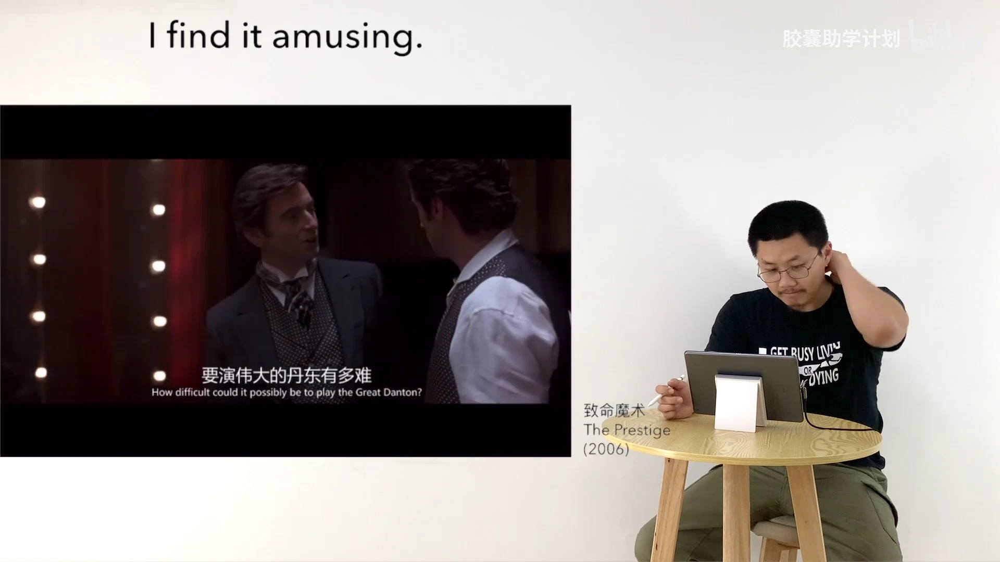

文字识别：I find it amusing. / 胶囊助学计划 /  GET BUSY LN / 要演伟大的丹东有多难 / OVING / OR / How difficult could it possibly be to play the Great Danton? / 致命魔术 / The Prestige / (2006)

### 画面 00:03:25

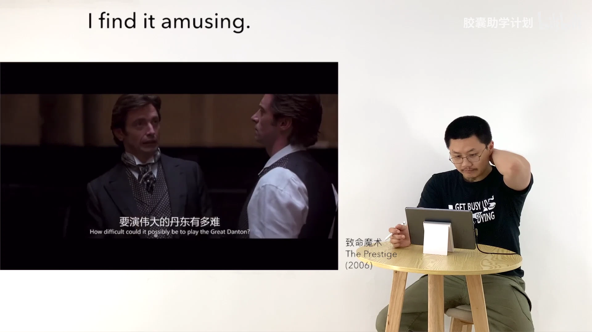

文字识别：I find it amusing. /  GFT BUSY UIN / OVING / 要演伟大的丹东有多难 / How dificult could it possibly be to play the Great Danton? / 致命魔术 / The Prestige / (2006)

### 画面 00:03:27

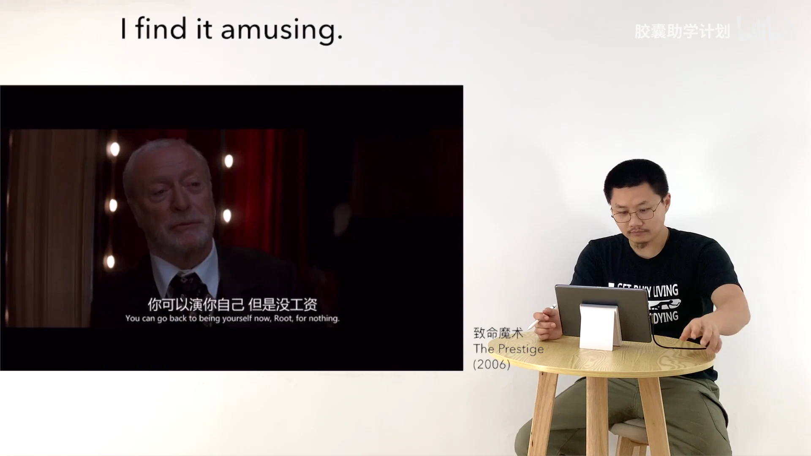

文字识别：I find it amusing. / 胶囊助学计划 / 你可以演你自己但是没工资 / You can go back to being yourself now, Root, for nothing. / DYING / 致命魔术 / The Prestige / (2006)

### 画面 00:03:29

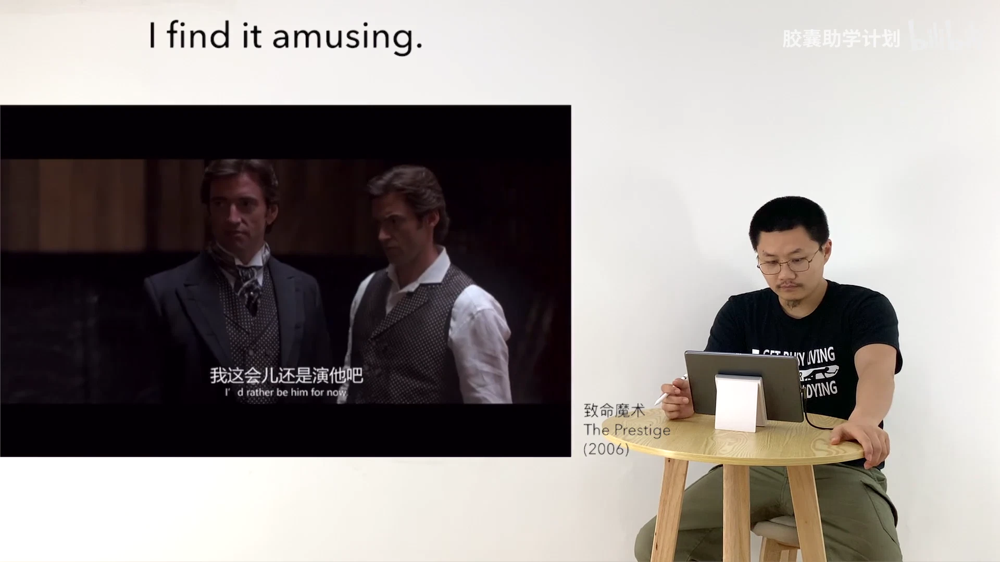

文字识别：I find it amusing. / 胶囊助学计划 /  Y NG / 我这会儿还是演他吧 / I d rather be him for now / YDYING / 致命魔术 / The Prestige / (2006)

## 00:03:30–00:04:00

I find it amusing. Okay, I find it amusing.啊，我觉得这事儿还挺有意思的，很有趣。Okay, continue. 下一个单词比较的长，我们还是看一下音节，叫做 experience.啊，看，其实虽然只有三个音节，但每个音节还都挺长。注意这个地方的 p，要把它浊化成 b.啊，这是我们早在新一和音标的课程当中就给大家讲解过的。如果您现在

### 画面 00:03:31

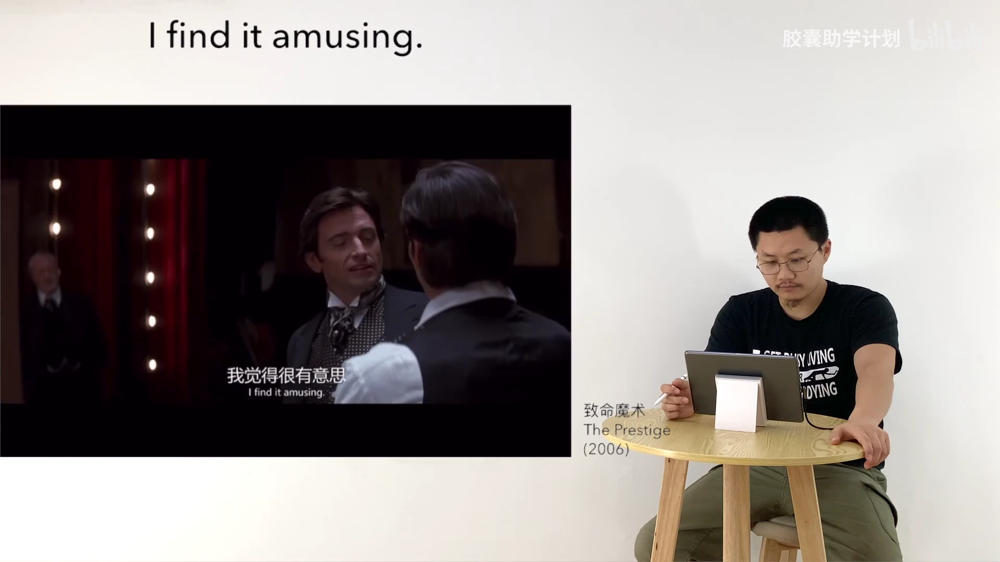

文字识别：I find it amusing. / 胶囊助学计划 / 我觉得很有意思 / I find it amusing. / DVING / 致命魔术 / The Prestige / (2006)

### 画面 00:03:33

文字识别：I find it amusing. / 胶囊助学计划 / 我觉得很有意思 / I find it amusing. / NDYING / 致命魔术 / The Prestige / (2006)

### 画面 00:03:40

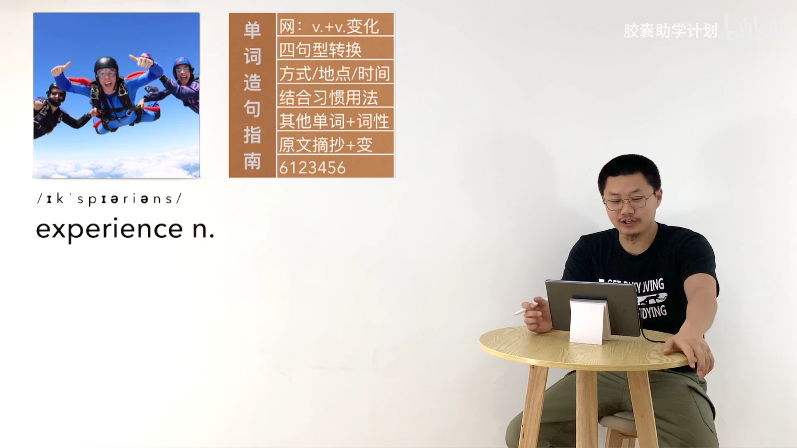

文字识别：单词造句指南 / 网：v.+v.变化 / 胶囊助学计划 / 四句型转换 / 方式/地点/时间 / 结合习惯用法 / 其他单词+词性 / 原文摘抄+变 / 6123456 / /ik'spiarians/ / experience n. / TDYING

### 画面 00:03:42

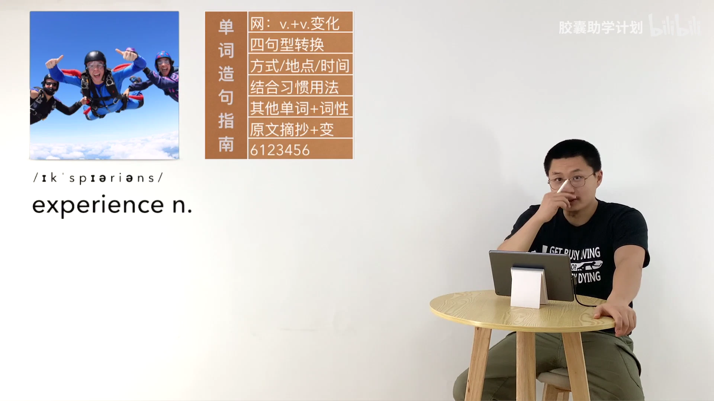

文字识别：单词造句指南 / 网：v.+v.变化 / 胶囊助学计划 / 四句型转换 / 方式/地点/时间 / 结合习惯用法 / 其他单词+词性 / 原文摘抄+变 / 6123456 / /ik'spiarians/ / experience n. / IGET BUY NING / OR / YDYING

### 画面 00:03:45

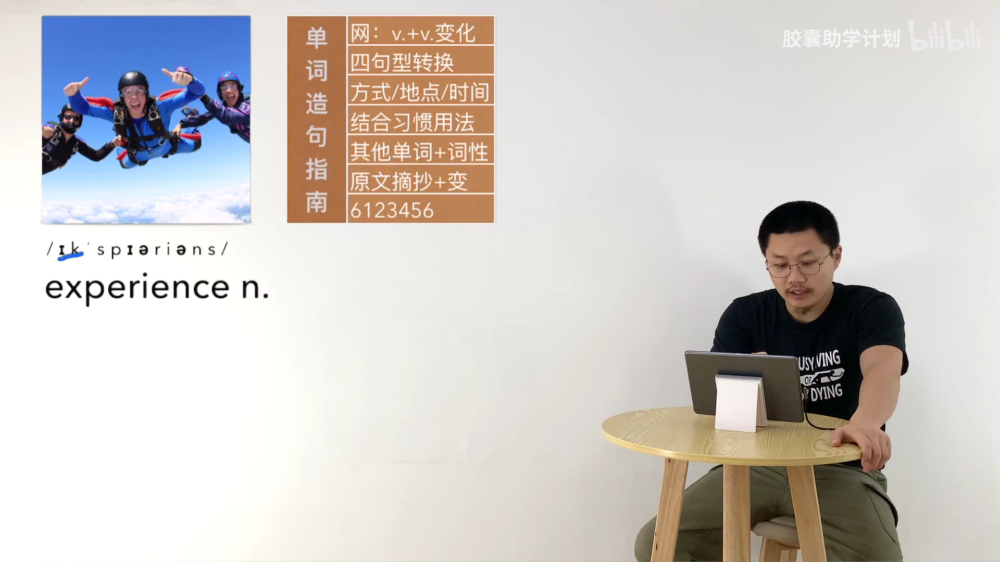

文字识别：单词造句指南 / 网：v.+v.变化 / 胶囊助学计划 / 四句型转换 / 方式/地点/时间 / 结合习惯用法 / 其他单词+词性 / 原文摘抄+变 / 6123456 / Ik'spiarians/ / experience n. / USYVING / YDYING

### 画面 00:03:48

文字识别：单词造句指南 / 网：v.+v.变化 / 胶囊助学计划 / 四句型转换 / 方式/地点/时间 / 结合习惯用法 / 其他单词+词性 / 原文摘抄+变 / 6123456 / spiarians/ / experience n. / GET DIY NING / R / MDYING

### 画面 00:03:53

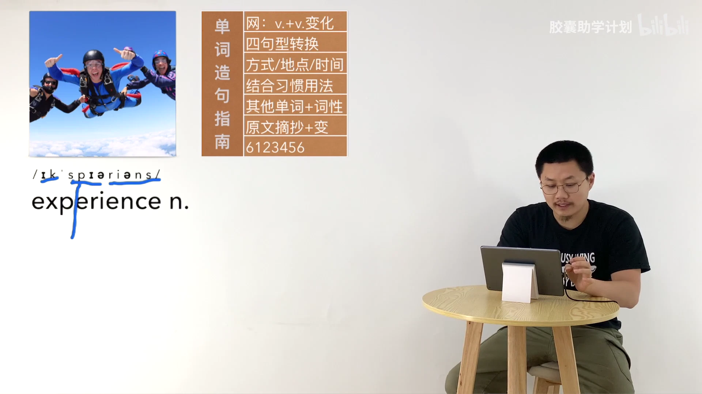

文字识别：单词造句指南 / 网：v.+v.变化 / 胶囊助学计划 / 四句型转换 / 方式/地点/时间 / 结合习惯用法 / 其他单词+词性 / 原文摘抄+变 / 6123456 / spiarians/ / exp / erience n.

### 画面 00:03:55

文字识别：单词造句指南 / 网：v.+v.变化 / 胶囊助学计划 / 四句型转换 / 方式/地点/时间 / 结合习惯用法 / 其他单词+词性 / 原文摘抄+变 / 6123456 / spiariansl / exp / erience n. / GFTRI / USY LVING / OR

### 画面 00:03:57

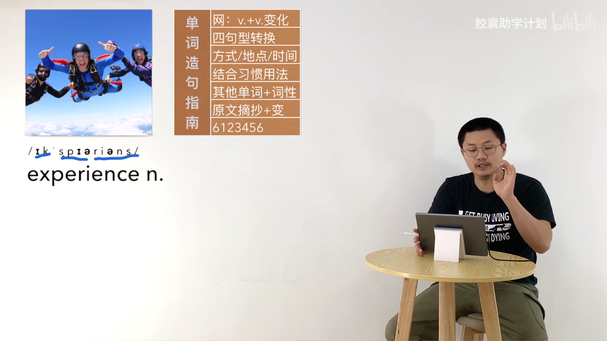

文字识别：单词造句指南 / 网：v.+v.变化 / 胶囊助学计划 / 四句型转换 / 方式/地点/时间 / 结合习惯用法 / 其他单词+词性 / 原文摘抄+变 / 6123456 / spiariansl / experience n. / GETRI / 'SYIVING / DYING

## 00:04:00–00:04:30

还不会或这个知识点有点薄弱，不妨翻过去再看一下我们之前给大家录的这个音标的视频啊，来，跟一起读 experience experience experience，它指的是一个名词，指的是我们的一个体验或经验啊。OK，那我们就可以把刚刚学过的 amusing 形容词和 experience 连到一起了，那叫做 amusing experience，叫做一个有趣的经历。那说我有过一个很有趣的经历，对吧？啊，我经

### 画面 00:04:06

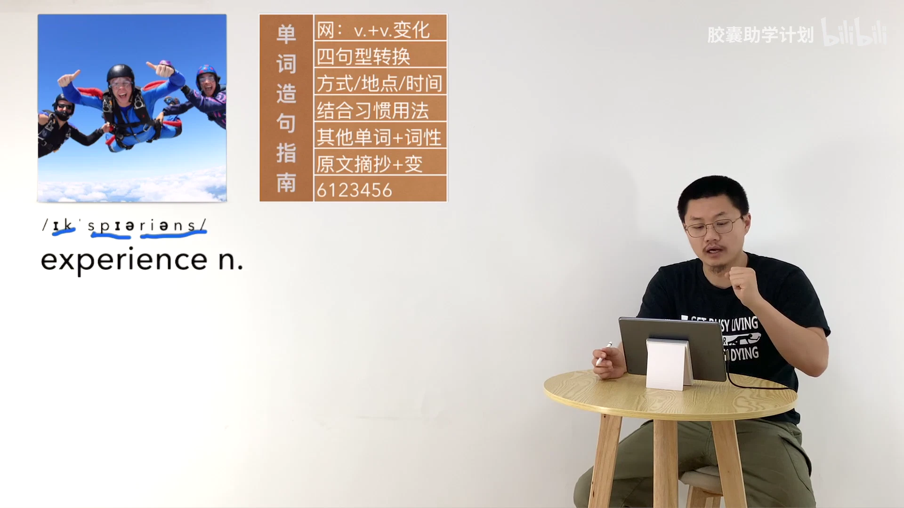

文字识别：单词造句指南 / 网：v.+v.变化 / 胶囊助学计划 / 四句型转换 / 方式/地点/时间 / 结合习惯用法 / 其他单词+词性 / 原文摘抄+变 / 6123456 / spiarians/ / experience n. / 'SY INING / IDYING

### 画面 00:04:10

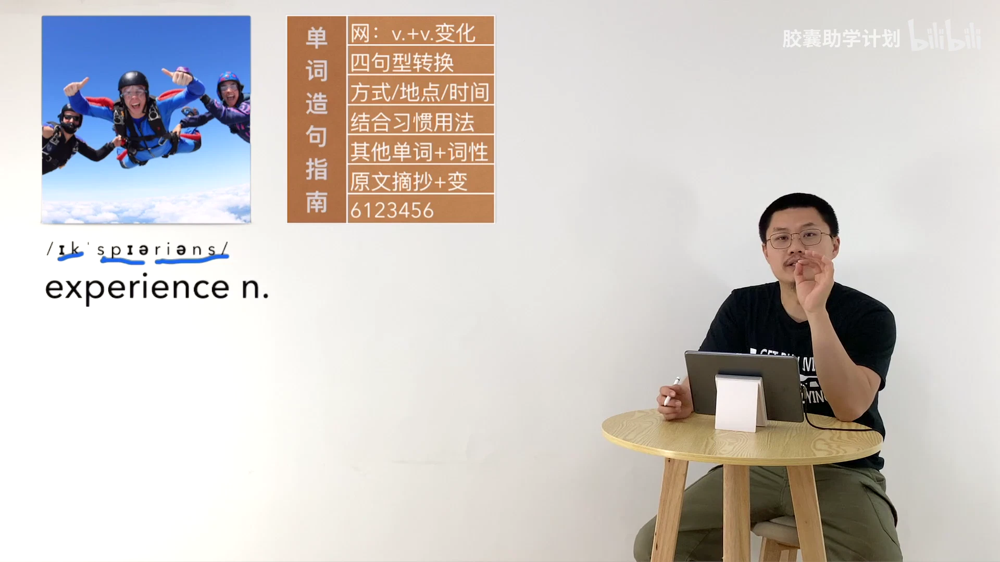

文字识别：单词造句指南 / 网：v.+v.变化 / 胶囊助学计划 / 四句型转换 / 方式/地点/时间 / 结合习惯用法 / 其他单词+词性 / 原文摘抄+变 / 6123456 / spiarians/ / experience n. / M

### 画面 00:04:17

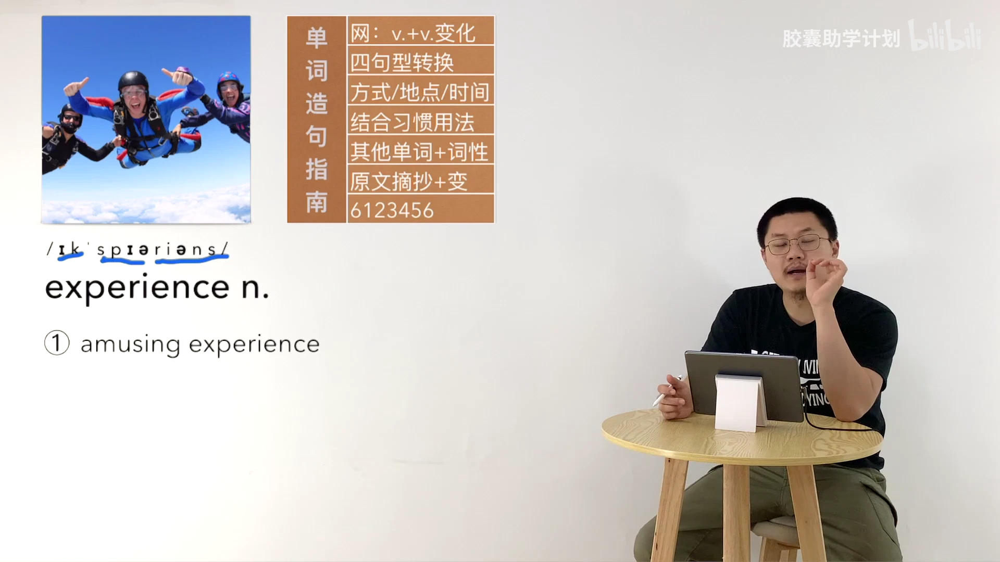

文字识别：单词造句指南 / 网：v.+v.变化 / 胶囊助学计划 / 四句型转换 / 方式/地点/时间 / 结合习惯用法 / 其他单词+词性 / 原文摘抄+变 / 6123456 / spiarians/ / experience n. / amusinge / experience / YIN

### 画面 00:04:22

文字识别：单词造句指南 / 网：v.+v.变化 / 胶囊助学计划 / 四句型转换 / 方式/地点/时间 / 结合习惯用法 / 其他单词+词性 / 原文摘抄+变 / 6123456 / spiarians/ / experience n. / amusing / experience / VIN

## 00:04:30–00:05:00

历过一个很有趣的事情。怎么说呢？叫做 have an amusing experience。这个小的短语，各位要把它记住。短语有了，接下来就配合一些动词加动词的变化，也就是时态。当然也可以是情态动词啊。来，比如说原文给了一句话，叫做啊，我们原文摘抄加一下变啊。I had an amusing experience last year. 我去年啊，有一段特别有趣的经历啊，经历了一段特别有趣的故啊事

### 画面 00:04:34

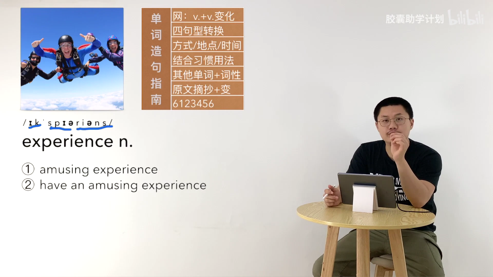

文字识别：单词造句指南 / 网：v.+v.变化 / 胶囊助学计划 / 四句型转换 / 方式/地点/时间 / 结合习惯用法 / 其他单词+词性 / 原文摘抄+变 / 6123456 / spiarians/ / experience n. / amusing experience / have an amusing experience

### 画面 00:04:37

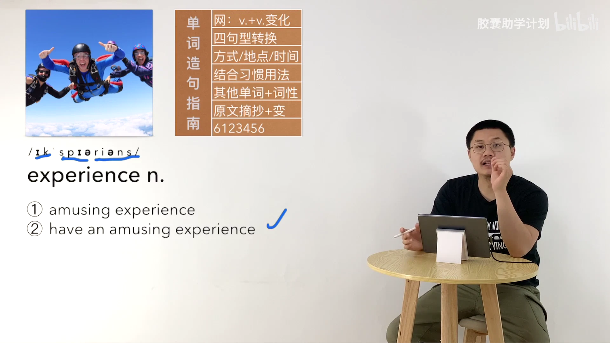

文字识别：单词造句指南 / 网：v.+v.变化 / 胶囊助学计划 / 四句型转换 / 方式/地点/时间 / 结合习惯用法 / 其他单词+词性 / 原文摘抄+变 / 6123456 / spīarians/ / experience n. / amusing / experience / have an amusing experience / YINO

### 画面 00:04:40

文字识别：单词造句指南 / 网：v.+v.变化 / 胶囊助学计划 / 四句型转换 / 方式/地点/时间 / 结合习惯用法 / 其他单词+词性 / 原文摘抄+变 / 6123456 / spīarians/ / experience n. / amusing / experience / have an amusing experience / YIN

### 画面 00:04:46

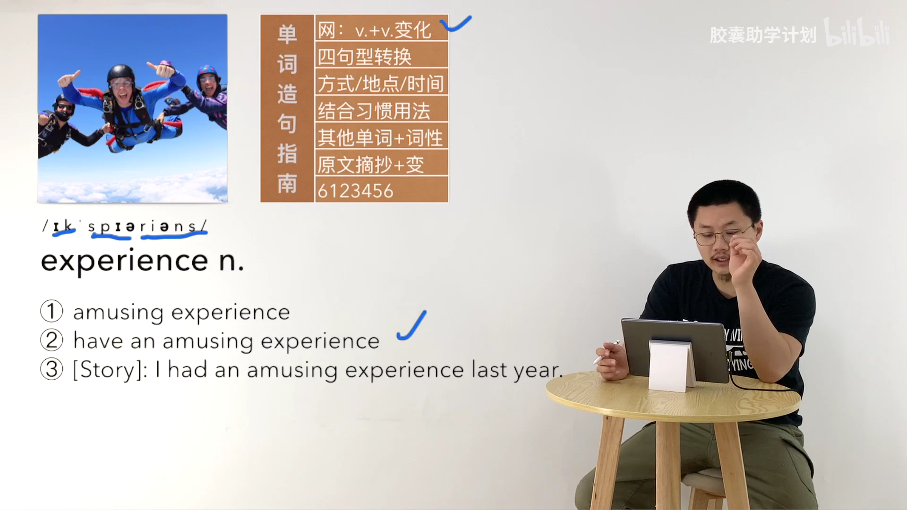

文字识别：单词造句指南 / 网：v.+v.变化 / 胶囊助学计划 / 四句型转换 / 方式/地点/时间 / 结合习惯用法 / 其他单词+词性 / 原文摘抄+变 / 6123456 / 'spiarians/ / experience n. / amusing experience / have an amusing experience / [Story]: I had an amusing experience last year. / YINO

### 画面 00:04:50

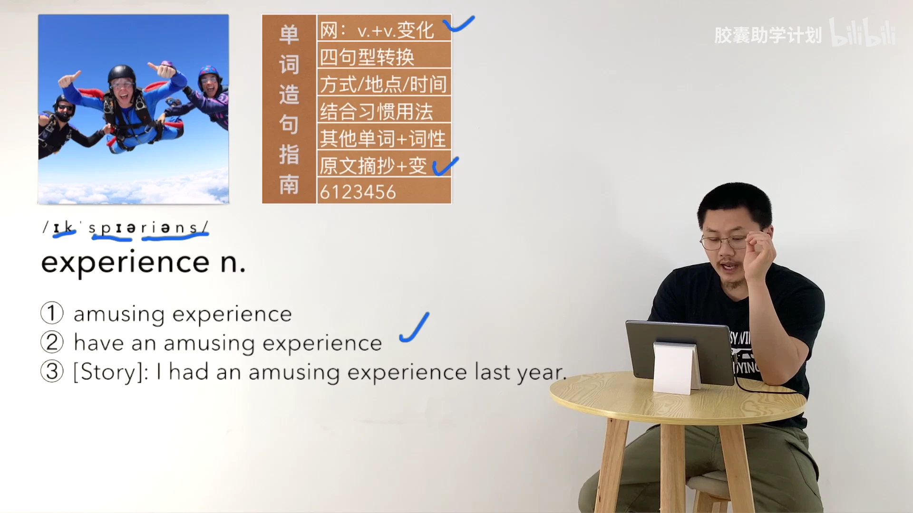

文字识别：单词造句指南 / 网：v.+v.变化 / 胶囊助学计划 / 四句型转换 / 方式/地点/时间 / 结合习惯用法 / 其他单词+词性 / 原文摘抄+变 / 6123456 / spīariansl / experience n. / amusing / experience / have an amusing experience / [Story]: I had an amusing experience last year. / LiMIN

## 00:05:00–00:05:30

情，OK，那我们接下来你看我在这儿给大家标 did who when，其实就是想提醒各位不要忘了做四句型的转化，肯定句您造出来了，要养成目前养成一种天然习惯。我直接口语带大家造一下啊，叫做 Did you have an amusing experience last year? When did you have an amusing experience? Who had an amusing experience last year? 对主语提问，对吧？OK，四句型转化。Next one，下一个单词，

### 画面 00:05:04

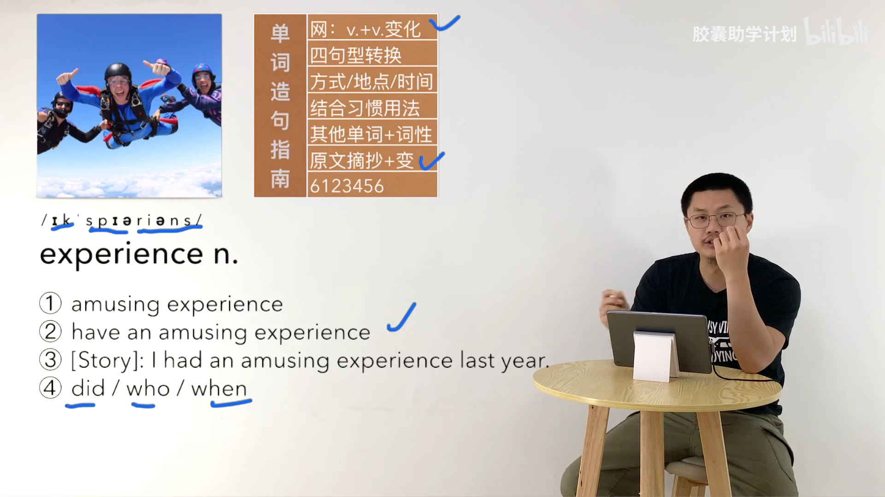

文字识别：单词造句指南 / 网：v.+v.变化 / 胶囊助学计划 / 四句型转换 / 方式/地点/时间 / 结合习惯用法 / 其他单词+词性 / 原文摘抄+变 / 6123456 / spīariansl / experience n. / amusing / experience / have an amusing experience / VSYVI / [Story]: I had an amusing experience last year. / IMIN / did /who/when

### 画面 00:05:07

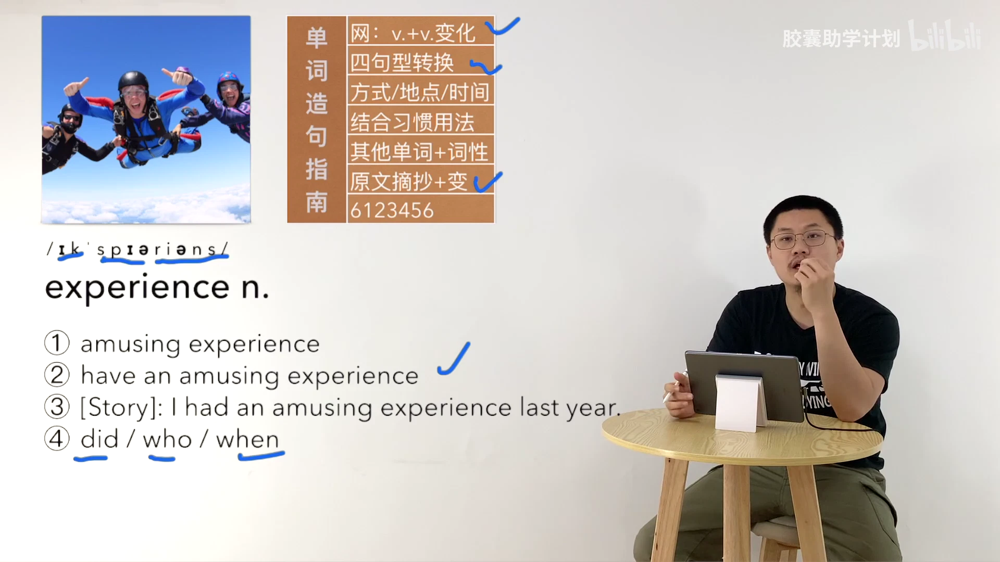

文字识别：单词造句指南 / 网：v.+v.变化 / 胶囊助学计划 / 四句型转换 / 方式/地点/时间 / 结合习惯用法 / 其他单词+词性 / 原文摘抄+变 / 6123456 / 'spiarians/ / experience n. / amusing experience / have an amusing experience / [Story]: I had an amusing experience last year. / YING / did / who / when

### 画面 00:05:10

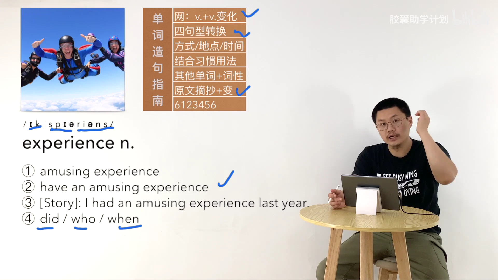

文字识别：单词造句指南 / 网：v.+v.变化 / 胶囊助学计划 / 四句型转换 / 方式/地点/时间 / 结合习惯用法 / 其他单词+词性 / 原文摘抄+变 / 6123456 / spiarians/ / experience n. / amusing / experience / have an amusing experience / SYDYING / [Story]: I had an amusing experience last year. / did/who/when

### 画面 00:05:28

文字识别：单词造句指南 / 网：v.+v.变化 / 胶囊助学计划 / 四句型转换 / 方式/地点/时间 / 结合习惯用法 / 其他单词+词性 / 原文摘抄+变 / 6123456 / /weIv/ / wave v. / SY LVING / DYING

## 00:05:30–00:06:00

很简单的一个小的动词，就是这个动作。每天上课之前给大家做的，Hello everyone, OK, OK，叫做wave, wave，叫做招手，招手啊。那冲某人招手，用了一个小的介词叫做to啊。各位不用管这个地方，它为什么用to，我们基本上把它记下来啊，叫做wave to somebody这个小的短语就行了啊。怎么把它记下来呢？当然又是造句了。比如说，Look, she's waving to you

### 画面 00:05:30

文字识别：单词造句指南 / 网：v.+v.变化 / 胶囊助学计划 / 四句型转换 / 方式/地点/时间 / 结合习惯用法 / 其他单词+词性 / 原文摘抄+变 / 6123456 / /weIv/ / wave v.

### 画面 00:05:35

文字识别：单词造句指南 / 网：v.+v.变化 / 胶囊助学计划 / 四句型转换 / 方式/地点/时间 / 结合习惯用法 / 其他单词+词性 / 原文摘抄+变 / 6123456 / /weIv/ / wave v. / OR / SY DYING

### 画面 00:05:40

文字识别：单词造句指南 / 网：v.+v.变化 / 胶囊助学计划 / 四句型转换 / 方式/地点/时间 / 结合习惯用法 / 其他单词+词性 / 原文摘抄+变 / 6123456 / /weIv/ / wave v. /  PT PISY NG / RAL / MDYING

### 画面 00:05:43

文字识别：单词造句指南 / 网：v.+v.变化 / 胶囊助学计划 / 四句型转换 / 方式/地点/时间 / 结合习惯用法 / 其他单词+词性 / 原文摘抄+变 / 6123456 / /weIv/ / wave v. / wave to sb. / ISYM

### 画面 00:05:45

文字识别：单词造句指南 / 网：v.+v.变化 / 胶囊助学计划 / 四句型转换 / 方式/地点/时间 / 结合习惯用法 / 其他单词+词性 / 原文摘抄+变 / 6123456 / /weIv/ / wave v. / wave to sb.

### 画面 00:05:48

文字识别：单词造句指南 / 网：v.+v.变化 / 胶囊助学计划 / 四句型转换 / 方式/地点/时间 / 结合习惯用法 / 其他单词+词性 / 原文摘抄+变 / 6123456 / /weIv/ / wave v. / wave to sb. / IYN

### 画面 00:05:50

文字识别：单词造句指南 / 网：v.+v.变化 / 胶囊助学计划 / 四句型转换 / 方式/地点/时间 / 结合习惯用法 / 其他单词+词性 / 原文摘抄+变 / 6123456 / /weIv/ / wave v. / 1 / wave to sb.

### 画面 00:05:55

文字识别：单词造句指南 / 网：v.+v.变化 / 胶囊助学计划 / 四句型转换 / 方式/地点/时间 / 结合习惯用法 / 其他单词+词性 / 原文摘抄+变 / 6123456 / /weiv/ / wave v. / wave to sb. / Look, she is waving to you. Do you know her?

## 00:06:00–00:06:30

Ah,瞧，她正在和你招手呢。Do you know her?哎，你认识她吗？哎，你瞧，她正在和你招手呢。Is she waving to me? Okay,她正在冲我招手吗？I don't know her.我又不认识她，她为什么正在冲我招手？是不是冲我身后的人招手呢？Okay,那当然也可以说一般疑问句有了，来个特殊疑问句叫做Why is she waving to me? Okay,我们无非就是把这个小的短语配合了两件事情啊，动词动词变化和四句型的转换。

### 画面 00:06:01

文字识别：单词造句指南 / 网：v.+v.变化 / 胶囊助学计划 / 四句型转换 / 方式/地点/时间 / 结合习惯用法 / 其他单词+词性 / 原文摘抄+变 / 6123456 / /weIv/ / wave v. / wave to sb. / 1 / Look, she is waving to you. Do you know her? / LVING

### 画面 00:06:07

文字识别：单词造句指南 / 网：v.+v.变化 / 胶囊助学计划 / 四句型转换 / 方式/地点/时间 / 结合习惯用法 / 其他单词+词性 / 原文摘抄+变 / 6123456 / /weIv/ / wave v. / wave to sb. / Look, she is waving to you. Do you know her? /  Is she waving to me? I don't know her. / MIN / 3

### 画面 00:06:11

文字识别：单词造句指南 / 网：v.+v.变化 / 胶囊助学计划 / 四句型转换 / 方式/地点/时间 / 结合习惯用法 / 其他单词+词性 / 原文摘抄+变 / 6123456 / /weIv/ / wave v. / 1 / wave to sb. / Look, she is waving to you. Do you know her? / VIN /  Is she waving to me? I don't know her. / MING / 3

### 画面 00:06:17

文字识别：单词造句指南 / 网：v.+v.变化 / 胶囊助学计划 / 四句型转换 / 方式/地点/时间 / 结合习惯用法 / 其他单词+词性 / 原文摘抄+变 / 6123456 / /weIv/ / wave v. / 1 / wave to sb. / Look, she is waving to you. Do you know her? / VIN /  Is she waving to me? I don't know her. / YIN / 3 / ④ Why is she waving to me?

### 画面 00:06:21

文字识别：单词造句指南 / 网：v.+v.变化 / 胶囊助学计划 / 四句型转换 / 方式/地点/时间 / 结合习惯用法 / 其他单词+词性 / 原文摘抄+变 / 6123456 / /weIv/ / wave v. / 1 / wave to sb. / Look, she is waving to you. Do you know her? / VIN / ) Is she waving to me? I don't know her. / IMING / 3 / ④ Why is she waving to me?

### 画面 00:06:25

文字识别：单伺造句指南 / 鱼网：v.+v.变化 / 胶囊助学计划 / 四句型转换 / 方式/地点/时间 / 结合习惯用法 / 其他单词+词性 / 原文摘抄+变 / 6123456 / /weIv/ / wave v. / 1 / wave to sb. / Look, she is waving to you. Do you know her? / 3 /  Is she waving to me? I don't know her. / TMIN / ④ Why is she waving to me?

### 画面 00:06:27

文字识别：单何造句指南 / 网：v.+v.变化 / 胶囊助学计划 / 四句型转换 / 方式/地点/时间 / 结合习惯用法 / 其他单词+词性 / 原文摘抄+变 / 6123456 / /weIv/ / wave v. / 1 / wave to sb. / Look, she is waving to you. Do you know her? / Is she waving to me? I don't know her. / CMIN / 3 / ④ Why is she waving to me?

## 00:06:30–00:07:00

OK， next one 下一个小的单词还挺有意思的，叫做 lift 啊 lift lift 这个单词我没记错的话，早在新一四十五课我们好像就学过了啊，要么就是四十六课 OK，我们就学过了，它表示的是往上举啊，把一个东西从低的位置举到高的位置抬起来的这个过程叫做 lift。那当时我们学它是动词的意思，今天呢学它名词的意思，我们管它叫搭便车啊。其

### 画面 00:06:30

文字识别：单词造句指南 / 网：v.+v.变化 / 胶囊助学计划 / 四句型转换 / VANCOUVER / 方式/地点/时间 / 结合习惯用法 / 其他单词+词性 / 原文摘抄+变 / 6123456 / /lift/ / /'hit ∫hai k/ / lift n. hitchhike

### 画面 00:06:35

文字识别：单词造句指南 / 网：v.+v.变化 / 胶囊助学计划 / 四句型转换 / VANCOUVER / 方式/地点/时间 / 结合习惯用法 / 其他单词+词性 / 原文摘抄+变 / 6123456 / /lxft/ / /'hit∫haik/ / lift n. hitchhike / IYIN

### 画面 00:06:41

文字识别：单词造句指南 / 网：v.+v.变化 / 胶囊助学计划 / 四句型转换 / VANCOUVER / 方式/地点/时间 / 结合习惯用法 / 其他单词+词性 / 原文摘抄+变 / 6123456 / /lxft/ / /'hit∫hai k/ / lift n. hitchhike / DYIN

### 画面 00:06:46

文字识别：单词造句指南 / 网：v.+v.变化 / 胶囊助学计划 / 四句型转换 / VANCOUVER / 方式/地点/时间 / 结合习惯用法 / 其他单词+词性 / 原文摘抄+变 / 6123456 / /lxft/ / /'hit∫hai k/ / lift n. hitchhike / GET BUSY LVING / R / YDYING

### 画面 00:06:53

文字识别：单词造句指南 / 网：v.+v.变化 / 胶囊助学计划 / 四句型转换 / VANCOUVER / 方式/地点/时间 / 结合习惯用法 / 其他单词+词性 / 原文摘抄+变 / 6123456 / /lift/ / /'hit ∫hai k/ / lift n. hitchhike / VIN / VIN

## 00:07:00–00:07:30

实有一个更加口语化，你别看它短是吧？哎，相对来说可能更常用的一个词叫做 hitchhike 啊，我给大家补了一个小的单词，你以后也会见到，叫做 hitchhike，也是搭便车的意思啊。它具体是什么意思呢？我先拿英文跟大家说一下啊，这个不是我们呃东方的文化，这是偏向于是从西方传过来的一个文化，当然中国现在也有人这么去做啊。我们看一下它的英文含义，叫做

### 画面 00:07:00

文字识别：单词造句指南 / 网：v.+v.变化 / 胶囊助学计划 / 四句型转换 / VANCOUVER / 方式/地点/时间 / 结合习惯用法 / 其他单词+词性 / 原文摘抄+变 / 6123456 / /lxft/ / /'hit ∫hai k/ / lift n. hitchhike / YMI / 际

### 画面 00:07:03

文字识别：单词造句指南 / 网：v.+v.变化 / 胶囊助学计划 / 四句型转换 / VANCOUVER / 方式/地点/时间 / 结合习惯用法 / 其他单词+词性 / 原文摘抄+变 / 6123456 / /lift/ / /'hit ∫hai k/ / lift n. hitchhike / VIN

### 画面 00:07:10

文字识别：单词造句指南 / 网：v.+v.变化 / 胶囊助学计划 / 四句型转换 / VANCOUVER / 方式/地点/时间 / 结合习惯用法 / 其他单词+词性 / 原文摘抄+变 / 6123456 / /lxft/ / /hit∫haik/ / lift n. hitchhike / DYIN

### 画面 00:07:15

文字识别：单词造句指南 / 网：v.+v.变化 / 胶囊助学计划 / 四句型转换 / VANCOUVER / 方式/地点/时间 / 结合习惯用法 / 其他单词+词性 / 原文摘抄+变 / 6123456 / /lxft/ / /hit∫hark/ / lift n. hitchhike / HDYING

### 画面 00:07:20

文字识别：单词造句指南 / 网：v.+v.变化 / 胶囊助学计划 / 四句型转换 / VANCOUVER / 方式/地点/时间 / 结合习惯用法 / 其他单词+词性 / 原文摘抄+变 / 6123456 / /lift/ / /hit∫haik/ / lift n. hitchhike / ① to get free rides in other /  CRT NUISY LVING / people's cars by waiting next to the road / DYING

## 00:07:30–00:08:00

to get free rides in other people's car by waiting next to the road. 好，这地方关键单词就是 ride，啊，就是一个乘坐啊，去获得一次免费的乘坐机会，在别人的车当中，这才叫搭便车，对吧？然后一般在什么地方等着呢？叫做 waiting next to the road，在马路边上等。你看，各位，这个人现在是不是就马路边上，然后做了这样一个动作？一般来说，你要去什么地方？他这个地方应该写 Vancouver，是吧？

### 画面 00:07:31

文字识别：单词造句指南 / 网：v.+v.变化 / 胶囊助学计划 / 四句型转换 / VANCOUVER / 方式/地点/时间 / 结合习惯用法 / 其他单词+词性 / 原文摘抄+变 / 6123456 / /lxft/ / /hit∫haik/ / lift n. hitchhike / ① to get free rides in other / people's cars by waiting next to the road / SYMI

### 画面 00:07:34

文字识别：单词造句指南 / 网：v.+v.变化 / 胶囊助学计划 / 四句型转换 / VANCOUVER / 方式/地点/时间 / 结合习惯用法 / 其他单词+词性 / 原文摘抄+变 / 6123456 / /lxft/ / /hit∫haik/ / lift n. hitchhike / ① to get free rides in other / people's cars by waiting next to the road / SYNI / DVIN

### 画面 00:07:37

文字识别：单词造句指南 / 网：v.+v.变化 / 胶囊助学计划 / 四句型转换 / VANCOUVER / 方式/地点/时间 / 结合习惯用法 / 其他单词+词性 / 原文摘抄+变 / 6123456 / /lift/ / /hrt∫haik/ / Ilift n. hitchhike / to get free / ridesn other / people's  / cars by waiting /  next to the road / SYNI

### 画面 00:07:41

文字识别：单词造句指南 / 网：v.+v.变化 / 胶囊助学计划 / 四句型转换 / VANCCUVER / 方式/地点/时间 / 结合习惯用法 / 其他单词+词性 / 原文摘抄+变 / 6123456 / /lift/ / /hit∫haik/ / lift n. hitchhike / to get free / rides)n other / PT NUSY LVING / people's / cars by waiting / next to the road / DYING

### 画面 00:07:48

文字识别：单词造句指南 / 网：v.+v.变化 / 胶囊助学计划 / 四句型转换 / VANCOUVER / 方式/地点/时间 / 结合习惯用法 / 其他单词+词性 / 原文摘抄+变 / 6123456 / /lift/ / /hit∫haik/ / lift n. hitchhike / 1 / to get free / ridesn other / people's / cars by waiting / next to the road / SYDYING

### 画面 00:07:50

文字识别：单词造句指南 / 网：v.+v.变化 / 胶囊助学计划 / 四句型转换 / VANCOUVER / 方式/地点/时间 / 结合习惯用法 / 其他单词+词性 / 原文摘抄+变 / 6123456 / /lift/ / /hit∫haik/ / Ilift n. hitchhike / to get free / rides)n other /  CET DUIY LUING / people's /  cars by waiting next to the road / KDYING

### 画面 00:07:53

文字识别：单词造句指南 / 网：v.+v.变化 / 胶囊助学计划 / 四句型转换 / VANCCUVER / 方式/地点/时间 / 结合习惯用法 / 其他单词+词性 / 原文摘抄+变 / 6123456 / /lift/ / /hit∫haik/ / lift n. hitchhike / ridesn other / 1 / to get free / USY LIVING / people's / cars by waiting next to the road / ORL / SYDYING

### 画面 00:07:59

文字识别：单词造句指南 / 网：v.+v.变化 / 胶囊助学计划 / 四句型转换 / VANCCUVER / 方式/地点/时间 / 结合习惯用法 / 其他单词+词性 / 原文摘抄+变 / 6123456 / /lift/ / /hrt∫haik/ / lift n. hitchhike / ① to get free / rides)n other / people's cars by waiting next to the road

## 00:08:00–00:08:30

OK，啊，你会拿一个牌子啊，随便找一个纸盒往上写上你要去的目的地，然后一个手势就可以了。这个动作我们管它叫做 hitchhike，或者叫做 lift。OK，那它的短语啊，能用它的短语其实还挺多的。我们在这看几个啊。首先第一个叫 take a lift，指的就是搭便车啊。当然也可以说我们文章当中出现的叫做 ask for a lift，啊，就是要求一个。这早早在我们应该是第六课

### 画面 00:08:01

文字识别：单词造句指南 / 网：v.+v.变化 / 胶囊助学计划 / 四句型转换 / VANCOUVER / 方式/地点/时间 / 结合习惯用法 / 其他单词+词性 / 原文摘抄+变 / 6123456 / /lxft/ / /hit∫haik/ / lift n. hitchhike / to get free / rides)n other / GET BUSY LVING / R / people's / cars by waiting next to the road / YDYING

### 画面 00:08:04

文字识别：单词造句指南 / 网：v.+v.变化 / 胶囊助学计划 / 四句型转换 / VANCOUVER / 方式/地点/时间 / 结合习惯用法 / 其他单词+词性 / 原文摘抄+变 / 6123456 / /lift/ / /hrt∫haik/ / lift n. hitchhike / ① to get free / rides n other / GETBUSY LIV / OR / people's  /  cars by waiting next to the road / SYDYING

### 画面 00:08:12

文字识别：单词造句指南 / 网：v.+v.变化 / 胶囊助学计划 / 四句型转换 / VANCOUVER / 方式/地点/时间 / 结合习惯用法 / 其他单词+词性 / 原文摘抄+变 / 6123456 / /lift/ / /'hit∫haik/ / lift n. hitchhike / ① / to get free / rides n other / GET BUSVIVING / people's / cars by waiting next to the road

### 画面 00:08:14

文字识别：单词造句指南 / 网：v.+v.变化 / 胶囊助学计划 / 四句型转换 / VANCUVER / 方式/地点/时间 / 结合习惯用法 / 其他单词+词性 / 原文摘抄+变 / 6123456 / /lxft/ / /'hit∫haik/ / lift n. hitchhike / ① to get free rides in other /  GET RUSY IVING / people's cars by waiting / g next to the road / take a liftTask / for a lift

### 画面 00:08:16

文字识别：单词造句指南 / 网：v.+v.变化 / 胶囊助学计划 / 四句型转换 / VANCOUVER / 方式/地点/时间 / 结合习惯用法 / 其他单词+词性 / 原文摘抄+变 / 6123456 / /lift/ / /hit∫haik/ / lift n. hitchhike / ① to get free rides in other / USY IV / people's cars by waiting next to the road / ORT / YDYIN / take a lift / ask for a lift

### 画面 00:08:19

文字识别：单词造句指南 / 网：v.+v.变化 / 胶囊助学计划 / 四句型转换 / NANCOUVER / 方式/地点/时间 / 结合习惯用法 / 其他单词+词性 / 原文摘抄+变 / 6123456 / /lift/ / /hit∫haik/ / lift n. hitchhike / ① to get free rides in other / people's cars by waiting next to the road / take a lift / ask for a lift

### 画面 00:08:24

文字识别：单词造句指南 / 网：v.+v.变化 / 胶囊助学计划 / 四句型转换 / VANCOUVER / 方式/地点/时间 / 结合习惯用法 / 其他单词+词性 / 原文摘抄+变 / 6123456 / /lift/ / /hit∫haik/ / lift n. hitchhike / ① to get free rides in other / people's cars by waiting next to the road / take a lift / ask for a lift

## 00:08:30–00:09:00

beggar 那课就学过 ask for a glass of beer 是吧？那课我们就学过啊，要求一个搭便车啊，就是要求搭便车。 Okay，当然还可以用叫做给某人一个 lift lift 搭便车嘛，给某人一个便车的机会叫做 a give b a lift a 是一个人 b 是另一个人啊，a 给 b 了一个搭便车，这个在口语当中都非常常用。比如说很简单一个句子叫 she gave me a lift to somewhere 啊，她哎让我

### 画面 00:08:50

文字识别：单词造句指南 / 网：v.+v.变化 / 胶囊助学计划 / 四句型转换 / VANCOUVER / 方式/地点/时间 / 结合习惯用法 / 其他单词+词性 / 原文摘抄+变 / 6123456 / /lift/ / /hit∫haik/ / lift n. hitchhike / ① to get free rides in other / people's cars by waiting next to the road / take a lift / ask for a lift / YIN / 3 / AgiveBa lit

### 画面 00:08:54

文字识别：单词造句指南 / 网：v.+v.变化 / 胶囊助学计划 / 四句型转换 / VANCUVER / 方式/地点/时间 / 结合习惯用法 / 其他单词+词性 / 原文摘抄+变 / 6123456 / /lift/ / /hit∫haik/ / lift n. hitchhike / ① to get free rides in other / people's cars by waiting next to the road / take a lift / ask for a lift / 3 / Agive Ba lit / She gave me a lift.

## 00:09:00–00:09:30

### 画面 00:09:04

文字识别：单词造句指南 / 网：v.+v.变化 / 胶囊助学计划 / 四句型转换 / VANCOUVER / 方式/地点/时间 / 结合习惯用法 / 其他单词+词性 / 原文摘抄+变 / 6123456 / /lrft/ / /hit∫hark/ / lift n. hitchhike / ① to get free rides in other / people's cars by waiting next to the road / take a lift / ask for a lift / 3 / AgiveBa lit / She gave me a lift. / Did she give you a lift?

### 画面 00:09:10

文字识别：单词造句指南 / 网：v.+v.变化 / 胶囊助学计划 / 四句型转换 / VANCOUVER / 方式/地点/时间 / 结合习惯用法 / 其他单词+词性 / 原文摘抄+变 / 6123456 / /lift/ / /hit∫haik/ / lift n. hitchhike / ① to get free rides in other / people's cars by waiting next to the road / take a lift / ask for a lift / 3 / Agive Ba lit / She gave me a lift. / Did she  / give you a lift?

### 画面 00:09:14

文字识别：单词造句指南 / 网：v.+v.变化 / 胶囊助学计划 / 四句型转换 / VANCOUVER / 方式/地点/时间 / 结合习惯用法 / 其他单词+词性 / 原文摘抄+变 / 6123456 / /lrft/ / /hit∫haik/ / lift n. hitchhike / ① to get free rides in other / GET RI / people's cars by waiting next to the road / take a lift / ask for a lift / 3 / AgiveBa lit / She gave me a lift. / Did she give you a lift? / 5 / 6 / why

### 画面 00:09:20

文字识别：单词造句指南 / 网：v.+v.变化 / 胶囊助学计划 / 四句型转换 / VANCOUVER / 方式/地点/时间 / 结合习惯用法 / 其他单词+词性 / 原文摘抄+变 / 6123456 / /lrft/ / /hIt∫hai k/ / lift n. hitchhike / ① to get free rides in other / people's cars by waiting next to the road / take a lift / ask for a lift / 3 / Agive Ba lit / She gave me a lift. / Did she give you a lift? / 6 / why

### 画面 00:09:25

文字识别：单词造句指南 / 网：v.+v.变化 / 胶囊助学计划 / 四句型转换 / VANCOUVER / 方式/地点/时间 / 结合习惯用法 / 其他单词+词性 / 原文摘抄+变 / 6123456 / /lift/ / /hIt∫haik/ / lift n. hitchhike / ① to get free rides in other /  GET BUSY LIVING / people's cars by waiting next to the road / R / YDYING / take a lift / ask for a lift / 3 / AgiveBa lift / She gave r / me a lift. / Did she / give you a lift? / 5 / 6 / why

### 画面 00:09:28

文字识别：…you wouldn't take a lift from a / 胶囊助学计划 / strange man. / GET DIY UVING / MDVING / 成长教育 / An Education / (2009)

## 00:09:30–00:10:00

的电影片段。电影片段当中，哎，句子比较长，你要从当中听出来这个关键的。我把这给大家摘抄出来了，叫做You wouldn't take a lift from a stranger啊，这句话实际上还是有点虚拟语气在里面的啊。你不会 take a lift搭便车 from a strange man从一个陌生男子那个地方。来，接下来注意听了。Hello, look, the

### 画面 00:09:40

文字识别：…you wouldn't take a liftfrom a / 胶囊助学计划 / strange man. / 成长教育 / An Education / (2009)

### 画面 00:09:46

文字识别：…you wouldn't take a liftfrom a / 胶囊助学计划 / strange man.1 / SY / 成长教育 / An Education / (2009)

### 画面 00:09:54

文字识别：…you wouldn't take a liffrom a / 胶囊助学计划 / strange man. / 成长教育 / YIN / An Education / (2009)

### 画面 00:09:56

文字识别：.you wouldn't take a liffrom a / 胶囊助学计划 / strange man. / 成长教育 / An Education / (2009)

### 画面 00:09:58

文字识别：…you wouldn't take a liffrom a / 胶囊助学计划 / strange man. / 成长教育 / An Education / (2009)

## 00:10:00–00:10:30

Dirk. If you had any sense, you wouldn't take a lift from a strange man. But I'm a music lover and I'm worried about your cello. So, what I propose is to put it in my car and walk alongside me. Okay, you wouldn't take a lift.啊，搭便车。你看现在他这个场景就非常的好，对吧？下大雨，一个女子在这个地方站着，然后呢，一个男的开车过来，说 you wouldn't take a lift from a strange man，搭便车。 Okay，接下来下一个小的单词，生活当中啊，如

### 画面 00:10:00

文字识别：…you wouldn't take a lif from a / 胶囊助学计划 / strange man. / 成长教育 / An Education / (2009)

### 画面 00:10:02

文字识别：you wouldn't take a lifrom a / 胶囊助学计划 / strange man. / 成长教育 / 你如果懂事你不会肯搭陌生男人的车 / An Education / If you had any sense, you wouldn't take a lift from a strange man. / (2009)

### 画面 00:10:04

文字识别：you wouldn't take a liftfrom a / 胶囊助学计划 / strange man. / 成长教育 / 但我这音乐爱好者可担心着你的大提琴呢不如 / An Education / But I'm a music lover, and 'm worried about your cello. So.. / (2009)

### 画面 00:10:06

文字识别：…you wouldn't take a liftfrom a / 胶囊助学计划 / strange man. / 成长教育 / 但我这乐爱好者可担心着你的大提琴呢不如 / An Education / But I'm a music lover, and 'm worried about your cello. So.. / (2009)

### 画面 00:10:08

文字识别：.you wouldn't take a liftfrom a / 胶囊助学计划 / strange man. / 成长教育 / 我建议你把琴放我车上然后你在旁边跟着走 / An Education / ..what I propose is, you put it in my car and walk alongside me. / (2009)

### 画面 00:10:10

文字识别：…you wouldn't take a liffrom a / 胶囊助学计划 / strange man. / 成长教育 / 我建议你把琴放我车上然后你在旁边跟着走 / An Education / ..what I propose is, you put it in my car and walk alongside me. / (2009)

### 画面 00:10:12

文字识别：…you wouldn't take a liftfrom a / 胶囊助学计划 / strange man. /  err nuEY LNING / 成长教育 / YING / An Education / (2009)

### 画面 00:10:26

文字识别：单词造句指南 / 网：v.+v.变化 / 胶囊助学计划 / Sent from my / 四句型转换 / 方式/地点/时间 / Reply / 结合习惯用法 / Forward / 其他单词+词性 / Print / 原文摘抄+变 / Cancel / 6123456 / /ri'plar/ / reply v. / (VI

### 画面 00:10:29

文字识别：单词造句指南 / 网：v.+v.变化 / 胶囊助学计划 / Sent from my / 四句型转换 / 方式/地点/时间 / Reply / 结合习惯用法 / Forward / 其他单词+词性 / Print / 原文摘抄+变 / Cancel / 6123456 / /ri'plar/ / reply v. / SY / 派

## 00:10:30–00:11:00

果您是在英文世界之下，这个生活当中是非常常用的。先跟我一起读一下，叫做 reply，reply，叫做回复啊。您想一下，汉语回复这两个字是不是很常用啊？OK，那 reply 呢有一个小的短语叫 reply to the email 或者 reply to the letter。OK，叫做回邮件啊，你想或或者是回信啊。OK，那对于我们现在来说，可能是回 email 啊，回邮件会多一点，叫 reply

### 画面 00:10:34

文字识别：单词造句指南 / 网：v.+v.变化 / 胶囊助学计划 / Sent from my / 四句型转换 / 方式/地点/时间 / Reply / 结合习惯用法 / Forward / 其他单词+词性 / Print / 原文摘抄+变 / Cancel / 6123456 / /ri'plar/ / reply / V.

### 画面 00:10:47

文字识别：单词造句指南 / 网：v.+v.变化 / 胶囊助学计划 / Sent from my / 四句型转换 / 方式/地点/时间 / Reply / 结合习惯用法 / Forward / 其他单词+词性 / Print / 原文摘抄+变 / Cancel / 6123456 / /rI'plai/ / reply / V. / reply to the email/letter

### 画面 00:10:50

文字识别：单词造句指南 / 网：v.+v.变化 / 胶囊助学计划 / Sent from my / 四句型转换 / 方式/地点/时间 / Reply / 结合习惯用法 / Forward / 其他单词+词性 / Print / 原文摘抄+变 / Cancel / 6123456 / /rI'plai/ / reply / V. / reply to the email/letter / GET DIY VING / PYING

### 画面 00:10:56

文字识别：单词造句指南 / 网：v.+v.变化 / 胶囊助学计划 / Sent from my / 四句型转换 / 方式/地点/时间 / Reply / 结合习惯用法 / Forward / 其他单词+词性 / Print / 原文摘抄+变 / Cancel / 6123456 / /rI'plar/ / reply / V. / reply to the email/letter / SYIVING / IDYING

### 画面 00:10:59

文字识别：单词造句指南 / 网：v.+v.变化 / 胶囊助学计划 / Sent from my / 四句型转换 / 方式/地点/时间 / Reply / 结合习惯用法 / Forward / 其他单词+词性 / Print / 原文摘抄+变 / Cancel / 6123456 / /rI'plai/ / reply / V. / reply to the email/letter / 1 / SYVING / DYING

## 00:11:00–00:11:30

to the email. Okay, 这个小的短语，各位记住。接下来我们把它造成句子，加动词，动词变化。She replied to my letter yesterday. 她昨天给我回信了。翻译成汉语就是两个字儿，叫做回信了。Okay, 那肯定句出来，一般疑问句，张嘴跟我读。Did she reply to your letter yesterday? 以及各种特殊疑问词，各位啊，还是那句话，您现在张嘴把它自己变一变。Okay, Okay, 接下来我们看一个

### 画面 00:11:04

文字识别：单词造句指南 / 网：v.+v.变化 / 胶囊助学计划 / Sent from my / 四句型转换 / 方式/地点/时间 / Reply / 结合习惯用法 / Forward / 其他单词+词性 / Print / 原文摘抄+变 / Cancel / 6123456 / /ri'plar/ / reply v. / reply to the email/letter / YIVING / She replied to my letter yesterday. / DYING

### 画面 00:11:09

文字识别：单词造句指南 / 网：v.+v.变化 / 胶囊助学计划 / Sent from my / 四句型转换 / 方式/地点/时间 / Reply / 结合习惯用法 / Forward / 其他单词+词性 / Print / 原文摘抄+变 / Cancel / 6123456 / /ri'pla/ / reply v. / reply to the email/letter / She replied to my letter yesterday.

### 画面 00:11:13

文字识别：单词造句指南 / 网：v.+v.变化 / 胶囊助学计划 / Sent from my / 四句型转换 / 方式/地点/时间 / Reply / 结合习惯用法 / Forward / 其他单词+词性 / Print / 原文摘抄+变 / Cancel / 6123456 / /ri'plai/ / reply / V. / reply to the email/letter / She replied to my letter yesterday. / SY

### 画面 00:11:15

文字识别：单词造句指南 / 网：v.+v.变化 / 胶囊助学计划 / Sent from my / 四句型转换 / 方式/地点/时间 / Reply / 结合习惯用法 / Forward / 其他单词+词性 / Print / 原文摘抄+变 / Cancel / 6123456 / /rI'plai/ / reply / V. / reply to the email/letter / 1 / She /  replied to my letter yesterday. / Did / she reply to your letter yesterday?

### 画面 00:11:19

文字识别：单词造句指南 / 网：v.+v.变化 / 胶囊助学计划 / Sent from my / 四句型转换 / 方式/地点/时间 / Reply / 结合习惯用法 / Forward / 其他单词+词性 / Print / 原文摘抄+变 / Cancel / 6123456 / /ri'plar/ / reply / V. / reply to the email/letter / 1 / She / replied to my letter yesterday. / Did / she reply to your letter yesterday?

### 画面 00:11:24

文字识别：单词造句指南 / 网：v.+v.变化 / 胶囊助学计划 / Sent from my / 四句型转换 / 方式/地点/时间 / Reply / 结合习惯用法 / Forward / 其他单词+词性 / Print / 原文摘抄+变 / Cancel / 6123456 / /ri'plai/ / reply v. / reply to the email/letter / 1 / She /  replied to my letter yesterday. / Did / she reply to your letter yesterday? / JYIN / who/why/when

### 画面 00:11:28

文字识别：reply to your letter / 胶囊助学计划 / 乌云背后的幸福线 / Silver Linings PlayDook / (2012)

## 00:11:30–00:12:00

小的电影片段，当中出现了叫做 "reply to your letter"，只不过在这个地方，它把 "reply" 换成了它的过去式啊。各位正好不妨看一下 "reply" 的过去式是长成什么样子。来了，Guess what? What? Nikki replied to your letter, but you can't read it until after you nail the big move. Go.

### 画面 00:11:45

文字识别：reply to your letter / 胶囊助学计划 / 乌云背后的幸福线 / -知道吗-什么 / Silver Linings Paybook / —Guess what? -What? / (2012)

### 画面 00:11:47

文字识别：reply to your letter / 胶囊助学计划 / 乌云背后的幸福线 / 尼基给你回信了 / Silver Linings PlayDook / Nikki replied to your letter. / (2012)

### 画面 00:11:49

文字识别：reply to your letter / 胶囊助学计划 / 乌云背后的幸福线 / Silver Linings Playbook / (2012)

### 画面 00:11:51

文字识别：reply to your letter / 胶囊助学计划 / 乌云背后的幸福线 / Silver Linings PayDook / (2012)

### 画面 00:11:53

文字识别：reply to your letter / 胶囊助学计划 / 乌云背后的幸福线 / Silver Linings Playbook / (2012)

### 画面 00:11:55

文字识别：reply to your letter / 胶囊助学计划 / 乌云背后的幸福线 / 但是我们练好大动作之前不能给你读 / Silver Linings Playook / But you can't read it until after you nail the big move. / (2012)

### 画面 00:11:57

文字识别：reply to your letter / 胶囊助学计划 / 乌云背后的幸福线 / 但是我们练好大动作之前不能给你读 / Silver Linings Playbook / But you can't read it until after you nail the big move. / (2012)

### 画面 00:11:59

文字识别：reply to your letter / 胶囊助学计划 / 乌云背后的幸福线 / Silver Linings Playbook / (2012)

## 00:12:00–00:12:30

language.

### 画面 00:12:02

文字识别：Hello! / 单词造句指南 / 网：v.+v.变化 / 胶囊助学计划 / 四句型转换 / Bonjour! / 方式/地点/时间 / 结合习惯用法 / 你好！ / 其他单词+词性 / IHola / 原文摘抄+变 / 6123456 / /længwrd3/ / language n. / VING

### 画面 00:12:05

文字识别：Hello! / 单词造句指南 / 网：v.+v.变化 / 胶囊助学计划 / 四句型转换 / Bonjour! / 方式/地点/时间 / 结合习惯用法 / 你好！ / 其他单词+词性 / IHola! / 原文摘抄+变 / 6123456 / /længwrd3/ / language n.

### 画面 00:12:09

文字识别：Hello! / 单词造句指南 / 网：v.+v.变化 / 胶囊助学计划 / 四句型转换 / Bonjour! / 方式/地点/时间 / 结合习惯用法 / 你好！ / 其他单词+词性 / IHola! / 原文摘抄+变 / 6123456 / /længwrd3/ / language n. / SYN

### 画面 00:12:16

文字识别：Hello! / 单词造句指南 / 网：v.+v.变化 / 胶囊助学计划 / 四句型转换 / Bonjour! / 方式/地点/时间 / 结合习惯用法 / 你好！ / 其他单词+词性 / IHola! / 原文摘抄+变 / 6123456 / /'længwid3/ / language n. / YIN

### 画面 00:12:19

文字识别：Hello! / 单词造句指南 / 网：v.+v.变化 / 胶囊助学计划 / 四句型转换 / Bonjour! / 方式/地点/时间 / 结合习惯用法 / 你好！ / 其他单词+词性 / IHola! / 原文摘抄+变 / 6123456 / /længwid3/ / language n. / MIN

### 画面 00:12:24

文字识别：(Hello) / 单词造句指南 / 网：v.+v.变化 / 胶囊助学计划 / 四句型转换 / Bonjour! / 方式/地点/时间 / 结合习惯用法 / 你好！ / 其他单词+词性 / IHola! / 原文摘抄+变 / 6123456 / /længwid3/ / language n. / native language / mother tongue

### 画面 00:12:29

文字识别：Hello / 单词造句指南 / 网：v.+v.变化 / 胶囊助学计划 / 四句型转换 / Bonjour! / 方式/地点/时间 / 结合习惯用法 / 你好！ / 其他单词+词性 / IHola! / 原文摘抄+变 / 6123456 / /længwrd3/ / language n. / native / language / mother tongue / SYVI

## 00:12:30–00:13:00

language. Okay, so你好啊，就是 my native language啊，我的母语叫做 native，叫本地的、本国的 local. Okay, 那 mother tongue，你看它的字面意思叫妈妈的舌头啊。什么叫妈妈的舌头？就是你的母语. Okay，所以它俩的意思是一样的。我们经常可以用的一句话叫做 What is your native language？尤其你像中国，可能比较明显一点，要么就是 Mandarin s，要么就

### 画面 00:12:32

文字识别：Hello / 单词造句指南 / 网：v.+v.变化 / 胶囊助学计划 / 四句型转换 / Bonjour! / 方式/地点/时间 / 结合习惯用法 / 你好！ / 其他单词+词性 / IHola! / 原文摘抄+变 / 6123456 / /længwid3/ / language n. / native / language / mother tongue / SYC

### 画面 00:12:34

文字识别：(Hello!) / 单词造句指南 / 网：v.+v.变化 / 胶囊助学计划 / 四句型转换 / Bonjour! / 方式/地点/时间 / 结合习惯用法 / 你好 / 其他单词+词性 / IHola! / 原文摘抄+变 / 6123456 / /længwd3/ / language n. / native /  language / mother tongue

### 画面 00:12:41

文字识别：Hello! / 单词造句指南 / 网：v.+v.变化 / 胶囊助学计划 / 四句型转换 / Bonjour! / 方式/地点/时间 / 结合习惯用法 / 你好 / 其他单词+词性 / Hola! / 原文摘抄+变 / 6123456 / /lengwid3/ / language n. / native /  language / mother tongue / SYNI

### 画面 00:12:51

文字识别：(Hello.) / 单词造句指南 / 网：v.+v.变化 / 胶囊助学计划 / 四句型转换 / Bonjour! / 方式/地点/时间 / 结合习惯用法 / 你好！ / 其他单词+词性 / IHola! / 原文摘抄+变 / 6123456 / /længwd3/ / language n. / native / language / mother tongue / What is your native / language?

### 画面 00:12:54

文字识别：(Hello.) / 单词造句指南 / 网：v.+v.变化 / 胶囊助学计划 / 四句型转换 / Bonjour! / 方式/地点/时间 / 结合习惯用法 / 你好！ / 其他单词+词性 / IHola! / 原文摘抄+变 / 6123456 / /længwid3/ / language n. / native / language / mother tongue / What is your native / language?

## 00:13:00–00:13:30

是 Cantonese, 对吧？要么是普通话，要么是粤语啊，基本就是统称为我们可以理解为是汉语了。OK，那有一些地方可能就不是这个样子的，你可能就要问他说 What is your native language? OK，好，接下来呢，下一个小的单词，我们一起读一下，叫做 journey。你看它虽然它的汉语的意思是旅行，但是它是个什么词性？名词。于是，在六一二三四五六当中，你就明白它自己是

### 画面 00:13:15

文字识别：单词造句指南 / 网：v.+v.变化 / 胶囊助学计划 / 四句型转换 / 方式/地点/时间 / 结合习惯用法 / 其他单词+词性 / 原文摘抄+变 / 6123456 / /d33:ni/ / journey n. /  GET DISY LIVING / OR

### 画面 00:13:17

文字识别：单词造句指南 / 网：v.+v.变化 / 胶囊助学计划 / 四句型转换 / 方式/地点/时间 / 结合习惯用法 / 其他单词+词性 / 原文摘抄+变 / 6123456 / /d33:ni/ / journey n. / ISYMI

### 画面 00:13:19

文字识别：单词造句指南 / 网：v.+v.变化 / 胶囊助学计划 / 四句型转换 / 方式/地点/时间 / 结合习惯用法 / 其他单词+词性 / 原文摘抄+变 / 6123456 / /d33:ni/ / journey n. / ISYVI

### 画面 00:13:25

文字识别：单词造句指南 / 网：v.+v.变化 / 胶囊助学计划 / 四句型转换 / 方式/地点/时间 / 结合习惯用法 / 其他单词+词性 / 原文摘抄+变 / 6123456 / /'d33:ni/ / journey n. / SYN

### 画面 00:13:28

文字识别：单词造句指南 / 网：v.+v.变化 / 胶囊助学计划 / 四句型转换 / 方式/地点/时间 / 结合习惯用法 / 其他单词+词性 / 原文摘抄+变 / 6123456 / /'d33:ni/ / journey n.

## 00:13:30–00:14:00

没法坐在二这个位置的，也就是不能当动词去用，对吧？那怎么办呢？有一个小的短语给大家扩展一下，叫做 go on a journey。它还是翻译成旅行，只不过现在这儿变成了动词了。于是您就可以做这些变化了，动词加动词变化以及四句型的转换。比如说，We'll be going on a journey next week. 下周啊，我们要去旅行。你注意，We'll be doing。

### 画面 00:13:30

文字识别：单词造句指南 / 网：v.+v.变化 / 胶囊助学计划 / 四句型转换 / 方式/地点/时间 / 结合习惯用法 / 其他单词+词性 / 原文摘抄+变 / 6123456 / /'d33:ni/ / journey / n. / DYING

### 画面 00:13:34

文字识别：单词造句指南 / 网：v.+v.变化 / 胶囊助学计划 / 四句型转换 / 方式/地点/时间 / 结合习惯用法 / 其他单词+词性 / 原文摘抄+变 / 6123456 / /d33:ni/ / journey n.

### 画面 00:13:39

文字识别：单词造句指南 / 网：v.+v.变化 / 胶囊助学计划 / 四句型转换 / 方式/地点/时间 / 结合习惯用法 / 其他单词+词性 / 原文摘抄+变 / 6123456 / /'d33:ni/ / journey n. / 1 / go on a journey

### 画面 00:13:44

文字识别：单词造句指南 / 网：v.+v.变化 / 胶囊助学计划 / 四句型转换 / 方式/地点/时间 / 结合习惯用法 / 其他单词+词性 / 原文摘抄+变 / 6123456 / /d33:ni/ / journey n. / 1 / go on a journey / SYM

### 画面 00:13:48

文字识别：单词造句指南 / 网：v.+v.变化 / 胶囊助学计划 / 四句型转换 / 方式/地点/时间 / 结合习惯用法 / 其他单词+词性 / 原文摘抄+变 / 6123456 / /d33:ni/ / journey /  n. / go on a journey / IYIN

### 画面 00:13:50

文字识别：单词造句指南 / 网：v.+v.变化 / 胶囊助学计划 / 四句型转换 / 方式/地点/时间 / 结合习惯用法 / 其他单词+词性 / 原文摘抄+变 / 6123456 / /d33:ni/ / journey / n. / go on a journey / CPTI / USYVING / YDYING

### 画面 00:13:54

文字识别：单词造句指南 / 网：v.+v.变化 / 胶囊助学计划 / 四句型转换 / 方式/地点/时间 / 结合习惯用法 / 其他单词+词性 / 原文摘抄+变 / 6123456 / /d33:ni/ / journey / n. / go on a journey / GET DIISY VING / We'll be going on a journey next week. / YDYING

### 画面 00:13:59

文字识别：单词造句指南 / 网：v.+v.变化 / 胶囊助学计划 / 四句型转换 / 方式/地点/时间 / 结合习惯用法 / 其他单词+词性 / 原文摘抄+变 / 6123456 / /'d33:ni/ / journey / n. / go on a journey / 1 / USYIVING / We'll be going / on a journey next week. / OR / YDYING

## 00:14:00–00:14:30

啊，看到了吧，will be doing 将来进行时。好，也可以说 we went on a journey yesterday。哎，注意 went on a journey，把 go 换成了 went，于是这就变成了一般过去时。也可以说 we are going on a journey tomorrow。好了，这儿要问的就是这是什么时态呢？是不是 be 加 doing 现在进行时？第二课咱们讲了现在进行时加上一个将来的时间和将来进行时都是可以表计

### 画面 00:14:01

文字识别：单词造句指南 / 网：v.+v.变化 / 胶囊助学计划 / 四句型转换 / 方式/地点/时间 / 结合习惯用法 / 其他单词+词性 / 原文摘抄+变 / 6123456 / /d33:ni/ / journey / n. / 1 / go on a journey / 'ISYIVING / We'll be going / on a journey next week. / RA / DYING

### 画面 00:14:03

文字识别：单词造句指南 / 网：v.+v.变化 / 胶囊助学计划 / 四句型转换 / 方式/地点/时间 / 结合习惯用法 / 其他单词+词性 / 原文摘抄+变 / 6123456 / /d33:ni/ / journey / n. / 1 / go on a journey /  CFT PUIY LNING / We'll be going on a journey next week. / R / YDYING / We went on a journey yesterday. / 3

### 画面 00:14:05

文字识别：单词造句指南 / 网：v.+v.变化 / 胶囊助学计划 / 四句型转换 / 方式/地点/时间 / 结合习惯用法 / 其他单词+词性 / 原文摘抄+变 / 6123456 / / d33:n i/ / journey / n. / 1 / go on a journey / SYLVI / We'll be going on a journey next week. / IDYING / We went on a journey yesterday. / 3

### 画面 00:14:08

文字识别：单词造句指南 / 网：v.+v.变化 / 胶囊助学计划 / 四句型转换 / 方式/地点/时间 / 结合习惯用法 / 其他单词+词性 / 原文摘抄+变 / 6123456 / /d33:ni/ / journey / n. / 1 / go on a journey / We'll be going on a journey next week. / USY LIV / OR / YDY / We / went on a journey yesterday. / 3

### 画面 00:14:10

文字识别：单词造句指南 / 网：v.+v.变化 / 胶囊助学计划 / 四句型转换 / 方式/地点/时间 / 结合习惯用法 / 其他单词+词性 / 原文摘抄+变 / 6123456 / /'d33:ni/ / journey / n. / 1 / go on a journey / ISY LVING / We'll be going on a journey next week. / OR / YDYING / We / went on a journey yesterday.

### 画面 00:14:14

文字识别：单词造句指南 / 网：v.+v.变化 / 胶囊助学计划 / 四句型转换 / 方式/地点/时间 / 结合习惯用法 / 其他单词+词性 / 原文摘抄+变 / 6123456 / /'d33:ni/ / journey / n. / 1 / go on a journey / GET DUISY LUVING / We'l be / e going / on a journey next week. / IDYIN / We / went on a journey yesterday. / We're / going on a journey tomorrow.

### 画面 00:14:19

文字识别：单词造句指南 / 网：v.+v.变化 / 胶囊助学计划 / 四句型转换 / 方式/地点/时间 / 结合习惯用法 / 其他单词+词性 / 原文摘抄+变 / 6123456 / /d33:ni/ / journey / n. / 1 / go on a journey / SY LIVING / We'll be going /  on a journey next week. / IDYING / We / went on a journey yesterday. / We're going on a journey tomorrow.

### 画面 00:14:24

文字识别：单词造句指南 / 网：v.+v.变化 / 胶囊助学计划 / 四句型转换 / 方式/地点/时间 / 结合习惯用法 / 其他单词+词性 / 原文摘抄+变 / 6123456 / /d33:ni/ / journey / n. / 1 / go on a journey / We'll be going  / ISYMI /  on a journey next week. / We / went on a journey yesterday. / DYINO / We're going on a journey tomorrow.

### 画面 00:14:26

文字识别：单词造句指南 / 网：v.+v.变化 / 胶囊助学计划 / 四句型转换 / 方式/地点/时间 / 结合习惯用法 / 其他单词+词性 / 原文摘抄+变 / 6123456 / /d33:ni/ / journey / n. / 1 / go on a journey / We'll be going on a journey next week. / ISYNI / We / went on a iourney yesterday. / We're going on a journey tomorrow.

### 画面 00:14:29

文字识别：单词造句指南 / 网：v.+v.变化 / 胶囊助学计划 / 四句型转换 / 方式/地点/时间 / 结合习惯用法 / 其他单词+词性 / 原文摘抄+变 / 6123456 / /d33:ni/ / journey / n. / 1 / go on a journey / We'l be going on a journey next week. / We / went on a journey yesterday. / 3 / We're going on a journey tomorrow.

## 00:14:30–00:15:00

划打算的，对不对？好，说我们明天呀要去旅行了，We are going on a journey tomorrow啊，一定给了三个肯定句，您自己试着把它变成四句型口语，啪一变就可以了。OK，接下来我们复习一下今天学到的东西，当然除了本课的单词以外，这些小的短语也无比的重要。我希望各位自己再去造句子的时候是带着这些短语的，不是说我讲了一个 wave to somebody，对吧？然

### 画面 00:14:36

文字识别：单词造句指南 / 网：v.+v.变化 / 胶囊助学计划 / 四句型转换 / 方式/地点/时间 / 结合习惯用法 / 其他单词+词性 / 原文摘抄+变 / 6123456 / / d33:ni/ / journey / n. / 1 / go on a journey / 'SYVIN / We'll be going / on a journey next week. / NDYING / 3 / We / went on a journey yesterday. / We're going on a journey tomorrow.

### 画面 00:14:39

文字识别：单词造句指南 / 网：v.+v.变化 / 胶囊助学计划 / 四句型转换 / 方式/地点/时间 / 结合习惯用法 / 其他单词+词性 / 原文摘抄+变 / 6123456 / /d33:ni/ / journey / n. / go on a journey / USY LIVING / We'll be going  /  on a journey next week. / OR. / RAIG / We / went on a journey yesterday. / 3 / We're going on a journey tomorrow.

### 画面 00:14:44

文字识别：Recap / 胶囊助学计划 / Words / CRT PUSYIMING / have / an / amusing / experience / wave / to sb. / Expression / takea / a / lift/ask fora lift / Agive B a lift / reply to the e / email/letter / go / on a journey

### 画面 00:14:46

文字识别：Recap / 胶囊助学计划 / Words / have / an / amusing / experience /  ART HY NING / wave / to sb. / DYING / take / lift / ask for a lift / Expression / a / Agive B a lift / reply to the / email/letter / go / on a journey

### 画面 00:14:48

文字识别：胶囊助学计划 / Recap / Words / have / an / amusing / experience / RUSY LVING / wave / to / sb. / ORN / YDYING / take / lift / ask for a lift / Expression / a / Agive B a lift / reply to the / email/letter / go / on a journey

### 画面 00:14:50

文字识别：Recap / 胶囊助学计划 / Words / have / an / amusing / experience / USY LVING / wave / to / sb. / OR / SYDYING / take / lift/ask for a lift / Expression / Agive Ba lift / reply to the / email/letter / go / on a journey

### 画面 00:14:52

文字识别：胶囊助学计划 / Recap / Words / have / an / amusing / experience / wave / to sb. / DYINE / Expression / takea / a / lift/ask fora lift / Agive B a lift / reply to the e / email/letter / go / on a journey

### 画面 00:14:54

文字识别：胶囊助学计划 / Recap / Words / have / an amusing experience / wavet / to sb. / take a / alift/ask fora lift / Expression / Agive B a lift / reply to the email/letter / go / on a journey

### 画面 00:14:57

文字识别：Recap / 胶囊助学计划 / Words / have / an / amusing / experience / wave / to sb. / take / lift/ask fora lift / Expression / a / Agive B a lift / reply to the e / email/letter / go / on a journey

### 画面 00:14:59

文字识别：胶囊助学计划 / Recap / Words / have / an amusing / experience / wave to sb. / take a lift / ask for a lift / Expression / Agive B a lift / reply to the e / email/letter / go / on a journey

## 00:15:00–00:15:30

后您造句子的时候不用它，不是啊。我希望各位用着这个短语去造句子啊，包括 take a lift， ask for a lift，对吧？包括 reply to the email 和 letter。你看一举啊，一箭双雕，一举两得。您不仅如果你用 reply to the email 或 reply to the letter 这个短语，你不仅把 reply 这个单词记住了，你把这个短语也记熟了，对吧？好，家庭作业，第一个单词造句或者说对话，参考单

### 画面 00:15:01

文字识别：Recap / 胶囊助学计划 / Words / have / an amusing / experience / wave to sb. / take a / a lift/ask fora lift / Expression / Agive B a lift / reply to the e / email/letter / go / on a journey

### 画面 00:15:03

文字识别：Recap / 胶囊助学计划 / Words / have / an amusing / experience / wave to sb / take a / alift/askfora lift / Expression / Agive B a lift / reply to the e / email/letter / go / on a journey

### 画面 00:15:05

文字识别：胶囊助学计划 / Recap / Words / have / an amusing / experience / wave to sb. / take a lift / ask for a lift / Expression / Agive Ba lift / reply to the e / email/letter / go / on a journey

### 画面 00:15:07

文字识别：Recap / 胶囊助学计划 / Words / have / ana / amusing / experience / wave to cb. / take a lift / ask for a lift / Expression / Agive B a lift / reply to the / email/letter / go / on a journey

### 画面 00:15:09

文字识别：Recap / 胶囊助学计划 / Words / have / an / amusing / experience / wave to sb. / take a lift / ask for a lift / Expression / Agive E / Balift / replyt / to the / email/letter / go / on a journey

### 画面 00:15:12

文字识别：Recap / 胶囊助学计划 / Words / have / an / amusing / experience / wave to sb. / take a lift / ask for a lift / Expression / Agive B a lift / reply t / to / othe / email/letter / go / on a journey

### 画面 00:15:14

文字识别：Recap / 胶囊助学计划 / Words / have / ana / amusing / experience / wave to cb. / take a lift / ask for a lift / Expression / Agive B a lift / replyt / tothe / email/letter / go / on a journey

### 画面 00:15:16

文字识别：Recap / 胶囊助学计划 / Words / have / an / amusing / experience / wave to cb. / take a lift / ask for a lift / Expression / Agive B a lift / reply t / tothe / email/letter / go / on a journey

### 画面 00:15:19

文字识别：Recap / 胶囊助学计划 / Words / have / an / amusing / experience / wave to sb. / take a lift / ask for a lift / Expression / Agive B a lift / replyt / tothe / email/letter / go / on a journey

### 画面 00:15:21

文字识别：Recap / 胶囊助学计划 / Words / have / an / amusing / experience / wave to cb. / take a lift / ask for a lift / Expression / Agive B a lift / replyt / tothe / email/letter / go / on a journey

### 画面 00:15:23

文字识别：Recap / 胶囊助学计划 / Words / have / an / amusing / experience / wave to cb. / take a lift / ask for a lift / Expression / Agive B a lift / reply t / tothe / email/letter / go / on a journey

### 画面 00:15:25

文字识别：胶囊助学计划 / 单词造句/对话 / 1. / 【单词造句指南】 / 每个5句

### 画面 00:15:27

文字识别：胶囊助学计划 / 单词造句/对话 / 1. / 【单词造句指南】 / 每个5句

### 画面 00:15:29

文字识别：胶囊助学计划 / 单词造句/对话 / 1. / 【单词造句指南】 / 每个5句

## 00:15:30–00:16:00

词造句指南，每个单词五句话。接下来反复听电影片段，直到能听出来那些关键的短语或者句子。不要怕慢，不要怕它语速快，它语速不快，它也是正常语速，对吧？电影当中的语速大多数就是人类能听懂的正常语速。我们为什么现在认为它快呢？是因为我们反应不过来。您听的遍数多了，就能反应过来了，对吧？你看我现在汉你说这么快，你能听懂吗？OK，好，那以上呢就是本期视频的全部内容了啊。

### 画面 00:15:31

文字识别：胶囊助学计划 / 单词造句/对话 / 1. / 【单词造句指南】 / 每个5句

### 画面 00:15:33

文字识别：胶囊助学计划 / 单词造句/对话 / 【单词造句指南】 / 每个5句 / 反复听电影片段，直到能 / 听出关键短语/句子

### 画面 00:15:35

文字识别：胶囊助学计划 / 单词造句/对话 / 【单词造句指南】 / 每个5句 / 2.反复听电影片段，直到能 / 听出关键短语/句子

### 画面 00:15:39

文字识别：胶囊助学计划 / 单词造句/对话 / 【单词造句指南】 / 每个5句 / 2.反复听电影片段，直到能 / 听出关键短语/句子 / IMIN

### 画面 00:15:42

文字识别：胶囊助学计划 / 单词造句/对话 / 【单词造句指南】 / 每个5句 / 2.反复听电影片段，直到能 / 听出关键短语/句子

### 画面 00:15:44

文字识别：胶囊助学计划 / 单词造句/对话 / 【单词造句指南】 / 每个5句 / 2.反复听电影片段，直到能 / 听出关键短语/句子

### 画面 00:15:48

文字识别：胶囊助学计划 / 单词造句/对话 / 【单词造句指南】 / 每个5句 / 2.反复听电影片段，直到能 / 听出关键短语/句子

### 画面 00:15:50

文字识别：胶囊助学计划 / 单词造句/对话 / 【单词造句指南】 / 每个5句 / 2.反复听电影片段，直到能 / 听出关键短语/句子 / SV

### 画面 00:15:54

文字识别：胶囊助学计划 / 单词造句/对话 / 【单词造句指南】 / 每个5句 / 2.反复听电影片段，直到能 / 听出关键短语/句子

### 画面 00:15:56

文字识别：胶囊助学计划

## 00:16:00–00:16:19

如果大家喜欢我们的课程，欢迎大家关注、订阅、一键三连，分享给那些需要的朋友。See you next time.

### 画面 00:16:07

### 画面 00:16:09

文字识别：CAPSULEACADEMY / 胶囊助学计划 / 『 / 小红书 / Lecturer / Leo / OE

### 画面 00:16:11

文字识别：CAPSULEACADEMY / 胶囊助学计划 / 小红书 / Photographer / □ / Berlin / OE

### 画面 00:16:13

文字识别：CAPSULEACADEMY / 胶囊助学计划 / 『 / 小红书 / Editor / □ / Berlin / OE

### 画面 00:16:16

文字识别：CAPSULEACADEMY / 胶囊助学计划 / 小红书 / 证

### 画面 00:16:18

文字识别：bilibili / 胶囊助学计划

