# L014 语法

快速机器解析：语音为单模型转写，未进行独立交叉校对或人工复核；画面每秒采样并按变化选帧，短时文字和标记可能遗漏。截图时间约有 1 秒误差。图片有损压缩；遇到疑点请按时间查看 Google Drive 原视频。

## 00:00:00–00:00:30

Hello everyone, welcome to Capsule Academy. This is Leo. Today we're going to learn new concept in English book two, lesson fourteen, grammar.那老习惯呢，进入正式课程之前，我们先看几个小的问题啊。第一，我们要学到一个新的时态，虽然新一学过，对吧？叫做过去完成时。第二呢，那跟过去完成时经常连用的几个小的单词，比如说 after 和 before 如何去用，以及 as soon as 到底如何去用啊？那带着这些问题，Hope you gonna

### 画面 00:00:00

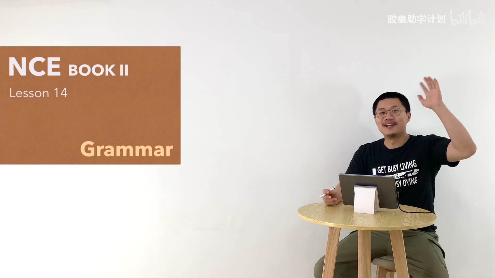

文字识别：胶囊助学计划 / NCE / BOOKII / Lesson 14 / Grammar / GET BUSY LIVING / SYDYING

### 画面 00:00:02

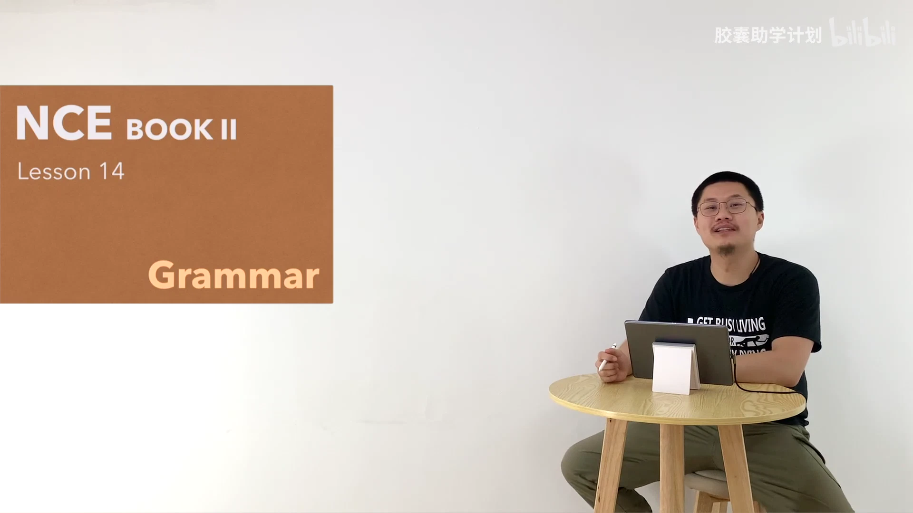

文字识别：胶囊助学计划 / NCE / BOOKII / Lesson 14 / Grammar /  GET DISIUVING / R. / MAVN

### 画面 00:00:05

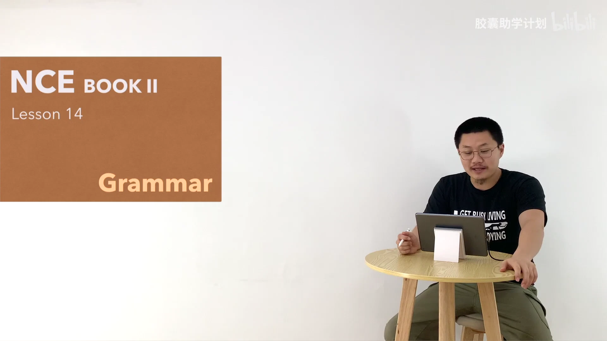

文字识别：胶囊助学计划 / NCE / BOOK I"I / Lesson 14 / Grammar / GET DIY INING / YING

### 画面 00:00:09

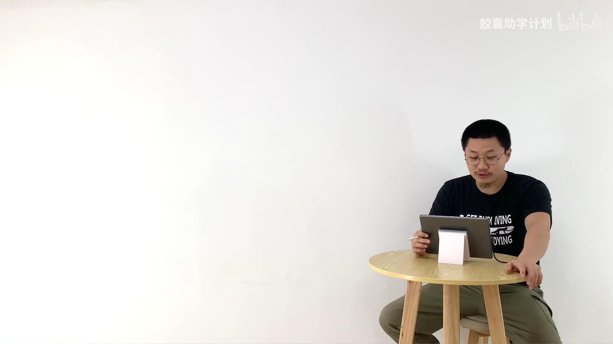

文字识别：胶囊助学计划 / DYING

### 画面 00:00:11

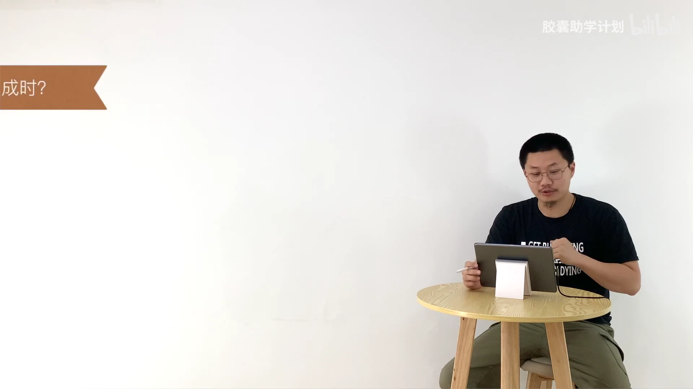

文字识别：胶囊助学计划 / 成时？ / CFTNI / 'NG / DYING

### 画面 00:00:13

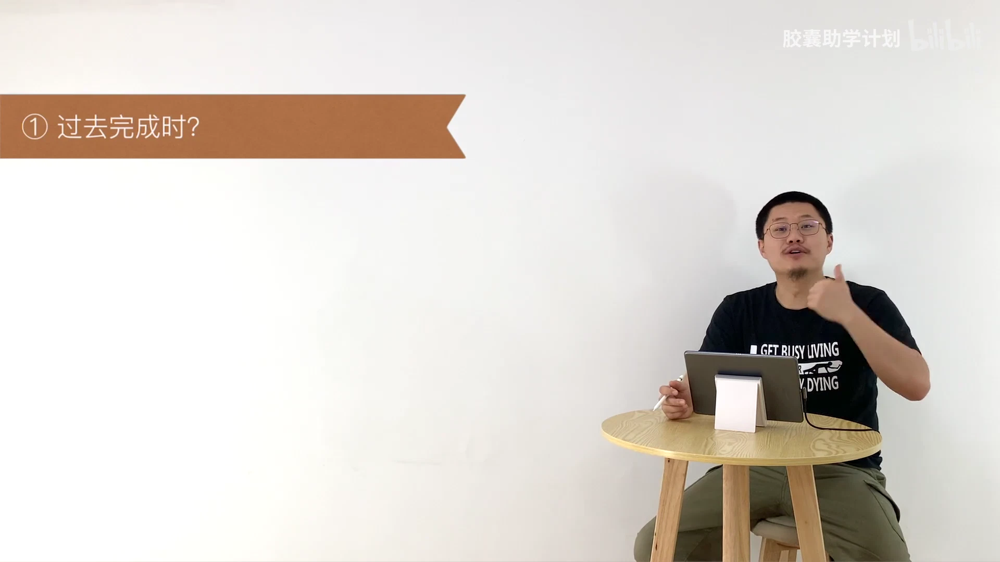

文字识别：胶囊助学计划 / ①过去完成时？ / GFT RIISY LIVING / VDYING

### 画面 00:00:18

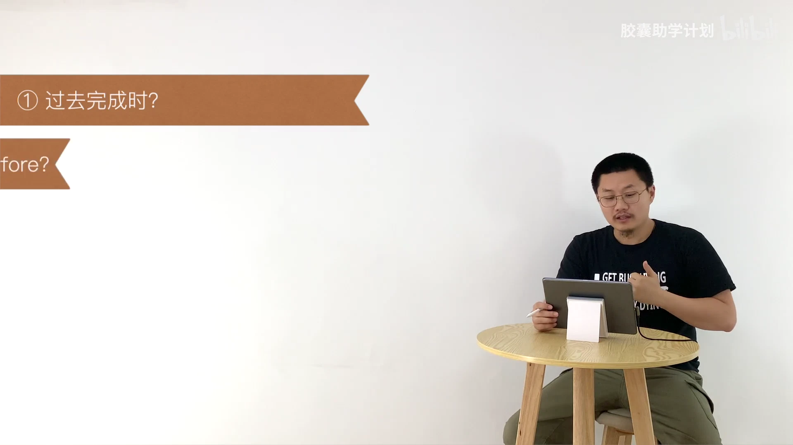

文字识别：胶囊助学计划 / ①过去完成时？ / fore? / GFT RII

### 画面 00:00:20

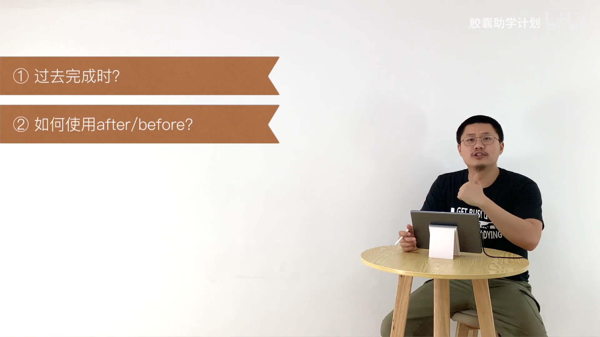

文字识别：胶囊助学计划 / ①过去完成时？ / 如何使用after/before? / GET BIISY / DYING

### 画面 00:00:25

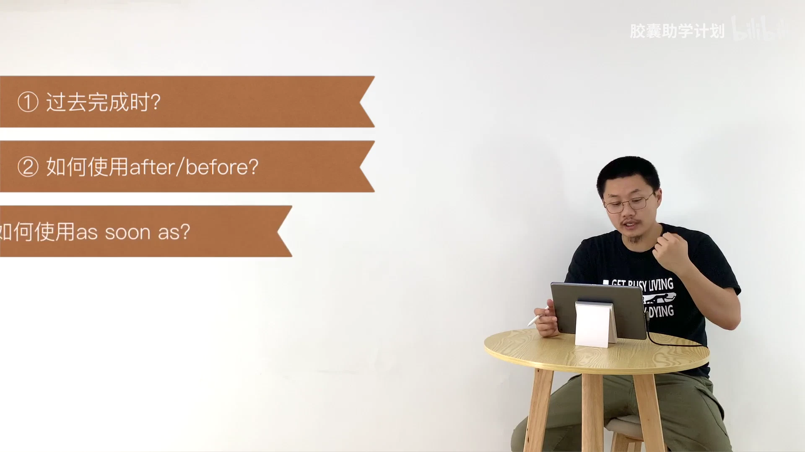

文字识别：胶囊助学计划 / ①过去完成时？ / 如何使用after/before? / 何使用assoon as? /  CET DIISY LIVING / DYING

### 画面 00:00:27

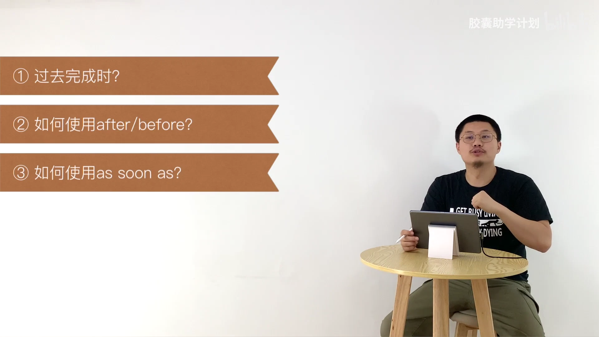

文字识别：胶囊助学计划 / ①过去完成时？ / 如何使用after/before？ / 如何使用as soon as? / GET RIISY LVA / MDYING

## 00:00:30–00:01:00

那我们先一起看一下 had done.啊，我们知道了，它叫做现在过，哦叫做过去完成时。它的结构是 had 加上 done。如果各位学过现在完成时，啊，您不是上来直接学的这一课，对吧？那你就应该知道 have 或者 has 再加上 done。啊， have 加 done。我们管它叫做现在完成时。

### 画面 00:00:31

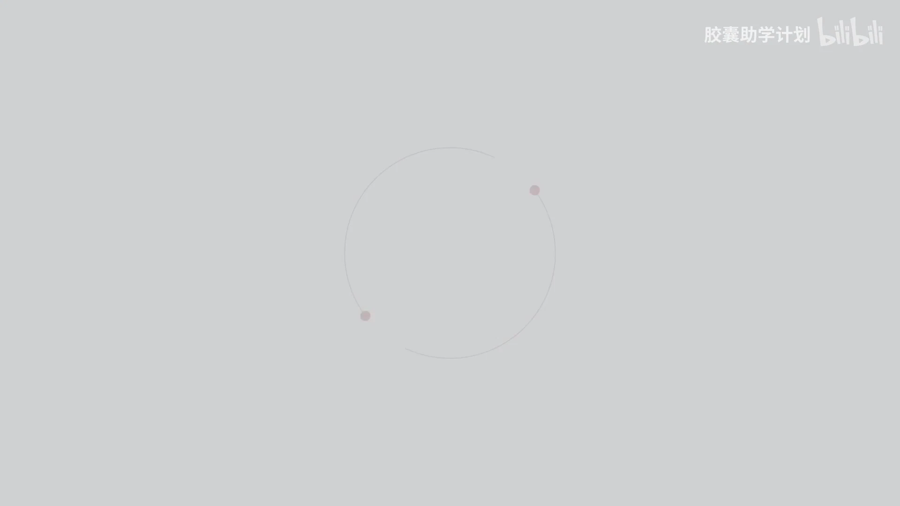

文字识别：胶囊助学计划bill / •

### 画面 00:00:35

### 画面 00:00:37

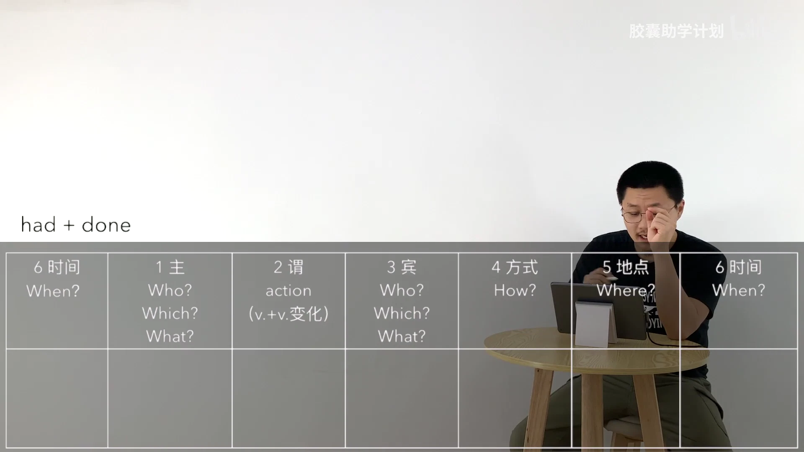

文字识别：胶囊助学计划 / had + done / 6时间 / 1主 / 2谓 / 3宾 / 4方式 / 5地点 / 6时间 / When? / Who? / action / Who? / How? / Where? / When? / Which? / (v.+v.变化) / Which? / What? / What?

### 画面 00:00:40

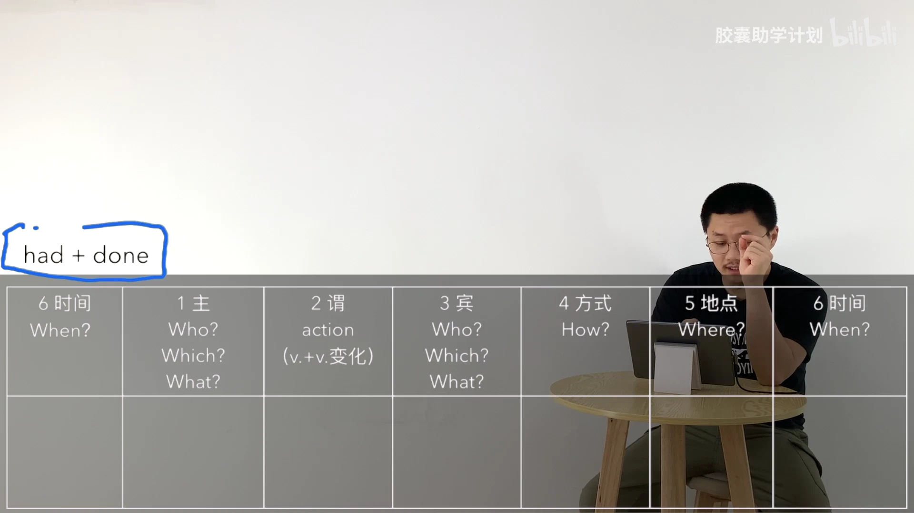

文字识别：胶囊助学计划 / had + done / 6时间 / 1主 / 2谓 / 3宾 / 4方式 / 5地点 / 6时间 / When? / Who? / action / Who? / How? / Where? / When? / Which? / (v.+v.变化) / Which? / What? / What?

### 画面 00:00:55

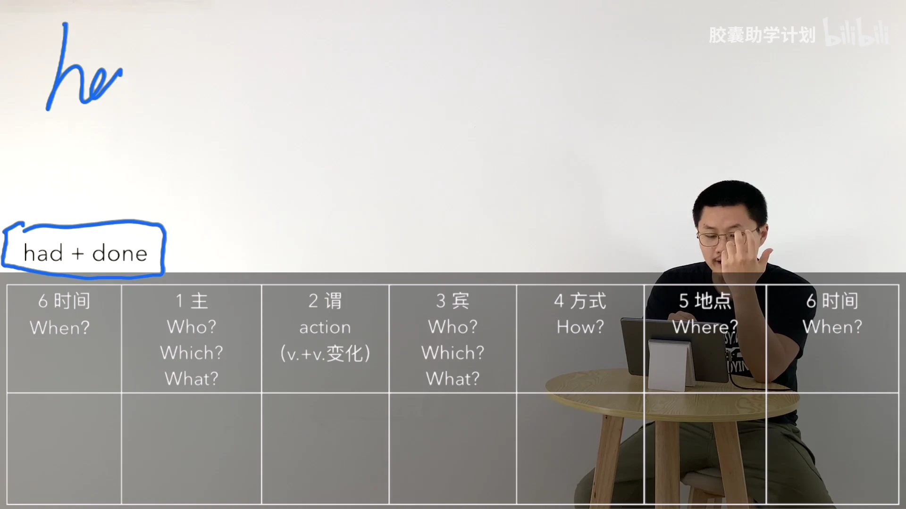

文字识别：胶囊助学计划 / had + done / 6时间 / 1主 / 2谓 / 3宾 / 4方式 / 5地点 / 时间 / When? / Who? / action / Who? / How? / Wherei / When? / Which? / (v.+v.变化) / Which? / UYIN / What? / What?

### 画面 00:00:57

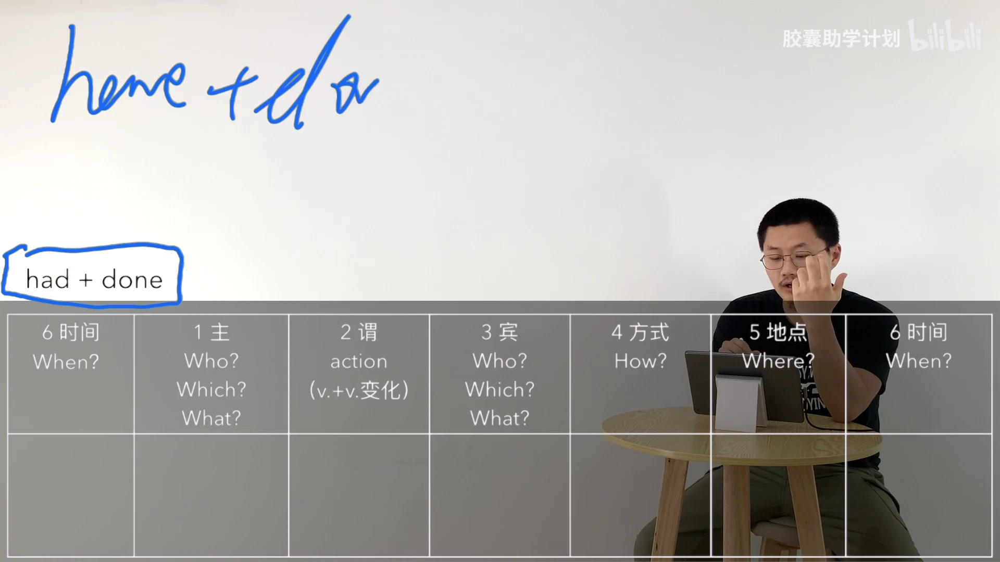

文字识别：胶囊助学计划 / heme / had + done / 6时间 / 1主 / 2谓 / 3宾 / 4方式 / 5地点 / 时间 / When? / Who? / action / Who? / How? / Where? / When? / Which? / (v.+v.变化) / Which? / What? / What?

## 00:01:00–00:01:30

那 have 的过去式又是 had。从现在完成时转成过去完成时这个时态的时候，结构无非就是把 have 换成了 had，而 done 这个过去分词是不变的，是不是就结构上很容易理解了？其次，我们管它叫做时态，那必然是处于谓语这个地方。六一二三四五六当中的二叫动词加动词的变化，这又是一个非常重要的信号，告诉各位这个知识点

### 画面 00:01:02

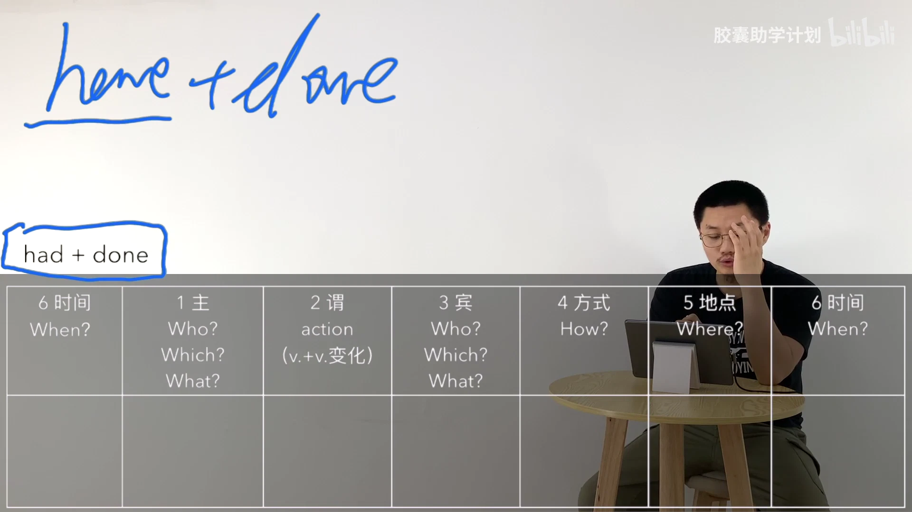

文字识别：胶囊助学计划 / henme / me / had + done / 6时间 / 1主 / 2谓 / 3宾 / 4方式 / 5地点 / 时间 / When? / Who? / action / Who? / How? / Where? / When? / Which? / (v.+v.变化) / Which? / What? / What?

### 画面 00:01:12

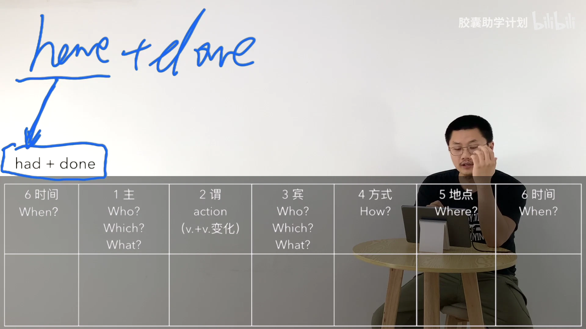

文字识别：胶囊助学计划 / heme / me / had + done / 6时间 / 1主 / 2谓 / 3宾 / 4方式 / 5地点 / 时间 / When? / Who? / action / Who? / How? / Where?n / When? / Which? / (v.+v.变化) / Which? / What? / What?

### 画面 00:01:21

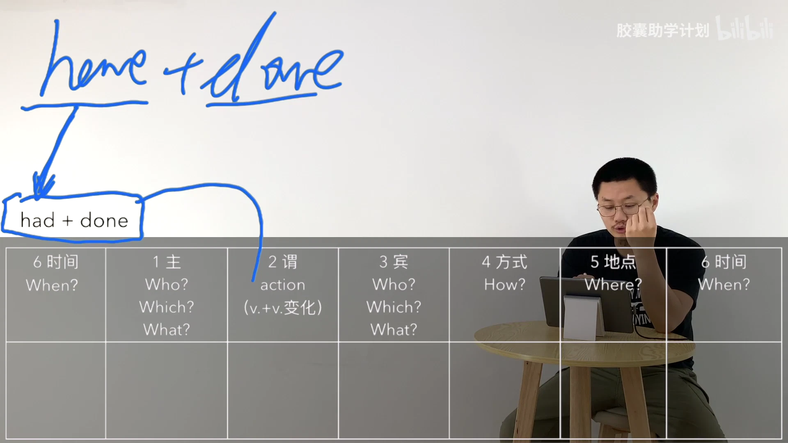

文字识别：胶囊助学计划 / heme / me / had + done / 6时间 / 1主 / 2谓 / 3宾 / 4方式 / 5地点 / 时间 / When? / Who? / action / Who? / How? / Where? / When? / Which? / (v.+v.变化) / Which? / What? / What?

## 00:01:30–00:02:00

很重要，对吧？好，那接下来我们就看一下它的用法，一共有三个。第一个跟现在完成时关系不大，剩下两个跟现在完成时关系都非常大啊。那我们先看第一个，这是也是最重要的一个，它表示的叫做过去的过去。其实早在新概念一册一百一十九课我们就学过了，对吧？今天我们迅速的再带大家过一遍啊，练习一遍。什么叫过去的过去？我们看一下底下这个图，

### 画面 00:01:31

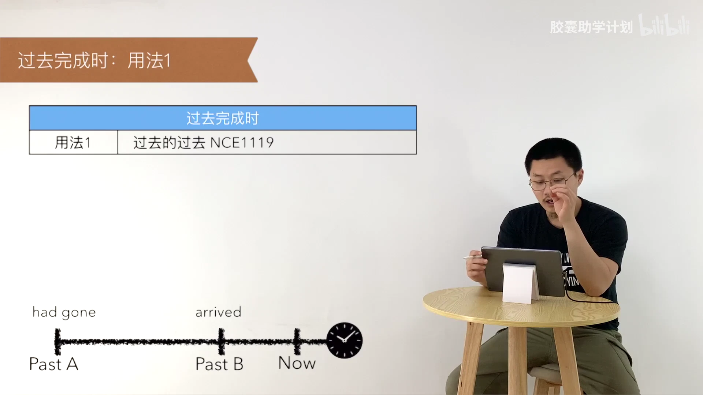

文字识别：胶囊助学计划 / 过去完成时：用法1 / 过去完成时 / 用法1 / 过去的过去 NCE1119 / had gone / arrived / Past A / Past B / Now

### 画面 00:01:44

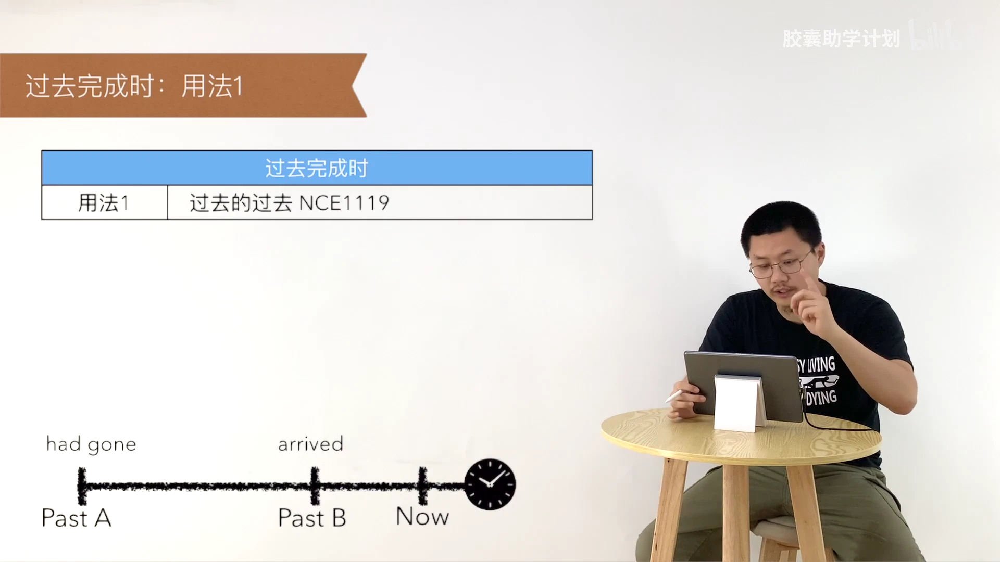

文字识别：胶囊助学计划 / 过去完成时：用法1 / 过去完成时 / 用法1 / 过去的过去NCE1119 / SYIVING / DYING / had gone / arrived / Past A / Past B / Now

### 画面 00:01:47

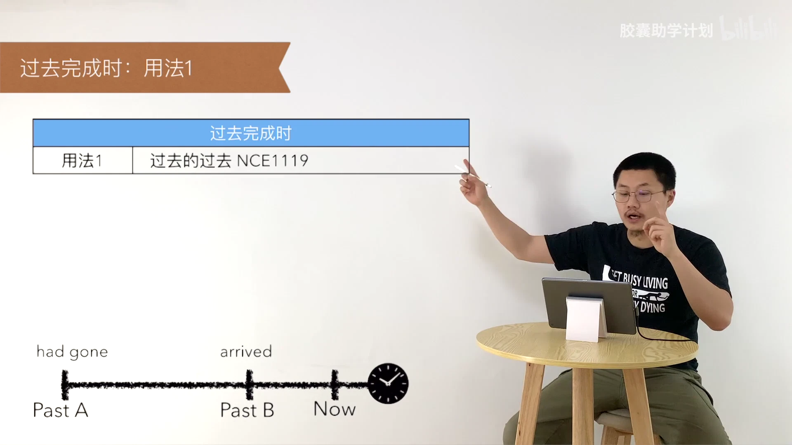

文字识别：胶囊助学计划 / 过去完成时：用法1 / 过去完成时 / 用法1 / 过去的过去 NCE1119 / ET RUISY LIVING / YDYING / had gone / arrived / Past A / Past B / Now

## 00:02:00–00:02:30

这是一个时间轴。如果这里是现在的话，这就是过去的B时间点，这就是过去的A时间点。那A时间点明显就是更加过去的一个时间，对吧？那如果我们说B这个时间点用的是一般过去时的话，A这个时间点您实际上是有两个选择的。第一个选择，你依旧可以用一般过去时啊。第二，如果你为了有的时候强

### 画面 00:02:17

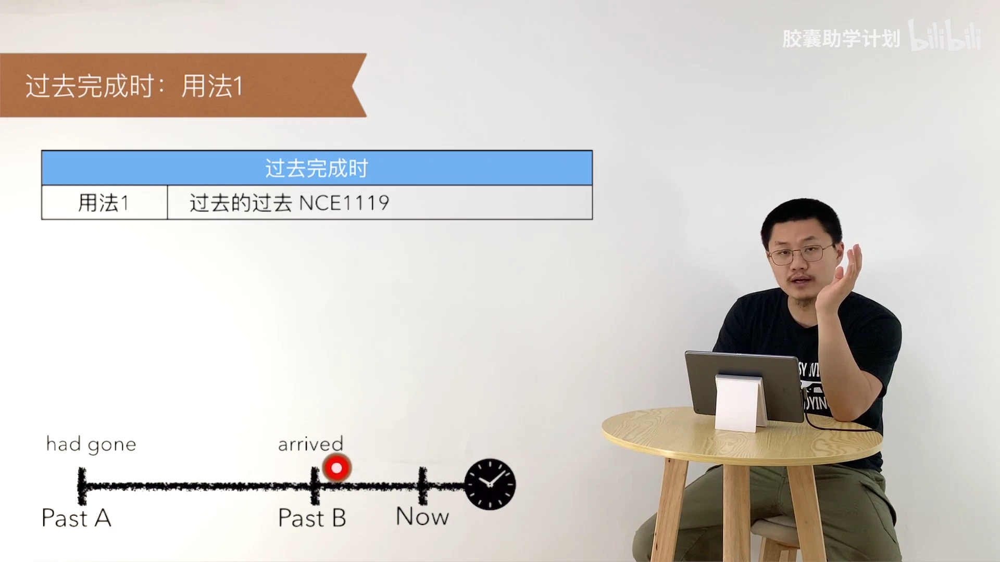

文字识别：胶囊助学计划 / 过去完成时：用法1 / 过去完成时 / 用法1 / 过去的过去 NCE1119 / SYMI / had gone / arrived / Past A / Past B / Now

## 00:02:30–00:03:00

调这两个动作没有必然的前后顺序啊，为了强调一个动作在另一个动作之前，所谓叫过去的过去，过去点 B 的过去就是过去的 A， OK，那你就可以用现在完成过去完成时叫做 had 加上的这个时态，看见了吧？这儿可以用一般过去时，这儿有两个选择，一般过去时或过去完成时啊。接

### 画面 00:02:47

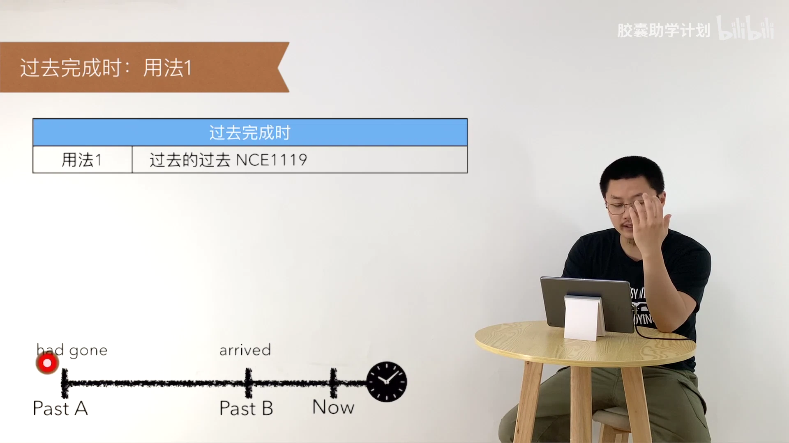

文字识别：胶囊助学计划 / 过去完成时：用法1 / 过去完成时 / 用法1 / 过去的过去 NCE1119 / gone / arrived / Past A / Past B / Now

## 00:03:00–00:03:30

下来我们看它的结构。刚才提到了 had 加 done，对吧？动词 e d 啊， done 指的是动词的过去分词。这个您有一个好的手机字典啊，基本就够了，对吧？包括我们新概念一册八十三课，到包括新概念二册，我们都学过了过去分词这件事儿了啊，就不再多提了。好，肯定句，比如说我们看这样一句话，叫做 When Sarah arrive at the party。注意第一个动作出来了，叫做到达，对吧？说

### 画面 00:03:08

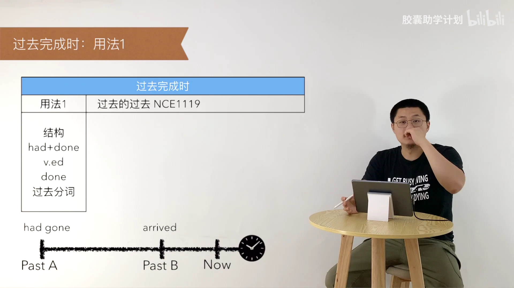

文字识别：biibili / 胶囊助学计划 / 过去完成时：用法1 / 过去完成时 / 用法1 / 过去的过去 NCE1119 / 结构 / had+done / v.ed / done / GET RIY NING / 过去分词 / VDVING / had gone / arrived / Past A / Past B / Now

### 画面 00:03:11

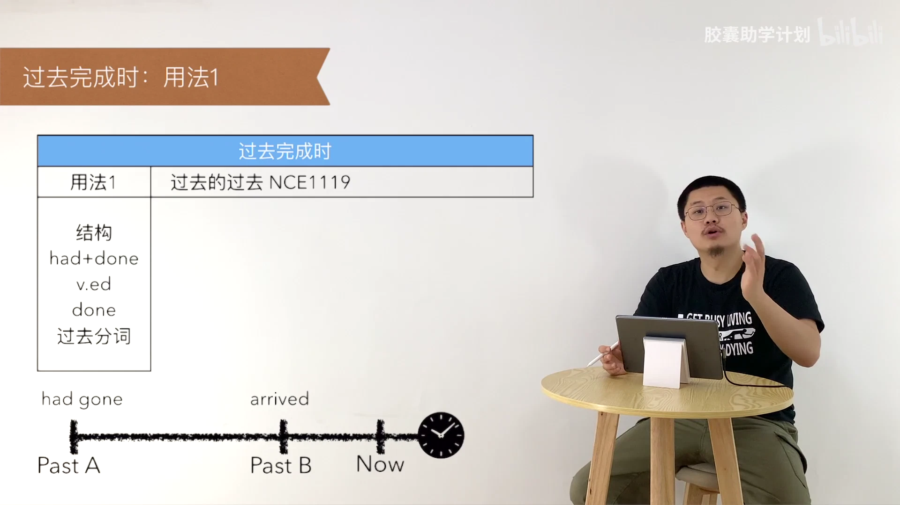

文字识别：胶囊助学计划 / 过去完成时：用法1 / 过去完成时 / 用法1 / 过去的过去 NCE1119 / 结构 / had+done / v.ed / done /  CET PIY INING / 过去分词 / MDYING / had gone / arrived / Past A / Past B / Now

### 画面 00:03:22

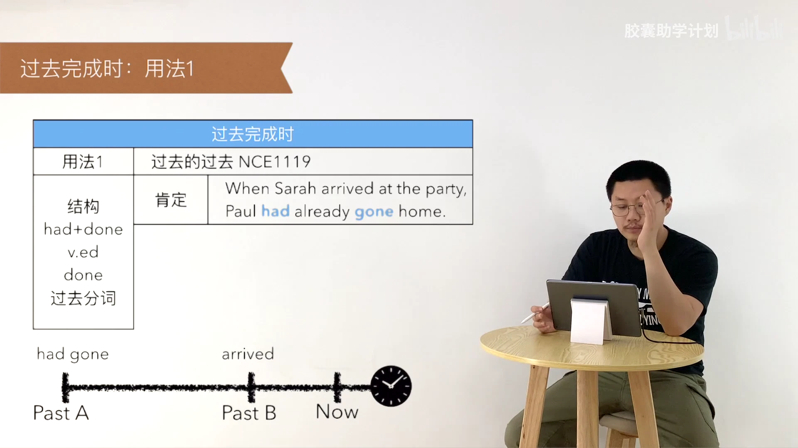

文字识别：胶囊助学计划 / 过去完成时：用法1 / 过去完成时 / 用法1 / 过去的过去NCE1119 / When Sarah arrived at the party, / 肯定 / 结构 / Paul had already gone home. / had+done / v.ed / done / 过去分词 / had gone / arrived / Past A / Past B / Now

## 00:03:30–00:04:00

当 Sarah 到达这个聚会的时候呢，Paul had already gone home. Paul 已经回家了。注意啊，如果这个地方我们不用 had，我们直接用 went home，一般过去时，你就要去反应一下，说 went 和 arrive 是谁先谁到的。这决定的事情是 Paul 和 Sarah 这两个人有没有见到彼此，对吧？如果是他到了，然后他才走的，那

### 画面 00:03:42

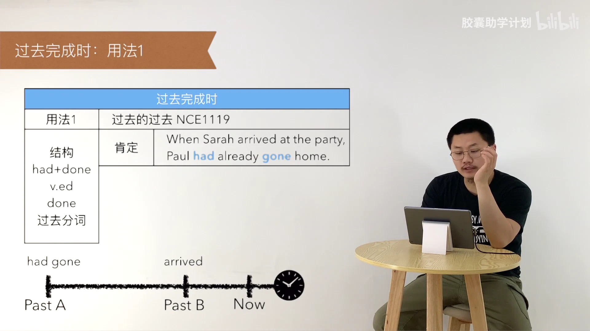

文字识别：胶囊助学计划 / 过去完成时：用法1 / 过去完成时 / 用法1 / 过去的过去 NCE1119 / When Sarah arrived at the party, / 肯定 / 结构 / Paul had already gone home. / had+done / v.ed / done / 过去分词 / IMIN / had gone / arrived / Past A / Past B / Now

### 画面 00:03:51

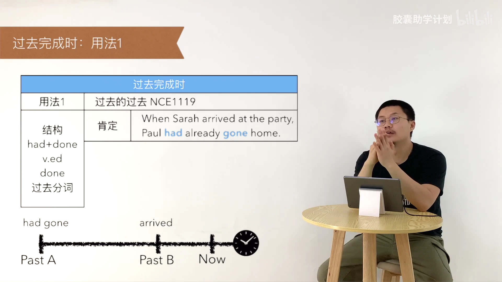

文字识别：胶囊助学计划 / 过去完成时：用法1 / 过去完成时 / 用法1 / 过去的过去NCE1119 / When Sarah arrived at the party, / 肯定 / 结构 / Paul had already gone home. / had+done / v.ed / done / 过去分词 / had gone / arrived / Past A / Past B / Now

## 00:04:00–00:04:30

可能打了个照面儿，对吧？见了一面。如果是他到之前他就走了，那两个人怎么也见不到，对吧？但如果用了过去完成时这个时态，had加但，那这个就不用去思考了，一定是gone这个动作发生在前，因为它的用法就叫过去，过去，对吧？而arrive一定是发生在后的，这就是这个时态我们要学习它最重要的一个原因，迅速就能判断出来过去的两个

### 画面 00:04:21

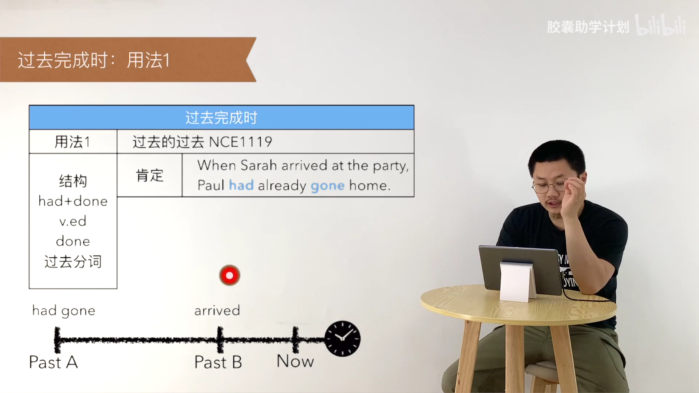

文字识别：胶囊助学计划 / 过去完成时：用法1 / 过去完成时 / 用法1 / 过去的过去 NCE1119 / When Sarah arrived at the party, / 肯定 / 结构 / Paul had already gone home. / had+done / v.ed / done / 过去分词 / JYIN / had gone / arrived / Past A / Past B / Now

## 00:04:30–00:05:00

动作谁在前谁在后，OK？那它的否定呢？其实很简单，您触类旁通就行了。我教过各位，have加that是have后边加not，对吧？我们现在告诉您是have换成了had，那无非就是had后边加not就完了。一般疑问句同理，把had提到句首就可以了。它有一个小的难点就是什么呢？你首先一定要判断啊动作前后顺序，并且一定都在过去。

### 画面 00:04:38

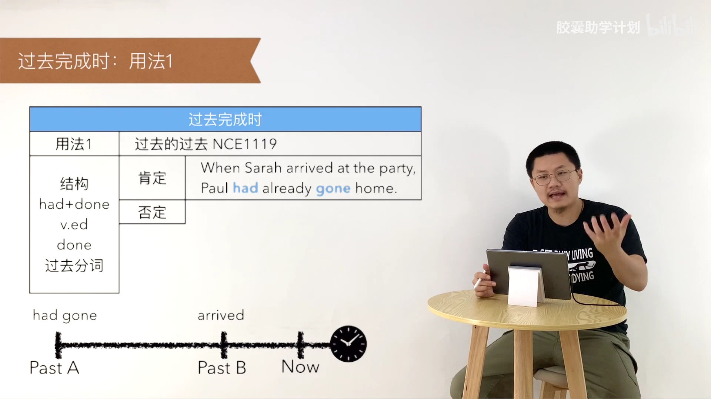

文字识别：胶囊助学计划 / 过去完成时：用法1 / 过去完成时 / 用法1 / 过去的过去NCE1119 / When Sarah arrived at the party, / 肯定 / 结构 / Paul had already gone home. / had+done / 否定 / v.ed / done / ""YLINING / 过去分词 / DYING / had gone / arrived / Past A / Past B / Now

### 画面 00:04:49

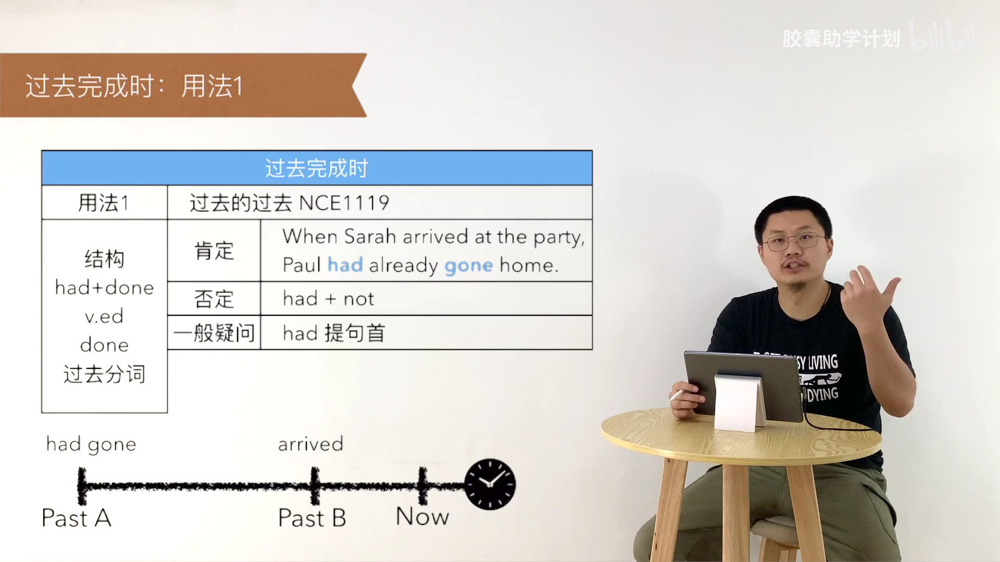

文字识别：胶囊助学计划 / 过去完成时：用法1 / 过去完成时 / 用法1 / 过去的过去NCE1119 / When Sarah arrived at the party, / 肯定 / 结构 / Paul had already gone home. / had+done / 否定 / had + not / v.ed / 般疑问 / had 提句首 / done / 'SYLVING / 过去分词 / IDYING / had gone / arrived / Past A / Past B / Now

### 画面 00:04:51

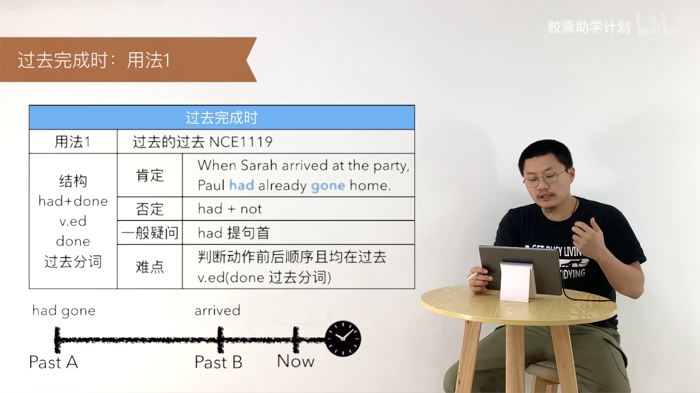

文字识别：胶囊助学计划 / 过去完成时：用法1 / 过去完成时 / 用法1 / 过去的过去NCE1119 / When Sarah arrived at the party, / 肯定 / 结构 / Paul had already gone home. / had+done / 否定 / had + not / v.ed / 般疑问 / had 提句首 / done / 判断动作前后顺序且均在过去 / 过去分词 / 难点 / v.ed(done 过去分词) / 'DYING / had gone / arrived / Past A / Past B / Now

### 画面 00:04:56

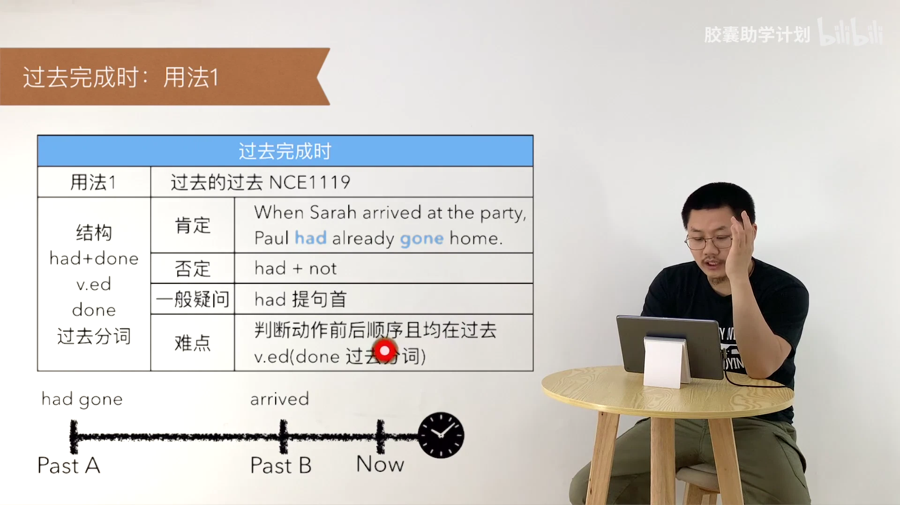

文字识别：胶囊助学计划 / 过去完成时：用法1 / 过去完成时 / 用法1 / 过去的过去NCE1119 / When Sarah arrived at the party, / 肯定 / 结构 / Paul had already gone home. / had+done / 否定 / had + not / v.ed / 般疑问 / had 提句首 / done / 判断动作前后顺序且均在过去 / 过去分词 / 难点 / v.ed(done过去词) / had gone / arrived / Past A / Past B / Now

## 00:05:00–00:05:30

首先，大的前提一定是两个动作都是过去发生的，不能是未来发生的，那不能叫过去完成时，对吧？其次，你要做的事情无非就是两个动作，谁在 A 这个位置，谁更靠前一点发生，谁更靠后一点发生，然后靠前一点发生的那个用过去完成时就可以了，就这么简单，对吧？OK，比如说我们看这儿啊，看这儿，我先把这两个给大家打出

### 画面 00:05:23

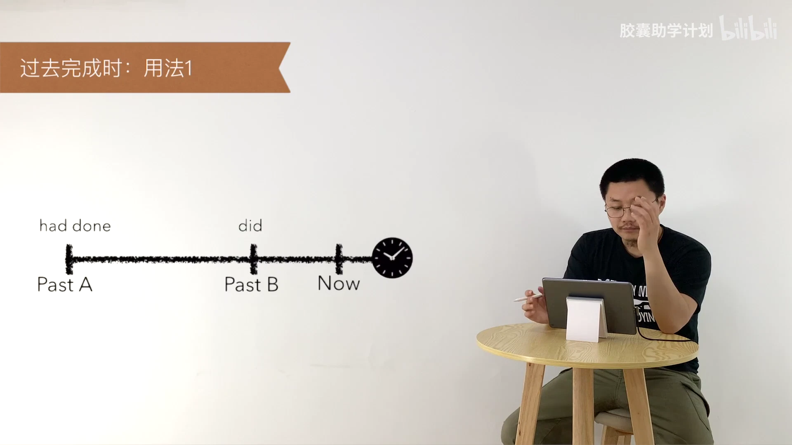

文字识别：Bilbili / 胶囊助学计划 / 过去完成时：用法1 / had done / did / Past A / Past B / Now / YV

## 00:05:30–00:06:00

来。After大家都认的叫在什么什么之后，我这儿写的是 after 点点点 had done，然后点点点 did 点点点。我想说什么呢？就是你看一下啊，这个结构叫做在 a 这件事情发生之后，逗号发生了 b。 After a 逗号 b a 要用的时态是 had 加 done， b 这个点要用的时态是 did，对吧？

### 画面 00:05:53

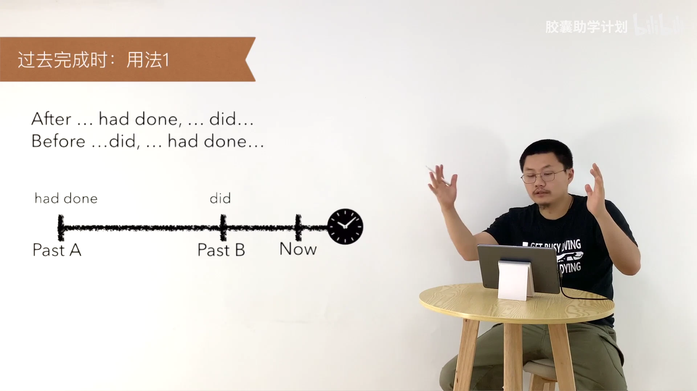

文字识别：胶囊助学计划 / 过去完成时：用法1 / After ... had done, ... did... / Before ...did, ... had done... / had done / did / Past A / Past B / Now / CRT PSY AVING / DYING

## 00:06:00–00:06:30

那 before did 的逗号点点点 had 加但，这个是什么意思呢？ Before 叫在什么什么之前，那就是 before B 这个动作之前发生了 A 这个动作，只不过在 B 这个动作的时候要用的是 did，而 A 这个动作用的是 had but，其实时态是没有变化的，对吧？以及最后一个 as soon as， after 叫在什么什么之后， before 叫在什么什么之前， as soon

### 画面 00:06:23

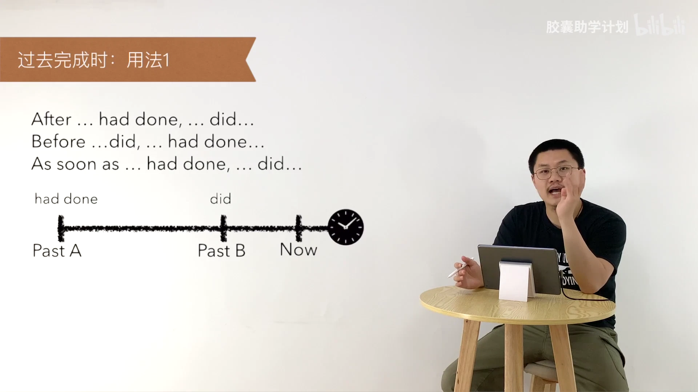

文字识别：胶囊助学计划 / 过去完成时：用法1 / After ... had done, ... did... / Before ...did, ... had done... / As soon as ... had done, ... did... / had done / did / Past A / Past B / Now

## 00:06:30–00:07:00

as叫一怎么怎么样就怎么怎么样啊！你想一下，就是一这个样子，就后面这个样子啊！一先发生了A这个动作，然后就发生了B这个动作，这样去讲比较抽象。接下来我们拿一些例子代进去，各位仔细跟我一起想一下就行了啊！来，我们试一下，做一些小的练习，包含had加done的句子来了。我们先看这两句话啊，

### 画面 00:06:50

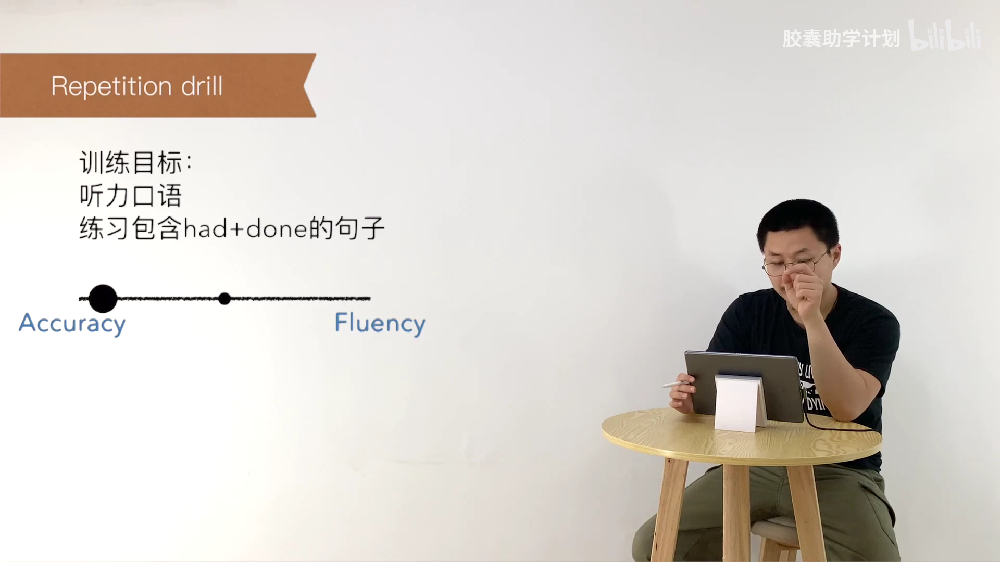

文字识别：胶囊助学计划 / Repetition drill / 训练目标： / 听力口语 / 练习包含had+done的句子 / Accuracy / Fluency

### 画面 00:06:54

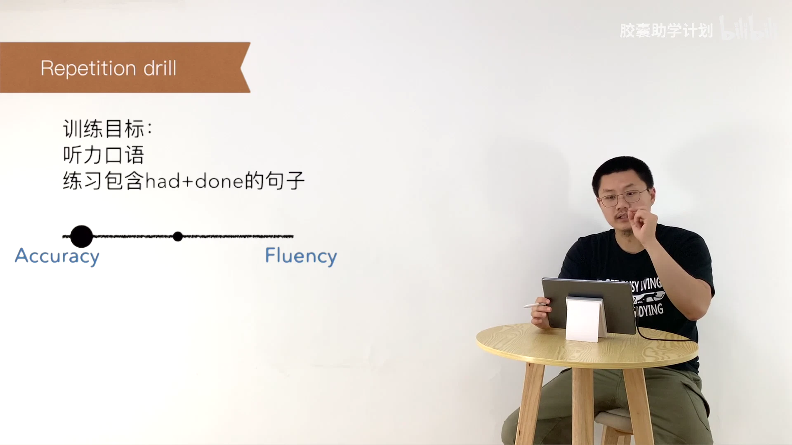

文字识别：胶囊助学计划 / Repetition drill / 训练目标： / 听力口语 / 练习包含had+done的句子 / Accuracy / Fluency / DYING

### 画面 00:06:56

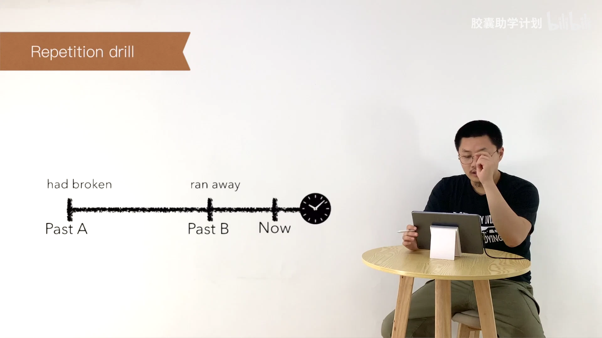

文字识别：胶囊助学计划 / Repetition drill / had broken / ran away / Past A / Past B / Now / DYING

### 画面 00:06:58

文字识别：胶囊助学计划 / Repetition drill / 1T: When did the children run away? / After they had broken the window. / had broken / ran away / Past A / Past B / Now

## 00:07:00–00:07:30

When did the children run away?孩子们什么时候跑开的？After they had broken the window，在他们打坏这个窗户之后，所以在这个地方实际上是有两个动作，第一个动作叫run away，第二个动作叫做had broken啊，叫做打碎了玻璃。那你要判断的事情是，他们先跑开了再打碎了玻璃，还是先打碎了玻璃再跑开了？这个不需要你们判断，为什么呢？这儿已经通过时态告诉你了，这是had broken，

### 画面 00:07:17

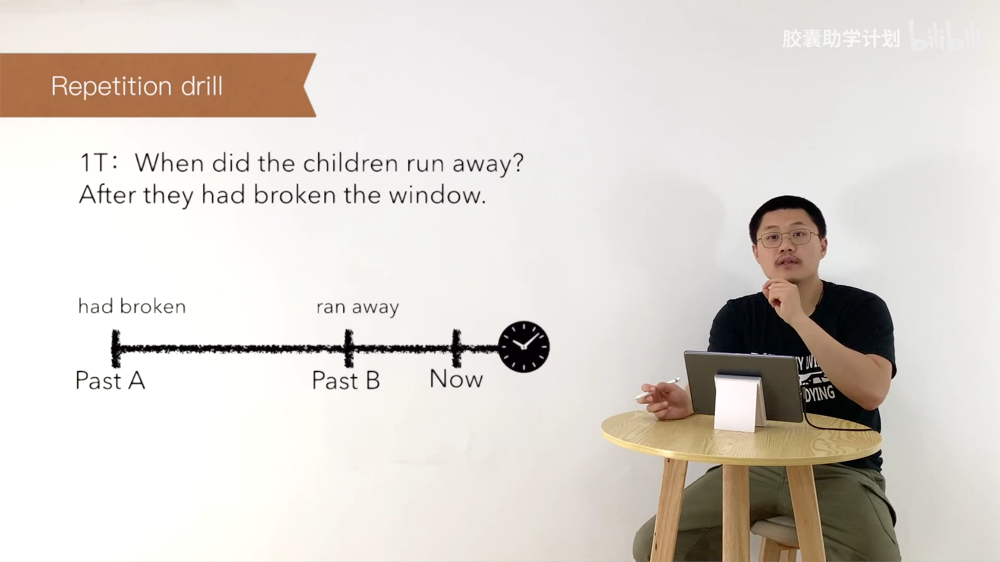

文字识别：胶囊助学计划 / Repetition drill / 1T: When did the children run away? / After they had broken the window. / had broken / ran away / Past A / Past B / Now / DYING

### 画面 00:07:22

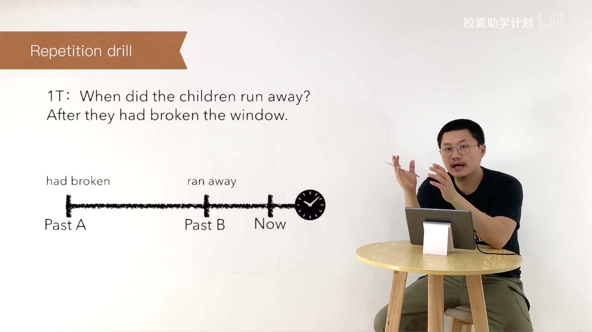

文字识别：胶囊助学计划 / Repetition drill / 1T: When did the children run away? / After they had broken the window. / had broken / ran away / Past A / Past B / Now

### 画面 00:07:28

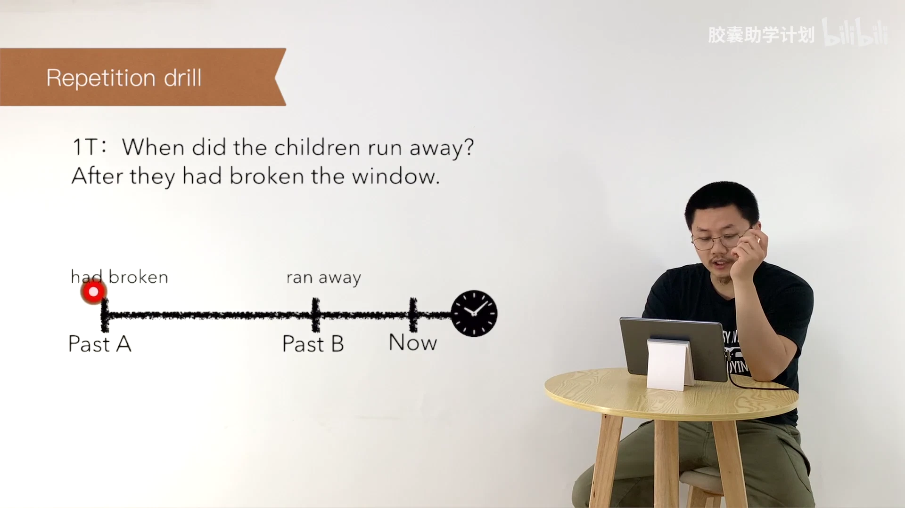

文字识别：胶囊助学计划 / Repetition drill / 1T: When did the children run away? / After they had broken the window. / had broken / ran away / Past A / Past B / Now / YIN

## 00:07:30–00:08:00

这是 ran away，这是过去完成时，这是 B 这个时间点是一般过去时，所以它是怎么样固定了的，对吧？谁前谁后？所以您需要做的事情就是回答这个问题，看一下答案啊，叫做 The children ran away，孩子们跑开了，在什么之后呢？在 They had broken the window， after they had broken the window，在

### 画面 00:07:46

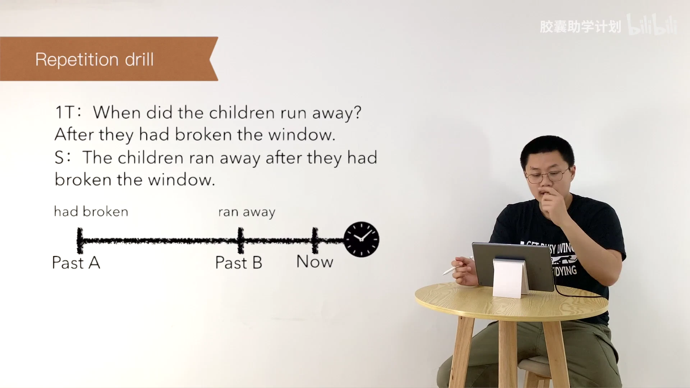

文字识别：胶囊助学计划 / Repetition drill / 1T: When did the children run away? / After they had broken the window. / S: The children ran away after they had / broken the window. / had broken / ran away / Past A / Past B / Now / DYING

## 00:08:00–00:08:30

他们打碎了这个窗户之后，你看had加broken啊，我给大家标一下had加broken和ran away是吧？After a逗号b，当然也可以变成b，然后after a，那是一样的，对吧？啊，只不过你前后改了，但意思是不变的。接下来下一个我们再试一下啊，比如说When did he ask for a glass of water?他什么时候要了一杯水呢？When he had

### 画面 00:08:07

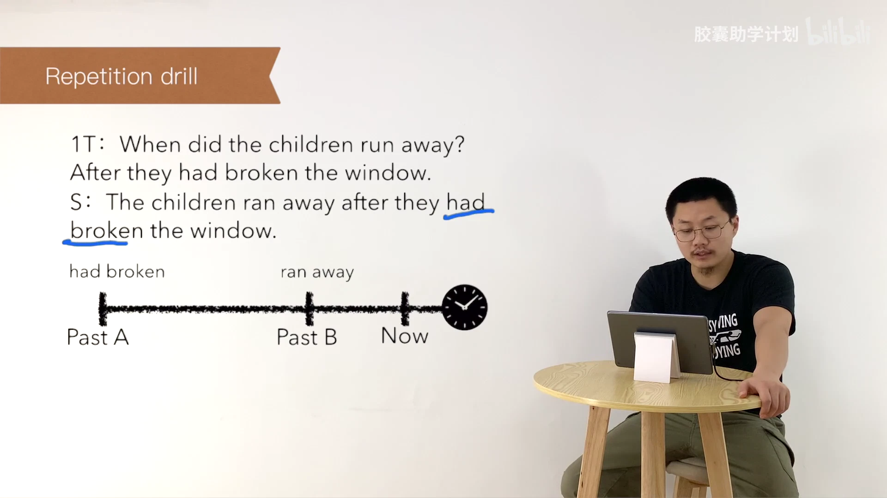

文字识别：胶囊助学计划 / Repetition drill / 1T: When did the children run away? / After they had broken the window. / S: The children ran away a / after they had / broken the window. / had broken / ran away / SY/ING / Past A / Past B / Now / JYING

### 画面 00:08:10

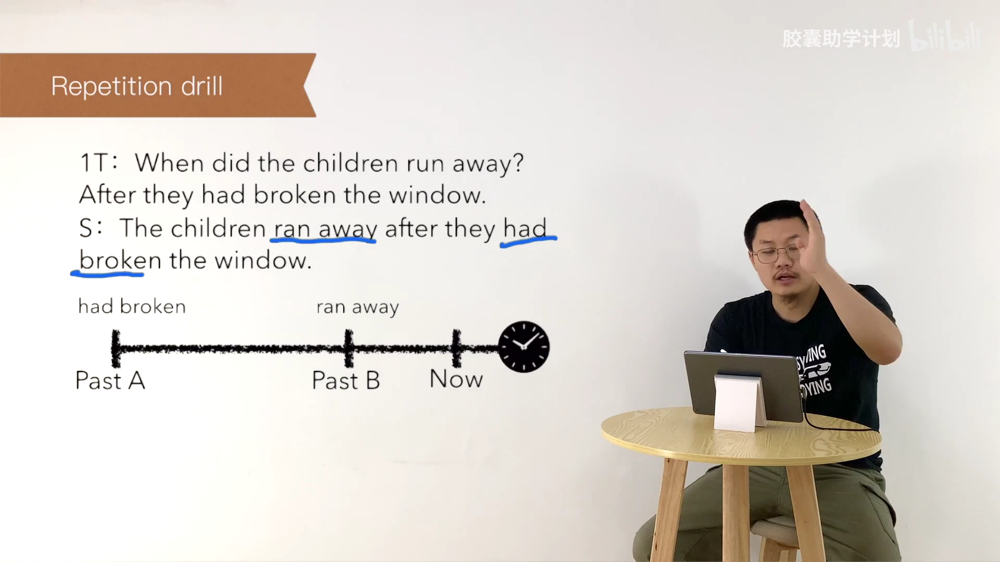

文字识别：胶囊助学计划 / Repetition drill / 1T: When did the children run away? / After they had broken the window. / S:The / children ran away / after they had / broken the window. / had broken / ran away / Sy/ING / Past A / Past B / Now / YING

### 画面 00:08:19

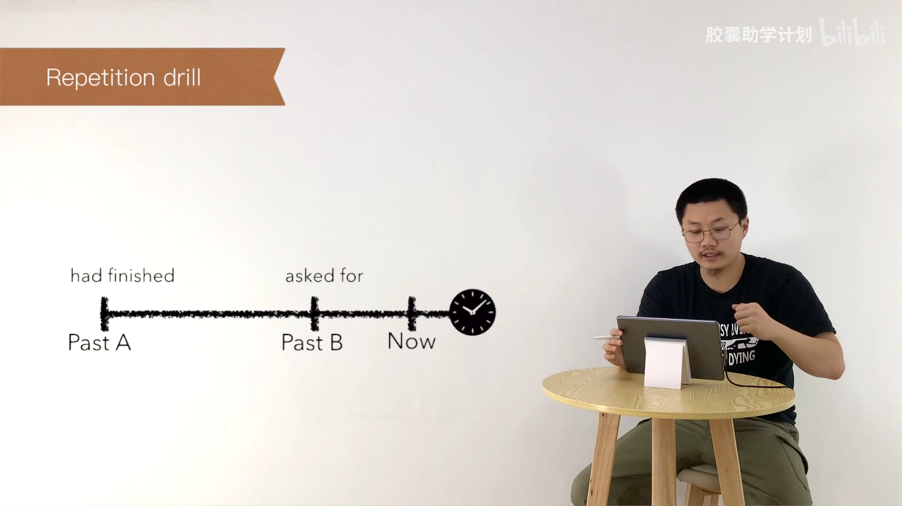

文字识别：胶囊助学计划 / Repetition drill / had finished / asked for / ISYW. / Past A / Past B / Now / DYING

## 00:08:30–00:09:00

finished lunch, 当他吃完午餐之后，对吧？好，你看一下，这儿时态已经给大家定了，啊，先是吃完，然后才要的水。那各位要做的事情就是还是把它连到一起，叫做 he asked for a glass of water. 首先，两个动作都发生在过去，这个是没跑了，对吧？哎，要了一杯水，然后 he had finished lunch. 啊，不是然

### 画面 00:08:35

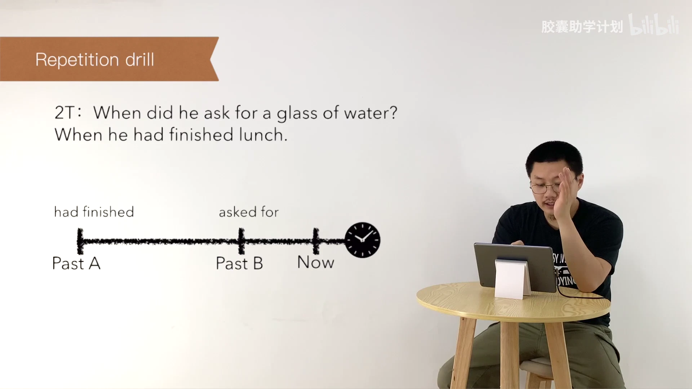

文字识别：胶囊助学计划 / Repetition drill / 2T: When did he ask for a glass of water? / When he had finished lunch. / had finished / asked for / Past A / Past B / Now / YIN

### 画面 00:08:38

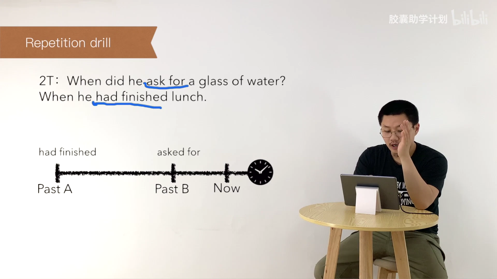

文字识别：胶囊助学计划 / Repetition drill / 2T: When did heask fora glass of water? / When he had finished lunch. / had finished / asked for / Past A / Past B / Now

### 画面 00:08:41

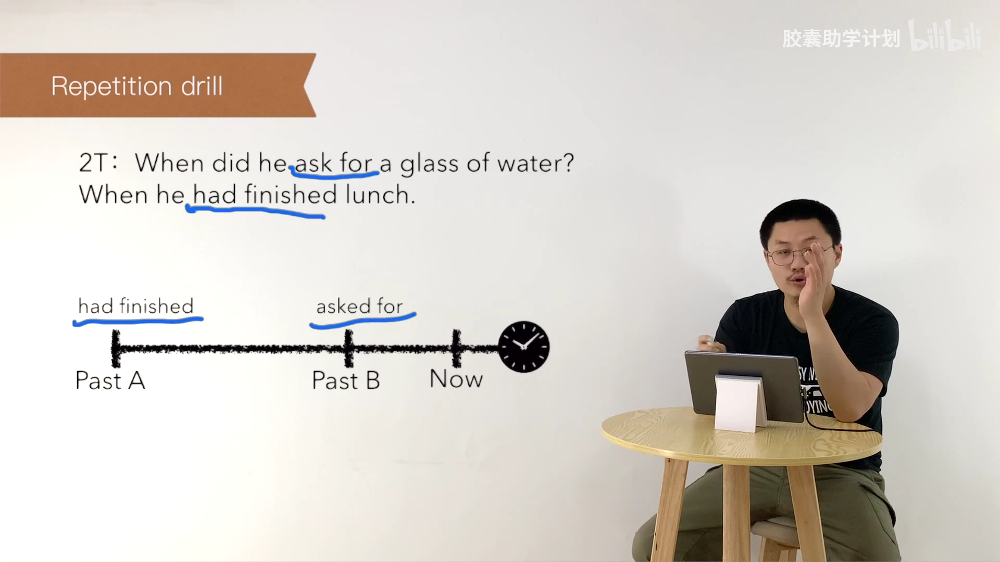

文字识别：胶囊助学计划 / Repetition drill / 2T: When did heask fora glass of water? / When he had finished lunch. / had finished / asked for / Past A / Past B / Now

### 画面 00:08:47

文字识别：胶囊助学计划 / Repetition drill / 2T: When did heask fora glass of water? / When he had finished lunch. / S: He asked for a glass of water when he / had finished lunch. / had finished / asked for / Past A / Past B / Now / SYNI / JYIN

### 画面 00:08:49

文字识别：胶囊助学计划 / Repetition drill / 2T: When did heask fora glass of water? / When he had finished lunch. / S: He asked for a gTass of water when he / had finished lunch. / had finished / asked for / Past A / Past B / Now

### 画面 00:08:51

文字识别：胶囊助学计划 / Repetition drill / 2T: When did he ask for a glass of water? / When he had finished lunch. / S: He asked for a glass of water when he / had finished lunch. / had finished / asked for / Past A / Past B / Now / SYML / DYIN

## 00:09:00–00:09:30

It's in that. In what after, right? In after he finished lunch, he asked for a glass of water. Okay, we come again. For example, when did they return to their hotel? When did they return to their hotel? When did they return to their hotel? When did they return to their hotel? When did they return to their hotel? When did they return to their hotel? When did they return to their hotel? When did they return to their hotel? When did they return to their hotel? When did they return to their hotel? When did they return to their hotel? When did they return to their hotel? When did they return to their hotel? When did they return to their hotel? When did they return to their hotel? When did they return to

### 画面 00:09:08

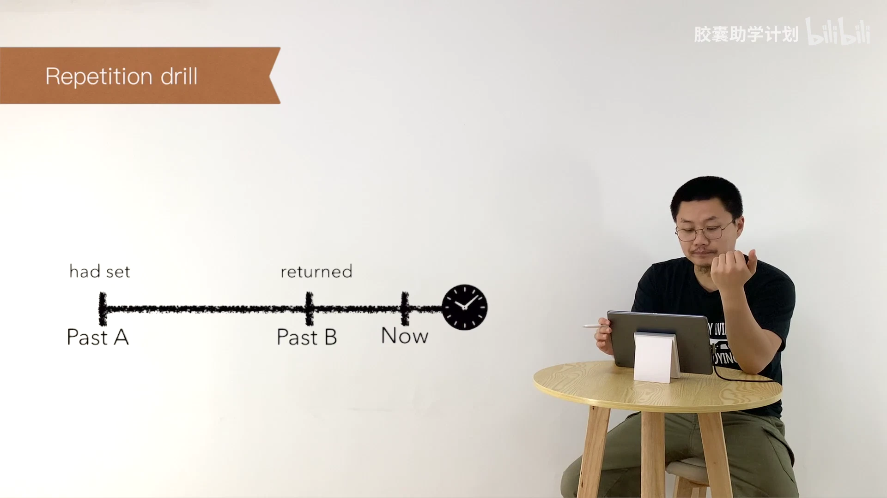

文字识别：胶囊助学计划 / Repetition drill / had set / returned / PastA / Past B / Now

## 00:09:30–00:10:00

set，一另外一个叫做 return。 had set 时态已经告诉你叫过去的过去，那它一定是先发生，然后 return 是后发生，对吧？所以这个地方就可以造出来一个句子叫 they return to their hotel。他们回到了他们的酒店。 As soon as 一怎么样呢？ The sun had had set。太阳一落山，他们就回到了酒店。所以这句话英文的 as soon

### 画面 00:09:38

文字识别：胶囊助学计划 / Repetition drill / 3T: When did they return to their hotel? / As soon as the sun had set. / had set / returned / yVING / Past A / Past B / Now / UVING

## 00:10:00–00:10:30

as 引导的这句话可以放在前面。如果把它啊叫做句子一，前面这个叫做句子二的话，它们俩可以是二一的前后顺序，也可以是一二的前后顺序。就是把这句话放到前面去，但含义并不变啊。各位不用被这个地方绕懵了，是吧？怎么这么多变化？就两种变化啊。接下来继续。When did the plane take off? 飞机什么时候起飞的？When I have fastened

### 画面 00:10:02

文字识别：胶囊助学计划 / Repetition drill / 3T: When did they return to their hotel? / As soon as the sun had set. / S: They returned to their hotel as soon as / the sun had set. / had set / returned / BUSYVING / Past A / Past B / Now / DYING

### 画面 00:10:06

文字识别：胶囊助学计划 / Repetition drill / 3T: When did they return to their hotel? / As / soon ast / the sun had / set. / S: / Theyret / their / hotel as soon as / the sun had set. / had set / returned / UsWING / Past A / Past B / Now / DYING

### 画面 00:10:09

文字识别：2 / 胶囊助学计划 / Repetition drill / 3T: / When / did / theyreturn to / their hotel? / As / soon / as / the / sunDad / set. / S: / Theyret / their hetel / as soon as / the / sun had / set. / had set / returned / Sy/ING / Past A / Past B / Now / DYING

### 画面 00:10:12

文字识别：2 / 胶囊助学计划 / Repetition drill / 2 / 3T: / When / did / they return to / their hotel? / As / soon / as / the / sunDad / set. / S: / Theyret / +一 / their hetel / as soon as / the / sun had / set. / had set / returned / SV/ING / Past A / Past B / Now / ONING

### 画面 00:10:14

文字识别：2 / 胶囊助学计划 / Repetition / drill / 2 / 3T: / When / did / theyreturn to / their hotel? / As / soon / as / the / sunRad / set. / S: / Theyret / their hetel / as soon / as / the / sun had / set. / had set / returned / ISyVING / Past A / Past B / Now / JYING

### 画面 00:10:16

文字识别：2 / 胶囊助学计划 / Repetition drill / 2 / 3T: / When / did / they return to / their hotel? / As / soon / as / the / sunRad s / set. / S: / Theyret / their hetel / as soon as / the / sun had / set. / had / set / returned / SYVING / Past A / Past B / Now / VING

### 画面 00:10:20

文字识别：2 / 胶囊助学计划 / Repetition / drill / 2 / 3T: / When / did / they return to / their hotel? / As / soon / as / the / sunZad / set. / S: / Theyret / their hetel / as soon / as / the / sun had / set. / had / set / returned / YING / Past A / Past B / Now / NING

### 画面 00:10:23

文字识别：胶囊助学计划 / Repetition drill / had fastened / took off / YNING / Past A / Past B / Now / JYING

### 画面 00:10:27

文字识别：胶囊助学计划 / Repetition drill / 4T: When did the plane take off? / had fastened / took off / YNING / Past A / Past B / Now / NING

## 00:10:30–00:11:00

my seatbelt. 啊，我把这安全带系好了之后，所以先发生的是系好，再然后发生的是 took off，对吧？在这个地方啊，起飞。于是连起来， the plane took off when I had fastened my seatbelt. 啊，这地方就是两句话放到一起了，飞机起飞了。在 had 加 fasten 已经告诉你这个动作先发生了，对吧？在我系好安全带之后， OK，那儿一个 continuing.

### 画面 00:10:32

文字识别：胶囊助学计划 / Repetition drill / 4T: When did the plane take off? / When I had fastened my seat belt. / had fastened / took off / GFT / Past A / Past B / Now / DYING

### 画面 00:10:35

文字识别：胶囊助学计划 / Repetition drill / 4T: When did the plane take off? / When I had fastened my seat belt. / had fastened / took off / SYVING / Past A / PastB / Now / DYING

### 画面 00:10:40

文字识别：胶囊助学计划 / Repetition drill / 4T: When did the plane take off? / When I had fastened my seat belt. / S: The plane took off when I had fastened / my seat belt. / had fastened / took off / SY VING / Past A / Past B / Now / YING

### 画面 00:10:44

文字识别：胶囊助学计划 / Repetition drill / 4T: When did the plane take off? / When I had fastened my seat belt. / S: The plane took off when I had fastened / my seat belt. / had fastened / took off / SYVING / Past A / Past B / Now / OYING

### 画面 00:10:47

文字识别：胶囊助学计划 / Repetition drill / 4T: When did the plane take off? / When I had fastened my seat belt. / S: The plane took off when I had fastened / my seat belt. / had fastened / took off / SYVING / Past A / Past B / Now / YING

### 画面 00:10:51

文字识别：胶囊助学计划 / Repetition drill / 4T: When did the plane take off? / When I had fastened my seat belt. / S: The plane took off when I had fastened / my seat belt. / had fastened / took off / SYVING / Past A / Past B / Now / OVING

### 画面 00:10:58

文字识别：胶囊助学计划 / Repetition drill / had begun / took / SYVING / Past A / Past B / Now / JYING

## 00:11:00–00:11:30

When did she take a taxi? After it had begun to rain. 好，这两句话是给各位的一个答案啊，给各位的一个提示，各位要自己写出来这个答案，对吧？我们要判断的还是谁先谁后。Had began先发生这个，然后再发生took a taxi，往里去带，叫做She took a taxi after it had began to rain. 在下雨之后，她

### 画面 00:11:05

文字识别：胶囊助学计划 / Repetition drill / 5T: When did she take a taxi? / After it had begun to rain. / had begun / took / USYVING / Past A / Past B / Now / DYING

### 画面 00:11:07

文字识别：胶囊助学计划 / Repetition drill / 5T: When did she take a taxi? / After it had begun to rain / had begun / took / USyVING / Past A / Past B / Now / DYING

### 画面 00:11:11

文字识别：胶囊助学计划 / Repetition drill / 5T: When did she take a taxi? / After it had begun to rain / had begun / took / USYVING / Past A / Past B / Now / OYING

### 画面 00:11:13

文字识别：胶囊助学计划 / Repetition drill / 5T: When did she take a taxi? / After it had begun to rain / had begun / took / SY VING / Past A / Past B / Now / DYING

### 画面 00:11:19

文字识别：胶囊助学计划 / Repetition drill / 5T: When did she take a taxi? / After it had beaun to rain / had begun / took / SYVING / Past A / Past B / Now / YING

### 画面 00:11:24

文字识别：胶囊助学计划 / Repetition drill / 5T: When did she take a taxi? / After it had begun to rain / S: She took a taxi after it had begun to rain. / had begun / took / ISY VING / Past A / Past B / Now / DYING

### 画面 00:11:29

文字识别：胶囊助学计划 / Repetition drill / 5T: When did she take a taxi? / After it had begun to rain / S: She took a taxi after it had begun to rain. / had begun / took / SYVING / Past A / Past B / Now / PDVING

## 00:11:30–00:12:00

才打了一辆车。你别看他在后边，还可以先翻译啊。Continuing，接下来，When did he arrive after all the guests have left？在所有客人都走了之后，他才来的。先走，后来，对吧？所以他谁也没见到。于是连起来，He arrived after all the guests had left. Continuing. When did she go to the

### 画面 00:11:31

文字识别：胶囊助学计划 / Repetition drill / 5T: When did she take a taxi? / After it had beaun to / rain / S: / She took a taxi after it had begun to rain. / had begun / took / ISYVING / Past A / Past B / Now / PYING

### 画面 00:11:34

文字识别：胶囊助学计划 / Repetition drill / had left / arrived / SYVING / Past A / Past B / Now / JYING

### 画面 00:11:45

文字识别：胶囊助学计划 / Repetition drill / 6T: When did he arrive? / After all the guests had left. / had left / arrived / USYVING / Past A / Past B / Now / DYING

### 画面 00:11:47

文字识别：胶囊助学计划 / Repetition drill / 6T: When did he arrive? / After all the guests had left. / had left / arrived / USYVING / Past A / Past B / Now / DYING

### 画面 00:11:52

文字识别：胶囊助学计划 / Repetition drill / 6T: When did he arrive? / After all the guests / had left. / S: He arrivedafter all the / guests had left. / had left / arrived / JSYVING / Past A / Past B / Now / DYING

### 画面 00:11:54

文字识别：胶囊助学计划 / Repetition drill / 6T： / :When / did he arrive? / After all the / guests had left. / S: He arrivedafter all the / guests / had left. / had left / arrived / USYVING / Past A / Past B / Now / DYING

### 画面 00:11:57

文字识别：胶囊助学计划 / Repetition drill / had written / went / SYVING / Past A / Past B / Now / JYING

## 00:12:00–00:12:30

### 画面 00:12:08

文字识别：胶囊助学计划 / Repetition drill / 7T: When did she go to the post office? / As soon as she had written the letter. / had written / went / ISYVING / PastA / Past B / Now / DYING

### 画面 00:12:10

文字识别：胶囊助学计划 / Repetition drill / 7T: When did she go to the post office? / As soon as she had written the letter. / had written / went / SYVING / Past A / Past B / Now / PDYING

### 画面 00:12:12

文字识别：胶囊助学计划 / Repetition drill / 7T: When did she go to the post office? / As soon as she had written the letter. / S: She went to the post office as soon as she / had written the letter. / had written / went / 'SY,VING / Past A / Past B / Now / DYING

### 画面 00:12:19

文字识别：胶囊助学计划 / Repetition drill / had left / turned on / SYVING / Past A / Past B / Now / JYING

### 画面 00:12:22

文字识别：胶囊助学计划 / Repetition drill / 8T: When did he turn on the stereo? / had left / turned on / SYNING / Past A / Past B / Now / DYING

### 画面 00:12:29

文字识别：胶囊助学计划 / Repetition drill / 8J: When did he turn on the stereo? / The moment I had left the room. / had left / turned on / JSyVING / Past A / Past B / Now / DYING

## 00:12:30–00:13:00

啊，这个其实各位现在知道它什么意思了，就是这一刻啊，我离开房间的这一刻，其实有几乎你可以把它理解为是 as soon as 的同义词啊，一怎么样就怎么样，我一离开房间，它就打开了这个音响，对吧？OK，所以又有一个前后顺序，it turned on the stereo，这儿就是第一句话就可以理解为结束了，后边是 the moment I have left the room，我一离开这个房间，它就打开了这个

### 画面 00:12:31

文字识别：胶囊助学计划 / Repetition drill / 8T: When did he turn on the stereo? / The momentI had left the room. / had left / turned on / ISy/ING / Past A / Past B / Now / JYING

### 画面 00:12:48

文字识别：胶囊助学计划 / Repetition drill / 8T: When did he turn on the stereo? / The moment / (I had left the room. / He turned on the stereo the moment l / had left the room. / had left / turned on / SYVING / Past A / Past B / Now / YING

### 画面 00:12:50

文字识别：胶囊助学计划 / Repetition drill / 8T: When did he turn on the stereo? / The moment / (I had left the ropm. / S: He turned / on the steregthe moment l / had left the room. / had left / turned on / SYVING / Past A / Past B / Now / YING

### 画面 00:12:56

文字识别：胶囊助学计划 / Repetition drill / 8T: When did he turn on the stereo? / The moment / (I had left the ropm. / S: / He turned / ont / the s / steregthe momentl / had left the room. / had left / turned on / SYVING / Past A / Past B / Now / OYING

## 00:13:00–00:13:30

stereo 音响。 OK，新一学的单词。下一个，When did you understand the problem？你什么时候意识到这个问题的？After he had explained it，啊，在他解释完之后，所以这句话就变成了，在他解释完之后，我懂得了这个问题。看一下时态，一定是先解释再懂，对吧？先解释再懂啊。 OK，下一个，When did you buy

### 画面 00:13:02

文字识别：胶囊助学计划 / Repetition drill / hade / explained / understood / SYVING / Past A / Past B / Now / DYING

### 画面 00:13:14

文字识别：胶囊助学计划 / Repetition drill / 9T: When did you understand the problem? / After he had explained it. / S: I understood the problem after he had / explained it. / had explained / understood / SYVING / Past A / Past B / Now / OYING

### 画面 00:13:16

文字识别：胶囊助学计划 / Repetition drill / 9T: When did you understand the problem? / After he had explained it. / S: I understood the problem after he had / explained it. / had explained / understood / SYVING / Past A / Past B / Now / JYING

### 画面 00:13:18

文字识别：胶囊助学计划 / Repetition drill / 9T: When did you understand the problem? / After he had explained it. / S: J understood the problem after he had / explained it. / had explained / understood / SYVING / Past A / Past B / Now / JYING

### 画面 00:13:20

文字识别：胶囊助学计划 / Repetition drill / 9T: When did you understand the problem? / After hehadoxplained it. / S: LCnderstood the problem after he had / explained it. / had explained / understood / SYVING / Past A / Past B / Now / JYING

### 画面 00:13:23

文字识别：胶囊助学计划 / Repetition drill / 9T: / When / did / you understand the / problem? / After hehadoxplained it. / S: / : nderstood the problem after he had / explainedit. / had explained / understood / SYVING / Past A / Past B / Now / YING

### 画面 00:13:25

文字识别：胶囊助学计划 / Repetition drill / 9T: / When / did / you understand the / problem? / After hehadoxplained it. / S: / : nderstood the problem after he had / explainedit. / had / explained / understood / SYVING / Past A / Past B / Now / JYING

### 画面 00:13:27

文字识别：胶囊助学计划 / Repetition drill / had borrowed / bought / YVING / Past A / Past B / Now / JYING

## 00:13:30–00:14:00

this car? 你什么时候买的这辆车? After I had borrowed some money from the bank, 在我从银行借了一些钱之后, had borrowed 在这儿, bought 在这儿, 一前一后, 对吧? 那就是 I bought this car. 第一句话结束了, 我买了这辆车. After I had borrowed some money from the bank, 在我找银行借了一些钱之后, 我买的这辆车. 来一个, continue.

### 画面 00:13:32

文字识别：胶囊助学计划 / Repetition drill / 10T: When did you buy this car? / After I had borrowed some money from the bank. / had borrowed / bought / SYVING / Past A / Past B / Now / UVING

### 画面 00:13:35

文字识别：胶囊助学计划 / Repetition drill / 10T： / When did you buy this car? / After I had borrowed / I some money from the bank. / had borrowed / bought / SYVING / Past A / Past B / Now / JYING

### 画面 00:13:39

文字识别：胶囊助学计划 / Repetition drill / 10T: / When did you buy this car? / After I had borrowed / some money from the bank. / had borrowed / bought / ISYVING / Past A / Past B / Now / JYING

### 画面 00:13:41

文字识别：胶囊助学计划 / Repetition drill / 10T: / When did you buy this car? / After I had borrowed / some money from the bank. / had borrowed / bought / SYVING / Past A / Past B / Now / JYING

### 画面 00:13:44

文字识别：胶囊助学计划 / Repetition drill / 10T: / When did you buy this car? / After I had borrowed / some money from the bank. / S:Ibought t / thiscar / after I had borrowed some / money from the bank. / had borrowed / bought / USYVING / OR / YDYING / Past A / Past B / Now

### 画面 00:13:46

文字识别：胶囊助学计划 / Repetition drill / 10T： / When did you buy this car? / After I had borrowed / some money from the bank. / S: I bouaht this car a / after I had borrowed some / money from the bank. / had borrowed / bought / SY.VING / Past A / Past B / Now / DYING

### 画面 00:13:51

文字识别：胶囊助学计划 / Repetition drill / 10T: / When did you buy this car? / After I had borrowed some money from the bank. / S: I bouaht this carafter I had borrowed / some / money from the bank. / had borrowed / bought / SY.VING / Past A / Past B / Now / DYING

### 画面 00:13:54

文字识别：胶囊助学计划 / Repetition drill / 10T： / When did you buy this car? / After I had borrowed some money from the bank. / S: I bouaht this carafter I had borrowed some / money from the bank. / had borrowed / bought / 'SYVING / DYING / Past A / Past B / Now

### 画面 00:13:59

文字识别：胶囊助学计划 / 过去完成时：用法1 / had done / did / Y,VING / Past A / Past B / Now / DYING

## 00:14:00–00:14:30

用法一，我们提到了，对于各位来说最关键的事情，在这个地方就是第一，两个动作均发生在过去，对吧？这是now嘛，对吧？第二，过去的过去那个动作用的是had done，这是我们最常见的一个用法。那其实啊，还要各位注意一小下儿，我不知道各位记不记得，我在最开始讲的时候就提到了，我说a这个地方您不是只能用had加done的，你也可以用did的，对吧？

### 画面 00:14:08

文字识别：胶囊助学计划 / 过去完成时：用法1 / had done / did / GETRUSY VING / OR / Past A / Past B / Now / SYDYING

### 画面 00:14:10

文字识别：胶囊助学计划 / 过去完成时：用法1 / had done / did / BUSY VING / Past A / Past B / Now / YDYING

### 画面 00:14:13

文字识别：胶囊助学计划 / 过去完成时：用法1 / had done / did / BUSYVING / PastA / Past B / Now / OR / YDYING

### 画面 00:14:16

文字识别：胶囊助学计划 / 过去完成时：用法1 / had done / did / YVING / Past A / Past B / Now / DYING

### 画面 00:14:20

文字识别：胶囊助学计划 / 过去完成时：用法1 / Attention Please: / had done / did / ISYVING / Past A / PastB / Now / NDYING

### 画面 00:14:24

文字识别：胶囊助学计划 / 过去完成时：用法1 / Attention Please: / had done / did / USYVING / Past A / Past B / Now / IDYING / di

### 画面 00:14:26

文字识别：胶囊助学计划 / 过去完成时：用法1 / Attention Please: / had done / did / SY,VING / Past A / Past B / Now / DYING

## 00:14:30–00:15:00

所以刚才给的那三个公式，所有 had done 的地方，理论上来说都可以用 did 去进行一个替代，不是必然只能用 had 加 done。只是你各位想一下，你都用 did 的时候，你是不是要想一下谁前谁后？而用 had done 这个结构就直接告诉你了，你不用想了，我就是先发生的，因为我用的时态叫 had done，对吧？OK，这是注意一下就行了。接下来我们看第二个用法，

### 画面 00:14:31

文字识别：胶囊助学计划 / 过去完成时：用法1 / Attention Please: / After .. had done(did), ….. did.. / Before ..did, .. had done(did)... / As soon as ... had done(did), … did.. / had done / did / SYVING / Past A / Past B / Now / DYING

### 画面 00:14:35

文字识别：胶囊助学计划 / 过去完成时：用法1 / Attention Please: / After .. had done(did), ... did... / Before ..did, .. had done(did)... / As soon as ... had done(did), ... did... / had done / did / ISYVING / Past A / Past B / Now / DVING

### 画面 00:14:42

文字识别：胶囊助学计划 / 过去完成时：用法1 / Attention Please: / After .. had done(did), ... did... / Before ...did, …. had done(did)... / As soon as ... had done(did), ... did.. / had done / did / SYNING / Past A / Past B / Now / IDYING

### 画面 00:14:49

文字识别：胶囊助学计划 / 过去完成时：用法1 / Attention Please: / After .. had done(did), ... did... / Before ...did, .. had done(did)... / As soon as ... had done(did), ... did... / had done / did /  CR PHY NING / Past A / Past B / Now / PYING

### 画面 00:14:57

文字识别：胶囊助学计划 / 过去完成时：用法2 / 过去完成时 / 过去A点发生，对过去B点产生了影响 / 用法2 / (havedone的过去时) / Y,VING / YING / We had just had lunch. / We weren't hungry. / Past A / Past B / Now

## 00:15:00–00:15:30

第二个用法我们讲的就会快一点了。为什么呢？它跟现在完成时几乎一模一样，只是时间不一样。过去A发生对过去B产生了影响，就是现在完成时的过去式。在A这个地方发生了一个动作，叫做We had just had lunch。我们刚刚吃了饭，对过去B这个时间点的影响是We weren't hungry，对吧？OK，这不跟现在完成时一

### 画面 00:15:02

文字识别：胶囊助学计划 / 过去完成时：用法2 / 过去完成时 / 过去A点发生，对过去B点产生了影响 / 用法2 / (have done的过去时) / GET BUSY LIVING / ORIU / SY DYING / We had just had lunch. / We weren't hungry. / Past A / Past B / Now

### 画面 00:15:07

文字识别：胶囊助学计划 / 过去完成时：用法2 / 过去完成时 / 过去A点发生，对过去B点产生了影响 / 用法2 / (havedone的过去时) / YJVING / DYING / We had just had lunch. / We weren't hungry. / Past A / Past B / Now

### 画面 00:15:10

文字识别：胶囊助学计划 / 过去完成时：用法2 / 过去完成时 / 过去A点发生，对过去B点产生了影响 / 用法2 / (havedone的过去时) / YUVING / DYING / We had just had lunch. / We weren't hungry. / Past A / Past B / Now

### 画面 00:15:15

文字识别：胶囊助学计划 / 过去完成时：用法2 / 过去完成时 / 过去A点发生，对过去B点产生了影响 / 用法2 / (have done的过去时) / USYVING / IDYING / We had just had lunch. / We weren't hungry. / Past A / Past B / Now

### 画面 00:15:17

文字识别：胶囊助学计划 / 过去完成时：用法2 / 过去完成时 / 过去A点发生，对过去B点产生了影响 / 用法2 / (have done的过去时) / ISY VING / DYING / We had just had lunch / We weren't hungry. / Past A / Past B / Now

### 画面 00:15:23

文字识别：胶囊助学计划 / 过去完成时：用法2 / 过去完成时 / 过去A点发生，对过去B点产生了影响 / 用法2 / (have done的过去时) / ISYNING / DYING / We had just had lunch / We weren't hungry. / Past A / PastB / Now

### 画面 00:15:25

文字识别：胶囊助学计划 / 过去完成时：用法2 / 过去完成时 / 过去A点发生，对过去B点产生了影响 / 用法2 / (have done的过去时) / SYVING / DYING / We had just had lunch / We weren't hungry. / Past A / PastP / Now

## 00:15:30–00:16:00

模一样吗？再往下走，结构不变，肯定句刚才已经提到了，否定句各位这要提一句，含义随便变，结构是不变的。你含义用法一也好，用法二也好，就是有一万个用法，它的否定句也就是在这个地方后边加 not，一般疑问句也就是提到句首。难点那当然要对比一下 had done 和 have done，这个地方实际上一个图就很好了。各位，我们仔细研究一下这个图，这

### 画面 00:15:36

文字识别：胶囊助学计划 / 过去完成时：用法2 / 过去完成时 / 过去A点发生，对过去B点产生了影响 / 用法2 / (have done的过去时) / We weren't hungry. / 肯定 / We had just had lunch. / 结构 / 否定 / had + not / had+done / 'SYVING / DYING / We had just had lunch / We weren't hungry. / Past A / PastP / Now

### 画面 00:15:39

文字识别：胶囊助学计划 / 过去完成时：用法2 / 过去完成时 / 过去A点发生，对过去B点产生了影响 / 用法2 / (havedone的过去时) / We weren't hungry. / 肯定 / We had just had lunch. / 结构 / 否定 / had + not / had+done / CrT PUEY LWING / PYING / We had just had lunch / We weren't hungry. / Past A / PastB / Now

### 画面 00:15:53

文字识别：胶囊助学计划 / 过去完成时：用法2 / 过去完成时 / 过去A点发生，对过去B点产生了影响 / 用法2 / (have done的过去时) / We weren't hungry. / 肯定 / We had just had lunch. / 结构 / 否定 / had + not / had+done / 一般疑问 / had 提句首 / had done VS have done / MDYING / 难点 / v.ed(done 过去分词) / We had just had lunch / We weren't hungry. / Past A / PastP / Now

### 画面 00:15:55

文字识别：胶囊助学计划 / 过去完成时：用法2 / We have just had lunch, / We aren't hungry now. / We had just had lunch. / We weren't hungry. / Past A / Past B / Now / PT RUSY NING / DYING

## 00:16:00–00:16:30

两个用法您瞬间就能学会了。我们先看上面这个，We have just had lunch. 这是什么？现在完成时吧。我们刚刚吃过了午饭，这是发生在过去的，对吧？然后现在呢是 We aren't hungry now. 我们现在不饿。言之过去，意在当下。过去的事儿对现在产生了影响，而过去完成时就是过去的一个动作对过去产生了影响，一个道理

### 画面 00:16:02

文字识别：胶囊助学计划 / 过去完成时：用法2 / We have just had lunch, / We aren't hungry now. / We had just had lunch. / We weren't hungry. / Past A / Past B / Now / SY.VING / DYING

### 画面 00:16:10

文字识别：胶囊助学计划 / 过去完成时：用法2 / We have just had lunch, / We aren't hungry now. / We had just had lunch. / We weren't hungry. / Past A / Past B / Now / SYVING / YING

### 画面 00:16:22

文字识别：胶囊助学计划 / 过去完成时：用法2 / We have just had lunch, / We aren't hungry now. / We had just had lunch. / We weren't hungry. / PastA / Past B / Now / YIVING / DYING

### 画面 00:16:27

文字识别：胶囊助学计划 / 过去完成时：用法2 / We have just had lunch, / We aren't hungry now. / We had just had lunch. / We weren't hungry. / Past A / Past B / Now / SY.VING / DYING

## 00:16:30–00:17:00

嘛，就是你看，你就是把它横着推过来了，时间轴上，对不对？叫做 We had just had lunch，然后在 B 这个时间点，就是我们 We weren't hungry，我们当时并不，因为我们在当时之前已经吃了一些东西了。 OK，好，这是用法二，用法三跟现在完成时依旧是一样的，叫做一个动作从过去持续或重复到过去。你想一下，现在完成时从过去持续

### 画面 00:16:32

文字识别：胶囊助学计划 / 过去完成时：用法2 / We have just had lunch, / We aren't hungry now. / We had just had lunch. / We weren't hungry. / PastA / Past B / Now / ISYDYING

### 画面 00:16:35

文字识别：胶囊助学计划 / 过去完成时：用法2 / We have just had lunch, / We aren't hungry now. / We had just had lunch. / We weren't hungry. / Past A / Past B / Now / SYIVING / R / IDYING

### 画面 00:16:47

文字识别：胶囊助学计划 / 过去完成时：用法3 / 过去完成时 / 一个动作从过去A持续或重复到过去B / 用法3 / (have done的过去时) / YVING / DYING / By 2020, I had lived in Beijing for 9 years. / Past A / Past B / Now

## 00:17:00–00:17:30

重复到现在，对吧？好，结构依旧保持不变。我们举一个例子，比如说看这儿，I twenty twenty啊，截止到二零二零年，I have lived in Beijing for nine years。今年是二零二一年，那二零二零年是不是就是过去的一个时间点？B，截止到这个时间点，在那之前我在啊北京住了九年。你看底下这个图，不是持续到现在了啊，是持续到现在是

### 画面 00:17:03

文字识别：胶囊助学计划 / 过去完成时：用法3 / 过去完成时 / 一个动作从过去A持续或重复到过去B / 用法3 / (havedone的过去时) / By 2020, / 肯定 / I had lived in Beijing for 9 years. / 结构 / had+done / YLVING / IDVING / By 2020, I had lived in Beijing for 9 years. / Past A / Past B / Now

### 画面 00:17:10

文字识别：胶囊助学计划 / 过去完成时：用法3 / 过去完成时 / 一个动作从过去A持续或重复到过去B / 用法3 / (havedone的过去时) / By 2020, / 肯定 / I had lived in Beijing for 9 years. / 结构 / had+done / By 2020, I had lived in Beijing for 9 years. / PastA / Past B / Now

### 画面 00:17:20

文字识别：胶囊助学计划 / 过去完成时：用法3 / 过去完成时 / 一个动作从过去A持续或重复到过去B / 用法3 / (have done的过去时) / By 2020, / 肯定 / I had lived in Beijing for 9 years. / 结构 / had+done / By 2020, I had lived in Beijing for 9 years. / Past A / Past B / Now

## 00:17:30–00:18:00

二零二一，对吧？过去是二零二零，持续到二零二零这个事儿持续了九年，一个动作从A持续重复到过去B，A持续重复到过去B，否定句没变化，一般疑问句没变化，难点其实还是对比一下他俩就可以了。那他俩的对比，刚才我已经提到了，对吧？一个无非就是持续到现在，一个是持续到过去，持续到现在，那这个就是现

### 画面 00:17:44

文字识别：胶囊助学计划 / 过去完成时：用法3 / 过去完成时 / 一个动作从过去A持续或重复到过去B / 用法3 / (havedone的过去时) / By 2020, / 肯定 / I had lived in Beijing for 9 years. / 结构 / 否定 / had + not / had+done / 一般疑问 / YWING / PYING / By 2020, I had lived in Beijing for 9 years. / Past A / Past B / Now

### 画面 00:17:51

文字识别：胶囊助学计划 / Pattern drill / 训练目标： / 写作口语 / 练习包含had+done的句子 / Accuracy / Fluency / LNING / DYING

## 00:18:00–00:18:30

在完成时。持续到去年的这个时候，就是过去完成时啊，就这么简单。OK，不多提了。接下来我们做一下小的 pattern drill。 Pattern drill 呢，老习惯，我要给大家做的事情只是告诉各位啊，这个地方它如何去翻译是什么知识点，各位课下往里去带。来了，Why was he so angry? 他为什么如此的愤怒啊？I hadn't prepared lunch

### 画面 00:18:09

文字识别：胶囊助学计划 / Pattern drill / 1T: angry - prepare lunch for him / S1: Why was he so angry? / S2: I hadn't prepared lunch for him. / upset --ive Mary his letter/message / annoyed ---post his letters/the parcel / pleased -report him to the headmaster / surprised ---repair his bicycle/radio

## 00:18:30–00:19:00

for him. 我没有给他准备午餐。好，这个地方各位注意一下。你看，用的是 why was he so angry? Was 指的是这个事儿发生在过去，问他之前为什么这么的愤怒，对吧？在这件事儿之前，我没有给他准备午餐。哎，这儿为什么愤怒？过去，因为在那之前我没有准备午餐。这个事儿对这个事儿产生了影响。用法二，各位自己去想啊，往里带。

### 画面 00:18:36

文字识别：胶囊助学计划 / Pattern drill / 1T: angry - prepare lunch for him / S1: Why was he so angry? / S2:Ihadn?p / prepared lunch for him. / upset --give Mary his letter/message / annoyed ---post his letters/the parcel / pleased / dreport him to the headmaster / surprised ---repair his bicycle/radio / IYIN

### 画面 00:18:51

文字识别：胶囊助学计划 / Pattern drill / 1T: angry - prepare lunch for him / S1: Why was he so angry? / S2: I hadn't prepared lunch for him. / upset --give Mary hisletter/message / annoyed --post his letters/the parcel / GETBUSLIVAI / pleased report him to the headmaster / DYING / surprised ---repair his bicycle/radio

### 画面 00:18:53

文字识别：胶囊助学计划 / Pattern drill / 1T: angry - prepare lunch for him / S1: Why was he so angry? / S2: I hadn't prepared lunch for him. / upset --give Mary hisletter/message / annoyed ---post his letters/the parcel / CT RUISINING / pleased -report him to the headmaster / surprised ---repair his bicycle/radio

### 画面 00:18:56

文字识别：胶囊助学计划 / Pattern drill / 1T: angry - prepare lunch for him / S1: Why was he so angry? / S2: I hadn't prepared lunch for him. / upset --give Maryhis letter/message / annoyed ---post his letters/the parcel / pleased -report him to the headmaster /  GET RIISY LUING / DYING / surprised ---repair his bicycle/radio

### 画面 00:18:59

文字识别：胶囊助学计划 / Pattern drill / 1T:angry - prepare lunch for him / S1: Why was he so angry? / S2: I hadn't prepared lunch for him. / upset --give Mary his letter/message / annoyed --post his letters/the parcel / pleased / dreport him to the headmaster / surprised ---repair his bicycle/radio / DYING

## 00:19:00–00:19:30

接下来，Why couldn't you see the film properly？啊，说为什么你不能 see the film 看这个电影 properly？就是合适的、很舒服的、很得体的。你为什么没办法很舒服的看这个电影呢？就看不太舒服呢？I hadn't take my glasses with me。因为什么呀？我没有带着眼镜。你看，还是一个道理。问当时你为什么没办法很舒服的看这个电影？因为在那之前我忘戴眼镜了。对，

### 画面 00:19:01

文字识别：胶囊助学计划 / Pattern drill / 2T: see the film properly - my glasses / S1: Why couldn't you see the film properly? / S2: I hadn't taken my glasses with me. / find his house/the church -a map / see the show/exhibition -any money / open the door/garage -a key / sign the letter/card -a pen

### 画面 00:19:06

文字识别：胶囊助学计划 / Pattern drill / 2T: see the film properly - my glasses / S1: Why couldn't you see thed / m / properly? / S2: I hadn't taken my glasses with / me. / find his house/the church -a map / see the show/exhibition -any money / open the door/garage -a key / sign the letter/card -a pen

### 画面 00:19:24

文字识别：胶囊助学计划 / Pattern drill / 2T: see the film properly - my glasses / S1: Why couldn't you see the film properly? / S2: I hadn't taken my glasses with me. / find his house/the church -a map / see the show/exhibition -any money / open the door/garage -a key / sign the letter/card -a pen

### 画面 00:19:27

文字识别：胶囊助学计划 / Pattern drill / 2T: see the film properly - my glasses / S1: Why couldn't you see the film  / properly? / S2: I hadn't taken my glasses with / me. / find his house/the church -a map / see the show/exhibition -any money / open the door/garage -a key / sign the letter/card -a pen

## 00:19:30–00:20:00

过去后来的一个动作产生了影响。用法二，对吧？接下来，Why didn't John tidy the garage yesterday?他为什么昨天没有把这个车库打扫一下呢？Because he'd already done it.说因为啊，他已经把它在那个之前，昨天之前，他已经把它打扫干净了啊。Done it已经完成了。Okay，接下来第

### 画面 00:19:30

文字识别：胶囊助学计划 / Pattern drill / 2T: see the film properly - my glasses / S1: Why couldn't you see the film properly? / S2: I hadn't taken my glasses with me. / find his house/the church -a map / see the show/exhibition -any money / open the door/garage -a key / ETRIIG / sign the letter/card -a pen

### 画面 00:19:34

文字识别：胶囊助学计划 / Pattern drill / 2T: see the film properly - my glasses / S1: Why couldn't you see the film properly? / S2: I hadn't taken my glasses with me. / find his house/the church -a map / see the show/exhibition -any money / open the door/garage -a key / sign the letter/card -a pen

### 画面 00:19:36

文字识别：胶囊助学计划 / Pattern drill / 3T: tidy the garage - done / S1: Why didn't John tidy the garage yesterday? / S2: Because he'd already done it. / listen to the play/opera -heard / try the new restaurant/hotel -tried / go to the film/exhibition -seen / V / look at these pictures/photos -seen / ING

### 画面 00:19:43

文字识别：胶囊助学计划 / Pattern drill / 3T: tidy the garage - done / S1: Why didn't John tidy the garage yesterday? / S2: Because he'd already done it. / listen to the play/opera -heard / try the new restaurant/hotel -tried / GETNUISIN / go to the film/exhibition -seen / look at these pictures/photos -seen

### 画面 00:19:46

文字识别：胶囊助学计划 / Pattern drill / 3T: tidy the garage - done / S1: Why didn't John tidy the garage yesterday? / S2: Because he'd already done it. / listen to the play/opera -heard / try the new restaurant/hotel -tried / go to the film/exhibition -seen / look at these pictures/photos -seen

### 画面 00:19:59

文字识别：胶囊助学计划 / Pattern drill / 4T: burn the letter / S1: Did you really burn the letter? / S2: It was a mistake.I realized it as soon as I'd burnt it. / ring the police / let out the dogs / tear up the notice / spend all your money / ING

## 00:20:00–00:20:30

四个，Did you really burn the letter?说你之前真的把这个信给烧了吗？用的是did，对吧？说It was a mistake.这是个错误。I realized it.我意识到这件事情了。As soon as I'd burn it,注意这个遗忘小点，这个撇d是had。两个动作啊，各位仔细去想一下啊，两个动作，这是现在，我先把它烧了，

### 画面 00:20:13

文字识别：胶囊助学计划 / Pattern drill / 4T:burn the letter / S1: Did you really burn the letter? / S2: It was a mistake.I realized it as soon aOd burnt it. / ring the police / let out the dogs / tear up the notice / spend all your money

### 画面 00:20:26

文字识别：胶囊助学计划 / Pattern drill / 4T: burn the letter / S1: Did you really burn the letter? / S2: It was a mistake.I realized it as soon as I'd burnt it. / ring the police / let out the dogs / GET RIISVINING / tear up the notice / spend all your money

### 画面 00:20:28

文字识别：胶囊助学计划 / Pattern drill / 4T:burn the letter / S1: Did you really burn the letter? / S2: It was a mistake.I realized it as soon as I'd burnt it. / ring the police / let out the dogs / tear up the notice / spend all your money

## 00:20:30–00:21:00

然后我意识到它是个错误了，对吧？As soon as我一烧了它，就意识到它是个错误了，对吧？Very good. Recap，本课的关键点就是had加and，一共有三个用法，用法二、用法三。现在完成时您会了，没有理由过去完成时是不会的，对吧？一模一样，那只是把时间做了一些改变。在这儿呢，最核心的点就是had加and的表示过去的过去这个用法，对

### 画面 00:20:31

文字识别：胶囊助学计划 / Pattern drill / 4T: burn the letter / S1: Did you really burn the letter? / S2: It was a mistake.I realized it as soon as l'd burnt it. / ring the police / let out the dogs / tear up the notice / GET / spend all your money

### 画面 00:20:36

文字识别：胶囊助学计划 / Pattern drill / 4T: burn the letter / S1: Did you really burn the letter? / S2: It was a mistake.I realized it as soon as I'd burnt it. / ring the police / let out the dogs / tear up the notice / spend all your money

### 画面 00:20:38

文字识别：Recap / 胶囊助学计划 / Patterns / ＆ / had+done / Grammar / GET RIISY LUVING / DYING

### 画面 00:20:40

文字识别：Recap / 胶囊助学计划 / Patterns / ＆ / had+done / Grammar /  GET PIISY LNING / DYING

### 画面 00:20:42

文字识别：Recap / 胶囊助学计划 / Patterns / ＆ / had+done / Grammar / GET BIISY LVIN / PYING

### 画面 00:20:45

文字识别：胶囊助学计划 / Recap / Patterns / ＆ / had+done / Grammar

### 画面 00:20:47

文字识别：胶囊助学计划 / Recap / Patterns / ＆ / had+done / Grammar

### 画面 00:20:50

文字识别：胶囊助学计划 / Recap / Patterns / ＆ / had+done / Grammar

### 画面 00:20:55

文字识别：胶囊助学计划 / Recap / Patterns / ＆ / had+done / Grammar

## 00:21:00–00:21:30

吧？那实际上早在新概念一册我们也学过了。OK，今天又花时间带着大家做了一遍练习。家庭作业 pattern drill，各位要去写，写完了之后保证自己写的是对的，然后进行大声的朗读。专栏当中可以找到四乘四四道题，每道题写四个。呃，尝试回忆并给自己讲解一遍今天的这个核心语法。那当然了，您要去查一下红皮书，查的就是 had 加 done 这个时态。当

### 画面 00:21:00

文字识别：胶囊助学计划 / Recap / Patterns / ＆ / had+done / Grammar

### 画面 00:21:04

文字识别：Recap / 胶囊助学计划 / Patterns / ＆ / had+done / Grammar / GET DIISY LUING / RAAU / KDYING

### 画面 00:21:06

文字识别：胶囊助学计划 / CRTRISYL / MDYING

### 画面 00:21:08

文字识别：胶囊助学计划 / 1. / Pattern Drill 写&朗读 / 专栏 / 4×4 / GET DIICYLNING / DYING

### 画面 00:21:10

文字识别：胶囊助学计划 / Pattern Drill写&朗读 / 1. / 专栏 / 4×4 / DYING

### 画面 00:21:15

文字识别：胶囊助学计划 / Pattern Drill 写&朗读 / 1. / 专栏 / 4X4 /  CET IICY LVING / DYING

### 画面 00:21:18

文字识别：胶囊助学计划 / Pattern Drill写&朗读 / 1. / 专栏 / 4X4 / 尝试回忆并给自己讲解一 / 遍今天的核心语法 / Study-Test / Learning Pyramid / PRI / DYING

### 画面 00:21:20

文字识别：胶囊助学计划 / Pattern Drill 写&朗读 / 专栏 / 4×4 / 尝试回忆并给自己讲解一 / 遍今天的核心语法 / Study-Test / Learning Pyramid / DYING

### 画面 00:21:23

文字识别：胶囊助学计划 / Pattern Drill写&朗读 / 专栏 / 4×4 / 尝试回忆并给自己讲解一 / 遍今天的核心语法 / Study-Test / Learning Pyramid / 'ISYWING / DYING / 尝试翻阅红皮书（中级） / 通过目录或索引(Index) / 查找到本课语法

### 画面 00:21:25

文字识别：胶囊助学计划 / Pattern Drill写&朗读 / 1. / 专栏 / 4X4 / 尝试回忆并给自己讲解一 / 遍今天的核心语法 / Study-Test / Learning Pyramid / CPT / USY VING / ORA / DYING / 尝试翻阅红皮书（中级） / 通过目录或索引(Index) / 查找到本课语法

### 画面 00:21:29

文字识别：胶囊助学计划 / Pattern Drill写&朗读 / 1. / 专栏 / 4X4 / 尝试回忆并给自己讲解一 / 遍今天的核心语法 / Study-Test / Learning Pyramid / ISY VING / DYING / 尝试翻阅红皮书（中级） / 通过目录或索引(Index) / 查找到本课语法

## 00:21:30–00:21:59

然，如果各位学了一册的话，那您实际上初级红皮书和中级的红皮书，您都可以试着查一下，好吧？那以上呢就是本期视频的全部内容了。如果大家喜欢我们的课程呢，欢迎大家关注、订阅、一键三连、分享给那些需要的朋友。See you next time.

### 画面 00:21:31

文字识别：胶囊助学计划 / Pattern Drill写&朗读 / 1. / 专栏 / 4×4 / 尝试回忆并给自己讲解一 / 遍今天的核心语法 / Study-Test / Learning Pyramid / CPNI / SY VING / DYING / 尝试翻阅红皮书（中级） / 通过目录或索引(Index) / 查找到本课语法

### 画面 00:21:35

文字识别：胶囊助学计划 / Pattern Drill写&朗读 / 1. / 专栏 / 4×4 / 尝试回忆并给自己讲解一 / 遍今天的核心语法 / Study-Test / Learning Pyramid / SYING / DYING / 尝试翻阅红皮书（中级） / 通过目录或索引(Index) / 查找到本课语法

### 画面 00:21:37

文字识别：胶囊助学计划 / GET DUISY VING / PYING

### 画面 00:21:47

### 画面 00:21:49

文字识别：CAPSULEACADEMY / 胶囊助学计划 / 『 / 小红书 / Lecturer / □ / 口 / Leo / OE

### 画面 00:21:52

文字识别：CAPSULEACADEMY / 胶囊助学计划 / 小红书 / Editor / OE

### 画面 00:21:55

文字识别：CAPSULEACADEMY / 胶囊助学计划 / 小红书 / Creator / □ / Leo & Berlin / OE

### 画面 00:21:57

文字识别：bilibili / 胶囊助学计划 / 胶囊助学计划 / 足品 / 小红书

### 画面 00:21:59

文字识别：bilibili / 胶囊助学计划

