# L014 文章

快速机器解析：语音为单模型转写，未进行独立交叉校对或人工复核；画面每秒采样并按变化选帧，短时文字和标记可能遗漏。截图时间约有 1 秒误差。图片有损压缩；遇到疑点请按时间查看 Google Drive 原视频。

## 00:00:00–00:00:30

Hello everyone, welcome to Capsule Academy. This is Leo. Today we're going to learn new concept English book two lesson fourteen story. Hope you gonna enjoy.好，大家我们看了，I我had哎had和最后的last year一出就告诉你，接下来大部分的时态都是跟过去相关的时态了。跟过去相关的时态，目前我们

### 画面 00:00:00

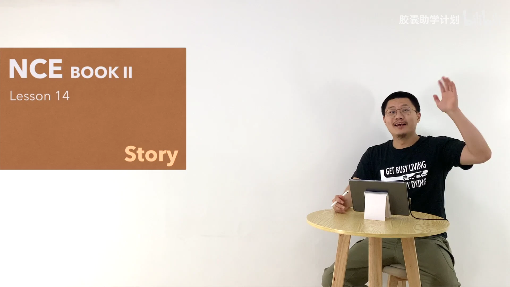

文字识别：胶囊助学计划 / NCE / BOOKⅡI / Lesson 14 / Story / GET BUSY LIVING / OR / Y DYING

### 画面 00:00:02

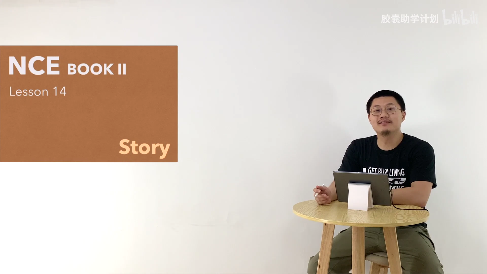

文字识别：胶囊助学计划 / NCE / BOOKⅡI / Lesson 14 / Story / GFT RIIV LING / AVING

### 画面 00:00:06

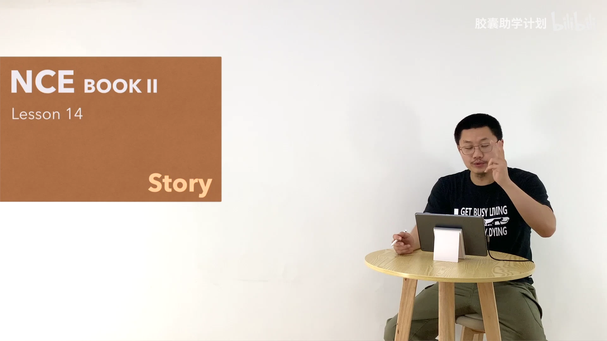

文字识别：胶囊助学计划 / NCE / BOOKII / Lesson 14 / Story / GET BUSY LMING / YDYING

### 画面 00:00:10

文字识别：胶囊助学计划 bil出 / •

### 画面 00:00:14

### 画面 00:00:16

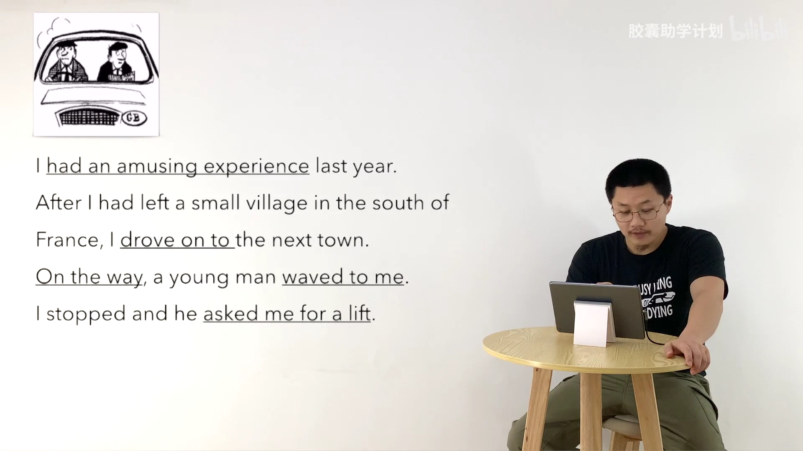

文字识别：胶囊助学计划 / GB / I had an amusing experience last year. / After I had left a small village in the south of / France, I drove on to the next town. / On the way, a young man waved to me. / USYING / I stopped and he asked me for a lift. / DYING

## 00:00:30–00:01:00

简单总结一下，学了三个：一般过去时，以 did 和 was/were 为主；第二呢，刚刚学过的是态叫 had 加 but 过去完成时；第三呢，跟过去相关的时态叫做过去进行时 was/were 加 doing。我们看接下来会出现哪些？I had an amusing experience last year. 讲单词的时候我们已经提到了，哎，我去年经历一个特别有趣的事情，哎，有一个特别有趣的经历。After出来了，想一下，after a : b

### 画面 00:00:46

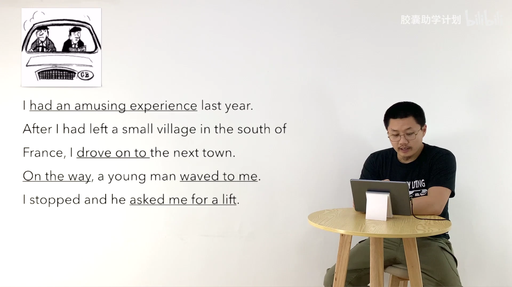

文字识别：胶囊助学计划 / GB / I had an amusing experience last year. / After I had left a small village in the south of / France, I drove on to the next town. / On the way, a young man waved to me. / YLING / I stopped and he asked me for a lift.

## 00:01:00–00:01:30

A是先发生的。在讲语法的部分，我提到了它很可能接下来后面用的是过去完成时，对吧？看一下Had left，过去完成时，说在什么之后呢？在我离开A small village，一个小村啊，一个小村，in the south of France。哎，这是一个非常简单的A of B结构。In the south，在南部of France，法国，法国的南部，对吧？就早在新概念一册二十五课，我们就学

### 画面 00:01:16

文字识别：胶囊助学计划 / GB / I had an amusing experience last year. / After I had left a small village in the south of / France, I drove on to the next town. / On the way, a young man waved to me. / YLING / I stopped and he asked me for a lift.

### 画面 00:01:25

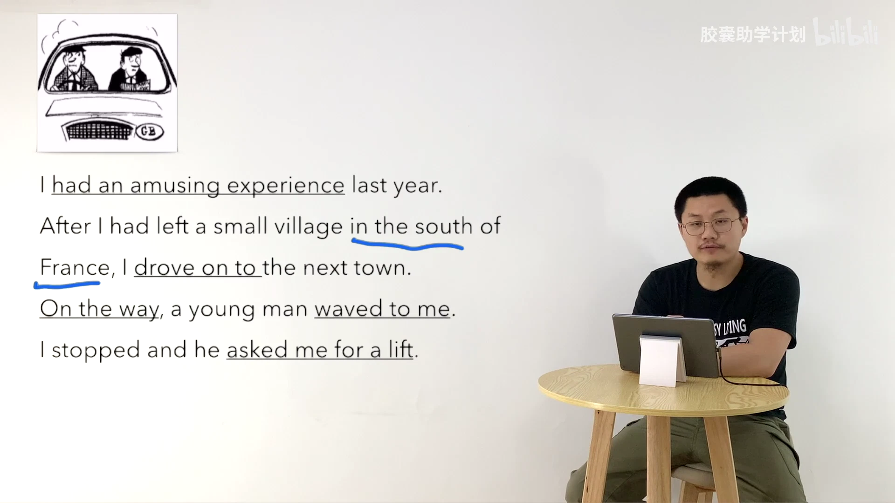

文字识别：胶囊助学计划 / GB / I had an amusing experience last year. / After I had left a small village in the south of / France, I drove on to the next town. / On the way, a young man waved to me. / SYVING / I stopped and he asked me for a lift.

## 00:01:30–00:02:00

过，在我离开法国南部的一个小村了之后呢，I drove on to the next town. 如果不加 on，我就说 I drove to the next town，叫我开车去了下一个小镇，对吧？那 drove on 是什么呢？就是 drive on。其实 on 这个地方有继续的意思。那 drive on 就是我继续开往下一个小镇啊，就是我开开开开过了一个小村，哎，离开这个村了之后呢，我继续开往

### 画面 00:01:55

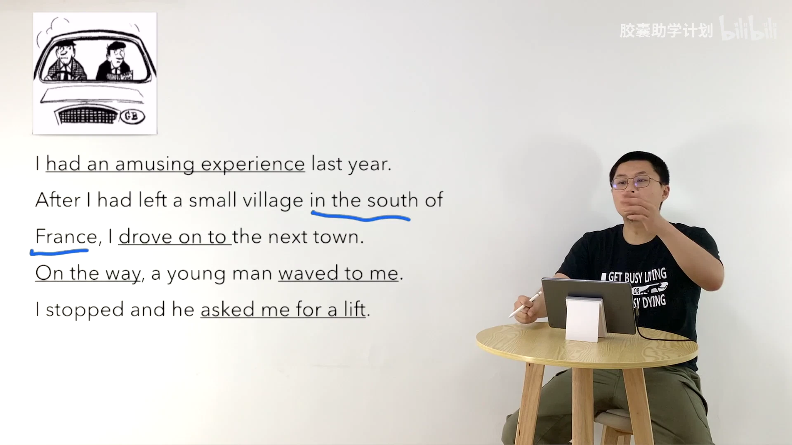

文字识别：胶囊助学计划 / GB / I had an amusing experience last year. / After I had left a small village in the south of / France, I drove on to the next town. / On the way, a young man waved to me. / IGET BUSY LZING / OR / I stopped and he asked me for a lift. / SYDYING

## 00:02:00–00:02:30

下一个小镇啊，就多加了这么个小的介词，叫所以您说 drive to some place 就开去某地，那 drive on to some place 呢，就是继续开往某地。 On the way 啊，在路上，其实我们新已经见过很多次 on the way 了，比如说 on the way home 啊，在回家的路上，对吧？ A young man waved to me. 一个年轻的男子啊 waved to me，冲我招手。 I stopped. 然后我就停下来了。 And

### 画面 00:02:15

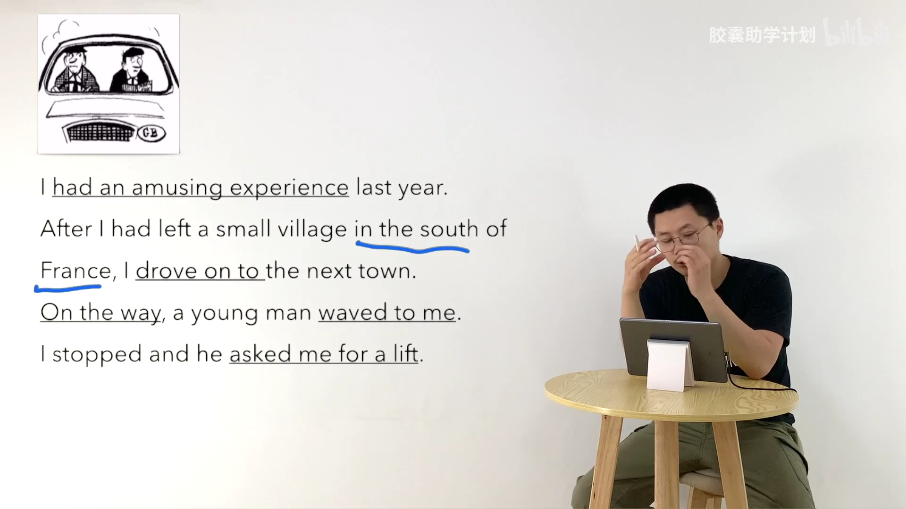

文字识别：胶囊助学计划 / GB / I had an amusing experience last year. / After I had left a small village in the south of / France, I drove on to the next town. / On the way, a young man waved to me. / I stopped and he asked me for a lift.

### 画面 00:02:22

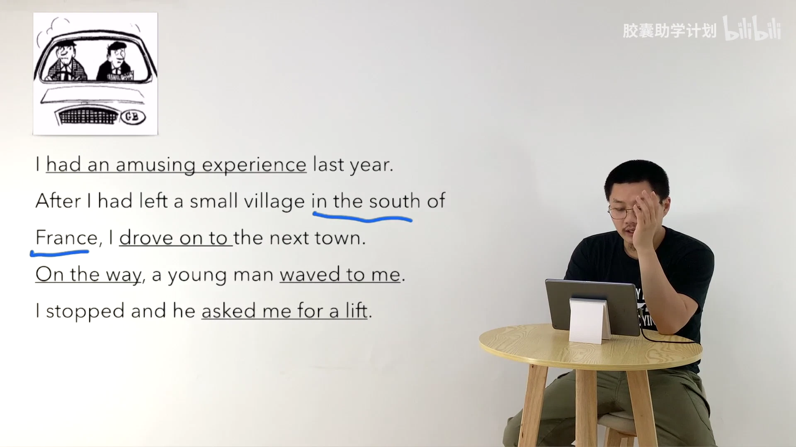

文字识别：胶囊助学计划bib出 / GB / I had an amusing experience last year. / After I had left a small village in the south of / France, I drove on to the next town. / On the way, a young man waved to me. / I stopped and he asked me for a lift.

### 画面 00:02:26

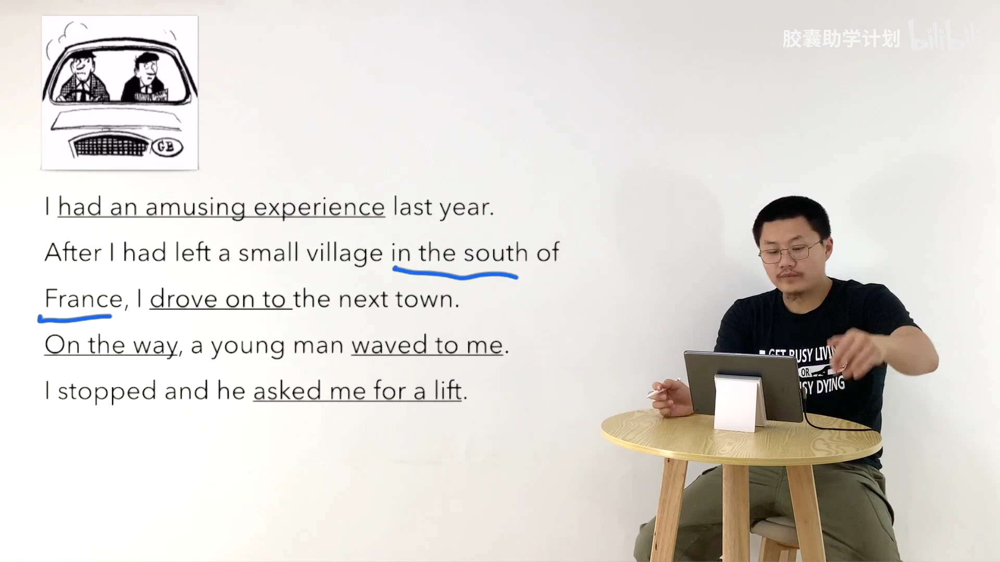

文字识别：胶囊助学计划 / GB / I had an amusing experience last year. / After I had left a small village in the south of / France, I drove on to the next town. / On the way, a young man waved to me. / CETDUSY LIVN / OR / I stopped and he asked me for a lift. / SYDYING

## 00:02:30–00:03:00

he asked me for a lift. Hey, ask somebody for something.你看第六课其实咱也学过，对吧？他向我哎索要了一个什么呢？搭便车啊，其实就是他要求要搭便车，问我行不行？As soon as一怎么怎么样就怎么怎么样。看他后边接的时态had got，我们先不用管含义。再看后边那句话said，是吧？完美符合

### 画面 00:02:47

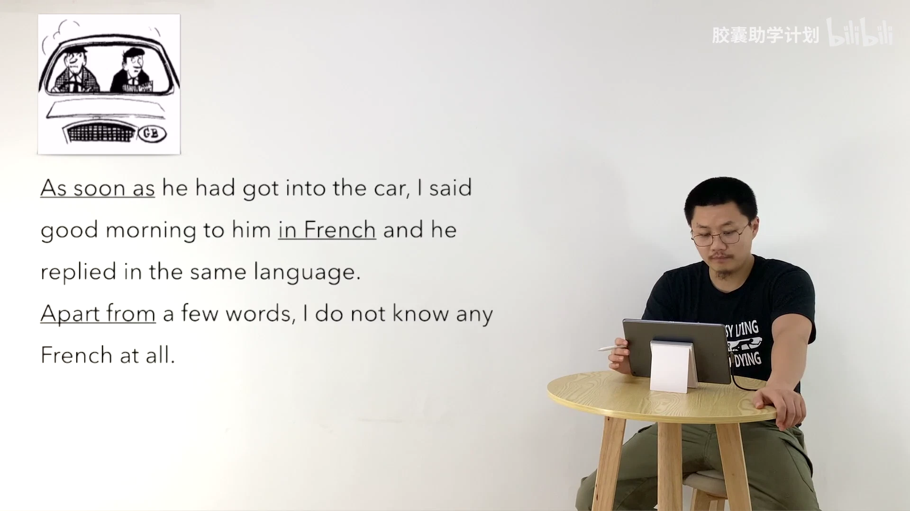

文字识别：胶囊助学计划 / GB / As soon as he had got into the car, I said / good morning to him in French and he / replied in the same language. / Apart from a few words, I do not know any / SYUING / French at all. / DYING

## 00:03:00–00:03:30

这个逻辑，这个动作先发生，这个动作后发生。我们看一下怎么样。他一怎么样呢？Got into the car.他一进入这辆车，先进入这辆车的。我就怎么样了呢？Said good morning.我说了早安to him.对他in French.这是一个小的短语，一会儿我们会练啊，造句练习叫做用某个语言，用法语叫做in French，用英文叫做in English，用日语叫in Japanese，

### 画面 00:03:17

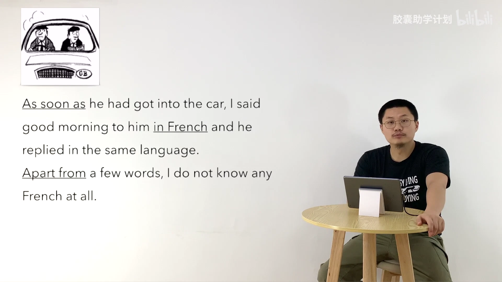

文字识别：胶囊助学计划 / GB / As soon as he had got into the car, I said / good morning to him in French and he / replied in the same language. / Apart from a few words, I do not know any / SYLING / French at all. / JVING

## 00:03:30–00:04:00

用汉语叫 in Chinese。各位应该懂了，对吧？他一进入车，我就对他用法语说了一个早晨好。And然后呢，he replied，他回复了我，回答了我。In the same language，用的是相同的语言啊。其实就是 in the same language，不就是 in French嘛？为了避免重复，对吧？Apart from，纯是一个小的短语，单独记下来就可以了，叫做除

### 画面 00:03:47

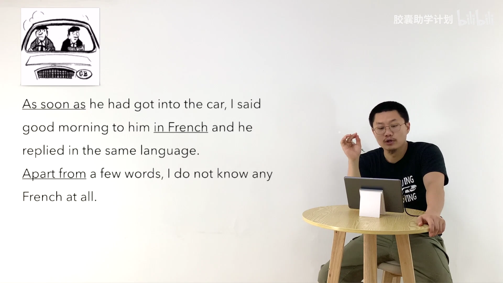

文字识别：胶囊助学计划 / GB / As soon as he had got into the car, I said / good morning to him in French and he / replied in the same language. / Apart from a few words, I do not know any / UING / French at all. / SING

### 画面 00:03:54

文字识别：胶囊助学计划 / GB / As soon as he had got into the car, I said / good morning to him in French and he / replied in the same language. / Apart from a few words, I do not know any / SYLING / French at all. / PDVING

## 00:04:00–00:04:30

了啊，a a few words，除了几个单词，I do not know any French at all，我就不懂法语啊，not at all，新一就见过了，叫一点也不啊，如果不加at all，就是没有那个一点的意思了，对吧？不强调，我一点儿也不懂法语啊。你看时态做了一个小的切换，哎，陈述客观事实叫做I do not know，能不能用？这个地方注意一个小的问

### 画面 00:04:24

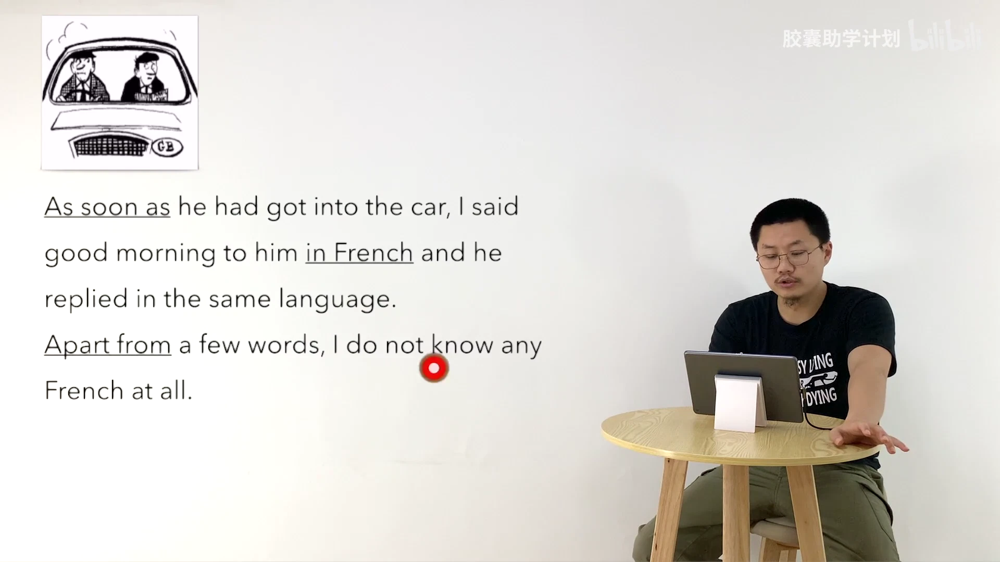

文字识别：胶囊助学计划 / GB / As soon as he had got into the car, I said / good morning to him in French and he / replied in the same language. / Apart from a few words, I do not know any / SYUING / French at all. / R / DVING

## 00:04:30–00:05:00

题啊！以前我教学的时候，经常有学生问我问题，说这儿我能不能用一般过去时呢？是可以的。各位注意一下，文章当中选择用哪个时态去表述这句话，有的时候是必须如此的，有的时候只是在众多可以的时态当中选了一个他希望用的时态。这是一个主观的感受，不是说客观必须用这个时态去描述。各位能理解吧？所以这儿您可

### 画面 00:04:31

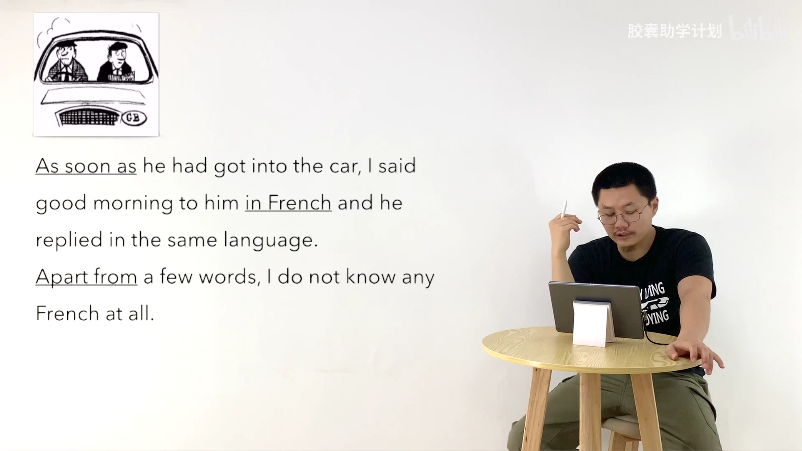

文字识别：胶囊助学计划 / GB / As soon as he had got into the car, I said / good morning to him in French and he / replied in the same language. / Apart from a few words, I do not know any / YUING / French at all. / SYING

## 00:05:00–00:05:30

以用 I didn't know any French at all，用一般过去时，但有一点点区别。I do not know，因为他强调的是客观事实，可能是包含了现在也不懂。OK，就是写这个故事的时候也不懂。但如果他用的是 I didn't know French at all，或者 at that time，这个感觉就像是什么呢？就是 now I speak呃French，指的是我现在呀

### 画面 00:05:00

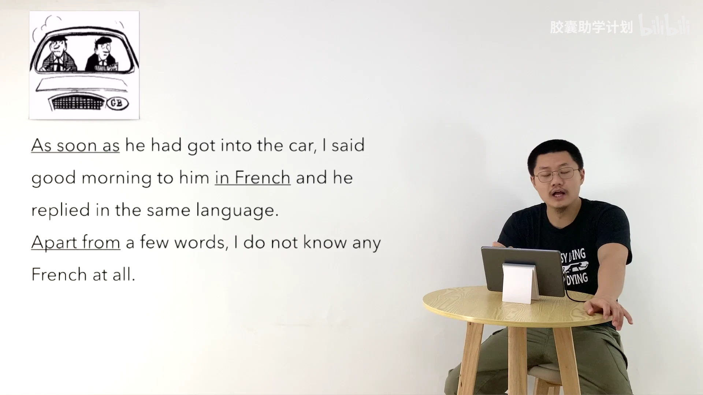

文字识别：胶囊助学计划 / GB / As soon as he had got into the car, I said / good morning to him in French and he / replied in the same language. / Apart from a few words, I do not know any / SYLING / French at all. / POYING

### 画面 00:05:07

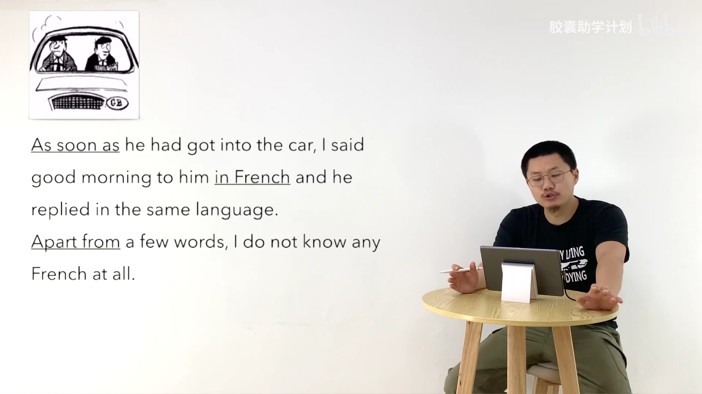

文字识别：胶囊助学计划 / GB / As soon as he had got into the car, I said / 9 / good morning to him in French and he / replied in the same language. / Apart from a few words, I do not know any / YUING / French at all. / DYING

### 画面 00:05:10

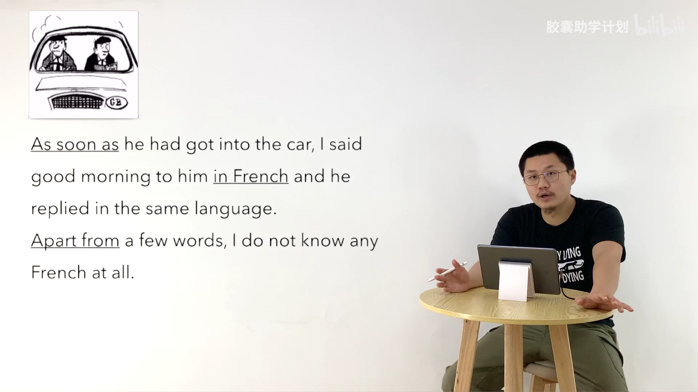

文字识别：胶囊助学计划 / GB / As soon as he had got into the car, I said / good morning to him in French and he / replied in the same language. / Apart from a few words, I do not know any / YUING / French at all. / DYING

### 画面 00:05:13

文字识别：胶囊助学计划 / GB / As soon as he had got into the car, I said / good morning to him in French and he / replied in the same language. / Apart from a few words, I do not know any / YUING / French at all. / OVING

### 画面 00:05:18

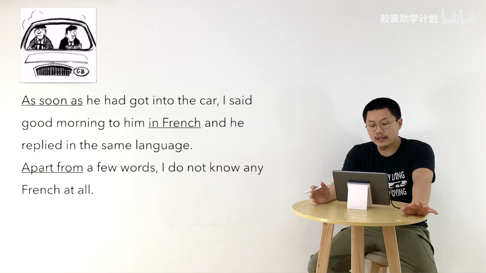

文字识别：胶囊助学计划 / GB / As soon as he had got into the car, I said / good morning to him in French and he / replied in the same language. / Apart from a few words, I do not know any / YLING / French at all. / DYING

### 画面 00:05:24

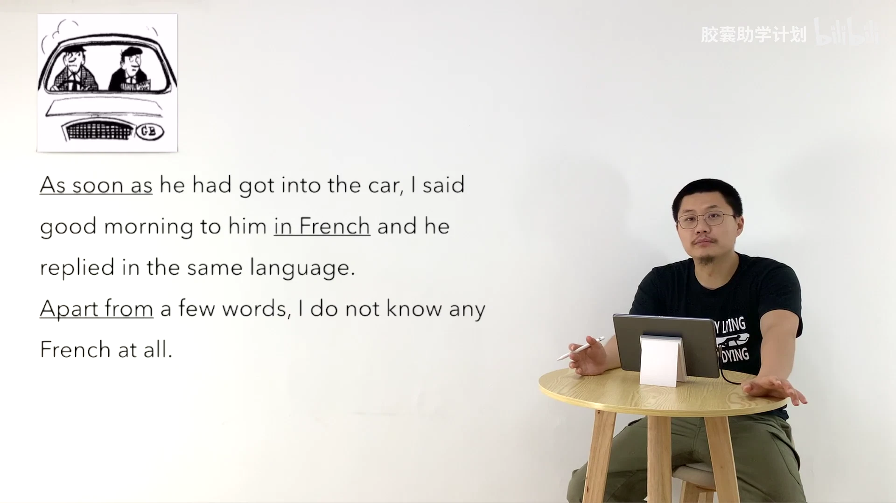

文字识别：胶囊助学计划 / GB / As soon as he had got into the car, I said / good morning to him in French and he / replied in the same language. / Apart from a few words, I do not know any / YLING / French at all. / DYING

## 00:05:30–00:06:00

好像会说法语了，是有这样一个潜台词在里面的，对吧？Okay,继续Neither of us,我们两个人都没有怎么样呢？Spoke during the journey，在这个旅途期间都没有说话。Neither这个小的单词还挺重要的，叫二者都不啊。你看Neither of us就是我们两者都没有这样。那其实我们新一还见过一个叫做Both of, Both of啊Both

### 画面 00:05:34

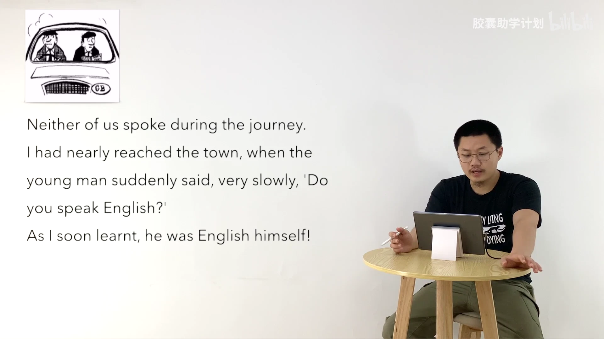

文字识别：胶囊助学计划 / GB / Neither of us spoke during the journey. / I had nearly reached the town, when the / young man suddenly said, very slowly,'Do / you speak English?' / YING / As I soon learnt, he was English himself! / DYING

### 画面 00:05:56

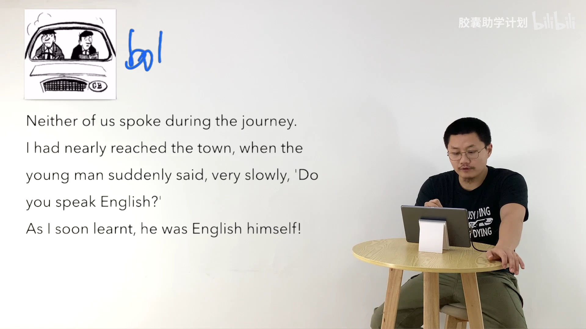

文字识别：胶囊助学计划 / GB / Neither of us spoke during the journey. / I had nearly reached the town, when the / young man suddenly said, very slowly,'Do / you speak English?' / USY/ING / As I soon learnt, he was English himself! / DVING

### 画面 00:05:58

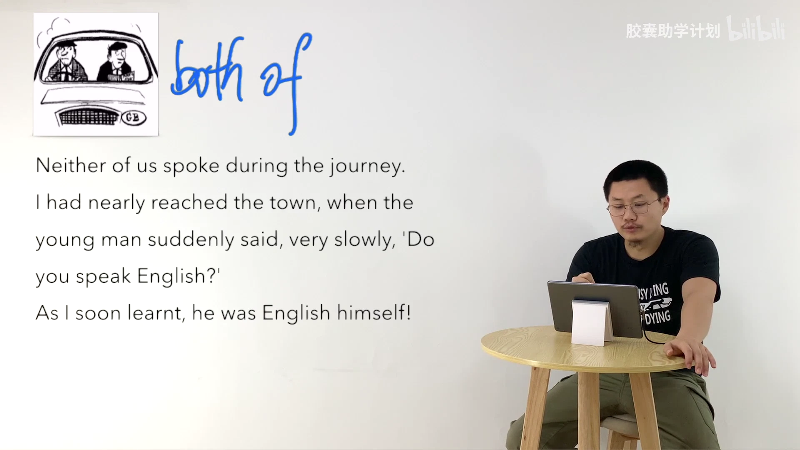

文字识别：both / 胶囊助学计划 / GB / Neither of us spoke during the journey. / I had nearly reached the town, when the / young man suddenly said, very slowly,'Do / you speak English?' / ISYLING / As I soon learnt, he was English himself! / DYING

## 00:06:00–00:06:30

of就指的是两者都怎么怎么样了，对吧？那这个我们其实在二十五课会重点去讲这个单词。继续，I had nearly reached town.你注意had加reach一出来这儿来一个逗号，后边还有一个动词叫said，对吧？迅速我给大家定位一下，您就知道先发生的是几乎就要到达小镇了，还没到达，对，但是几乎就要到达了。先发生这个动作，再发生的说话的这件事儿，对吧？我几乎都要到达

### 画面 00:06:05

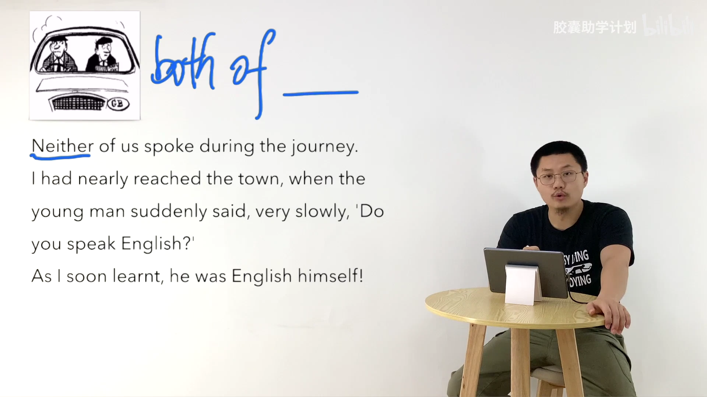

文字识别：bath / 胶囊助学计划 / GB / Neither of us spoke during the journey. / I had nearly reached the town, when the / young man suddenly said, very slowly,'Do / you speak English?' / SYLING / As I soon learnt, he was English himself! / OYING

### 画面 00:06:26

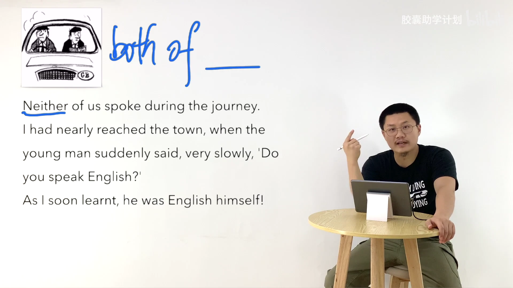

文字识别：胶囊助学计划 / both / Neither of us spoke during the journey. / I had nearly reached the town, when the / young man suddenly said, very slowly,'Do / you speak English?' / VUING / As I soon learnt, he was English himself! / JYING

## 00:06:30–00:07:00

小镇了。说突然啊，the young man suddenly said，这个年轻的男子突然间说到，very slowly，非常的慢。Do you speak English？你说英文吗？就是两个人都以为对方只会说法语而不会说英文，是吧？一路就没聊天，是吧？其实两个人的母语，mother tongue， native language，啊呃，are both English，对吧？都是英文。Okay，as I soon learned，我们先不管as这个as我先放在这儿啊，先不管它。As soon learned，

### 画面 00:06:40

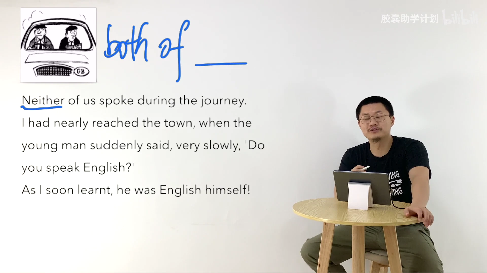

文字识别：胶囊助学计划 / both / GB / Neither of us spoke during the journey. / I had nearly reached the town, when the / young man suddenly said, very slowly,'Do / you speak English?' / NING / As I soon learnt, he was English himself! / PING

### 画面 00:06:44

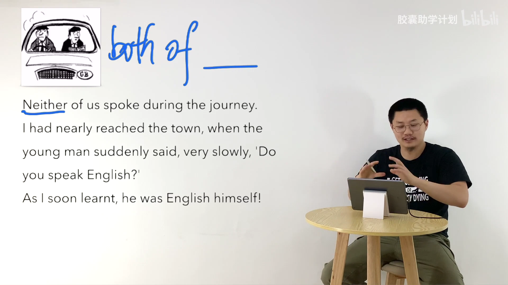

文字识别：胶囊助学计划 / both / G卫 / Neither of us spoke during the journey. / I had nearly reached the town, when the / young man suddenly said, very slowly,'Do / you speak English?' / As I soon learnt, he was English himself! / TYDYING

### 画面 00:06:54

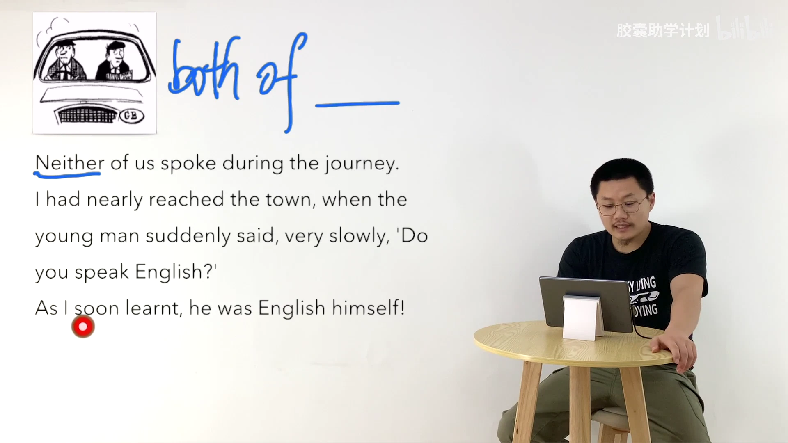

文字识别：胶囊助学计划 / both / GB / Neither of us spoke during the journey. / I had nearly reached the town, when the / young man suddenly said, very slowly,'Do / you speak English?' / YVING / As I soon learnt, he was English himself! / VING

## 00:07:00–00:07:30

我迅速的 learned. Learned是learn是学习这个单词的过去式。它还有一个意思，非常常用，在这儿各位要自己记一下，叫做意识到，类似于realized. OK, 我迅速的意识到 he was English himself. 他呀，自己呀，就是英国人。那这个地方的as呢，是一个特别罕见并且不常用啊，但是很难的一个

### 画面 00:07:24

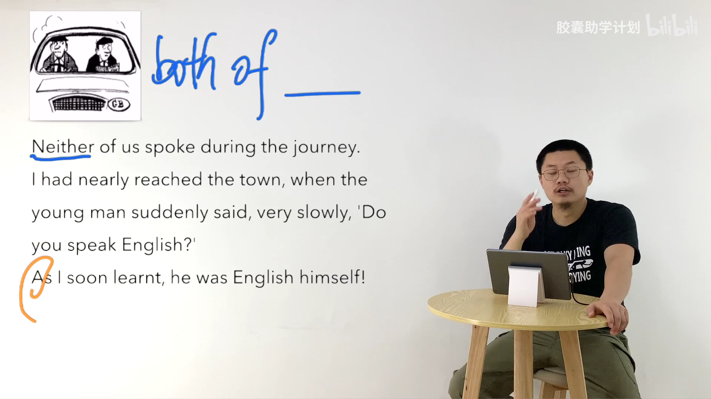

文字识别：胶囊助学计划 / both / Neither of us spoke during the journey. / I had nearly reached the town, when the / young man suddenly said, very slowly,'Do / you speak English?' / YING / A I soon learnt, he was English himself! / YING

### 画面 00:07:27

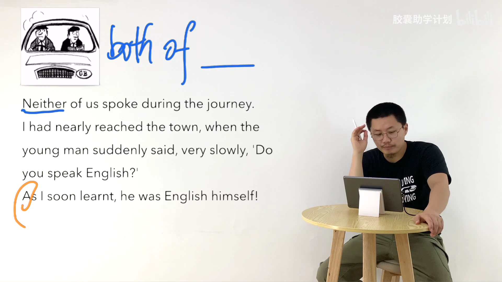

文字识别：胶囊助学计划 / both / GB / Neither of us spoke during the journey. / I had nearly reached the town, when the / young man suddenly said, very slowly,'Do / you speak English?' / VING / A I soon learnt, he was English himself! / BNING

## 00:07:30–00:08:00

个语法啊，说难也难，说不难也不难。它是实际上类似于跟定语从句相关的一个语法，这个呢我们至少要二十八课之后再去讲。但是今天呢，我想提一个小的思路，就是这个语法 as 这个单词您完全就不会，那不会对于我们来说就是不存在呗。我们这么理解行不行？不会嘛，我看见它我也不知道它咋翻译，对吧？就不存在。我就想问你，不会这个语法影不影响这句话的理解？

### 画面 00:07:46

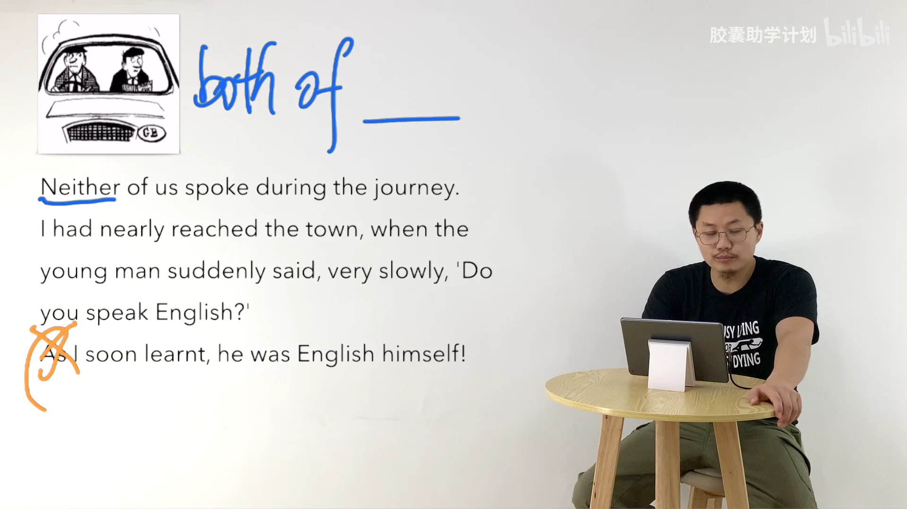

文字识别：胶囊助学计划 / both / Neither of us spoke during the journey. / I had nearly reached the town, when the / young man suddenly said, very slowly,'Do / you speak English?' / ISYVING / I soon learnt, he was English himself! / OR / DVING

### 画面 00:07:50

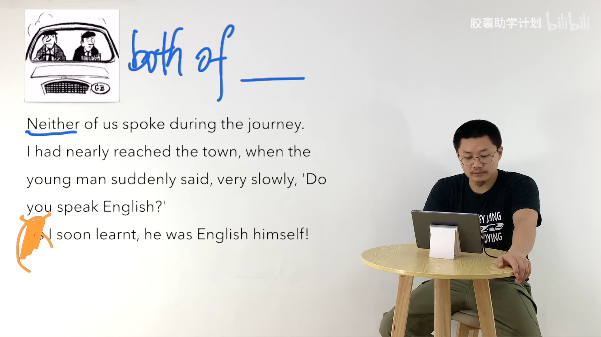

文字识别：胶囊助学计划 / bath / Neither of us spoke during the journey. / I had nearly reached the town, when the / young man suddenly said, very slowly,'Do / you speak English?' / SYVING / soon learnt, he was English himself! / PDYING

### 画面 00:07:55

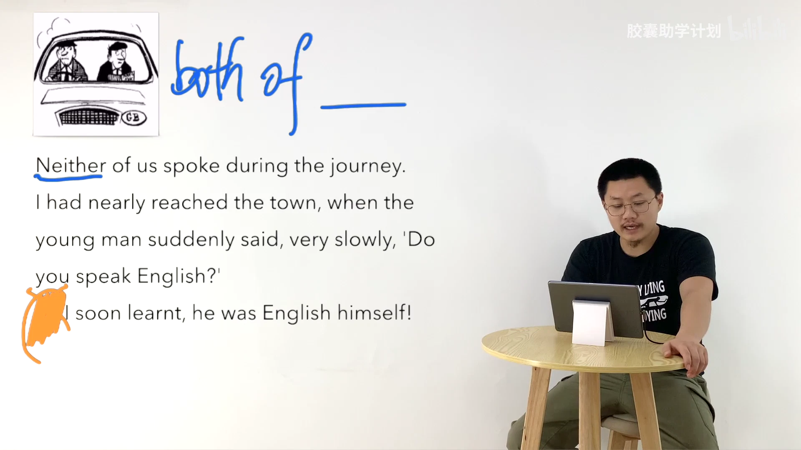

文字识别：胶囊助学计划 / both / GB / Neither of us spoke during the journey. / I had nearly reached the town, when the / young man suddenly said, very slowly,'Do / you speak English?' / YVING / soon learnt, he was English himself! / OVING

### 画面 00:07:58

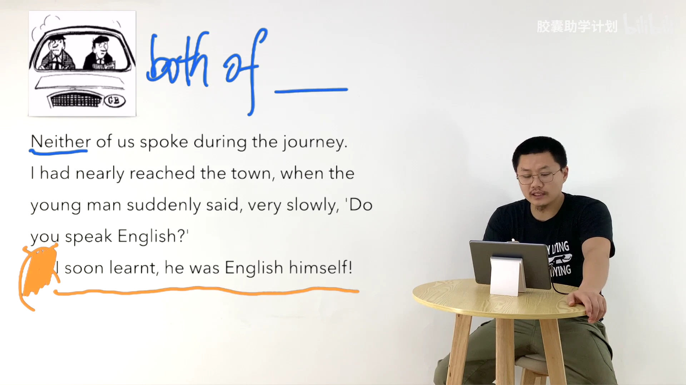

文字识别：胶囊助学计划 / both / GB / Neither of us spoke during the journey. / I had nearly reached the town, when the / young man suddenly said, very slowly,'Do / you speak English?' / YUING / soon learnt, he was English himself! / YING

## 00:08:00–00:08:30

目前为止，I soon learned he was English himself. 对于大家来说，这句话好像就有点像宾语从句了，是不是并不影响各位对这句话的理解，对吧？这是我想提的另外一件事情，就是当这句话您的理解准确无误的时候，你自己去思考一下，我为什么还要去研究它的语法？它的目的在于什么地方？不是没有任何理由了啊！我卖一个小的官司，以后再去讲这的时候我再提，但今天先不讲了啊！到这为止，

### 画面 00:08:28

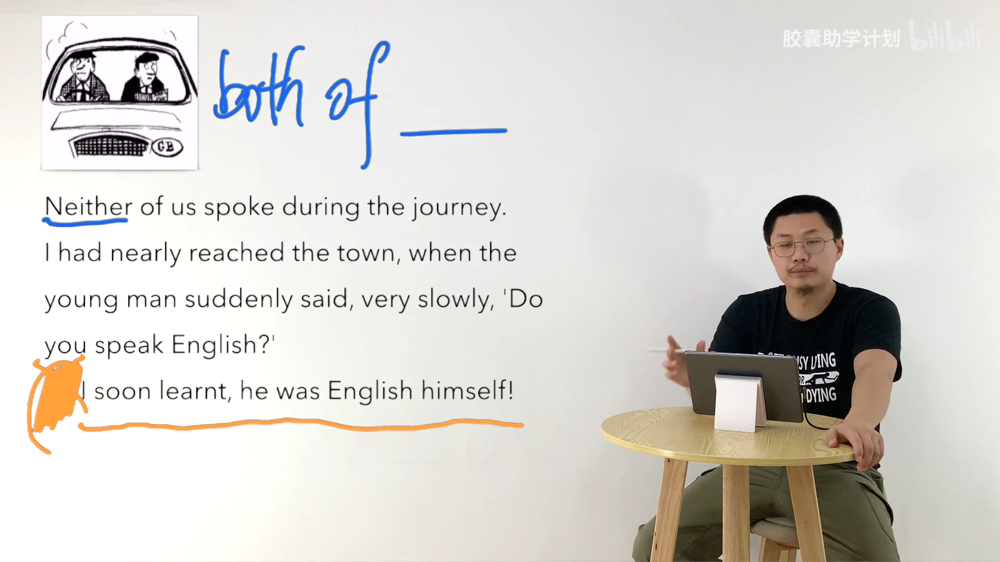

文字识别：胶囊助学计划 / both / 0 / GB / Neither of us spoke during the journey. / I had nearly reached the town, when the / young man suddenly said, very slowly,'Do / you speak English?' / SYVING / soon learnt, he was English himself! / R / DYING

## 00:08:30–00:09:00

习惯用法造句来了，drive on to somewhere啊，开车往某地啊。比如说，我们可以先不加to somewhere，直接就用drive on啊，继续开，继续开。We don't have time to stop，我们没有时间停下来。Drive on就是类似于一个小的起始句，对吧？Stop that啊，停下来，或者是drive on继续开啊。当然，我们也可以说After that we drove on to Beijing，在那件事情之后呢，我们

### 画面 00:08:30

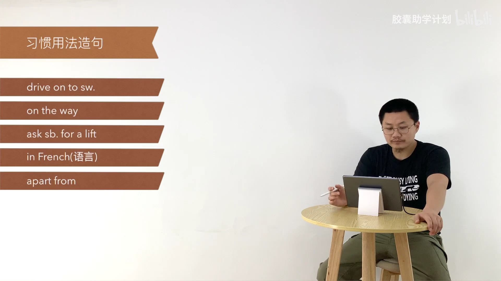

文字识别：胶囊助学计划 / 习惯用法造句 / drive on to sw. / on the way / ask sb.for a lift / in French(语言) / apart from / SYVING / DYING

### 画面 00:08:32

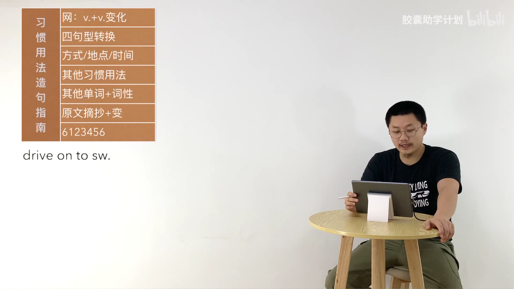

文字识别：网：v.+v.变化 / 习惯用法造句指南 / 胶囊助学计划 / 四句型转换 / 方式/地点/时间 / 其他习惯用法 / 其他单词+词性 / 原文摘抄+变 / 6123456 / drive on to sw. / YVING / DYING

### 画面 00:08:34

文字识别：网：v.+v.变化 / 习惯用法造句指南 / 胶囊助学计划 / 四句型转换 / 方式/地点/时间 / 其他习惯用法 / 其他单词+词性 / 原文摘抄+变 / 6123456 / drive on to sw. / OYING

### 画面 00:08:37

文字识别：习惯用法造句指南 / 网：v.+v.变化 / 胶囊助学计划 / 四句型转换 / 方式/地点/时间 / 其他习惯用法 / 其他单词+词性 / 原文摘抄+变 / 6123456 / drive on to sw. / Drive on, we don't have time to stop. / YVING / DYING

### 画面 00:08:39

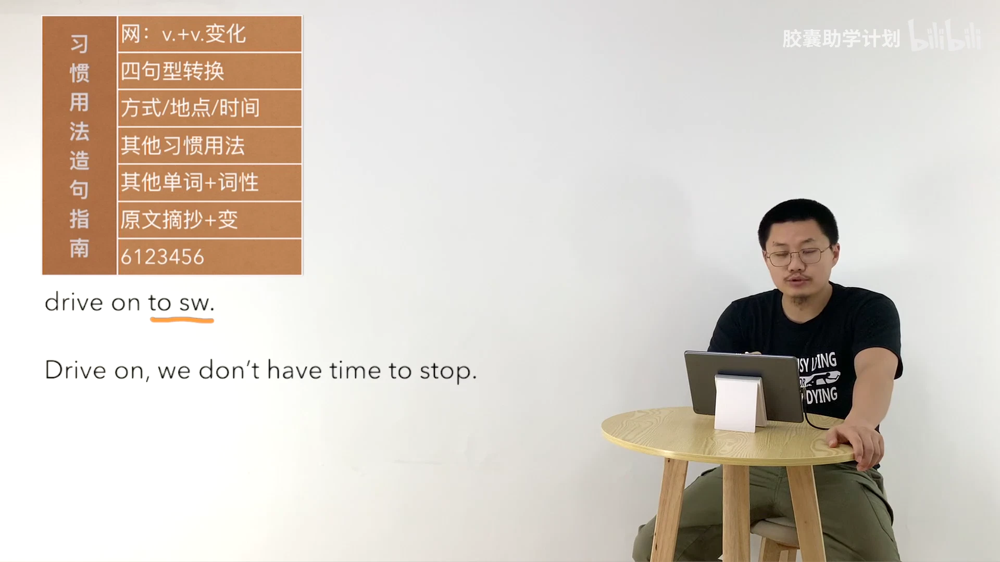

文字识别：习惯用法造句指南 / 网：v.+v.变化 / 胶囊助学计划 / 四句型转换 / 方式/地点/时间 / 其他习惯用法 / 其他单词+词性 / 原文摘抄+变 / 6123456 / drive on to sw. / Drive on, we don't have time to stop. / SYVING / R / DYING

### 画面 00:08:42

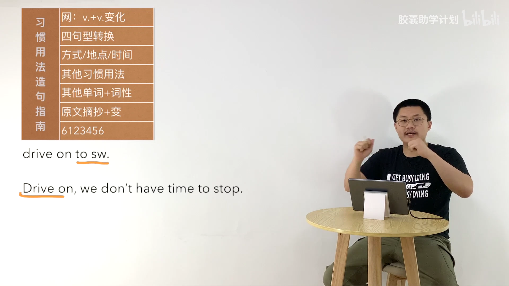

文字识别：网：v.+v.变化 / 习惯用法造句指南 / 胶囊助学计划 / 四句型转换 / 方式/地点/时间 / 其他习惯用法 / 其他单词+词性 / 原文摘抄+变 / 6123456 / drive on to sw. / GET BUSY LING / Drive on, we don't have time to stop. / OR / SYDYING

### 画面 00:08:44

文字识别：网：v.+v.变化 / 胶囊助学计划 / 习惯用法造句指南 / 四句型转换 / 方式/地点/时间 / 其他习惯用法 / 其他单词+词性 / 原文摘抄+变 / 6123456 / drive on to sw. / LING / Drive on, we don't have time to stop. / DYING

### 画面 00:08:47

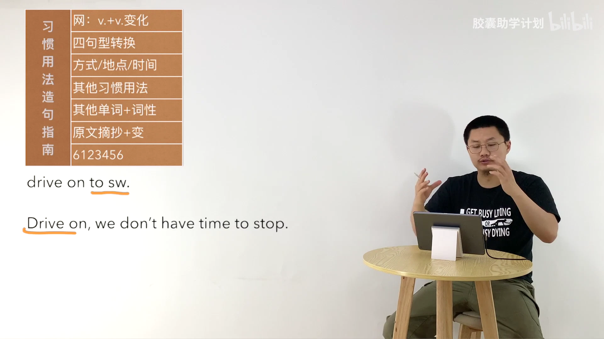

文字识别：网：v.+v.变化 / 习惯用法造句指南 / 胶囊助学计划 / 四句型转换 / 方式/地点/时间 / 其他习惯用法 / 其他单词+词性 / 原文摘抄+变 / 6123456 / drive on to sw. / GET BUSY LDING / Drive on, we don't have time to stop. / OR / ISYDYING

### 画面 00:08:49

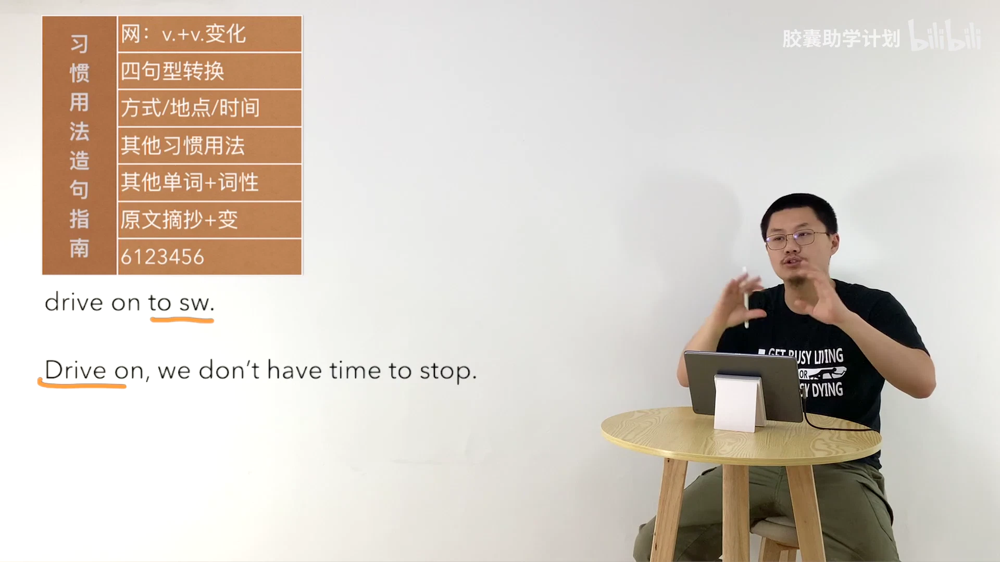

文字识别：网：v.+v.变化 / 胶囊助学计划 / 习惯用法造句指南 / 四句型转换 / 方式/地点/时间 / 其他习惯用法 / 其他单词+词性 / 原文摘抄+变 / 6123456 / drive on to sw. /  CET DUSY LNING / Drive on, we don't have time to stop. / ORU / SYDYING

### 画面 00:08:54

文字识别：网：v.+v.变化 / 习惯用法造句指南 / 胶囊助学计划 / 四句型转换 / 方式/地点/时间 / 其他习惯用法 / 其他单词+词性 / 原文摘抄+变 / 6123456 / drive on to sw. / GET DISY LVING / Drive on, we don't have time to stop. / ORAAU / After that, we drove on to Beijing. / YDYING

### 画面 00:08:57

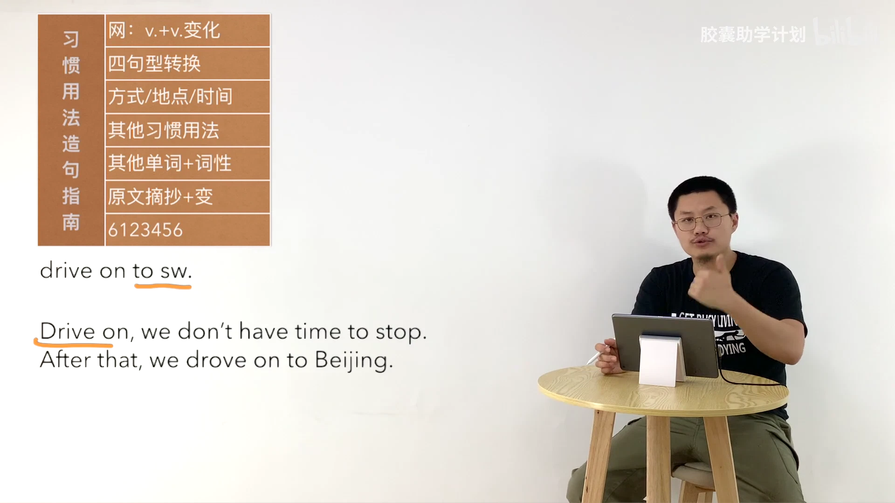

文字识别：网：v.+v.变化 / 习惯用法造句指南 / 胶囊助学计划 / 四句型转换 / 方式/地点/时间 / 其他习惯用法 / 其他单词+词性 / 原文摘抄+变 / 6123456 / drive on to sw. / CRTRUYUV / Drive on, we don't have time to stop. / After that, we drove on to Beijing. / DYING

### 画面 00:08:59

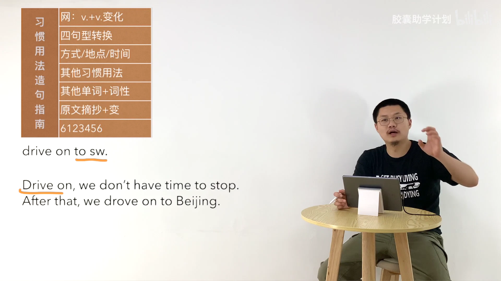

文字识别：网：v.+v.变化 / 习惯用法造句指南 / 胶囊助学计划 / 四句型转换 / 方式/地点/时间 / 其他习惯用法 / 其他单词+词性 / 原文摘抄+变 / 6123456 / drive on to sw. / Drive on, we don't have time to stop. / After that, we drove on to Beijing. / DYING

## 00:09:00–00:09:30

继续开往了北京。那那件事是什么呢？那就是之前啊，这个语言要铺垫的内容了。我们先不管，我们只管造句啊。肯定句出来了，我给大家了四句型转化，就是您自己懒不懒的事儿了，对吧？自己下课去做。Next one on the way, on the way叫在路上，对吧？比如说，We'll have plenty of time，十二课学的，have plenty of time，我们将有足够多的时间。然后

### 画面 00:09:02

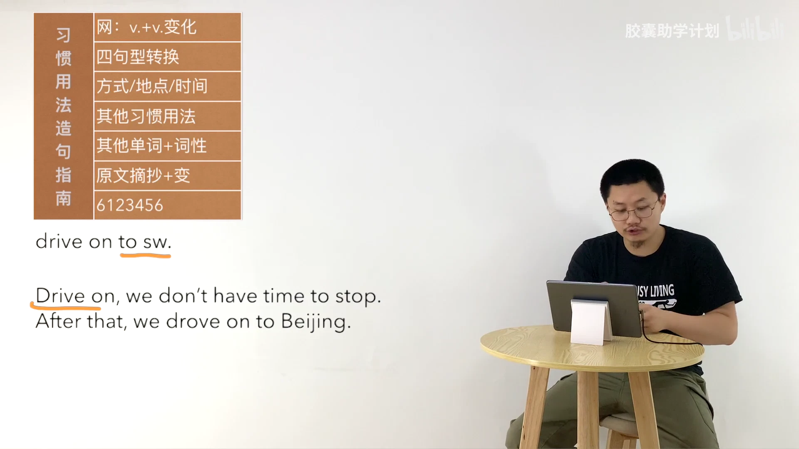

文字识别：网：v.+v.变化 / 习惯用法造句指南 / 胶囊助学计划 / 四句型转换 / 方式/地点/时间 / 其他习惯用法 / 其他单词+词性 / 原文摘抄+变 / 6123456 / drive on to sw. / Drive on, we don't have time to stop. / SY LIING / After that, we drove on to Beijing.

### 画面 00:09:04

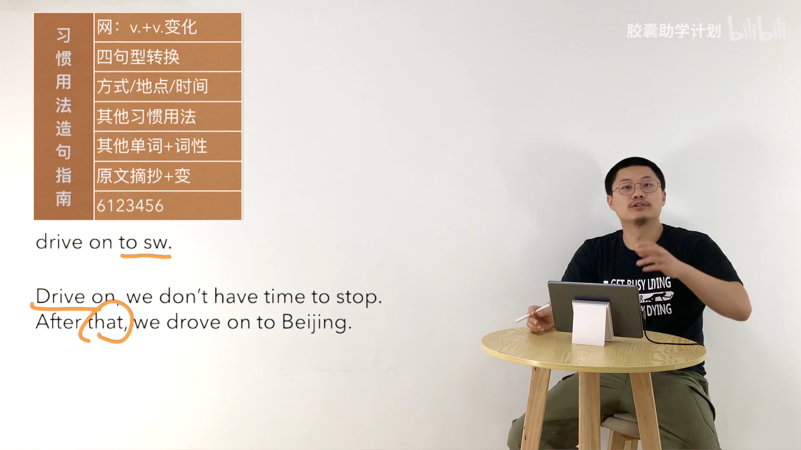

文字识别：网：v.+v.变化 / 习惯用法造句指南 / 胶囊助学计划 / 四句型转换 / 方式/地点/时间 / 其他习惯用法 / 其他单词+词性 / 原文摘抄+变 / 6123456 / drive on to sw. / CET DUIY LVING / Drive on we don't have time to stop. / RAIU / KDYING / After/chat, we drove on to Beijing.

### 画面 00:09:07

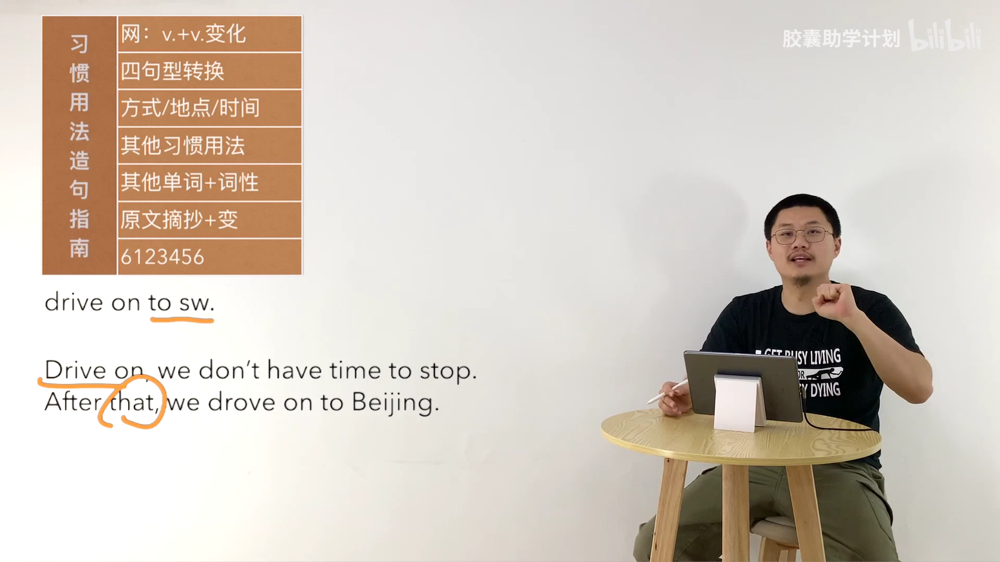

文字识别：习惯用法造句指南 / 网：v.+v.变化 / 胶囊助学计划 / 四句型转换 / 方式/地点/时间 / 其他习惯用法 / 其他单词+词性 / 原文摘抄+变 / 6123456 / drive on to sw. / CRT DUISY LIVING / Drive on we don't have time to stop. / R / After/chat, we drove on to Beijing. / YDYING

### 画面 00:09:09

文字识别：网：v.+v.变化 / 习惯用法造句指南 / 胶囊助学计划 / 四句型转换 / 方式/地点/时间 / 其他习惯用法 / 其他单词+词性 / 原文摘抄+变 / 6123456 / drive on to sw. / Drive on we don't have time to stop. / 'SY LVING / RAnU / Afterthat, we drove on to Beijing. / DYING

### 画面 00:09:11

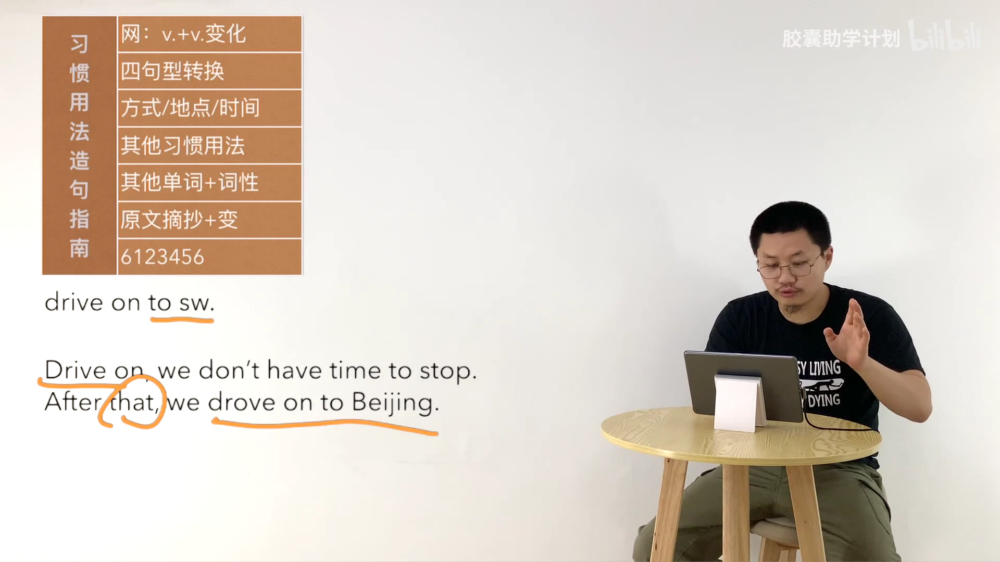

文字识别：网：v.+v.变化 / 习惯用法造句指南 / 胶囊助学计划 / 四句型转换 / 方式/地点/时间 / 其他习惯用法 / 其他单词+词性 / 原文摘抄+变 / 6123456 / drive on to sw. / Drive on we don't have time to stop. / SY LIVING / Afterthat, we  / drove on to Beijing. / DYING

### 画面 00:09:13

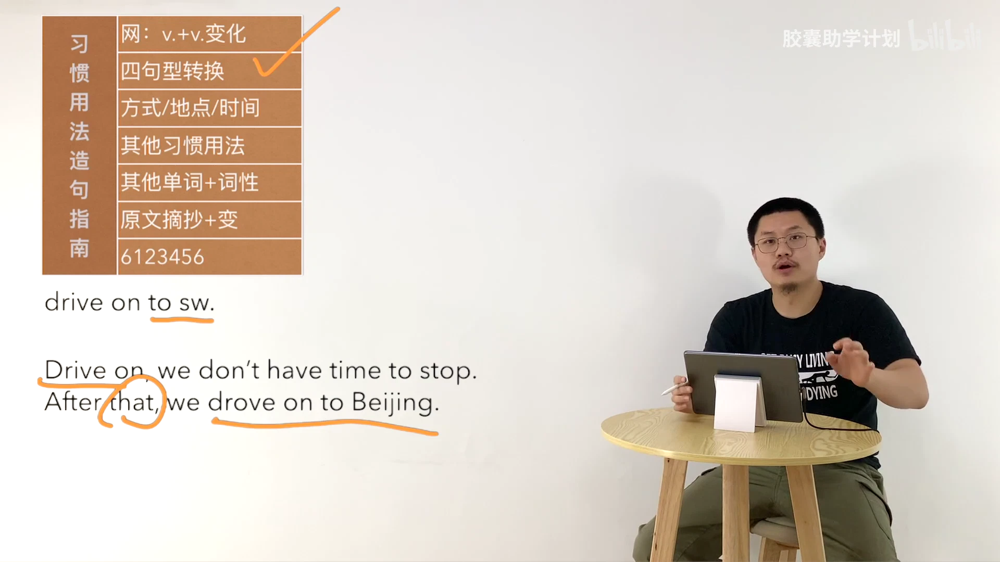

文字识别：网：v.+v.变化 / 习惯用法造句指南 / 胶囊助学计划 / 四句型转换 / 方式/地点/时间 / 其他习惯用法 / 其他单词+词性 / 原文摘抄+变 / 6123456 / drive on to sw. / Drive on we don't have time to stop. / AfterChat, we /  drove on to Beijing. / NDYING

### 画面 00:09:15

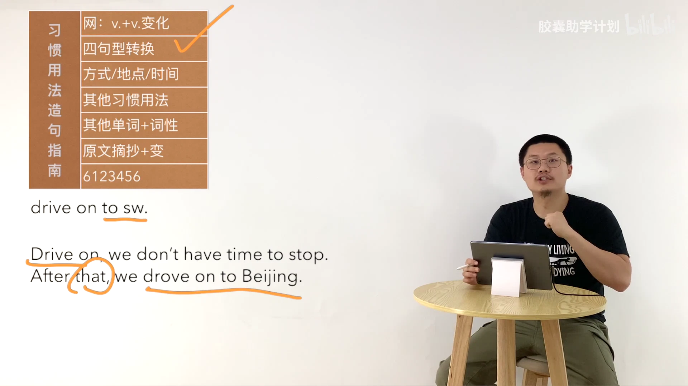

文字识别：习惯用法造句指南 / 网：v.+v.变化 / 胶囊助学计划 / 四句型转换 / 方式/地点/时间 / 其他习惯用法 / 其他单词+词性 / 原文摘抄+变 / 6123456 / drive on to sw. / Drive on we don't have time to stop. / Afterthat, we drove on to Beijing. / DYING

### 画面 00:09:17

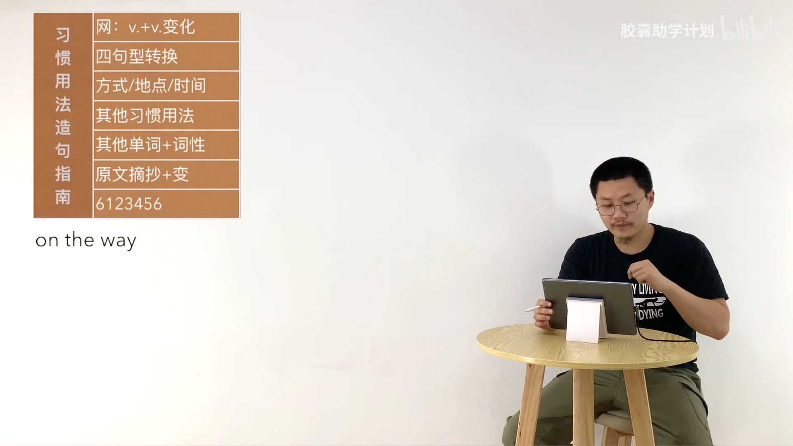

文字识别：网：v.+v.变化 / 习惯用法造句指南 / 胶囊助学计划 / 四句型转换 / 方式/地点/时间 / 其他习惯用法 / 其他单词+词性 / 原文摘抄+变 / 6123456 / on the way / DYING

### 画面 00:09:19

文字识别：习惯用法造句指南 / 网：v.+v.变化 / 胶囊助学计划 / 四句型转换 / 方式/地点/时间 / 其他习惯用法 / 其他单词+词性 / 原文摘抄+变 / 6123456 / on the way / YLING / DYING

### 画面 00:09:21

文字识别：网：v.+v.变化 / 习惯用法造句指南 / 胶囊助学计划 / 四句型转换 / 方式/地点/时间 / 其他习惯用法 / 其他单词+词性 / 原文摘抄+变 / 6123456 / on the way / SY LING / We' have plenty of time and we can talk about that / IDING / on the way home. L12

### 画面 00:09:24

文字识别：网：v.+v.变化 / 胶囊助学计划 / 习惯用法造句指南 / 四句型转换 / 方式/地点/时间 / 其他习惯用法 / 其他单词+词性 / 原文摘抄+变 / 6123456 / on the way / We' have plenty of time and we can talk about that / ISYVING / on the way home. L12 / DYING

### 画面 00:09:27

文字识别：网：v.+v.变化 / 胶囊助学计划 / 习惯用法造句指南 / 四句型转换 / 方式/地点/时间 / 其他习惯用法 / 其他单词+词性 / 原文摘抄+变 / 6123456 / on the way / We' have plenty of time and we can talk about that / ISY VING / OR / on the way home. L12 / DYING

### 画面 00:09:29

文字识别：网：v.+v.变化 / 习惯用法造句指南 / 胶囊助学计划 / 四句型转换 / 方式/地点/时间 / 其他习惯用法 / 其他单词+词性 / 原文摘抄+变 / 6123456 / on the way / We' have plenty of time and we can talk about that / SYLING / on the way home. L12 / DYING

## 00:09:30–00:10:00

呢？ We can talk about that on the way home. 我们可以在路上，回家的路上聊一聊这件事儿。 But not now, 对吧？但是现在先不聊。 Continue. We'll be having a difficult time. 你看，首先十三课 have a difficult time，再加上 will be doing，两个全连在一起了，对吧？我们将会有一段困难的时光。 On the way there，在去那个地方的路上，有一段路啊特别不好走。 OK，叫做 on the

### 画面 00:09:31

文字识别：网：v.+v.变化 / 习惯用法造句指南 / 胶囊助学计划 / 四句型转换 / 方式/地点/时间 / 其他习惯用法 / 其他单词+词性 / 原文摘抄+变 / 6123456 / on the way / We' have plenty of time and we can talk about that / SYVING / on the way home. L12 / PDYING

### 画面 00:09:34

文字识别：网：v.+v.变化 / 习惯用法造句指南 / 胶囊助学计划 / 四句型转换 / 方式/地点/时间 / 其他习惯用法 / 其他单词+词性 / 原文摘抄+变 / 6123456 / on the way / We'll have plenty of time and we can talk about that / SYLING / on the way home.L12 / DYING

### 画面 00:09:37

文字识别：网：v.+v.变化 / 习惯用法造句指南 / 胶囊助学计划 / 四句型转换 / 方式/地点/时间 / 其他习惯用法 / 其他单词+词性 / 原文摘抄+变 / 6123456 / on the way / We'll have plenty of time and we can talk about that / LING / on the way home.L12 / SYING

### 画面 00:09:39

文字识别：网：v.+v.变化 / 习惯用法造句指南 / 胶囊助学计划 / 四句型转换 / 方式/地点/时间 / 其他习惯用法 / 其他单词+词性 / 原文摘抄+变 / 6123456 / on the way / We' have plenty of time and we can talk about that. / YLING / on the way home.L12 / DYING

### 画面 00:09:41

文字识别：网：v.+v.变化 / 习惯用法造句指南 / 胶囊助学计划 / 四句型转换 / 方式/地点/时间 / 其他习惯用法 / 其他单词+词性 / 原文摘抄+变 / 6123456 / on the way / We' have plenty of time and we can talk about that / USYLING / ORA / on the way home. L12 / YDYING / We'll be having a difficult time on the way there. L13

### 画面 00:09:43

文字识别：网：v.+v.变化 / 习惯用法造句指南 / 胶囊助学计划 / 四句型转换 / 方式/地点/时间 / 其他习惯用法 / 其他单词+词性 / 原文摘抄+变 / 6123456 / on the way / We'll have plenty of time and we can talk about that / USYVING / OR / on the way home. L12 / DYING / We'll be having a difficult time on the way there. L13

### 画面 00:09:45

文字识别：网：v.+v.变化 / 习惯用法造句指南 / 胶囊助学计划 / 四句型转换 / 方式/地点/时间 / 其他习惯用法 / 其他单词+词性 / 原文摘抄+变 / 6123456 / on the way / We'll have plenty of time and we can talk about that / ISYLING / R / on the way home. L12 / DYING / We'll be having a difficult time on the way there. L13

### 画面 00:09:47

文字识别：网：v.+v.变化 / 习惯用法造句指南 / 胶囊助学计划 / 四句型转换 / 方式/地点/时间 / 其他习惯用法 / 其他单词+词性 / 原文摘抄+变 / 6123456 / on the way / We'll have plenty of time and we can talk about that / SYVING / DR / on the way home. L12 / DYING / We'll be having a difficult time on the way there. L13

### 画面 00:09:49

文字识别：网：v.+v.变化 / 习惯用法造句指南 / 胶囊助学计划 / 四句型转换 / 方式/地点/时间 / 其他习惯用法 / 其他单词+词性 / 原文摘抄+变 / 6123456 / on the way / We'll have plenty of time and we can talk about that / SY LING / on the way home.L12 / DYING / We'll be having a dificult time on the way there. L13

### 画面 00:09:51

文字识别：网：v.+v.变化 / 习惯用法造句指南 / 胶囊助学计划 / 四句型转换 / 方式/地点/时间 / 其他习惯用法 / 其他单词+词性 / 原文摘抄+变 / 6123456 / on the way / We'll have plenty of time and we can talk about that / SY LING / on the way home.L12 / DVING / We'll be having a ditficult time on the way there. L13

### 画面 00:09:53

文字识别：网：v.+v.变化 / 习惯用法造句指南 / 胶囊助学计划 / 四句型转换 / 方式/地点/时间 / 其他习惯用法 / 其他单词+词性 / 原文摘抄+变 / 6123456 / on the way / We'll have plenty of time and we can talk about that / SYLING / RA / on the way home. L12 / DYING / We'l be having a difficult time on the way there. L13

### 画面 00:09:55

文字识别：习惯用法造句指南 / 网：v.+v.变化 / 胶囊助学计划 / 四句型转换 / 方式/地点/时间 / 其他习惯用法 / 其他单词+词性 / 原文摘抄+变 / 6123456 / on the way / We' have plenty of time and we can talk about that / SYVING / on the way home. L12 / PDVING / We'll be having a difficult time on the way there. L13

### 画面 00:09:59

文字识别：网：v.+v.变化 / 习惯用法造句指南 / 胶囊助学计划 / 四句型转换 / 方式/地点/时间 / 其他习惯用法 / 其他单词+词性 / 原文摘抄+变 / 6123456 / on the way / We'll have plenty of time and we can talk about that / SYLING / R / on the way home. L12 / DYING / We'l be having a difficult time on the way there. L13

## 00:10:00–00:10:30

way there，在去那儿的路上。Next one， ask somebody for a lift，含义和 ask for a lift 和 give somebody a lift，几乎是类似的啊。前两个几乎是类似的，就是要求搭便车。那后边呢，就是让别人搭便车，对吧？给某人一个搭便车的机会。我们造句说，we can ask somebody for a lift，非常简单。你看，ask somebody for a， ask

### 画面 00:10:03

文字识别：网：v.+v.变化 / 习惯用法造句指南 / 胶囊助学计划 / 四句型转换 / 方式/地点/时间 / 其他习惯用法 / 其他单词+词性 / 原文摘抄+变 / 6123456 / ask sb. for a lift / ask for a lift / give sb.a lift / YVING / DYING

### 画面 00:10:05

文字识别：网：v.+v.变化 / 习惯用法造句指南 / 胶囊助学计划 / 四句型转换 / 方式/地点/时间 / 其他习惯用法 / 其他单词+词性 / 原文摘抄+变 / 6123456 / ask sb. for a lift / ask for a lift / give sb.a lift / USY VING / IDYING

### 画面 00:10:07

文字识别：网：v.+v.变化 / 习惯用法造句指南 / 胶囊助学计划 / 四句型转换 / 方式/地点/时间 / 其他习惯用法 / 其他单词+词性 / 原文摘抄+变 / 6123456 / ask sb.for a lift / ask for a lift / give sb.a lift / SYVING / YDYING

### 画面 00:10:09

文字识别：网：v.+v.变化 / 习惯用法造句指南 / 胶囊助学计划 / 四句型转换 / 方式/地点/时间 / 其他习惯用法 / 其他单词+词性 / 原文摘抄+变 / 6123456 / ask sb. for a lift / ask for a lift / give sb.a lift / SYVING / DYING

### 画面 00:10:11

文字识别：习惯用法造句指南 / 网：v.+v.变化 / 胶囊助学计划 / 四句型转换 / 方式/地点/时间 / 其他习惯用法 / 其他单词+词性 / 原文摘抄+变 / 6123456 / ask sb. for a lift / ask for a lift / give sh.a lift / SYVING / R / DYING

### 画面 00:10:14

文字识别：网：v.+v.变化 / 习惯用法造句指南 / 胶囊助学计划 / 四句型转换 / 方式/地点/时间 / 其他习惯用法 / 其他单词+词性 / 原文摘抄+变 / 6123456 / ask sb. for a lift / ask for a lift / give sh.a lift / SYVING / DYING

### 画面 00:10:16

文字识别：网：v.+v.变化 / 习惯用法造句指南 / 胶囊助学计划 / 四句型转换 / 方式/地点/时间 / 其他习惯用法 / 其他单词+词性 / 原文摘抄+变 / 6123456 / ask sb. for a lift / ask for a lift/give sb.alift / SYVING / IDVING

### 画面 00:10:19

文字识别：网：v.+v.变化 / 习惯用法造句指南 / 胶囊助学计划 / 四句型转换 / 方式/地点/时间 / 其他习惯用法 / 其他单词+词性 / 原文摘抄+变 / 6123456 / ask sb.for a lift / ask for a lift / give sh. a lift / SYVING / DYING

### 画面 00:10:21

文字识别：网：v.+v.变化 / 习惯用法造句指南 / 胶囊助学计划 / 四句型转换 / 方式/地点/时间 / 其他习惯用法 / 其他单词+词性 / 原文摘抄+变 / 6123456 / ask sb.for a lift / ask for a lift / give sb.a lift / SYVING / DYING

### 画面 00:10:23

文字识别：习惯用法造句指南 / 网：v.+v.变化 / 胶囊助学计划 / 四句型转换 / 方式/地点/时间 / 其他习惯用法 / 其他单词+词性 / 原文摘抄+变 / 6123456 / ask sb.for a lift / ask for a lift / give sb. a lift / We can ask someone for a lift. / SYLING / TDYING

### 画面 00:10:25

文字识别：网：v.+v.变化 / 习惯用法造句指南 / 胶囊助学计划 / 四句型转换 / 方式/地点/时间 / 其他习惯用法 / 其他单词+词性 / 原文摘抄+变 / 6123456 / ask sb. for a lift / ask for a lift / give sb.a lift / We can ask someone for a lift. / DYING

### 画面 00:10:27

文字识别：网：v.+v.变化 / 习惯用法造句指南 / 胶囊助学计划 / 四句型转换 / 方式/地点/时间 / 其他习惯用法 / 其他单词+词性 / 原文摘抄+变 / 6123456 / ask sb. for a lift / ask for a lift / give sb.a lift / We can ask someone for a lift. / SY LING / RAL / DYING

### 画面 00:10:29

文字识别：习惯用法造句指南 / 网：v.+v.变化 / 胶囊助学计划 / 四句型转换 / 方式/地点/时间 / 其他习惯用法 / 其他单词+词性 / 原文摘抄+变 / 6123456 / ask sb.for a lift / ask for a lift / give sb.a lift / We can ask someone for a lift. / SYLING / DYING

## 00:10:30–00:11:00

somebody for a lift,几乎是照抄，您就多加了两个单词，we跟can，对吧？动词加动词变化，除了时态还有情态动词。Next one，第十课学的被动外加be allowed to do something。说I'm not allowed to ask for a lift啊，我不被允许去向别人要求搭便车啊，我父母不允许啊，我太小了，别人怕这个呃父母怕出现一些安全上的隐患，对吧？所以I'm not allowed to ask for a lift。Okay，以

### 画面 00:10:31

文字识别：习惯用法造句指南 / 网：v.+v.变化 / 胶囊助学计划 / 四句型转换 / 方式/地点/时间 / 其他习惯用法 / 其他单词+词性 / 原文摘抄+变 / 6123456 / ask sb.for a lift / ask for a lift / give sb.a lift / We can ask someone for a lift. / SYLING / R / DYING

### 画面 00:10:34

文字识别：习惯用法造句指南 / 网：v.+v.变化 / 胶囊助学计划 / 四句型转换 / 方式/地点/时间 / 其他习惯用法 / 其他单词+词性 / 原文摘抄+变 / 6123456 / ask sb.for a lift / ask for a lift / give sb.a lift / We can ask someone for a lift. / SYVING / • / IDVING

### 画面 00:10:37

文字识别：网：v.+v.变化 / 习惯用法造句指南 / 胶囊助学计划 / 四句型转换 / 方式/地点/时间 / 其他习惯用法 / 其他单词+词性 / 原文摘抄+变 / 6123456 / ask sb. for a lift / ask for a lift / give sb.a lift / We can ask someone for a lift. / YUING / OYING

### 画面 00:10:39

文字识别：习惯用法造句指南 / 网：v.+v.变化 / 胶囊助学计划 / 四句型转换 / 方式/地点/时间 / 其他习惯用法 / 其他单词+词性 / 原文摘抄+变 / 6123456 / ask sb. for a lift / ask for a lift / give sb.a lift / We can ask someone for a lift. / SY LING / I am not allow to ask for a lift. L10 / DYING

### 画面 00:10:44

文字识别：习惯用法造句指南 / 网：v.+v.变化 / 胶囊助学计划 / 四句型转换 / 方式/地点/时间 / 其他习惯用法 / 其他单词+词性 / 原文摘抄+变 / 6123456 / ask sb. for a lift / ask for a lift / give sb.a lift / We can ask someone for a lift. / SYLING / R / I am not allow to ask for a lift. L10 / IDVING

### 画面 00:10:46

文字识别：习惯用法造句指南 / 网：v.+v.变化 / 胶囊助学计划 / 四句型转换 / 方式/地点/时间 / 其他习惯用法 / 其他单词+词性 / 原文摘抄+变 / 6123456 / ask sb.for a lift / ask for a lift / give sb.a lift / We can ask someone for a lift. / I am not allow to ask for a lift. L10 / DYING

### 画面 00:10:48

文字识别：网：v.+v.变化 / 习惯用法造句指南 / 胶囊助学计划 / 四句型转换 / 方式/地点/时间 / 其他习惯用法 / 其他单词+词性 / 原文摘抄+变 / 6123456 / ask sb.for a lift / ask for a lift / give sb.a lift / LZING / We can ask someone for a lift. / DYING / I am not allow to ask for a lift. L10

### 画面 00:10:50

文字识别：网：v.+v.变化 / 习惯用法造句指南 / 胶囊助学计划 / 四句型转换 / 方式/地点/时间 / 其他习惯用法 / 其他单词+词性 / 原文摘抄+变 / 6123456 / ask sb.for a lift / ask for a lift / give sb.a lift / LING / We can ask someone for a lift. / DYING / I am not allow to ask for a lift. L10

### 画面 00:10:52

文字识别：网：v.+v.变化 / 习惯用法造句指南 / 胶囊助学计划 / 四句型转换 / 方式/地点/时间 / 其他习惯用法 / 其他单词+词性 / 原文摘抄+变 / 6123456 / ask sb.for a lift / ask for a lift / give sb.a lift / CET PUY DING / We can ask someone for a lift. / DYING / I am not allow to ask for a lift. L10

### 画面 00:10:54

文字识别：习惯用法造句指南 / 网：v.+v.变化 / 胶囊助学计划 / 四句型转换 / 方式/地点/时间 / 其他习惯用法 / 其他单词+词性 / 原文摘抄+变 / 6123456 / ask sb. for a lift / ask for a lift / give sb.a lift / We can ask someone for a lift. / SYLING / I am not allow to ask for a lift. L10 / DYING

### 画面 00:10:58

文字识别：网：v.+v.变化 / 习惯用法造句指南 / 胶囊助学计划 / 四句型转换 / 方式/地点/时间 / 其他习惯用法 / 其他单词+词性 / 原文摘抄+变 / 6123456 / ask sb.for a lift / ask for a lift / give sb.a lift / We can ask someone for a lift. / YLING / I am not allow to ask for a lift. L10 / JYING

## 00:11:00–00:11:30

及第七课，比如说 To my surprise, 啊，令我感到很惊讶的是， he asked for a lift. 令我感到很惊讶的是，他竟然怎么样？要求搭便车啊？Okay. 好，接下来呢，我们看一个小的电影片段，语速也挺快的，各位要注意啊，竖起耳朵来听。叫 Can you give me a lift? 而且这个 lift 很有意思啊，这个场景看一下。 Can give me a lift? Right. Better clench up, Legolas. Okay.

### 画面 00:11:00

文字识别：网：v.+v.变化 / 习惯用法造句指南 / 胶囊助学计划 / 四句型转换 / 方式/地点/时间 / 其他习惯用法 / 其他单词+词性 / 原文摘抄+变 / 6123456 / ask sb.for a lift / ask for a lift / give sb.a lift / We can ask someone for a lift. / ISY LING / DRU / I am not allow to ask for a lift. L10 / DYING / To my surprise, he asked tor a lift. L7

### 画面 00:11:02

文字识别：习惯用法造句指南 / 网：v.+v.变化 / 胶囊助学计划 / 四句型转换 / 方式/地点/时间 / 其他习惯用法 / 其他单词+词性 / 原文摘抄+变 / 6123456 / ask sb.for a lift / ask for a lift / give sb.a lift / We can ask someone for a lift. / USYVING / OR / I am not allow to ask for a lift. L10 / YDYING / To my surprise, / he asked tor a lift. L7

### 画面 00:11:04

文字识别：习惯用法造句指南 / 网：v.+v.变化 / 胶囊助学计划 / 四句型转换 / 方式/地点/时间 / 其他习惯用法 / 其他单词+词性 / 原文摘抄+变 / 6123456 / ask sb.for a lift / ask for a lift / give sb.a lift / We can ask someone for a lift. / USYVING / OR / I am not allow to ask for a lift. L10 / DYING / To my surprise, / he asked tor a lift. L7

### 画面 00:11:06

文字识别：习惯用法造句指南 / 网：v.+v.变化 / 胶囊助学计划 / 四句型转换 / 方式/地点/时间 / 其他习惯用法 / 其他单词+词性 / 原文摘抄+变 / 6123456 / ask sb.for a lift / ask for a lift / give sb.a lift / We can ask someone for a lift. / ISY VING / I am not allow to ask for a lift. L10 / DYING / To my surprise, he asked tor a lift. L7

### 画面 00:11:08

文字识别：习惯用法造句指南 / 网：v.+v.变化 / 胶囊助学计划 / 四句型转换 / 方式/地点/时间 / 其他习惯用法 / 其他单词+词性 / 原文摘抄+变 / 6123456 / ask sb. for a lift / ask for a lift / give sb.a lift / We can ask someone for a lift. / YLING / I am not allow to ask for a lift. L10 / YDYING / To my surprise, he asked for a lift. L7

### 画面 00:11:10

文字识别：网：v.+v.变化 / 习惯用法造句指南 / 胶囊助学计划 / 四句型转换 / 方式/地点/时间 / 其他习惯用法 / 其他单词+词性 / 原文摘抄+变 / 6123456 / ask sb.for a lift / ask for a lift / give sb.a lift / LING / We can ask someone for a lift. / I am not allow to ask for a lift. L10 / DYING / To my surprise, he asked for a lift. L7

### 画面 00:11:12

文字识别：Can you give me a lift? / 胶囊助学计划 / LING / 复仇者联盟 / MIDYING / The Avengers / (2012)

### 画面 00:11:20

文字识别：Can you give me a lift? / 胶囊助学计划 / SY LING / OR / 复仇者联盟 / YDYING / The Avengers / (2012)

### 画面 00:11:25

文字识别：Can you give me a lift? / 胶囊助学计划 / 复仇者联盟 / DYING / 能带我一程吗？-没问题 / The Avengers / (2012) / Can you give me a lift?-Right.

### 画面 00:11:27

文字识别：Can you give me a lift? / 胶囊助学计划 / 复仇者联盟 / The Avengers / (2012)

### 画面 00:11:29

文字识别：Can you give me a lift? / 胶囊助学计划 / 复仇者联盟 / The Avengers / (2012)

## 00:11:30–00:12:00

Okay,那Can you give me a lift?啊，Okay，那就走了，对吧？Okay，下一个In French，我刚才讲到了，对吧？French本身是语言，不是说只能用French。In French，您可以用各种语言。好了，比如说我们比较常用的，I'll try to say that in French. Try to do something.第七课学的啊，我会试着用法语啊Bonjour去说Hello的Hi啊，以及

### 画面 00:11:31

文字识别：Can you give me a lift? / 胶囊助学计划 / 复仇者联盟 / The Avengers / (2012)

### 画面 00:11:35

文字识别：网：v.+v.变化 / 习惯用法造句指南 / 胶囊助学计划 / 四句型转换 / 方式/地点/时间 / 其他习惯用法 / 其他单词+词性 / 原文摘抄+变 / 6123456 / in French(语言)

### 画面 00:11:37

文字识别：网：v.+v.变化 / 习惯用法造句指南 / 胶囊助学计划 / 四句型转换 / 方式/地点/时间 / 其他习惯用法 / 其他单词+词性 / 原文摘抄+变 / 6123456 / in French(语言) / CrT nIY LING / A / DYING

### 画面 00:11:39

文字识别：习惯用法造句指南 / 网：v.+v.变化 / 胶囊助学计划 / 四句型转换 / 方式/地点/时间 / 其他习惯用法 / 其他单词+词性 / 原文摘抄+变 / 6123456 / in French(语言) / CRT DUIY LVING / YDYING

### 画面 00:11:44

文字识别：网：v.+v.变化 / 习惯用法造句指南 / 胶囊助学计划 / 四句型转换 / 方式/地点/时间 / 其他习惯用法 / 其他单词+词性 / 原文摘抄+变 / 6123456 / in French(语言) / IDYING

### 画面 00:11:46

文字识别：网：v.+v.变化 / 习惯用法造句指南 / 胶囊助学计划 / 四句型转换 / 方式/地点/时间 / 其他习惯用法 / 其他单词+词性 / 原文摘抄+变 / 6123456 / in French(语言) / I will try to say that in French. L7 / SYLING / PDYING

### 画面 00:11:48

文字识别：网：v.+v.变化 / 习惯用法造句指南 / 胶囊助学计划 / 四句型转换 / 方式/地点/时间 / 其他习惯用法 / 其他单词+词性 / 原文摘抄+变 / 6123456 / in French(语言) / I will try to say that in French. L7 / YVING / DYING

### 画面 00:11:50

文字识别：网：v.+v.变化 / 习惯用法造句指南 / 胶囊助学计划 / 四句型转换 / 方式/地点/时间 / 其他习惯用法 / 其他单词+词性 / 原文摘抄+变 / 6123456 / in French(语言) / I will try to say that in French. L7 / USYLING / PDYING

### 画面 00:11:52

文字识别：习惯用法造句指南 / 网：v.+v.变化 / 胶囊助学计划 / 四句型转换 / 方式/地点/时间 / 其他习惯用法 / 其他单词+词性 / 原文摘抄+变 / 6123456 / in French(语言) / I will try to say that in French. L7 / YUING / DYING

### 画面 00:11:54

文字识别：习惯用法造句指南 / 网：v.+v.变化 / 胶囊助学计划 / 四句型转换 / 方式/地点/时间 / 其他习惯用法 / 其他单词+词性 / 原文摘抄+变 / 6123456 / in French(语言) / 'SY VING / I will try to say that in French. L7 / RU / IDVING

### 画面 00:11:57

文字识别：网：v.+v.变化 / 习惯用法造句指南 / 胶囊助学计划 / 四句型转换 / 方式/地点/时间 / 其他习惯用法 / 其他单词+词性 / 原文摘抄+变 / 6123456 / in French(语言) / YLING / I will try to say that in French. L7 / OYING

### 画面 00:11:59

文字识别：网：v.+v.变化 / 习惯用法造句指南 / 胶囊助学计划 / 四句型转换 / 方式/地点/时间 / 其他习惯用法 / 其他单词+词性 / 原文摘抄+变 / 6123456 / in French(语言) / 'SY VING / I will try to say that in French. L7 / R / How do you say "I will be away for two weeks" / TDYING / in Chinese? L12

## 00:12:00–00:12:30

how do you say 你如何去说 I will be away for two weeks in Chinese。说你如何用汉语去表达，说我将离开两周啊。这个实际上呢，我们经常会去说啊，就至少我啊，跟外国人去沟通的时候，我经常会去说。当然，我说的不是 in Chinese，我说的是 in English。我会问他，我说我有点想不起来这个词儿怎么去表达了，然后我就给他解释一下这个词儿的含

### 画面 00:12:03

文字识别：网：v.+v.变化 / 习惯用法造句指南 / 胶囊助学计划 / 四句型转换 / 方式/地点/时间 / 其他习惯用法 / 其他单词+词性 / 原文摘抄+变 / 6123456 / in French(语言) / I will try to say that in French. L7 / USYVING / How do you say "I wil be away for two weeks" / DYING / in Chinese? L12

### 画面 00:12:05

文字识别：习惯用法造句指南 / 网：v.+v.变化 / 胶囊助学计划 / 四句型转换 / 方式/地点/时间 / 其他习惯用法 / 其他单词+词性 / 原文摘抄+变 / 6123456 / in French(语言) / I will try to say that in French. L7 / SYVING / How do you say "I will be away for two weeks" / DYING / in Chinese? L12

### 画面 00:12:07

文字识别：网：v.+v.变化 / 习惯用法造句指南 / 胶囊助学计划 / 四句型转换 / 方式/地点/时间 / 其他习惯用法 / 其他单词+词性 / 原文摘抄+变 / 6123456 / in French(语言) / CET DIEV LING / I will try to say that in French. L7 / YING / How do you say "I will be away for two weeks" / in Chinese? L12

### 画面 00:12:09

文字识别：网：v.+v.变化 / 习惯用法造句指南 / 胶囊助学计划 / 四句型转换 / 方式/地点/时间 / 其他习惯用法 / 其他单词+词性 / 原文摘抄+变 / 6123456 / in French(语言) / Cr nIY DING / I will try to say that in French. L7 / DYING / How do you say "I will be away for two weeks" / in Chinese? L12

### 画面 00:12:14

文字识别：网：v.+v.变化 / 习惯用法造句指南 / 胶囊助学计划 / 四句型转换 / 方式/地点/时间 / 其他习惯用法 / 其他单词+词性 / 原文摘抄+变 / 6123456 / in French(语言) / LING / I will try to say that in French. L7 / DYING / How do you say "I will be away for two weeks" / in Chinese? L12

### 画面 00:12:17

文字识别：网：v.+v.变化 / 习惯用法造句指南 / 胶囊助学计划 / 四句型转换 / 方式/地点/时间 / 其他习惯用法 / 其他单词+词性 / 原文摘抄+变 / 6123456 / in French(语言) / C UYLDING / I will try to say that in French. L7 / How do you say "I will be away for two weeks" / DYING / in Chinese? L12

### 画面 00:12:19

文字识别：网：v.+v.变化 / 习惯用法造句指南 / 胶囊助学计划 / 四句型转换 / 方式/地点/时间 / 其他习惯用法 / 其他单词+词性 / 原文摘抄+变 / 6123456 / in French(语言) / I will try to say that in French. L7 / How do you say "I will be away for two weeks" / in Chinese? L12

### 画面 00:12:21

文字识别：网：v.+v.变化 / 习惯用法造句指南 / 胶囊助学计划 / 四句型转换 / 方式/地点/时间 / 其他习惯用法 / 其他单词+词性 / 原文摘抄+变 / 6123456 / in French(语言) / I will try to say that in French. L7 / How do you say "I will be away for two weeks" / in Chimese? L12

### 画面 00:12:23

文字识别：网：v.+v.变化 / 习惯用法造句指南 / 胶囊助学计划 / 四句型转换 / 方式/地点/时间 / 其他习惯用法 / 其他单词+词性 / 原文摘抄+变 / 6123456 / in French(语言) / I will try to say that in French. L7 / How do you say "I will be away for two weeks" / ?L12

### 画面 00:12:25

文字识别：网：v.+v.变化 / 习惯用法造句指南 / 胶囊助学计划 / 四句型转换 / 方式/地点/时间 / 其他习惯用法 / 其他单词+词性 / 原文摘抄+变 / 6123456 / in French(语言) / I will try to say that in French. L7 / How do you say "I will be away for two weeks" / ?L12

### 画面 00:12:28

文字识别：网：v.+v.变化 / 习惯用法造句指南 / 胶囊助学计划 / 四句型转换 / 方式/地点/时间 / 其他习惯用法 / 其他单词+词性 / 原文摘抄+变 / 6123456 / in French(语言) / I will try to say that in French. L7 / How do you say "I will be away for two weeks" / ?L12

## 00:12:30–00:13:00

义。然后我说，How do you describe someone who is you know你如何尝试去描述一个人，他是这样那样那样的？你如何用呃英文的一个单词去描述这个人来着？啊，毕竟是人家的母语，他就会告诉我啊，是这个单词。我说哦，对，我想起来了，对对对对，就是这个意思啊。OK，那第十课我们学的被动叫做It is written in French啊，这个东西是用法语去写的。And I don't speak it啊，I don't know it，或

### 画面 00:12:30

文字识别：网：v.+v.变化 / 习惯用法造句指南 / 胶囊助学计划 / 四句型转换 / 方式/地点/时间 / 其他习惯用法 / 其他单词+词性 / 原文摘抄+变 / 6123456 / in French(语言) / I will try to say that in French. L7 / How do you say "I will be away for two weeks" / ?L12

### 画面 00:12:34

文字识别：网：v.+v.变化 / 习惯用法造句指南 / 胶囊助学计划 / 四句型转换 / 方式/地点/时间 / 其他习惯用法 / 其他单词+词性 / 原文摘抄+变 / 6123456 / in French(语言) / I will try to say that in French. L7 / How do you say "I will be away for two weeks" / ?L12

### 画面 00:12:39

文字识别：网：v.+v.变化 / 习惯用法造句指南 / 胶囊助学计划 / 四句型转换 / 方式/地点/时间 / 其他习惯用法 / 其他单词+词性 / 原文摘抄+变 / 6123456 / in French(语言) / I will try to say that in French. L7 / VING / How do you say "I will be away for two weeks" / ?L12

### 画面 00:12:44

文字识别：习惯用法造句指南 / 网：v.+v.变化 / 胶囊助学计划 / 四句型转换 / 方式/地点/时间 / 其他习惯用法 / 其他单词+词性 / 原文摘抄+变 / 6123456 / in French(语言) / CRT ISY LING / I will try to say that in French. L7 / How do you say "I will be away for two weeks'" / DYING / ?L12

### 画面 00:12:47

文字识别：网：v.+v.变化 / 习惯用法造句指南 / 胶囊助学计划 / 四句型转换 / 方式/地点/时间 / 其他习惯用法 / 其他单词+词性 / 原文摘抄+变 / 6123456 / in French(语言) / CRTPISY LING / I will try to say that in French. L7 / DYING / How do you say "I will be away for two weeks" / ?L12

### 画面 00:12:49

文字识别：网：v.+v.变化 / 习惯用法造句指南 / 胶囊助学计划 / 四句型转换 / 方式/地点/时间 / 其他习惯用法 / 其他单词+词性 / 原文摘抄+变 / 6123456 / in French(语言) / GET RIICY LING / I will try to say that in French. L7 / PYING / How do you say "I will be away for two weeks" / ?L12 / It is written in French, and I don't speak it. L10

### 画面 00:12:52

文字识别：网：v.+v.变化 / 习惯用法造句指南 / 胶囊助学计划 / 四句型转换 / 方式/地点/时间 / 其他习惯用法 / 其他单词+词性 / 原文摘抄+变 / 6123456 / in French(语言) / I will try to say that in French. L7 / How do you say "I will be away for two weeks" / MING / ?L12 / It is written in French, and I don't speak it. L10

### 画面 00:12:54

文字识别：网：v.+v.变化 / 习惯用法造句指南 / 胶囊助学计划 / 四句型转换 / 方式/地点/时间 / 其他习惯用法 / 其他单词+词性 / 原文摘抄+变 / 6123456 / in French(语言) / I will try to say that in French. L7 / 小 / How do you say "I will be away for two weeks" / YING / ?L12 / It is written in French, and I don't speak it. L10

### 画面 00:12:57

文字识别：网：v.+v.变化 / 习惯用法造句指南 / 胶囊助学计划 / 四句型转换 / 方式/地点/时间 / 其他习惯用法 / 其他单词+词性 / 原文摘抄+变 / 6123456 / in French(语言) / I will try to say that in French. L7 / How do you say "I will be away for two weeks" / ?L12 / It is written in French, and I don't speak it. L10

### 画面 00:12:59

文字识别：网：v.+v.变化 / 习惯用法造句指南 / 胶囊助学计划 / 四句型转换 / 方式/地点/时间 / 其他习惯用法 / 其他单词+词性 / 原文摘抄+变 / 6123456 / in French(语言) / I will try to say that in French. L7 / How do you say "I will be away for two weeks" / YINC / ?L12 / It is written in French, and I don't speak it. L10

## 00:13:00–00:13:30

者是啊，然后我不说，我又不说这门语言，所以我看不懂，对吧？Okay, next one. Apart from两个单词合起来的意思叫做除了什么什么，对吧？比如说, apart from this watch,说除了这个表, they are all made in China.你看, made in China这对各位来说应该都不算生死了，是吧？应该是挺常见的了。只不过这有一个小的被动，注意一下，他们都是中国制造，他们都是在中国被

### 画面 00:13:04

文字识别：习惯用法造句指南 / 网：v.+v.变化 / 胶囊助学计划 / 四句型转换 / 方式/地点/时间 / 其他习惯用法 / 其他单词+词性 / 原文摘抄+变 / 6123456 / in French(语言) / I will try to say that in French. L7 / How do you say "I will be away for two weeks" / ING / in Chinese? L12 / It is written in French, and I don't speak it. L10

### 画面 00:13:06

文字识别：网：v.+v.变化 / 习惯用法造句指南 / 胶囊助学计划 / 四句型转换 / 方式/地点/时间 / 其他习惯用法 / 其他单词+词性 / 原文摘抄+变 / 6123456 / apart from

### 画面 00:13:09

文字识别：网：v.+v.变化 / 习惯用法造句指南 / 胶囊助学计划 / 四句型转换 / 方式/地点/时间 / 其他习惯用法 / 其他单词+词性 / 原文摘抄+变 / 6123456 / apart from / YING

### 画面 00:13:11

文字识别：网：v.+v.变化 / 习惯用法造句指南 / 胶囊助学计划 / 四句型转换 / 方式/地点/时间 / 其他习惯用法 / 其他单词+词性 / 原文摘抄+变 / 6123456 / apart from / Apart from this watch, they are all made in China. L10 / ING

### 画面 00:13:13

文字识别：网：v.+v.变化 / 习惯用法造句指南 / 胶囊助学计划 / 四句型转换 / 方式/地点/时间 / 其他习惯用法 / 其他单词+词性 / 原文摘抄+变 / 6123456 / apart from / Apart from this watch, they are all made in China. L10

### 画面 00:13:15

文字识别：网：v.+v.变化 / 习惯用法造句指南 / 胶囊助学计划 / 四句型转换 / 方式/地点/时间 / 其他习惯用法 / 其他单词+词性 / 原文摘抄+变 / 6123456 / apart from / Apart from this watch, they are all made in China. L1Q

### 画面 00:13:18

文字识别：网：v.+v.变化 / 胶囊助学计划 / 习惯用法造句指南 / 四句型转换 / 方式/地点/时间 / 其他习惯用法 / 其他单词+词性 / 原文摘抄+变 / 6123456 / apart from / Apart from this watch, they are all made in China. L10 / YING

### 画面 00:13:20

文字识别：网：v.+v.变化 / 习惯用法造句指南 / 胶囊助学计划 / 四句型转换 / 方式/地点/时间 / 其他习惯用法 / 其他单词+词性 / 原文摘抄+变 / 6123456 / apart from / Apart from this watch, they are all made in China. L10 / YING

### 画面 00:13:22

文字识别：网：v.+v.变化 / 习惯用法造句指南 / 胶囊助学计划 / 四句型转换 / 方式/地点/时间 / 其他习惯用法 / 其他单词+词性 / 原文摘抄+变 / 6123456 / apart from / Apart from this watch, they are all / made in China.L10 / YING

### 画面 00:13:24

文字识别：网：v.+v.变化 / 习惯用法造句指南 / 胶囊助学计划 / 四句型转换 / 方式/地点/时间 / 其他习惯用法 / 其他单词+词性 / 原文摘抄+变 / 6123456 / apart from / Apart from this watch, they are all / made in China,L10 / MING

### 画面 00:13:29

文字识别：网：v.+v.变化 / 习惯用法造句指南 / 胶囊助学计划 / 四句型转换 / 方式/地点/时间 / 其他习惯用法 / 其他单词+词性 / 原文摘抄+变 / 6123456 / apart from / Apart from this watch, they are all / made in China.L10, / YLZING / DYING

## 00:13:30–00:14:00

制造，只不过汉语不这么聊，但英语要用被动啊。这个是各位出国逛一些商店的时候非常常见的一些事情啊。你进去几乎全是 Made in China，很有意思。OK，好，那接下来我们一起看一下，叫做呃呃一个电影当中出现了一个小的场景，叫 Apart from yous，啊，除了你的，我搞不明白，别人我都能搞明白，是吧？来了， I can read every mind in this room

### 画面 00:13:33

文字识别：网：v.+v.变化 / 习惯用法造句指南 / 胶囊助学计划 / 四句型转换 / 方式/地点/时间 / 其他习惯用法 / 其他单词+词性 / 原文摘抄+变 / 6123456 / apart from / Apart from this watch, they are all / made in China.L10 / DYING

### 画面 00:13:35

文字识别：习惯用法造句指南 / 网：v.+v.变化 / 胶囊助学计划 / 四句型转换 / 方式/地点/时间 / 其他习惯用法 / 其他单词+词性 / 原文摘抄+变 / 6123456 / apart from / Apart from this watch, they are all / made in China.L10 / INO

### 画面 00:13:38

文字识别：习惯用法造句指南 / 网：v.+v.变化 / 胶囊助学计划 / 四句型转换 / 方式/地点/时间 / 其他习惯用法 / 其他单词+词性 / 原文摘抄+变 / 6123456 / apart from / Apart from this watch, they are all / made in China.L10

### 画面 00:13:40

文字识别：网：v.+v.变化 / 习惯用法造句指南 / 胶囊助学计划 / 四句型转换 / 方式/地点/时间 / 其他习惯用法 / 其他单词+词性 / 原文摘抄+变 / 6123456 / apart from / Apart from this watch, they are all / made in China.L10

### 画面 00:13:43

文字识别：apart from yours / 胶囊助学计划 / YLING / 暮光之城 / DYING / Twilight / (2008)

### 画面 00:13:45

文字识别：apart from yours / 胶囊助学计划 / LING / DYING / 暮光之城 / Twilight / (2008)

### 画面 00:13:49

文字识别：apart from yours / 胶囊助学计划 / R / DYING / 暮光之城 / Twilight / (2008)

### 画面 00:13:54

文字识别：apart from yours / 胶囊助学计划 / SY LNING / 暮光之城 / IDYING / Twilight / (2008)

### 画面 00:13:56

文字识别：apart from yours / 胶囊助学计划 / 暮光之城 / 我能读懂这间屋子里每个人的心思 / Twilight / I can read every mindin-tfiis room. / (2008)

### 画面 00:13:58

文字识别：apart from yours / 胶囊助学计划 / 暮光之城 / 我能读懂这间屋子里每个人的心思 / Twilight / I can read every mind in this room. / (2008)

## 00:14:00–00:14:30

apart from yours, money, sex, money, sex, cat, and then you, nothing. Apart from yours,是吧？我可以把大家的想法都读出来，但是你的呢？我读不出来，是

### 画面 00:14:00

文字识别：apart from yours / 胶囊助学计划 / 暮光之城 / Twilight / (2008)

### 画面 00:14:02

文字识别：apart from yours / 胶囊助学计划 / 暮光之城 / Twilight / (2008)

### 画面 00:14:04

文字识别：apart from yours / 胶囊助学计划 / 暮光之城 / Twilight / (2008)

### 画面 00:14:06

文字识别：apart from yours / 胶囊助学计划 / 暮光之城 / 有的在想钱性 / Twilight / There's money, sex, / (2008)

### 画面 00:14:08

文字识别：apart from yours / 胶囊助学计划 / 暮光之城 / 有的在想钱性 / Twilight / There's money, sex, / (2008)

### 画面 00:14:10

文字识别：apart from yours / 胶囊助学计划 / 暮光之城 / 钱 / Twilight / money, / (2008)

### 画面 00:14:12

文字识别：apart from yours / 胶囊助学计划 / 暮光之城 / 性 / Twilight / sex, / (2008)

### 画面 00:14:14

文字识别：apart from yours / 胶囊助学计划 / MENU / 暮光之城 / Twilight / (2008)

### 画面 00:14:16

文字识别：apart from yours / 胶囊助学计划 / 暮光之城 / Twilight / (2008)

### 画面 00:14:18

文字识别：apart from yours / 胶囊助学计划 / 暮光之城 / 而你什么都没有 / Twilight / And then you, nothing. / (2008)

### 画面 00:14:20

文字识别：apart from yours / 胶囊助学计划 / 暮光之城 / 而你什么都没有 / Twilight / And then you, nothing. / (2008)

### 画面 00:14:22

文字识别：apart from yours / 胶囊助学计划 / 暮光之城 / Twilight / (2008)

## 00:14:30–00:15:00

吧？除了你以外，对吧？OK，那 recap 本课的一些关键的 expression 都在这个地方了。各位，我们要做的事情当然是拿他们去造句了，习惯用法、造句或者对话，每个造五句话。文章要跟读至熟读成诵，帮助我们把单词、语法、习惯用法一口气儿一揽子解决方案，对吧？都搞定，以及下一个视频当中的练习，取决于各位文章能读的有多么熟，对吧？OK，

### 画面 00:14:31

文字识别：apart from yours / 胶囊助学计划 / 'SY LING / 暮光之城 / IDVING / Twilight / (2008)

### 画面 00:14:33

文字识别：胶囊助学计划 / Recap / drive on to sw. / on the way / Expression / ask sb.for a lift / apart from / in French(语言) / DYING

### 画面 00:14:35

文字识别：胶囊助学计划 / Recap / drive on to sw. / on the way / Expression / ask sb.for a lift / apart from / in French(语言) / CFT DUSY LING / RA / YDYING

### 画面 00:14:37

文字识别：胶囊助学计划 / Recap / drive on to sw. / on the way / Expression / ask sb.for a lift / apart from / in French(语言) / USY LIVING / YDYING

### 画面 00:14:39

文字识别：胶囊助学计划 / YSY LDING / DR / YDYING

### 画面 00:14:41

文字识别：胶囊助学计划 / 1. / 习惯用法造句/对话 / 【习惯用法造句指南】 / 每个5句 / SY LING / RAAU / YDYING

### 画面 00:14:44

文字识别：胶囊助学计划 / 1. / 习惯用法造句/对话 / 【习惯用法造句指南】 / 每个5句 / 文章跟读至熟读成诵 / 内化单词+语法+习惯用法 / 听力+口语+写作练习 / SY LING / RAAU / IDYING

### 画面 00:14:46

文字识别：胶囊助学计划 / 习惯用法造句/对话 / 【习惯用法造句指南】 / 每个5句 / 文章跟读至熟读成诵 / 内化单词+语法+习惯用法 / 听力+口语+写作练习 / SY LIVING / RAAU / IDYING

### 画面 00:14:49

文字识别：胶囊助学计划 / 1. / 习惯用法造句/对话 / 【习惯用法造句指南】 / 每个5句 / 文章跟读至熟读成诵 / 内化单词+语法+习惯用法 / 听力+口语+写作练习 / ISYVING / DYING

### 画面 00:14:53

文字识别：胶囊助学计划 / 1. / 习惯用法造句/对话 / 【习惯用法造句指南】 / 每个5句 / 文章跟读至熟读成诵 / 内化单词+语法+习惯用法 / 听力+口语+写作练习 / SYVING / DYING

### 画面 00:14:55

文字识别：胶囊助学计划 / 习惯用法造句/对话 / 【习惯用法造句指南】 / 每个5句 / 文章跟读至熟读成诵 / 内化单词+语法+习惯用法 / 听力+口语+写作练习 / SYVING / DYING

### 画面 00:14:57

文字识别：胶囊助学计划 / 习惯用法造句/对话 / 【习惯用法造句指南】 / 每个5句 / 文章跟读至熟读成诵 / 内化单词+语法+习惯用法 / 听力+口语+写作练习 / YVING / DYING

### 画面 00:14:59

文字识别：胶囊助学计划 / ® / YLING / DVING

## 00:15:00–00:15:23

那以上呢就是本期视频的全部内容了。如果大家喜欢我们的课程呢，欢迎大家关注、订阅、一键三连、分享给那些需要的朋友来支持我们。See you next time.

### 画面 00:15:11

文字识别：CAPSULEACADEMY / 胶囊助学计划 / 『 / 小红书 / 证

### 画面 00:15:13

文字识别：CAPSULEACADEMY / 胶囊助学计划 / 『 / 小红书 / Leo / OE

### 画面 00:15:19

文字识别：CAPSULEACADEMY / 胶囊助学计划 / 小红书 / Creator / Leo & Berlin / OE

### 画面 00:15:21

文字识别：bilibili / 胶囊助学计划

### 画面 00:15:22

文字识别：bilibili / 胶囊助学计划

