# L014 听说读写复述练习

快速机器解析：语音为单模型转写，未进行独立交叉校对或人工复核；画面每秒采样并按变化选帧，短时文字和标记可能遗漏。截图时间约有 1 秒误差。图片有损压缩；遇到疑点请按时间查看 Google Drive 原视频。

## 00:00:00–00:00:30

Hello everyone, welcome to Capsule Academy. This is Leo. Today we're going to learn New Concept English Book Two Lesson Fourteen Practices. 那这地方注意一下下，进行如下练习唯一的前提就是各位文章一定要熟读成诵了，否则请勿开始。 Hope you gonna enjoy it. 好，那我们先看第一题，Comprehension，听懂一般疑问句和特殊疑问句。各位看着课本就可以了。来

### 画面 00:00:00

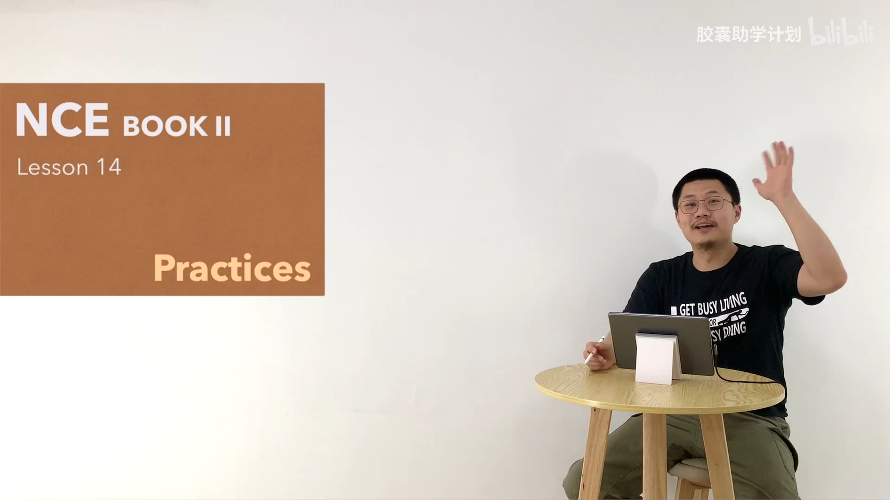

文字识别：胶囊助学计划 / NCE / BOOKII / Lesson 14 / Practices / GET BUSY LNING / OR / SY DYING

### 画面 00:00:02

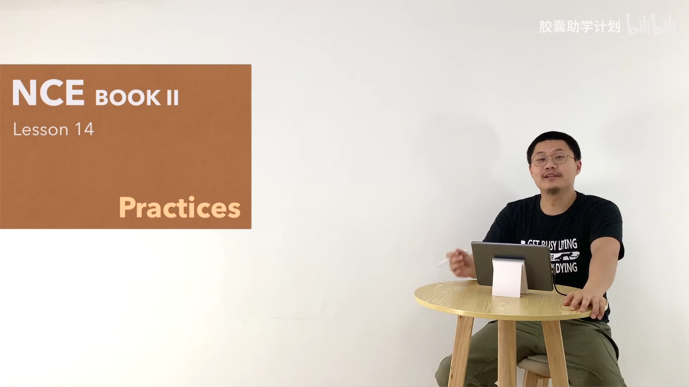

文字识别：胶囊助学计划 / NCE / BOOKII / Lesson 14 / Practices /  CET DISY LING / DYING

### 画面 00:00:05

文字识别：胶囊助学计划 / NCE / BOOKI"I / Lesson 14 / Practices /  CETDIISY UING / DVING

### 画面 00:00:08

文字识别：胶囊助学计划 / NCE / BOOK "I / Lesson 14 / Practices / DYING

### 画面 00:00:10

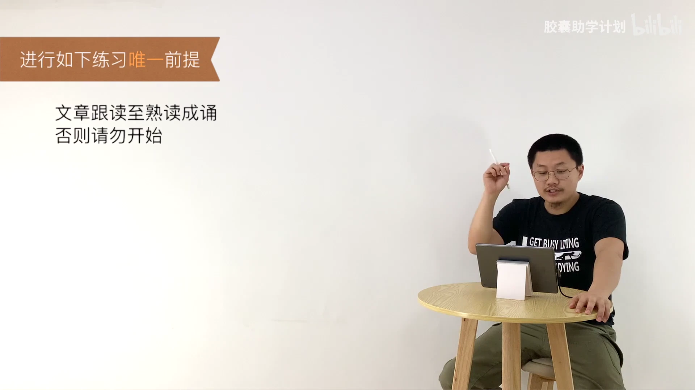

文字识别：胶囊助学计划 / 进行如下练习唯一前提 / 文章跟读至熟读成诵 / 否则请勿开始 / GET RUISY LING / DYING

### 画面 00:00:19

文字识别：胶囊助学计划bill

### 画面 00:00:23

### 画面 00:00:25

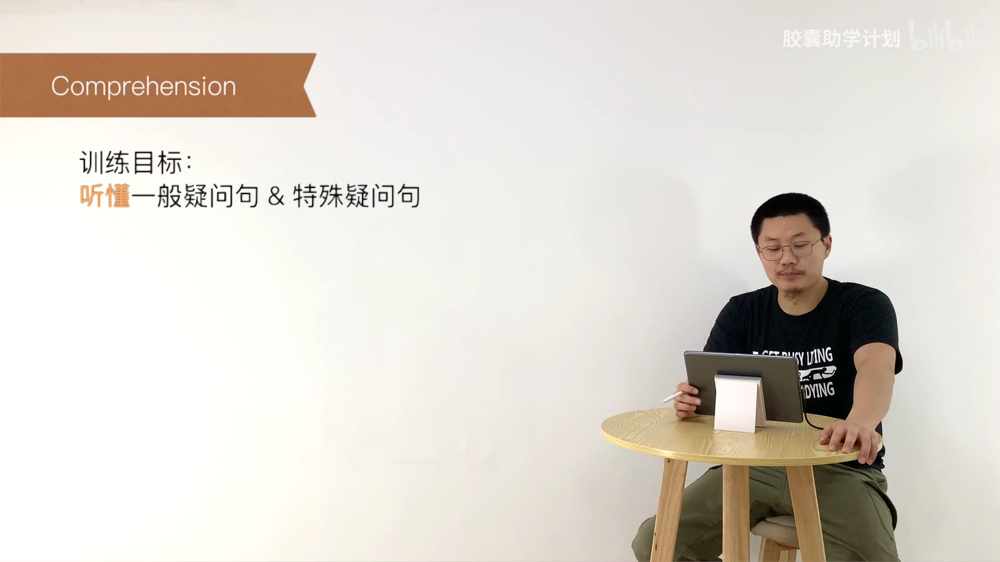

文字识别：胶囊助学计划 / Comprehension / 训练目标： / 听懂一般疑问句＆特殊疑问句 / -AFT PUY VING / DYING

## 00:00:30–00:01:00

了啊，第一题。What did you have last year? Answer: An amusing experience. Next one. What part of France were you in? The south of France. Next one. Had you been in a small village? Yes, I had. Next one. Where did you drive

### 画面 00:00:32

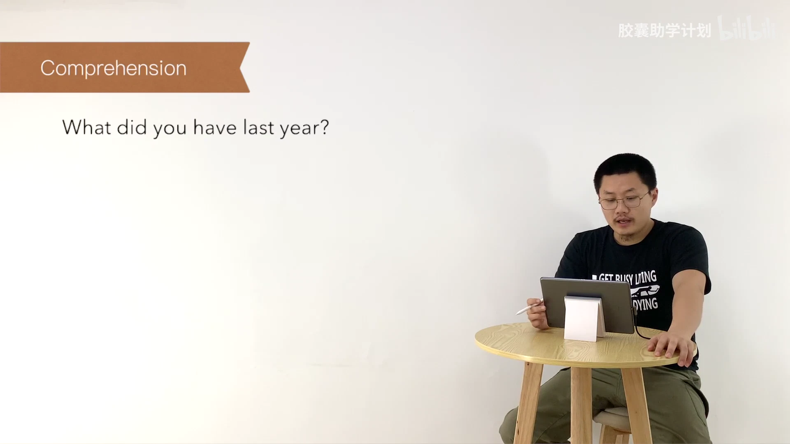

文字识别：胶囊助学计划 / Comprehension / What did you have last year? / GET RIIG LING / PYING

## 00:01:00–00:01:30

on to? The next town. Next one. Who waved to you on the way? A young man. This did有没有都OK的啊? What did he ask you for? For a lift. Next one. When did you say good morning to him? The answer is as

### 画面 00:01:02

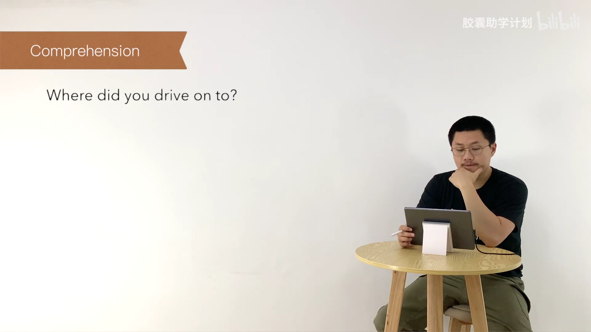

文字识别：胶囊助学计划 / Comprehension / Where did you drive on to?

### 画面 00:01:29

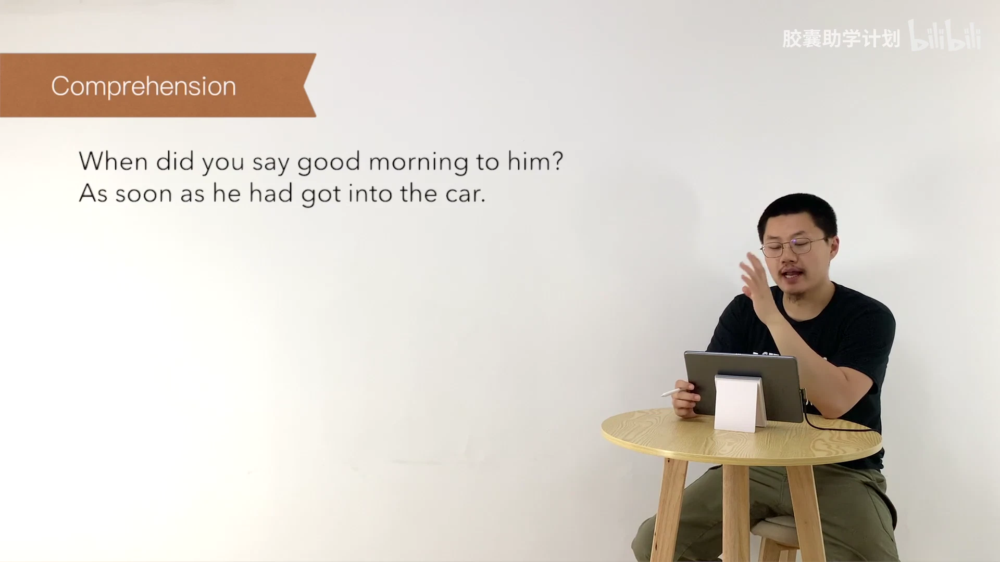

文字识别：胶囊助学计划 / Comprehension / When did you say good morning to him? / As soon as he had got into the car.

## 00:01:30–00:02:00

soon as he had got into the car. Next one. What language did you speak? French. Next one. Did your passenger reply in French? Yes, he did. How many words of French do you know? A few words.

### 画面 00:01:34

文字识别：胶囊助学计划 / Comprehension / What language did you speak?

## 00:02:00–00:02:30

Next one, did you speak to him during the journey? No, I didn't. When did he suddenly say something? When I had nearly reached the town. Next one, what did he ask you? He asked me if I spoke English,或者是Do you speak English就可以了.

### 画面 00:02:04

文字识别：胶囊助学计划 / Comprehension / Did you s / speak to him during the journey? / No, I didn't.

### 画面 00:02:12

文字识别：胶囊助学计划 / Comprehension / When did he suddenly say something? / When I had nearly reached the town.

### 画面 00:02:17

文字识别：胶囊助学计划 / Comprehension / What did he ask you?

### 画面 00:02:29

文字识别：胶囊助学计划 / Asking questions / 训练目标： / 会说一般疑问句＆特殊疑问句 / Accuracy / Fluency

## 00:02:30–00:03:00

Asking questions,会说一般疑问句、特殊疑问句可以慢，不能错啊！练的是accuracy啊，练的是我们的准确性。来了，先给一个例子：I had an amusing experience last year.因为这是一般过去时，看好时态，did提前就可以了，对吧？Did you have an amusing experience last year?问肯定是对last year提问，剩下直接照抄。When did you have an amusing experience?好，接下来

### 画面 00:02:36

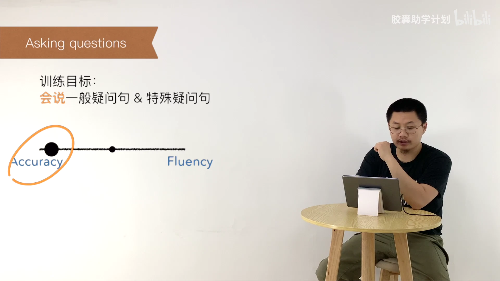

文字识别：胶囊助学计划 / Asking questions / 训练目标： / 会说一般疑问句＆特殊疑问句 / Fluency / Accuracy

### 画面 00:02:39

文字识别：胶囊助学计划 / Asking questions

### 画面 00:02:41

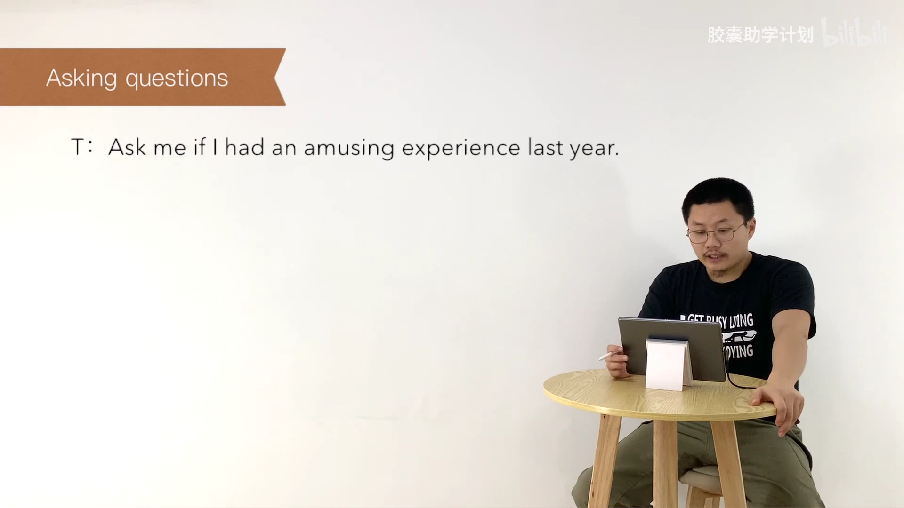

文字识别：胶囊助学计划 / Asking questions / T: Ask me if I had an amusing experience last year. / GET DISY LING / OYING

### 画面 00:02:52

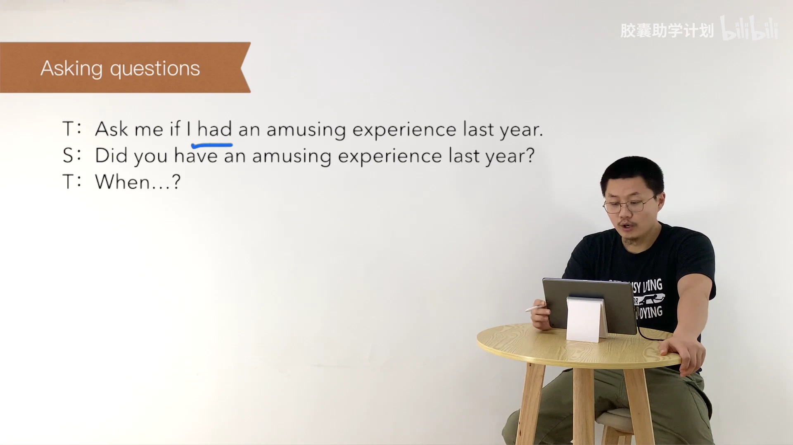

文字识别：胶囊助学计划 / Asking questions / T: Ask me if I had an amusing e / experience last year. / S: Did you have an amusing experience last year? / T:When...? / SY VING / R / IOING

### 画面 00:02:56

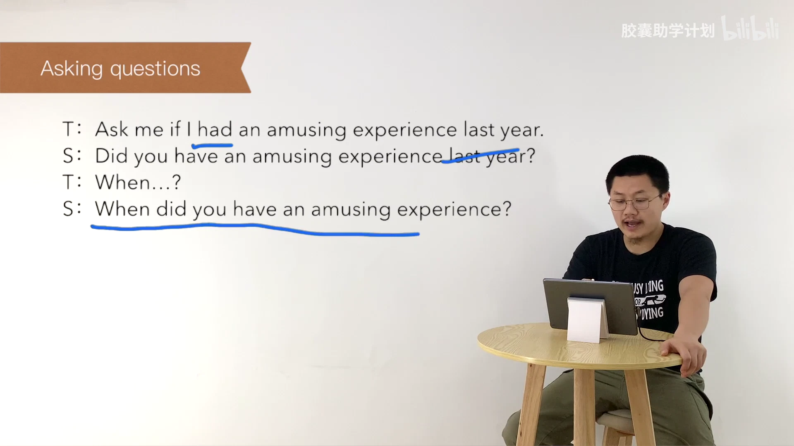

文字识别：胶囊助学计划 / Asking / questions / T:Ask / me / ifl had / ana / amusing / experience / last year. / S: / Did / you / have / an / amusing / experiencelast year? / T: / When...? / S： / When / did / you have / an amusing / experience? / JSY ING / R / YOVING

### 画面 00:02:59

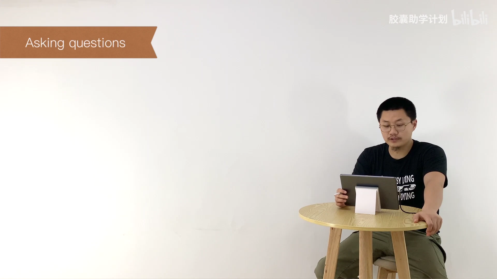

文字识别：胶囊助学计划 / Asking questions / SYVING / IOVING

## 00:03:00–00:03:30

我们来了啊。第一题，Who肯定是对主语提问，直接替代，别变一般疑问句了。I was in the south of France. Was提前，Where对，in the south of France。其实答案就特别简单了。Where were you?对吧？I had left a small village.注意看一下，第一句话是had an amusing experience，第三句话是had left。这是两个不同的时态，虽然用的都是

### 画面 00:03:07

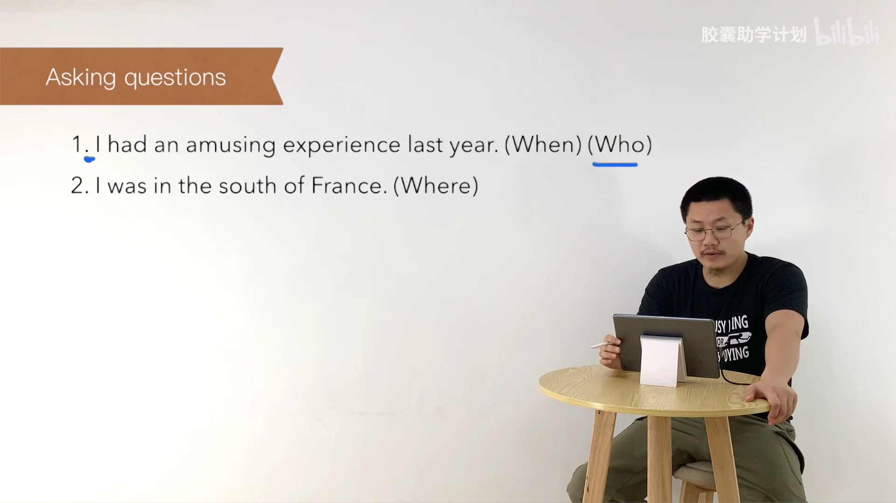

文字识别：胶囊助学计划 / Asking questions / 1.I had an amusing experience last year. (When) (Who) / 2.I was in the south of France.(Where) / ISY ING / OVING

### 画面 00:03:12

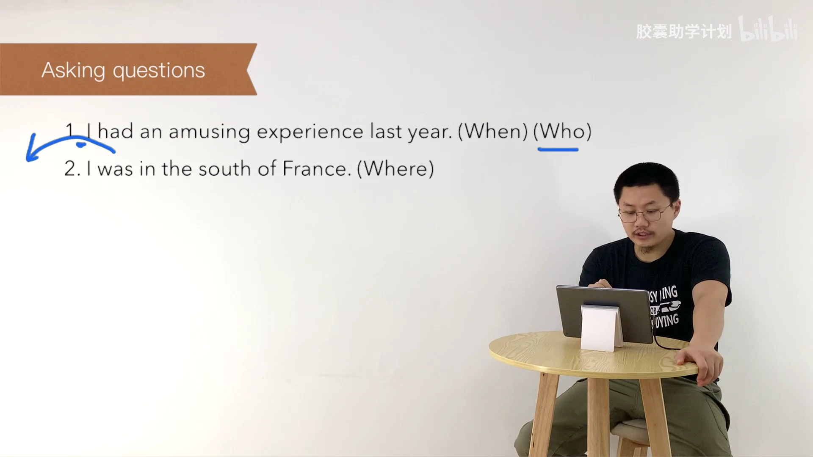

文字识别：胶囊助学计划 / Asking / questions / I an amusing experience last year. (When) (Who) / L/had a / 2.I was in the south of France. (Where) / SY ING / OYING

### 画面 00:03:15

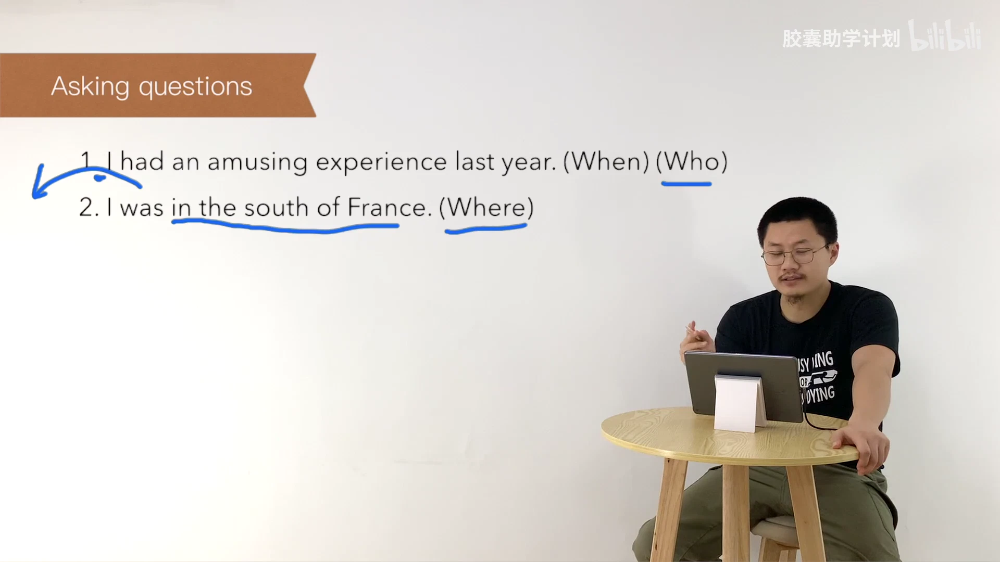

文字识别：胶囊助学计划 / Asking / questions / an amusing / experience / last year. (When)(Who) / LLhad / 2.I was in the south of France. (Where) / 9 / ISY ING / SOYING

### 画面 00:03:23

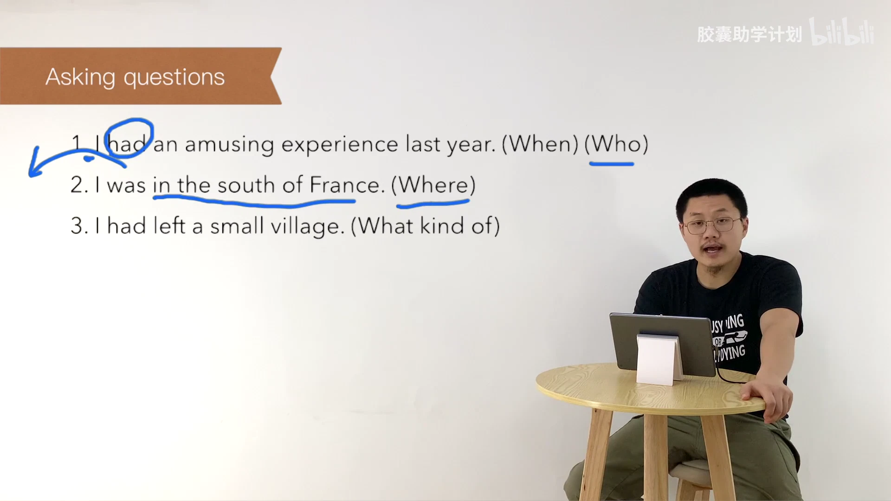

文字识别：胶囊助学计划 / Asking / questions / Tbadan amusing e / experience / last year. (When)(Who) / 2.I was in the south of France. (Where) / 3.I had left a small village. (What kind of) / USY ING / YOVING

### 画面 00:03:26

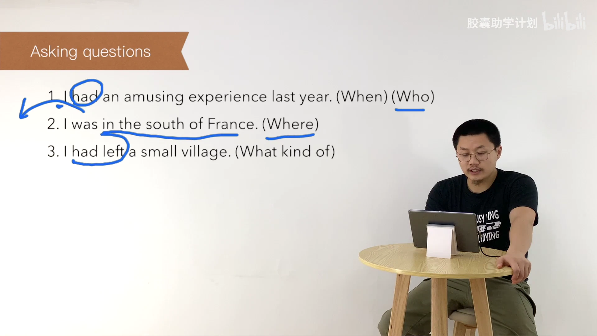

文字识别：胶囊助学计划 / Asking / questions / Tlbadana / amusing / experience / last year. (When) (Who) / 2.I was in the / south of France. (Where) / 3.I had leffa s / small village.(What k / kind / of) / USY ING / YOVING

## 00:03:30–00:04:00

had。第一句话是一般过去时，所以 did 提前。第三句话是现在完成时，所啊过去完成时，所以 had 提前。啊，别把 did 提前。 What kind of？我们见过很多次了，对形容词提问，对 small 提问，并且要带着 village，对吧？我说一下答案。 What kind of village had you left？你刚你之前离开的这个小镇是个什么样的小镇呢？啊，村子、村落呀。

### 画面 00:03:30

文字识别：胶囊助学计划 / Asking / questions / Tlbadana / amusing / experience / last year. (When) (Who) / 2.I was in the south of France. (Where) / 3.Ihad lefta small village.(What kind  / of) / JING / ING

### 画面 00:03:39

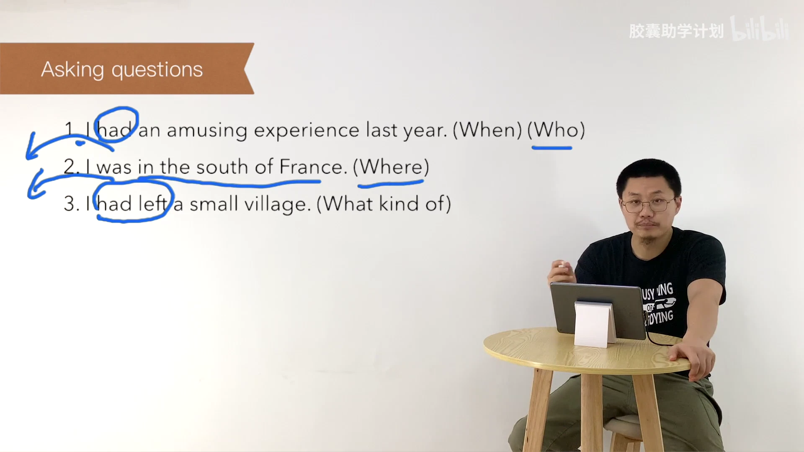

文字识别：胶囊助学计划 / Asking / questions / Tlhadana / amusing / experience / last year. (When) (Who) / south of France. (Where) / 3.Ihad leff / small village.(What / kind / of) / a / USY ING / IOYING

### 画面 00:03:42

文字识别：胶囊助学计划 / Asking / questions / Thadana / amusing / experience / last year. (When) (Who) / south of France. (Where) / 3.Ihad left / small village. (What kind of) / a / SYING / YING

### 画面 00:03:46

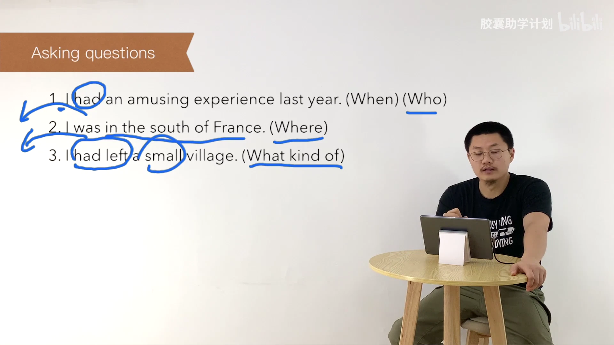

文字识别：胶囊助学计划 / Asking / questions / Tlhadan / amusing / experience / last year. (When) (Who) / south of France. (Where) / 3.Ihad leffa/smallvillage. (What K / kind of) / SY ING / OVING

### 画面 00:03:49

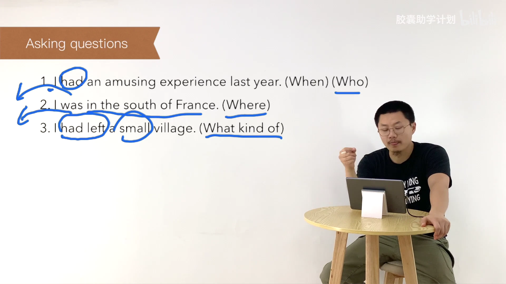

文字识别：胶囊助学计划 / Asking / questions / Tlhadan / amusing / experience / last year. (When) (Who) / 2.lwas i / in the / south of France. (Where) / 3.Ihad lefta/smallvillage.(What I / kind of) / YING / IYING

### 画面 00:03:57

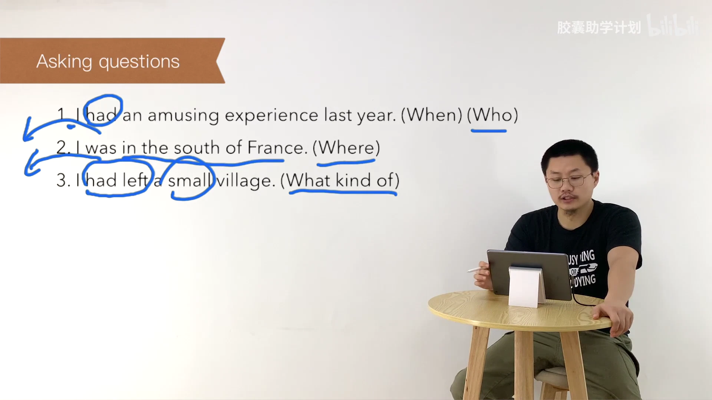

文字识别：胶囊助学计划 / Asking / questions / Thadan / amusing / experience / last year. (When) (Who) / 2.1 was in the / south of France. (Where) / 3.Ihad lefta/smallvillage.(What I / kind of) / USY ING / LDOYING

## 00:04:00–00:04:30

A young man waved to me.一般过去时，did的提前。Who对主语可以，对me也可以。但是不要忘了，对主语提问的时候有一个关键点。Why直接对整句提问，对一般疑问句加上就行了。He asked me for a lift. Did的提前，对吧？Did he ask you for a lift? What对a lift提问？What did he ask you?啊，他问你什么了？第六题，I

### 画面 00:04:05

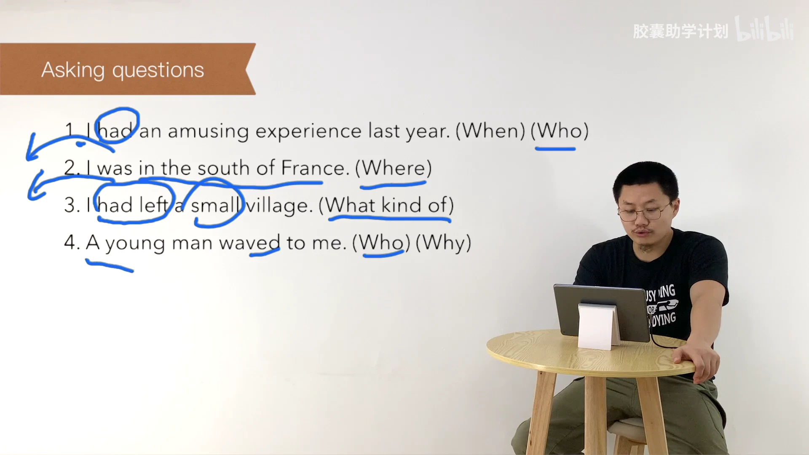

文字识别：胶囊助学计划 / Asking / questions / Tlhadan / amusing / experience / last year. (When) (Who) / 2.I was in the south of France. (Where) / 3.Ihad lefa/smallvillage. (What kind of) / 4.Ayoung /  to me.(Who) (Why) / man waved / SY ING / SOVING

### 画面 00:04:07

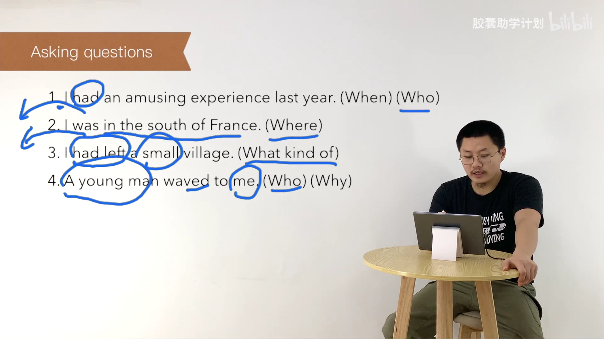

文字识别：胶囊助学计划 / Asking / questions / TLhadan / amusing / experience / last year. (When) (Who) / 2.l was in the / south of France.(Where) / 3.Ihad lefasmall village.(What / kind / of) / 4.A young / mah waved / to / me, / (Who) (Why) / SYING / BOVING

### 画面 00:04:20

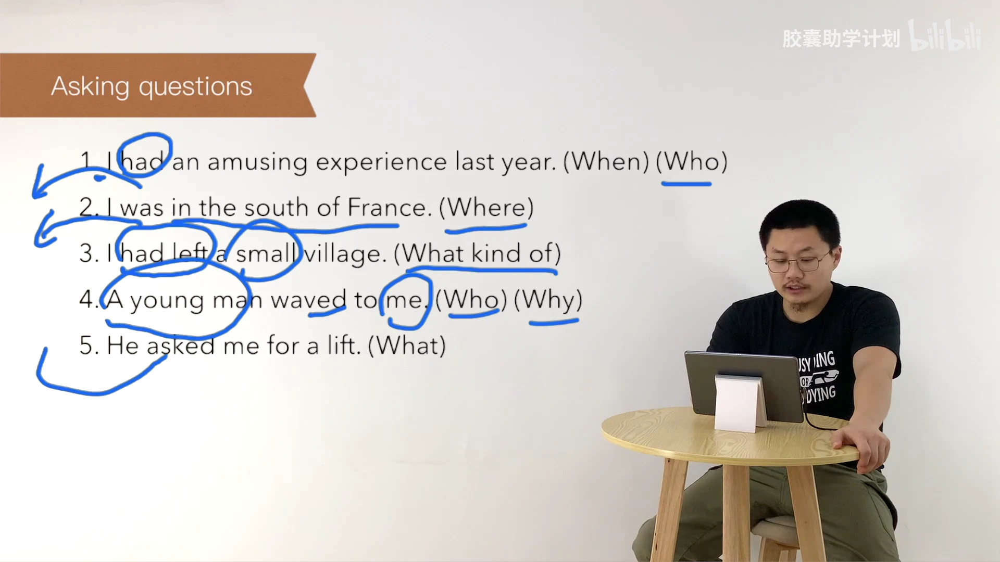

文字识别：胶囊助学计划 / Asking / questions / Tlhadana / amusing / experience / last year. (When) (Who) / 2.I was in the s / : south of France.(Where) / 3.Ihad lefasmall village.(What I / kind of) / 4.A young / mah waved / to / me, / (Who)(Why) / 5.He / asked / me / for a lift. (What) / JSYING / OVING

### 画面 00:04:28

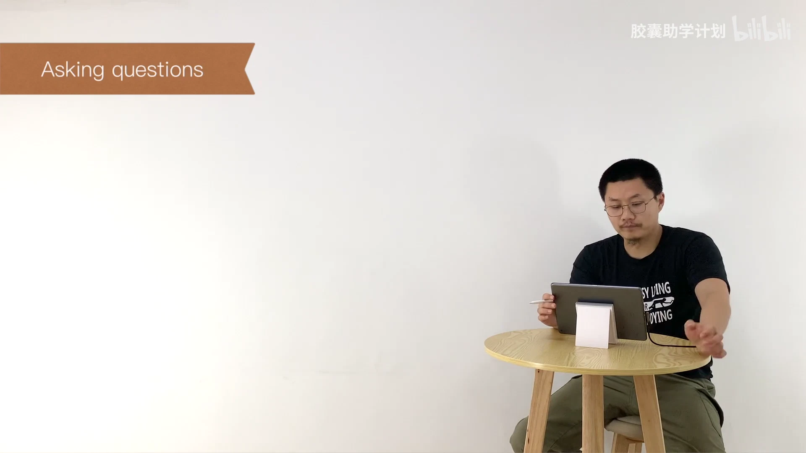

文字识别：胶囊助学计划 / Asking questions / SYVING / IOVING

## 00:04:30–00:05:00

said good morning to him. Did提前，What啊，其实就是good morning啊。What did you say啊？我你可以说good morning啊，你答案就可以说What did you say to him？你对他说什么了？说的就是good morning，对吧？I spoke in French. Did提前，What language？What language did you speak？啊，你说的是什么语言？I know a few

### 画面 00:04:30

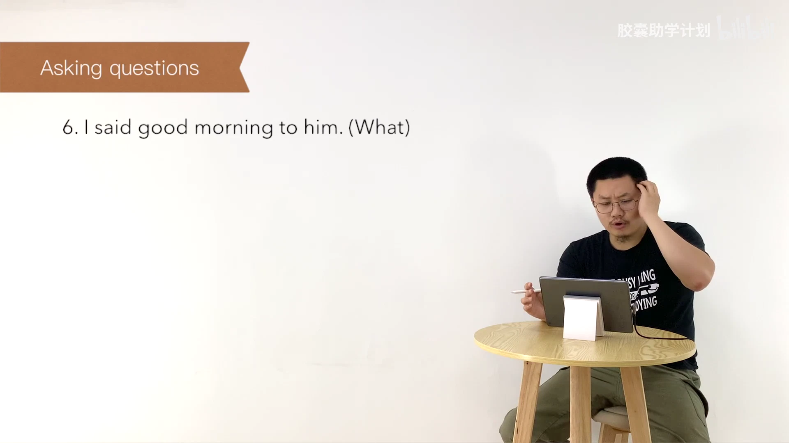

文字识别：胶囊助学计划 / Asking / questions / 6.I said good morning to him. (What) / SYLING / R / OVING

### 画面 00:04:34

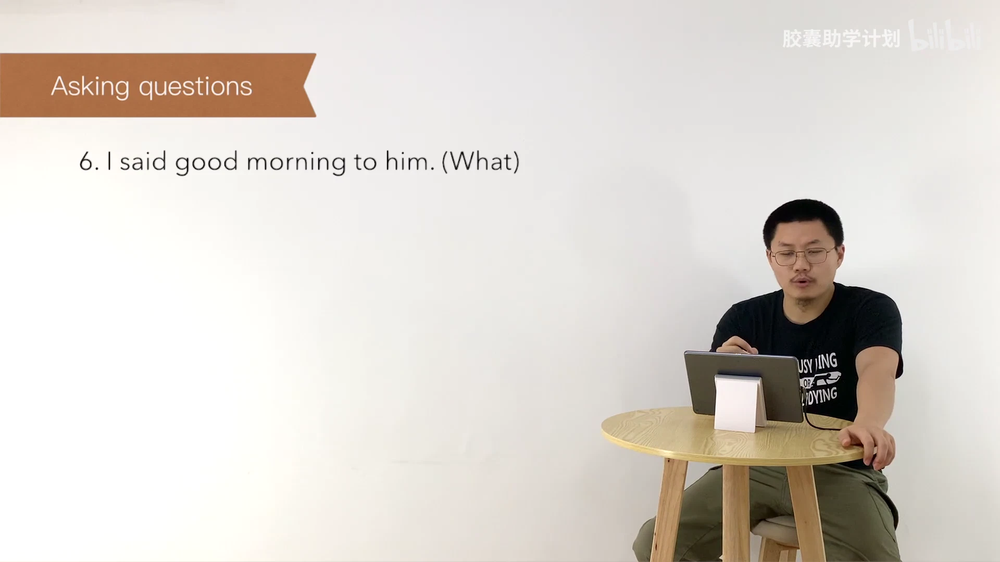

文字识别：胶囊助学计划 / Asking / questions / 6.I said good morning to him. (What) / USY IING / YOVING

### 画面 00:04:37

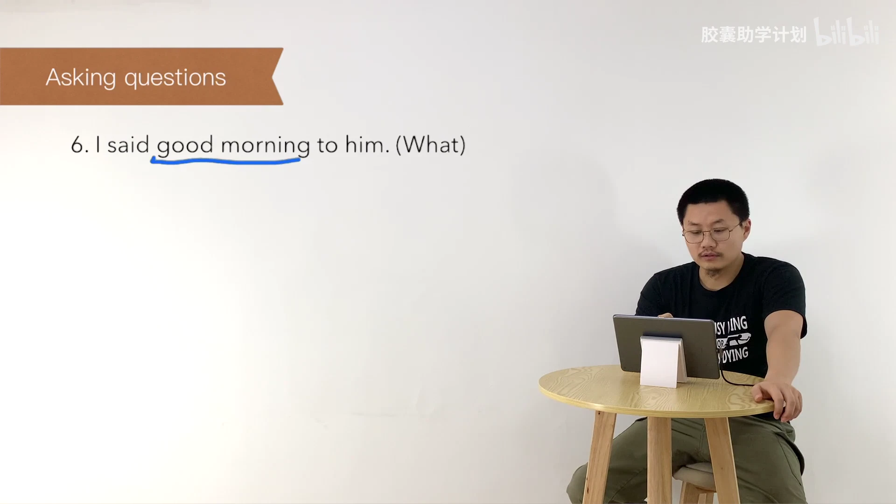

文字识别：胶囊助学计划 / Asking questions / 6.I said good morning to him. (What) / ISY ING / R. / BDYING

### 画面 00:04:49

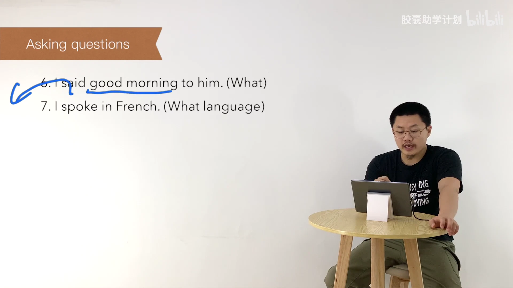

文字识别：胶囊助学计划 / Asking / questions / 6.tsqidgood morning to him.(What) / 7.I spoke in French. (What language) / 香 / USY ING / OYING

### 画面 00:04:51

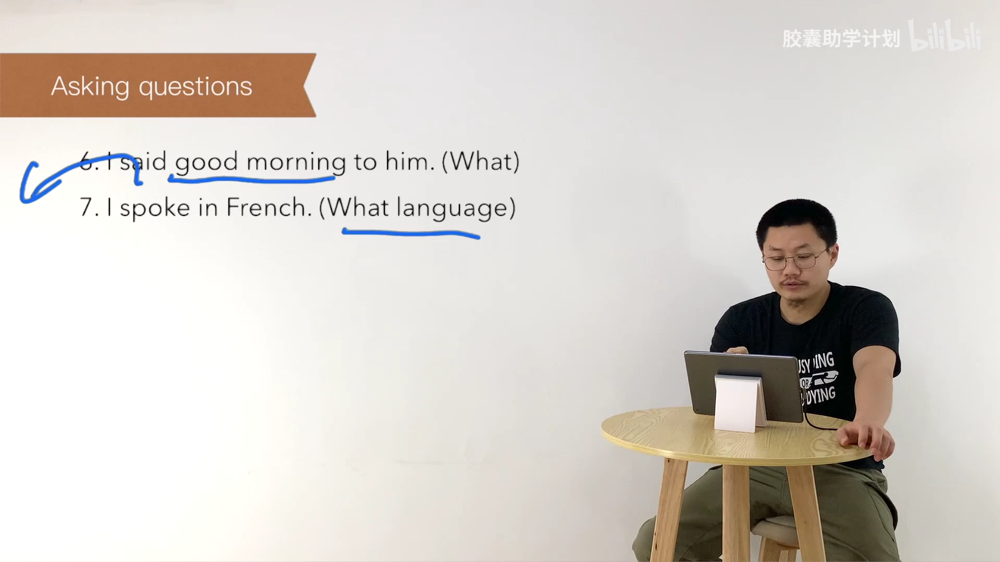

文字识别：胶囊助学计划 / Asking / questions / 6.1said / good / morning to him.(What) / 7.I spoke in French. (What language) / JSY ING / BOVING

## 00:05:00–00:05:30

words of French. 注意时态，这是 do 提现，对吧？一般现在时。 How much? How much 指的是多少，对吧？那这个地方注意一小下啊。你看啊，这地方就很有意思了。首先，各位要注意 words 和 French 稍有不同。我在这儿给大家拓展一个叫 how many。 How much 问的是不可数， how many 问的是可数。如果是我先说 how many，

### 画面 00:05:02

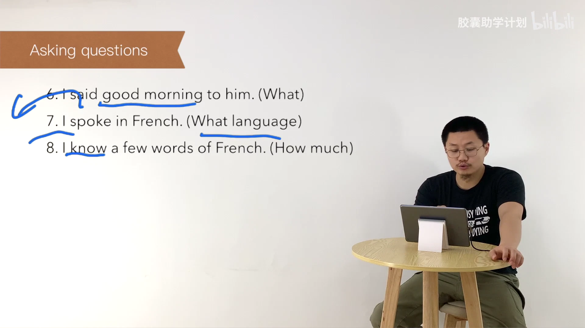

文字识别：胶囊助学计划 / Asking / questions / 6.tspid good r / morning to him. (What) / 7.I spoke in French. (What language) / 8.Iknow a few words / of French.(How much) / ISY ING / BOVING

### 画面 00:05:09

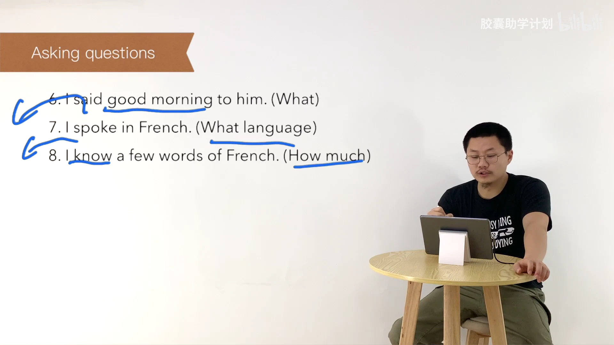

文字识别：胶囊助学计划 / Asking / questions / 6.1said / dgoodr / morning to him. (What) / 7.I spoke / e in French. (What language) / 8.Iknow a few words / of French.(How much) / SYING / SOYING

### 画面 00:05:18

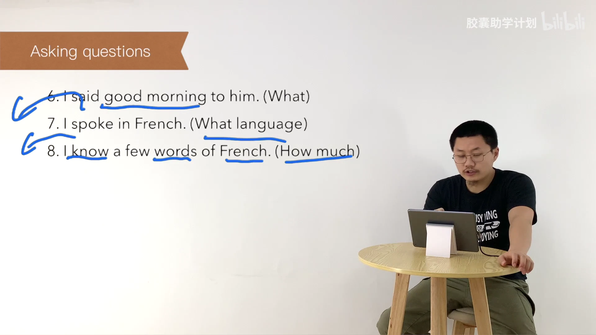

文字识别：胶囊助学计划 / Asking / questions / 6.tspid / good / morning to him.(What) / 7.I spoke / : in French. (What language) / 8.Iknow a few words / of French.(How much) / JSYING / OR. / CIOYING

### 画面 00:05:20

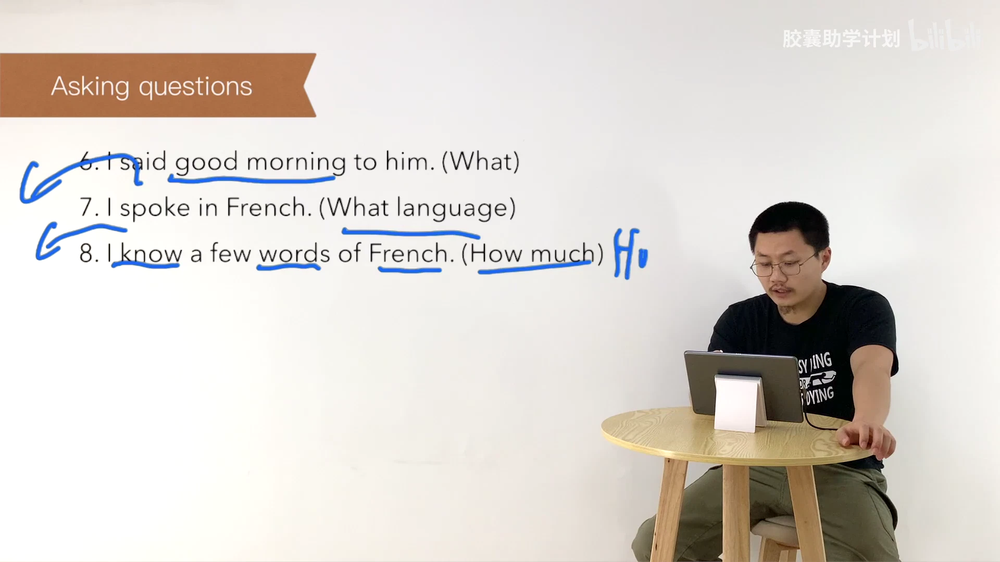

文字识别：胶囊助学计划 / Asking / questions / 6.tspid / good / morning to him. (What) / 7.1 spoke / 1 French.(What language) / inl / 8.I know a few words / of French.(How r / / much) / H / SYING / R / FOVING

### 画面 00:05:22

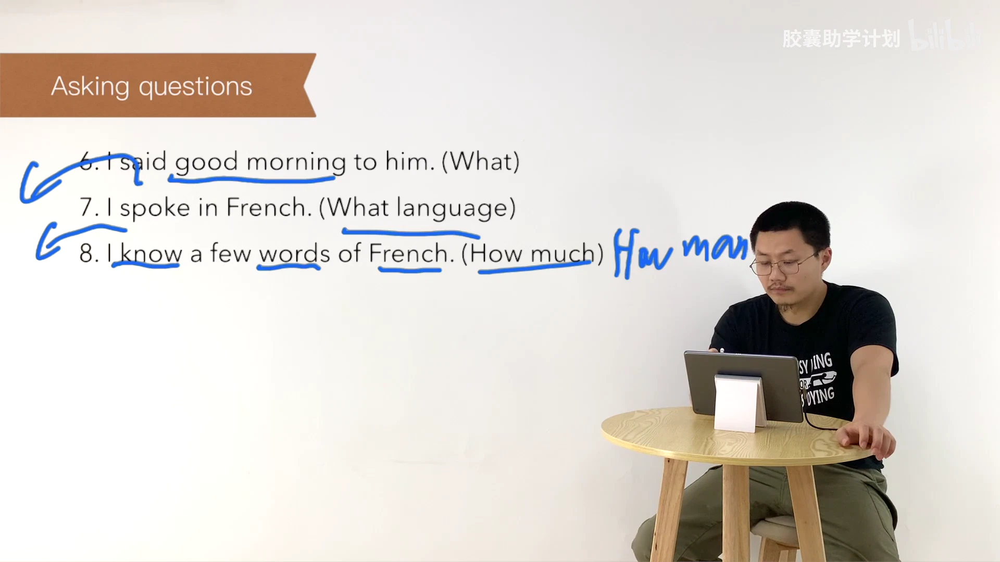

文字识别：胶囊助学计划 / Asking / questions / 6.tspid / good / morning / y to /  him.(What) / 7.I spoke / French. (What language) / in / Hw man / 8.1knowa / few words / of French.(How / much) / a / SYING / SOVING

## 00:05:30–00:06:00

如果是 how many，那它是对 a few 提问，所以应该是 how many words of French，看见了吧？ How many 是可以加 words 的，所以答案是 how many words of French do you know？答案是 a few。但如果是 how much，它就是不可数的了，你就不是对 words 提问，就是对 French 提问了，就是对 a few words of 提问了，所以答案就变成了 how much French do you know？你懂多少法

### 画面 00:05:31

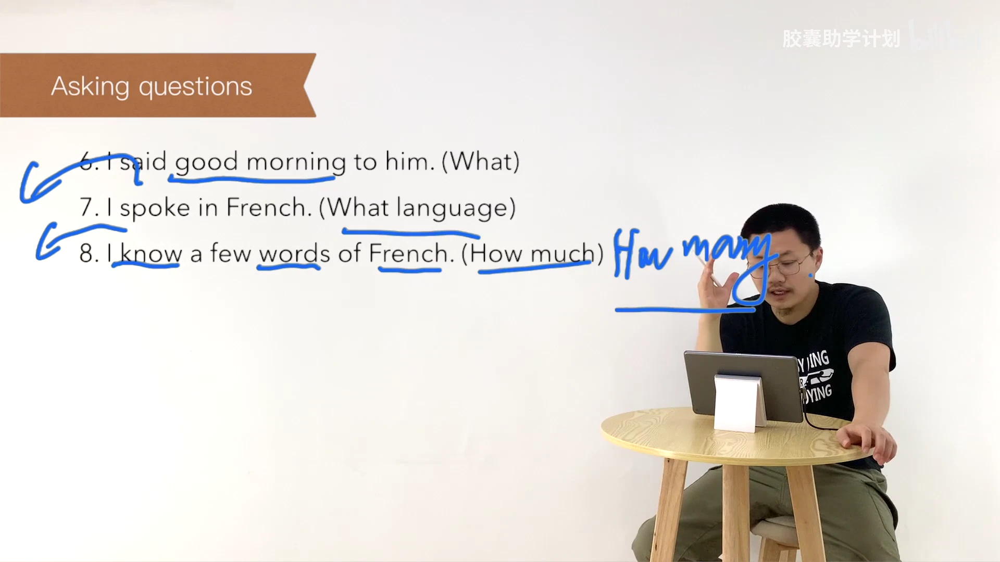

文字识别：胶囊助学计划 / Asking / questions / 6.tsaid / good / morning / y to / ) him.(What) / 7.I spoke /  French.(What language) / in / Hwr / 8.1know af / may / few words / of French.(How / much) / YING / YING

### 画面 00:05:50

文字识别：胶囊助学计划 / Asking / questions / 6.1sid / good / morning to him.(What) / 7.I spoke /  French. (What language) / in / Hn many / 8.1knowa / few words / of French.(How / much) / ISYING / OR / OVING

### 画面 00:05:53

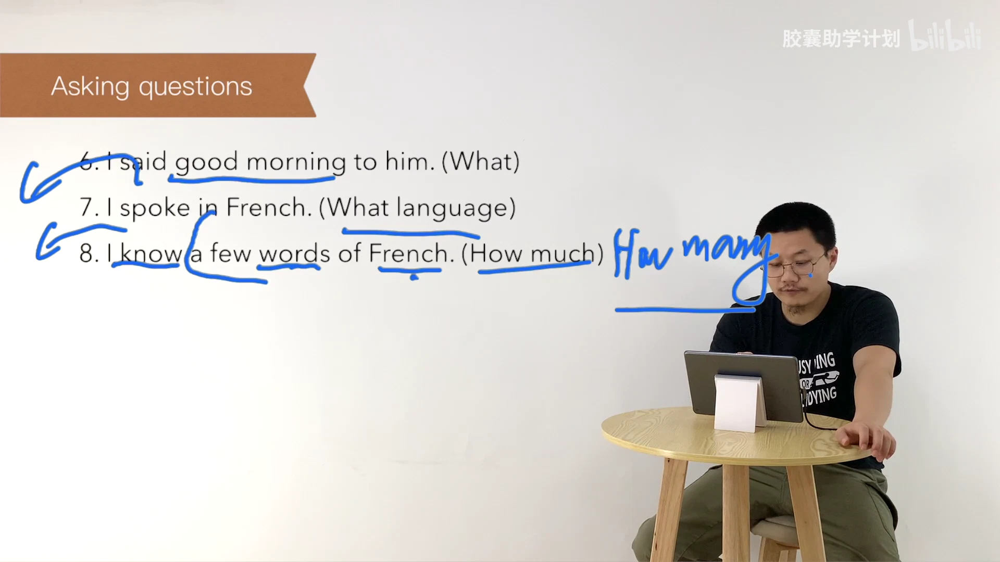

文字识别：胶囊助学计划 / Asking / questions / 6.tsid / good / morning / to / him.(What) / 7.I spoke in / French.(What language) / Hn many / 8.1knowa fewy / words / of French.(How / much) / ISY ING / IDYING

### 画面 00:05:55

文字识别：胶囊助学计划 / Asking / questions / 6.tspid / good / morning / to / him.(What) / 7.I spoke / e in French. (What I / t language) / 8.1knowafew / Hw / mamy / words / French.(How / much) / SYING / R / DYING

### 画面 00:05:57

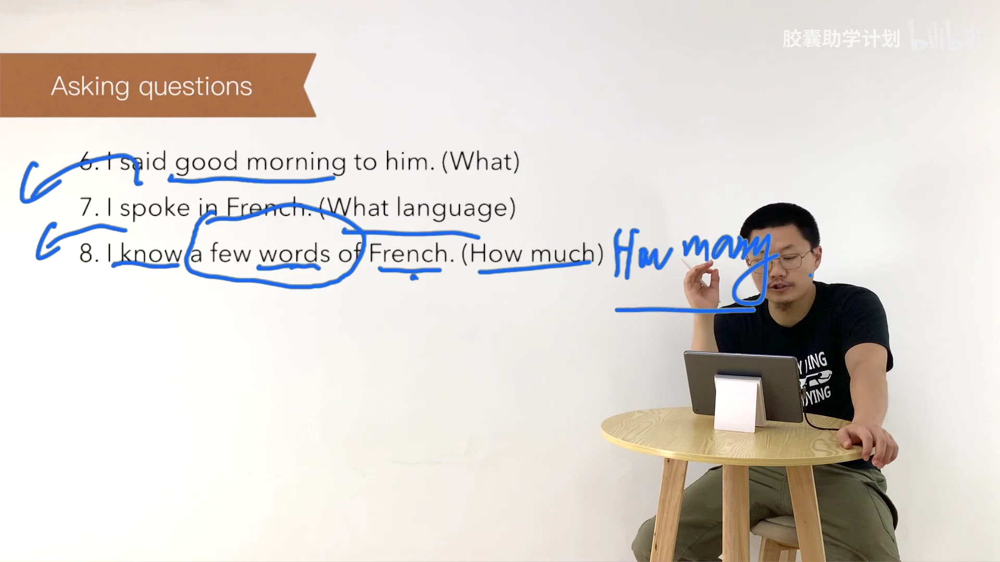

文字识别：胶囊助学计划 / Asking / questions / 6.1sid / good / morning / to / him.(What) / 7.I spoke /  in French. (What I / language) / Hw / 8.1knowafew / may / words / of / French.(How / much) / YING / VING

## 00:06:00–00:06:30

语？法语是不可数的，单词是可数的。OK，第九个，He replied in French. did 提前，What language? 跟刚才是一样的。What language did he reply? OK，呃，第十个，The young man spoke at the end of the journey. Spoke 定位了，然后 did 提前就行了。When? 肯定是对 at the end of the journey 提问，对吧？Who? 哎，对主语提问就行了，不要忘

### 画面 00:06:04

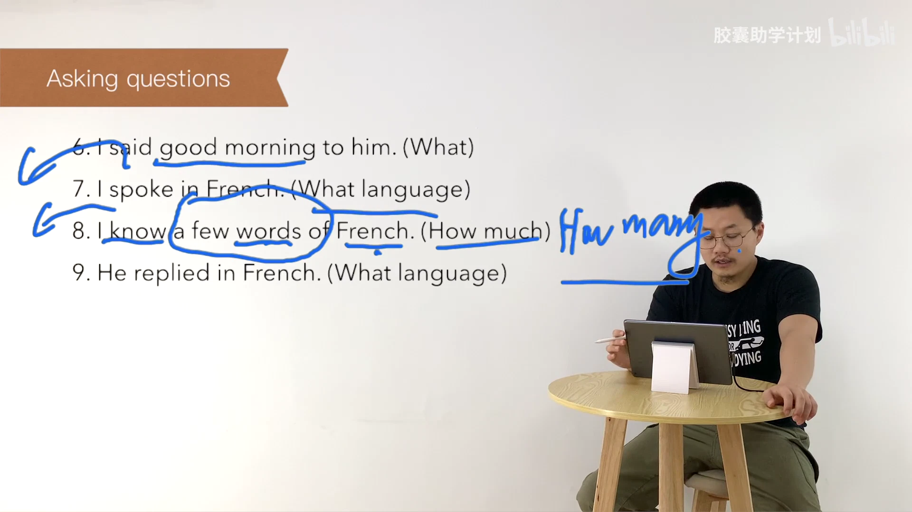

文字识别：胶囊助学计划 / Asking / questions / 6.tsid / good / morning / to / him.(What) / 7.I spoke in French. (What language) / Hn many / 8.1knowa few / words / of / French. / .(How / much) / 9. He replied in /  French.(What I / language) / SYIING / DVING

### 画面 00:06:07

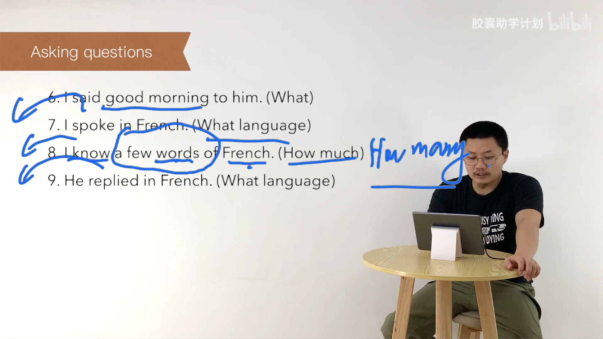

文字识别：胶囊助学计划 / Asking / questions / 6.tsaid / good / morning / to / him.(What) / 7.I spoke in French. (What language) / C81knowafewy / Hn may / words / French.(How / much) / of / 9.He / replied in /  French.(What / language) / ISYING / SOYING

### 画面 00:06:11

文字识别：胶囊助学计划 / Asking / questions / 6.tsaid / good / morning / to / him.(What) / 7.I spoke in French. What I / t language) / C8 lknowafewy / Hw / mamy / words / of / French.(How / much) / 9.He / replied in /  French.(What language) / SY ING / SOVING

### 画面 00:06:19

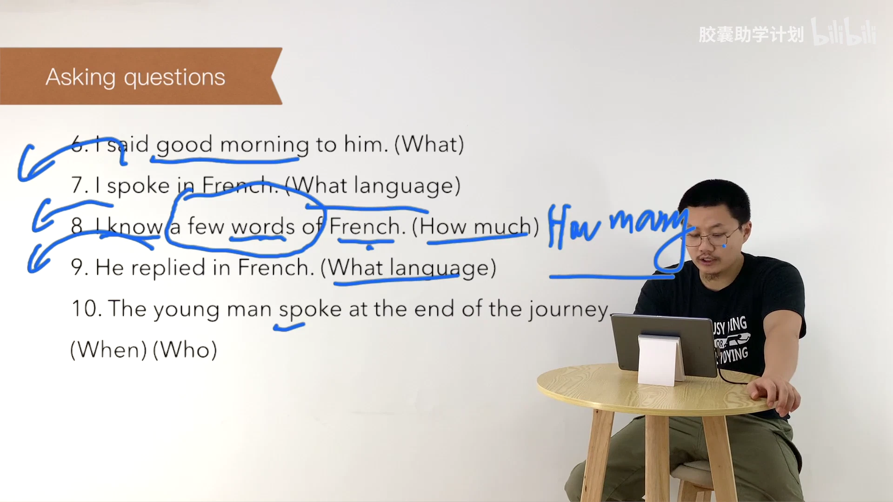

文字识别：胶囊助学计划 / Asking / questions / 6.1sid / good / morning to him. (What) / 7.I spoke in French. (What language) / C8 Iknowafewwords / Hon may / French.(How r / much) / of / 9.He / replied in / French. / . (What language) / 10.The / young / man S / spoke / at the / end of the journey / USYING / (When)(Who) / OR. / YOVING

### 画面 00:06:21

文字识别：胶囊助学计划 / Asking / questions / 6.tsaid / good / morning / y to / him.(What) / 7.I spoke in French.(What language) / C8Iknowa fewwords / Hn many / French.(How / much) / of / He replied in French.( / . (What lanquage) / 10.The / young / man / spoke / at the / end of the journey / ISY ING / (When) (Who) / YOVING

### 画面 00:06:25

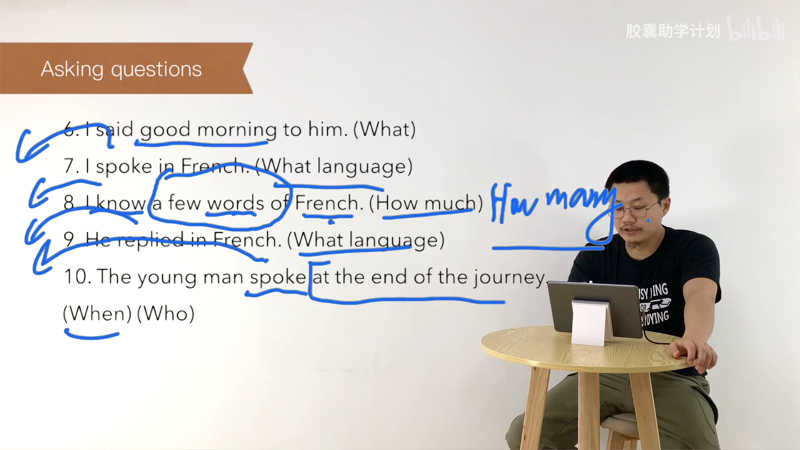

文字识别：胶囊助学计划 / Asking / questions / 6.tsaid / good / morning / to / him.(What) / 7.I spoke in French.(What language) / C8 1knowafewy / Hu may / words / of / French.(How / much) / He replied in French. / (What l / lanquage) / 10.The / young / man / spoke / at the / end / of the journey / ISY ING / (When)(Who) / R / SYOYING

### 画面 00:06:27

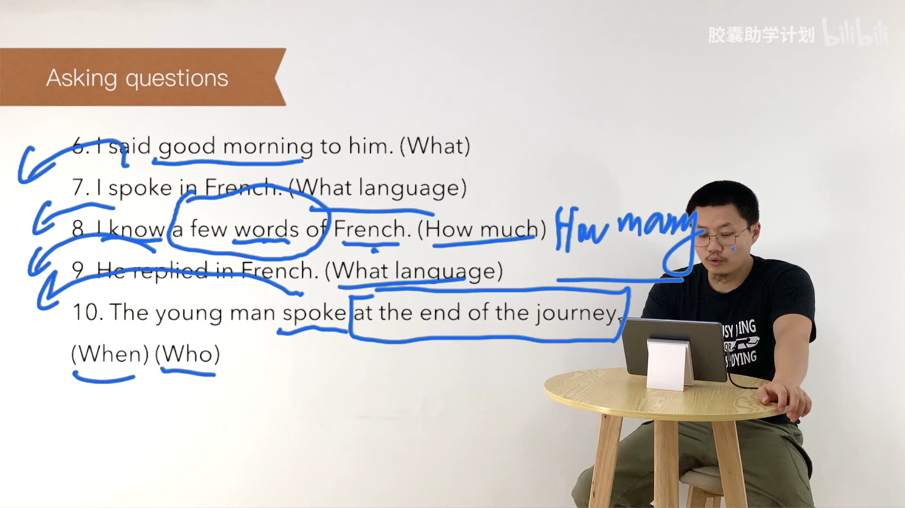

文字识别：胶囊助学计划 / Asking / questions / 6.tsaid / good / morning / to / him.(What) / 7.I spoke in French. (What I / t language) / C8knowafewy / Hwn / mamy / words / of / French.(How / much) / He replied in French. / (What l / lanquage) / 10.The / young / man / spoke / at the / end / of the / journey / ISY ING / (When) (Who) / S'OVING

### 画面 00:06:29

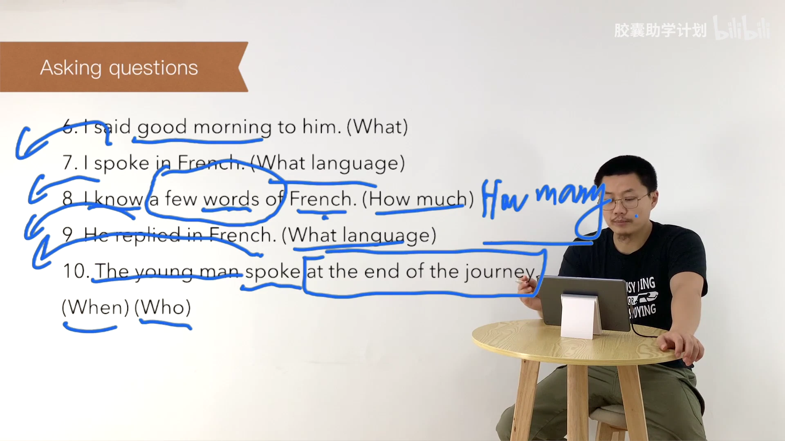

文字识别：胶囊助学计划 / Asking / questions / 6.tspid / good / morning / him.(What) / to / 7.I spoke in French. (What I / t language) / C8 knowafewy / Hw / may / words / of / French. / (How / much) / He replied in French. / (What l / language) / 10.Jhe young man / spoke / at the / end / of the / journeyy / ISYING / (When) (Who) / SYOVING

## 00:06:30–00:07:00

忘了，别变一般疑问句啊。Who spoke at the end of the journey? Now tell the story. Ah,可以快，可以错，是吧？不能太慢啊。所以文章一定要读的非常熟。我还是给大家做一个小的示范。来了，I had an amusing experience last year. After I had left a small village in the south of France, I drove on to the next town. On the way, a young man waved to

### 画面 00:06:31

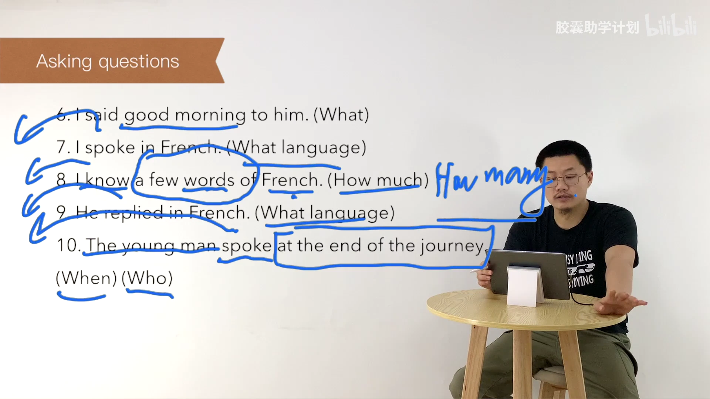

文字识别：胶囊助学计划 / Asking / questions / 6.tspid / good / morning / to / him.(What) / 7.I spoke in French. What I / t language) / C8 knowafewy / Hw / may / words / of / French. / (How / much) / He replied in French. / (What l / language) / 10.Jhe young man / spoke / at the / end / of the / journeyy / SYIING / (When)(Who) / OR / BYOYING

### 画面 00:06:35

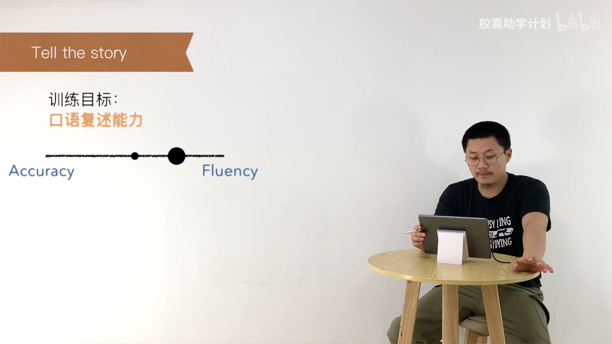

文字识别：胶囊助学计划 / Tell the story / 训练目标： / 口语复述能力 / Accuracy / Fluency / SYLING / OR. / SYOYING

### 画面 00:06:39

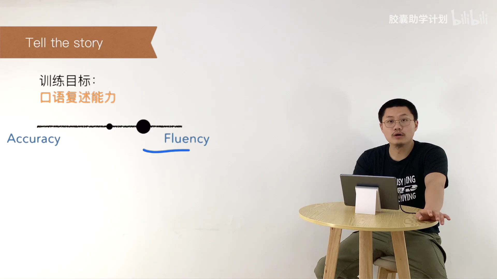

文字识别：胶囊助学计划 / Tell the story / 训练目标： / 口语复述能力 / Accuracy / Fluency / JSYING / OR. / YOVING

### 画面 00:06:43

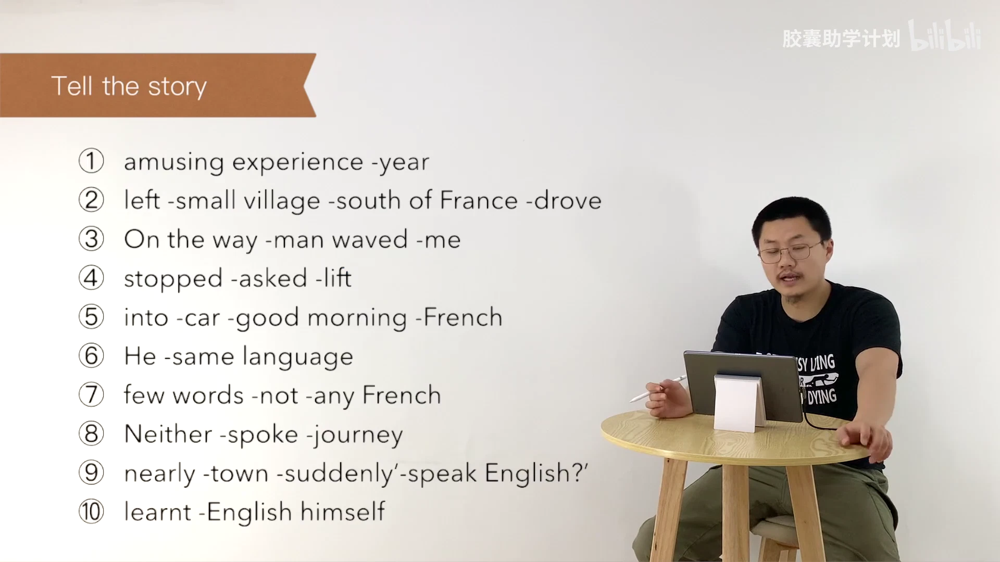

文字识别：胶囊助学计划 / Tell the story / amusing experience -year / left -small village -south of France -drove / On the way -man waved -me / stopped -asked -lift / into -car -good morning -French / He -same language / SY LING / few words -not -any French / R / DYING / Neither -spoke -journey / nearly -town -suddenly'-speak English?' / 9 / ① learnt -English himself

### 画面 00:06:47

文字识别：胶囊助学计划 / Tell the story / ① / amusing experience -year / left -small village -south of France -drove / 2 / On the way -man waved -me / stopped -asked -lift / into -car -good morning -French / 5 / He -same language / SYING / few words -not -any French / DVING / Neither -spoke -journey / 9 / nearly -town -suddenly'-speak English?' / ① learnt -English himself

## 00:07:00–00:07:30

me. Uh, I stopped and he asked me for a lift. As soon as he got into the car, I said good morning to him in French, and he replied in the same language. Apart from a few words, I do not know any French at all. Neither of us spoke during the journey. After I had nearly reached the town, when suddenly he said, "Do you speak English?" And I soon learned he was English himself. Okay, very good. Summary writing,摘要写作，各

### 画面 00:07:17

文字识别：胶囊助学计划 / Tell the story / ① / amusing experience -year / left -small village -south of France -drove / 2 / On the way -man waved -me / stopped -asked -lift / into -car -good morning -French / 5 / He -same language / SYIING / few words -not -any French / DYING / Neither -spoke -journey / 9 / nearly -town -suddenly'-speak English?' / ① learnt -English himself

### 画面 00:07:27

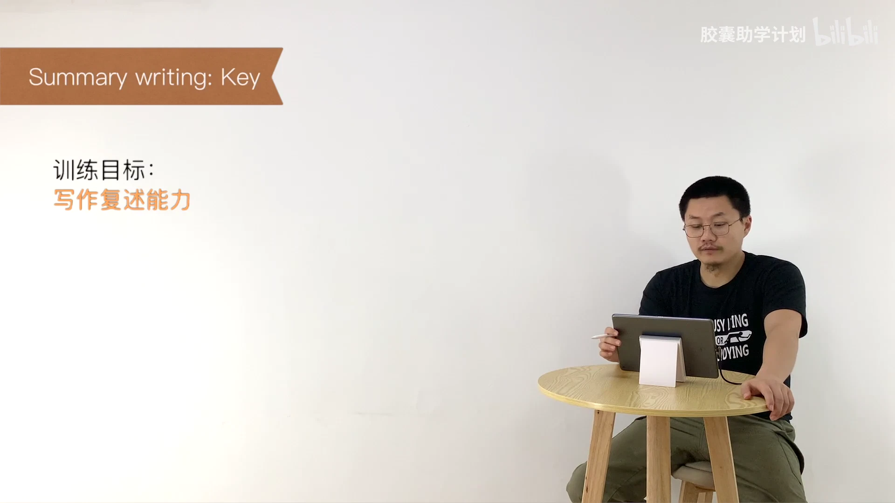

文字识别：胶囊助学计划 / Summary writing: Key / 训练目标： / 写作复述能力 / JSYING / IOING

## 00:07:30–00:08:00

位自己写，写完了之后在这地方对一下答案，对我们将来的写作能力有很大的帮助。OK，好，最后一个题，topic for discussion，完全自由的对话。所有练习就是为了将来各位有一天能对这些话题进行自由的表达。来，我们先看第一题啊，说Have you ever asked for a lift?你有搭过便车吗？Or given one?或者让别人搭过你的便车？If so,如果是这样的话，describe the person you met.描述一下你

### 画面 00:07:30

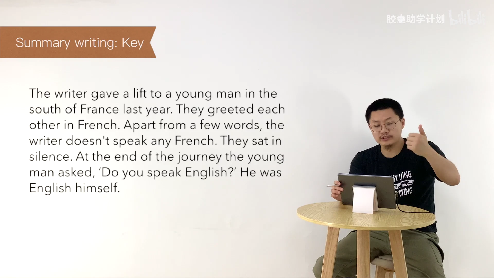

文字识别：胶囊助学计划 / Summary writing: Key / The writer gave a lift to a young man in the / south of France last year. They greeted each / other in French. Apart from a few words, the / writer doesn't speak any French. They sat in / silence. At the end of the journey the young / man asked,'Do you speak English?' He was / SYVING / English himself. / R / SYOVING

### 画面 00:07:36

文字识别：胶囊助学计划 / Topics for discussion / 训练目标： / 完全自由的对话 / Accuracy / ISY LING / Fluency / OR. / UYDYING

### 画面 00:07:41

文字识别：胶囊助学计划 / Topics for discussion / Have you ever asked for a lift, or given / one? if so, describe the person you met. / Describe the various ways you are able / to recognize a foreigner in your country. / 3 / Have you ever tried to talk to someone / who didn't know your language? What / SYVING / R / happened? / YOVING

### 画面 00:07:47

文字识别：胶囊助学计划 / Topics for discussion / Have you ever asked for a lift, or given / one? if so, describe the person you met. / Describe the various ways you are able / to recognize a foreigner in your country. / 3 / Have you ever tried to talk to someone / who didn't know your language? What / USY ING / R / happened? / 1S7OVING

## 00:08:00–00:08:30

遇见的这个人。你看，如果你从来没做过这种事儿，这道题你用汉语也聊不明白。这就不是语言的问题了，这是内容的问题，对吧？各位去想一想。Describe the various ways you're able to recognize a foreigner in your country.啊，描述一下不同的方式，在你的国家说去这个意识到一个人是外国人啊的方式有哪些？对于中国来大陆来说就比较简单。整体上来说，就是不是这个呃这个亚裔

### 画面 00:08:17

文字识别：胶囊助学计划 / Topics for discussion / Have you ever asked for a lift, or given / one? If so, describe the person you met. / Describe the various ways you are able / to recognize a foreigner in your country. / Have you ever tried to talk to someone / 3 / who didn't know your language? What / USYVING / OR. / happened? / YOYING

## 00:08:30–00:09:00

就行了，对吧？如果他是白人、黑人，那一定不是。OK，Have you ever tried to talk to someone who didn't know your language？你有试过和不懂你语言的人去交流过吗？What happened？发生了什么？好，那看一下家庭作业啊。Ask me if这道题老习惯，各位先写再朗读，先要写作，各位还是先写啊，然后自己去对答案。Tell the story，像我今天一样做一些口语复

### 画面 00:08:45

文字识别：胶囊助学计划 / GET DIISY LING / PYING

### 画面 00:08:47

文字识别：胶囊助学计划 / 1.Ask me if写&朗读 / GET BIISY LING / YPYING

### 画面 00:08:50

文字识别：胶囊助学计划 / 1.Ask me if写&朗读 / PPPRI / 'ISY VING / OR. / SYDYING

### 画面 00:08:52

文字识别：胶囊助学计划 / 1.Ask me if写&朗读 / 2. / 摘要写作写&答案 /  CETDUISY VIG / DR / SYDYING

### 画面 00:08:55

文字识别：胶囊助学计划 / 1. / Ask me if写&朗读 / 2. / 摘要写作写&答案 / PPTRI / SY LING / OR / YDYING

### 画面 00:08:57

文字识别：胶囊助学计划 / 1.Ask me if写&朗读 / 摘要写作写&答案 / 3.Tell the story 口语复述 / APT PISY DING / RA / YDYING

## 00:09:00–00:09:30

述，您不用担心说哪个单词加没加上啊，甚至不用过分的担心这个地方，我用的是应该用过去式，我用成了一般现在时啊。您更多的是把这故事要给人复述明白了，OK。好，最后专栏当中可以找到这些答案啊，找呃找到这些题啊，各位可以去呃拿过来看着做一下。那以上呢就是本期视频的全部内容了。如果大家喜欢我们的课程呢，欢迎大家关注、订阅、一键三连支持，并分享给

### 画面 00:09:00

文字识别：胶囊助学计划 / 1.Ask me if写&朗读 / 摘要写作写&答案 / 3.Tell the story 口语复述 /  CET BISY VING / R / DYING

### 画面 00:09:05

文字识别：胶囊助学计划 / 1.Ask me if写&朗读 / 摘要写作写&答案 / 3.Tell the story 口语复述 / SYLING / OR / SYOVING

### 画面 00:09:08

文字识别：胶囊助学计划 / 1.Ask me if写&朗读 / 摘要写作写&答案 / 3.Tell the story 口语复述 / SYLDING / 'DYING

### 画面 00:09:10

文字识别：胶囊助学计划 / 1.Ask me if写&朗读 / 摘要写作写&答案 / 3.Tell the story 口语复述 / - CFT PUISY LING / HDING

### 画面 00:09:13

文字识别：胶囊助学计划 / 1.Ask me if写&朗读 / 2. / 摘要写作写&答案 / 3.Tell the story 口语复述 / 专栏 / 4. /  CET DIISY LING / DYING

### 画面 00:09:15

文字识别：胶囊助学计划 / 1.Ask me if写&朗读 / 摘要写作写&答案 / 3.Tell the story 口语复述 / 专栏 / 4. / SY LZING / RAU / IDVING

### 画面 00:09:17

文字识别：胶囊助学计划 / 1.Ask me if写&朗读 / 摘要写作写&答案 / 3.Tell the story 口语复述 / 专栏 / 4. / SY LZING / IDYING

### 画面 00:09:20

文字识别：胶囊助学计划 / DilDi / SY LZING / RRU / DYING

## 00:09:30–00:09:45

那些需要的朋友。 See you next time.

### 画面 00:09:32

文字识别：胶囊助学计划 /  ET RIISY LIVING / YDING

### 画面 00:09:34

文字识别：CAPSULEACADEMY / 胶囊助学计划 / 『 / 小红书 / Lecturer / □ / 口 / Leo / OE

### 画面 00:09:37

文字识别：CAPSULEACADEMY / 胶囊助学计划 / 小红书 / Berlin

### 画面 00:09:41

文字识别：CAPSULEACADEMY / 胶囊助学计划 / 小红书 / Creator / Leo & Berlin / OE

### 画面 00:09:43

文字识别：bilibili / 胶囊助学计划

### 画面 00:09:44

文字识别：bilibili / 胶囊助学计划

