# L015 单词

快速机器解析：语音为单模型转写，未进行独立交叉校对或人工复核；画面每秒采样并按变化选帧，短时文字和标记可能遗漏。截图时间约有 1 秒误差。图片有损压缩；遇到疑点请按时间查看 Google Drive 原视频。

## 00:00:00–00:00:30

Hello everyone, welcome to Capsule Academy. This is Leo. Today we're going to learn New Concept English Book Two Lesson Fifteen Words. 那老习惯进入正式课程之前呢，我们先看几个小的问题。第一，如何表达做某件事情感到很紧张？第二，如何表达支付不起？第三，如何表达抱歉打扰一下？OK，那带着这三个问题，Hope you gonna enjoy it.

### 画面 00:00:00

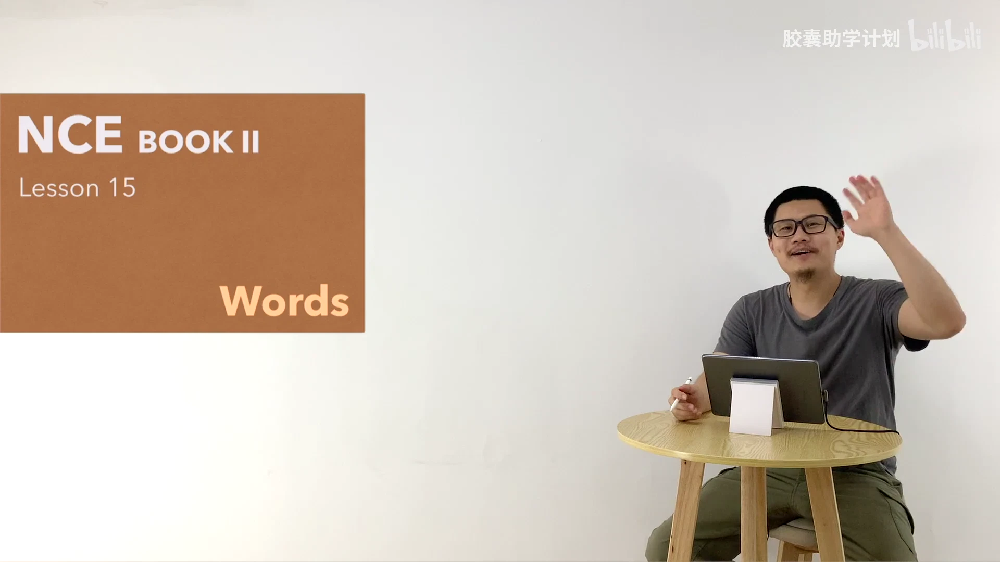

文字识别：Bilbl / 胶囊助学计划 / NCE / BOOKII / Lesson 15 / Words

### 画面 00:00:02

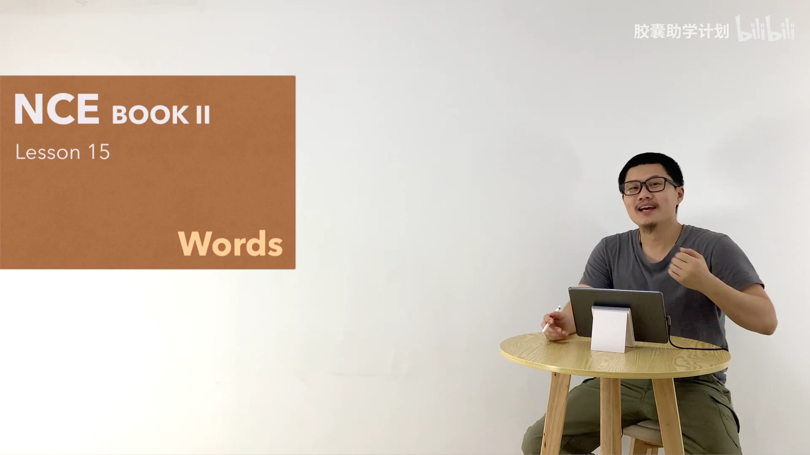

文字识别：bilbii / 胶囊助学计划 / NCE / BOOKII / Lesson 15 / Words

### 画面 00:00:05

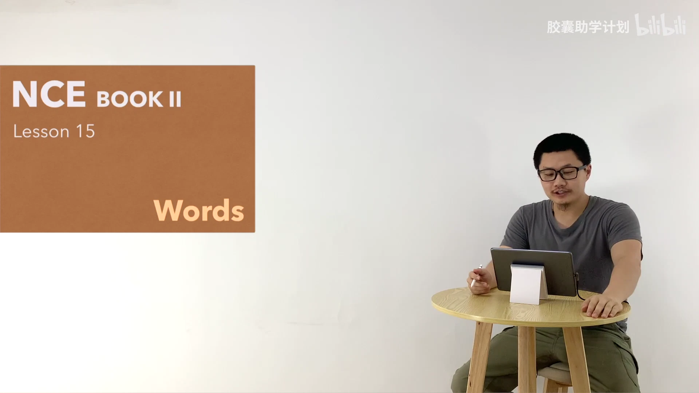

文字识别：Bilbili / 胶囊助学计划 / NCE / BOOKII / Lesson 15 / Words

### 画面 00:00:07

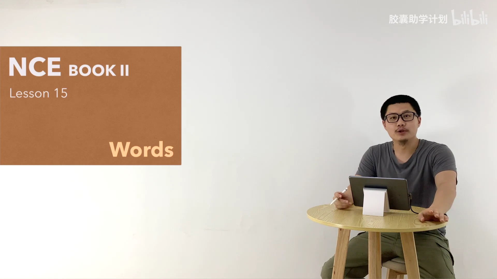

文字识别：Bilbili / 胶囊助学计划 / NCE / BOOKII / Lesson 15 / Words

### 画面 00:00:10

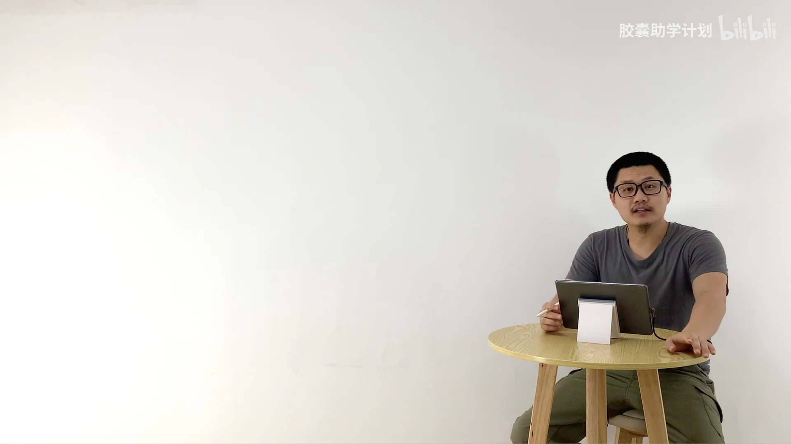

文字识别：Jbiibli / 胶囊助学计划

### 画面 00:00:12

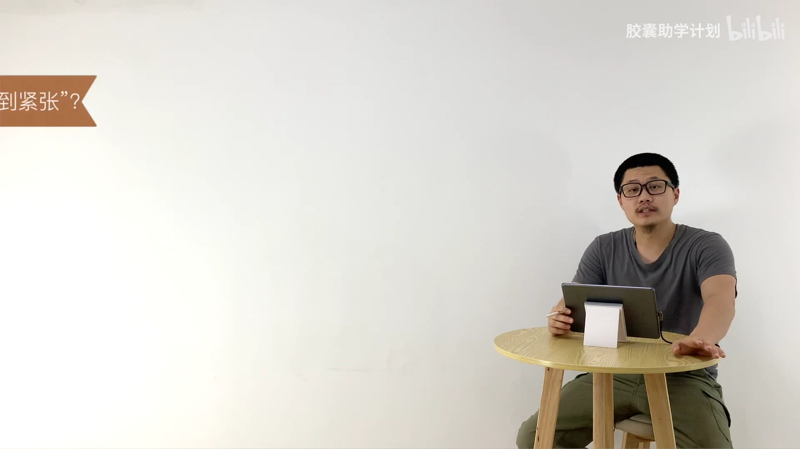

文字识别：胶囊助学计划bib出 / 到紧张”？

### 画面 00:00:14

文字识别：blibili / 胶囊助学计划 / ① 如何表达“做某事感到紧张”？

### 画面 00:00:16

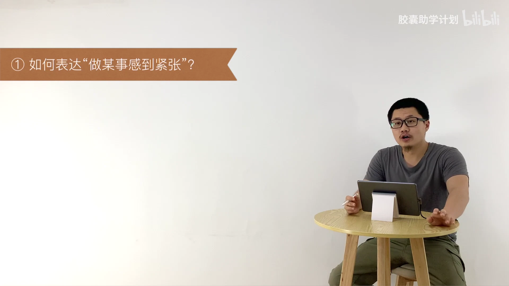

文字识别：胶囊助学计划 / ① 如何表达“做某事感到紧张”？

### 画面 00:00:18

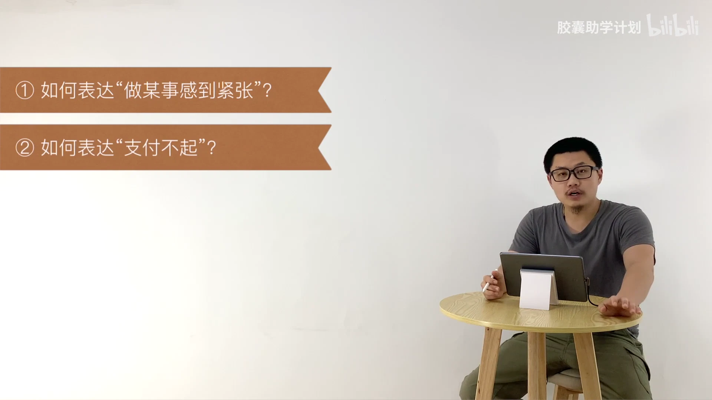

文字识别：Bilbili / 胶囊助学计划 / ① 如何表达“做某事感到紧张”？ / 如何表达“支付不起”

### 画面 00:00:20

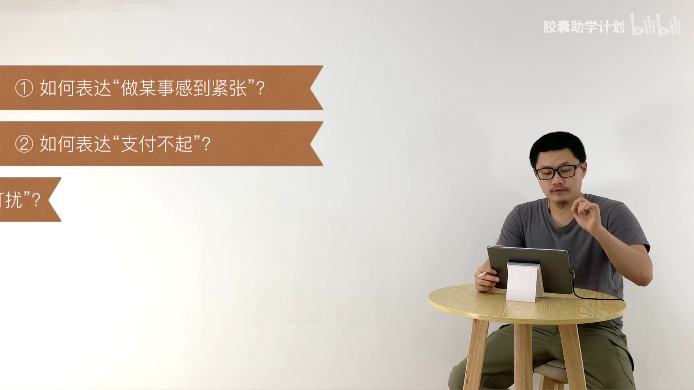

文字识别：biibili / 胶囊助学计划 / ①如何表达“做某事感到紧张”？ / 如何表达“支付不起” / 扰”?

### 画面 00:00:22

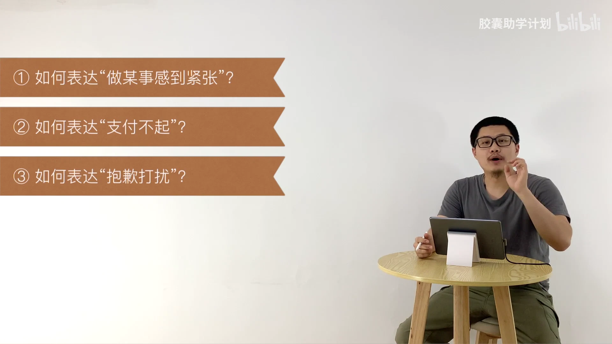

文字识别：biltbili / 胶囊助学计划 / ①如何表达“做某事感到紧张”？ / 如何表达“支付不起” / 如何表达“抱歉打扰”?

### 画面 00:00:25

文字识别：bilibili / 胶囊助学计划 / ①如何表达“做某事感到紧张”？ / 如何表达“支付不起’ / 如何表达“抱歉打扰”？

### 画面 00:00:28

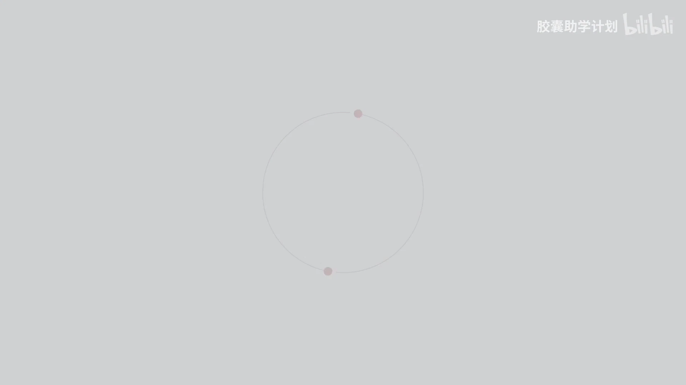

文字识别：胶囊助学计划b出出 / • / •

## 00:00:30–00:01:00

那我们先看第一个小的单词啊，我们还是来直接看音标，来叫做 secretary secretary secretary。好，它的意思叫做秘书，OK boss 老板秘书 secretary，它是一个名词。您看啊，其实如果之前的那几个课你听的非常认真的话， secretary 这个单词怎么造句？

### 画面 00:00:31

文字识别：胶囊助学计划 / 胶囊助学计划

### 画面 00:00:33

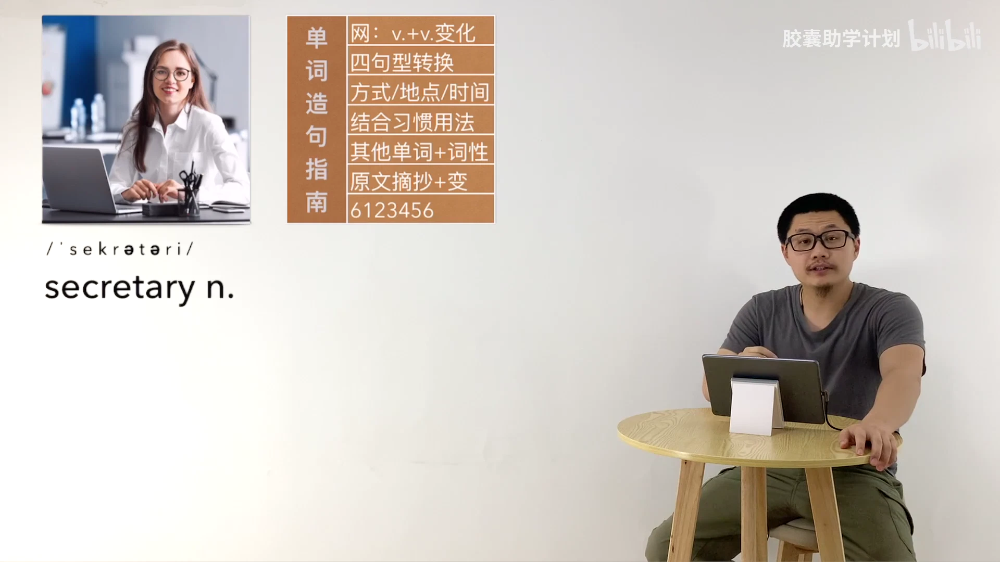

文字识别：单词造句指南 / 网：v.+v.变化 / 胶囊助学计划 / bilbili / 四句型转换 / 方式/地点/时间 / 结合习惯用法 / 其他单词+词性 / 原文摘抄+变 / 6123456 / /'sekratari/ / secretary n.

### 画面 00:00:35

文字识别：单词造句指南 / 网：v.+v.变化 / 胶囊助学计划 / bibili / 四句型转换 / 方式/地点/时间 / 结合习惯用法 / 其他单词+词性 / 原文摘抄+变 / 6123456 / /'sekratari/ / secretary n.

### 画面 00:00:37

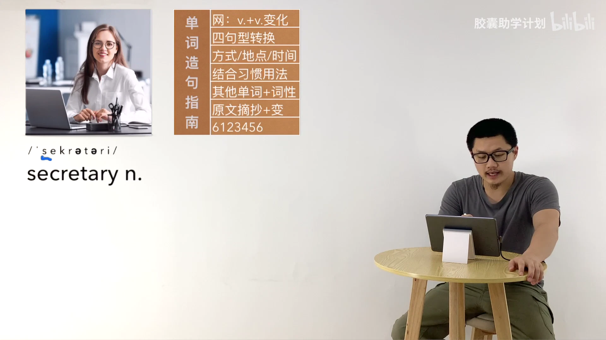

文字识别：单词造句指南 / 网：v.+v.变化 / 胶囊助学计划 / bibili / 四句型转换 / 方式/地点/时间 / 结合习惯用法 / 其他单词+词性 / 原文摘抄+变 / 6123456 / /'sekratari/ / secretary n.

### 画面 00:00:40

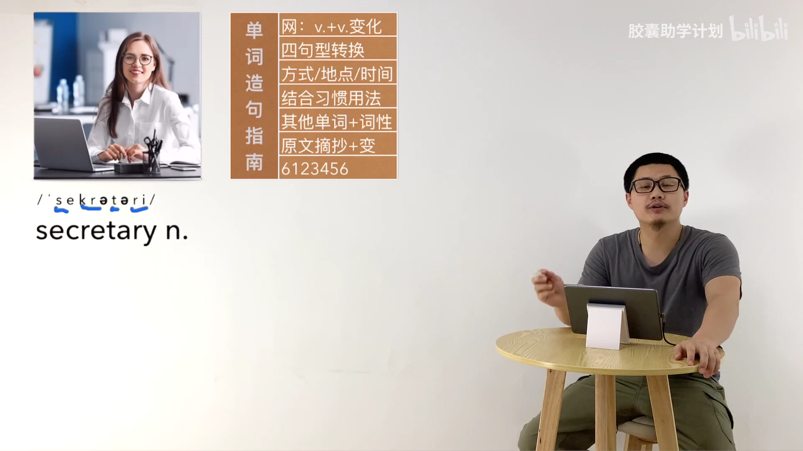

文字识别：单词造句指南 / 网：v.+v.变化 / 胶囊助学计划 / Bilbli / 四句型转换 / 方式/地点/时间 / 结合习惯用法 / 其他单词+词性 / 原文摘抄+变 / 6123456 / /'sekratari/ / secretary n.

### 画面 00:00:45

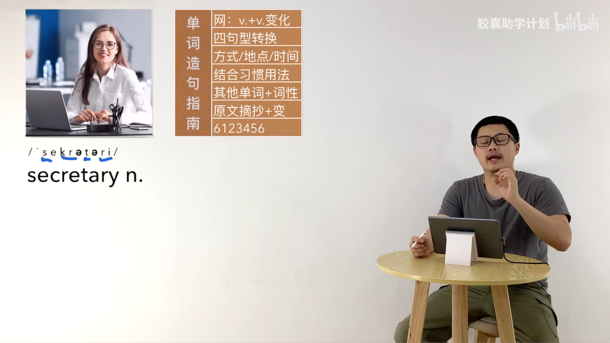

文字识别：单词造句指南 / 网：v.+v.变化 / 胶囊助学计划 / Bilbili / 四句型转换 / 方式/地点/时间 / 结合习惯用法 / 其他单词+词性 / 原文摘抄+变 / 6123456 / /'sekratari/ / secretary n.

### 画面 00:00:50

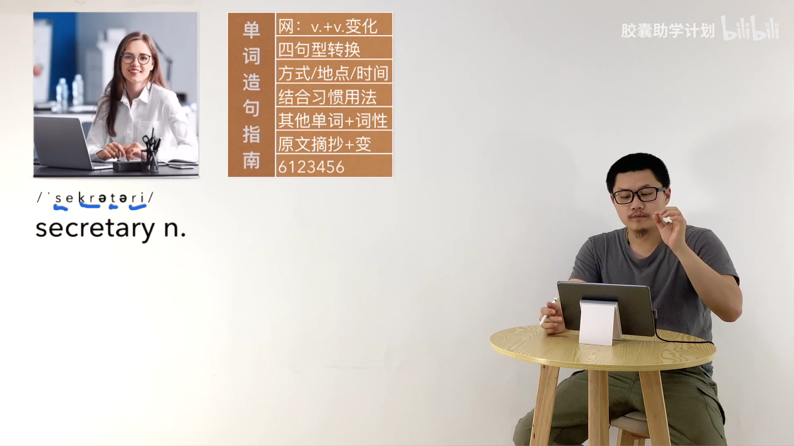

文字识别：单词造句指南 / 网：v.+v.变化 / 胶囊助学计划 / bilbili / 四句型转换 / 方式/地点/时间 / 结合习惯用法 / 其他单词+词性 / 原文摘抄+变 / 6123456 / /'sekratari/ / secretary n.

### 画面 00:00:54

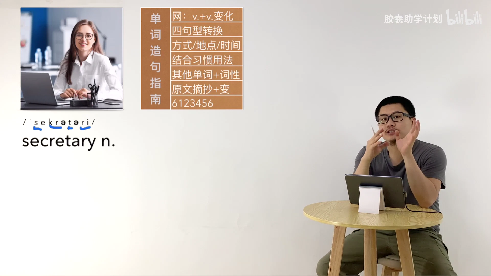

文字识别：单词造句指南 / 网：v.+v.变化 / 胶囊助学计划 / Bilibili / 四句型转换 / 方式/地点/时间 / 结合习惯用法 / 其他单词+词性 / 原文摘抄+变 / 6123456 / /'sekratari/ / secretary n.

### 画面 00:00:57

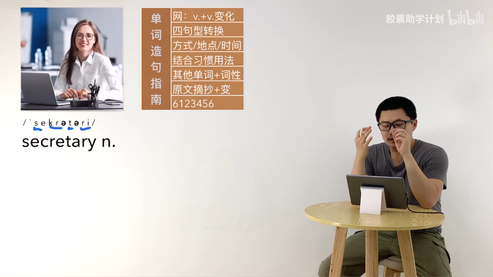

文字识别：单词造句指南 / 网：v.+v.变化 / 胶囊助学计划 / Bilbili / 四句型转换 / 方式/地点/时间 / 结合习惯用法 / 其他单词+词性 / 原文摘抄+变 / 6123456 / /'sekratari/ / secretary n.

## 00:01:00–00:01:30

其实我说几个其他的单词，你回想一下你就知道了。比如说，我印象当中第三课咱们学的一个单词叫做waiter，对吧？第七课咱们学过的一个单词叫做detective，啊，这几个单词包括像第呃九课或第八课啊出现过啊，第八课出现过这个单词叫做lawyer，是吧？啊，呃，这样类似吧？这我现在也记不太清了，

### 画面 00:01:00

文字识别：单词造句指南 / 网：v.+v.变化 / 胶囊助学计划 / Bibli / 四句型转换 / 方式/地点/时间 / 结合习惯用法 / 其他单词+词性 / 原文摘抄+变 / 6123456 / /'sekratari/ / secretary n.

### 画面 00:01:06

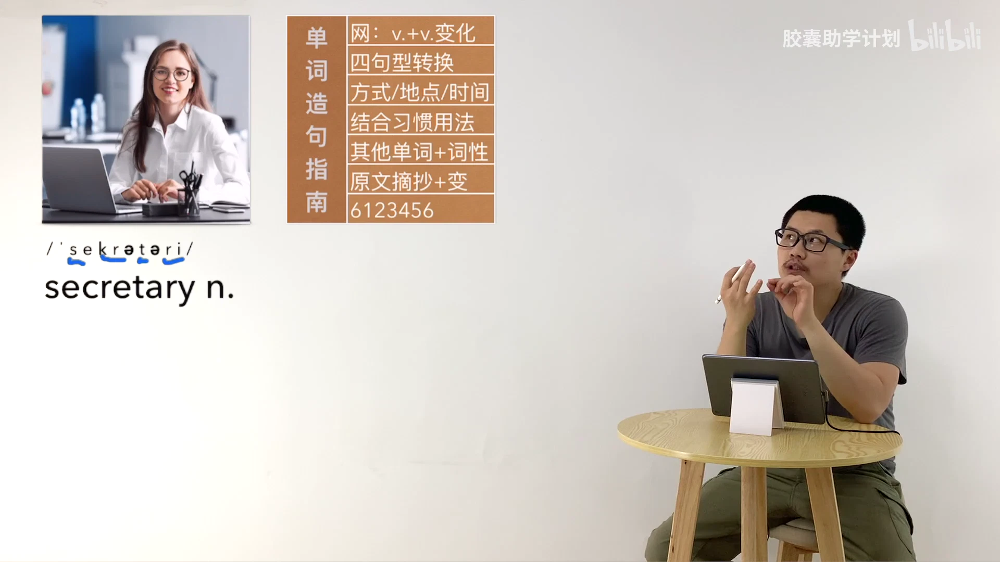

文字识别：单词造句指南 / 网：v.+v.变化 / 胶囊助学计划 / Blbli / 四句型转换 / 方式/地点/时间 / 结合习惯用法 / 其他单词+词性 / 原文摘抄+变 / 6123456 / /'sekratari/ / secretary n.

### 画面 00:01:10

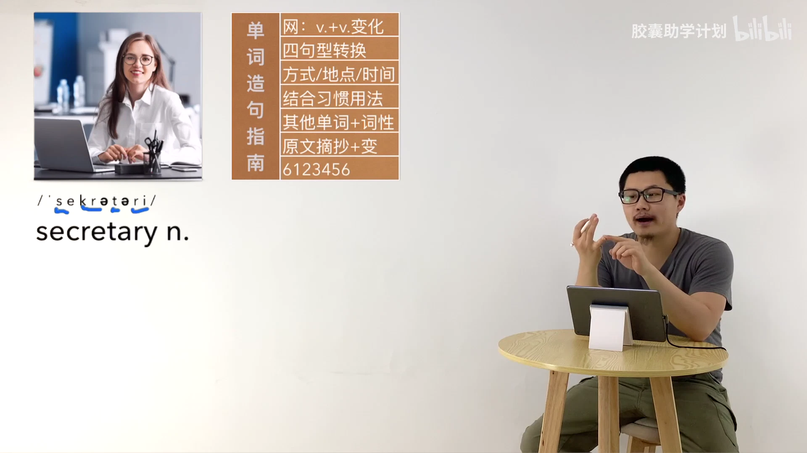

文字识别：单词造句指南 / 网：v.+v.变化 / 胶囊助学计划 / Bitbii / 四句型转换 / 方式/地点/时间 / 结合习惯用法 / 其他单词+词性 / 原文摘抄+变 / 6123456 / /'sekratari/ / secretary n.

### 画面 00:01:15

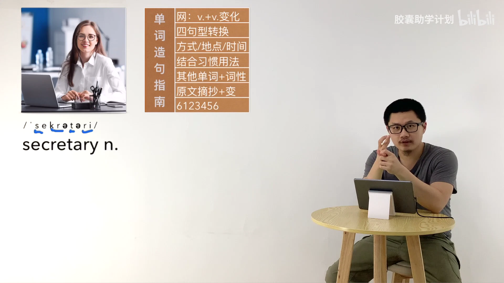

文字识别：单词造句指南 / 网：v.+v.变化 / 胶囊助学计划 / Bilibili / 四句型转换 / 方式/地点/时间 / 结合习惯用法 / 其他单词+词性 / 原文摘抄+变 / 6123456 / /'sekratari/ / secretary n.

### 画面 00:01:20

文字识别：单词造句指南 / 网：v.+v.变化 / 胶囊助学计划 / bilbli / 四句型转换 / 方式/地点/时间 / 结合习惯用法 / 其他单词+词性 / 原文摘抄+变 / 6123456 / /'sekratari/ / secretary n.

### 画面 00:01:25

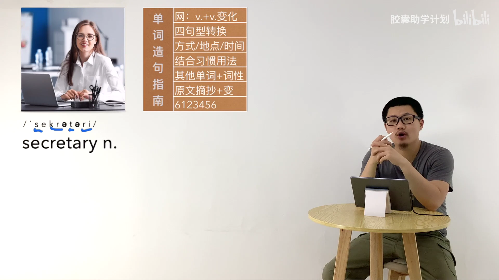

文字识别：单词造句指南 / 网：v.+v.变化 / 胶囊助学计划 / Bilibili / 四句型转换 / 方式/地点/时间 / 结合习惯用法 / 其他单词+词性 / 原文摘抄+变 / 6123456 / /'sekratari/ / secretary n.

### 画面 00:01:29

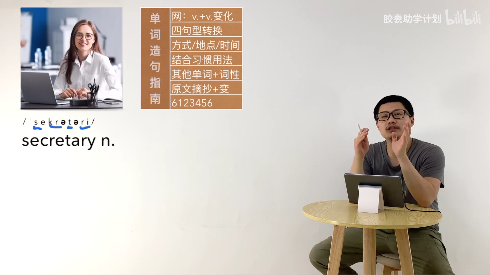

文字识别：单词造句指南 / 网：v.+v.变化 / 胶囊助学计划 / Bibii / 四句型转换 / 方式/地点/时间 / 结合习惯用法 / 其他单词+词性 / 原文摘抄+变 / 6123456 / /'sekratari/ / secretary n.

## 00:01:30–00:02:00

类似于这这些单词，其实它们本质上都是一类单词，就是各种职业、各种身份，对不对？好，名词你要做的事情就是找各种动词。那其实那些句子，你把 waiter、 detective 啊、 lawyer 换成 secretary，完全就变成您自己的新的句子了，对不对？所以思路完全一样啊。但是呢，我们在这一课，所以就不用那些了。这一课我们用一下我们十四课刚刚学过的三个小的连词：as soon as 一怎么怎么

### 画面 00:01:31

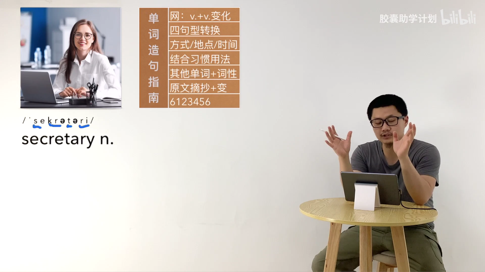

文字识别：单词造句指南 / 网：v.+v.变化 / 胶囊助学计划 / bilbii / 四句型转换 / 方式/地点/时间 / 结合习惯用法 / 其他单词+词性 / 原文摘抄+变 / 6123456 / /'sekratari/ / secretary n.

### 画面 00:01:35

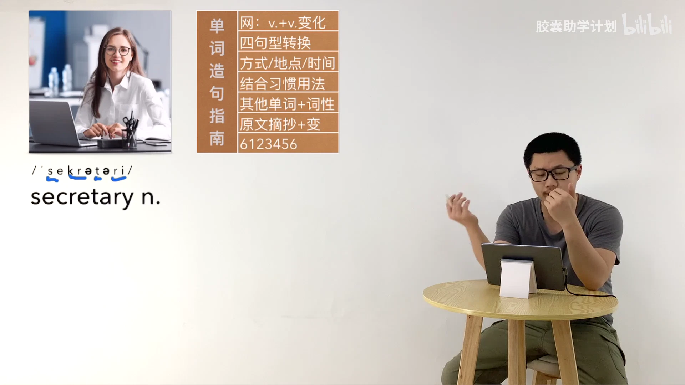

文字识别：单词造句指南 / 网：v.+v.变化 / 胶囊助学计划 / 四句型转换 / 方式/地点/时间 / 结合习惯用法 / 其他单词+词性 / 原文摘抄+变 / 6123456 / /'sekratari/ / secretary n.

### 画面 00:01:37

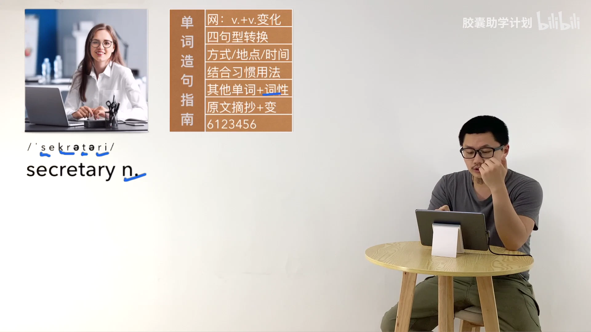

文字识别：单词造句指南 / 网：v.+v.变化 / 胶囊助学计划 / Bilbili / 四句型转换 / 方式/地点/时间 / 结合习惯用法 / 其他单词+词性 / 原文摘抄+变 / 6123456 / /'sekratari/ / secretary ! / n.

### 画面 00:01:39

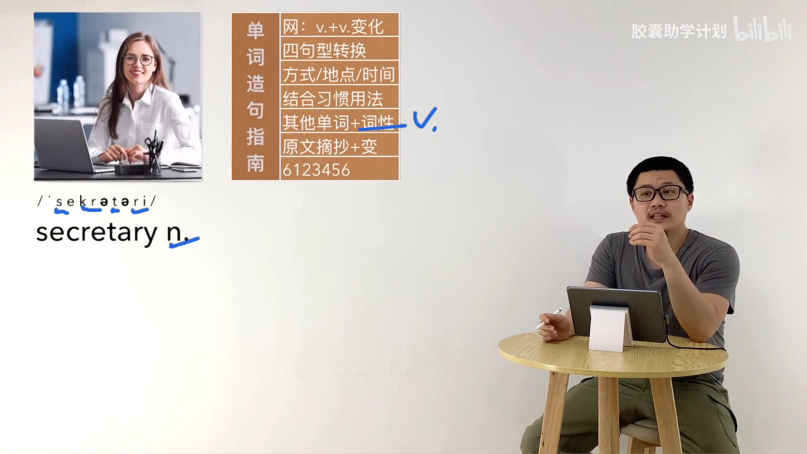

文字识别：单词造句指南 / 网：v.+v.变化 / 胶囊助学计划 / bilbili / 四句型转换 / 方式/地点/时间 / 结合习惯用法 / √. / 其他单词+词性 / 原文摘抄+变 / 6123456 / /'sekratari/ / secretary  / n.

### 画面 00:01:41

文字识别：单词造句指南 / 网：v.+v.变化 / 胶囊助学计划 / Bilbili / 四句型转换 / 方式/地点/时间 / 结合习惯用法 / V. / 其他单词+词性 / 原文摘抄+变 / 6123456 / /'sekratari/ / secretary  / n.

### 画面 00:01:45

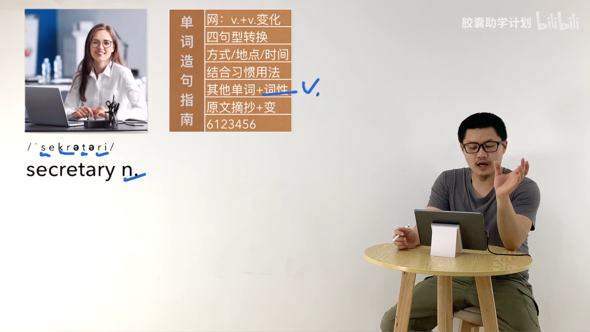

文字识别：单词造句指南 / 网：v.+v.变化 / 胶囊助学计划 / Bilbli / 四句型转换 / 方式/地点/时间 / 结合习惯用法 / V. / 其他单词+词性 / 原文摘抄+变 / 6123456 / /'sekratari/ / secretary / n.

### 画面 00:01:48

文字识别：单词造句指南 / 网：v.+v.变化 / 胶囊助学计划 / bilbili / 四句型转换 / 方式/地点/时间 / 结合习惯用法 / V. / 其他单词+词性 / 原文摘抄+变 / 6123456 / /'sekratari/ / secretary / n.

### 画面 00:01:50

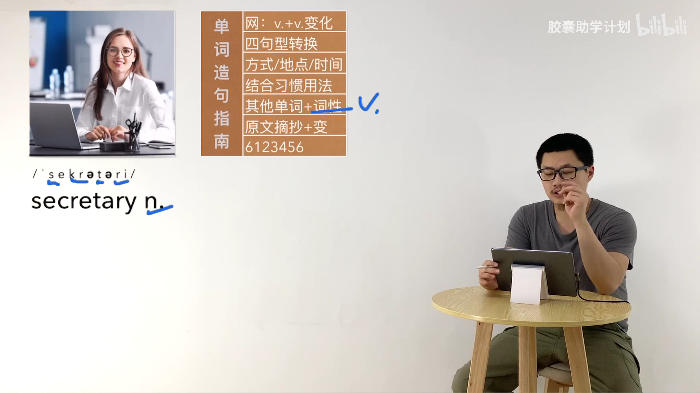

文字识别：单词造句指南 / 网：v.+v.变化 / 胶囊助学计划 / Bilbili / 四句型转换 / 方式/地点/时间 / 结合习惯用法 / √. / 其他单词+词性 / 原文摘抄+变 / 6123456 / /'sekratari/ / secretary / n.

### 画面 00:01:52

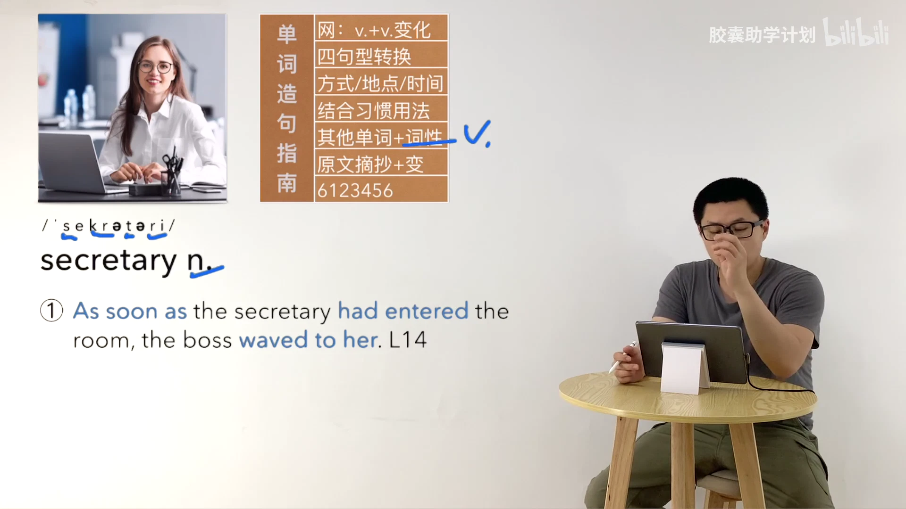

文字识别：单词造句指南 / 网：v.+v.变化 / 胶囊助学计划 / biibli / 四句型转换 / 方式/地点/时间 / 结合习惯用法 / 其他单词+词性 / 原文摘抄+变 / 6123456 / /sekratari/ / secretary / n. /  As soon as the secretary had entered the / room, the boss waved to her. L14

### 画面 00:01:55

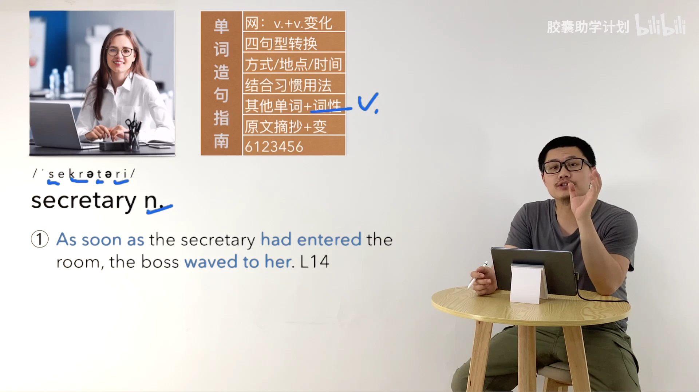

文字识别：单词造句指南 / 网：v.+v.变化 / 胶囊助学计划 / bitbli / 四句型转换 / 方式/地点/时间 / 结合习惯用法 / 其他单词+词性 / 原文摘抄+变 / 6123456 / /sekratari/ / secretary n. /  As soon as the secretary had entered the / room, the boss waved to her. L14

## 00:02:00–00:02:30

样就怎么怎么样 after造在什么什么之后以及 before在什么什么之前这三个小的连词呢，它们配合着 had 加 done 啊，各位在这儿蓝色我给大家标出来了，对吧？had 加 done 这样的呃过去完成时的这个时态，我们把它配合到一起去造一些句子。我们先看一下啊，比如说 as soon as the secretary had entered the room, the boss waved to her. 秘书一进这个房间，对吧？OK，然后这老

### 画面 00:02:00

文字识别：单词造句指南 / 网：v.+v.变化 / 胶囊助学计划 / bibli / 四句型转换 / 方式/地点/时间 / 结合习惯用法 / √. / 其他单词+词性 / 原文摘抄+变 / 6123456 / /'sekratari/ / secretary! / ) As soon as the secretary had entered the / 7 / room, the boss waved to her. L14

### 画面 00:02:05

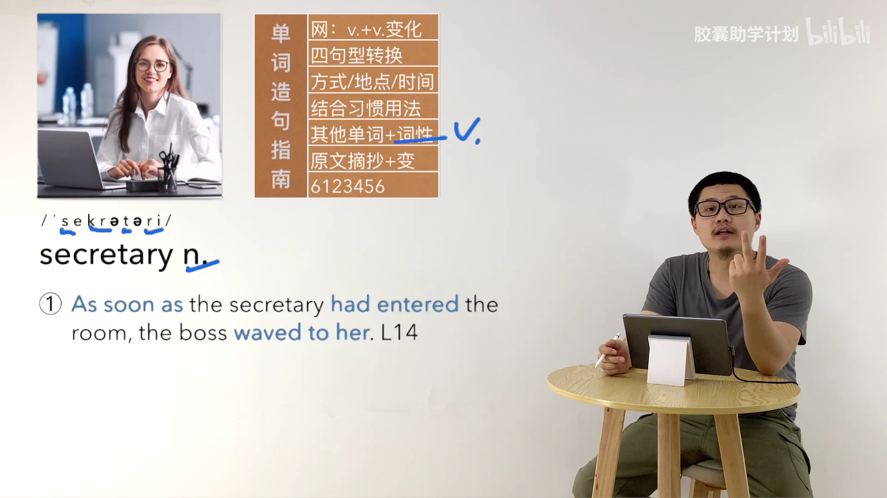

文字识别：单词造句指南 / 网：v.+v.变化 / 胶囊助学计划 / bilbili / 四句型转换 / 方式/地点/时间 / 结合习惯用法 / V. / 其他单词+词性 / 原文摘抄+变 / 6123456 / /'sekratari/ / secretary / ) As soon as the secretary had entered the / room, the boss waved to her. L14

### 画面 00:02:10

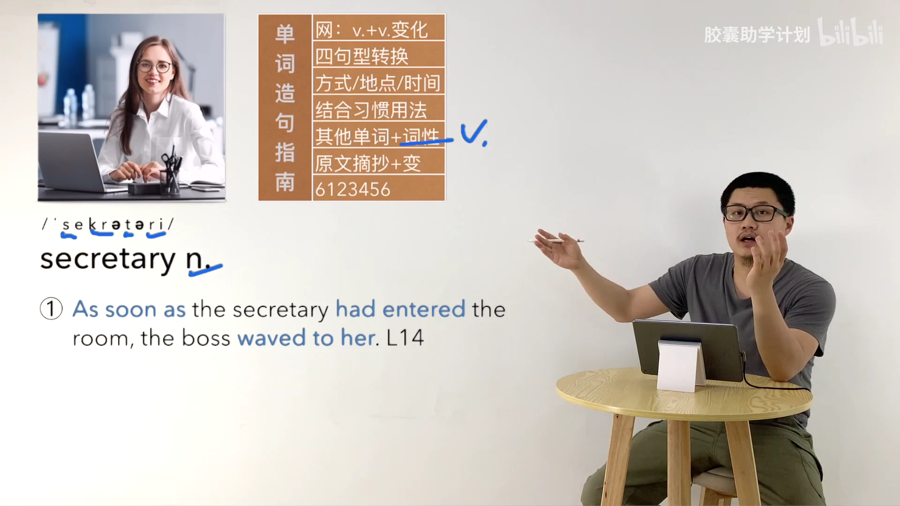

文字识别：单词造句指南 / 网：v.+v.变化 / 胶囊助学计划 / bilibili / 四句型转换 / 方式/地点/时间 / 结合习惯用法 / √ / 其他单词+词性 / 原文摘抄+变 / 6123456 / /'sekratari/ / secretary ! / n. / As soon as the secretary had entered the / room, the boss waved to her. L14

### 画面 00:02:13

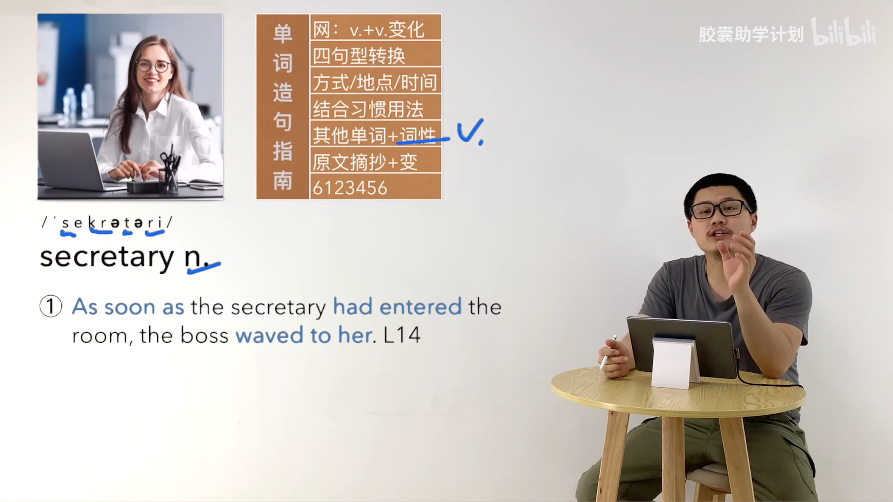

文字识别：单词造句指南 / 网：v.+v.变化 / 胶囊助学计划 / bilbili / 四句型转换 / 方式/地点/时间 / 结合习惯用法 / 其他单词+词性 / 原文摘抄+变 / 6123456 / /'sekratari/ / secretary n. / ) As soon as the secretary had entered the / 1 / room, the boss waved to her. L14

### 画面 00:02:15

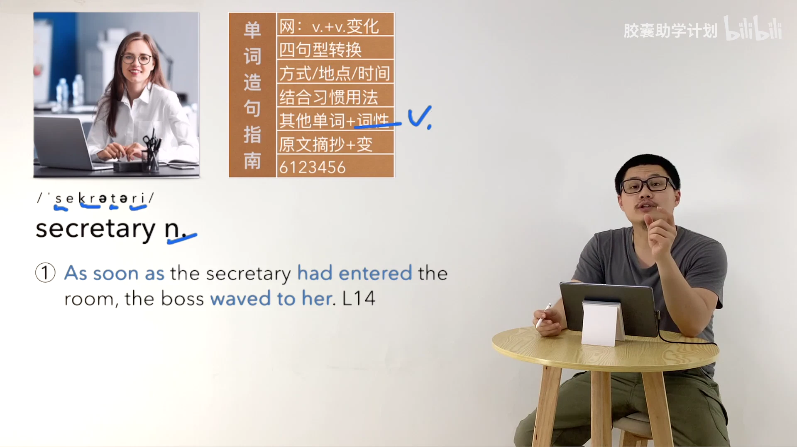

文字识别：单词造句指南 / 网：v.+v.变化 / 胶囊助学计划 / biibli / 四句型转换 / 方式/地点/时间 / 结合习惯用法 / V. / 其他单词+词性 / 原文摘抄+变 / 6123456 / /'sekratari/ / secretary / n. / ) As soon as the secretary had entered the / room, the boss waved to her. L14

### 画面 00:02:18

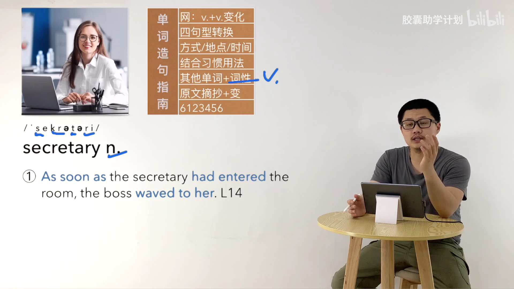

文字识别：单词造句指南 / 网：v.+v.变化 / 胶囊助学计划 / bilbli / 四句型转换 / 方式/地点/时间 / 结合习惯用法 / V. / 其他单词+词性 / 原文摘抄+变 / 6123456 / /'sekratari/ / secretary / n. / As soon as the secretary had entered the / room, the boss waved to her. L14

### 画面 00:02:20

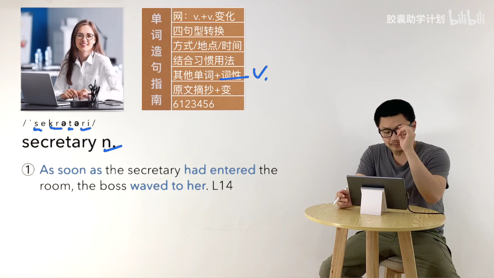

文字识别：单词造句指南 / 网：v.+v.变化 / 胶囊助学计划 / biltbli / 四句型转换 / 方式/地点/时间 / 结合习惯用法 / √. / 其他单词+词性 / 原文摘抄+变 / 6123456 / /'sekratari/ / secretary ! /  As soon as the secretary had entered the / room, the boss waved to her. L14

### 画面 00:02:25

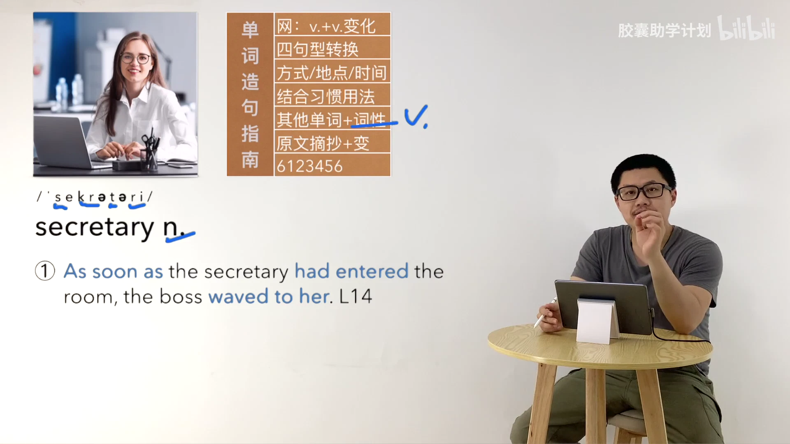

文字识别：单词造句指南 / 网：v.+v.变化 / 胶囊助学计划 / bibi / 四句型转换 / 方式/地点/时间 / 结合习惯用法 / 其他单词+词性 / 原文摘抄+变 / 6123456 / /'sekratari/ / secretary / n. / ) As soon as the secretary had entered the / 1 / room, the boss waved to her. L14

## 00:02:30–00:03:00

板就冲他招手了。哎，在这儿呢，在这儿呢。Okay, there we go.下一个说After the secretary had got off the car, she drove on to the next meeting.什么意思呢？说在这个秘书got out of the car。哎，注意在什么之后？在她下了车之后，先发生了这个动作，然后另一个人she对吧？Drove on to the next meeting，继续开往了下一个会议。There we go.再然后，

### 画面 00:02:30

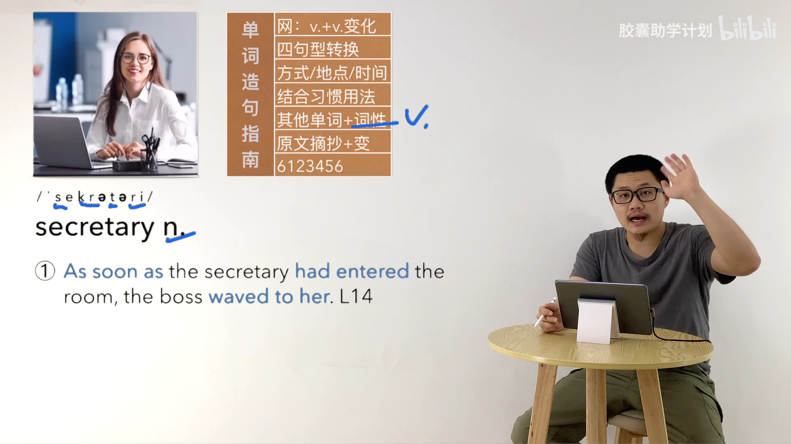

文字识别：单词造句指南 / 网：v.+v.变化 / 胶囊助学计划 / Bilibili / 四句型转换 / 方式/地点/时间 / 结合习惯用法 / √. / 其他单词+词性 / 原文摘抄+变 / 6123456 / /'sekratari/ / secretary  / n. /  As soon as the secretary had entered the / room, the boss waved to her. L14

### 画面 00:02:35

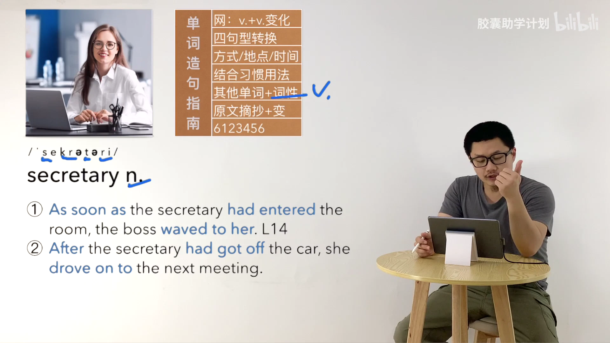

文字识别：胶囊助学计划biil / 单词造句指南 / 网：v.+v.变化 / 四句型转换 / 方式/地点/时间 / 结合习惯用法 / 其他单词+词性V. / 原文摘抄+变 / 6123456 / /sekratari/ / secretary n. /  As soon as the secretary had entered the / room, the boss waved to her. L14 / After the secretary had got off the car, she / drove on to the next meeting.

### 画面 00:02:40

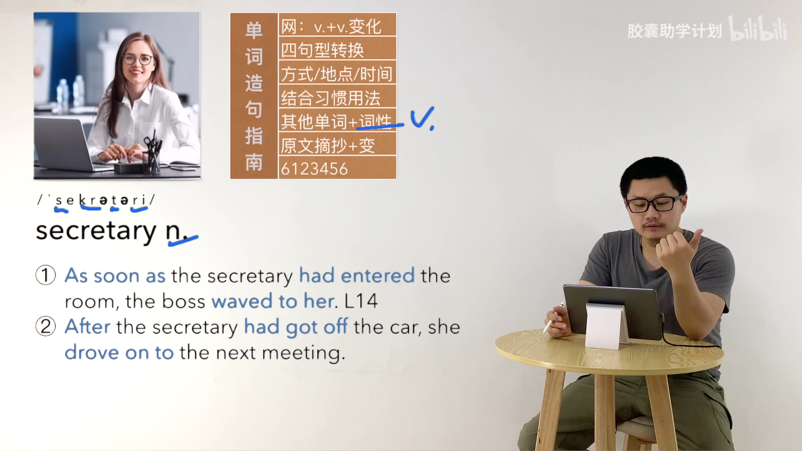

文字识别：胶囊助学计划bibl / 单词造句指南 / 网：v.+v.变化 / 四句型转换 / 方式/地点/时间 / 结合习惯用法 / 其他单词+词性√ / 原文摘抄+变 / 6123456 / / 'sekratari/ / secretary n. /  As soon as the secretary had entered the / room, the boss waved to her. L14 / After the secretary had got off the car, she / drove on to the next meeting.

### 画面 00:02:45

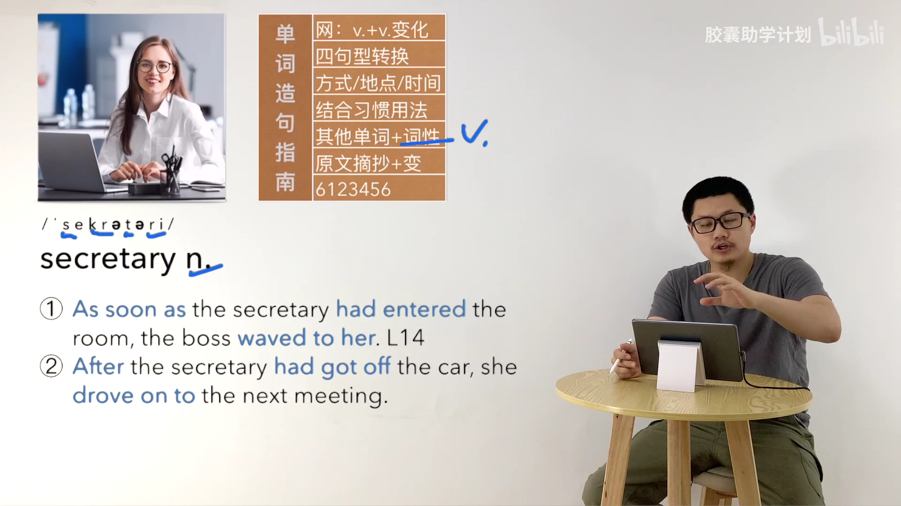

文字识别：单词造句指南 / 网：v.+v.变化 / 胶囊助学计划 / Bibil / 四句型转换 / 方式/地点/时间 / 结合习惯用法 / 其他单词+词性√ / 原文摘抄+变 / 6123456 / /sekratari/ / secretary n. /  As soon as the secretary had entered the / 1 / room, the boss waved to her. L14 / After the secretary had got off the car, she / drove on to the next meeting.

### 画面 00:02:50

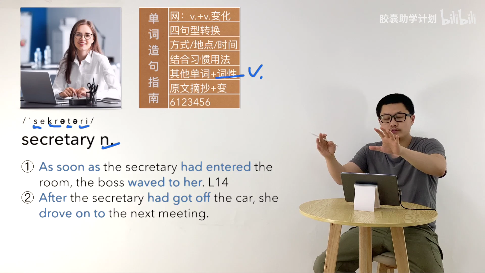

文字识别：单词造句指南 / 网：v.+v.变化 / 胶囊助学计划 / Bilbili / 四句型转换 / 方式/地点/时间 / 结合习惯用法 / 其他单词+词性V. / 原文摘抄+变 / 6123456 / /sekratari/ / secretary Ω. /  As soon as the secretary had entered the / 1 / room, the boss waved to her. L14 / After the secretary had got off the car, she / drove on to the next meeting.

### 画面 00:02:55

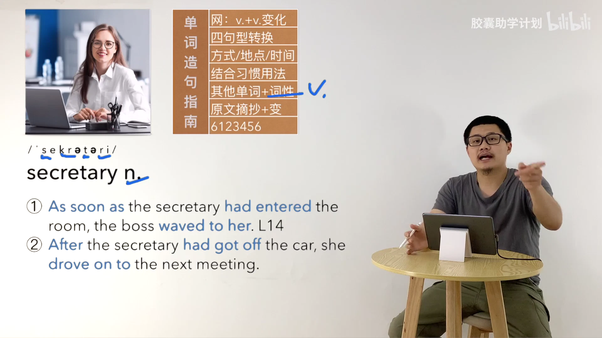

文字识别：单词造句指南 / 网：v.+v.变化 / 胶囊助学计划 / Bilbil / 四句型转换 / 方式/地点/时间 / 结合习惯用法 / 其他单词+词性V. / 原文摘抄+变 / 6123456 / /sekratari/ / secretary D. /  As soon as the secretary had entered the / room, the boss waved to her. L14 / After the secretary had got off the car, she / drove on to the next meeting.

### 画面 00:02:57

文字识别：单词造句指南 / 网：v.+v.变化 / 胶囊助学计划 / Bilbili / 四句型转换 / 方式/地点/时间 / 结合习惯用法 / 其他单词+词性√ / 原文摘抄+变 / 6123456 / /sekratari/ / secretary n. / ) As soon as the secretary had entered the / 1 / room, the boss waved to her. L14 / After the secretary had got off the car, she / drove on to the next meeting.

### 画面 00:02:59

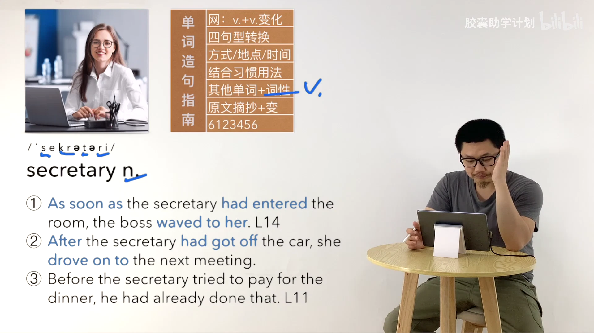

文字识别：单词造句指南 / 网：v.+v.变化 / 胶囊助学计划 / 四句型转换 / 方式/地点/时间 / 结合习惯用法 / 其他单词+词性√. / 原文摘抄+变 / 6123456 / /sekratari/ / secretary Ω. / ① As soon as the secretary had entered the / room, the boss waved to her. L14 / After the secretary had got off the car, she / drove on to the next meeting. / Before the secretary tried to pay for the / dinner, he had already done that. L11

## 00:03:00–00:03:30

before the secretary tried to pay for the dinner，在什么之前啊？两个动作，在秘书想支付这顿晚饭之前，he had already done that，他已经把这件事情给做了啊。看一下时态，一般过去时，这是过去完成时啊。当然，这个 pay for the dinner 是我们十一课学过的一个小的习惯用法。OK， one more. 那我们带着大家正好复习了一下。Continue，下一个单词来读一下，叫做

### 画面 00:03:01

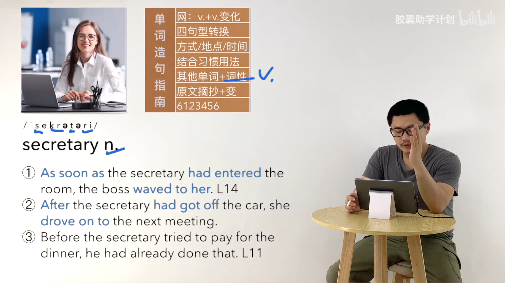

文字识别：单词造句指南 / 网：v.+v.变化 / 胶囊助学计划 / 四句型转换 / 方式/地点/时间 / 结合习惯用法 / 其他单词+词性√ / 原文摘抄+变 / 6123456 / /sekratari/ / secretary Ω. / ① As soon as the secretary had entered the / room, the boss waved to her. L14 / After the secretary had got off the car, she / drove on to the next meeting. / Before the secretary tried to pay for the / dinner, he had already done that. L11

### 画面 00:03:03

文字识别：单词造句指南 / 网：v.+v.变化 / 胶囊助学计划blb山 / 四句型转换 / 方式/地点/时间 / 结合习惯用法 / 其他单词+词性√. / 原文摘抄+变 / 6123456 / /sekratari/ / secretary Ω. / ① As soon as the secretary had entered the / room, the boss waved to her. L14 / After the secretary had got off the car, she / drove on to the next meeting. / Before the secretary tried to pay for the / dinner, he had already done that. L11

### 画面 00:03:05

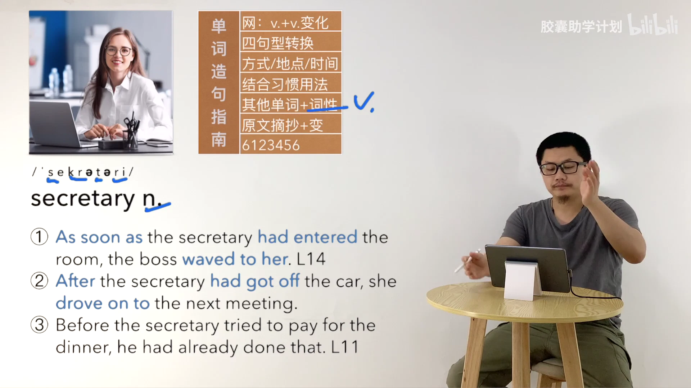

文字识别：胶囊助学计划bil出 / 单词造句指南 / 网：v.+v.变化 / 四句型转换 / 方式/地点/时间 / 结合习惯用法 / 其他单词+词性√. / 原文摘抄+变 / 6123456 / /sekratari/ / secretary Ω. / ① As soon as the secretary had entered the / room, the boss waved to her. L14 / After the secretary had got off the car, she / drove on to the next meeting. / Before the secretary tried to pay for the / dinner, he had already done that. L11

### 画面 00:03:08

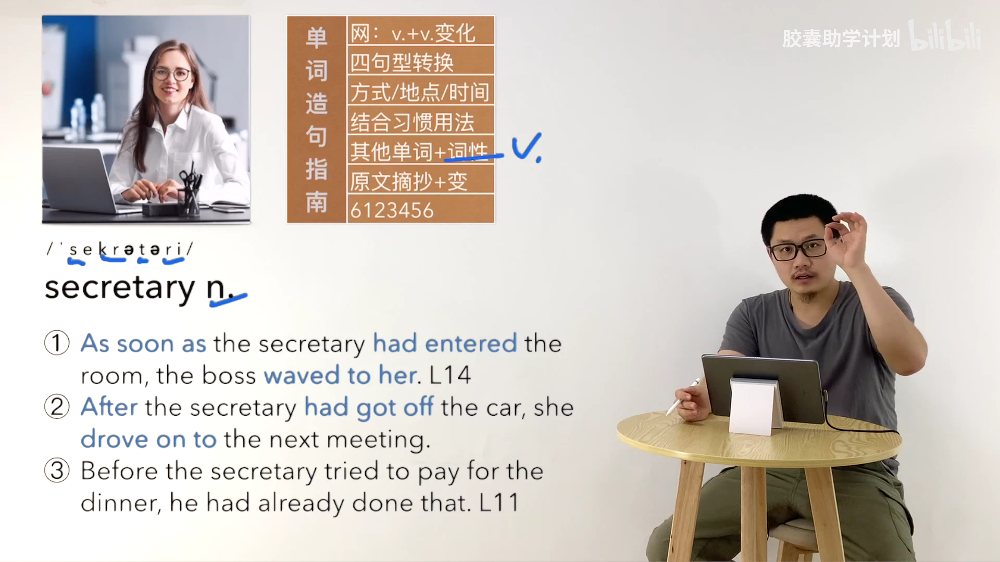

文字识别：单词造句指南 / 网：v.+v.变化 / 胶囊助学计划 / 四句型转换 / 方式/地点/时间 / 结合习惯用法 / 其他单词+词性√. / 原文摘抄+变 / 6123456 / /sekratari/ / secretary n. / ① As soon as the secretary had entered the / room, the boss waved to her. L14 / After the secretary had got off the car, she / drove on to the next meeting. / Before the secretary tried to pay for the / dinner, he had already done that. L11

### 画面 00:03:10

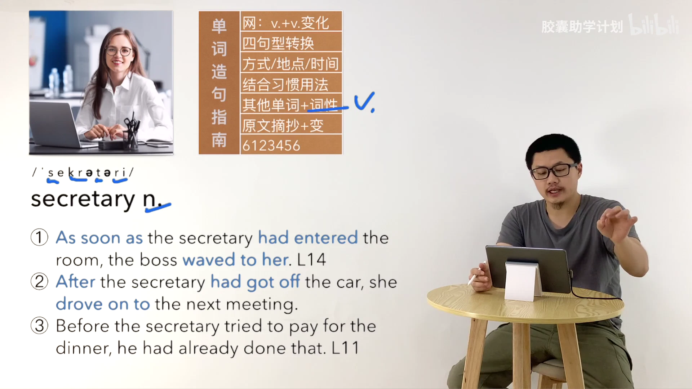

文字识别：单词造句指南 / 网：v.+v.变化 / 胶囊助学计划 / 四句型转换 / 方式/地点/时间 / 结合习惯用法 / 其他单词+词性√ / 原文摘抄+变 / 6123456 / /sekratari/ / secretary D. / ① As soon as the secretary had entered the / room, the boss waved to her. L14 / After the secretary had got off the car, she / drove on to the next meeting. / Before the secretary tried to pay for the / dinner, he had already done that. L11

### 画面 00:03:12

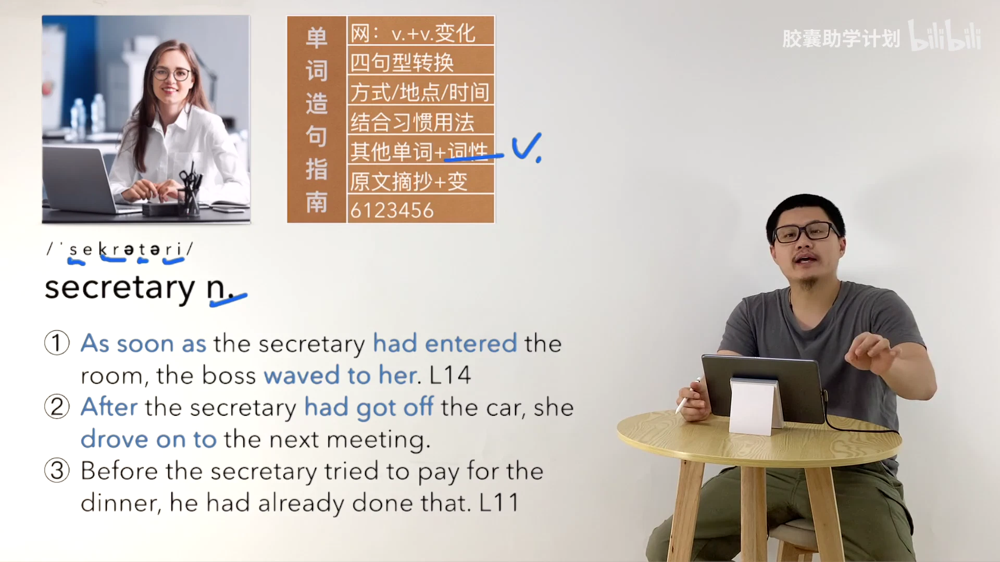

文字识别：单词造句指南 / 网：v.+v.变化 / 胶囊助学计划bib出 / 四句型转换 / 方式/地点/时间 / 结合习惯用法 / 其他单词+词性√. / 原文摘抄+变 / 6123456 / /sekratari/ / secretary Ω. / ① As soon as the secretary had entered the / room, the boss waved to her. L14 / After the secretary had got off the car, she / drove on to the next meeting. / Before the secretary tried to pay for the / dinner, he had already done that. L11

### 画面 00:03:15

文字识别：单词造句指南 / 网：v.+v.变化 / 胶囊助学计划blb出 / 四句型转换 / 方式/地点/时间 / 结合习惯用法 / 其他单词+词性√. / 原文摘抄+变 / 6123456 / /sekratari/ / secretary D. / ① As soon as the secretary had entered the / room, the boss waved to her. L14 / After the secretary had got off the car, she / drove on to the next meeting. / Before the secretary tried to pay for the / dinner, he had already done that. L11

### 画面 00:03:17

文字识别：单词造句指南 / 网：v.+v.变化 / 胶囊助学计划blb出 / 四句型转换 / 方式/地点/时间 / 结合习惯用法 / 其他单词+词性√ / 原文摘抄+变 / 6123456 / / 'sekratari/ / secretary n. /  As soon as the secretary had entered the / 1 / room, the boss waved to her. L14 / After the secretary had got off the car, she / drove on to the next meeting. / Before the secretarytried lo pay for the / dinner, he had already done that. L11

### 画面 00:03:20

文字识别：单词造句指南 / 网：v.+v.变化 / 胶囊助学计划 / bib / 四句型转换 / 方式/地点/时间 / 结合习惯用法 / 其他单词+词性V / 原文摘抄+变 / 6123456 / /'sekratari/ / secretary D. /  As soon as the secretary had entered the / 1 / room, the boss waved to her. L14 / After the secretary had got off the car, she / drove on to the next meeting. / Before the secretarytried lo pay for the / dinner, he had already done that. L11

### 画面 00:03:23

文字识别：单词造句指南 / 网：v.+v.变化 / 胶囊助学计划 / Bilbili / 四句型转换 / 方式/地点/时间 / 结合习惯用法 / 其他单词+词性√ / 原文摘抄+变 / 6123456 / /'sekratari/ / secretary n. / ① As soon as the secretary had entered the / room, the boss waved to her. L14 / After the secretary had got off the car, she / drove on to the next meeting. / Before the secretarytried lo pay for the / dinner, he had already done that. L11

### 画面 00:03:25

文字识别：单词造句指南 / 网：v.+v.变化 / 胶囊助学计划 / bilbli / 四句型转换 / 方式/地点/时间 / 结合习惯用法 / 其他单词+词性V. / 原文摘抄+变 / 6123456 / /sekratari/ / secretary n. /  As soon as the secretary had entered the / 1 / room, the boss waved to her. L14 / After the secretary had got off the car, she / drove on to the next meeting. / Before the secretarytried lo pay for the / dinner, he had already done that. L11

### 画面 00:03:27

文字识别：单词造句指南 / 网：v.+v.变化 / 胶囊助学计划 / Bilbili / 四句型转换 / 方式/地点/时间 / 结合习惯用法 / 其他单词+词性 / 原文摘抄+变 / 6123456 / /'n3:vas/ / nervous adj.

## 00:03:30–00:04:00

nervous, nervous. Okay,那nervous是什么意思呢？表示的就是焦虑啊啊，不是焦虑啊，更偏向于的是紧张、害怕啊。Okay，还到不了焦虑那么夸张啊，紧张有一点点害怕，有一点点担忧啊。Nervous. Okay,那有它常见的一些小的短语，比如说第一个叫做 be nervous about something啊，对于某件事情感到一些紧张啊、担忧、害怕。当然你也可以说

### 画面 00:03:30

文字识别：单词造句指南 / 网：v.+v.变化 / 胶囊助学计划 / Bilibili / 四句型转换 / 方式/地点/时间 / 结合习惯用法 / 其他单词+词性 / 原文摘抄+变 / 6123456 / /'n3ivas/ / nervous adj.

### 画面 00:03:36

文字识别：单词造句指南 / 网：v.+v.变化 / 胶囊助学计划 / Bilibili / 四句型转换 / 方式/地点/时间 / 结合习惯用法 / 其他单词+词性 / 原文摘抄+变 / 6123456 / /'n3ivas/ / nervous adj.

### 画面 00:03:40

文字识别：单词造句指南 / 网：v.+v.变化 / 胶囊助学计划 / Blbli / 四句型转换 / 方式/地点/时间 / 结合习惯用法 / 其他单词+词性 / 原文摘抄+变 / 6123456 / /'n3:vas/ / nervous adj.

### 画面 00:03:45

文字识别：单词造句指南 / 网：v.+v.变化 / 胶囊助学计划 / bilbli / 四句型转换 / 方式/地点/时间 / 结合习惯用法 / 其他单词+词性 / 原文摘抄+变 / 6123456 / /'n3ivas/ / nervous adj.

### 画面 00:03:48

文字识别：单词造句指南 / 网：v.+v.变化 / 胶囊助学计划 / Bitbili / 四句型转换 / 方式/地点/时间 / 结合习惯用法 / 其他单词+词性 / 原文摘抄+变 / 6123456 / /'n3:vas/ / nervous adj. / ① be nervous about sth./ doing sth.

### 画面 00:03:50

文字识别：单词造句指南 / 网：v.+v.变化 / 胶囊助学计划 / Bilibili / 四句型转换 / 方式/地点/时间 / 结合习惯用法 / 其他单词+词性 / 原文摘抄+变 / 6123456 / /'n3:vas/ / nervous adj. / ① be nervous about sth./ doing sth.

### 画面 00:03:52

文字识别：单词造句指南 / 网：v.+v.变化 / 胶囊助学计划 / Bilbili / 四句型转换 / 方式/地点/时间 / 结合习惯用法 / 其他单词+词性 / 原文摘抄+变 / 6123456 / /'n3:vas/ / nervous adj. / ①be nervous about sth./ doing sth.

### 画面 00:03:55

文字识别：单词造句指南 / 网：v.+v.变化 / 胶囊助学计划 / bilbil / 四句型转换 / 方式/地点/时间 / 结合习惯用法 / 其他单词+词性 / 原文摘抄+变 / 6123456 / /'n3:vas/ / nervous adj. / ①be nervous about sth./ doing sth.

## 00:04:00–00:04:30

叫 be nervous about doing something 啊，做某件事情感到担忧或害怕。那我们就用这个小的短语啊，两个小的短语去造句就好了。比如说第一个，说 he is nervous about the exam，说对于接下来这个考试啊，他是有一些小的担心的，对吧？有一些小的紧张的。OK，好，再然后说 she is nervous about asking for a lift。十四课我们学的叫做 asking for a

### 画面 00:04:00

文字识别：单词造句指南 / 网：v.+v.变化 / 胶囊助学计划 / Biltbli / 四句型转换 / 方式/地点/时间 / 结合习惯用法 / 其他单词+词性 / 原文摘抄+变 / 6123456 / /n3:vas/ / nervous adj. / ① / be nervous about sth./ doing sth.

### 画面 00:04:02

文字识别：单词造句指南 / 网：v.+v.变化 / 胶囊助学计划 / Bitbili / 四句型转换 / 方式/地点/时间 / 结合习惯用法 / 其他单词+词性 / 原文摘抄+变 / 6123456 / /n3:vas/ / nervous adj. / ① / be nervous about sth./ doing sth.

### 画面 00:04:05

文字识别：单词造句指南 / 网：v.+v.变化 / 胶囊助学计划 / Biltbili / 四句型转换 / 方式/地点/时间 / 结合习惯用法 / 其他单词+词性 / 原文摘抄+变 / 6123456 / /n3 :vas/ / nervous adj. / ① / be nervous about sth./ doing sth.

### 画面 00:04:11

文字识别：单词造句指南 / 网：v.+v.变化 / 胶囊助学计划 / Bilbili / 四句型转换 / 方式/地点/时间 / 结合习惯用法 / 其他单词+词性 / 原文摘抄+变 / 6123456 / /n3:vas/ / nervous adj. / 1 /  be nervous about sth./ doing sth. / He is nervous about the exam.

### 画面 00:04:13

文字识别：单词造句指南 / 网：v.+v.变化 / 胶囊助学计划 / bilbii / 四句型转换 / 方式/地点/时间 / 结合习惯用法 / 其他单词+词性 / 原文摘抄+变 / 6123456 / /'n3ivas/ / nervous adj. / ①be nervous about sth./ doing sth. /  He is nervous about the exam.

### 画面 00:04:15

文字识别：单词造句指南 / 网：v.+v.变化 / 胶囊助学计划 / bilibili / 四句型转换 / 方式/地点/时间 / 结合习惯用法 / 其他单词+词性 / 原文摘抄+变 / 6123456 / /'n3ivas/ / nervous adj. / ①be nervous about sth./ doing sth. /  He is nervous about the exam.

### 画面 00:04:20

文字识别：单词造句指南 / 网：v.+v.变化 / 胶囊助学计划 / biibili / 四句型转换 / 方式/地点/时间 / 结合习惯用法 / 其他单词+词性 / 原文摘抄+变 / 6123456 / /'n3:vas/ / nervous adj. / ①be nervous about sth./ doing sth. /  He is nervous about the exam.

### 画面 00:04:24

文字识别：胶囊助学计划blb出 / 单词造句指南 / 网：v.+v.变化 / 四句型转换 / 方式/地点/时间 / 结合习惯用法 / 其他单词+词性 / 原文摘抄+变 / 6123456 / /n3 :vas / / nervous adj. / ①be nervous about sth./ doing sth. / 2 /  He is nervous about the exam. / ) She is nervous about asking for a lift. L14 / 3

### 画面 00:04:26

文字识别：胶囊助学计划bilb出 / 单词造句指南 / 网：v.+v.变化 / 四句型转换 / 方式/地点/时间 / 结合习惯用法 / 其他单词+词性 / 原文摘抄+变 / 6123456 / /n3 :vas/ / nervous adj. / ①be nervous about sth./ doing sth. /  He is nervous about the exam. / 2 /  She is nervous about asking for a lift. L14 / 3

### 画面 00:04:29

文字识别：胶囊助学计划bilb出 / 单词造句指南 / 网：v.+v.变化 / 四句型转换 / 方式/地点/时间 / 结合习惯用法 / 其他单词+词性 / 原文摘抄+变 / 6123456 / /n3:vas / / nervous adj. / ①be nervous about sth./ doing sth. /  He is nervous about the exam. / 2 / ) She is nervous about asking for a lift. L14 / 3

## 00:04:30–00:05:00

lift，叫做要求搭便车啊。那他对于接下来去找别人要求搭便车这件事情，他自己心里感觉到是有一些紧张的。Okay, continue，把它变一般疑问句啊。然后我们又换了一个习惯用法，叫 go on a journey。来了，叫做 Are you nervous, nervous about going on a journey alone? 说你对于自己一个人啊去旅游这件事情感到非常的担心、焦虑、紧张吗？Okay, very

### 画面 00:04:31

文字识别：胶囊助学计划bi出 / 单词造句指南 / 网：v.+v.变化 / 四句型转换 / 方式/地点/时间 / 结合习惯用法 / 其他单词+词性 / 原文摘抄+变 / 6123456 / /n3 :vas / / nervous adj. / ①be nervous about sth./ doing sth. / ) He is nervous about the exam. / 2 / ) She is nervous about asking for a lift. L14 / 3

### 画面 00:04:35

文字识别：单词造句指南 / 网：v.+v.变化 / 胶囊助学计划 / 四句型转换 / 方式/地点/时间 / 结合习惯用法 / 其他单词+词性 / 原文摘抄+变 / 6123456 / /n3:vas/ / nervous adj. / ①be nervous about sth./ doing sth. /  He is nervous about the exam. / 2 /  She is nervous about asking for a lift. L14 / 3

### 画面 00:04:40

文字识别：单词造句指南 / 网：v.+v.变化 / 胶囊助学计划bib出 / 四句型转换 / 方式/地点/时间 / 结合习惯用法 / 其他单词+词性 / 原文摘抄+变 / 6123456 / /n3 :vas/ / nervous adj. / ①be nervous about sth./ doing sth. / ) He is nervous about the exam. / 2 / She is nervous about asking for a lift. L14 / 3 / Are you nervous about going on ajourney / 4 / alone? L14

### 画面 00:04:45

文字识别：胶囊助学计划bilb出 / 单词造句指南 / 网：v.+v.变化 / 四句型转换 / 方式/地点/时间 / 结合习惯用法 / 其他单词+词性 / 原文摘抄+变 / 6123456 / /n3 :vas/ / nervous adj. / ①be nervous about sth./ doing sth. /  He is nervous about the exam. / She is nervous about asking for a lift. L14 / 3 / Are you nervous about going on a journey / 4 / alone? L14

### 画面 00:04:50

文字识别：胶囊助学计划 b出b出 / 单词造句指南 / 网：v.+v.变化 / 四句型转换 / 方式/地点/时间 / 结合习惯用法 / 其他单词+词性 / 原文摘抄+变 / 6123456 / /n3:vas/ / nervous adj. / ①be nervous about sth./ doing sth. / ) He is nervous about the exam. / 2 / 3 / She is nervous about asking for a lift. L14 / Are you nervous about going on a journey / 4 / alone? L14

### 画面 00:04:55

文字识别：单词造句指南 / 网：v.+v.变化 / 胶囊助学计划 / Bitbili / 四句型转换 / 方式/地点/时间 / 结合习惯用法 / 其他单词+词性 / 原文摘抄+变 / 6123456 / /n3 :vas/ / nervous adj. / ①be nervous about sth./ doing sth. /  He is nervous about the exam. / 2 / She is nervous about asking for a lift. L14 / 3 / Are you nervous about going on ajourney / 4 / alone? L14

## 00:05:00–00:05:30

good.接下来呢，我们看一个小的视频片段，当中就出现了叫做 be nervous about doing something 啊， be nervous about starting ah high school，应该是这句话对吧？它的语速会有一点点快，各位不妨第一多听几遍啊，第二呢，各位可以去试一下，呃，暂停字幕，暂停字幕，然后把这个底下的英文多看几遍，彻底搞懂，多读熟了之后，你会发现一下你就听懂了，完了。Charlie, come on. Hmm.

### 画面 00:05:00

文字识别：be nervous about doing sth. / 胶囊助学计划bib出 / 壁花少年 / The Perks of BeingaWallfl / wer / (2012)

### 画面 00:05:29

文字识别：be nervous about doing sth. / 胶囊助学计划bib出 / 壁花少年 / 嗯 / The Perks of BeimgaWallflo / wer / Mmm. / (2012)

## 00:05:30–00:06:00

this chicken paprikash is delicious. Thank you, Derek. It's Charlie's favorite. He was a little nervous about starting high school today, so we made it for him. Okay, he was a little nervous about starting high school tomorrow, right? 好，接下来下一个小单词也非常常用，叫做 afford。我们一起读一下，来叫做 afford. Okay, 那它的意思叫做支付，是吧？支付啊，承担支付。它比较常用的，就

### 画面 00:05:31

文字识别：be nervous about doing sth. / 胶囊助学计划bil出 / 壁花少年 / 这红椒鸡真好吃 / The Perks of BeingaWalflo / wer / This chicken paprikash is delicious. / (2012)

### 画面 00:05:33

文字识别：be nervous about doing sth. / bibli / 胶囊助学计划 / 壁花少年 / 谢谢德里克这是查理最爱吃的菜 / The Perks of BeimgaWallfloy / wer / snk you, Derek. It's Charlie'sfavorite. / (2012)

### 画面 00:05:35

文字识别：be nervous about doing sth. / Bilbili / 胶囊助学计划 / 壁花少年 / 高中生活今天开始了所以他有点紧张 / The Perks ofBeimgaWallflower / He was /  limle nervous about starting high school today. / (2012)

### 画面 00:05:37

文字识别：be nervous about doing sth. / bibii / 胶囊助学计划 / 壁花少年 / 高中生活今天开始了所以他有点紧张 / The Perks of Being aWallfl / wer / He was a little nervous about starting high scteoitoday / (2012)

### 画面 00:05:39

文字识别：be nervous about doing sth. / 胶囊助学计划bi出 / 壁花少年 / 我就给他做了这道菜 / The Perks of BeingaWalfld / ver / so I made it for him. / (2012)

### 画面 00:05:44

文字识别：单词造句指南 / 网：v.+v.变化 / 胶囊助学计划 / bilbili / 四句型转换 / 方式/地点/时间 / 结合习惯用法 / 其他单词+词性 / 原文摘抄+变 / 6123456 / /a'fo:d/ / afford v.

### 画面 00:05:46

文字识别：单词造句指南 / 网：v.+v.变化 / 胶囊助学计划 / bilibli / 四句型转换 / 方式/地点/时间 / 结合习惯用法 / 其他单词+词性 / 原文摘抄+变 / 6123456 / /a'fo:d/ / afford v.

### 画面 00:05:48

文字识别：单词造句指南 / 网：v.+v.变化 / 胶囊助学计划 / 四句型转换 / 方式/地点/时间 / 结合习惯用法 / 其他单词+词性 / 原文摘抄+变 / 6123456 / /a'fo:d/ / afford v.

### 画面 00:05:50

文字识别：单词造句指南 / 网：v.+v.变化 / 胶囊助学计划 / 四句型转换 / 方式/地点/时间 / 结合习惯用法 / 其他单词+词性 / 原文摘抄+变 / 6123456 / /a'fo:d/ / afford v.

### 画面 00:05:55

文字识别：单词造句指南 / 网：v.+v.变化 / 胶囊助学计划 / bilbli / 四句型转换 / 方式/地点/时间 / 结合习惯用法 / 其他单词+词性 / 原文摘抄+变 / 6123456 / /a'fo:d/ / afford v.

### 画面 00:05:59

文字识别：单词造句指南 / 网：v.+v.变化 / 胶囊助学计划 / bilbli / 四句型转换 / 方式/地点/时间 / 结合习惯用法 / 其他单词+词性 / 原文摘抄+变 / 6123456 / /a'fo:d/ / afford v. / afford sth.

## 00:06:00–00:06:30

是直接用。你看，它本身就是动词嘛，对吧？动词造句六一二三四五六最核心的位置，直接说afford something啊，叫做支付得起某个物品。比如说，说The book is too expensive. I can't afford it. 好，注意这儿有一个小的连读，我们不把它读成afford it，把它读成afforded. I can't afford it. OK, I can't afford it. Very good. I can't afford it. 我支付不起，它太贵了。那经常还有一个比较常用的，各

### 画面 00:06:01

文字识别：单词造句指南 / 网：v.+v.变化 / 胶囊助学计划 / Bilibili / 四句型转换 / 方式/地点/时间 / 结合习惯用法 / 其他单词+词性 / 原文摘抄+变 / 6123456 / /a'fo:d/ / afford v. / afford sth.

### 画面 00:06:03

文字识别：单词造句指南 / 网：v.+v.变化 / 胶囊助学计划 / Blbli / 四句型转换 / 方式/地点/时间 / 结合习惯用法 / 其他单词+词性 / 原文摘抄+变 / 6123456 / /a'fo:d/ / afford / afford sth.

### 画面 00:06:05

文字识别：单词造句指南 / 网：v.+v.变化 / 胶囊助学计划 / Blbili / 四句型转换 / 方式/地点/时间 / 结合习惯用法 / 其他单词+词性 / 原文摘抄+变 / 6123456 / /a'fo:d/ / afford / afford sth.

### 画面 00:06:09

文字识别：单词造句指南 / 网：v.+v.变化 / 胶囊助学计划 / Bibili / 四句型转换 / 方式/地点/时间 / 结合习惯用法 / 其他单词+词性 / 原文摘抄+变 / 6123456 / /a'fo:d/ / afford / afford sth. / The book is too expensive.I can't afford it.

### 画面 00:06:11

文字识别：单词造句指南 / 网：v.+v.变化 / 胶囊助学计划 / bibili / 四句型转换 / 方式/地点/时间 / 结合习惯用法 / 其他单词+词性 / 原文摘抄+变 / 6123456 / /a'fo:d/ / afford / afford sth. / The book is too expensive.I can't afford it.

### 画面 00:06:15

文字识别：单词造句指南 / 网：v.+v.变化 / 胶囊助学计划 / bibli / 四句型转换 / 方式/地点/时间 / 结合习惯用法 / 其他单词+词性 / 原文摘抄+变 / 6123456 / /a'fo:d/ / afford / afford sth. / The book is too expensive.I can't afford it.

### 画面 00:06:20

文字识别：单词造句指南 / 网：v.+v.变化 / 胶囊助学计划 / bibli / 四句型转换 / 方式/地点/时间 / 结合习惯用法 / 其他单词+词性 / 原文摘抄+变 / 6123456 / /a'fo:d/ / afford / afford sth. / The book is too expensive.I can't afford it.

### 画面 00:06:25

文字识别：单词造句指南 / 网：v.+v.变化 / 胶囊助学计划 / Bilbili / 四句型转换 / 方式/地点/时间 / 结合习惯用法 / 其他单词+词性 / 原文摘抄+变 / 6123456 / /a'fo:d/ / afford / afford sth. / The book is too expensive.I can't afford it.

### 画面 00:06:28

文字识别：单词造句指南 / 网：v.+v.变化 / 胶囊助学计划 / bitbli / 四句型转换 / 方式/地点/时间 / 结合习惯用法 / 其他单词+词性 / 原文摘抄+变 / 6123456 / /a'fo:d/ / afford / afford sth. / The book is too expensive.I can't afford it. / Can we afford that?

## 00:06:30–00:07:00

位不妨可以把它记一下，叫做 Can we afford that?说这个东西我们支付得起吗？Okay, very good.啊，好，承受得起吗？负担得起吗？还有一个小的短语叫做 Can't afford to pay something.啊，其实 afford to pay 就是承担支付得起，对吧？那 Can't afford to pay 就是没有办法承担支付得起。比如说，我们看一下这句话，We can't afford to pay that car right now.

### 画面 00:06:30

文字识别：单词造句指南 / 网：v.+v.变化 / 胶囊助学计划 / bilibili / 四句型转换 / 方式/地点/时间 / 结合习惯用法 / 其他单词+词性 / 原文摘抄+变 / 6123456 / /a'fo:d/ / afford / afford sth. / The book is too expensive.I can't afford it. / Can we afford that?

### 画面 00:06:35

文字识别：单词造句指南 / 网：v.+v.变化 / 胶囊助学计划 / bilbli / 四句型转换 / 方式/地点/时间 / 结合习惯用法 / 其他单词+词性 / 原文摘抄+变 / 6123456 / /a'fo:d/ / afford / afford sth. / The book is too expensive.I can't afford it. / Can we afford that?

### 画面 00:06:39

文字识别：单词造句指南 / 网：v.+v.变化 / 胶囊助学计划 / Bilbili / 四句型转换 / 方式/地点/时间 / 结合习惯用法 / 其他单词+词性 / 原文摘抄+变 / 6123456 / /a'fo:d/ / afford / afford sth. / The book is too expensive.I can't afford it. / Can we afford that? / can't afford to pay sth.

### 画面 00:06:41

文字识别：单词造句指南 / 网：v.+v.变化 / 胶囊助学计划 / Bilbili / 四句型转换 / 方式/地点/时间 / 结合习惯用法 / 其他单词+词性 / 原文摘抄+变 / 6123456 / /afo:d/ / afford / afford sth. / The book is too expensive.I can't afford it. / Can we afford that? / can't afford to pay sth.

### 画面 00:06:43

文字识别：单词造句指南 / 网：v.+v.变化 / 胶囊助学计划 / 四句型转换 / 方式/地点/时间 / 结合习惯用法 / 其他单词+词性 / 原文摘抄+变 / 6123456 / /a'fo:d/ / afford / afford sth. / The book is too expensive.I can't afford it. / Can we afford that? / can't afford to pay sth.

### 画面 00:06:45

文字识别：单词造句指南 / 网：v.+v.变化 / 胶囊助学计划 / 四句型转换 / 方式/地点/时间 / 结合习惯用法 / 其他单词+词性 / 原文摘抄+变 / 6123456 / /afo:d/ / afford / V / afford sth. / The book is too expensive.I can't afford it. / Can we afford that? / can't afford to pay sth.

### 画面 00:06:48

文字识别：单词造句指南 / 网：v.+v.变化 / 胶囊助学计划 / Bilbl / 四句型转换 / 方式/地点/时间 / 结合习惯用法 / 其他单词+词性 / 原文摘抄+变 / 6123456 / /a'fo:d/ / afford / afford sth. / The book is too expensive.I can't afford it. / Can we afford that? / can't afford to pay sth.

### 画面 00:06:50

文字识别：单词造句指南 / 网：v.+v.变化 / 胶囊助学计划 / biibili / 四句型转换 / 方式/地点/时间 / 结合习惯用法 / 其他单词+词性 / 原文摘抄+变 / 6123456 / /a'fo:d/ / afford / afford sth. / The book is too expensive.I can't afford it. / Can we afford that? / can't afford to pay sth.

### 画面 00:06:53

文字识别：单词造句指南 / 网：v.+v.变化 / 胶囊助学计划 / biltbli / 四句型转换 / 方式/地点/时间 / 结合习惯用法 / 其他单词+词性 / 原文摘抄+变 / 6123456 / /a'fo:d/ / afford / afford sth. / The book is too expensive.I can't afford it. / Can we afford that? / can't afford to pay sth. / We can't afford to pay that car right now. / 5

### 画面 00:06:55

文字识别：胶囊助学计划b出b出 / 单词造句指南 / 网：v.+v.变化 / 四句型转换 / 方式/地点/时间 / 结合习惯用法 / 其他单词+词性 / 原文摘抄+变 / 6123456 / /a'fo:d/ / afford / afford sth. / The book is too expensive.I can't afford it. / Can we afford that? / can't afford to pay sth. /  We can't afford to pay that car right now. / 5

### 画面 00:06:57

文字识别：单词造句指南 / 网：v.+v.变化 / 胶囊助学计划 / 四句型转换 / 方式/地点/时间 / 结合习惯用法 / 其他单词+词性 / 原文摘抄+变 / 6123456 / /afo:d/ / afford / afford sth. / The book is too expensive.I can't afford it. / Can we afford that? / can't afford to pay sth. /  We can't afford to pay that car right now. / 5

## 00:07:00–00:07:30

no way to afford to pay that car. We can't afford to pay that car right now. We now have no way to afford to pay that car. We can't afford to pay that car right now. We now have no way to afford to pay that car. We can't afford to pay that car right now. We now have no way to afford to pay that car. We can't afford to pay that car right now. We now have no way to afford to pay that car. We can't afford to pay that car right now. We now have no way to afford to pay that car. We can't afford to pay that car right now. We now have no way to afford to pay that car. We can't afford to pay that car right now. We now have no way to afford to

### 画面 00:07:00

文字识别：单词造句指南 / 网：v.+v.变化 / 胶囊助学计划 / 四句型转换 / 方式/地点/时间 / 结合习惯用法 / 其他单词+词性 / 原文摘抄+变 / 6123456 / /afo:d/ / afford / afford sth. / The book is too expensive.I can't afford it. / Can we afford that? / can't afford to pay sth. /  We can't afford to pay that car right now. / 5

### 画面 00:07:05

文字识别：单词造句指南 / 网：v.+v.变化 / 胶囊助学计划bilbl / 四句型转换 / 方式/地点/时间 / 结合习惯用法 / 其他单词+词性 / 原文摘抄+变 / 6123456 / /afo:d/ / afford / afford sth. / The book is too expensive.I can't afford it. / Can we afford that? / can't afford to pay sth. /  We can't afford to pay that car right now. / 5

### 画面 00:07:08

文字识别：胶囊助学计划bib出 / 单词造句指南 / 网：v.+v.变化 / 四句型转换 / 方式/地点/时间 / 结合习惯用法 / 其他单词+词性 / 原文摘抄+变 / 6123456 / /afo:d/ / afford / afford sth. / The book is too expensive.I can't afford it. / Can we afford that? / can't afford to pay sth. /  We can't afford to pay that car right now. / 5

### 画面 00:07:10

文字识别：胶囊助学计划bl出 / 单词造句指南 / 网：v.+v.变化 / 四句型转换 / 方式/地点/时间 / 结合习惯用法 / 其他单词+词性 / 原文摘抄+变 / 6123456 / /afo:d/ / afford / afford sth. / The book is too expensive.I can't afford it. / Can we afford that? / can't afford to pay sth. /  We can't afford to pay that car right now. / 5

### 画面 00:07:15

文字识别：胶囊助学计划bilb出 / 单词造句指南 / 网：v.+v.变化 / 四句型转换 / 方式/地点/时间 / 结合习惯用法 / 其他单词+词性 / 原文摘抄+变 / 6123456 / /a'fo:d/ / afford / afford sth. / The book is too expensive.I can't afford it. / Can we afford that? / can't afford to pay sth. /  We can't afford to pay that car right now. / 5

### 画面 00:07:20

文字识别：胶囊助学计划bil出 / 单词造句指南 / 网：v.+v.变化 / 四句型转换 / 方式/地点/时间 / 结合习惯用法 / 其他单词+词性 / 原文摘抄+变 / 6123456 / /afo:d/ / afford / afford sth. / The book is too expensive. I can't afford it. / Can we afford that? / can't afford to pay sth. /  We can't afford to pay that car right now. / 5

### 画面 00:07:22

文字识别：afford to pay / Bilbil / 胶囊助学计划 / 爱情与灵药 / 玛吉我想跟你谈谈 / Love & Other / DruIas / Maggie, I want to talk to you. / (2010)

### 画面 00:07:27

文字识别：afford to pay / bilbli / 胶囊助学计划 / 爱情与灵药 / 玛吉我想跟你谈谈 / Love & Other Drugs / Maggie, I want to talk to you. / (2010)

## 00:07:30–00:08:00

起，OK。那当然他用的是 can't afford to pay。好了，I want to talk to you. Oh, I can't talk right now. Right, I'm getting on a bus to Canada. Canada. Yes, yes, Canada. These people can't afford to pay for their prescriptions here. Maggie, were we at bathroom break?呃，these people can't afford to pay their prescription here, right? OK, afford to pay啊，支付得起。Next one，下一个小单词，注意它是个形容词。那我们读一下，叫做weak，weak就是瘦弱啊，或者说

### 画面 00:07:34

文字识别：afford to pay / Bilbili / 胶囊助学计划 / 爱情与灵药 / 玛吉我想跟你谈谈 / Love & Other / Maggie, I want to talk to you. / (2010)

### 画面 00:07:36

文字识别：afford to pay / bilbili / 胶囊助学计划 / 爱情与灵药 / 我现在没空好吗 / Love & Other / I can't talk rightnow, all right? / (2010)

### 画面 00:07:38

文字识别：afford to pay / bibi / 胶囊助学计划 / 爱情与灵药 / -我要乘车去加拿大-加拿大 / Love & Other / —I'm getting on a bus to Canada.-Canada? / (2010)

### 画面 00:07:40

文字识别：afford to pay / bibli / 胶囊助学计划 / 爱情与灵药 / 这些人没钱在这里看病 / Love & Other / These people can't afford to pay for their prescriptions here. / (2010)

### 画面 00:07:42

文字识别：afford to pay / Bilibili / 胶囊助学计划 / 爱情与灵药 / 玛吉中途有停车上厕所的时间吗 / Love & Other / Maggie, will we have bathroom breaks? / (2010)

### 画面 00:07:44

文字识别：afford to pay / Bibil / 胶囊助学计划 / 爱情与灵药 / 玛吉中途有停车上厕所的时间吗 / Love & Other / Maggie, will we have bathroom breaks? / (2010)

### 画面 00:07:51

文字识别：单词造句指南 / 网：v.+v.变化 / 胶囊助学计划 / biltbli / 四句型转换 / 方式/地点/时间 / 结合习惯用法 / 其他单词+词性 / 原文摘抄+变 / 6123456 / /wi:k/ / weak adj.

### 画面 00:07:53

文字识别：单词造句指南 / 网：v.+v.变化 / 胶囊助学计划 / bilbli / 四句型转换 / 方式/地点/时间 / 结合习惯用法 / 其他单词+词性 / 原文摘抄+变 / 6123456 / /wi:k/ / weak adj.

### 画面 00:07:55

文字识别：单词造句指南 / 网：v.+v.变化 / 胶囊助学计划 / Bilbili / 四句型转换 / 方式/地点/时间 / 结合习惯用法 / 其他单词+词性 / 原文摘抄+变 / 6123456 / wi :k/ / weak adi.

### 画面 00:07:59

文字识别：单词造句指南 / 网：v.+v.变化 / 胶囊助学计划 / Bibili / 四句型转换 / 方式/地点/时间 / 结合习惯用法 / 其他单词+词性 / 原文摘抄+变 / 6123456 / wi:k/ / weak adi.

## 00:08:00–00:08:30

说身体感觉很弱啊，那它的反义词就是我们大家非常熟悉的，新一就见过了，叫做 strong 啊， OK strong strong 的 OK，当然不要这样记单词，这不是一个好的方式啊，就 strong 啊，表示的是人非常的健壮， OK，那我们可以经常在电影当中你能看到这句话，叫做 you are so weak 啊，当然这是一种挑衅的说的方式，说你这个人太弱了，是吧？ you are so weak， very good，那接下来下一个呢，其实这跟我们新一的一个小单

### 画面 00:08:04

文字识别：单词造句指南 / 网：v.+v.变化 / 胶囊助学计划 / bibli / 四句型转换 / 方式/地点/时间 / 结合习惯用法 / 其他单词+词性 / 原文摘抄+变 / 6123456 / wi:k/ / weak adi.

### 画面 00:08:09

文字识别：单词造句指南 / 网：v.+v.变化 / 胶囊助学计划 / Bilbili / 四句型转换 / 方式/地点/时间 / 结合习惯用法 / 其他单词+词性 / 原文摘抄+变 / 6123456 / wi:k/ / weak adi.

### 画面 00:08:14

文字识别：单词造句指南 / 网：v.+v.变化 / 胶囊助学计划 / Bilbli / 四句型转换 / 方式/地点/时间 / 结合习惯用法 / 其他单词+词性 / 原文摘抄+变 / 6123456 / wi:k/ / weak adi. / ① You are so weak.

### 画面 00:08:17

文字识别：单词造句指南 / 网：v.+v.变化 / 胶囊助学计划 / Bilibili / 四句型转换 / 方式/地点/时间 / 结合习惯用法 / 其他单词+词性 / 原文摘抄+变 / 6123456 / wi:k/ / weak adi. / ① You are so weak.

### 画面 00:08:19

文字识别：单词造句指南 / 网：v.+v.变化 / 胶囊助学计划 / biibli / 四句型转换 / 方式/地点/时间 / 结合习惯用法 / 其他单词+词性 / 原文摘抄+变 / 6123456 / wi:k/ / weak adi. / ① You are so weak.

### 画面 00:08:22

文字识别：单词造句指南 / 网：v.+v.变化 / 胶囊助学计划 / Biltbli / 四句型转换 / 方式/地点/时间 / 结合习惯用法 / 其他单词+词性 / 原文摘抄+变 / 6123456 / wi:k/ / weak adi. / ① You are so weak.

### 画面 00:08:25

文字识别：单词造句指南 / 网：v.+v.变化 / 胶囊助学计划 / Bilibili / 四句型转换 / 方式/地点/时间 / 结合习惯用法 / 其他单词+词性 / 原文摘抄+变 / 6123456 / wi:k/ / weak adi. / ① You are so weak.

### 画面 00:08:27

文字识别：单词造句指南 / 网：v.+v.变化 / 胶囊助学计划 / Biibli / 四句型转换 / 方式/地点/时间 / 结合习惯用法 / 其他单词+词性 / 原文摘抄+变 / 6123456 / wi:k/ / weak adi. / ① You are so weak. / )I feel weak.I think I'm ill

### 画面 00:08:29

文字识别：单词造句指南 / 网：v.+v.变化 / 胶囊助学计划 / bilbil / 四句型转换 / 方式/地点/时间 / 结合习惯用法 / 其他单词+词性 / 原文摘抄+变 / 6123456 / /wi :k/ / weak adi. / ① You are so weak. / I feel weak.I think I'm ill

## 00:08:30–00:09:00

词就能连起来了。六十一课学的新一对吧？叫做 I feel weak. 我感觉到身体特别的虚弱. I think I'm ill. 好，我认为我可能是生病了. OK, very good. 接下来下一个小的单词，我们看一下音标，跟我一起读一下，叫做 interrupt. 好，注意一个小点，重音在这里，对不对？所以它后面的音节应该是重读的啊啊啊！来，interrupt, very

### 画面 00:08:31

文字识别：单词造句指南 / 网：v.+v.变化 / 胶囊助学计划 / blibili / 四句型转换 / 方式/地点/时间 / 结合习惯用法 / 其他单词+词性 / 原文摘抄+变 / 6123456 / wi:k/ / weak adi. / ① You are so weak. / I feel weak.Ithink I'm ill. / 2

### 画面 00:08:40

文字识别：单词造句指南 / 网：v.+v.变化 / 胶囊助学计划 / bibli / 四句型转换 / 方式/地点/时间 / 结合习惯用法 / 其他单词+词性 / 原文摘抄+变 / 6123456 / wi:k/ / weak adi. / ① You are so weak. / ②Ifeel weak.I think I'm ill. / 2）

### 画面 00:08:44

文字识别：单词造句指南 / 网：v.+v.变化 / 胶囊助学计划 / bilbli / 四句型转换 / 方式/地点/时间 / 结合习惯用法 / 其他单词+词性 / 原文摘抄+变 / 6123456 / /inta'rapt/ / interrupt v.

### 画面 00:08:47

文字识别：单词造句指南 / 网：v.+v.变化 / 胶囊助学计划 / Bilbili / 四句型转换 / 方式/地点/时间 / 结合习惯用法 / 其他单词+词性 / 原文摘抄+变 / 6123456 / /inta'rapt/ / interrupt v.

### 画面 00:08:49

文字识别：单词造句指南 / 网：v.+v.变化 / 胶囊助学计划 / Bilbili / 四句型转换 / 方式/地点/时间 / 结合习惯用法 / 其他单词+词性 / 原文摘抄+变 / 6123456 / /Inta'rApt / interrupt v.

### 画面 00:08:54

文字识别：单词造句指南 / 网：v.+v.变化 / 胶囊助学计划 / bilbili / 四句型转换 / 方式/地点/时间 / 结合习惯用法 / 其他单词+词性 / 原文摘抄+变 / 6123456 / /Intavrapt/ / interrupt v.

### 画面 00:08:57

文字识别：单词造句指南 / 网：v.+v.变化 / 胶囊助学计划 / Bilibili / 四句型转换 / 方式/地点/时间 / 结合习惯用法 / 其他单词+词性 / 原文摘抄+变 / 6123456 / /Intavrapt/ / interrupt v.

## 00:09:00–00:09:30

good. 张嘴跟我读 interrupt, interrupt. 指的是打断啊打。你比如说别人说话呢，你突然间打断别人，那这个动作动词我们管它就叫做 interrupt, very good. 它比较常用的一个短语 don't interrupt me. 新一三十九和四十课咱们就学过了，对吧？叫不要怎么怎么样。那我们看这句话说 I'm replying a letter, 我正在回一封信. Don't interrupt me, please. 不要打断我，

### 画面 00:09:00

文字识别：单词造句指南 / 网：v.+v.变化 / 胶囊助学计划 / Bilbli / 四句型转换 / 方式/地点/时间 / 结合习惯用法 / 其他单词+词性 / 原文摘抄+变 / 6123456 / /Intavrapt/ / interrupt v.

### 画面 00:09:04

文字识别：单词造句指南 / 网：v.+v.变化 / 胶囊助学计划 / Bilbili / 四句型转换 / 方式/地点/时间 / 结合习惯用法 / 其他单词+词性 / 原文摘抄+变 / 6123456 / /Intavrapt/ / interrupt v.

### 画面 00:09:11

文字识别：单词造句指南 / 网：v.+v.变化 / 胶囊助学计划 / bilbili / 四句型转换 / 方式/地点/时间 / 结合习惯用法 / 其他单词+词性 / 原文摘抄+变 / 6123456 / /Intavrapt/ / interrupt v.

### 画面 00:09:13

文字识别：单词造句指南 / 网：v.+v.变化 / 胶囊助学计划 / bilbili / 四句型转换 / 方式/地点/时间 / 结合习惯用法 / 其他单词+词性 / 原文摘抄+变 / 6123456 / /Intavrapt/ / interrupt v. / ① I'm replying a letter. Don't interrupt me please.

### 画面 00:09:15

文字识别：单词造句指南 / 网：v.+v.变化 / 胶囊助学计划 / bilibili / 四句型转换 / 方式/地点/时间 / 结合习惯用法 / 其他单词+词性 / 原文摘抄+变 / 6123456 / /Intavrapt / interrupt v. / ①I'm replying a letter. Don't interrupt me / please.

### 画面 00:09:17

文字识别：单词造句指南 / 网：v.+v.变化 / 胶囊助学计划 / Biibili / 四句型转换 / 方式/地点/时间 / 结合习惯用法 / 其他单词+词性 / 原文摘抄+变 / 6123456 / /Intavrapt/ / interrupt v. / ①I'm replying a letter. / Don't interrupt me / blease.

### 画面 00:09:19

文字识别：单词造句指南 / 网：v.+v.变化 / 胶囊助学计划 / bibil / 四句型转换 / 方式/地点/时间 / 结合习惯用法 / 其他单词+词性 / 原文摘抄+变 / 6123456 / /Intavrapt/ / interrupt v. / ①I'm replying a letter. / Don't interrupt me / please.

### 画面 00:09:24

文字识别：单词造句指南 / 网：v.+v.变化 / 胶囊助学计划 / biibili / 四句型转换 / 方式/地点/时间 / 结合习惯用法 / 其他单词+词性 / 原文摘抄+变 / 6123456 / /Intavrapt / interrupt v. / ①I'm replying a letter. / Don't interrupt me / please.

### 画面 00:09:29

文字识别：单词造句指南 / 网：v.+v.变化 / 胶囊助学计划 / bibli / 四句型转换 / 方式/地点/时间 / 结合习惯用法 / 其他单词+词性 / 原文摘抄+变 / 6123456 / /Intavrapt/ / interrupt v. / ①I'm replying a letter. / Don't interrupt me / please.

## 00:09:30–00:10:00

多谢了。OK，好。另外一个呢，比较常用的短语，各位希望今天你尝试把它记下来，叫做“Sorry to interrupt”。汉汉语的意思叫做“抱歉打扰”。Sorry to interrupt，有点像咱们新第一册第一课就学过的那个短语，叫做“Excuse me”。OK，它很像“Sorry to interrupt”，抱歉打扰了。But但是我还是有一些事情要和你说，比如说“

### 画面 00:09:32

文字识别：单词造句指南 / 网：v.+v.变化 / 胶囊助学计划 / biibili / 四句型转换 / 方式/地点/时间 / 结合习惯用法 / 其他单词+词性 / 原文摘抄+变 / 6123456 / /Intavrapt / interrupt v. / ① I'm replying a letter. / Don't interrupt me / please. / Sorry to interrupt, but

### 画面 00:09:34

文字识别：单词造句指南 / 网：v.+v.变化 / 胶囊助学计划 / bilbii / 四句型转换 / 方式/地点/时间 / 结合习惯用法 / 其他单词+词性 / 原文摘抄+变 / 6123456 / /Intavrapt/ / interrupt v. / ① I'm replying a letter. / Don't interrupt me / please. / Sorry to interrupt, but ..

### 画面 00:09:36

文字识别：单词造句指南 / 网：v.+v.变化 / 胶囊助学计划 / biibili / 四句型转换 / 方式/地点/时间 / 结合习惯用法 / 其他单词+词性 / 原文摘抄+变 / 6123456 / /Intavrapt/ / interrupt v. / ①I'm replying a letter. / Don't interrupt me / please. / Sorry to interrupt, / but

### 画面 00:09:38

文字识别：单词造句指南 / 网：v.+v.变化 / 胶囊助学计划 / bilibili / 四句型转换 / 方式/地点/时间 / 结合习惯用法 / 其他单词+词性 / 原文摘抄+变 / 6123456 / /Intavrapt/ / interrupt v. /  I'm replying a letter. / Don't interrupt me / please. / 1 / Sorry to interrupt / but

### 画面 00:09:40

文字识别：单词造句指南 / 网：v.+v.变化 / 胶囊助学计划 / Blibili / 四句型转换 / 方式/地点/时间 / 结合习惯用法 / 其他单词+词性 / 原文摘抄+变 / 6123456 / /Intavrapt/ / interrupt v. / I'm replying a letter. / Don't interrupt me / blease. / Sorry to interrupt / but

### 画面 00:09:44

文字识别：单词造句指南 / 网：v.+v.变化 / 胶囊助学计划 / biibili / 四句型转换 / 方式/地点/时间 / 结合习惯用法 / 其他单词+词性 / 原文摘抄+变 / 6123456 / /Intavrapt/ / interrupt v. / I'm replying a letter. / Don't interrupt me / blease. / Sorry to interrupt / but

### 画面 00:09:49

文字识别：单词造句指南 / 网：v.+v.变化 / 胶囊助学计划 / biibili / 四句型转换 / 方式/地点/时间 / 结合习惯用法 / 其他单词+词性 / 原文摘抄+变 / 6123456 / /Intavrapt/ / interrupt v. / )I'm replying a letter. / Don't interrupt me / please. / 1 / Sorry to interrupt / but

### 画面 00:09:54

文字识别：单词造句指南 / 网：v.+v.变化 / 胶囊助学计划 / bilibili / 四句型转换 / 方式/地点/时间 / 结合习惯用法 / 其他单词+词性 / 原文摘抄+变 / 6123456 / /Intavrapt/ / interrupt v. / I'm replying a letter. / Don't interrupt me / please. / Sorry to interrupt / but

### 画面 00:09:59

文字识别：单词造句指南 / 网：v.+v.变化 / 胶囊助学计划 / Bilibili / 四句型转换 / 方式/地点/时间 / 结合习惯用法 / 其他单词+词性 / 原文摘抄+变 / 6123456 / /Intairapt / interrupt v. / 1 / I'm replying a letter. / Don't interrupt me / please. / Sorry to interrupt / but / Can I play jazz here? L10

## 00:10:00–00:10:30

Can I play jazz here? 啊，这是我硬给大家造了一些句子。第十课 play jazz，啊，后边这个 L 十是第十课咱们学的习惯用法啊，在这句话当中出现了。啊，我能在这儿弹一下爵士乐吗？或者说，The 啊，抱歉打扰了，但是呢，That girl is waving to us，说那个姑娘正在跟咱们招手。Maybe she needs help，也许她需要一些帮忙。我们是不是过去 check it out，对吧？我们过去要看一下。OK，接下

### 画面 00:10:04

文字识别：单词造句指南 / 网：v.+v.变化 / 胶囊助学计划 / biibili / 四句型转换 / 方式/地点/时间 / 结合习惯用法 / 其他单词+词性 / 原文摘抄+变 / 6123456 / /Intavrapt/ / interrupt v. / I'm replying a letter. / Don't interrupt me / please. / 1 / Sorry to interrupt / but / Can I play jazz here? L10

### 画面 00:10:09

文字识别：单词造句指南 / 网：v.+v.变化 / 胶囊助学计划 / Bilbili / 四句型转换 / 方式/地点/时间 / 结合习惯用法 / 其他单词+词性 / 原文摘抄+变 / 6123456 / /Intavrapt/ / interrupt v. / I'm replying a letter. / Don't interrupt me / please. / 1 / Sorry to interrupt / but / Can I play jazz here? L10

### 画面 00:10:12

文字识别：单词造句指南 / 网：v.+v.变化 / 胶囊助学计划 / Bilibili / 四句型转换 / 方式/地点/时间 / 结合习惯用法 / 其他单词+词性 / 原文摘抄+变 / 6123456 / /Intavrapt/ / interrupt v. / ①I'm replying a letter. / Don't interrupt me / please. / Sorry to interrupt / but / Can I play jazz here? L10 / o That girl is waving to us. Maybe she needs help.L14

### 画面 00:10:14

文字识别：胶囊助学计划bilb出 / 单词造句指南 / 网：v.+v.变化 / 四句型转换 / 方式/地点/时间 / 结合习惯用法 / 其他单词+词性 / 原文摘抄+变 / 6123456 / /Intairapt / interrupt v. / ①I'm replying a letter. / Don't interrupt meplease. / Sorry to interrupt, but ... / Can I play jazz here? L10 / o That girl is waving to us. Maybe she needs help.L14

### 画面 00:10:19

文字识别：胶囊助学计划bil出 / 单词造句指南 / 网：v.+v.变化 / 四句型转换 / 方式/地点/时间 / 结合习惯用法 / 其他单词+词性 / 原文摘抄+变 / 6123456 / /Intairapt/ / interrupt v. / ①'m replying a letter. / Don't interrupt meplease. / Sorry to interrupt, but ... / Can I play jazz here? L10 / o That girl is waving to us. Maybe she needs help.L14

### 画面 00:10:24

文字识别：单词造句指南 / 网：v.+v.变化 / 胶囊助学计划 / bibli / 四句型转换 / 方式/地点/时间 / 结合习惯用法 / 其他单词+词性 / 原文摘抄+变 / 6123456 / /Intairapt / interrupt v. / ①I'm replying a letter. / Don't interrupt meplease. / Sorry to interrupt, but ... / Can I play jazz here? L10 / o That girl is waving to us. Maybe she needs help.L14

### 画面 00:10:29

文字识别：胶囊助学计划bilb出 / 单词造句指南 / 网：v.+v.变化 / 四句型转换 / 方式/地点/时间 / 结合习惯用法 / 其他单词+词性 / 原文摘抄+变 / 6123456 / /In tavrapt/ / interrupt v. / ①I'm replying a letter. / Don't interrupt meplease. / Sorry to interrupt, but ... / 2 / Can I play jazz here? L10 / o That girl is waving to us. Maybe she needs help.L14 / o You're not allowed to smoke here. L10

## 00:10:30–00:11:00

来说，You are not allowed to smoke here。说很抱歉啊，我知道你们在这聊的很开心，抱歉打扰一下。但是呢，你们不被允许啊，你们不允许在这里抽烟。注意，这是我们第十课学的，叫做Be allowed to do something，被允许去做某件事情，被动，对吧？OK。最后，这个小的单词并不在单词表当中，但是在文章当中出现了，并且呢，也许各位可能就不会跟我读一下，叫做extra，extra。OK，

### 画面 00:10:32

文字识别：胶囊助学计划bilb出 / 单词造句指南 / 网：v.+v.变化 / 四句型转换 / 方式/地点/时间 / 结合习惯用法 / 其他单词+词性 / 原文摘抄+变 / 6123456 / /In tavrapt/ / interrupt v. / ①I'm replying a letter. / Don't interrupt meplease. / Sorry to interrupt, but ... / Can I play jazz here? L10 / o That girl is waving to us. Maybe she needs help.L14 / o You're not allowed to smoke here. L10

### 画面 00:10:34

文字识别：胶囊助学计划bilb出 / 单词造句指南 / 网：v.+v.变化 / 四句型转换 / 方式/地点/时间 / 结合习惯用法 / 其他单词+词性 / 原文摘抄+变 / 6123456 / /Intavrapt/ / interrupt v. / ①I'm replying a letter.Don't interrupt meplease. / Sorry to interrupt, but ... / 6 Can I play jazz here? L10 / o That girl is waving to us. Maybe she needs help.L14 / o You're not allowed to smoke here. L10

### 画面 00:10:38

文字识别：胶囊助学计划b出b出 / 单词造句指南 / 网：v.+v.变化 / 四句型转换 / 方式/地点/时间 / 结合习惯用法 / 其他单词+词性 / 原文摘抄+变 / 6123456 / /In tavrapt/ / interrupt v. / ①I'm replying a letter.Don't interrupt meplease. / Sorry to interrupt, but ... / 6 Can I play jazz here? L10 / o That girl is waving to us. Maybe she needs help.L14 / o You're not allowed to smoke here. L10

### 画面 00:10:40

文字识别：胶囊助学计划bil出 / 单词造句指南 / 网：v.+v.变化 / 四句型转换 / 方式/地点/时间 / 结合习惯用法 / 其他单词+词性 / 原文摘抄+变 / 6123456 / /In tairapt/ / interrupt v. / ①I'm replying a letter. / Don't interrupt meplease. / Sorry to interrupt, but ... / Can I play jazz here? L10 / o That girl is waving to us. Maybe she needs help.L14 / o You're not allowed to smoke here. L10

### 画面 00:10:42

文字识别：胶囊助学计划bil出 / 单词造句指南 / 网：v.+v.变化 / 四句型转换 / 方式/地点/时间 / 结合习惯用法 / 其他单词+词性 / 原文摘抄+变 / 6123456 / /Intairapt/ / interrupt v. / ①I'm replying a letter. / Don't interrupt meplease. / Sorry to interrupt, but ... / 2 / Can I play jazz here? L10 / o That girl is waving to us. Maybe she needs help.L14 / o You're not allowed to smoke here. L10

### 画面 00:10:44

文字识别：胶囊助学计划bil出 / 单词造句指南 / 网：v.+v.变化 / 四句型转换 / 方式/地点/时间 / 结合习惯用法 / 其他单词+词性 / 原文摘抄+变 / 6123456 / /Intairapt / interrupt v. / ①I'm replying a letter. / Don't interrupt meplease. / Sorry to interrupt, but ... / 2 / Can I play jazz here? L10 / o That girl is waving to us. Maybe she needs help.L14 / o You're not allowed to smoke here. L10

### 画面 00:10:48

文字识别：单词造句指南 / 网：v.+v.变化 / 胶囊助学计划 / Bilbili / 四句型转换 / 方式/地点/时间 / 结合习惯用法 / 其他单词+词性 / 原文摘抄+变 / 6123456 / /'ekstra/ / extra

### 画面 00:10:50

文字识别：单词造句指南 / 网：v.+v.变化 / 胶囊助学计划 / Bilbli / 四句型转换 / 方式/地点/时间 / 结合习惯用法 / 其他单词+词性 / 原文摘抄+变 / 6123456 / /'ekstra/ / extra

### 画面 00:10:54

文字识别：单词造句指南 / 网：v.+v.变化 / 胶囊助学计划 / Bibii / 四句型转换 / 方式/地点/时间 / 结合习惯用法 / 其他单词+词性 / 原文摘抄+变 / 6123456 / /'ekstra/ / extra

### 画面 00:10:56

文字识别：单词造句指南 / 网：v.+v.变化 / 胶囊助学计划 / 四句型转换 / 方式/地点/时间 / 结合习惯用法 / 其他单词+词性 / 原文摘抄+变 / 6123456 / /'ekstra/ / extra

### 画面 00:10:58

文字识别：单词造句指南 / 网：v.+v.变化 / 胶囊助学计划 / Bibii / 四句型转换 / 方式/地点/时间 / 结合习惯用法 / 其他单词+词性 / 原文摘抄+变 / 6123456 / /'ekstra/ / extra

## 00:11:00–00:11:30

extra. Okay, 它的意思叫做额外的。我最常用的，我在我的个人语感当中啊，经常在各个地方用到的就是这句话，叫做 I could use some extra sleep. Use 在这个地方，我们大家可能比较熟悉它的一个意思叫做使用，对吧？那我们看一下，我可以使用一些额外的睡眠。那 extra 叫额外的，额外的睡眠是什么意思呢？所有这个地方接下来用的都是大概表

### 画面 00:11:00

文字识别：单词造句指南 / 网：v.+v.变化 / 胶囊助学计划 / Bilbili / 四句型转换 / 方式/地点/时间 / 结合习惯用法 / 其他单词+词性 / 原文摘抄+变 / 6123456 / /'ekstra/ / extra

### 画面 00:11:04

文字识别：单词造句指南 / 网：v.+v.变化 / 胶囊助学计划 / bitbli / 四句型转换 / 方式/地点/时间 / 结合习惯用法 / 其他单词+词性 / 原文摘抄+变 / 6123456 / /'ekstra/ / extra / ① I could use some extra sleep/time/money/hand/help:

### 画面 00:11:07

文字识别：单词造句指南 / 网：v.+v.变化 / 胶囊助学计划 / biltbli / 四句型转换 / 方式/地点/时间 / 结合习惯用法 / 其他单词+词性 / 原文摘抄+变 / 6123456 / /'ekstra/ / extra / ① I could use some extra sleep/time/money/hand/help:

### 画面 00:11:09

文字识别：单词造句指南 / 网：v.+v.变化 / 胶囊助学计划 / Bilbil / 四句型转换 / 方式/地点/时间 / 结合习惯用法 / 其他单词+词性 / 原文摘抄+变 / 6123456 / /'ekstra/ / extra / ①I could use some extra sleep/time/money/hand/help:

### 画面 00:11:12

文字识别：单词造句指南 / 网：v.+v.变化 / 胶囊助学计划 / blibili / 四句型转换 / 方式/地点/时间 / 结合习惯用法 / 其他单词+词性 / 原文摘抄+变 / 6123456 / /'ekstra/ / extra / ① I could use some extra sleep/time/money/hand/help:

### 画面 00:11:14

文字识别：单词造句指南 / 网：v.+v.变化 / 胶囊助学计划 / Biibili / 四句型转换 / 方式/地点/时间 / 结合习惯用法 / 其他单词+词性 / 原文摘抄+变 / 6123456 / /'ekstra/ / extra / ①I could use some extra sleep/time/money/hand/help:

### 画面 00:11:16

文字识别：单词造句指南 / 网：v.+v.变化 / 胶囊助学计划 / Bilibili / 四句型转换 / 方式/地点/时间 / 结合习惯用法 / 其他单词+词性 / 原文摘抄+变 / 6123456 / /'ekstra/ / extra / ①Icould / lse $ome extra sleep/time/money/hand/help:

### 画面 00:11:18

文字识别：单词造句指南 / 网：v.+v.变化 / 胶囊助学计划 / Bilbili / 四句型转换 / 方式/地点/时间 / 结合习惯用法 / 其他单词+词性 / 原文摘抄+变 / 6123456 / /'ekstra/ / extra / ①Icould / use $ome extra sleep/time/money/hand/help.

### 画面 00:11:20

文字识别：单词造句指南 / 网：v.+v.变化 / 胶囊助学计划 / Bilibili / 四句型转换 / 方式/地点/时间 / 结合习惯用法 / 其他单词+词性 / 原文摘抄+变 / 6123456 / /'ekstra/ / extra / ①Icould / use ome extra sleep/time/money/hand/help:

### 画面 00:11:23

文字识别：单词造句指南 / 网：v.+v.变化 / 胶囊助学计划 / Bilbili / 四句型转换 / 方式/地点/时间 / 结合习惯用法 / 其他单词+词性 / 原文摘抄+变 / 6123456 / /'ekstra/ / extra / ①Icould / use ome extra sleep/time/money/hand/help:

### 画面 00:11:26

文字识别：单词造句指南 / 网：v.+v.变化 / 胶囊助学计划 / bilbili / 四句型转换 / 方式/地点/时间 / 结合习惯用法 / 其他单词+词性 / 原文摘抄+变 / 6123456 / /'ekstra/ / extra / ①Icould / use ome extra sleep/time/money/hand/help:

### 画面 00:11:29

文字识别：单词造句指南 / 网：v.+v.变化 / 胶囊助学计划 / bilbili / 四句型转换 / 方式/地点/时间 / 结合习惯用法 / 其他单词+词性 / 原文摘抄+变 / 6123456 / /'ekstra/ / extra / ①Icould / lse $ome extra sleep/time/money/hand/help:

## 00:11:30–00:12:00

示相同的意思，就是我需要有点像 I need 类似啊，就是我还真需要一些睡会儿觉，多睡一会儿觉，或者说 extra time，我还真需要一些额外的时间，或者说 I could use some extra money，啊，我还真需要一些额外的钱。如果你那个地方有好的兼职，记得叫我一下 part time job， please just tell me for I could use some extra money. Okay, got it. Very good. That extra hand

### 画面 00:11:34

文字识别：单词造句指南 / 网：v.+v.变化 / 胶囊助学计划 / bilbili / 四句型转换 / 方式/地点/时间 / 结合习惯用法 / 其他单词+词性 / 原文摘抄+变 / 6123456 / /'ekstra/ / extra / ①Icould / lse ome extra sleep/time/money/hand/help:

### 画面 00:11:39

文字识别：单词造句指南 / 网：v.+v.变化 / 胶囊助学计划 / Bilbili / 四句型转换 / 方式/地点/时间 / 结合习惯用法 / 其他单词+词性 / 原文摘抄+变 / 6123456 / /'ekstra/ / extra / ①Icould / use ome extra sleep/time/money/hand/help:

### 画面 00:11:44

文字识别：单词造句指南 / 网：v.+v.变化 / 胶囊助学计划 / Bilbili / 四句型转换 / 方式/地点/时间 / 结合习惯用法 / 其他单词+词性 / 原文摘抄+变 / 6123456 / /'ekstra/ / extra / ①Icould / lse ome extra sleep/time/money/hand/help:

### 画面 00:11:47

文字识别：Bilbili / 单词造句指南 / 网：v.+v.变化 / 胶囊助学计划 / 四句型转换 / 方式/地点/时间 / 结合习惯用法 / 其他单词+词性 / 原文摘抄+变 / 6123456 / /'ekstra/ / extra / ①Icould / lse $ome extra sleep/time/money/hand/help:

### 画面 00:11:49

文字识别：单词造句指南 / 网：v.+v.变化 / 胶囊助学计划 / Bilbili / 四句型转换 / 方式/地点/时间 / 结合习惯用法 / 其他单词+词性 / 原文摘抄+变 / 6123456 / /'ekstra/ / extra / ①Icould / use ome extra sleep/time/money/hand/help:

### 画面 00:11:52

文字识别：单词造句指南 / 网：v.+v.变化 / 胶囊助学计划 / BiBil / 四句型转换 / 方式/地点/时间 / 结合习惯用法 / 其他单词+词性 / 原文摘抄+变 / 6123456 / /'ekstra/ / extra / ①Icould / use ome extra sleep/time/money/hand/help.

### 画面 00:11:54

文字识别：单词造句指南 / 网：v.+v.变化 / 胶囊助学计划 / 四句型转换 / 方式/地点/时间 / 结合习惯用法 / 其他单词+词性 / 原文摘抄+变 / 6123456 / /'ekstra/ / extra / ①Icould / lse ome extra sleep/time/money/hand/help.

### 画面 00:11:57

文字识别：单词造句指南 / 网：v.+v.变化 / 胶囊助学计划 / 四句型转换 / 方式/地点/时间 / 结合习惯用法 / 其他单词+词性 / 原文摘抄+变 / 6123456 / /'ekstra/ / extra / ①Icould / lse ome extra sleep/time/money/hand/help:

### 画面 00:11:59

文字识别：单词造句指南 / 网：v.+v.变化 / 胶囊助学计划 / Bilbil / 四句型转换 / 方式/地点/时间 / 结合习惯用法 / 其他单词+词性 / 原文摘抄+变 / 6123456 / /'ekstra/ / extra / ①Icould / use ome extra sleep/time/money/hand/help:

## 00:12:00–00:12:30

is什么意思？一只手，两只手。Extra hand什么意思？Hand, give me a hand,就是help。它跟后面这个单词的意思是一样的。就我还真需要一些额外的帮助。I could use some extra hand，或者说I could use some extra help。这些短语都非常的常用啊！各位不妨把它们记在您自己的笔记本当中，反复去读，看未来在电影当中你能不能见到啊？概率还是挺高的。Okay,

### 画面 00:12:04

文字识别：单词造句指南 / 网：v.+v.变化 / 胶囊助学计划 / 四句型转换 / 方式/地点/时间 / 结合习惯用法 / 其他单词+词性 / 原文摘抄+变 / 6123456 / /'ekstra/ / extra / ①Icould / use ome extra sleep/time/money/hand/help:

### 画面 00:12:07

文字识别：单词造句指南 / 网：v.+v.变化 / 胶囊助学计划 / 四句型转换 / 方式/地点/时间 / 结合习惯用法 / 其他单词+词性 / 原文摘抄+变 / 6123456 / /'ekstra/ / extra / ①Icould / use ome extra sleep/time/moneyhand/help:

### 画面 00:12:09

文字识别：单词造句指南 / 网：v.+v.变化 / 胶囊助学计划 / BilBili / 四句型转换 / 方式/地点/时间 / 结合习惯用法 / 其他单词+词性 / 原文摘抄+变 / 6123456 / /'ekstra/ / extra / ①Icould / use ome extra sleep/time/money(hand/help:

### 画面 00:12:14

文字识别：单词造句指南 / 网：v.+v.变化 / 胶囊助学计划 / BiliBil / 四句型转换 / 方式/地点/时间 / 结合习惯用法 / 其他单词+词性 / 原文摘抄+变 / 6123456 / /'ekstra/ / extra / ①Icould / lse pome extra sleep/time/money(hand/help:

### 画面 00:12:18

文字识别：单词造句指南 / 网：v.+v.变化 / 胶囊助学计划 / Bilbil / 四句型转换 / 方式/地点/时间 / 结合习惯用法 / 其他单词+词性 / 原文摘抄+变 / 6123456 / /'ekstra/ / extra / ①Icould / lse $ome extra sleep/time/money(hand/help:

### 画面 00:12:20

文字识别：单词造句指南 / 网：v.+v.变化 / 胶囊助学计划 / Biltbil / 四句型转换 / 方式/地点/时间 / 结合习惯用法 / 其他单词+词性 / 原文摘抄+变 / 6123456 / /'ekstra/ / extra / ①Icould / use omeextra sleep/time/moneyhand/help:

### 画面 00:12:22

文字识别：单词造句指南 / 网：v.+v.变化 / 胶囊助学计划 / 四句型转换 / 方式/地点/时间 / 结合习惯用法 / 其他单词+词性 / 原文摘抄+变 / 6123456 / /'ekstra/ / extra / ①I could use some extra sleep/time/money/hand/help:

### 画面 00:12:24

文字识别：单词造句指南 / 网：v.+v.变化 / 胶囊助学计划b出b鼎 / 四句型转换 / 方式/地点/时间 / 结合习惯用法 / 其他单词+词性 / 原文摘抄+变 / 6123456 / /'ekstra/ / extra / ① I could use some extra sleep/time/money/hand/help:

### 画面 00:12:29

文字识别：胶囊助学计划 / Recap / Words / be nervous about sth./ doing sth. / Expression / afford sth. / Sorry to interrupt, but

## 00:12:30–00:13:00

OK，Recap，除了本课这些单词以外，那这些小的短语就是我也希望各位记下来，并且在接下来的家庭作业单词造句这个环节，我希望您能用上这些小的习惯用法。OK，那老习惯了，单词造句指南看着对吧？每个单词五句话啊，这是我们最完美的状态啊。你比如说一个单词你实在造不出来了，您造两三句话也行，对吧？但别

### 画面 00:12:31

文字识别：胶囊助学计划 / Recap / Words / be nervous / s about sth./ doing sth. / Expression / afford sth. / Sorry to interrupt, but

### 画面 00:12:33

文字识别：胶囊助学计划 / Recap / Words / be / enervous /  about sth./ doing sth. / Expression / afford sth. / Sorry to interrupt, but

### 画面 00:12:35

文字识别：胶囊助学计划 / Recap / Words / be / nervous / about sth./doing / sth. / Expression / afford / sth. / Sorry to interrupt,  / ,but

### 画面 00:12:37

文字识别：胶囊助学计划 / Recap / Words / be / nervous / about sth./ doing / sth, / Expression / afford / sth. / Sorry to interrupt, / but

### 画面 00:12:39

文字识别：BiBil / 胶囊助学计划 / Recap / Words / be / nervous / about sth./ doing / sth. / Expression / afford / sth. / Sorry to interrupt, / but

### 画面 00:12:41

文字识别：胶囊助学计划

### 画面 00:12:43

文字识别：胶囊助学计划 / 单词造句/对话 / 1. / 【单词造句指南】 / 每个5句

### 画面 00:12:45

文字识别：Bilbilt / 胶囊助学计划 / 单词造句/对话 / 1. / 【单词造句指南】 / 每个5句

### 画面 00:12:47

文字识别：胶囊助学计划 / 单词造句/对话 / 1. / 【单词造句指南】 / 每个5句

### 画面 00:12:49

文字识别：胶囊助学计划 / 单词造句/对话 / 【单词造句指南】 / 每个5句

### 画面 00:12:52

文字识别：胶囊助学计划 / 单词造句/对话 / 【单词造句指南】 / 每个5句 / 反复听电影片段，直到能 / 听出关键短语/句子

### 画面 00:12:54

文字识别：u bilbi / 胶囊助学计划 / 单词造句/对话 / 【单词造句指南】 / 每个5句 / 2.反复听电影片段，直到能 / 听出关键短语/句子

### 画面 00:12:57

文字识别：bibil / 胶囊助学计划 / 单词造句/对话 / 【单词造句指南】 / 每个5句 / 2.反复听电影片段，直到能 / 听出关键短语/句子

### 画面 00:12:59

文字识别：胶囊助学计划bib出 / 单词造句/对话 / 【单词造句指南】 / 每个5句 / 2.反复听电影片段，直到能 / 听出关键短语/句子

## 00:13:00–00:13:30

造一句话，是吧？OK，那反复听电影片段，今天的电影片段稍微有一点点难，您不妨可以暂停屏幕，先把它底下的那些英文看懂。除了一两个生词以外，没有新的语法，没有啊，都是我们学过的这个习惯用法，对吧？所以您先可以第一步把底下字幕看懂，然后第二步自己先读到特别特别顺，对吧？然后你再去听它，你会突然间发现你听懂了。OK，好，那以上呢就是

### 画面 00:13:01

文字识别：bilbii / 胶囊助学计划 / 单词造句/对话 / 【单词造句指南】 / 每个5句 / 2.反复听电影片段，直到能 / 听出关键短语/句子

### 画面 00:13:03

文字识别：bilbli / 胶囊助学计划 / 单词造句/对话 / 【单词造句指南】 / 每个5句 / 反复听电影片段，直到能 / 听出关键短语/句子

### 画面 00:13:05

文字识别：Bilbli / 胶囊助学计划 / 单词造句/对话 / 【单词造句指南】 / 每个5句 / 反复听电影片段，直到能 / 听出关键短语/句子

### 画面 00:13:08

文字识别：Bibili / 胶囊助学计划 / 单词造句/对话 / 【单词造句指南】 / 每个5句 / 反复听电影片段，直到能 / 听出关键短语/句子

### 画面 00:13:10

文字识别：胶囊助学计划b鼎b出 / 单词造句/对话 / 【单词造句指南】 / 每个5句 / 反复听电影片段，直到能 / 听出关键短语/句子

### 画面 00:13:12

文字识别：bilbii / 胶囊助学计划 / 单词造句/对话 / 【单词造句指南】 / 每个5句 / 反复听电影片段，直到能 / 听出关键短语/句子

### 画面 00:13:14

文字识别：Bilbli / 胶囊助学计划 / 单词造句/对话 / 【单词造句指南】 / 每个5句 / 反复听电影片段，直到能 / 听出关键短语/句子

### 画面 00:13:17

文字识别：Bilibli / 胶囊助学计划 / 单词造句/对话 / 【单词造句指南】 / 每个5句 / 反复听电影片段，直到能 / 听出关键短语/句子

### 画面 00:13:19

文字识别：bilbli / 胶囊助学计划 / 单词造句/对话 / 【单词造句指南】 / 每个5句 / 反复听电影片段，直到能 / 听出关键短语/句子

### 画面 00:13:24

文字识别：bilbii / 胶囊助学计划 / 单词造句/对话 / 【单词造句指南】 / 每个5句 / 反复听电影片段，直到能 / 听出关键短语/句子

### 画面 00:13:26

文字识别：bilbli / 胶囊助学计划 / 单词造句/对话 / 【单词造句指南】 / 每个5句 / 反复听电影片段，直到能 / 听出关键短语/句子

### 画面 00:13:28

文字识别：胶囊助学计划blbl

## 00:13:30–00:13:52

本期视频的全部内容了。如果大家喜欢我们的课程，欢迎大家关注、订阅、一键三连，分享给那些需要的朋友。那 see you next time。

### 画面 00:13:40

### 画面 00:13:42

文字识别：CAPSULEACADEMY / 胶囊助学计划 / 『 / 小红书 / Lecturer / Leo / 8 / OE

### 画面 00:13:44

文字识别：CAPSULEACADEMY / 胶囊助学计划 / 小红书 / Photographer / Berlin / OE

### 画面 00:13:47

文字识别：CAPSULEACADEMY / 胶囊助学计划 / 小红书 / Creator / OE

### 画面 00:13:50

文字识别：bilibili / 胶囊助学计划

### 画面 00:13:52

文字识别：bilibili / 胶囊助学计划

