# L015 语法

快速机器解析：语音为单模型转写，未进行独立交叉校对或人工复核；画面每秒采样并按变化选帧，短时文字和标记可能遗漏。截图时间约有 1 秒误差。图片有损压缩；遇到疑点请按时间查看 Google Drive 原视频。

## 00:00:00–00:00:30

Hello everyone, welcome to Capsule Academy. This is Leo. Today we're going to learn New Concept English Book Two Lesson Fifteen Grammar. 然后习惯进入正式课程之前呢，我们先看几个问题。第一，什么是宾语从句？OK，其实这个我们在新一当中已经讲过了，对吧？如果大家基础还不错，应该是有印象的。第二，直接引语如何去变成间接引语？这个也是我们在新一讲过的。OK，那今天

### 画面 00:00:00

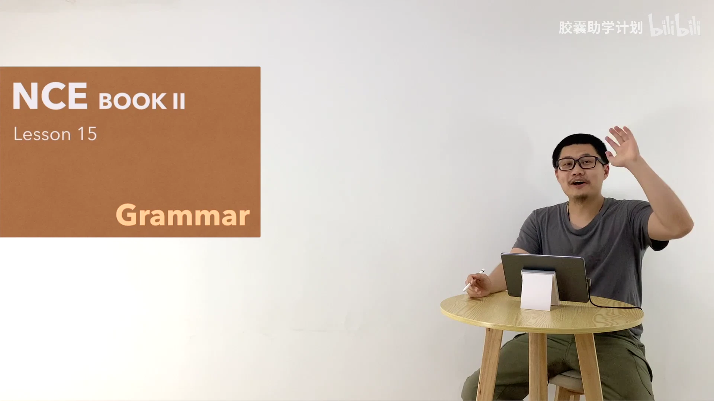

文字识别：Bilbili / 胶囊助学计划 / NCE / BOOKII / Lesson 15 / Grammar

### 画面 00:00:02

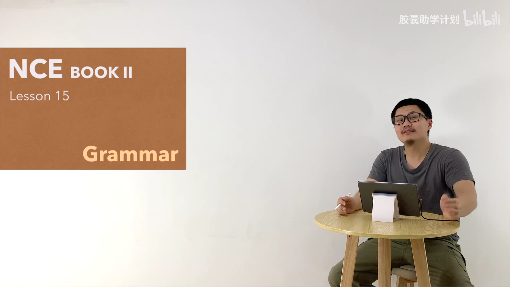

文字识别：bibli / 胶囊助学计划 / NCE / BOOKI"I / Lesson 15 / Grammar

### 画面 00:00:05

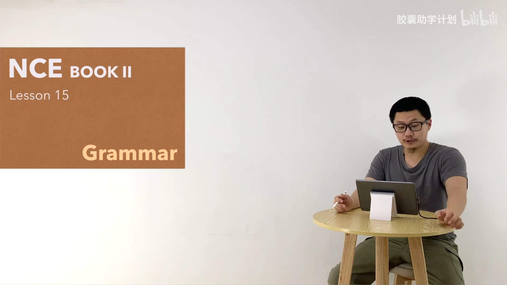

文字识别：bilibili / 胶囊助学计划 / NCE / BOOKII / Lesson 15 / Grammar

### 画面 00:00:07

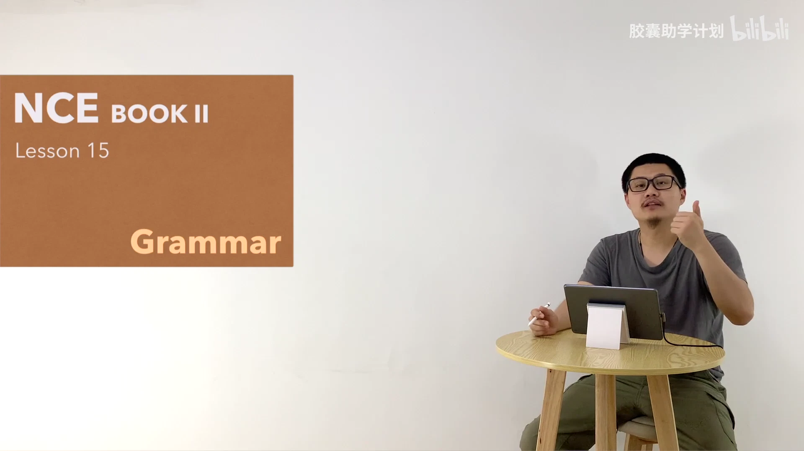

文字识别：Bilbli / 胶囊助学计划 / NCE / BOOKII / Lesson 15 / Grammar

### 画面 00:00:09

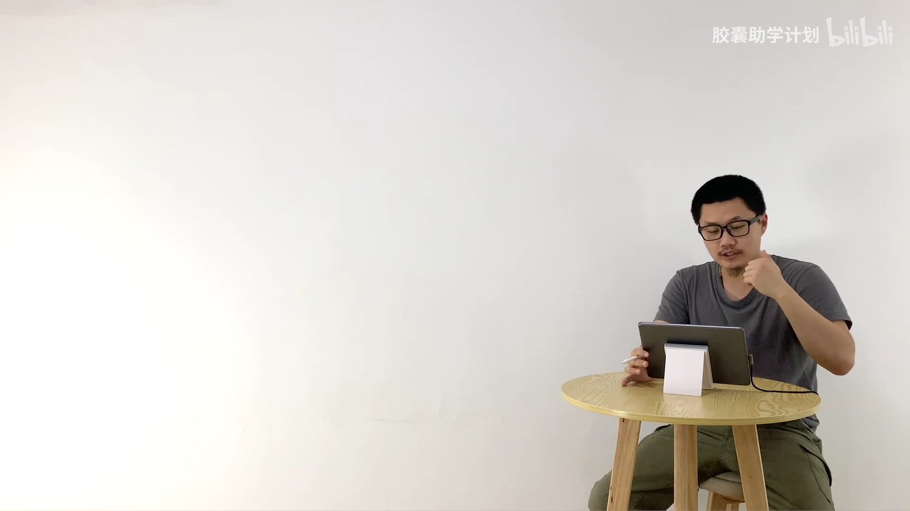

文字识别：胶囊助学计划blb出

### 画面 00:00:11

文字识别：胶囊助学计划bilb出 / ①什么是宾语从句？

### 画面 00:00:13

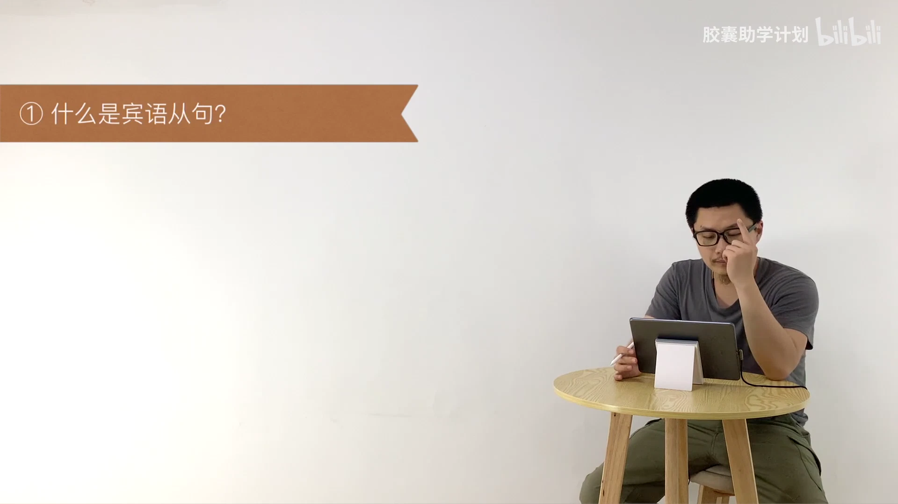

文字识别：胶囊助学计划bil / ①什么是宾语从句？

### 画面 00:00:15

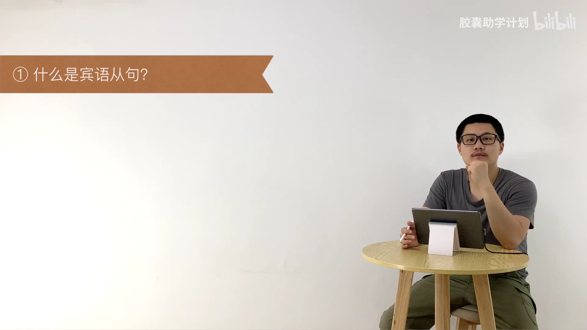

文字识别：胶囊助学计划bi出 / ①什么是宾语从句？

### 画面 00:00:20

文字识别：胶囊助学计划bil山 / ①什么是宾语从句？

### 画面 00:00:22

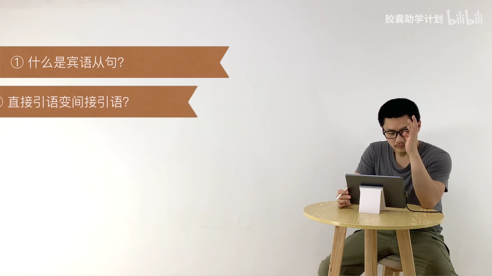

文字识别：biltbili / 胶囊助学计划 / ①什么是宾语从句？ / 直接引语变间接引语?

### 画面 00:00:24

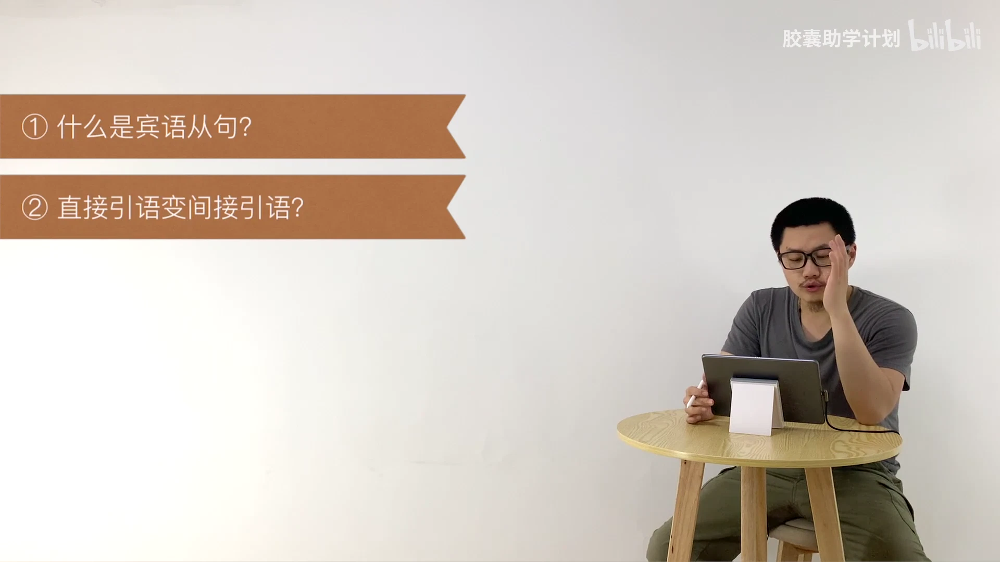

文字识别：biltbili / 胶囊助学计划 / ①什么是宾语从句？ / 直接引语变间接引语?

### 画面 00:00:26

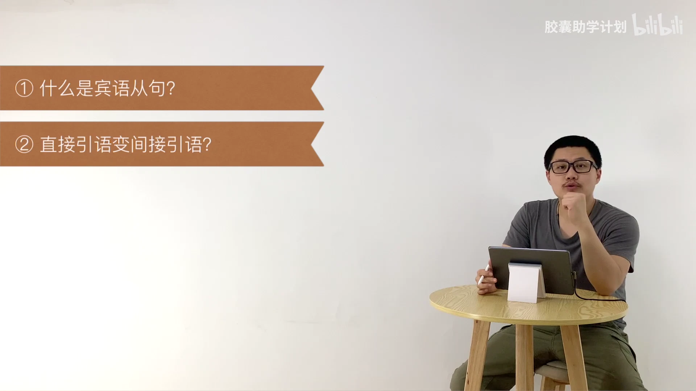

文字识别：biltbili / 胶囊助学计划 / ①什么是宾语从句？ / 直接引语变间接引语?

## 00:00:30–00:01:00

我带着大家再一起复习一遍。Hope you can enjoy。那既然我们要讲的这个东西啊，叫宾语从句，对吧？那我们第一件事情要做的事情就是先看看什么叫宾语，然后再看看什么叫从句，对吧？好，在六一二三四五六当中，一是主语，六是时间，二是谓语，我们又管它叫做动词加动词变化，对不对？

### 画面 00:00:30

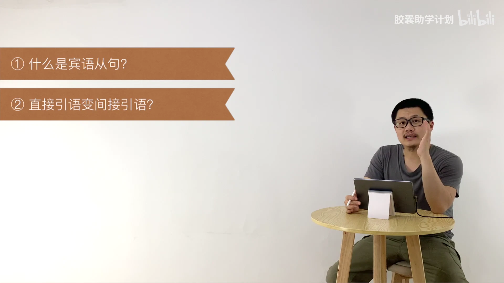

文字识别：bilbli / 胶囊助学计划 / ①什么是宾语从句？ / 直接引语变间接引语?

### 画面 00:00:33

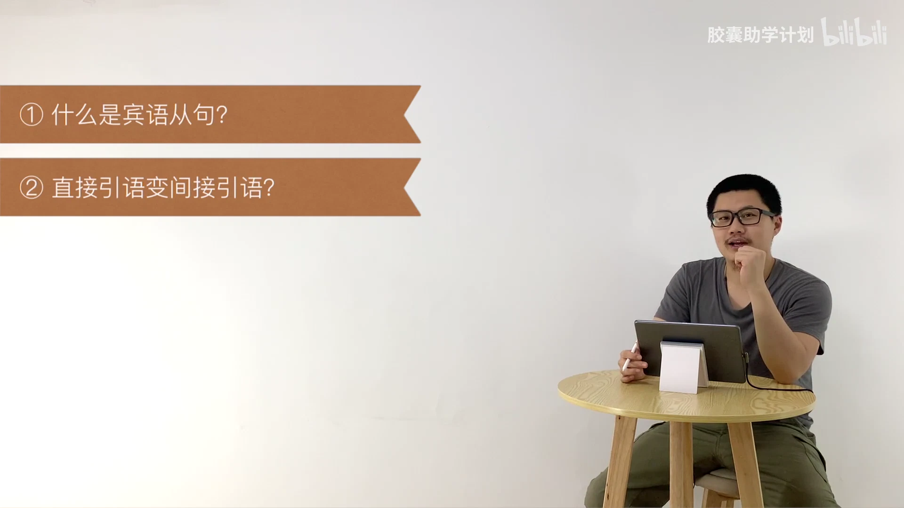

文字识别：biibili / 胶囊助学计划 / ①什么是宾语从句？ / 直接引语变间接引语?

### 画面 00:00:35

文字识别：胶囊助学计划 bilbl

### 画面 00:00:38

### 画面 00:00:40

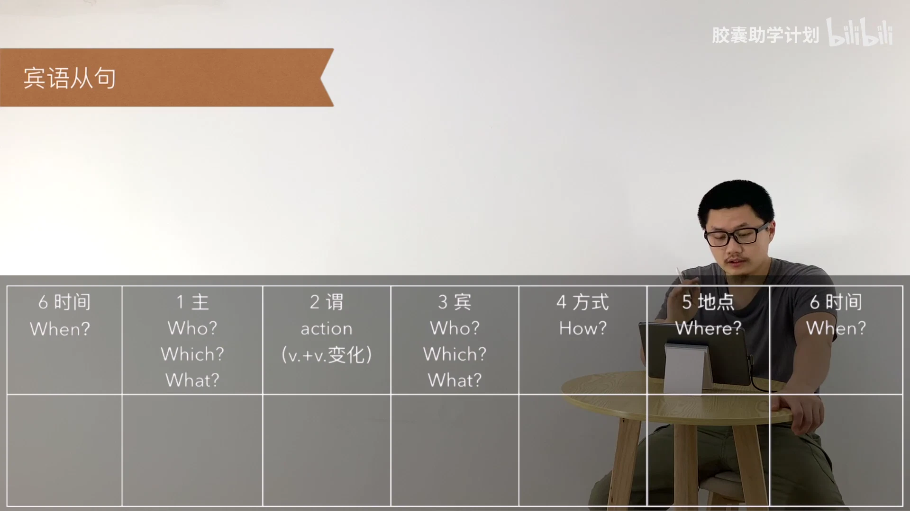

文字识别：Bibili / 胶囊助学计划 / 宾语从句 / 6时间 / 1主 / 2谓 / 3宾 / 4方式 / 5地点 / 6时间 / When? / Who? / action / Who? / How? / Where? / When? / Which? / (v.+v.变化) / Which? / What? / What?

### 画面 00:00:47

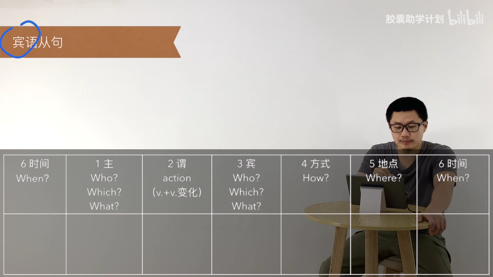

文字识别：Bibii / 胶囊助学计划 / 宾语从句 / 6时间 / 1主 / 2谓 / 3宾 / 4方式 / 5地点 / 6时间 / When? / Who? / action / Who? / How? / Where? / When? / Which? / (v.+v.变化) / Which? / What? / What?

### 画面 00:00:49

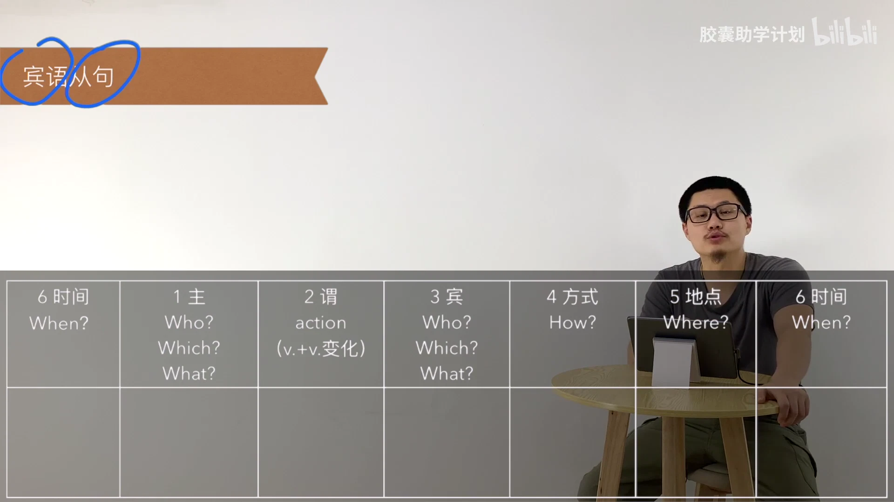

文字识别：bilbili / 胶囊助学计划 / 宾语从句 / 6时间 / 1主 / 2谓 / 3宾 / 4方式 / 5地点 / 6时间 / When? / Who? / action / Who? / How? / Where? / When? / Which? / (v.+v.变化) / Which? / What? / What?

### 画面 00:00:54

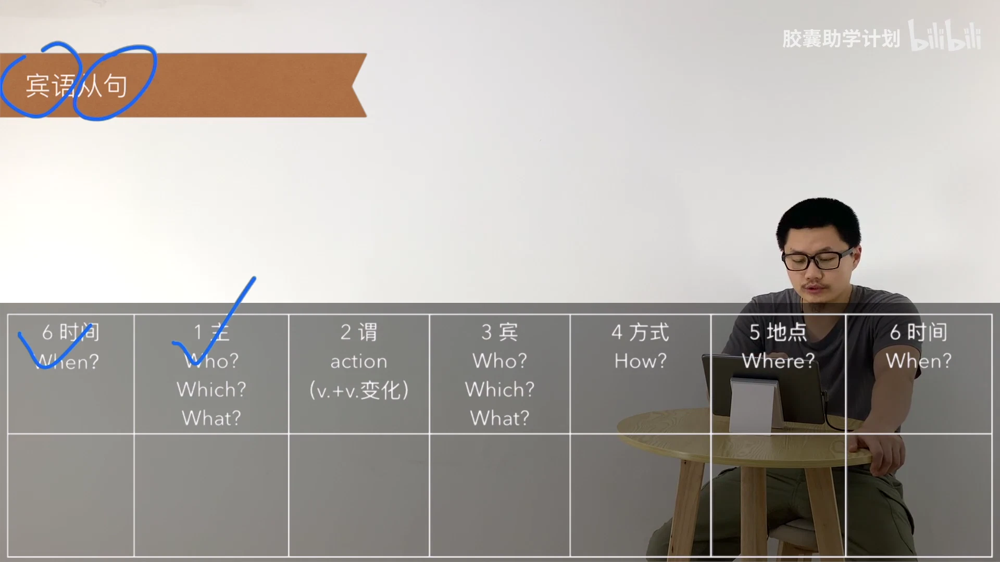

文字识别：bilbii / 胶囊助学计划 / 宾语从句 / 6时间 / 2谓 / 3宾 / 4方式 / 5地点 / 6时间 / Wren? / Who? / action / Who? / How? / Where? / When? / Which? / (v.+v.变化) / Which? / What? / What?

### 画面 00:00:57

文字识别：bilbili / 胶囊助学计划 / 宾语从句 / 6时月 / 3宾 / 4方式 / 5地点 / 6时间 / 谓 / Wlen? / Who? / action / Who? / How? / Where? / When? / Which? / (v.+v.变化) / Which? / What? / What?

## 00:01:00–00:01:30

三就是我们常说的宾语。比较巧的是，英文语序跟汉语语序本质上非常的一样。我吃苹果，汉英语也是我吃苹果的这样的一个语序。也就是说，基本上各位不是非常严谨的理解，可以理解为动词后边紧挨的这个啊，在动词施加在谁的身上，对吧？或者动词后边这个，往往它可能就是一个宾

### 画面 00:01:08

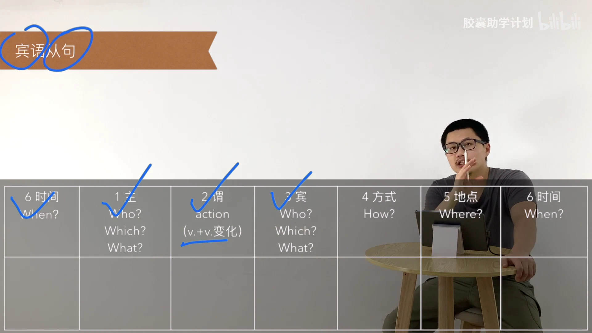

文字识别：胶囊助学计划 / 宾语从句 / 6时间 / V宾 / 4方式 / 5地点 / 6时间 / 谓 / Wlen? / Who? / action / Who? / How? / Where? / When? / Which? / (v.+v.变化) / Which? / What? / What?

### 画面 00:01:21

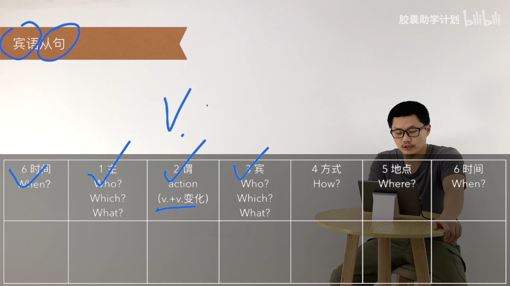

文字识别：bilibili / 胶囊助学计划 / 宾语从句 / 6时淘 / V宾 / 4方式 / 5地点 / 6时间 / 2谓 / Wren? / Who? / action / Who? / How? / Where? / When? / Which? / (v.+v.变化) / Which? / What? / What?

### 画面 00:01:25

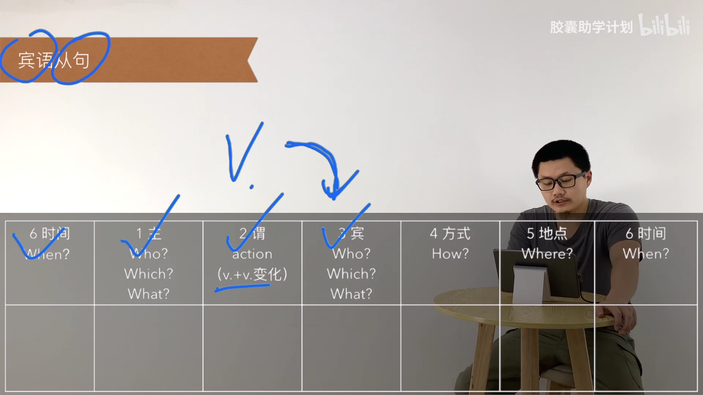

文字识别：bilibili / 胶囊助学计划 / 宾语从句 / 6时月 / 宾 / 4方式 / 5地点 / 6时间 / 谓 / Wren? / Who? / action / Who? / How? / Where? / When? / Which? / (v.+v.变化) / Which? / What? / What?

## 00:01:30–00:02:00

语啊，他打我，那我就是宾语，谁发出的这个动作呢？对吧？他，那他就是主语，谁承受的打这个动作呢？我，那我就是宾语，好理解吧？OK，那宾语从句，首先我们解决了什么叫宾语，那什么叫宾语从句呢？就是差一个从句的概念。我们先看一个句子，叫I believe you，我相信你。I be为主语，believe be点儿动词，对吧？You

### 画面 00:01:44

文字识别：biibii / 胶囊助学计划 / 宾语从句 / 6时月 / 宾 / 4方式 / 5地点 / 6时间 / 谓 / Wren? / Who? / action / Who? / How? / Where? / When? / Which? / (v.+v.变化) / Which? / What? / What?

### 画面 00:01:46

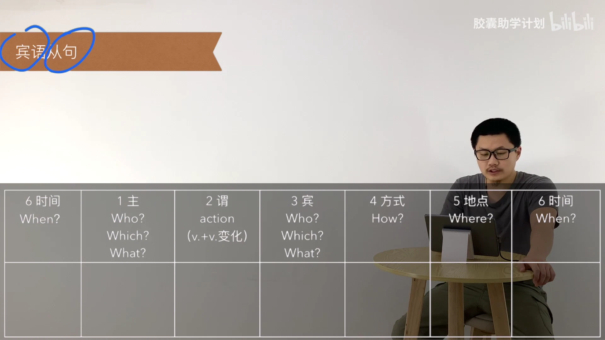

文字识别：Bibii / 胶囊助学计划 / 宾语从句 / 6时间 / 1主 / 2谓 / 3宾 / 4方式 / 5地点 / 6时间 / When? / Who? / action / Who? / How? / Where? / When? / Which? / (v.+v.变化) / Which? / What? / What?

## 00:02:00–00:02:30

你就是宾语，很简单，这就不存在从句的问题。那我们看一下，I believe that you are right。很巧的是，宾语从句的各位去学习，至少在这个环节是非常容易的，因为汉语去跟英语去完全一样。我相信你是对的，我认为你是对的，我相信你是对的。汉语也这样聊天儿，对吧？那各位注意一小下，原来呀，I

### 画面 00:02:16

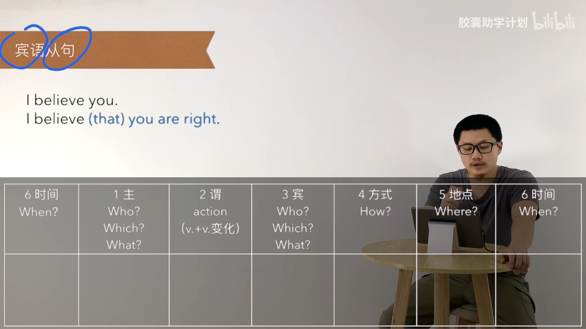

文字识别：Bilbili / 胶囊助学计划 / 宾语从人句 / I believe / you. / I believe / (that) you are right. / 6时间 / 1主 / 2谓 / 3宾 / 4方式 / 5地点 / 6时间 / When? / Who? / action / Who? / How? / Where? / When? / Which? / (v.+v.变化) / Which? / What? / What?

### 画面 00:02:23

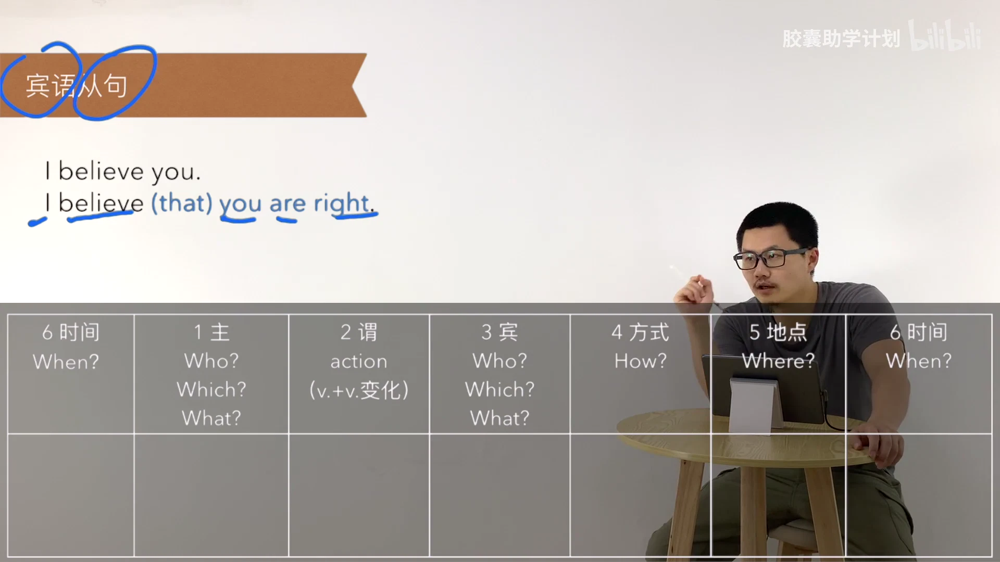

文字识别：胶囊助学计划 / 宾语从句 / I believe / you. / I believe / (that) / youa / are / e right. / 6时间 / 1主 / 2谓 / 3宾 / 4方式 / 5地点 / 6时间 / When? / Who? / action / Who? / How? / Where? / When? / Which? / (v.+v.变化) / Which? / What? / What?

### 画面 00:02:27

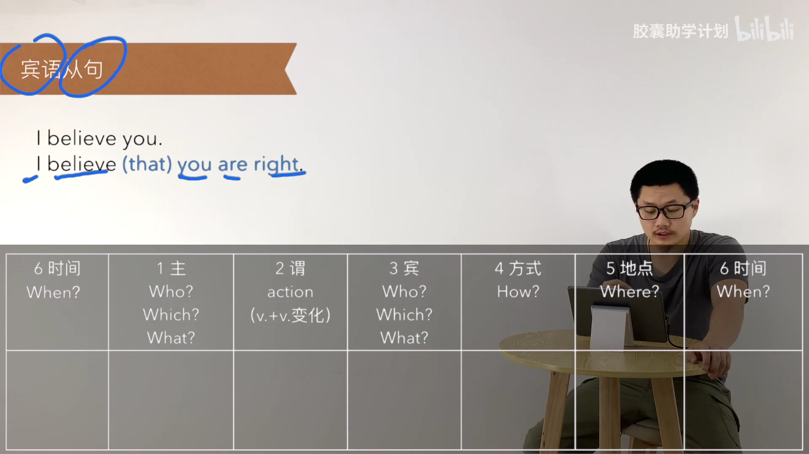

文字识别：Bilbii / 胶囊助学计划 / 宾语从句 / I believe / you. / I believe / (that) / you / are / right. / 6时间 / 1主 / 2谓 / 3宾 / 4方式 / 5地点 / 6时间 / When? / Who? / action / Who? / How? / Where? / When? / Which? / (v.+v.变化) / Which? / What? / What?

## 00:02:30–00:03:00

believe 的是你，you。现在我 believed 不是你了，我现在 believe 的是这一句话，叫做 You are right。 Okay，那我们管这句话现在是不是起到了一个宾语的位置，对吧？作用，对吧？在句子当中，它占的是宾语的位置，它起到的是宾语的作用，我们就管它叫做宾语从句。看一下，叫做一个句子去做宾

### 画面 00:02:31

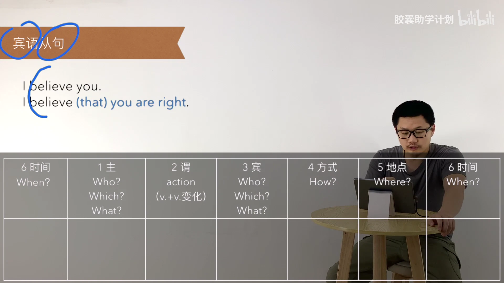

文字识别：bilbi / 胶囊助学计划 / 宾语从人句 / 1believe / you. / Ibelieve / (that) you are right. / 6时间 / 1主 / 2谓 / 3宾 / 4方式 / 5地点 / 6时间 / When? / Who? / action / Who? / How? / Where? / When? / Which? / (v.+v.变化) / Which? / What? / What?

### 画面 00:02:37

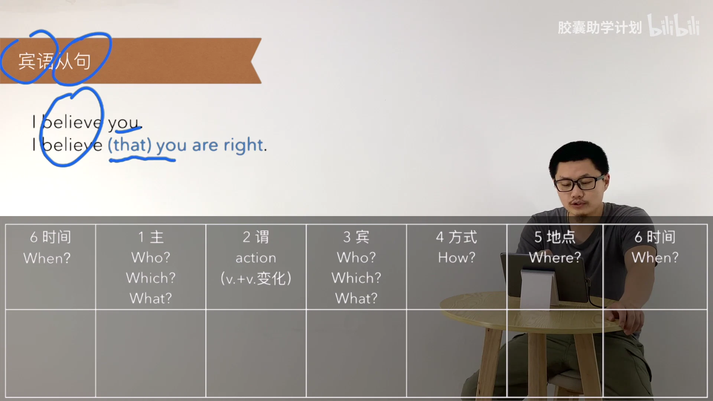

文字识别：bilbii / 胶囊助学计划 / 宾语从句 / Ibelieve / ygu / belieye / (that) you a / are /  right. / 6时间 / 1主 / 2谓 / 3宾 / 4方式 / 5地点 / 6时间 / When? / Who? / action / Who? / How? / Where? / When? / Which? / (v.+v.变化) / Which? / What? / What?

### 画面 00:02:54

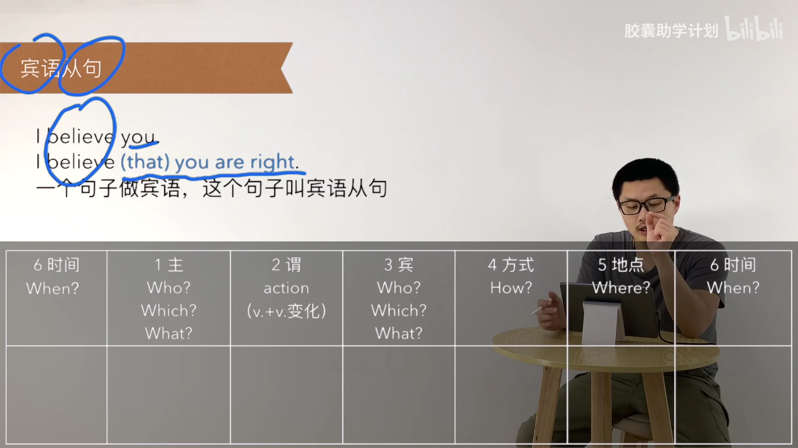

文字识别：bilibili / 胶囊助学计划 / 宾语从人句 / Ibelieve / you / Ibelieye / (that) you / are / right. / 一个句子做宾语，这个句子叫宾语从句 / 6时间 / 1主 / 2谓 / 3宾 / 4方式 / 5地点 / 6时间 / When? / Who? / action / Who? / How? / Where? / When? / Which? / (v.+v.变化) / Which? / What? / What?

### 画面 00:02:59

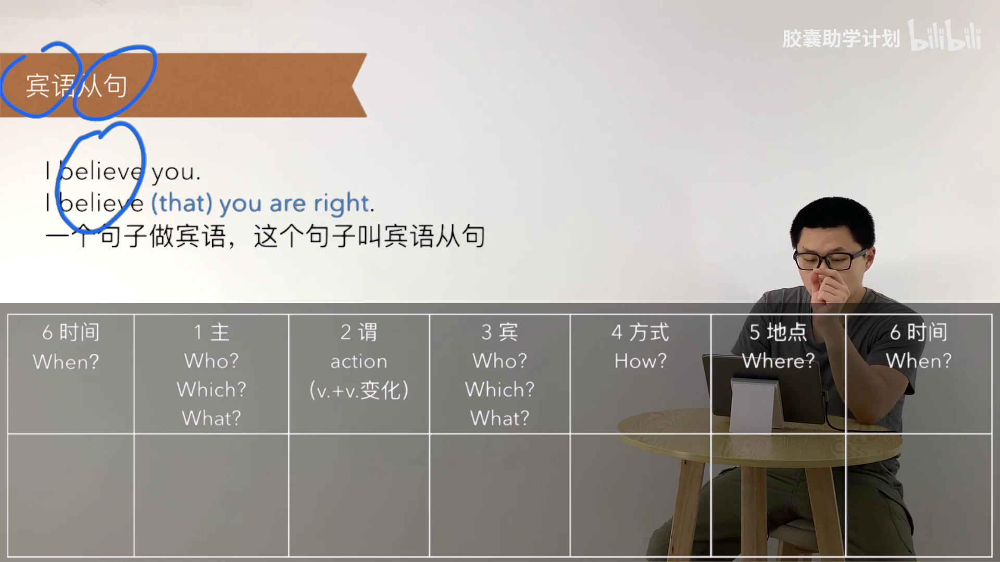

文字识别：bilbili / 胶囊助学计划 / 宾语从人句 / Ibelieve / you. / 1 belieye / (that) you / are / right. / 一个句子做宾语， / 这个句子叫宾语从句 / 6时间 / 1主 / 2谓 / 3宾 / 4方式 / 5地点 / 6时间 / When? / Who? / action / Who? / How? / Where? / When? / Which? / (v.+v.变化) / Which? / What? / What?

## 00:03:00–00:03:30

语，我们管这个句子叫宾语从句，所以 I believe that you are right 这句话我们就管它叫宾语从句，玩一个非常简单，对吧？所以底下这句话主语谓语后边这句话就叫做宾语啊，那它具体的叫法叫宾语从句。这个我们实际上在新概念一册九十九到一百零二课以及一百三十三课到一百三十六课已经讲过了，今天要讲的内容对吧？我们在一

### 画面 00:03:01

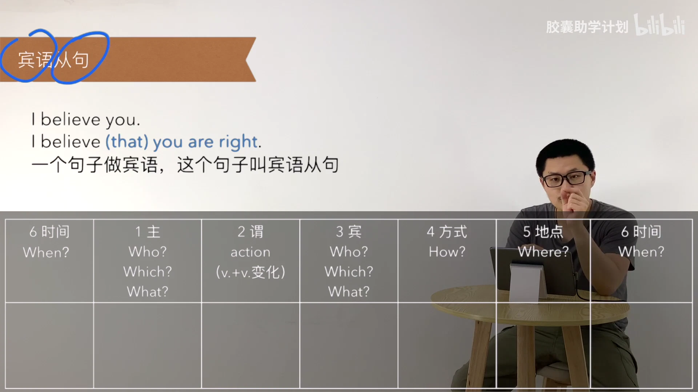

文字识别：Bibii / 胶囊助学计划 / 宾语从句 / I believe / you. / I believe / (that) you  / are right. / 一个句子做宾语， / 这个句子叫宾语从句 / 6时间 / 1主 / 2谓 / 3宾 / 4方式 / 5地点 / 6时间 / When? / Who? / action / Who? / How? / Where? / When? / Which? / (v.+v.变化) / Which? / What? / What?

### 画面 00:03:05

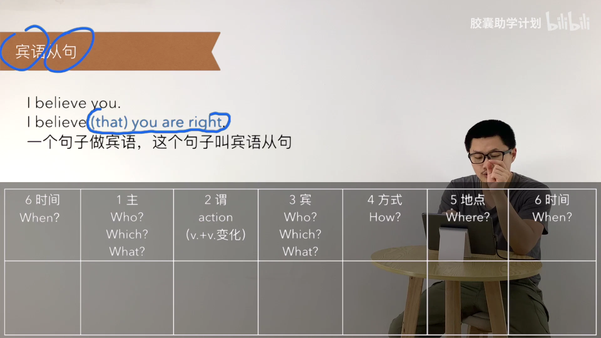

文字识别：Bilbii / 胶囊助学计划 / 宾语从句 / I believe you. / I believe(that) you are right. / 一个句子做宾语，这个句子叫宾语从句 / 6时间 / 1主 / 2谓 / 3宾 / 4方式 / 5地点 / 6时间 / When? / Who? / action / Who? / How? / Where? / When? / Which? / (v.+v.变化) / Which? / What? / What?

### 画面 00:03:13

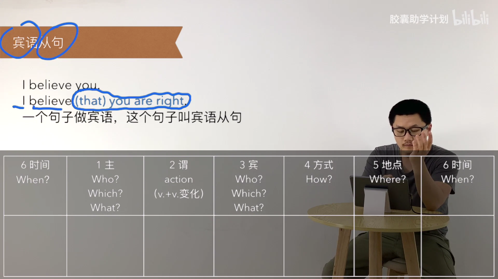

文字识别：bibili / 胶囊助学计划 / 宾语从句 / I believe you, / I believe(that) you are / right. / 一个句子做宾语，这个句子叫宾语从句 / 6时间 / 1主 / 2谓 / 3宾 / 4方式 / 5地点 / 6时间 / When? / Who? / action / Who? / How? / Where? / When? / Which? / (v.+v.变化) / Which? / What? / What?

## 00:03:30–00:04:00

起复习一遍。OK，那再注意一下，宾语从句当然一定是六一二三四五六当中起到三的作用了。OK，好，接下来我们开始看啊，怎么看它是不是宾语从句？I think我主语think谓语动词，对吧？好，我认为我想是什么呢？是这么一件事儿，叫做That will have plenty of time。好，这儿先注意一个

### 画面 00:03:33

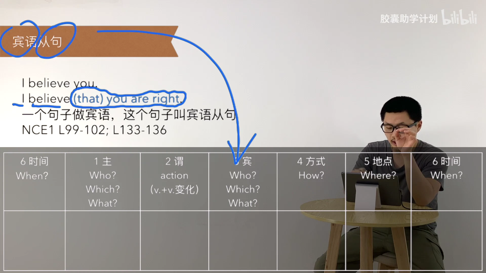

文字识别：bilbli / 胶囊助学计划 / 宾语从句 / I believe you, / I believe(that) you are / right. / 一个句子做宾语，这个句子叫宾语从句 / NCE1 L99-102; L133-136 / 6时间 / 1主 / 2谓 / 宾 / 4方式 / 5地点 / 6时间 / When? / Who? / action / Who? / How? / Where? / When? / Which? / (v.+v.变化) / Which? / What? / What?

### 画面 00:03:37

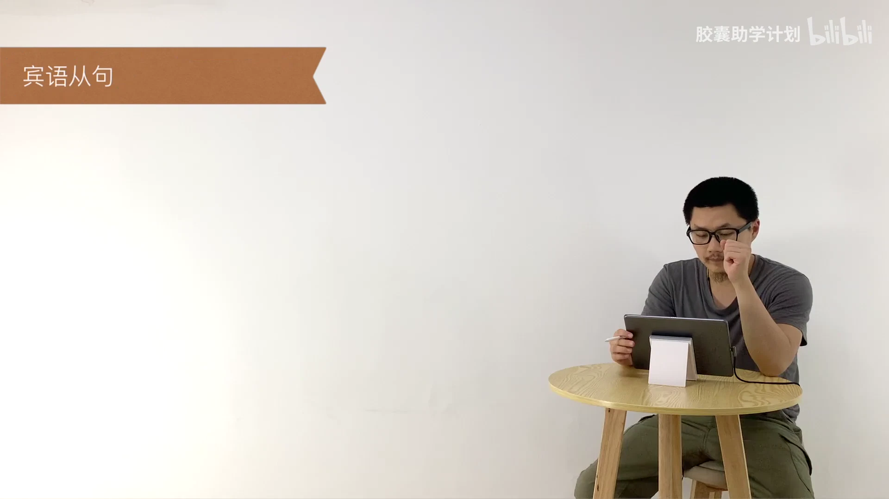

文字识别：胶囊助学计划bil出 / 宾语从句

### 画面 00:03:39

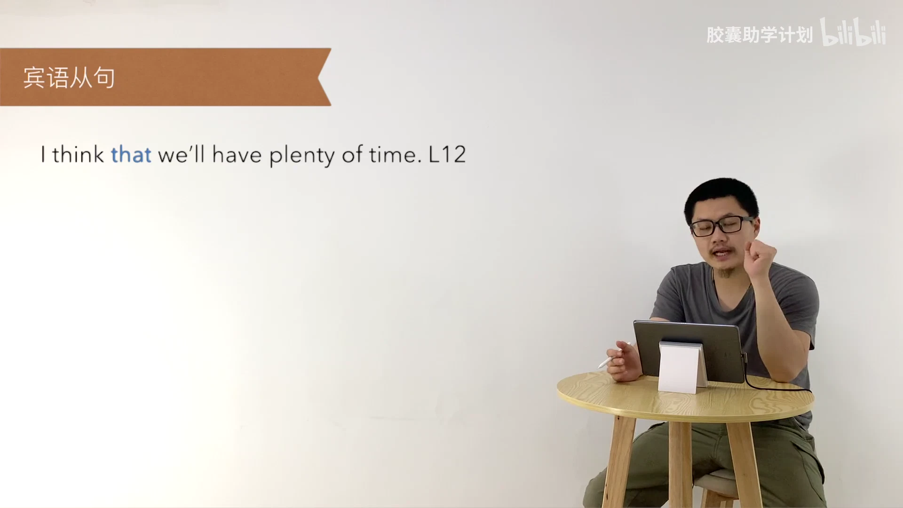

文字识别：胶囊助学计划bilb出 / 宾语从句 / I think that we'll have plenty of time. L12

### 画面 00:03:41

文字识别：胶囊助学计划 bilb出 / 宾语从句 / I think that we'll have plenty of time. L12

### 画面 00:03:44

文字识别：胶囊助学计划 / 宾语从句 / I think that we'll have plenty of time. L12

### 画面 00:03:46

文字识别：胶囊助学计划 / 宾语从句 / I think that we'll have plenty of time. L12

### 画面 00:03:49

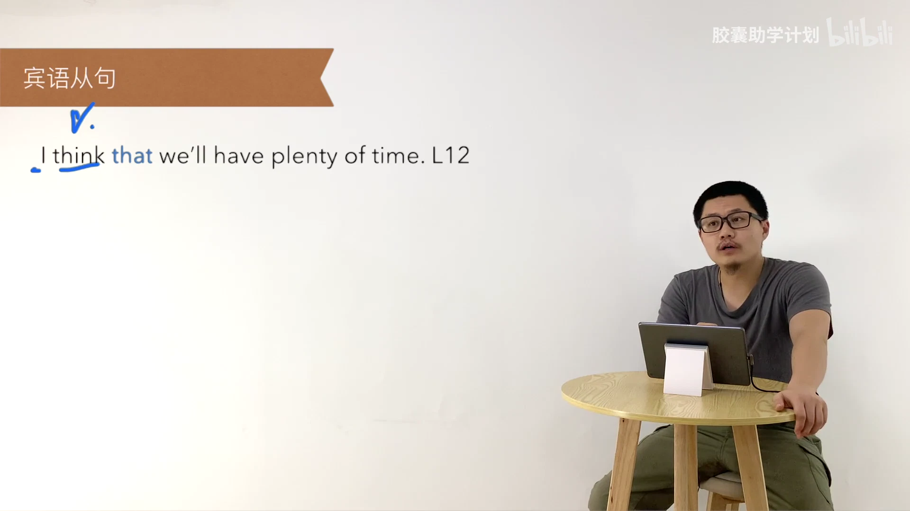

文字识别：胶囊助学计划 / 宾语从句 / I think that we'll have plenty of time. L12

### 画面 00:03:52

文字识别：胶囊助学计划 / 宾语从句 / I think/that we'll have plenty of time. L12

### 画面 00:03:55

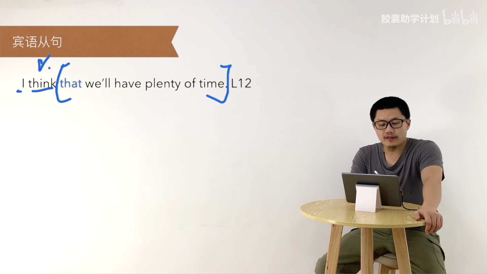

文字识别：胶囊助学计划 / 宾语从句 / I think/that we'll have plenty of time. / L12

## 00:04:00–00:04:30

小事儿，叫做 that。第一，各位记住不翻译。第二，因为它没有任何含义，所以可以省略。比如说这句话可以变成 I think we'll have plenty of time. 我认为我们会有足够多的时间。第一，不翻译。第二，可以省略。那为什么要有呢？相对来说，初期各位如果语法基础不是特别好，有这个 that 放在这个地方，你看见它，你还能

### 画面 00:04:11

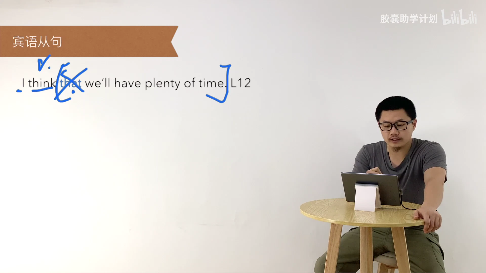

文字识别：Biltbli / 胶囊助学计划 / 宾语从句 / I think / t / we'll have plenty of time. / L12

### 画面 00:04:13

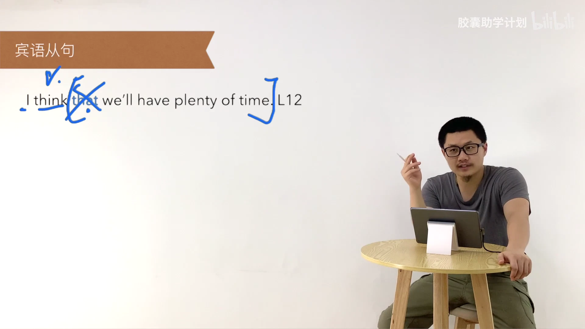

文字识别：胶囊助学计划 / 宾语从句 / I think / tat / we'll have plenty of time. / L12

### 画面 00:04:19

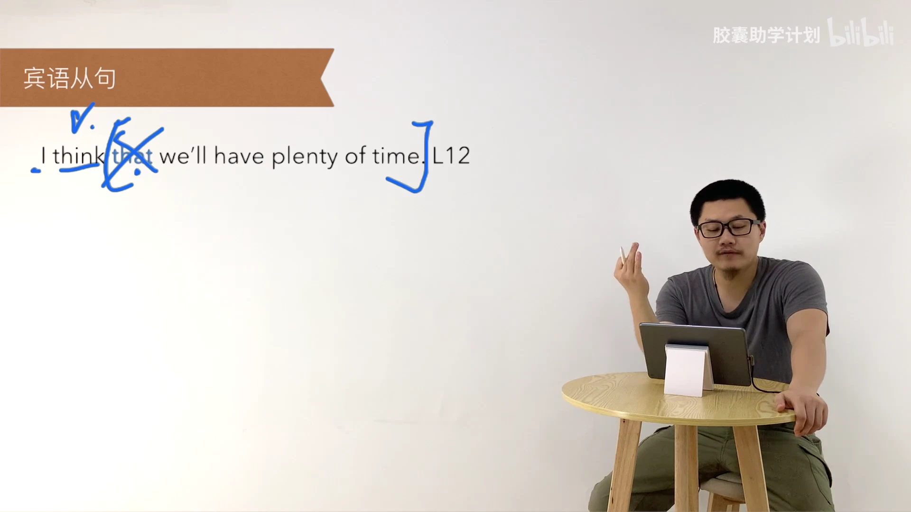

文字识别：Bilbil / 胶囊助学计划 / 宾语从句 / I think / t / we'll have plenty of time. / L12

### 画面 00:04:23

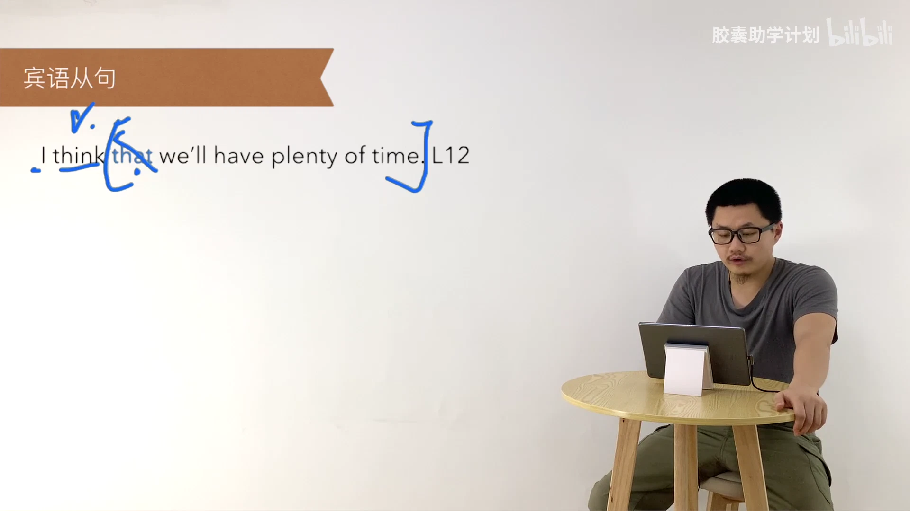

文字识别：刘bilibili / 胶囊助学计划 / 宾语从句 / I thinkthatv / we'll have plenty of time. / L12

### 画面 00:04:25

文字识别：ilbili / 胶囊助学计划 / 宾语从句 / I think that we'll have plenty of time. L12

### 画面 00:04:28

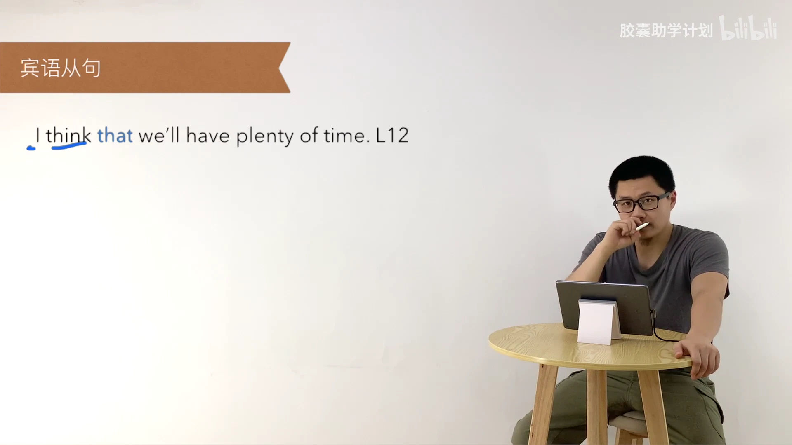

文字识别：bilbili / 胶囊助学计划 / 宾语从句 / I think that we'll have plenty of time. L12

## 00:04:30–00:05:00

迅速提醒你后边是个宾语从句。如果没有它，你还要自己去断句。哎，这句话应该是从哪断？I think will是这样断吗？还是I think will have这断对吧？你还要想一下怎么去断句。而现在有了that，直接就告诉你怎么去断句了。OK，但依旧因为它不翻译，所以可以删除啊。来，Let's one，Let's continue。I think that he will never pay it back啊，我认为他永远都不会把这个东西还回来了。OK，尤

### 画面 00:04:31

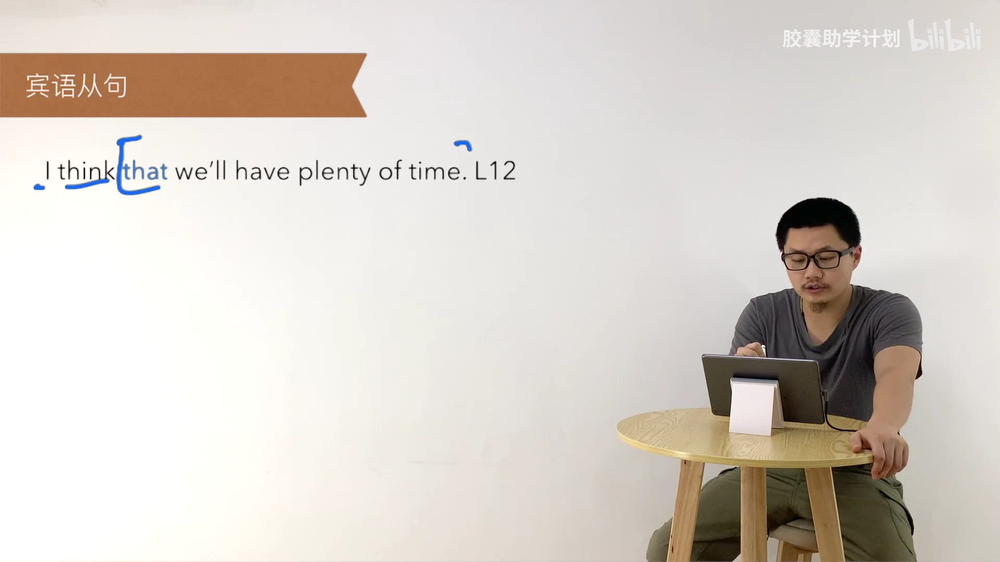

文字识别：bilibili / 胶囊助学计划 / 宾语从句 / I thinkthat we'll have plenty of time. L12

### 画面 00:04:34

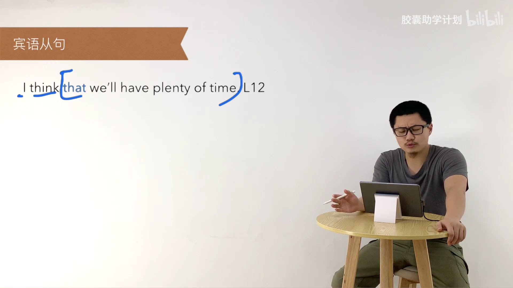

文字识别：bilbili / 胶囊助学计划 / 宾语从句 / - / I thinkthat we'll have plenty of time L12

### 画面 00:04:36

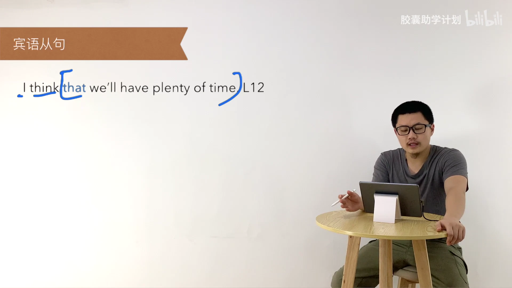

文字识别：biibili / 胶囊助学计划 / 宾语从句 / - / I thinkthat we'll have plenty of time L12

### 画面 00:04:40

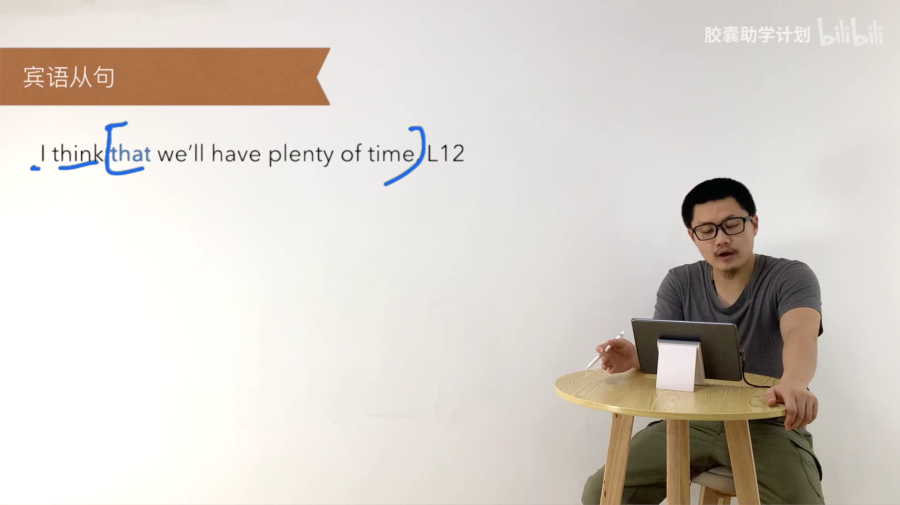

文字识别：Bilbili / 胶囊助学计划 / 宾语从句 / I thinkthat we' have plenty of time L12

### 画面 00:04:42

文字识别：biltbili / 胶囊助学计划 / 宾语从句 / I thinkthat we'll have plenty of time L12 / -

### 画面 00:04:49

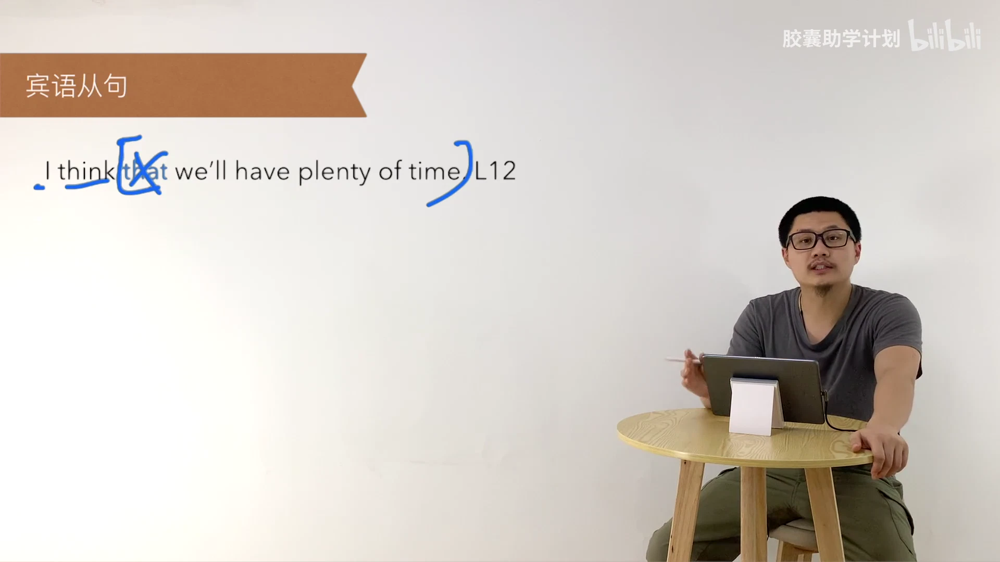

文字识别：biibili / 胶囊助学计划 / 宾语从句 / I think / t we'l have plenty of time L12

### 画面 00:04:54

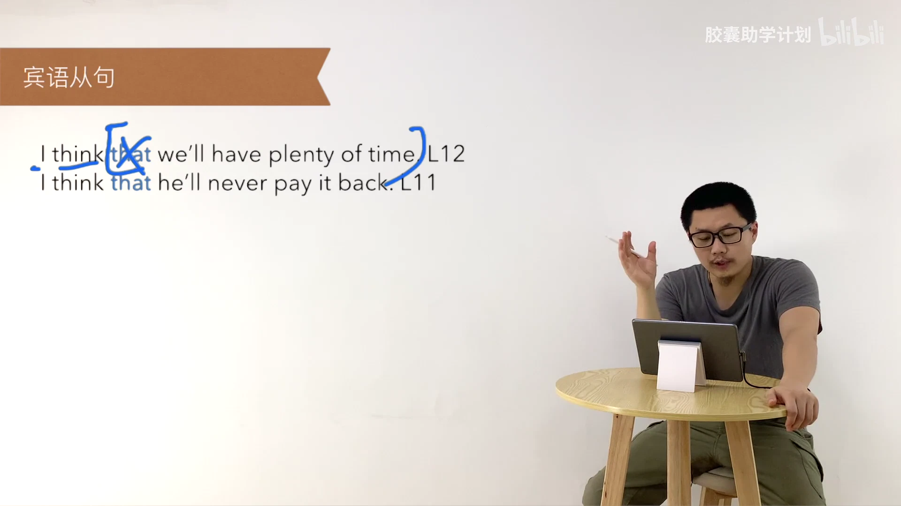

文字识别：胶囊助学计划 / 宾语从句 / I think /  we'll have plenty of timeL12 / I think that he'l never pay it back. L11

## 00:05:00–00:05:30

尤其是这个钱啊，pay back。好，各位这是十一课学到习惯用法，还是依旧一个道理，在 that 后面这个单词引导的这句话，我们管它叫宾语从句。Continue, I believe that 一个道理，对吧？They'll set out tomorrow. 他们，我认为，我相信他们是明天出发。Set out 十二课，哎，学的出发。He said that 注意他之前说说的是什么呢？

### 画面 00:05:01

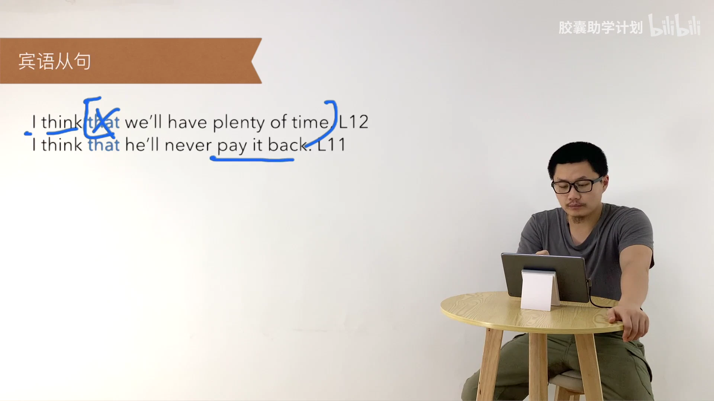

文字识别：biibili / 胶囊助学计划 / 宾语从句 / I think /  we'll have plenty  / / of time)L12 / I think that / t he'll r / I never pay it back.L11

### 画面 00:05:06

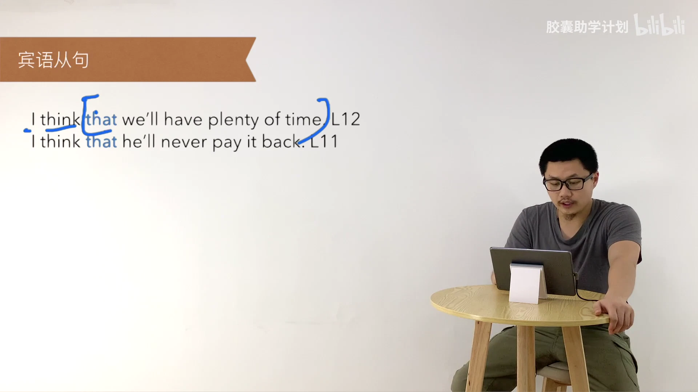

文字识别：biibli / 胶囊助学计划 / 宾语从句 / I thinkthat we' have plenty of timeL12 / "I think that he'll never pay it back.L11

### 画面 00:05:08

文字识别：bilbli / 胶囊助学计划 / 宾语从句 / I think that we'll have plenty of time. L12 / 'I think that he'll never pay it back. L11

### 画面 00:05:13

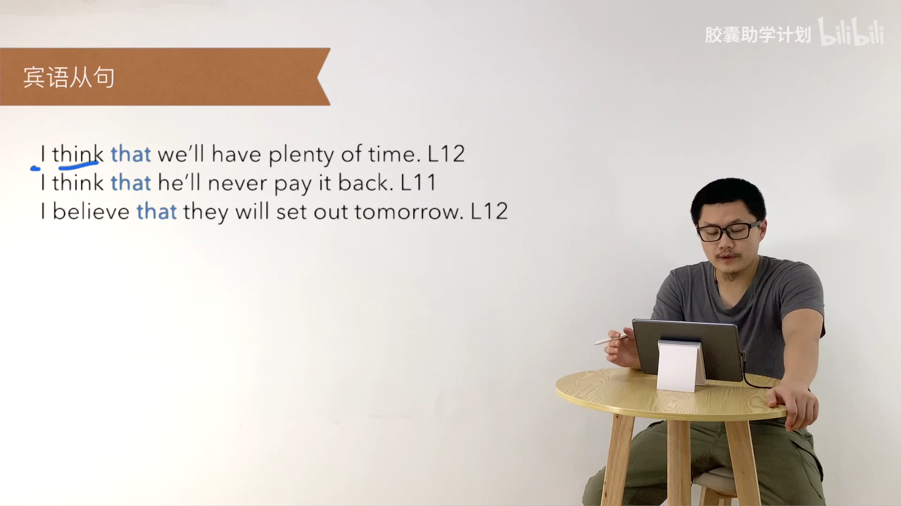

文字识别：bilibli / 胶囊助学计划 / 宾语从句 / I think that we'll have plenty of time. L12 / 'I think that he'll never pay it back. L11 / I believe that they will set out tomorrow. L12

### 画面 00:05:16

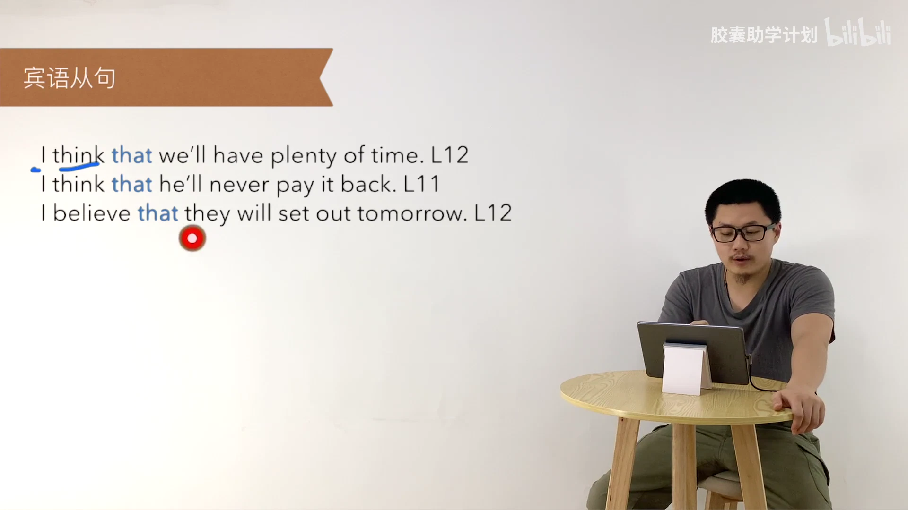

文字识别：bilbli / 胶囊助学计划 / 宾语从句 / I think that we'll have plenty of time. L12 / 'I think that he'll never pay it back. L11 / I believe that they will set out tomorrow. L12

### 画面 00:05:25

文字识别：胶囊助学计划b鼎b出 / 宾语从句 / I think that we'll have plenty of time. L12 / I think that he'll never pay it back. L11 / I believe that they will set out tomorrow. L12 / He said that our teacher refused to help us. L9

## 00:05:30–00:06:00

是这样一句话，叫做 that our teacher refused to help us。说他之前告诉我说，我们的老师拒绝帮我们这个忙，对吧？他认为帮了这个忙算让我们作弊了，所以他拒绝帮我们这个忙。第九课学的 refuse to do something，以及 she told me that。他告诉我的这样一件事情，这件事情就是宾语从句。A famous pop singer moved to our street，搬到了我们的这个这条街上。OK，这第六课学的 move to some

### 画面 00:05:37

文字识别：胶囊助学计划 / 宾语从句 / I think that we'll have plenty of time. L12 / 'I think that he'll never pay it back. L11 / I believe that they will set out tomorrow. L12 / He said that our teacher refused to help us. L9

### 画面 00:05:44

文字识别：bilbil / 胶囊助学计划 / 宾语从句 / I think that we'll have plenty of time. L12 / 'I think that he'll never pay it back. L11 / I believe that they will set out tomorrow. L12 / He said that our teacher refused to help us. L9

### 画面 00:05:46

文字识别：胶囊助学计划 / 宾语从句 / I think that we'll have plenty of time. L12 / 'I think that he'll never pay it back. L11 / I believe that they will set out tomorrow. L12 / He said that our teacher refused to help us. L9 / She told me that a famous pop singer moved to / Our street. L6

### 画面 00:05:49

文字识别：bilbili / 胶囊助学计划 / 宾语从句 / I think that we'll have plenty of time. L12 / 'I think that he'll never pay it back. L11 / I believe that they will set out tomorrow. L12 / He said that our teacher refused to help us. L9 / She told me that a famous pop singer moved to / Our street. L6

### 画面 00:05:55

文字识别：胶囊助学计划bilb出 / 宾语从句 / I think that we'll have plenty of time. L12 / 'I think that he'll never pay it back. L11 / I believe that they will set out tomorrow. L12 / He said that our teacher refused to help us. L9 / She told me that a famous pop singer moved to / Our street. L6

## 00:06:00–00:06:30

place.所有各位现在看到that包含that这句话以及后边那句话合起来，管它叫宾语从句。因为刚才我提到了that是不翻译的，所以可以省略。各位这个点要记住，好吧？Okay，那什么又叫直接引语，什么又叫间接引语？这个就要回到了我们小学语文上了，对吧？Okay，小学

### 画面 00:06:00

文字识别：胶囊助学计划bi鼎b出 / 宾语从句 / I think that we'll have plenty of time. L12 / 'I think that he'l never pay it back. L11 / I believe that they will set out tomorrow. L12 / He said that our teacher refused to help us. L9 / She told me that a famous pop singer moved to / Our street. L6

### 画面 00:06:02

文字识别：胶囊助学计划bilb出 / 宾语从句 / I think that we'll have plenty of time. L12 / I think that he'll never pay it back. L11 / I believe that they will set out tomorrow. L12 / He said that our teacher refused to help us. L9 / She told me that a famous pop singer moved to / Our street. L6

### 画面 00:06:05

文字识别：胶囊助学计划bilb出 / 宾语从句 / I think that we'll have plenty of time. L12 / 'I think that he'll never pay it back. L11 / I believe that they will set out tomorrow. L12 / He said that our teacher refused to help us. L9 / She told me that a famous pop singer moved to / Our street. L6

### 画面 00:06:10

文字识别：胶囊助学计划bilb出 / 宾语从句 / I think that we'll have plenty of time. L12 / 'I think that he'll never pay it back. L11 / I believe that they will set out tomorrow. L12 / He said that our teacher refused to help us. L9 / She told me that a famous pop singer moved to / our street. L6

### 画面 00:06:13

文字识别：胶囊助学计划bilb出 / 宾语从句 / I think that we'll have plenty of time. L12 / I think th& he'l never pay it back. L11 / I believe that they will set out tomorrow. L12 / He said thet our teacher refused to help us. L9 / She told me thet a famous pop singer moved to / Our street. L6

### 画面 00:06:15

文字识别：胶囊助学计划 bil出 / 宾语从句 / _I think that we'll have plenty of time. L12 / I think th& he'll never pay it back. L11 / I believe that they will set out tomorrow. L12 / He said thet our teacher refused to help us. L9 / She told me thet a famous pop singer moved to / Our street. L6

### 画面 00:06:19

文字识别：胶囊助学计划bib出 / 直接引语一 间接引语

### 画面 00:06:21

文字识别：Biltbli / 胶囊助学计划 / 直接引语一 间接引语

### 画面 00:06:24

文字识别：Bilbili / 胶囊助学计划 / 直接引语一 间接引语

### 画面 00:06:26

文字识别：胶囊助学计划bl出 / 直接引语一 间接引语

### 画面 00:06:29

文字识别：胶囊助学计划bi / 直接引语一 间接引语

## 00:06:30–00:07:00

语文就讲过。那我们先直接看直接引语，引号里把别人的话直接引用过来，别人说的是什么，你就把这话直接照搬过来。这个东西叫做直接引语。比如说加引号了，叫 I am busy，这是他说的原话。后边接了一个叫 He said，他之前说到，对吧？那什么叫间接引语呢？就是把引号去掉，就这么简单。引号去掉了之后，他说的就不是他说的原

### 画面 00:06:33

文字识别：bilbii / 胶囊助学计划 / 直接引语一 间接引语 / 直接引l语："l am busy'，he said.

### 画面 00:06:40

文字识别：Bilbili / 胶囊助学计划 / 直接引语一 间接引语 / 直接引l语："am busy',he said.

### 画面 00:06:42

文字识别：胶囊助学计划bilb出 / 直接引语一 间接引语 / 直接引l语："l am busy'，he said.

### 画面 00:06:45

文字识别：胶囊助学计划bil出 / 直接引语一 间接引语 / 直接引l语："l am busy'，he said.

### 画面 00:06:48

文字识别：胶囊助学计划bi出b出 / 直接引语一 间接引语 / 直接引l语："lam busy'，he said.

### 画面 00:06:50

文字识别：胶囊助学计划bib出 / 直接引语一 间接引语 / 直接引l语："l am busy'，he said.

### 画面 00:06:54

文字识别：胶囊助学计划bilb出 / 直接引语一 间接引语 / 直接引l语："l am busy'， he said.

### 画面 00:06:57

文字识别：胶囊助学计划blb出 / 直接引语一 间接引语 / 直接引l语："l am busy'，he said.

### 画面 00:06:59

文字识别：bilibili / 胶囊助学计划 / 直接引语一 间接引语 / 直接引l语："l am busy'，he said.

## 00:07:00–00:07:30

话了，对吧？要改变一些人称之类的东西，比如说 he said 他说 he was busy 他说的不是他很忙这句话，对吧？他说的是我很忙。但是把直接引语变成间接引语的时候，人称要做一些变化，引号去掉。那他说你转述给别人听的时候，他说的一定是他很忙。那各位为什么要把直接引语和间接引语

### 画面 00:07:02

文字识别：胶囊助学计划bil出 / 直接引语 一 间接引语 / 直接引l语：" am busy'，he said. / 间接引l语：He said that he was busy.

### 画面 00:07:04

文字识别：胶囊助学计划b出b出 / 直接引语一 间接引语 / 直接引l语：" am busy'，he said. / 间接引l语：He said that he was busy.

### 画面 00:07:07

文字识别：bilibli / 胶囊助学计划 / 直接引语一 间接引语 / 直接引l语："l am busy'，he said. / 间接引l语：He said that he Was busy.

### 画面 00:07:09

文字识别：胶囊助学计划bilb出 / 直接引语一 间接引语 / 直接引l语："I am busy'，he said. / 间接引l语：He said that he was busy.

### 画面 00:07:13

文字识别：刘 bilbli / 胶囊助学计划 / 直接引语一 间接引语 / 直接引l语：am busy,he said. / 间接引l语：He said that he was busy.

### 画面 00:07:16

文字识别：胶囊助学计划 / 直接引语 一 间接引语 / 直接引语：am busy， / he said. / 间接引l语：He said that he was busy.

### 画面 00:07:18

文字识别：胶囊助学计划b出b出 / 直接引语 一 间接引语 / 直接引l语：不am busy,he said. / 间接引l语：He said that he was busy.

### 画面 00:07:21

文字识别：bilbli / 胶囊助学计划 / 直接引语一 间接引语 / 直接引语：am busy, / he said. / 间接引l语：He said that he was busy.

### 画面 00:07:24

文字识别：bilbili / 胶囊助学计划 / 直接引语一 间接引语 / 直接引l语：am busy,he said. / 间接引l语：He said that he was busy.

### 画面 00:07:26

文字识别：胶囊助学计划b出b出 / 直接引语 一 间接引语 / 直接引l语：am busy,he said. / 间接引l语：He said that he was busy.

### 画面 00:07:28

文字识别：胶囊助学计划bi出b出 / 直接引语 一 间接引语 / 直接引l语："I am busy'，he said. / 间接引l语：He said that he was busy.

## 00:07:30–00:08:00

和宾语从句放到一课去讲呢？原因很简单，因为你把它变成间接引语了之后，它就是个宾语从句。He said，他说的是一句话，这句话就是一句话做宾语，简称宾从。OK，好，那还有另外一种变法啊，叫做，比如说叫He says that he is busy啊，也不能叫另外一种变法吧？各位注意一下时态，这儿用的是said，这儿用的是says。

### 画面 00:07:30

文字识别：胶囊助学计划bilb出 / 直接引语一 间接引语 / 直接引l语："I am busy'，he said. / 间接引l语：He said that he was busy.

### 画面 00:07:35

文字识别：胶囊助学计划bib出 / 直接引语一 间接引语 / 直接引l语："I am busy'，he said. / 间接引l语：He said that he Was busy.

### 画面 00:07:37

文字识别：bilbili / 胶囊助学计划 / 直接引语一 间接引语 / 直接引l语：" am busy', he said. / 间接引l语：He said / that he was busy.

### 画面 00:07:39

文字识别：bilbili / 胶囊助学计划 / 直接引语一 间接引语 / 直接引l语：" am busy', he said. / 间接引l语：He said / that he was busy.

### 画面 00:07:41

文字识别：胶囊助学计划bilb出 / 直接引语一 间接引语 / 直接引l语：" am busy', he said. / 间接引l语：He said / that he was busy.

### 画面 00:07:43

文字识别：胶囊助学计划b鼎b出 / 直接引语一 间接引语 / 直接引l语：" am busy', he said. / 间接引l语：He said / that he was busy.

### 画面 00:07:45

文字识别：bilbli / 胶囊助学计划 / 直接引语一 间接引语 / 直接引l语：" am busy', he said. / 间接引|语：He said / that he was busy.

### 画面 00:07:47

文字识别： bilbi / 胶囊助学计划 / 直接引语一 间接引语 / 直接引l语：" am busy', he said. / 间接引语：He said / that he was busy. / 间接引l语：He says that he is busy.

### 画面 00:07:49

文字识别：Bilbili / 胶囊助学计划 / 直接引语一 间接引语 / 直接引l语：" am busy', he said. / 间接引语：He said / that he was busy. / 间接引l语：He says that he is busy.

### 画面 00:07:51

文字识别：biibili / 胶囊助学计划 / 直接引语一 间接引语 / 直接引l语：" am busy', he said. / 间接引l语：He said / that he was busy. / 间接引l语：He says that he is busy.

### 画面 00:07:53

文字识别：胶囊助学计划bib出 / 直接引语 一 间接引语 / 直接引l语：" am busy'，he said. / 间接引l语：He said that he Was busy. / 间接引l语：He says that he is busy.

### 画面 00:07:58

文字识别：bilbli / 胶囊助学计划 / 直接引语一 间接引语 / 直接引l语："I am busy'，he said. / 间接引|语：He said that he was busy. / 间接引|语：He says that he is busy.

## 00:08:00–00:08:30

注意啊 says，注意说上面是过去，底下是一般现在，然后你看他说的一定不是过去，是吧？他说的在这个地方啊，不能叫一定不是，在这个地方不是，用的是一般现在时，而后面的时候态是不一样的，这个是各位要注意的地方。如果啊，如果后面我们管它叫宾语从句的话，那前面我们可以管它叫主句，行吧？主从关系嘛，对吧？后边叫

### 画面 00:08:11

文字识别：biibili / 胶囊助学计划 / 直接引语一 间接引语 / 直接引语：“ / ambusy', he said. / 间接引语：He said that he was busy. / 间接引l语：He says that he is busy.

### 画面 00:08:17

文字识别：bilibili / 胶囊助学计划 / 直接引语一 间接引语 / 直接引语：“ / ambusy', he said. / 间接引语：He said that he was busy. / 间接引l语：He says t / that he is busy.

### 画面 00:08:22

文字识别：Bilbili / 胶囊助学计划 / 直接引语一 间接引语 / 直接引语：“ / ambusy', he said. / 间接引l语：He said that he was busy. / 间接引l语：He says / that he is busy.

### 画面 00:08:24

文字识别：Bilbili / 胶囊助学计划 / 直接引语一 间接引语 / 直接引语： / ambusy', he said. / 间接引l语：He said that he was busy. / 间接引l语：He says / that he is busy

### 画面 00:08:26

文字识别：Bilbili / 胶囊助学计划 / 直接引语 一 间接引语 / 直接引语： / "| / ambusy' / he / said. / 间接引语：He said t / that he was, busy. / 间接引语 / He / e says / that he is / busy

### 画面 00:08:29

文字识别：胶囊助学计划 / 直接引语 一 间接引语 / 直接引语： / ambusy', / he / said. / 间接引l语：He said that he was busy. / 间接引语 / He says / that he is / busy

## 00:08:30–00:09:00

从，前面叫主。前面主句如果时态是一般现在时，后面的时态您就不用做任何改变，看到了吧？对吧？I am busy 和 he is busy 的时态都是一个时态，一般现在时，对吧？但如果注意主句的时态是一般过去时，这个时态就进行了一些改变。具体怎么变，一会儿我教各位。现在只要知道它要变就可以了。OK，所以

### 画面 00:08:32

文字识别：Bilbl / 胶囊助学计划 / 直接引语一 间接引语 / 直接引语： / “ / ambusy', H / , he said. / 间接引l语：He said that he was busy. / 间接引语 / He says / that he is / busy

### 画面 00:08:37

文字识别：Bilbili / 胶囊助学计划 / 直接引语一 间接引语 / 直接引语： / ambusy', / hes / said. / 间接引l语：He said that he was busy. / 间接引语 / He / e says / that he isbusy

### 画面 00:08:39

文字识别：BilBi / 胶囊助学计划 / 直接引语一间接引语 / 直接引语： / ambusy', he said. / 间接引l语：He said that he was busy. / 间接引语：He / esays / that he is busy

### 画面 00:08:41

文字识别：bilbil / 胶囊助学计划 / 直接引语一 间接引语 / 直接引语： / m / busy', he said. / 间接引语：He said that he was busy. / 间接引|语：He says that he is busy.

### 画面 00:08:43

文字识别：Bilbil / 胶囊助学计划 / 直接引语一 间接引语 / 直接引语： / busy', he said. / 间接引语：He said that he was busy. / 间接引l语：He says that he is busy.

### 画面 00:08:46

文字识别：胶囊助学计划 / 直接引语一 间接引语 / 直接引l语："l am busy'，he said. / 间接引l语：He said that he was busy. / 间接引l语：He says that he is busy.

### 画面 00:08:49

文字识别：胶囊助学计划 / 直接引语一 间接引语 / 直接引l语：" am busy'，he said. / 间接引l语：He saidthat he was busy. / 间接引l语：He says that he is busy.

### 画面 00:08:52

文字识别：bilibili / 胶囊助学计划 / 直接引语一 间接引语 / 直接引l语："lam busy'， he said. / 间接引语：He sald / that he was busy / 间接引l语：He says that he is busy.

### 画面 00:08:55

文字识别：胶囊助学计划 / 直接引语一 间接引语 / 直接引l语："lam busy'，he said. / 间接引语:He said / that he was busy / 间接引|语：He says that he is busy.

## 00:09:00–00:09:30

在这个地方我们要注意至少三个点。第一，人称上的变化。引号里说的是我很忙，引号去掉就变成了叫做他很忙，对吧？这是小学语文我们就学过的东西啊，在这儿我就不再做过多的解释了。为什么把爱换成了 he 这件事情，对吧？基本上你汉语语感没有问题，这个也不需要我解释了，这就是汉语的问题。接下来第二，从句时态的改变。我刚才讲到了，在这个

### 画面 00:09:00

文字识别：Bilibil / 胶囊助学计划 / 直接引语一 间接引语 / 直接引l语："lam busy'，he said. / 间接引语:He saig / that he was busy / 间接引l语：He says that he is busy. / 注意：

### 画面 00:09:03

文字识别：Bilbi / 胶囊助学计划 / 直接引语一 间接引语 / 直接引l语："lam busy'， he said. / 间接引l语:He said that he was busy / 间接引|语：He says that he is busy. / 注意： / 1.人称变化

### 画面 00:09:06

文字识别：bilbili / 胶囊助学计划 / 直接引语一 间接引语 / 直接引l语："lam busy'， he said. / 间接引l语: He said that he was busy / 间接引l语：He says that he is busy. / 注意： / 1.人称变化

### 画面 00:09:09

文字识别：胶囊助学计划bib出 / 直接引语一间接引语 / 直接引l语："lam busy'，he said. / 间接引l语: He said that he Was busy / 间接引l语：He says that he is busy. / 注意： / 1.人称变化

### 画面 00:09:11

文字识别：bilbli / 胶囊助学计划 / 直接引语一 间接引语 / 直接引l语："lam busy'，he said. / 间接引l语: He saidthat he was busy / 间接引l语：He says that he is busy. / 注意： / 1.人称变化

### 画面 00:09:15

文字识别：bilbii / 胶囊助学计划 / 直接引语一 间接引语 / 直接引l语："lam busy'，he said. / 间接引l语:He said that he was busy / 间接引l语：He says that he is busy. / 注意： / 1.人称变化

### 画面 00:09:18

文字识别：bilbili / 胶囊助学计划 / 直接引语一 间接引语 / 直接引语："lam busyhe said. / 间接引|语：He saig / that he was busy / 间接引l语：He says that he is busy. / 注意： / 1.人称变化

## 00:09:30–00:10:00

状态之下是不需要考虑的。当主句是一般现在时，但如果主句是一般过去时的时候，从句的时态是要考虑它的变化的。至于如何去变，一会儿我教各位。现在各位只需要知道它要变就可以了。OK，再然后第三就是要添加一个小的连词，这个连词就是宾语从句的那个连词叫做 that。当然了，刚才我提到了这个 that 可以怎么样来着？

### 画面 00:09:30

文字识别：bilbil / 胶囊助学计划 / 直接引语一 间接引语 / 直接引l语："am busyhe said. / 间接引|语：He saidt / that he was busy / 间接引l语：He says that he is busy. / 注意： / 1.人称变化 / 2.从句时态变化

### 画面 00:09:33

文字识别：bilibili / 胶囊助学计划 / 直接引语一 间接引语 / 直接引语："lam busyhe said. / 间接引语：He saidt / that he was busy / 间接引l语：He says that he is busy. / 注意： / 1.人称变化 / 2.从句时态变化

### 画面 00:09:36

文字识别：bilbl / 胶囊助学计划 / 直接引语一 间接引语 / 直接引语："lanrbusyhe said. / 间接引|语:Hesald / Ythat he was busy / 间接引l语：He says that he is busy. / 注意： / 1.人称变化 / 2.从句时态变化

### 画面 00:09:38

文字识别：bilibili / 胶囊助学计划 / 直接引语 一 间接引语 / 直接引语："lanrbusyhe said / 间接引l语:Hesaiothat he was busy / 间接引l语：He says that he is busy. / 注意： / 1.人称变化 / 2.从句时态变化

### 画面 00:09:40

文字识别：biibili / 胶囊助学计划 / 直接引语一 间接引语 / 直接引语："lanrbusyhe said / 间接引l语:Hesaiothat he was busy / 间接引l语：He says that he is busy. / 注意： / 1.人称变化 / 2.从句时态变化

### 画面 00:09:43

文字识别：Bilbili / 胶囊助学计划 / 直接引语一 间接引语 / 直接引语："lanrbusyhe said / 间接引语:Hesaid / Ythat he was busy / 间接引l语：He says that he is busy. / 注意： / 1.人称变化 / 2.从句时态变化

### 画面 00:09:45

文字识别：bibl / 胶囊助学计划 / 直接引语一 间接引语 / 直接引语："lanrbusyhe said / 间接引|语:Hesald / Ythat he was busy / 间接引l语：He says that he is busy. / 注意： / 1.人称变化 / 2.从句时态变化

### 画面 00:09:48

文字识别：biibili / 胶囊助学计划 / 直接引语一 间接引语 / 直接引语："lanrbusyhe said / 间接引l语:Hesaiothat he was busy / 间接引l语：He says that he is busy. / 注意： / 1.人称变化 / 2.从句时态变化 / 3.添加连词(宾从连词that)

### 画面 00:09:52

文字识别：bilbli / 胶囊助学计划 / 直接引语 一 间接引语 / 直接引语："lanrbusyhe said / 间接引l语:Hesaiothat he was busy / 间接引l语：He says that he is busy. / 注意： / 1.人称变化 / 2.从句时态变化 / 3.添加连词(宾从连词that)

### 画面 00:09:54

文字识别：bilibii / 胶囊助学计划 / 直接引语 一 间接引语 / 直接引语："lanrbusyhe said / 间接引l语:Hesaiothat he was busy / 间接引l语：He says that he is busy. / 注意： / 1.人称变化 / 2.从句时态变化 / 3.添加连词(宾从连词that)

### 画面 00:09:57

文字识别：bilbl / 胶囊助学计划 / 直接引语一 间接引语 / 直接引语："lanrbusyhe said / 间接引|语:Hesald / ythat he was busy / 间接引l语：He says that he is busy. / 注意： / 1.人称变化 / 2.从句时态变化 / 3.添加连词(宾从连词that)

## 00:10:00–00:10:30

可以省略啊！我个人小的建议是，初期啊，各位不妨先不省略，等各位这个语法用的非常非常熟了之后，您再考虑省略的事情，好吧？那这是第一个例子啊，我们接下来还有例子，注意这三点啊。比如说，直接英语给的是 I never work on Sundays. She said. 我从来都不在周日工作。他说道。我们看一下，把它变成间接英语

### 画面 00:10:00

文字识别：bilibli / 胶囊助学计划 / 直接引语一 间接引语 / 直接引语："lanrbusyhe said / 间接引l语: Hesaiothat he was busy / 间接引l语：He says that he is busy. / 注意： / 1.人称变化 / 2.从句时态变化 / 3.添加连词(宾从连词that)

### 画面 00:10:03

文字识别：biiBili / 胶囊助学计划 / 直接引语一 间接引语 / 直接引语："lanrbusyhe said / 间接引l语:Hesaiothat he was busy / 间接引l语：He says that he is busy. / 注意： / 1.人称变化 / 2.从句时态变化 / 3.添加连词(宾从连词that)

### 画面 00:10:06

文字识别：Biibili / 胶囊助学计划 / 直接引语一间接引语 / 直接引语："lanrbusyhe said / 间接引|语:CHesald / ythat he was busy / 间接引l语：He says that he is busy. / 注意： / 1.人称变化 / 2.从句时态变化 / 3.添加连词(宾从连词that)

### 画面 00:10:08

文字识别：bilibili / 胶囊助学计划 / 直接引语一 间接引语 / 直接引语："lanrbusyhe said / 间接引|语:Hesald / ythat he was busy / 间接引l语：He says that he is busy. / 注意： / 1.人称变化 / 2.从句时态变化 / 3.添加连词(宾从连词that)

### 画面 00:10:10

文字识别：bilibili / 胶囊助学计划 / 直接引语一 间接引语 / 直接引语："lanrbusyhe said / 间接引l语:Hesaiothat he was busy / 间接引l语：He says that he is busy. / 注意： / 1.人称变化 / 2.从句时态变化 / 3.添加连词(宾从连词that)

### 画面 00:10:13

文字识别：bilibili / 胶囊助学计划 / 直接引语一 间接引语 / 直接引语："lanrbusyhe said / 间接引|语:Hesald / ythat he was busy / 间接引l语：He says that he is busy. / 注意： / 1.人称变化 / 2.从句时态变化 / 3.添加连词(宾从连词that)

### 画面 00:10:15

文字识别：Bilbili / 胶囊助学计划 / 直接引语一 间接引语 / 注意： / 1.人称变化 / 2.从句时态变化 / 3.添加连词(宾从连词that)

### 画面 00:10:18

文字识别：Bilbil / 胶囊助学计划 / 直接引语 一 间接引语 / 注意： / 1.人称变化 / 2.从句时态变化 / 3.添加连词(宾从连词that) / 直接引l语：" never work on Sundays', she said.

### 画面 00:10:20

文字识别：Blibli / 胶囊助学计划 / 直接引语一 间接引语 / 注意： / 1.人称变化 / 2.从句时态变化 / 3.添加连词(宾从连词that) / 直接引l语：" never work on Sundays', she said.

### 画面 00:10:22

文字识别：Biltbili / 胶囊助学计划 / 直接引语 一 间接引语 / 注意： / 1.人称变化 / 2.从句时态变化 / 3.添加连词(宾从连词that) / 直接引l语：" never work on Sundays', she said.

### 画面 00:10:26

文字识别：u Bilbili / 胶囊助学计划 / 直接引语一 间接引语 / 注意： / 1.人称变化 / 2.从句时态变化 / 3.添加连词(宾从连词that) / 直接引l语：" never work on Sundays', she said.

### 画面 00:10:29

文字识别：胶囊助学计划bilb出 / 直接引语一 间接引语 / 注意： / 1.人称变化 / 2.从句时态变化 / 3.添加连词(宾从连词 that) / 直接引l语：" never work on Sundays',she said. / 间接引l语：She said that she never worked on Sundays.

## 00:10:30–00:11:00

了。首先判断第一件事情，she said，对吧？你放到给它放到前面去啊。当然这个前后无所啊，这个一定要放到前面去啊啊，这个间接引语一定要放到前面去啊。直接引语前后无所谓啊。间接引语放到前面去了之后，加上一个that小的连词，后面要做哪些变化呢？第一人称的变化，他说的原话是我从来不在周日工作。你转述引号去

### 画面 00:10:32

文字识别：胶囊助学计划b出 / 直接引语 一间接引语 / 注意： / 1.人称变化 / 2.从句时态变化 / 3.添加连词(宾从连词that) / 直接引l语："I neverwork on Sundays',she said. / 间接引l语： She saidthat she never worked on Sundays.

### 画面 00:10:34

文字识别：u Bilbili / 胶囊助学计划 / 直接引语一 间接引语 / 注意： / 1.人称变化 / 2.从句时态变化 / 3.添加连词(宾从连词that) / 直接引l语："Lnever work on Sundays'， she said / 间接引语： / She said / fhat she never worked on Sundays.

### 画面 00:10:41

文字识别：Ubilbl / 胶囊助学计划 / 直接引语一 间接引语 / 注意： / 1.人称变化 / 2.从句时态变化 / 3.添加连词(宾从连词that) / 直接引l语："Lneverwork on Sundays'she said / 间接引语： / She said / that she never worked on Sundays.

### 画面 00:10:48

文字识别：bitbili / 胶囊助学计划 / 直接引语一间接引语 / 注意： / 1.人称变化 / 2.从句时态变化 / .添加连词(宾从连词that) / 直接引语："Lnever work on Sundays',she said / 间接引语： / She said / dthat she never worked on Sundays.

### 画面 00:10:50

文字识别：bilbili / 胶囊助学计划 / 直接引语一间接引语 / 注意： / 1.人称变化 / 2.从句时态变化 / 添加连词(宾从连词that) / 直接引语："Lnever work on Sundays',she said / 间接引语： / She said / chat / she never worked on Sundays.

### 画面 00:10:52

文字识别：bilbili / 胶囊助学计划 / 直接引语一 间接引语 / 注意： / 1.人称变化 / 2.从句时态变化 / 添加连词(宾从连词that) / 直接引语： / :"Lnever work on Sundays', she said. / 间接引语： / She said / chat / she never worked on Sundays.

### 画面 00:10:57

文字识别：Biibili / 胶囊助学计划 / 直接引语一 间接引语 / 注意： / 1.人称变化 / 2.从句时态变化 / 添加连词(宾从连词that) / 直接引语： / : "Lnever work on Sundays', she said. / 间接引语： / She said / chat / she never worked on Sundays.

## 00:11:00–00:11:30

掉，就变成了他从来不在周日工作。这是汉语，跟我没关系，对吧？好，从句时态的改变，我们看他说的是 I never work on Sundays，一般现在时。我们看一下它变成了什么时态？ He never worked on Sundays。好，变成了一般过去时。哎，这是一个英文的一个习惯，好吧？最后添加一个小的连词 that he said that，对吧？好，我们接着往下走。还有

### 画面 00:11:05

文字识别：Bilbili / 胶囊助学计划 / 直接引语一 间接引语 / 注意： / 1.人称变化 / 2.从句时态变化 / 添加连词(宾从连词that) / 直接引语： / :"!never work on Sundays', she said / 间接引语： / She said / that / she never worked on Sundays.

### 画面 00:11:08

文字识别：Bilbli / 胶囊助学计划 / 直接引语一 间接引语 / 注意： / 1.人称变化 / 2.从句时态变化 / 添加连词(宾从连词that) / 直接引语： / : "Lnever workon Sundays', she said / 间接引语： / She said / that / she never worked on Sundays.

### 画面 00:11:10

文字识别：bilbli / 胶囊助学计划 / 直接引语一 间接引语 / 注意： / 1.人称变化 / 2.从句时态变化 / 添加连词(宾从连词that) / 直接引语： / :" never / workon Sundays', she said. / 间接引语： / She said / chat / Ishe never worked on Sundays.

### 画面 00:11:14

文字识别：biiBili / 胶囊助学计划 / 直接引语一 间接引语 / 注意： / 1.人称变化 / 2.从句时态变化 / 添加连词(宾从连词that) / 直接引语： / :"!never workon Sundays', she said. / 间接引语： / She said / chat / she never workedon Sundays.

### 画面 00:11:16

文字识别：Bilbii / 胶囊助学计划 / 直接引语一 间接引语 / 注意： / 1.人称变化 / 2.从句时态变化 / 添加连词(宾从连词that) / 直接引语： / :"never / workon Sundays', she said. / 间接引语： / She said / chat / she never worked on Sundays.

### 画面 00:11:22

文字识别：Bilbili / 胶囊助学计划 / 直接引语一 间接引语 / 注意： / 1.人称变化 / 2.从句时态变化 / 添加连词(宾从连词that) / 直接引语： / :"Lnever / workon Sundays', she said. / 间接引语： / She said / chat / she never worked on Sundays.

### 画面 00:11:24

文字识别：Bilbili / 胶囊助学计划 / 直接引语一 间接引语 / 注意： / 1.人称变化 / 2.从句时态变化 / 添加连词(宾从连词that) / 直接引语： / "never / workon Sundays' she said. / 间接引语： / She said / chat / she / : neverworked on Sundays.

### 画面 00:11:27

文字识别：Bilbili / 胶囊助学计划 / 直接引语一 间接引语 / 注意： / 1.人称变化 / 2.从句时态变化 / 添加连词(宾从连词that) / 直接引语： / "never / workon Sundays' she said. / 间接引语 / She said / that / she / neverworkegon Sundays. / 间接引l语：She says tlat sie never works on S / Sundays.

### 画面 00:11:29

文字识别：bibili / 胶囊助学计划 / 直接引语一 间接引语 / 注意： / 1.人称变化 / 2.从句时态变化 / 添加连词(宾从连词that) / 直接引语： / :"Lnever work on Sundays', she said. / 间接引语 / She said / that / she never worked on Sundays. / 间接引l语：She says that she never works on Sundays.

## 00:11:30–00:12:00

另一种可能性就是我时态没有进行改变，没有把它变成一般过去时，我用的是一般现在时陈述客观事实。他说了一句话，He says。这个时候人称一还是要变，连词还是要加，不用考虑从句时态的变化。人家原来直接英语当中是什么时态，您底下照抄就用什么时态。当然人称要做一些改变，对吧？

### 画面 00:11:31

文字识别：胶囊助学计划bilb出 / 直接引语一 间接引语 / 注意： / 1.人称变化 / 2.从句时态变化 / 3.添加连词(宾从连词 that) / 直接引l语："I never work on Sundays',she said. / 间接引l语：She said that she never worked on Sundays. / 间接引l语：She says that she never works on Sundays.

### 画面 00:11:34

文字识别：胶囊助学计划bilb出 / 直接引语一 间接引语 / 注意： / 1.人称变化 / 2.从句时态变化 / 3.添加连词(宾从连词 that) / 直接引l语："I never work on Sundays',she said. / 间接引l语：She said that she never worked on Sundays. / 间接引l语：She says that she never works on Sundays.

### 画面 00:11:37

文字识别：胶囊助学计划b出b出 / 直接引语一 间接引语 / 注意： / 1.人称变化 / 2.从句时态变化 / 3.添加连词(宾从连词 that) / 直接引l语："I never work on Sundays',she said. / 间接引l语：She said that she never worked on Sundays. / 间接引l语：She says that she never works on Sundays.

### 画面 00:11:42

文字识别：胶囊助学计划bilb出 / 直接引语一间接引语 / 注意： / 1.人称变化 / 2.从句时态变化 / 3.添加连词(宾从连词 that) / 直接引l语："I never work on Sundays', she said. / 间接引l语：She said that she never worked on Sundays. / 间接引l语：She says that she never works on Sundays.

### 画面 00:11:45

文字识别：胶囊助学计划bilb出 / 直接引语一 间接引语 / 注意： / 1.人称变化 / 2.从句时态变化 / 3.添加连词(宾从连词that) / 直接引l语："I never work on Sundays',she said. / 间接引l语：She said that she never worked on Sundays. / 间接引l语：She says that she never works on Sundays.

### 画面 00:11:47

文字识别：胶囊助学计划bi出 / 直接引语一 间接引语 / 注意： / 1.人称变化 / 2.从句时态变化 / 3.添加连词(宾从连词 that) / 直接引l语："I never work on Sundays',she said. / 间接引l语：She said that she never worked on Sundays. / 间接引l语：She says that she never works on Sundays.

### 画面 00:11:49

文字识别：胶囊助学计划bib出 / 直接引语一间接引语 / 注意： / 1.人称变化 / 3.添加连词(宾从连词that) / 直接引l语："I never work on Sundays', she said. / 间接引l语：She said that she never worked on Sundays. / 间接引l语：She says that she never works on Sundays.

### 画面 00:11:51

文字识别：胶囊助学计划bil出 / 直接引语一 间接引语 / 注意： / 1.人称变化 / 3.添加连词(宾从连词 that) / 直接引l语："Lnever work on Sundays' / she said. / 间接引l语：She said that she never worked on Sundays. / 间接引l语：She says that she never works on Sundays.

### 画面 00:11:53

文字识别：bibi / 胶囊助学计划 / 直接引语一间接引语 / 注意： / 1.人称变化 / 3.添加连词(宾从连词that) / 直接引语： / "Lnever work on Sundays' / she said. / 间接引l语：She said that she never worked on Sundays. / 间接引l语：She says that she never works on Sundays.

### 画面 00:11:55

文字识别：biibili / 胶囊助学计划 / 直接引语一 间接引语 / 注意： / 1.人称变化 / 3.添加连词(宾从连词that) / 直接引语： / "Lnever work on Sundays' / she said. / 间接引l语：She said that she never worked on Sundays. / 间接引语：She says that she / never works on Sundays.

### 画面 00:11:57

文字识别：bibli / 胶囊助学计划 / 直接引语一 间接引语 / 注意： / 1.人称变化 / 3.添加连词(宾从连词that) / 直接引语： / Lnever work on Sundays' / she said. / 间接引l语：She said that she never worked on Sundays. / 间接引l语：She says that she never works on Sundays.

### 画面 00:11:59

文字识别：bilbili / 胶囊助学计划 / 直接引语一 间接引语 / 注意： / 1.人称变化 / 3.添加连词(宾从连词that) / 直接引语： / "Lnever work on Sundays' / she said. / 间接引l语：She said that she never worked on Sundays. / 间接引l语：She says that she never works on Sundays.

## 00:12:00–00:12:30

人称改变了之后，什么三单的改变，这是各位在学一般现在时的时候就学过的，不是在这儿新学的，对吧？所以这句话变成了 She says that she never works on Sundays. 她说她从来都不在周日工作。OK，玩一个。那接下来我们要处理的事情是什么？就是从句如果时态要改变，它怎么改？从哪个时态变到哪个时态？我们已经学的，我们看一下，

### 画面 00:12:02

文字识别：bilbili / 胶囊助学计划 / 直接引语一 间接引语 / 注意： / 1.人称变化 / 3.添加连词(宾从连词that) / 直接引语： / "Lnever work on Sundays' / she said. / 间接引l语：She said that she never worked on Sundays. / 间接引l语：She says that she never works on Sundays.

### 画面 00:12:09

文字识别：Bilbli / 胶囊助学计划 / 直接引语一间接引语 / 注意： / 1.人称变化 / 3.添加连词(宾从连词that) / 直接引语： / "Lnever work on Sundays' / she said. / 间接引l语：She said that she never worked on Sundays. / 间接引l语：She says that she never works on Sundays.

### 画面 00:12:14

文字识别：胶囊助学计划 / 直接引语一 间接引语 / 注意： / 1.人称变化 / 3.添加连词(宾从连词that) / 直接引|语： / "Lnever work on Sundays' / she said. / 间接引l语：She said that she never worked on Sundays. / 间接引l语：She says that she never works on Sundays.

### 画面 00:12:16

文字识别：biltbil / 胶囊助学计划 / 直接引语 一 间接引语 / 注意： / 1.人称变化 / 2.从句时态变化 / 3.添加连词(宾从连词that) / 直接引l语："I never work on Sundays', she said. / 间接引l语：She said that she never worked on Sundays. / 间接引l语：She says that she never works on Sundays.

### 画面 00:12:18

文字识别：刘biibi / 胶囊助学计划 / 直接引语一 间接引语 / 从句时态变化

### 画面 00:12:20

文字识别：bilbli / 胶囊助学计划 / 直接引语一 间接引语 / 从句时态变化

### 画面 00:12:22

文字识别：Bilbili / 胶囊助学计划 / 直接引语一 间接引语 / 从句时态变化

### 画面 00:12:24

文字识别：Bilbili / 胶囊助学计划 / 直接引语一 间接引语 / 从句时态变化

### 画面 00:12:26

文字识别：胶囊助学计划 / 直接引语一 间接引语 / 从句时态变化

### 画面 00:12:28

文字识别：胶囊助学计划bib出 / 直接引语一间接引语 / 从句时态变化 / am/is/are - was/were

## 00:12:30–00:13:00

am is are 的时态要变成 was were，啊，直接引语当中的 am is are 要变成间接引语当中的 was were。简单来说，一般现在时变了一般过去时，往后推了一个时态，对吧？ Continue，am is are doing 要变成 was were doing，现在进行时要变成过去进行时。好，再来 do does 变 did，啊，这跟第一点是一样的，一般现在时变一般过去时，没区

### 画面 00:12:30

文字识别：ilbii / 胶囊助学计划 / 直接引语一 间接引语 / 从句时态变化 / am/is/are - was/were

### 画面 00:12:34

文字识别：blibili / 胶囊助学计划 / 直接引语一间接引语 / 从句时态变化 / am/is/are - was/were

### 画面 00:12:36

文字识别：Biibili / 胶囊助学计划 / 直接引语一间接引语 / 从句时态变化 / am/is/are - was/were

### 画面 00:12:38

文字识别：biibli / 胶囊助学计划 / 直接引语一间接引语 / 从句时态变化 / am/is/are - was/were

### 画面 00:12:40

文字识别：biibli / 胶囊助学计划 / 直接引语一 间接引语 / 从句时态变化 / am/is/are - was/were

### 画面 00:12:45

文字识别：Bibili / 胶囊助学计划 / 直接引语一间接引语 / 从句时态变化 / am/is/are - was/were / am/is/are doing - was/were doing

### 画面 00:12:47

文字识别：胶囊助学计划 / 出出 / 直接引语一 间接引语 / 从句时态变化 / am/is/are - was/were / doing - was/were doing / am/is/are

### 画面 00:12:49

文字识别：biibili / 胶囊助学计划 / 直接引语一 间接引语 / 从句时态变化 / am/is/are - was/were /  doing - was/were doing / am/is/are

### 画面 00:12:52

文字识别：biibili / 胶囊助学计划 / 直接引语一 间接引语 / 从句时态变化 / am/is/are - was/were /  doing - was/were doing / am/is/are

### 画面 00:12:55

文字识别：胶囊助学计划 / 直接引语一 间接引语 / 从句时态变化 / am/is/are - was/were / am/is/are doing - was/were doing / does/do - did

### 画面 00:12:59

文字识别：blibili / 胶囊助学计划 / 直接引语一 间接引语 / 从句时态变化 / am/is/are - was/were / am/is/are doing - was/were doing / does/do- did

## 00:13:00–00:13:30

别，have has加蛋变成了had蛋，我们刚刚学过had蛋，就是其中一个用法就是have has蛋现在完成时往后推一下就行了，对吧？OK，再然后did这个点变成了had蛋，为什么它再往后推是什么时态？这不也是我们had蛋刚刚学过的吗？第一个用法过去的过去，did再往后推就是过去的过去了，那就

### 画面 00:13:02

文字识别：bilbli / 胶囊助学计划 / 直接引语一 间接引语 / 从句时态变化 / am/is/are - was/were / am/is/are doing - was/were doing / does/do - did / have/has done - had done

### 画面 00:13:05

文字识别：bilbii / 胶囊助学计划 / 直接引语一 间接引语 / 从句时态变化 / am/is/are - was/were / am/is/are doing - was/were doing / does/do - did / have/has done - had done

### 画面 00:13:12

文字识别：bilibili / 胶囊助学计划 / 直接引语一 间接引语 / 从句时态变化 / am/is/are - was/were / am/is/are doing - was/were doing / does/do - did / have/has done - had done

### 画面 00:13:16

文字识别：biibili / 胶囊助学计划 / 直接引语一 间接引语 / 从句时态变化 / am/is/are - was/were / am/s/are doing - was/were doing / does/do - did / have/has done - had done / did - had done

### 画面 00:13:19

文字识别：biibili / 胶囊助学计划 / 直接引语一 间接引语 / 从句时态变化 / am/is/are - was/were / am/is/are doing - was/were doing / does/do- did / have/has done - had done / did - had done

### 画面 00:13:22

文字识别：bilbii / 胶囊助学计划 / 直接引语一 间接引语 / 从句时态变化 / am/is/are - was/were / am/is/are doing - was/were doing / does/do- did / have/has done - had done / did - had done

### 画面 00:13:25

文字识别：bilibili / 胶囊助学计划 / 直接引语 一 间接引语 / 从句时态变化 / am/is/are - was/were / am/is/are doing - was/were doing / does/do - did / have/has done - had done / did - had done

### 画面 00:13:27

文字识别：biltbli / 胶囊助学计划 / 直接引语 一 间接引语 / 从句时态变化 / am/is/are - was/were / am/is/are doing - was/were doing / does/do - did / have/has done - had done / did - had done

### 画面 00:13:29

文字识别：胶囊助学计划 / 直接引语一 间接引语 / 从句时态变化 / am/is/are - was/were / am/is/are doing - was/were doing / does/do- did / have/has done - had done / did - had done

## 00:13:30–00:14:00

是 had 加 that 这个地方各位还是要把它记一下的。但是其实你要记的就是整体上的一个思路，把时态往后移一下就行了。比如说你昨天给他打电话，他说了一句话，说我正在吃饭，对吧？他说的原话是我正在吃饭。我今天去问你说他昨天说什么的时候，你给我转述的时候，你说的是他昨天说他当时正在吃饭，所以这就是为什么要

### 画面 00:13:31

文字识别：biltbli / 胶囊助学计划 / 直接引语一 间接引语 / 从句时态变化 / am/is/are - was/were / am/is/are doing - was/were doing / does/do - did / have/has done - had done / did - had done

### 画面 00:13:33

文字识别：biibil / 胶囊助学计划 / 直接引语 一 间接引语 / 从句时态变化 / am/is/are - was/were / am/is/are doing - was/were doing / does/do - did / have/has done - had done / did - had done

### 画面 00:13:35

文字识别：biibili / 胶囊助学计划 / 直接引语 一 间接引语 / 从句时态变化 / am/is/are - was/were / am/is/are doing - was/were doing / does/do - did / have/has done - had done / did - had done

### 画面 00:13:39

文字识别：bilibili / 胶囊助学计划 / 直接引语 一 间接引语 / 从句时态变化 / am/is/are - was/were / am/is/are doing - was/were doing / does/do - did / have/has done - had done / did - had done

### 画面 00:13:41

文字识别：biibili / 胶囊助学计划 / 直接引语一 间接引语 / 从句时态变化 / am/is/are - was/were / am/is/are doing - was/were doing / does/do - did / have/has done - had done / did - had done

### 画面 00:13:44

文字识别：bilibili / 胶囊助学计划 / 直接引语 一 间接引语 / 从句时态变化 / am/is/are - was/were / am/is/are doing - was/were doing / does/do - did / have/has done - had done / did - had done

### 画面 00:13:46

文字识别：bilbili / 胶囊助学计划 / 直接引语一 间接引语 / 从句时态变化 / am/is/are - was/were / am/is/are doing - was/were doing / does/do - did / have/has done - had done / did - had done

### 画面 00:13:49

文字识别：blbili / 胶囊助学计划 / 直接引语一 间接引语 / 从句时态变化 / am/is/are - was/were / am/is/are doing - was/were doing / does/do - did / have/has done - had done / did - had done

### 画面 00:13:51

文字识别：胶囊助学计划 / 直接引语一间接引语 / 从句时态变化 / am/is/are - was/were / am/is/are doing - was/were doing / does/do - did / have/has done - had done / did - had done

### 画面 00:13:53

文字识别：biibili / 胶囊助学计划 / 直接引语一 间接引语 / 从句时态变化 / am/is/are - was/were / am/is/are doing - was/were doing / does/do- did / have/has done - had done / did - had done

### 画面 00:13:55

文字识别：bilbii / 胶囊助学计划 / 直接引语一 间接引语 / 从句时态变化 / am/is/are - was/were / am/is/are doing - was/were doing / does/do - did / have/has done - had done / did - had done

### 画面 00:13:58

文字识别：Bitbili / 胶囊助学计划 / 直接引语 一 间接引语 / 从句时态变化 / am/is/are - was/were / am/is/are doing - was/were doing / does/do - did / have/has done - had done / did - had done

## 00:14:00–00:14:30

把 M is r 换成 was were doing 啊， M is r doing 换成 was were doing 的原因，跟汉语是一模一样的，对吧？逻辑是一模一样，只是汉语没有这些时态的转化了，看上去结构上时态的转化。 OK，好，这个不用着急记，一会儿我给大家整理了一个表格啊。接着往下走，从句情态动词也可以有一些转化，举个例子，can 可以变成 could，这我们在新一

### 画面 00:14:00

文字识别：biibili / 胶囊助学计划 / 直接引语 一 间接引语 / 从句时态变化 / am/is/are - was/were / am/is/are doing - was/were doing / does/do- did / have/has done - had done / did - had done

### 画面 00:14:02

文字识别：biibili / 胶囊助学计划 / 直接引语一 间接引语 / 从句时态变化 / am/is/are - was/were / am/is/are / doing- was/were doing / does/do- did / have/has done - had done / did - had done

### 画面 00:14:04

文字识别：biibli / 胶囊助学计划 / 直接引语一 间接引语 / 从句时态变化 / am/is/are - was/were / doing-was/were doing / am/is/are / does/do- did / have/has done - had done / did - had done

### 画面 00:14:06

文字识别：bibili / 胶囊助学计划 / 直接引语一 间接引语 / 从句时态变化 / am/is/are - was/were / am/is/are / doing-was/were doing / does/do-did / have/has done - had done / did - had done

### 画面 00:14:08

文字识别：bilbil / 胶囊助学计划 / 直接引语一 间接引语 / 从句时态变化 / am/is/are - was/were / am/is/are / doing-was/were doing / does/do-did / have/has done - had done / did - had done

### 画面 00:14:10

文字识别：bilibili / 胶囊助学计划 / 直接引语一 间接引语 / 从句时态变化 / am/is/are - was/were / am/is/are / doing-was/were doing / does/do- did / have/has done - had done / did - had done

### 画面 00:14:15

文字识别：bilbili / 胶囊助学计划 / 直接引语一 间接引语 / 从句时态变化 / am/is/are - was/were / doing- was/were doing / am/is/are / does/do-did / have/has done - had done / did-had / done

### 画面 00:14:17

文字识别：blbili / 胶囊助学计划 / 直接引语一 间接引语 / 从句时态变化 / am/is/are - was/were / doing-was/were doing / am/is/are / does/do- did / have/has done - had done / did - had done

### 画面 00:14:19

文字识别：胶囊助学计划bil出 / 直接引语一 间接引语

### 画面 00:14:22

文字识别：胶囊助学计划bill / 直接引语一 间接引语 / 从句情态动词变化

## 00:14:30–00:15:00

都讲过了。Could 是 can 的过去式，对吧？简单来说就是把左边全给它换成过去式就行了。比如说 may 换成 might 过去式，will 换成 would 过去式，shall 变成 should 过去式，must 换成 had to，依旧是过去式。所以在所有情态动词这个地方的变化规则就很简单，您把它的原型都给它统一换成它的过去式，这个事儿就解决了，就这么简单。OK，

### 画面 00:14:32

文字识别：胶囊助学计划b出出 / 直接引语一 间接引语 / 从句情态动词变化 / can-could

### 画面 00:14:34

文字识别：Bilbili / 胶囊助学计划 / 直接引语一 间接引语 / 从句情态动词变化 / can-could

### 画面 00:14:36

文字识别：Bilibili / 胶囊助学计划 / 直接引语一 间接引语 / 从句情态动词变化 / can-could / may-might

### 画面 00:14:38

文字识别：Bilibili / 胶囊助学计划 / 直接引语一 间接引语 / 从句情态动词变化 / can-could / may-might

### 画面 00:14:42

文字识别：bilbli / 胶囊助学计划 / 直接引语一 间接引语 / 从句情态动词变化 / can-could / may-might / will-would / shall-should

### 画面 00:14:45

文字识别：bilibili / 胶囊助学计划 / 直接引语一 间接引语 / 从句情态动词变化 / can-could / may-might / will-would / shall-should / must-had to

### 画面 00:14:48

文字识别：bilbili / 胶囊助学计划 / 直接引语一 间接引语 / 从句情态动词变化 / can-could / may-might / will-would / shall-should / must-had to

### 画面 00:14:50

文字识别：bilbii / 胶囊助学计划 / 直接引语 一 间接引语 / 从句情态动词变化 / can-could / may-might / will-would / shall-should / must-had to

### 画面 00:14:52

文字识别：Bilbli / 胶囊助学计划 / 直接引语一 间接引语 / 从句情态动词变化 / cancould / maymight / willfwould / shallshould / must-had to

### 画面 00:14:55

文字识别：biibili / 胶囊助学计划 / 直接引语一 间接引语 / 从句情态动词变化 / cancould / maymight / willfwould / shallshould / must-had to

### 画面 00:14:57

文字识别：biibili / 胶囊助学计划 / 直接引语一 间接引语 / 从句情态动词变化 / cancould / may/might / willfwould / shalhshould / must-had to

### 画面 00:14:59

文字识别：Bilbili / 胶囊助学计划 / 直接引语一 间接引语 / 从句情态动词变化 / cancould / maymight / willfwould / shalhshould / must-had to

## 00:15:00–00:15:30

OK，那接下来呢，我们拿一些 repetition drill 啊，这样的一些口语听力练习去练习如何把直接引语变成间接引语，好吧？三点，人称变化跟我没关系，各位小学语文老师教各位的。接下来呢，直接引语变间接引语的时候，时态或情态动词要有变化，这是我今天教各位的。各位看，直接引语如果是左边的这些时态，你就把它变成右面的这些时态，对吧？

### 画面 00:15:01

文字识别：bilbli / 胶囊助学计划 / Repetition drill / 训练目标： / 听力口语 / 练习直接引语变间接引语的句子 / Accuracy / Fluency

### 画面 00:15:03

文字识别：biibii / 胶囊助学计划 / Repetition drill / 训练目标： / 听力口语 / 练习直接引语变间接引语的句子 / Accuracy / Fluency

### 画面 00:15:07

文字识别：biibili / 胶囊助学计划 / Repetition drill / 训练目标： / 听力口语 / 练习直接引语变间接引语的句子 / Accuracy / Fluency

### 画面 00:15:09

文字识别：Bilbli / 胶囊助学计划 / Repetition drill / 训练目标： / 听力口语 / 练习直接引语变间接引语的句子 / Accuracy / Fluency

### 画面 00:15:11

文字识别：bitbili / 胶囊助学计划 / Repetition drill / 直接引语 / 间接引语 / 直接引语间接引语 / am/is/are / was/were / can / could / am/is/are / was/were / may / might / +doing / +doing / do/does / did / will / would / have/has / had+done / shall / should / +done / did / had+done / must / had to

### 画面 00:15:14

文字识别：bilbili / 胶囊助学计划 / Repetition drill / 直接引语 / 间接引语 / 直接引语间接引语 / am/is/are / was/were / can / could / am/is/are / was/were / may / might / +doing / +doing / do/does / did / will / would / have/has / had+done / shall / should / +done / did / had+done / must / had to

### 画面 00:15:18

文字识别：bilbili / 胶囊助学计划 / Repetition drill / 直接引语 / 间接引语 / 直接引语间接引语 / am/is/are / was/were / can / could / am/is/are / was/were / may / might / +doing / +doing / do/does / did / will / would / have/has / had+done / shall / should / +done / did / had+done / must / had to

### 画面 00:15:21

文字识别：biibii / 胶囊助学计划 / Repetition drill / 直接引语 / 间接引语 / 直接引语间接引语 / am/is/are / was/were / can / could / am/is/are / was/were / may / might / +doing / +doing / do/does / did / will / would / have/has / had+done / shall / should / +done / did / had+done / must / had to

### 画面 00:15:24

文字识别：bilbili / 胶囊助学计划 / Repetition drill / 直接引语 / 间接引语 / 直接引语间接引语 / am/is/are / was/were / can / could / am/is/are / was/were / may / might / +doing / +doing / do/does / did / will / would / have/has / had+done / shall / should / +done / did / had+done / must / had to

### 画面 00:15:26

文字识别：bibl / 胶囊助学计划 / Repetition drill / 直接引语 / 间接引语 / 直接引语间接引语 / am/is/are / vas/were / can / could / am/is/are / vas/were / may / might / +doing / +doing / do/does / did / will / would / have/has / had+done / shall / should / +done / did / had+done / must / had to

### 画面 00:15:28

文字识别：Bilibli / 胶囊助学计划 / Repetition drill / 直接引语 / 间接引语 / 直接引语间接引语 / am/is/are / vas/were / can / could / am/is/are / vas/were / may / might / +doing / +doing / do/does / did / will / would / have/has / had+done / shall / should / +done / did / had+done / must / had to

## 00:15:30–00:16:00

如果直接引语是左面的这些情态动词，变成间接引语的时候，就变成右面的这些他们的过去式，就这么简单，对吧？所以呢，各位要在这儿可能有一个小的问题，有一部分同学学到这儿可能就懵了，为什么呢？你要问的问题是这些时态啊，我都教过，您会不会掌握的扎不扎实，对吧？好，啊，我们看着这儿，我们往里去挑啊，比如说，I never work on Sundays，我从不在周日工作。What did he say？他说什么了？

### 画面 00:15:31

文字识别：biibili / 胶囊助学计划 / Repetition drill / 直接引语 / 间接引语 / 直接引语间接引语 / am/is/are / vas/were / can / could / am/is/are / vas/were / may / might / +doing / +doing / do/does / did / will / would / have/has / had+done / shall / should / +done / did / had+done / mus / had to

### 画面 00:15:33

文字识别：bilbli / 胶囊助学计划 / Repetition drill / 直接引语 / 间接引语 / 直接引语 / 间接引语 / am/is/are / vas/were / can / could / am/is/are / vas/were / may / might / +doing / +doing / do/does / did / will / would / have/has / had+done / shall / should / +done / did / had+done / mus / had to

### 画面 00:15:35

文字识别：Bilibili / 胶囊助学计划 / Repetition drill / 直接引语 / 间接引语 / 直接引吾间接引语 / am/is/are / vas/were / can / could / am/is/are / vas/were / may / might / +doing / +doing / do/does / did / will / would / have/has / had+done / shall / should / +done / did / had+done / mus / had to

### 画面 00:15:39

文字识别：BiiBili / 胶囊助学计划 / Repetition drill / 直接引语 / 间接引语 / 直接引语间接引语 / am/is/are / vas/were / can / could / am/is/are / vas/were / may / might / +doing / +doing / do/does / did / will / would / have/has / had+done / shall / should / +done / did / had+done / must / had to

### 画面 00:15:41

文字识别：biibili / 胶囊助学计划 / Repetition drill / 直接引语 / 间接引语 / 直接引语间接引语 / am/is/are / was/were / can / could / am/is/are / was/were / may / might / +doing / +doing / do/does / did / will / would / have/has / had+done / shall / should / +done / did / had+done / must / had to

### 画面 00:15:45

文字识别：胶囊助学计划 / Repetition drill / 直接引语 / 间接引语 / 直接引语间接引语 / am/is/are / was/were / can / could / am/is/are / was/were / may / might / +doing / +doing / do/does / did / will / would / have/has / had+done / shall / should / +done / did / had+done / must / had to

### 画面 00:15:47

文字识别：胶囊助学计划 / Repetition drill / 直接引语 / 间接引语直接引语间接引语 / am/is/are / was/were / can / could / am/is/are / was/were / may / might / +doing / +doing / do/does / did / will / would / have/has / had+done / shall / should / +done / aia

### 画面 00:15:49

文字识别：bilbi / 胶囊助学计划 / Repetition drill / 直接引语 / 间接引语直接引语间接引语 / am/is/are / was/were / can / could / am/is/are / was/were / may / might / +doing / +doing / do/does / did / will / would / have/has / had+done / shall / should / +done / aia

### 画面 00:15:51

文字识别：bilbili / 胶囊助学计划 / Repetition drill / 直接引语 / 间接引语 / 直接引语间接引语 / am/is/are / was/were / can / could / am/is/are / was/were / may / might / +doing / +doing / do/does / did / will / would / have/has / had+done / shall / should / +done / did / had+done / must / had to

### 画面 00:15:53

文字识别：胶囊助学计划bilb出 / Repetition drill / 1T: I never work on Sundays. / What did he say? / 直接引语 / 间接引语 / 直接引语间接引语 / am/is/are / was/were / can / could / am/is/are / was/were / may / might / +doing / +doing / do/does / did / will / would / have/has / had+done / shall / should / +done / did / had+done / must / had to

### 画面 00:15:55

文字识别：胶囊助学计划bi出 / Repetition drill / 1T: I never work on Sundays. / What did he say? / 直接引语 / 间接引语 / 直接引语间接引语 / am/is/are / was/were / can / could / am/is/are / was/were / may / might / +doing / +doing / do/does / did / will / would / have/has / had+done / shall / should / +done / did / had+done / must / had to

### 画面 00:15:58

文字识别：胶囊助学计划bib出 / Repetition drill / 1T: I never work on Sundays. / What did he say? / 直接引语 / 间接引语 / 直接引语间接引语 / am/is/are / was/were / can / could / am/is/are / was/were / may / might / +doing / +doing / do/does / did / will / would / have/has / had+done / shall / should / +done / did / had+done / must / had to

## 00:16:00–00:16:30

你看，你要造的那句话是不是就是我们讲汉语叫做他说他从不在周日工作，而不是他说我从不在周日工作，对吧？所以叫他说他从不在周日工作。人称变化和加不加这个 that 都不是最重要的，也不是我今天最想教各位的，是吧？这两个点都很容易。最想告诉各位的是，当你把他说的这句话变成这句话，也

### 画面 00:16:00

文字识别：胶囊助学计划bilb出 / Repetition drill / 1T: I never work on Sundays. / What did he say? / 直接引语 / 间接引语 / 直接引语间接引语 / am/is/are / was/were / can / could / am/is/are / was/were / may / might / +doing / +doing / do/does / did / will / would / have/has / had+done / shall / should / +done / did / had+done / must / had to

### 画面 00:16:02

文字识别：胶囊助学计划b出b出 / Repetition drill / 1T: I never work on Sundays. / What did he say? / 直接引语 / 间接引语 / 直接引语间接引语 / am/is/are / was/were / can / could / am/is/are / was/were / may / might / +doing / +doing / do/does / did / will / would / have/has / had+done / shall / should / +done / did / had+done / must / had to

### 画面 00:16:04

文字识别：Biltbili / 胶囊助学计划 / Repetition drill / 1T: I never work on Sundays. / What did he say? / 直接引语 / 间接引语 / 直接引语间接引语 / am/is/are / was/were / can / could / am/is/are / was/were / may / might / +doing / +doing / do/does / did / will / would / have/has / had+done / shall / should / +done / did / had+done / must / had to

### 画面 00:16:06

文字识别：胶囊助学计划 / Repetition drill / 1T: I never work on Sundays. / What did he say? / 直接引语 / 间接引语 / 直接引语间接引语 / am/is/are / was/were / can / could / am/is/are / was/were / may / might / +doing / +doing / do/does / did / will / would / have/has / had+done / shall / should / +done / did / had+done / must / had to

### 画面 00:16:08

文字识别：Bilbili / 胶囊助学计划 / Repetition drill / 1T: I never work on Sundays. / What did he say? / 直接引语 / 间接引语 / 直接引语间接引语 / am/is/are / was/were / can / could / am/is/are / was/were / may / might / +doing / +doing / do/does / did / will / would / have/has / had+done / shall / should / +done / did / had+done / must / had to

### 画面 00:16:10

文字识别：胶囊助学计划bilbl / Repetition drill / 1T: I never work on Sundays. / What did he say? / 直接引语 / 间接引语 / 直接引语间接引语 / am/is/are / was/were / can / could / am/is/are / was/were / may / might / +doing / +doing / do/does / did / will / would / have/has / had+done / shall / should / +done / did / had+done / must / had to

### 画面 00:16:13

文字识别：胶囊助学计划bil出 / Repetition drill / 1T: I never work on Sundays. / What did he say? / S: He said he never worked on Sundays. / 直接引语 / 间接引语 / 直接引语间接引语 / am/is/are / was/were / can / could / am/is/are / was/were / may / might / +doing / +doing / do/does / did / will / would / have/has / had+done / shall / should / +done / did / had+done / must / had to

### 画面 00:16:15

文字识别：胶囊助学计划b出b出 / Repetition drill / 1T: I never work on Sundays. / What did he say? / S: He said he never worked on Sundays. / 直接引语 / 间接引语 / 直接引语间接引语 / am/is/are / was/were / can / could / am/is/are / was/were / may / might / +doing / +doing / do/does / did / will / would / have/has / had+done / shall / should / +done / did / had+done / must / had to

### 画面 00:16:17

文字识别：胶囊助学计划bil / Repetition drill / 1T: I never work on Sundays. / What did hg say? / S:He said / Ae never worked on Sundays. / 直接引语 / 间接引语 / 直接引语间接引语 / am/is/are / was/were / can / could / am/is/are / was/were / may / might / +doing / +doing / do/does / did / will / would / have/has / had+done / shall / should / +done / did / had+done / must / had to

### 画面 00:16:20

文字识别：胶囊助学计划bilb出 / Repetition drill / 1T: I never work on Sundays. / What did he say? / S: He said he never worked on Sundays. / 直接引语 / 间接引语 / 直接引语间接引语 / am/is/are / was/were / can / could / am/is/are / was/were / may / might / +doing / +doing / do/does / did / will / would / have/has / had+done / shall / should / +done / did / had+done / must / had to

### 画面 00:16:24

文字识别：胶囊助学计划bil出 / Repetition drill / 1T: Lnever work on Sundays. / What did he say? / S: He said he never worked on Sundays. / 直接引语 / 间接引语 / 直接引语间接引语 / am/is/are / was/were / can / could / am/is/are / was/were / may / might / +doing / +doing / do/does / did / will / would / have/has / had+done / shall / should / +done / did / had+done / must / had to

### 画面 00:16:26

文字识别：胶囊助学计划bi出 / Repetition drill / 1T: / Inever work on Sundavs. / What did he say? / S: He said he never worked on Sundays. / 直接引语 / 间接引语 / 直接引语间接引语 / am/is/are / was/were / can / could / am/is/are / was/were / may / might / +doing / +doing / do/does / did / will / would / have/has / had+done / shall / should / +done / did / had+done / must / had to

### 画面 00:16:28

文字识别：胶囊助学计划bil出 / Repetition drill / 1T: / Inever work on Sundavs. / What did he say? / S: He said he never worked on Sundays. / 直接引语 / 间接引语 / 直接引语间接引语 / am/is/are / was/were / can / could / am/is/are / was/were / may / might / +doing / +doing / do/does / did / will / would / have/has / had+done / shall / should / +done / did / had+done / must / had to

## 00:16:30–00:17:00

就是直接引语变成间接引语的时候，这儿用的是 do does 的时态，一般现在时。你要记得把它变成一般过去时，这个逻辑明白了吧？我应该说清楚了啊，变三点啊。我们再来一个。I broke that plate. What did he tell you? 我把那个盘子弄碎了，他告诉你的是什么？他说，他告诉我，他之

### 画面 00:16:30

文字识别：bilbil / 胶囊助学计划 / Repetition drill / 1T: / Inever work on Sundavs. / What did he say? / S: He said he never worked on Sundays. / 直接引语 / 间接引语 / 直接引语间接引语 / am/is/are / was/were / can / could / am/is/are / was/were / may / might / +doing / +doing / do/does / did / will / would / have/has / had+done / shall / should / +done / did / had+done / must / had to

### 画面 00:16:32

文字识别：胶囊助学计划blb出 / Repetition drill /  never work on Sundavs. / What did he say? / S: He said he never worked on Sundays. / 直接引语 / 间接引语 / 直接引语间接引语 / am/is/are / was/were / can / could / am/is/are / was/were / may / might / +doing / +doing / do/does / did / will / would / have/has / had+done / shall / should / +done / did / had+done / must / had to

### 画面 00:16:34

文字识别：Bilbil / 胶囊助学计划 / Repetition drill / neverworkbn Sundays. / What did he say? / S: He said he never worked on Sundays. / 直接引语 / 间接引语 / 直接引语间接引语 / am/is/are / was/were / can / could / am/is/are / was/were / may / might / +doing / +doing / do/does / did / will / would / have/has / had+done / shall / should / +done / did / had+done / must / had to

### 画面 00:16:36

文字识别：胶囊助学计划bib出 / Repetition drill / neverwork bn Sundavs. / What did he say? / S: He said he never worked on Sundays. / 直接引语 / 间接引语 / 直接引语间接引语 / am/is/are / was/were / can / could / am/is/are / was/were / may / might / +doing / +doing / do/doe. / did / will / would / have/has / had+done / shall / should / +done / did / had+done / must / had to

### 画面 00:16:38

文字识别：Biltbli / 胶囊助学计划 / Repetition drill / neverwork bn Sundavs. / What did he say? / S: He said he neverWorked on Sundays. / 直接引语 / 间接引语 直接语间接引语 / am/is/are / was/were / can / could / am/is/are / was/were / may / might / +doing / +doing / do/doe. / did / will / would / have/has / had+done / shall / should / +done / did / had+done / must / had to

### 画面 00:16:40

文字识别：bilibili / 胶囊助学计划 / Repetition drill / neverwork bn Sundavs. / What did he say? / S: He said he neverWorked on Sundays. / 直接引语 / 间接引语直接语间接引语 / am/is/are / was/were / can / could / am/is/are / was/werg / may / might / +doing / +doin / do/doe. / did / will / would / have/has / had+done / shall / should / +done / did / had+done / must / had to

### 画面 00:16:44

文字识别：biibili / 胶囊助学计划 / Repetition drill / 直接引语 / 间接引语 / 直接引|语间接引语 / am/is/are / was/were / can / could / am/is/are / was/were / may / might / +doing / +doing / do/does / did / will / would / have/has / had+done / shall / should / +done / did / had+done / must / had to

### 画面 00:16:46

文字识别：胶囊助学计划bil出 / Repetition drill / 2T: I broke that plate. / What did he tell you? / 直接引语 / 间接引语 / 直接引语间接引语 / am/is/are / was/were / can / could / am/is/are / was/were / may / might / +doing / +doing / do/does / did / will / would / have/has / had+done / shall / should / +done / did / had+done / must / had to

### 画面 00:16:49

文字识别：胶囊助学计划 bilb出 / Repetition drill / 2T: I broke that plate. / What did he tell you? / 直接引语 / 间接引语 / 直接引语间接引语 / am/is/are / was/were / can / could / am/is/are / was/were / may / might / +doing / +doing / do/does / did / will / would / have/has / had+done / shall / should / +done / did / had+done / must / had to

### 画面 00:16:52

文字识别：胶囊助学计划bil出 / Repetition drill / 2T: I broke that plate. / What did he tell you? / 直接引语 / 间接引语 / 直接引语间接引语 / am/is/are / was/were / can / could / am/is/are / was/were / may / might / +doing / +doing / do/does / did / will / would / have/has / had+done / shall / should / +done / did / had+done / must / had to

### 画面 00:16:59

文字识别：Bilbii / 胶囊助学计划 / Repetition drill / 2T: I broke that plate. / What did he tell you? / 直接引语 / 间接引语 / 直接引语间接引语 / am/is/are / was/were / can / could / am/is/are / was/were / may / might / +doing / +doing / do/does / did / will / would / have/has / had+done / shall / should / +done / did / had+done / must / had to

## 00:17:00–00:17:30

前把盘子给弄碎了，对吧？好，我们看一下 broke 是什么时态，这个现在是直接引语，对吧？啊，就别人家说的原话就叫直接引语啊。他说的是 did 一般过去时，那你要把它变成间接引语的时候，变成过去完成时，过去的过去嘛，对吧？时态后移，于是这句话就变成了 he told me that 有没有无所谓，人称变化，您语文老师教的，我教

### 画面 00:17:02

文字识别：bilbli / 胶囊助学计划 / Repetition drill / 2T: I broke that plate. / What did he tell you? / 直接引语 / 间接引语 / 直接引语间接引语 / am/is/are / was/were / can / could / am/is/are / was/were / may / might / +doing / +doing / do/does / did / will / would / have/has / had+done / shall / should / +done / did / had+done / must / had to

### 画面 00:17:04

文字识别：胶囊助学计划 / Repetition drill / 2T:Lbroke that plate. / What did he tell you? / 直接引语 / 间接引语 / 直接引语间接引语 / am/is/are / was/were / can / could / am/is/are / was/were / may / might / +doing / +doing / do/does / did / will / would / have/has / had+done / shall / should / +done / did / had+done / must / had to

### 画面 00:17:06

文字识别：bilibili / 胶囊助学计划 / Repetition drill / 2T:L broke that plate. / What did he tell you? / 直接引语 / 间接引语 / 直接引语间接引语 / am/is/are / was/were / can / could / am/is/are / was/were / may / might / +doing / +doing / do/does / did / will / would / have/has / had+done / shall / should / +done / did / had+done / must / had to

### 画面 00:17:08

文字识别：bibili / 胶囊助学计划 / Repetition drill / 2T: Lbroke that plate. / What did he tell you? / 直接引语 / 间接引语 / 直接引语间接引语 / am/is/are / was/were / can / could / am/is/are / was/were / may / might / +doing / +doing / do/does / did / will / would / have/has / had+done / shall / should / +done / did / had+done / must / had to

### 画面 00:17:11

文字识别：bilbili / 胶囊助学计划 / Repetition drill / 2T: I broke that plate. / What did he tell you? / 直接引语 / 间接引语 / 直接引语间接引语 / am/is/are / was/were / can / could / am/is/are / was/were / may / might / +doing / +doing / do/does / did / will / would / have/has / had+done / shall / should / +done / did / had+done / must / had to

### 画面 00:17:14

文字识别：胶囊助学计划bl出 / Repetition drill / 2T: I broke that plate. / What did he tell you? / 直接引语 / 间接引语 / 直接引语间接引语 / am/is/are / was/were / can / could / am/is/are / was/were / may / might / +doing / +doing / do/does / did / will / would / have/has / had+done / shall / should / +done / cia / had+done / must / had to

### 画面 00:17:16

文字识别：胶囊助学计划blb出 / Repetition drill / 2T: I broke that plate. / What did he tell you? / 直接引语 / 间接引语 / 直接引语间接引语 / am/is/are / was/were / can / could / am/is/are / was/were / may / might / +doing / +doing / do/does / did / will / would / have/has / had+done / shall / should / +done / cia / nad+done / must / had to

### 画面 00:17:24

文字识别：胶囊助学计划bilb出 / Repetition drill / 2T: I broke that plate. / What did he tell you? / S: He told mehe had broken that plate. / 直接引语 / 间接引语 / 直接引语间接引语 / am/is/are / was/were / can / could / am/is/are / was/were / may / might / +doing / +doing / do/does / did / will / would / have/has / had+done / shall / should / +done / cid / nad+done / must / had to

## 00:17:30–00:18:00

各位的就是你把 broke 变成 had 加 broken，这事儿就结束了。 He told me that he had broken that plate。再来一个， I didn't see Tom。我没看见 Tom。 What did he say？他说什么了？他说他没看见 Tom，对吧？就这么简单。人称变化自己想， that 可加可不加。最重要的就是你判断直接引语当中用的是一般过去时，

### 画面 00:17:31

文字识别：bibl / 胶囊助学计划 / Repetition drill / 2T: I broke that plate. / What did he tell you? / S: He told mehe had broken that plate. / 直接引语 / 间接引语 / 直接引语间接引语 / am/is/are / was/were / can / could / am/is/are / was/were / may / might / +doing / +doing / do/does / did / will / would / have/has / had+done / shall / should / +done / cid / lad+done / must / had to

### 画面 00:17:33

文字识别：胶囊助学计划bilb出 / Repetition drill / 2T: I broke that plate. / What did he tell you? / S: He told mehe had broken that plate. / 直接引语 / 间接引语 / 直接引语间接引语 / am/is/are / was/were / can / could / am/is/are / was/were / may / might / +doing / +doing / do/does / did / will / would / have/has / had+done / shall / should / +done / cid / lad+done / must / had to

### 画面 00:17:36

文字识别：Bilbili / 胶囊助学计划 / Repetition drill / 2T: I broke that plate. / What did he tell you? / S: He told mehe had broken that plate. / 直接引语 / 间接引语 / 直接引语间接引语 / am/is/are / was/were / can / could / am/is/are / was/were / may / might / +doing / +doing / do/does / did / will / would / have/has / had+done / shall / should / +done / cid / lad+done / must / had to

### 画面 00:17:40

文字识别：bilbii / 胶囊助学计划 / Repetition drill / 3T: I didn't see Tom. / 直接引语 / 间接引语 / 直接引语间接引语 / am/is/are / was/were / can / could / am/is/are / was/were / may / might / +doing / +doing / do/does / did / will / would / have/has / had+done / shall / should / +done / did / had+done / must / had to

### 画面 00:17:42

文字识别：bilbii / 胶囊助学计划 / Repetition drill / 3T: I didn't see Tom. / 直接引语 / 间接引语 / 直接引语间接引语 / am/is/are / was/were / can / could / am/is/are / was/were / may / might / +doing / +doing / do/does / did / will / would / have/has / had+done / shall / should / +done / did / had+done / must / had to

### 画面 00:17:45

文字识别：bilbli / 胶囊助学计划 / Repetition drill / 3T: I didn't see Tom. / What did he say? / 直接引语 / 间接引语 / 直接引语间接引语 / am/is/are / was/were / can / could / am/is/are / was/were / may / might / +doing / +doing / do/does / did / will / would / have/has / had+done / shall / should / +done / did / had+done / must / had to

### 画面 00:17:48

文字识别：Bilbili / 胶囊助学计划 / Repetition drill / 3T: I didn't see Tom. / What did he say? / 直接引语 / 间接引语 / 直接引语间接引语 / am/is/are / was/were / can / could / am/is/are / was/were / may / might / +doing / +doing / do/does / did / will / would / have/has / had+done / shall / should / +done / did / had+done / must / had to

### 画面 00:17:51

文字识别：胶囊助学计划bilb出 / Repetition drill / 3T: I didn't see Tom. / What did he say? / 直接引语 / 间接引语 / 直接引语间接引语 / am/is/are / was/were / can / could / am/is/are / was/were / may / might / +doing / +doing / do/does / did / will / would / have/has / had+done / shall / should / +done / did / had+done / must / had to

### 画面 00:17:53

文字识别：胶囊助学计划bil出 / Repetition drill / 3T: I didn't see Tom. / What did he say? / 直接引语 / 间接引语 / 直接引语间接引语 / am/is/are / was/were / can / could / am/is/are / was/were / may / might / +doing / +doing / do/does / did / will / would / have/has / had+done / shall / should / +done / did / had+done / must / had to

### 画面 00:17:56

文字识别：biltbili / 胶囊助学计划 / Repetition drill / 3T: I didn't see Tom. / What did he say? / 直接引语 / 间接引语 / 直接引语间接引语 / am/is/are / was/were / can / could / am/is/are / was/were / may / might / +doing / +doing / do/does / did / will / would / have/has / had+done / shall / should / +done / did / had+done / must / had to

### 画面 00:17:58

文字识别：bibii / 胶囊助学计划 / Repetition drill / 3T:1 didn't see Tom. / What did he say? / 直接引语 / 间接引语 / 直接引|语间接引语 / am/is/are / was/were / can / could / am/is/are / was/were / may / might / +doing / +doing / do/does / did / will / would / have/has / had+done / shall / should / +done / did / had+done / must / had to

## 00:18:00–00:18:30

于是接下来间接引语当中必须要用的是过去完成时。我们看一下，张嘴跟我读。 He said he hadn't seen Tom. 他说他还没有看到 Tom。人称变化 that 省略掉了， did 换变成了 hadn't seen，就这么简单，对吧？好，讲了三个，接下来我稍微快一点了。 I can go there now. 啊， can 给你了，对吧？ What did he tell you? 他告诉我

### 画面 00:18:00

文字识别：bilbili / 胶囊助学计划 / Repetition drill / 3T: didn'tsee Tom. / What did he say? / 直接引语 / 间接引语 / 直接引语间接引语 / am/is/are / was/were / can / could / am/is/are / was/were / may / might / +doing / +doing / do/does / did / will / would / have/has / had+done / shall / should / +done / did / had+done / must / had to

### 画面 00:18:02

文字识别：Bilbii / 胶囊助学计划 / Repetition drill / 3T: didn'tsee Tom. / What did he say? / 直接引语 / 间接引语 / 直接引语间接引语 / am/is/are / was/were / can / could / am/is/are / was/were / may / might / +doing / +doing / do/does / did / will / would / have/has / had+dor / shall / should / +done / D / did / had+done / must / had to

### 画面 00:18:04

文字识别：Bilbili / 胶囊助学计划 / Repetition drill / 3T: didn'tsee Tom. / What did he say? / S: He said he hadn't seen Tom. / 直接引语 / 间接引语 / 直接引语间接引语 / am/is/are / was/were / can / could / am/is/are / was/were / may / might / +doing / +doing / do/does / did / will / would / have/has / had+dar / shall / should / e / +done / C / did / had+done / must / had to

### 画面 00:18:06

文字识别：bilbili / 胶囊助学计划 / Repetition drill / 3T: didn'tsee Tom. / What did he say? / S: He said he hadn't seen Tom. / 直接引语 / 间接引语 / 直接引语间接引语 / am/is/are / was/were / can / could / am/is/are / was/were / may / might / +doing / +doing / do/does / did / will / would / have/has / had+d2r / shall / should / e / +done / C / did / had+done / must / had to

### 画面 00:18:10

文字识别：Bilbii / 胶囊助学计划 / Repetition drill / 3T:didn'tsee Tom. / What did he say? / S: He said he hadn't seen Tom. / 直接引语 / 间接引语 / 直接引语间接引语 / am/is/are / was/were / can / could / am/is/are / was/were / may / might / +doing / +doing / do/does / did / will / would / have/has / had+dar / shall / should / +done / e / C / did / had+done / must / had to

### 画面 00:18:12

文字识别：blibili / 胶囊助学计划 / Repetition drill / 3T:didn'tsee Tom. / What did he say? / S: He said he hadn't seen Tom. / 直接引语 / 间接引语 / 直接引语间接引语 / am/is/are / was/were / can / could / am/is/are / was/were / may / might / +doing / +doing / do/does / did / will / would / have/has / had+dar / shall / should / e / +done / C / did / had+done / must / had to

### 画面 00:18:14

文字识别：bitbili / 胶囊助学计划 / Repetition drill / 3T: didn'tsee Tom. / What did he say? / S: He saidhe / hadn't seen Tom. / 直接引语 / 间接引语 / 直接引语 / 间接引语 / am/is/are / was/were / can / could / am/is/are / was/were / may / might / +doing / +doing / do/does / did / will / would / have/has / had+dar / shall / should / e / +done / C / did / had+done / must / had to

### 画面 00:18:16

文字识别：bilibili / 胶囊助学计划 / Repetition drill / 3T: didn'tsee Tom. / What did he say? / S: He said he / hadn't seen Tom. / 直接引语 / 间接引语 / 直接引语间接引语 / am/is/are / was/were / can / could / am/is/are / was/were / may / might / +doing / +doing / do/does / did / will / would / have/has / had+dar / shall / should / e / +done / C / did / had+done / must / had to

### 画面 00:18:18

文字识别：Bilbili / 胶囊助学计划 / Repetition drill / 3T:didn'tsee / Tom. / What did he say? / S:He said he / kadn't seenTom. / 直接引语 / 间接引语 / 直接引语 / 间接引语 / am/is/are / was/were / can / could / am/is/are / was/were / may / might / +doing / +doing / do/does / did / will / would / have/has / had+dar / shall / should / e / +done / C / did / had+done / must / had to

### 画面 00:18:20

文字识别：bilbili / 胶囊助学计划 / Repetition drill / 直接引语 / 间接引语 / 直接引语间接引语 / am/is/are / was/were / can / could / am/is/are / was/were / may / might / +doing / +doing / do/does / did / will / would / have/has / had+done / shall / should / +done / did / had+done / must / had to

### 画面 00:18:25

文字识别：bilbili / 胶囊助学计划 / Repetition drill / 4T: I can go there tomorrow. / 直接引语 / 间接引语 / 直接引语间接引语 / am/is/are / was/were / can / could / am/is/are / was/were / may / might / +doing / +doing / do/does / did / will / would / have/has / had+done / shall / should / +done / did / had+done / must / had to

### 画面 00:18:27

文字识别：biibili / 胶囊助学计划 / Repetition drill / 4T: I can go there tomorrow. / What did he tell you? / 直接引语 / 间接引语 / 直接引语间接引语 / am/is/are / was/were / could / can / am/is/are / was/were / may / might / +doing / +doing / do/does / did / will / would / have/has / had+done / shall / should / +done / did / had+done / must / had to

## 00:18:30–00:19:00

he could go there tomorrow. Very good,很简单，很精炼. Mr. Jones will see you now. Will,来了. What did he say? He said Mr. Jones would see you now. There you go,很精炼. Miss Brown isn't busy, isn't,对吧? Isn't. What did he tell you?

### 画面 00:18:34

文字识别：bilbli / 胶囊助学计划 / Repetition drill / 4T: I can go there tomorrow. / What did he tellyou? / S: He told me he could go there tomorrow. / 直接引语 / 间接引语 / 直接引语间接引语 / am/is/are / was/were / could / can / am/is/are / was/were / may / might / +doing / +doing / do/does / did / will / would / have/has / had+done / shall / should / +done / did / had+done / must / had to

### 画面 00:18:37

文字识别：biibli / 胶囊助学计划 / Repetition drill / 5T: Mr. Jones will see you now. / 直接引语 / 间接引语 / 直接引语间接引语 / am/is/are / was/were / can / could / am/is/are / was/were / may / might / +doing / +doing / do/does / did / will / would / have/has / had+done / shall / should / +done / did / had+done / must / had to

### 画面 00:18:41

文字识别：bilbili / 胶囊助学计划 / Repetition drill / 5T: Mr. Jones will see you now. / 直接引语 / 间接引语 / 直接引语间接引语 / am/is/are / was/were / can / could / am/is/are / was/were / may / might / +doing / +doing / do/does / did / will / would / have/has / had+done / shall / should / +done / did / had+done / must / had to

### 画面 00:18:45

文字识别：bilbii / 胶囊助学计划 / Repetition drill / 5T: Mr. Jones will see you now. / What did he say? / S: He said Mr. Jones would see you now. / 直接引语 / 间接引语 / 直接引语间接引语 / am/is/are / was/were / can / could / am/is/are / was/were / may / might / +doing / +doing / do/does / did / will / would / have/has / had+done / shall / should / +done / did / had+done / must / had to

### 画面 00:18:48

文字识别：biibii / 胶囊助学计划 / Repetition drill / 5T: Mr. Jones will see you now. / What did he say? / S: He said Mr. Jones would see you now. / 直接引语 / 间接引语 / 直接引语间接引语 / am/is/are / was/were / can / could / am/is/are / was/were / may / might / +doing / +doing / do/does / did / will / would / have/has / had+done / shall / should / +done / did / had+done / must / had to

### 画面 00:18:51

文字识别：biibili / 胶囊助学计划 / Repetition drill / 6T: Miss Brown isn't busy. / 直接引语 / 间接引语 / 直接引语间接引语 / am/is/are / was/were / can / could / am/is/are / was/were / may / might / +doing / +doing / do/does / did / will / would / have/has / had+done / shall / should / +done / did / had+done / must / had to

### 画面 00:18:53

文字识别：bilibili / 胶囊助学计划 / Repetition drill / 6T: Miss Brown isn't busy. / What did he tell you? / 直接引语 / 间接引语 / 直接引语间接引语 / am/is/are / was/were / can / could / am/is/are / was/were / may / might / +doing / +doing / do/does / did / will / would / have/has / had+done / shall / should / +done / did / had+done / must / had to

## 00:19:00–00:19:30

He told me Miss Miss Brown wasn't busy,对吧? Isn't变wasn't, okay. Continuing, I can't come tomorrow. Can. What did he say? 他说什么了? He said he couldn't come tomorrow. Couldn't. Continuing, I haven't heard from him. What did he tell you? He told me he haven't

### 画面 00:19:09

文字识别：bilibii / 胶囊助学计划 / Repetition drill / 7T: I can't come tomorrow. / 直接引语 / 间接引语 / 直接引语间接引语 / am/is/are / was/were / can / could / am/is/are / was/were / may / might / +doing / +doing / do/does / did / will / would / have/has / had+done / shall / should / +done / did / had+done / must / had to

### 画面 00:19:26

文字识别：胶囊助学计划bil出 / Repetition drill / 8T: I haven't heard from him. / What did he tell you? / S: He told me he hadn't heard from him. / 直接引语 / 间接引语 / 直接引语间接引语 / am/is/are / was/were / can / could / am/is/are / was/were / may / might / +doing / +doing / do/does / did / will / would / have/has / had+done / shall / should / +done / did / had+done / must / had to

## 00:19:30–00:20:00

hadn't heard from him.看一下, haven't heard, haven't heard, have加蛋变成了 hadn't heard,变成了 had加蛋，看到了吧，很舒服啊。再然后, I feel very nervous.一般现在是 do does. What did he say?他说什么了？He said he felt very nervous.他说他感觉到非常的紧张。Feel变felt，

### 画面 00:19:42

文字识别：biibili / 胶囊助学计划 / Repetition drill / 9T: Ifeel very nervous. / 直接引语 / 间接引语 / 直接引语间接引语 / am/is/are / was/were / can / could / am/is/are / was/were / may / might / +doing / +doing / do/does / did / will / would / have/has / had+done / shall / should / +done / did / had+done / must / had to

## 00:20:00–00:20:30

对吧，很舒服啊。下一个, twenty people had already left. 二十个人已经走了。What did he tell you? 他告诉你什么了吗？He told me twenty people had already left. 看，直接引语是 have 加 that，间接引语是 had 加 that。时态后移就可以了。OK，好，那接下来 pattern drill, pattern drill 更多的是我给大家说一下，

### 画面 00:20:04

文字识别：bilibili / 胶囊助学计划 / Repetition drill / 10T: Twenty people have already left. / 直接引语 / 间接引语 / 直接引语间接引语 / am/is/are / was/were / can / could / am/is/are / was/were / may / might / +doing / +doing / do/does / did / will / would / have/has / had+done / shall / should / +done / did / had+done / must / had to

### 画面 00:20:07

文字识别：bibili / 胶囊助学计划 / Repetition drill / 10T: Twenty people have already left. / What did he tell you? / 直接引语 / 间接引语 / 直接引语间接引语 / am/is/are / was/were / can / could / am/is/are / was/were / may / might / +doing / +doing / do/does / did / will / would / have/has / had+done / shall / should / +done / did / had+done / must / had to

### 画面 00:20:10

文字识别：bilbli / 胶囊助学计划 / Repetition drill / 10T: Twenty people have already left. / What did he tell you? / S: He told me twenty people had already left. / 直接引语 / 间接引语 / 直接引语间接引语 / am/is/are / was/were / can / could / am/is/are / was/were / may / might / +doing / +doing / do/does / did / will / would / have/has / had+done / shall / should / +done / did / had+done / must / had to

### 画面 00:20:13

文字识别：bilbli / 胶囊助学计划 / Repetition drill / 10T: Twenty people have already left. / What did he tell you? / S: He told me twenty people had already left. / 直接引语 / 间接引语 / 直接引语间接引语 / am/is/are / was/were / can / could / am/is/are / was/were / may / might / +doing / +doing / do/does / did / will / would / have/has / had+done / shall / should / +done / did / had+done / must / had to

### 画面 00:20:15

文字识别：bilibili / 胶囊助学计划 / Repetition drill / 10T: Twenty people have already left. / What did he tell yoy? / S: He told me twenty people had already left. / 直接引语 / 间接引语 / 直接引语间接引语 / am/is/are / was/were / can / could / am/is/arewas/were / may / might / +doing / +doing / do/dges / did / will / would / have/has / had+done / shall / should / +done / did / had+done / must / had to

### 画面 00:20:17

文字识别：biibili / 胶囊助学计划 / Repetition drill / 10T: Twenty people hzve already left. / What did he tell yoy2 / S: He told me twenty people had already left. / 直接引语 / 间接引语 / 直接引语间接引语 / am/is/are / was/were / can / could / am/is/arewas/were / may / might / +doing / +doing / do/ddes / did / will / would / have / Ohas / had+done / shall / should / +done / did / had+done / must / had to

### 画面 00:20:20

文字识别：bibli / 胶囊助学计划 / Repetition drill / 10T: Twenty people hzve already left. / What did he tell yoy2 / S: He told me twenty people had already left. / 直接引语 / 间接引语 / 直接引语间接引语 / am/is/are / was/were / can / could / am/is/arewas/were / may / might / +doing / +doing / do/dges / did / will / would / have / Ohas / had+aone / shall / should / +done / did / had+done / must / had to

### 画面 00:20:25

文字识别：Bilibili / 胶囊助学计划 / Pattern drill / 训练目标： / 写作口语 / 练习包含宾从和引语的句子 / Accuracy / Fluency

### 画面 00:20:28

文字识别：biibili / 胶囊助学计划 / Pattern drill / 1T: The doctor's busy. / S1: Why can't you see the doctor now? / S2: His secretary says he's busy. / The boss is away/at lunch. / The manager's on holiday/isn't in. / The headmaster's ill/isn't free. / The dentist can't/ won't see anyone.

## 00:20:30–00:21:00

下，翻译一下，您回去自己往里带啊。这是一个写作加口语练习。Why can't you see the doctor now？你为什么现在不能去看医生呢？His secretary says he's busy。你看时态不用变，为什么这儿用的是says？一般现在时，只有当这儿用一般过去时的时候，时态才后移，对吧？啊，他的秘书说他现在很忙。各位把底下这些往里边去带，

### 画面 00:20:33

文字识别：胶囊助学计划 bil出 / Pattern drill / 1T: The doctor's busy. / S1: Why can't you see the doctor now? / S2: His secretary says he's busy. / The boss is away/at lunch. / The manager's on holiday/isn't in. / The headmaster's ill/isn't free. / The dentist can't/ won't see anyone.

### 画面 00:20:36

文字识别：bilbil / 胶囊助学计划 / Pattern drill / 1T: The doctor's busy. / S1: Why can't you see the doctor now? / S2: His secretary says he's busy. / The boss is away/at lunch. / The manager's on holiday/isn't in. / The headmaster's ill/isn't free. / The dentist can't/ won't see anyone.

### 画面 00:20:48

文字识别：胶囊助学计划 / Pattern drill / 1T: The doctor's busy. / S1: Why can't you see the doctor now? / S2: His secretary says he's busy. / The boss is away/at lunch. / The manager's on holiday/isn't in. / The headmaster's ill/isn't free. / The dentist can't/ won't see anyone.

### 画面 00:20:52

文字识别：胶囊助学计划 / Pattern drill / 1T: The doctor's busy. / S1: Why can't you see the doctor now? / S2: His secretary says he's busy. / The boss is away/at lunch. / The manager's on holiday/isn't in. / The headmaster's ill/isn't free. / The dentist can't/ won't see anyone.

## 00:21:00–00:21:30

写写好，然后大声朗读。Didn't the doctor see you？难道医生没看你吗？No, his secretary said he was busy。啊，他这个秘书说呀，他很忙，对吧？OK，没什么可说的了啊。哦，这地方有一个小点，就是 the doctor is busy，是吧？这个地方用的是 is 直接引语，然后因为这用的是 said 一般过去时，所以后面的这个宾语从句啊，也就是我们的间接引语，这俩是一码事儿。各位仔细想啊，

### 画面 00:21:00

文字识别：胶囊助学计划bil出 / Pattern drill / 2T: The doctor's busy. / S1: Didn't the doctor see you? / S2: No, his secretary said he was busy. / The bank manager's away/at a meeting. / Mr. Smith has gone home/on holiday. / Mr. Jones will see/call me later. / The minister can't/ won't see anyone.

### 画面 00:21:18

文字识别：胶囊助学计划bilb出 / Pattern drill / 2T: The doctor's busy. / 8octor see you? / S1:Didn'tthe / S2: No, his secretary said he was busy. / The bank manager's away/at a meeting. / Mr. Smith has gone home/on holiday. / Mr. Jones will see/call me later. / The minister can't/ won't see anyone.

### 画面 00:21:20

文字识别：胶囊助学计划 bil出 / Pattern drill / 2T: The doctor's busy. / S1: Didn't the doctor see you? / S2: No, his secretary said he was busy. / The bank manager's away/at a meeting. / Mr. Smith has gone home/on holiday. / Mr. Jones will see/call me later. / The minister can't/ won't see anyone.

## 00:21:30–00:22:00

就时态要后移，变成了 was，对吧？底下的往上带。再来，Who broke that plate? 谁把那个盘子打碎的？Mary says John broke it. Mary说呀是John打碎的，But I think Mary broke it. 但是我认为是Mary打碎的啊，这没什么可说的，就是两个宾语从句，一个是Mary broke it啊，I think主谓对吧？Mary says主谓，

### 画面 00:21:36

文字识别：bilbili / 胶囊助学计划 / Pattern drill / 3T: Who broke that plate? / S1: Mary says John k / broke it. / S2: But I think Mary / broke it. / paid the bill / washed the car / burnt the shirt / stained the carpet

## 00:22:00–00:22:30

然后 John broke it. 啊，这很简单。接下来最后一个，There has been an accident, an accident. 啊，之前这个地方啊，有一个事故。 What did he say? I didn't hear. 他说什么了？我没听清。 He said there had been an accident. 说之前这地方有一个，你看，就是把 has 加 been 变成了 had 加 been，现在完成时

### 画面 00:22:03

文字识别：胶囊助学计划bilbil / Pattern drill / 4T: There's been an accident. / S1: What did he say? I didn't hear. / S2: He said there'd been an accident. / a sale of old books / a fall in sales / a discussion on TV / a rise in wages

### 画面 00:22:29

文字识别：bilibli / 胶囊助学计划 / Pattern drill / 4T: There's been an accident. / S1: What did he say? I didn't hear. / S2: He said there'd been an accident. / a sale of old books / a fall in sales / a discussion on TV / a rise in wages

## 00:22:30–00:23:00

变过去完成时就这么简单，对吧？啊，今天这个语法呀，如果您时态和情态动词学的特别好，新一也学过，这简直我说的这些话都有点废话了。如果您没学好，在这儿就可能比较困难了。但不是这个语法困难，是这些时态和情态动词您没学好，对吧？把这些再给它扎实扎实，好吧？Recap，今天我们学的关键的两个点，第一个就是宾语从句到底是什么，而

### 画面 00:22:34

文字识别：bilbli / 胶囊助学计划 / Pattern drill / 4T: There's been an accident. / S1: What did he say? I didn't hear. / S2: He said there'd been an accident. / a sale of old books / a fall in sales / a discussion on TV / a rise in wages

### 画面 00:22:36

文字识别：胶囊助学计划 / Pattern drill / 4T: There's been an accident. / S1: What did he say? I didn't hear. / S2: He said there'd been an accident. / a sale of old books / a fall in sales / a discussion on TV / a rise in wages

### 画面 00:22:38

文字识别：bilbili / 胶囊助学计划 / Pattern drill / 4T: There's been an accident. / S1: What did he say? I didn't hear. / S2: He said there'd been an accident. / a sale of old books / a fall in sales / a discussion on TV / a rise in wages

### 画面 00:22:40

文字识别： Biltbli / 胶囊助学计划 / Pattern drill / 4T: There's been an accident. / S1: What did he say? I didn't hear. / S2: He said there'd been an accident. / a sale of old books / a fall in sales / a discussion on TV / a rise in wages

### 画面 00:22:43

文字识别：bilibili / 胶囊助学计划 / Pattern drill / 4T: There's been an accident. / S1: What did he say? I didn't hear. / S2: He said there'd been an accident. / a sale of old books / a fall in sales / a discussion on TV / a rise in wages

### 画面 00:22:47

文字识别：Biltbli / 胶囊助学计划 / Pattern drill / 4T: There's been an accident. / S1: What did he say? I didn't hear. / S2: He said there'd been an accident. / a sale of old books / a fall in sales / a discussion on TV / a rise in wages

### 画面 00:22:50

文字识别：bilbli / 胶囊助学计划 / Pattern drill / 4T: There's been an accident. / S1: What did he say? I didn't hear. / S2: He said there'd been an accident. / a sale of old books / a fall in sales / a discussion on TV / a rise in wages

### 画面 00:22:52

文字识别：胶囊助学计划bilb出 / Pattern drill / 4T: There's been an accident. / S1: What did he say? I didn't hear. / S2: He said there'd been an accident. / a sale of old books / a fall in sales / a discussion on TV / a rise in wages

### 画面 00:22:54

文字识别：bilibili / 胶囊助学计划 / Recap / Patterns / 宾语从句 / ＆ / 直接引语变间接引语 / Grammar

### 画面 00:22:56

文字识别：bilibli / 胶囊助学计划 / Recap / Patterns / 宾语从句 / ＆ / 直接引语变间接引语 / Grammar

### 画面 00:22:58

文字识别：biibili / 胶囊助学计划 / Recap / Patterns / 宾语从句 / ＆ / 直接引语变间接引语 / Grammar

## 00:23:00–00:23:30

且我们今天学的是最容易的宾语从句，对吧？三十九课我们才学更难一点点的宾语从句。其次呢，就是直接引语变间接引语，时态和情态动词要做哪些改变，什么时候变，什么时候不变啊？这个事儿。那家庭作业 pattern drill，这是我们老习惯了，专栏当中去找，先写再朗读，四乘四老习惯，对吧？尝试回忆，给自己讲解今天的核心知识点啊。今天这个知识点听上去其实就是围绕着三个学术

### 画面 00:23:00

文字识别：Biibili / 胶囊助学计划 / Recap / Patterns / 宾语从句 / ＆ / 直接引语变间接引语 / Grammar

### 画面 00:23:03

文字识别：biibili / 胶囊助学计划 / Recap / Patterns / 宾语从句 / ＆ / 直接引语变间接引语 / Grammar

### 画面 00:23:05

文字识别：bitbli / 胶囊助学计划 / Recap / Patterns / 宾语从句 / 直接引语变间接引语 / Grammar

### 画面 00:23:07

文字识别：biibili / 胶囊助学计划 / Recap / Patterns / 宾语从句 / ＆ / 直接引语变间接引语 / Grammar

### 画面 00:23:10

文字识别：biibili / 胶囊助学计划 / Recap / Patterns / 宾语从句 / ＆ / 直接引语变间接引语 / Grammar

### 画面 00:23:13

文字识别：Biibili / 胶囊助学计划 / Recap / Patterns / 宾语从句 / ＆ / 直接引语变间接引语 / Grammar

### 画面 00:23:15

文字识别：biibili / 胶囊助学计划 / Pattern Drill写&朗读 / 专栏 / 4×4

### 画面 00:23:17

文字识别：Bilbili / 胶囊助学计划 / 1. / Pattern Drill写&朗读 / 专栏 / 4×4

### 画面 00:23:20

文字识别：Bilbili / 胶囊助学计划 / Pattern Drill 写&朗读 / 1. / 专栏 / 4×4

### 画面 00:23:22

文字识别：bibili / 胶囊助学计划 / Pattern Drill写&朗读 / 专栏 / 4X4 / 尝试回忆并给自己讲解一 / 遍今天的核心语法 / Study-Test / Learning Pyramid

### 画面 00:23:24

文字识别：biibili / 胶囊助学计划 / Pattern Drill 写&朗读 / 1. / 专栏 / 4X4 / 尝试回忆并给自己讲解一 / 遍今天的核心语法 / Study-Test / Learning Pyramid

### 画面 00:23:26

文字识别：blibili / 胶囊助学计划 / Pattern Drill写&朗读 / 专栏 / 4X4 / 尝试回忆并给自己讲解一 / 遍今天的核心语法 / Study-Test / Learning Pyramid

### 画面 00:23:28

文字识别：胶囊助学计划 / Pattern Drill写&朗读 / 专栏 / 4X4 / 尝试回忆并给自己讲解一 / 遍今天的核心语法 / Study-Test / Learning Pyramid

## 00:23:30–00:24:00

术语，宾语从句、直接宾语、间接宾语啊，来回来去的一些小的细节，各位能给自己讲一遍非常重要，好吧？尤其捋顺了的话啊。第三，尝试翻阅一下红皮书，您看能不能找到宾语从句啊？当然了，呃，这个 that 在这个地方是非常重要的核心的一个词。不过呢，大部分我们的红皮书不是这样去处理这个语法的啊。但是我们以后讲三十九课的时候可能会更重要一些，好吧？那今天

### 画面 00:23:30

文字识别：biltbili / 胶囊助学计划 / Pattern Drill写&朗读 / 专栏 / 4X4 / 尝试回忆并给自己讲解一 / 遍今天的核心语法 / Study-Test / Learning Pyramid

### 画面 00:23:32

文字识别：bilbili / 胶囊助学计划 / Pattern Drill写&朗读 / 专栏 / 4X4 / 尝试回忆并给自己讲解一 / 遍今天的核心语法 / Study-Test / Learning Pyramid

### 画面 00:23:34

文字识别：Bilbili / 胶囊助学计划 / Pattern Drill写&朗读 / 专栏 / 4X4 / 尝试回忆并给自己讲解一 / 遍今天的核心语法 / Study-Test / Learning Pyramid

### 画面 00:23:36

文字识别：bibii / 胶囊助学计划 / Pattern Drill写&朗读 / 专栏 / 4×4 / 尝试回忆并给自己讲解一 / 遍今天的核心语法 / Study-Test / Learning Pyramid

### 画面 00:23:38

文字识别：Biltbili / 胶囊助学计划 / Pattern Drill写&朗读 / 专栏 / 4X4 / 尝试回忆并给自己讲解一 / 遍今天的核心语法 / Study-Test / Learning Pyramid

### 画面 00:23:40

文字识别：biibli / 胶囊助学计划 / Pattern Drill写&朗读 / 1. / 专栏 / 4×4 / 尝试回忆并给自己讲解一 / 遍今天的核心语法 / Study-Test / Learning Pyramid / 尝试翻阅红皮书（中级） / 通过目录或索引(Index) / 查找到本课语法

### 画面 00:23:42

文字识别：bilbli / 胶囊助学计划 / Pattern Drill写&朗读 / 1. / 专栏 / 4×4 / 尝试回忆并给自己讲解一 / 遍今天的核心语法 / Study-Test / Learning Pyramid / 尝试翻阅红皮书（中级） / 通过目录或索引(Index) / 查找到本课语法

### 画面 00:23:44

文字识别：Bilbili / 胶囊助学计划 / Pattern Drill写&朗读 / 1. / 专栏 / 4×4 / 尝试回忆并给自己讲解一 / 遍今天的核心语法 / Study-Test / Learning Pyramid / 尝试翻阅红皮书（中级） / 通过目录或索引(Index) / 查找到本课语法

### 画面 00:23:46

文字识别：bilbli / 胶囊助学计划 / Pattern Drill写&朗读 / 1. f / 专栏 / 4×4 / 尝试回忆并给自己讲解一 / 遍今天的核心语法 / Study-Test / Learning Pyramid / 尝试翻阅红皮书（中级） / 通过目录或索引(Index) / 查找到本课语法

### 画面 00:23:48

文字识别：bilbli / 胶囊助学计划 / Pattern Drill 写&朗读 / 1. f / 专栏 / 4×4 / 尝试回忆并给自己讲解一 / 遍今天的核心语法 / Study-Test / Learning Pyramid / 尝试翻阅红皮书（中级） / 通过目录或索引(Index) / 查找到本课语法

### 画面 00:23:50

文字识别：bilbii / 胶囊助学计划 / Pattern Drill 写&朗读 / 1. f / 专栏 / 4×4 / 尝试回忆并给自己讲解一 / 遍今天的核心语法 / Study-Test / Learning Pyramid / 尝试翻阅红皮书（中级） / 通过目录或索引(Index) / 查找到本课语法

### 画面 00:23:55

文字识别：Biibili / 胶囊助学计划 / 1. f / Pattern Drill写&朗读 / 专栏 / 4×4 / 尝试回忆并给自己讲解一 / 遍今天的核心语法 / Study-Test / Learning Pyramid / 尝试翻阅红皮书（中级） / 通过目录或索引(Index) / 查找到本课语法

### 画面 00:23:57

文字识别：bilbili / 胶囊助学计划 / 1. f / Pattern Drill写&朗读 / 专栏 / 4×4 / 尝试回忆并给自己讲解一 / 遍今天的核心语法 / Study-Test / Learning Pyramid / 尝试翻阅红皮书（中级） / 通过目录或索引(Index) / 查找到本课语法

### 画面 00:23:59

文字识别：Biltbili / 胶囊助学计划 / 1. f / Pattern Drill写&朗读 / 专栏 / 4×4 / 尝试回忆并给自己讲解一 / 遍今天的核心语法 / Study-Test / Learning Pyramid / 尝试翻阅红皮书（中级） / 通过目录或索引(Index) / 查找到本课语法

## 00:24:00–00:24:26

也不再多说了。那以上呢就是本期视频的全部内容。如果大家喜欢我们的课程呢，欢迎大家关注、订阅、一键三连，分享给那些需要的朋友来支持我们。那See you next time.

### 画面 00:24:01

文字识别：胶囊助学计划b鼎出

### 画面 00:24:03

文字识别：胶囊助学计划bl

### 画面 00:24:07

文字识别：胶囊助学计划blbil / 不

### 画面 00:24:14

### 画面 00:24:16

文字识别：CAPSULEACADEMY / 胶囊助学计划 / 小红书 / Lecturer / □ / Leo / OE

### 画面 00:24:18

文字识别：CAPSULEACADEMY / 胶囊助学计划 / 小红书 / Photographer / Berlin / OE

### 画面 00:24:20

文字识别：CAPSULEACADEMY / 胶囊助学计划 / 『 / 小红书 / Editor / □ / Berlin / OE

### 画面 00:24:23

文字识别：CAPSULEACADEMY / 胶囊助学计划 / 小红书

### 画面 00:24:25

文字识别：bilibili / 胶囊助学计划

