# L015 文章

快速机器解析：语音为单模型转写，未进行独立交叉校对或人工复核；画面每秒采样并按变化选帧，短时文字和标记可能遗漏。截图时间约有 1 秒误差。图片有损压缩；遇到疑点请按时间查看 Google Drive 原视频。

## 00:00:00–00:00:30

Hello everyone, welcome to Capsule Academy. This is Liu. Today we're going to learn new concept English book two lesson fifteen story. Hope you gonna enjoy it.那我们上来直接看文章啊。The secretary,护士啊，这个秘书啊，told me that好看后边一宾语从句对吧？That引导的。Mr. Hamsworth would see me啊，

### 画面 00:00:00

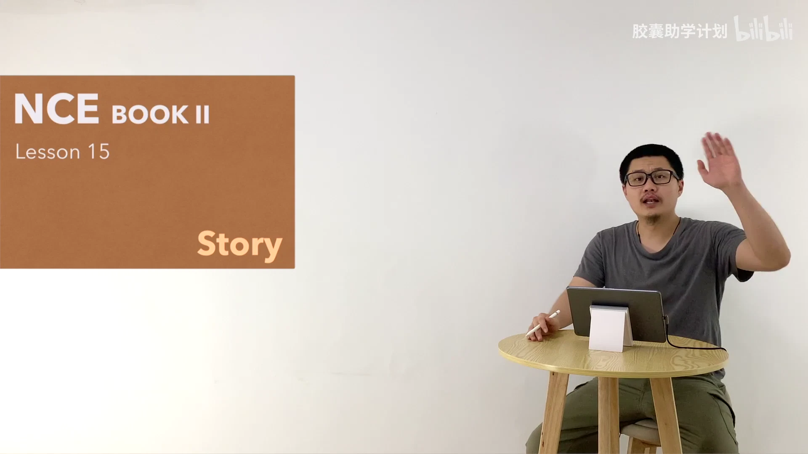

文字识别：Bibili / 胶囊助学计划 / NCE / BOOKⅡI / Lesson 15 / Story

### 画面 00:00:02

文字识别：bilbli / 胶囊助学计划 / NCE / BOOKII / Lesson 15 / Story

### 画面 00:00:05

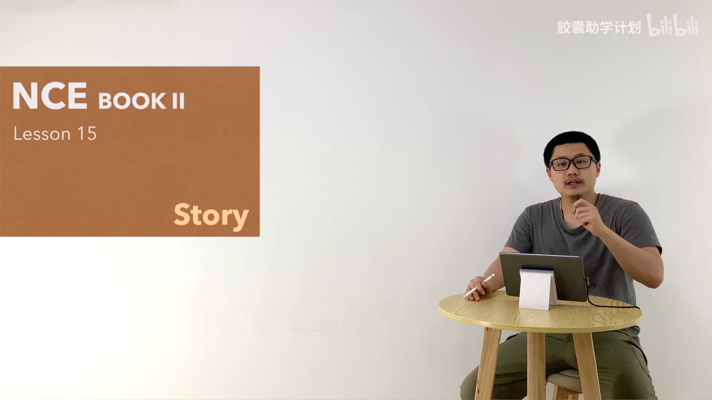

文字识别：biibili / 胶囊助学计划 / NCE / BOOKII / Lesson 15 / Story

### 画面 00:00:07

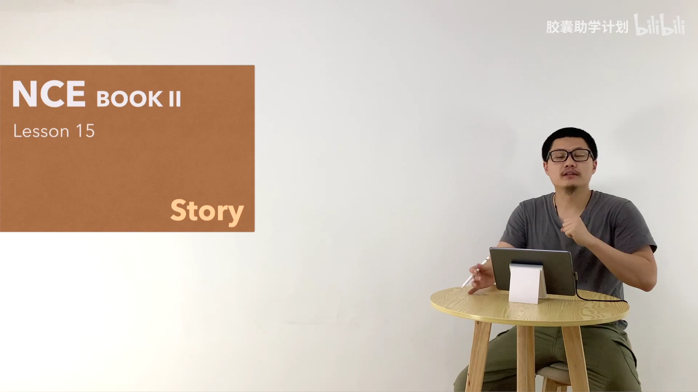

文字识别：biibli / 胶囊助学计划 / NCE / BOOKII / Lesson 15 / Story

### 画面 00:00:09

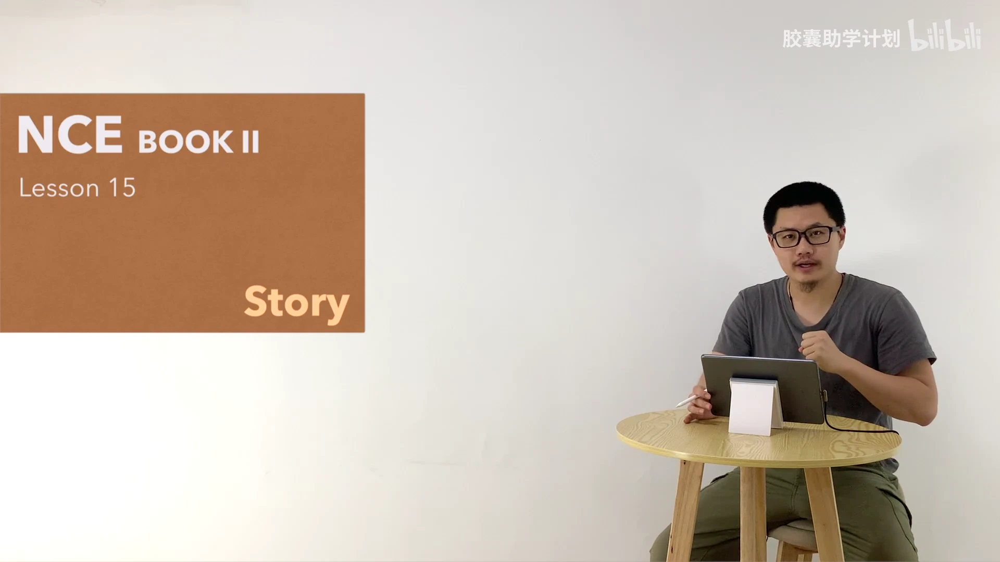

文字识别：biibili / 胶囊助学计划 / NCE / BOOKII / Lesson 15 / Story

### 画面 00:00:11

文字识别：胶囊助学计划bill

### 画面 00:00:14

### 画面 00:00:16

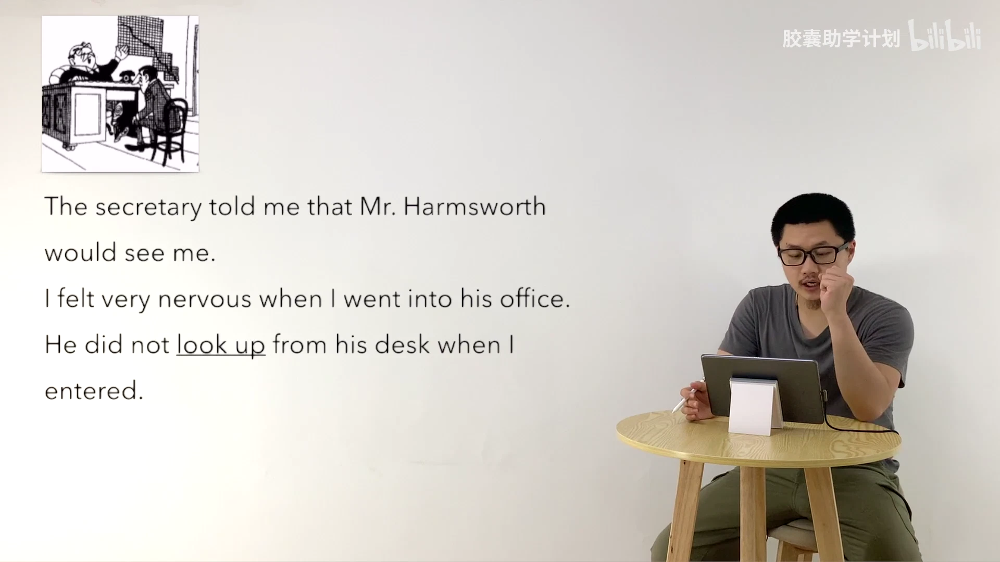

文字识别：胶囊助学计划bilb出 / The secretary told me that Mr. Harmsworth / would see me. / I felt very nervous when I went into his office. / He did not look up from his desk when I / entered.

### 画面 00:00:24

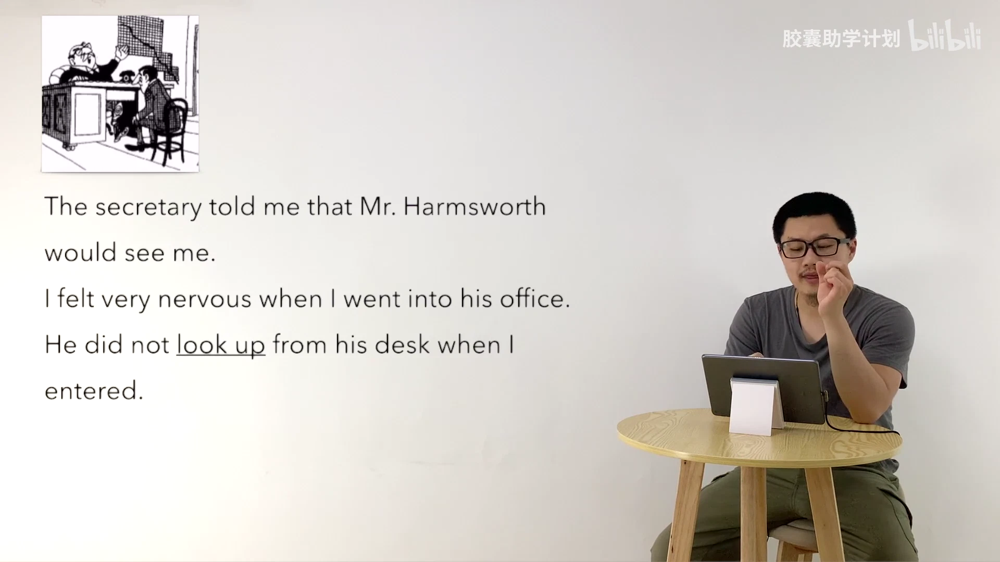

文字识别：胶囊助学计划bib鼎 / The secretary told me that Mr. Harmsworth / would see me. / I felt very nervous when I went into his office. / He did not look up from his desk when I / entered.

## 00:00:30–00:01:00

Hamsworth先生呢要见我，其实就是their boss，就是他们的老板啊。老板跟他们说，老板想见我。你看这儿用的是told，这儿把will换成了would。在语法的部分我们专门讲过。I felt very nervous.我感到非常的紧张。When当第七课咱学的，went into his office.当我进入他办公室的时候，He did

### 画面 00:00:46

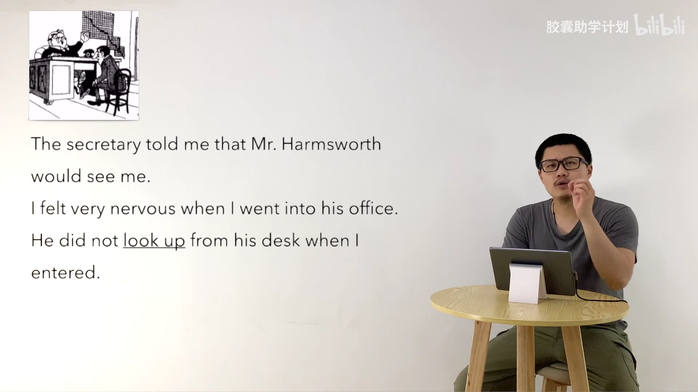

文字识别：胶囊助学计划bilb出 / The secretary told me that Mr. Harmsworth / would see me. / I felt very nervous when I went into his ofice. / He did not look up from his desk when I / entered.

### 画面 00:00:52

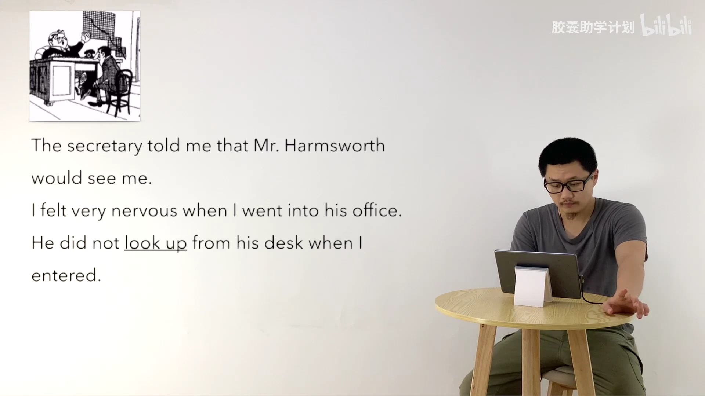

文字识别：胶囊助学计划bilb出 / The secretary told me that Mr. Harmsworth / would see me. / I felt very nervous when I went into his office. / He did not look up from his desk when I / entered.

### 画面 00:00:55

文字识别：胶囊助学计划bilb出 / The secretary told me that Mr. Harmsworth / would see me. / I felt very nervous when I went into his office. / He did not look up from his desk when I / entered.

## 00:01:00–00:01:30

He

### 画面 00:01:03

文字识别：胶囊助学计划 / The secretary told me that Mr. Harmsworth / would see me. / I felt very nervous when I went into his office. / He did not look up from his desk when I / entered.

### 画面 00:01:05

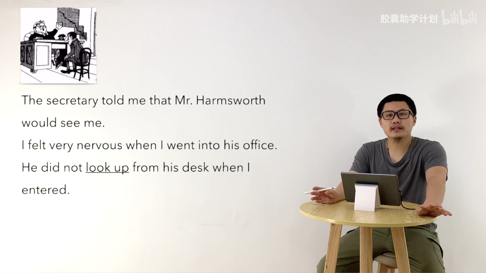

文字识别：胶囊助学计划 / 出山 / The secretary told me that Mr. Harmsworth / would see me. / I felt very nervous when I went into his office. / He did not look up from his desk when I / entered.

### 画面 00:01:07

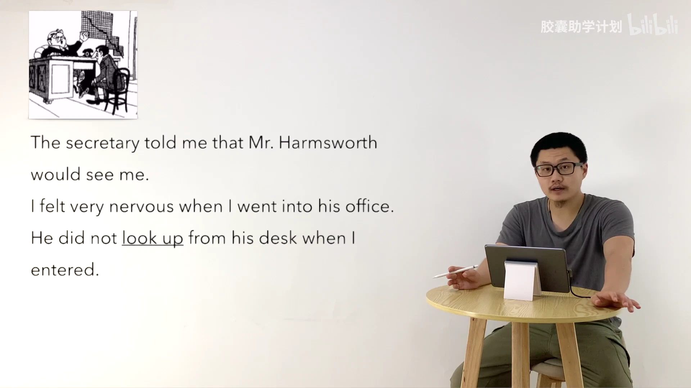

文字识别：胶囊助学计划b出b出 / The secretary told me that Mr. Harmsworth / would see me. / I felt very nervous when I went into his office. / He did not look up from his desk when I / entered.

### 画面 00:01:10

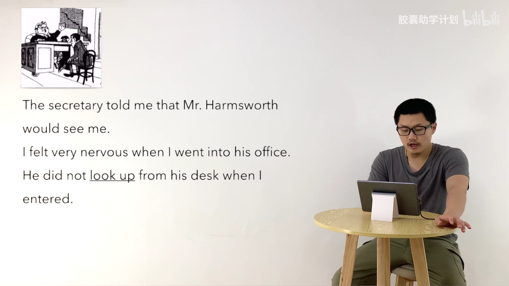

文字识别：胶囊助学计划 / 出山 / The secretary told me that Mr. Harmsworth / would see me. / I felt very nervous when I went into his office. / He did not look up from his desk when I / entered.

### 画面 00:01:14

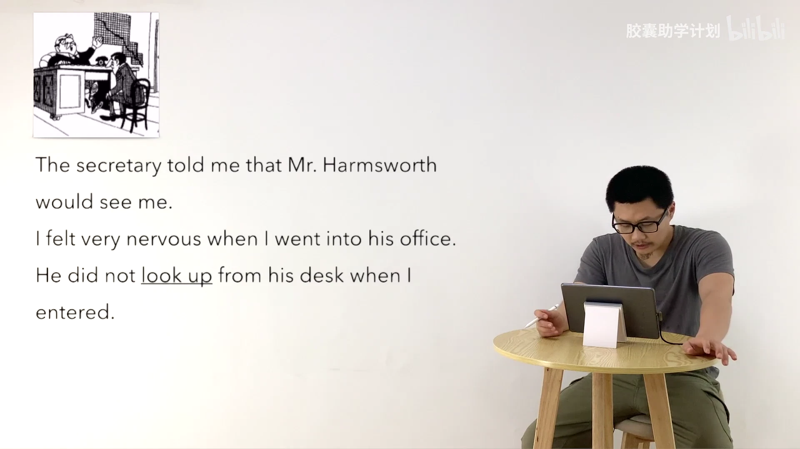

文字识别：胶囊助学计划 / The secretary told me that Mr. Harmsworth / would see me. / I felt very nervous when I went into his office. / He did not look up from his desk when I / entered.

### 画面 00:01:16

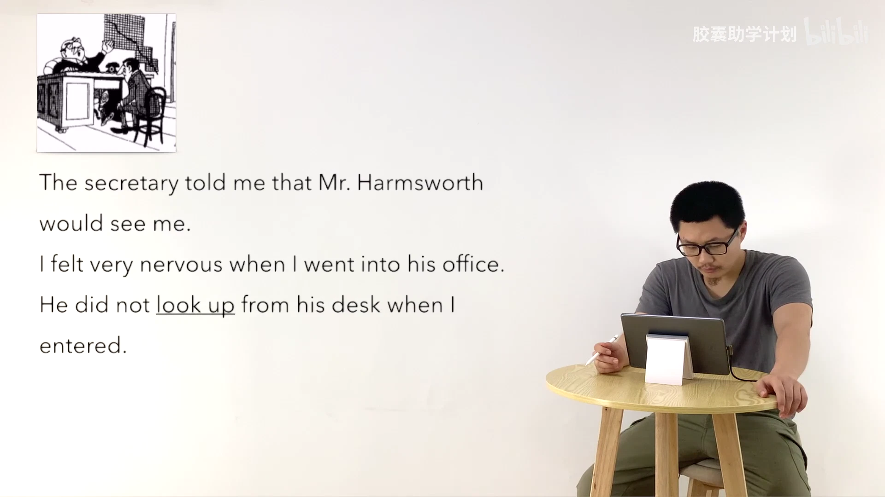

文字识别：胶囊助学计划 / The secretary told me that Mr. Harmsworth / would see me. / I felt very nervous when I went into his office. / He did not look up from his desk when I / entered.

### 画面 00:01:18

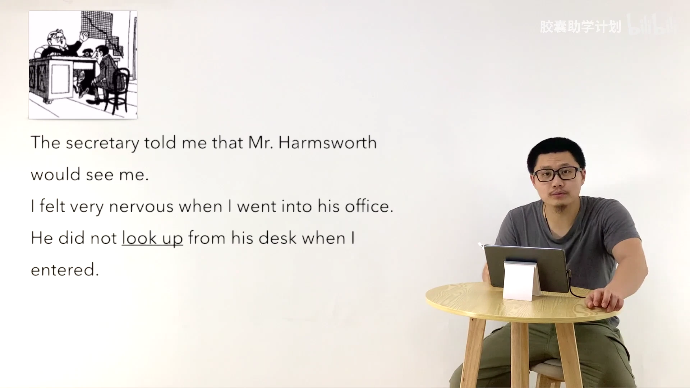

文字识别：胶囊助学计划 / The secretary told me that Mr. Harmsworth / would see me. / I felt very nervous when I went into his office. / He did not look up from his desk when I / entered.

### 画面 00:01:20

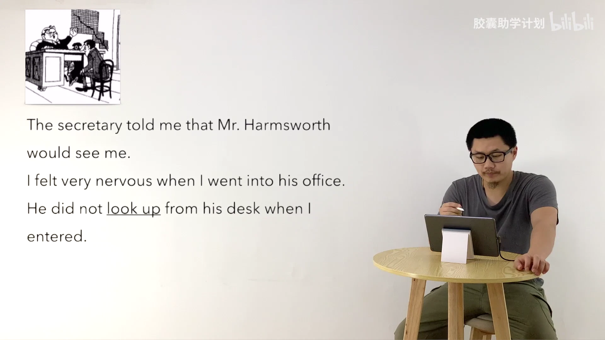

文字识别：胶囊助学计划bilb出 / The secretary told me that Mr. Harmsworth / would see me. / I felt very nervous when I went into his office. / He did not look up from his desk when I / entered.

### 画面 00:01:23

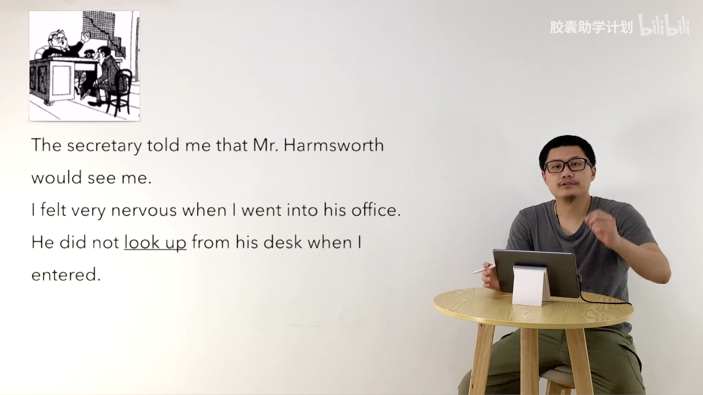

文字识别：胶囊助学计划bilb出 / The secretary told me that Mr. Harmsworth / would see me. / I felt very nervous when I went into his office. / He did not look up from his desk when I / entered.

### 画面 00:01:25

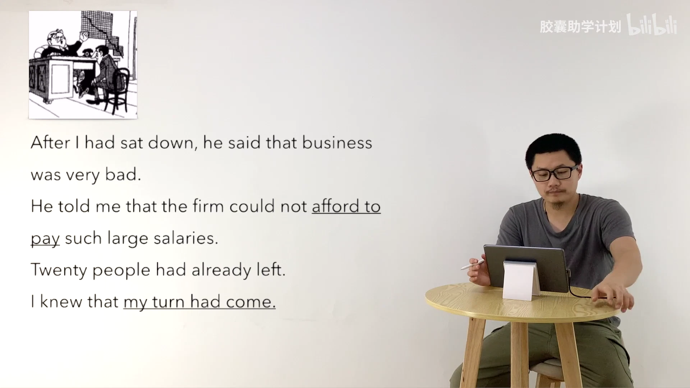

文字识别：胶囊助学计划 ilb出 / After I had sat down, he said that business / was very bad. / He told me that the firm could not afford to / pay such large salaries. / Twenty people had already left. / I knew that my turn had come.

### 画面 00:01:29

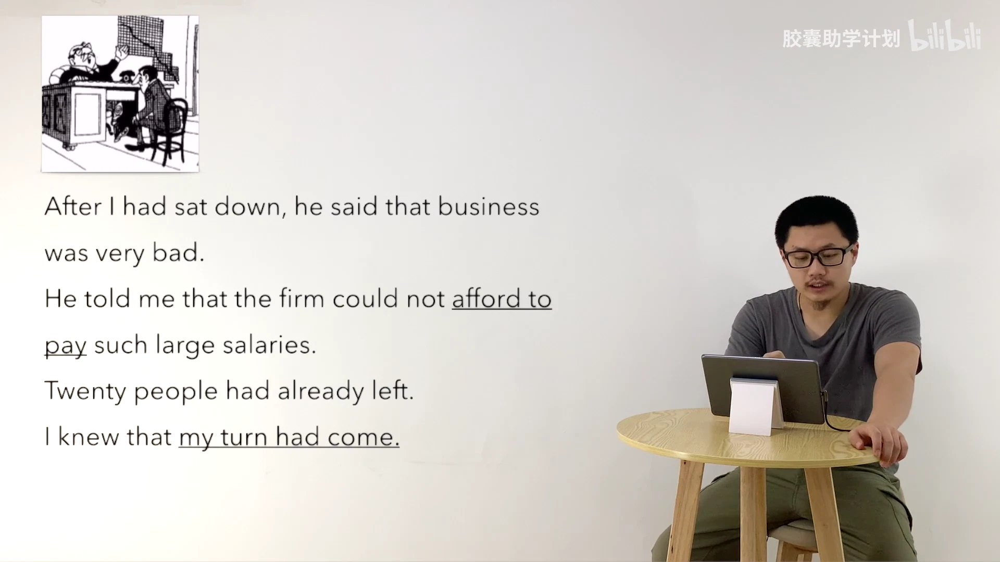

文字识别：胶囊助学计划bilb出 / After I had sat down, he said that business / was very bad. / He told me that the firm could not afford to / pay such large salaries. / Twenty people had already left. / I knew that my turn had come.

## 00:01:30–00:02:00

这是十四课咱们刚学的，叫在什么什么之后，然后后边是先发生的 set down，然后他才说了一些事情，对吧？ He said. 他说到说的这句话，宾语从句. Business was very bad. 他说啊，说了一个这么事儿，就是说这个最近这个生意啊特别差啊。您看这个图是吧？啊，都跌出天际线了是吧？跌出海平面了是吧？往下跌.

### 画面 00:01:59

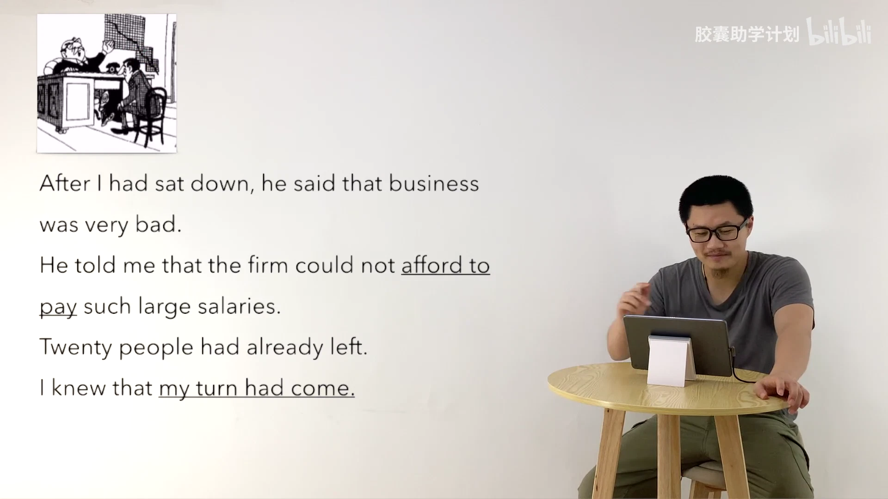

文字识别：胶囊助学计划 bilb出 / After I had sat down, he said that business / was very bad. / He told me that the firm could not afford to / pay such large salaries. / Twenty people had already left. / I knew that my turn had come.

## 00:02:00–00:02:30

He told me that他又告诉我一件事儿啊，这件事儿还是宾语从句，是吧？告诉我了一件事儿，说The firm could not afford to pay，没有办法。你看，本是 can't afford to pay，因为前面是 told，情态动词要变成他们的过去式，所以就变成了 could not afford to pay，是吧？没有办法支付如此 such large salaries，如此巨大的

### 画面 00:02:29

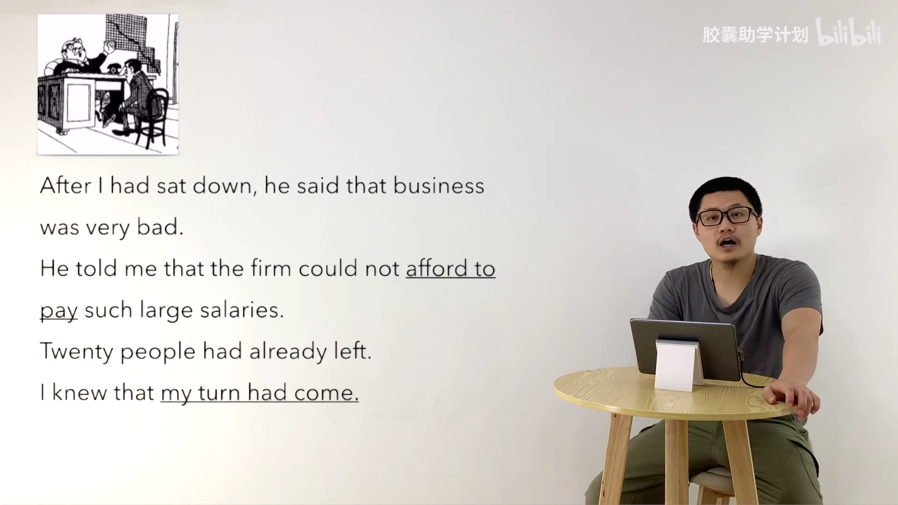

文字识别：胶囊助学计划 ilb出 / After I had sat down, he said that business / was very bad. / He told me that the firm could not afford to / pay such large salaries. / Twenty people had already left. / I knew that my turn had come.

## 00:02:30–00:03:00

薪水，你看，老板一进来跟你聊说，最近生意特别差，公司支付不了这么大的薪水了。你看，你想到的事情，要么降薪，要么我就要被炒鱿鱼了，对吧？Twenty people had already left。在咱们说这句话的之前啊，二十个人就已经离开了。你看，典型的过去的过去嘛，对吧？OK，二十个人已经离开了，全是不好的消息。I knew that。你看 that 后边宾语从

### 画面 00:02:32

文字识别：胶囊助学计划bilb出 / After I had sat down, he said that business / was very bad. / He told me that the firm could not afford to / pay such large salaries. / Twenty people had already left. / I knew that my turn had come.

### 画面 00:02:34

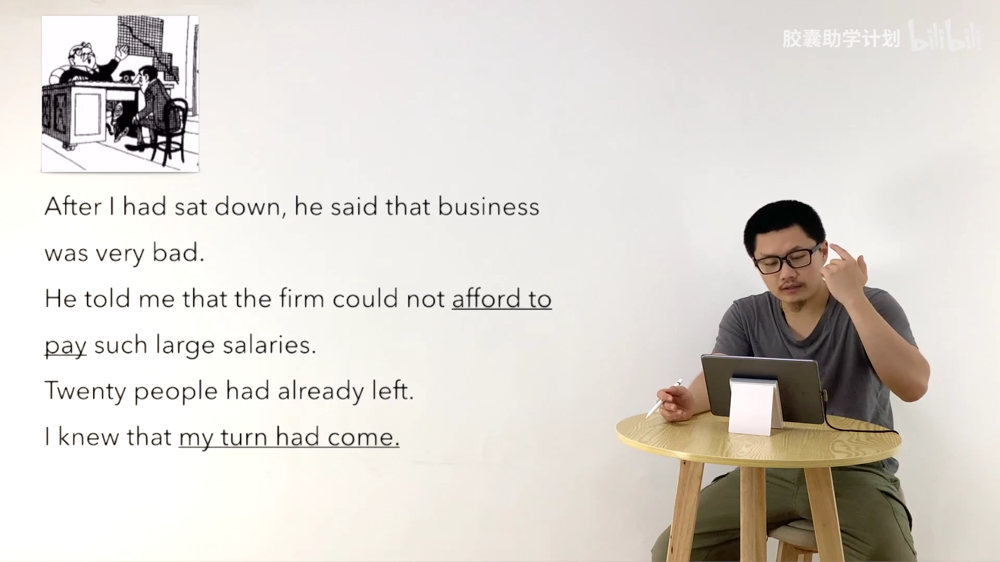

文字识别：胶囊助学计划 / After I had sat down, he said that business / was very bad. / He told me that the firm could not afford to / pay such large salaries. / Twenty people had already left. / I knew that my turn had come.

### 画面 00:02:36

文字识别：胶囊助学计划b出b出 / After I had sat down, he said that business / was very bad. / He told me that the firm could not afford to / pay such large salaries. / Twenty people had already left. / I knew that my turn had come.

### 画面 00:02:39

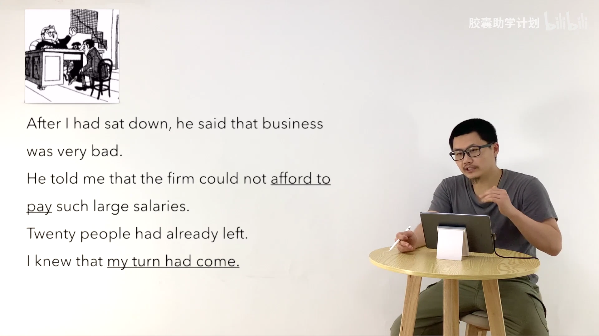

文字识别：胶囊助学计划 / After I had sat down, he said that business / was very bad. / He told me that the firm could not afford to / pay such large salaries. / Twenty people had already left. / I knew that my turn had come.

### 画面 00:02:42

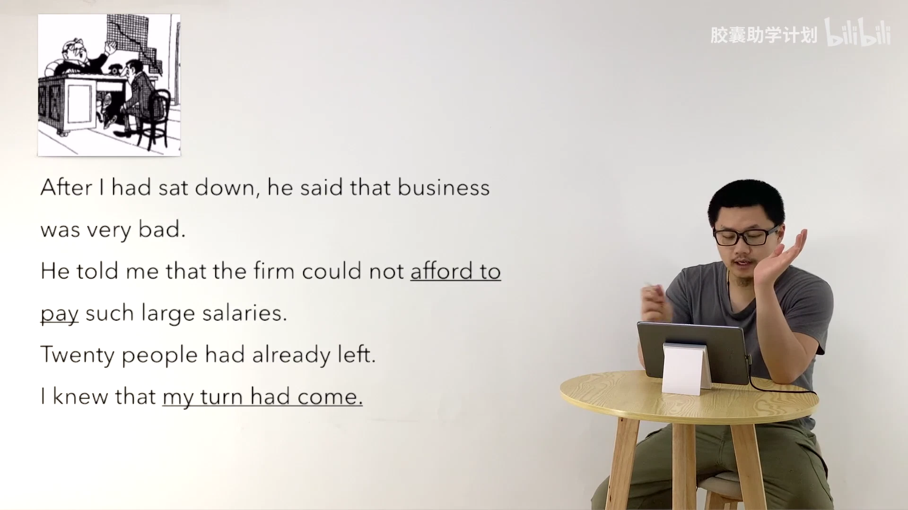

文字识别：胶囊助学计划bi出b出 / After I had sat down, he said that business / was very bad. / He told me that the firm could not afford to / pay such large salaries. / Twenty people had already left. / I knew that my turn had come.

## 00:03:00–00:03:30

句啊，非常舒服，主谓宾，对吧？我知道的一件事情是 my turn had come. 你看 one good turn deserves another. 在那一课我就讲过 turn 有一个非常常见的用法，对吧？表示的是轮到什么什么了。那 my turn 就是我的轮次 had come，叫已经来了。这句话其实不是，倒不是那么常见。一会儿我教大家一个也许更常见的表示轮到我了的说法，对吧？那 my turn had come 就是

### 画面 00:03:08

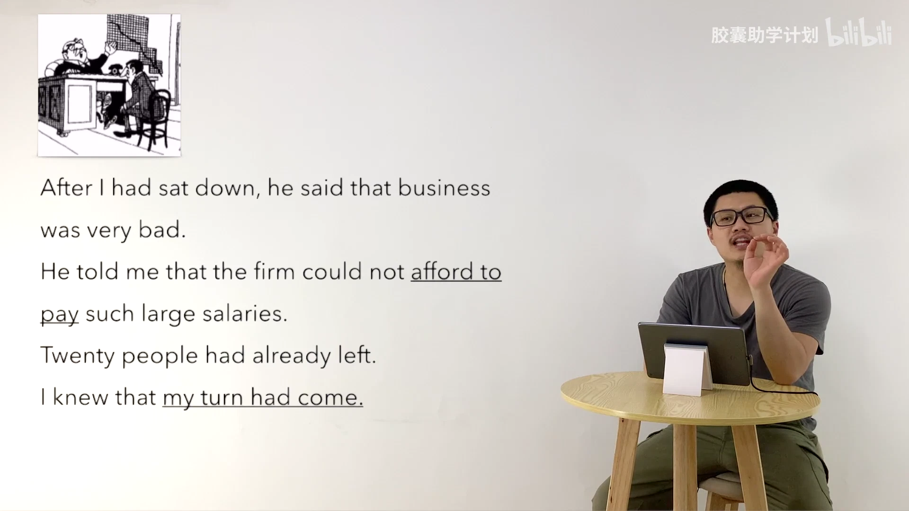

文字识别：胶囊助学计划bib出 / After I had sat down, he said that business / was very bad. / He told me that the firm could not afford to / pay such large salaries. / Twenty people had already left. / I knew that my turn had come.

### 画面 00:03:10

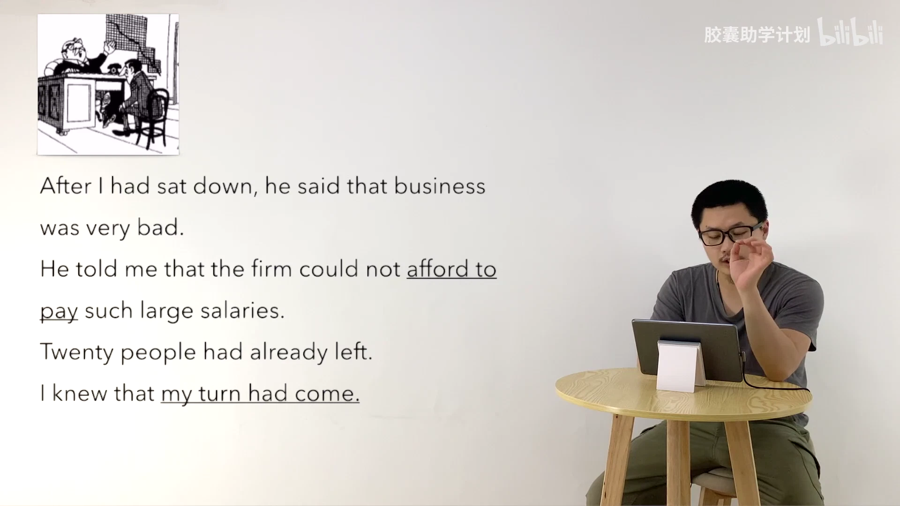

文字识别：胶囊助学计划bilb出 / After I had sat down, he said that business / was very bad. / He told me that the firm could not afford to / pay such large salaries. / Twenty people had already left. / I knew that my turn had come.

### 画面 00:03:14

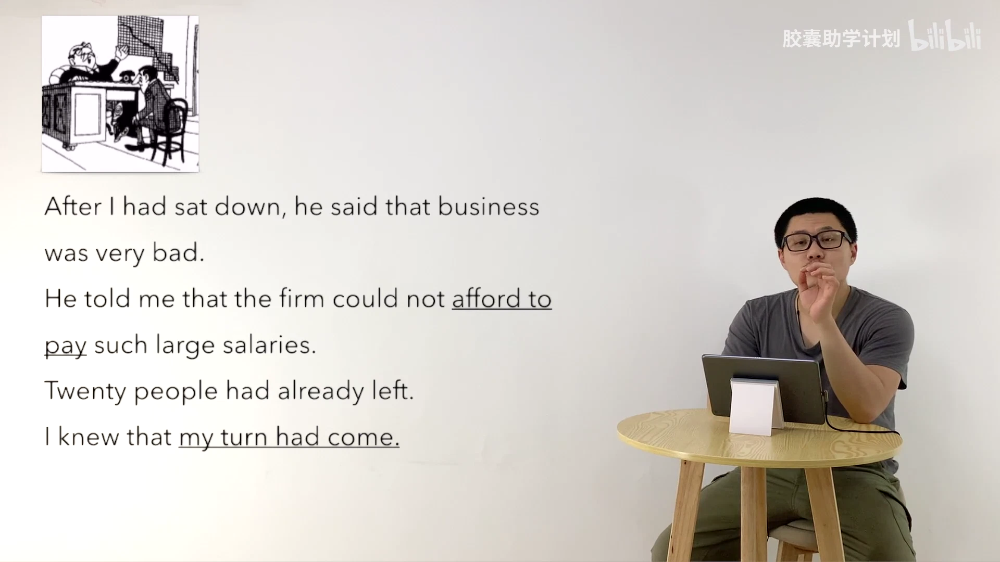

文字识别：胶囊助学计划bilb出 / After I had sat down, he said that business / was very bad. / He told me that the firm could not afford to / pay such large salaries. / Twenty people had already left. / I knew that my turn had come.

### 画面 00:03:17

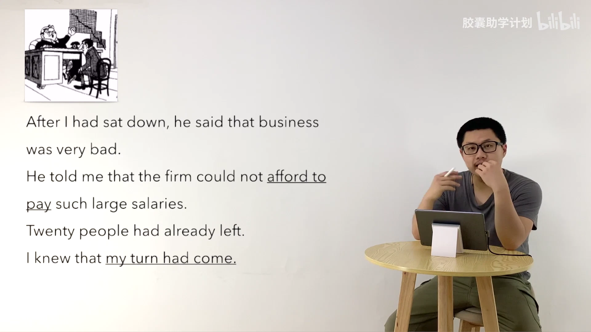

文字识别：胶囊助学计划bilb出 / After I had sat down, he said that business / was very bad. / He told me that the firm could not afford to / pay such large salaries. / Twenty people had already left. / I knew that my turn had come.

### 画面 00:03:24

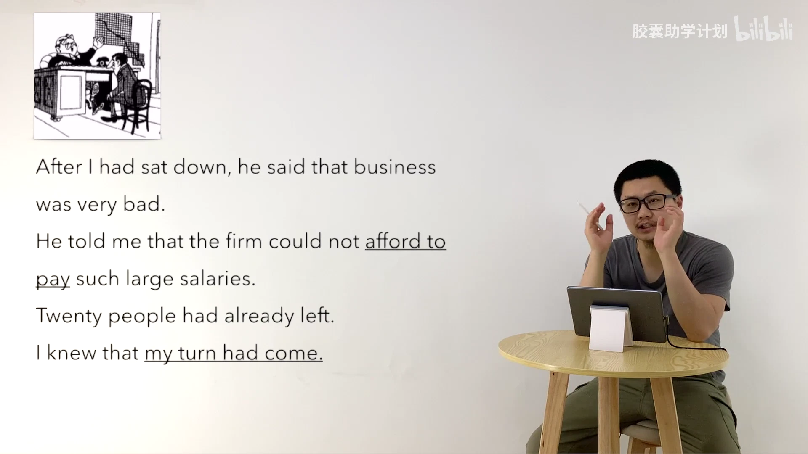

文字识别：胶囊助学计划bilb出 / After I had sat down, he said that business / was very bad. / He told me that the firm could not afford to / pay such large salaries. / Twenty people had already left. / I knew that my turn had come.

### 画面 00:03:28

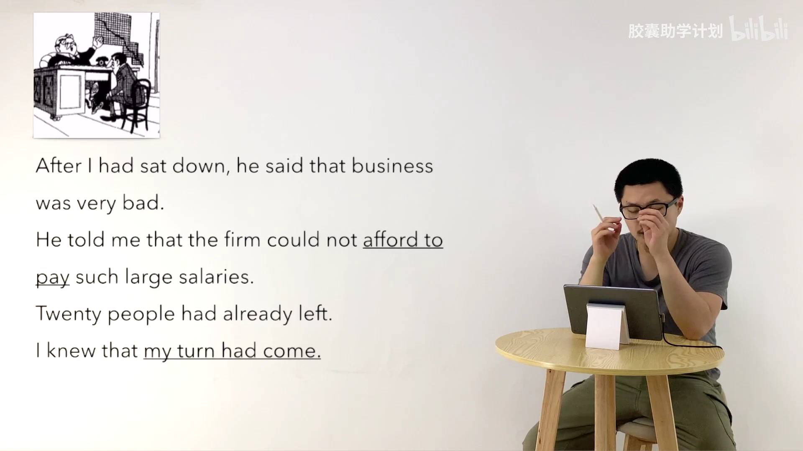

文字识别：胶囊助学计划b出b出 / After I had sat down, he said that business / was very bad. / He told me that the firm could not afford to / pay such large salaries. / Twenty people had already left. / I knew that my turn had come.

## 00:03:30–00:04:00

我的轮次已经来了，就是轮到我了。Mr. Holmesworth，啊，Holmesworth先生，I said，我说到，in a weak voice，用一种非常微弱的声嗓音说道，Don't interrupt，啊，别打断我。He said，啊，他老板还说，别打断我。Then，来了个大反转。He smiled，啊，然后他笑了，and told me，告诉我了一件事

### 画面 00:03:32

文字识别：胶囊助学计划b出b出 / 'Mr. Harmsworth,' I said in a weak voice. / 'Don't interrupt,' he said. / Then he smiled and told me I would receive / an extra thousand pounds a year!

### 画面 00:03:35

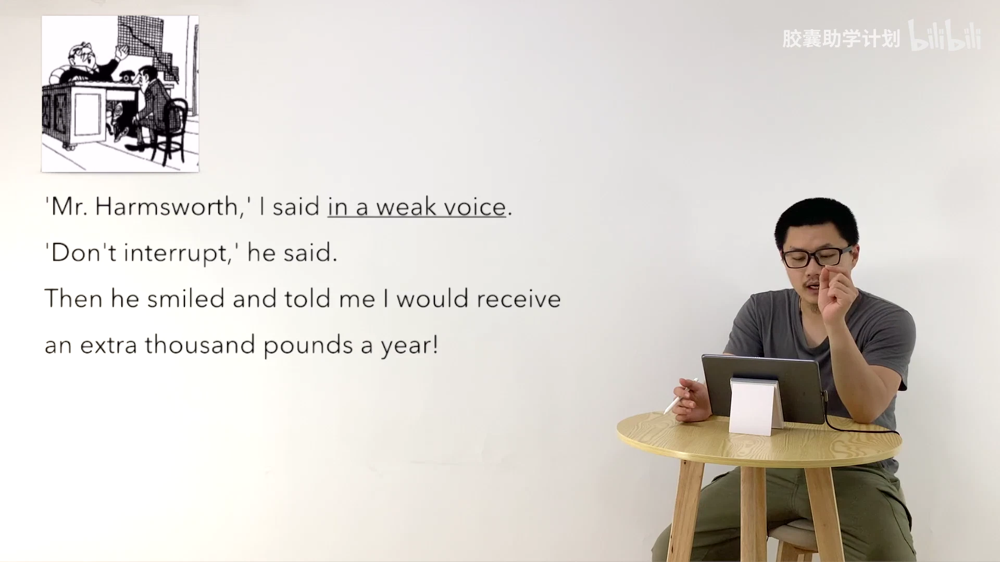

文字识别：胶囊助学计划 / 'Mr. Harmsworth,' I said in a weak voice. / 'Don't interrupt,' he said. / Then he smiled and told me I would receive / an extra thousand pounds a year!

### 画面 00:03:37

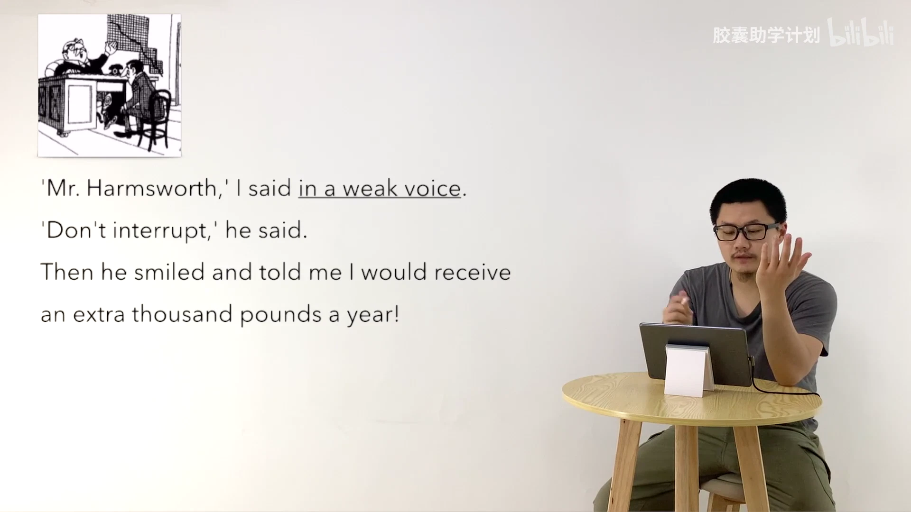

文字识别：胶囊助学计划 / 'Mr. Harmsworth,' I said in a weak voice. / 'Don't interrupt,' he said. / Then he smiled and told me I would receive / an extra thousand pounds a year!

### 画面 00:03:42

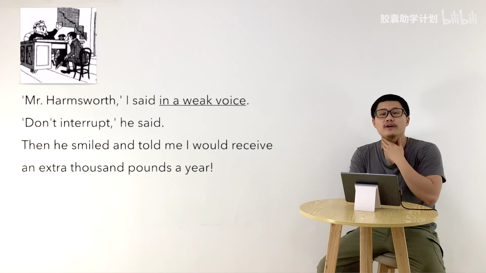

文字识别：胶囊助学计划 / 'Mr. Harmsworth,' I said in a weak voice. / 'Don't interrupt,' he said. / Then he smiled and told me I would receive / an extra thousand pounds a year!

### 画面 00:03:45

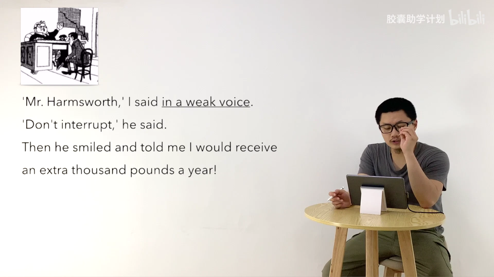

文字识别：胶囊助学计划blb出 / 'Mr. Harmsworth,' I said in a weak voice. / 'Don't interrupt,' he said. / Then he smiled and told me I would receive / an extra thousand pounds a year!

### 画面 00:03:47

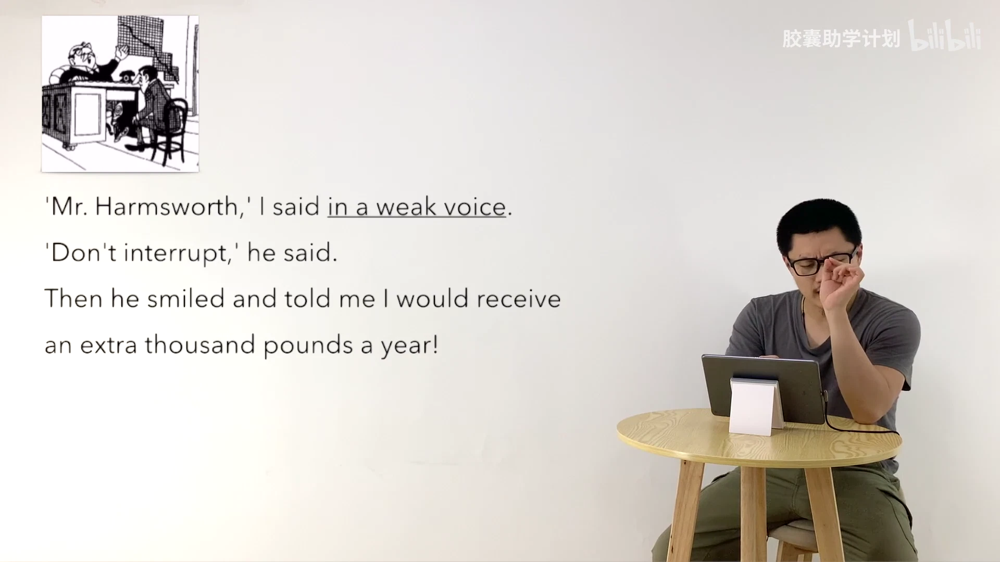

文字识别：胶囊助学计划b出b出 / 'Mr. Harmsworth,'I said in a weak voice. / 'Don't interrupt,' he said. / Then he smiled and told me I would receive / an extra thousand pounds a year!

## 00:04:00–00:04:30

儿。你看这儿后边，你有没有一眼看出来它是个宾语从句呢？如果没看出来，就是因为它的that怎么样被省略了，对不对？所以我说初期嘛，各位如果对这个语法不是很熟的时候，有that对于各位来说反而是好事儿。他告诉我了一件事情是，I would receive我将收到an extra thousand pounds，额外的thousand，an thousand，extra thousand，

### 画面 00:04:04

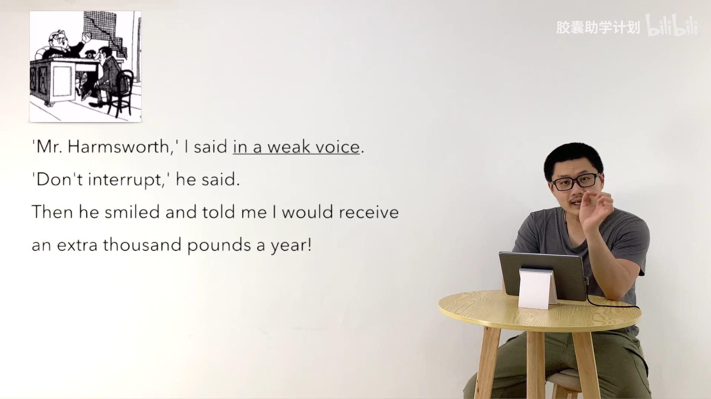

文字识别：胶囊助学计划bilb出 / 'Mr. Harmsworth,'I said in a weak voice. / 'Don't interrupt,' he said. / Then he smiled and told me I would receive / an extra thousand pounds a year!

### 画面 00:04:07

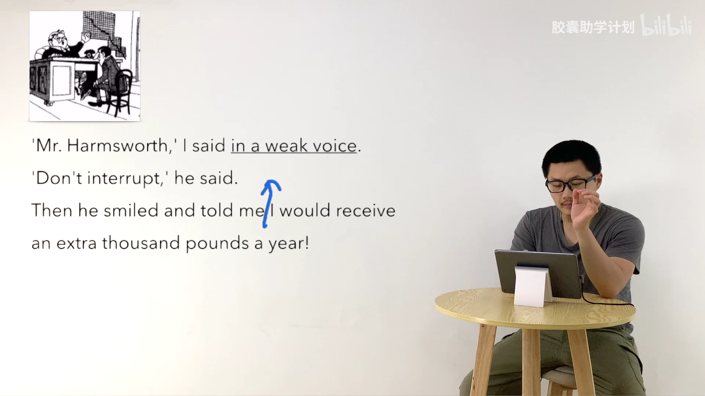

文字识别：胶囊助学计划 / 'Mr. Harmsworth,'I said in a weak voice. / 'Don't interrupt,' he said. / Then he smiled and told mel would receive / an extra thousand pounds a year!

### 画面 00:04:09

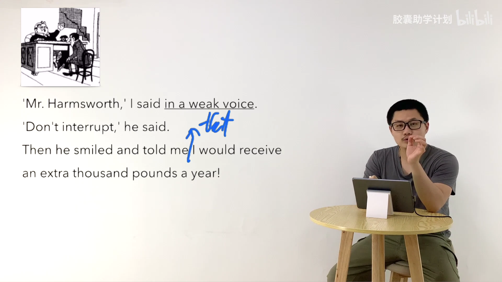

文字识别：胶囊助学计划 / 'Mr. Harmsworth,' I said in a weak voice. / et / 'Don't interrupt,' he said. / Then he smiled and told me/l would receive / an extra thousand pounds a year!

### 画面 00:04:15

文字识别：胶囊助学计划 / 'Mr. Harmsworth,'I said in a weak voice. / et / 'Don't interrupt,' he said. / Then he smiled and told meli would receive / an extra thousand pounds a year!

### 画面 00:04:17

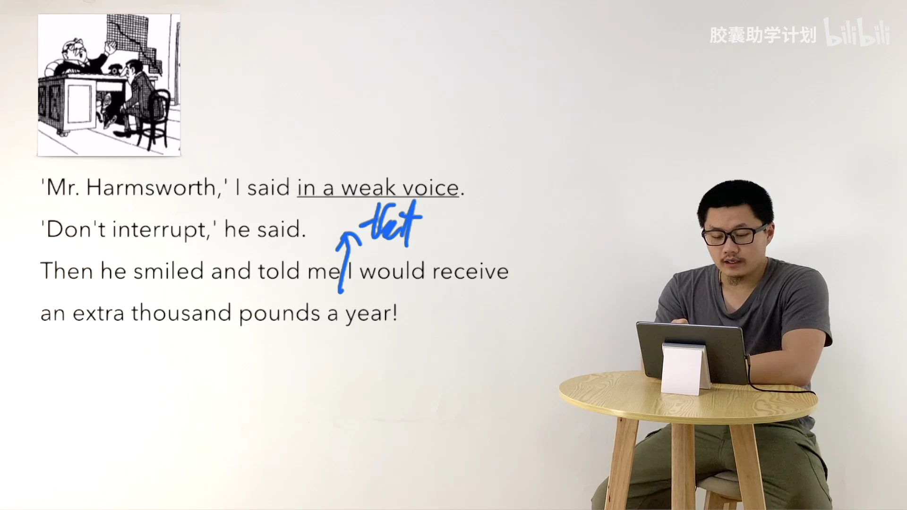

文字识别：胶囊助学计划 / b出出 / 'Mr. Harmsworth,' I said in a weak voice. / et / 'Don't interrupt,' he said. / Then he smiled and told meli would receive / an extra thousand pounds a year!

## 00:04:30–00:05:00

一千 pounds a year,一年啊。告诉我，我一年要将额外收入一千磅啊。你很重要，你不能走，对吧？二十个人都走了，你要给我留下来。OK， one more.那本课的习惯用法不是非常的多，也都比较的简单啊。单词部分甚至我们有一些已经讲过了啊。我们简单的一起看一下。首先，afford to pay叫支付得起，对吧？OK，比如说，那当然你加了can't，

### 画面 00:04:34

文字识别：胶囊助学计划 / 出5出 / 'Mr. Harmsworth,' I said in a weak voice. / tet / 'Don't interrupt,' he said. / Then he smiled and told me/ would receive / an extra thousand pounds a year!

### 画面 00:04:38

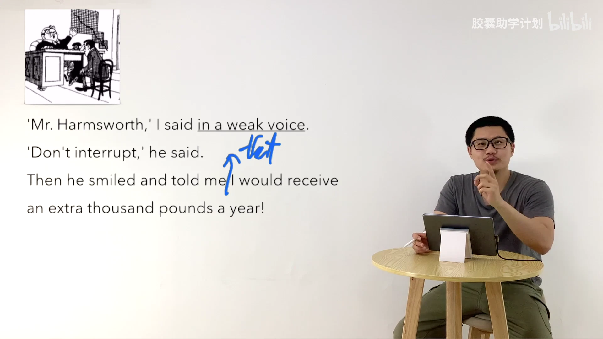

文字识别：胶囊助学计划 / 'Mr. Harmsworth,' I said in a weak voice. / et / 'Don't interrupt,' he said. / Then he smiled and told me/l would receive / an extra thousand pounds a year!

### 画面 00:04:42

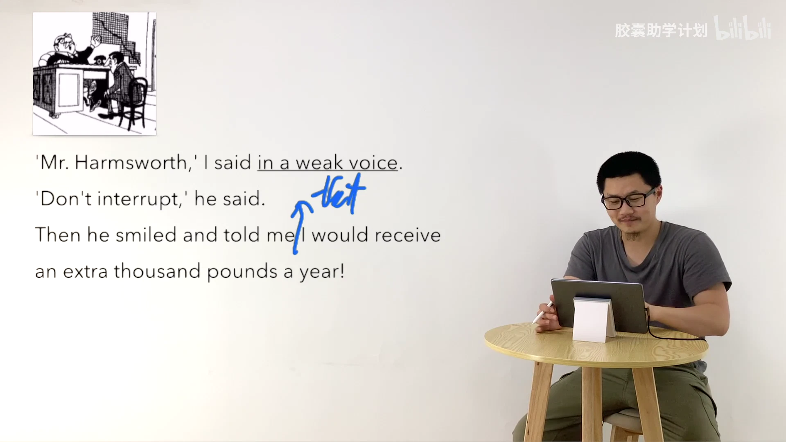

文字识别：胶囊助学计划出b出 / 'Mr. Harmsworth,'I said in a weak voice. / tet / 'Don't interrupt,' he said. / Then he smiled and told me/l would receive / an extra thousand pounds a year!

### 画面 00:04:44

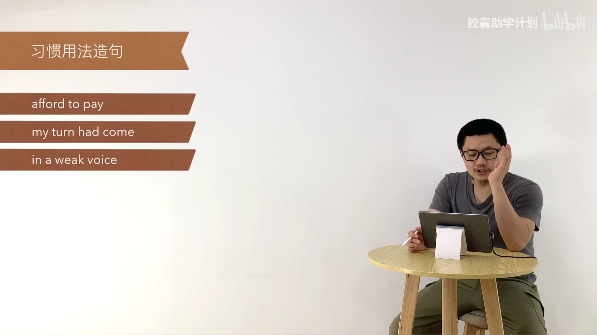

文字识别：bilbili / 胶囊助学计划 / 习惯用法造句 / afford to pay / my turn had come / in a weak voice

### 画面 00:04:46

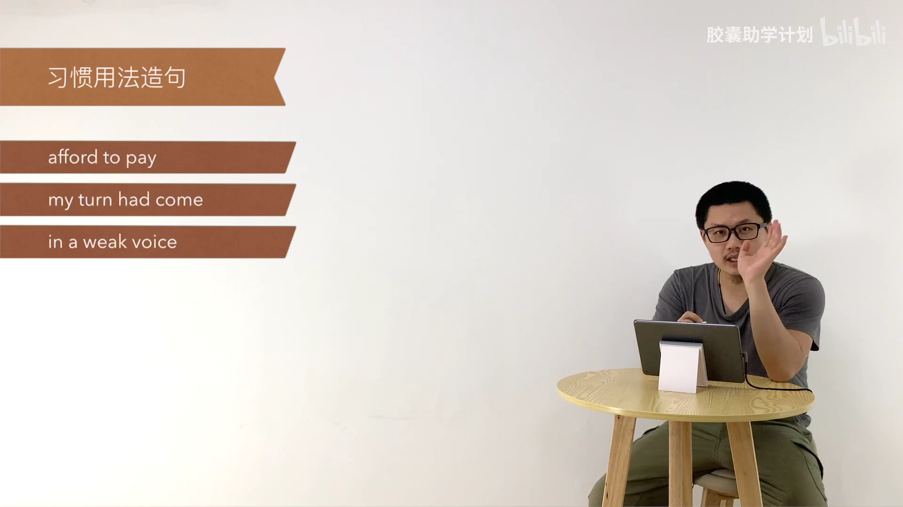

文字识别：Bilbl / 胶囊助学计划 / 习惯用法造句 / afford to pay / my turn had come / in a weak voice

### 画面 00:04:49

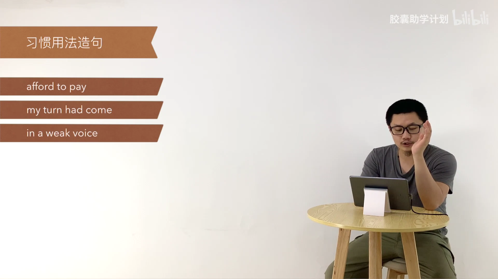

文字识别：Bilibil / 胶囊助学计划 / 习惯用法造句 / afford to pay / my turn had come / in a weak voice

### 画面 00:04:51

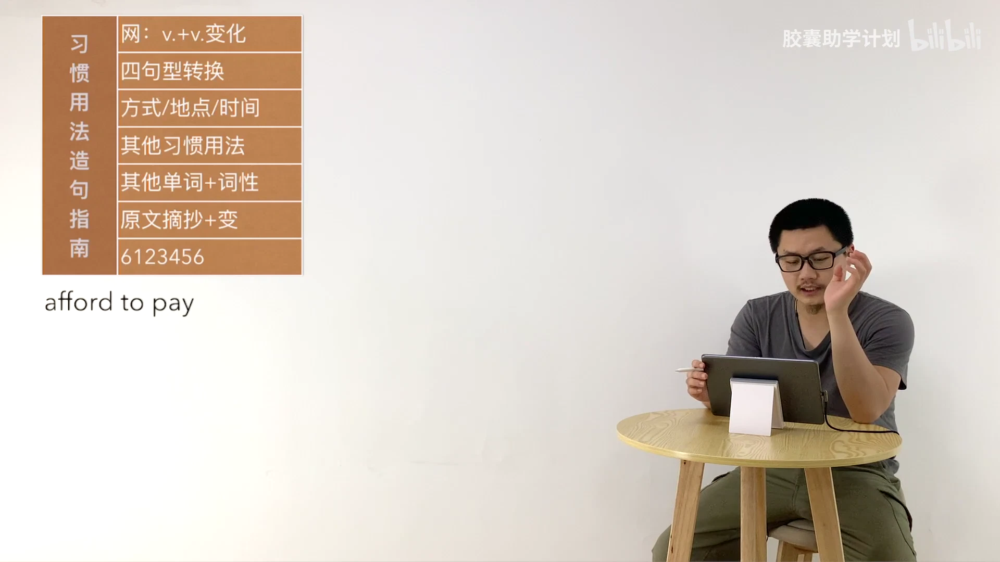

文字识别：习惯用法造句指南 / 网：v.+v.变化 / 胶囊助学计划 / Bilbil / 四句型转换 / 方式/地点/时间 / 其他习惯用法 / 其他单词+词性 / 原文摘抄+变 / 6123456 / afford to pay

### 画面 00:04:53

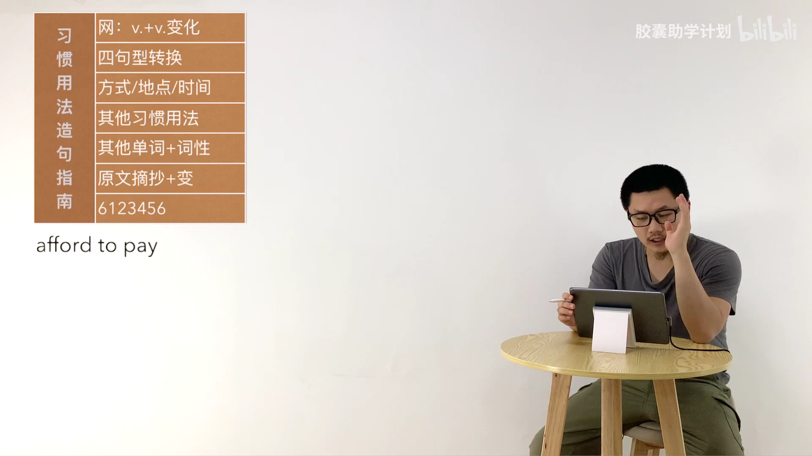

文字识别：习惯用法造句指南 / 网：v.+v.变化 / 胶囊助学计划 / Bilbili / 四句型转换 / 方式/地点/时间 / 其他习惯用法 / 其他单词+词性 / 原文摘抄+变 / 6123456 / afford to pay

### 画面 00:04:55

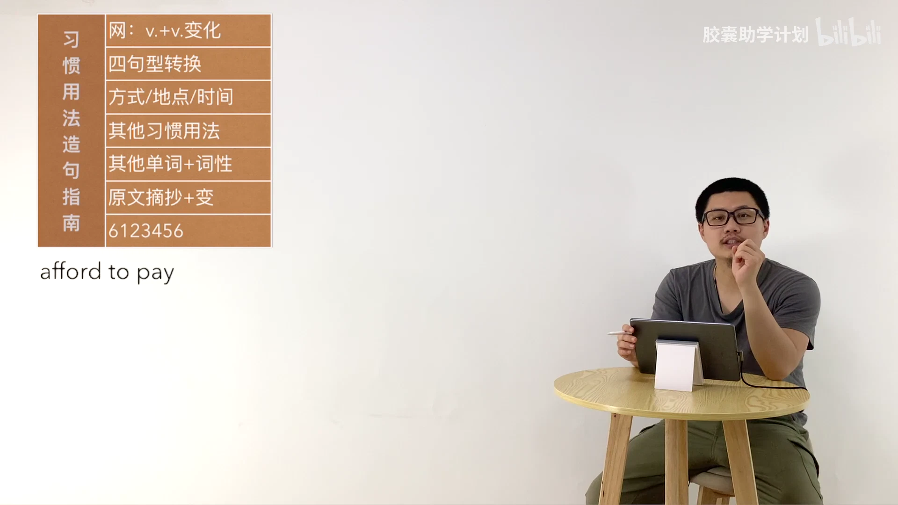

文字识别：网：v.+v.变化 / 胶囊助学计划 / BiiBii / 习惯用法造句指南 / 四句型转换 / 方式/地点/时间 / 其他习惯用法 / 其他单词+词性 / 原文摘抄+变 / 6123456 / afford to pay

### 画面 00:04:57

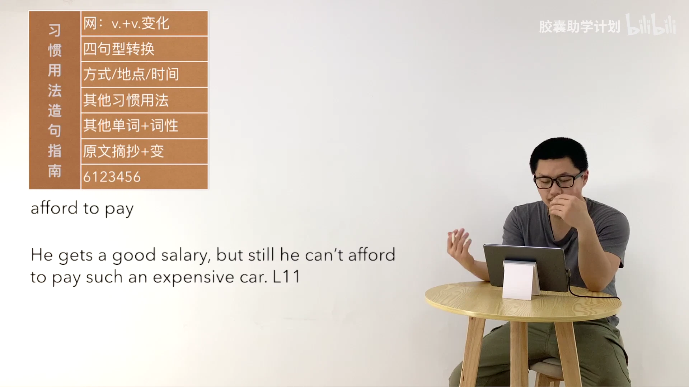

文字识别：网：v.+v.变化 / 胶囊助学计划 / 习惯用法造句指南 / 四句型转换 / 方式/地点/时间 / 其他习惯用法 / 其他单词+词性 / 原文摘抄+变 / 6123456 / afford to pay / He gets a good salary, but still he can't afford / to pay such an expensive car. L11

### 画面 00:04:59

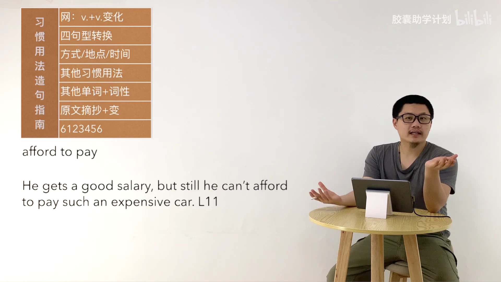

文字识别：网：v.+v.变化 / 胶囊助学计划 / 习惯用法造句指南 / 四句型转换 / 方式/地点/时间 / 其他习惯用法 / 其他单词+词性 / 原文摘抄+变 / 6123456 / afford to pay / He gets a good salary, but still he can't afford / to pay such an expensive car. L11

## 00:05:00–00:05:30

就是支付不起了嘛。 He gets a good salary. 第十一课的习惯用法叫他收入还不错，陈述客观事实，一般现在时。 But still, 但依旧， he can't afford to pay such an expensive car. 他依旧没办法支付得起如此昂贵的一辆车，对吧？一年一百万，依旧买不起宾利，对吧？太贵了啊！他薪水真好，但依旧买不起这么昂贵的车。 Very good. Continue. 常用的另

### 画面 00:05:01

文字识别：网：v.+v.变化 / 胶囊助学计划 / Bilbilt / 习惯用法造句指南 / 四句型转换 / 方式/地点/时间 / 其他习惯用法 / 其他单词+词性 / 原文摘抄+变 / 6123456 / afford to pay / He gets a good salary, but still he can't afford / to pay such an expensive car. L11

### 画面 00:05:04

文字识别：网：v.+v.变化 / 胶囊助学计划 / Biltbili / 习惯用法造句指南 / 四句型转换 / 方式/地点/时间 / 其他习惯用法 / 其他单词+词性 / 原文摘抄+变 / 6123456 / afford to pay / He gets a good salary, but still he can't afford / to pay such an expensive car. L11

### 画面 00:05:06

文字识别：网：v.+v.变化 / 胶囊助学计划 / Bilbil / 习惯用法造句指南 / 四句型转换 / 方式/地点/时间 / 其他习惯用法 / 其他单词+词性 / 原文摘抄+变 / 6123456 / afford to pay / He gets a good salary, but still he can't afford / to pay such an expensive car. L11

### 画面 00:05:09

文字识别：网：v.+v.变化 / 胶囊助学计划 / Bilbil / 习惯用法造句指南 / 四句型转换 / 方式/地点/时间 / 其他习惯用法 / 其他单词+词性 / 原文摘抄+变 / 6123456 / afford to pay / He gets a good salary, but still he can't afford / to pay such an expensive car. L11

### 画面 00:05:11

文字识别：网：v.+v.变化 / 胶囊助学计划 / Bilbl / 习惯用法造句指南 / 四句型转换 / 方式/地点/时间 / 其他习惯用法 / 其他单词+词性 / 原文摘抄+变 / 6123456 / afford to pay / He gets a good salary, but still he can't afford / to pay such an expensive car. L11

### 画面 00:05:15

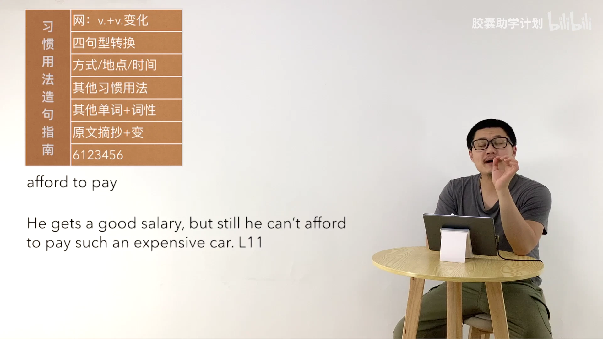

文字识别：网：v.+v.变化 / 胶囊助学计划 / Bilbili / 习惯用法造句指南 / 四句型转换 / 方式/地点/时间 / 其他习惯用法 / 其他单词+词性 / 原文摘抄+变 / 6123456 / afford to pay / He gets a good salary, but still he can't aff ord / to pay such an expensive car. L11

### 画面 00:05:20

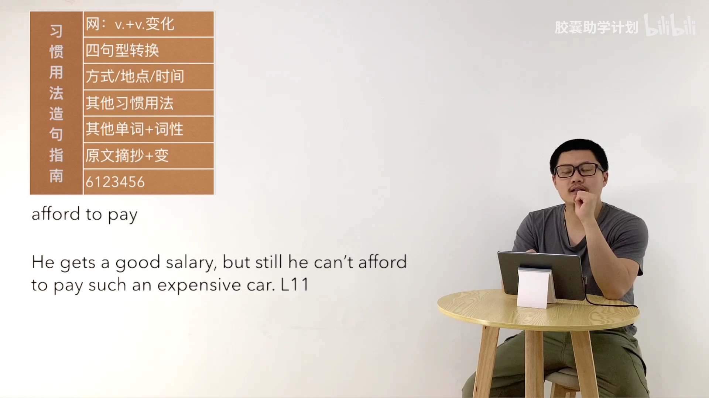

文字识别：网：v.+v.变化 / 胶囊助学计划 / Bifbili / 习惯用法造句指南 / 四句型转换 / 方式/地点/时间 / 其他习惯用法 / 其他单词+词性 / 原文摘抄+变 / 6123456 / afford to pay / He gets a good salary, but still he can't afford / to pay such an expensive car. L11

### 画面 00:05:22

文字识别：网：v.+v.变化 / 胶囊助学计划 / BiBili / 习惯用法造句指南 / 四句型转换 / 方式/地点/时间 / 其他习惯用法 / 其他单词+词性 / 原文摘抄+变 / 6123456 / afford to pay / He gets a good salary, but still he can't afford / to pay such an expensive car. L11

### 画面 00:05:25

文字识别：网：v.+v.变化 / 胶囊助学计划bilb出 / 习惯用法造句指南 / 四句型转换 / 方式/地点/时间 / 其他习惯用法 / 其他单词+词性 / 原文摘抄+变 / 6123456 / afford to pay / He gets a good salary, but still he can't aff ord / to pay such an expensive car. L11

### 画面 00:05:28

文字识别：网：v.+v.变化 / 胶囊助学计划 / Biltbli / 习惯用法造句指南 / 四句型转换 / 方式/地点/时间 / 其他习惯用法 / 其他单词+词性 / 原文摘抄+变 / 6123456 / afford to pay / He gets a good salary, but still he can't afford / to pay such an expensive car. L11 / Can we afford to pay this?

## 00:05:30–00:06:00

一个叫做Can we afford to pay this?我们能支付得起吗？其实它不用afford to pay也可以，直接就说Can we afford this?各位想一下，单词部分我讲过对吧？他们俩其实意思是一样的。OK，下来My turn had come.这个我刚才讲到，在讲文章的时候提到，我说它的意思您懂就行了啊，知道turn有这么一个轮次啊的意思就可以了，轮到

### 画面 00:05:30

文字识别：网：v.+v.变化 / 胶囊助学计划 / Bilbil / 习惯用法造句指南 / 四句型转换 / 方式/地点/时间 / 其他习惯用法 / 其他单词+词性 / 原文摘抄+变 / 6123456 / afford to pay / He gets a good salary, but still he can't afford / to pay such an expensive car. L11 / Can we afford to pay this?

### 画面 00:05:32

文字识别：网：v.+v.变化 / 胶囊助学计划 / Bitbi / 习惯用法造句指南 / 四句型转换 / 方式/地点/时间 / 其他习惯用法 / 其他单词+词性 / 原文摘抄+变 / 6123456 / afford to pay / He gets a good salary, but still he can't afford / to pay such an expensive car. L11 / Can we afford to pay this?

### 画面 00:05:34

文字识别：网：v.+v.变化 / 胶囊助学计划bl出 / 习惯用法造句指南 / 四句型转换 / 方式/地点/时间 / 其他习惯用法 / 其他单词+词性 / 原文摘抄+变 / 6123456 / aff ord to pay / He gets a good salary, but still he can't aff ord / to pay such an expensive car. L11 / Can we afford to pay this?

### 画面 00:05:36

文字识别：网：v.+v.变化 / 胶囊助学计划 / Bilbili / 习惯用法造句指南 / 四句型转换 / 方式/地点/时间 / 其他习惯用法 / 其他单词+词性 / 原文摘抄+变 / 6123456 / afford to pay / He gets a good salary, but still he can't afford / to pay such an expensive car. L11 / Can we afford to pay this?

### 画面 00:05:38

文字识别：网：v.+v.变化 / 习惯用法造句指南 / 胶囊助学计划 / 四句型转换 / 方式/地点/时间 / 其他习惯用法 / 其他单词+词性 / 原文摘抄+变 / 6123456 / aff ord to pay / He gets a good salary, but still he can't afford / to pay such an expensive car. L11 / Can we afford to pay this?

### 画面 00:05:40

文字识别：网：v.+v.变化 / 胶囊助学计划 / Biibili / 习惯用法造句指南 / 四句型转换 / 方式/地点/时间 / 其他习惯用法 / 其他单词+词性 / 原文摘抄+变 / 6123456 / afford to pay / He gets a good salary, but still he can't afford / to pay such an expensive car. L11 / Can we afford to pay this?

### 画面 00:05:42

文字识别：网：v.+v.变化 / 胶囊助学计划 / Bilbii / 习惯用法造句指南 / 四句型转换 / 方式/地点/时间 / 其他习惯用法 / 其他单词+词性 / 原文摘抄+变 / 6123456 / afford to pay / He gets a good salary, but still he can't afford / to pay such an expensive car. L11 / Can we afford to pay this?

### 画面 00:05:45

文字识别：网：v.+v.变化 / 胶囊助学计划 / Bilibili / 习惯用法造句指南 / 四句型转换 / 方式/地点/时间 / 其他习惯用法 / 其他单词+词性 / 原文摘抄+变 / 6123456 / my turn had come

### 画面 00:05:47

文字识别：网：v.+v.变化 / 胶囊助学计划 / bilbili / 习惯用法造句指南 / 四句型转换 / 方式/地点/时间 / 其他习惯用法 / 其他单词+词性 / 原文摘抄+变 / 6123456 / my turn had come

### 画面 00:05:49

文字识别：网：v.+v.变化 / 胶囊助学计划 / Bilbili / 习惯用法造句指南 / 四句型转换 / 方式/地点/时间 / 其他习惯用法 / 其他单词+词性 / 原文摘抄+变 / 6123456 / my turn had come

### 画面 00:05:51

文字识别：网：v.+v.变化 / 胶囊助学计划 / Bilibili / 习惯用法造句指南 / 四句型转换 / 方式/地点/时间 / 其他习惯用法 / 其他单词+词性 / 原文摘抄+变 / 6123456 / my turn had come

### 画面 00:05:53

文字识别：网：v.+v.变化 / 胶囊助学计划 / Blbli / 习惯用法造句指南 / 四句型转换 / 方式/地点/时间 / 其他习惯用法 / 其他单词+词性 / 原文摘抄+变 / 6123456 / my turn had come

### 画面 00:05:55

文字识别：网：v.+v.变化 / 胶囊助学计划 / Bilbli / 习惯用法造句指南 / 四句型转换 / 方式/地点/时间 / 其他习惯用法 / 其他单词+词性 / 原文摘抄+变 / 6123456 / my turn had come

### 画面 00:05:57

文字识别：Bilbili / 网：v.+v.变化 / 胶囊助学计划 / 习惯用法造句指南 / 四句型转换 / 方式/地点/时间 / 其他习惯用法 / 其他单词+词性 / 原文摘抄+变 / 6123456 / my turn had come

## 00:06:00–00:06:30

谁谁谁的一个轮次，对吧？就可以了。它比它更常见的就是这样非常简单一句话叫做 It's my turn。啊， It's my turn。口语当中非常常用。所以接下来我们看一个小的电影片段，出现了就是 It's my turn。注意力集中了。 I want to see it. It's my turn. New choice. Okay. I want

### 画面 00:06:00

文字识别：网：v.+v.变化 / 胶囊助学计划 / Bilbili / 习惯用法造句指南 / 四句型转换 / 方式/地点/时间 / 其他习惯用法 / 其他单词+词性 / 原文摘抄+变 / 6123456 / my turn had come

### 画面 00:06:03

文字识别：网：v.+v.变化 / 胶囊助学计划 / Bilbili / 习惯用法造句指南 / 四句型转换 / 方式/地点/时间 / 其他习惯用法 / 其他单词+词性 / 原文摘抄+变 / 6123456 / my turn had come / It's my turn.

### 画面 00:06:05

文字识别：Bilbili / 网：v.+v.变化 / 胶囊助学计划 / 习惯用法造句指南 / 四句型转换 / 方式/地点/时间 / 其他习惯用法 / 其他单词+词性 / 原文摘抄+变 / 6123456 / my turn had come / It's my turn.

### 画面 00:06:07

文字识别：网：v.+v.变化 / 胶囊助学计划 / Bilbili / 习惯用法造句指南 / 四句型转换 / 方式/地点/时间 / 其他习惯用法 / 其他单词+词性 / 原文摘抄+变 / 6123456 / my turn had come / It's my turn.

### 画面 00:06:09

文字识别：习惯用法造句指南 / 网：v.+v.变化 / 胶囊助学计划 / 四句型转换 / 方式/地点/时间 / 其他习惯用法 / 其他单词+词性 / 原文摘抄+变 / 6123456 / my turn had come / It's my turn.

### 画面 00:06:11

文字识别：It's my turn. / Bilbili / 胶囊助学计划 / 玩具总动员3 / 我要看看-该轮到我看了 / Toy Story 3 / I want to see.-It's my turn. / (2010)

### 画面 00:06:13

文字识别：It's my turn. / biibli / 胶囊助学计划 / • / 玩具总动员3 / 我要看看-该轮到我看了 / Toy Story 3 / I want to see.-It's my turn. / (2010)

### 画面 00:06:15

文字识别：It's my turn. / biibili / 胶囊助学计划 / 玩具总动员3 / 我要看看-该轮到我看了 / Toy Story 3 / I wantto see.-It's my turn. / (2010)

### 画面 00:06:17

文字识别：It's my turn. / Bilbili / 胶囊助学计划 / 玩具总动员3 / 我要看看-该轮到我看了 / Toy Story 3 / I want to see.-It's my turn. / (2010)

### 画面 00:06:19

文字识别：It's my turn. / bibili / 胶囊助学计划 / 玩具总动员3 / 我要看看。该轮到我看了 / Toy Story 3 / I wantto see. Irs my turn. / (2010)

### 画面 00:06:21

文字识别：It's my turn. / bilibii / 胶囊助学计划 / 玩具总动员3 / Toy Story 3 / (2010)

### 画面 00:06:23

文字识别：It's my turn. / bibili / 胶囊助学计划 / 玩具总动员3 / Toy Story3 / (2010)

### 画面 00:06:25

文字识别：It's my turn. / biibili / 胶囊助学计划 / 玩具总动员3 / 新玩具！ / Toy Story 3 / New toys! / (2010)

### 画面 00:06:27

文字识别：It's my turn. / bilbili / 胶囊助学计划 / 玩具总动员3 / Toy Story 3 / (2010)

### 画面 00:06:29

文字识别：It's my turn. / 刘bilbii / 胶囊助学计划 / 玩具总动员3 / Toy Story 3 / (2010)

## 00:06:30–00:07:00

to say it's my turn. Then you see, it's my turn. There you go. Next, in a weak voice,要用一种非常微弱的嗓音。但是各位要注意，这地方缺少主啊，缺少动词，是吧？这里边没有动词的啊，所以你要加上一个动词，以什么样说，对吧？说said啊，或者speak都OK. Talk啊. Please help me. She said

### 画面 00:06:31

文字识别：It's my turn. / 胶囊助学计划bi / 玩具总动员3 / Toy Story 3 / (2010)

### 画面 00:06:33

文字识别：It's my turn. / 胶囊助学计划bil出 / 玩具总动员 / Toy Story 3 / (2010)

### 画面 00:06:35

文字识别：It's my turn. / Bilbili / 胶囊助学计划 / 玩具总动员3 / Toy Story 3 / (2010)

### 画面 00:06:37

文字识别：网：v.+v.变化 / 胶囊助学计划 / Bilbil / 习惯用法造句指南 / 四句型转换 / 方式/地点/时间 / 其他习惯用法 / 其他单词+词性 / 原文摘抄+变 / 6123456 / in a weak voice

### 画面 00:06:39

文字识别：网：v.+v.变化 / 胶囊助学计划 / Bilbili / 习惯用法造句指南 / 四句型转换 / 方式/地点/时间 / 其他习惯用法 / 其他单词+词性 / 原文摘抄+变 / 6123456 / in a weak voice

### 画面 00:06:41

文字识别：网：v.+v.变化 / 胶囊助学计划 / Bilbli / 习惯用法造句指南 / 四句型转换 / 方式/地点/时间 / 其他习惯用法 / 其他单词+词性 / 原文摘抄+变 / 6123456 / in a weak voice

### 画面 00:06:43

文字识别：网：v.+v.变化 / 胶囊助学计划 / Bilibili / 习惯用法造句指南 / 四句型转换 / 方式/地点/时间 / 其他习惯用法 / 其他单词+词性 / 原文摘抄+变 / 6123456 / in a weak voice

### 画面 00:06:45

文字识别：网：v.+v.变化 / 胶囊助学计划 / bilbili / 习惯用法造句指南 / 四句型转换 / 方式/地点/时间 / 其他习惯用法 / 其他单词+词性 / 原文摘抄+变 / 6123456 / in a weak voice

### 画面 00:06:48

文字识别：习惯用法造句指南 / 网：v.+v.变化 / 胶囊助学计划 / bilbili / 四句型转换 / 方式/地点/时间 / 其他习惯用法 / 其他单词+词性 / 原文摘抄+变 / 6123456 / in a weak voice

### 画面 00:06:50

文字识别：bilbii / 网：v.+v.变化 / 胶囊助学计划 / 习惯用法造句指南 / 四句型转换 / 方式/地点/时间 / 其他习惯用法 / 其他单词+词性 / 原文摘抄+变 / 6123456 / in a weak voice / "Please help me', she said in a weak voice.

### 画面 00:06:52

文字识别：Biibii / 网：v.+v.变化 / 胶囊助学计划 / 习惯用法造句指南 / 四句型转换 / 方式/地点/时间 / 其他习惯用法 / 其他单词+词性 / 原文摘抄+变 / 6123456 / in a weak voice / "Please help me', she said in a weak voice.

### 画面 00:06:55

文字识别：biltbli / 网：v.+v.变化 / 胶囊助学计划 / 习惯用法造句指南 / 四句型转换 / 方式/地点/时间 / 其他习惯用法 / 其他单词+词性 / 原文摘抄+变 / 6123456 / in a weak voice / "Please help me', she said in a weak voice.

### 画面 00:06:58

文字识别：bilbli / 网：v.+v.变化 / 胶囊助学计划 / 习惯用法造句指南 / 四句型转换 / 方式/地点/时间 / 其他习惯用法 / 其他单词+词性 / 原文摘抄+变 / 6123456 / in a weak voice / "Please help me', she said in a weak voice.

## 00:07:00–00:07:30

in a weak voice. "请帮助我."她用一种非常微弱的嗓音说道，就这么简单。OK，本课recap很简单，习惯用法不多，文章也并不是很难啊，就这么几个习惯用法。各位啊，家庭作业固然习惯用法造句或者对话，每个五句话，文章要熟读成诵，一定要读到非常非常流利啊，就差能背下来了到这样一种水平。OK，

### 画面 00:07:00

文字识别：bilibli / 网：v.+v.变化 / 胶囊助学计划 / 习惯用法造句指南 / 四句型转换 / 方式/地点/时间 / 其他习惯用法 / 其他单词+词性 / 原文摘抄+变 / 6123456 / in a weak voice / "Please help me', she said in a weak voice.

### 画面 00:07:02

文字识别：biibili / 网：v.+v.变化 / 胶囊助学计划 / 习惯用法造句指南 / 四句型转换 / 方式/地点/时间 / 其他习惯用法 / 其他单词+词性 / 原文摘抄+变 / 6123456 / in a weak voice / "Please help me', she said in a weak voice.

### 画面 00:07:04

文字识别：网：v.+v.变化 / 胶囊助学计划 / bilibili / 习惯用法造句指南 / 四句型转换 / 方式/地点/时间 / 其他习惯用法 / 其他单词+词性 / 原文摘抄+变 / 6123456 / in a weak voice / "Please help me', she said in a weak voice.

### 画面 00:07:06

文字识别：biibili / 网：v.+v.变化 / 胶囊助学计划 / 习惯用法造句指南 / 四句型转换 / 方式/地点/时间 / 其他习惯用法 / 其他单词+词性 / 原文摘抄+变 / 6123456 / in a weak voice / "Please help me', she said in a weak voice.

### 画面 00:07:08

文字识别：bilibli / 胶囊助学计划 / Recap / look up / afford to pay / Expression / my turn had come / in a weak voice

### 画面 00:07:10

文字识别：bilbili / 胶囊助学计划 / Recap / look up / afford to pay / Expression / my turn had come / in a weak voice

### 画面 00:07:12

文字识别：bilbii / 胶囊助学计划 / Recap / look up / afford to pay / Expression / my turn had come / in a weak voice

### 画面 00:07:15

文字识别：biibili / 胶囊助学计划 / Recap / look up / afford to pay / Expression / my turn had come / in a weak voice

### 画面 00:07:17

文字识别：胶囊助学计划bl出 / 1. / 习惯用法造句/对话 / 【习惯用法造句指南】 / 每个5句

### 画面 00:07:20

文字识别：bilbili / 胶囊助学计划 / 1. / 习惯用法造句/对话 / 【习惯用法造句指南】 / 每个5句

### 画面 00:07:22

文字识别：bilbli / 胶囊助学计划 / 习惯用法造句/对话 / 【习惯用法造句指南】 / 每个5句 / 文章跟读至熟读成诵 / 内化单词+语法+习惯用法 / 听力+口语+写作练习

### 画面 00:07:25

文字识别：bilbili / 胶囊助学计划 / 习惯用法造句/对话 / 【习惯用法造句指南】 / 每个5句 / 文章跟读至熟读成诵 / 内化单词+语法+习惯用法 / 听力+口语+写作练习

### 画面 00:07:27

文字识别：bilbli / 胶囊助学计划 / 习惯用法造句/对话 / 【习惯用法造句指南】 / 每个5句 / 文章跟读至熟读成诵 / 内化单词+语法+习惯用法 / 听力+口语+写作练习

### 画面 00:07:29

文字识别：biibili / 胶囊助学计划 / 习惯用法造句/对话 / 【习惯用法造句指南】 / 每个5句 / 文章跟读至熟读成诵 / 内化单词+语法+习惯用法 / 听力+口语+写作练习

## 00:07:30–00:07:55

好，那以上的就是本期视频的全部内容了。如果大家喜欢我们的课程，欢迎大家关注、订阅、一键三连支持我们，分享给那些需要的朋友。See you next time.

### 画面 00:07:31

文字识别：胶囊助学计划bll

### 画面 00:07:34

文字识别：胶囊助学计划bi出

### 画面 00:07:41

文字识别：胶囊助学计划blb出 / 不

### 画面 00:07:43

文字识别：CAPSULEACADEMY / 胶囊助学计划 / 『 / 小红书 / 口 / Lecturer / OE

### 画面 00:07:45

文字识别：CAPSULEACADEMY / 胶囊助学计划 / 小红书 / Photoar / OE

### 画面 00:07:48

文字识别：CAPSULEACADEMY / 胶囊助学计划 / 小红书 / Editor / Berlin / OE

### 画面 00:07:51

文字识别：CAPSULEACADEMY / 胶囊助学计划 / 小红书 / 品 / Leo & Berlin

### 画面 00:07:53

文字识别：bilibili / 胶囊助学计划

### 画面 00:07:54

文字识别：bilibili / 胶囊助学计划

