# L015 听说读写复述练习

快速机器解析：语音为单模型转写，未进行独立交叉校对或人工复核；画面每秒采样并按变化选帧，短时文字和标记可能遗漏。截图时间约有 1 秒误差。图片有损压缩；遇到疑点请按时间查看 Google Drive 原视频。

## 00:00:00–00:00:30

Hello everyone, welcome to Capsule Academy. This is Leo. Now today we're going to learn New Concept English Book Two Lesson Fifteen Practices. That注意啊，进行如下练习的唯一前提就是文章一定要跟读至熟读成诵，否则请勿开始。Hope you gonna enjoy.那我们看第一题，comprehension，听懂一般疑问句和特殊疑问句。您

### 画面 00:00:00

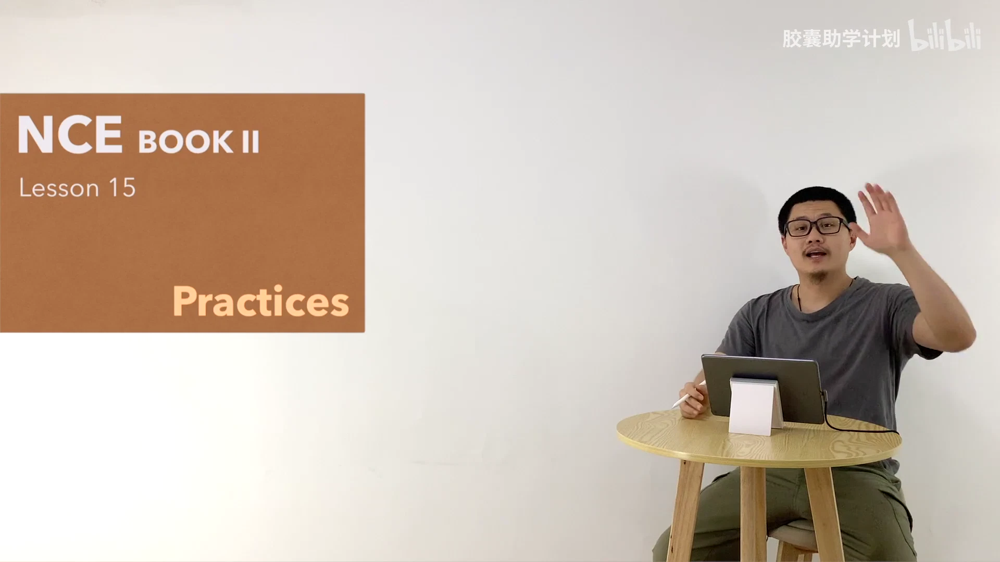

文字识别：Biibili / 胶囊助学计划 / NCE / BOOKII / Lesson 15 / Practices

### 画面 00:00:02

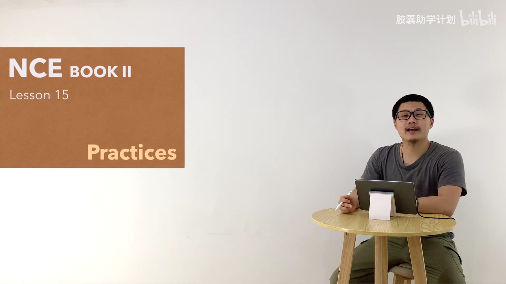

文字识别：biibili / 胶囊助学计划 / NCE / BOOKII / Lesson 15 / Practices

### 画面 00:00:04

文字识别：Bilbili / 胶囊助学计划 / NCE / BOOKII / Lesson 15 / Practices

### 画面 00:00:06

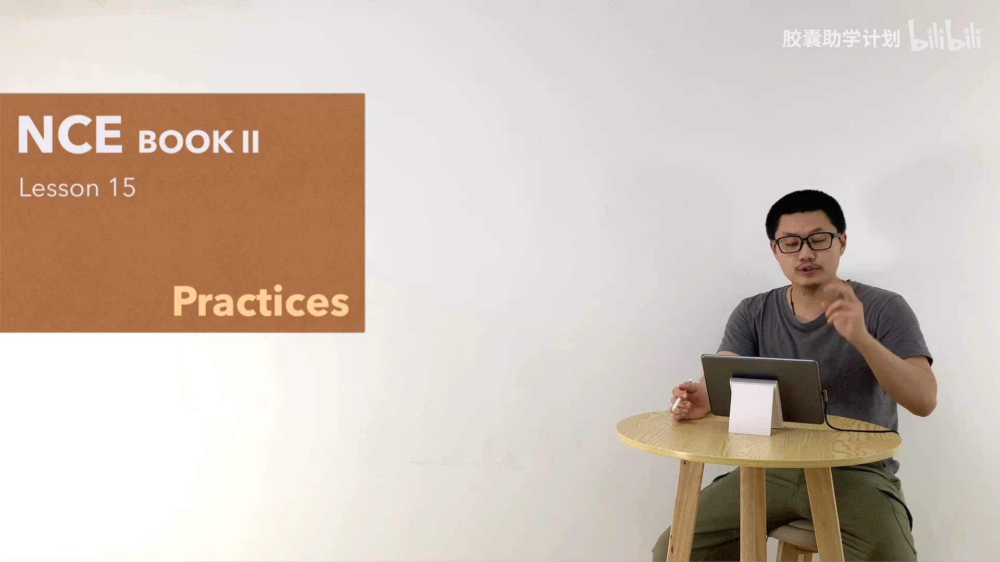

文字识别：Biibili / 胶囊助学计划 / NCE / BOOKII / Lesson 15 / Practices

### 画面 00:00:09

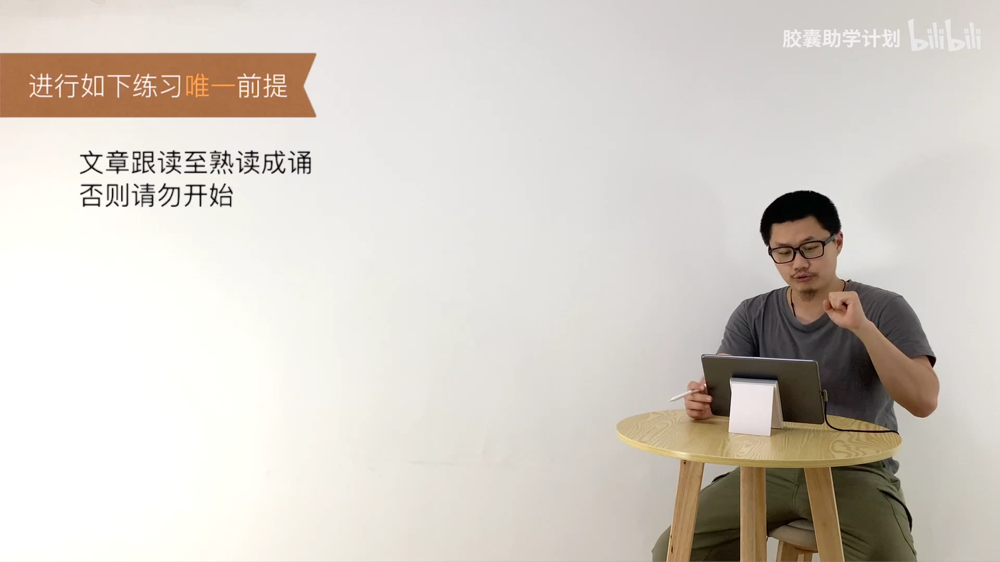

文字识别：bilibili / 胶囊助学计划 / 进行如下练习唯一前提 / 文章跟读至熟读成诵 / 否则请勿开始

### 画面 00:00:12

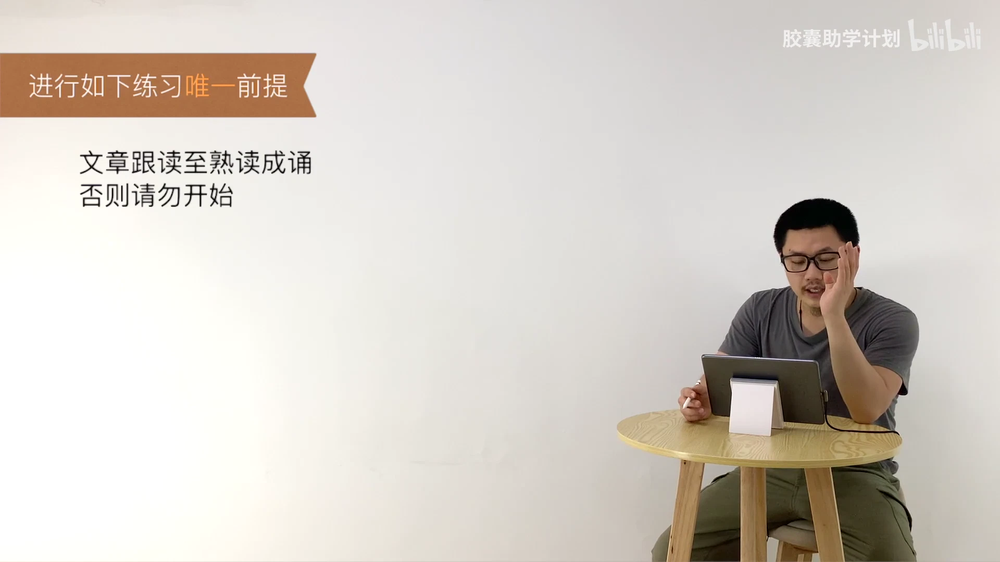

文字识别：bibii / 胶囊助学计划 / 进行如下练习唯一前提 / 文章跟读至熟读成诵 / 否则请勿开始

### 画面 00:00:17

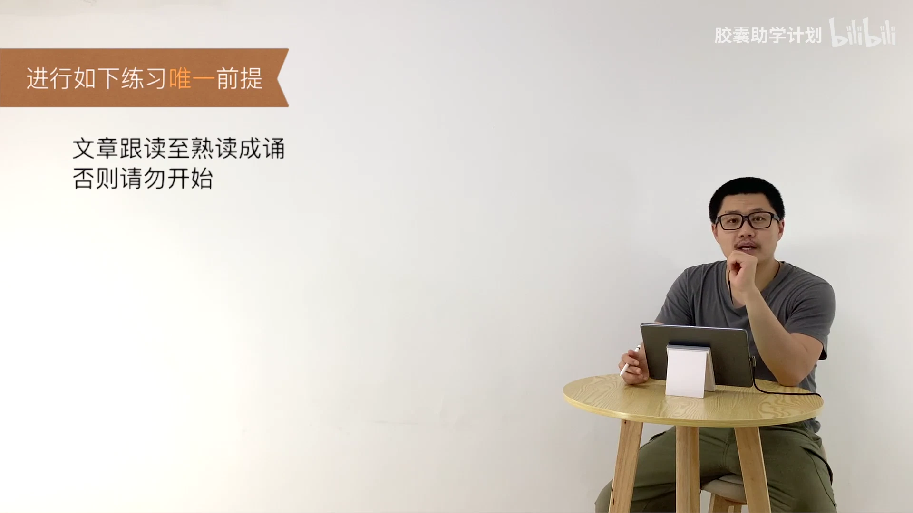

文字识别：biibili / 胶囊助学计划 / 进行如下练习唯一前提 / 文章跟读至熟读成诵 / 否则请勿开始

### 画面 00:00:20

文字识别：胶囊助学计划b出l / •

### 画面 00:00:24

### 画面 00:00:26

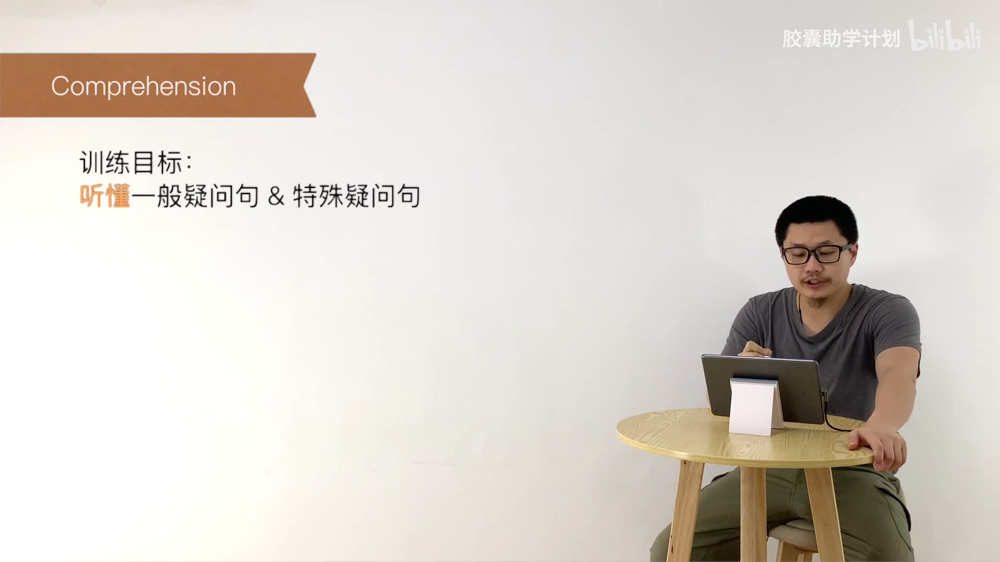

文字识别：bilibili / 胶囊助学计划 / Comprehension / 训练目标： / 听懂一般疑问句＆特殊疑问句

### 画面 00:00:29

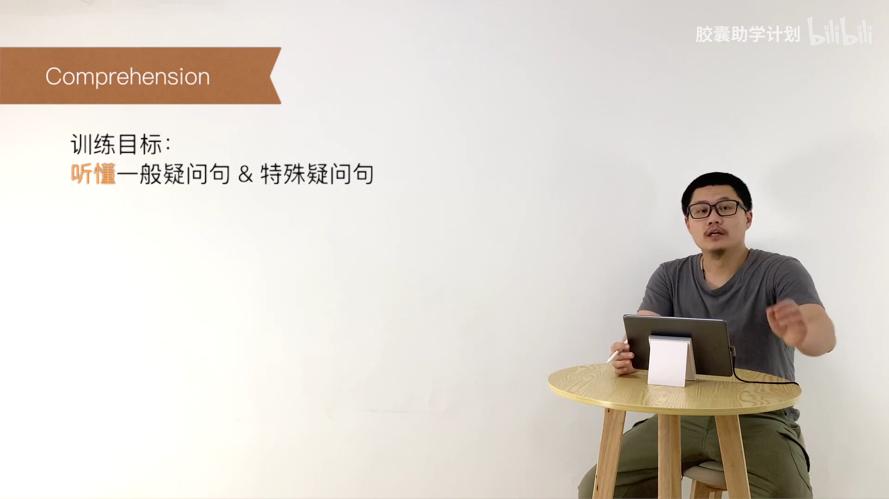

文字识别：Bilbili / 胶囊助学计划 / Comprehension / 训练目标： / 听懂一般疑问句＆特殊疑问句

## 00:00:30–00:01:00

看着文章或者完全脱离文章，对吧？眼睛不要看着这个地方。我们做听力，我问您答的练习基于文章来了。第一个，What did the secretary tell you? Mr. Humphreys would see me. Next one, Where did you go? To his office. Next one, How did you feel when

### 画面 00:00:33

文字识别：biibili / 胶囊助学计划 / Comprehension / 训练目标： / 听懂一般疑问句＆特殊疑问句

### 画面 00:00:38

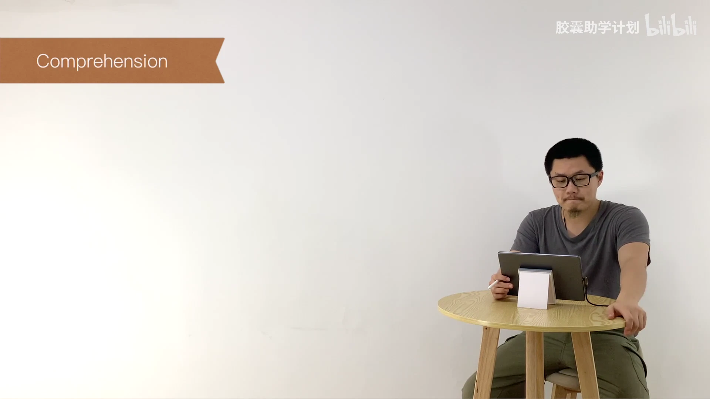

文字识别：胶囊助学计划bl出 / Comprehension

### 画面 00:00:41

文字识别：bilbili / 胶囊助学计划 / Comprehension / What did the secretary tell you?

### 画面 00:00:43

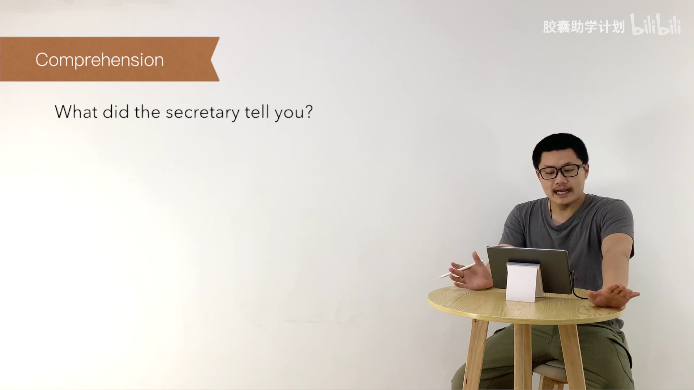

文字识别：bitbili / 胶囊助学计划 / Comprehension / What did the secretary tell you?

### 画面 00:00:45

文字识别：Bilbili / 胶囊助学计划 / Comprehension / What did the secretary tell you?

### 画面 00:00:52

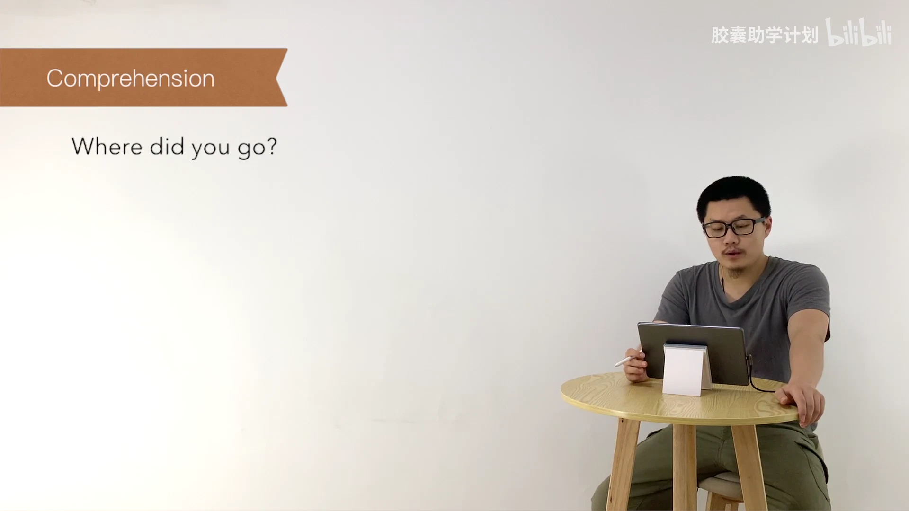

文字识别：bibii / 胶囊助学计划 / Comprehension / Where did you go?

## 00:01:00–00:01:30

you went in? Nervous, very nervous. Next one. Where was Mr. Holmesworth sitting? At his desk. Next one. What did he say about business? It was very bad. Next one. When did he tell you this? After I had sat down.

### 画面 00:01:06

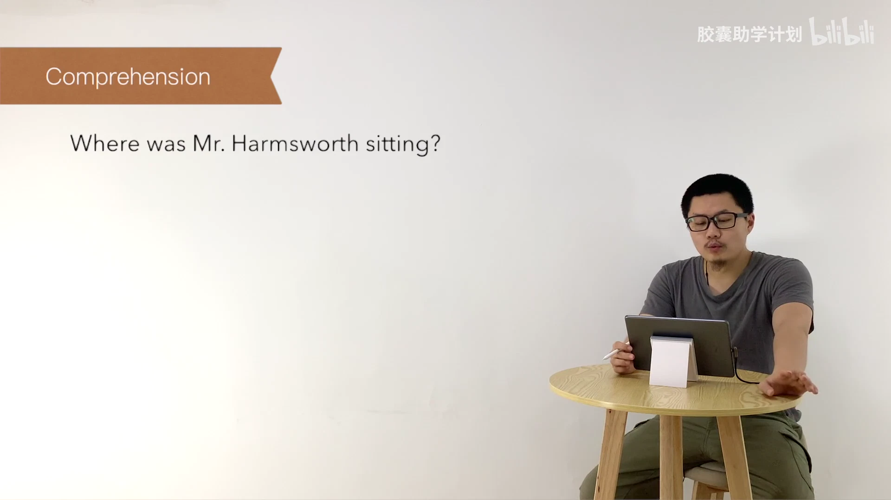

文字识别：Bilbili / 胶囊助学计划 / Comprehension / Where was Mr. Harmsworth sitting?

### 画面 00:01:17

文字识别：bilbili / 胶囊助学计划 / Comprehension / What did he say about business? / That it was very bad.

## 00:01:30–00:02:00

Next one, what did he tell you about the firm and salaries? Business was very bad. The firm could not afford to pay such large salaries. Next one, how many people had already left? Twenty. Did you think it was your turn to lose

### 画面 00:01:32

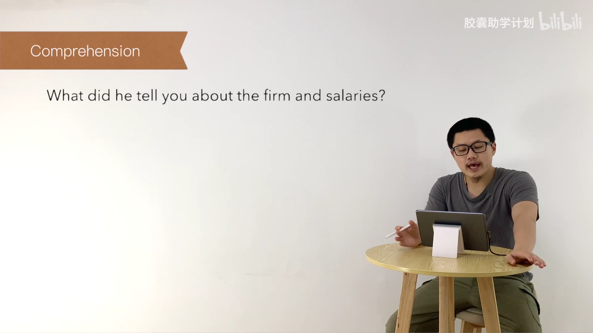

文字识别：胶囊助学计划bi出b出 / Comprehension / What did he tell you about the firm and salaries?

### 画面 00:01:37

文字识别：胶囊助学计划bi出b出 / Comprehension / What did he tell you about the firm and salaries? / Business was bad, so the firm could not afford to / pay large salaries.

### 画面 00:01:41

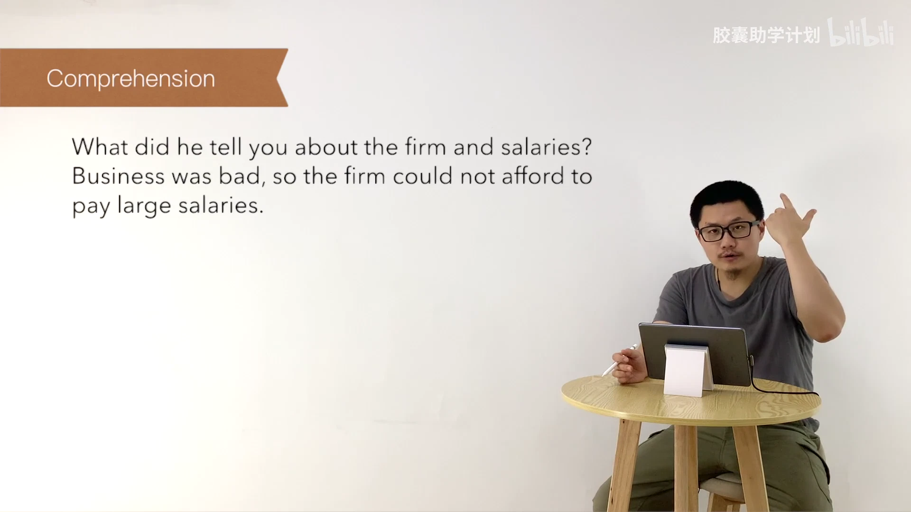

文字识别：bilbl / 胶囊助学计划 / Comprehension / What did he tell you about the firm and salaries? / Business was bad, so the firm could not afford to / pay large salaries.

### 画面 00:01:48

文字识别：胶囊助学计划bilb出 / Comprehension / How many people had already left?

### 画面 00:01:54

文字识别：胶囊助学计划bilbl / Comprehension

### 画面 00:01:57

文字识别：bilibili / 胶囊助学计划 / Comprehension / Did you think it was your turn to lose your job?

## 00:02:00–00:02:30

your job. Yes, I did. 完. How did you speak to him? In a big voice. Okay, 好，第二题，会说一般疑问句和特殊疑问句啊，这个地方来，我们可以看着我们的这个屏幕啊。第一题还是示范啊，Mr. Hemsworth is my employer. Okay, employer, employee指的是雇员，employer指的是雇主，也就是老板，

### 画面 00:02:00

文字识别：bilbli / 胶囊助学计划 / Comprehension / Did you think it was your turn to lose your job?

### 画面 00:02:03

文字识别：bilbli / 胶囊助学计划 / Comprehension / Did you think it was your turn to lose your job? / Yes,I did.

### 画面 00:02:07

文字识别：bilbili / 胶囊助学计划 / Comprehension / How did you speak to him?

### 画面 00:02:10

文字识别：Biltbli / 胶囊助学计划 / Asking questions / 训练目标： / 会说一般疑问句＆特殊疑问句 / Accuracy / Fluency

### 画面 00:02:13

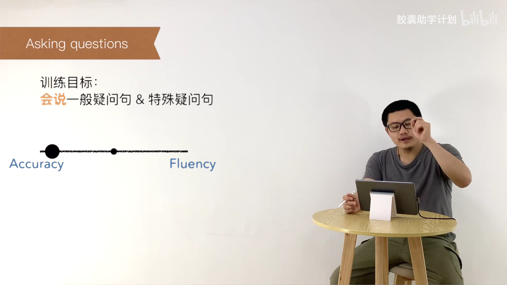

文字识别：Bibl / 胶囊助学计划 / Asking questions / 训练目标： / 会说一般疑问句＆特殊疑问句 / Accuracy / Fluency

### 画面 00:02:17

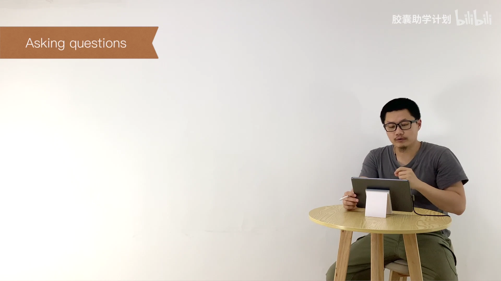

文字识别：biibili / 胶囊助学计划 / Asking questions

### 画面 00:02:19

文字识别：bilbili / 胶囊助学计划 / Asking questions / T: Ask me if Mr. Harmsworth is my employer.

### 画面 00:02:22

文字识别：bilbli / 胶囊助学计划 / Asking questions / T: Ask me if Mr. Harmsworth is my employer.

### 画面 00:02:24

文字识别：bilbili / 胶囊助学计划 / Asking questions / T: Ask me if Mr. Harmsworth is my employer.

## 00:02:30–00:03:00

boss，OK，很简单，一般疑问句is提前就可以了，然后who啊就对主语提问呗，Who is your employer啊，就这么简单。好，那我们看第二题，His secretary told me that，看后边是宾语从句，各位要注意一个小点，这地方貌似出现了两个动词，对吧？一个是told，一个是would加c，你要用谁去变一般疑问句呢？

### 画面 00:02:30

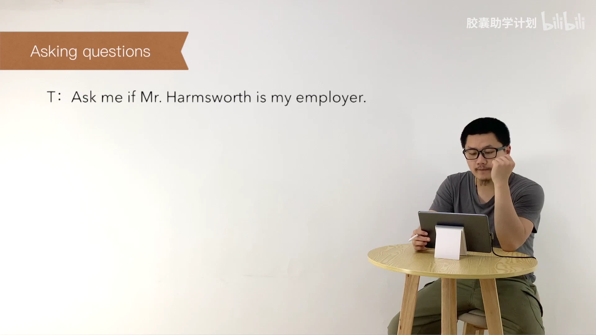

文字识别：bilbili / 胶囊助学计划 / Asking questions / T: Ask me if Mr. Harmsworth is my employer.

### 画面 00:02:35

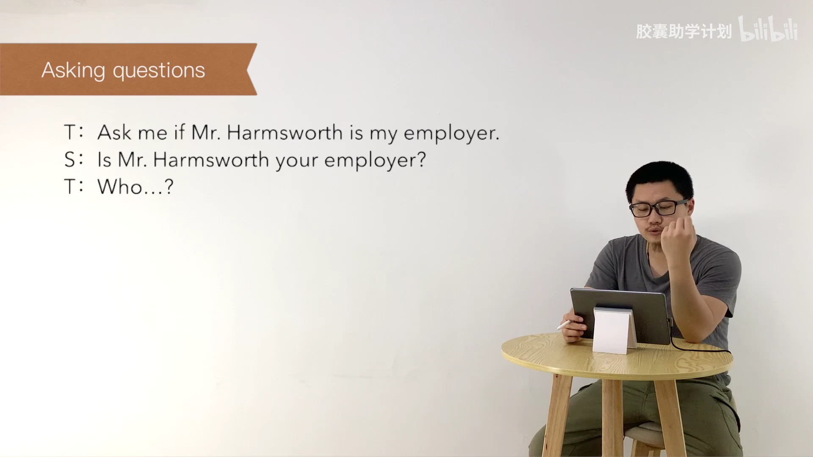

文字识别：biibili / 胶囊助学计划 / Asking questions / T: Ask me if Mr. Harmsworth is my employer. / S: Is Mr. Harmsworth your employer? / T: Who...?

### 画面 00:02:39

文字识别：bilbili / 胶囊助学计划 / Asking / questions / 1. Mr. Harmsworth is my employer. (Who)

### 画面 00:02:42

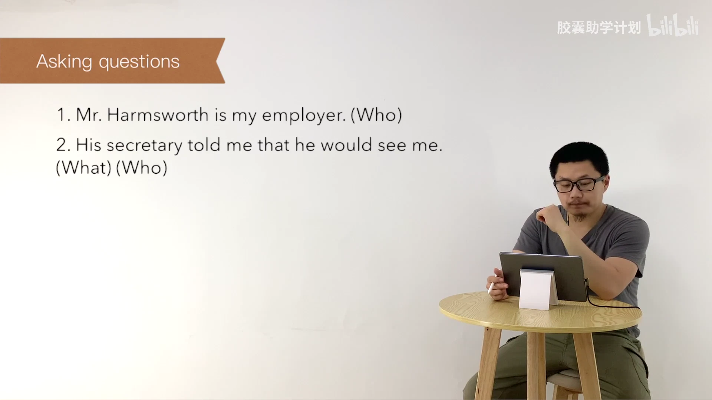

文字识别：bilibili / 胶囊助学计划 / Asking questions / 1. Mr. Harmsworth is my employer. (Who) / 2. His secretary told me that he would see me. / (What)(Who)

### 画面 00:02:45

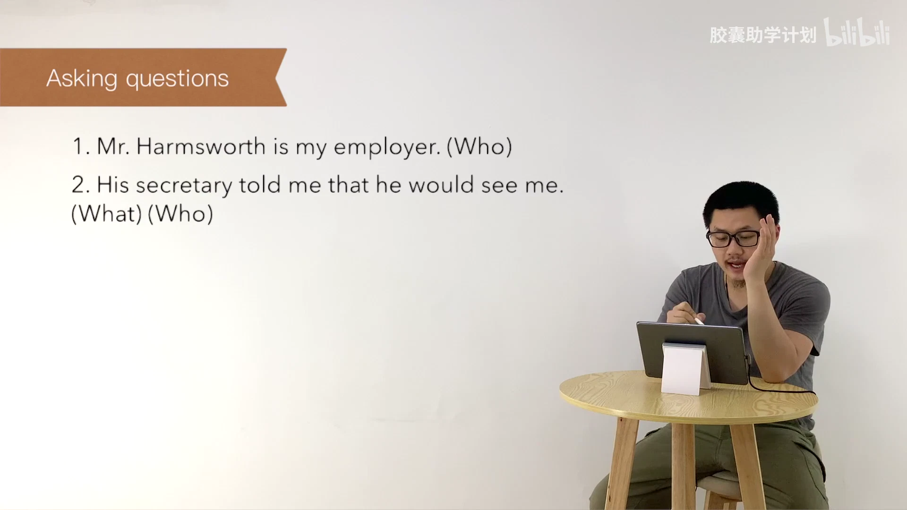

文字识别：bilibli / 胶囊助学计划 / Asking questions / 1. Mr. Harmsworth is my employer. (Who) / 2. His secretary told me that he would see me. / (What)(Who)

### 画面 00:02:49

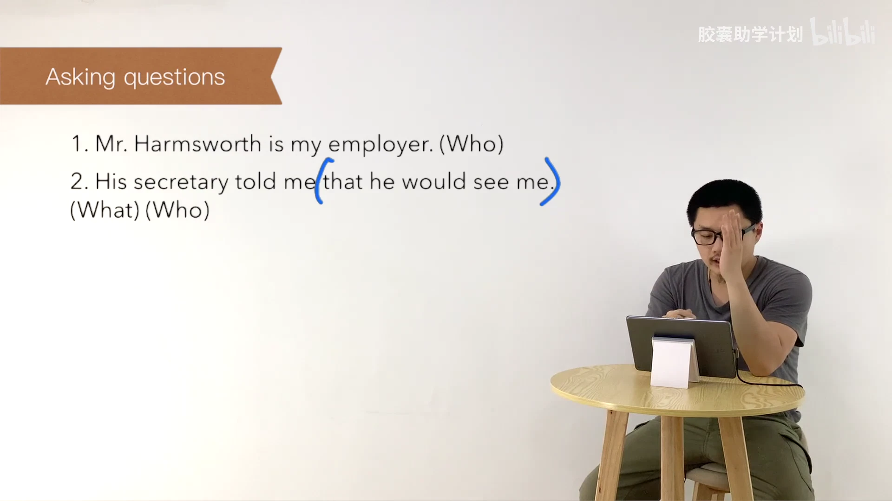

文字识别：胶囊助学计划 / Asking questions / 1. Mr. Harmsworth is my employer. (Who) / 2. His secretary told methat he would see me. / (What)(Who)

### 画面 00:02:52

文字识别：bilbili / 胶囊助学计划 / Asking / questions / 1. Mr. Harmsworth is my employer. (Who) / 2. His secretary told methat he would / see me. / (What) (Who)

### 画面 00:02:55

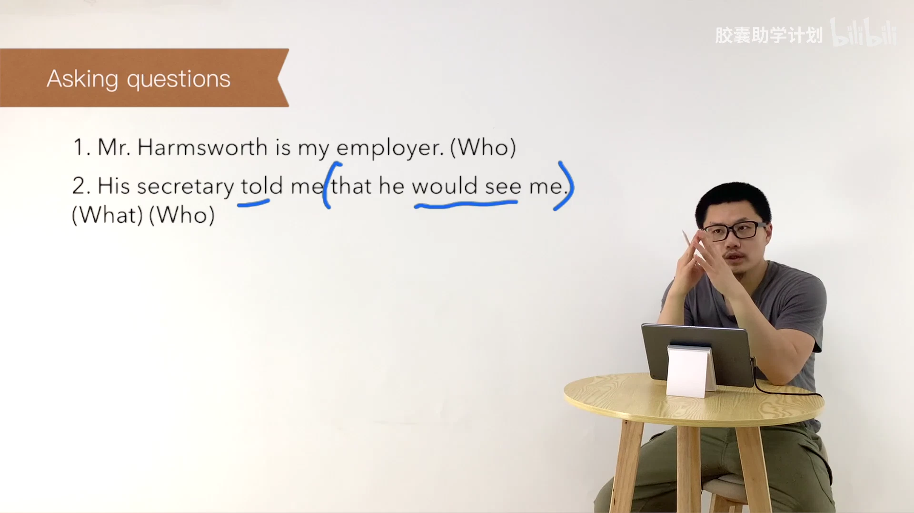

文字识别：胶囊助学计划 / Asking / questions / 1. Mr. Harmsworth is my employer. (Who) / 2. His secretary told methat he would / see / me, / (What) (Who)

## 00:03:00–00:03:30

各位永远不用从句去变啊，用主句用 his secretary told me 的那个 told 去变，或者再换一个思路，就是六一二三四五六当中的二由二去决定谁提前变一般疑问句。比如说 his secretary 是一 told 是二，对吧？那 me 和后边的这些啊都是三啊，只不过是两种不同的三啊，我们就不提它的那个学术术语了。所以你要用二 told 去变，也就是把 did 提

### 画面 00:03:04

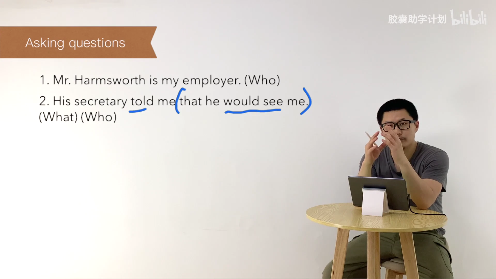

文字识别：bibili / 胶囊助学计划 / Asking / questions / 1. Mr. Harmsworth is my employer. (Who) / 2. His secretary told / d methat he would / see / me, / (What) (Who)

### 画面 00:03:07

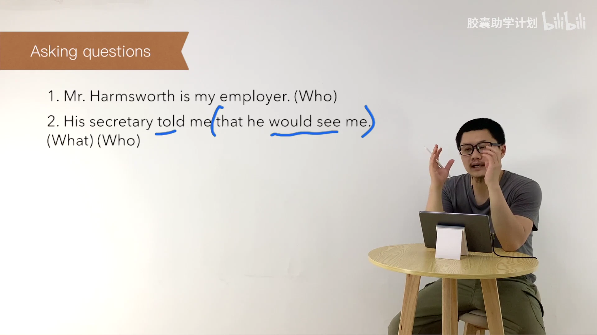

文字识别：biibili / 胶囊助学计划 / Asking / questions / 1. Mr. Harmsworth is my employer. (Who) / 2. His secretary told / I methat he would / see / me, / (What) (Who)

### 画面 00:03:10

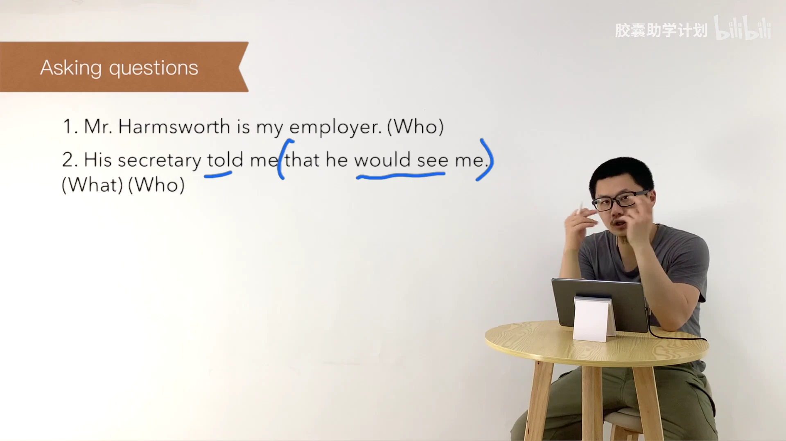

文字识别：胶囊助学计划 / Asking / questions / 1. Mr. Harmsworth is my employer. (Who) / 2. His secretary told / I methat he would / see / me, / (What) (Who)

### 画面 00:03:15

文字识别：bilbili / 胶囊助学计划 / Asking / questions / 1. Mr. Harmsworth is my employer. (Who) / 2.His secretary told / I methat he would / see / me, / (What)(Who)

### 画面 00:03:17

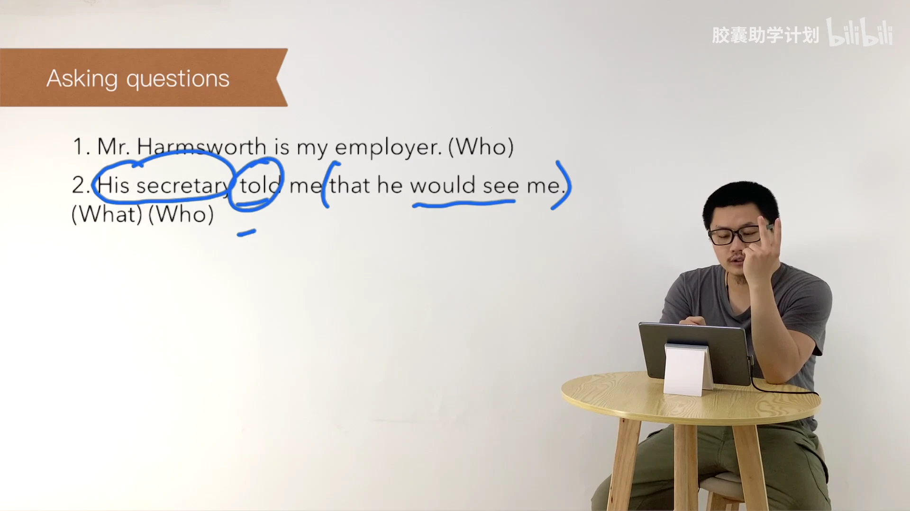

文字识别：Bilbili / 胶囊助学计划 / Asking / questions / 1.Mr. Harmsworth is r / s my employer. (Who) / 2.His / secretary / told / me / that / he / would / see / me. / (What) (Who)

### 画面 00:03:19

文字识别：Bilbili / 胶囊助学计划 / Asking / questions / 1. Mr. Harmsworth is my employer. (Who) / 2.His / secretary / toldmethat he / would / see / me. / (What) (Who) / Z

### 画面 00:03:21

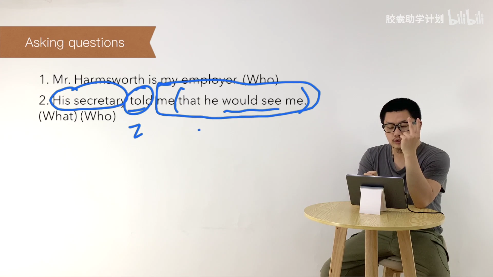

文字识别：Bilbili / 胶囊助学计划 / Asking / questions / 1. Mr. Harmsworth is my employor (Who) / 2.His / secretary / toldl / methat / he / would / see / me, / (What)(Who) / Z

### 画面 00:03:24

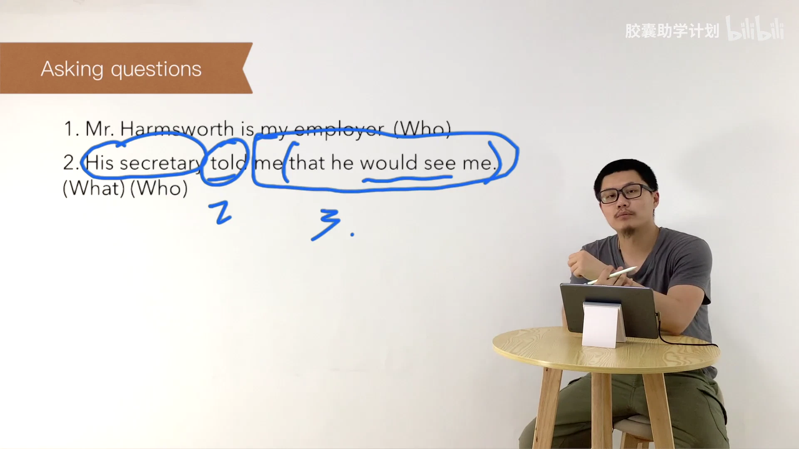

文字识别：Bilbil / 胶囊助学计划 / Asking / questions / 1. Mr. Harmsworth is my employor / (Who) / 2.His / secretary / toldmethat I / he / would / see / me, / (What) (Who) / Z

### 画面 00:03:26

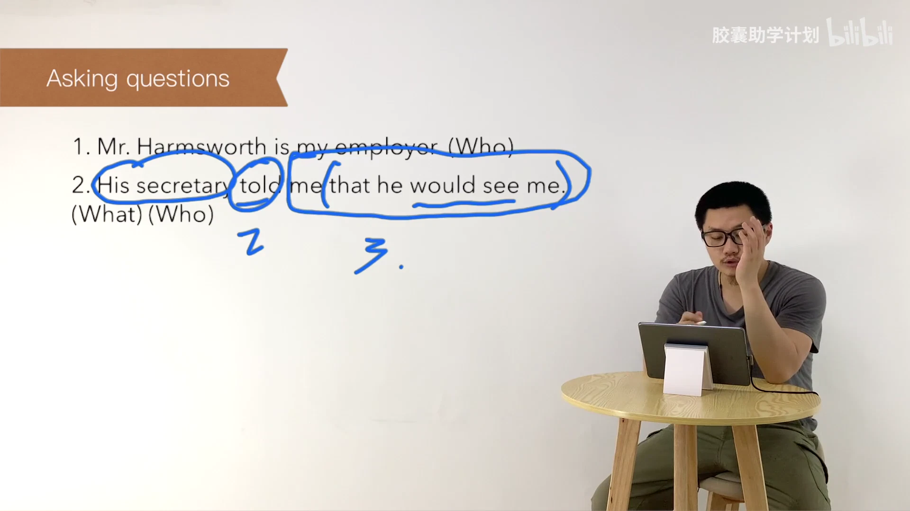

文字识别：Biltbili / 胶囊助学计划 / Asking / questions / 1. Mr. Harmsworth is my employor / (Who) / 2.His / secretary / toldh / methat / he / would / see / me, / (What) (Who) / Z

### 画面 00:03:28

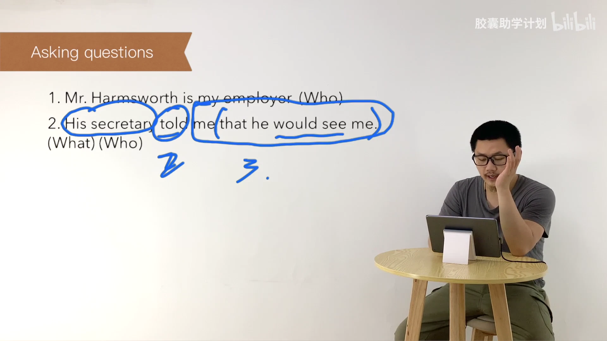

文字识别：biibili / 胶囊助学计划 / Asking / questions / 1. Mr. Harmsworth is my employor / (Who) / 2.His / secretary / toldmethat h / he / would / see / me, / (What) (Who)

## 00:03:30–00:04:00

起来啊。我说一下答案。Did his secretary tell you that he would see you? OK，就这么简单啊。那What就是对宾语从句提问。What did his secretary tell you?他的秘书告诉你什么问题了？Who？那您自己确定吧。这里边这么多人呢，对吧？OK，只是要注意一个点，对主语提问，直接替代就行了。

### 画面 00:03:30

文字识别：bilibili / 胶囊助学计划 / Asking / questions / 1. Mr. Harmsworth is my employer. (Who) / 2. His secretary told / I methat he would / see / me, / (What) (Who)

### 画面 00:03:32

文字识别：bilibili / 胶囊助学计划 / Asking questions / 1. Mr. Harmsworth is my employer. (Who) / 2. His secretary told me that he would see me. / (What)(Who)

### 画面 00:03:37

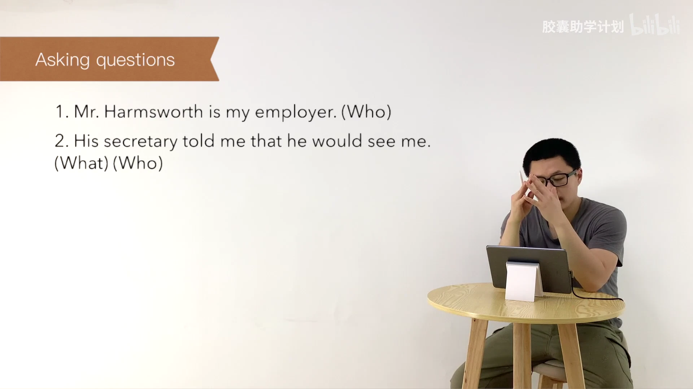

文字识别：胶囊助学计划 / Asking questions / 1. Mr. Harmsworth is my employer. (Who) / 2. His secretary told me that he would see me. / (What)(Who)

### 画面 00:03:42

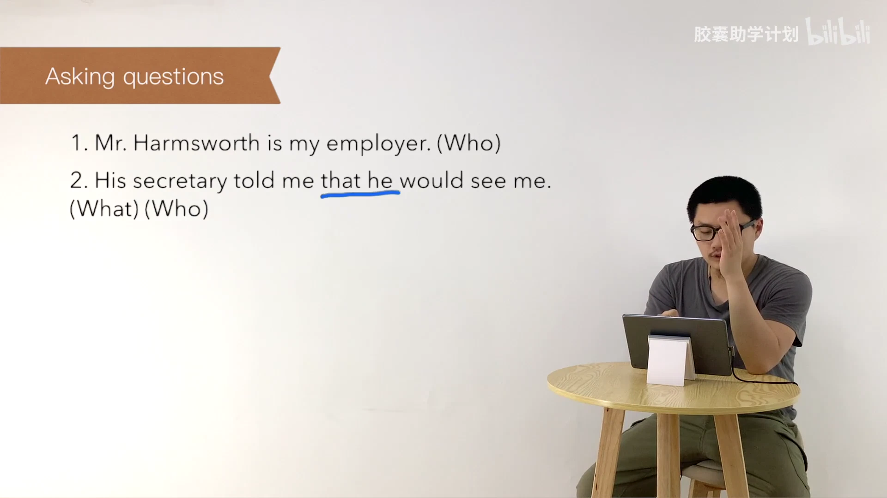

文字识别：blibil / 胶囊助学计划 / Asking questions / 1. Mr. Harmsworth is my employer. (Who) / 2. His secretary told me that he would see me. / (What)(Who)

### 画面 00:03:44

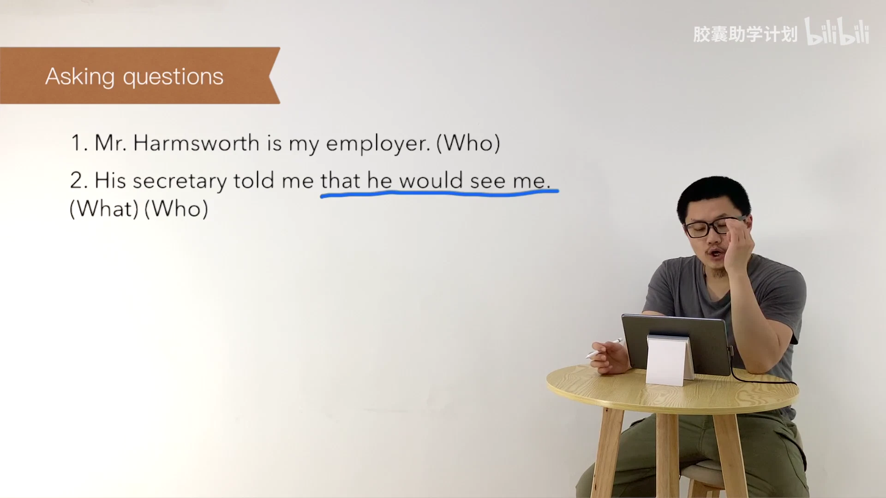

文字识别：blibili / 胶囊助学计划 / Asking questions / 1. Mr. Harmsworth is my employer. (Who) / 2. His secretary told me that he would see me. / (What) (Who)

### 画面 00:03:50

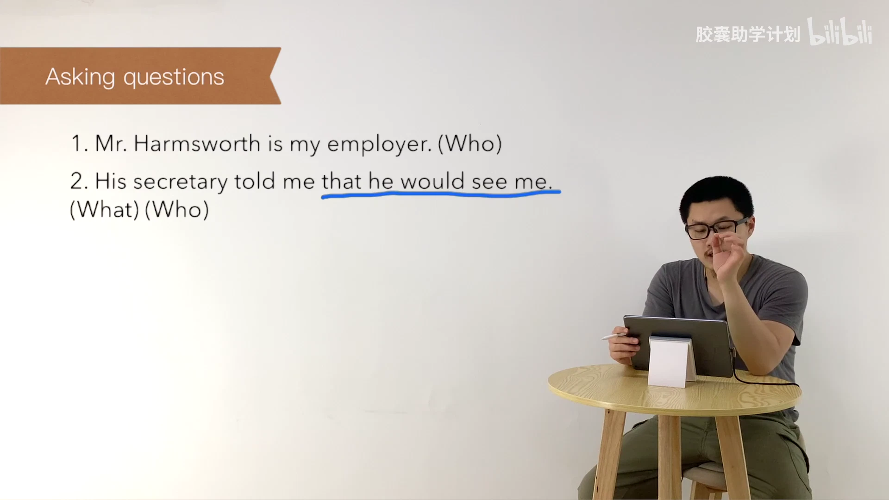

文字识别：blibili / 胶囊助学计划 / Asking questions / 1. Mr. Harmsworth is my employer. (Who) / 2. His secretary told me that he would see me. / (What) (Who)

### 画面 00:03:58

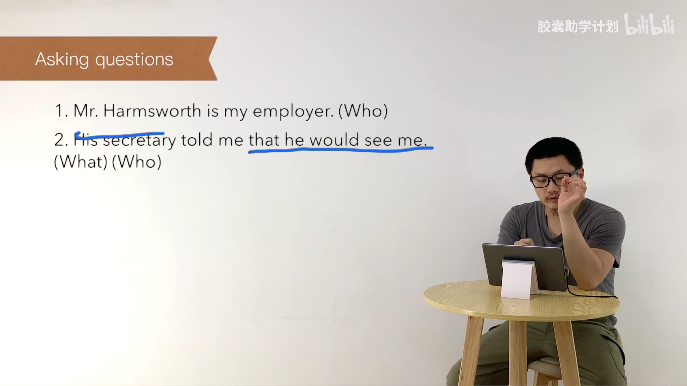

文字识别：bibili / 胶囊助学计划 / Asking / questions / 1. Mr. Harmsworth is my employer. (Who) / 2. / Fis secretary / told / me that he would / see me. / (What) (Who)

## 00:04:00–00:04:30

OK，别变一般疑问句了啊。I went into his office. Did 提前，动词换原形，Where 对 into his office 提问。I felt very nervous. Did 提前，How 对 very nervous 提问，Why 对整句话提问。The firm couldn't afford to pay such large salaries. 好，你看这就很神奇，我们一般是肯定句变一般疑问句，这个地方巧了，他

### 画面 00:04:00

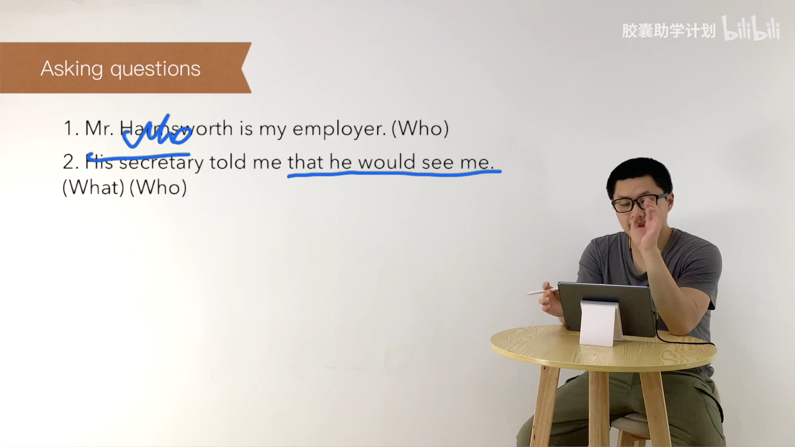

文字识别：Bilbii / 胶囊助学计划 / Asking / questions / Huboorth is r / 1. Mr. /  my / employer. (Who) / 2. / Fis secretary / told / me / that he would / see me. / (What) (Who)

### 画面 00:04:02

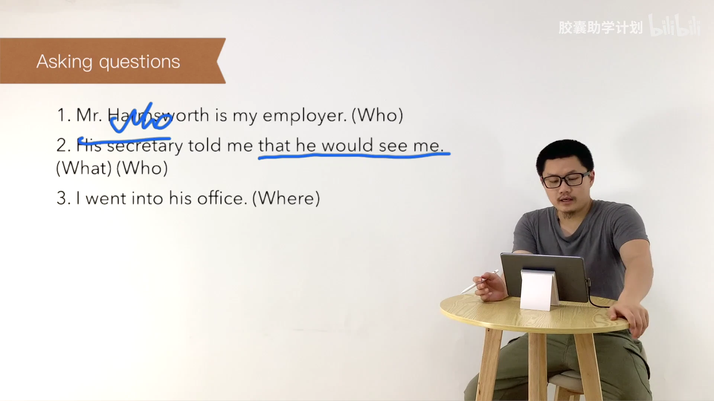

文字识别：胶囊助学计划 / Asking / questions / Huboorth is my er / 1. Mr. / employer. (Who) / 2. / His secretary / told / me / that he would / see me. / (What) (Who) / 3.I went into his office. (Where)

### 画面 00:04:05

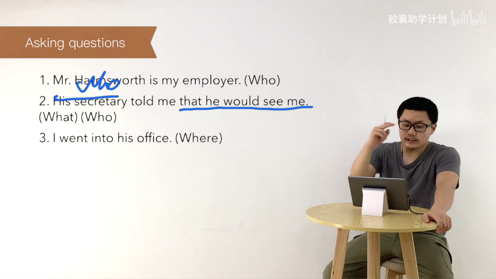

文字识别：胶囊助学计划 / Asking / questions / Huborth is my employer. (Who) / 1.Mr. / 2. / His secretary / told / me / that he would / see me. / (What) (Who) / 3.I went into his office.(Where)

### 画面 00:04:08

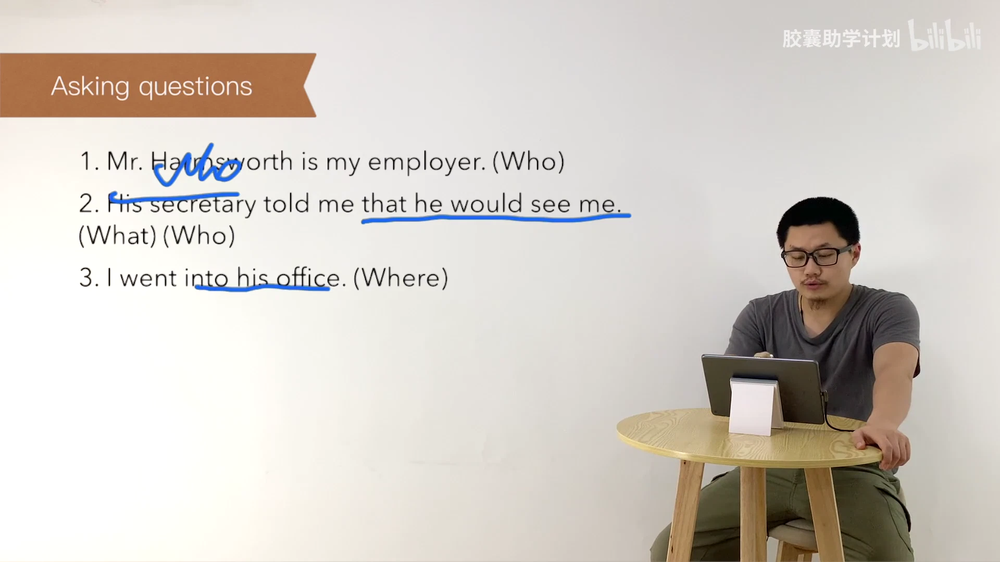

文字识别：bilbili / 胶囊助学计划 / Asking / questions / . Huboorthis my employer. (Who) / 1. Mr.  / 2. / Fis secretary / told / me / that he would / see me. / (What) (Who) / 3.I went into his office. (Where)

### 画面 00:04:14

文字识别：bilibili / 胶囊助学计划 / Asking / questions / . Huboorth is my employer. (Who) / 1. Mr. / 2. / His secretary told / me / that he would / see me. / (What) (Who) / 3.1 went into his office. (Where) / 4.I felt very / nervous.(How)(Why)

### 画面 00:04:16

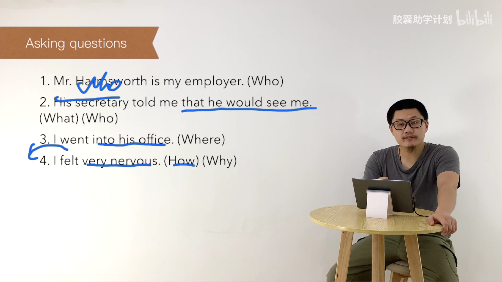

文字识别：bilibili / 胶囊助学计划 / Asking / questions / . Huboorth is my e / 1. Mr. / employer. (Who) / 2. / Fis secretary / told / me / that he would / see me. / (What) (Who) / 3.I went into his office. (Where) / 4.Ifelt / very nervous. (How) (Why)

### 画面 00:04:20

文字识别：bilibili / 胶囊助学计划 / Asking questions / 5.The firm couldn't afford to pay such large / salaries. (What) (Why)

## 00:04:30–00:05:00

给了一个否定句，没事儿，您先把它变肯定句，把 not 去掉， could afford to pay，对吧？然后把 could 提前， could the firm afford to pay such large salaries？一般疑问句不就出来了吗？至于 what 对 such large salaries 提问，并且这儿我提一个小点，如果这儿给的是 couldn't，接下来都是这样的啊，您别变成了叫做 what could the firm afford to pay？他们能

### 画面 00:04:31

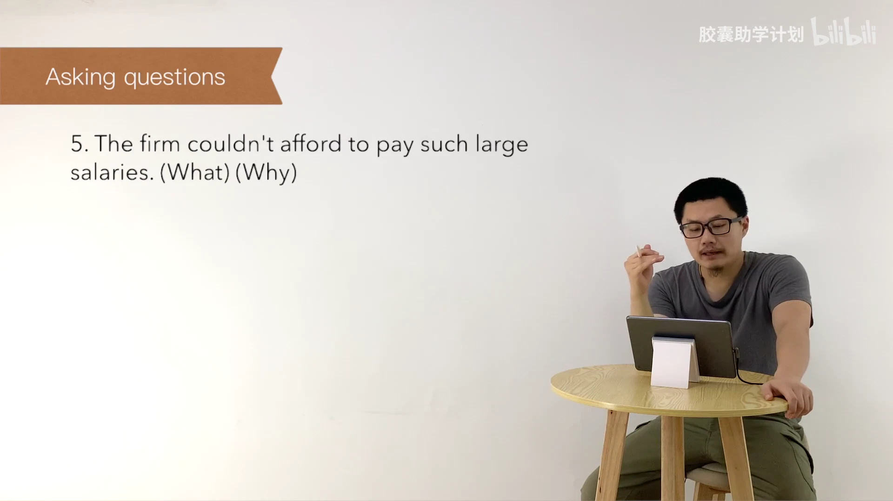

文字识别：bilibili / 胶囊助学计划 / Asking questions / 5. The firm couldn't afford to pay such large / salaries. (What) (Why)

### 画面 00:04:47

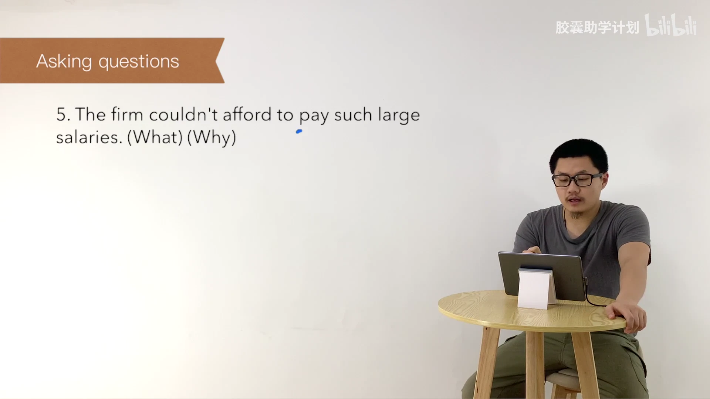

文字识别：bilbii / 胶囊助学计划 / Asking questions / 5.The firm couldn't afford to pay such large / salaries. (What) (Why)

### 画面 00:04:49

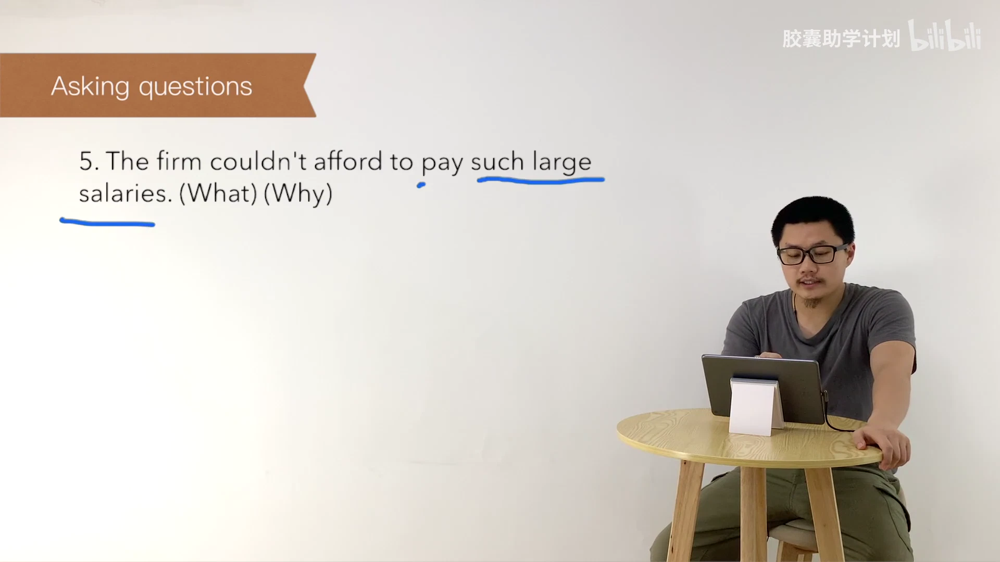

文字识别：biibili / 胶囊助学计划 / Asking questions / 5. The firm couldn't afford to pay such large / salaries. (What) (Why)

### 画面 00:04:51

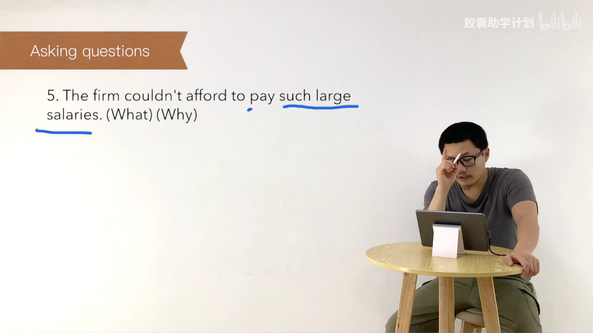

文字识别：胶囊助学计划 / Asking questions / 5.The firm couldn't afford to pay such large / salaries.(What) (Why)

### 画面 00:04:53

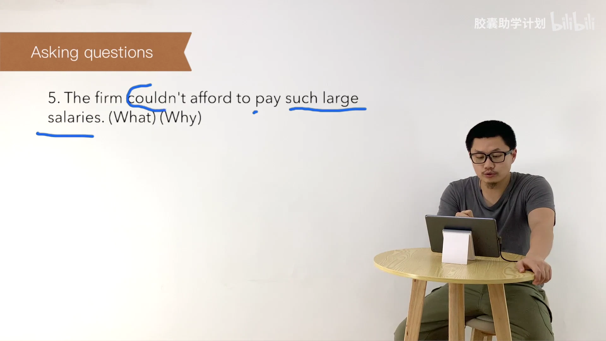

文字识别：胶囊助学计划 / Asking / questions / 5.The / firm / Couldn't afford to pay such large / salaries. (What)(Why)

### 画面 00:04:55

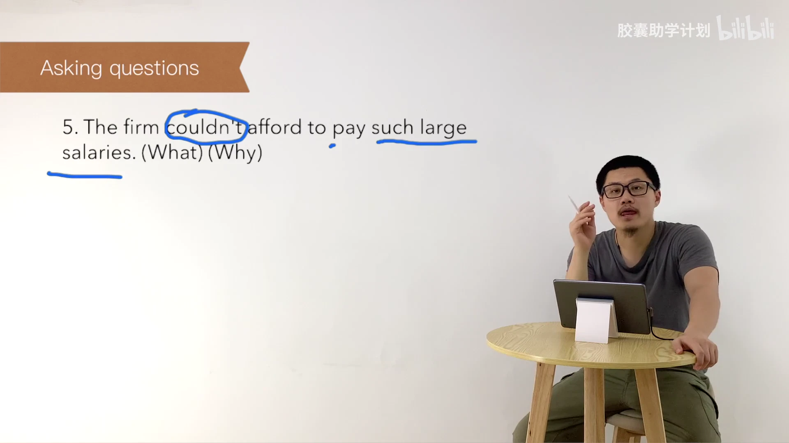

文字识别：biiili / 胶囊助学计划 / Asking / questions / 5.The firm / Couldn' tafford to pay such large / salaries. (What) (Why)

### 画面 00:04:57

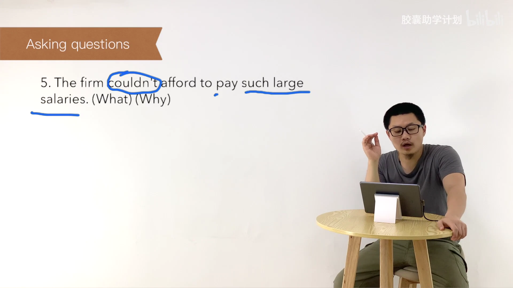

文字识别：胶囊助学计划 / Asking / questions / 5.The / firm / Couldn' tafford to pay such large / salaries. (What) (Why)

### 画面 00:04:59

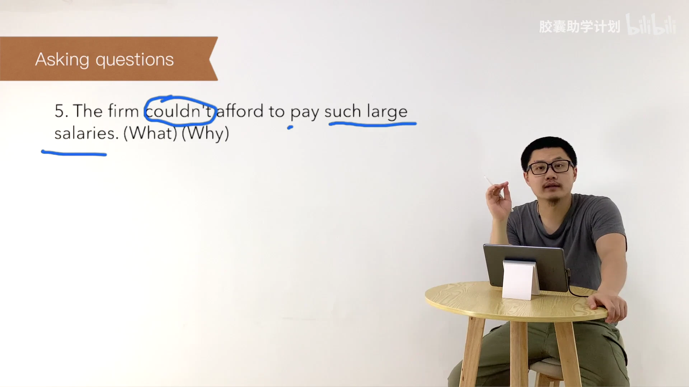

文字识别：胶囊助学计划 / Asking / questions / 5.The firm / Couldn't afford to pay such large / salaries. (What) (Why)

## 00:05:00–00:05:30

What could the firm afford to pay? Why is a reason? Why couldn't the firm? Why couldn't the firm? Why couldn't the firm? Why couldn't the firm? Why couldn't the firm? Why couldn't the firm? Why couldn't the firm? Why couldn't the firm? Why couldn't the firm? Why couldn't the firm? Why couldn't the firm? Why couldn't the firm? Why couldn't the firm? Why couldn't the firm? Why couldn't the firm? Why couldn't the firm? Why couldn't the firm? Why couldn't the firm? Why couldn't the firm? Why couldn't the firm? Why couldn't the firm? Why couldn't the firm? Why couldn't the firm? Why

### 画面 00:05:08

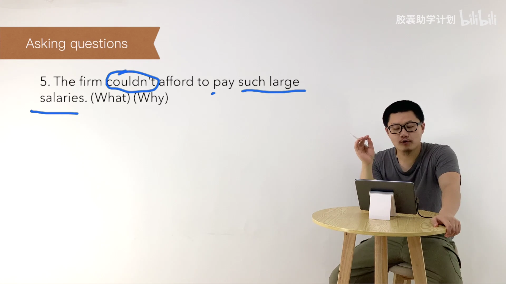

文字识别：bibili / 胶囊助学计划 / Asking / questions / 5.The / firm / Couldn' tafford to pay such large / salaries. (What) (Why)

### 画面 00:05:14

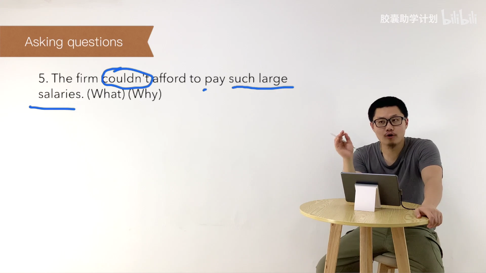

文字识别：Biibili / 胶囊助学计划 / Asking / questions / 5.The / firm / Couldn't afford to pay such large / salaries. (What) (Why)

### 画面 00:05:26

文字识别：胶囊助学计划 / Biltbil / Asking / questions / 5.The / firm / Couldn't afford to pay such large / salaries. (What) (Why) / 6. Twenty people had left. (How many)

## 00:05:30–00:06:00

I thought he would tell me to leave too.啊，他用thought嘛，对吧？Did提前，What对整个宾语从句提问啊？What did you think？你是怎么认为的？你是怎么想的这件事？Okay, he told me not to interrupt. Did提前，对吧？那What did he tell you？就完了啊。答案是not to interrupt。这个不是非常典型哈。这我直接告诉各位答案。下一个tell the story，我们练的就是口语复述能力，

### 画面 00:05:34

文字识别：bilibili / 胶囊助学计划 / Asking questions / 5.The firm / Couldn' tafford to pay such large / salaries. (What) (Why) / 6. Twenty people had left. (How many) / 7.I thought he would tell me to leave too.(What)

### 画面 00:05:37

文字识别：Bilbii / 胶囊助学计划 / Asking questions / 5.The firm / Couldn'tafford to pay such large / salaries. (What) (Why) / 6. Twenty people had left. / . (How many) / 7.I thought he would tell me to leave too. (What)

### 画面 00:05:40

文字识别：biibili / 胶囊助学计划 / Asking questions / 5.The firm / Couldn't afford to pay such large / salaries. (What) (Why) / 6. Twenty people had left. /  (How many) / 7.I thought he would tell me to leave too / (What)

### 画面 00:05:44

文字识别：胶囊助学计划 / Asking questions / 5.The firm / Couldn't afford to pay such large / salaries. (What) (Why) / 6. Twenty people had left. (How many) / 7.I thought he would tell me to leave too / (What) / 8. He told me not to interrupt. (What)

### 画面 00:05:47

文字识别：胶囊助学计划 / Asking questions / 5.The firm / Couldn't afford to pay such large / salaries. (What) (Why) / 6. Twenty people had left. (How many) / 7.I thought he would tell me to leave too / (What) / 8. He told me not to interrupt. (What)

### 画面 00:05:50

文字识别：biibili / 胶囊助学计划 / Asking questions / 5.The firm / Couldn't afford to pay such large / salaries. (What) (Why) / 6. Twenty people had left. (How many) / 7.I thought he would tell me to leave too / (What) / 8. He told me not to interrupt. (What)

### 画面 00:05:54

文字识别：bibl / 胶囊助学计划 / Tell the story / 训练目标： / 口语复述能力 / Accuracy / Fluency

### 画面 00:05:58

文字识别：bibl / 胶囊助学计划 / Tell the story / 训练目标： / 口语复述能力 / Accuracy / Fluency

## 00:06:00–00:06:30

练的是流利性啊。老习惯还是我给大家做一个展示。各位要做的事情是文章读熟，下课自己去啊，这个呃呃看着这些关键词，像我现在这样去复述来了啊。 The secretary told me that Mr. Hemsworth would see me. I felt very nervous when I went into his office. He did not look up from his desk when I entered. After I had sat down,

### 画面 00:06:01

文字识别：胶囊助学计划blb出 / Tell the story / 1 / secretary-Mr. Harmsworth-see me / very nervous-went-office / didn't look-desk-l entered / sat down-said-business-bad / told-couldn't afford-salaries / Twenty-already left / knew-turn-come / 'Mr. Harmsworth'-said-weak / 'interrupt'-said / ① smiled-told me-£ 1,000

### 画面 00:06:03

文字识别：胶囊助学计划 / Tell the story / 1 / secretary-Mr. Harmsworth-see me / very nervous-went-office / didn't look-desk-l entered / sat down-said-business-bad / told-couldn't afford-salaries / Twenty-already left / knew-turn-come / 'Mr. Harmsworth'-said-weak / '-interrupt'-said / ① smiled-told me-£ 1,000

### 画面 00:06:05

文字识别：胶囊助学计划 bilb出 / Tell the story / 1 / secretary-Mr. Harmsworth-see me / very nervous-went-office / didn't look-desk-l entered / sat down-said-business-bad / told-couldn't afford-salaries / Twenty-already left / knew-turn-come / 'Mr. Harmsworth'-said-weak / '-interrupt'-said / ① smiled-told me- £ 1,000

### 画面 00:06:14

文字识别：胶囊助学计划bil / Tell the story / 1 / secretary-Mr. Harmsworth-see me / very nervous-went-office / didn't look-desk-l entered / sat down-said-business-bad / told-couldn't afford-salaries / Twenty-already left / knew-turn-come / 'Mr. Harmsworth'-said-weak / 'interrupt'-said / ① smiled-told me- £ 1,000

### 画面 00:06:22

文字识别：胶囊助学计划bi / Tell the story / 1 / secretary-Mr. Harmsworth-see me / very nervous-went-office / didn't look-desk-l entered / sat down-said-business-bad / told-couldn't afford-salaries / Twenty-already left / knew-turn-come / 'Mr. Harmsworth'-said-weak / '-interrupt'-said / ① smiled-told me-£ 1,000

## 00:06:30–00:07:00

uh, he said that business was very bad. He told me that uh the firm could not afford to pay such large salaries, and twenty people had already left. I knew it's my turn. Mister Hump's words. I said in a big voice, "Don't interrupt." He said. Then he smiled and told me that I would receive an extra thousand pounds a year. Okay,好，那这个地方就是我们今天关于口语复述

### 画面 00:06:31

文字识别：胶囊助学计划 bilbil / Tell the story / 1 / secretary-Mr. Harmsworth-see me / very nervous-went-office / didn't look-desk-l entered / sat down-said-business-bad / told-couldn't afford-salaries / Twenty-already left / knew-turn-come / 'Mr. Harmsworth'-said-weak / '-interrupt'-said / ① smiled-told me- £ 1,000

### 画面 00:06:41

文字识别：胶囊助学计划 bib出 / Tell the story / 1 / secretary-Mr. Harmsworth-see me / very nervous-went-office / didn't look-desk-l entered / sat down-said-business-bad / told-couldn't afford-salaries / Twenty-already left / knew-turn-come / 'Mr. Harmsworth'-said-weak / 'interrupt'-said / ① smiled-told me-£ 1,000

### 画面 00:06:52

文字识别：胶囊助学计划bil出 / Tell the story / 1 / secretary-Mr. Harmsworth-see me / very nervous-went-office / didn't look-desk-l entered / sat down-said-business-bad / told-couldn't afford-salaries / Twenty-already left / knew-turn-come / 'Mr. Harmsworth'-said-weak / '-interrupt'-said / ① smiled-told me-£ 1,000

### 画面 00:06:55

文字识别：胶囊助学计划bil出 / Tell the story / 1 / secretary-Mr. Harmsworth-see me / very nervous-went-office / didn't look-desk-l entered / sat down-said-business-bad / told-couldn't afford-salaries / Twenty-already left / knew-turn-come / 'Mr. Harmsworth'-said-weak / '-interrupt'-said / ① smiled-told me-£ 1,000

## 00:07:00–00:07:30

做的一个展示了，接下来呢，summary writing就是我们摘要写作，在这儿只提供答案，各位不妨可以截屏，对吧？或者说去我们专栏当中找答案，各位自己去对一下就行了。OK，接下来呢，topic for discussion这永远是我们的这个bonus环节，对吧？我们管它叫做这个奖奖赏环节啊。这个各位现在也许还不行，但我们先看一下这些话题都让我们聊什么。第一个，describe an interview you have had

### 画面 00:07:01

文字识别：bilbli / 胶囊助学计划 / Summary writing: Key / 训练目标： / 写作复述能力

### 画面 00:07:04

文字识别：bilbli / 胶囊助学计划 / Summary writing: Key / 训练目标： / 写作复述能力

### 画面 00:07:06

文字识别：胶囊助学计划bib出 / Summary writing: Key / Mr. Harmsworth wanted to see me.I felt very / nervous about this. I went into his office. He / said that business was bad. The firm could / not pay such large salaries. Twenty people / had left already. He did not ask me to leave / as well. He offered me an extra £ 1,000 a / year.

### 画面 00:07:11

文字识别：胶囊助学计划bilb出 / Summary writing: Key / Mr. Harmsworth wanted to see me. I felt very / nervous about this.I went into his office. He / said that business was bad. The firm could / not pay such large salaries. Twenty people / had left already. He did not ask me to leave / as well. He offered me an extra £ 1,000 a / year.

### 画面 00:07:13

文字识别：blbili / 胶囊助学计划 / Topics for discussion / 训练目标： / 完全自由的对话 / Accuracy / Fluency

### 画面 00:07:15

文字识别：biibili / 胶囊助学计划 / Topics for discussion / 训练目标： / 完全自由的对话 / Accuracy / Fluency

### 画面 00:07:17

文字识别：biibili / 胶囊助学计划 / Topics for discussion / 训练目标： / 完全自由的对话 / Accuracy / Fluency

### 画面 00:07:21

文字识别：bilbli / 胶囊助学计划 / Topics for discussion / Describe an interview you have had. / Have you ever felt nervous? What makes / you nervous? / What would you do with an extra / £1,000 a year?

### 画面 00:07:25

文字识别：ilbii / 胶囊助学计划 / Topics for discussion / Describe an interview you have had. / Have you ever felt nervous? What makes / you nervous? / What would you do with an extra / £1,000 a year?

## 00:07:30–00:08:00

ah,给我们聊一聊你经历过的一个啊，这个那 interview 啊，其实有两个意思，面试和采访啊。您经历过哪一个啊？就说哪个，OK. Have you ever felt nervous? 你有感觉到紧张的时候吗？What makes you nervous? 什么会让你感觉到紧张？OK. 担心啊。What would you do with an extra thousand pounds a year? 啊，你会做什

### 画面 00:07:31

文字识别：bilibili / 胶囊助学计划 / Topics for discussion / Describe an interview you have had. / Have you ever felt nervous? What makes / you nervous? / What would you do with an extra / £1,000 a year?

### 画面 00:07:38

文字识别：胶囊助学计划 / Topics for discussion / Describe an interview you have had. / Have you ever felt nervous? What makes / you nervous? / What would you do with an extra / £1,000 a year?

### 画面 00:07:41

文字识别：bilibili / 胶囊助学计划 / Topics for discussion / Describe an interview you have had. / Have you ever felt nervous? What makes / you nervous? / What would you do with an extra / £1,000 a year?

## 00:08:00–00:08:30

么？如果你一年能多拿一千英镑啊，你愿意拿这个钱去做什么？OK，好，那家庭作业，ask me if老习惯，各位先写，保证对，然后看着自己的对的答案，大声朗读啊，别偷懒啊，各位直接口语变，按照目前各位的水平很容易错，你只有写下来才知道自己对没对，是吧？这要写作，先写，再来这对答案。Tell the story，就像我一样，

### 画面 00:08:00

文字识别：胶囊助学计划 / Topics for discussion / Describe an interview you have had. / Have you ever felt nervous? What makes / you nervous? / What would you do with an extra / £1,000 a year?

### 画面 00:08:06

文字识别：胶囊助学计划 / Topics for discussion / Describe an interview you have had. / Have you ever felt nervous? What makes / you nervous? / What would you do with an extra / £1,000 a year?

### 画面 00:08:08

文字识别：胶囊助学计划bib出 / 1.Ask me if写&朗读

### 画面 00:08:10

文字识别：胶囊助学计划bilb出 / 1.Ask me if写&朗读

### 画面 00:08:13

文字识别：胶囊助学计划bi出 / 1.Ask me if写&朗读

### 画面 00:08:15

文字识别：胶囊助学计划b鼎b出 / 1.Ask me if写&朗读

### 画面 00:08:17

文字识别：Bilbi / 胶囊助学计划 / 1.Ask me if写&朗读 / 摘要写作写&答案

### 画面 00:08:20

文字识别：胶囊助学计划bib出 / 1.Ask me if写&朗读 / 2.摘要写作写&答案

### 画面 00:08:22

文字识别：胶囊助学计划bilb出 / 1.Ask me if写&朗读 / 2.摘要写作写&答案

### 画面 00:08:25

文字识别：胶囊助学计划bilbl / 1. / Ask me if写&朗读 / 2. / 摘要写作写&答案

### 画面 00:08:27

文字识别：bilibli / 胶囊助学计划 / 1.Ask me if写&朗读 / 摘要写作写&答案 / 3.Tell the story 口语复述

## 00:08:30–00:09:00

口语进行一个复述。当然，前提是文章读的特别流利了。你像我现在就是，是吧？我文章并不能背下来，我只是读的非常熟了。OK，最后专栏当中可以找得到啊。那以上呢就是本期视频的全部内容了。如果大家喜欢我们的课程，欢迎大家关注、订阅、一键三连，分享给那些需要的朋友来支持我们。See you next time.

### 画面 00:08:30

文字识别：Bibili / 胶囊助学计划 / 1.Ask me if写&朗读 / 摘要写作写&答案 / 3.Tell the story 口语复述 / 专栏 / 4.

### 画面 00:08:33

文字识别：bilbili / 胶囊助学计划 / 1.Ask me if写&朗读 / 摘要写作写&答案 / 3.Tell the story 口语复述 / 4.专栏

### 画面 00:08:35

文字识别：胶囊助学计划bilb出 / 1.Ask me if写&朗读 / 摘要写作写&答案 / 3.Tell the story 口语复述 / 专栏 / 4.

### 画面 00:08:38

文字识别：bilbli / 胶囊助学计划 / 1.Ask me if写&朗读 / 摘要写作写&答案 / 3.Tell the story 口语复述 / 专栏 / 4.

### 画面 00:08:40

文字识别：胶囊助学计划bilb出 / 1.Ask me if写&朗读 / 摘要写作写&答案 / 3.Tell the story 口语复述 / A. / 专栏

### 画面 00:08:42

文字识别：胶囊助学计划blbil

### 画面 00:08:44

文字识别：胶囊助学计划blb出

### 画面 00:08:53

### 画面 00:08:55

文字识别：CAPSULEACADEMY / 胶囊助学计划 / 『 / 小红书 / Lecturer / Leo / OE

### 画面 00:08:58

文字识别：CAPSULEACADEMY / 胶囊助学计划 / 『 / 小红书 / Editor / OE

## 00:09:00–00:09:05

### 画面 00:09:01

文字识别：CAPSULEACADEMY / 胶囊助学计划 / 『 / 小红书 / Creator / □ / Leo & Berlin / OE

### 画面 00:09:03

文字识别：bilibili / 胶囊助学计划 / 胶囊助学计划 / 小红书 / 只楚识

### 画面 00:09:05

文字识别：bilibili / 胶囊助学计划

