# L016 单词

快速机器解析：语音为单模型转写，未进行独立交叉校对或人工复核；画面每秒采样并按变化选帧，短时文字和标记可能遗漏。截图时间约有 1 秒误差。图片有损压缩；遇到疑点请按时间查看 Google Drive 原视频。

## 00:00:00–00:00:30

Hello everyone, welcome to Capsule Academy. This is Leo. Today we're going to learn New Concept English Book Two Lesson Sixteen Words. 那老习惯进入正式课程之前，我们先看几个小的问题。第一，如何表达堵车了？第二，如何表达交通的罚单？啊，那最后一个问题，如何表达使某人想起某件事情或某个人？那带着这三个问题，Hope you gonna enjoy.

### 画面 00:00:00

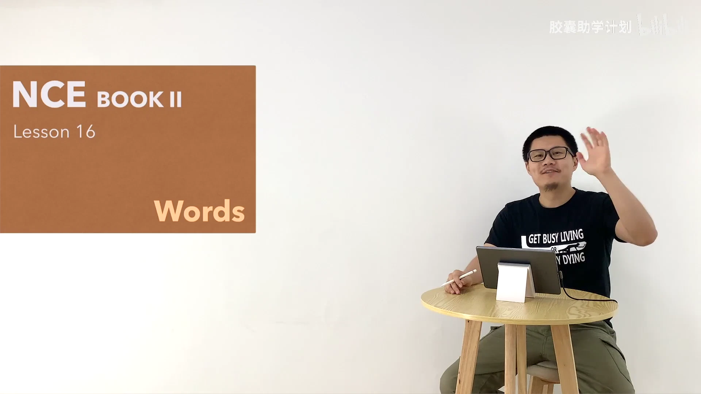

文字识别：胶囊助学计划 / NCE / BOOK II / Lesson 16 / Words / GET BUSY LIVING / YDYING

### 画面 00:00:06

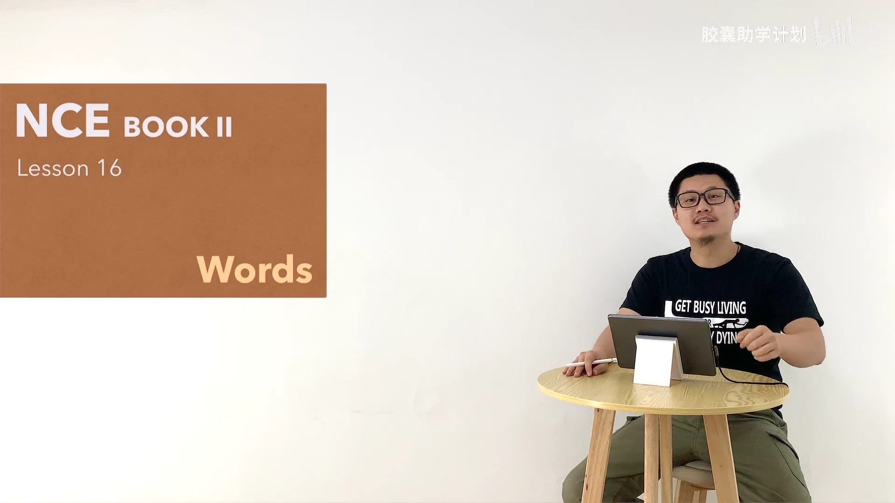

文字识别：胶囊助学计划 / NCE / BOOK II / Lesson 16 / Words / GET BUSY LIVING / YDYIN

### 画面 00:00:09

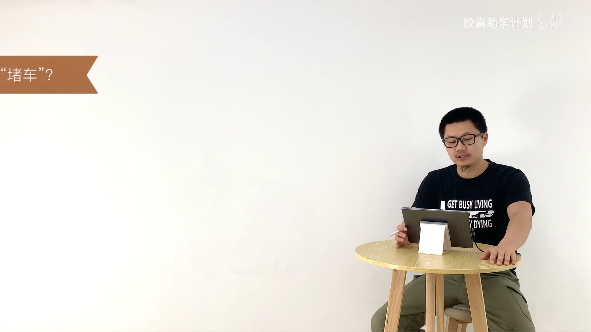

文字识别：胶囊助学计划 / “堵车”？ / GET BUSY LIVING / YDVING

### 画面 00:00:11

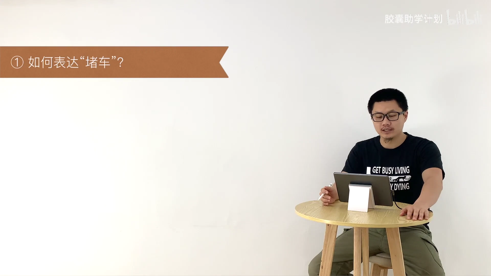

文字识别：胶囊助学计划 / ①如何表达“堵车”? / GET BUSY LIVING / RAMU / YDYING

### 画面 00:00:14

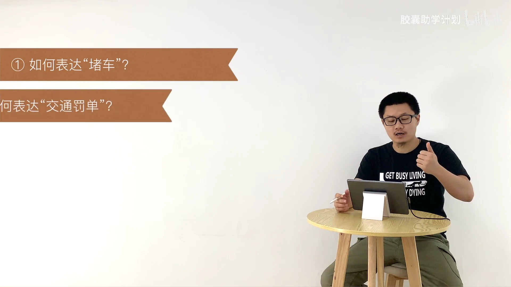

文字识别：胶囊助学计划 / ①如何表达“堵车”？ / 何表达“交通罚单”？ / GET BUSY LIVING / YDYING

### 画面 00:00:16

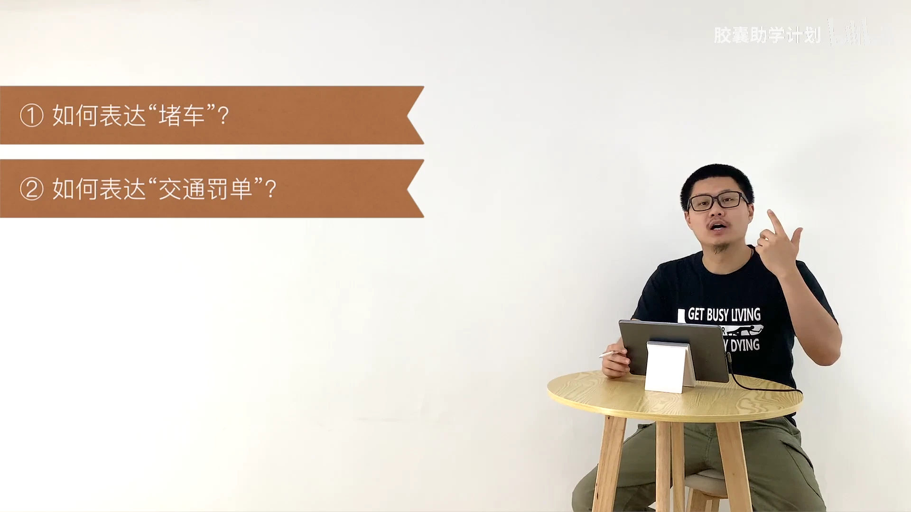

文字识别：胶囊助学计划 / ①如何表达“堵车”？ / 如何表达“交通罚单”? / GET BUSY LIVING / YDVING

### 画面 00:00:18

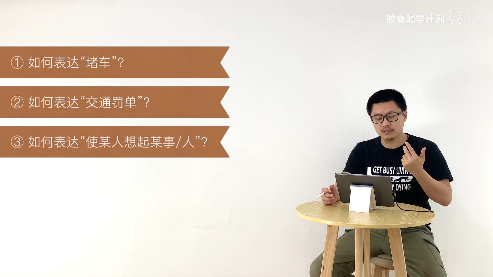

文字识别：胶囊助学计划 / ①如何表达“堵车”？ / 如何表达“交通罚单” / 如何表达“使某人想起某事/人” / GET BUSY LIVIN / YDYING

### 画面 00:00:20

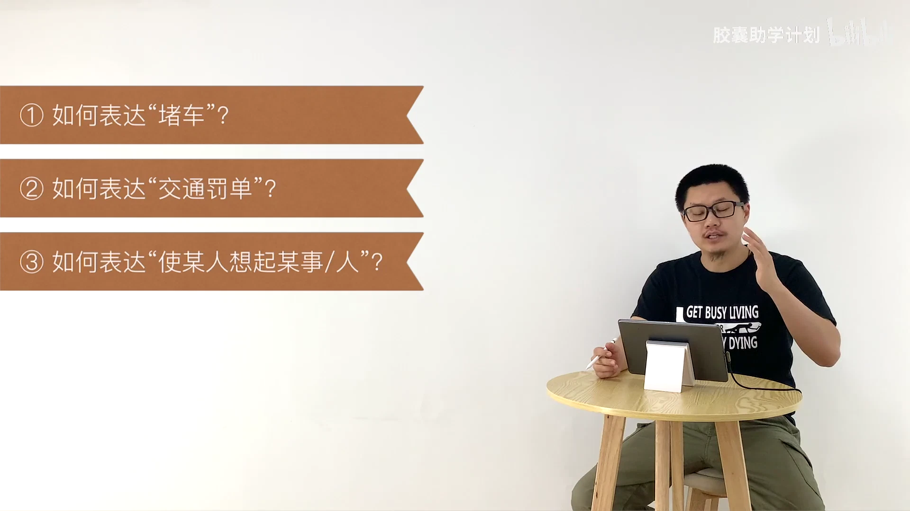

文字识别：胶囊助学计划 / ①如何表达“堵车”？ / 如何表达“交通罚单” / 如何表达“使某人想起某事/人”? / GET BUSY LIVING / YDVING

### 画面 00:00:26

文字识别：胶囊助学计划bl出 / •

## 00:00:30–00:01:00

那我们先看第一个小的单词，跟我一起读一下，叫 park park. OK. 那我们在这儿学到的是它的动词的意思，叫做停车啊。比如说，You can't park your car here, sir. 好，叫做你不能把你的车停在这里。否定句直接给大家了，要注意一下，叫做 park your car. 啊，叫做停你的车，对吧？那我能把我的车停在这里吗？您想一下，是不是和这句话

### 画面 00:00:30

### 画面 00:00:32

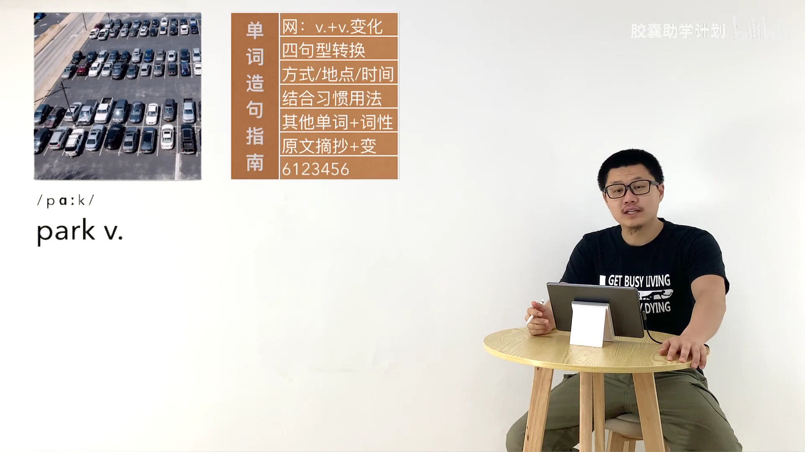

文字识别：单词造句指南 / 网：v.+v.变化 / 胶囊助学计划 / 四句型转换 / 方式/地点/时间 / 结合习惯用法 / 其他单词+词性 / 原文摘抄+变 / 6123456 / /pa:k/ / park v. / GET BUSY LIVING / YDVING

### 画面 00:00:35

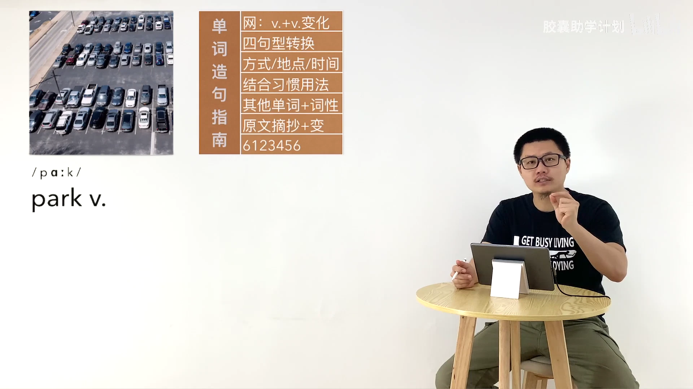

文字识别：B38888B88 / 单词造句指南 / 网：v.+v.变化 / 胶囊助学计划 / 四句型转换 / 方式/地点/时间 / 结合习惯用法 / 其他单词+词性 / 原文摘抄+变 / 6123456 / /pa:k/ / park v. / GET BUSY LIVING / OYING

### 画面 00:00:45

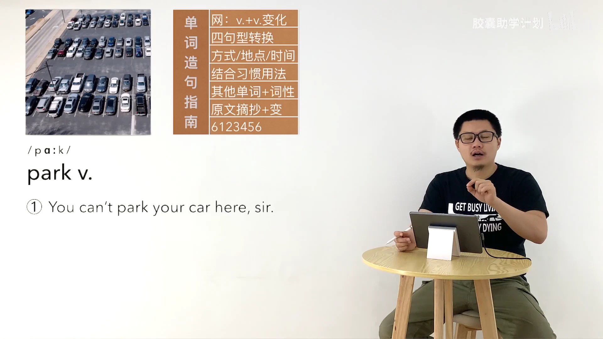

文字识别：单词造句指南 / 网：v.+v.变化 / 胶囊助学计划 / 四句型转换 / 方式/地点/时间 / 结合习惯用法 / 其他单词+词性 / 原文摘抄+变 / 6123456 / /pa:k/ / park v. / ① You can't park your car here, sir. / GET BUSY LIVA / YDYING

### 画面 00:00:50

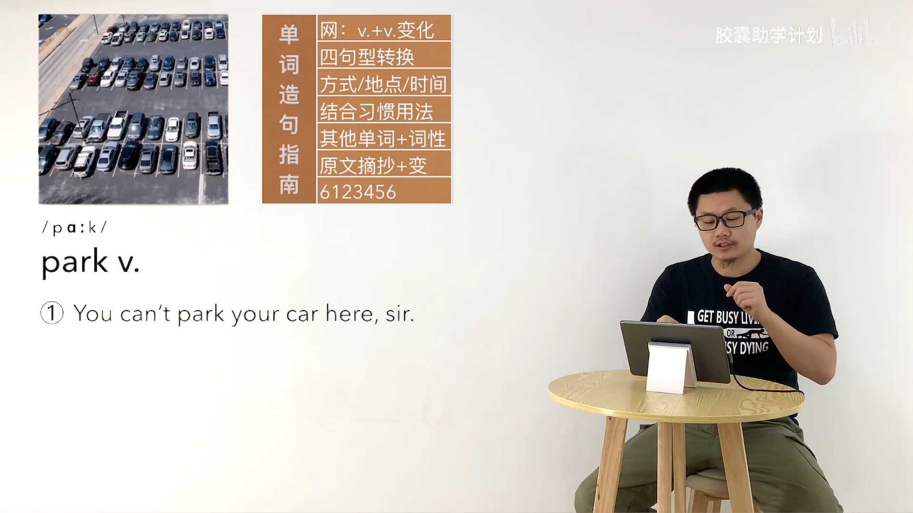

文字识别：单词造句指南 / 网：v.+v.变化 / 胶囊助学计划 / 四句型转换 / 方式/地点/时间 / 结合习惯用法 / 其他单词+词性 / 原文摘抄+变 / 6123456 / /pa:k/ / park v. / ① You can't park your car here, sir. / GET BUSY LIV. / OR / SY DYING

### 画面 00:00:53

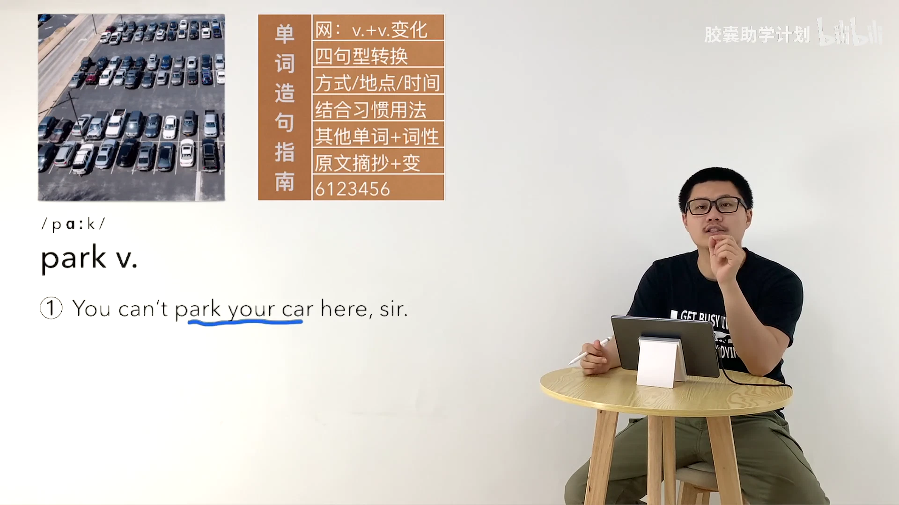

文字识别：单词造句指南 / 网：v.+v.变化 / 胶囊助学计划 / 四句型转换 / 方式/地点/时间 / 结合习惯用法 / 其他单词+词性 / 原文摘抄+变 / 6123456 / /pa:k/ / park v. / ① You can't park your car here, sir. / GET RIISYU

### 画面 00:00:56

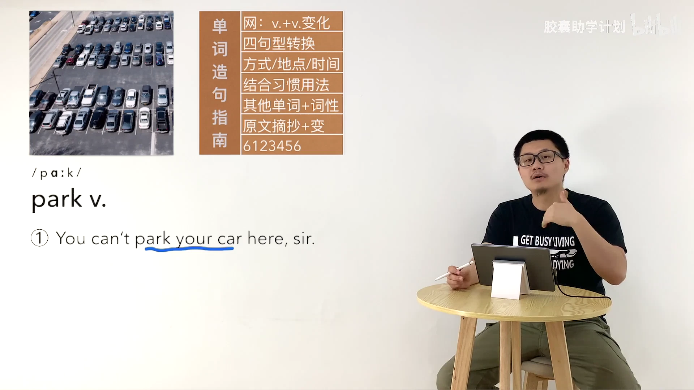

文字识别：B33B3888388 / 单词造句指南 / 网：v.+v.变化 / 胶囊助学计划 / 四句型转换 / 方式/地点/时间 / 结合习惯用法 / 其他单词+词性 / 原文摘抄+变 / 6123456 / /pa:k/ / park v. / ① You can't park your car here, sir. / GET BUSYIVING / DYING

## 00:01:00–00:01:30

就有千丝万缕的联系？这句话是否定，您把它变成一个肯定，然后再变成一个一般疑问句，对吧？叫做 Can I park my car here, sir? OK，好，接下来那如果刚才我说的是 Can I park my car here？然后我们对 here 去提问，就变成了叫做 Where can I park my car？我能在哪个地方去停我的车？OK，好，在这儿给大家补充一个小的短语，

### 画面 00:01:01

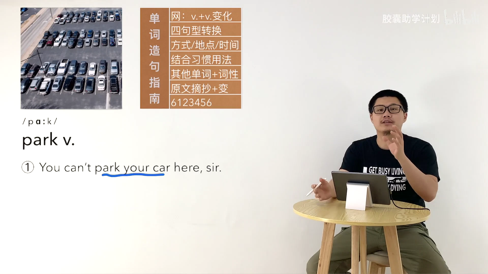

文字识别：单词造句指南 / 网：v.+v.变化 / 胶囊助学计划 / 四句型转换 / 方式/地点/时间 / 结合习惯用法 / 其他单词+词性 / 原文摘抄+变 / 6123456 / /pa:k/ / park v. / ① You can't park your car here, sir. / GET BUSY IVIN / DVING

### 画面 00:01:06

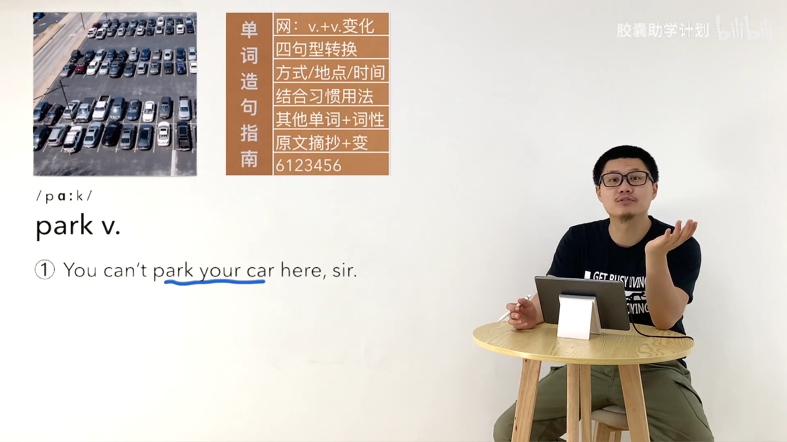

文字识别：33333838888 / 单词造句指南 / 网：v.+v.变化 / 胶囊助学计划 / 四句型转换 / 方式/地点/时间 / 结合习惯用法 / 其他单词+词性 / 原文摘抄+变 / 6123456 / /pa:k/ / park v. / ① You can't park your car here, sir. / GET DIISY IVIN / CMING

### 画面 00:01:11

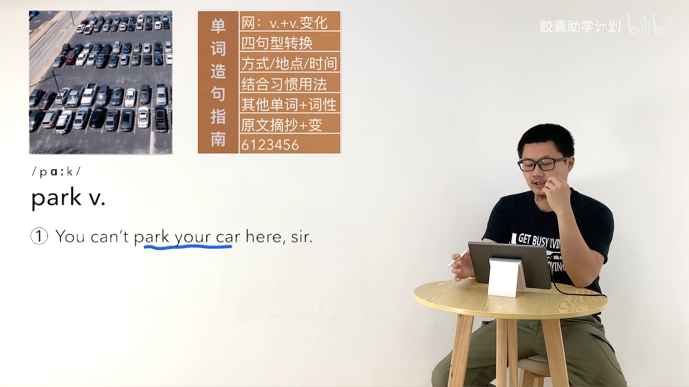

文字识别：单词造句指南 / 网：v.+v.变化 / 胶囊助学计划 / 四句型转换 / 方式/地点/时间 / 结合习惯用法 / 其他单词+词性 / 原文摘抄+变 / 6123456 / /pa:k/ / park v. / ① You can't park your car here, sir. / GET BUSYIVI

### 画面 00:01:15

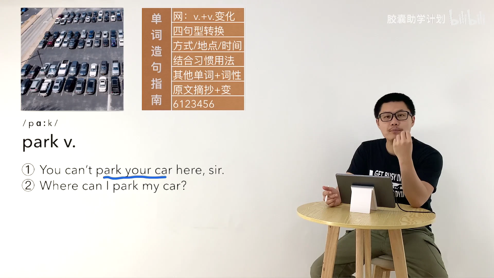

文字识别：单词造句指南 / 网：v.+v.变化 / 胶囊助学计划 / 四句型转换 / 方式/地点/时间 / 结合习惯用法 / 其他单词+词性 / 原文摘抄+变 / 6123456 / /pa:k/ / park v. / ① You can't park your car here, sir. / GFT RIISYIV / Where can I park my car?

### 画面 00:01:19

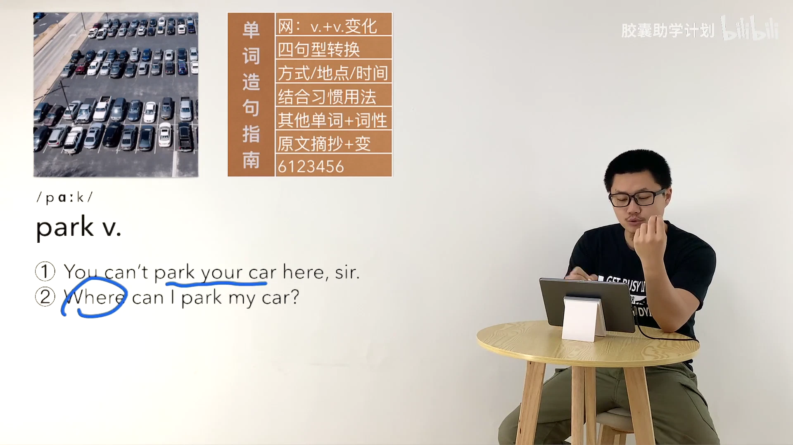

文字识别：单词造句指南 / 网：v.+v.变化 / 胶囊助学计划 / 四句型转换 / 方式/地点/时间 / 结合习惯用法 / 其他单词+词性 / 原文摘抄+变 / 6123456 / /pa:k/ / park v. / ① You can't park your car here, sir. / Where can I park my car?

### 画面 00:01:21

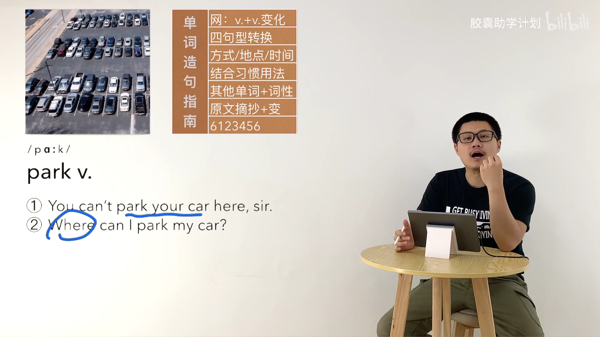

文字识别：33333888888 / 单词造句指南 / 网：v.+v.变化 / 胶囊助学计划 / Bitbit / 四句型转换 / 方式/地点/时间 / 结合习惯用法 / 其他单词+词性 / 原文摘抄+变 / 6123456 / /pa:k/ / park v. / ① You can't park your car here, sir. / GET RIISYIVIN / Where can I park my car? / DYIN

### 画面 00:01:25

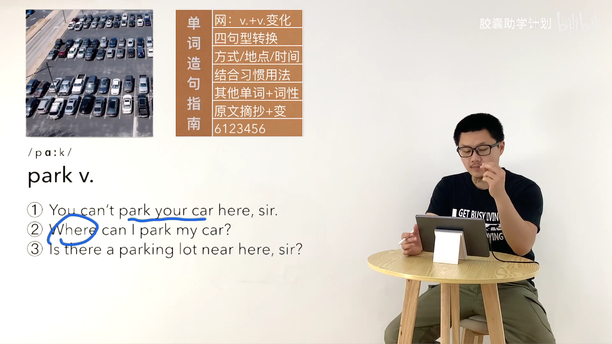

文字识别：单词造句指南 / 网：v.+v.变化 / 胶囊助学计划 / 四句型转换 / 方式/地点/时间 / 结合习惯用法 / 其他单词+词性 / 原文摘抄+变 / 6123456 / /pa:k/ / park v. / ① You can't park your car here, sir. / GET BUISVIVIN / Where can I park my car? / YING / Is there a parking lot near here, sir?

## 00:01:30–00:02:00

那和 park 实际上是保持一致的，叫做 parking lot，非常常用。它直接你可以理解为是一个名词的小短语，叫做停车场，对吧？啊， is there a parking lot near here？说在这个地方的附近有没有一个停车场的？ Is there a parking lot near here？ Okay， very good。接下来，那我们结合第十课的一个习惯用法，叫做 be allowed to do something，被允许去做某件事情，来个否定，叫不

### 画面 00:01:30

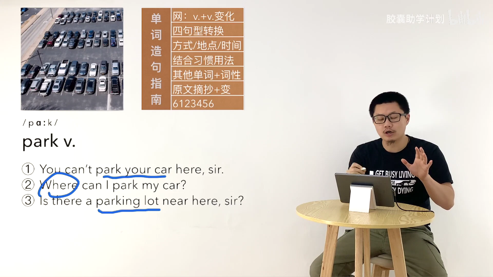

文字识别：单词造句指南 / 网：v.+v.变化 / 胶囊助学计划 / 四句型转换 / 方式/地点/时间 / 结合习惯用法 / 其他单词+词性 / 原文摘抄+变 / 6123456 / /pa:k/ / park v. / ① You can't park your car here, sir. / GFT RUSY LIVINU / Where can I park my car? / YDYING / Is there a parking lot near here, sir?

### 画面 00:01:39

文字识别：B338888888 / 单词造句指南 / 网：v.+v.变化 / 胶囊助学计划 / 四句型转换 / 方式/地点/时间 / 结合习惯用法 / 其他单词+词性 / 原文摘抄+变 / 6123456 / /pa:k/ / park v. / ① You can't park your car here, sir. / GFT RUSY LIVIN / Where can I park my car? / OR / n / YDYING / Is there a parking lot near here, sir?

### 画面 00:01:46

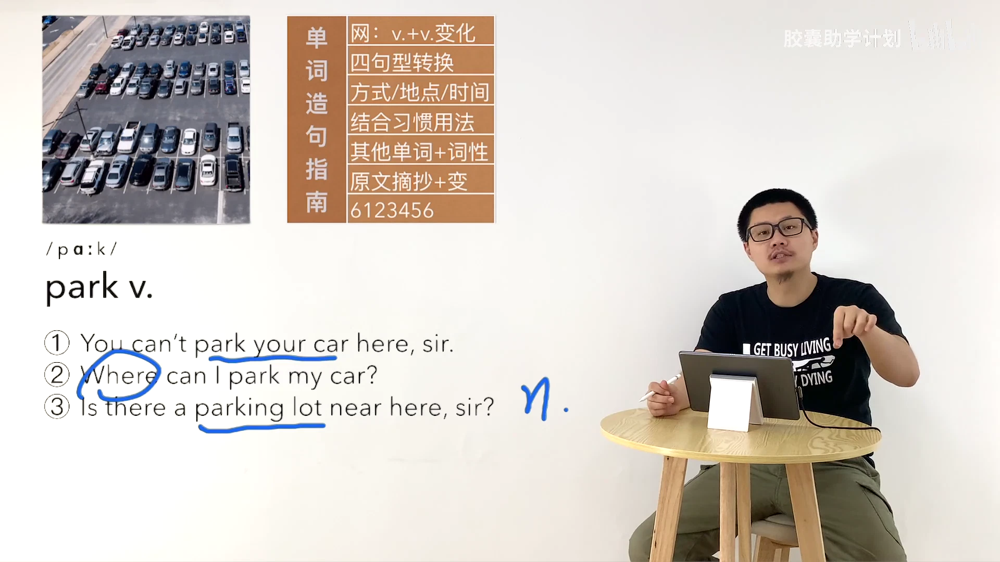

文字识别：单词造句指南 / 网：v.+v.变化 / 胶囊助学计划 / 四句型转换 / 方式/地点/时间 / 结合习惯用法 / 其他单词+词性 / 原文摘抄+变 / 6123456 / /pa:k/ / park v. / ① You can't park your car here, sir. / GET BUSY IVING / here can I park my car? / 2 / YDVING / n / Is there a parking lot near here, sir?

### 画面 00:01:50

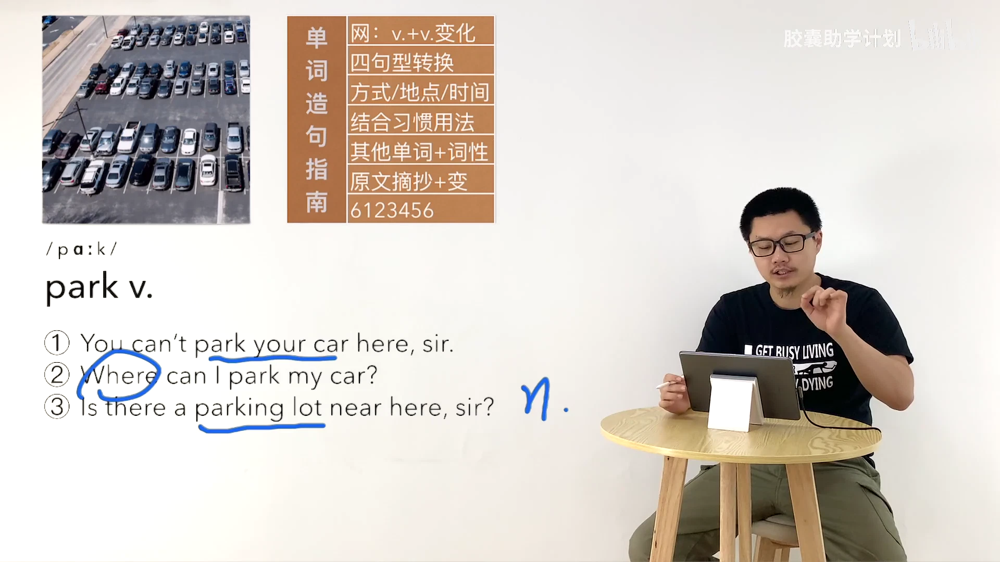

文字识别：单词造句指南 / 网：v.+v.变化 / 胶囊助学计划 / 四句型转换 / 方式/地点/时间 / 结合习惯用法 / 其他单词+词性 / 原文摘抄+变 / 6123456 / /pa:k/ / park v. / ① You can't park your car here, sir. /  GET RUISY LIVING / Where can I park my car? / 2 / n / DYING / Is there a parking lot near here, sir?

### 画面 00:01:54

文字识别：单词造句指南 / 网：v.+v.变化 / 胶囊助学计划 / 四句型转换 / 方式/地点/时间 / 结合习惯用法 / 其他单词+词性 / 原文摘抄+变 / 6123456 / /pa:k/ / park v. / ① You can't park your car here, sir. / Where can I park my car? / 2 / n / OYIN / Is there a parking lot near here, sir? / ④ Look, we are not allowed to park here. L10

## 00:02:00–00:02:30

被允许去做某件事情。于是来了一句话说，Look, we are not allowed to park here.说，瞧啊，我们不被允许在这里停车。那他可能是看到了一个标志，对吧？一个P啊，然后打了一个大大的红斜线啊，就是禁止停车，对吧？We are not allowed to park here.我们被动不被允许在这里停车。OK，那再再然后呢？我们结合一下。我们先看一下，I had an amusing experience last year.

### 画面 00:02:02

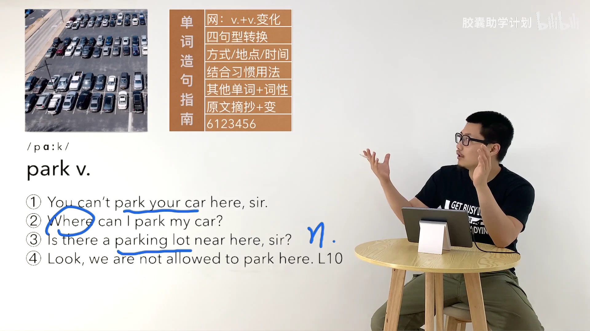

文字识别：33333888888 / 单词造句指南 / 网：v.+v.变化 / 胶囊助学计划 / 四句型转换 / 方式/地点/时间 / 结合习惯用法 / 其他单词+词性 / 原文摘抄+变 / 6123456 / /pa:k/ / park v. / ① You can't park your car here, sir. / GET RUSYI / Where can I park my car? / 2 / n / DYI /  Is there a parking lot near here, sir? / ④ Look, we are not allowed to park here. L10

### 画面 00:02:05

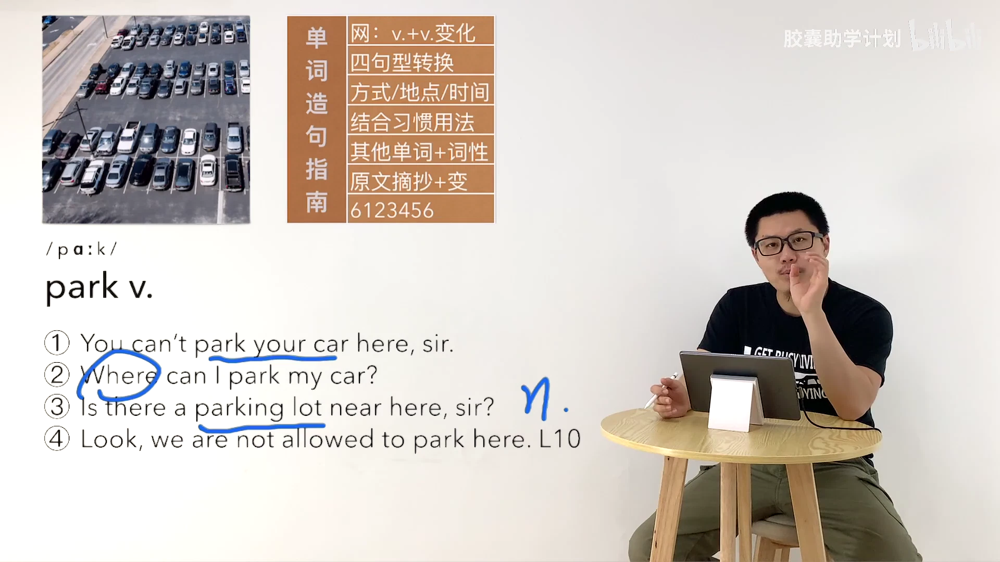

文字识别：单词造句指南 / 网：v.+v.变化 / 胶囊助学计划 / 四句型转换 / 方式/地点/时间 / 结合习惯用法 / 其他单词+词性 / 原文摘抄+变 / 6123456 / /pa:k/ / park v. / ① You can't park your car here, sir. / Where can I park my car? / 2 /  Is there a parking lot near here, sir? / ④ Look, we are not allowed to park here. L10

### 画面 00:02:10

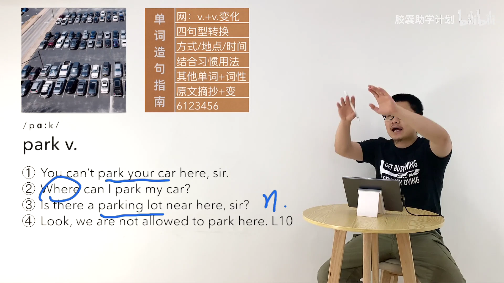

文字识别：33388888 / 单词造句指南 / 网：v.+v.变化 / 胶囊助学计划 / 四句型转换 / 方式/地点/时间 / 结合习惯用法 / 其他单词+词性 / 原文摘抄+变 / 6123456 / /pa:k/ / park v. / IOET BUSINCE / ① You can't park your car here, sir. / OR / Where can I park my car? / YDVING / n / Is there a parking lot near here, sir? / ④ Look, we are not allowed to park here. L10

### 画面 00:02:15

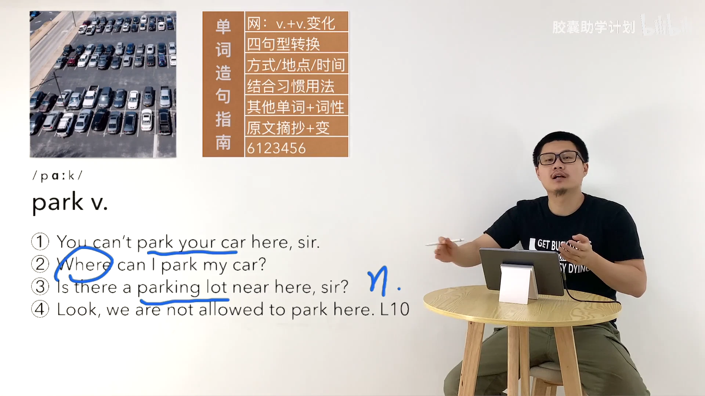

文字识别：单词造句指南 / 网：v.+v.变化 / 胶囊助学计划 / 四句型转换 / 方式/地点/时间 / 结合习惯用法 / 其他单词+词性 / 原文摘抄+变 / 6123456 / /pa:k/ / park v. / ① You can't park your car here, sir. / GETBU / Where can I park my car? / 2 / n /  Is there a parking lot near here, sir? / ④ Look, we are not allowed to park here. L10

### 画面 00:02:20

文字识别：单词造句指南 / 网：v.+v.变化 / 胶囊助学计划 / 四句型转换 / 方式/地点/时间 / 结合习惯用法 / 其他单词+词性 / 原文摘抄+变 / 6123456 / /pa:k/ / park v. / ① You can't park your car here, sir. / GET BUSY LIVING / Where can I park my car? / VDYING / n / Is there a parking lot near here, sir? /  Look, we are not allowed to park here. L10 / 4

### 画面 00:02:22

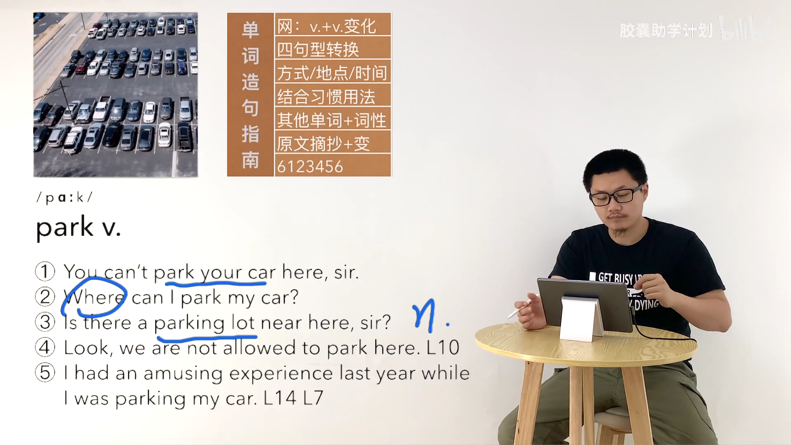

文字识别：3333888888 / 单词造句指南 / 网：v.+v.变化 / 胶囊助学计划 / 四句型转换 / 方式/地点/时间 / 结合习惯用法 / 其他单词+词性 / 原文摘抄+变 / 6123456 / /pa:k/ / park v. / ① You can't park your car here, sir. / GET RIISY / Where can I park my car? / 2 / VDVING / Is there a parking lot near here, sir? / 4 / D Look, we are not allowed to park here. L10 / 5 / ) I had an amusing experience last year while / I was parking my car. L14 L7

### 画面 00:02:25

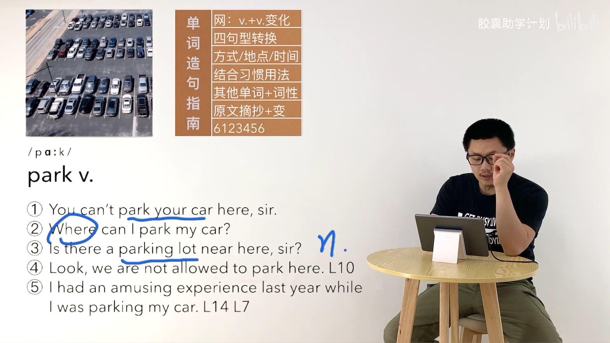

文字识别：单词造句指南 / 网：v.+v.变化 / 胶囊助学计划 / 四句型转换 / 方式/地点/时间 / 结合习惯用法 / 其他单词+词性 / 原文摘抄+变 / 6123456 / /pa:k/ / park v. / ① You can't park your car here, sir. / Where can I park my car? / 2 / M / Is there a parking lot near here, sir? / ④ Look, we are not allowed to park here. L10 /  I had an amusing experience last year while / 5 / I was parking my car. L14 L7

### 画面 00:02:28

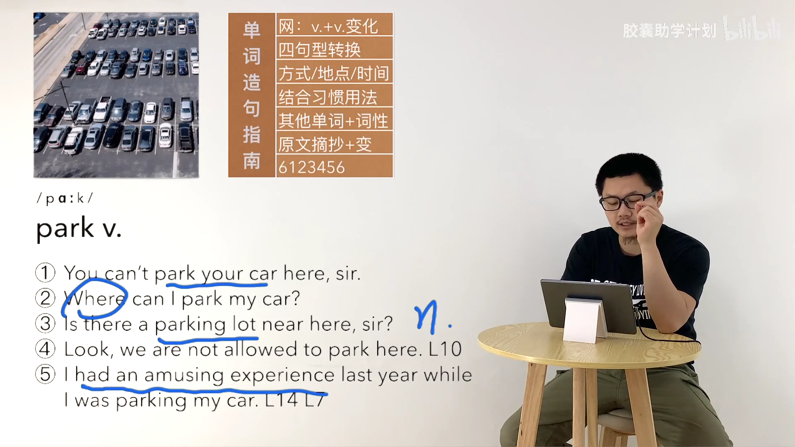

文字识别：单词造句指南 / 网：v.+v.变化 / 胶囊助学计划 / 四句型转换 / 方式/地点/时间 / 结合习惯用法 / 其他单词+词性 / 原文摘抄+变 / 6123456 / /pa:k/ / park v. / ① You can't park your car here, sir. / Where can I park my car? / 2 / n / Is there a parking lot near here, sir? / Look, we are not allowed to park here. L10 / 4 /  I had an amusing experience last year while / 5 / I was parking my car. L14 L7

## 00:02:30–00:03:00

While I was parking my car,你看我这分别结合了第十四课的习惯用法和第七课的语法. While I was parking my car,我有过一个特别有趣的经历。去年当我正在停车的时候，发生了这么一个很有趣的经历啊！这也是我们一直在跟大家说的：，您要不停的把我们之前学过的语法和习惯用法，包括单词，对吧？用到今天来，

### 画面 00:02:31

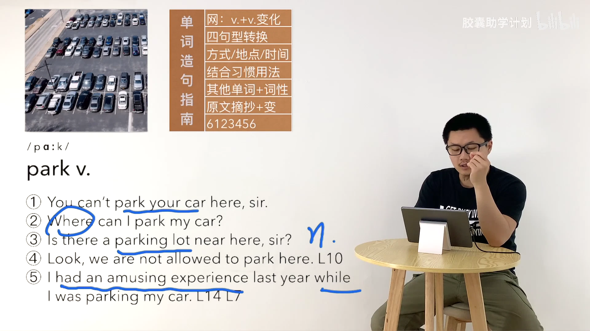

文字识别：单词造句指南 / 网：v.+v.变化 / 胶囊助学计划 / 四句型转换 / 方式/地点/时间 / 结合习惯用法 / 其他单词+词性 / 原文摘抄+变 / 6123456 / /pa:k/ / park v. / ① You can't park your car here, sir. / Where can I park my car? / 2 / n / Is there a parking lot near here, sir? / Look, we are not allowed to park here. L10 / 4 /  I had an amusing experience last year while / 5 / I was parking my car. L14 L7

### 画面 00:02:33

文字识别：单词造句指南 / 网：v.+v.变化 / 胶囊助学计划 / 四句型转换 / 方式/地点/时间 / 结合习惯用法 / 其他单词+词性 / 原文摘抄+变 / 6123456 / /pa:k/ / park v. / ① You can't park your car here, sir. / Where can I park my car? / 2 / M / Is there a parking lot near here, sir? / 4 / Look, we are not allowed to park here. L10 /  I had an amusing experience last year while / 5 / I was parking my car. L14 L7

### 画面 00:02:36

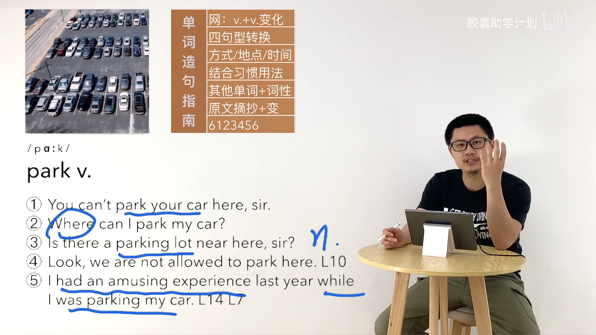

文字识别：3333888888 / 单词造句指南 / 网：v.+v.变化 / 胶囊助学计划 / 四句型转换 / 方式/地点/时间 / 结合习惯用法 / 其他单词+词性 / 原文摘抄+变 / 6123456 / /pa:k/ / park v. / ① You can't park your car here, sir. / Where can I park my car? / 2 / n / Is there a parking lot near here, sir? / Look, we are not allowed to park here. L10 / I had an amusing experience last year while / I was parking my car. L14 L7

### 画面 00:02:41

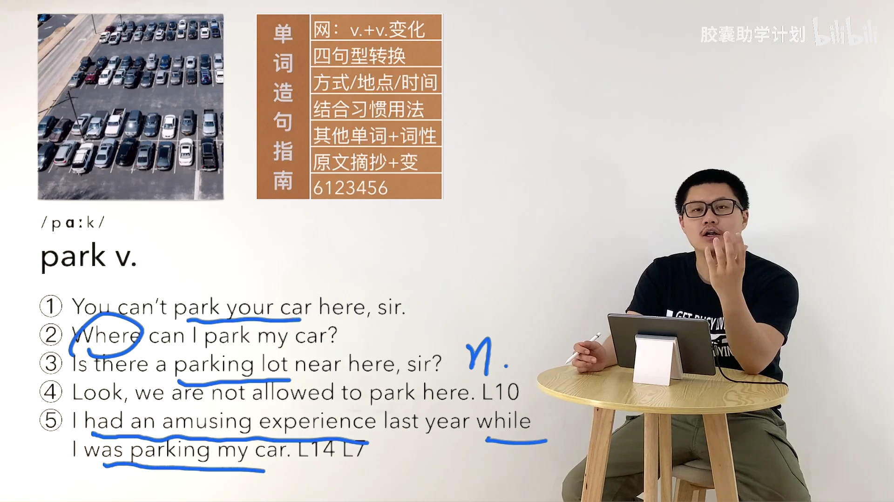

文字识别：33333888888 / 单词造句指南 / 网：v.+v.变化 / 胶囊助学计划 / 四句型转换 / 方式/地点/时间 / 结合习惯用法 / 其他单词+词性 / 原文摘抄+变 / 6123456 / /pa:k/ / park v. / ① You can't park your car here, sir. / Where can I park my car? / 2 / n / Is there a parking lot near here, sir? / 4 / Look, we are not allowed to park here. L10 /  I had an amusing experience last year while / 5 / I was parking my car. L14 L7

### 画面 00:02:46

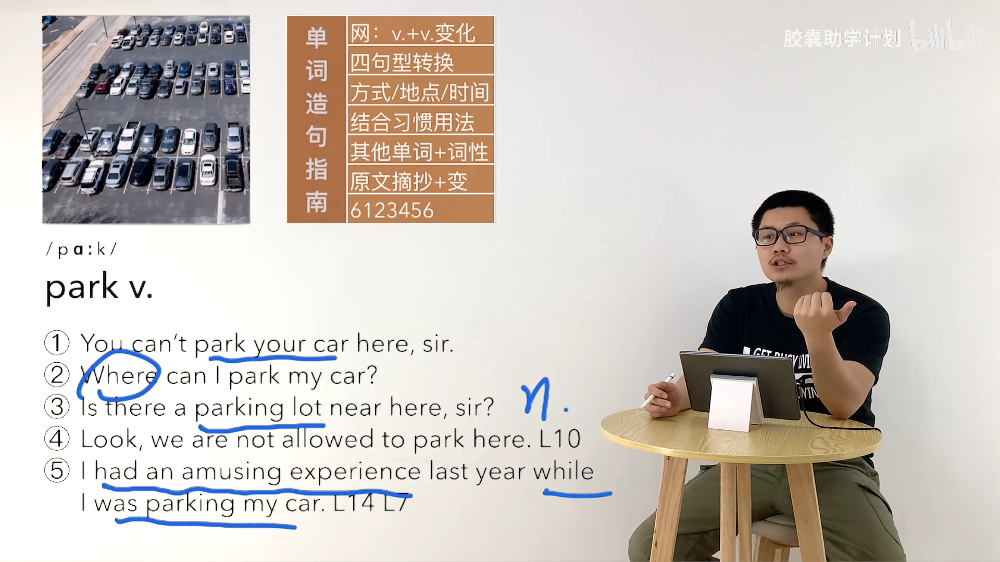

文字识别：33333838888 / 单词造句指南 / 网：v.+v.变化 / 胶囊助学计划 / 四句型转换 / 方式/地点/时间 / 结合习惯用法 / 其他单词+词性 / 原文摘抄+变 / 6123456 / /pa:k/ / park v. / ① You can't park your car here, sir. / Where can I park my car? / 2 / n / Is there a parking lot near here, sir? / Look, we are not allowed to park here. L10 / 4 /  I had an amusing experience last year while / 5 / I was parking my car. L14 L7

### 画面 00:02:50

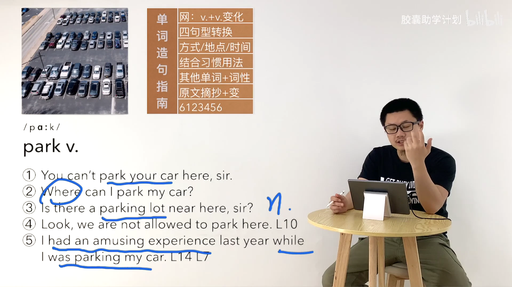

文字识别：单词造句指南 / 网：v.+v.变化 / 胶囊助学计划 / 四句型转换 / 方式/地点/时间 / 结合习惯用法 / 其他单词+词性 / 原文摘抄+变 / 6123456 / /pa:k/ / park v. / ① You can't park your car here, sir. / Where can I park my car? / 2 / n / Is there a parking lot near here, sir? / Look, we are not allowed to park here. L10 / 4 /  I had an amusing experience last year while / 5 / I was parking my car. L14 L7

### 画面 00:02:55

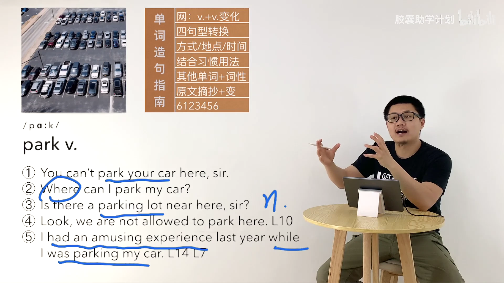

文字识别：单词造句指南 / 网：v.+v.变化 / 胶囊助学计划 / 四句型转换 / 方式/地点/时间 / 结合习惯用法 / 其他单词+词性 / 原文摘抄+变 / 6123456 / /pa:k/ / park v. / ① You can't park your car here, sir. / GFT / Where can I park my car? / n / Is there a parking lot near here, sir? / Look, we are not allowed to park here. L10 / I had an amusing experience last year while / I was parking my car. L14 L7

## 00:03:00–00:03:30

不停的这样去用，您才能越来越熟，对吧？语言到最后是一个熟练工，而不是说您会了这个知识，听懂了这个知识就行了。要做最终做到的是张嘴就来。OK，好，接着下一个单词跟我读，叫做traffic啊，我们管它叫做交通，对吧？traffic它是一个名词，但实际上它经常跟另一个名词连到一起，有点像它有点像起到一个形容词的作用，比如说traffic police叫交通警

### 画面 00:03:02

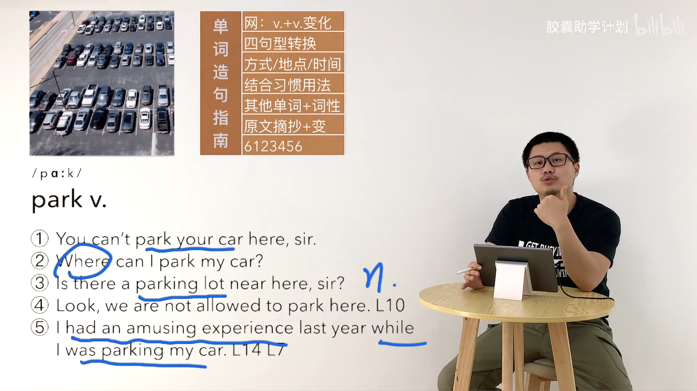

文字识别：338888888 / 单词造句指南 / 网：v.+v.变化 / 胶囊助学计划 / 四句型转换 / 方式/地点/时间 / 结合习惯用法 / 其他单词+词性 / 原文摘抄+变 / 6123456 / /pa:k/ / park v. / ① You can't park your car here, sir. / here can I park my car? / 2 / n / Is there a parking lot near here, sir? / Look, we are not allowed to park here. L10 / I had an amusing experience last year while / I was parking my car. L14 L7

### 画面 00:03:05

文字识别：33333888888 / 单词造句指南 / 网：v.+v.变化 / 胶囊助学计划 / 四句型转换 / 方式/地点/时间 / 结合习惯用法 / 其他单词+词性 / 原文摘抄+变 / 6123456 / /pa:k/ / park v. / ① You can't park your car here, sir. / Where can I park my car? / 2 / n / Is there a parking lot near here, sir? / Look, we are not allowed to park here. L10 / 4 /  I had an amusing experience last year while / 5 / I was parking my car. L14 L7

### 画面 00:03:11

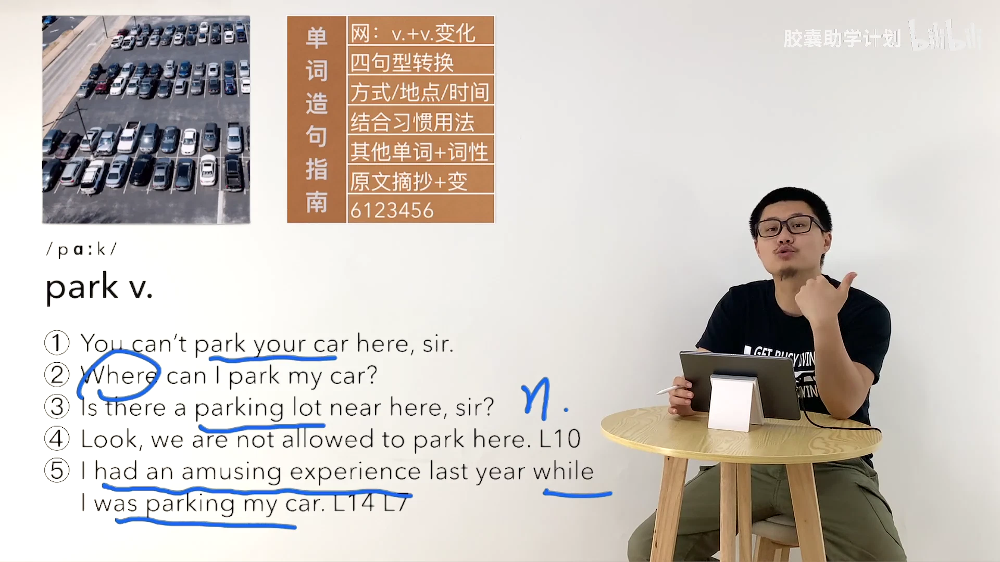

文字识别：单词造句指南 / 网：v.+v.变化 / 胶囊助学计划 / 四句型转换 / 方式/地点/时间 / 结合习惯用法 / 其他单词+词性 / 原文摘抄+变 / 6123456 / /pa:k/ / park v. / ① You can't park your car here, sir. / GET DUYININ / Where can I park my car? / 2 / ENIN / Is there a parking lot near here, sir? /  Look, we are not alowed to park here. L10 / 4 /  I had an amusing experience last year while / 5 / I was parking my car. L14 L7

### 画面 00:03:13

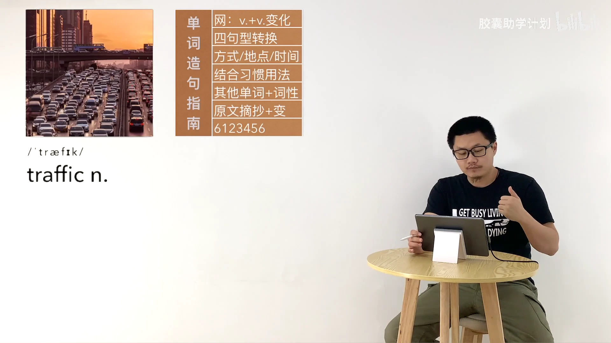

文字识别：单词造句指南 / 网：v.+v.变化 / 胶囊助学计划 / 四句型转换 / 方式/地点/时间 / 结合习惯用法 / 其他单词+词性 / 原文摘抄+变 / 6123456 / /'træfik/ / traffic n. / GET BUSY LIVI / DYING

### 画面 00:03:15

文字识别：单词造句指南 / 网：v.+v.变化 / 胶囊助学计划 / 四句型转换 / 方式/地点/时间 / 结合习惯用法 / 其他单词+词性 / 原文摘抄+变 / 6123456 / /'træfik/ / traffic n. / LIVIN

### 画面 00:03:18

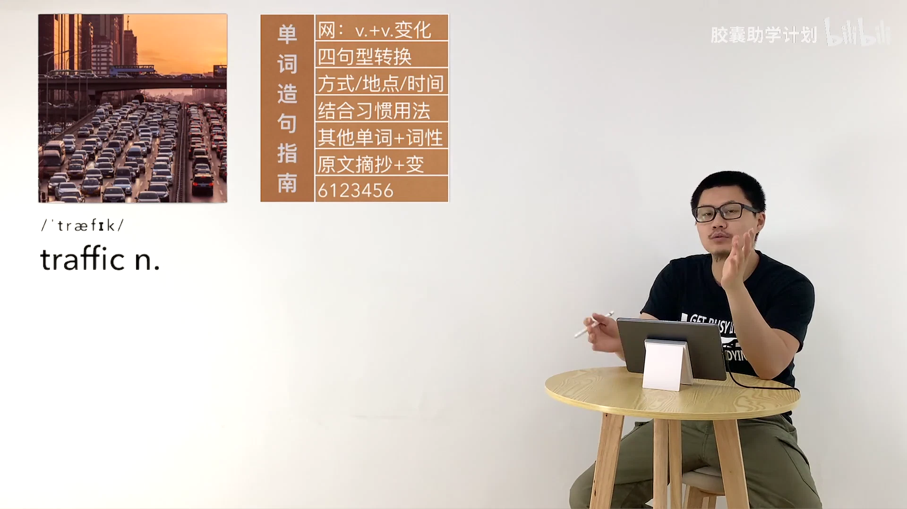

文字识别：单词造句指南 / 网：v.+v.变化 / 胶囊助学计划 / 四句型转换 / 方式/地点/时间 / 结合习惯用法 / 其他单词+词性 / 原文摘抄+变 / 6123456 / /'træfik/ / traffic n. / GET NUSY

### 画面 00:03:21

文字识别：单词造句指南 / 网：v.+v.变化 / 胶囊助学计划 / 四句型转换 / 方式/地点/时间 / 结合习惯用法 / 其他单词+词性 / 原文摘抄+变 / 6123456 / /'træfik/ / traffic n. / traffic police/lights

## 00:03:30–00:04:00

察。那traffic lights呢？指的就是交通的那个指示灯，对吧？红、黄、绿啊，这个指示灯叫traffic lights。OK，好，那我们拿它去造句。您看一下啊，叫做Our son is a traffic police, and we are proud of him。说我们的儿子呀是一个交通警察，然后呢，我们因为他而感到骄傲，因为他而感到自豪。第十二课的一个习惯用法，be proud of some somebody。OK，接下来我说Those

### 画面 00:03:30

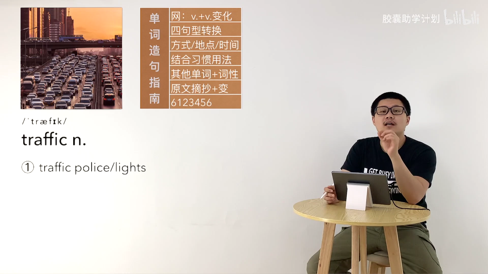

文字识别：单词造句指南 / 网：v.+v.变化 / 胶囊助学计划 / 四句型转换 / 方式/地点/时间 / 结合习惯用法 / 其他单词+词性 / 原文摘抄+变 / 6123456 / /'træfik/ / traffic n. / traffic police/lights / GET DIISYIN

### 画面 00:03:37

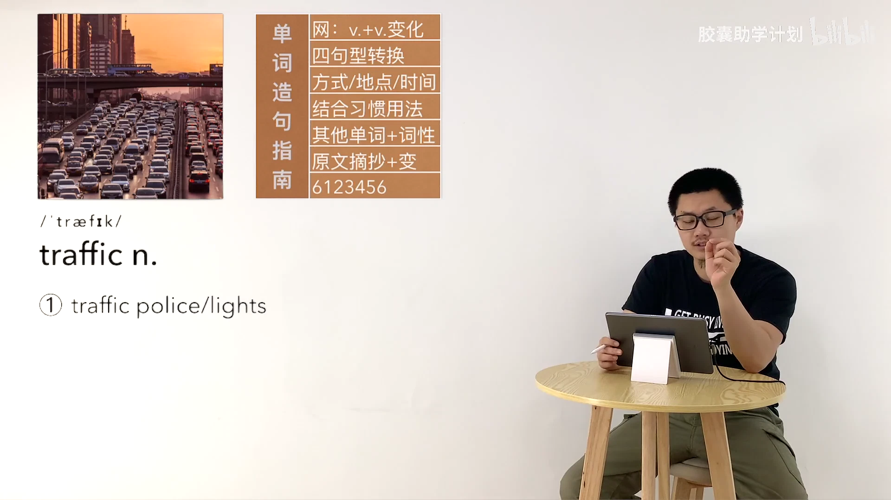

文字识别：单词造句指南 / 网：v.+v.变化 / 胶囊助学计划 / 四句型转换 / 方式/地点/时间 / 结合习惯用法 / 其他单词+词性 / 原文摘抄+变 / 6123456 / /'træfik/ / traffic n. / traffic police/lights

### 画面 00:03:40

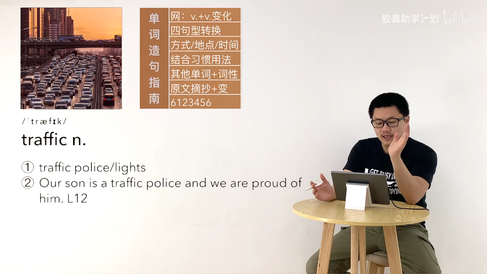

文字识别：单词造句指南 / 网：v.+v.变化 / 胶囊助学计划 / 四句型转换 / 方式/地点/时间 / 结合习惯用法 / 其他单词+词性 / 原文摘抄+变 / 6123456 / /'træfik/ / traffic n. / traffic police/lights / 1 / Our son is a traffic police and we are proud of / 2 / him.L12

### 画面 00:03:45

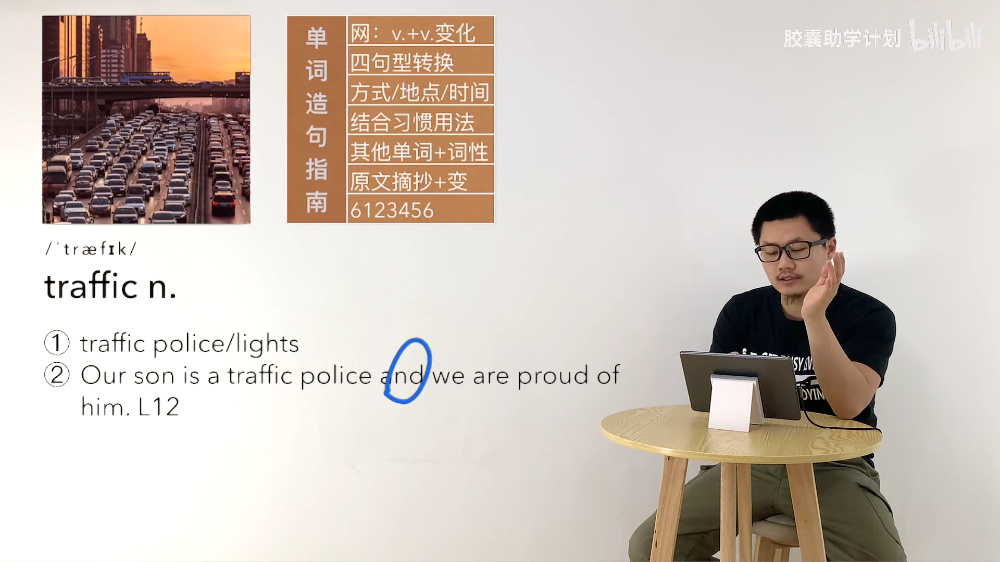

文字识别：单词造句指南 / 网：v.+v.变化 / 胶囊助学计划 / 四句型转换 / 方式/地点/时间 / 结合习惯用法 / 其他单词+词性 / 原文摘抄+变 / 6123456 / /'trefik/ / traffic n. / traffic police/lights / 1） / 2 / Our son is a traffic police / nd / we are proud of / him.L12

### 画面 00:03:47

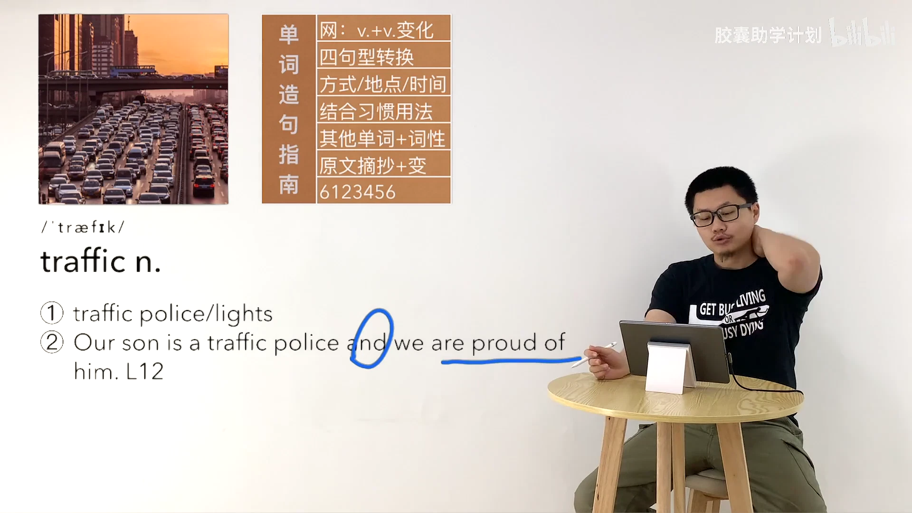

文字识别：单词造句指南 / 网：v.+v.变化 / 胶囊助学计划 / 四句型转换 / 方式/地点/时间 / 结合习惯用法 / 其他单词+词性 / 原文摘抄+变 / 6123456 / /'trefik/ / traffic n. / traffic police/lights / GET BU-LVING / Our son is a traffic police / nd / we are proud of / USY DYG / him. L12

### 画面 00:03:55

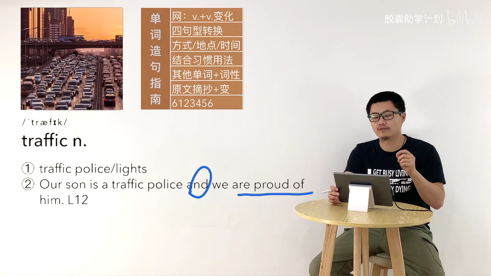

文字识别：单词造句指南 / 网：v.+v.变化 / 胶囊助学计划 / 四句型转换 / 方式/地点/时间 / 结合习惯用法 / 其他单词+词性 / 原文摘抄+变 / 6123456 / /'træfik/ / traffic n. / traffic police/lights / GET RUSY LIVIN / Our son is a traffic police / nd / we are proud of / YDYING / him.L12

## 00:04:00–00:04:30

traffic lights have been broken. 注意现在完成时的被动，这个是对于各位来说相对来说更容易遗忘的一个语法点。第十课我们学了，对吧？几个时态的被动的结构长成什么样？那您就不停的把它拿到接下来的单词当中造句，不停的用这个语法啊。By three kids, by three小屁孩儿是吧？Okay, continue.说We are late because there was heavy

### 画面 00:04:00

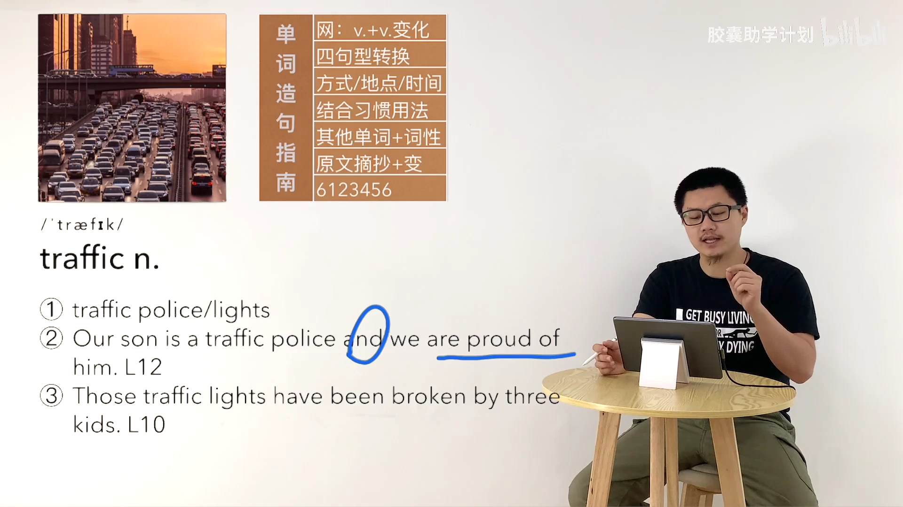

文字识别：单词造句指南 / 网：v.+v.变化 / 胶囊助学计划 / 四句型转换 / 方式/地点/时间 / 结合习惯用法 / 其他单词+词性 / 原文摘抄+变 / 6123456 / /'træefik/ / traffic n. / ① traffic police/lights / GET BUSY LIVIN / 2 /  Our son is a traffic police / and / we are proud of / KDYING / him. L12 / Those traffic lights have been broken by three / kids. L10

### 画面 00:04:02

文字识别：单词造句指南 / 网：v.+v.变化 / 胶囊助学计划 / 四句型转换 / 方式/地点/时间 / 结合习惯用法 / 其他单词+词性 / 原文摘抄+变 / 6123456 / /'trefik/ / traffic n. / ① traffic police/lights / GET RUSY LIVIN / 2） /  Our son is a traffic police / and / we are proud of / OR / YDYING / him. L12 / Those traffic lights have been broken by three / kids. L10

### 画面 00:04:05

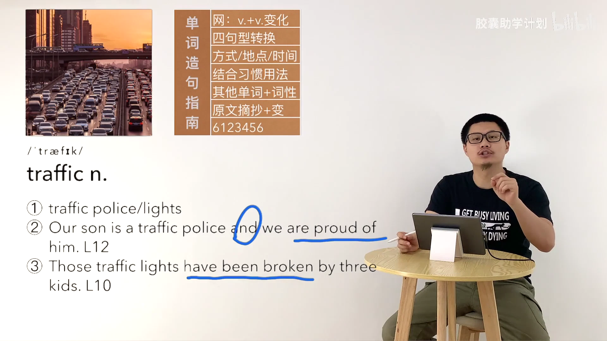

文字识别：单词造句指南 / 网：v.+v.变化 / 胶囊助学计划 / 四句型转换 / 方式/地点/时间 / 结合习惯用法 / 其他单词+词性 / 原文摘抄+变 / 6123456 / /'trefik/ / traffic n. / ①t / traffic police/lights / GET RIUSY LIVING / 2 / Our son is a traffic police / and / we are proud of / R / KDYING / him. L12 / Those traffic lights have been broken by three / kids. L10

### 画面 00:04:10

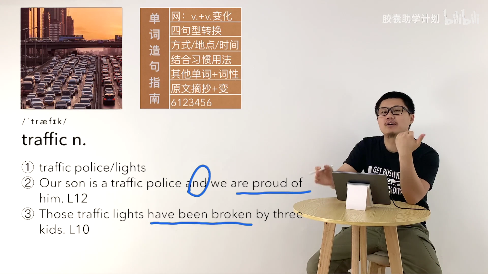

文字识别：单词造句指南 / 网：v.+v.变化 / 胶囊助学计划 / 四句型转换 / 方式/地点/时间 / 结合习惯用法 / 其他单词+词性 / 原文摘抄+变 / 6123456 / /'trefik/ / traffic n. / ① traffic police/lights / GET BUSYIV / 2 /  Our son is a traffic police / and / we are proud of / DR / KDIN / him. L12 / Those traffic lights have been broken by three / kids. L10

### 画面 00:04:15

文字识别：单词造句指南 / 网：v.+v.变化 / 胶囊助学计划l / 四句型转换 / 方式/地点/时间 / 结合习惯用法 / 其他单词+词性 / 原文摘抄+变 / 6123456 / /'trefik/ / traffic n. / ① traffic police/lights / GET DISVIVING /  Our son is a traffic police / we are proud of / 2 / nd / a / OVIN / him. L12 / Those traffic lights have been broken by three / kids. L10

### 画面 00:04:20

文字识别：单词造句指南 / 网：v.+v.变化 / 胶囊助学计划 / 四句型转换 / 方式/地点/时间 / 结合习惯用法 / 其他单词+词性 / 原文摘抄+变 / 6123456 / /'træfik/ / traffic n. / ① traffic police/lights / GET DII / C /  Our son is a traffic police / we are proud of / 2） / nd / him. L12 / Those traffic lights have been broken by three / kids. L10

### 画面 00:04:25

文字识别：单词造句指南 / 网：v.+v.变化 / 胶囊助学计划i / 四句型转换 / 方式/地点/时间 / 结合习惯用法 / 其他单词+词性 / 原文摘抄+变 / 6123456 / /'trefik/ / traffic n. / ① traffic police/lights / GET DIISYIV / ② Our son is a traffic police / and / we are proud of / him. L12 / Those traffic lights have been broken by three / kids. L10 / ④ We are late because there was heavy traffic.

## 00:04:30–00:05:00

traffic. 在这儿算是补充吗？也算是补充。但是我相信这个单词我们之前是学过的，在新一就学过了，叫 heavy，叫做沉的、重的，对吧？那你说这个交通很沉很重是什么意思？注意啊，呃，它指的是途中这个情况，叫做交通堵塞，或者说交通的这个汽车流量特别的大。它不一定真的就堵了，它可以是非常缓慢的进行，对吧？前行，哎，你说堵了吗？也没

### 画面 00:04:30

文字识别：单词造句指南 / 网：v.+v.变化 / 胶囊助学计划 / 四句型转换 / 方式/地点/时间 / 结合习惯用法 / 其他单词+词性 / 原文摘抄+变 / 6123456 / /'træfik/ / traffic n. / ① traffic police/lights / GET RIISYN / ② Our son is a traffic police / we are proud of / dnd / him. L12 / Those traffic lights have been broken by three / kids. L10 / ④ We are late because there was heavy traffic.

### 画面 00:04:33

文字识别：单词造句指南 / 网：v.+v.变化 / 胶囊助学计划 / 四句型转换 / 方式/地点/时间 / 结合习惯用法 / 其他单词+词性 / 原文摘抄+变 / 6123456 / /'træfik/ / traffic n. / ① traffic police/lights / ISY / ② Our son is a traffic police / nd / we are proud of / him. L12 / Those traffic lights have been broken by three / kids. L10 /  We are late because there was heavy traffic.

### 画面 00:04:35

文字识别：单词造句指南 / 网：v.+v.变化 / 胶囊助学计划il / 四句型转换 / 方式/地点/时间 / 结合习惯用法 / 其他单词+词性 / 原文摘抄+变 / 6123456 / /'træfik/ / traffic n. / ① traffic police/lights / 2 /  Our son is a traffic police / nd / we are proud of / him. L12 / Those traffic lights have been broken by three / kids. L10 /  We are late because there was heavy traffic.

### 画面 00:04:40

文字识别：单词造句指南 / 网：v.+v.变化 / 胶囊助学计划 / 四句型转换 / 方式/地点/时间 / 结合习惯用法 / 其他单词+词性 / 原文摘抄+变 / 6123456 / /'træfik/ / traffic n. / ① traffic police/lights / GET RIISYIVI / ② Our son is a traffic police / we are proud of / nd / him. L12 / Those traffic lights have been broken by three / kids. L10 / D We are late because there was heavy traffic.

### 画面 00:04:47

文字识别：单词造句指南 / 网：v.+v.变化 / 胶囊助学计划 / 四句型转换 / 方式/地点/时间 / 结合习惯用法 / 其他单词+词性 / 原文摘抄+变 / 6123456 / /'træfik/ / traffic n. / ① traffic police/lights / GET RUSYIVI / 2） /  Our son is a traffic police / nd / we are proud of / OR. / KOVYIN / him. L12 / Those traffic lights have been broken by three / kids. L10 / D We are late because there was heavy traffic.

### 画面 00:04:50

文字识别：单词造句指南 / 网：v.+v.变化 / 胶囊助学计划 / 四句型转换 / 方式/地点/时间 / 结合习惯用法 / 其他单词+词性 / 原文摘抄+变 / 6123456 / /'træfik/ / traffic n. / 1t / traffic police/lights / GET BUSY / 2） /  Our son is a traffic police / nd / we are proud of / YDYING / him. L12 / Those traffic lights have been broken by three / kids. L10 / D We are late because there was heavy traffic.

### 画面 00:04:55

文字识别：单词造句指南 / 网：v.+v.变化 / 胶囊助学计划 / 四句型转换 / 方式/地点/时间 / 结合习惯用法 / 其他单词+词性 / 原文摘抄+变 / 6123456 / /'træfik/ / traffic n. / ① traffic police/lights / GET BUSY LIVING / 2 / Our son is a traffic police / and / we are proud of / SYDYING / him. L12 / Those traffic lights have been broken by three / kids. L10 / D We are late because there washeavy traffic.

## 00:05:00–00:05:30

堵，对吧？OK，所以呢，注意这个地方，我们形容交通流量很大的时候，车辆车流量很大的时候，用的是heavy这个形容词，而不用比如说big，您能想到或者large啊，它用的是heavy，这是英文的一个习惯，这个点各位把它记住。接下来呢，如果说真的就把它堵住了，交通完全就堵住了，是吧？这种状态我们可以叫traffic jam，哎，这个小单词很有意思，也是我们新一学过的。我们管它的含义，它最常见

### 画面 00:05:00

文字识别：单词造句指南 / 网：v.+v.变化 / 胶囊助学计划 / 四句型转换 / 方式/地点/时间 / 结合习惯用法 / 其他单词+词性 / 原文摘抄+变 / 6123456 / /'trafik/ / traffic n. / ① traffic police/lights / 2 /  Our son is a traffic police / and / we are proud of / him. L12 / Those traffic lights have been broken by three / kids. L10 / D We are late because there washeavy traffic.

### 画面 00:05:05

文字识别：单词造句指南 / 网：v.+v.变化 / 胶囊助学计划 / 四句型转换 / 方式/地点/时间 / 结合习惯用法 / 其他单词+词性 / 原文摘抄+变 / 6123456 / /'trafik/ / traffic n. / ① traffic police/lights / CET PUSYVIVN / ② Our son is a traffic police / and / we are proud of / DVIN / him. L12 / Those traffic lights have been broken by three / kids. L10 /  We are late because there washeavy traffic.

### 画面 00:05:10

文字识别：单词造句指南 / 网：v.+v.变化 / 胶囊助学计划 / 四句型转换 / 方式/地点/时间 / 结合习惯用法 / 其他单词+词性 / 原文摘抄+变 / 6123456 / /'trafik/ / traffic n. / ① traffic police/lights / GET DISYIV / 2 /  Our son is a traffic police / and / we are proud of / him. L12 / Those traffic lights have been broken by three / kids. L10 / D We are late because there was heavy traffic.

### 画面 00:05:15

文字识别：单词造句指南 / 网：v.+v.变化 / 胶囊助学计划 / 四句型转换 / 方式/地点/时间 / 结合习惯用法 / 其他单词+词性 / 原文摘抄+变 / 6123456 / /'træfik/ / traffic n. / ① traffic police/lights / GET DUSYIVI / ② Our son is a traffic police / and / we are proud of / him. L12 / Those traffic lights have been broken by three / kids. L10 /  We are late because there was heavy traffic.

### 画面 00:05:17

文字识别：traffic jam / 胶囊助学计划 / GET RLISYIV / 龙虎少年队21 / 老天啊又堵车了 / Jump Street / Come on! Another traffic jam? / (2012) / DYIN

### 画面 00:05:28

文字识别：traffic jam / 胶囊助学计划 / GET BUS / 龙虎少年队2 / AING / 老天啊又堵车了 / Jump Street / YDYING / Come on! Another traffic jam? / (2012)

## 00:05:30–00:06:00

见的一个意思叫果酱啊，这个交通啊堵的跟果酱一样严严实实的，是吧？OK，叫 traffic jam。接下来我们看一个小的电影片段，注意听，它就用到了叫做呃，Come on another traffic jam。OK，来了啊。 Come on another traffic jam. I'm sorry I didn't check the traffic report before we got the car. Come on, come on, let's go, let's go. OK, come on another traffic jam. OK，好，这个小的习

### 画面 00:05:45

文字识别：traffic jam / 胶囊助学计划h / 龙虎少年队21 / GET DIISYIV / 老天啊又堵车了 / Jump Street / Come on! Another traffic jam? / (2012)

### 画面 00:05:47

文字识别：traffic jam / 胶囊助学计划 / 龙虎少年队21 / GET DUSY / Jump Street / (2012)

### 画面 00:05:49

文字识别：traffic jam / 胶囊助学计划 / 龙虎少年队21 / CET DICV / 是我的错没有看路况报告 / Jump Street / Im sorny I didn't check the traffic report / (2012)

### 画面 00:05:51

文字识别：traffic jam / 胶囊助学计划 / 龙虎少年队21 / GETRUSYIN / 走吧快点 / Jump Street / Let's go! Come on! / (2012)

### 画面 00:05:53

文字识别：traffic jam / 胶囊助学计划 / 龙虎少年队21 / GETRUSYIV / 快点走吧走吧 / Jump Street / Come on. Let's go, let's go, let's go! / (2012)

### 画面 00:05:55

文字识别：traffic jam / 胶囊助学计划 / 龙虎少年队21 / GET RIUG / 快点走吧走吧 / Jump Street / Come on. Let's go, let's go, let's go! / (2012)

## 00:06:00–00:06:30

惯用法，各位记住 traffic jam, continue. 下一个的单词啊，跟我一起读一下，叫做 ticket, ticket. 这个单词对于各位来说应该比较简单。新一前二十课我们就学过了，是吧？第五课我没记错，我们就学到这个单词了。它的意思叫票，对吧？但是呢，如果您把 traffic 刚刚学过的单词和 ticket 给它连起来啊，或者说放到固定的一些场景之下、情景之下的时候，那 ticket 就有了另外一个意思，叫做交通的一个

### 画面 00:06:03

文字识别：单词造句指南 / 网：v.+v.变化 / 胶囊助学计划 / 四句型转换 / 方式/地点/时间 / 结合习惯用法 / 其他单词+词性 / 原文摘抄+变 / 6123456 / /tikit/ / ticket / GET RISYIVING / DYING

### 画面 00:06:05

文字识别：单词造句指南 / 网：v.+v.变化 / 胶囊助学计划 / 四句型转换 / 方式/地点/时间 / 结合习惯用法 / 其他单词+词性 / 原文摘抄+变 / 6123456 / /'tikit/ / ticket

### 画面 00:06:07

文字识别：单词造句指南 / 网：v.+v.变化 / 胶囊助学计划 / 四句型转换 / 方式/地点/时间 / 结合习惯用法 / 其他单词+词性 / 原文摘抄+变 / 6123456 / /'tikit/ / ticket

### 画面 00:06:21

文字识别：单词造句指南 / 网：v.+v.变化 / 胶囊助学计划 / 四句型转换 / 方式/地点/时间 / 结合习惯用法 / 其他单词+词性 / 原文摘抄+变 / 6123456 / /'tIkIt/ / ticket / traffic ticket

## 00:06:30–00:07:00

罚单。那您想这两个单词其实合在一起起到的是一个名词的作用。于是您想一下六一二三四五六，它往往可以处于的位置是一三和五这三个位置，对吧？主语、宾语或者做一个地点。OK，好，接下来呢，我们可以再去找一些前面学过的习惯用法呀，包括您可以找一些动词啊，都是可以的。我们目前找习惯用法是比较多一点点啊。比如说，don't park here。我们刚学了一

### 画面 00:06:30

文字识别：单词造句指南 / 网：v.+v.变化 / 胶囊助学计划 / 四句型转换 / 方式/地点/时间 / 结合习惯用法 / 其他单词+词性 / 原文摘抄+变 / 6123456 / /'tikit/ / ticket / traffic ticket / SYINI

### 画面 00:06:32

文字识别：单词造句指南 / 网：v.+v.变化 / 胶囊助学计划 / 四句型转换 / 方式/地点/时间 / 结合习惯用法 / 其他单词+词性 / 原文摘抄+变 / 6123456 / /'t1kIt / ticket / traffic ticket / ISYINI

### 画面 00:06:36

文字识别：单词造句指南 / 网：v.+v.变化 / 胶囊助学计划 / 四句型转换 / 方式/地点/时间 / 结合习惯用法 / 其他单词+词性 / 原文摘抄+变 / 6123456 / /'tikit/ / ticket / traffic ticket / ISYINI

### 画面 00:06:41

文字识别：单词造句指南 / 网：v.+v.变化 / 胶囊助学计划 / 四句型转换 / 方式/地点/时间 / 结合习惯用法 / 其他单词+词性 / 原文摘抄+变 / 6123456 / /'tikIt / ticket / traffic ticket

### 画面 00:06:46

文字识别：单词造句指南 / 网：v.+v.变化 / 胶囊助学计划 / 四句型转换 / 方式/地点/时间 / 结合习惯用法 / 其他单词+词性 / 原文摘抄+变 / 6123456 / /'tIkIt / ticket / traffic ticket / byIN

### 画面 00:06:51

文字识别：单词造句指南 / 网：v.+v.变化 / 胶囊助学计划 / 四句型转换 / 方式/地点/时间 / 结合习惯用法 / 其他单词+词性 / 原文摘抄+变 / 6123456 / /'tIkit/ / ticket / traffic ticket / YIN

### 画面 00:06:57

文字识别：单词造句指南 / 网：v.+v.变化 / 胶囊助学计划 / 四句型转换 / 方式/地点/时间 / 结合习惯用法 / 其他单词+词性 / 原文摘抄+变 / 6123456 / /'tikIt/ / ticket / traffic ticket /  Don't park here. You'll get a ticket for that.

## 00:07:00–00:07:30

called parking. Don't park here. We just learned a word called parking. Don't park here. We just learned a word called parking. Don't park here. We just learned a word called parking. Don't park here. We just learned a word called parking. Don't park here. We just learned a word called parking. Don't park here. We just learned a word called parking. Don't park here. We just learned a word called parking. Don't park here. We just learned a word called parking. Don't park here. We just learned a word called parking. Don't park here. We just learned a word called parking. Don't park here. We just learned a word called parking. Don't park here. We just learned a word called parking. Don't park here. We just learned a word called parking. Don't park here. We just learned a word called parking. Don't park here.

### 画面 00:07:06

文字识别：单词造句指南 / 网：v.+v.变化 / 胶囊助学计划 / 四句型转换 / 方式/地点/时间 / 结合习惯用法 / 其他单词+词性 / 原文摘抄+变 / 6123456 / /'tikIt/ / ticket / traffic ticket /  Don't park here. You'll get a ticket for that. / SYINI

### 画面 00:07:08

文字识别：单词造句指南 / 网：v.+v.变化 / 胶囊助学计划 / 四句型转换 / 方式/地点/时间 / 结合习惯用法 / 其他单词+词性 / 原文摘抄+变 / 6123456 / /'tikIt / ticket / traffic ticket / Don't park here. You'll get a ticket for that. / SYNIN / SYIN

### 画面 00:07:11

文字识别：单词造句指南 / 网：v.+v.变化 / 胶囊助学计划 / 四句型转换 / 方式/地点/时间 / 结合习惯用法 / 其他单词+词性 / 原文摘抄+变 / 6123456 / /'tIkIt / ticket / traffic ticket /  Don't park here. You'll get a ticket for that,

### 画面 00:07:14

文字识别：单词造句指南 / 网：v.+v.变化 / 胶囊助学计划 / 四句型转换 / 方式/地点/时间 / 结合习惯用法 / 其他单词+词性 / 原文摘抄+变 / 6123456 / /'tIkIt/ / ticket / traffic ticket / CRT PIISV LIVING / Don't park here. You'll get a ticket for that,

### 画面 00:07:16

文字识别：单词造句指南 / 网：v.+v.变化 / 胶囊助学计划 / 四句型转换 / 方式/地点/时间 / 结合习惯用法 / 其他单词+词性 / 原文摘抄+变 / 6123456 / /tIkIt/ / ticket / traffic ticket / IGET DISYIVIN / ② Don't park here. You'll get a ticket for that, / DYINC / The traffic waved to me and asked me to stop, and / then he gave me a ticket. L14 L11

### 画面 00:07:21

文字识别：单词造句指南 / 网：v.+v.变化 / 胶囊助学计划 / 四句型转换 / 方式/地点/时间 / 结合习惯用法 / 其他单词+词性 / 原文摘抄+变 / 6123456 / /tIkIt/ / ticket / traffic ticket / YININ / ② Don't park here. You'll get a ticket for that, / VIN / The traffic waved to me and asked me to stop, and / then he gave me a ticket. L14 L11

## 00:07:30–00:08:00

事情，不是把这句话抄下来，而是看我如何造出的这句话。您学会了这个思路，您自己就能去造句了。你看，wave to me and ask somebody to do something，这是我们在第十四课学过的两个习惯用法。我无非就是把它搬到这个地方来了。And then，然后呢，he gave me a ticket。然后他给了我一张票啊，这是第十四课、第十一课分别学到的，是吧？他给了我一张票，这个不是票，对吧？Okay，呃，他给了

### 画面 00:07:31

文字识别：单词造句指南 / 网：v.+v.变化 / 胶囊助学计划 / 四句型转换 / 方式/地点/时间 / 结合习惯用法 / 其他单词+词性 / 原文摘抄+变 / 6123456 / /'tikIt/ / ticket / traffic ticket / SYININ / ② Don't park here. You'll get a ticket for that, / The traffic waved to me and asked me to stop, and / 3 / then he gave me a ticket. L14 L11

### 画面 00:07:38

文字识别：单词造句指南 / 网：v.+v.变化 / 胶囊助学计划 / 四句型转换 / 方式/地点/时间 / 结合习惯用法 / 其他单词+词性 / 原文摘抄+变 / 6123456 / /tikIt/ / ticket / traffic ticket / ② Don't park here. You'll get a ticket for that, / The traffic waved to me and asked me to stop, and / 3 / then he gave me a ticket. L14 L11

### 画面 00:07:40

文字识别：单词造句指南 / 网：v.+v.变化 / 胶囊助学计划 / 四句型转换 / 方式/地点/时间 / 结合习惯用法 / 其他单词+词性 / 原文摘抄+变 / 6123456 / /tikIt/ / ticket / traffic ticket / ② Don't park here. You'll get a ticket for that, / ISYN / The traffic waved to me and asked me to stop, and / then he gave me a ticket. L14 L11

### 画面 00:07:42

文字识别：单词造句指南 / 网：v.+v.变化 / 胶囊助学计划 / 四句型转换 / 方式/地点/时间 / 结合习惯用法 / 其他单词+词性 / 原文摘抄+变 / 6123456 / /tikIt/ / ticket / traffic ticket / ② Don't park here. You'll get a ticket for that, / YIN / The traffic waved to me and asked me to stop, ahd / then he gave me a ticket. L14 L11

### 画面 00:07:48

文字识别：单词造句指南 / 网：v.+v.变化 / 胶囊助学计划 / 四句型转换 / 方式/地点/时间 / 结合习惯用法 / 其他单词+词性 / 原文摘抄+变 / 6123456 / /tIkIt/ / ticket / traffic ticket / ② Don't park here. You'll get a ticket for that. / The traffic waved to me and asked me to stop,and / then he gave me a ticket. L14 L11

### 画面 00:07:51

文字识别：单词造句指南 / 网：v.+v.变化 / 胶囊助学计划 / 四句型转换 / 方式/地点/时间 / 结合习惯用法 / 其他单词+词性 / 原文摘抄+变 / 6123456 / /tIkIt/ / ticket / traffic ticket / GET DIICVVING / Don't park here. You'll get a ticket for that. / 2） / TING / The traffic waved to me and asked me to stop, / and / then he gave me a ticket. L14 L11

### 画面 00:07:57

文字识别：单词造句指南 / 网：v.+v.变化 / 胶囊助学计划 / 四句型转换 / 方式/地点/时间 / 结合习惯用法 / 其他单词+词性 / 原文摘抄+变 / 6123456 / /tikit/ / ticket / traffic ticket /  CrT nICY LNING / Don't park here. You'll get a ticket for that. / 2 / PYING / The traffic waved to me and asked me to stop,and / then he gave me a ticket. L14 L11

## 00:08:00–00:08:30

我一张什么呢？罚单。Okay, very good.好，那但是在这个地方，我们应该给它再加一个小的单词啊，traffic police. Okay,好，接下来，比如说我们看，I can't afford to pay so many traffic tickets.我支付不起这么多的交通罚单了，是吧？Okay,哦，那就是我们十五课学的叫做afford to pay。那它往往是无法支付得起，叫做can't afford to pay。结合以前的一个习惯用法。

### 画面 00:08:00

文字识别：单词造句指南 / 网：v.+v.变化 / 胶囊助学计划 / 四句型转换 / 方式/地点/时间 / 结合习惯用法 / 其他单词+词性 / 原文摘抄+变 / 6123456 / tIkIt / ticket / traffic ticket / Don't park here. You'll get a ticket for that, / The traffic waved to me and asked me to stop, and / then he gave me a ticket. L14 L11

### 画面 00:08:04

文字识别：单词造句指南 / 网：v.+v.变化 / 胶囊助学计划 / 四句型转换 / 方式/地点/时间 / 结合习惯用法 / 其他单词+词性 / 原文摘抄+变 / 6123456 / tIkIt / ticket / traffic ticket / Don't park,here. You'll get a ticket for that, / SYN / The traffi waved to me and asked me to stop, and / then he gave me a ticket. L14 L11

### 画面 00:08:06

文字识别：单词造句指南 / 网：v.+v.变化 / 胶囊助学计划 / 四句型转换 / 方式/地点/时间 / 结合习惯用法 / 其他单词+词性 / 原文摘抄+变 / 6123456 / tIkIt / ticket / traffic ticket / Don't park here. You'll get a ticket for that. / SYNI / 2 / The traffi vaved to me and asked me to stop, and / then he gave me a ticket. L14 L11

### 画面 00:08:09

文字识别：单词造句指南 / 网：v.+v.变化 / 胶囊助学计划 / 四句型转换 / 方式/地点/时间 / 结合习惯用法 / 其他单词+词性 / 原文摘抄+变 / 6123456 / tikIt / ticket / traffic ticket / Don't park here. You'll get a ticket for that, / 2） / The traffig waved to me and asked me to stop,and / 3 / then he gave me a ticket. L14 L11 / D I can't afford to pay so many traffic tickets. L15

### 画面 00:08:11

文字识别：单词造句指南 / 网：v.+v.变化 / 胶囊助学计划 / 四句型转换 / 方式/地点/时间 / 结合习惯用法 / 其他单词+词性 / 原文摘抄+变 / 6123456 / tIkIt / ticket / traffic ticket / GET BIISYLIVIN / Don't park here. You'll get a ticket for that, / 2 / MDYING / The trafig vaved to me and asked me to stop,and / 3 / then he gave me a ticket. L14 L11 / D I can't afford to pay so many traffic tickets. L15

### 画面 00:08:20

文字识别：单词造句指南 / 网：v.+v.变化 / 胶囊助学计划 / 四句型转换 / 方式/地点/时间 / 结合习惯用法 / 其他单词+词性 / 原文摘抄+变 / 6123456 / tIkIt / ticket / traffic ticket / GET RUSY LIVING / Don't park here. You'll get a ticket for that. / 2 / SYDVING / The traffi yaved to me and asked me to stop, and / 3 / then he gave me a ticket. L14 L11 / D I can't afford to pay so many traffic tickets. L15

### 画面 00:08:22

文字识别：单词造句指南 / 网：v.+v.变化 / 胶囊助学计划 / 四句型转换 / 方式/地点/时间 / 结合习惯用法 / 其他单词+词性 / 原文摘抄+变 / 6123456 / tIkIt / ticket / traffic ticket / CET DIISY LIVING / ② Don't park here. You'll get a ticket for that. / HDYINC / 3 / then he gave me a ticket. L14 L11 /  I can't aff ord to pay so many traffic tickets. L15 / 4

### 画面 00:08:26

文字识别：单词造句指南 / 网：v.+v.变化 / 胶囊助学计划 / 四句型转换 / 方式/地点/时间 / 结合习惯用法 / 其他单词+词性 / 原文摘抄+变 / 6123456 / tIkIt / ticket / traffic ticket /  GET DIISY LVING / Don't park here. You'll get a ticket for that, / 2 / TDYING / The traffig vaved to me and asked me to stop, and / then he gave me a ticket. L14 L11 / I can't afford to pay so many traffic tickets. L15

## 00:08:30–00:09:00

OK，啊一个，接下来下一个小的单词，这个单词我们之前也学过，是吧？各位先读一下，叫做note，叫做便条或者便签儿啊，黄色的那个东西，当然颜色不重要，是吧？各位应该有感觉，就是撕下来往那儿一贴啊，就是这么一个东西，叫note，OK。那我们补两个小的短语，一个叫make notes，一个叫make a note，其实意思是一样的，make notes就是复数，make a note就是单数，对吧？啊，叫做记笔记

### 画面 00:08:30

文字识别：单词造句指南 / 网：v.+v.变化 / 胶囊助学计划 / 四句型转换 / 方式/地点/时间 / 结合习惯用法 / 其他单词+词性 / 原文摘抄+变 / 6123456 / /naut/ / note n. / DR

### 画面 00:08:33

文字识别：单词造句指南 / 网：v.+v.变化 / 胶囊助学计划 / 四句型转换 / 方式/地点/时间 / 结合习惯用法 / 其他单词+词性 / 原文摘抄+变 / 6123456 / /naut/ / note n.

### 画面 00:08:36

文字识别：单词造句指南 / 网：v.+v.变化 / 胶囊助学计划 / 四句型转换 / 方式/地点/时间 / 结合习惯用法 / 其他单词+词性 / 原文摘抄+变 / 6123456 / /naut/ / note n.

### 画面 00:08:41

文字识别：单词造句指南 / 网：v.+v.变化 / 胶囊助学计划 / 四句型转换 / 方式/地点/时间 / 结合习惯用法 / 其他单词+词性 / 原文摘抄+变 / 6123456 / /naut/ / note n. / GET BUSYANING / YDVING

### 画面 00:08:47

文字识别：单词造句指南 / 网：v.+v.变化 / 胶囊助学计划 / 四句型转换 / 方式/地点/时间 / 结合习惯用法 / 其他单词+词性 / 原文摘抄+变 / 6123456 / /naut/ / note n.

### 画面 00:08:51

文字识别：单词造句指南 / 网：v.+v.变化 / 胶囊助学计划 / 四句型转换 / 方式/地点/时间 / 结合习惯用法 / 其他单词+词性 / 原文摘抄+变 / 6123456 / /naut/ / note n. / make notes/ make a note / ISYAN / 所

### 画面 00:08:53

文字识别：单词造句指南 / 网：v.+v.变化 / 胶囊助学计划 / 四句型转换 / 方式/地点/时间 / 结合习惯用法 / 其他单词+词性 / 原文摘抄+变 / 6123456 / /naut/ / note n. / make notes/ make a note

### 画面 00:08:58

文字识别：单词造句指南 / 网：v.+v.变化 / 胶囊助学计划 / 四句型转换 / 方式/地点/时间 / 结合习惯用法 / 其他单词+词性 / 原文摘抄+变 / 6123456 / /naut/ / note n. / make notes/ make a note / GET DIICV

## 00:09:00–00:09:30

啊。比如说，I believe啊，这是一个教授说的。You will all make notes in my class.我相信你们都会在我的课堂上做笔记的。我就不说别的事情了，对吧？OK，好，那注意这个地方，I believe后边的这句话是我们十五课学过的。您回想一下，我们管这个句子一个句子做了宾语，管它叫什么来着？宾语从句。OK，好，接下来那leave a note，

### 画面 00:09:00

文字识别：单词造句指南 / 网：v.+v.变化 / 胶囊助学计划 / 四句型转换 / 方式/地点/时间 / 结合习惯用法 / 其他单词+词性 / 原文摘抄+变 / 6123456 / /naut/ / note n. / make notes/ make a note / GET RUISY INING / I believe you will all make notes in my class. L15 / YDYING

### 画面 00:09:02

文字识别：单词造句指南 / 网：v.+v.变化 / 胶囊助学计划 / 四句型转换 / 方式/地点/时间 / 结合习惯用法 / 其他单词+词性 / 原文摘抄+变 / 6123456 / /naut/ / note n. / make notes/ make a note / SYN /  I believe you will all make notes in my class. L15

### 画面 00:09:05

文字识别：单词造句指南 / 网：v.+v.变化 / 胶囊助学计划 / 四句型转换 / 方式/地点/时间 / 结合习惯用法 / 其他单词+词性 / 原文摘抄+变 / 6123456 / /naut/ / note n. / make notes/ make a note / ISY /  I believeyou will all make notes in my class. L15

### 画面 00:09:07

文字识别：单词造句指南 / 网：v.+v.变化 / 胶囊助学计划 / 四句型转换 / 方式/地点/时间 / 结合习惯用法 / 其他单词+词性 / 原文摘抄+变 / 6123456 / /naut/ / note n. / make notes/ make a note / I believe you will all make notes in my class. / L15

### 画面 00:09:18

文字识别：单词造句指南 / 网：v.+v.变化 / 胶囊助学计划 / 四句型转换 / 方式/地点/时间 / 结合习惯用法 / 其他单词+词性 / 原文摘抄+变 / 6123456 / /naut/ / note n. / make notes/ make a note / I believeyou will all make notes in my class. / L15

### 画面 00:09:20

文字识别：单词造句指南 / 网：v.+v.变化 / 胶囊助学计划 / 四句型转换 / 方式/地点/时间 / 结合习惯用法 / 其他单词+词性 / 原文摘抄+变 / 6123456 / /naut/ / note n. / make notes/ make a note / I believeyou will all make notes in my class. / L15

### 画面 00:09:23

文字识别：单词造句指南 / 网：v.+v.变化 / 胶囊助学计划 / 四句型转换 / 方式/地点/时间 / 结合习惯用法 / 其他单词+词性 / 原文摘抄+变 / 6123456 / /naut/ / note n. / make notes/ make a note / I believeyou will all make notes in my class. / L15

### 画面 00:09:27

文字识别：单词造句指南 / 网：v.+v.变化 / 胶囊助学计划 / 四句型转换 / 方式/地点/时间 / 结合习惯用法 / 其他单词+词性 / 原文摘抄+变 / 6123456 / /naut/ / note n. / make notes/ make a note / I believe you will all make notes in my class. / L15 / leave a note

## 00:09:30–00:10:00

其实这也是在新一就讲过的，也而且我们从字面意思也很容易理解，note叫做便条、便签儿或来个消息，对吧？你便条、便签上一定是消息的。那 leave a note，leave有两个常见的意思，一个叫离开，对吧？另外一个叫留或者落下啊。OK，那 leave a note 就是给别人留一个便条或者留一个便签儿。OK，那接下来我们看一个小的电影片段当中就出现了这句话，叫做

### 画面 00:09:35

文字识别：单词造句指南 / 网：v.+v.变化 / 胶囊助学计划 / 四句型转换 / 方式/地点/时间 / 结合习惯用法 / 其他单词+词性 / 原文摘抄+变 / 6123456 / /naut/ / note n. / make notes/ make a note / I believeyou will all make notes in my class. / L15 / SYN / leave a note

### 画面 00:09:37

文字识别：单词造句指南 / 网：v.+v.变化 / 胶囊助学计划 / 四句型转换 / 方式/地点/时间 / 结合习惯用法 / 其他单词+词性 / 原文摘抄+变 / 6123456 / /naut/ / note n. / make notes/ make a note / I believeyou will all make notes in my class. / L15 / leave a note

### 画面 00:09:41

文字识别：单词造句指南 / 网：v.+v.变化 / 胶囊助学计划 / 四句型转换 / 方式/地点/时间 / 结合习惯用法 / 其他单词+词性 / 原文摘抄+变 / 6123456 / /naut/ / note n. / make notes/ make a note / I believeyou will all make notes in my class. / L15 / leave a note

### 画面 00:09:47

文字识别：单词造句指南 / 网：v.+v.变化 / 胶囊助学计划 / 四句型转换 / 方式/地点/时间 / 结合习惯用法 / 其他单词+词性 / 原文摘抄+变 / 6123456 / /naut/ / note n. / make notes/ make a note / I believeyou will all make notes in my class. / L15 / leave a note

### 画面 00:09:54

文字识别：leave a note / 胶囊助学计划！ / 死亡幻觉 / 我不知道她没留下字条整间物混乱一片 / Donnie Darko / I don't know. She didn't leave a note and the house was all messed up. / (2001)

## 00:10:00–00:10:30

leave a note，留下一个字条或者留下一个便签。注意力集中，来了。 I don't know. She she didn't leave a note, and house was all messed up. But you. You call the cops. Okay, there you go. Leave a note. 记住这句话，好吧。接下来两个单词我们放到一起去

### 画面 00:10:07

文字识别：leave a note / 胶囊助学计划！州 / 死亡幻觉 / 我不知道她没留下字条整间物混乱一片 / Donnie Darko / I don't know. She didn't leave a note and the house was all messed up. / (2001)

### 画面 00:10:09

文字识别：leave a note / 胶囊助学计划 / GETRUO / 死亡幻觉 / 我不知道她没留下字条整间物混乱一片 / Donnie Darko / I don't know. She didn't leave a note and the house was all messed up. / (2001)

### 画面 00:10:12

文字识别：leave a note / 胶囊助学计划州 / 死亡幻觉 / 我不知道她没留下字条整间物混乱一片 / Donnie Darko / I don't know. She didn't leave a note and the house was all messed up. / (2001)

### 画面 00:10:14

文字识别：leave a note / 胶囊助学计划 / 死亡幻觉 / Donnie Darke / (2001)

### 画面 00:10:17

文字识别：leave a note / 胶囊助学计划 / 死亡幻觉 / Donnie Dank / (2001)

### 画面 00:10:20

文字识别：leave a note / 胶囊助学计划 / 死亡幻觉 / 你有没有报警？ / Donnie Dark / Did you call the cops? / (2001)

### 画面 00:10:22

文字识别：leave a note / 胶囊助学计划 / 死亡幻觉 / Donnie Darke / (2001)

### 画面 00:10:27

文字识别：单词造句指南 / 网：v.+v.变化 / 胶囊助学计划 / NO / 四句型转换 / PARKING / 方式/地点/时间 / TOW AWAY / 结合习惯用法 / ZONE / 其他单词+词性 / 原文摘抄+变 / 6123456 / /'earia/ / /sain/ / area n. sign n. / GET DIICY INING / PYING

## 00:10:30–00:11:00

首先，各位看一下这个图啊，图中会有这么一些文字，我带大家看一下。这个您在国外，尤其是英语为母语的国家，是很容易见到的。第一个叫做 No Parking Tollway Zone，是吧？这儿不允许停车。你看 Park，我们最开始就见到了，对吧？这个是会拖车的地区。Area 啊 Zone，它用的是 Zone。那其实 Zone 跟这个 Area 就是几乎是一个意思，同义词，对吧？好，Zone 区域，Area

### 画面 00:10:30

文字识别：单词造句指南 / 网：v.+v.变化 / 胶囊助学计划 / NO / 四句型转换 / PARKING / 方式/地点/时间 / TOW AWAY / 结合习惯用法 / ZONE / 其他单词+词性 / 原文摘抄+变 / 6123456 / /'earia/ / /sain/ / area n. sign n. / ISYAN

### 画面 00:10:32

文字识别：单词造句指南 / 网：v.+v.变化 / 胶囊助学计划 / NO / 四句型转换 / PARKING / 方式/地点/时间 / TOW AWAY / 结合习惯用法 / ZONE / 其他单词+词性 / 原文摘抄+变 / 6123456 / /'earia/ / /saIn/ / area n. sign n. / USYA

### 画面 00:10:36

文字识别：单词造句指南 / 网：v.+v.变化 / 胶囊助学计划 / NO / 四句型转换 / PARKING / 方式/地点/时间 / TOW AWAY / 结合习惯用法 / ZONE / 其他单词+词性 / 原文摘抄+变 / 6123456 / /'earia/ / /sain/ / area n. sign n.

### 画面 00:10:38

文字识别：单词造句指南 / 网：v.+v.变化 / 胶囊助学计划 / NO / 四句型转换 / PARKING / 方式/地点/时间 / TOW AWAY / 结合习惯用法 / ZONE / 其他单词+词性 / 原文摘抄+变 / 6123456 / /'earia/ / /saIn/ / area n. sign n.

### 画面 00:10:42

文字识别：单词造句指南 / 网：v.+v.变化 / 胶囊助学计划 / NO / 四句型转换 / PARKING / 方式/地点/时间 / TOW AWAY / 结合习惯用法 / 70NE / 其他单词+词性 / 原文摘抄+变 / 6123456 / /'earia/ / /saIn/ / area n. sign n.

### 画面 00:10:48

文字识别：单词造句指南 / 网：v.+v.变化 / 胶囊助学计划 / NO / 四句型转换 / PARKING / 方式/地点/时间 / TOW AWAY / 结合习惯用法 / ZONE / 其他单词+词性 / 原文摘抄+变 / 6123456 / /'earia/ / /sain/ / area n. sign n.

### 画面 00:10:51

文字识别：单词造句指南 / 网：v.+v.变化 / 胶囊助学计划 / NO / 四句型转换 / PARKING / 方式/地点/时间 / TOW AWAY / 结合习惯用法 / ZONE / 其他单词+词性 / 原文摘抄+变 / 6123456 / /'earia/ / /sain/ / area n. sign n.

### 画面 00:10:56

文字识别：单词造句指南 / 网：v.+v.变化 / 胶囊助学计划 / NO / 四句型转换 / PARKING / 方式/地点/时间 / TOW AWAY / 结合习惯用法 / ZONE / 其他单词+词性 / 原文摘抄+变 / 6123456 / /'earia/ / /sain/ / area n. sign n.

## 00:11:00–00:11:30

区域啊，几乎是可以当作为同义词的。那sign是什么意思呢？我们在这儿学的它是名词的意思，指的是标识啊标志。那This is a sign啊，这就是一个sign，看到了吧？就是各位学这个呃汽车啊学车的时候，对吧？然后你要学什么标志代表什么意思啊？P画一叉代表什么意思，对吧？六十来一圈儿代表什么意思？这个东西我们统称为它叫做sign。OK，哪一

### 画面 00:11:04

文字识别：单词造句指南 / 网：v.+v.变化 / 胶囊助学计划 / NO / 四句型转换 / PARKING / 方式/地点/时间 / TOW AWAY / 结合习惯用法 / ZONE / 其他单词+词性 / 原文摘抄+变 / 6123456 / /'earia/ / /sain/ / area n. sign n.

### 画面 00:11:08

文字识别：单词造句指南 / 网：v.+v.变化 / 胶囊助学计划 / NO / 四句型转换 / PARKING / 方式/地点/时间 / TOW AWAY / 结合习惯用法 / ZONE / 其他单词+词性 / 原文摘抄+变 / 6123456 / /'earia/ / /sain/ / area n. sign n.

### 画面 00:11:11

文字识别：单词造句指南 / 网：v.+v.变化 / 胶囊助学计划 / NO / 四句型转换 / PARKING / 方式/地点/时间 / TOW AWAY / 结合习惯用法 / ZONE / 其他单词+词性 / 原文摘抄+变 / 6123456 / /'earia/ / /sain/ / area n. sign n.

### 画面 00:11:16

文字识别：单词造句指南 / 网：v.+v.变化 / 胶囊助学计划 / NO / 四句型转换 / PARKING / 方式/地点/时间 / TOW AWAY / 结合习惯用法 / ZONE / 其他单词+词性 / 原文摘抄+变 / 6123456 / /'earia/ / /sain/ / area n. sign n.

### 画面 00:11:21

文字识别：单词造句指南 / 网：v.+v.变化 / 胶囊助学计划 / NO / 四句型转换 / PARKING / 方式/地点/时间 / TOW AWAY / 结合习惯用法 / ZONE / 其他单词+词性 / 原文摘抄+变 / 6123456 / /'earia/ / /saIn/ / area n. sign n. / GET

### 画面 00:11:26

文字识别：单词造句指南 / 网：v.+v.变化 / 胶囊助学计划 / NO / 四句型转换 / PARKING / 方式/地点/时间 / TOW AWAY / 结合习惯用法 / ZONE / 其他单词+词性 / 原文摘抄+变 / 6123456 / /'earia/ / /sain/ / area n. sign n.

## 00:11:30–00:12:00

接下来我们造句，比如说 area，我们直接回顾一下，我们其中有一个造句最简单的方式，这个是实在没辙了，各位再用。偶尔我们提一句，叫做原文摘抄再加变。原文给了一句话，This is a no parking area. 肯定句，我们文章当中百分之九十以上出现的都是肯定句。您再去做一些四句型转化，对吧？Is this a no parking area? 以及 Why is this a no parking area?

### 画面 00:11:31

文字识别：单词造句指南 / 网：v.+v.变化 / 胶囊助学计划 / NO / 四句型转换 / PARKING / 方式/地点/时间 / TOW AWAY / 结合习惯用法 / ZONE / 其他单词+词性 / 原文摘抄+变 / 6123456 / /'earia/ / /sain/ / area n. sign n. / ① [Story]: This is a "No Parking" / area.

### 画面 00:11:38

文字识别：单词造句指南 / 网：v.+v.变化 / 胶囊助学计划 / NO / 四句型转换 / PARKING / 方式/地点/时间 / TOW AWAY / 结合习惯用法 / ZONE / 其他单词+词性 / 原文摘抄+变 / 6123456 / /'earia/ / /sain/ / area n. sign n. / ① [Story]: This is a "No Parking' / area.

### 画面 00:11:46

文字识别：单词造句指南 / 网：v.+v.变化 / 胶囊助学计划 / NO / 四句型转换 / PARKING / 方式/地点/时间 / TOW AWAY / 结合习惯用法 / ZONE / 其他单词+词性 / 原文摘抄+变 / 6123456 / /'earia/ / /sain/ / area n. sign n. / ① [Story]: This is a "No Parking' / area. / YIN

### 画面 00:11:51

文字识别：单词造句指南 / 网：v.+v.变化 / 胶囊助学计划 / NO / 四句型转换 / PARKING / 方式/地点/时间 / TOW AWAY / 结合习惯用法 / ZONE / 其他单词+词性 / 原文摘抄+变 / 6123456 / /'earia/ / /saIn/ / area n. sign n. / ① [Story]: This is a "No Parking" / area. / VIN

### 画面 00:11:56

文字识别：单词造句指南 / 网：v.+v.变化 / 胶囊助学计划 / NO / 四句型转换 / PARKING / 方式/地点/时间 / TOW AWAY / 结合习惯用法 / ZONE / 其他单词+词性 / 原文摘抄+变 / 6123456 / /'earia/ / /sain/ / area n. sign n. / ① [Story]: This is a "No Parking" / area. / ② Is this a "No Parking'area? / IMIN

## 00:12:00–00:12:30

Is吧，为什么这是禁止停车的区域呢？这明明没有任何说不让停车的标志啊。Sign, OK.好，那sign，我们做一个小的句子，很简单，叫Can you read that sign?大家看，Can you read that sign?你能读懂那个标志吗？注意这个地方的read更多的时候表示的不是阅读啊，能不能读懂？就一个六十加一个圈儿，你能读懂他想表示什么意思吗？OK，

### 画面 00:12:01

文字识别：单词造句指南 / 网：v.+v.变化 / 胶囊助学计划 / NO / 四句型转换 / PARKING / 方式/地点/时间 / TOW AWAY / 结合习惯用法 / ZONE / 其他单词+词性 / 原文摘抄+变 / 6123456 / /'earia/ / /sain/ / area n. sign n. / ① [Story]: This is a "No Parking" / area. /  GET RUSY LIVING / ② Is this a "No Parking'area? / SYDVING / 3 / Why is this a "No Parking'area?

### 画面 00:12:06

文字识别：单词造句指南 / 网：v.+v.变化 / 胶囊助学计划 / NO / 四句型转换 / PARKING / 方式/地点/时间 / TOW AWAY / 结合习惯用法 / ZONE / 其他单词+词性 / 原文摘抄+变 / 6123456 / /'earia/ / /sain/ / area n. sign n. / ① [Story]: This is a"No Parking" / area. / CET BISY LIVING / ② Is this a "No Parking' area? / ORAAIU / SY DVING / 3 / Why is this a "No Parking' area?

### 画面 00:12:11

文字识别：单词造句指南 / 网：v.+v.变化 / 胶囊助学计划 / NO / 四句型转换 / PARKING / 方式/地点/时间 / TOW AWAY / 结合习惯用法 / ZONE / 其他单词+词性 / 原文摘抄+变 / 6123456 / /'earia/ / /sain/ / area n. sign n. / ①[Story]: This is a"No Parking"a / area. / 2 / Is this a"No Parking"area? / ③Why is this a"No Parking'area? / 3 / Can you read that sign? / 4

## 00:12:30–00:13:00

对吧？好，接下来说Look at that sign啊，看一下那个标志啊。Okay, sign，记住这个东西，我们管它叫做sign。Okay，好，接下来下一个小的单词跟我读一下，叫做reminder，reminder，reminder。好，我们管它呀，它叫做一个名词，叫做提醒。这个reminder啊，我们先来原文当中给一句话叫做This note is only a reminder.

### 画面 00:12:31

文字识别：单词造句指南 / 网：v.+v.变化 / 胶囊助学计划 / NO / 四句型转换 / PARKING / 方式/地点/时间 / TOW AWAY / 结合习惯用法 / ZONE / 其他单词+词性 / 原文摘抄+变 / 6123456 / /'earia/ / /sain/ / area n. sign n. / ① [Story]: This is a "No Parking'area. / ② / Is this a"No Parking"area? / 3 / Why is this a "No Parking' area? / 4 / Can you read that sign? /  Look at that sign. / 5

### 画面 00:12:37

文字识别：单词造句指南 / 网：v.+v.变化 / 胶囊助学计划 / NO / 四句型转换 / PARKING / 方式/地点/时间 / TOW AWAY / 结合习惯用法 / ZONE / 其他单词+词性 / 原文摘抄+变 / 6123456 / /'earia/ / /sain/ / area n. sign n. / ① [Story]: This is a "No Parking'area. / GEIDU / OR / 2 / Is this a"No Parking"area? / SYOVING / Why is this a "No Parking' area? / 3 / 4 / Can you read that sign? / Look at that sign. / 5

### 画面 00:12:40

文字识别：单词造句指南 / 网：v.+v.变化 / 胶囊助学计划 / B / 四句型转换 / 方式/地点/时间 / don` / 结合习惯用法 / 其他单词+词性 / forget / 原文摘抄+变 / 6123456 / /ri'mainda/ / reminder n. / GET RISY LIVING

### 画面 00:12:42

文字识别：单词造句指南 / 网：v.+v.变化 / 胶囊助学计划 / B / 四句型转换 / X / 方式/地点/时间 / don` / 结合习惯用法 / 其他单词+词性 / forget / 原文摘抄+变 / 6123456 / /ri'mainda/ / reminder n. / YM / DYIN

### 画面 00:12:44

文字识别：单词造句指南 / 网：v.+v.变化 / 胶囊助学计划 / B / 四句型转换 / X / 方式/地点/时间 / don` / 结合习惯用法 / 其他单词+词性 / forget / 原文摘抄+变 / 6123456 / /ri'mainda/ / reminder n. / ISYN

### 画面 00:12:46

文字识别：J / 单词造句指南 / 网：v.+v.变化 / 胶囊助学计划 / B / 四句型转换 / X / 方式/地点/时间 / don` / 结合习惯用法 / 其他单词+词性 / forget / 原文摘抄+变 / 6123456 / /ri'mainda/ / reminder n.

### 画面 00:12:51

文字识别：单词造句指南 / 网：v.+v.变化 / 胶囊助学计划 / B / 四句型转换 / X / 方式/地点/时间 / 结合习惯用法 / don` / 其他单词+词性 / forget / 原文摘抄+变 / 6123456 / /ri'mainda/ / reminder n. / GET BUSYLIVING / YDYING

### 画面 00:12:56

文字识别：单词造句指南 / 网：v.+v.变化 / 胶囊助学计划 / B / 四句型转换 / 方式/地点/时间 / 结合习惯用法 / don'+ / 其他单词+词性 / forget / 原文摘抄+变 / 6123456 / /ri'mainda/ / reminder n. / ① [Story]: This note is only a reminder. / GET RUISYLIVING / RM / YDYING

## 00:13:00–00:13:30

This is a note.看图对吧？This is the note. Don't forget.写在一张小的纸上。这个玩意儿我们管它叫note。说这个便签啊，仅仅是一个提醒啊。OK，这不是非常的重要。Reminder这个单词出现的频率远不如remind这个单词出现的频率，所以我们放到这儿来讲。你看啊，reminder是一个名词，把er去掉了之后，啊，我们经常说一个动

### 画面 00:13:01

文字识别：单词造句指南 / 网：v.+v.变化 / 胶囊助学计划 / B / 四句型转换 / 方式/地点/时间 / don / 结合习惯用法 / 其他单词+词性 / forget / 原文摘抄+变 / 6123456 / /rimainda/ / reminder n. / ① [Story]: This note is only a reminder. / ISYV

### 画面 00:13:06

文字识别：= / 单词造句指南 / 网：v.+v.变化 / 胶囊助学计划 / B / 四句型转换 / 方式/地点/时间 / don` / 结合习惯用法 / 其他单词+词性 / forget / 原文摘抄+变 / 6123456 / /rimainda/ / reminder n. / ① [Story]: This note is only a reminder.

### 画面 00:13:11

文字识别：单词造句指南 / 网：v.+v.变化 / 胶囊助学计划 / B / 四句型转换 / 方式/地点/时间 / don'` / 结合习惯用法 / 其他单词+词性 / forget / 原文摘抄+变 / 6123456 / /rimainda/ / reminder n. / ① [Story]: This note is only a reminder.

### 画面 00:13:16

文字识别：单词造句指南 / 网：v.+v.变化 / 胶囊助学计划 / B / 四句型转换 / 方式/地点/时间 / 结合习惯用法 / don'+ / 其他单词+词性 / forget / 原文摘抄+变 / 6123456 / /rimainda/ / reminder n. / [Story]: This note is only a reminder. / remind sb. of sth./sb.

### 画面 00:13:21

文字识别：单词造句指南 / 网：v.+v.变化 / 胶囊助学计划 / B / 四句型转换 / 方式/地点/时间 / 结合习惯用法 / don't / 其他单词+词性 / forget / 原文摘抄+变 / 6123456 / /rimainda/ / reminder n. / [Story]: This note is only a reminder. / 1 / remind sb. of sth./sb.

### 画面 00:13:26

文字识别：=JL / 单词造句指南 / 网：v.+v.变化 / 胶囊助学计划 / B / 四句型转换 / 方式/地点/时间 / don' / 结合习惯用法 / 其他单词+词性 / forget / 原文摘抄+变 / 6123456 / /rimainda/ / remind / 0 / n. / [Story]: This note is only a reminder. / remind sb. of sth./sb.

## 00:13:30–00:14:00

词后边加er变成了做这件事情的人或者物，对吧？那remind其实它的动词就是提醒的意思。比如说在这个地方我们见到的叫做remind somebody of something或者somebody叫做提醒某人想起了某物或者某人。我们造一句话，He reminds me of my father。好看一下，remind somebody of somebody或something，在这儿给的是somebody

### 画面 00:13:31

文字识别：单词造句指南 / 网：v.+v.变化 / 胶囊助学计划 / B / 四句型转换 / 方式/地点/时间 / 结合习惯用法 / don'+ / 其他单词+词性 / forget / 原文摘抄+变 / 6123456 / /rimainda/ / reminder n. / [Story]: This note is only a reminder. / remind sb. of sth./sb.

### 画面 00:13:36

文字识别：单词造句指南 / 网：v.+v.变化 / 胶囊助学计划 / B / 四句型转换 / 方式/地点/时间 / don` / 结合习惯用法 / 其他单词+词性 / forget / 原文摘抄+变 / 6123456 / /rimainda/ / reminder n. / [Story]: This note is only a reminder. / 1 / remind sb. of sth./sb.

### 画面 00:13:41

文字识别：单词造句指南 / 网：v.+v.变化 / 胶囊助学计划 / B / 四句型转换 / 方式/地点/时间 / don' / 结合习惯用法 / 其他单词+词性 / forget / 原文摘抄+变 / 6123456 / /ri'mainda/ / reminder n. / [Story]: This note is only a reminder. / remind sb. of sth./sb.

### 画面 00:13:46

文字识别：单词造句指南 / 网：v.+v.变化 / 胶囊助学计划 / B / 四句型转换 / 方式/地点/时间 / 结合习惯用法 / don'+ / 其他单词+词性 / forget / 原文摘抄+变 / 6123456 / /rimainda/ / reminder n. / [Story]: This note is on|y a reminder. / remind sb.bf sth./sb.

### 画面 00:13:49

文字识别：单词造句指南 / 网：v.+v.变化 / 胶囊助学计划 / B / 四句型转换 / 方式/地点/时间 / 结合习惯用法 / don'+ / 其他单词+词性 / forget / 原文摘抄+变 / 6123456 / /ri'mainda/ / reminder n. / [Story]: This note is on] / ly a reminder. / remind sb. bf sth./sb. / HeYeminds me of my father.

### 画面 00:13:51

文字识别：单词造句指南 / 网：v.+v.变化 / 胶囊助学计划 / B / 四句型转换 / 方式/地点/时间 / 结合习惯用法 / don'+ / 其他单词+词性 / forget / 原文摘抄+变 / 6123456 / /rI'mainda/ / reminder n. / 1 / [Story]: This note is only a reminder. / remind sb. of sth./sb. /  HeYeminds me of my father.

### 画面 00:13:55

文字识别：单词造句指南 / 网：v.+v.变化 / 胶囊助学计划 / B / 四句型转换 / 方式/地点/时间 / 结合习惯用法 / don'+ / 其他单词+词性 / forget / 原文摘抄+变 / 6123456 / /rI'mainda/ / reminder n. / [Story]: This note is only a reminder. / remind sb, of sth./sb. / He reminds me of my father.

### 画面 00:13:57

文字识别：单词造句指南 / 网：v.+v.变化 / 胶囊助学计划 / Bitbit / B / 四句型转换 / 方式/地点/时间 / 结合习惯用法 / don'+ / 其他单词+词性 / forget / 原文摘抄+变 / 6123456 / /rI'mainda/ / reminder n. / [Story]: This note is only a reminder. / remind sb, of sth./sb / He reminds me of my father.

## 00:14:00–00:14:30

叫做 my father. Okay,说他呀使我想起了我的父亲. Remind me,提醒我想起了我的父亲.其实就是他让我想起了我的父亲. Okay,一个肯定句就给各位了.然后您就可以变成各种各样的句型了,四句型去做一些转化啊.在这儿给大家补充的一个小的短语叫提醒某人想起了某事或某人. Very good.好,哎,这我变了个一般疑问句,很简单,就不多说了.那以及

### 画面 00:14:01

文字识别：单词造句指南 / 网：v.+v.变化 / 胶囊助学计划 / B / 四句型转换 / 方式/地点/时间 / 结合习惯用法 / don'+ / 其他单词+词性 / forget / 原文摘抄+变 / 6123456 / /ri'mainda/ / reminder n. / [Story]: / : This note is only a reminder. / GET BUST / OR. / remind sb, of sth./sb. / ISY DVING / He reminds me of my father.

### 画面 00:14:06

文字识别：单词造句指南 / 网：v.+v.变化 / 胶囊助学计划 / B / 四句型转换 / 方式/地点/时间 / 结合习惯用法 / don'+ / 其他单词+词性 / forget / 原文摘抄+变 / 6123456 / /ri'mainda/ / reminder n. / [Story]: This note is only a reminder. / GET BUSY IVING / remind sb, of sth./sb. / OR / YDYING / He reminds me of my father.

### 画面 00:14:11

文字识别：= / 单词造句指南 / 网：v.+v.变化 / 胶囊助学计划 / B / 四句型转换 / 方式/地点/时间 / 结合习惯用法 / don'+ / 其他单词+词性 / forget / 原文摘抄+变 / 6123456 / /rimainda/ / reminder n. / [Story]: This note is only a reminder. / GET RIISY LIVING / remind sb, of sth./sb. / KDYING / He reminds me of my father.

### 画面 00:14:16

文字识别：单词造句指南 / 网：v.+v.变化 / 胶囊助学计划 / B / 四句型转换 / 方式/地点/时间 / 结合习惯用法 / don'+ / 其他单词+词性 / forget / 原文摘抄+变 / 6123456 / /ri'mainda/ / reminder n. / [Story]: This note is only a reminder. / GET RIISYLIV / remind sb, of sth./sb. / KDYING / He reminds me of my father.

### 画面 00:14:18

文字识别：单词造句指南 / 网：v+v.变化 / 胶囊助学计划 / B / 四句型转换 / 方式/地点/时间 / 结合习惯用法 / don'+ / 其他单词+词性 / forget / 原文摘抄+变 / 6123456 / /ri'mainda/ / reminder n. / [Story]: /  This note is only a reminder. / GET DUSY LIVING / remind / sb, of sth./sb. / OR / He reminds me of my father.

### 画面 00:14:21

文字识别：单词造句指南 / 网：v+v.变化 / 胶囊助学计划 / B / 四句型转换 / 方式/地点/时间 / 结合习惯用法 / don` / 其他单词+词性 / forget / 原文摘抄+变 / 6123456 / /ri'mainda/ / reminder n. / [Story]: / This note is only a reminder. / GET RIISYLIVING / remind / sb of sth./sb / YDYING / He reminds me of my father.

### 画面 00:14:26

文字识别：单词造句指南 / 网：v+v.变化 / 胶囊助学计划 / B / 四句型转换 / 方式/地点/时间 / 结合习惯用法 / don'+ / 其他单词+词性 / forget / 原文摘抄+变 / 6123456 / /ri'mainda/ / reminder n. / [Story]: / : This note is only a reminder. / GET BUSY LIVING / reminds / sb, of sth./sb. / VDVING / He reminds me of my father. / Does he remind you of your father?

## 00:14:30–00:15:00

来了个特殊疑问句，叫 Who does he remind you of? 他会让你想起谁啊？答案 My father. Okay, very good. Continue. 那接下来我们看一个小的电影片段，当中出现了叫 Remind me of you，让我想起了你啊，提醒我想起了你来了。 This guy's bragging about you to Cameron, about his new friends, starting to remind me of you. Jesus,

### 画面 00:14:31

文字识别：单词造句指南 / 网：v+v.变化 / 胶囊助学计划 / B / 四句型转换 / 方式/地点/时间 / 结合习惯用法 / don'+ / 其他单词+词性 / forget / 原文摘抄+变 / 6123456 / /rI'mainda/ / reminder n. / [Story]: This note is only a reminder. / 7 / GET DIISYN / remind sb, of sth./sb. / He reminds me of my father. / Does he remind you of your father? / Who does he remind you of?

### 画面 00:14:37

文字识别：remind me of you... / 胶囊助学计划 / 美国X档案 / American Histony× / (1998)

### 画面 00:14:42

文字识别：remind me of you... / 胶囊助学计划 / 美国X档案 / American HistoryX / (1998)

### 画面 00:14:49

文字识别：remind me of you.. / 胶囊助学计划H / 美国X档案 / 他总是对卡麦隆吹捧你 / American History× / He's always bragging about you to Cameron. / (1998)

### 画面 00:14:51

文字识别：remind me of you.. / 胶囊助学计划 / GET NIIC / 美国X档案 / 他总是对卡麦隆吹捧你 / American Histor / + / Hes always bragging about you to Cameron. / (1998)

### 画面 00:14:53

文字识别：remind me of you... / 胶囊助学计划。 / CET NIIC / 美国X档案 / 还有他所有的新朋友 / American Hist / X / (1998) / .and all his new friends.

### 画面 00:14:55

文字识别：remind me of you... / 胶囊助学计划 / CETNIIC / 美国X档案 / American Histo / X / (1998)

### 画面 00:14:57

文字识别：remind me of you.. / 胶囊助学计划 / CRT RIC / 美国×档案 / American History / X / (1998)

### 画面 00:14:59

文字识别：remind me of you... / 胶囊助学计划 / 美国X档案 / American Histo / X / (1998)

## 00:15:00–00:15:30

Don't sound so worried, all right? I'm sure he's fine. I mean, he's 16 years old, Doris. He's not going to be a little angel forever, you know. Continue. 下一个小单词叫做 fail. 新概念一册一百零三课我们学过叫失败的意思，对吧？在这儿呢，直接来一个文章当中出现的短语，我们记住这个短语就 OK 了，叫做 fail to do something. 失败去做某件事情啊，没有做某件事情没做成，说白了， OK. 比如说 he failed to

### 画面 00:15:01

文字识别：remind me of you... / 胶囊助学计划 / 美国X档案 / 天啊口气别那么担心好吗 / American History / X / Jesus, don't sound so worried, all right? / (1998)

### 画面 00:15:03

文字识别：remind me of you.. / 胶囊助学计划 / 美国X档案 / 我相信他没事 / American History / X / I'm sure he's fine. / (1998)

### 画面 00:15:05

文字识别：remind me of you... / 胶囊助学计划 / 美国X档案 / 他十六岁了桃乐丝 / American History / mean he's 16 years old, Doris. / (1998)

### 画面 00:15:07

文字识别：remind me of you... / 胶囊助学计划 / 美国X档案 / 他不会永远当个小天使 / American History / X / He's not going toibe a little angel forever. You know? / (1998)

### 画面 00:15:09

文字识别：单词造句指南 / 网：v.+v.变化 / 胶囊助学计划 / 四句型转换 / 方式/地点/时间 / 结合习惯用法 / 其他单词+词性 / 原文摘抄+变 / 6123456 / /ferl/ / fail v. / GET RLISYIVIN / DYING

### 画面 00:15:11

文字识别：单词造句指南 / 网：v.+v.变化 / 胶囊助学计划 / 四句型转换 / 方式/地点/时间 / 结合习惯用法 / 其他单词+词性 / 原文摘抄+变 / 6123456 / /ferl/ / fail v. / 2 / SYIVI

### 画面 00:15:16

文字识别：单词造句指南 / 网：v.+v.变化 / 胶囊助学计划 / 四句型转换 / 方式/地点/时间 / 结合习惯用法 / 其他单词+词性 / 原文摘抄+变 / 6123456 / /ferl/ / fail v. / fail to do sth. / SYIVI

### 画面 00:15:21

文字识别：单词造句指南 / 网：v.+v.变化 / 胶囊助学计划 / BBit / 四句型转换 / 方式/地点/时间 / 结合习惯用法 / 其他单词+词性 / 原文摘抄+变 / 6123456 / /ferl/ / fail v. / fail to do sth.

### 画面 00:15:28

文字识别：单词造句指南 / 网：v.+v.变化 / 胶囊助学计划 / 四句型转换 / 方式/地点/时间 / 结合习惯用法 / 其他单词+词性 / 原文摘抄+变 / 6123456 / /ferl/ / fail v. / fail to do sth. / IVIN / He failed to pay it back. L11

## 00:15:30–00:16:00

pay it back. Pay something, pay it back,就把它还回来，偿还回来。十一课学的一个习惯用法。He failed to pay it back,其实就等于 he didn't pay it back. He failed to pay it back,就等于 he didn't to,啊 he didn't pay it back.啊，他没有还回来，他失败还回来了，就是他没有还回来。Okay,那还可以说 he failed to borrow the car from her neighbor.他没有成功的

### 画面 00:15:31

文字识别：单词造句指南 / 网：v.+v.变化 / 胶囊助学计划 / 四句型转换 / 方式/地点/时间 / 结合习惯用法 / 其他单词+词性 / 原文摘抄+变 / 6123456 / /ferl/ / fail v. / fail to do sth. / ISYIVIN / He failed to pay it back. L11 / SYIN

### 画面 00:15:34

文字识别：单词造句指南 / 网：v.+v.变化 / 胶囊助学计划 / 四句型转换 / 方式/地点/时间 / 结合习惯用法 / 其他单词+词性 / 原文摘抄+变 / 6123456 / /ferl/ / fail v. / fail to do sth. / GET BUSYLVING / He failed to pay it back. L11 / YDYING

### 画面 00:15:36

文字识别：单词造句指南 / 网：v.+v.变化 / 胶囊助学计划 / 四句型转换 / 方式/地点/时间 / 结合习惯用法 / 其他单词+词性 / 原文摘抄+变 / 6123456 / /ferl/ / fail v. / fail to do sth. / GET RISYLIVING / He failed to pay it back. L11 / DVING

### 画面 00:15:41

文字识别：单词造句指南 / 网：v.+v.变化 / 胶囊助学计划 / 四句型转换 / 方式/地点/时间 / 结合习惯用法 / 其他单词+词性 / 原文摘抄+变 / 6123456 / /ferl/ / fail v. / fail to do sth. /  He failed to pay it back. L11

### 画面 00:15:48

文字识别：单词造句指南 / 网：v.+v.变化 / 胶囊助学计划 / 四句型转换 / 方式/地点/时间 / 结合习惯用法 / 其他单词+词性 / 原文摘抄+变 / 6123456 / /ferl/ / fail v. / fail to do sth. / )He failed to pay it back. L11

### 画面 00:15:52

文字识别：单词造句指南 / 网：v.+v.变化 / 胶囊助学计划 / 四句型转换 / 方式/地点/时间 / 结合习惯用法 / 其他单词+词性 / 原文摘抄+变 / 6123456 / /ferl/ / fail v. / fail to do sth. / ② He failed to pay it back. L11 / ③ She failed to borrow the car from her / neighbour. L11

### 画面 00:15:56

文字识别：单词造句指南 / 网：v.+v.变化 / 胶囊助学计划 / 四句型转换 / 方式/地点/时间 / 结合习惯用法 / 其他单词+词性 / 原文摘抄+变 / 6123456 / /ferl/ / fail v. / fail to do sth. / ② He failed to pay it back. L11 / ③ She failed to borrow the car from her / 3） / neighbour. L11

## 00:16:00–00:16:30

的啊，他失败了，把这辆车从他邻居那个地方借过来，这件事情他失败了，就是他没干成，对吧？只不过我们汉语呢，呃，语感上来说，说失败去做某件事情好像不是特别舒服，是不是？但是英文可以这样用，您放心就行了啊。那 borrow something from somebody 十一课的习惯用法啊，下一个单词跟我读一下，叫做 obey，注意重音在后面，不是 obey 是吧？是 obey， there you go，好，注意它

### 画面 00:16:02

文字识别：单词造句指南 / 网：v.+v.变化 / 胶囊助学计划 / 四句型转换 / 方式/地点/时间 / 结合习惯用法 / 其他单词+词性 / 原文摘抄+变 / 6123456 / /feil/ / fail v. / fail to do sth. / ② He failed to pay it back. L11 / ③ She failed to borrow the car from her / 3） / neighbour.L11

### 画面 00:16:07

文字识别：单词造句指南 / 网：v.+v.变化 / 胶囊助学计划 / 四句型转换 / 方式/地点/时间 / 结合习惯用法 / 其他单词+词性 / 原文摘抄+变 / 6123456 / /ferl/ / fail v. / fail to do sth. / ② He failed to pay it back. L11 / ③ She failed to borrow the car from her / 3） / neighbour.L11

### 画面 00:16:10

文字识别：单词造句指南 / 网：v.+v.变化 / 胶囊助学计划 / BitLili / 四句型转换 / 方式/地点/时间 / 结合习惯用法 / 其他单词+词性 / 原文摘抄+变 / 6123456 / /ferl/ / fail v. / fail to do sth. /  He failed to pay it back. L11 / SYININ / She failed to borrow the car from her / LYING / neighbour. L11

### 画面 00:16:12

文字识别：单词造句指南 / 网：v.+v.变化 / 胶囊助学计划 / 四句型转换 / 方式/地点/时间 / 结合习惯用法 / 其他单词+词性 / 原文摘抄+变 / 6123456 / /ferl/ / fail v. / fail to do sth. / He failed to pay it back. L11 / MN / She failed to borrow the car from her / VING / neighbour.L11

### 画面 00:16:16

文字识别：单词造句指南 / 网：v.+v.变化 / 胶囊助学计划 / 四句型转换 / 方式/地点/时间 / 结合习惯用法 / 其他单词+词性 / 原文摘抄+变 / 6123456 / /ferl/ / fail v. / fail to do sth. /  He failed to pay it back. L11 / She failed to borrow the car from her / neighbour. L11

### 画面 00:16:20

文字识别：单词造句指南 / 网：v.+v.变化 / 胶囊助学计划 / 四句型转换 / 方式/地点/时间 / 结合习惯用法 / 其他单词+词性 / 原文摘抄+变 / 6123456 / /au'ber/ / obey v. / VIVIN

### 画面 00:16:22

文字识别：单词造句指南 / 网：v.+v.变化 / 胶囊助学计划。 / 四句型转换 / 方式/地点/时间 / 结合习惯用法 / 其他单词+词性 / 原文摘抄+变 / 6123456 / /au'ber/ / obey v.

### 画面 00:16:26

文字识别：单词造句指南 / 网：v.+v.变化 / 胶囊助学计划 / 四句型转换 / 方式/地点/时间 / 结合习惯用法 / 其他单词+词性 / 原文摘抄+变 / 6123456 / /au'bel/ / obey v. / GET RIISYININC / RYING

### 画面 00:16:29

文字识别：单词造句指南 / 网：v.+v.变化 / 胶囊助学计划川 / 四句型转换 / 方式/地点/时间 / 结合习惯用法 / 其他单词+词性 / 原文摘抄+变 / 6123456 / /au'ber/ / obey v. / ① We must obey the traffic rules. / GET RUSY LIVING

## 00:16:30–00:17:00

是个动词，叫做遵守啊。我们看图，对吧？说你遵守交通规则啊。好，比如说 we must obey the traffic rules.啊啊，那 traffic law 也也也 OK 了，对吧？那我们 law 啊是法律，那 traffic rules 就是交通规则啊。我们先不说法律的事儿了，我们还是说规则吧。Traffic rules，我们必须要遵守这个交通规则。OK，但是你看，he refused to obey that stupid rule.说他拒

### 画面 00:16:32

文字识别：单词造句指南 / 网：v.+v.变化 / 胶囊助学计划 / 四句型转换 / 方式/地点/时间 / 结合习惯用法 / 其他单词+词性 / 原文摘抄+变 / 6123456 / /au'ber/ / obey v. / ① We must obey the traffic rules. / TTUSY LIVING / OR

### 画面 00:16:38

文字识别：单词造句指南 / 网：v.+v.变化 / 胶囊助学计划 / 四句型转换 / 方式/地点/时间 / 结合习惯用法 / 其他单词+词性 / 原文摘抄+变 / 6123456 / /au'bel/ / obey v. / ① We must obey the traffic rules. / SYLIVING / DVI

### 画面 00:16:41

文字识别：单词造句指南 / 网：v.+v.变化 / 胶囊助学计划 / 四句型转换 / 方式/地点/时间 / 结合习惯用法 / 其他单词+词性 / 原文摘抄+变 / 6123456 / /au'ber/ / obey v. / ① We must obey the traffic rules.

### 画面 00:16:46

文字识别：单词造句指南 / 网：v.+v.变化 / 胶囊助学计划 / 四句型转换 / 方式/地点/时间 / 结合习惯用法 / 其他单词+词性 / 原文摘抄+变 / 6123456 / /au'ber/ / obey v. / Law / ① We must obey the traffic rules.

### 画面 00:16:48

文字识别：单词造句指南 / 网：v.+v.变化 / 胶囊助学计划 / 四句型转换 / 方式/地点/时间 / 结合习惯用法 / 其他单词+词性 / 原文摘抄+变 / 6123456 / /au'ber/ / obey v. / ① We must obey the traffic rules. / SYIV / 4 / DYIN

### 画面 00:16:52

文字识别：单词造句指南 / 网：v.+v.变化 / 胶囊助学计划 / 四句型转换 / 方式/地点/时间 / 结合习惯用法 / 其他单词+词性 / 原文摘抄+变 / 6123456 / /au'ber/ / obey v. / ① We must obey the traffic rules. / SYIVIN

### 画面 00:16:56

文字识别：单词造句指南 / 网：v.+v.变化 / 胶囊助学计划 / 四句型转换 / 方式/地点/时间 / 结合习惯用法 / 其他单词+词性 / 原文摘抄+变 / 6123456 / /au'bei/ / obey v. / ① We must obey the traffic rules. / GET DIISYV / ② He refused to obey that stupid rule. L9 / 2

## 00:17:00–00:17:30

绝去obey是什么意思？遵守、服从，对吧？拒绝去遵守、服从那个愚蠢的规则。当然不一定。我说的不是交通规则啊，我说的是这个某一个规则啊。那在这儿没有提，反正就是这个规则很蠢，任何人都不想去接受它，对吧？那他拒绝去接受了那个愚蠢的规则。Refuse to do something. Okay,第九课学过的习惯用法。您看，我造这个句子的关键思路其实就是

### 画面 00:17:01

文字识别：单词造句指南 / 网：v.+v.变化 / 胶囊助学计划 / 四句型转换 / 方式/地点/时间 / 结合习惯用法 / 其他单词+词性 / 原文摘抄+变 / 6123456 / /au'bel/ / obey v. / ① We must obey the traffic rules. / CETDI / ISYIN /  He refused to obey that stupid rule. L9

### 画面 00:17:09

文字识别：单词造句指南 / 网：v.+v.变化 / 胶囊助学计划 / 四句型转换 / 方式/地点/时间 / 结合习惯用法 / 其他单词+词性 / 原文摘抄+变 / 6123456 / /au'bei/ / obey v. / ① We must obey the traffic rules. / ISYIV /  He refused to obey that stupid rule. L9

### 画面 00:17:11

文字识别：单词造句指南 / 网：v.+v.变化 / 胶囊助学计划 / 四句型转换 / 方式/地点/时间 / 结合习惯用法 / 其他单词+词性 / 原文摘抄+变 / 6123456 / /au'ber/ / obey v. / ① We must obey the traffic rules. / SYIV / He refused to obey that stupid rule. L9

### 画面 00:17:13

文字识别：单词造句指南 / 网：v.+v.变化 / 胶囊助学计划 / 四句型转换 / 方式/地点/时间 / 结合习惯用法 / 其他单词+词性 / 原文摘抄+变 / 6123456 / /au'bei/ / obey v. /  We must obey the traffic rules. / GFT RUISY / He refused to obey that stupid rule. L9 / VDYIN

### 画面 00:17:17

文字识别：单词造句指南 / 网：v.+v.变化 / 胶囊助学计划 / 四句型转换 / 方式/地点/时间 / 结合习惯用法 / 其他单词+词性 / 原文摘抄+变 / 6123456 / /au'bei/ / obey v. / ① We must obey the traffic rules. /  GET DUSY LVING /  He refused to obey that stupid rule. L9 / DYING

### 画面 00:17:23

文字识别：单词造句指南 / 网：v.+v.变化 / 胶囊助学计划 / 四句型转换 / 方式/地点/时间 / 结合习惯用法 / 其他单词+词性 / 原文摘抄+变 / 6123456 / /au'ber/ / obey v. /  We must obey the traffic rules. / CRT RUSY LIVING / He / Fefused to obeylthat stupid rule. L9 / OR / IYDYING

### 画面 00:17:26

文字识别：单词造句指南 / 网：v.+v.变化 / 胶囊助学计划 / 四句型转换 / 方式/地点/时间 / 结合习惯用法 / 其他单词+词性 / 原文摘抄+变 / 6123456 / /au'ber/ / obey v. / We must obey the traffic rules. / GET RISYAIVIN / He / retused to obey / that stupid rule. L9 / KDYING

## 00:17:30–00:18:00

我要现在有一个动词，对吧？然后呢，我找别的词性，哎，或者说找其他的习惯用法，然后往这里一加就可以了，对吧？OK，然后呃，给它来变成了一个特殊疑问句，叫 Why did he refuse to obey that rule? 啊，他为什么拒绝去接受那个拒拒绝去服从那个命令或者说那个规则？啊， because he think is stupid，认为因为他认为那很愚蠢。OK，好，

### 画面 00:17:30

文字识别：单词造句指南 / 网：v.+v.变化 / 胶囊助学计划 / 四句型转换 / 方式/地点/时间 / 结合习惯用法 / 其他单词+词性 / 原文摘抄+变 / 6123456 / au'bei/ / obeyv. / We must obey the traffic rules. / He / refused to obey / that stupid rule. L9

### 画面 00:17:34

文字识别：单词造句指南 / 网：v.+v.变化 / 胶囊助学计划 / 四句型转换 / 方式/地点/时间 / 结合习惯用法 / 其他单词+词性 / 原文摘抄+变 / 6123456 / au'ber/ / obeyv. / We must obey the traffic rules. / He / refused to obey / that stupid rule. L9

### 画面 00:17:36

文字识别：单词造句指南 / 网：v.+v.变化 / 胶囊助学计划 / BLii / 四句型转换 / 方式/地点/时间 / 结合习惯用法 / 其他单词+词性 / 原文摘抄+变 / 6123456 / au'bei/ / obeyv. / We must obey the traffic rules. / He / refused to obey / that stupid rule. L9

### 画面 00:17:42

文字识别：单词造句指南 / 网：v.+v.变化 / 胶囊助学计划 / 四句型转换 / 方式/地点/时间 / 结合习惯用法 / 其他单词+词性 / 原文摘抄+变 / 6123456 / au'bei/ / obeyv. / We / e must obey the traffic rules. / GET DIICV / He / refused to obey / that stupid r / rule. L9 / Why did he retuse to obey that rule?

### 画面 00:17:45

文字识别：单词造句指南 / 网：v.+v.变化 / 胶囊助学计划 / 四句型转换 / 方式/地点/时间 / 结合习惯用法 / 其他单词+词性 / 原文摘抄+变 / 6123456 / au'bei/ / obeyv. / We must obey the traffic rules. / HSYIVI / He / refused to obey / that stupid rule. L9 / Why did he retuse to obey that rule?

### 画面 00:17:47

文字识别：单词造句指南 / 网：v.+v.变化 / 胶囊助学计划 / 四句型转换 / 方式/地点/时间 / 结合习惯用法 / 其他单词+词性 / 原文摘抄+变 / 6123456 / /au'bei/ / obey v. / ① We must obey the trafic rules. / ② He refused to obey that stupid rule. L9 / ③ Why did he retuse to obey that rule?

### 画面 00:17:49

文字识别：单词造句指南 / 网：v.+v.变化 / 胶囊助学计划 / 四句型转换 / 方式/地点/时间 / 结合习惯用法 / 其他单词+词性 / 原文摘抄+变 / 6123456 / /au'bei/ / obey v. / ① We must obey the traffic rules. / ② He refused to obey that stupid rule. L9 / ③ Why did he retuse to obey that rule?

### 画面 00:17:52

文字识别：单词造句指南 / 网：v.+v.变化 / 胶囊助学计划 / 四句型转换 / 方式/地点/时间 / 结合习惯用法 / 其他单词+词性 / 原文摘抄+变 / 6123456 / /au'ber/ / obey v. / ① We must obey the traffic rules. / ② He refused to obey that stupid rule. L9 / ③ Why did he retuse to obey that rule?

### 画面 00:17:56

文字识别：单词造句指南 / 网：v.+v.变化 / 胶囊助学计划 / 四句型转换 / 方式/地点/时间 / 结合习惯用法 / 其他单词+词性 / 原文摘抄+变 / 6123456 / /au'ber/ / obey v. / ① We must obey the traffic rules. / ② He refused to obey that stupid rule. L9 / ③ Why did he retuse to obey that rule?

### 画面 00:17:59

文字识别：胶囊助学计划 / Recap / parking lot / Words / heavy traffic police/lights/jam / make / notes/ / make a note / leave a note / Expression / remind / sb.of sth./sb. / fail to do sth.

## 00:18:00–00:18:30

Recap，本课单词部分呢，park给大家拓展了一点点，你看我都没有敢乱拓展，就是park后边加了ing，加了个lot，对吧？Parking lot停车场，然后呢，traffic呢，告诉各位可以加上我们之前学过的一些单词组成不同的含义，啊，包括前面可以加一个heavy，对吧？习惯用法呢放在这个地方，很多都是我们在未来的课程当中或者今天的文章当中就会见到

### 画面 00:18:01

文字识别：胶囊助学计划 / Recap / parking / glot / Words / heavy traffic police/lights/jam / make / notes/ / make a note / Expression / leavea / a / note / remind / sb. / of sth./sb. / fail to do / sth.

### 画面 00:18:03

文字识别：BiLil / 胶囊助学计划 / Recap / parking / glot / Words / heavy /  traffic police/lights/jam / make / notes/ / 'make a note / leave a note / Expression / remind / sb. / .of sth./sb. / fail to do s / sth.

### 画面 00:18:05

文字识别：胶囊助学计划 / Recap / parking lot / Words / heavy trafic police/lights/jam / make notes/ make a note / leave a note / Expression / remind / sb.of sth./sb. / fail to do sth.

### 画面 00:18:08

文字识别：胶囊助学计划 / Recap / parking lot / Words / heavy traffic police/lights/jam / make notes/ / make a note / leave a note / Expression / remind / sb.of sth./sb. / fail to do sth.

### 画面 00:18:10

文字识别：胶囊助学计划 / Recap / parking lot / Words / heavy trafic police/lights/jam / make notes/ / make a note / leave a note / Expression / remind / sb.of sth./sb. / fail to do sth.

### 画面 00:18:13

文字识别：胶囊助学计划 / Recap / parking lot / Words / heavy trafic police/lights/jam / make / notes/ / make a note / leave a note / Expression / remind / sb.of sth./sb. / fail to do sth.

### 画面 00:18:15

文字识别：胶囊助学计划 / Recap / parking / glot / Words / heavy traffic police/lights/jam / make I / notes/ / make a note / leave a note / Expression / remind / sb.of sth./sb. / fail to do s / sth.

### 画面 00:18:18

文字识别：胶囊助学计划 / Recap / parking lot / Words / heavy traffic police/lights/jam / make / notes/ / make a note / leave a note / Expression / remind / sb.of sth./sb. / fail to do sth.

### 画面 00:18:20

文字识别：胶囊助学计划 / Recap / parking / glot / Words / heavyt / / traffic police/lights/jam / make / notes/ / 'make a note / leave a note / Expression / remind / sb.of sth./sb. / fail to do s / sth.

### 画面 00:18:23

文字识别：L / 胶囊助学计划 / Recap / parking lot / Words / heavy traffic police/lights/jam / make / notes/ / 'make a note / leave a note / Expression / remind / sb.of sth./sb. / fail to do sth.

### 画面 00:18:25

文字识别：胶囊助学计划 / Recap / parking lot / Words / heavy trafic police/lights/jam / make notes/ make a note / leave a note / Expression / remind / sb.of sth./sb. / fail to do sth.

## 00:18:30–00:19:00

的。OK，那各位单词造句的时候，一定要结合这些习惯用法去进行造句。家庭作业单词造句或对话老习惯，不要自己去乱造，对吧？您结合我给大家的这个单词造句指南去造，正确率会大大提升啊！这个我在课堂上屡试不爽，是吧？那每个单词五句话，各位不要忘了。然后呢，反复去听那些电影片段，直到能听出来关键的短语和句子。在这儿，我想简单讲一下，给

### 画面 00:18:30

文字识别：胶囊助学计划 / Recap / parking / glot / Words / heavy traffic police/lights/jam / make / notes/ / make a note / leave a note / Expression / remind / sb.of sth./sb. / fail to do sth.

### 画面 00:18:35

文字识别：胶囊助学计划 / Recap / parking / glot / Words / heavyt /  traffic police/lights/jam / make / notes/ / make a note / Expression / leave / a / note / remind / sb.of sth./sb. / fail to do s / sth.

### 画面 00:18:37

文字识别：胶囊助学计划 / 单词造句/对话 / 1. / 【单词造句指南】 / 每个5句

### 画面 00:18:40

文字识别：胶囊助学计划 / 单词造句/对话 / 1. / 【单词造句指南】 / 每个5句 / MIN

### 画面 00:18:45

文字识别：胶囊助学计划 / 单词造句/对话 / 1. / 【单词造句指南】 / 每个5句 / 流

### 画面 00:18:50

文字识别：胶囊助学计划 / 单词造句/对话 / 1. / 【单词造句指南】 / 每个5句

### 画面 00:18:52

文字识别：胶囊助学计划 / 单词造句/对话 / 【单词造句指南】 / 每个5句 / 2.反复听电影片段，直到能 / 听出关键短语/句子

### 画面 00:18:55

文字识别：胶囊助学计划 / 单词造句/对话 / 【单词造句指南】 / 每个5句 / 2.反复听电影片段，直到能 / 听出关键短语/句子

## 00:19:00–00:19:30

有足够耐心的人一个小的惊喜，对吧？有的人可能听到这儿说你天天讲相同的，我不听了，对吧？我给大家一个小的惊喜。各位反复听可能并不是重点，您把他的那个字幕反复读读熟了之后，你会发现你再去听，可能你就能听懂了。这是我们提升听力听力啊一个非常棒的方式，就是通过朗读和跟读。这也是我家庭作业里面为什么会经常留的一个作业，这个作业的一个

### 画面 00:19:00

文字识别：胶囊助学计划 / 单词造句/对话 / 1. / 【单词造句指南】 / 每个5句 / 2.反复听电影片段，直到能 / 听出关键短语/句子

### 画面 00:19:05

文字识别：胶囊助学计划 / 单词造句/对话 / 1. / 【单词造句指南】 / 每个5句 / 2.反复听电影片段，直到能 / 听出关键短语/句子

### 画面 00:19:07

文字识别：胶囊助学计划 / 单词造句/对话 / 1. / 【单词造句指南】 / 每个5句 / 2.反复听电影片段，直到能 / 听出关键短语/句子

### 画面 00:19:09

文字识别：胶囊助学计划L / 单词造句/对话 / 1. / 【单词造句指南】 / 每个5句 / 反复听电影片段，直到能 / 听出关键短语/句子

### 画面 00:19:11

文字识别：胶囊助学计划 / 单词造句/对话 / 1. / 【单词造句指南】 / 每个5句 / 反复听电影片段，直到能 / 听出关键短语/句子

### 画面 00:19:15

文字识别：胶囊助学计划 / 单词造句/对话 / 【单词造句指南】 / 每个5句 / 反复听电影片段，直到能 / 听出关键短语/句子

### 画面 00:19:20

文字识别：胶囊助学计划 / 单词造句/对话 / 【单词造句指南】 / 每个5句 / 反复听电影片段，直到能 / 听出关键短语/句子

### 画面 00:19:25

文字识别：胶囊助学计划 / 单词造句/对话 / 【单词造句指南】 / 每个5句 / 反复听电影片段，直到能 / 听出关键短语/句子

## 00:19:30–00:19:58

重要原因啊。OK，那以上呢就是本期视频的全部内容了。如果大家喜欢我们的课程，欢迎大家关注、订阅、一键三连，分享给那些需要的朋友来支持我们啊，帮助我们成长。OK， see you next time.

### 画面 00:19:30

文字识别：胶囊助学计划 / 单词造句/对话 / 【单词造句指南】 / 每个5句 / 反复听电影片段，直到能 / 听出关键短语/句子

### 画面 00:19:32

文字识别：胶囊助学计划 / 不 / GET BUSY LIVING / DYING

### 画面 00:19:35

文字识别：胶囊助学计划n / 不 / CETDI / ISYIVING

### 画面 00:19:45

文字识别：4 / GET BUS LNING / JSY DYING

### 画面 00:19:47

文字识别：CAPSULEACADEMY / 胶囊助学计划 / 小红书 / Lecturer / 口 / Leo / OE

### 画面 00:19:50

文字识别：CAPSULEACADEMY / 胶囊助学计划 / 小红书 / □

### 画面 00:19:53

文字识别：CAPSULEACADEMY / 胶囊助学计划 / 小红书 / Creator / Leo & Berlin

### 画面 00:19:55

文字识别：bilbili / 胶囊助学计划 / CAPSULEACADEMY / 胶囊助学计划 / 小红书 / 口 / • / 0

### 画面 00:19:57

文字识别：bilibili / 胶囊助学计划

