# L016 语法

快速机器解析：语音为单模型转写，未进行独立交叉校对或人工复核；画面每秒采样并按变化选帧，短时文字和标记可能遗漏。截图时间约有 1 秒误差。图片有损压缩；遇到疑点请按时间查看 Google Drive 原视频。

## 00:00:00–00:00:30

Hello everyone, welcome to Capsule Academy. This is Leo. Today we're going to learn New Concept English Book Two, Lesson Sixteen, Grammar. 那老习惯进入正式课程之前，我们先看一下问题。本课的关键语法就是如何使用 if 这个单词引导的从句。那 Hope you guys enjoy. 好，那我们一起来看一下啊，if 引导的条件从句啊，像我们先在这

### 画面 00:00:00

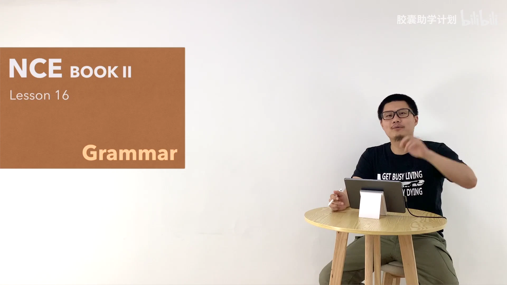

文字识别：胶囊助学计划 / NCE / BOOKII / Lesson 16 / Grammar / GET BUSY LIVING / YDYING

### 画面 00:00:04

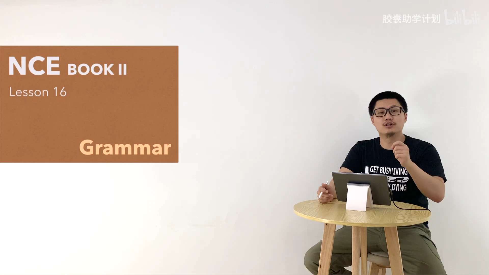

文字识别：胶囊助学计划 / NCE / BOOKII / Lesson 16 / Grammar / GET BUSYUIVING / YDYING

### 画面 00:00:08

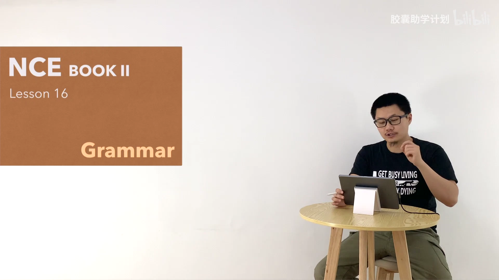

文字识别：胶囊助学计划 / NCE / BOOKI"I / Lesson 16 / Grammar / GET BUSYLIVING / VDYING

### 画面 00:00:10

文字识别：胶囊助学计划 / 9 / GFT RIISYLIVI / KDYING

### 画面 00:00:12

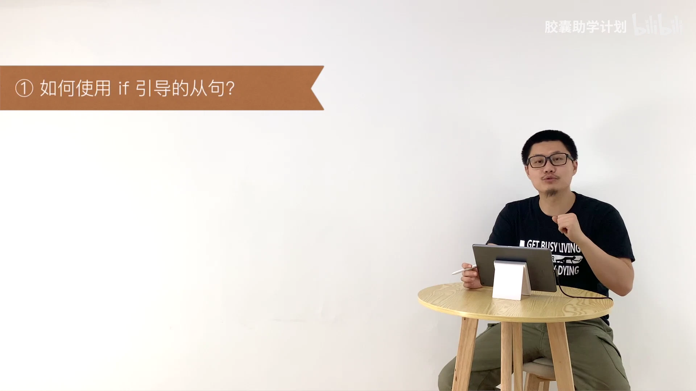

文字识别：胶囊助学计划 / ①如何使用 if 引导的从句？ / GET RISYLIVING / KDYING

### 画面 00:00:19

文字识别：胶囊助学计划bll / •

### 画面 00:00:23

### 画面 00:00:25

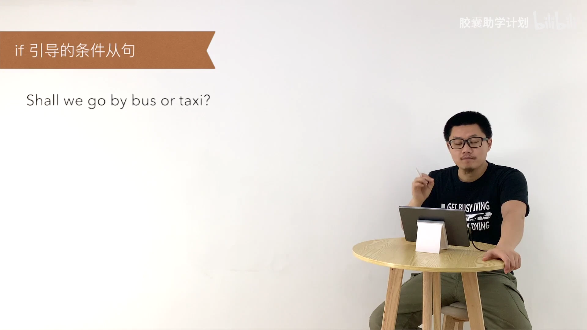

文字识别：胶囊助学计划 / if引导的条件从句 / Shall we go by bus or taxi? / IGET RUISYIVING / VDYING

## 00:00:30–00:01:00

先说一下这些吧，对吧？首先引导的是什么意思？各位回顾一下，迅速回顾一下十五课我们刚刚学过的宾语从句。I believe that you are right. That那个单词，我们管它叫做一个连词，对吧？它就引导了后面的这个定语从句。引导必在句这句话的句首，所以引导的啊，告诉您了，if是放在这半句话的句首的，它的位置告诉您了，跟宾语从句是一

### 画面 00:00:32

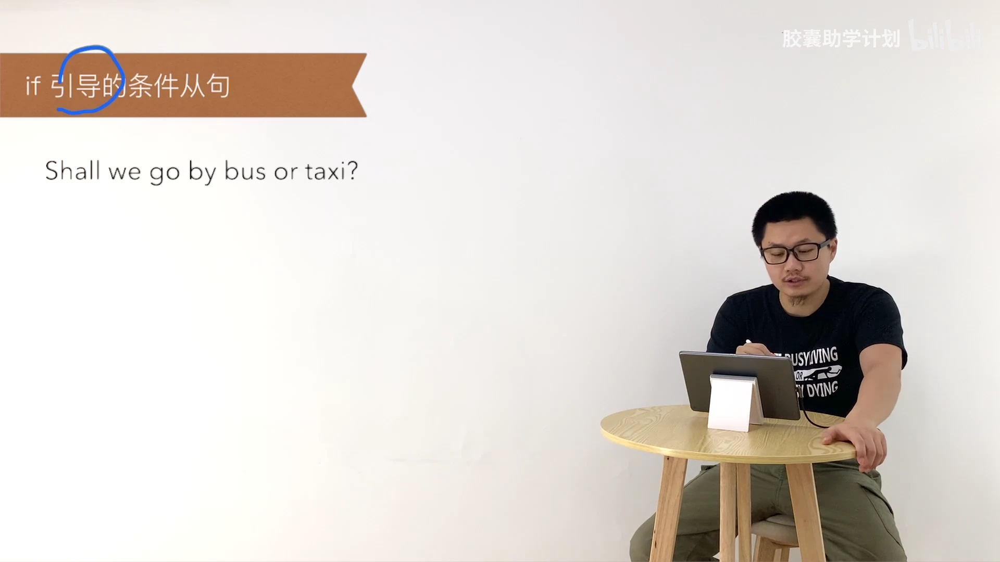

文字识别：胶囊助学计划 / if引导的条件从句 / Shall we go by bus or taxi? / USYIVING / IDVING

### 画面 00:00:38

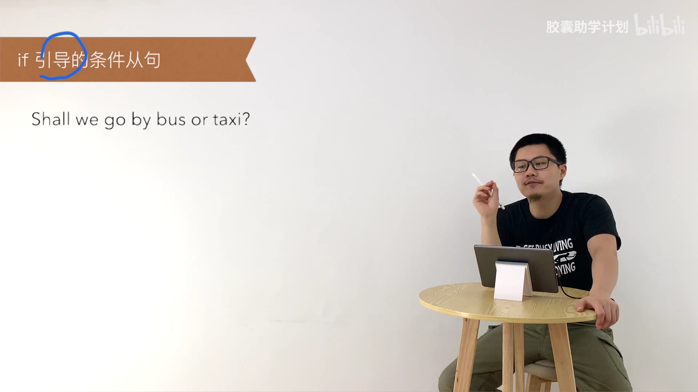

文字识别：胶囊助学计划 / if引|导的条件从句 / Shall we go by bus or taxi? / AYING

### 画面 00:00:50

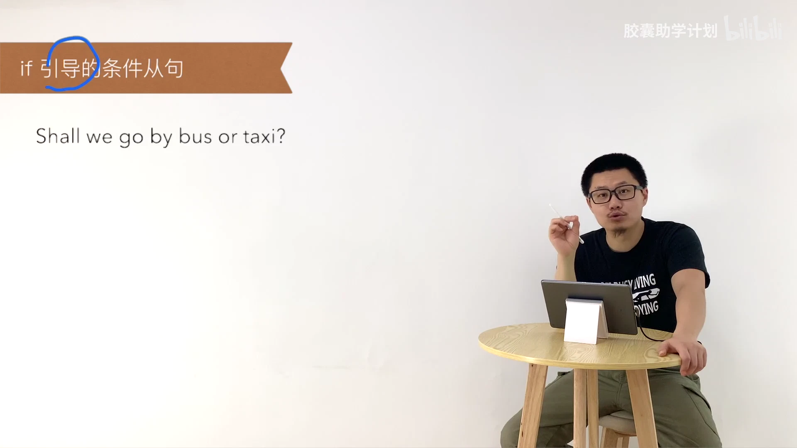

文字识别：胶囊助学计划 / if引导的条件从句 / Shall we go by bus or taxi? / CYVING / SYING

### 画面 00:00:55

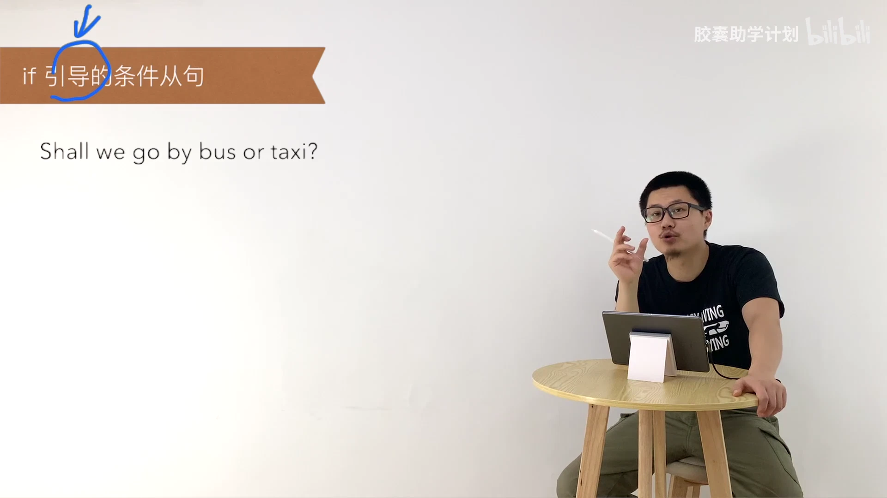

文字识别：胶囊助学计划 / if引导的条件从句 / Shall we go by bus or taxi? / VING / MING

## 00:01:00–00:01:30

样的。其次，条件从句啊，这个条件我们先不管，我们先想一下什么叫从句啊？就是宾语从句叫做一个句子做宾语，管这个句子叫宾语从句。那什么叫条件从句呢？就是 if 引导的这句话作为一个条件去单独存在的时候，对吧？我们管它就叫做条件从句。那 if 翻译成什么呢？就变得很重要了。if 翻译成如

### 画面 00:01:02

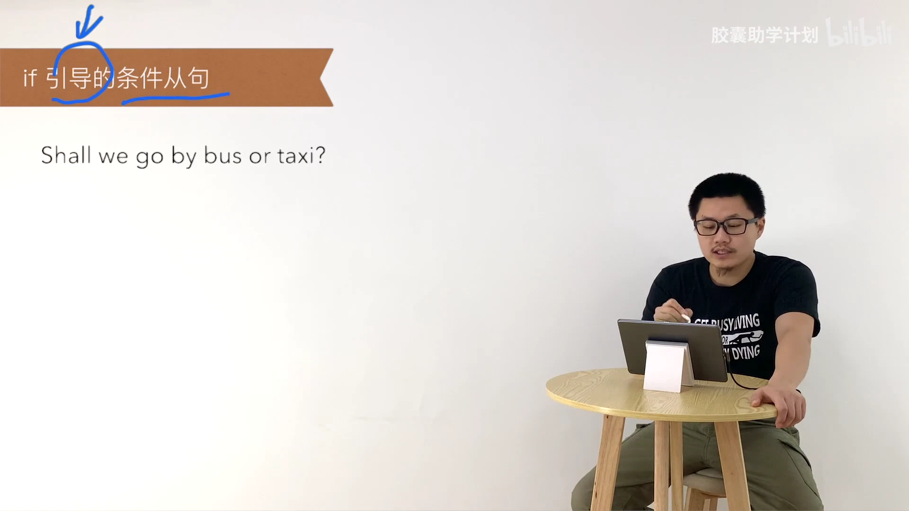

文字识别：胶囊助学计划 / if引导的条件从句 / Shall we go by bus or taxi? / CrrPUSVANING / R / DVING

## 00:01:30–00:02:00

果，如果你满足A这个条件，那么我们就去做B。OK，所以管它叫条件从句啊。OK，比如说我们看这儿给大家例句，说Shall we go by bus or taxi？说咱们是坐公交去还是打车去啊？好，他说If we go by bus, it will be cheaper.好了，我们先不管什么从不从句的事儿，我们就现在先逐个单词翻译。If刚才我告诉您了，它翻译成如果，如果我

### 画面 00:01:32

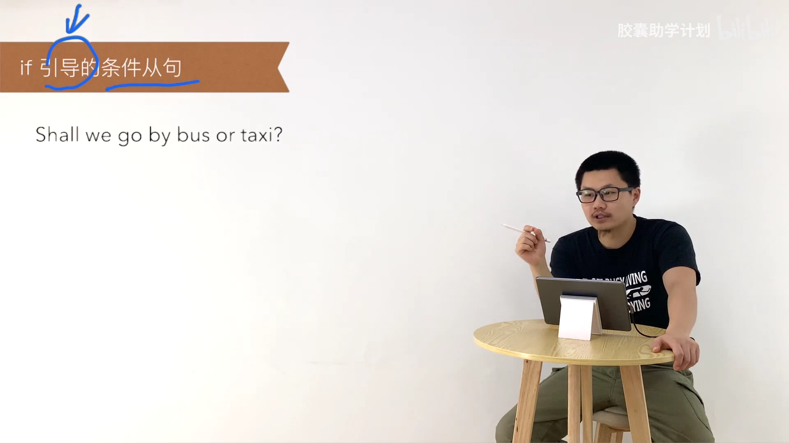

文字识别：胶囊助学计划 / if引导的条件从句 / Shall we go by bus or taxi? / LeYVING / YING

### 画面 00:01:46

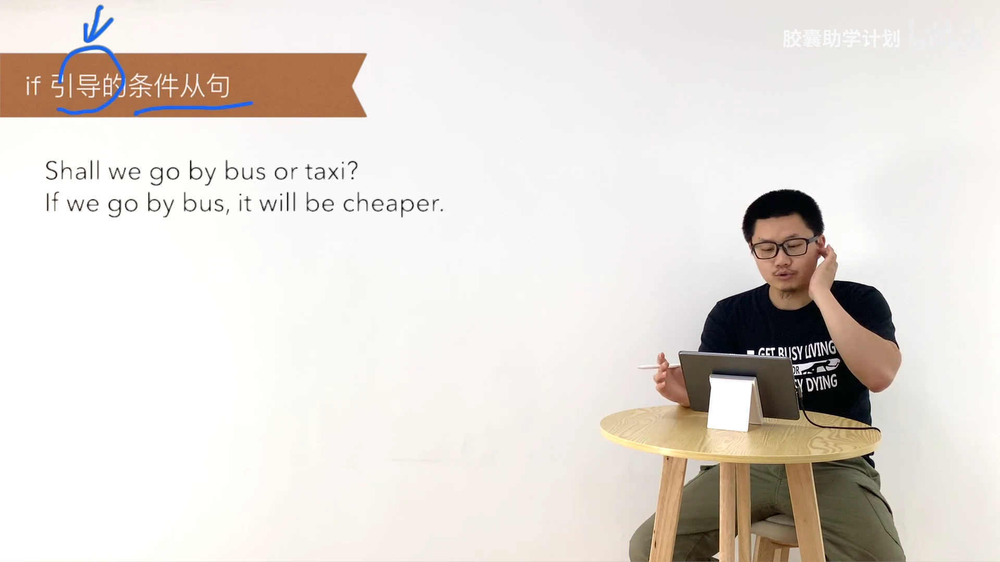

文字识别：胶囊助学计划 / if引导的条件从句 / Shall we go by bus or taxi? / If we go by bus, it will be cheaper. /  CET RIISY LNING / R / YDYING

### 画面 00:01:51

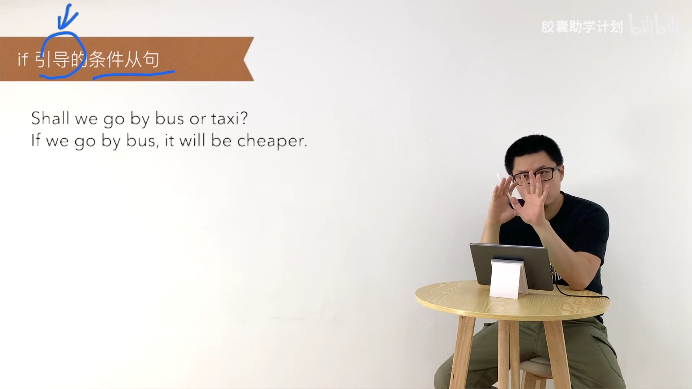

文字识别：胶囊助学计划 / if引导的条件从句 / Shall we go by bus or taxi? / If we go by bus, it will be cheaper.

## 00:02:00–00:02:30

我们去坐公交的方式去，那么它将更便宜。如果我们坐公交车去，它将更便宜。好看第二句话，说 will get there，说我们将到达那里 more quickly 更快。 if 如果 we go by taxi，如果我们坐出租车去，我们到那里会变得更快。好，我们先看一下

### 画面 00:02:05

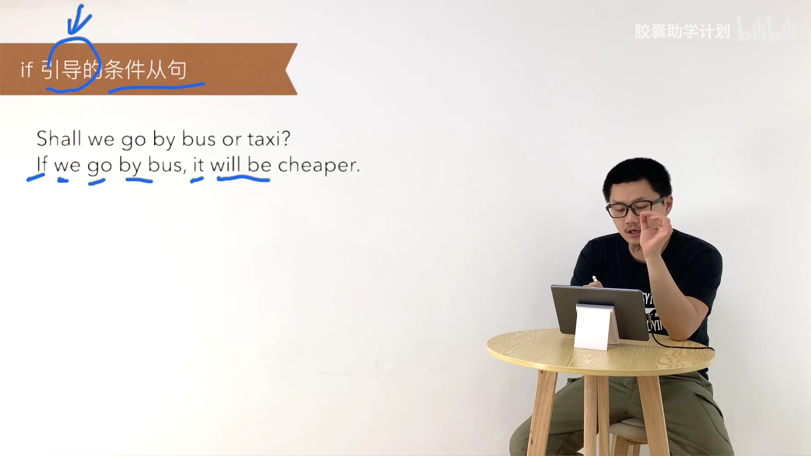

文字识别：胶囊助学计划 / if引导的条件从句 / Shall we go by bus or taxi? / If we go by bus, it will be cheaper.

### 画面 00:02:13

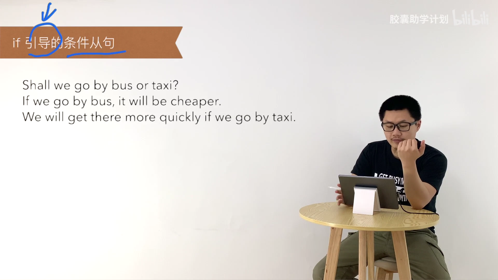

文字识别：胶囊助学计划 / if引导的条件从句 / Shall we go by bus or taxi? / If we go by bus, it will be cheaper. / We will get there more quickly if we go by taxi.

### 画面 00:02:26

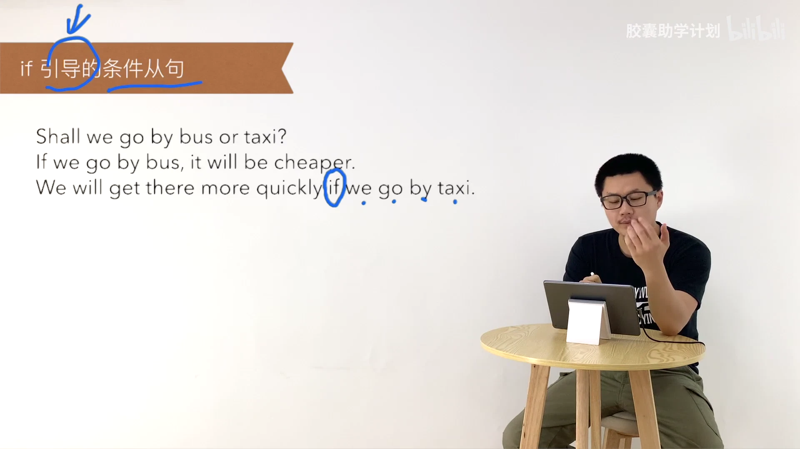

文字识别：胶囊助学计划 / if引导的条件从句 / Shall we go by bus or taxi? / If we go by bus, it will be cheaper. / We will get there more quickly / we go by taxi.

## 00:02:30–00:03:00

if 引导的从句，if 引导的从句，所以引导告诉各位 if 要放在这半句话的句首，这是第一件事儿。第二件事儿，为什么叫条件从句？因为这一句话做了一个条件。你看，如果我们只看后半句话，叫 it will be cheaper，叫它会更便宜，什么会更便宜？对吧？包括我们会到达那里更快，

### 画面 00:02:31

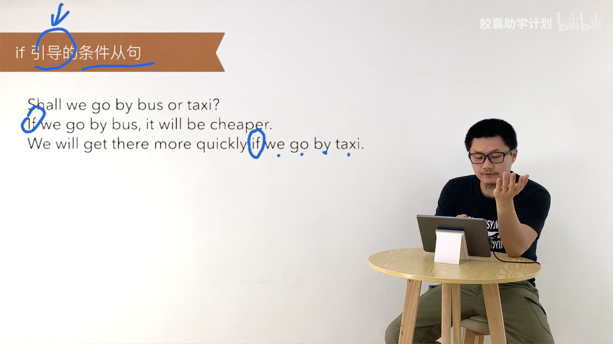

文字识别：胶囊助学计划 / if引导的条件从句 / Shall we go by bus or taxi? / f we go by bus, it will be cheaper. / We will get there more quickly / we go by taxi.

### 画面 00:02:34

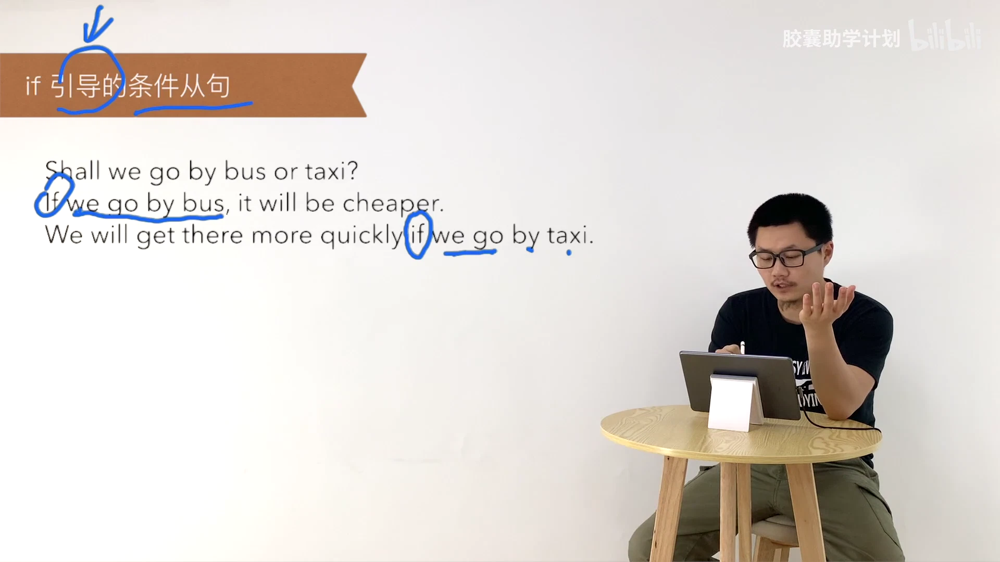

文字识别：胶囊助学计划 / if引导的条件从句 / Shall we go by bus or taxi? / fwe go by bus,it will be / e cheaper. / We will  / get there more quickly / fwe go by taxi. / if

### 画面 00:02:50

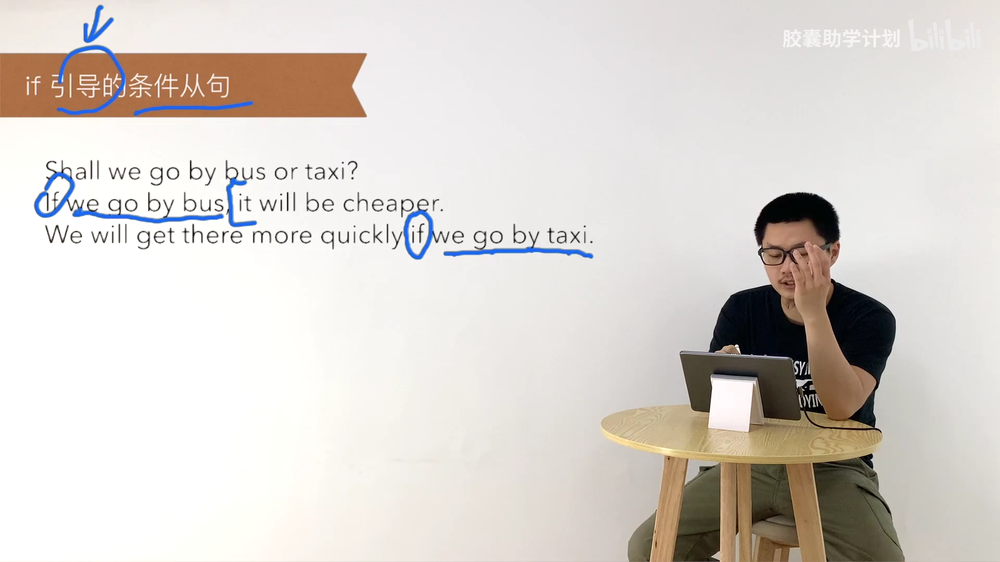

文字识别：胶囊助学计划 / if引导的条件从句 / Shall we go by bus or taxi? / fwe go by bus it will be cheaper. / We will get there more quickly / we go by taxi.

### 画面 00:02:57

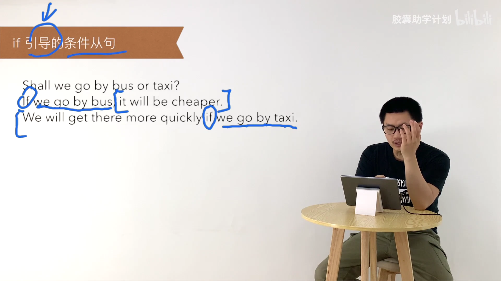

文字识别：胶囊助学计划 / if引导的条件从句 / Shall we go by bus or taxi? / we bbus it wil be cheaper. / We will get there more / quickly / if we go by taxi.

## 00:03:00–00:03:30

什么状态下会到达那里更快？满足什么条件呢？满足的条件是，如果我们坐出租车。满足什么条件它会更便宜呢？满足的条件是，如果我们坐公交车。所以管这句话叫做条件从句。当然了，汉语有完全一模一样的表达。如果我们坐公交车，我们应该到那儿啊，应该去花的钱更少。但如果我们打车呢，我们应该到的更快，但花的钱会更多，对吧？汉语也会这么聊天。在这儿这个点，各位要注意了，好

### 画面 00:03:05

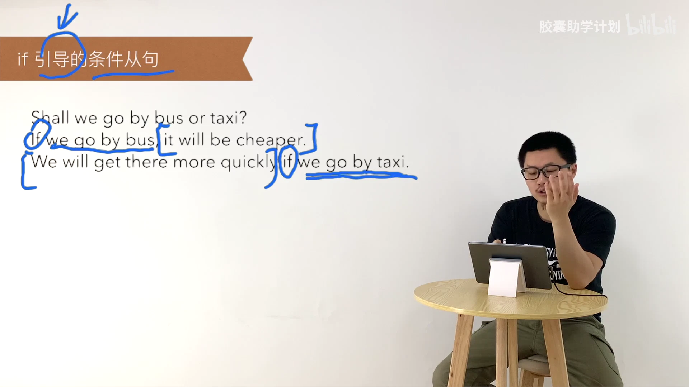

文字识别：胶囊助学计划 / if引导的条件从句 / Shall we go by bus or taxi? / f we go by bus it will be / cheaper7 / We will get there more / quickly / if / we go by taxi.

### 画面 00:03:12

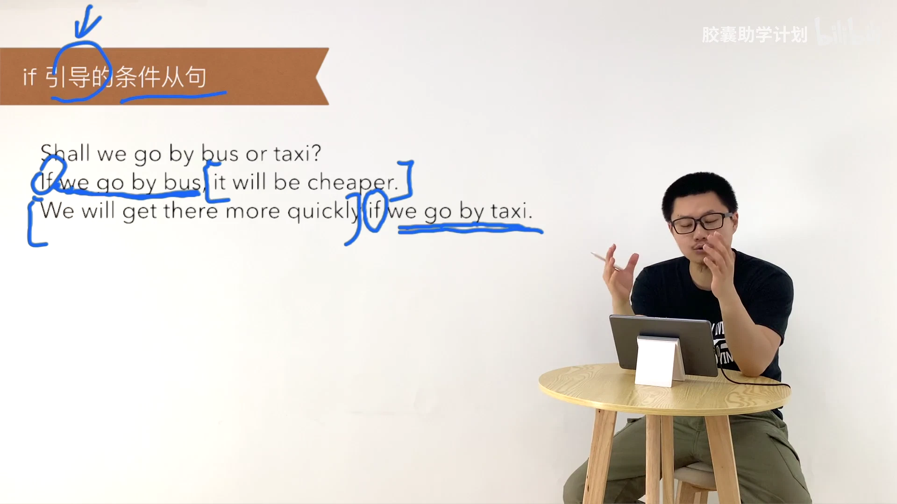

文字识别：胶囊助学计划 / if引导的条件从句 / Shall we go by bus or taxi? / We will get there more / quickly / if / we go by taxi.

### 画面 00:03:29

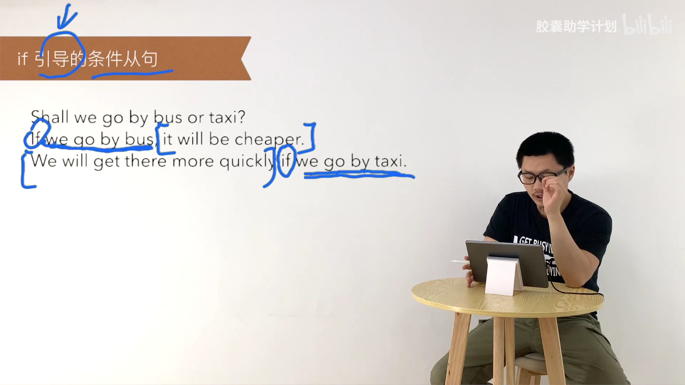

文字识别：胶囊助学计划 / if引导的条件从句 / Shall we go by bus or taxi? / we go by bus it wil be cheaper. / We will get there more / e quick / if / we go by taxi. / GETDIIC

## 00:03:30–00:04:00

吧？好，接下来呢，我们再看两句话，看这两句话，说 If we go there by bus, it will be cheaper. It will be cheaper if we go there. If we go by bus,好，注意，你看这两句话啊，当然这儿应该再加一个there，对吧？这地方呃， typo啊，忘记打掉了，忘记去打它了。但是我们看这两句话，其实唯一的区别就是if带的这半句话

### 画面 00:03:31

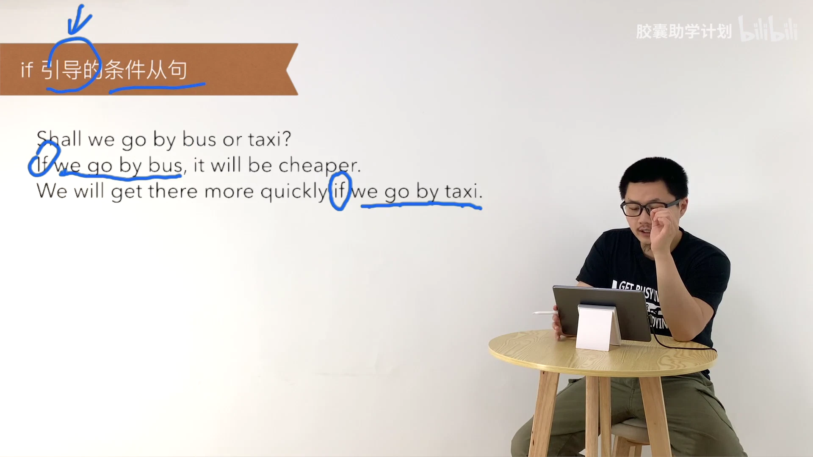

文字识别：胶囊助学计划 / if引导的条件从句 / Shall we go by bus or taxi? / f we go by bus, it will be cheaper. / We will get there more quickly / we go by taxi. / IGET DUSYIN

### 画面 00:03:34

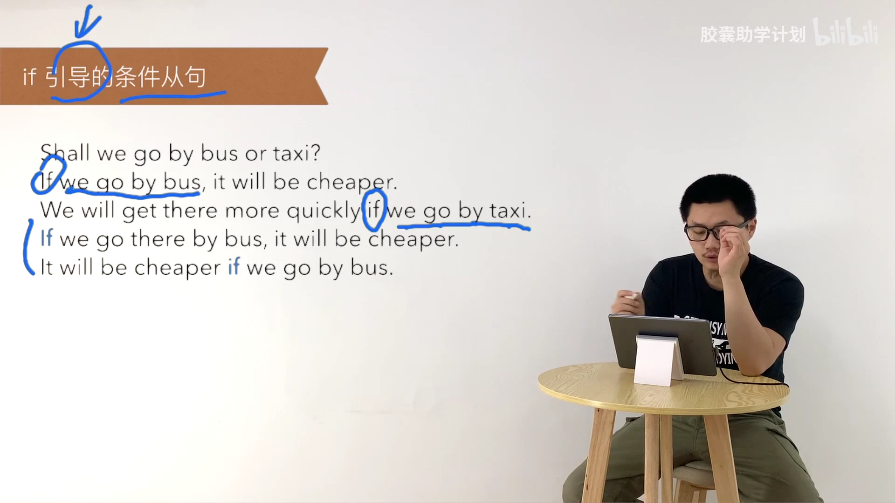

文字识别：胶囊助学计划 / if引导的条件从句 / Shall we go by bus or taxi? / fwe go by bus, it will be cheaper. / We will get there more quicklyi / ifwe go by taxi. / If we go there by bus, it will be Cheaper. / It will be cheaper if we go by bus.

### 画面 00:03:36

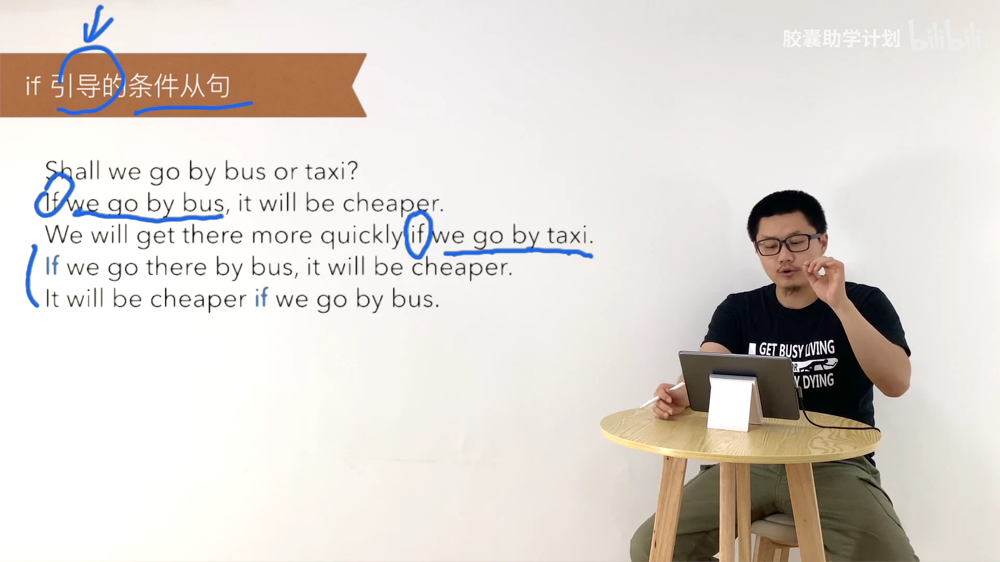

文字识别：胶囊助学计划 / if引导的条件从句 / Shall we go by bus or taxi? / f we go by bus, it will be cheaper. / We will get there more quickly / if we go by taxi. / If we go there by bus, it will be Cheaper. / It will be cheaper if we go by bus. / GET BUSYLVING / RAU / YDYING

### 画面 00:03:48

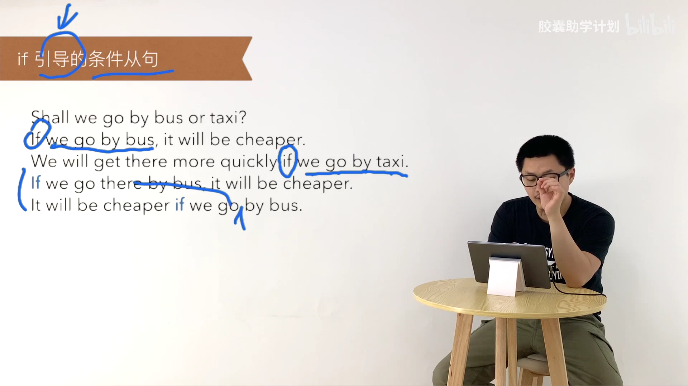

文字识别：胶囊助学计划 / if引导的条件从句 / Shall we go by bus or taxi? / fwe go by bus, it will be cheaper. / We will get there more quickly / if we go by taxi. / If we go there by bus it will be cheaper. / It ill e cheaper if we gg by bus.

### 画面 00:03:51

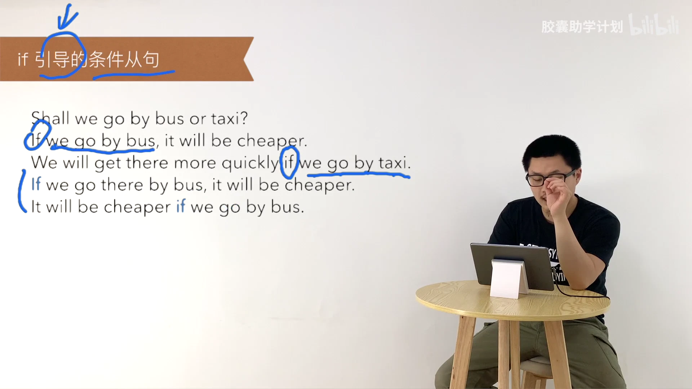

文字识别：胶囊助学计划 / if引导的条件从句 / Shall we go by bus or taxi? / dfwe go by bus, it wil be cheaper. / We will get there more quickly / if we go by taxi. / If we go there by bus, it will be Cheaper. / It will be cheaper if we go by bus.

### 画面 00:03:58

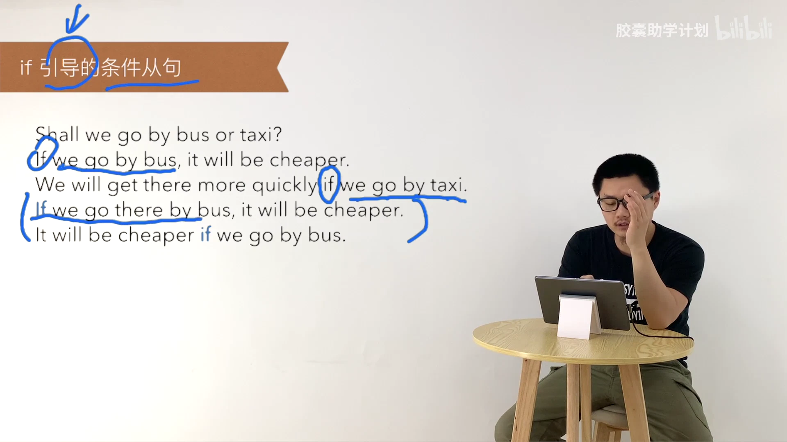

文字识别：胶囊助学计划 / if引导的条件从句 / Shall we go by bus or taxi? / dfwe go by bus, it will be cheaper. / We will get there more quicklyi / ifwe go by taxi. / If we go there by bus, it will be cheaper. / It will be cheaper if we go by bus.

## 00:04:00–00:04:30

是在前面还是在后面看到了吧？所以在这儿想告诉各位，就是 if 这个从句啊，您引导的这半句话可以放在前面，也可以放在后面。这个跟汉语也是一样的。我举个例子，说如果我们坐公交车去啊，会更便宜。这是 if 放前面了，这是汉语对吧？我也可以说汉语是应该会更便宜，如果咱们坐公交车去的话，汉语也会这么说。所以这个语法呢，跟汉语几乎是一

### 画面 00:04:00

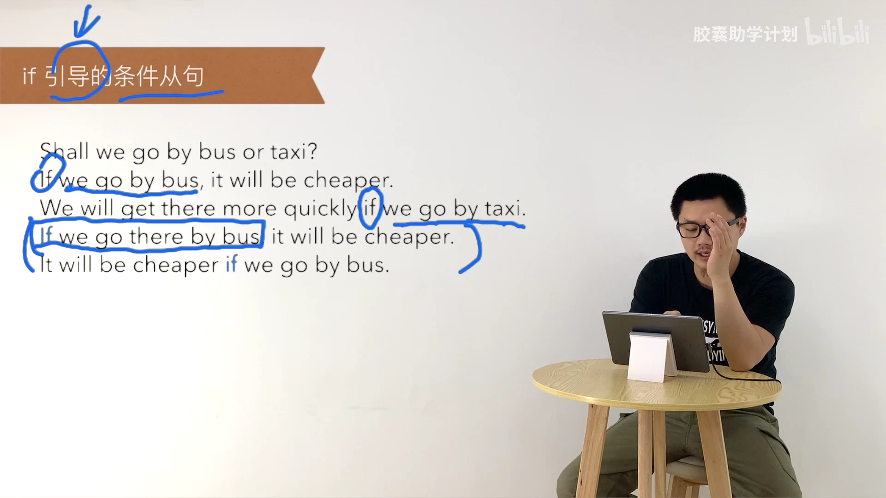

文字识别：胶囊助学计划 / if引导的条件从句 / Shall we go by bus or taxi? / fwe go by bus, it will be cheaper. / We will get there more quicklyif we go by taxi. / If we go there by bus / it will be Cheaper. / Tt will be cheaper if we go by bus.

### 画面 00:04:02

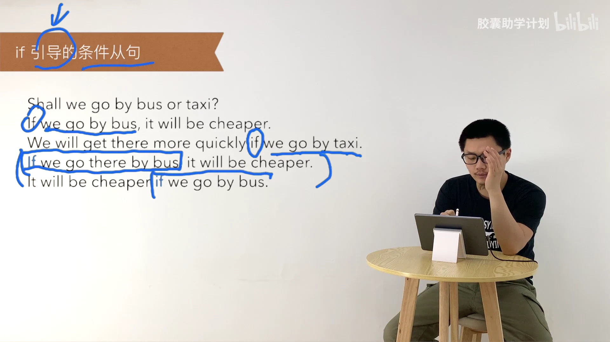

文字识别：bilbili / 胶囊助学计划 / if引导的条件从句 / Shall we go by bus or taxi? / f we go by bus, it will be cheaper. / We will get there more quicklyif we go by taxi. / If we go there by bus / it will be cheaper. / Tt will be cheaperif we go by bus.

### 画面 00:04:04

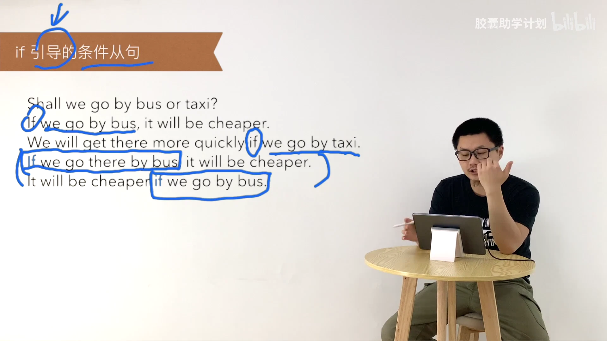

文字识别：胶囊助学计划 / if引导的条件从句 / Shall we go by bus or taxi? / dfwe go by bus, it will be cheaper. / We will get there more quicklyi / ifwe go by taxi. / If we go there by bus / it will be cheaper. / It will be cheaper / if we go by bus.

### 画面 00:04:09

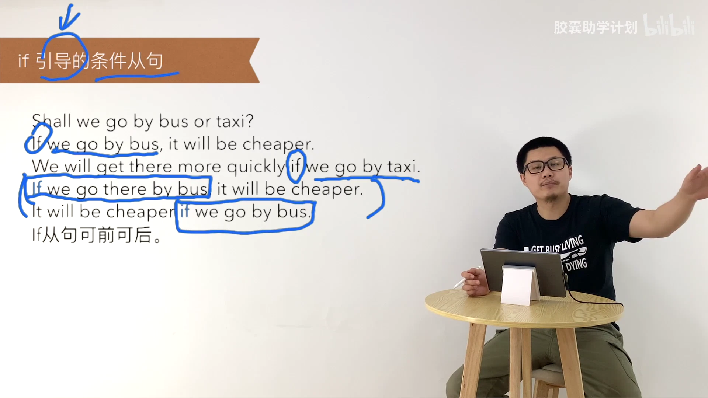

文字识别：胶囊助学计划 / if引导的条件从句 / Shall we go by bus or taxi? / dfwe go by bus, it will be cheaper. / We will get there more quickly / if we go by taxi. / If we go there by bus / it will be cheaper. / It will be cheaper / if we go by bus. / If从句可前可后。 /  GET RISYLVNG / TDYING

### 画面 00:04:15

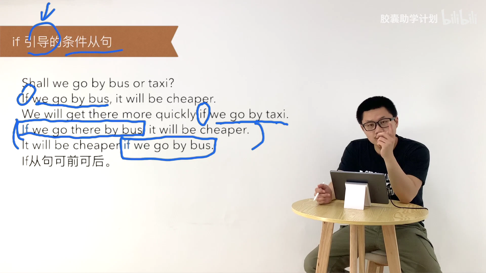

文字识别：胶囊助学计划 / if引导的条件从句 / Shall we go by bus or taxi? / Of we go by bus, it will be cheaper. / We will get there more quicklyi / if we go by taxi. / If we go there by bus / it will be cheaper. / It will be cheaper / if we go by bus. / If从句可前可后。

## 00:04:30–00:05:00

模一样的，可简可厚，各位记住就好了。好，接下来刚才我们说到了叫 if 引导的那句话，A 这句话我们管它叫从句，B 后边那句话，那对应的它就叫做主句，主从关系，对吧？谁是主，谁是从？if 是从，那 B 啊，A 这句 A 这句话我们管它叫从的话，B 这句话我们管它就叫做主。在这儿给了一句话

### 画面 00:04:32

文字识别：胶囊助学计划 / 主将从现

### 画面 00:04:37

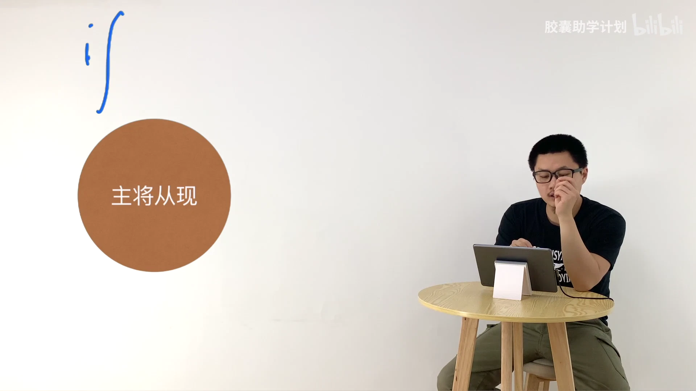

文字识别：胶囊助学计划 / 主将从现

### 画面 00:04:39

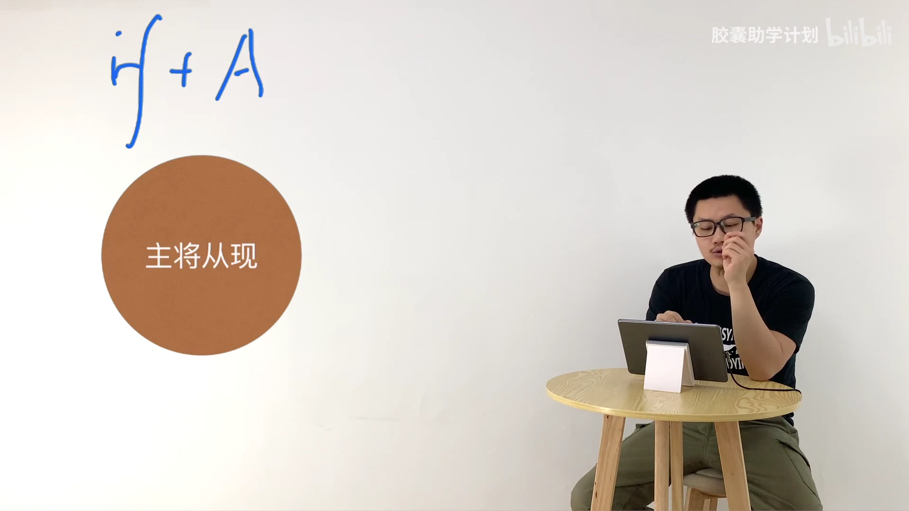

文字识别：胶囊助学计划 / f / 主将从现

### 画面 00:04:42

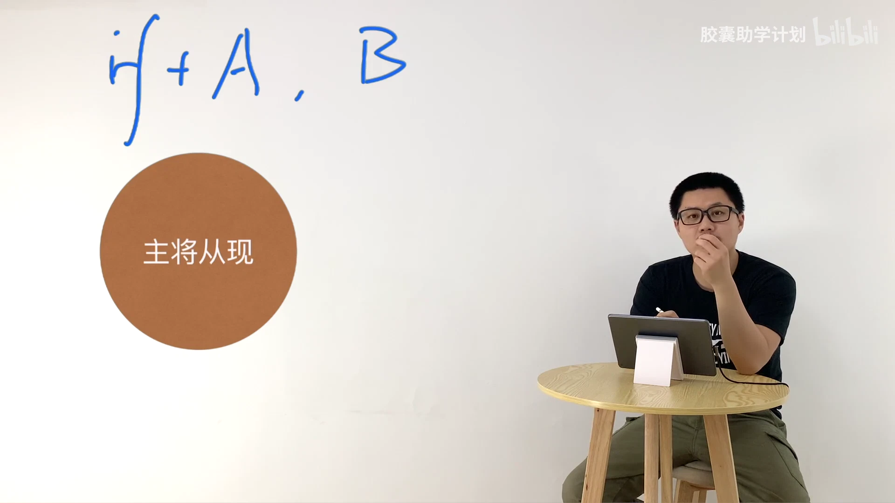

文字识别：胶囊助学计划 / B / 主将从现

### 画面 00:04:52

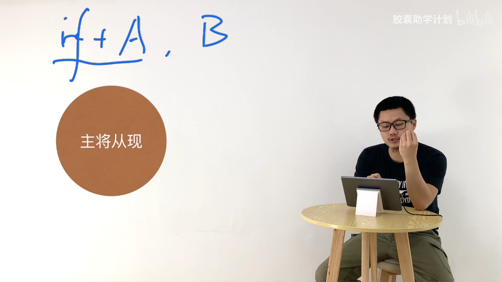

文字识别：+A / B / 胶囊助学计划 / 主将从现

### 画面 00:04:54

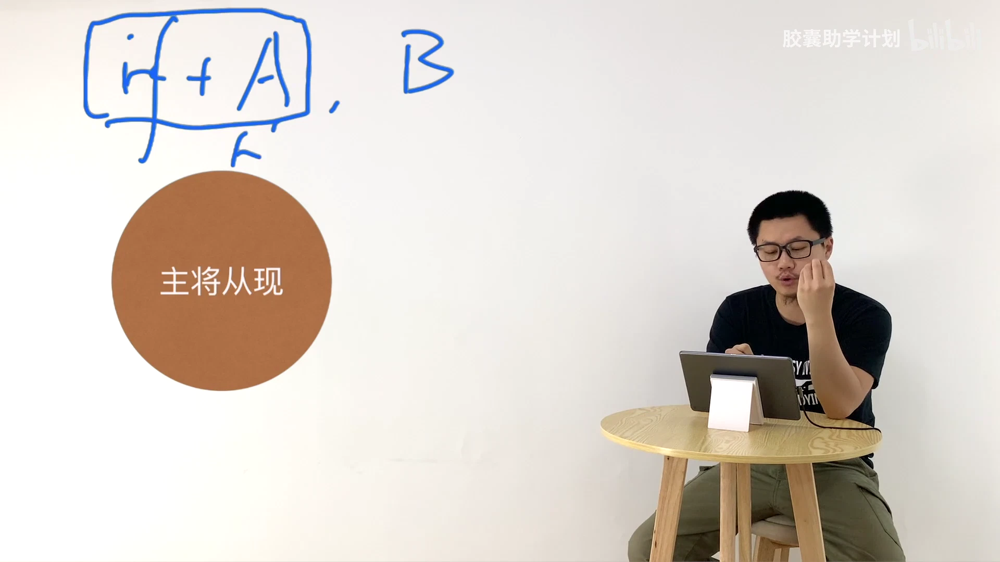

文字识别：B / 胶囊助学计划 / 人 / 主将从现

### 画面 00:04:56

文字识别：胶囊助学计划 / S / 主将从现

### 画面 00:04:58

文字识别：胶囊助学计划 / 主 / 主将从现

## 00:05:00–00:05:30

叫做“主将从现”。什么叫“主将从现”呢？我先抽象的给大家说一下，就是主句我们要用将来时，从句我们要用现在时，哪怕表述的是将来。我们举个例子来了啊，主将从现，比如说，注意这儿是主啊，这是从，对吧？If引导的从句嘛。如果你不快一点，

### 画面 00:05:00

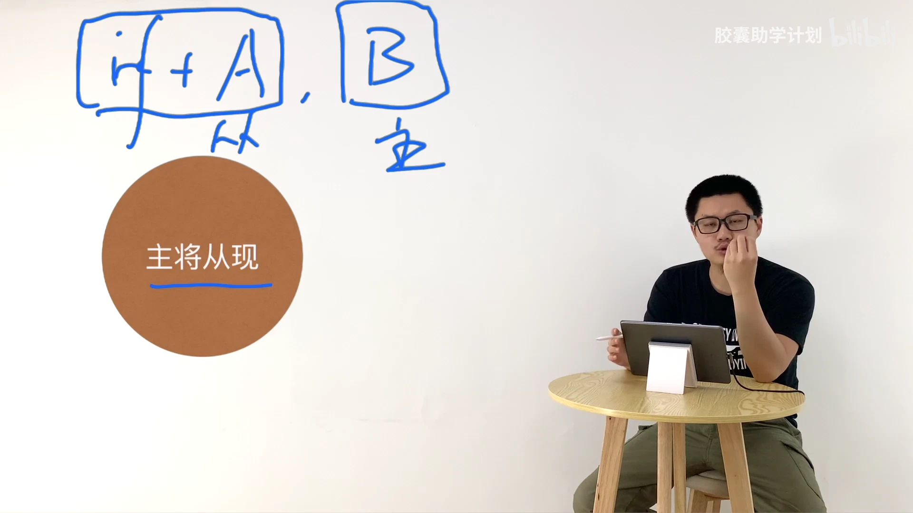

文字识别：胶囊助学计划 / 主 / 主将从现

### 画面 00:05:12

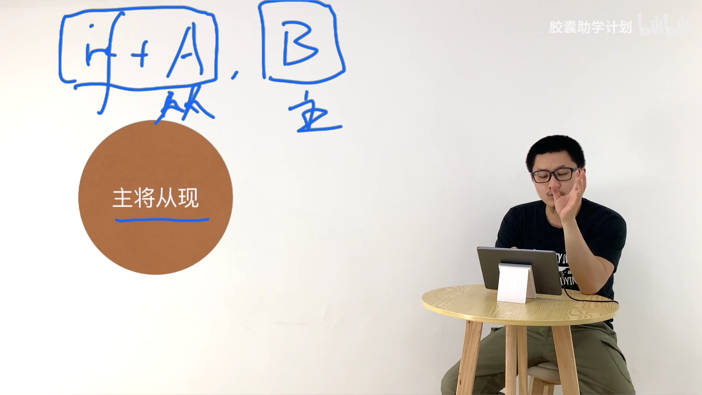

文字识别：胶囊助学计划 / AK / 主 / 主将从现

### 画面 00:05:16

文字识别：胶囊助学计划 / 主将从现

### 画面 00:05:20

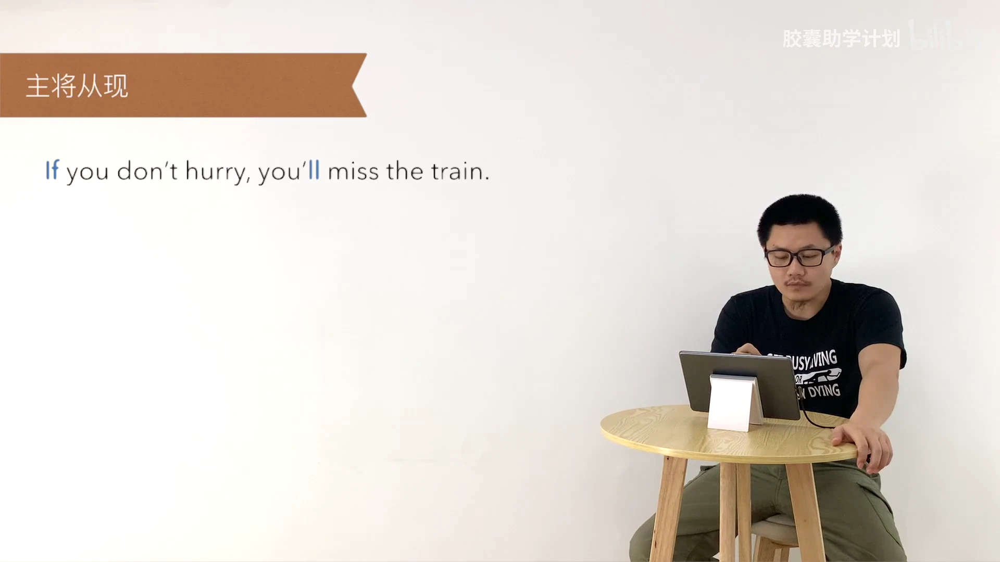

文字识别：胶囊助学计划 / 主将从现 / If you don't hurry, you'll miss the train. / USYVING / WDYING

### 画面 00:05:22

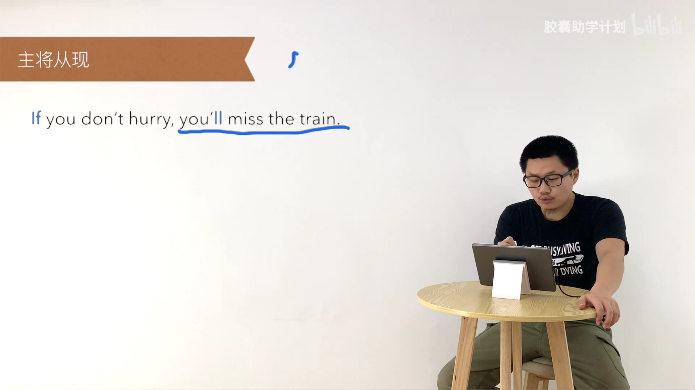

文字识别：胶囊助学计划 / 主将从现 / If you don't hurry, you'll miss the train. / 'ISYVING / IDYING

### 画面 00:05:24

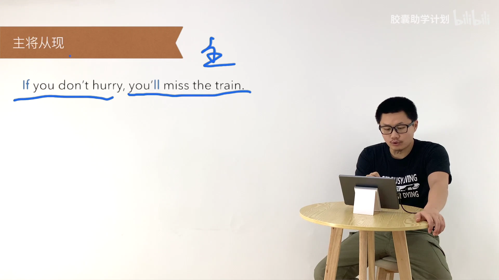

文字识别：胶囊助学计划 / 主将从现 / If you don't hurry, you'll miss the train. / USYAVING / R / DVING

### 画面 00:05:26

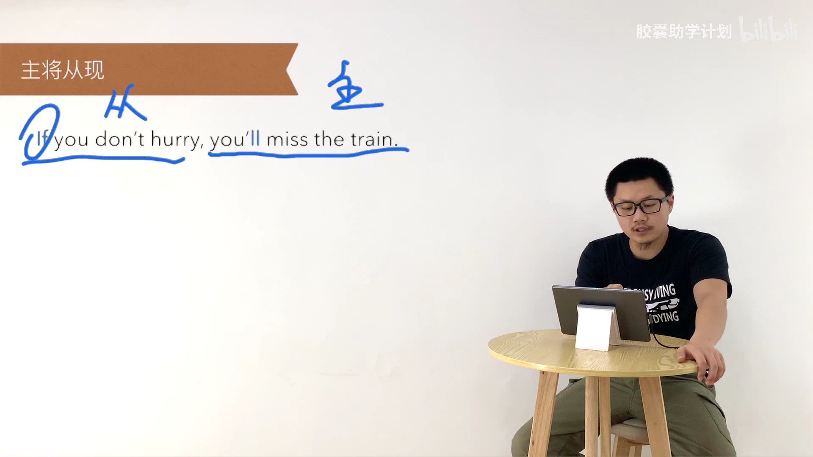

文字识别：胶囊助学计划 / 主将从现 / 从 / SYVING / IDYING

## 00:05:30–00:06:00

你会错过这趟火车的。什么叫主将从现啊？看一下主语主句是一般将来时，往往都是 will 对吧？偶尔也会出现 be going to do。那我们今天可能见到的都是 will 啊， p l l will 对吧？然后从句呢就是一个一般现在时从现主将从现。再来一个例子啊，当然这不用例子啊，这不是例子，是我们把它前后

### 画面 00:05:38

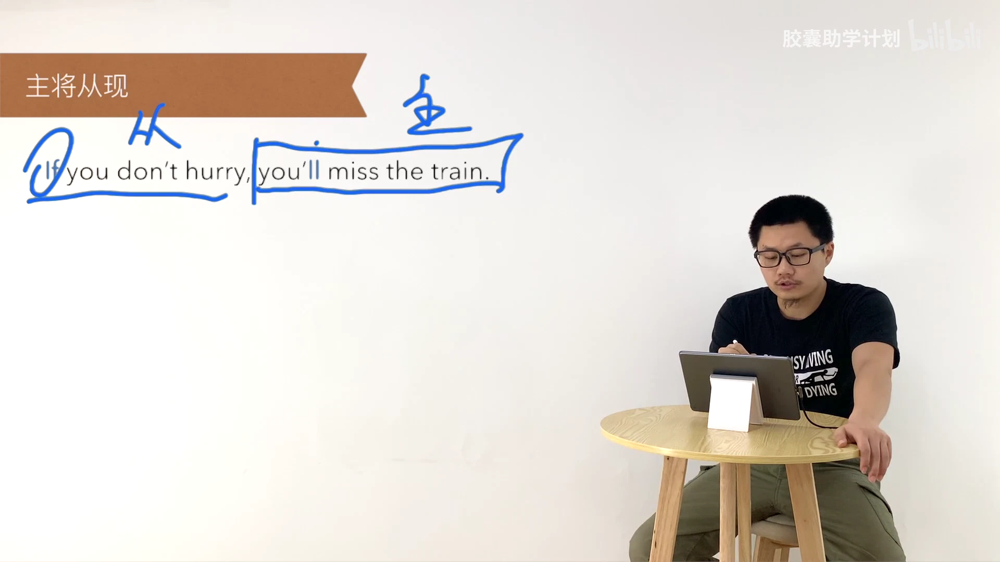

文字识别：胶囊助学计划 / 主将从现 / 从 / you'll miss / the / train. / SYNING / DVING

### 画面 00:05:40

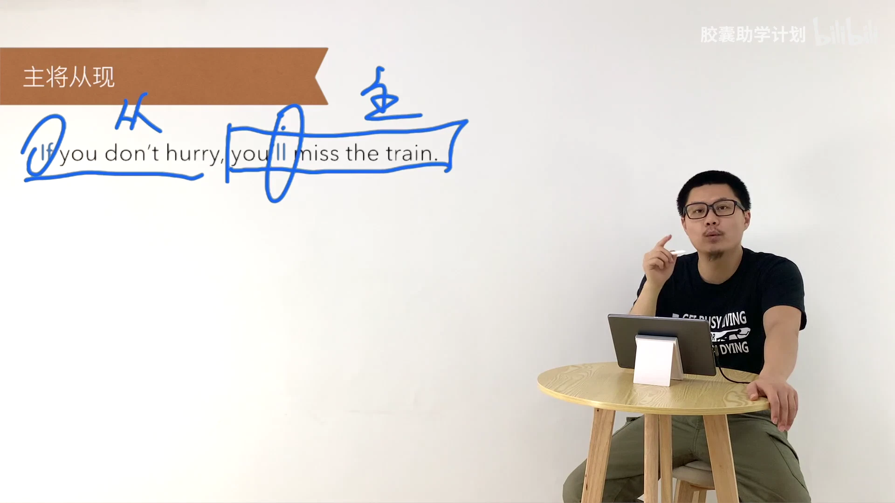

文字识别：胶囊助学计划 / 主将从现 / 从 / don't hurry, / yoy / miss / the / train. / 'ISYVING / R / DYING

### 画面 00:05:42

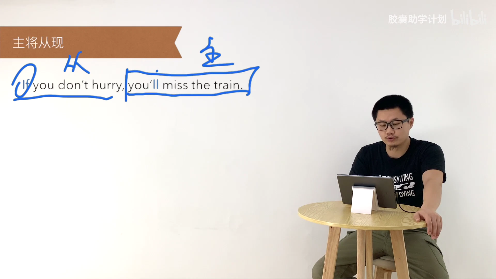

文字识别：胶囊助学计划 / 主将从现 / 从 / you'll miss t / the / train. / 'SYNING / IDVING

### 画面 00:05:49

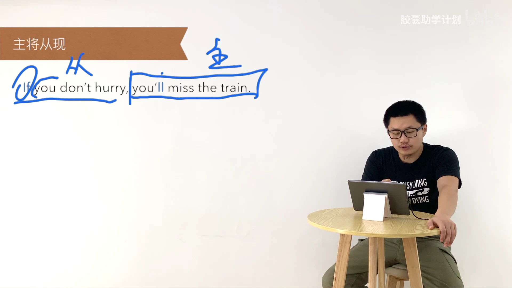

文字识别：胶囊助学计划 / 主将从现 / 从 / you'll miss t / the / train. / 'SYAVING / R / DYING

### 画面 00:05:51

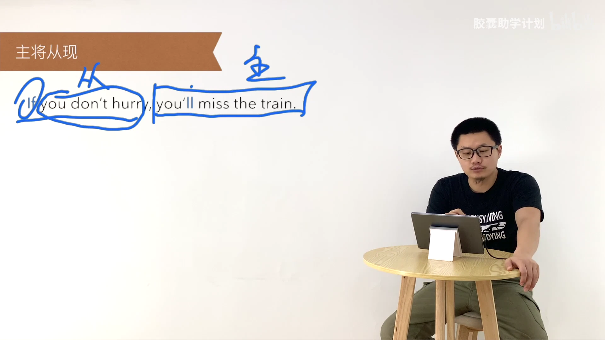

文字识别：胶囊助学计划 / 主将从现 / 从 / you'll / miss / the / train. / SYNING / IDYING

### 画面 00:05:56

文字识别：胶囊助学计划 / 主将从现 / 从 / you / don't hurry, you'll / miss / the / train. / YouTl / mIss / the train if / you / don't hurry. /  GET DISY/NING / DVING

### 画面 00:05:58

文字识别：胶囊助学计划 / 主将从现 / Ifyou / don't hurry, you'll / miss / the / train. / You'll / miss / the / train if you don't hurry. / IGET PISYNNG / DVING

## 00:06:00–00:06:30

换了一下，告诉各位说，您就算把 if 放到后面去，它还是从，它还是主，主还是用啊这个将啊从句还是用现在时，这个点各位注意一下，好吧？好，比如说再来，If he is out, I will call tomorrow. 如果他出去了，我明天打电话，对吧？这个很简单，你只需要知道 if

### 画面 00:06:00

文字识别：胶囊助学计划 / 主将从现 / If you don't hurry, you'll miss the train. / You'll miss the train if you don't hurry. / SVVING / 7DYING

### 画面 00:06:03

文字识别：胶囊助学计划 / 主将从现 / fyou don't hurry, you'll / miss / the / train. / You'll / miss t / the train / if you / don't hurry. / SYVING / IDVING

### 画面 00:06:07

文字识别：胶囊助学计划 / 主将从现 / fyou don't hurry, you'l / miss / the / train. / You'll / miss the train / if you / don't hurry. / 'ISYVING / DYING

### 画面 00:06:09

文字识别：胶囊助学计划 / 主将从现 / fyou don't hurry, you'll / miss / the / train. / You'll / miss / the train / if you / don't hurry. / 从 / ISYVING / DVING

### 画面 00:06:14

文字识别：胶囊助学计划 / 主将从现 / Ifyoydon't hurry,  / ,you'll / miss the train. / Youllniss / the / train / if you / don't hurry / SYNING / DVING

### 画面 00:06:19

文字识别：胶囊助学计划 / 主将从现 / If you don't hurry,  / ', you'l / miss / the / train. / You'll / miss / the / train / if you / don't hurry. / If he is out, / call tomorrow /  GET PISY/NING / DYING

### 画面 00:06:21

文字识别：胶囊助学计划 / 主将从现 / If you don't hurry, you'll / miss / the train. / You'll miss the train i / n if you don't hurry. / If he is out, I'll call tomorrow. / GET DUISYANING / DYING

## 00:06:30–00:07:00

是表示如果这句话就能翻译出来。你写的时候呢，要注意一下主句这句话要用的是将，对吧？从句这句话用的是现在时啊，往往是一般现在时啊。目前我们学到的，当然了，你也可以把 if 这句话放到后面去，这是我们刚刚学过的 if 引导的从句，可以放在前半句话，也可以放在后半句话，跟汉语是保持一致的。OK，主将从现再来了。

### 画面 00:06:34

文字识别：胶囊助学计划 / 主将从现 / fyou don't hurry, you'll / miss / the / train. / You'll miss the train / if you / u don't hurry. / If he is out, / I'll call tomorrow. / 'SYNING / IDVING

### 画面 00:06:36

文字识别：胶囊助学计划 / 主将从现 / If you don Thurry, you'll / miss / the / train. / You'll miss the train / ifyou / u don't hurry. / If he is out, / I'll call tomorrow. / ISYNING / DYING

### 画面 00:06:39

文字识别：胶囊助学计划 / 主将从现 / If you don hurry, you'l / miss / the / train. / You'llmiss / the / aini / if you / don't hurry. / If he is out, / I'll call tomorrow. / SYNING / IDYING

### 画面 00:06:45

文字识别：胶囊助学计划 / 主将从现 / If you / don dhurry, / you'll / miss / the / train. / You'Uhiss / the / aini / if you / don't /  hurry. / If he is out, / call t / tomorrow. / IIl call tomorrow / if he / is / out. / OR. / ANDYING

### 画面 00:06:47

文字识别：胶囊助学计划 / 主将从现 / If you / don Dhurry, / you'll / miss / the / train. / YOuAiss / the / ain / if you / don't / hurry. / If he is out, / call tomorrow. / IIl call tomorrow / if he is out. / USYVING / OR. / SVDVING

### 画面 00:06:50

文字识别：胶囊助学计划 / 主将从现 / If you / don Dhurry, / you'll / miss / the / train. / YouAiss / the / ain /  if you / don't / hurry. / If he is out / call tomorrow. / IIl call tomorrow / if he is out. / DYING

### 画面 00:06:56

文字识别：胶囊助学计划 / 主将从现 / SY/NING / DYING

## 00:07:00–00:07:30

之前我看过这样一个广告，是吧？把它翻译成英文就是这么一句话，叫做 If you give us twenty minutes，如果你给我们二十分钟，We will 主将从现，这个后半句是主，前半句是从。您看满不满足主将从现，对吧？We will give you ten years back，我们会还给您十年的青春啊！你想一下，这是什么的广告？给我们二十分钟，我们还您

### 画面 00:07:08

文字识别：胶囊助学计划 / 主将从现 / If you give us 20 minutes, we will / Il give you 10 / years / back. / SYNING / HIDVING

### 画面 00:07:15

文字识别：胶囊助学计划 / 主将从现 / If you give us 20 minutes, / we / ewill / give you 10 / years / back. / SYNING / IDVING

### 画面 00:07:19

文字识别：胶囊助学计划 / 主将从现 / 从 / If you give us 20 minutes, / we / will / give you 10 / years / back. / SYVING / IDYING

### 画面 00:07:26

文字识别：胶囊助学计划 / 主将从现 / 从 / If you give us 20 minutes, / we will / give you 10 / years / back. / YVING / NING

## 00:07:30–00:08:00

十年青春，是吧？Okay,当然了，我们比如说再看这句话，这句话就格外重要了。主将从现，就是即使您的从句是将来的时间，你依旧在这个地方应该用的是don't feel well，而不能用won't feel well，不能用won't feel well，对吧？因为它的时态要求是主将

### 画面 00:07:33

文字识别：胶囊助学计划 / 主将从现 / If you give us 20 minutes, we will / give you 10 / years / back. / If I don't feelwell tomorrow, l'll stay at home. /  CET DUISYAVING / R / MDYING

### 画面 00:07:35

文字识别：胶囊助学计划 / 主将从现 / If you give us 20 minutes, we will give you 10 / years / back. / If I don't feel well tomorrow, l'll stay at home. / SYAVING / DVING

### 画面 00:07:38

文字识别：胶囊助学计划 / 主将从现 / If you give us 20 minutes, we will give you 10 / years / s back. / If I don't feel well tomorrow, l'll stay at home. / SYNING / DVING

### 画面 00:07:40

文字识别：胶囊助学计划 / 主将从现 / If you give us 20 minutes, we will / Il give you 10 / years / back. / If l don't feel well tomorrow, l'll stay at home. / ISYIVING / DR / IDVING

### 画面 00:07:42

文字识别：胶囊助学计划 / 主将从现 / If you / give / us2 / 20 / minutes, we / will / give you 10 / years / back. / If l don't feel welltomorrow / 'll stay at home. / ISYVING / DR / IDVING

### 画面 00:07:45

文字识别：胶囊助学计划 / 主将从现 / If you / give / us2 / 20 / minutes, we / will / give you 10 / years / back. / If l don't feel welltomorrow / 'll stay at home. / SYIVING / NDYING

### 画面 00:07:48

文字识别：胶囊助学计划 / 主将从现 / If you / give / us2 / 20 / minutes, we / will / give you 10 / years / back. / If l don't feel welltomorrow / I'll stay at home. / YNING / DVING

### 画面 00:07:53

文字识别：胶囊助学计划 / 主将从现 / If you / give / us / 20 / minutes, we / will / give you 10 / years / back. / If I don't feel  / welltomorrow / I'll stay at home. / Won / SYVING / IDVING

### 画面 00:07:55

文字识别：胶囊助学计划 / 主将从现 / If you / give / us / 20 / minutes, we / will / give you 10 / years / back. / If l don't feel / welltomorrow / stay at home. / SYNING / IDYING

### 画面 00:07:57

文字识别：胶囊助学计划 / 主将从现 / If you / give / us / 20 / minutes, we / will / give you 10 / years / back. / If l don't feel / welltomorrow / 'll stay at home. / Wont / 'SYVING / IDYING

### 画面 00:07:59

文字识别：胶囊助学计划 / 主将从现 / If you / give / us / 20 / minutes, we / will / give you 10 / years / back. / If l don't feel welltomorrow / 'll stay at home. / 'SYAVING / DYING

## 00:08:00–00:08:30

从现，你看主用的是一般将来时，从用的是即使后边给的是 tomorrow，前面也要用一般现在时，这个点各位要注意啊。第二，刚才说完了主将从现，现在告诉各位还有一种情况叫做主情从现。什么叫主情从现呢？很简单，我们直接看句子就行了。从句还是

### 画面 00:08:02

文字识别：胶囊助学计划 / 主将从现 / If you / give / us / 20 / minutes, we / will / give you 10 / years / back. / If l don't feel / welltomorrow / stay at home. / SYVING / IDYING

### 画面 00:08:05

文字识别：胶囊助学计划 / 主将从现 / If you / give / us / 20 / minutes, we / will / give / you 10 / years / back. / If I don't feel / welltomorrow / stay / at home. / 'ISYAVING / R / DYING

### 画面 00:08:07

文字识别：胶囊助学计划 / 主将从现 / If you / give / us / 20 / minutes, we / will / give / you 10 / years / back. / If l don't feel / welltomorrow / stay / at home. / 人人 / ISYVING / R. / DYING

### 画面 00:08:09

文字识别：胶囊助学计划 / 主将从现 / If you / give / us / 20 / minutes, we / will / give / you 10 / yearsback. / If I don't feel / well / tomorrow / stay / at home. / 人人 / SYNING / R.A / DYING

### 画面 00:08:11

文字识别：胶囊助学计划 / 主将从现 / If you / give / us / 20 / minutes, we / will / give / you 10 / years back. / Ifl don't fee / well / tomorrow / stay / at home. / 人 / YAVING / DVING

### 画面 00:08:14

文字识别：胶囊助学计划 / 主情从现 / Cr PSY/NING / DYING

### 画面 00:08:24

文字识别：胶囊助学计划 / 主情从现 / VIN

### 画面 00:08:26

文字识别：胶囊助学计划 / 主情从现 / If you need money, I can lend you some.

### 画面 00:08:29

文字识别：胶囊助学计划 / 主情从现 / If you need money, I can lend you some.

## 00:08:30–00:09:00

现在时，主句啊，在这个地方您可以不用一般将来时了，您可以用情态动词，比如说 can，也很好理解。比如说，如果你需要一些钱，我能借给你一些，这个也很好理解。这个东西就叫做主情从现。OK，好，接下来还有第三种情况叫做主起从现。什么叫起呢？我们还是

### 画面 00:08:32

文字识别：胶囊助学计划 / 主情从现 / If you need money, I can lend you some.

### 画面 00:08:34

文字识别：胶囊助学计划 / 主情从现 / If you need money, / canlend / d you some.

### 画面 00:08:46

文字识别：胶囊助学计划 / 主情从现 / If you need money, I fanlend / you some.

### 画面 00:08:53

文字识别：胶囊助学计划 / 主祈从现

### 画面 00:08:59

文字识别：胶囊助学计划 / 主祈从现

## 00:09:00–00:09:30

看句子去记它就行了。If you don't like it, don't eat it.好了，你看 don't eat it, eat it 这句话，一个很典型的特点就是主语没了。它本来的主语应该是 you don't eat it，对吧？Don't drop it. You don't drop it. Don't drive so quickly. You don't drive so quickly.那起始句这个起，对吧？就是起始句啊，它往往是把主语就直接省略掉了的。这是我

### 画面 00:09:06

文字识别：胶囊助学计划 / 主祈从现 / If you don't like it, don't eat it.

### 画面 00:09:09

文字识别：胶囊助学计划 / 主祈从现 / If you don't like it, don't eat it.

### 画面 00:09:18

文字识别：胶囊助学计划 / 主祈从现 / If you don't like it, don't eat it.

### 画面 00:09:25

文字识别：胶囊助学计划 / 主祈人现 / If you don't like it, don't eat it.

## 00:09:30–00:10:00

们之前就学过的语法。所以那什么叫主起从现呢？就是主句这句话用的是起始句，从句这句话还是一般现在时。所以在这儿啊，你看一下主句，目前我们给了三种可能性，它可以是在这儿的一个起始句，对吧？在这儿它可以是一个起始句，可以是情态动词 can 呢等等，它也可以是一般将来时。但是从句不管前

### 画面 00:09:34

文字识别：胶囊助学计划 / 主祈人现 / If you don't like it, don't eat it.

### 画面 00:09:36

文字识别：胶囊助学计划 / 主祈人现 / If you don't like it, / don't eat it.

### 画面 00:09:38

文字识别：胶囊助学计划 / 主祈人现 / If you don't like i / don't eat it. / YNI

### 画面 00:09:49

文字识别：胶囊助学计划 / 主祈人现 / If you don't like i /don't eat it.

### 画面 00:09:52

文字识别：胶囊助学计划 / 主祈人现 / If you don't like in don't eat it. / Ca

### 画面 00:09:55

文字识别：胶囊助学计划 / 主祈人现 / If you don't like in don't eat it. / Can / Wi

### 画面 00:09:57

文字识别：胶囊助学计划 / 主祈人现 / If you don't like il / don'teat it. / Can / w.N

### 画面 00:09:59

文字识别：胶囊助学计划 / 主祈人现 / If you don't like il / don'teat it. / Can / w.N

## 00:10:00–00:10:30

后面主句怎么变，从句就是现在时。您轻易别给它进行一些改变，就这么简单。OK，并且这不是说if引导这个从句当中所有的情况。接下来我们在四十课、六十四课啊，就是加二十四加二十四，还会继续学到if引导的从句，会有一些更复杂的情况。但今天您记住这三种就完全够用了，好吧？好，接下来呢，我们做一些小的练习。各

### 画面 00:10:01

文字识别：胶囊助学计划 / 主祈人现 / If you don't like i / lon't eat it. / Can / w.V

### 画面 00:10:03

文字识别：胶囊助学计划 / 主祈人现 / If you don't like i / lon't eat it. / Can / w.V

### 画面 00:10:15

文字识别：胶囊助学计划 / 主祈人现 / If youo / don't like i / on't eat it. / Can / w.V / GET BUSY UVING / DVING

### 画面 00:10:27

文字识别：胶囊助学计划 / if引导的条件从句 / you don't hurry / you pass / the / exam / you fail t / the / exam / you're / busy now / you're / hungry / we can / have / lunch / now / you need / money / I can / lend / you / some / you'll / get a certificate / you'll be / late / we / can / talk / later / you can do it again

## 00:10:30–00:11:00

位看一下这个图啊，我们在最左边的这个地方加上 if，然后来个逗号，右面就是会产生的一些情况。我带着大家做一下啊。比如说来了，If you don't hurry，啊，if咱们都给它定定在这儿了啊。如果你不快一点，看一下，We can have lunch now。我们现在能吃午饭。不通，I can lend you some。我可以借你一些。不通，You get

### 画面 00:10:30

文字识别：胶囊助学计划 / if引导的条件从句 / you / don't / hurry / you / pass / the / exam / yout / fail / the / exam / you're / busy now / you're / hungry / we / ecan / have / lunch / now / you need / money / Ican / lend / you / some / GET BUSY LIVIN / you'll / get a certificate / OR / you'll be / late / ISY DVING / we / can / talk / later / you can / n do it again

### 画面 00:10:33

文字识别：胶囊助学计划 / if引导的条件从句 / you don't hurry / you / pass / the / exam / you fail t / the / exam / you're / busy now / you're / hungry / we can / have / lunch / now / you need / money / I can / lend / dyou / some / you'll / get a certificate / BUSYLIVI / you'll be / late / OR / LSYDVING / we / can / talk / later / you can do it again

### 画面 00:10:36

文字识别：Bilbil / 胶囊助学计划 / if引导的条件从句 / you don't hurry / you / pass / the / exam / you fail t / the / exam / you're / busy now / you're / hungry / we can / have / lunch / now / you need / money / I can / lend / dyou / some / you'll / get a certificate / RUSY L / OR / you'll be / late / SYDVINA / we / can / talk / later / you can do it again

### 画面 00:10:38

文字识别：胶囊助学计划 / if 引导的条件从句 / you don't hurry / you / pass / the / exam / you fail t / the / exam / you're / busy now / you're / hungry / we can / have / lunch / now / you need / money / Ican / lend / dyou / some / you'll / get a certificate / USYLN / OR / you'll be / late / VDVINE / we / can / talk / later / you can do it again

### 画面 00:10:41

文字识别：胶囊助学计划 / if引导的条件从句 / you / don't / hurry / you / pass / the / exam / you / fail / the / exam / you're / busy r / now / you're / hungry / we / can / have / lunch / now / you need / money / Ican / lend / you / some / you'll / get a certificate / OR / you'll be / late / YDVING / we / can / talk / later / you / can / n do it again

### 画面 00:10:48

文字识别：胶囊助学计划 / if 引导的条件从句 / you don't hurry / you / pass / the exam / you fail t / the / exam / you're / busy now / you're / hungry / we / ecan / have / lunch / now / you need / money / Ican / lend / you / some / you'll / get a certificate / YW / you'll be / late / we / can / talk / later / you can do it again

## 00:11:00–00:11:30

a certificate. 你会得到一个证书认证不通。You will be late. 通了。如果你不快一点，你会迟到的。看主句一般将来时，从句一般现在时，对吧？再来，If you passed exam，如果你通过这个考试，那就是这句话。You will get a certificate. 你会得到一个证书啊，认证的。OK，好，你看主将

### 画面 00:11:18

文字识别：bilbli / 胶囊助学计划 / if引导的条件从句 / you don't hurry / you pass / the / exam / you fail t / the / exam / you're / busy now / you're / hungry / we can / have / lunch / now / you need / money / I can / lend you / some / you'll / get a certificate / you'll be / late / we / can / talk / later / you can do it again

### 画面 00:11:22

文字识别：胶囊助学计划 / if引导的条件从句 / you don't h / hurry / you / pass / the / exam / yout / fail / the / exam / you're / busy now / you're / hungry / we / ecan / have / lunch / now / you need / money / Ican / lend / you / some / you'll / get a certificate / you'll be / late / we / can / talk / later / you can / n do it again

## 00:11:30–00:12:00

从现，再来。If you fail the exam，如果你考试失败了，怎么办呢？You can do it again。主情从现，主句是情态动词，对吧？然后呢，从句还是一般现在时。再来。If you are busy now，如果你现在很忙，怎么办呢？We can talk later。我们可以稍后再聊。主句是情态动

### 画面 00:11:49

文字识别：胶囊助学计划 / if引导的条件从句 / you / don't / hurry / you / pass / the / exam / you / fail / the / exam / you're / busy now / you're / hungry / we / ecan / have / lunch / now / you need / money / I can / lend / you / some / you'll / get a certificate / SYVING / you'll be / late / DYING / we / can / talk / later / you can do it again

### 画面 00:11:56

文字识别：胶囊助学计划 / if引导的条件从句 / you don't hurry / you / pass / the / exam / you fail t / the / exam / you're / busy now / you're / hungry / we can / have / lunch / now / you need / money / I can / lend / you / some /  CFT PISY/NG / you'll / get a certificate / you'll be / late / DVING / we / can / talk / later / you can do it again

## 00:12:00–00:12:30

对吧？主情，然后呢？从句还是一般现在时。If you are hungry, we can have lunch now. 如果你现在饿了，我们能一块儿吃饭。现在啊，If you need money, 如果你需要钱，I can lend you some. 啊，它省略了 money，是吧？我可以借给你一些。好，在这个地方，各位要做的事情非常简单，就是我们现在可以把两句话通过一个 if 单词连起来。如果 A 这个条件

### 画面 00:12:06

文字识别：胶囊助学计划 / if引导的条件从句 / you / don'tl / hurry / you / pass / the / exam / you / fail / the / exam / you're / busy now / you're / hungry / le / can / have / lunch / now / you need / money / can / lend / you / some / you'll / get a certificate / SYVING / you'll be / late / DVING / we / can / talk / later / you can / n do it again

### 画面 00:12:11

文字识别：胶囊助学计划 / if引导的条件从句 / you / don't / hurry / you / pass / the / exam / you / fail / the / exam / you're / busy now / you're / hungry / we / ecan / have / lunch / now / you need / money / Ican / lend / you / some / you'l / get a certificate / ISYAVING / you'll be / late / DYING / we / can / talk / later / you can / n do it again

### 画面 00:12:18

文字识别：胶囊助学计划 / if 引导的条件从句 / you / don't / hurry / you / pass / the / exam / you / fail / the / exam / you're / busy now / you're / hungry / we / can / have / lunch / now / you need / money / Ican / lend / you / some / you'll / get a certificate / YAVING / you'll be / late / YING / we / can / talk / later / you / can / n do it again

### 画面 00:12:20

文字识别：胶囊助学计划 / if引导的条件从句 / you don't h / thurry / you / pass / the / exam / you fail t / the / exam / you're / busy now / you're / hungry / we can / have / lunch / now / you need / money / Ican / lend / you / some / SYANING / you'l / get a certificate / you'll be / late / DVING / we / can / talk / later / you can do it again

### 画面 00:12:22

文字识别：胶囊助学计划 / if引导的条件从句 / you don't h / hurry / you / pass / the / exam / yout / fail / the / exam / you're / busy now / you're / hungry / we can / have / lunch / now / you need / money / Ican / lend / you / some / you'll / get a certificate / SYINING / you'll be / late / DYING / we / can / talk / later / you can do it again

### 画面 00:12:29

文字识别：胶囊助学计划 / if引导的条件从句 / you don't hurry / you / pass / the / exam / yout / fail / the / exam / you're / busy now / you're / hungry / we can / have / lunch / now / you need / money / I can / lend / you / some / PSYANING / you'll / get a certificate / you'll be / late / DYING / we / can / talk / later / you can do it again

## 00:12:30–00:13:00

满足，则B就会怎么怎么样。OK，好了，接下来我们做一些口语听力练习啊，包含if这个从句的口语听力练习。记住，它翻译成的是如果。好，What will you do if he's out? 如果他出去了，你怎么办？你会去做什么啊？Call him tomorrow. 我会明天给他打电话。所以连起来就变成了If he's out,

### 画面 00:12:34

文字识别：胶囊助学计划 / Repetition drill / 训练目标： / 听力口语 / 练习包含if的句子 / Accuracy / Fluency / YVING / OYING

### 画面 00:12:43

文字识别：胶囊助学计划 / Repetition drill / SYNING / DVING

### 画面 00:12:52

文字识别：胶囊助学计划 / Repetition drill / 1T: What'll you do if he's out? / YVIN / LVING

### 画面 00:12:58

文字识别：胶囊助学计划 / Repetition drill / 1T: What'll you do if he's out? / Call him tomorrow. / S: If he's out, I'll call him tomorrow. / YVINO / LVING

## 00:13:00–00:13:30

I'll call him tomorrow. 好，再来一个啊，各位先前三个可以看，接下来我们就会快一点了。来， What will happen if he doesn't hurry? What will happen if he doesn't hurry? He'll miss the train. 如果他不快，他会错过火车。连起来就是您要的答案，叫做 If he doesn't hurry, he'll miss the train. 注意这有一个小的逗号啊，但是您会发现理论上这

### 画面 00:13:05

文字识别：胶囊助学计划 / Repetition drill / 2T: What'll happen if he doesn't hurry? / YVIN / LVINC

### 画面 00:13:24

文字识别：胶囊助学计划 / Repetition drill / 2T: What'll happen if he doesn't hurry? / He'll miss the train. / S: If he doesn't hurry, he'll miss the train. / SYN

## 00:13:30–00:14:00

儿应该是加逗号的。未来你一定会遇到一些不加逗号的时候，您自己加上就行了，好吧？我没有讲错啊，在这注意一下。来，What will you do if he's working? 如果他正在工作，你怎么办呢？I shan't disturb him. 好，注意这个 shan't，其实就是 won't 的另一种方式，对吧？主语是第一人称的时候，我们讲过。来，If he's working, I shan't disturb him.

### 画面 00:13:38

文字识别：胶囊助学计划 / Repetition drill / YN

### 画面 00:13:54

文字识别：胶囊助学计划 / Repetition drill / 3T: What'll you do if he's working? / I shan't disturb him.

## 00:14:00–00:14:30

还是现在时，只不过变成现在进行时了，对不对啊？不是一般现在时了。如果他现在正在工作呢，我就不去打扰他了。那这一定是将来去打扰他，对吧？Continue.接下来我稍微快一点了啊。What will happen if she parks her car in the wrong place? A traffic policeman will soon find it.哎，这是我们文章当中出现的句子来了。我读完，您读。If she parks her car in the wrong

### 画面 00:14:01

文字识别：胶囊助学计划 / Repetition drill / 3T: What'll you do if he's working? / I shan't disturb him. / S: If he's working, I shan't disturb him. / SYNI

### 画面 00:14:05

文字识别：胶囊助学计划 / Repetition drill / 3T: What'll you do if he's working? / I shan't disturb him. / S: If he's working, I shan't disturb him. / MN

### 画面 00:14:11

文字识别：胶囊助学计划 / Repetition drill / YVING / VING

### 画面 00:14:13

文字识别：胶囊助学计划 / Repetition drill / 4T: What'll happen if she parks her car in / the wrong place? / SYVING / DVING

### 画面 00:14:21

文字识别：胶囊助学计划 / Repetition drill / 4T: What'll happen if she parks her car in / the wrong place? / A traffic policeman'll soon find it. / SYVING / DVING

### 画面 00:14:25

文字识别：胶囊助学计划 / Repetition drill / 4T: What'll happen if she parks her car in / the wrong place? / A traffic policeman'll soon find it. / S : If she parks her car in the wrong place, a / traffic policeman'll soon find it. / DVING

## 00:14:30–00:15:00

place. A traffic policeman will soon find it.主将从现，Okay. Next one. What will you do if he's playing football? Wait for him. 你想一下怎么把这两句话连起来？也就是说，如果他正在踢足球，我会等他的。注意时态就可以了，很简单。If he's playing football, I'll wait for him. Okay. Continue. What will

### 画面 00:14:38

文字识别：胶囊助学计划 / Repetition drill / 5T: What'll you do if he's playing football? / SYAVING / DVING

### 画面 00:14:48

文字识别：胶囊助学计划 / Repetition drill / 5T: What'll you do if he's playing football? / Wait for him. / SYAVNG / DYING

## 00:15:00–00:15:30

happen if he plays well? He'll get into the team.他会进入这个小队的是吧？If he plays well, he'll get into the team.主将从现，喜欢？What will you do if he isn't at home? Leave a message.你看我们在讲单词的地方提到了叫 leave a note，两者几乎是同义词，一码事儿啊。If he isn't at home,

### 画面 00:15:02

文字识别：胶囊助学计划 / Repetition drill / 6T: What'll happen if he plays well? / He'll get into the team. / YNING / VING

### 画面 00:15:21

文字识别：胶囊助学计划 / Repetition drill / 7T: What'll you do if he isn't at home? / Leave a message. / SYAVING / DVING

## 00:15:30–00:16:00

I'll leave a message. Continue. What will you do if you can't find your umbrella? Buy another one. If I can't find my umbrella, I'll buy another one.主将从现. Continue. What will you do if it's raining outside? Take a taxi. If it's raining outside,

### 画面 00:15:42

文字识别：胶囊助学计划 / Repetition drill / 8T: What'll you do if you can't find your umbrella? / Buy another one. / S: If I can't find my umbrella, 'll buy another one. / YNING / VING

### 画面 00:15:44

文字识别：胶囊助学计划 / Repetition drill / 8T: What'll you do if you can't find your umbrella? / Buy another one. / S: If I can't find my umbrella, I'll buy another one. / "SYVING / A / DYING

### 画面 00:15:51

文字识别：胶囊助学计划 / Repetition drill / 9T: What'll you do if it's raining outside? / SYNING / DYING

## 00:16:00–00:16:30

I'll take a taxi. 注意啊，主将啊，其实从现这个地方不是最重要的，这个地方主将很重要。 Next one, what will you do if you can't find if you can't get an air ticket? Get万能动词在这翻译成买 buy, go by boat坐船去. If I can't get an air ticket, I'll go by boat. Very good. 接下来 pattern drill, 我告

### 画面 00:16:19

文字识别：胶囊助学计划 / Repetition drill / 10T: What'll you do if you can't get an air ticket? / Go by boat. / YVING / VING

### 画面 00:16:27

文字识别：胶囊助学计划 / Pattern drill / 训练目标： / 写作口语 / 练习包含if的句子 / Accuracy / Fluency / YNING / VING

### 画面 00:16:29

文字识别：胶囊助学计划 / Pattern drill / 训练目标： / 写作口语 / 练习包含if的句子 / Accuracy / Fluency /  GET BUSYLNING / DYING

## 00:16:30–00:17:00

诉各位啊，呃，这句话什么意思？怎么往里去填？您下课自己去填。它练习的是我们的准确性啊，都是练习包含 if 的一些句子，关键句型来了，就看 S E S R 就好了。说 you will miss the train，啊， miss the train 就是可以被这些 break the vase， catch a cold， fail your test， lose your job 去替代的。你将错过你的火车，如果你不小心一点，不仔细一

### 画面 00:16:31

文字识别：胶囊助学计划 / Pattern drill / 训练目标： / 写作口语 / 练习包含if的句子 / Accuracy / Fluency / GET BUSYAVING / RAIU / YDYING

### 画面 00:16:38

文字识别：胶囊助学计划 / Pattern drill / 训练目标： / 写作口语 / 练习包含if的句子 / Accuracy / Fluency /  CET DISYLNING / PYING

### 画面 00:16:40

文字识别：胶囊助学计划 / Pattern drill / 1 T: miss the train-go by taxi / S1: You'll miss the train if you're not careful. / S2: If I do, 'll go by taxi. / break that vase/ mirror-buy a new one / catch a cold/ flu-stay in bed / fail your test/ exam--try again / AF PUSYLVING / lose your job/ position-find another / IDVING

### 画面 00:16:43

文字识别：胶囊助学计划 / Pattern drill / 1 T: miss the train-go by taxi / Os1: You'll miss the train if you're not careful. / S2: If I do, 'll go by taxi. / break that vase/ mirror-buy a new one / catch a cold/ flu-stay in bed / fail your test/ exam--try again / lose your job/ position-find another

## 00:17:00–00:17:30

点，你把时这个发车时间看错了，你就会错过你的火车。你看 if 引导的句子，对吧？If I do, I will go by taxi. 如果我错过了，那我就坐我打车去，是吧？有钱啊！你看 if 放在前面了，if 那句话放在后面了。OK，各位要做的事情是把底下的这些东西代入 S 一 S 二，带四个，对吧？然后去练。好，不挨个说了，剩下的我只提一下这两句话什么意思啊？

### 画面 00:17:13

文字识别：胶囊助学计划 / Pattern drill / 1 T: miss the train-go by taxi / S1: You'll miss the train if you're not careful. / S2: If I do, 'll go by taxi. / break that vase/ mirror-buy a new one / catch a cold/ flu-stay in bed / fail your test/ exam--try again / lose your job/ position-find another

### 画面 00:17:26

文字识别：胶囊助学计划 / Pattern drill / 2T: clean the car / S1: Shall I clean the car for you? / S2: You can clean it if you want to. / post these letters/parcels / pay the bill/rent / order the books/records / take you to the theatre/ cinema

## 00:17:30–00:18:00

Shall I clean the car for you? 好，Shall I? 对于各位来说，反复替代 clean the car，最终您学会的不是这些短语，是 shall I 怎么怎么样 for you? 需要我帮你做什么事情吗？对吧？你比如说，你 shall I 什么什么 for you? 你学会了之后，你就说，你就可以，比如说，你需要我给你做顿晚饭吗？ Shall I cook dinner for you? 啊，需要我打扫一下这个厨房吗？ Shall I clean the kitchen for you? OK，比如说需要我帮你买

### 画面 00:17:48

文字识别：胶囊助学计划 / Pattern drill / 2T: clean the car / S1: Shall I clean the car for you? / S2: You can clean it if you want to. / post these letters/parcels / pay the bill/rent / order the books/records / take you to the theatre/ cinema

### 画面 00:17:51

文字识别：胶囊助学计划 / Pattern drill / 2T: clean the car / S1: Shall I clean the car for you? / S2: You can clean it if you want to. / post these letters/parcels / pay the bill/rent / order the books/records / take you to the theatre/ cinema

## 00:18:00–00:18:30

一些食物吗？Shall I buy some food for you? Okay, very good.好说You can clean it啊，这有一个小的连读clean it. Okay,你可以打扫它. If you want to啊，还挺傲娇的。你如果你你可以打扫它，如果你想去打扫的话，是吧？啊，不是我求着你打扫的啊。好，接下来说What shall you do if he doesn't sell it?说如果他没把它卖出去，你怎么办？

### 画面 00:18:21

文字识别：胶囊助学计划 / Pattern drill / 3 T: sellit / S1: What'll you do if he doesn't sell it? / S2: I'm sure he will sell it, but if he doesn't, I'll sell / it myself! / write the letter buy those pictures / return the books send the fax / repair the gate help that woman / ring the police paint the garage

## 00:18:30–00:19:00

I'm sure he will sell it. 我很确定他会把它卖掉的。But但是，if he doesn't, I'll sell it myself. 如果他没有把它卖出去，我自己去卖。OK，好，各位要做的事情，把他们带进去就OK了啊。黄字部分是告诉你替代的那些部分是可以被替代的。接下来，Don't speak to him if he's nervous. 如果他很紧张啊，你不要和他说话。

### 画面 00:18:51

文字识别：胶囊助学计划 / Pattern drill / 3 T: sell it / S1: What'll you do if he doesn't sell it? / S2: I'm sure he will sell it, but if he doesn't, I'll sell / it myself! / write the letter buy those pictures / return the books send the fax / repair the gate help that woman / 际 / ring the police paint the garage

### 画面 00:18:53

文字识别：胶囊助学计划 / Pattern drill / 4 T: speak to him-nervous / S1: Don't speak to him if he's nervous. / S2: Of course I shan't speak to him if he's nervous! / disturb him-working/ busy/ occupied / force him to come-unwell/ feeling ill / wake her up-sleeping/ resting/ asleep / delay them-preparing to leave/ packing

## 00:19:00–00:19:30

Of course, I shan't.刚才刚讲过，就是 won't，对吧？Speak to him if he's nervous.当然了，我不会和他说话的。如果他很紧张，你看这是不是就是主起从现？If引导的这句话叫从句，对吧？然后前面是主句，用的是祈使句，Don't speak to him. OK.好，Recap本课本视频最关键的就是if引导的从

### 画面 00:19:23

文字识别：胶囊助学计划 / Recap / Patterns / if从句 / Grammar

### 画面 00:19:25

文字识别：Recap / 胶囊助学计划 / Patterns / ＆ / if从句 / Grammar / GET BUSY LVING / YDYING

### 画面 00:19:27

文字识别：胶囊助学计划 / Recap / Patterns / ＆ / if从句 / Grammar / GET BUSY LIVING / OR / SYDVING

## 00:19:30–00:20:00

句有三种情况：主将从现、主起从现、主情从现。但是对于各位来说，你们不知道这些，对吧？看到这句话，你只需要知道 if 那个单词表示的是如果、假设。其实这句话您就已经能翻译过来了。OK，好。呃，本课的家庭作业 pattern drill，各位一定要去写。写完了之后，看着自己写出来的答案，大声朗读四乘四四道题，每道题写四个。尝试回忆，

### 画面 00:19:30

文字识别：bilbili / 胶囊助学计划 / Recap / Patterns / ＆ / if从句 / Grammar / CET DIS UN / DVING

### 画面 00:19:32

文字识别：Recap / 胶囊助学计划 / Patterns / ＆ / if从句 / Grammar / VIN

### 画面 00:19:35

文字识别：Recap / 胶囊助学计划 / Patterns / ＆ / if从句 / Grammar / YNIN

### 画面 00:19:37

文字识别：Recap / 胶囊助学计划 / Patterns / ＆ / if从句 / Grammar / VIN / CVING

### 画面 00:19:39

文字识别：Recap / 胶囊助学计划 / Patterns / ＆ / if从句 / Grammar

### 画面 00:19:41

文字识别：Recap / 胶囊助学计划 / Patterns / if从句 / Grammar

### 画面 00:19:45

文字识别：胶囊助学计划 / Recap / Patterns / ＆ / if从句 / Grammar / WIN

### 画面 00:19:47

文字识别：胶囊助学计划 / GFT RISYIVING / SYING

### 画面 00:19:49

文字识别：胶囊助学计划 / 1. / Pattern Drill写&朗读 / 专栏 / 4×4 / CRT DUCy / LIVING / LYING

### 画面 00:19:51

文字识别：胶囊助学计划 / Pattern Drill 写&朗读 / 1. / 专栏 / 4×4 / YVIN / VING

### 画面 00:19:55

文字识别：胶囊助学计划 / Pattern Drill 写&朗读 / 1. / 专栏 / 4×4 / YVIN / LVING

### 画面 00:19:57

文字识别：胶囊助学计划 / Pattern Drill写&朗读 / 专栏 / 4X4 / 尝试回忆并给自己讲解一 / 遍今天的核心语法 / Study-Test / Learning Pyramid / YIVIN / LVING

### 画面 00:19:59

文字识别：胶囊助学计划 / Pattern Drill写&朗读 / 专栏 / 4×4 / 尝试回忆并给自己讲解一 / 遍今天的核心语法 / Study-Test / Learning Pyramid / IVIN / LVING

## 00:20:00–00:20:30

给自己讲解一遍今天的核心语法，尤其是三种不同的情况，以及 if 引导的这个从句，可以放在前面，也可以放在后面。您要自己去想一下，OK？好，然后尝试翻阅红皮书，通过目录或索引查到本课语法，基本上您查 if 那个单词就够了，OK？肯定可以找得到。好，那以上呢就是本期视频的全部内容了。如果大家喜欢我们的课程呢，欢迎大

### 画面 00:20:01

文字识别：胶囊助学计划 / 1. / Pattern Drill写&朗读 / 专栏 / 4×4 / 尝试回忆并给自己讲解一 / 遍今天的核心语法 / Study-Test / Learning Pyramid / VIN / YING

### 画面 00:20:05

文字识别：胶囊助学计划 / Pattern Drill写&朗读 / 1. / 专栏 / 4×4 / 尝试回忆并给自己讲解一 / 遍今天的核心语法 / Study-Test / Learning Pyramid / INO

### 画面 00:20:08

文字识别：胶囊助学计划 / Pattern Drill写&朗读 / 专栏 / 4×4 / 尝试回忆并给自己讲解一 / 遍今天的核心语法 / Study-Test / Learning Pyramid

### 画面 00:20:10

文字识别：胶囊助学计划 / Pattern Drill写&朗读 / 专栏 / 4×4 / 尝试回忆并给自己讲解一 / 遍今天的核心语法 / Study-Test / Learning Pyramid

### 画面 00:20:12

文字识别：胶囊助学计划 / Pattern Drill写&朗读 / 1. / 专栏 / 4×4 / 尝试回忆并给自己讲解一 / 遍今天的核心语法 / Study-Test / Learning Pyramid / 尝试翻阅红皮书（中级） / VINO / 通过目录或索引(Index) / 查找到本课语法

### 画面 00:20:14

文字识别：胶囊助学计划 / Pattern Drill写&朗读 / 1. / 专栏 / 4X4 / 尝试回忆并给自己讲解一 / 遍今天的核心语法 / Study-Test / Learning Pyramid / CET IICYVIVING / PYING / 尝试翻阅红皮书（中级） / 通过目录或索引(Index) / 查找到本课语法

### 画面 00:20:16

文字识别：胶囊助学计划 / Pattern Drill写&朗读 / 专栏 / 4×4 / 尝试回忆并给自己讲解一 / 遍今天的核心语法 / Study-Test / Learning Pyramid / CR HSYWING / DVING / 尝试翻阅红皮书（中级） / 通过目录或索引(Index) / 查找到本课语法

### 画面 00:20:18

文字识别：胶囊助学计划 / Pattern Drill写&朗读 / 专栏 / 4×4 / 尝试回忆并给自己讲解一 / 遍今天的核心语法 / Study-Test / Learning Pyramid / VING / ITING / 尝试翻阅红皮书（中级） / 通过目录或索引(Index) / 查找到本课语法

### 画面 00:20:20

文字识别：胶囊助学计划 / Pattern Drill写&朗读 / 1. / 专栏 / 4×4 / 尝试回忆并给自己讲解一 / 遍今天的核心语法 / Study-Test / Learning Pyramid / VING / BINING / 尝试翻阅红皮书（中级） / 通过目录或索引(Index) / 查找到本课语法

### 画面 00:20:23

文字识别：胶囊助学计划 / YIVING / DYING

## 00:20:30–00:20:49

家关注、订阅、一键三连，分享给那些需要的朋友，来帮助我们成长。OK， see you next time。

### 画面 00:20:37

### 画面 00:20:39

文字识别：CAPSULEACADEMY / 胶囊助学计划 / 『 / 小红书 / Lecturer / Leo / OE

### 画面 00:20:42

文字识别：CAPSULEACADEMY / 胶囊助学计划 / 小红书 / □ / 口 / Editor / OE

### 画面 00:20:45

文字识别：CAPSULEACADEMY / 胶囊助学计划 / 小红书 / Creator / □ / Leo & Berlin / OE

### 画面 00:20:47

文字识别：bilibili / 胶囊助学计划 / 胶囊助学计划 / 小红书 / OE

### 画面 00:20:49

文字识别：bilibili / 胶囊助学计划

