# L016 文章

快速机器解析：语音为单模型转写，未进行独立交叉校对或人工复核；画面每秒采样并按变化选帧，短时文字和标记可能遗漏。截图时间约有 1 秒误差。图片有损压缩；遇到疑点请按时间查看 Google Drive 原视频。

## 00:00:00–00:00:30

Hello everyone, welcome to Capsule Academy. This is Leo. Today we're going to learn new concept English book two lesson sixteen story. Hope you gonna enjoy.好，那接下来我们一起直接看一下文章啊。说 is 如果对吧？我们看一下 you park your car 一般现在时，你停你的车 in the wrong place 在一个错误的地点。

### 画面 00:00:00

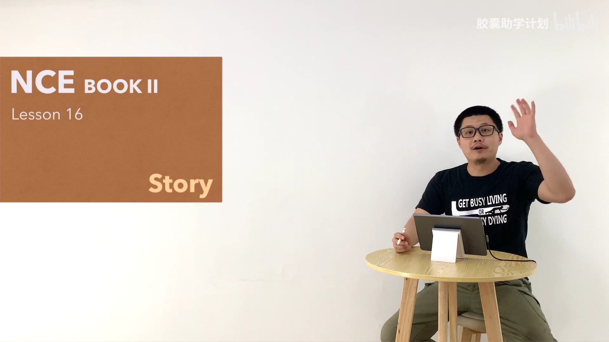

文字识别：胶囊助学计划 / NCE / BOOKII / Lesson 16 / Story / GET BUSY LIVING / OR. / YDYING

### 画面 00:00:02

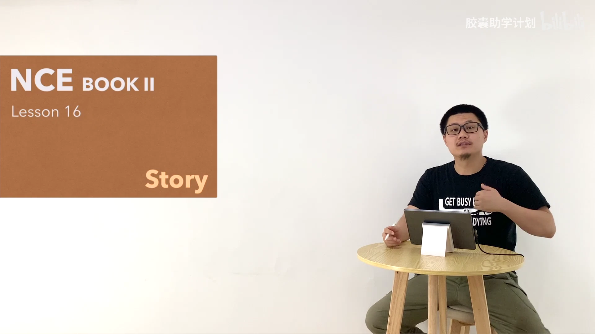

文字识别：胶囊助学计划 / NCE / BOOKII / Lesson 16 / Story / GET BUSY / AD / DYING

### 画面 00:00:05

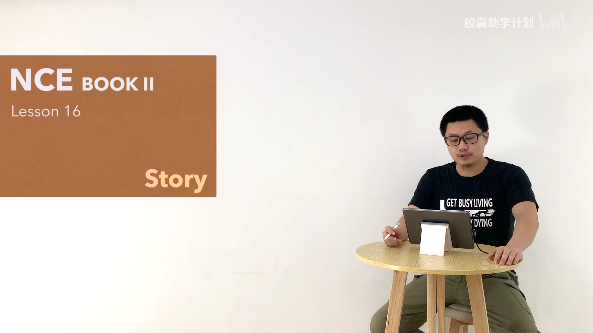

文字识别：胶囊助学计划 / NCE / BOOKII / Lesson 16 / Story / GET BUSY LIVING / DYING

### 画面 00:00:09

文字识别：胶囊助学计划 bilbl / •

### 画面 00:00:13

文字识别：胶囊助学计划

### 画面 00:00:15

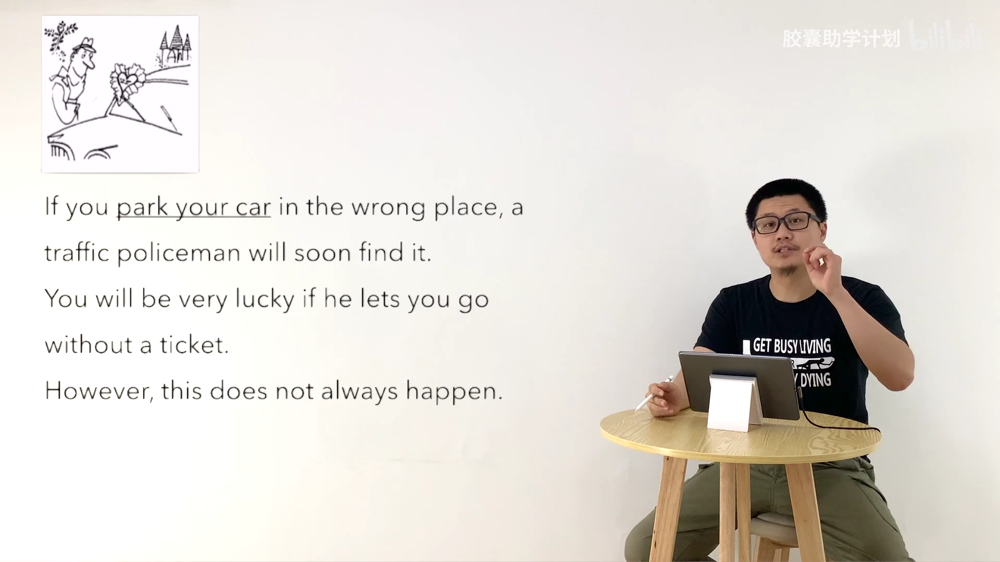

文字识别：胶囊助学计划 / If you park your car in the wrong place, a / traffic policeman will soon find it. / You will be very lucky if he lets you go / without a ticket. / GET BUSYLIVING / However, this does not always happen. / YDYING

## 00:00:30–00:01:00

a traffic policeman，一个交通警察 will soon find it，将会非常快的发现它。注意 will 这个是不是就是我们说的叫做主将？你看 if 引导的这个从句用的是一般现在时，而后面这个用的是一般将来时，对吧？OK，注意啊，它不是唯一的情况，很快我们就会发现特例了啊。规则以外必定有特例啊，这就是学语法的一个好玩的地方。我

### 画面 00:00:45

文字识别：胶囊助学计划 / If you park your car in the wrong place, a / traffic policeman will soon find it. / You will be very lucky if he lets you go / without a ticket. / GET BUSYIVING / R / However, this does not always happen. / YDYING

### 画面 00:00:51

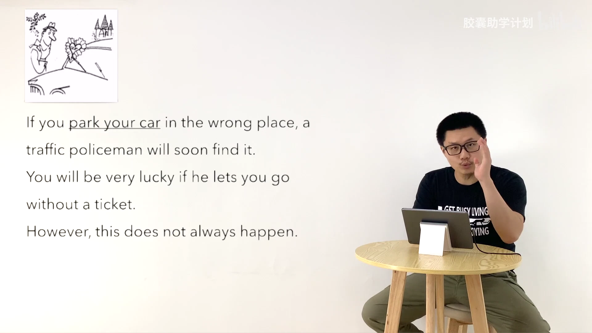

文字识别：胶囊助学计划 / If you park your car in the wrong place, a / traffic policeman will soon find it. / You will be very lucky if he lets you go / without a ticket. / GET DICY LIVING / However, this does not always happen. / IYING

### 画面 00:00:56

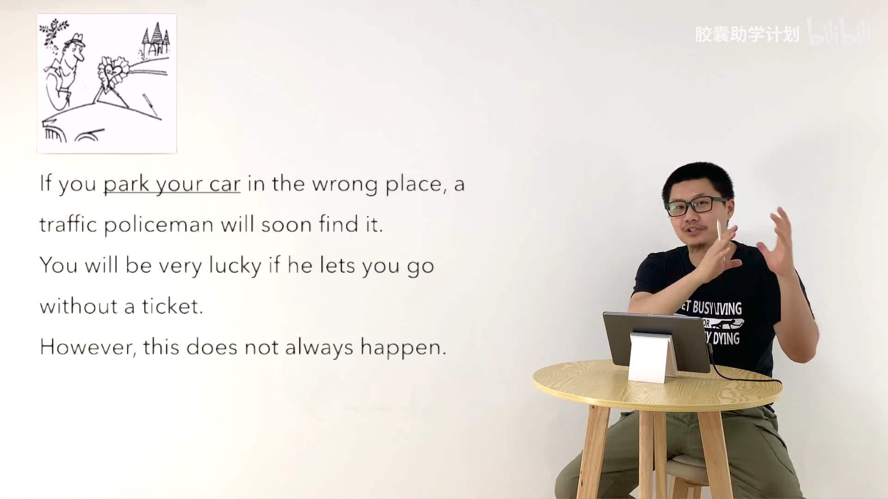

文字识别：胶囊助学计划 / If you park your car in the wrong place, a / traffic policeman will soon find it. / You will be very lucky if he lets you go / without a ticket. / T BUSYIVING / ORAL / However, this does not always happen. / YDYING

## 00:01:00–00:01:30

们先学会规则，然后再去找到那些特例。You'll be very lucky，你将会非常的幸运。主将从句 if 引导的叫做 he lets you go，他让你走了。你看 lets you go，你可能不是特别清楚，但 lets go 你特别清楚，叫我们走吧，对吧？Let's go。那 lets you go 就多了个你嘛，让你走。Without a ticket，without 叫做而没有一张罚

### 画面 00:01:26

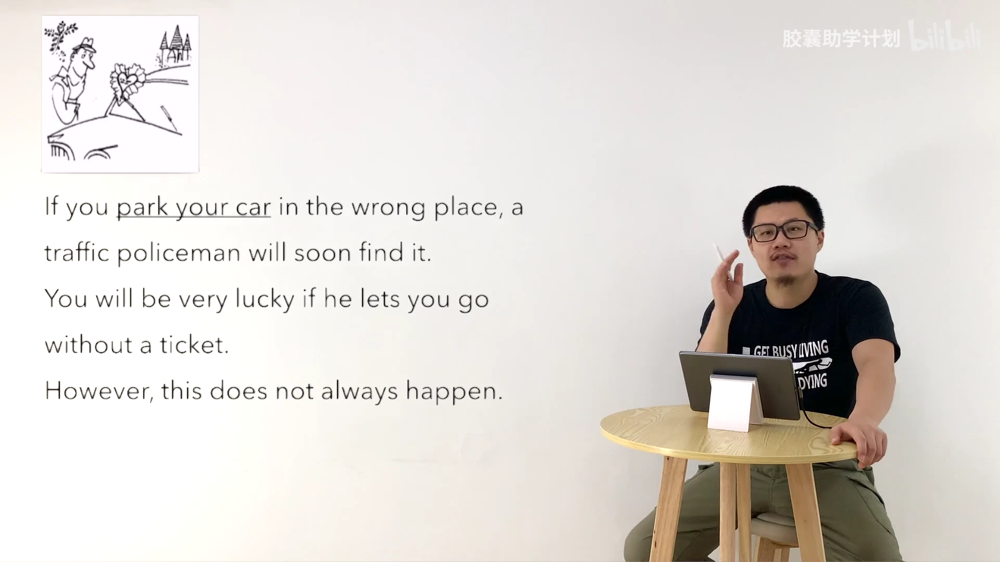

文字识别：胶囊助学计划 / If you park your car in the wrong place, a / traffic policeman will soon find it. / You will be very lucky if he lets you go / without a ticket. / GET RUSYIVING / However, this does not always happen. / DYING

## 00:01:30–00:02:00

单，你将会非常的幸运啊。However,然而啊，this does not always happen.这不经常发生。注意它的时态，does not always happen.陈述客观事实，对吧？这不经常发生嘛？当然了，大部分情况下你肯定是要被罚了，对不对？这个没跑了。那注意，所以它用的是一般现在时啊。我们注意它的时态之间的转化。The

### 画面 00:01:56

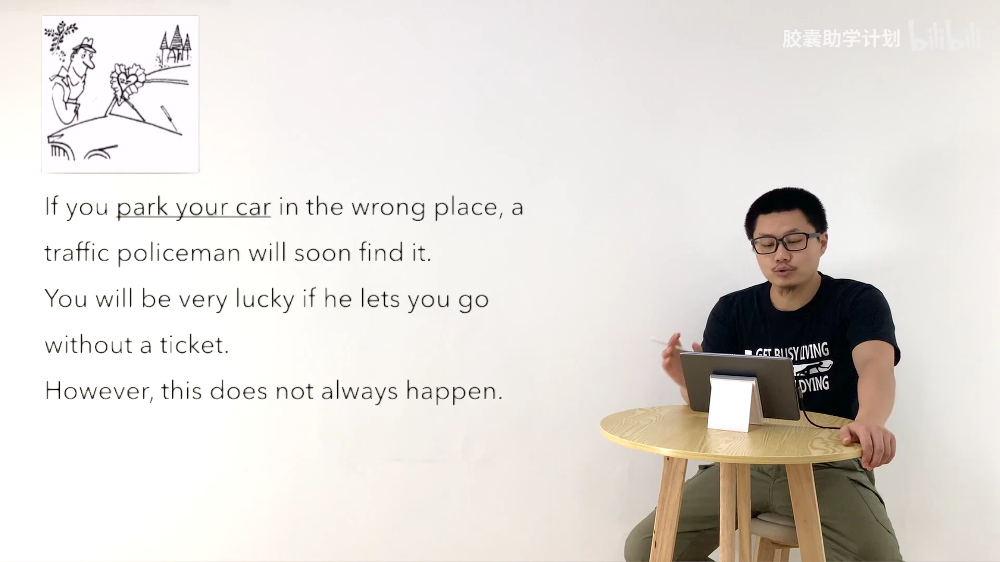

文字识别：胶囊助学计划 / If you park your car in the wrong place, a / traffic policeman will soon find it. / You will be very lucky if he lets you go / without a ticket. /  ET RUSYIVNING / However, this does not always happen. / PYING

### 画面 00:01:58

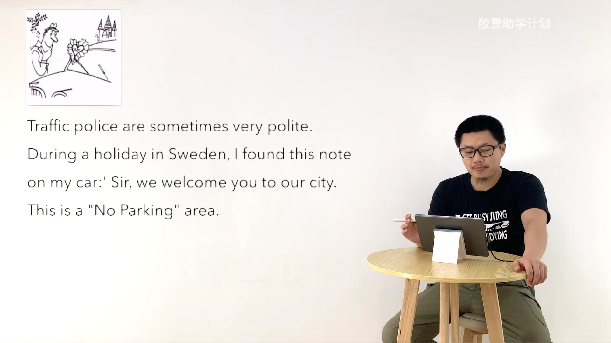

文字识别：Traffic police are sometimes very polite. / During a holiday in Sweden, I found this note / on my car:' Sir, we welcome you to our city. / This is a "No Parking" area. / - CT DUISIVING / DYING

## 00:02:00–00:02:30

traffic police are sometimes very polite. 注意 sometimes 这个单词，我们讲新一五十一课的时候就提过。Sometimes 这个单词比较的特殊，您放在哪儿，这个句子当中的所有地方都不会显得特别的违和，都很舒服。Sometimes traffic police are very polite. Okay. Uh, traffic police, you know, sometimes are very polite. 都可以啊，不用特别的

### 画面 00:02:07

文字识别：胶囊助学计划 / Traffic police are sometimes very polite. / During a holiday in Sweden, I found this note / on my car:' Sir, we welcome you to our city. / This is a "No Parking" area. / EVIVING / YING

### 画面 00:02:21

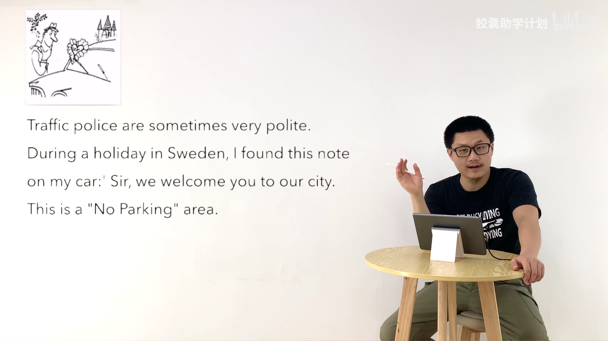

文字识别：胶囊助学计划 / Traffic police are sometimes very polite. / During a holiday in Sweden, I found this note / on my car:' Sir, we welcome you to our city. / This is a "No Parking"area. / YIVING / YING

## 00:02:30–00:03:00

纠结说 sometimes 到底放在哪。那 polite 就是很有礼貌，是一个小的形容词。 During a holiday in Sweden, during 在什么什么期间， a holiday 一次度假 in Sweden 啊，在瑞典，在瑞典的一次度假呢当中呢， I found this note on my car. 我发现了这个便条在我的汽车上。接下来就是便条的内容了，对吧？所

### 画面 00:02:51

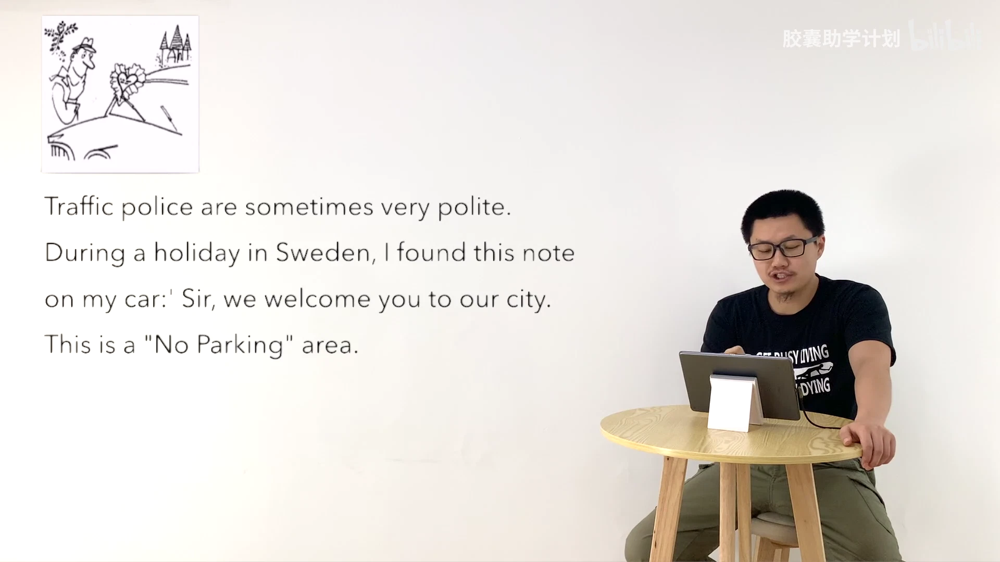

文字识别：胶囊助学计划 / Traffic police are sometimes very polite. / During a holiday in Sweden, I found this note / on my car:' Sir, we welcome you to our city. / This is a "No Parking" area. / PSYINING / DYING

## 00:03:00–00:03:30

以他给了一个引号，Sir先生，We welcome you to our city.我们都是字面意思，Welcome to Beijing，对吧？欢迎来到北京零八年奥运会。我们欢迎您来到我们的城市。This is a no parking area.说这是一个禁止停车的区域。这个我们在讲单词的部分就提到了。You will enjoy your stay

### 画面 00:03:21

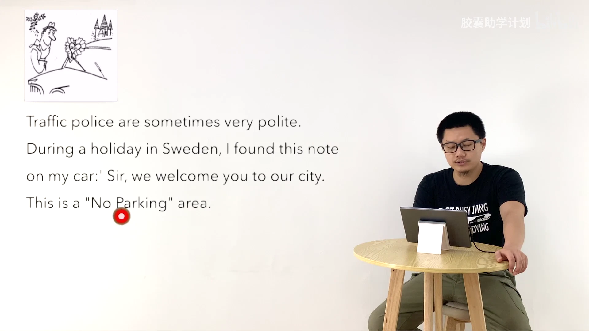

文字识别：Traffic police are sometimes very polite. / During a holiday in Sweden, I found this note / on my car:' Sir, we welcome you to our city. / This is a "No Parking"area. /  USYLNING / DYING

### 画面 00:03:26

文字识别：You will enjoy your stay here if you pay / attention to our street signs. / This note is only a reminder.' / If you receive a request like this, you cannot / RUSYIING / fail to obey it! / HDYING

## 00:03:30–00:04:00

here.说你将享受你在这里的停留，在这里的停留。If主将从现是吧？如果怎么样呢？You pay attention to our street signs.如果你注意我们的街道 signs 标志啊，比如说这儿写了一个大圈儿，然后一个P一个叉，是吧？通用标志。如果你注意这个东西

### 画面 00:03:56

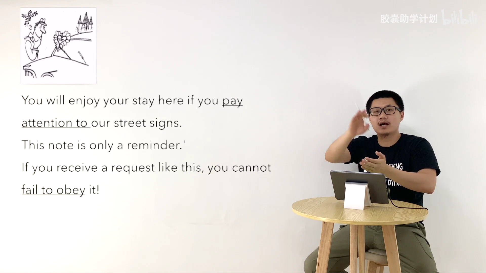

文字识别：胶囊助学计划 / You will enjoy your stay here if you pay / attention to our street signs. / This note is only a reminder.' / If you receive a request like this, you cannot / fail to obey it!

## 00:04:00–00:04:30

street signs 的话，那 pay attention to 算是一个习惯用法。其实我们早在第一节课就见过了。 But he did not pay any attention. 但是他根本没注意，对吧？如果各位还有印象的话， this note is only a reminder. 说这个便条啊，仅仅是一个提醒啊，不是一个罚单，就是提醒您。一看您这是外地车、外国车，对吧？提醒您啊，要注意我们的这个 street signs. 第一次就不罚您钱了，特别有

### 画面 00:04:22

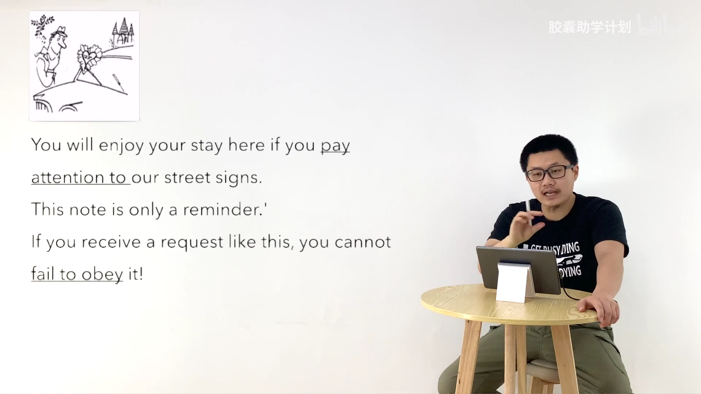

文字识别：胶囊助学计划 / You will enjoy your stay here if you pay / attention to our street signs. / This note is only a reminder.' / If you receive a request like this, you cannot / CE USYNING / fail to obey it! / DYING

### 画面 00:04:26

文字识别：胶囊助学计划 / You will enjoy your stay here if you pay / attention to our street signs. / This note is only a reminder.' / If you receive a request like this, you cannot / MING / fail to obey it! / CINING

## 00:04:30–00:05:00

礼貌。If如果 you receive a request like this，你看 request 在哪课咱们学？在鸽子和车库那课学的，对吧？Send a great many requests。如果你收到了一个请求 like this，注意这个 like 常见的两个意思，一个叫喜欢，一个叫像，对吧？那像这样的一个便签，You cannot fail to obey

### 画面 00:04:35

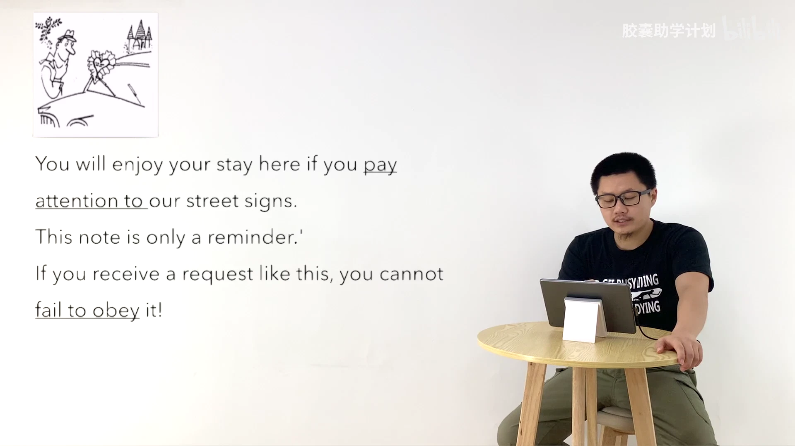

文字识别：胶囊助学计划 / You will enjoy your stay here if you pay / attention to our street signs. / This note is only a reminder.' / If you receive a request like this, you cannot /  PSYINING / fail to obey it! / DYING

### 画面 00:04:39

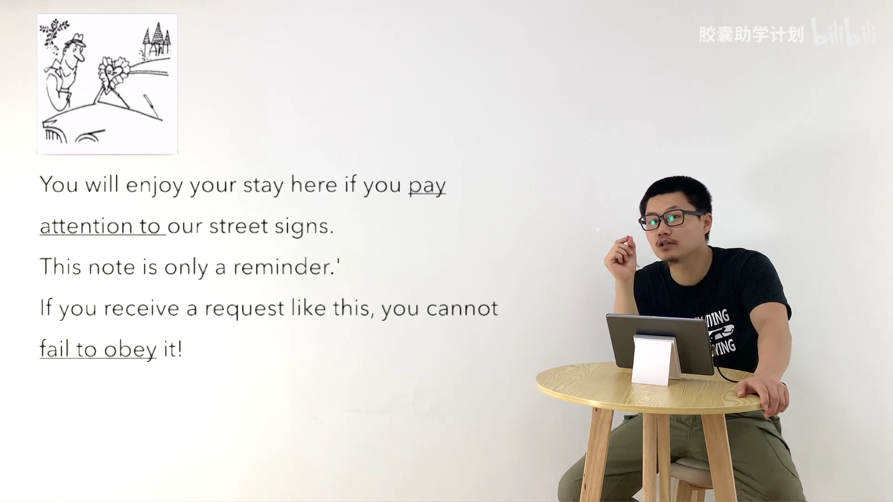

文字识别：胶囊助学计划 / You will enjoy your stay here if you pay / attention to our street signs. / This note is only a reminder.' / If you receive a request like this, you cannot / MING / fail to obey it! / NING

### 画面 00:04:49

文字识别：胶囊助学计划 / You will enjoy your stay here if you pay / attention to our street signs. / This note is only a reminder.' / If you receive a request like this, you cannot / A PUSYINING / fail to obey it! / DYING

### 画面 00:04:52

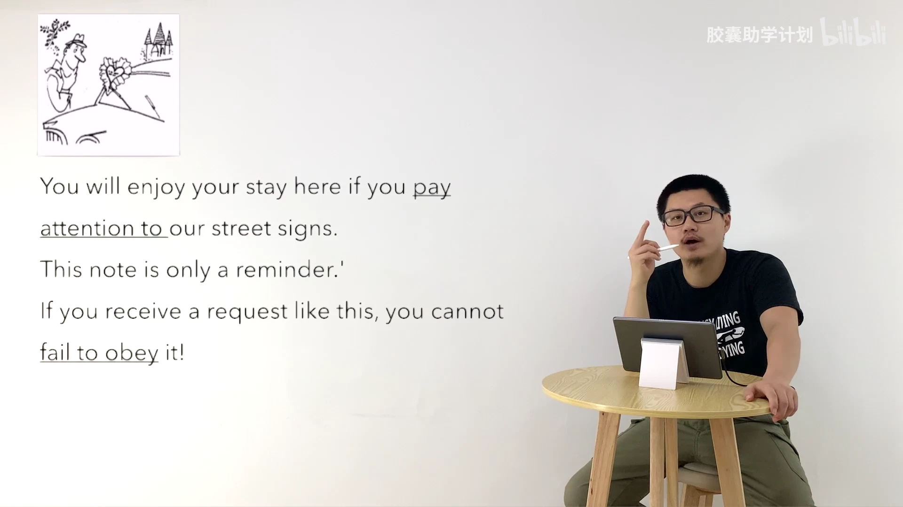

文字识别：胶囊助学计划 / You will enjoy your stay here if you pay / attention to our street signs. / This note is only a reminder.' / If you receive a request like this, you cannot / MING / fail to obey it! / YING

### 画面 00:04:54

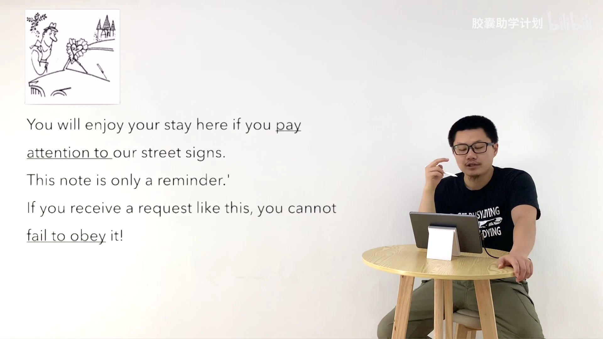

文字识别：胶囊助学计划 / You will enjoy your stay here if you pay / attention to our street signs. / This note is only a reminder.' / If you receive a request like this, you cannot / RUSYING / fail to obey it! / PYING

## 00:05:00–00:05:30

it.说你是没有办法，你是不能怎么样呢？失败去遵守它的。你想一下，什么叫你是不会失败去遵守它的？其实啊，这个地方如果你绕不过来，你就想一个最简单的事情就行了。很巧，英语和汉语的双重否定都表肯定，并且把肯定的语气加强了。啊，他不可能不

### 画面 00:05:24

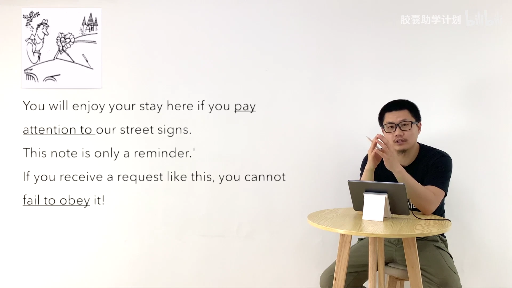

文字识别：胶囊助学计划 / M / You will enjoy your stay here if you pay / attention to our street signs. / This note is only a reminder.' / If you receive a request like this, you cannot / fail to obey it!

## 00:05:30–00:06:00

是一个好老师啊。意思本身和他是一个好老师是一样的，只不过多了一点修饰，我们管它叫修辞，对吧？Oratory变成了叫他一定是个特别好的老师啊，语气加强了。所以这个地方您看，第一层否定，fail是第二层否定。所以这个地方的意思就是 you will obey it，你会遵守他的。Very good. 那本课的习惯用法并不多，只有两个啊。其

### 画面 00:05:46

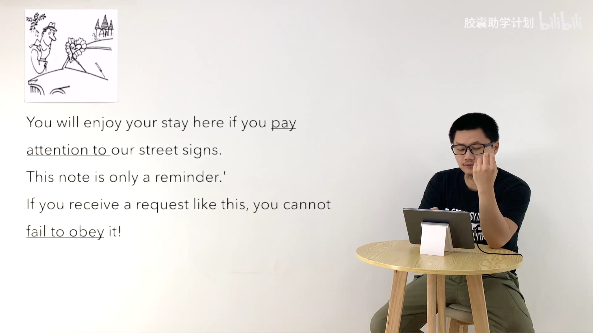

文字识别：胶囊助学计划 / You will enjoy your stay here if you pay / attention to our street signs. / This note is only a reminder.' / If you receive a request like this, you cannot / fail to obey it!

### 画面 00:05:56

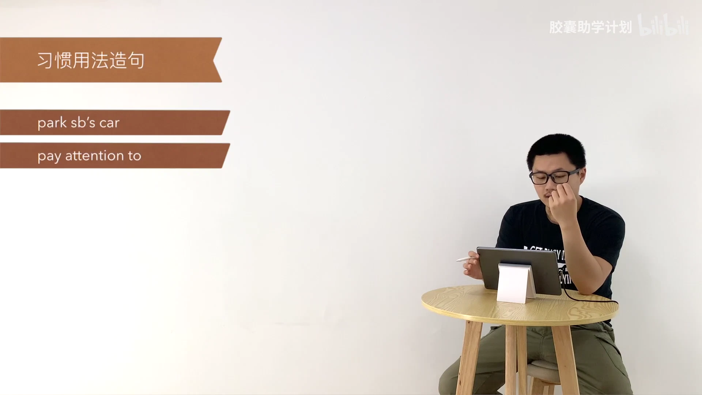

文字识别：胶囊助学计划 / 习惯用法造句 / park sb's car / pay attention to

### 画面 00:05:58

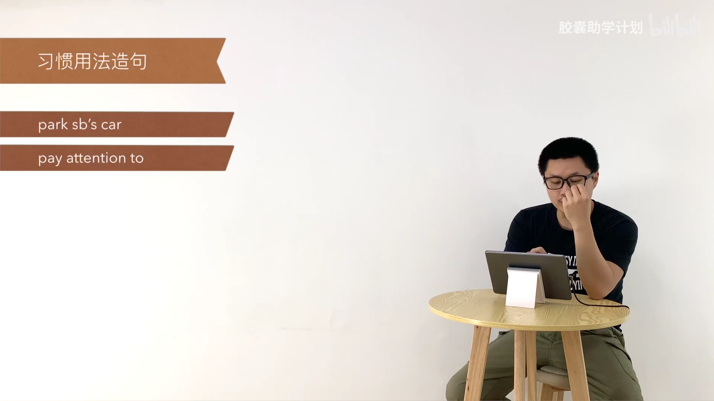

文字识别：胶囊助学计划 / 习惯用法造句 / park sb's car / pay attention to

## 00:06:00–00:06:30

中那两个我们还其实在不同的地方或多或少都提过。第一个叫停某人的车，第二个叫注意力啊，注意在什么事情上。OK，那我们先来一个 park somebody's car 吧。好，比如说 she parked her car in front of the theater last night。你看，我们在这加了什么东西？其实就是方式、地点、时间。地点是 in front of the theater，第一课您就会了。last night 我已经想不起来，各位可能在哪课就学过

### 画面 00:06:00

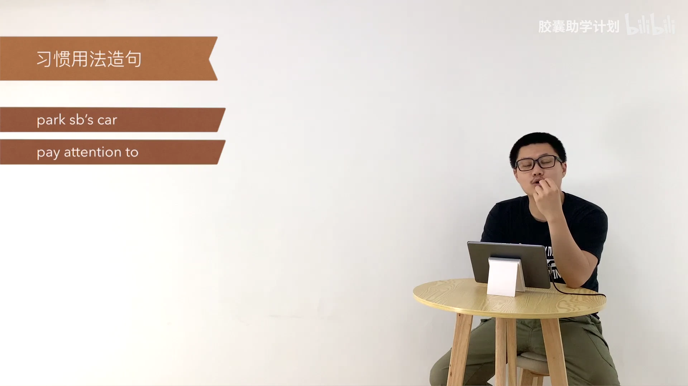

文字识别：胶囊助学计划 / 习惯用法造句 / park sb's car / pay attention to

### 画面 00:06:03

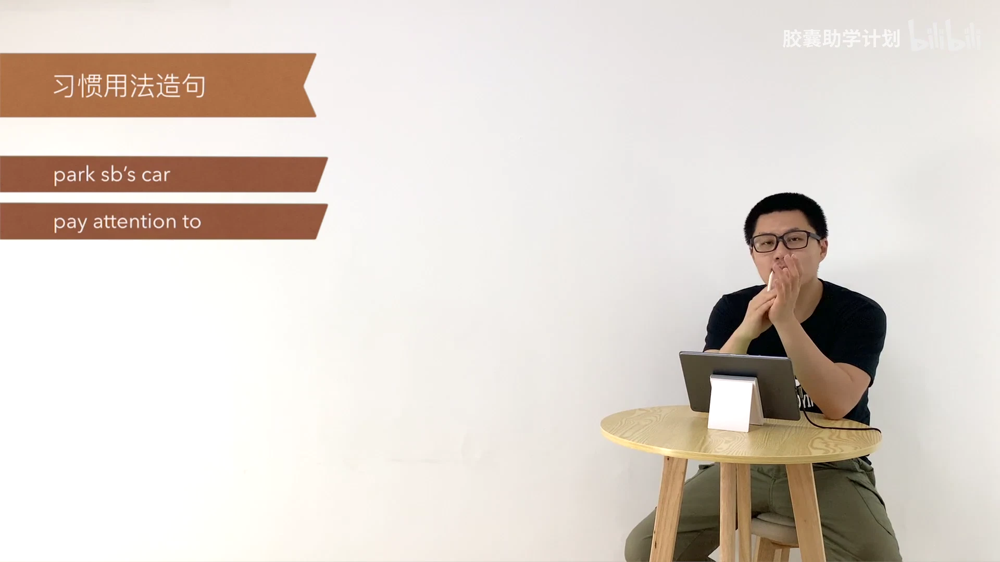

文字识别：胶囊助学计划 / 习惯用法造句 / park sb's car / pay attention to

### 画面 00:06:05

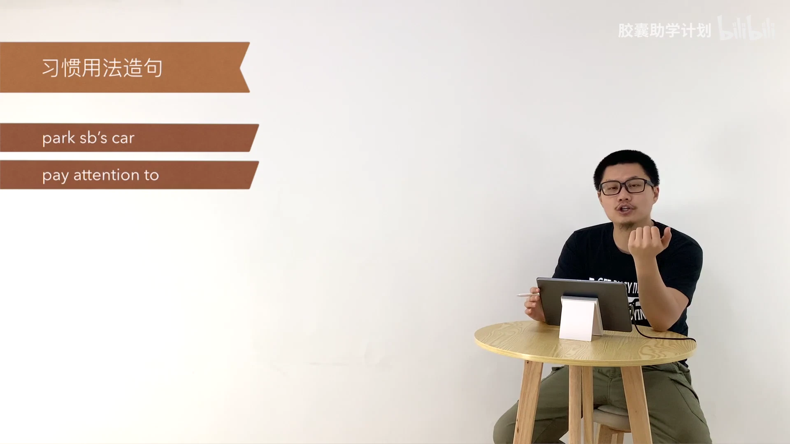

文字识别：胶囊助学计划 / 习惯用法造句 / park sb's car / pay attention to / -

### 画面 00:06:09

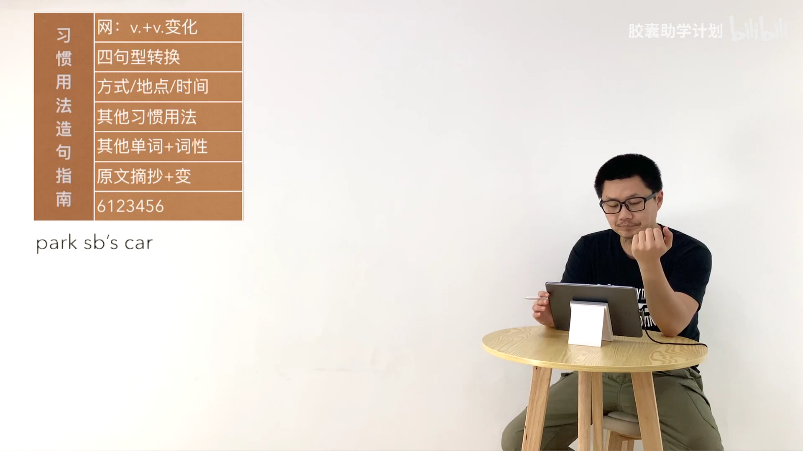

文字识别：网：v.+v.变化 / 习惯用法造句指南 / 胶囊助学计划 / 四句型转换 / 方式/地点/时间 / 其他习惯用法 / 其他单词+词性 / 原文摘抄+变 / 6123456 / park sb's car

### 画面 00:06:11

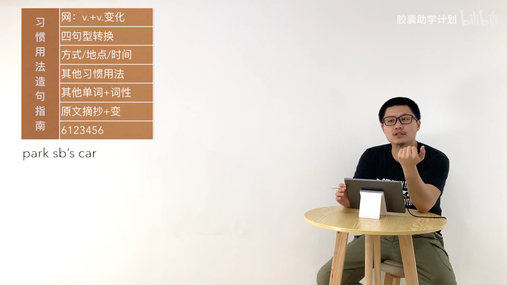

文字识别：网：v.+v.变化 / 习惯用法造句指南 / 胶囊助学计划 / 四句型转换 / 方式/地点/时间 / 其他习惯用法 / 其他单词+词性 / 原文摘抄+变 / 6123456 / park sb's car

### 画面 00:06:13

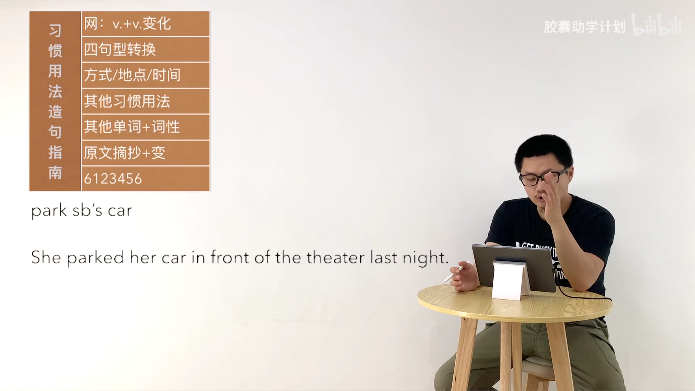

文字识别：网：v.+v.变化 / 习惯用法造句指南 / 胶囊助学计划 / 四句型转换 / 方式/地点/时间 / 其他习惯用法 / 其他单词+词性 / 原文摘抄+变 / 6123456 / park sb's car / She parked her car in front of the theater last night.

### 画面 00:06:15

文字识别：网：v.+v.变化 / 习惯用法造句指南 / 胶囊助学计划 / 四句型转换 / 方式/地点/时间 / 其他习惯用法 / 其他单词+词性 / 原文摘抄+变 / 6123456 / park sb's car / She parked her car in front of the theater last night.

### 画面 00:06:19

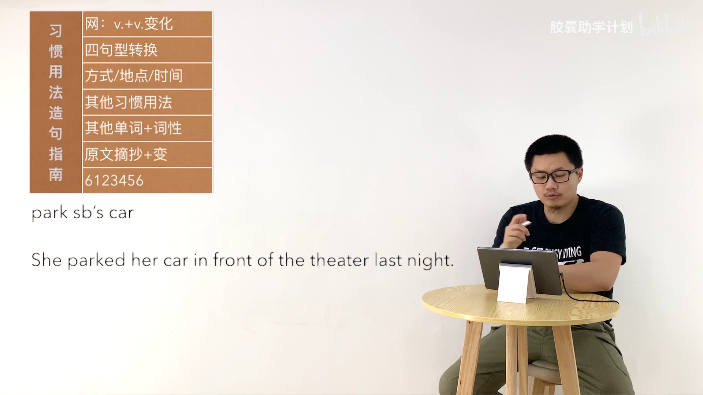

文字识别：网：v.+v.变化 / 习惯用法造句指南 / 胶囊助学计划 / 四句型转换 / 方式/地点/时间 / 其他习惯用法 / 其他单词+词性 / 原文摘抄+变 / 6123456 / park sb's car / She parked her car in front of the theater last night. / SYMING

### 画面 00:06:21

文字识别：网：v.+v.变化 / 习惯用法造句指南 / 胶囊助学计划 / 四句型转换 / 方式/地点/时间 / 其他习惯用法 / 其他单词+词性 / 原文摘抄+变 / 6123456 / park sb's car / She parked her car in front of the theater last night. / YING

### 画面 00:06:25

文字识别：网：v.+v.变化 / 习惯用法造句指南 / 胶囊助学计划 / 四句型转换 / 方式/地点/时间 / 其他习惯用法 / 其他单词+词性 / 原文摘抄+变 / 6123456 / park sb's car / She parked her car in front of the theater last night. / YING

## 00:06:30–00:07:00

了，是吧？加了个时间，然后呢，我们加了动词，动词的变化，因为是 last night，所以不能用原形，要用一般过去式。一句话就造出来了，非常简单，对吧？肯定句有了，接下来四句型的转化，一般疑问句和各种特殊疑问句，您是不是就是张嘴或暂停屏幕自己哎来一下就可以了？造句子的时候把这些句子造出来，是不是您的家庭作业就完成了，对吧？OK，那再然后呢？Pay attention

### 画面 00:06:30

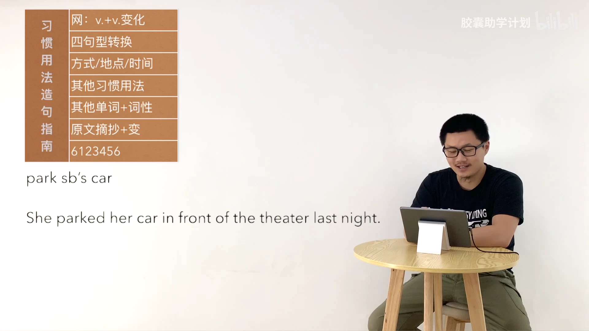

文字识别：网：v.+v.变化 / 习惯用法造句指南 / 胶囊助学计划 / 四句型转换 / 方式/地点/时间 / 其他习惯用法 / 其他单词+词性 / 原文摘抄+变 / 6123456 / park sb's car / She parked her car in front of the theater last night. / SYUING

### 画面 00:06:35

文字识别：网：v.+v.变化 / 习惯用法造句指南 / 胶囊助学计划 / 四句型转换 / 方式/地点/时间 / 其他习惯用法 / 其他单词+词性 / 原文摘抄+变 / 6123456 / park sb's car / She parked her car in front of the theater last night. / YUMING

### 画面 00:06:40

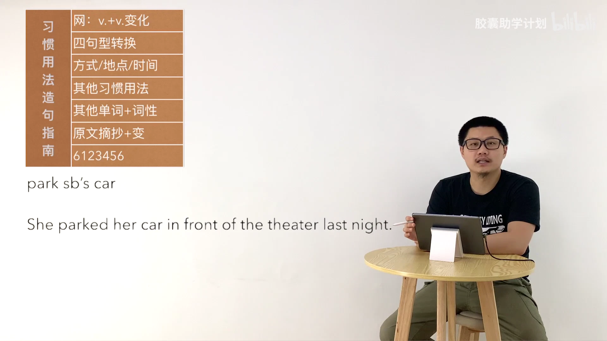

文字识别：网：v.+v.变化 / 习惯用法造句指南 / 胶囊助学计划 / 四句型转换 / 方式/地点/时间 / 其他习惯用法 / 其他单词+词性 / 原文摘抄+变 / 6123456 / park sb's car / She parked her car in front of the theater last night. / YING

### 画面 00:06:43

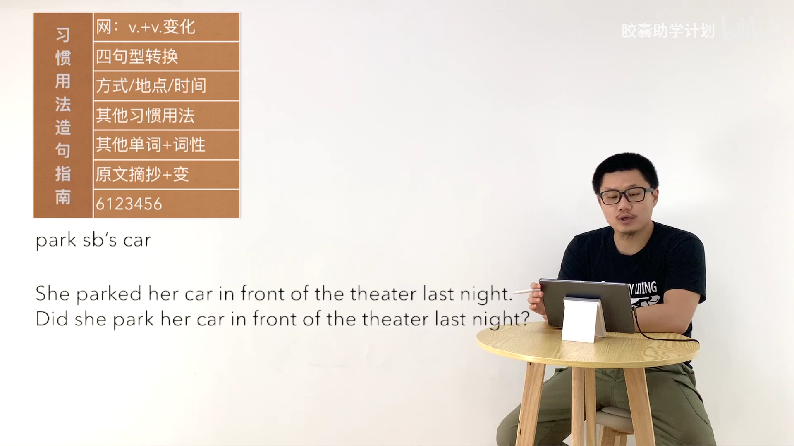

文字识别：网：v.+v.变化 / 习惯用法造句指南 / 胶囊助学计划 / 四句型转换 / 方式/地点/时间 / 其他习惯用法 / 其他单词+词性 / 原文摘抄+变 / 6123456 / park sb's car / She parked her car in front of the theater last night. / YUING / Did she park her car in front of the theater last night?

### 画面 00:06:45

文字识别：网：v.+v.变化 / 习惯用法造句指南 / 胶囊助学计划 / 四句型转换 / 方式/地点/时间 / 其他习惯用法 / 其他单词+词性 / 原文摘抄+变 / 6123456 / park sb's car / She parked her car in front of the theater last night. / YUING / Did she park her car in front of the theater last night? / why/who/when/where...

### 画面 00:06:47

文字识别：习惯用法造句指南 / 网：v.+v.变化 / 胶囊助学计划 / 四句型转换 / 方式/地点/时间 / 其他习惯用法 / 其他单词+词性 / 原文摘抄+变 / 6123456 / park sb's car / She parked her car in front of the theater last night. / Did she park her car in front of the theater last night? / why/who/when/where...

### 画面 00:06:50

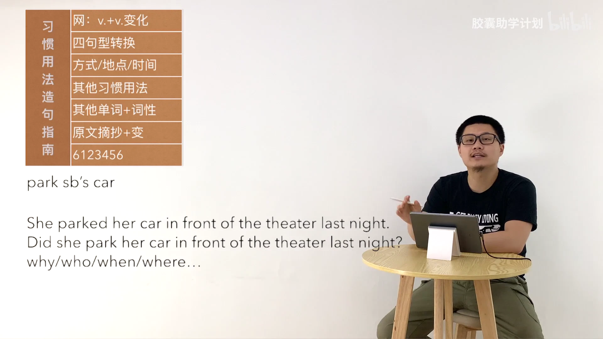

文字识别：网：v.+v.变化 / 习惯用法造句指南 / 胶囊助学计划 / 四句型转换 / 方式/地点/时间 / 其他习惯用法 / 其他单词+词性 / 原文摘抄+变 / 6123456 / park sb's car / She parked her car in front of the theater last night. / YIOING / Did she park her car in front of the theater last night? / why/who/when/where...

### 画面 00:06:55

文字识别：习惯用法造句指南 / 网：v.+v.变化 / 胶囊助学计划 / 四句型转换 / 方式/地点/时间 / 其他习惯用法 / 其他单词+词性 / 原文摘抄+变 / 6123456 / park sb's car / She parked her car in front of the theater last night. / YIMING / Did she park her car in front of the theater last night? / why/who/when/where...

### 画面 00:06:57

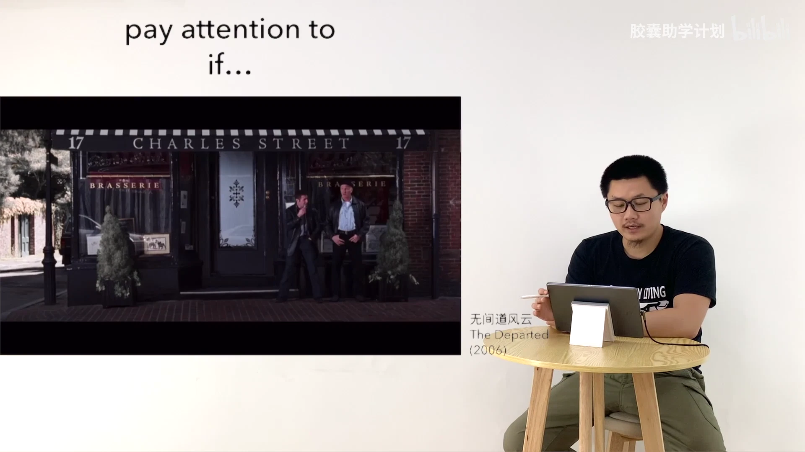

文字识别：pay attention to / 胶囊助学计划 / if.... / CHARLES / EET / BRASSERIE / SERIE / YUING / 无间道风云 / The Departed / (2006)

## 00:07:00–00:07:30

to啊，表示的是对什么什么表示呃有注意，对吧？注意某件事情或注意某个人。比如说，pay attention to him啊，注意他一下。OK，那这个视频当中出现了第一个叫pay attention to，第二个是我们刚刚学过的这个语法点叫做if啊，注意力啊，各位pay attention to this video。OK，来了。Of course, I know how to spot a cop. What's that? If he's not paying attention to us, he's a cop. Look, you

### 画面 00:07:02

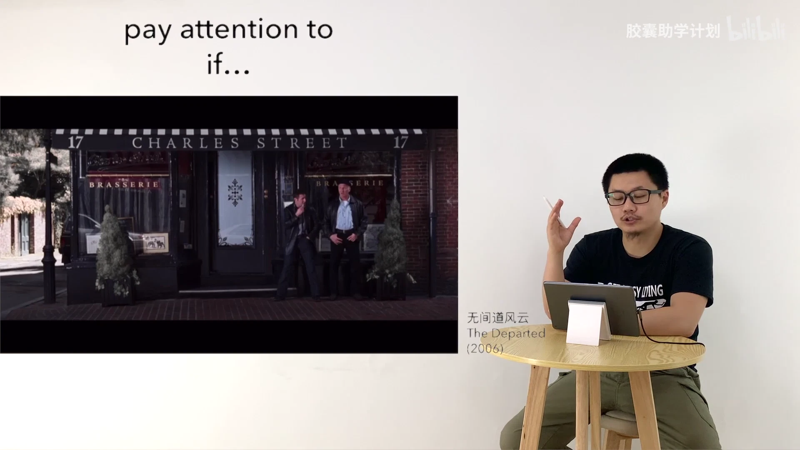

文字识别：pay attention to / 胶囊助学计划 / if... / CHARLES / BRASSERIE / SERIE / SYLING / 无间道风云 / The Departed / (2006)

### 画面 00:07:13

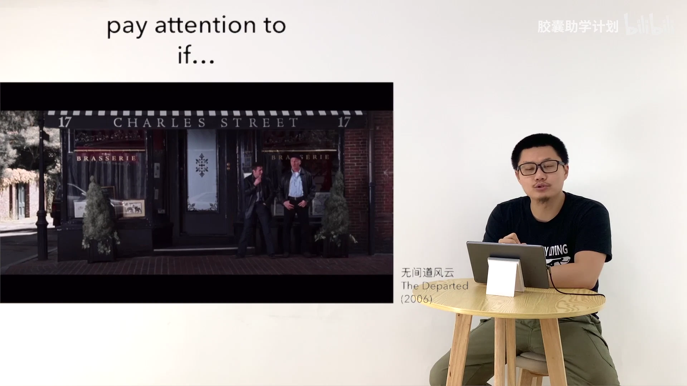

文字识别：pay attention to / 胶囊助学计划 / if.... / CHARLES / BRASSERIE / SERIE / VMING / 无间道风云 / The Departed / (2006)

### 画面 00:07:23

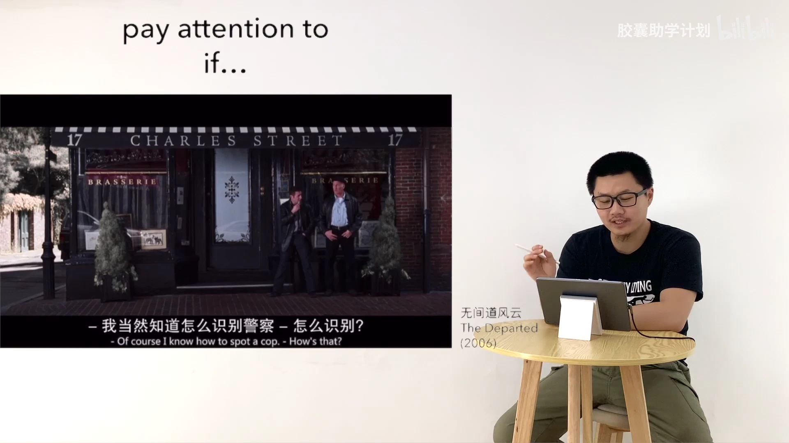

文字识别：pay attention to / 胶囊助学计划 / if.... / CHARLES / BRASSERIE / ERIE / YING / 无间道风云 / -我当然知道怎么识别警察-怎么识别？ / The Departed / -Of course I know how to spot a cop. - How's that? / (2006)

### 画面 00:07:26

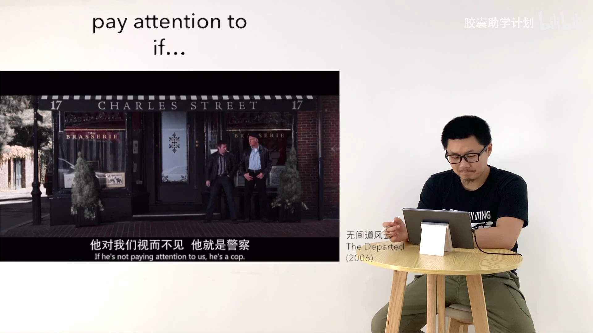

文字识别：pay attention to / 胶囊助学计划 / if... / CHARLES / STREET / BRASSERIE / SERIE / YING / 无间道风会 / 他对我们视而不见他就是警察 / The Departed / If he's not paying attention to us, he's a cop. / (2006)

### 画面 00:07:29

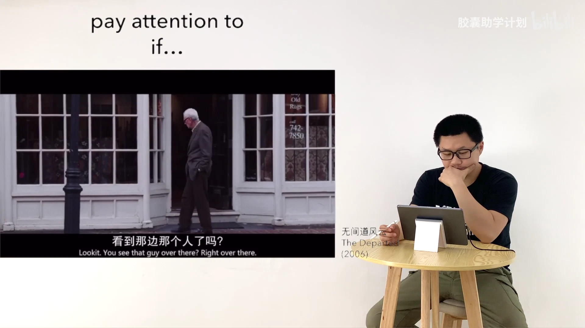

文字识别：pay attention to / 胶囊助学计划 / if... / Old / Rogs / 742- / 7850 / 无间道风云 / 看到那边那个人了吗？ / The Departeel / Lookit. You see that guy over there? Right over there. / (2006)

## 00:07:30–00:08:00

see that guy over there? Right over there. Yeah, not paying attention to us. He's a cop. Ah, okay. You get it now, do you? Okay,你看这个 if 引导的这句话在电影当中出现这句话说 if is not pay atten is if he's not paying attention to us, 逗号 he is a cop. 你看他就没有用主将从现，他的

### 画面 00:07:31

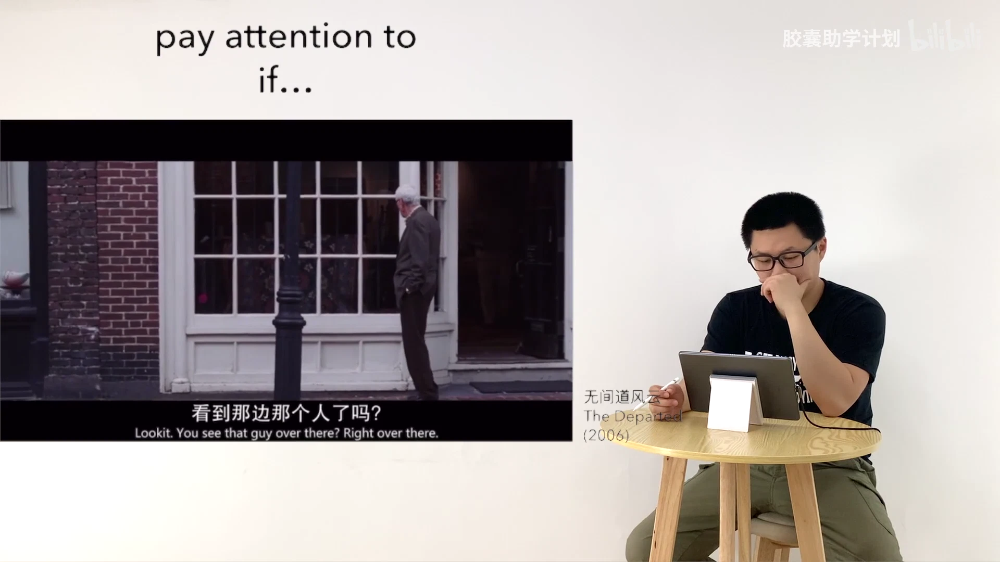

文字识别：pay attention to / 胶囊助学计划 / if... / 无间道风云 / 看到那边那个人了吗？ / The Departeel / Lookit. You see that guy over there? Right over there. / (2006)

### 画面 00:07:33

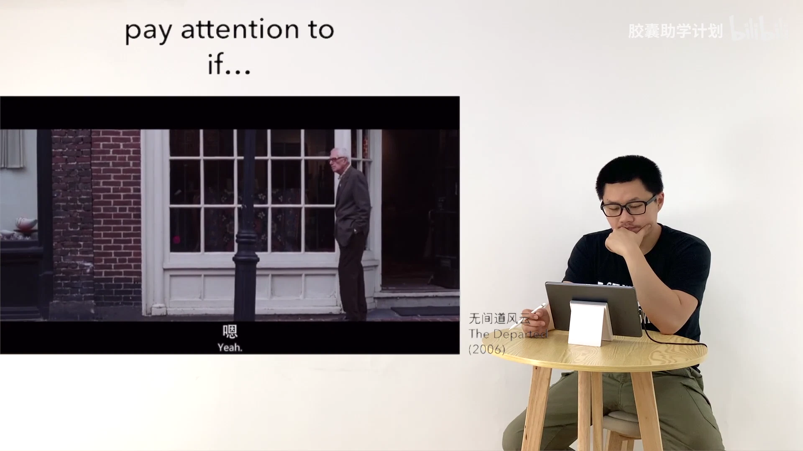

文字识别：pay attention to / 胶囊助学计划 / if.... / 无间道风云 / 嗯 / The Departeel / Yeah. / (2006)

### 画面 00:07:35

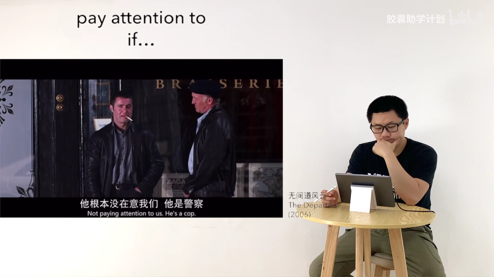

文字识别：pay attention to / 胶囊助学计划 / if... / BR / SERIE / 2 / 无间道风云 / 他根本没在意我们他是警察 / The Departeed / Not paying attention to us. He's a cop. / (2006)

### 画面 00:07:38

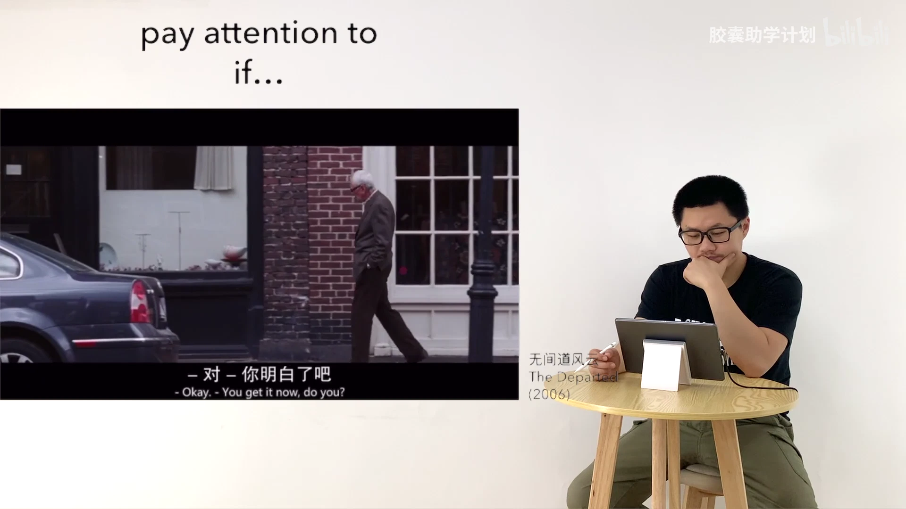

文字识别：pay attention to / 胶囊助学计划 / if... / 无间道风云 / -对－你明白了吧 / The Departeel / -Okay. -You get it now, do you? / (2006)

### 画面 00:07:40

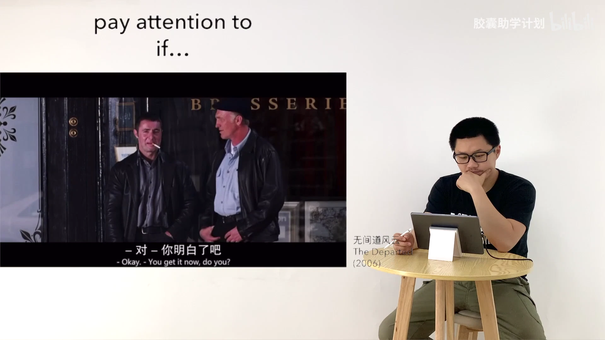

文字识别：pay attention to / 胶囊助学计划 / if... / BI / SSERIE / 2 / 无间道风云 / -对－你明白了吧 / The Departeel / -Okay.-You get it now, do you? / (2006)

### 画面 00:07:42

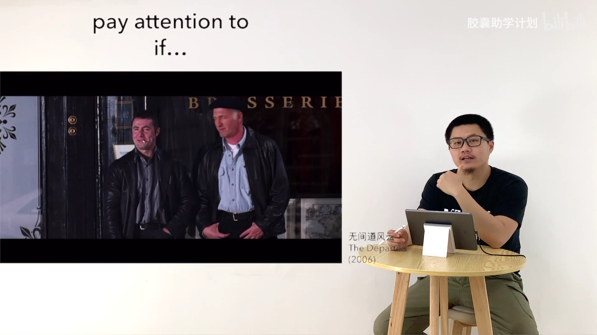

文字识别：pay attention to / 胶囊助学计划 / if.... / BT / SSERIE / 无间道风云 / The Departecl / (2006)

## 00:08:00–00:08:30

主句也是一般现在时。我没有记错的话，我们十八课立刻就会见到类似的句子，这个也不是错的。您可以理解为是不是我今天讲的这些以内的，不是说只有符合我今天讲的才是对的。今天讲的是最常见的一些情况，但它之外还有例外。比如说文章当中就出现啊，这个电影当中啊就出现了，叫做如果他对我们没有注意，那他就是一个警察。He is a cop.

### 画面 00:08:12

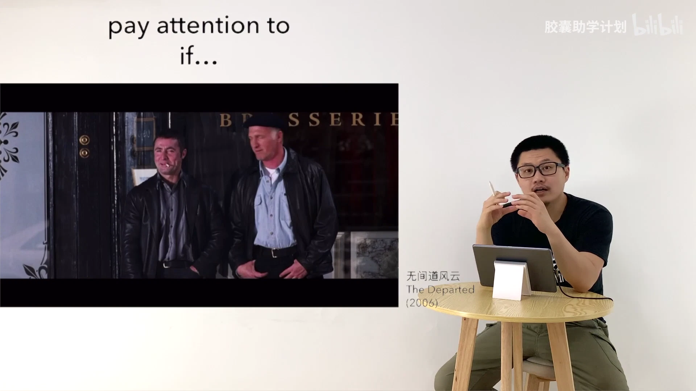

文字识别：pay attention to / 胶囊助学计划 / if.... / BD / SSERIE / 2 / 无间道风云 / The Departed / (2006)

## 00:08:30–00:09:00

Okay, one more. Good. That recap. This lesson, besides reading the article, there are two small habits. The usage is very simple, not particularly difficult. Ah, let's look at the homework. Habit usage sentence. Ah, each word five sentences. Not too difficult. The article must be read until it is memorized. Right? Help us to internalize the words, grammar, and usage of this lesson. Ah, we can start using them as soon as we open our mouths. And the listening, speaking, and writing exercises in the next video are based on this article.

### 画面 00:08:31

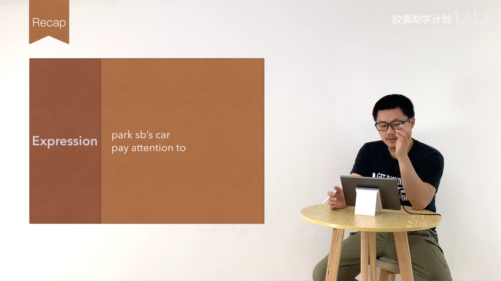

文字识别：胶囊助学计划 / Recap / park sb's car / Expression / pay attention to / GET DUEI

### 画面 00:08:33

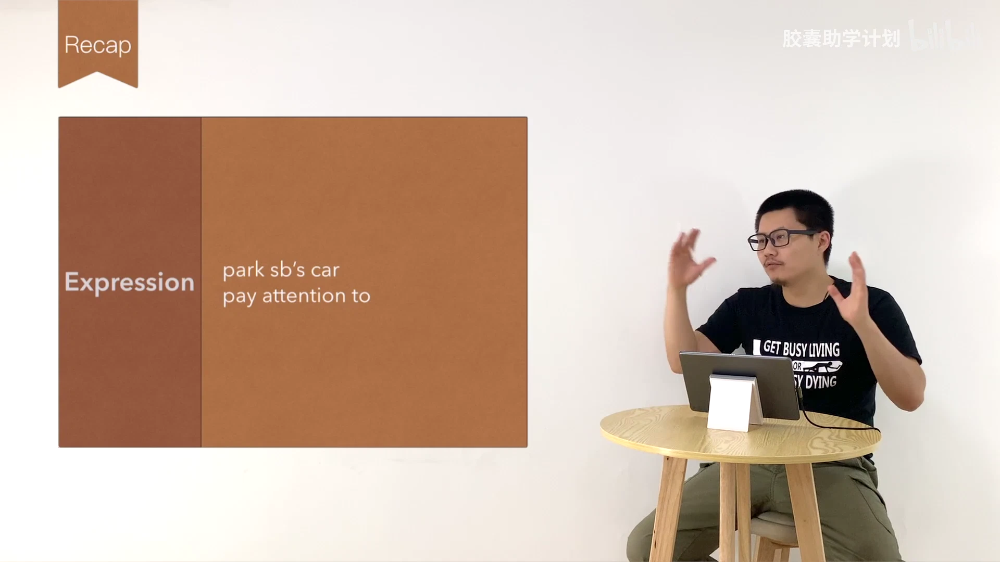

文字识别：胶囊助学计划 / Recap / park sb's car / Expression / pay attention to / GET BUSY LIVING / ORIU / SYDYING

### 画面 00:08:35

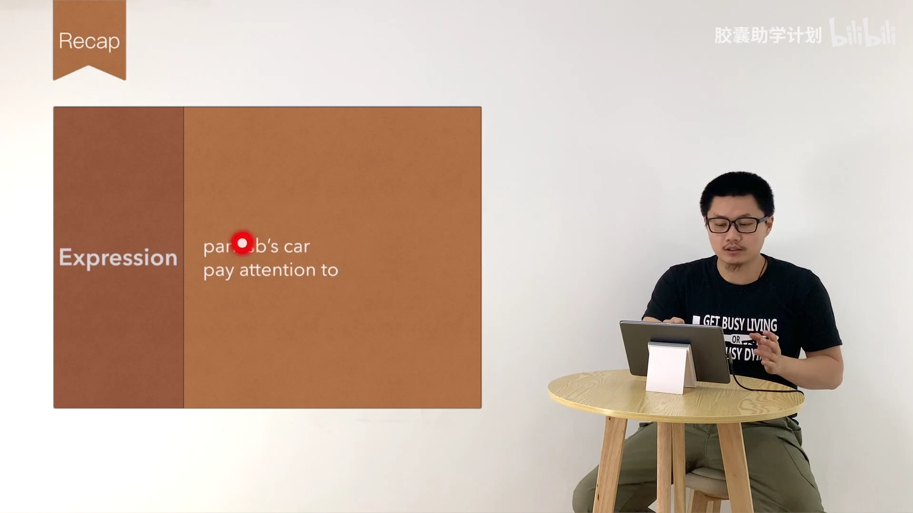

文字识别：胶囊助学计划 / Recap / parOb's car / Expression / pay attention to / GFT BUSY LIVING / OR / SYDY

### 画面 00:08:37

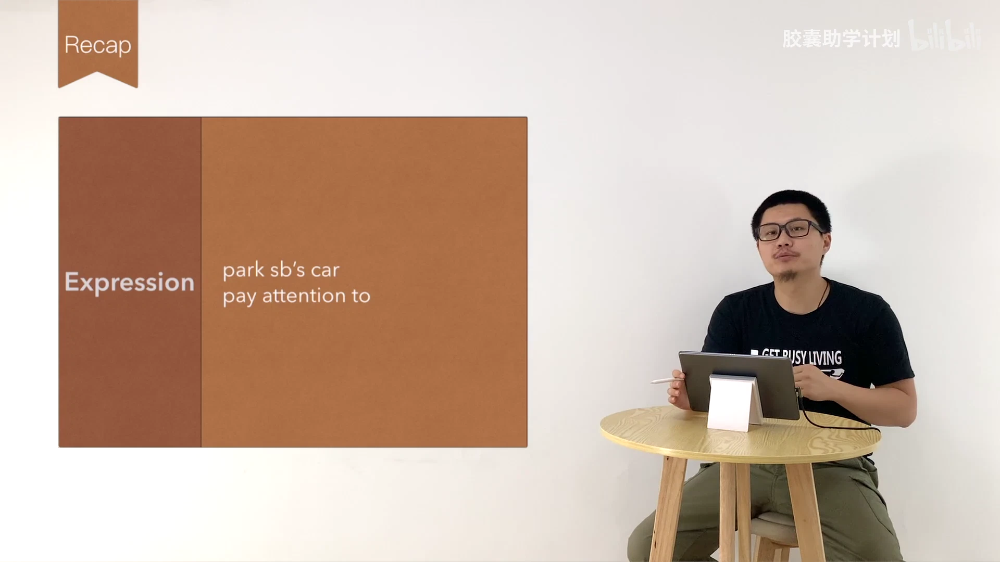

文字识别：胶囊助学计划 / Recap / park sb's car / Expression / pay attention to /  CET DUSYLIVING

### 画面 00:08:39

文字识别：胶囊助学计划 / 1. / 习惯用法造句/对话 / 【习惯用法造句指南】 / 每个5句 / GET DIISYUIVING / R / YDYING

### 画面 00:08:42

文字识别：胶囊助学计划 / 1. / 习惯用法造句/对话 / 【习惯用法造句指南】 / 每个5句 / SYMIN / 流

### 画面 00:08:44

文字识别：胶囊助学计划 / 1. / 习惯用法造句/对话 / 【习惯用法造句指南】 / 每个5句 / 文章跟读至熟读成诵 / 内化单词+语法+习惯用法 / 听力+口语+写作练习

### 画面 00:08:46

文字识别：胶囊助学计划 / 1. / 习惯用法造句/对话 / 【习惯用法造句指南】 / 每个5句 / 文章跟读至熟读成诵 / 内化单词+语法+习惯用法 / 听力+口语+写作练习 / GCTRII

### 画面 00:08:49

文字识别：胶囊助学计划 / 1. / 习惯用法造句/对话 / 【习惯用法造句指南】 / 每个5句 / 文章跟读至熟读成诵 / 内化单词+语法+习惯用法 / 听力+口语+写作练习 / ISYI.

### 画面 00:08:52

文字识别：胶囊助学计划 / 1. / 习惯用法造句/对话 / 【习惯用法造句指南】 / 每个5句 / 文章跟读至熟读成诵 / 内化单词+语法+习惯用法 / 听力+口语+写作练习

### 画面 00:08:54

文字识别：胶囊助学计划 / 1. / 习惯用法造句/对话 / 【习惯用法造句指南】 / 每个5句 / 文章跟读至熟读成诵 / 内化单词+语法+习惯用法 / 听力+口语+写作练习

### 画面 00:08:57

文字识别：胶囊助学计划 / 1. / 习惯用法造句/对话 / 【习惯用法造句指南】 / 每个5句 / 文章跟读至熟读成诵 / 内化单词+语法+习惯用法 / 听力+口语+写作练习

### 画面 00:08:59

文字识别：胶囊助学计划 / 习惯用法造句/对话 / 【习惯用法造句指南】 / 每个5句 / 文章跟读至熟读成诵 / 内化单词+语法+习惯用法 / 听力+口语+写作练习

## 00:09:00–00:09:28

这篇文章，要读到非常熟才能进行的。OK，好，那以上呢就是本期视频的全部内容。如果大家喜欢我们的课程，欢迎大家关注、订阅、一键三连，分享给那些需要的朋友来支持我们。那See you next time.

### 画面 00:09:04

文字识别：胶囊助学计划

### 画面 00:09:11

文字识别：胶囊助学计划

### 画面 00:09:16

### 画面 00:09:18

文字识别：CAPSULEACADEMY / 胶囊助学计划 / 小红书 / Lecturer / □ / Leo / OE

### 画面 00:09:21

文字识别：CAPSULEACADEMY / 胶囊助学计划 / 『 / 小红书 / Editor / OE

### 画面 00:09:24

文字识别：CAPSULEACADEMY / 胶囊助学计划 / 小红书 / Creator / Leo & Berlin

### 画面 00:09:26

文字识别：bilibili / 胶囊助学计划 / 胶囊助学计划 / 小红书 / 只识 / 0

### 画面 00:09:28

文字识别：bilibili / 胶囊助学计划

