# L016 听说读写复述练习

快速机器解析：语音为单模型转写，未进行独立交叉校对或人工复核；画面每秒采样并按变化选帧，短时文字和标记可能遗漏。截图时间约有 1 秒误差。图片有损压缩；遇到疑点请按时间查看 Google Drive 原视频。

## 00:00:00–00:00:30

Hello everyone, welcome to Capsule Academy. This is Leo. Today we're going to learn new concept English Book Two Lesson Sixteen Practices. 那注意一下，进行如下所有练习，唯一的前提就是文章要跟读至熟读成诵，否则请勿开始。 Hope you gonna enjoy. 那我们先看第一题，Comprehension，听懂一般疑问句和特殊疑问句。您要不完

### 画面 00:00:00

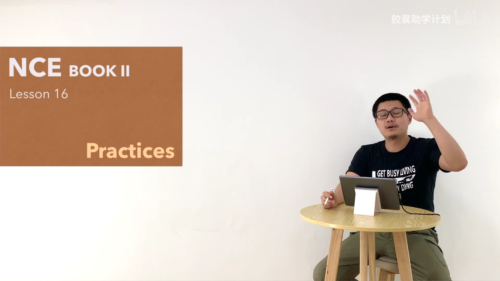

文字识别：胶囊助学计划 / NCE / BOOKII / Lesson 16 / Practices / GET BUSYLVING / Y DYNG

### 画面 00:00:02

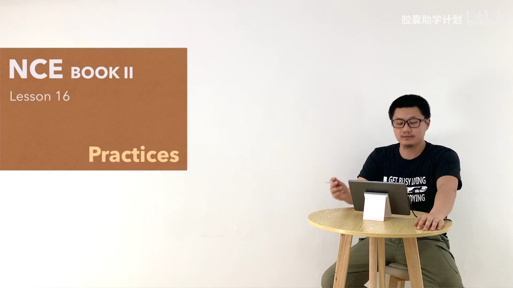

文字识别：胶囊助学计划 / NCE / BOOK I"I / Lesson 16 / Practices / GFT RISYLNING / OYING

### 画面 00:00:05

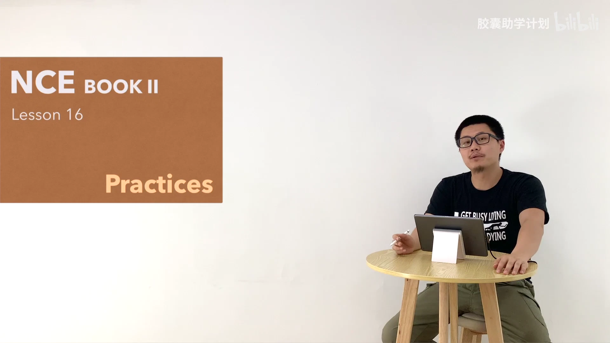

文字识别：胶囊助学计划 / NCE / BOOKI"I / Lesson 16 / Practices / GET RIS LING / DYING

### 画面 00:00:09

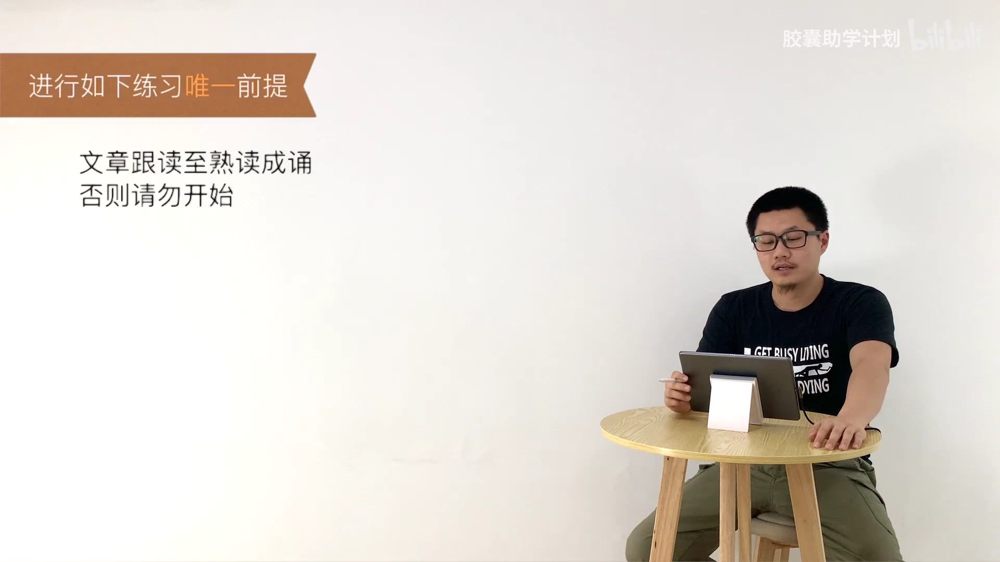

文字识别：胶囊助学计划 / 进行如下练习唯一前提 / 文章跟读至熟读成诵 / 否则请勿开始 / GET RIISY LNING / DYING

### 画面 00:00:13

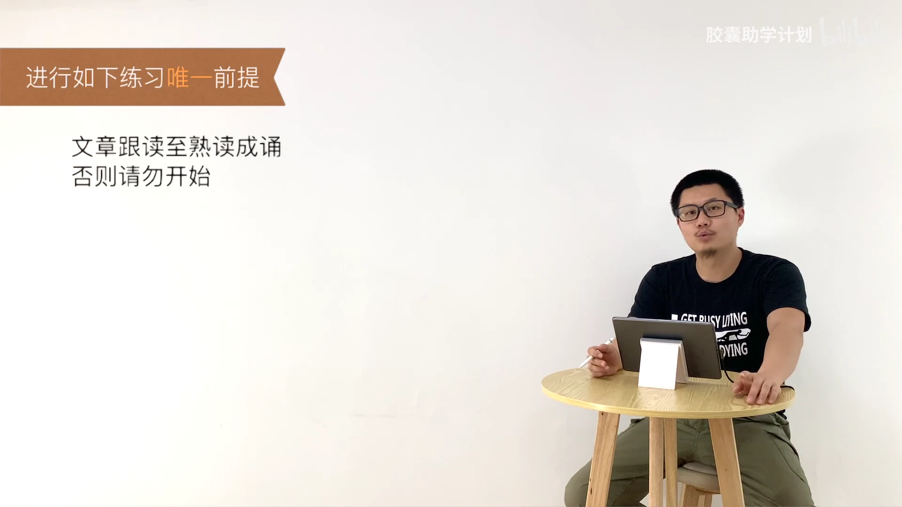

文字识别：胶囊助学计划 / 进行如下练习唯一前提 / 文章跟读至熟读成诵 / 否则请勿开始 / GET DIISYLING / DYING

### 画面 00:00:19

文字识别：胶囊助学计划bilb出 / • / •

### 画面 00:00:23

文字识别：胶囊助学计划

### 画面 00:00:25

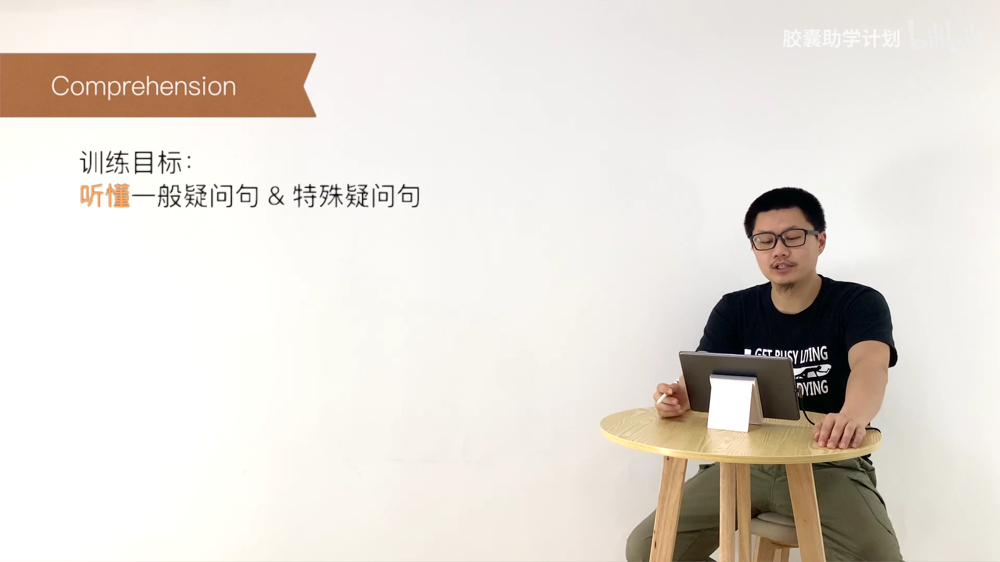

文字识别：胶囊助学计划 / Comprehension / 训练目标： / 听懂一般疑问句＆特殊疑问句 /  GET DISYLOING / PYING

## 00:00:30–00:01:00

全闭上眼睛，要么眼睛去看着文章。我问一题，您回答一题。来了，第一题。What happens if you park your car in the wrong place? A traffic policeman will soon find it. Next one. He usually gives you a parking ticket, doesn't he? 啊，这儿的 he 肯定指的是 policeman. Yes, he does. Next

### 画面 00:00:36

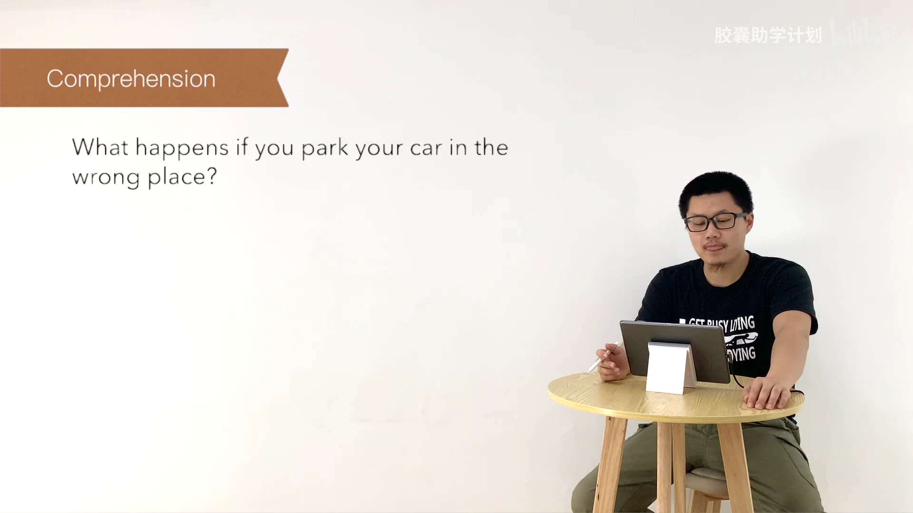

文字识别：胶囊助学计划 / Comprehension / What happens if you park your car in the / wrong place? / CET DISY LING / DYING

### 画面 00:00:47

文字识别：胶囊助学计划 / Comprehension / He usually 9 / ' gives you a parking ticket, doesn't he? /  CT RUSY LING / DYING

## 00:01:00–00:01:30

Next one, are you lucky if he lets you go without a ticket? Yes, you are. Next one, do the traffic police always give parking tickets? No, they don't. Sometimes they're very polite, 对吧? Continuing, traffic police are sometimes very polite, aren't they? Yes, they are. Next one,

### 画面 00:01:00

文字识别：胶囊助学计划 / Comprehension / Are you lucky if he lets you go without one? /  CPT PISY LING / YING

### 画面 00:01:11

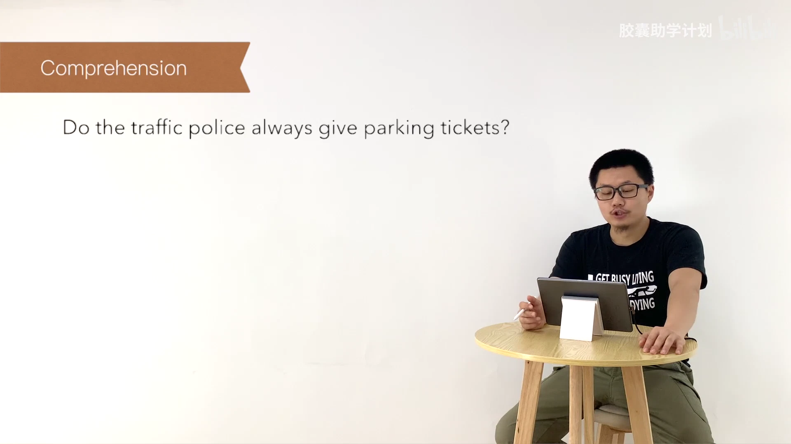

文字识别：胶囊助学计划 / Comprehension / Do the traffic police always give parking tickets? /  GET RISY LOING / PYING

### 画面 00:01:21

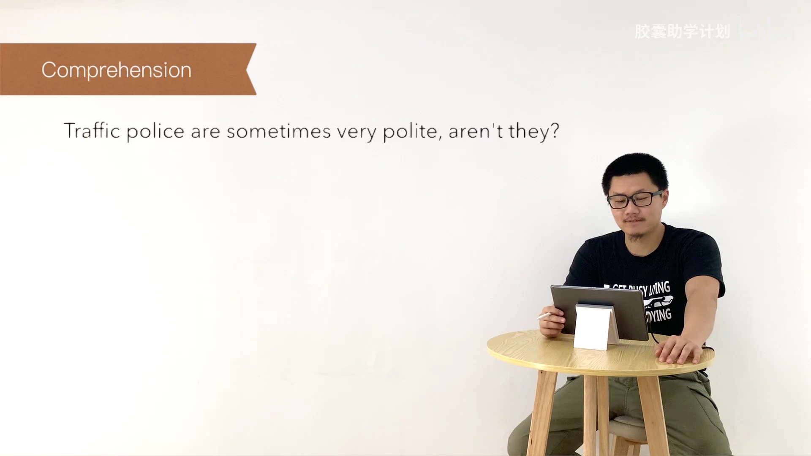

文字识别：Comprehension / Traffic police are sometimes very polite, aren't they? /  CT USY LING / DYING

## 00:01:30–00:02:00

Where were you spending a holiday? In Sweden. What did you find on your car? A note. Did the note welcome you to the city? Yes, it did. Were you in a no parking area? Yes, I was. What did

### 画面 00:01:30

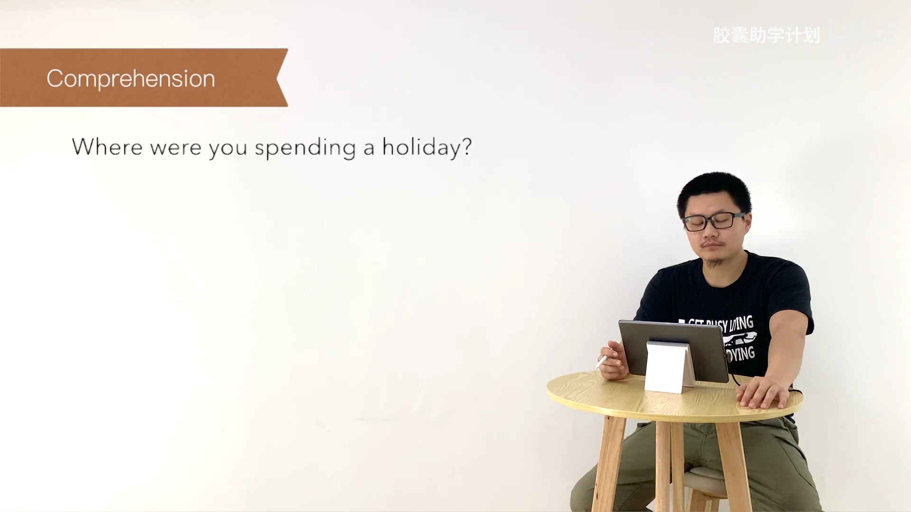

文字识别：Comprehension / Where were you spending a holiday? /  CT USY ING / DYING

### 画面 00:01:58

文字识别：Comprehension / What did the note ask you to pay attention to? / DYING

## 00:02:00–00:02:30

the note ask you to pay attention to? To the tra to the street signs. Good asking questions. 各位能说出来一般疑问句和特殊疑问句，也就是您将来能提问了，对吧？我们练习的是大家这个口语能力。先来一个肯定句啊。 Ask me if traffic police give parking tickets. 一般疑问句 do 提前 do traffic police give parking tickets? What do? 啊，

### 画面 00:02:08

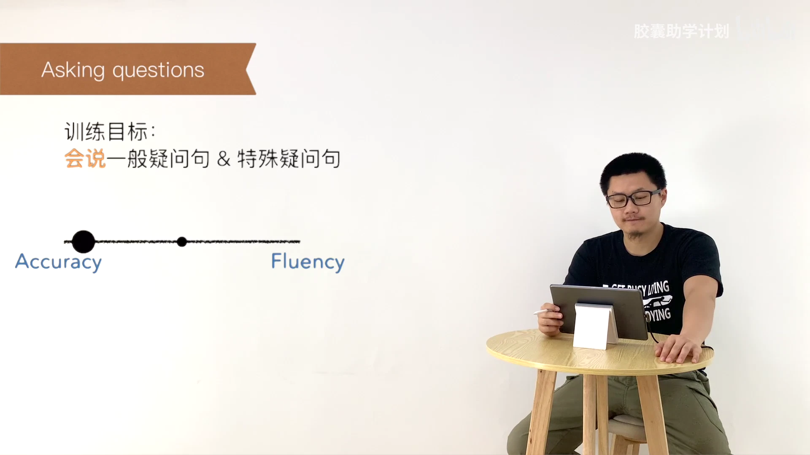

文字识别：Asking questions / 训练目标： / 会说一般疑问句＆特殊疑问句 / Accuracy / Fluency / -C UYLING / DVING

### 画面 00:02:10

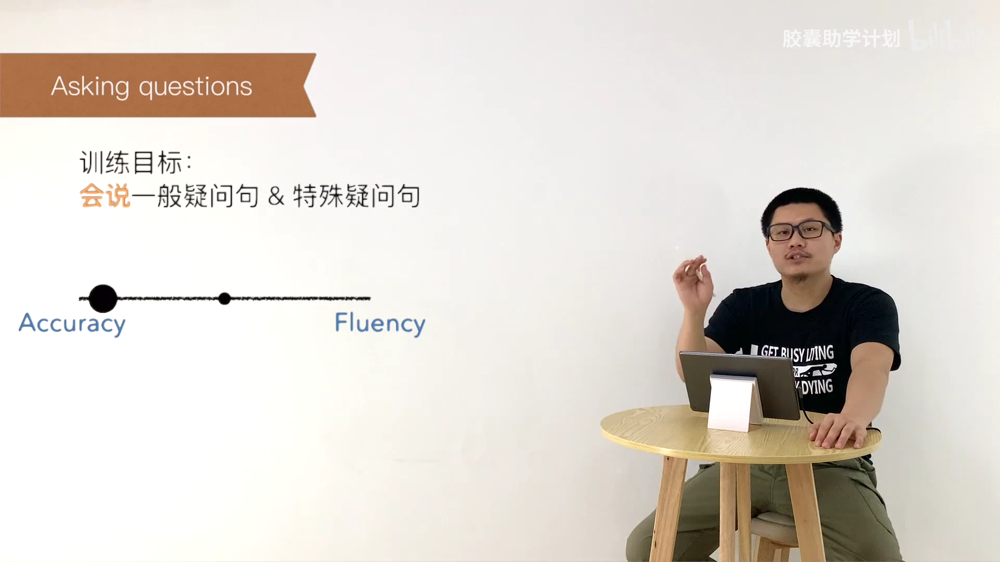

文字识别：胶囊助学计划 / Asking questions / 训练目标： / 会说一般疑问句＆特殊疑问句 / Accuracy / Fluency / GET RISYLING / KDYING

### 画面 00:02:16

文字识别：胶囊助学计划 / Asking questions / DYING

### 画面 00:02:19

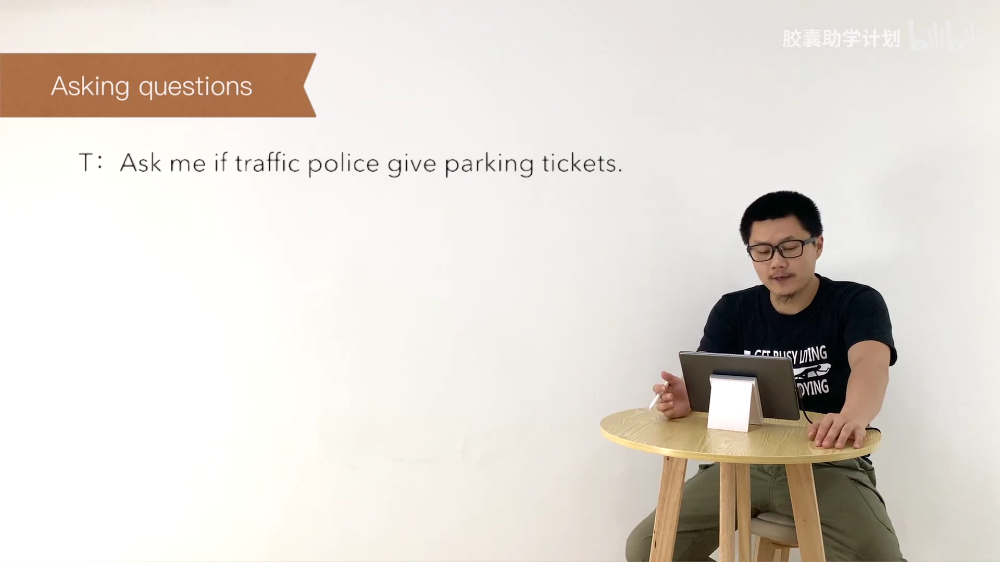

文字识别：胶囊助学计划 / Asking questions / T: Ask me if traffic police give parking tickets. /  CT DUSYL/ING / DYING

### 画面 00:02:26

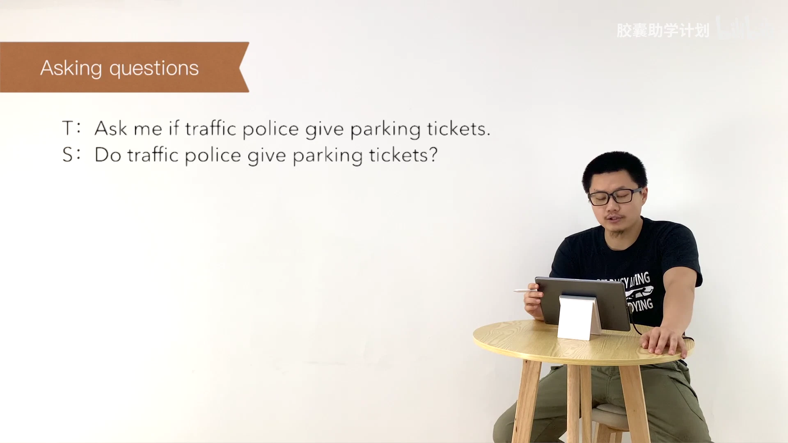

文字识别：胶囊助学计划 / Asking / questions / T: Ask me if traffic police / give parking tickets. / S:Do traffic pollice / give parking / tickets? / SYVMING / DYING

## 00:02:30–00:03:00

这个 what 点点 do 我提了，对吧？标准答案 What do traffic police do? 他们做什么事情？ Okay. 好，那我们看一下题啊。第一个 what 点点 do，刚才咱们提过了，不管它了，直接说 who who 对主语提问，不变一般疑问句，直接替代。 They will soon find your car if you park your car in the wrong place. 这儿注意一下， if 引导的从句是 park，对吧？这个关键动词是 park。如果看它

### 画面 00:02:36

文字识别：胶囊助学计划 / Asking / questions / 1.Traffic police / give parking tickets. (What...do) / (Who) / SYMING / DVING

### 画面 00:02:45

文字识别：胶囊助学计划 / Asking / questions / 1. Traffic police give parking tickets. (What...do) / (Who) / 2.They will soon find your car, if you park in the / wrong place. (How quickly) / SYMING / DVING

## 00:03:00–00:03:30

提句首，那一般疑问句提的是 do. 主句是 they will soon find your car. 如果看这句提句首，您应该提的是 will，对吧？好，那应该用谁呢？各位记住，永远看主句提 will，对吧？永远看主句，主句提什么就提什么。所以这是把 will 提前，剩下全部照抄。很简单，我说一下答案啊。Will they soon find your car if you park your car in the wrong place? Okay.

### 画面 00:03:15

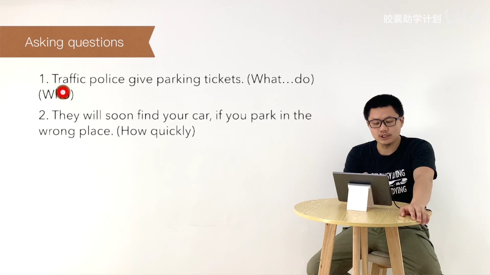

文字识别：胶囊助学计划 / Asking / questions / 1.Traffic police / give parking tickets. (What...do) / (wo / 2.They will soon f /  find your car, if you park in the / wrong / place. (How quickly) / SYMING / DVING

## 00:03:30–00:04:00

that how quickly,就是对soon提问，所以答案很简单。How quickly will they find your car if you park your car in the wrong place?答案就一个字soon。接下来，traffic police are sometimes very polite.二提前，who对主语提问，直接替代。I went to Sweden for a holiday. Went need提前，动词换回原形。Where对Sweden，对吧？

### 画面 00:03:41

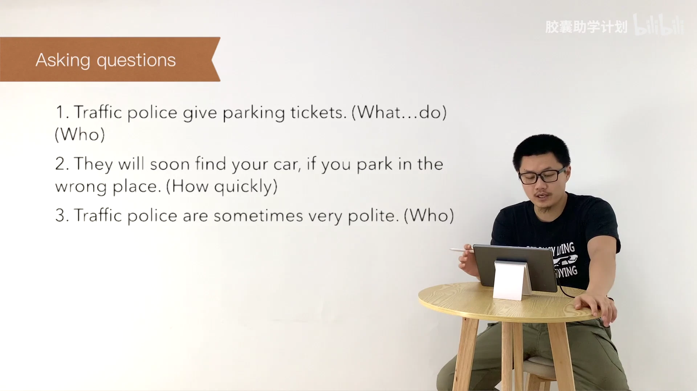

文字识别：胶囊助学计划 / Asking questions / 1. Traffic police give parking tickets. (What...do) / (Who) / 2. They will soon find your car, if you park in the / wrong place. (How quickly) / 3. Traffic police are sometimes very polite. (Who) / YMING / VING

### 画面 00:03:49

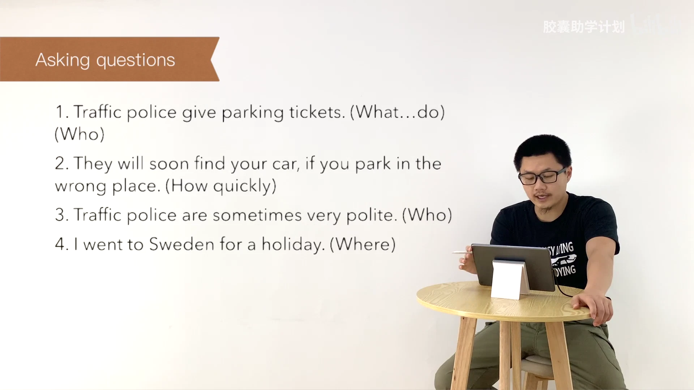

文字识别：胶囊助学计划 / Asking questions / 1. Trafic police give parking tickets. (What...do) / (Who) / 2. They will soon find your car, if you park in the / wrong place. (How quickly) / 3. Traffic police are sometimes very polite. (Who) / 4.I went to Sweden for a holiday. (Where) / SYMING / DVING

## 00:04:00–00:04:30

啊，to Sweden. Did提前find what?那a note where on my car?很简单。It said, "Welcome to our city."十五课咱们学的，各位想一下，间接引语，直接引语，对吧？这是直接引用过来的。所以你们把did提前。What对，Welcome to our city提问，答案是What did it say?它上面说什么了？

### 画面 00:04:08

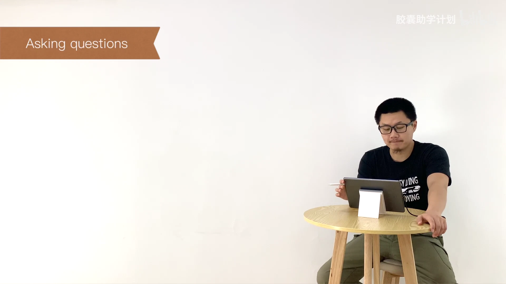

文字识别：胶囊助学计划 / Asking questions / YMING / DVING

### 画面 00:04:14

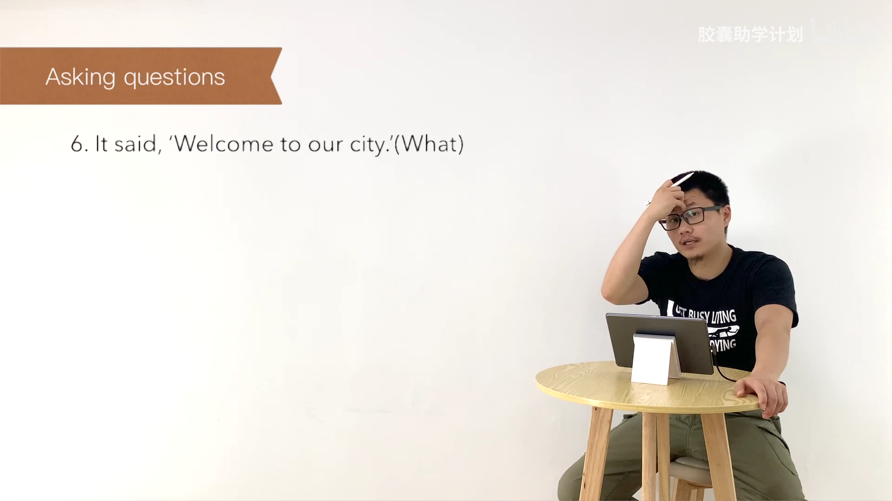

文字识别：胶囊助学计划 / Asking questions / 6. It said, 'Welcome to our city.'(What) / UT RISY LING / AYING

### 画面 00:04:29

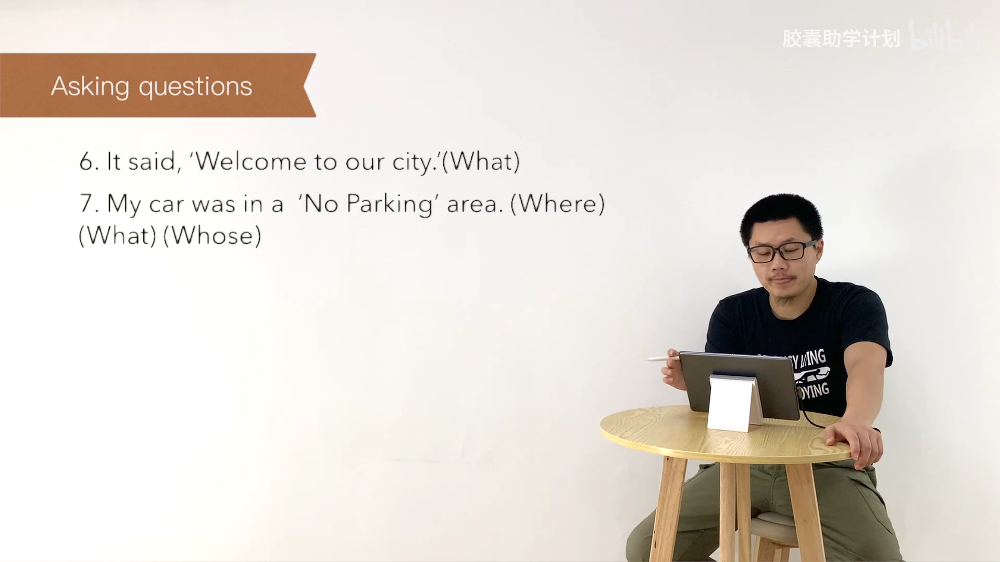

文字识别：胶囊助学计划 / Asking questions / 6. It said, 'Welcome to our city'(What) / 7. My car was in a 'No Parking' area. (Where) / (What) (Whose) / YMING / YING

## 00:04:30–00:05:00

My job, my car was in a no parking area. Was提前，Where对In a no parking area提问，What对My car提问，Whose直接对My提问，我都不用变一般疑问句，对吧？都是对主语或主语的一部分提问。You will enjoy your stay here.那Will提前，What对什么提问？这能想到吗？

### 画面 00:04:59

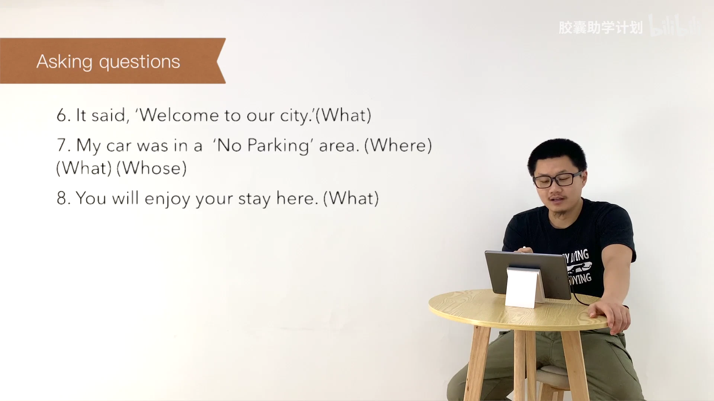

文字识别：胶囊助学计划 / Asking questions / 6. It said, 'Welcome to our city'(What) / 7. My car was in a 'No Parking' area. (Where) / (What) (Whose) / 8. You will enjoy your stay here. (What) / YUING / VING

## 00:05:00–00:05:30

叫做 your stay here 提问. What will you enjoy? 你会很享受什么呢？享受的就是 your stay here. 你在这里的停留. The note was only a reminder. Was 提前. What 对 only a reminder 提问，是吧？ What was the note? 啊，这个是什么东西啊？这个便签是个什么玩意儿？ Only a reminder. 或者说对 the note 提问. What was only a reminder?

### 画面 00:05:29

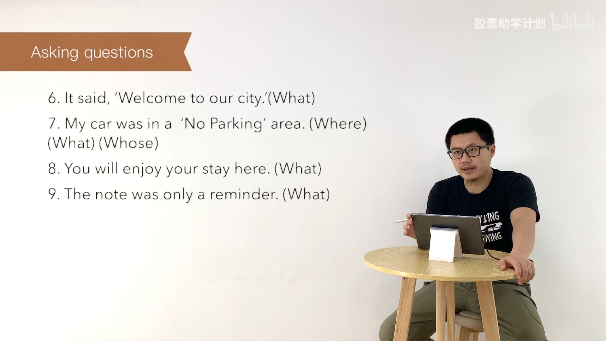

文字识别：胶囊助学计划 / Asking questions / 6. It said, 'Welcome to our city.'(What) / 7. My car was in a 'No Parking' area. (Where) / (What) (Whose) / 8. You will enjoy your stay here. (What) / 9.The note was only a reminder. (What) / YUING / VING

## 00:05:30–00:06:00

什么只是一个提醒，这个note只是一个提醒，都可以。I obey the request.你们把did提前。What do我说了答案是标准的，由时态决定，所以这句话叫做What did you do？答案是obey the request，对吧？它其实是对动词提问的啊，动词加宾语提问的。OK，口语复述能力又来了，不能可以错啊，可以错，

### 画面 00:05:36

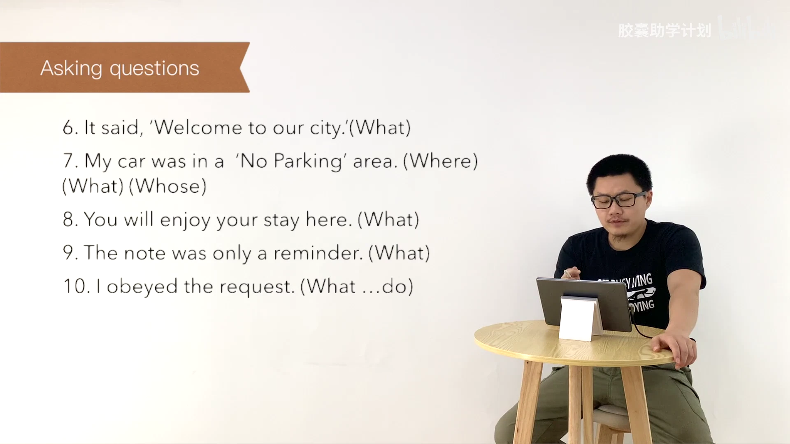

文字识别：胶囊助学计划 / Asking questions / 6. It said, 'Welcome to our city.'(What) / 7. My car was in a 'No Parking' area. (Where) / (What) (Whose) / 8. You will enjoy your stay here. (What) / 9.The note was only a reminder. (What) / 10.I obeyed the request. (What ..do) / SYNG / DYING

### 画面 00:05:42

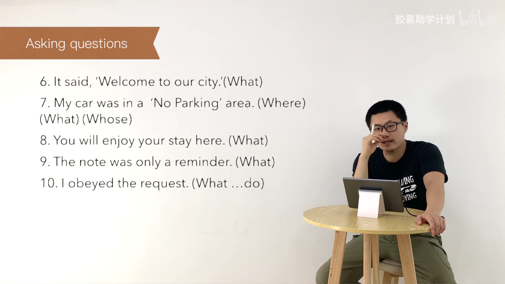

文字识别：胶囊助学计划 / Asking questions / 6. It said,'Welcome to our city.'(What) / 7. My car was in a 'No Parking' area. (Where) / (What) (Whose) / 8. You will enjoy your stay here. (What) / 9.The note was only a reminder. (What) / 10.I obeyed the request. (What ..do) / MING / LNING

### 画面 00:05:53

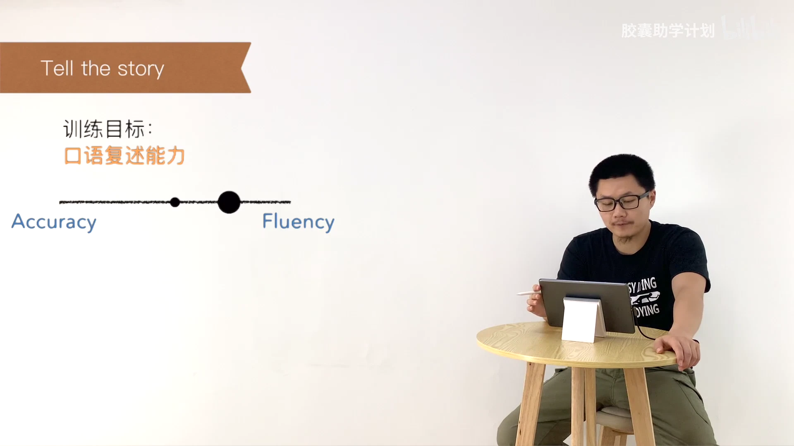

文字识别：胶囊助学计划 / Tell the story / 训练目标： / 口语复述能力 / Accuracy / Fluency / SYING / DYING

## 00:06:00–00:06:30

不能太慢啊，所以文章一定要读熟。可以有和文章不完全一样的地方。上课我给大家做一个展示。来了，If you park your car in the wrong place, a traffic policeman will soon find it. You'll be very lucky if he lets you go without a ticket. However, this does not always happen. During a holiday in Sweden, I found a note on my car. It says, "

### 画面 00:06:01

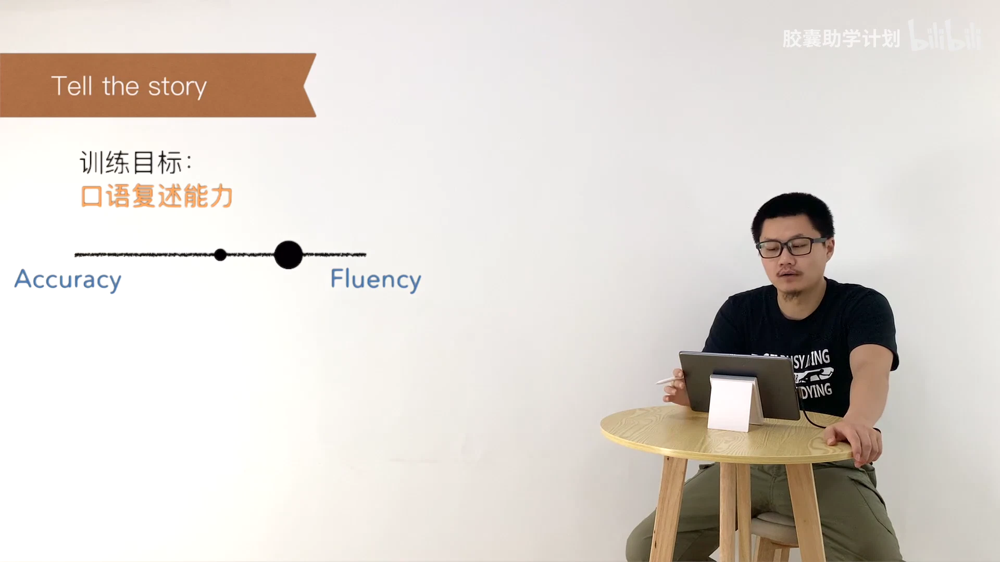

文字识别：胶囊助学计划 / Tell the story / 训练目标： / □语复述能力 / Accuracy / Fluency / ISYING / DYING

### 画面 00:06:03

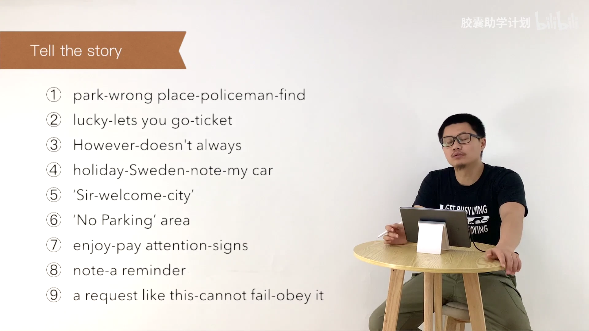

文字识别：胶囊助学计划 / Tell the story / 1 / park-wrong place-policeman-find / lucky-lets you go-ticket / However-doesn't always / holiday-Sweden-note-my car / 'Sir-welcome-city' / I GET DSY ING / 'No Parking'area / YING / enjoy-pay attention-signs / 8 / note-a reminder / 9 / a request like this-cannot fail-obey it

### 画面 00:06:08

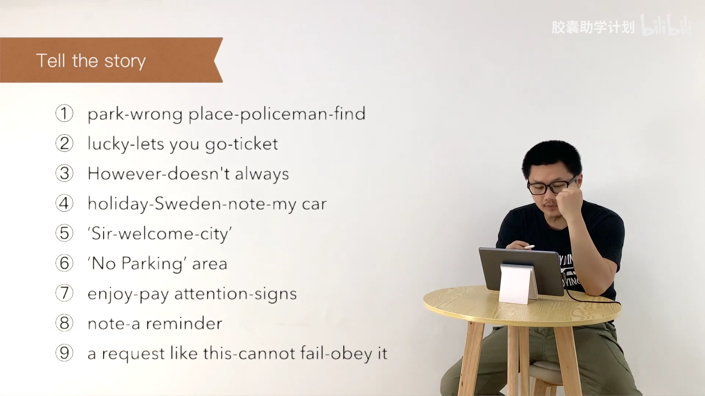

文字识别：胶囊助学计划 / Tell the story / 1 / park-wrong place-policeman-find / lucky-lets you go-ticket / However-doesn't always / holiday-Sweden-note-my car / 'Sir-welcome-city' / 'No Parking'area / enjoy-pay attention-signs / 8 / note-a reminder / a request like this-cannot fail-obey it / 9

## 00:06:30–00:07:00

Sir, we welcome you to our city, but this is a no parking area. You will enjoy your stay here if you pay attention to our street signs. This note is only a reminder. If you receive a request like this, you will obey it, or you cannot fail to obey it. Okay, 那各位下课去做类似的事情，口语练习，summary writing，摘要写作，在这儿只给答案，各位去对一下您的答案就可以

### 画面 00:06:38

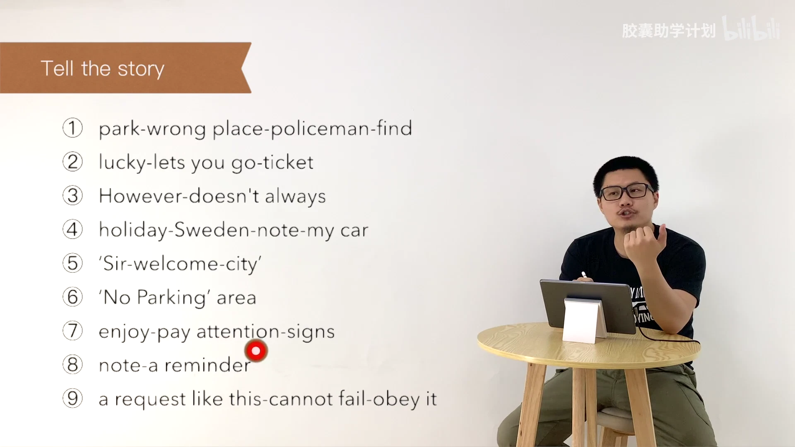

文字识别：胶囊助学计划 / Tell the story / 1 / park-wrong place-policeman-find / lucky-lets you go-ticket / However-doesn't always / holiday-Sweden-note-my car / 'Sir-welcome-city' / 'No Parking'area / enjoy-pay attention-signs / 8 / note-a reminder / a request like this-cannot fail-obey it / 9

### 画面 00:06:53

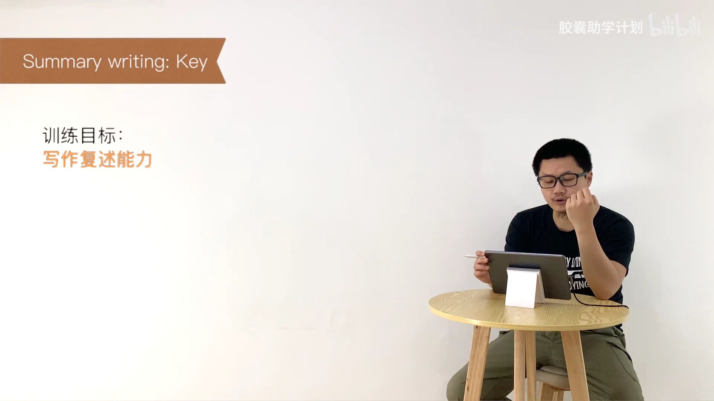

文字识别：胶囊助学计划 / Summary writing: Key / 训练目标： / 写作复述能力 / YIAI

### 画面 00:06:56

文字识别：胶囊助学计划 / Summary writing: Key / Traffic police usually give you a ticket if you / park your car in the wrong place. The writer / found a polite note on his car during a / holiday in Sweden. The traffic police wanted / him to pay attention to their street signs. No / one can fail to obey a polite request. / YMAN

## 00:07:00–00:07:30

了。OK，好，接下来呢，topic for discussion，我们在这儿只给大家翻译一下它的问题。您现在如果还不能做，没事儿，不用纠结，对吧？好，说What will happen if you park a car in the wrong place in your city？如果您把您的车在在你的城市当中停到了一个错误的地方，会发生什么事情？Think about it，想一想。Is it useful to have a car in the city？Why？Why not？说在一个城市当中有一辆车

### 画面 00:07:01

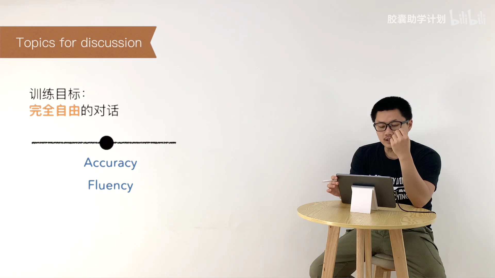

文字识别：胶囊助学计划 / Topics for discussion / 训练目标： / 完全自由的对话 / Accuracy / Fluency / YMI

### 画面 00:07:03

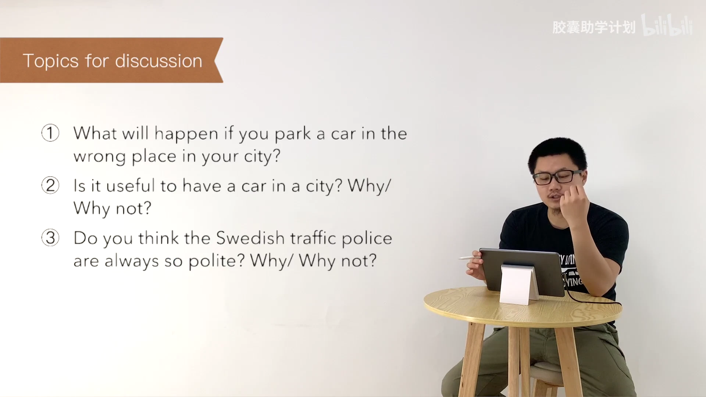

文字识别：胶囊助学计划 / Topics for discussion / What will happen if you park a car in the / wrong place in your city? / Is it useful to have a car in a city? Why/ / 2 / Why not? / Do you think the Swedish traffic police / 3 / are always so polite? Why/ Why not?

### 画面 00:07:06

文字识别：胶囊助学计划 / Topics for discussion / What will happen if you park a car in the / wrong place in your city? / Is it useful to have a car in a city? Why/ / 2 / Why not? / Do you think the Swedish traffic police / 3 / are always so polite? Why/ Why not?

### 画面 00:07:11

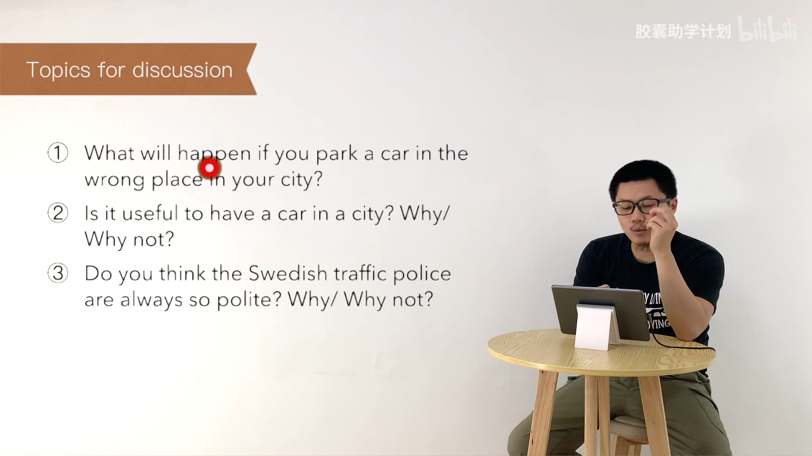

文字识别：胶囊助学计划 / Topics for discussion / What will happen if you park a car in the / wrong place In your city? / Is it useful to have a car in a city? Why/ / 2 / Why not? / Do you think the Swedish traffic police / 3 / are always so polite? Why/ Why not? / ShNG

### 画面 00:07:16

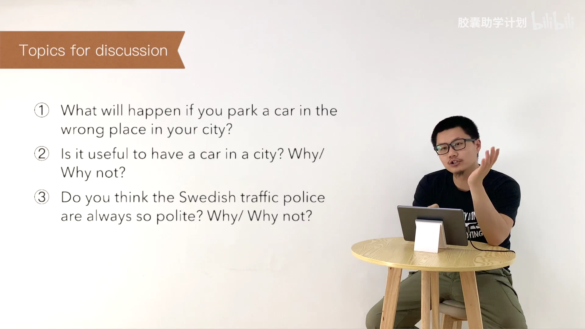

文字识别：胶囊助学计划 / Topics for discussion / What will happen if you park a car in the / wrong place in your city? / Is it useful to have a car in a city? Why/ / 2 / Why not? / 3 / Do you think the Swedish traffic police / are always so polite? Why/ Why not? / YA / ING

## 00:07:30–00:08:00

是不是有用呢？这个 yes or no 啊， useful or not useful 不是最重要的，最重要是后边这个问题叫做为什么？来给个一二三， OK？ Do you think the Swedish traffic police are always so polite? Why? Why not? 所以你认为瑞典的这些交通警察总是这么有礼貌吗？好，如果是为什么是，如果不是为什么不是？很简单， OK？好，那看一下家庭作业， ask

### 画面 00:07:46

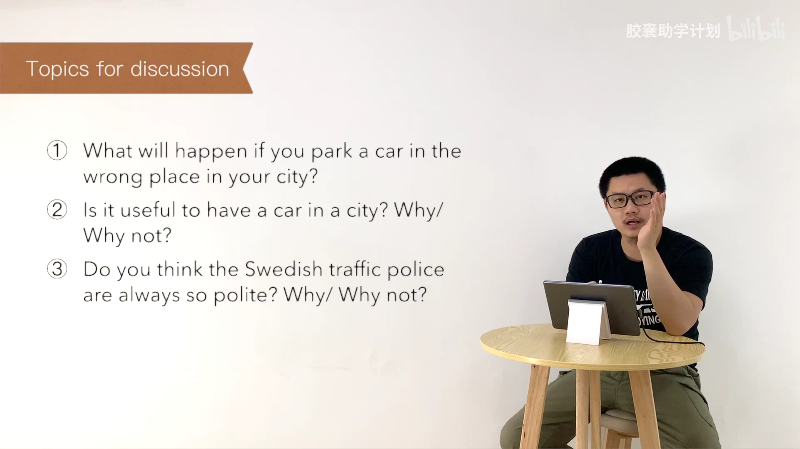

文字识别：胶囊助学计划 / Topics for discussion / What will happen if you park a car in the / wrong place in your city? / Is it useful to have a car in a city? Why/ / 2 / Why not? / 3 / Do you think the Swedish traffic police / are always so polite? Why/ Why not?

### 画面 00:07:52

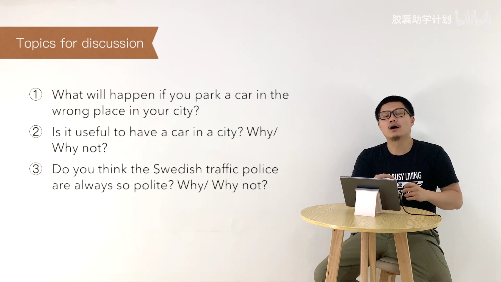

文字识别：胶囊助学计划 / Topics for discussion / What will happen if you park a car in the / wrong place in your city? / Is it useful to have a car in a city? Why/ / 2 / Why not? / Do you think the Swedish traffic police / 3 / RUSY LIVING / are always so polite? Why/ Why not? / OR.

### 画面 00:07:57

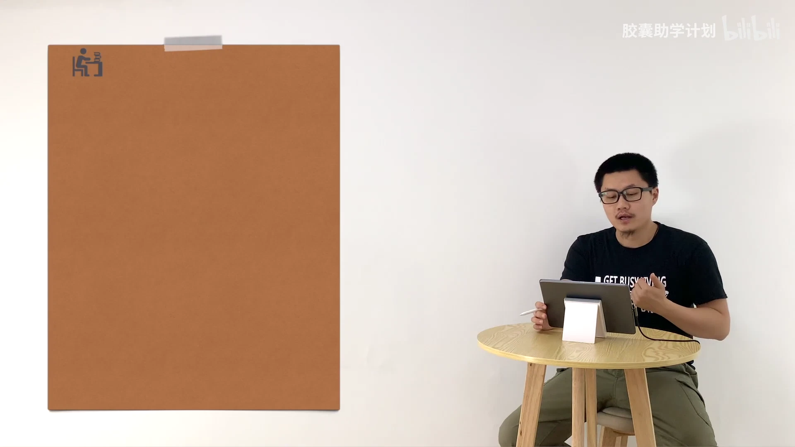

文字识别：胶囊助学计划 / GET RIISVV

## 00:08:00–00:08:30

if各位先写看着自己写的对的，保证对的那个大声朗读。这要写作，您写完了直接来这儿对答案。Tell the story，做一些口语复述文章，一定要读的非常非常熟，对吧？才能做到。专栏当中可以找得到。那以上呢就是本期视频的全部内容了。如果大家喜欢我们的课程呢，欢迎大家关注、订阅、一键三连，分享给那些需要的朋友来帮助支持我们成长。See you next time.

### 画面 00:08:00

文字识别：胶囊助学计划 / 1.Ask me if写&朗读 / SYMI / GYIN

### 画面 00:08:02

文字识别：胶囊助学计划 / 1.Ask me if写&朗读 / SYLIN / SVINC

### 画面 00:08:04

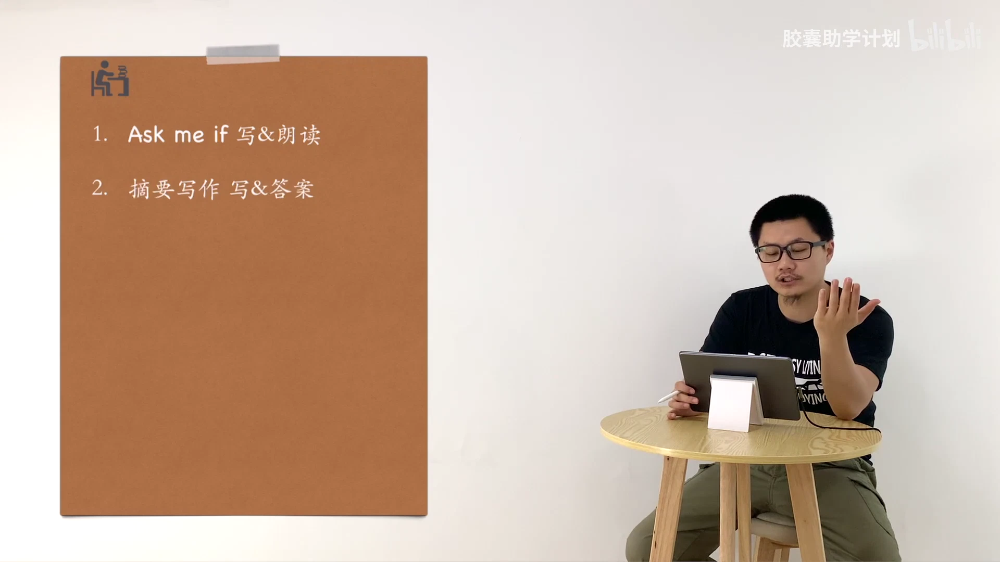

文字识别：胶囊助学计划 / 1. / Ask me if写&朗读 / 摘要写作写&答案 / SYIIN

### 画面 00:08:06

文字识别：胶囊助学计划 / 1.Ask me if写&朗读 / 2. / 摘要写作写&答案 / YUIN

### 画面 00:08:08

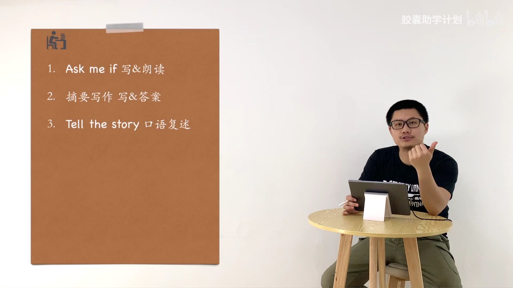

文字识别：胶囊助学计划 / 1.Ask me if写&朗读 / 摘要写作写&答案 / 3.Tell the story 口语复述 / YUIN / MIN

### 画面 00:08:10

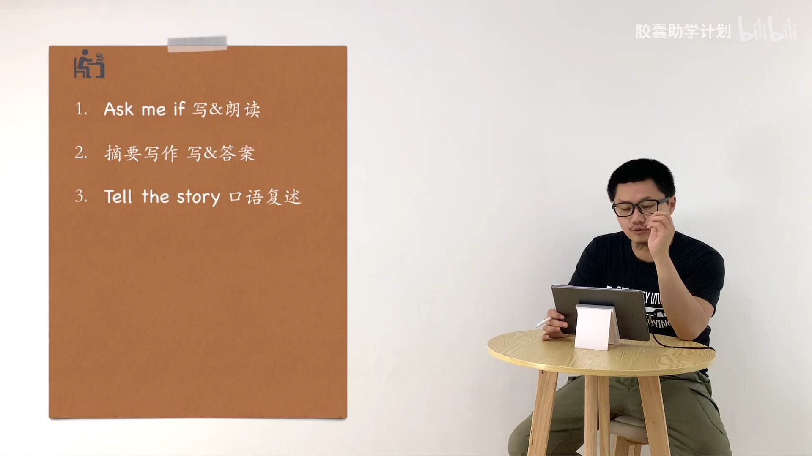

文字识别：胶囊助学计划 / 1. / Ask meif写&朗读 / 摘要写作写&答案 / 3.Tell the story 口语复述 / MIN

### 画面 00:08:14

文字识别：胶囊助学计划 / 1.Ask me if写&朗读 / 摘要写作写&答案 / 3.Tell the story 口语复述 / 专栏 / 4. / YU / LVINO

### 画面 00:08:16

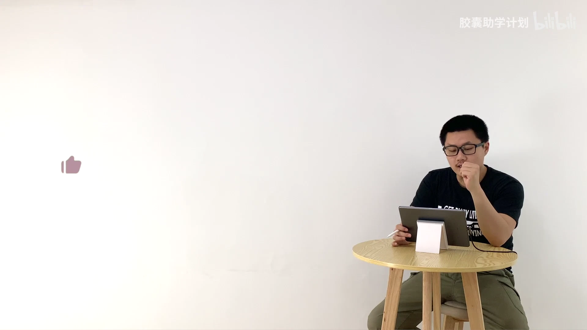

文字识别：胶囊助学计划 / Y

### 画面 00:08:19

文字识别：胶囊助学计划 / 不 /  GET RUISY LIVING / YDYING

### 画面 00:08:21

文字识别：胶囊助学计划

## 00:08:30–00:08:42

### 画面 00:08:30

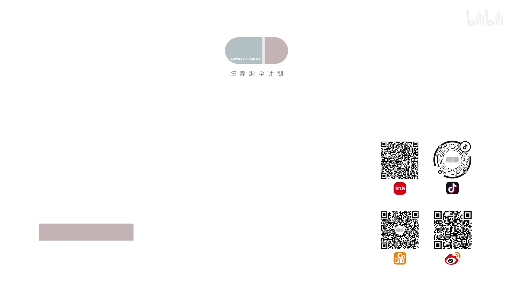

文字识别：CAPSULEACADEMY / 胶囊助学计划 / 小红书 / OE

### 画面 00:08:32

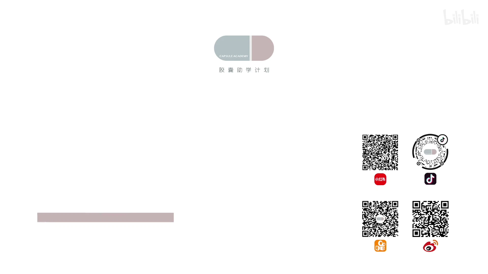

文字识别：CAPSULEACADEMY / 胶囊助学计划 / 小红书 / OE

### 画面 00:08:38

文字识别：CAPSULEACADEMY / 胶囊助学计划 / 小红书 / Creator / Leo & Berlin / OE

### 画面 00:08:40

文字识别：bilibili / 胶囊助学计划

### 画面 00:08:41

文字识别：bilibili / 胶囊助学计划

