# L017 单词

快速机器解析：语音为单模型转写，未进行独立交叉校对或人工复核；画面每秒采样并按变化选帧，短时文字和标记可能遗漏。截图时间约有 1 秒误差。图片有损压缩；遇到疑点请按时间查看 Google Drive 原视频。

## 00:00:00–00:00:30

Hello everyone, welcome to Capsule Academy. This is Lyle. Today we're going to learn new concepts in English Book Two, Lesson Seventeen Words. 那老习惯进入正式课程之前，我们先看几个小的问题：如何利用单词去复习我们之前学过的语法？那当然是在造句的时候。第二呢，如何用英文去表达成年人？那带着这两个问题，Hope you gonna enjoy it. 好，那我们先看第一个小的

### 画面 00:00:00

文字识别：胶囊助学计划 / NCE / BOOKII / Lesson 17 / Words / GET BUSY LIVING / OR / SY DYNG

### 画面 00:00:02

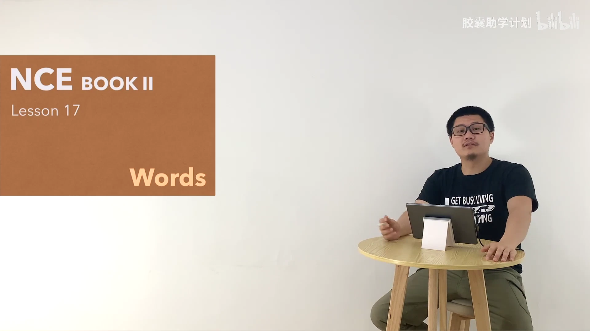

文字识别：BiLi / 胶囊助学计划 / NCE / BOOKII / Lesson 17 / Words / GET BUS(VING / RY / YDYING

### 画面 00:00:05

文字识别：Bil Bili / 胶囊助学计划 / NCE / BOOKII / Lesson 17 / Words / GET BUSYLVING / DYING

### 画面 00:00:09

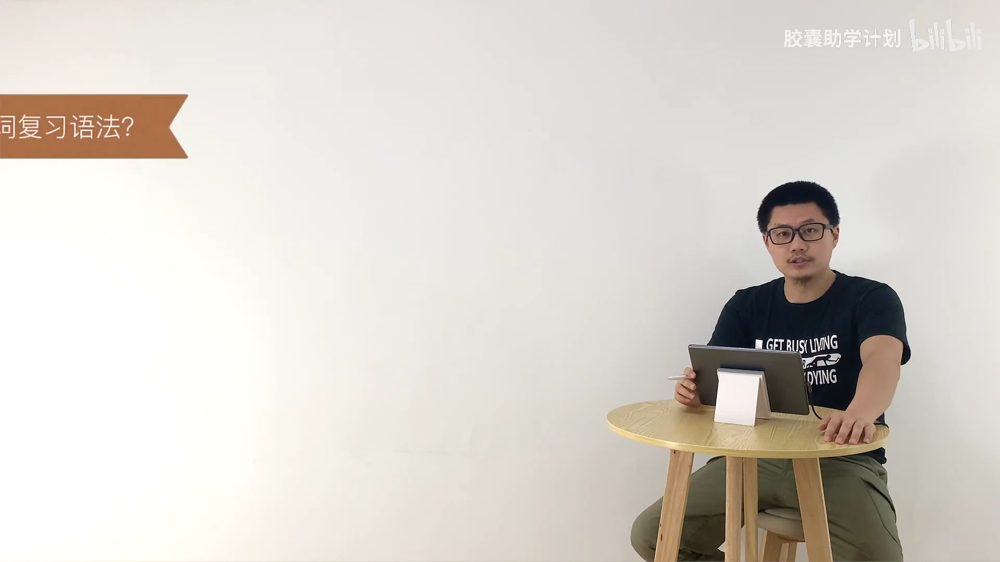

文字识别：胶囊助学计划bilil / 同复习语法? / GFT RUSYLVING / DYING

### 画面 00:00:11

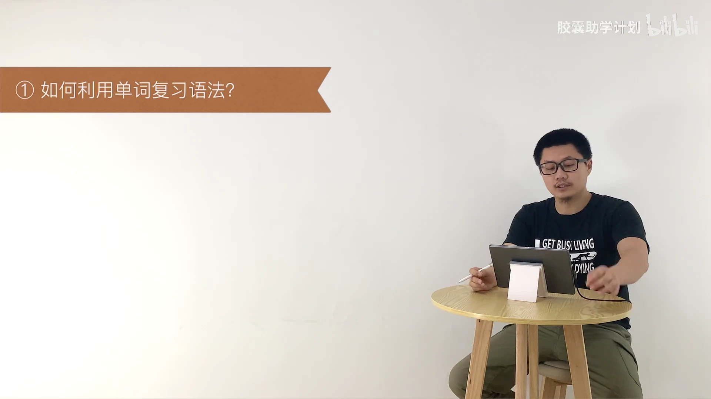

文字识别：胶囊助学计划 / ①如何利用单词复习语法？ / GET BUSY LIVING / DYING

### 画面 00:00:17

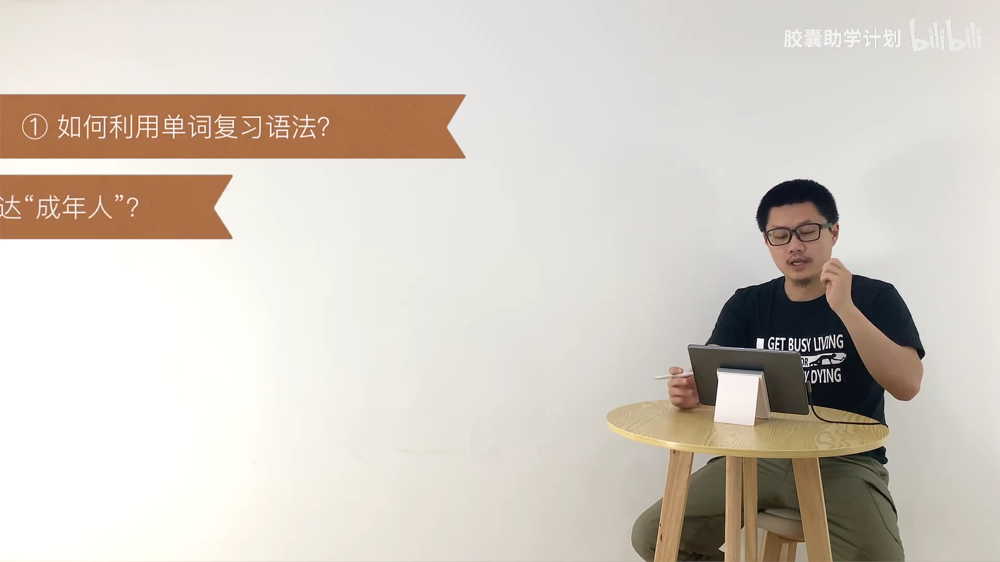

文字识别：Bilf bili / 胶囊助学计划 / ①如何利用单词复习语法? / 达“成年人”? / GET BUSY LIVING / YDYING

### 画面 00:00:19

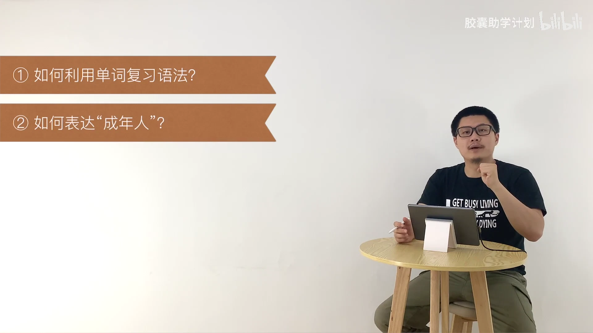

文字识别：胶囊助学计划 / ①如何利用单词复习语法? / 如何表达“成年人”? / GET BUSY LIVING / DYING

### 画面 00:00:23

文字识别：胶囊助学计划bil / • / •

### 画面 00:00:27

文字识别：胶囊助学计划 / 胶囊助学计划

### 画面 00:00:29

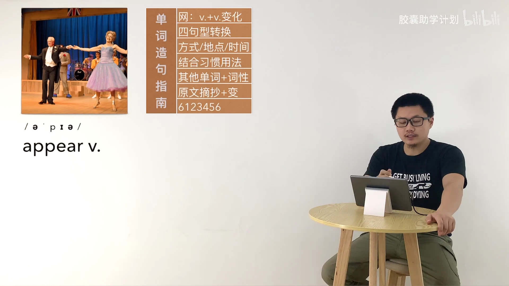

文字识别：单词造句指南 / 网：v.+v.变化 / 胶囊助学计划 / 四句型转换 / 方式/地点/时间 / 结合习惯用法 / 其他单词+词性 / 原文摘抄+变 / 6123456 / /apla/ / appear v. / GET RUSY LIVING / KDYING

## 00:00:30–00:01:00

单词啊，看音标，我们先一起读一下，叫做 appear， appear， OK。虽然文章当中给我们的意思，它指的是扮演，对吧？啊，或者说演啊演某人这个 appear，但 appear 其实更常用的一个意思叫出现，所以它实际上跟我们原文的那个 appear on the stage 也能连起来，叫出现在舞台上，其实就是在舞台上去扮演某个角色，对吧？ OK，那比如说原文当中给的一句话

### 画面 00:00:31

文字识别：单词造句指南 / 网：v.+v.变化 / 胶囊助学计划 / BBilt / 四句型转换 / 方式/地点/时间 / 结合习惯用法 / 其他单词+词性 / 原文摘抄+变 / 6123456 / /apia/ / appear v. / CFT DUSYLMNG / DYING

### 画面 00:00:33

文字识别：单词造句指南 / 网：v.+v.变化 / 胶囊助学计划 / BitBilt / 四句型转换 / 方式/地点/时间 / 结合习惯用法 / 其他单词+词性 / 原文摘抄+变 / 6123456 / /apia/ / appear v. / GET RISY LING / PYING

### 画面 00:00:35

文字识别：单词造句指南 / 网：v.+v.变化 / 胶囊助学计划 / 四句型转换 / 方式/地点/时间 / 结合习惯用法 / 其他单词+词性 / 原文摘抄+变 / 6123456 / /apia/ / appear v. / GET RIISY LING / YING

### 画面 00:00:40

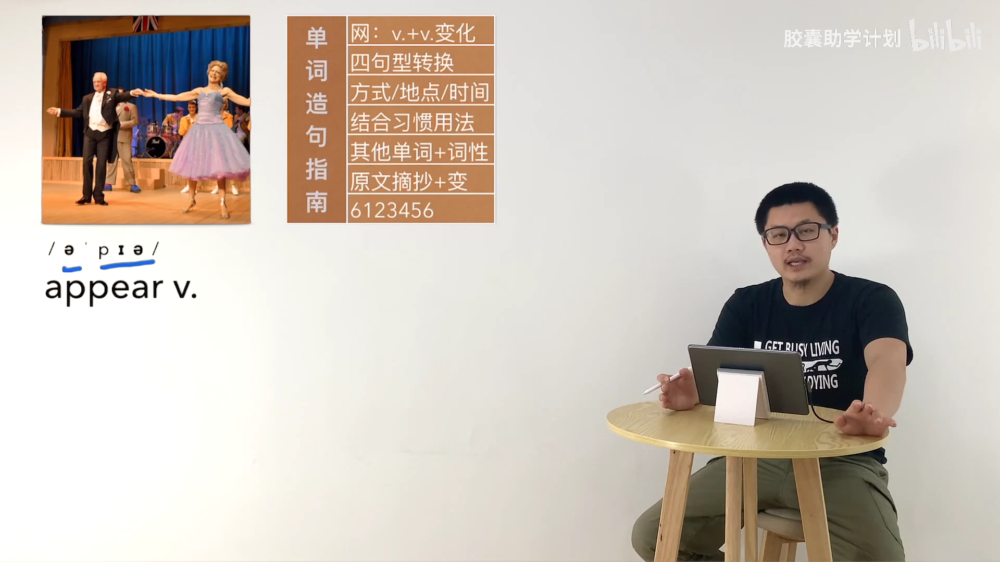

文字识别：单词造句指南 / 网：v.+v.变化 / 胶囊助学计划 / Bibili / 四句型转换 / 方式/地点/时间 / 结合习惯用法 / 其他单词+词性 / 原文摘抄+变 / 6123456 / /apia/ / appear v. / GET RIISY LVING / KPYING

### 画面 00:00:45

文字识别：单词造句指南 / 网：v.+v.变化 / 胶囊助学计划 / BilLilt / 四句型转换 / 方式/地点/时间 / 结合习惯用法 / 其他单词+词性 / 原文摘抄+变 / 6123456 / /apia/ / appear v. / GET DIISY LING / OYING

### 画面 00:00:50

文字识别：单词造句指南 / 网：v.+v.变化 / 胶囊助学计划 / BBilt / 四句型转换 / 方式/地点/时间 / 结合习惯用法 / 其他单词+词性 / 原文摘抄+变 / 6123456 / /apia/ / appear v. /  GET DUISY LVING / OYING

### 画面 00:00:55

文字识别：单词造句指南 / 网：v.+v.变化 / 胶囊助学计划 / Bibi / 四句型转换 / 方式/地点/时间 / 结合习惯用法 / 其他单词+词性 / 原文摘抄+变 / 6123456 / /apia/ / appear v. / GET RLISY LVING / OYING

### 画面 00:00:58

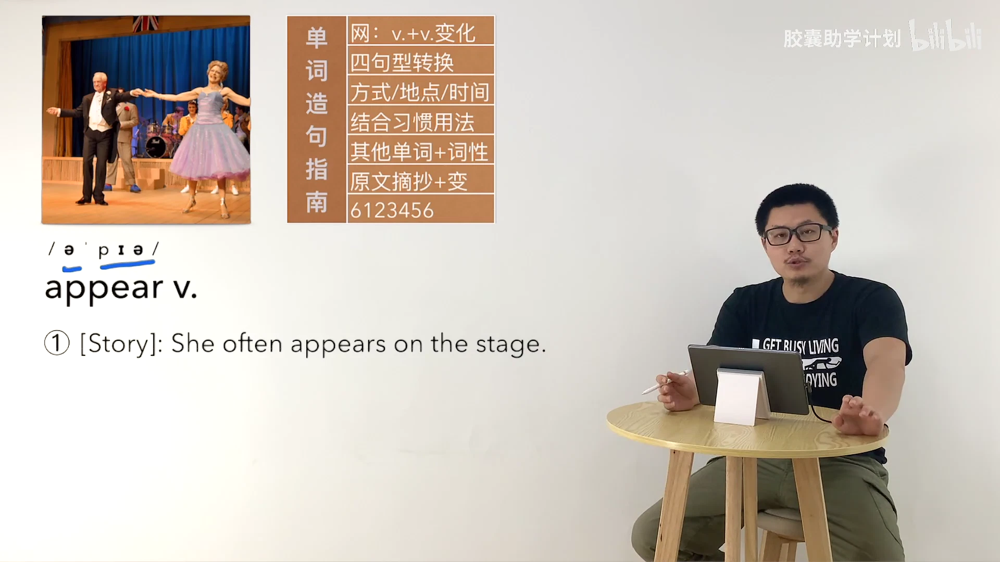

文字识别：单词造句指南 / 网：v.+v.变化 / 胶囊助学计划 / Biltbili / 四句型转换 / 方式/地点/时间 / 结合习惯用法 / 其他单词+词性 / 原文摘抄+变 / 6123456 / /apīa/ / appear v. / ① [Story]: She often appears on the stage. / GFT RUISY LING / PYING

## 00:01:00–00:01:30

话叫做 she often appears on the stage 哎我们就用了一个非常简单的单词造句的思路叫原文摘抄当然了最关键是后边那句变摘抄过来我们先简单分析一下它是个什么时态因为我们变的时候做的是四句型转化要由它的时态或它是什么情态助动词去决定如何变成别的句型 she often 哎第一 often出来了提醒你它可能是一个

### 画面 00:01:00

文字识别：单词造句指南 / 网：v.+v.变化 / 胶囊助学计划 / 四句型转换 / 方式/地点/时间 / 结合习惯用法 / 其他单词+词性 / 原文摘抄+变 / 6123456 / /apīa/ / appear v. / ① [Story]: She often appears on the stage. / GFT RIISY LVING / PYING

### 画面 00:01:05

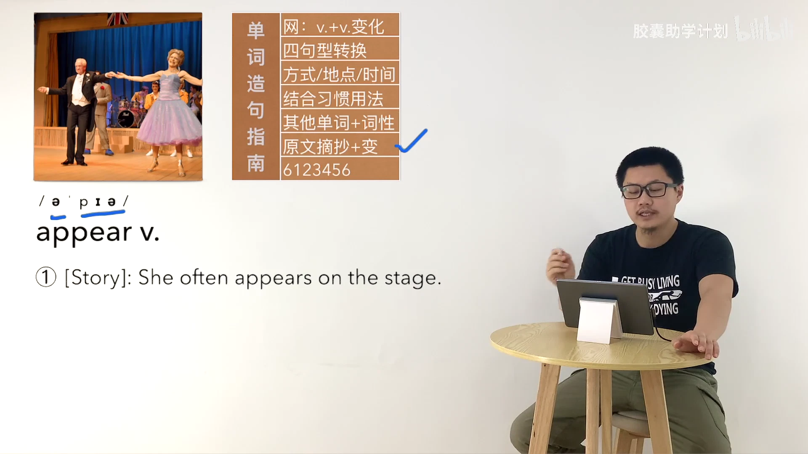

文字识别：单词造句指南 / 网：v.+v.变化 / 胶囊助学计划。 / 四句型转换 / 方式/地点/时间 / 结合习惯用法 / 其他单词+词性 / 原文摘抄+变 / 6123456 / /apia/ / appear v. / ① [Story]: She often appears on the stage. / GET BISY LING / DYING

### 画面 00:01:10

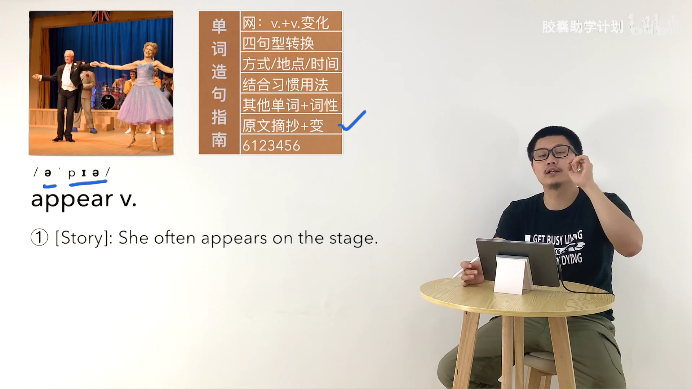

文字识别：单词造句指南 / 网：v.+v.变化 / 胶囊助学计划 / 四句型转换 / 方式/地点/时间 / 结合习惯用法 / 其他单词+词性 / 原文摘抄+变 / 6123456 / /apīa/ / appear v. / ① [Story]: She often appears on the stage. / GFT RUSY UING / OR / YDYING

### 画面 00:01:15

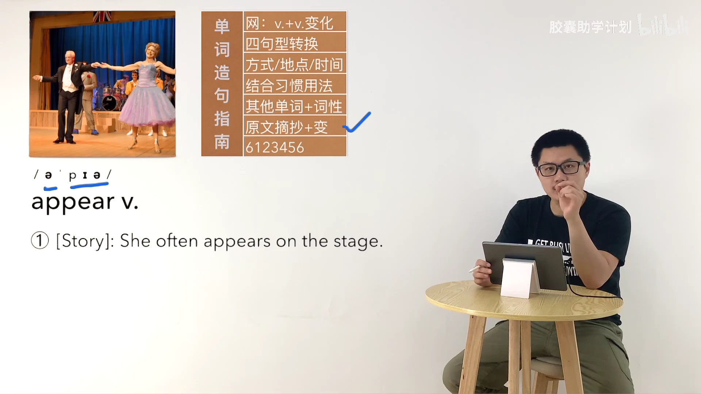

文字识别：单词造句指南 / 网：v.+v.变化 / 胶囊助学计划 / 四句型转换 / 方式/地点/时间 / 结合习惯用法 / 其他单词+词性 / 原文摘抄+变 / 6123456 / /apīa/ / appear v. / ① [Story]: She often appears on the stage.

### 画面 00:01:20

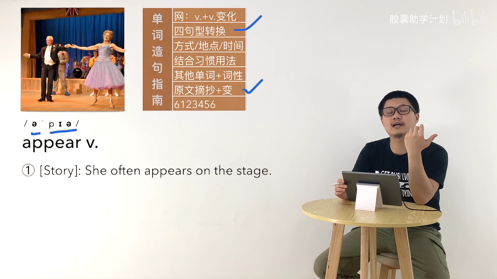

文字识别：单词造句指南 / 网：v.+v.变化 / 胶囊助学计划 / 四句型转换 / 方式/地点/时间 / 结合习惯用法 / 其他单词+词性 / 原文摘抄+变 / 6123456 / /apa/ / appear v. / ① [Story]: She often appears on the stage. / V / DYIN

### 画面 00:01:25

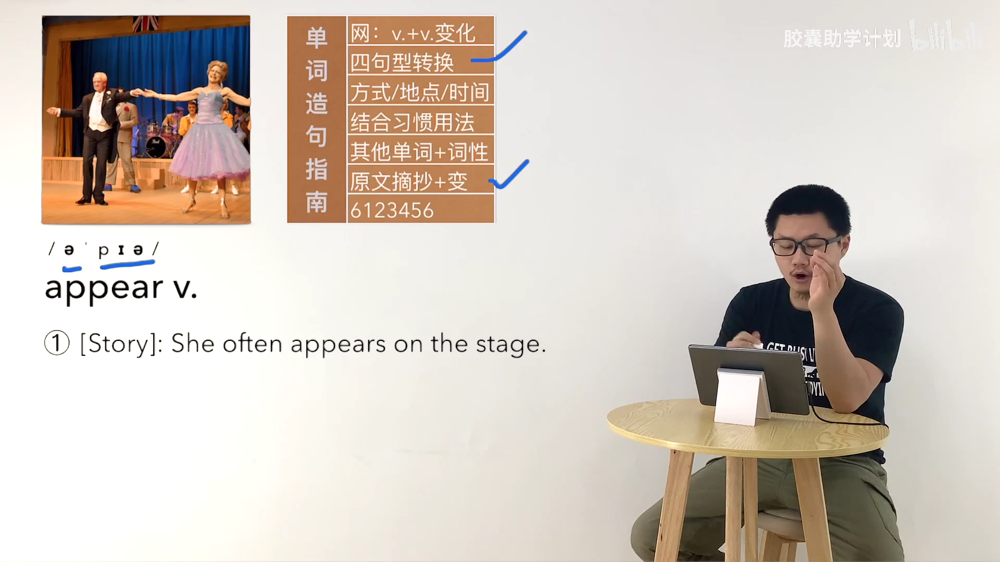

文字识别：单词造句指南 / 网：v.+v.变化 / 胶囊助学计划。 / 四句型转换 / 方式/地点/时间 / 结合习惯用法 / 其他单词+词性 / 原文摘抄+变 / 6123456 / /apīa/ / appear v. / ① [Story]: She often appears on the stage.

## 00:01:30–00:02:00

呃，要么是客观事实，要么是一种习惯，对吧？然后呢，appear这个单词后边还加了一个s，告诉你动词三单呢，一般现在时没跑了。于是，一般疑问句就出来了，叫做Does she often appear on the stage？她总是上台演出吗？OK，就这么简单。OK，那当然了，你如果对主语提问，就是Who often appears on the stage？这个地方我们复习一个小的关键点，就是对主语提问，直接替代主语，不用变，一

### 画面 00:01:30

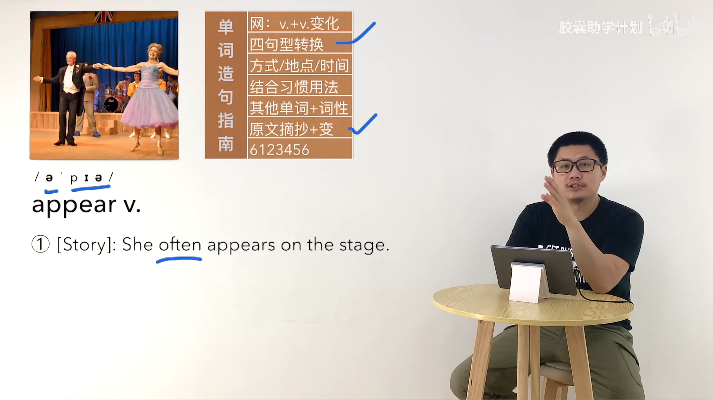

文字识别：单词造句指南 / 网：v.+v.变化 / 胶囊助学计划 / 四句型转换 / 方式/地点/时间 / 结合习惯用法 / 其他单词+词性 / 原文摘抄+变 / 6123456 / /apīa/ / appear v. / ① [Story]: She often appears on the stage.

### 画面 00:01:36

文字识别：单词造句指南 / 网：v.+v.变化 / 胶囊助学计划 / 四句型转换 / 方式/地点/时间 / 结合习惯用法 / 其他单词+词性 / 原文摘抄+变 / 6123456 / /apia/ / V.s / appear v. / ① [Story]: She often appears on the stage.

### 画面 00:01:40

文字识别：单词造句指南 / 网：v.+v.变化 / 胶囊助学计划 / 四句型转换 / 方式/地点/时间 / 结合习惯用法 / 其他单词+词性 / 原文摘抄+变 / 6123456 / /apia/ / V.s / appear v. / [Story]: She often appears on the stage. / 1 / Does she often appear on the stage?

### 画面 00:01:45

文字识别：单词造句指南 / 网：v.+v.变化 / 胶囊助学计划 / 四句型转换 / 方式/地点/时间 / 结合习惯用法 / 其他单词+词性 / 原文摘抄+变 / 6123456 / /apia/ / V.s / appear v. / [Story]: She often appears on the stage. / 1 / Does she often appear on the stage?

### 画面 00:01:50

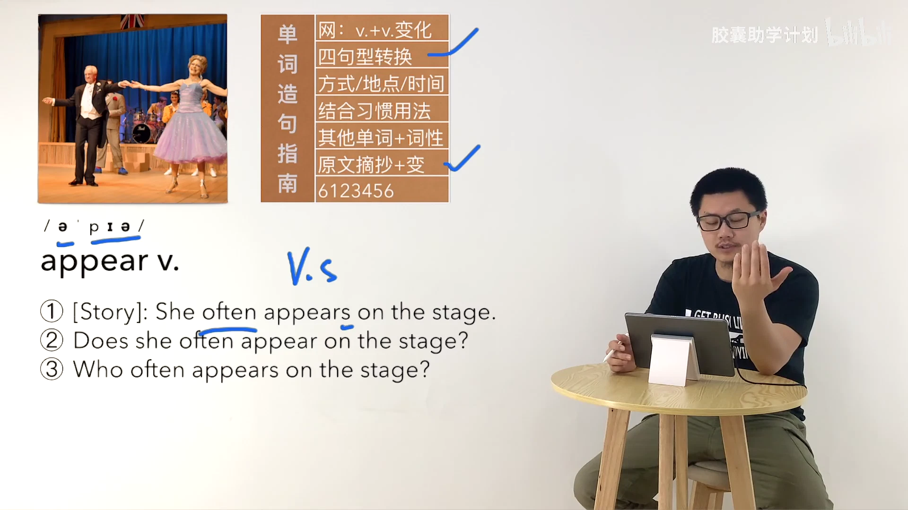

文字识别：单词造句指南 / 网：v.+v.变化 / 胶囊助学计划 / 四句型转换 / 方式/地点/时间 / 结合习惯用法 / 其他单词+词性 / 原文摘抄+变 / 6123456 / /apia/ / V.s / appear v. / [Story]: She often appears on the stage. / 1 / Does she often appear on the stage? / Who often appears on the stage? / 3

### 画面 00:01:55

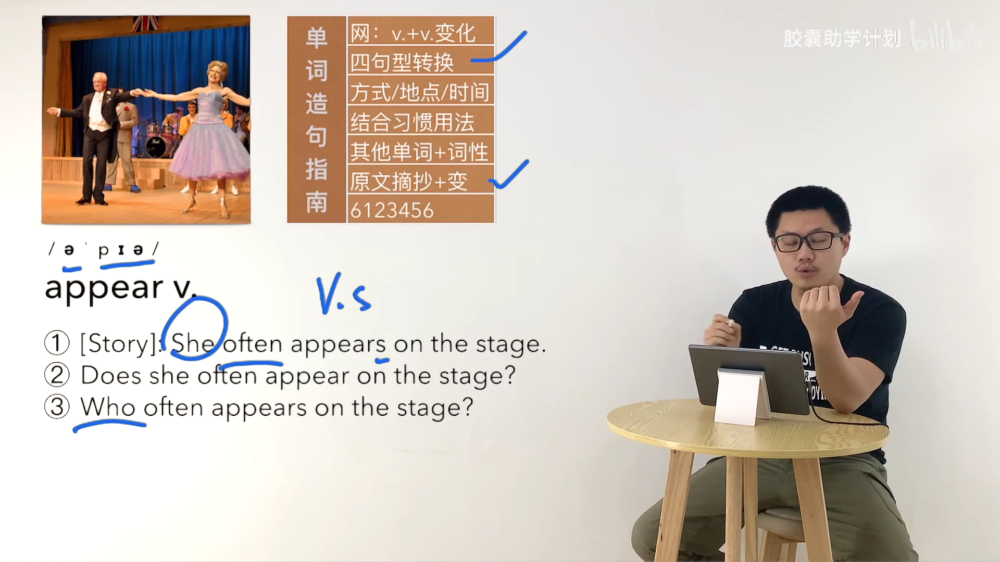

文字识别：单词造句指南 / 网：v.+v.变化 / 胶囊助学计划 / 四句型转换 / 方式/地点/时间 / 结合习惯用法 / 其他单词+词性 / 原文摘抄+变 / 6123456 / /apia/ / V.s / appearv / [Story] She often appears on the stage. / Does she often appear on the stage? / Who often appears on the stage?

## 00:02:00–00:02:30

般疑问句。OK，好，那刚才出现了这个单词叫做 stage 啊，我没有专门去讲，我们在这儿一起再过一遍。来，它叫舞台的意思啊，跟我读一下，先看一下，把 t 要变成浊化，来读一下，叫做 stage。OK，那它是舞台的意思。我们做一个小的短语，叫做在舞台上啊。刚才我们在上一个单词当中见到了，叫做 on the stage，叫做在舞台上。那我们在拿它去造

### 画面 00:02:00

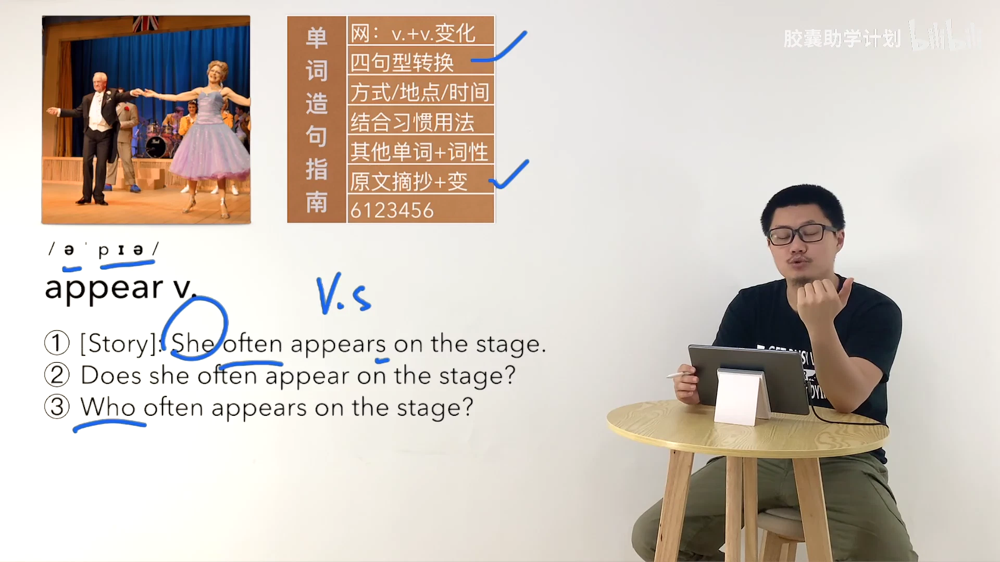

文字识别：单词造句指南 / 网：v.+v.变化 / 胶囊助学计划 / 四句型转换 / 方式/地点/时间 / 结合习惯用法 / 其他单词+词性 / 原文摘抄+变 / 6123456 / /apia/ / V.s / appeary / [Story] She often appears on the stage. / Does she often appear on the stage? / Who often appears on the stage?

### 画面 00:02:02

文字识别：单词造句指南 / 网：v.+v.变化 / 胶囊助学计划 / 四句型转换 / 方式/地点/时间 / 结合习惯用法 / 其他单词+词性 / 原文摘抄+变 / 6123456 / /steid3/ / stage n.

### 画面 00:02:05

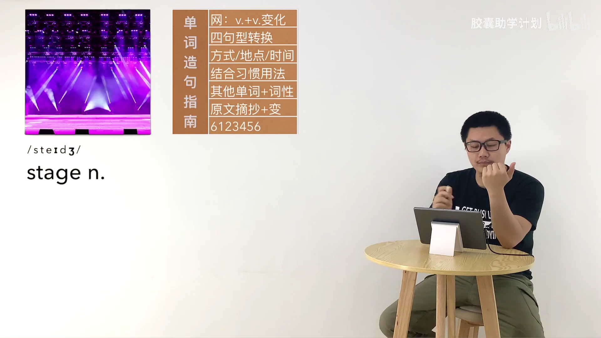

文字识别：单词造句指南 / 网：v.+v.变化 / 胶囊助学计划 / 四句型转换 / 方式/地点/时间 / 结合习惯用法 / 其他单词+词性 / 原文摘抄+变 / 6123456 / /steid3/ / stage n.

### 画面 00:02:10

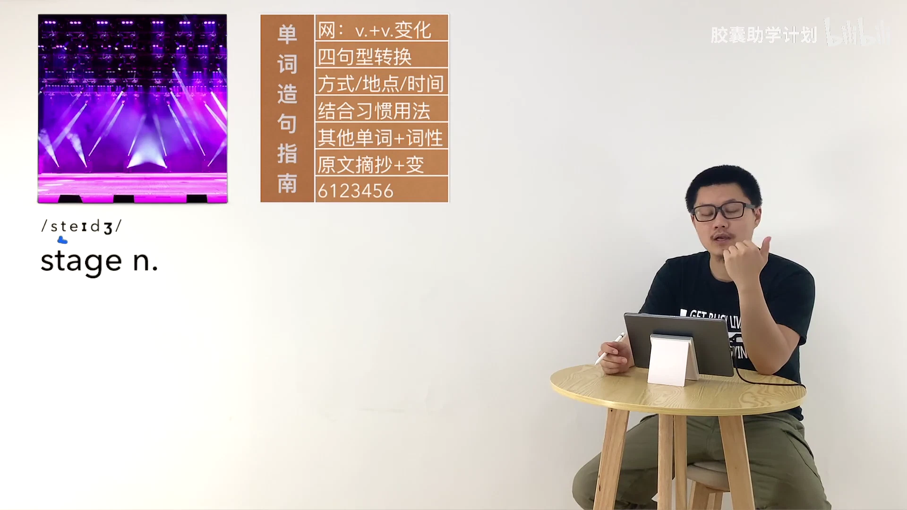

文字识别：单词造句指南 / 网：v.+v.变化 / 胶囊助学计划 / 四句型转换 / 方式/地点/时间 / 结合习惯用法 / 其他单词+词性 / 原文摘抄+变 / 6123456 / /steid3/ / stage n.

### 画面 00:02:15

文字识别：单词造句指南 / 网：v.+v.变化 / 胶囊助学计划 / 四句型转换 / 方式/地点/时间 / 结合习惯用法 / 其他单词+词性 / 原文摘抄+变 / 6123456 / /steid3/ / stage n.

### 画面 00:02:20

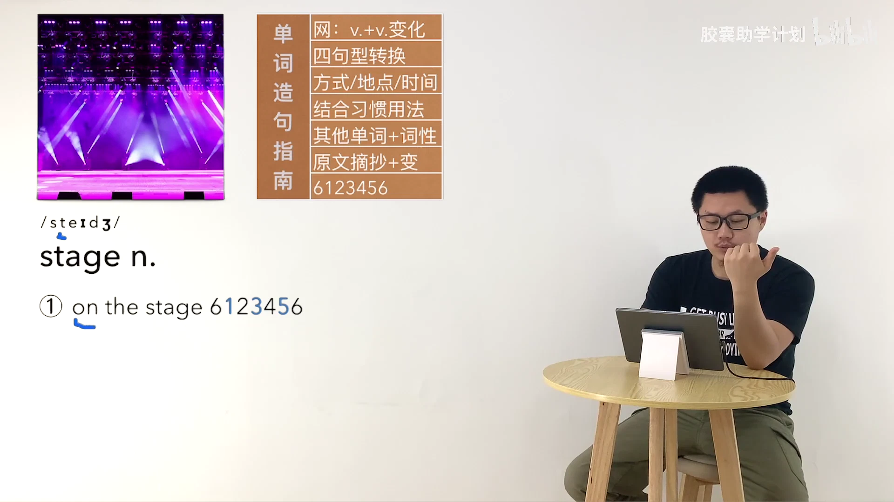

文字识别：单词造句指南 / 网：v.+v.变化 / 胶囊助学计划 / 四句型转换 / 方式/地点/时间 / 结合习惯用法 / 其他单词+词性 / 原文摘抄+变 / 6123456 / /steid3/ / stage n. / ① on the stage 6123456 / SYL / OY

### 画面 00:02:25

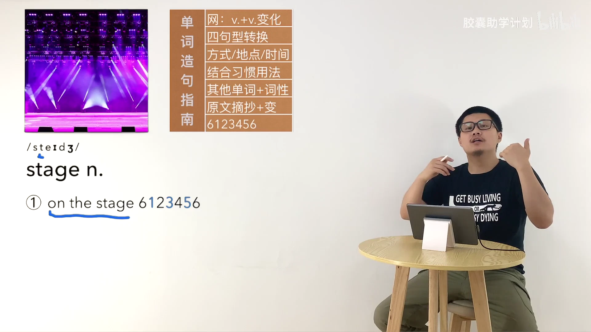

文字识别：单词造句指南 / 网：v.+v.变化 / 胶囊助学计划 / 四句型转换 / 方式/地点/时间 / 结合习惯用法 / 其他单词+词性 / 原文摘抄+变 / 6123456 / /steid3/ / stage n. / on the stage 6123456 / GET BUSY LIVING / OR / SYDYING

## 00:02:30–00:03:00

句的时候，stage或者是 on the stage 的时候，我们就要去想它在六一二三四五六当中处于什么样的位置，可以做什么成分。简单来说，它可以做主语啊，可以做一，可以做宾语，可以做三，也可以做一个地点，做五，对吧？那接下来我们就尝试造一些句子。来了，第一句话，我们结合了十三课的习惯用法，a group of pop singers are OK。这地方注意

### 画面 00:02:30

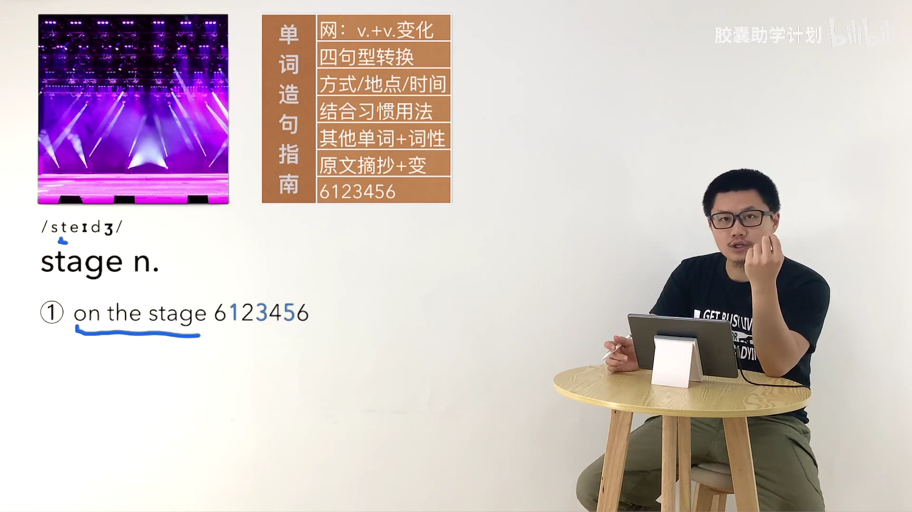

文字识别：单词造句指南 / 网：v.+v.变化 / 胶囊助学计划 / 四句型转换 / 方式/地点/时间 / 结合习惯用法 / 其他单词+词性 / 原文摘抄+变 / 6123456 / /steid3/ / stage n. / ① on the stage 6123456 / GFTRII

### 画面 00:02:35

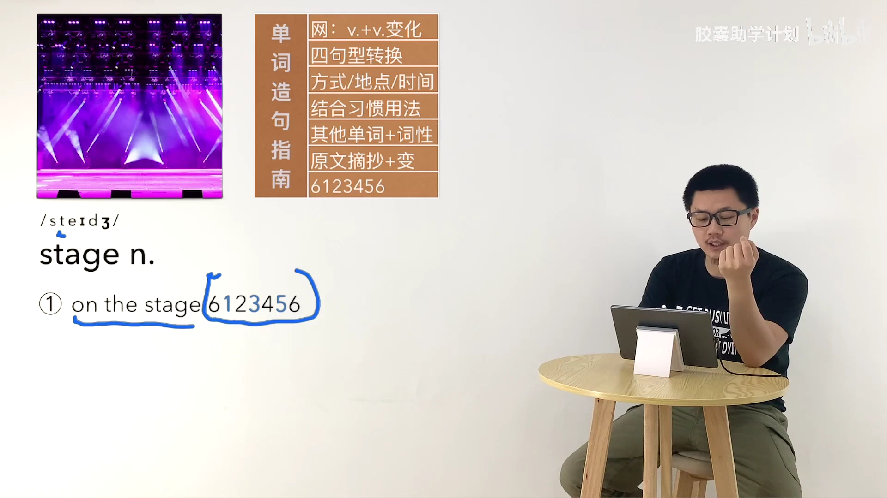

文字识别：单词造句指南 / 网：v.+v.变化 / 胶囊助学计划 / 四句型转换 / 方式/地点/时间 / 结合习惯用法 / 其他单词+词性 / 原文摘抄+变 / 6123456 / /steid3/ / stage n. / on the stage / 6123456 / ISYV / R / DYI

### 画面 00:02:38

文字识别：单词造句指南 / 网：v.+v.变化 / 胶囊助学计划 / 四句型转换 / 方式/地点/时间 / 结合习惯用法 / 其他单词+词性 / 原文摘抄+变 / 6123456 / /steid3/ / stage n. / 1 / on the stage / 6123456 / SILV / A / DYIN

### 画面 00:02:40

文字识别：单词造句指南 / 网：v.+v.变化 / 胶囊助学计划 / 四句型转换 / 方式/地点/时间 / 结合习惯用法 / 其他单词+词性 / 原文摘抄+变 / 6123456 / /steid3/ / stage n. / 1 / on the stage / 6123456 / GET BLSIUV

### 画面 00:02:45

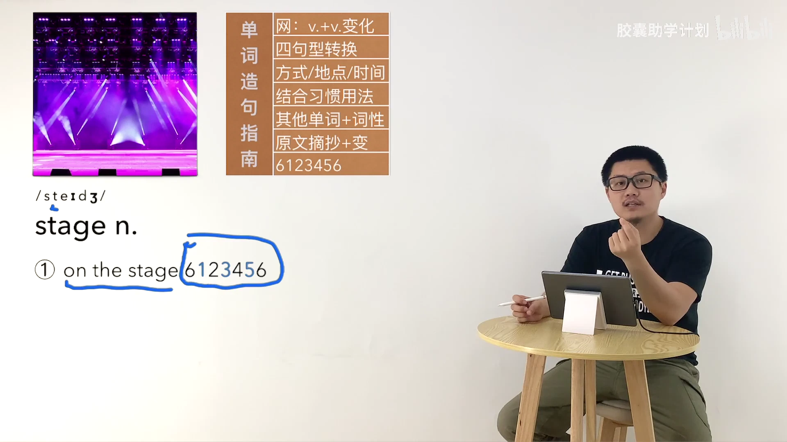

文字识别：单词造句指南 / 网：v.+v.变化 / 胶囊助学计划 / 四句型转换 / 方式/地点/时间 / 结合习惯用法 / 其他单词+词性 / 原文摘抄+变 / 6123456 / /steid3/ / stage n. / 1 / Don the stage / 6123456

### 画面 00:02:50

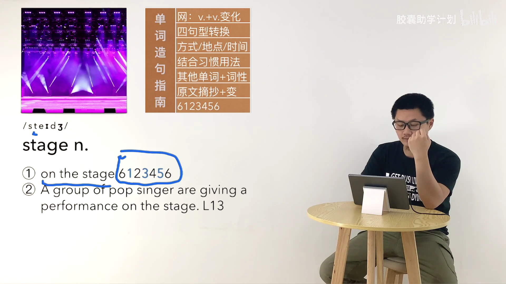

文字识别：单词造句指南 / 网：v.+v.变化 / 胶囊助学计划 / 四句型转换 / 方式/地点/时间 / 结合习惯用法 / 其他单词+词性 / 原文摘抄+变 / 6123456 / /steid3/ / stage n. / 1 / on the stage / 6123456 / Agroup of pop / singer are / giving a / RA / DYIN / performance on the stage. L13

### 画面 00:02:52

文字识别：单词造句指南 / 网：v.+v.变化 / 胶囊助学计划 / 四句型转换 / 方式/地点/时间 / 结合习惯用法 / 其他单词+词性 / 原文摘抄+变 / 6123456 / /steid3/ / stage n. / ①on the stage 6123456 / GETDISILI / ② A group of pop singer are giving a / DRA / DYI / performance on the stage. L13

### 画面 00:02:55

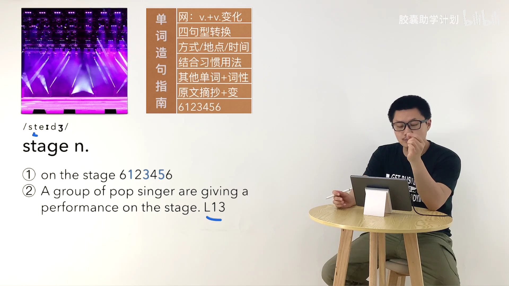

文字识别：单词造句指南 / 网：v.+v.变化 / 胶囊助学计划 / 四句型转换 / 方式/地点/时间 / 结合习惯用法 / 其他单词+词性 / 原文摘抄+变 / 6123456 / /steid3/ / stage n. / ①on the stage 6123456 / ② A group of pop singer are giving a / DYI / performance on the stage. L13

## 00:03:00–00:03:30

have a S. Ah, type are giving a performance on the stage. Okay, pay attention to this place. On the stage, is six one two three four five six. Inside the five is the place, right? In what place? In the performance. Okay. Next, we combine the tenth lesson. For example, the stage is being cleaned right now. Okay, review. In the beginning of this video, I asked you the first question: How to use the words we learned later to review the grammar we learned before?

### 画面 00:03:00

文字识别：单词造句指南 / 网：v.+v.变化 / 胶囊助学计划 / 四句型转换 / 方式/地点/时间 / 结合习惯用法 / 其他单词+词性 / 原文摘抄+变 / 6123456 / /steid3/ / stage n. / ①on the stage 6123456 /  A group of pop singersare giving a / 2 / performance on the stage. L13

### 画面 00:03:05

文字识别：单词造句指南 / 网：v.+v.变化 / 胶囊助学计划 / 四句型转换 / 方式/地点/时间 / 结合习惯用法 / 其他单词+词性 / 原文摘抄+变 / 6123456 / /steid3/ / stage n. / ①on the stage 6123456 / ISIUT /  A group of pop singersare giving a / 2 / performance on the stage. L13

### 画面 00:03:10

文字识别：单词造句指南 / 网：v.+v.变化 / 胶囊助学计划 / 四句型转换 / 方式/地点/时间 / 结合习惯用法 / 其他单词+词性 / 原文摘抄+变 / 6123456 / /steid3/ / stage n. / ①on the stage 6123456 / SYLV /  A group of pop singerare giving a / 2) / performance on the stage. L13

### 画面 00:03:15

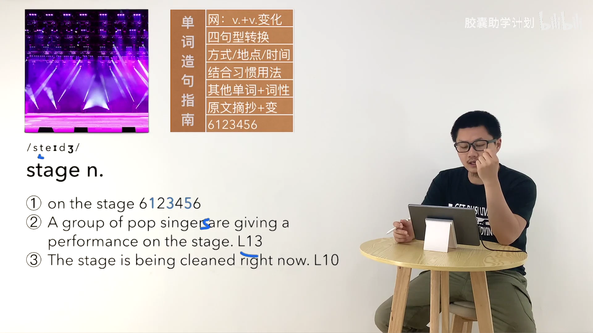

文字识别：单词造句指南 / 网：v.+v.变化 / 胶囊助学计划 / 四句型转换 / 方式/地点/时间 / 结合习惯用法 / 其他单词+词性 / 原文摘抄+变 / 6123456 / /steid3/ / stage n. / ① on the stage 6123456 / ② A group of pop singer are giving a / DYIN / performance on the stage. L13 / The stage is being cleaned right now. L10

### 画面 00:03:20

文字识别：单词造句指南 / 网：v.+v.变化 / 胶囊助学计划 / 四句型转换 / 方式/地点/时间 / 结合习惯用法 / 其他单词+词性 / 原文摘抄+变 / 6123456 / /steid3/ / stage n. / ① on the stage 6123456 / SILV / ② A group of pop singer are giving a / performance on the stage. L13 / The stage is being cleaned right now. L10

### 画面 00:03:25

文字识别：单词造句指南 / 网：v.+v.变化 / 胶囊助学计划 / 四句型转换 / 方式/地点/时间 / 结合习惯用法 / 其他单词+词性 / 原文摘抄+变 / 6123456 / /steid3/ / stage n. / ① on the stage 6123456 / GET BISY LVING / A group of pop singerSare giving a / 2 / DYING / performance on the stage. L13 / The stage is being cleaned right now. L10

### 画面 00:03:27

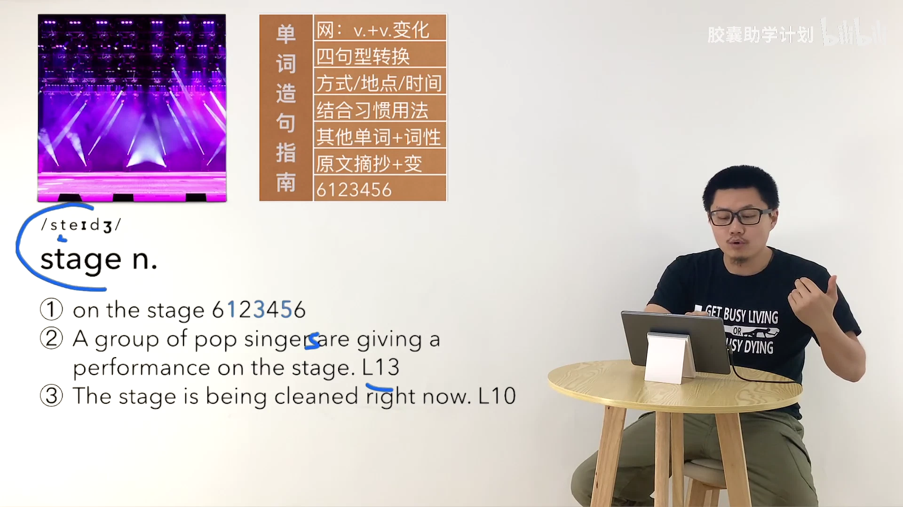

文字识别：单词造句指南 / 网：v.+v.变化 / 胶囊助学计划 / 四句型转换 / 方式/地点/时间 / 结合习惯用法 / 其他单词+词性 / 原文摘抄+变 / 6123456 / /steid3/ / stage n. / ① on the stage 6123456 / GET BUSY LIVING / A group of pop singersare giving a / 2 / SYDYING / performance on the stage. L13 / The stage is being cleaned right now. L10

### 画面 00:03:29

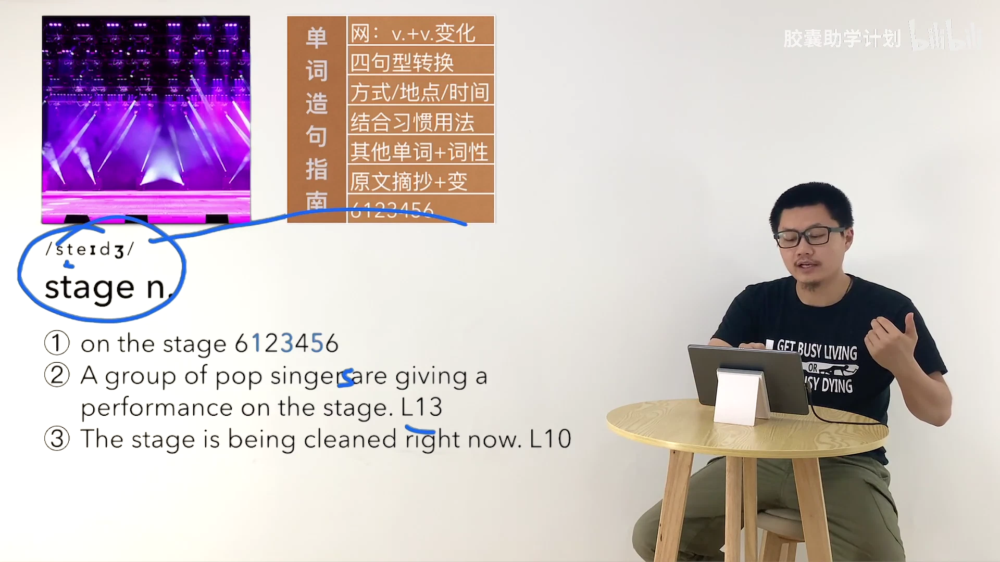

文字识别：单词造句指南 / 网：v.+v.变化 / 胶囊助学计划 / 四句型转换 / 方式/地点/时间 / 结合习惯用法 / 其他单词+词性 / 原文摘抄+变 / /steid3/ / stage n / ① / on the stage 6123456 / GET BUSY LIVING / A group of pop singerare giving a / ORAAU / 2 / SY DYING / performance on the stage. L13 / The stage is being cleaned right now. L10

## 00:03:30–00:04:00

习之前学到的语法，因为我们经常在学英语的时候啊，同学可能会遇到这样一个问题，就是我第十课学过了一个东西，等下一次再见它的时候，文章当中出现呢，可能变成到第二十四课才出现。那漫这么漫长的十多课的学习，我可能就把第十课学的关键语法，比如说 be doing 这样的一个表示现在正在被怎么怎么样的语法，关键语法就遗忘了。那如何不去

### 画面 00:03:31

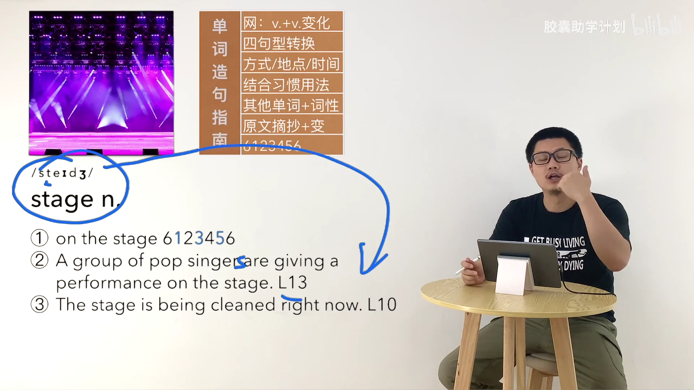

文字识别：单词造句指南 / 网：v.+v.变化 / 胶囊助学计划 / 四句型转换 / 方式/地点/时间 / 结合习惯用法 / 其他单词+词性 / 原文摘抄+变 / /steid3/ / stage n / ① on the stage 6123456 / GET RIISY LIVING / A group of pop singersare giving a / 2 / YDYING / performance on the stage. L13 / The stage is being cleaned right now. L10

### 画面 00:03:35

文字识别：单词造句指南 / 网：v.+v.变化 / 胶囊助学计划 / 四句型转换 / 方式/地点/时间 / 结合习惯用法 / 其他单词+词性 / 原文摘抄+变 / 456 / /steid3/ / stage n / ① on the stage 6123456 / GET RIUISY LIVIN / A group of pop singerare giving a / RL / 2 / SYDYING / performance on the stage. L13 / The stage is being cleaned right now. L10

### 画面 00:03:40

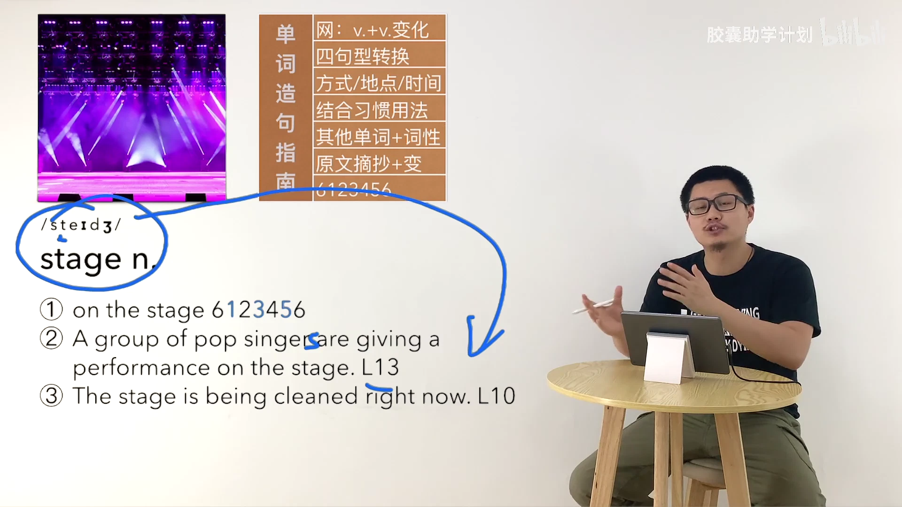

文字识别：单词造句指南 / 网：v.+v.变化 / 胶囊助学计划 / 四句型转换 / 方式/地点/时间 / 结合习惯用法 / 其他单词+词性 / 原文摘抄+变 / /steid3/ / stage n / ① on the stage 6123456 / A group of pop singesare giving a / 2 / performance on the stage. L13 / The stage is being cleaned right now. L10

### 画面 00:03:45

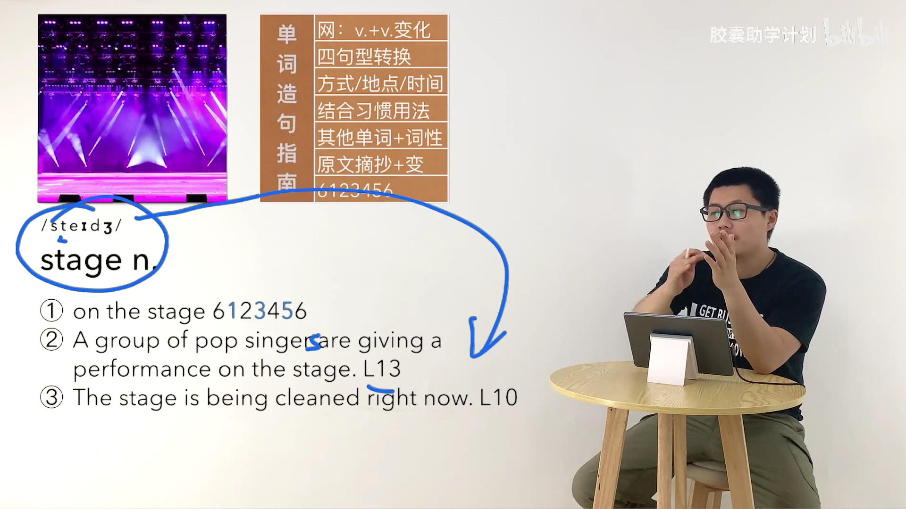

文字识别：单词造句指南 / 网：v.+v.变化 / 胶囊助学计划 / 四句型转换 / 方式/地点/时间 / 结合习惯用法 / 其他单词+词性 / 原文摘抄+变 / /steid3/ / stage n / ① on the stage 6123456 / GETRI / A group of pop singesare giving a / 2 / performance on the stage. L13 / The stage is being cleaned right now. L10

### 画面 00:03:50

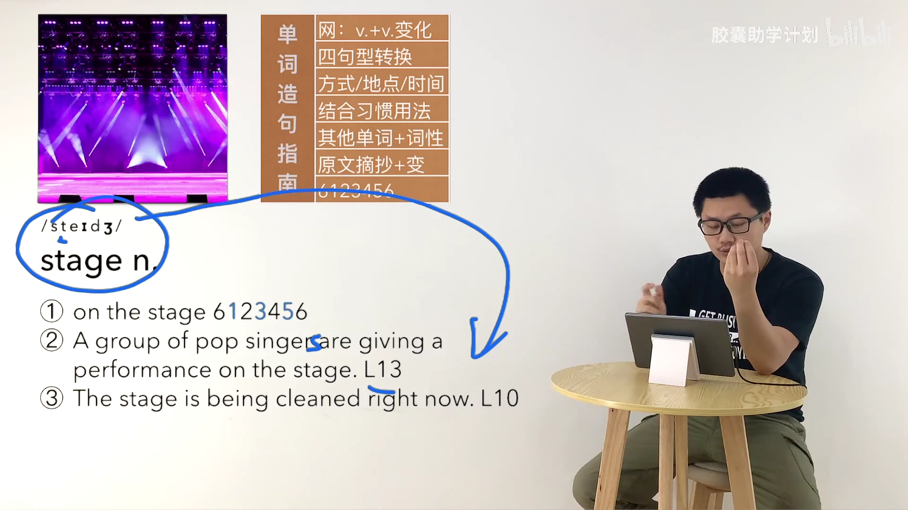

文字识别：单词造句指南 / 网：v.+v.变化 / 胶囊助学计划 / 四句型转换 / 方式/地点/时间 / 结合习惯用法 / 其他单词+词性 / 原文摘抄+变 / /steid3/ / stage n / ① on the stage 6123456 / A group of pop singersare giving a / 2 / performance on the stage. L13 / The stage is being cleaned right now. L10

### 画面 00:03:52

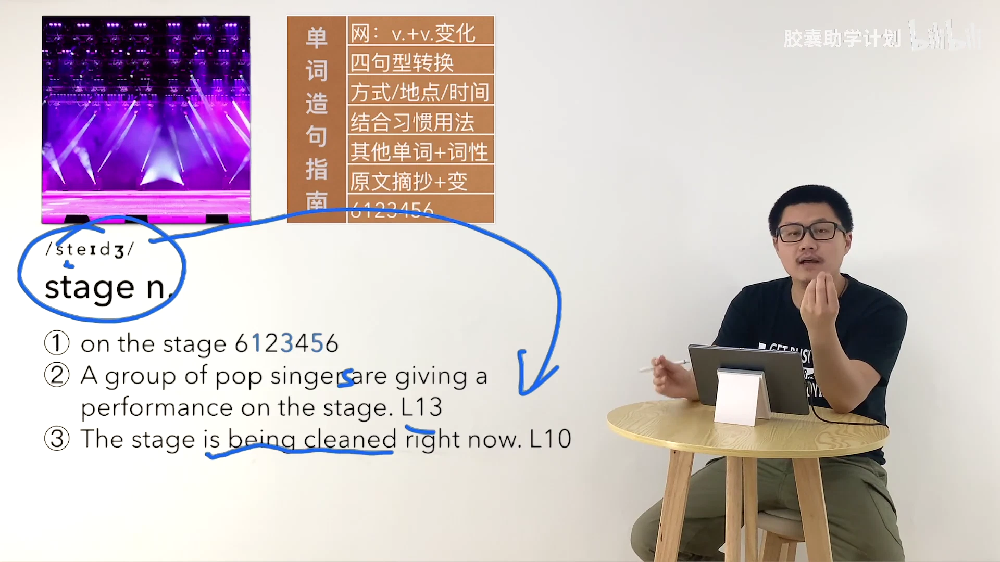

文字识别：单词造句指南 / 网：v.+v.变化 / 胶囊助学计划 / 四句型转换 / 方式/地点/时间 / 结合习惯用法 / 其他单词+词性 / 原文摘抄+变 / /steid3/ / stage n / ① on the stage 6123456 / A group of pop singersare giving a / 2 / performance on the stage. L13 / The stage is being cleaned right now. L10

### 画面 00:03:55

文字识别：单词造句指南 / 网：v.+v.变化 / 胶囊助学计划 / 四句型转换 / 方式/地点/时间 / 结合习惯用法 / 其他单词+词性 / 原文摘抄+变 / /steid3/ / stage n / ① on the stage 6123456 / A group of pop singesare giving a / 2 / performance on the stage. L13 / The stage is being cleaned right now. L10

## 00:04:00–00:04:30

遗忘呢？对抗遗忘最好的方式就是两个字儿重复，没有什么别的啊新奇的技巧了。那重复有一些小的技巧。那您除了说可以时不时回去复习一下之前的笔记，包括课程视频课程以外，您还可以对吧？哎，我现在想用 stage 这个单词去造句，那我就结合第十课我学过的一个语法叫做 be being 的，对吧？这样的一个语法去结合起来造句。

### 画面 00:04:01

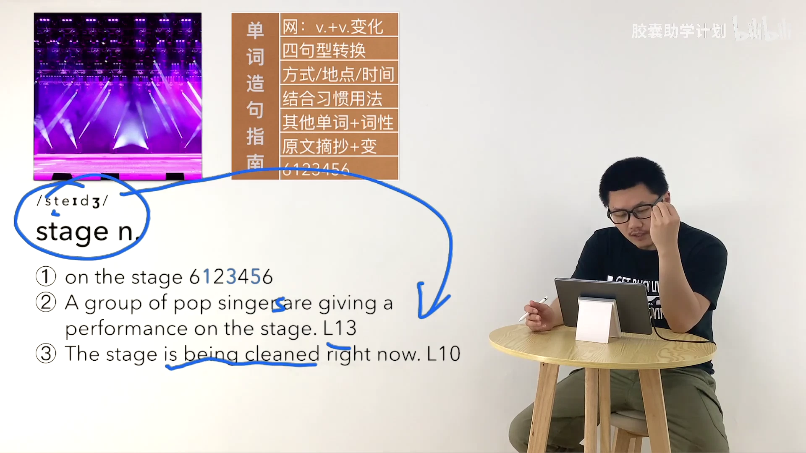

文字识别：单词造句指南 / 网：v.+v.变化 / 胶囊助学计划 / 四句型转换 / 方式/地点/时间 / 结合习惯用法 / 其他单词+词性 / 原文摘抄+变 / /steid3/ / stage n / ① on the stage 6123456 / A group of pop singesare giving a / 2 / performance on the stage. L13 / The stage is being cleaned right now. L10

### 画面 00:04:05

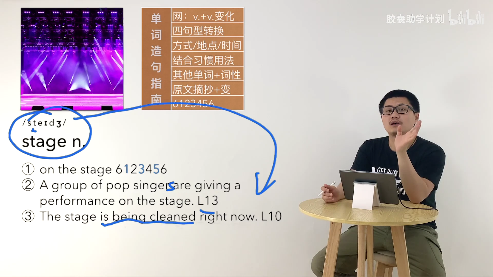

文字识别：单词造句指南 / 网：v.+v.变化 / 胶囊助学计划 / 四句型转换 / 方式/地点/时间 / 结合习惯用法 / 其他单词+词性 / 原文摘抄+变 / /steid3/ / stage n / ① on the stage 6123456 / GFT DIICV / A group of pop singersare giving a / 2 / performance on the stage. L13 / The stage is being cleaned right now. L10

### 画面 00:04:10

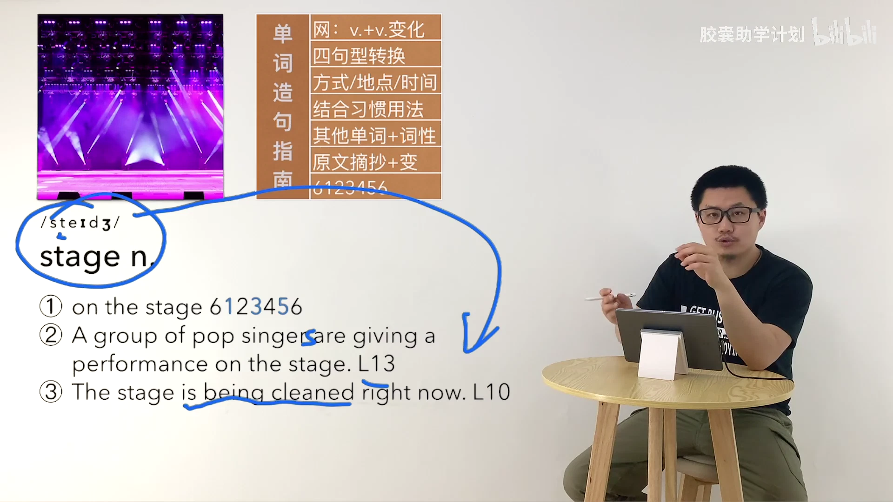

文字识别：单词造句指南 / 网：v.+v.变化 / 胶囊助学计划 / 四句型转换 / 方式/地点/时间 / 结合习惯用法 / 其他单词+词性 / 原文摘抄+变 / /steid3/ / stage n / ① on the stage 6123456 / A group of pop singesare giving a / 2 / performance on the stage. L13 / The stage is being cleaned right now. L10

### 画面 00:04:15

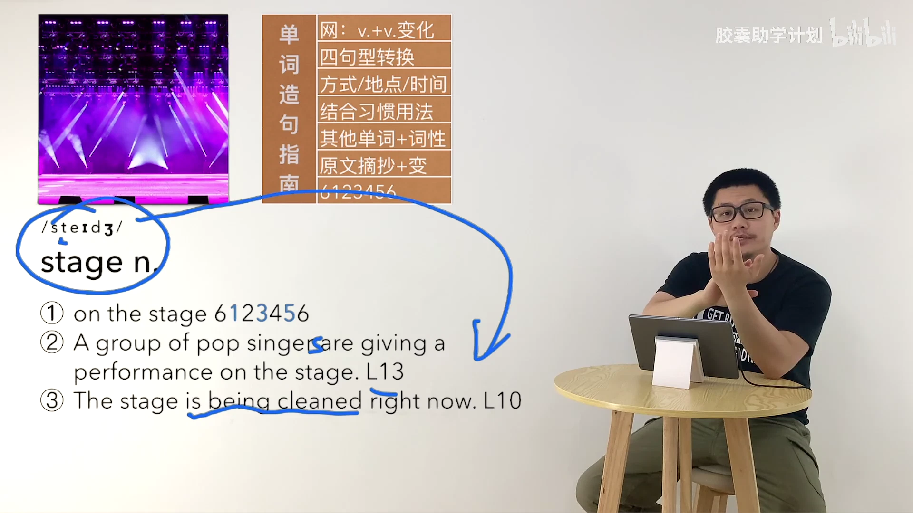

文字识别：单词造句指南 / 网：v.+v.变化 / 胶囊助学计划 / BiBit / 四句型转换 / 方式/地点/时间 / 结合习惯用法 / 其他单词+词性 / 原文摘抄+变 / /steid3/ / stage n / ① on the stage 6123456 / A group of pop singersare giving a / 2 / performance on the stage. L13 / The stage is being cleaned right now. L10

### 画面 00:04:20

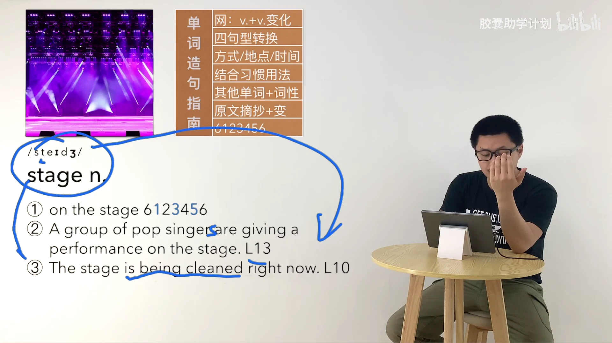

文字识别：单词造句指南 / 网：v.+v.变化 / 胶囊助学计划 / 四句型转换 / 方式/地点/时间 / 结合习惯用法 / 其他单词+词性 / 原文摘抄+变 / /steid3/ / stage n / ① / on the stage 6123456 / A group of pop singerare giving a / performance on the stage. L13 / The stage is being cleaned right now. L10

### 画面 00:04:23

文字识别：单词造句指南 / 网：v.+v.变化 / 胶囊助学计划 / 四句型转换 / 方式/地点/时间 / 结合习惯用法 / 其他单词+词性 / 原文摘抄+变 / /steid3/ / stage n / ① / on the stage 6123456 / A group of pop singe are giving a / performance on the stage. L13 / The stage is being cleaned right now / L10

### 画面 00:04:25

文字识别：单词造句指南 / 网：v.+v.变化 / 胶囊助学计划 / Bibili / 四句型转换 / 方式/地点/时间 / 结合习惯用法 / 其他单词+词性 / 原文摘抄+变 / 456 / /steid3/ / stage n / ① / on the stage 6123456 / A group of pop singer are giving a / performance on the stage. L13 / The stage is being cleaned right now / L10

## 00:04:30–00:05:00

那我既拿这个单词造了句，我学了这个单词，我又复习了之前学过的语法，让我不去啊对抗这个遗忘，对吧？让我不去遗忘记它，呃，遗忘掉它。OK，好，那这地方讲清楚了。那 the stage 实际上就是做了主语。最后那说，as soon as they had cleaned the stage, the actors appeared on it。哦，他们刚把这个舞台啊打扫清打扫干净，这个演

### 画面 00:04:30

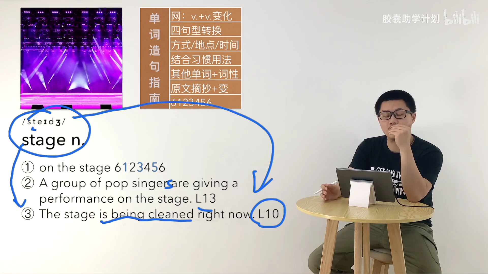

文字识别：单词造句指南 / 网：v.+v.变化 / 胶囊助学计划 / Bitbi / 四句型转换 / 方式/地点/时间 / 结合习惯用法 / 其他单词+词性 / 原文摘抄+变 / /steid3/ / stage n / ① / on the stage 6123456 / A group of pop singer are giving a / performance on the stage. L13 / The stage is being cleaned right now / L10

### 画面 00:04:35

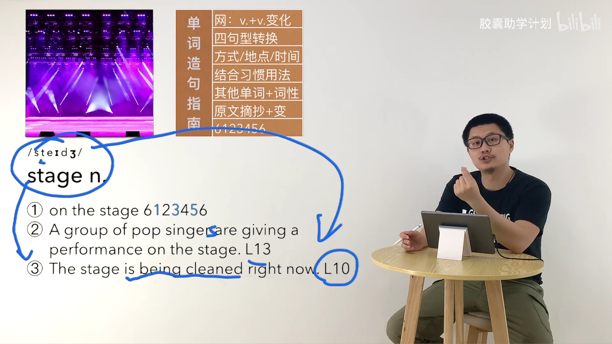

文字识别：单词造句指南 / 网：v.+v.变化 / 胶囊助学计划 / 四句型转换 / 方式/地点/时间 / 结合习惯用法 / 其他单词+词性 / 原文摘抄+变 / 456 / /steid3/ / stage n / ① / on the stage 6123456 / CL / A group of pop singer are giving a / performance on the stage. L13 / The stage is being cleaned right now / L10

### 画面 00:04:40

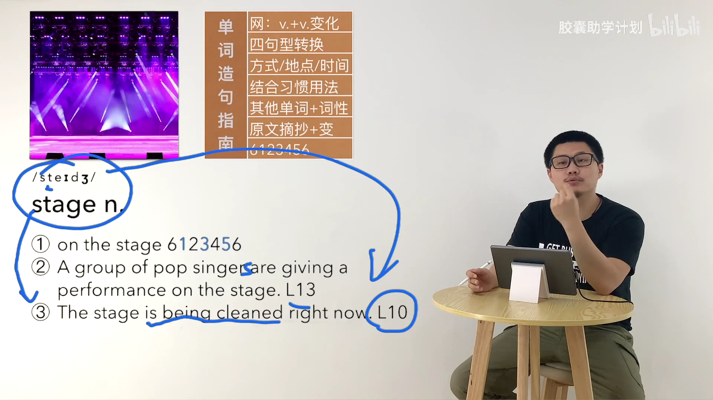

文字识别：单词造句指南 / 网：v.+v.变化 / 胶囊助学计划 / BiltBilt / 四句型转换 / 方式/地点/时间 / 结合习惯用法 / 其他单词+词性 / 原文摘抄+变 / /steid3/ / stage n / ① / on the stage 6123456 / GETDU / A group of pop singe are giving a / performance on the stage. L13 / The stage is being cleaned right now / L10

### 画面 00:04:45

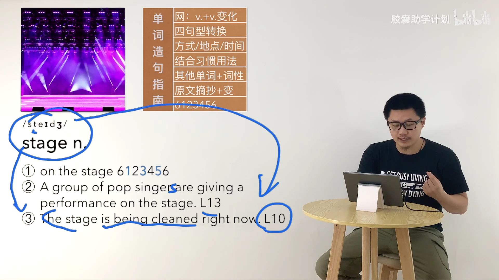

文字识别：单词造句指南 / 网：v.+v.变化 / 胶囊助学计划 / Bitbl / 四句型转换 / 方式/地点/时间 / 结合习惯用法 / 其他单词+词性 / 原文摘抄+变 / 456 / /steid3/ / stage n / ① / on the stage 6123456 /  CET RUSY LIVING / A group of pop singer are giving a / OR / SVDYING / performance on the stage. L13 / he stage is being cleaned right now / L10

### 画面 00:04:48

文字识别：单词造句指南 / 网：v.+v.变化 / 胶囊助学计划 / 四句型转换 / 方式/地点/时间 / 结合习惯用法 / 其他单词+词性 / 原文摘抄+变 / 456 / /steid3/ / stage n / ① / on the stage 6123456 / GFT RUISY LVIN / A group of pop singer are giving a / R / KDYING / performance on the stage. L13 / The /  stageis being cleaned right now / L10 / As / soon as / they / had cleaned the s / stage, the / actors / appeared on it. L14

### 画面 00:04:50

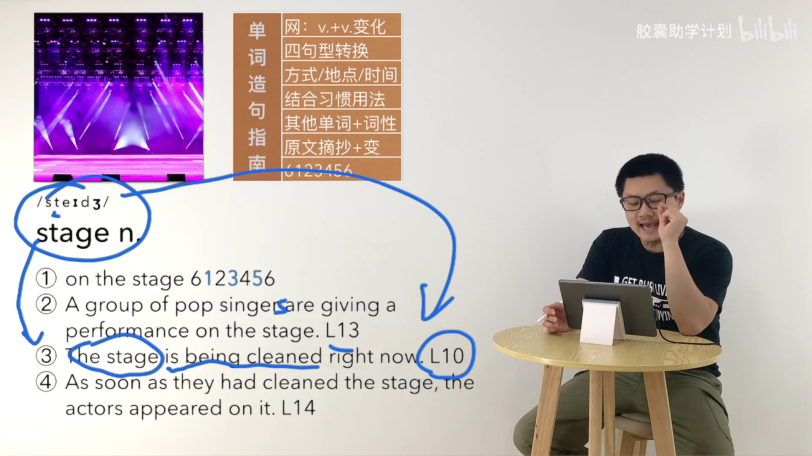

文字识别：单词造句指南 / 网：v.+v.变化 / 胶囊助学计划 / 四句型转换 / 方式/地点/时间 / 结合习惯用法 / 其他单词+词性 / 原文摘抄+变 / /steid3/ / stage n / ① / on the stage 6123456 / A group of pop singersare giving a / performance on the stage. L13 / he stage is being cleaned right now / L10 / As / soon as t / they / had cleaned the stage, the / actors / appeared on it. L14

### 画面 00:04:55

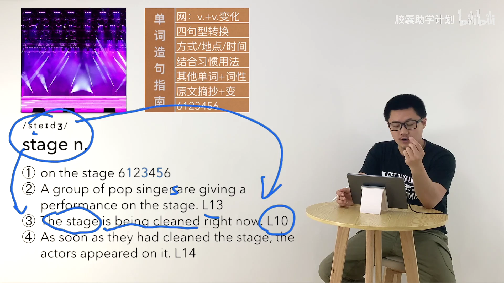

文字识别：单词造句指南 / 网：v.+v.变化 / 胶囊助学计划 / 四句型转换 / 方式/地点/时间 / 结合习惯用法 / 其他单词+词性 / 原文摘抄+变 / /steid3/ / stage n / ① / on the stage 6123456 / 'SI / A group of pop singer are giving a / performance on the stage. L13 / he stage is being cleaned right now / L10 / As / soon as / they / had cleaned the s / stage,tne / actors / appeared on it. L14

### 画面 00:04:57

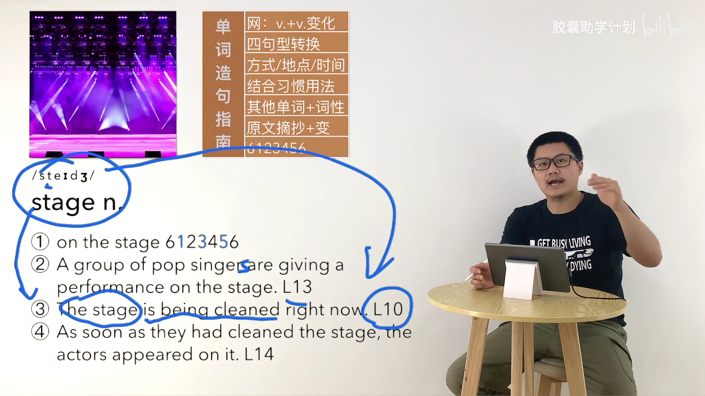

文字识别：单词造句指南 / 网：v.+v.变化 / 胶囊助学计划 / 四句型转换 / 方式/地点/时间 / 结合习惯用法 / 其他单词+词性 / 原文摘抄+变 / /steid3/ / stage n / ① / on the stage 6123456 /  GFT RUSY LIVING / A group ofpop s / singersare giving a / DYING / performance on the stage. L13 / he / stageis being cleaned / right now / L10 / As / soon as / they / had cleaned the / stage, the / actors / appeared / Ion it. L14

## 00:05:00–00:05:30

员们就上去了。OK，注意，as soon as，然后 had 加 done，然后这个地方用的是 did，这是我们典型在第十四课学过的两个点。第一个是 as soon as 这个连词怎么去用，第二个是过去完成时这个时态表示最常用的一个意思，跟这些连词放到一起的时候表示过去的过去过去有两个动作 appeared，那在它之前发生了另一个动作叫做 had cleaned the stage。OK，你看这

### 画面 00:05:00

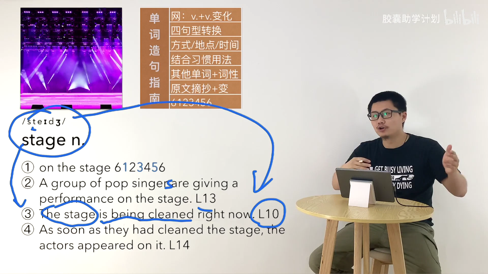

文字识别：单词造句指南 / 网：v.+v.变化 / 胶囊助学计划 / 四句型转换 / 方式/地点/时间 / 结合习惯用法 / 其他单词+词性 / 原文摘抄+变 / /steid3/ / stage n / ① / on the stage 6123456 / GET RIISY LIVING / A group ofpop s / singersare giving a / RANIU / YDYING / performance on the stage. L13 / The / stage is being cleaned / right now / L10 / As / soon as / they / had cleaned the / stage, the / actors / appeared / on it. L14

### 画面 00:05:03

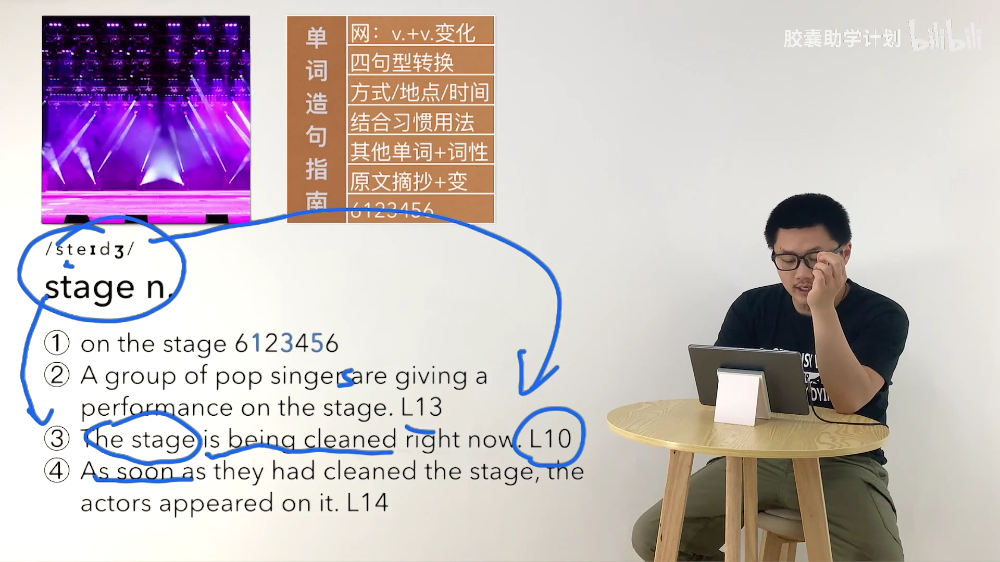

文字识别：单词造句指南 / 网：v.+v.变化 / 胶囊助学计划 / 四句型转换 / 方式/地点/时间 / 结合习惯用法 / 其他单词+词性 / 原文摘抄+变 / /steid3/ / stage n / ① / on the stage 6123456 / Agroup ofpop s / singerSare giving a / performance on the stage. L13 / The /  stageis being cleaned / right now / L10 / As soonas / they / had cleaned the / stage, the / actors / appeared / on it. L14

### 画面 00:05:05

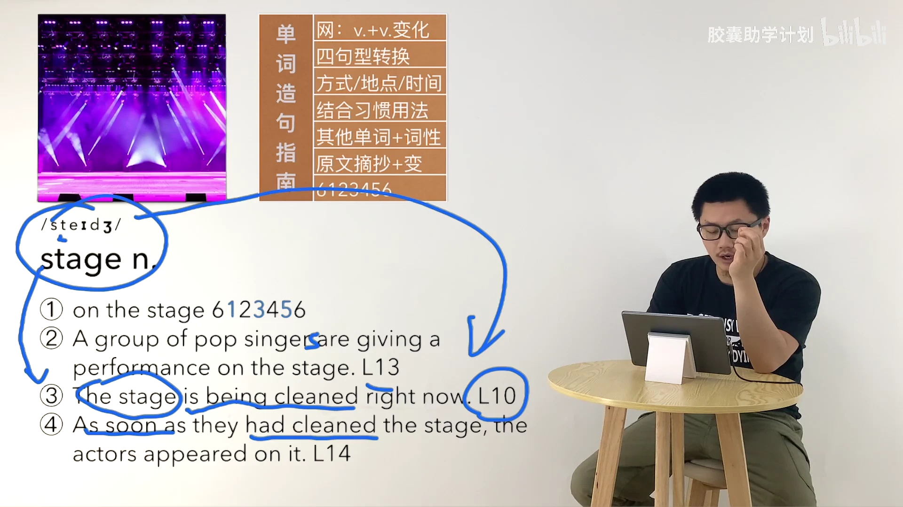

文字识别：单词造句指南 / 网：v.+v.变化 / 胶囊助学计划 / 四句型转换 / 方式/地点/时间 / 结合习惯用法 / 其他单词+词性 / 原文摘抄+变 / 456 / /steid3/ / stage n / ① / on the stage 6123456 / Agroup ofpop s / singerSare giving a / performance on the stage. L13 / The / stageis being cleaned / right now / L10 / As soon as / they / had cleaned the / stage, the / actors / appeared / on it. L14

### 画面 00:05:07

文字识别：单词造句指南 / 网：v.+v.变化 / 胶囊助学计划 / 四句型转换 / 方式/地点/时间 / 结合习惯用法 / 其他单词+词性 / 原文摘抄+变 / 456 / /steid3/ / stage n / ① / on the stage 6123456 / GET RLISN / Agroup ofpop s / singersare giving a / performance on the stage. L13 / he / stageis being cleaned / right now / L10 / As soon as / they / had cleaned the / stage, the / actors / appeared / on it. L14

### 画面 00:05:10

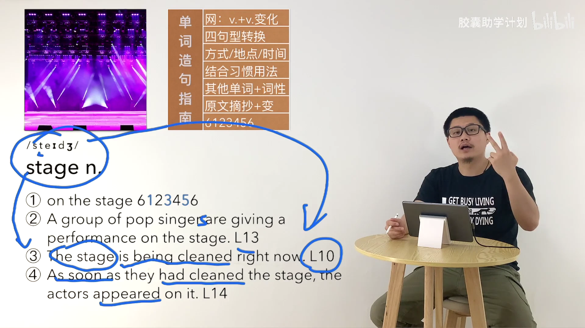

文字识别：单词造句指南 / 网：v.+v.变化 / 胶囊助学计划 / 四句型转换 / 方式/地点/时间 / 结合习惯用法 / 其他单词+词性 / 原文摘抄+变 / 456 / /steid3/ / stage n / ① / on the / stage 6123456 /  GET BUSY LIVING / Agroup of pop / singersare / giving a / RARU / YDYING / performance on t / the / stage.L13 / he / stage is being cleaned / right now / L10 / As soon as / they / had cleaned / the / stage, the / actors / appeared / on it. L14

### 画面 00:05:15

文字识别：单词造句指南 / 网：v.+v.变化 / 胶囊助学计划 / 四句型转换 / 方式/地点/时间 / 结合习惯用法 / 其他单词+词性 / 原文摘抄+变 / 456 / /steid3/ / stage n / ① / on the / stage 6123456 / GFT RIISY LIVIN / Agroup of pop / singersare / giving a / VDYING / performance on / the / stage.L13 / he / stage is being cleaned / right now / L10 / As soon as / they / had cleaned / the / stage, the / actors / appeared / on it. L14

### 画面 00:05:20

文字识别：单词造句指南 / 网：v.+v.变化 / 胶囊助学计划 / Lib / 四句型转换 / 方式/地点/时间 / 结合习惯用法 / 其他单词+词性 / 原文摘抄+变 / 456 / /steid3/ / stage n / ① / on the / stage 6123456 / GFT BUSY LNVA / A group ofpop / singersare / giving a / ORANU / SYDYING / performance on t / the / stage.L13 / he / stage is being cleaned / right now / L10 / As soon as / they / had cleaned t / I the / stage, the / actors / appeared / on it. L14

### 画面 00:05:25

文字识别：单词造句指南 / 网：v.+v.变化 / 胶囊助学计划 / 四句型转换 / 方式/地点/时间 / 结合习惯用法 / 其他单词+词性 / 原文摘抄+变 / 456 / /steid3/ / stage n / ① / on the stage 6123456 / GEI / Agroup ofpop s / singersare giving a / performance on the stage. L13 / he / stage is being cleaned / right now / L10 / As soonas / they / had cleaned the / stage, the / actors / appeared / on it. L14

## 00:05:30–00:06:00

这又是一个很典型的。我们用今天学的单词去复习之前学过的语法。我希望各位把这个思路记下来，对吧？然后您以后再去单词造句的时候，有意识的去结合之前学过的东西，重复、重复、再重复是非常有必要的。Okay, let's continue.接下来下一个单词，我们一起读一下，叫做bright, bright. Okay,那bright它本身是一个形容词，它往往指的是什么意思呢？叫做呃

### 画面 00:05:30

文字识别：单词造句指南 / 网：v.+v.变化 / 胶囊助学计划 / 四句型转换 / 方式/地点/时间 / 结合习惯用法 / 其他单词+词性 / 原文摘抄+变 / /steid3/ / stage n / ① / on the / stage 6123456 / 1GFTRUSY / Agroup of pop / singersare / giving a / OR / YDYING / performance on / the / stage.L13 / he / stage is being cleaned / right now / L10 / As soon as / they / had cleaned / the / stage, the / actors / appeared / on it. L14

### 画面 00:05:35

文字识别：单词造句指南 / 网：v.+v.变化 / 胶囊助学计划 / 四句型转换 / 方式/地点/时间 / 结合习惯用法 / 其他单词+词性 / 原文摘抄+变 / 456 / /steid3/ / stage n / ① / on the / stage 6123456 / GFT RUISY LIVING / A group ofpop / singersare / e giving a / RU / YDYING / performance on t /  the stage. L13 / he / stage is being cleaned / right now / L10 / As soon as / they / had cleaned t / I the / stage, the / actors / appeared / on it. L14

### 画面 00:05:40

文字识别：单词造句指南 / 网：v.+v.变化 / 胶囊助学计划 / 四句型转换 / 方式/地点/时间 / 结合习惯用法 / 其他单词+词性 / 原文摘抄+变 / /steid3/ / stage n / ① / on the s / stage 6123456 /  GET BUSY LIVING / A group of pop / singersare / e giving a / YDYING / performance on the stage. L13 / he / stageis being cleaned / right now / L10 / As soon as / they / had cleaned t / the / stage, the / actors / appeared / on it. L14

### 画面 00:05:45

文字识别：单词造句指南 / 网：v.+v.变化 / 胶囊助学计划 / 四句型转换 / 方式/地点/时间 / 结合习惯用法 / 其他单词+词性 / 原文摘抄+变 / /steid3/ / stage n / ① / on the stage 6123456 / GET RIISL / A group of pop / singerare giving a / YOYING / performance on the stage. L13 / he / stageis being cleaned / right now / L10 / As soonas / they / had cleaned the / stage, the / actors / appeared / on it. L14

### 画面 00:05:47

文字识别：单词造句指南 / 网：v.+v.变化 / 胶囊助学计划 / BilLil / 四句型转换 / 方式/地点/时间 / 结合习惯用法 / 其他单词+词性 / 原文摘抄+变 / 6123456 / /brait/ / bright adj. + color+ n. / GFT / VING / YDYINC

### 画面 00:05:50

文字识别：单词造句指南 / 网：v.+v.变化 / 胶囊助学计划 / Bilt Bil / 四句型转换 / 方式/地点/时间 / 结合习惯用法 / 其他单词+词性 / 原文摘抄+变 / 6123456 / /brait/ / bright adj. + color+ n. / VSILI

### 画面 00:05:55

文字识别：单词造句指南 / 网：v.+v.变化 / 胶囊助学计划 / 四句型转换 / 方式/地点/时间 / 结合习惯用法 / 其他单词+词性 / 原文摘抄+变 / 6123456 / /brait/ / bright adj. + color+ n.

## 00:06:00–00:06:30

颜色比较艳的、比较亮、比较明亮的。OK，这些颜色，呃呃，它比如说我们后面可以加一个颜色的具体名称，比如我们看图，那叫做 bright red，对吧？啊，这个艳红色和暗红色，那它对应的对吧？那我们在这儿学的就是艳红色啊、亮红色、鲜红色。那你可能后面往往还要加一个名词，对吧？艳红色的什么东西？

### 画面 00:06:00

文字识别：单词造句指南 / 网：v.+v.变化 / 胶囊助学计划 / Biltbil / 四句型转换 / 方式/地点/时间 / 结合习惯用法 / 其他单词+词性 / 原文摘抄+变 / 6123456 / /brait/ / bright adj. + color+ n.

### 画面 00:06:05

文字识别：单词造句指南 / 网：v.+v.变化 / 胶囊助学计划 / 四句型转换 / 方式/地点/时间 / 结合习惯用法 / 其他单词+词性 / 原文摘抄+变 / 6123456 / /brait/ / bright adj. + color+ n. / DYIN

### 画面 00:06:10

文字识别：单词造句指南 / 网：v.+v.变化 / 胶囊助学计划 / BitBii / 四句型转换 / 方式/地点/时间 / 结合习惯用法 / 其他单词+词性 / 原文摘抄+变 / 6123456 / /brait/ / bright adj. + color+ n.

### 画面 00:06:15

文字识别：单词造句指南 / 网：v.+v.变化 / 胶囊助学计划 / 四句型转换 / 方式/地点/时间 / 结合习惯用法 / 其他单词+词性 / 原文摘抄+变 / 6123456 / /brait/ / bright adj. + color+ n. / V

### 画面 00:06:25

文字识别：单词造句指南 / 网：v.+v.变化 / 胶囊助学计划 / Bitbi / 四句型转换 / 方式/地点/时间 / 结合习惯用法 / 其他单词+词性 / 原文摘抄+变 / 6123456 / /brait/ / bright adj. + color+ n. / ISYL

## 00:06:30–00:07:00

西？比如说，在这儿就是 dress，就是裙子，对不对？那我们拿它去造句啊。刚才这儿实际上用到了这个小的单词造句指南的规则，就是其他单词你要去结合，并且更多的时候要考虑词性。名词的已经有了，比如说 dress 有了，那接下来是不是又要开始去找动词了？对吧？那你看，我们造了一个句子叫做 She is wearing a bright red dress。这是我们新一就学过的单词，她正穿着一个

### 画面 00:06:30

文字识别：单词造句指南 / 网：v.+v.变化 / 胶囊助学计划 / 四句型转换 / 方式/地点/时间 / 结合习惯用法 / 其他单词+词性 / 原文摘抄+变 / 6123456 / /brait/ / bright adj. + color+ n.

### 画面 00:06:35

文字识别：单词造句指南 / 网：v.+v.变化 / 胶囊助学计划 / 四句型转换 / 方式/地点/时间 / 结合习惯用法 / 其他单词+词性 / 原文摘抄+变 / 6123456 / /brait/ / bright adj. + color+ n. / She's wearing a bright red dress. I find her very / attractive. L4

### 画面 00:06:40

文字识别：单词造句指南 / 网：v.+v.变化 / 胶囊助学计划 / 四句型转换 / 方式/地点/时间 / 结合习惯用法 / 其他单词+词性 / 原文摘抄+变 / 6123456 / /brait/ / bright adj. + color+ n. / She's wearing a bright red dress. I find her very / attractive. L4

### 画面 00:06:46

文字识别：单词造句指南 / 网：v.+v.变化 / 胶囊助学计划 / 四句型转换 / 方式/地点/时间 / 结合习惯用法 / 其他单词+词性 / 原文摘抄+变 / 6123456 / /brait/ / bright adj. + color+n. / She's wearing a bright red dress. I find her very / attractive. L4

### 画面 00:06:50

文字识别：单词造句指南 / 网：v.+v.变化 / 胶囊助学计划 / 四句型转换 / 方式/地点/时间 / 结合习惯用法 / 其他单词+词性 / 原文摘抄+变 / 6123456 / /brait/ / V. / bright adj. + color+n. / She's wearing a bright red dress. I find her very / attractive. L4

### 画面 00:06:57

文字识别：单词造句指南 / 网：v.+v.变化 / 胶囊助学计划 / BtBit / 四句型转换 / 方式/地点/时间 / 结合习惯用法 / 其他单词+词性 / 原文摘抄+变 / 6123456 / /brait/ / bright adj. + color+n. / She's wearing a bright red dress. I find her very / GET PISY LVING / attractive. L4 / KDVI

## 00:07:00–00:07:30

亮红色的裙子。然后呢，I find her very attractive. 我呀觉得这名女士特别有吸引力，attractive啊就在这个地方算是一个额外的课补充的一个小的单词，叫做很有吸引力，很有魅力。OK, attractive，这是我们第四课学的习惯用法。接下来，If you park your car in the wrong area，想一下，这是我们刚学的吧。You will find a bright

### 画面 00:07:02

文字识别：单词造句指南 / 网：v.+v.变化 / 胶囊助学计划 / Bilf ilti / 四句型转换 / 方式/地点/时间 / 结合习惯用法 / 其他单词+词性 / 原文摘抄+变 / 6123456 / /brait/ / V. / bright adj. + color+n. / She's wearing a bright red dress. find her very /  CET DIUSY LIVIN / attractive.L4 / YDYING

### 画面 00:07:05

文字识别：单词造句指南 / 网：v.+v.变化 / 胶囊助学计划 / Bitbit / 四句型转换 / 方式/地点/时间 / 结合习惯用法 / 其他单词+词性 / 原文摘抄+变 / 6123456 / /brait/ / V. / bright adj. + color+n. / She's wearing a bright red dress.I find her very / GET BUSY LIVING / DR / attractive. L4 / YDYING

### 画面 00:07:12

文字识别：单词造句指南 / 网：v.+v.变化 / 胶囊助学计划 / 四句型转换 / 方式/地点/时间 / 结合习惯用法 / 其他单词+词性 / 原文摘抄+变 / 6123456 / /brait/ / V. / bright adj. + color+n. / She's wearing a bright red dress. find her very / GFT RIISY LIVINC / attractive.L4 / PYING

### 画面 00:07:16

文字识别：单词造句指南 / 网：v.+v.变化 / 胶囊助学计划 / Bibili / 四句型转换 / 方式/地点/时间 / 结合习惯用法 / 其他单词+词性 / 原文摘抄+变 / 6123456 / /brait/ / V. / bright adj. + color+n. / She's wearing a bright red dress. find her very / SILVI / attractive.L4

### 画面 00:07:20

文字识别：单词造句指南 / 网：v.+v.变化 / 胶囊助学计划 / Bitbii / 四句型转换 / 方式/地点/时间 / 结合习惯用法 / 其他单词+词性 / 原文摘抄+变 / 6123456 / /brait/ / V. / bright adj. + color+n. / She's wearing a bright red dress.I find her very / 1 / attractive.L4 / DYIN / If you park your car in the wrong area, you'l find á / bright yellow ticket on your car soon. L16

## 00:07:30–00:08:00

yellow ticket on your car soon. 如果你把你车停在了一个错误的地方，你很快就会发现一个亮黄色的罚单啊，在你的这个车上。 OK，这是我们十六课学的。你看，我们又是故意的把之前学过的语法，if主将从现，对吧？主将 you will啊，然后从现 you park your car放到这个地方，带着我们复习一下之前学过的语法，顺带啊拿这个单词造了一个句子。 There

### 画面 00:07:37

文字识别：胶囊助学计划b出 / 单词造句指南 / 网：v.+v.变化 / 四句型转换 / 方式/地点/时间 / 结合习惯用法 / 其他单词+词性 / 原文摘抄+变 / 6123456 / /brait/ / V. / bright adj. + color+n. / She's wearing a bright red dress.! find her very / 1 / attractive.L4 / DVTIN / If you park your car in the wrong area, you'll find a / bright yellow ticket on your car soon. L16

### 画面 00:07:40

文字识别：单词造句指南 / 网：v.+v.变化 / 胶囊助学计划 / BitBili / 四句型转换 / 方式/地点/时间 / 结合习惯用法 / 其他单词+词性 / 原文摘抄+变 / 6123456 / /brait/ / bright adj. + color+n. / L / She's wearing a bright red dress.! find her very / 1 / attractive.L4 / If you park your car in the wrong area, you'll find á / bright yellow ticket on your car soon. L16

### 画面 00:07:45

文字识别：单词造句指南 / 网：v.+v.变化 / 胶囊助学计划 / 四句型转换 / 方式/地点/时间 / 结合习惯用法 / 其他单词+词性 / 原文摘抄+变 / 6123456 / /brait/ / V. / bright adj. + color+n. / She's wearing a bright red dress.I find her very / USUV / attractive. L4 / OR / YOYIN / If / you park your car in the wrong area, you'l find a / Yright yellow ticket on your car soon. L16

### 画面 00:07:49

文字识别：单词造句指南 / 网：v.+v.变化 / 胶囊助学计划 / 四句型转换 / 方式/地点/时间 / 结合习惯用法 / 其他单词+词性 / 原文摘抄+变 / 6123456 / /brait/ / bright adj. + color+n. / She's wearing a bright red dress.I find her very / attractive.L4 / If / you park your car in the wrong area, you'l find a / Yright yellow ticket on your car soon. LT6

### 画面 00:07:51

文字识别：单词造句指南 / 网：v.+v.变化 / 胶囊助学计划 / Biltbili / 四句型转换 / 方式/地点/时间 / 结合习惯用法 / 其他单词+词性 / 原文摘抄+变 / 6123456 / /brait/ / bright adj. + color+n. / She's wearing a bright red dress.I find her very / SIW / attractive. L /  Ifyou park your car in the wrong a / area, you'll find a / Hright yellow ticket on your car soon. LT6

### 画面 00:07:59

文字识别：单词造句指南 / 网：v.+v.变化 / 胶囊助学计划 / Biiili / 四句型转换 / 方式/地点/时间 / 结合习惯用法 / 其他单词+词性 / 原文摘抄+变 / 6123456 / /brait/ / V. / bright adj. + color+n. / She's wearing a bright red dress.I find her very / CET / attractive. L4 / DYING / If yo park your car in the wrong area, you'll find a / Yright yellow ticket on your car soon. LT6 / This / bright green s / skirt is the most beautiful one / I've / ever bought. L8

## 00:08:00–00:08:30

一句？接下来我们再看下一个句，说 This bright green skirt is the most beautiful one I've ever seen. 啊，这个绿色的裙子呢，是我见过最美丽的啊，是我买过 I've ever bought，是我买过最美丽的。 OK，那你注意，这是我们第八课学形容词比较级和最高级的时候给大家的一个句型。如果到这儿您发现你已经

### 画面 00:08:03

文字识别：单词造句指南 / 网：v.+v.变化 / 胶囊助学计划 / Bilt ili / 四句型转换 / 方式/地点/时间 / 结合习惯用法 / 其他单词+词性 / 原文摘抄+变 / 6123456 / /brait/ / V. / bright adj. + color+n. / She's wearing a bright red dress. I find her very / attractive. L4 / yopark your car in the wrong area, youll find a / lf / Yright yellow ticket on your car soon. LT6 / This / bright / green s / skirt is the most beautiful one / I've ever bought. L8

### 画面 00:08:12

文字识别：单词造句指南 / 网：v.+v.变化 / 胶囊助学计划 / Bilt ili / 四句型转换 / 方式/地点/时间 / 结合习惯用法 / 其他单词+词性 / 原文摘抄+变 / 6123456 / /brait/ / V / bright adj. + color+n. / She's wearing a bright red dress.| find her very / attractive. L4 / fyol park your car in the wrong area, you'll ind a / lfy / Yright yellow ticket on your car soon. LT6 / This / bright green s / skirt is the most beautiful one / I've ever bought. L8

### 画面 00:08:17

文字识别：单词造句指南 / 网：v.+v.变化 / 胶囊助学计划 / bibii / 四句型转换 / 方式/地点/时间 / 结合习惯用法 / 其他单词+词性 / 原文摘抄+变 / 6123456 / /brait/ / V. / bright adj. + color+n. / She's wearing a bright red dress.I find her very / attractive. L4 / yopark your car in the wrong area, you'l find a / lf / Yright yellow ticket on your car soon. LT6 / This / bright g / green / skirt is the / : most beautiful one / I've ever bought. L8

## 00:08:30–00:09:00

忘了，这才十七课对吧？那你下一次再见到它，可能是好多课之后的事儿了。所以这就是我们说的，你为什么以及如何去做啊？把之前的语法拉到今天来，来结合这个单词一起去造句啊。这个关键句型，各位在第八课的笔记或视频当中，您一定会找得到。OK，好，接下来那下一个单词，我们一起读一下，注意把变成浊化，叫做 stocking。那它一般指的是女士的这

### 画面 00:08:30

文字识别：单词造句指南 / 网：v.+v.变化 / 胶囊助学计划 / 四句型转换 / 方式/地点/时间 / 结合习惯用法 / 其他单词+词性 / 原文摘抄+变 / 6123456 / /brait/ / V. / bright adj. + color+n. / She's wearing a bright red dress.I find her very / attractive. L / fyo park your car in the wrong area, you'll find a / lf / Yright yellow ticket on your car soon. LT6 / This / bright g / green / skirt is the / : most beautiful one / I've ever bought. L8

### 画面 00:08:35

文字识别：单词造句指南 / 网：v.+v.变化 / 胶囊助学计划 / BitBili / 四句型转换 / 方式/地点/时间 / 结合习惯用法 / 其他单词+词性 / 原文摘抄+变 / 6123456 / /brait/ / √. / bright adj. + color+n. / She's wearing a bright red dress.I find her very / USINV / attractive. L4 / DYIN / yopark your car in the wrong area, you'l find a / lf / Yright yellow ticket on your car soon. LT6 / This / bright g / green s / skirt is the most beautiful one / I've ever b / bought. L8

### 画面 00:08:40

文字识别：单词造句指南 / 网：v.+v.变化 / 胶囊助学计划 / 四句型转换 / 方式/地点/时间 / 结合习惯用法 / 其他单词+词性 / 原文摘抄+变 / 6123456 / /brait/ / V. / bright adj. + color+n. / She's wearing a bright red dress. I find her very / 'SIUV / attractive. L / yo park your car in the wrong area, you'l find a / lf / Yright yellow ticket on your car soon. LT6 / This / bright green s / skirt is the most beautiful one / I've ever bought. L8

### 画面 00:08:50

文字识别：单词造句指南 / 网：v.+v.变化 / 胶囊助学计划 / Bbili / 四句型转换 / 方式/地点/时间 / 结合习惯用法 / 其他单词+词性 / 原文摘抄+变 / 6123456 / / 'stрkiη/ / stocking n. / GET RIISY LUVING / DYING

### 画面 00:08:52

文字识别：单词造句指南 / 网：v.+v.变化 / 胶囊助学计划 / 四句型转换 / 方式/地点/时间 / 结合习惯用法 / 其他单词+词性 / 原文摘抄+变 / 6123456 / / 'stpkin/ / stocking n. / 'SYLVING

### 画面 00:08:55

文字识别：单词造句指南 / 网：v.+v.变化 / 胶囊助学计划 / Bibli / 四句型转换 / 方式/地点/时间 / 结合习惯用法 / 其他单词+词性 / 原文摘抄+变 / 6123456 / /'stpkin/ / stocking n. / SYLVNG

### 画面 00:08:59

文字识别：单词造句指南 / 网：v.+v.变化 / 胶囊助学计划 / 四句型转换 / 方式/地点/时间 / 结合习惯用法 / 其他单词+词性 / 原文摘抄+变 / 6123456 / /'stpkin/ / stocking n. / USYLIVING / ORAA

## 00:09:00–00:09:30

种长筒袜，对吧？OK啊，stocking, stocking.好，那我们拿它继续去造句。比如说，my girlfriend asked me to buy. Ask somebody to do something.要求某人去做某件事情，习惯用法之前学过的。然后呢，buy some stockings for her. Buy something for somebody.啊，我女朋友啊让我帮她在网上买一些长筒袜。好，注意online啊，就是指的是网购，对吧？

### 画面 00:09:01

文字识别：单词造句指南 / 网：v.+v.变化 / 胶囊助学计划 / 四句型转换 / 方式/地点/时间 / 结合习惯用法 / 其他单词+词性 / 原文摘抄+变 / 6123456 / /'stpkin/ / stocking n. / GET RISY LVING / KDYING

### 画面 00:09:04

文字识别：单词造句指南 / 网：v.+v.变化 / 胶囊助学计划bili / 四句型转换 / 方式/地点/时间 / 结合习惯用法 / 其他单词+词性 / 原文摘抄+变 / 6123456 / /'stpkin/ / stocking n. / ① My girlfriend asked me to / buy some stockings for her / online. L11

### 画面 00:09:06

文字识别：胶囊助学计划bli / 单词造句指南 / 网：v.+v.变化 / 四句型转换 / 方式/地点/时间 / 结合习惯用法 / 其他单词+词性 / 原文摘抄+变 / 6123456 / /'stpkin/ / stocking n. / ① My girlfriend asked me to / buy some stockings for her / online. L11

### 画面 00:09:11

文字识别：胶囊助学计划bili / 单词造句指南 / 网：v.+v.变化 / 四句型转换 / 方式/地点/时间 / 结合习惯用法 / 其他单词+词性 / 原文摘抄+变 / 6123456 / / st pkin/ / stocking n. / ① My girlfriend asked me to / SILV / buy some stockings for her / online. L11

### 画面 00:09:15

文字识别：单词造句指南 / 网：v.+v.变化 / 胶囊助学计划 / 四句型转换 / 方式/地点/时间 / 结合习惯用法 / 其他单词+词性 / 原文摘抄+变 / 6123456 / / stpkin/ / stocking n. / ① My girlfriend asked me to / 'SILVIN / buy some stockings for her / IMIN / online. L11

### 画面 00:09:19

文字识别：单词造句指南 / 网：v.+v.变化 / 胶囊助学计划 / Bbili / 四句型转换 / 方式/地点/时间 / 结合习惯用法 / 其他单词+词性 / 原文摘抄+变 / 6123456 / / stpkin/ / stocking n. / ① My girlfriend asked me to / SYLIV / buy some stockings for her / online. L11

### 画面 00:09:21

文字识别：单词造句指南 / 网：v.+v.变化 / 胶囊助学计划 / 四句型转换 / 方式/地点/时间 / 结合习惯用法 / 其他单词+词性 / 原文摘抄+变 / 6123456 / /·stрkin/ / stocking n. / ① My girlfriend asked me to / buy some stockings for her / online. L11

### 画面 00:09:25

文字识别：单词造句指南 / 网：v.+v.变化 / 胶囊助学计划 / BitLi / 四句型转换 / 方式/地点/时间 / 结合习惯用法 / 其他单词+词性 / 原文摘抄+变 / 6123456 / /'stрkin/ / stocking n. / ① My girlfriend asked me to / buy some stockings for her / online. L11

## 00:09:30–00:10:00

在网上买，这儿连续结合了两个习惯用法，这个并不是特别的难。接下来呢，He told me that.好，that后面这句话是不是我们十五课刚刚学过的吧？两课之前刚刚学过的，您还记不记得？我们管一个句子叫一个句子做宾语的时候，管它叫宾语从句，对吧？他告诉了我一件事情，说什么呢？I looked nice.哎，我看起来人特别的好，特别好看。In long black stockings.

### 画面 00:09:30

文字识别：单词造句指南 / 网：v.+v.变化 / 胶囊助学计划 / Litb / 四句型转换 / 方式/地点/时间 / 结合习惯用法 / 其他单词+词性 / 原文摘抄+变 / 6123456 / /'stрkin/ / stocking n. / ① My girlfriend asked me to / buy some stockings for her / online. L11

### 画面 00:09:35

文字识别：单词造句指南 / 网：v.+v.变化 / 胶囊助学计划出 / 四句型转换 / 方式/地点/时间 / 结合习惯用法 / 其他单词+词性 / 原文摘抄+变 / 6123456 / /'stokin/ / stocking n. / ① My girlfriend asked me to / buy some stockings for her / online. L11 / He told me that Ilooked / nice in long black stockings. / L15

### 画面 00:09:39

文字识别：单词造句指南 / 网：v.+v.变化 / 胶囊助学计划 / BiLit / 四句型转换 / 方式/地点/时间 / 结合习惯用法 / 其他单词+词性 / 原文摘抄+变 / 6123456 / / 'stokin / / stocking n. / ① My girlfriend asked me to / CFPUSY LVING / buy some stockings for her / OR / online. L11 / He told methat Ilooked / nice in long black stockings / L15

### 画面 00:09:41

文字识别：单词造句指南 / 网：v.+v.变化 / 胶囊助学计划 / 四句型转换 / 方式/地点/时间 / 结合习惯用法 / 其他单词+词性 / 原文摘抄+变 / 6123456 / / 'stokin / / stocking n. / ① My girlfriend asked me to / SILM / buy some stockings for her / online. L11 / He told methat llooked / nice in long black stockings / L15

### 画面 00:09:50

文字识别：单词造句指南 / 网：v.+v.变化 / 胶囊助学计划出 / 四句型转换 / 方式/地点/时间 / 结合习惯用法 / 其他单词+词性 / 原文摘抄+变 / 6123456 / /'stokin/ / stocking n. / ① My girlfriend asked me to / SNVO / buy some stockings for her / online. L11 / He told methat llooked / nice in long black stockings / L15

### 画面 00:09:55

文字识别：单词造句指南 / 网：v.+v.变化 / 胶囊助学计划 / 四句型转换 / 方式/地点/时间 / 结合习惯用法 / 其他单词+词性 / 原文摘抄+变 / 6123456 / /'stokin / / stocking n. / ① My girlfriend asked me to / GETBUSYIU / YDYING / buy some stockings for her / online. L11 / He told me that I looked / nice in long black stockings / L15

### 画面 00:09:59

文字识别：单词造句指南 / 网：v.+v.变化 / 胶囊助学计划 / 四句型转换 / 方式/地点/时间 / 结合习惯用法 / 其他单词+词性 / 原文摘抄+变 / 6123456 / / 'st okin / / stocking n. / ① My girlfriend asked me to / SIU / buy some stockings for her / IDVI / online. L11 / He told me that I looked / nice in long black stockings / L15

## 00:10:00–00:10:30

在穿着这个长的黑色的丝袜，哎，特别的优美，特别的好看啊！他告诉了我这样一件事情。这是我们又是结合了十五课的语法。你看，本课我结合的习惯用法稍微少一点，有意识的多给各位结合了一些之前学过的语法，对吧？OK，接下来下一个单词就是我们男士女士都可以穿的这种叫做短袜。我们一起读一下，叫做sock sock。那跟

### 画面 00:10:01

文字识别：单词造句指南 / 网：v.+v.变化 / 胶囊助学计划 / 四句型转换 / 方式/地点/时间 / 结合习惯用法 / 其他单词+词性 / 原文摘抄+变 / 6123456 / / 'stokin / / stocking n. / ① My girlfriend asked me te / GET RIISY LIVING / RANU / buy some stockings for her / KDYING / online. L11 / He told me that I looked / nice in long black stockings / L15

### 画面 00:10:09

文字识别：单词造句指南 / 网：v.+v.变化 / 胶囊助学计划 / Biibili / 四句型转换 / 方式/地点/时间 / 结合习惯用法 / 其他单词+词性 / 原文摘抄+变 / 6123456 / / ' stokⅠn / / stocking n. / ① My girlfriend asked me to / GET DISLUVINGE / buy some stockings for her / DVING / online. L11 / He told methat l looked / nice in long black stockings / L15

### 画面 00:10:13

文字识别：单词造句指南 / 网：v.+v.变化 / 胶囊助学计划 / Bitbii / 四句型转换 / 方式/地点/时间 / 结合习惯用法 / 其他单词+词性 / 原文摘抄+变 / 6123456 / / 'st okⅠn / / stocking n. / ① My girlfriend asked me to / ISIUVI / buy some stockings for her / DYIN / online. L11 / He told me that l looked / nice in long black stockings / L15

### 画面 00:10:19

文字识别：单词造句指南 / 网：v.+v.变化 / 胶囊助学计划 / Blbili / 四句型转换 / 方式/地点/时间 / 结合习惯用法 / 其他单词+词性 / 原文摘抄+变 / 6123456 / /sDk/ / sock n.

### 画面 00:10:21

文字识别：单词造句指南 / 网：v.+v.变化 / 胶囊助学计划 / Biltbil / 四句型转换 / 方式/地点/时间 / 结合习惯用法 / 其他单词+词性 / 原文摘抄+变 / 6123456 / /sDk / / sock n. / GET RISNVIN / PYING

### 画面 00:10:26

文字识别：单词造句指南 / 网：v.+v.变化 / 胶囊助学计划 / Bilbii / 四句型转换 / 方式/地点/时间 / 结合习惯用法 / 其他单词+词性 / 原文摘抄+变 / 6123456 / / sDk/ / sock n. / SYLV / OYIN

## 00:10:30–00:11:00

刚才的stocking其实是一样的。您想，你一穿就是一双，所以它往往可能是以复数的形式存在的，但不必然如此。我就指的是这一只袜子，那就是单数，对吧？Okay,我们接下来造句说，I will leave a note.刚学过的leave a note，对吧？我给他留个便条。然后呢，ask him to do something，然后要求他去wash his socks啊，我会要求他去洗一下他这个袜子。为什么呢？It

### 画面 00:10:30

文字识别：单词造句指南 / 网：v.+v.变化 / 胶囊助学计划 / Bibii / 四句型转换 / 方式/地点/时间 / 结合习惯用法 / 其他单词+词性 / 原文摘抄+变 / 6123456 / / sDk/ / sock n. / OYIN

### 画面 00:10:35

文字识别：单词造句指南 / 网：v.+v.变化 / 胶囊助学计划 / 四句型转换 / 方式/地点/时间 / 结合习惯用法 / 其他单词+词性 / 原文摘抄+变 / 6123456 / /sDk / / sock n.

### 画面 00:10:43

文字识别：单词造句指南 / 网：v.+v.变化 / 胶囊助学计划 / 四句型转换 / 方式/地点/时间 / 结合习惯用法 / 其他单词+词性 / 原文摘抄+变 / 6123456 / /sDk/ / sock n. / ① I will leave a note, and ask him to wash his / GFT RIISY LIVA / socks. It smells terrible. L16 / PYING

### 画面 00:10:45

文字识别：单词造句指南 / 网：v.+v.变化 / 胶囊助学计划 / 四句型转换 / 方式/地点/时间 / 结合习惯用法 / 其他单词+词性 / 原文摘抄+变 / 6123456 / /sDk/ / sock n. / ① I will leave a note, and ask him to wash his / UVIN / socks. It smells terrible. L16

### 画面 00:10:50

文字识别：单词造句指南 / 网：v.+v.变化 / 胶囊助学计划 / 四句型转换 / 方式/地点/时间 / 结合习惯用法 / 其他单词+词性 / 原文摘抄+变 / 6123456 / / sDk/ / sock n. / ① I will leave a note, and ask him to wash his / SIUVN / socks. It smells terrible. L16 / DYIN

### 画面 00:10:53

文字识别：单词造句指南 / 网：v.+v.变化 / 胶囊助学计划 / Biltbii / 四句型转换 / 方式/地点/时间 / 结合习惯用法 / 其他单词+词性 / 原文摘抄+变 / 6123456 / / sDk/ / sock n. / ① I will leave a note, and ask him to wash his / SLVIN / socks. It smells terrible. L16

## 00:11:00–00:11:30

It smells terrible啊，或者说They smell terrible.他这个袜子闻起来呀，太糟糕了，是吧？OK，或者说是什么样的？说Oh my God啊，说Oh我的天哪，This blue cheese啊，各位要如果没吃过呢，可以去尝一场人生的一种体验，对吧？叫Blue cheese啊，蓝起司啊，这个蓝奶酪啊。说Remind me，好，Remind somebody of something，这是我们十六课学的习惯用法。说使我呀

### 画面 00:11:00

文字识别：单词造句指南 / 网：v.+v.变化 / 胶囊助学计划 / BitLi / 四句型转换 / 方式/地点/时间 / 结合习惯用法 / 其他单词+词性 / 原文摘抄+变 / 6123456 / /sDk/ / sock n. / ① I will leave a note, and ask him to wash his / SILVI / socks. It smells terrible. L16 / R / OYIN

### 画面 00:11:05

文字识别：单词造句指南 / 网：v.+v.变化 / 胶囊助学计划 / 四句型转换 / 方式/地点/时间 / 结合习惯用法 / 其他单词+词性 / 原文摘抄+变 / 6123456 / / sDk/ / sock n. / ①I will leave a note, and ask him to wash his / SIUV / socks. It smells terrible. L16 / DYIN

### 画面 00:11:10

文字识别：单词造句指南 / 网：v.+v.变化 / 胶囊助学计划b / 四句型转换 / 方式/地点/时间 / 结合习惯用法 / 其他单词+词性 / 原文摘抄+变 / 6123456 / / sDk/ / sock n. / ① I will leave a note, and ask him to wash his / GET BUSI / socks. It smells terrible. L16 / YDYIN / ② Oh myGOD, these bTue cheese remind me / of my boyfriend's socks. L16

### 画面 00:11:13

文字识别：单词造句指南 / 网：v.+v.变化 / 胶囊助学计划bll / 四句型转换 / 方式/地点/时间 / 结合习惯用法 / 其他单词+词性 / 原文摘抄+变 / 6123456 / / sDk / / sock n. / ① I will leave a note, and ask him to wash his / GET BUSY LIVA / socks. It smells terrible. L16 / OR / YDYING / ② Oh my GOD, these bTue cheese remind me / of my boyfriend's socks. L16

### 画面 00:11:16

文字识别：单词造句指南 / 网：v.+v.变化 / 胶囊助学计划bl山 / 四句型转换 / 方式/地点/时间 / 结合习惯用法 / 其他单词+词性 / 原文摘抄+变 / 6123456 / / sDk / / sock n. / ① I will leave a note, and ask him to wash his / socks. It smells terrible. L16 / ② Oh my GOD, these blue cheese remind me / of my boyfriend's socks. L16

### 画面 00:11:22

文字识别：胶囊助学计划b出 / 单词造句指南 / 网：v.+v.变化 / 四句型转换 / 方式/地点/时间 / 结合习惯用法 / 其他单词+词性 / 原文摘抄+变 / 6123456 / / sDk / / sock n. / ① I will leave a note, and ask him to wash his / socks. It smells terrible. L16 / ② Oh my GOD, these blue cheese remind me / of my boyfriend's socks. L16

### 画面 00:11:25

文字识别：单词造句指南 / 网：v.+v.变化 / 胶囊助学计划b / 四句型转换 / 方式/地点/时间 / 结合习惯用法 / 其他单词+词性 / 原文摘抄+变 / 6123456 / / sDk / / sock n. / ① I will leave a note, and ask him to wash his / socks. It smells terrible. L16 / ② Oh my GOD, these blue cheese remind me / of my boyfriend's socks. L16

## 00:11:30–00:12:00

想起了我男朋友的袜子，是吧？尤其是打完篮球啊，放在这个篮球鞋里捂了很多天的那个袜子，对吧？These blue cheese remind me of my boyfriend's socks. 啊，各位在这儿又新学会了一个食物的名称，叫做 blue cheese。各位可以去上网查一下这个东西啊，买一点回来尝一尝啊。OK，就是我们所谓的叫死亡料理，对吧？OK，接下来 I have just received some socks from my mom. 好，你看

### 画面 00:11:35

文字识别：单词造句指南 / 网：v.+v.变化 / 胶囊助学计划 / 四句型转换 / 方式/地点/时间 / 结合习惯用法 / 其他单词+词性 / 原文摘抄+变 / 6123456 / / sDk / / sock n. / ① I will leave a note, and ask him to wash his / GET RIISY LVING / socks. It smells terrible. L16 / DYING / ② Oh my GOD, these blue cheese remind me / of my boyfriend's socks. L16

### 画面 00:11:44

文字识别：单词造句指南 / 网：v.+v.变化 / 胶囊助学计划 /  Bitbii / 四句型转换 / 方式/地点/时间 / 结合习惯用法 / 其他单词+词性 / 原文摘抄+变 / 6123456 / / sDk / / sock n. / ① I will leave a note, and ask him to wash his / socks. It smells terribleL16 / ② Oh my GOD, these plue cheese remind me / of my boyfriend's socks.L16

### 画面 00:11:46

文字识别：单词造句指南 / 网：v.+v.变化 / 胶囊助学计划 / Biltbii / 四句型转换 / 方式/地点/时间 / 结合习惯用法 / 其他单词+词性 / na / 原文摘抄+变 / 6123456 / / sDk / / sock n. / ① I will leave a note, and ask him to wash his / socks. It smells terrible L16 / ② Oh my GOD, these plue cheesg remind me / of my boyfriend's socks. L16

### 画面 00:11:55

文字识别：单词造句指南 / 网：v.+v.变化 / 胶囊助学计划 / 四句型转换 / 方式/地点/时间 / 结合习惯用法 / 其他单词+词性 / na / 原文摘抄+变 / 6123456 / / sDk / / sock n. / ① I will leave a note, and ask him to wash his / socks. It smells terrible L16 / ② Oh my GOD, these plue cheesg remind me / of my boyfriend's socks. L16 / Thave just received some socks from my / mom.L4

## 00:12:00–00:12:30

receive something from somebody，习惯用法第四课的。接下来呢，I have just received，现在完成时，这个语法第四课的两一个语法，一个习惯用法，再结合本课的socks放在一起，就造出来了一个句子。我刚刚从我妈妈那里哎收到了一些新的袜子。当然了，of course， new socks. Okay, not dirty socks, right?接下来最后一个单词grown up.好，grown哎，这个地

### 画面 00:12:00

文字识别：单词造句指南 / 网：v.+v.变化 / 胶囊助学计划 / 四句型转换 / 方式/地点/时间 / 结合习惯用法 / 其他单词+词性 / na / 原文摘抄+变 / 6123456 / / sDk / / sock n. / ① I will leave a note, and ask him to wash his / socks. It smells terrible L16 / DYIN / ② Oh my GOD, these plue cheesg remind me / of my boyfriend's socks. L16 / Thave just received some socks from my / mom.L4

### 画面 00:12:02

文字识别：单词造句指南 / 网：v.+v.变化 / 胶囊助学计划 / 四句型转换 / 方式/地点/时间 / 结合习惯用法 / 其他单词+词性 / 原文摘抄+变 / 6123456 / / sDk / / sock n. / ① I will leave a note, and ask him to wash his / SIUVI / socks. It smells terrible L16 / ② Oh my GOD, these plue cheesg remind me / of my boyfriend's socks. L16 / Thave just received some socks from my / mom.L4

### 画面 00:12:05

文字识别：单词造句指南 / 网：v.+v.变化 / 胶囊助学计划 / 四句型转换 / 方式/地点/时间 / 结合习惯用法 / 其他单词+词性 / 原文摘抄+变 / 6123456 / / sDk / / sock n. / ① I will leave a note, and ask him to wash his / SUV / socks. It smells terrible / 116 / DYIN /  Oh my GOD, these plue cheesg remind me / 2) / of my boyfriend's socks. L16 / Tiave just received  / some socks from my / 3 / mom.L4

### 画面 00:12:07

文字识别：单词造句指南 / 网：v.+v.变化 / 胶囊助学计划 / 四句型转换 / 方式/地点/时间 / 结合习惯用法 / 其他单词+词性 / 原文摘抄+变 / 6123456 / /sDk/ / sock n. / ① I will leave a note, and ask him to wash his / socks. It smells terrible / 116 / Oh my GOD, these plue cheesy remind me / 2) / of my boyfriend's socks. L16 / Thiave just received some socks from my / 3 / mom.L4

### 画面 00:12:11

文字识别：单词造句指南 / 网：v.+v.变化 / 胶囊助学计划 / BiBili / 四句型转换 / 方式/地点/时间 / 结合习惯用法 / 其他单词+词性 / 原文摘抄+变 / 6123456 / / s Dk/ / sock n. / ① I will leave a note, and ask him to wash his / GET BUSY LVING / ORAMU / socks. It smells terrible / 116 / SYDYING / Oh myGOD, these / pTue cheesg remind me / 2 / of mv boyfriend's socks. L16 / Tiave just received some socks from my / 3 / mom.L4

### 画面 00:12:15

文字识别：单词造句指南 / 网：v.+v.变化 / 胶囊助学计划 / 四句型转换 / 方式/地点/时间 / 结合习惯用法 / 其他单词+词性 / 原文摘抄+变 / 6123456 / /sDk/ / sock n. / ① I will leave a note, and ask him to wash his / VLVING / socks. It smells terrible / 116 / Oh myGOD, these / blue cheesy remind me / 2） / of my boyfriend's socks. L16 / Tiave just received some socks from my / 3 / mom.L4

### 画面 00:12:25

文字识别：单词造句指南 / 网：v.+v.变化 / 胶囊助学计划 / 四句型转换 / 方式/地点/时间 / 结合习惯用法 / 其他单词+词性 / 原文摘抄+变 / 6123456 / grown-up / GET RIISYU / KDYINU

## 00:12:30–00:13:00

方注意啊, grown up, 如果不连读，如果连读就变成了 grow up, 这个地方是 up, 一个嗯和后面的 up 连读连起来的一个感觉叫做 grown up, grown up, OK, 它指的是成人。这个单词很有意思，它指成人的时候呢，它既可以是一个形容词啊，我去查了一些词典，它也可以是一个名词。我们书中给出的是一个形容词的词性，没有问题。两者二者用起来几乎没

### 画面 00:12:30

文字识别：单词造句指南 / 网：v.+v.变化 / 胶囊助学计划 / BlBili / 四句型转换 / 方式/地点/时间 / 结合习惯用法 / 其他单词+词性 / 原文摘抄+变 / 6123456 / grown-up / SILV

### 画面 00:12:35

文字识别：单词造句指南 / 网：v.+v.变化 / 胶囊助学计划 / Bitbii / 四句型转换 / 方式/地点/时间 / 结合习惯用法 / 其他单词+词性 / 原文摘抄+变 / 6123456 / growh-up / SILV

### 画面 00:12:43

文字识别：单词造句指南 / 网：v.+v.变化 / 胶囊助学计划 / 四句型转换 / 方式/地点/时间 / 结合习惯用法 / 其他单词+词性 / 原文摘抄+变 / 6123456 / growh-up / SILVI

### 画面 00:12:49

文字识别：单词造句指南 / 网：v.+v.变化 / 胶囊助学计划 / 四句型转换 / 方式/地点/时间 / 结合习惯用法 / 其他单词+词性 / 原文摘抄+变 / 6123456 / growh-up / a

### 画面 00:12:51

文字识别：单词造句指南 / 网：v.+v.变化 / 胶囊助学计划 / 四句型转换 / 方式/地点/时间 / 结合习惯用法 / 其他单词+词性 / 原文摘抄+变 / 6123456 / ad,. / grown-up

## 00:13:00–00:13:30

没有什么差别，各位只要知道这个单词表示的是成人就可以了。OK，并且呢，这个单词其实有一点点内涵。我们所谓单词有外延和内涵，对吧？就是这个单词grown up往往是，比如说孩子跟成人去说说你们，哎，你们成人的世界我真的不懂啊！你想这样一句话的时候，他用的往往是grown up。当然也可以是父母跟孩子去说，但他往往啊，

### 画面 00:13:02

文字识别：单词造句指南 / 网：v.+v.变化 / 胶囊助学计划 / 四句型转换 / 方式/地点/时间 / 结合习惯用法 / 其他单词+词性 / 原文摘抄+变 / 6123456 / an / growh-up / SILV

### 画面 00:13:06

文字识别：单词造句指南 / 网：v.+v.变化 / 胶囊助学计划 / Bitbi / 四句型转换 / 方式/地点/时间 / 结合习惯用法 / 其他单词+词性 / 原文摘抄+变 / 6123456 / ad / growh-up / GETBUSYLIV / DR / YDYING

## 00:13:30–00:14:00

对应的都是有那个孩子的那一面的。为什么呢？一会儿进入文章，我们看一下他为什么在这儿用了 grown up，而没有用 adult 那另外一个表示成人的单词啊，跟文章是有很密切的关系的。这个小词选的还真不错啊。OK，比如说我们造了看一个小的对话啊，说 I'm scared, Dad. 说哎呀，爸爸，我害怕。他说 Yes, I know. 我知道的。And sometimes, 有的时候呢，grown ups get scared and worried too,

### 画面 00:13:36

文字识别：单词造句指南 / 网：v.+v.变化 / 胶囊助学计划 / 四句型转换 / 方式/地点/时间 / 结合习惯用法 / 其他单词+词性 / 原文摘抄+变 / 6123456 / ad / growh-up / SIUVI / DYINO

### 画面 00:13:45

文字识别：单词造句指南 / 网：v.+v.变化 / 胶囊助学计划bl出 / 四句型转换 / 方式/地点/时间 / 结合习惯用法 / 其他单词+词性 / 原文摘抄+变 / 6123456 / growh-up /  "'m scared, Dad." "Yes, I know, and / GFTRI / sometimes grown-ups / get scared and worried too, you know."

### 画面 00:13:50

文字识别：单词造句指南 / 网：v.+v.变化 / 胶囊助学计划bl / 四句型转换 / 方式/地点/时间 / 结合习惯用法 / 其他单词+词性 / 原文摘抄+变 / 6123456 / ay / growh-up /  "'m scared, Dad." "Yes, I know, and / sometimes grown-ups / get scared and worried too, you know."

## 00:14:00–00:14:30

### 画面 00:14:03

文字识别：胶囊助学计划bl / 单词造句指南 / 网：v.+v.变化 / 四句型转换 / 方式/地点/时间 / 结合习惯用法 / 其他单词+词性 / 原文摘抄+变 / 6123456 / growh-up / ad /  "'m scared, Dad." "Yes, I know, and / sometimes grown-ups / get scared and worried too, you know."

### 画面 00:14:07

文字识别：单词造句指南 / 网：v.+v.变化 / 胶囊助学计划出 / 四句型转换 / 方式/地点/时间 / 结合习惯用法 / 其他单词+词性 / 原文摘抄+变 / 6123456 / ad / growh-up / "'m scared, Dad.""Yes, I know, and / sometimes grown-ups / get scared and worried too, you know."

### 画面 00:14:10

文字识别：单词造句指南 / 网：v.+v.变化 / 胶囊助学计划 / Bibit / 四句型转换 / 方式/地点/时间 / 结合习惯用法 / 其他单词+词性 / 原文摘抄+变 / 6123456 / ad; / growh-up / "'m scared, Dad." "Yes, I know, and / SIVVI / sometimes grown-ups / get scared and worried too, you know."

### 画面 00:14:25

文字识别：单词造句指南 / 网：v.+v.变化 / 胶囊助学计划 /  Bilf ii / 四句型转换 / 方式/地点/时间 / 结合习惯用法 / 其他单词+词性 / 原文摘抄+变 / 6123456 / ad / growh-up / "'m scared, Dad." "Yes, I know, and / sometimes grown-ups / YIN / get scared and worried too, you know."

## 00:14:30–00:15:00

对吧？OK.那我们再看一个小的句子，说I don't want to sit with the grownups. I want to go and play with other kids.说我不想和这些成人坐在一起。我想啊，去，我想走，和那些孩子们一起去玩。那你明显能听到，这就是一个小孩在跟他的父母或者长辈去抱怨，或者说呃提出一个请求。我不想和他们这些成人这个这个

### 画面 00:14:31

文字识别：单词造句指南 / 网：v.+v.变化 / 胶囊助学计划b / 四句型转换 / 方式/地点/时间 / 结合习惯用法 / 其他单词+词性 / 原文摘抄+变 / 6123456 / ad; / growh-up /  "'m scared, Dad.""Yes, I know, and / sometimes grown-ups / DVING / get scared and worried too, you know." / Tdon't want to sit with the grown-ups. / I want to go and play with the / other kids.

### 画面 00:14:35

文字识别：胶囊助学计划b / 单词造句指南 / 网：v.+v.变化 / 四句型转换 / 方式/地点/时间 / 结合习惯用法 / 其他单词+词性 / 原文摘抄+变 / 6123456 / ad,. / growh-up /  "'m scared, Dad.""Yes, I know, and / CVLIVING / sometimes grown-ups / get scared and worried too, you know." / Taon't want to sit with the grown-ups. / I want to go and play with the / other kids.

## 00:15:00–00:15:30

坐在一起对吧？我想和那些孩子们去玩，行不行？Okay, very good.那接下来呢？我们看一个小的电影片段。这个电影片段当中出现了，就是But I'm grown up. Okay, very good.那各位注意力集中了。Anakin, don't try to grow up too fast. But I am grown up. You said it yourself. Please don't look at me like that.

### 画面 00:15:00

文字识别：单词造句指南 / 网：v.+v.变化 / 胶囊助学计划 / 四句型转换 / 方式/地点/时间 / 结合习惯用法 / 其他单词+词性 / 原文摘抄+变 / 6123456 / ad / growh-up /  "I'm scared, Dad." "Yes, I know, and /  GET RIISY LVING / sometimes grown-ups / PYING / get scared and worried too, you know." / Tdon't want to sit with the grown-ups. / 2 / I want to go and play with the / other kids.

### 画面 00:15:04

文字识别：But I am grown up. /  bilt ili / 胶囊助学计划 / 星球大战前传2： / 克隆人的进攻 / GET BUSYU / Star Wars: / Episode ll / YDYING / Attack of the / Clones / (2002)

### 画面 00:15:13

文字识别：But I am grown up. / 胶囊助学计划 / 星球大战前传2: / 克隆人的进攻 / Star Wars: / Episode ll / Attack of the / 安纳金 / Clones / Anakin. / (2002)

### 画面 00:15:15

文字识别：But I am grown up. / 胶囊助学计划l / 星球大战前传2: / 克隆人的进攻 / Star Wars: / Episode ll / Attack ofthe / Clones / (2002)

### 画面 00:15:17

文字识别：But I am grown up. / 胶囊助学计划 / 星球大战前传2: / 克隆人的进攻 / Star Wars: / Episode ll / Attack ofthe / Clones / (2002)

### 画面 00:15:20

文字识别：But I am grown up. / 胶囊助学计划bl / 星球大战前传2: / 克隆人的进攻 / Star Wars: / Episode ll / Attack ofthe / 但我已经长大了 / Clones / But I am grown up. / (2002)

### 画面 00:15:22

文字识别：But I am grown up. / 胶囊助学计划 / 星球大战前传2: / 克隆人的进攻 / Star Wars: / Episode ll / Attack ofthe / Clones / (2002)

### 画面 00:15:24

文字识别：But I am grown up. / 胶囊助学计划 / 星球大战前传2: / 克隆人的进攻 / Star Wars: / Episode ll / Attack ofthe / 你自己说的 / Clones / You said it yourself. / (2002)

### 画面 00:15:26

文字识别：But I am grown up. / 胶囊助学计划i / 星球大战前传2: / 克隆人的进攻 / Star Wars: / Episode ll / Attack ofthe / Clones / (2002)

### 画面 00:15:28

文字识别：But I am grown up. / 胶囊助学计划出 / 星球大战前传2: / 克隆人的进攻 / Star Wars: / Episode ll / Attack ofthe / 请你别这么看我 / Clones / Please don't look at me like that. / (2002)

## 00:15:30–00:16:00

It makes me feel uncomfortable. Okay, very good.好，grown up,对吧？成人。呃，recap本课除了那老生常谈，每课的单词都是很重要的，对吧？以外，我又给大家吐补了一个新的思路，就是各位记住单词，我们再去造句的时候，其实单词造句啊，每一个新的单词对于各位来说，其实都是一个除了背它以外啊，你

### 画面 00:15:30

文字识别：But I am grown up. / 胶囊助学计划出 / 星球大战前传2: / 克隆人的进攻 / Star Wars: / Episode ll / Attack ofthe / 为什么不行？ / Clones / Why not? / (2002)

### 画面 00:15:32

文字识别：But I am grown up. / 胶囊助学计划bubl / 星球大战前传2： / 克隆人的进攻 / Star Wars: / Episode ll / Attack ofthe / 这让我感觉很不自在 / Clones / It makes me feel uncomfortable. / (2002)

### 画面 00:15:34

文字识别：But I am grown up. / 胶囊助学计划 / 星球大战前传2: / 克隆人的进攻 / Star Wars: / Episode ll / Attack ofthe / 这让我感觉很不自在 / Clones / It makes me feel uncomfortable. / (2002)

### 画面 00:15:39

文字识别：胶囊助学计划 / Recap / Words /  GET BUS / Expression / 单词造句+之前核心语法

### 画面 00:15:41

文字识别：胶囊助学计划 / Recap / Words /  GET BUSY LIVINe / ORAAC / Expression / 单词造句+之前核心语法 / SY DYING

### 画面 00:15:43

文字识别：胶囊助学计划 / Recap / Words / GET BUSY LNNG / OR. / Expression / 单词造句+之前核心语法 / SYDY

### 画面 00:15:45

文字识别：胶囊助学计划 / Recap / Words / GET BUSY LIVINC / Expression / 单词造句+之前核心语法 / YDN

### 画面 00:15:47

文字识别：Bitbil / 胶囊助学计划 / Recap / Words /  GET RUSY LIVING / ORI / Expression / 单词造句+之前核心语法 / SYDYING

### 画面 00:15:49

文字识别：胶囊助学计划 / Recap / Words /  GETBUSY IVING / Expression / 单词造句+之前核心语法

### 画面 00:15:51

文字识别：胶囊助学计划 / Recap / Words /  GET DUSY LIVING / Expression / 单词造句+之前核心语法 / OR

### 画面 00:15:54

文字识别：胶囊助学计划。 / Recap / Words / Expression / 单词造句+之前核心语法

### 画面 00:15:56

文字识别：胶囊助学计划l / Recap / Words / Expression / 单词造句+之前核心语法

## 00:16:00–00:16:30

要把这个单词记住以外，它还提供了一个很好的契机，就是不停的会帮助我们复习之前学过的单词、学过的习惯用法和学过的语法。您这个单词对吧？理论上来说，可以跟之前的啊很多单词、很多语法、很多习惯用法去结合在一起去造句，对吧？单词和习惯用法，我们之前其实已经进行过很多次了，我相信大家现在也比较熟悉了。今天我有意识的把之前的核心语法拿过

### 画面 00:16:00

文字识别：胶囊助学计划L / Recap / Words / Expression / 单词造句+之前核心语法

### 画面 00:16:05

文字识别：胶囊助学计划 / Recap / Words / Expression / 单词造句+之前核心语法

### 画面 00:16:08

文字识别：胶囊助学计划 / Recap / Words / Expression / 单词造句+之前核心语法

### 画面 00:16:10

文字识别：胶囊助学计划 / Recap / Words / Expression / 单词造句+之前核心语法

### 画面 00:16:15

文字识别：胶囊助学计划 / Recap / Words / Expression / 单词造句+之前核心语法

### 画面 00:16:20

文字识别：胶囊助学计划 / Recap / Words / Expression / 单词造句+之前核心语法

### 画面 00:16:25

文字识别：BiiLilti / 胶囊助学计划 / Recap / Words / Expression / 单词造句+之前核心语法

### 画面 00:16:27

文字识别：Bilt Bili / 胶囊助学计划 / Recap / Words / Expression / 单词造句+之前核心语法

### 画面 00:16:29

文字识别：胶囊助学计划 / Recap / Words / Expression / 单词造句+之前核心语法

## 00:16:30–00:17:00

来跟大家去做了一下单词造句，各位课下不妨在未来也把这个点添加进去去使用一下。OK，好，那今天呢，我们的家庭作业是老习惯，单词您继续是去造句子或者对话啊。这个在我看来是一个苦活啊，是一个练内功式的事情，对吧？啊，它不是什么花拳绣脚啊，比较辛苦。但是你相信我，这个练习我们一旦做多了之后，你自己的表达能力会逐渐变得

### 画面 00:16:31

文字识别：胶囊助学计划 / Recap / Words / Expression / 单词造句+之前核心语法

### 画面 00:16:35

文字识别：胶囊助学计划 / Recap / Words / Expression / 单词造句+之前核心语法

### 画面 00:16:37

文字识别：胶囊助学计划出

### 画面 00:16:39

文字识别：胶囊助学计划 / 1. / 单词造句/对话 / 【单词造句指南】 / 每个5句

### 画面 00:16:41

文字识别：胶囊助学计划， / 1. / 单词造句/对话 / 【单词造句指南】 / 每个5句

### 画面 00:16:45

文字识别：胶囊助学计划 / 单词造句/对话 / 1. / 【单词造句指南】 / 每个5句

### 画面 00:16:50

文字识别：胶囊助学计划l / 单词造句/对话 / 1. / 【单词造句指南】 / 每个5句

### 画面 00:16:55

文字识别：胶囊助学计划 / 单词造句/对话 / 1. / 【单词造句指南】 / 每个5句

### 画面 00:16:58

文字识别：胶囊助学计划、 / 1. / 单词造句/对话 / 【单词造句指南】 / 每个5句

## 00:17:00–00:17:30

越来越强，越来越多，对吧？而且你对之前的单词、语法、习惯用法会越来越熟悉，最终变成您自己的。这是大家上课最重要的原因，就是能把所有知识点变成自己的。OK，好，那每个单词五句话。今天呢，因为我讲了说拿单词结合之前的语法，对吧？去造句，您不妨在这一刻开始，或者至少在这一刻有意识的去结合一下之前学过的那些语法，顺带脚复习一下。OK，

### 画面 00:17:00

文字识别：胶囊助学计划 / 单词造句/对话 / 1. / 【单词造句指南】 / 每个5句

### 画面 00:17:05

文字识别：胶囊助学计划 / 单词造句/对话 / 1. / 【单词造句指南】 / 每个5句

### 画面 00:17:10

文字识别：胶囊助学计划 / 单词造句/对话 / 1. / 【单词造句指南】 / 每个5句

### 画面 00:17:14

文字识别：胶囊助学计划 / 单词造句/对话 / 1. / 【单词造句指南】 / 每个5句 / SYL

### 画面 00:17:16

文字识别：胶囊助学计划 / 1. / 单词造句/对话 / 【单词造句指南】 / 每个5句

### 画面 00:17:20

文字识别：胶囊助学计划 / 单词造句/对话 / 1. / 【单词造句指南】 / 每个5句

### 画面 00:17:25

文字识别：胶囊助学计划 / 单词造句/对话 / 1. / 【单词造句指南】 / 每个5句

### 画面 00:17:29

文字识别： bitbili / 胶囊助学计划 / 单词造句/对话 / 【单词造句指南】 / 每个5句 / 2.反复听电影片段，直到能 / 听出关键短语/句子

## 00:17:30–00:18:00

那第二个呢，就是各位反复去听这些电影片段，能直到你能听出来这些关键的短语或者句子为止，OK。这是一个很好的听力训练。那以上呢就是本期视频的全部内容了。如果大家喜欢我们的课程呢，欢迎大家关注、订阅、一键三连支持我们，并分享给那些需要的朋友，来帮助我们快速成长。See you next time.

### 画面 00:17:31

文字识别：UbBil / 胶囊助学计划 / 单词造句/对话 / 【单词造句指南】 / 每个5句 / 反复听电影片段，直到能 / 听出关键短语/句子 / GET BUSY LIVIN / ORAR / YDYING

### 画面 00:17:35

文字识别：胶囊助学计划 / 单词造句/对话 / 【单词造句指南】 / 每个5句 / 反复听电影片段，直到能 / 听出关键短语/句子

### 画面 00:17:40

文字识别：胶囊助学计划出 / GET DUSLN

### 画面 00:17:54

文字识别：CAPSULEACADEMY / 胶囊助学计划 / 小红书 / □ / OE

### 画面 00:17:56

文字识别：CAPSULEACADEMY / 胶囊助学计划 / 小红书 / □

### 画面 00:17:59

文字识别：CAPSULEACADEMY / 胶囊助学计划 / 小红书 / Editor / Berlin / 0

## 00:18:00–00:18:06

### 画面 00:18:01

文字识别：CAPSULEACADEMY / 胶囊助学计划 / 小红书 / Creator / Leo & Berlin / OE

### 画面 00:18:03

文字识别：胶囊助学计划 / CAPSULEACADEMY / 胶囊助学计划 / 小红书 / □ / 口 / OE / 0

### 画面 00:18:05

文字识别：bilibili / 胶囊助学计划

