# L017 语法

快速机器解析：语音为单模型转写，未进行独立交叉校对或人工复核；画面每秒采样并按变化选帧，短时文字和标记可能遗漏。截图时间约有 1 秒误差。图片有损压缩；遇到疑点请按时间查看 Google Drive 原视频。

## 00:00:00–00:00:30

Hello everyone, welcome to Capsule Academy. This is Will. Today we are going to learn the Concept English Book Two Lesson Seventeen Grammar. Old habit. Before entering the formal course, we will first look at two small questions. First, must and have to. What are the similarities in their usage? Second, must and can't. What are the different uses of these words? How to use them? With these two questions, I hope you can enjoy.

### 画面 00:00:00

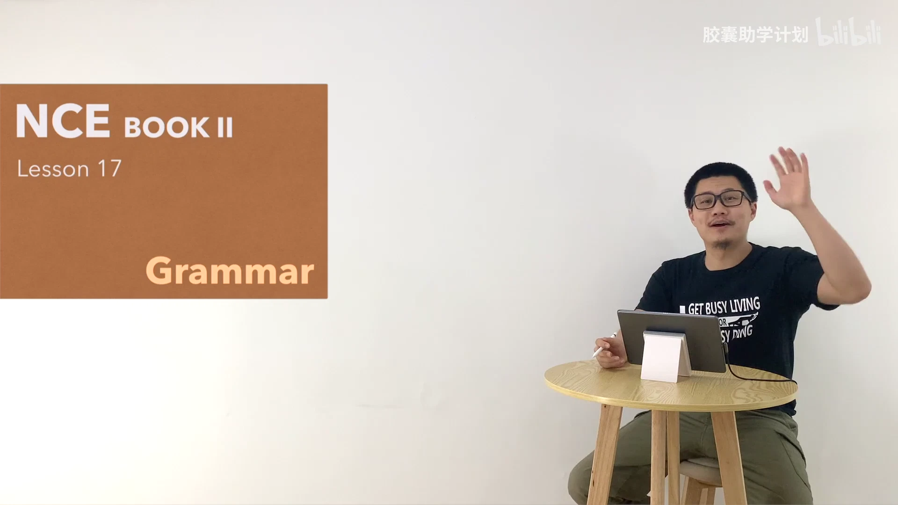

文字识别：胶囊助学计划 / NCE / BOOKII / Lesson 17 / Grammar / GET BUSY LIVING / OR- / SY DING

### 画面 00:00:05

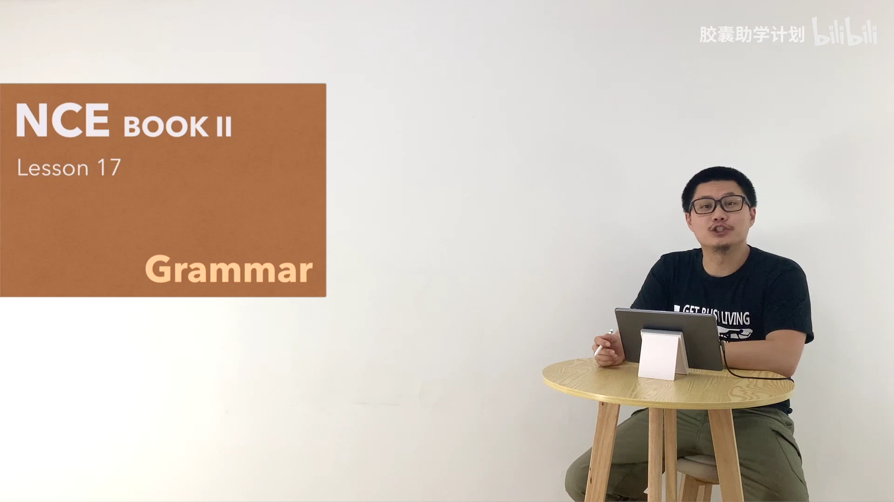

文字识别：blibili / 胶囊助学计划 / NCE / BOOKII / Lesson 17 / Grammar / GET DISLUVING

### 画面 00:00:09

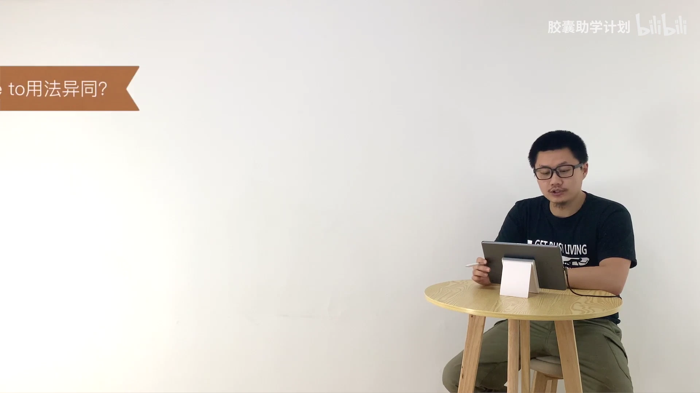

文字识别：刘 bitbi / 胶囊助学计划 / to用法异同? /  GET PUSLUVING

### 画面 00:00:11

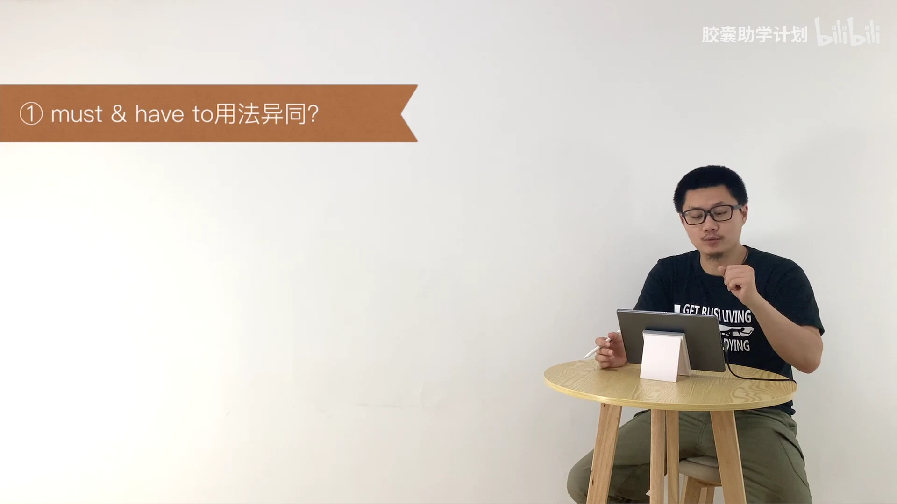

文字识别：胶囊助学计划b出b出 / ①must ＆ have to用法异同？ / GET RLISUVING / PYING

### 画面 00:00:17

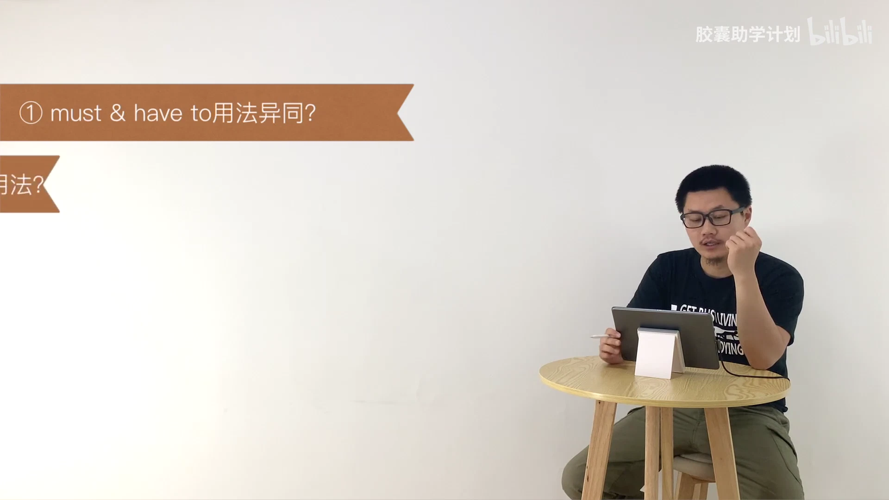

文字识别：Bilbil / 胶囊助学计划 / ① / must ＆have to用法异同? / 月法？ / GCTNI / SIUVIN / DYING

### 画面 00:00:19

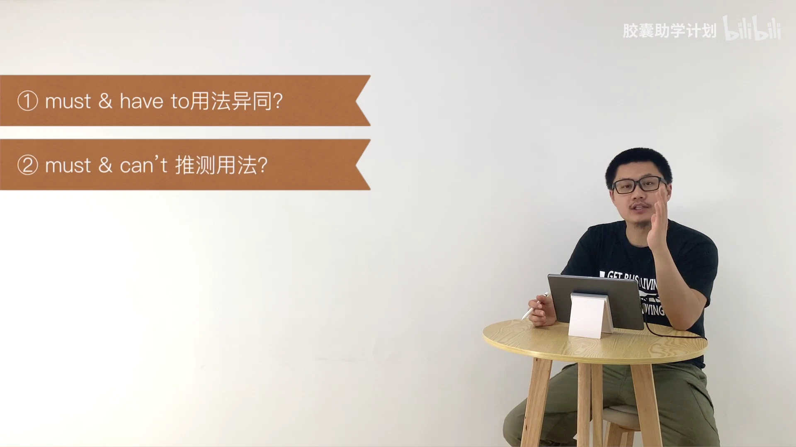

文字识别：bilibili / 胶囊助学计划 / ①must ＆ have to用法异同？ / must＆can't 推测用法? / GET DLSUVIN / DYING

### 画面 00:00:28

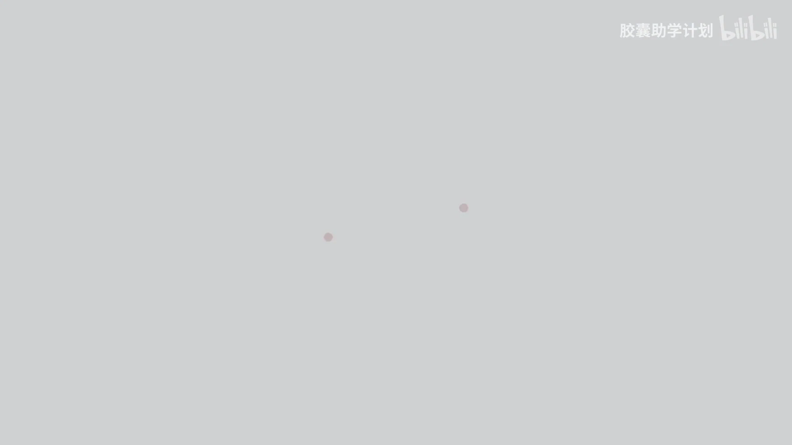

文字识别：胶囊助学计划bill / •

## 00:00:30–00:01:00

好，那我们老习惯啊，我们先把今天的核心单词对吧？这个语法的核心单词给它罗列到这个表格当中，六一二三四五六。我们看一下它们往往处于什么位置。首先，各位要确定 must have to 和 can，我们统通不管它们叫时态，我们管它叫什么呢？我们管它叫情态动词，对吧？如果您学过我们的，看过我们的语法单项的视频，或者您

### 画面 00:00:32

文字识别：胶囊助学计划

### 画面 00:00:34

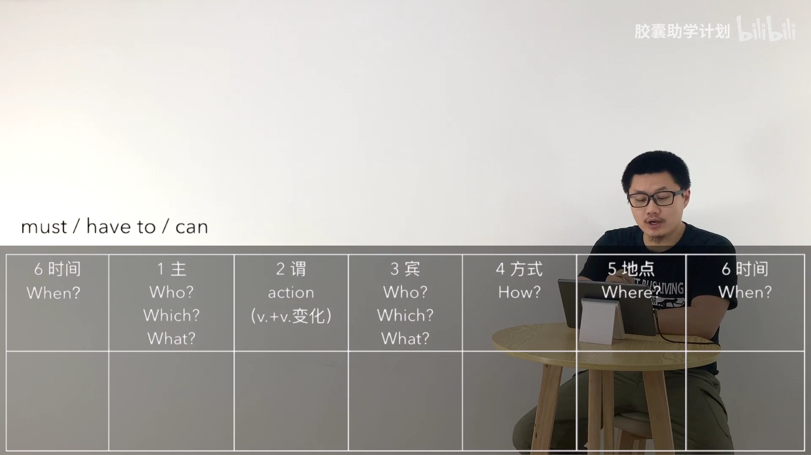

文字识别：biltbili / 胶囊助学计划 / must / have to / can / 6时间 / 1主 / 2谓 / 3宾 / 4方式 / 5地点 / 6时间 / When? / Who? / action / Who? / How? / WhereNG / When? / Which? / (v.+v.变化) / Which? / What? / What?

### 画面 00:00:37

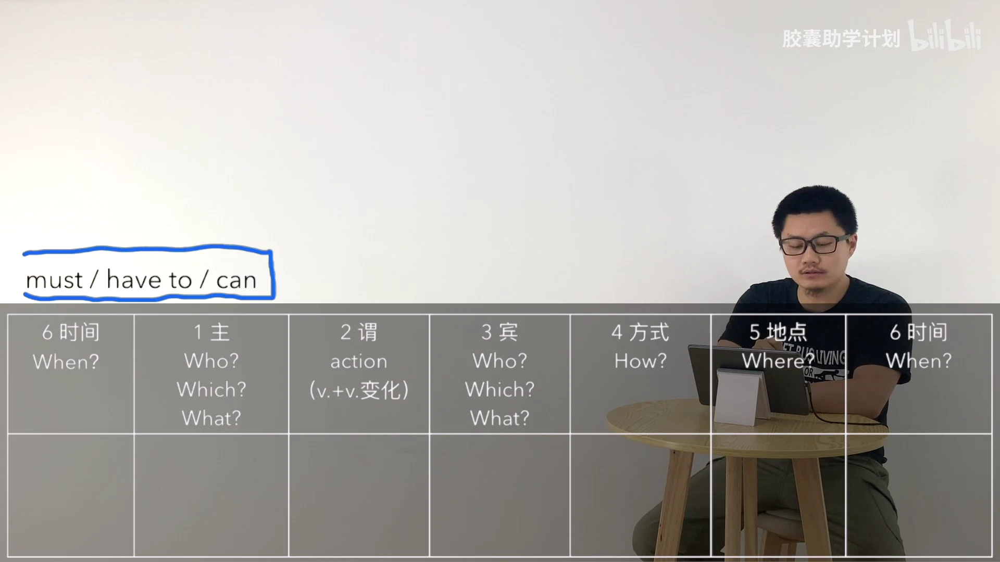

文字识别：Bilbili / 胶囊助学计划 / must / have to / can / 6时间 / 1主 / 2谓 / 3宾 / 4方式 / 5地点 / 6时间 / CTD / When? / Who? / action / Who? / How? / WheresuVINd / When? / Which? / (v.+v.变化) / Which? / What? / What?

## 00:01:00–00:01:30

看过我们新一的视频，那应该是比较清楚的。这些情态动词，它们一定啊，几乎一定是跟动词放在一起去一起使用的，它们往往不单独去使用。OK，好，那所以它就是我们谓语这个地方的所谓叫动词加动词变化的，那它必然本身就包含了什么各种四句型转换啊，然后以及这个情态动词换成那个情态动词啊，对吧？它是我们造句

### 画面 00:01:07

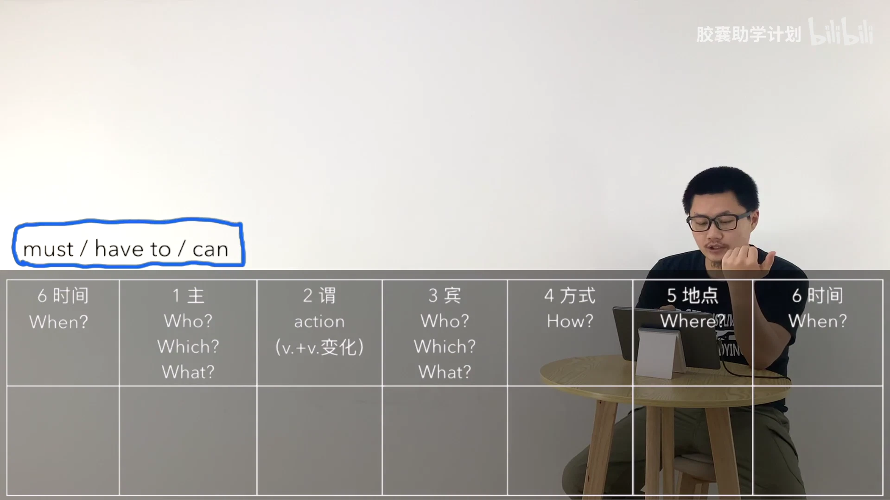

文字识别：胶囊助学计划 / must / have to / can / 6时间 / 1主 / 2谓 / 3宾 / 4方式 / 5地点 / 6时间 / When? / Who? / action / Who? / How? / Wheresu / When? / Which? / (v.+v.变化) / Which? / IOYIN / What? / What?

## 00:01:30–00:02:00

当中必不可少的一个部分之一，对吧？也是非常核心的，所以这节课各位要认真去听。OK，好，那接下来我们第一步先去解决第一个问题，叫 must 与 have to 的一些异同。好，给大家总结了一个表格，我们先一起看一下啊。首先各位要知道，它们统称为的叫情态动词。然后呢，它 present 就是现在，future 就是未来，past 就是过去。

### 画面 00:01:37

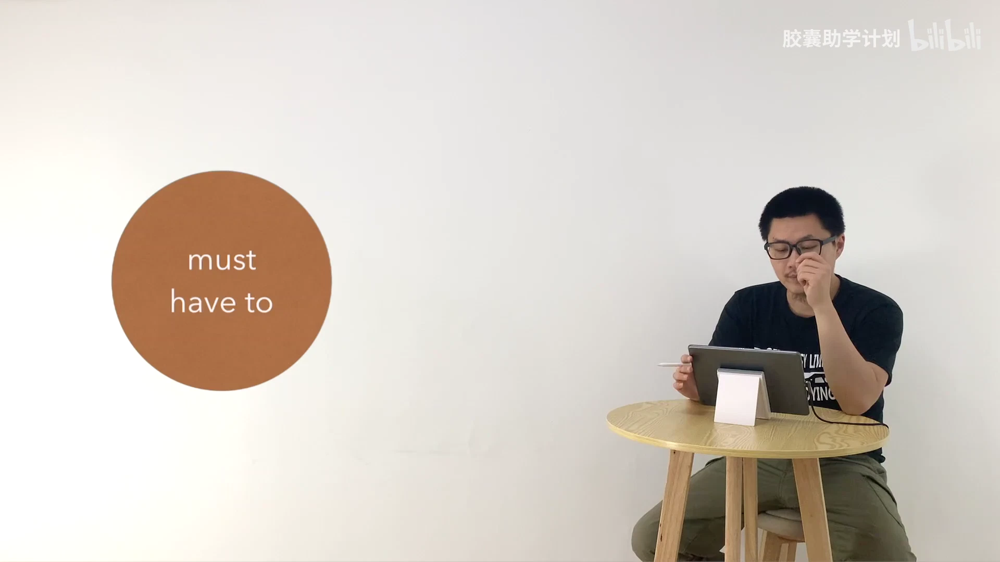

文字识别：胶囊助学计划bl出 / must / have to

### 画面 00:01:45

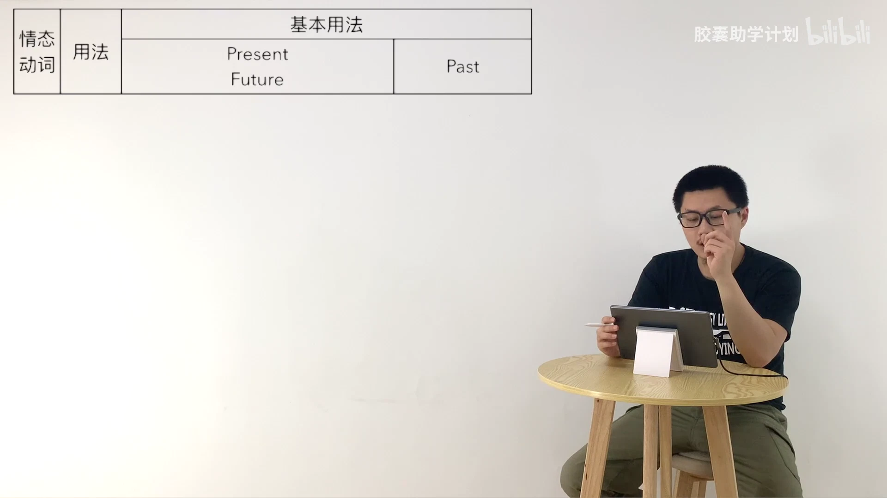

文字识别：基本用法 / 胶囊助学计划bilb出 / 情态 / 用法 / Present / 动词 / Past / Future

## 00:02:00–00:02:30

我们给它变成了两个不同的时间段，现在将来这是第一个时间段，第二个时间段叫过去。我们首先要看的是 must 这个单词，早在新概念一册六十一课、六十二课、六十三课、六十四课啊，我们就学过了它的用法。首先，它的肯定就是很简单，表示必须，比如说 I must do it，很简单，翻译成汉语叫我必须要做它，对吧？但是注意，它只能表示现在将来，它不能表示过去。

### 画面 00:02:07

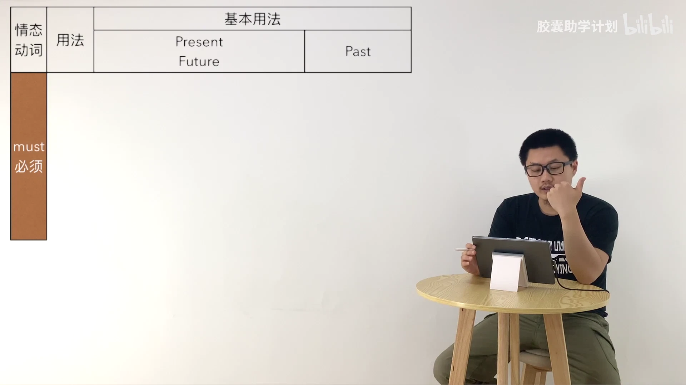

文字识别：基本用法 / Bilfbli / 情态 / 胶囊助学计划 / 用法 / Present / 动词 / Past / Future / must / 必须

## 00:02:30–00:03:00

如果说过去我必须要做怎么办呢？它就要借助于马上我们要讲到的这个，实际上在新概念一册没有记错的话，一百二十五课我们也学过，叫 have to 的变体变成 had to 来表示过去，叫我当时必须去做它，或我当时不得不去做它。OK，所以目前各位能看到他们二者的意思好像是有一些类似的，对不对？接下来各位要注意的另外一件事情就是，它肯

### 画面 00:02:37

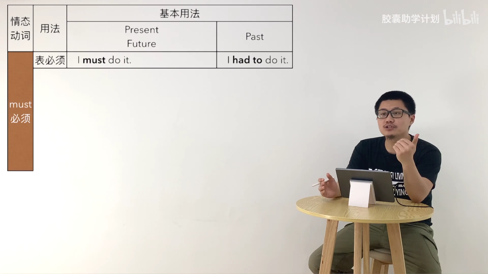

文字识别：基本用法 / 胶囊助学计划 bilb出 / 情态 / 用法 / Present / 动词 / Past / Future / 表必须 / I must do it. / I had to do it. / must / 必须 / SYLVA

## 00:03:00–00:03:30

定句当中虽然表示的是必须，但是在否定句的时候，按逻辑上来说，如果你肯定句是必须，那否定句就是不必须，对吧？但是语言不完全符合逻辑，所以它的否定是一个例外。它的否定往往表的表示的是禁止去做某件事情，语气非常的强烈，所以我们往往呢是不用它的，是用剩下这三个去做替代的啊，用 don't count 和 better not。

### 画面 00:03:07

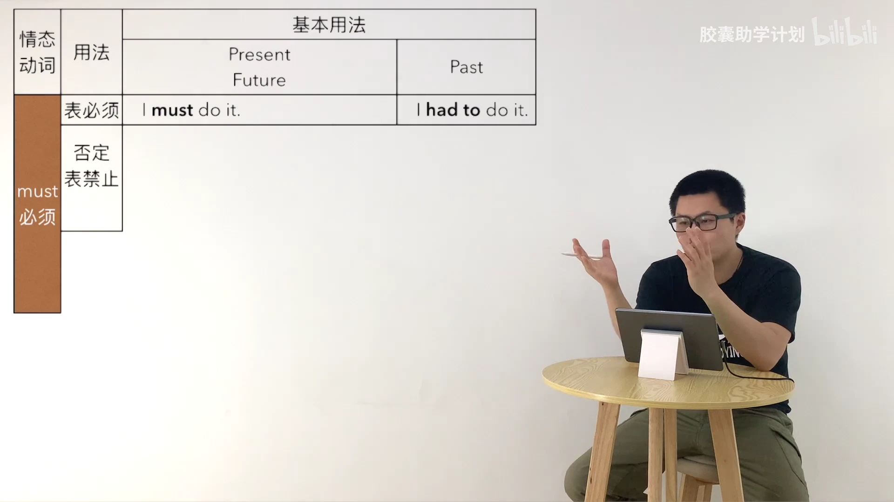

文字识别：基本用法 / 胶囊助学计划 bl出 / 情态 / 用法 / Present / 动词 / Past / Future / 表必须 / I must do it. / I had to do it. / 否定 / 表禁止 / must / 必须

### 画面 00:03:22

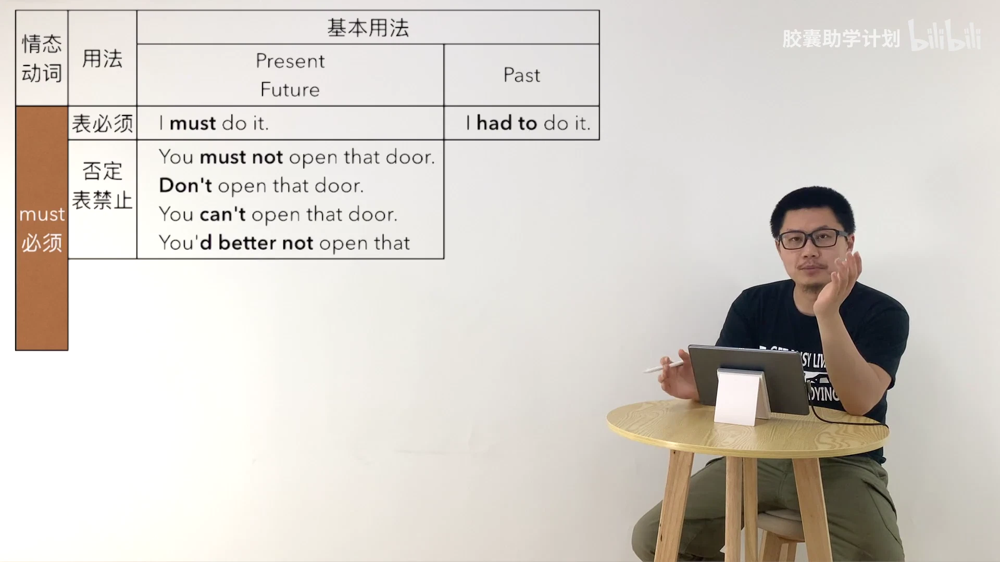

文字识别：基本用法 / 胶囊助学计划bilb出 / 情态 / 用法 / Present / 动词 / Past / Future / 表必须 / I must do it. / I had to do it. / You must not open that door. / 否定 / Don't open that door. / 表禁止 / must / You can't open that door. / 必须 / You'd better not open that / SYLV / YING

## 00:03:30–00:04:00

Okay, I will first give an example. For example, we look at this sentence. You must not open that door. This sentence, if we follow the logic to translate, its meaning should be that you do not need to open that door. You do not need to open that door. This tone is not very strong, but the language does not follow the logic. Its real translation is that you are forbidden to open that door. This tone is more intense. In life, we are not very commonly used. We often use the following to translate.

### 画面 00:03:34

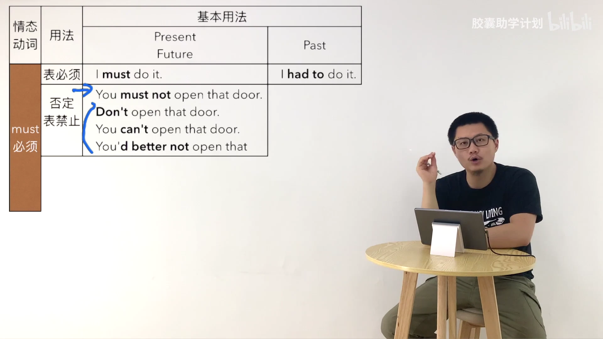

文字识别：基本用法 / 情态 / 胶囊助学计划 / 用法 / Present / 动词 / Past / Future / 表必须 / I must do it. / I had to do it. / You must not open that door. / 否定 / 'Don't open that door. / 表禁止 / must / You can't open that door. / 必须 / You'd better not open that / YLING

## 00:04:00–00:04:30

经常用如下的这些去替代它，都是我们之前学过的。比如说新一三十九课就学过了，叫做 don't do something，别这么去做。那你说 don't open that door，就别开那个门，这个语气没有那么强硬，对吧？啊，以及 you can't open that door，说你别开那个门啊，这个是我们新一四十一课、啊四十三课、四十五课学过的一个语法，叫不能，对吧？你不能开那个门。包括新一九十五课学过的，叫做 had better，

### 画面 00:04:02

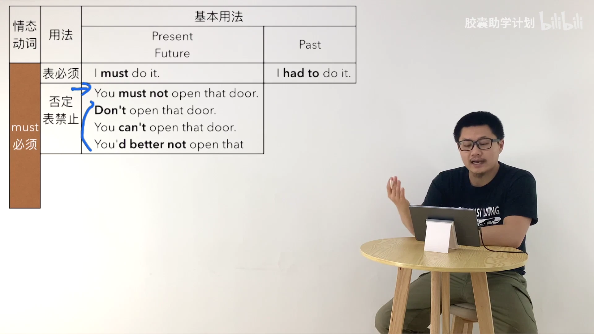

文字识别：基本用法 / 胶囊助学计划 / Bilbil / 情态 / 用法 / Present / 动词 / Past / Future / 表必须 / I must do it. / I had to do it. / You must not open that door. / 否定 / 'Don't open that door. / 表禁止 / must / You can't open that door. / 必须 / You'd better not open that / SY LING

### 画面 00:04:19

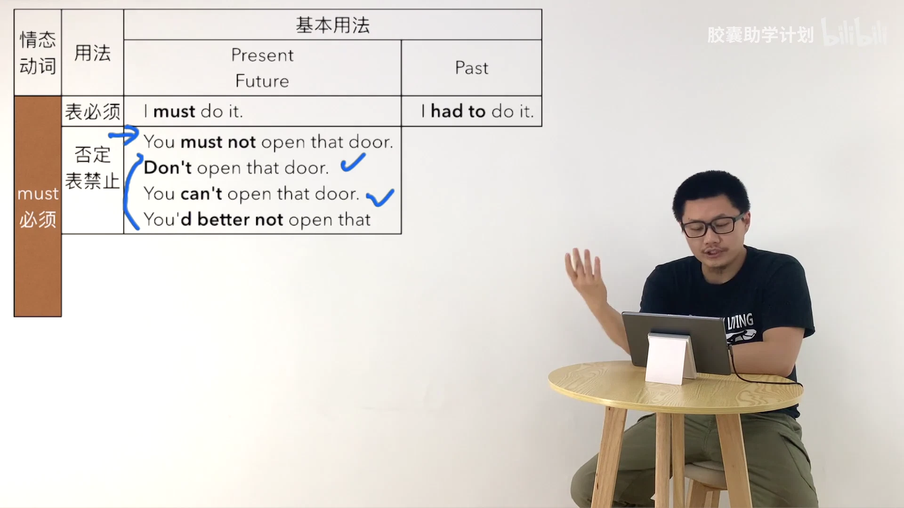

文字识别：基本用法 / 情态 / 胶囊助学计划 / 用法 / Present / 动词 / Past / Future / 表必须 / I must do it. / I had to do it. / You must not open that door. / 否定 / 'Don't open that door. / 表禁止 / must / You can't open that door. / 必须 / You'd better not open that / LING

### 画面 00:04:22

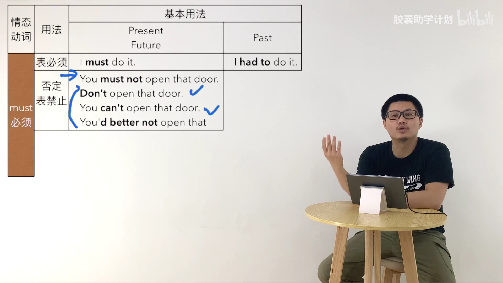

文字识别：基本用法 / 胶囊助学计划 / 情态 / 用法 / Present / 动词 / Past / Future / 表必须 / I must do it. / I had to do it. / You must not open that door. / 否定 / ?Don't open that door. / 表禁止 / must / You can't open that door. / 必须 / You'd better not open that / YLING

## 00:04:30–00:05:00

叫做 you'd better not open that door。你最好不要开那个门，你要是开了，可能会有一些麻烦、困难或危险，对吧？这个都有一点点没有那么强硬，或者甚至有一点商量的口吻的。OK，好，那它呢？我们是不提过去的，对吧？我们说了，它没有表示过去的这个能力。如果是一般疑问句呢？就像我们新一讲过的那样，就是 must 提到句首就可以了。但是啊，各位注意，大多数情况下一般疑问句我们

### 画面 00:04:52

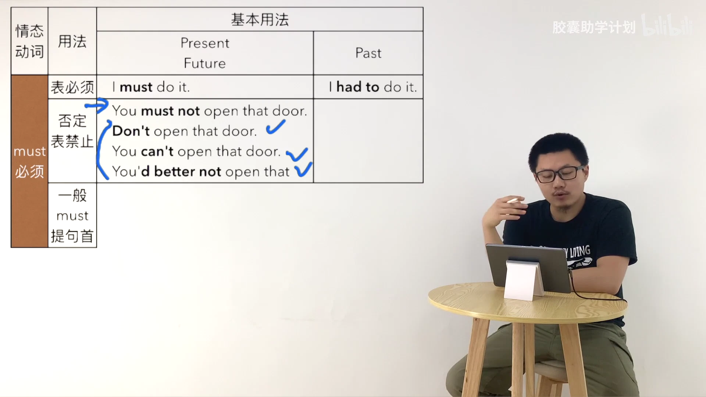

文字识别：基本用法 / 情态 / 胶囊助学计划 / 用法 / Present / 动词 / Past / Future / 表必须 / I must do it. / I had to do it. / You must not open that door. / 否定 / Don't open that door. / 表禁止 / must / You can't open that door. / 必须 / You'd better not open that / 一般 / must / 提句首 / YLING

## 00:05:00–00:05:30

们直接用 have to 去替代，而不是用 must 去做一个表述。这个不叫，这个不存在叫对不对了，都是对的。你用 have to 去变，对吧？也是对的。用 must 提句首去变也是对的。只是相对而言，人们是有一个语言习惯的，语言习惯会随着时间的改变而改变，对吧？现在大多数人的语言习惯可能是用 have to，而不是用 must 了。你用 must，别人依旧能听

### 画面 00:05:22

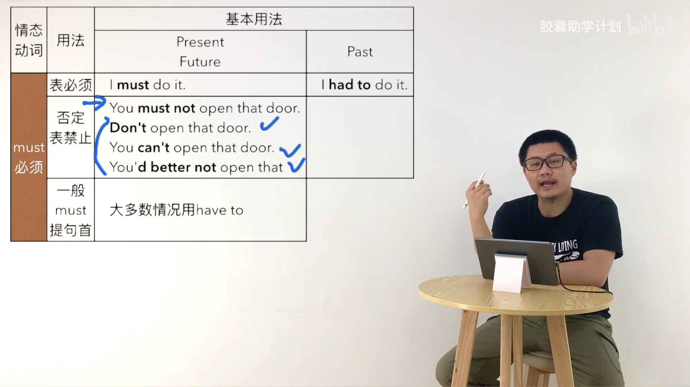

文字识别：基本用法 / 情态 / 胶囊助学计划 / 用法 / Present / 动词 / Past / Future / 表必须 / I must do it. / I had to do it. / You must not open that door. / 否定 / Don't open that door. / 表禁止 / must / You can't open that door. / 必须 / You'd better not open that / 一般 / 大多数情况用have to / must / 提句首 / YLING

## 00:05:30–00:06:00

懂。OK，这个逻辑各位清楚就行了，好吧？那我们依旧不谈过去。接下来，刚才提到了 have to，那我们接下来必须要再过一遍 have to。这是新一百二十五课，我没有记错的话，对吧？这是我们学到的。它实际上第一个，各位要知道，它比 must 更加常见。一会儿我们去讲 must 与 have to 做对比的时候，您就清楚为什么它比 must 更常见了，好吧？在这儿，我们就先知道这个结论就可以了。用法呢，

### 画面 00:05:35

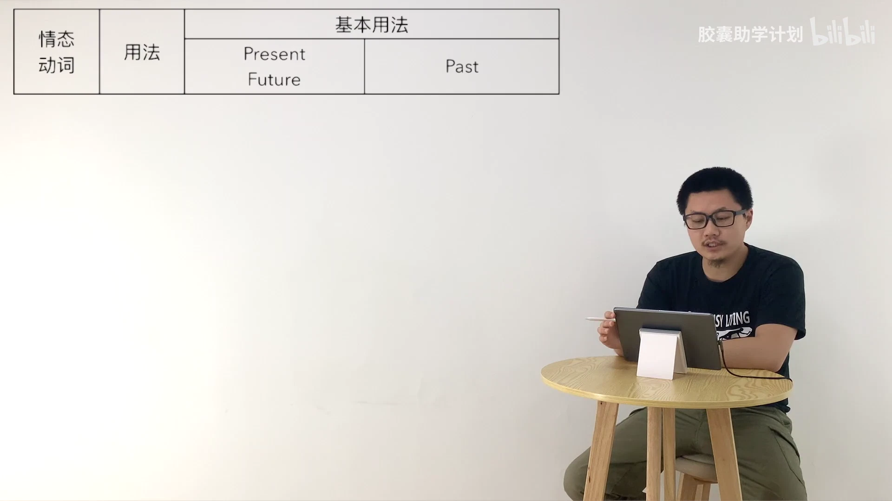

文字识别：基本用法 / 胶囊助学计划bi出 / 情态 / 用法 / Present / 动词 / Past / Future / SY VING

### 画面 00:05:37

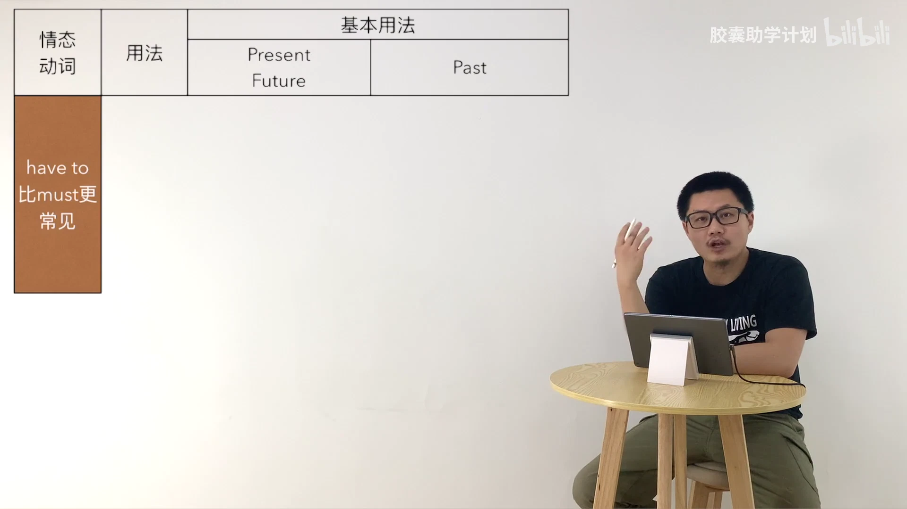

文字识别：基本用法 / Bifbli / 胶囊助学计划 / 情态 / 用法 / Present / 动词 / Past / Future / have to / 比must更 / 常见 / LING

### 画面 00:05:39

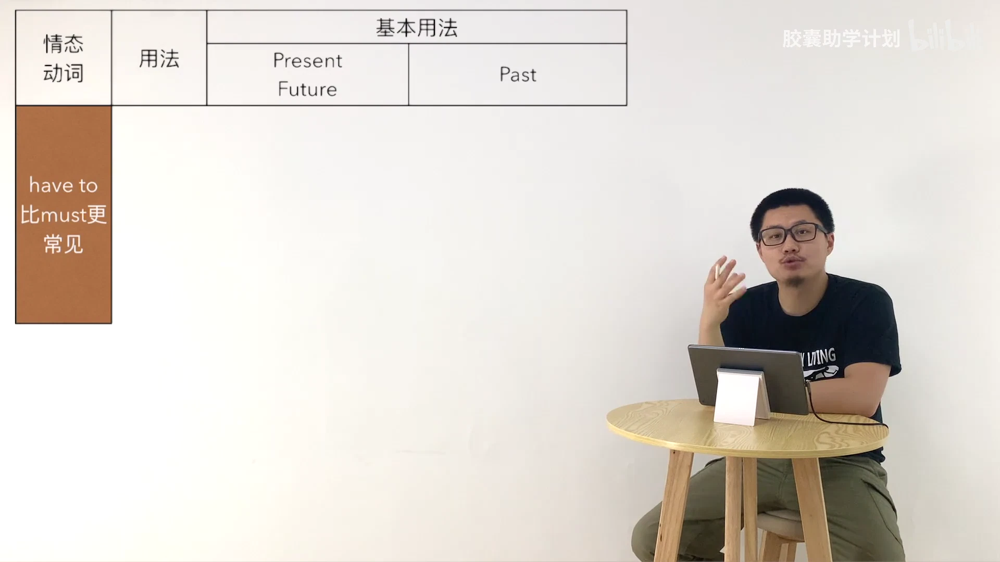

文字识别：基本用法 / 情态 / 胶囊助学计划 / 用法 / Present / 动词 / Past / Future / have to / 比must更 / 常见 / YLING

### 画面 00:05:45

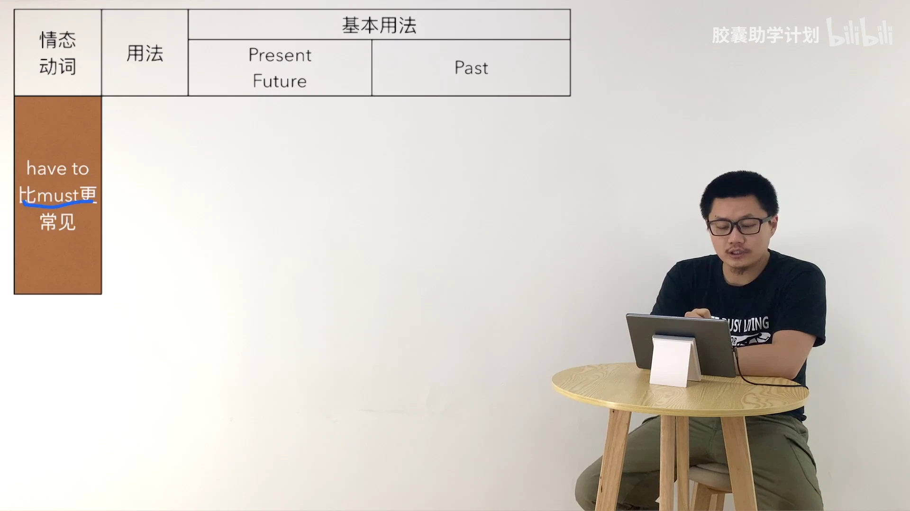

文字识别：基本用法 / Bilbili / 胶囊助学计划 / 情态 / 用法 / Present / 动词 / Past / Future / have to / 比must更 / 常见 / USY LING

## 00:06:00–00:06:30

它的肯定句跟 must 是一样的，都是表示必须。比如说，I have to go to class today. 我必须今天要去上课。当然，have to 因为它的用法一会儿我们会讲到，和 must 有一点点看似的区别，所以它还可以翻译成叫不得不。各位这两个含义您都把它记住。第一个叫必须，第二个叫不得不。当然了，它如果表过去非常简单。您注意，你看 have to 是可以配合时态的，

### 画面 00:06:05

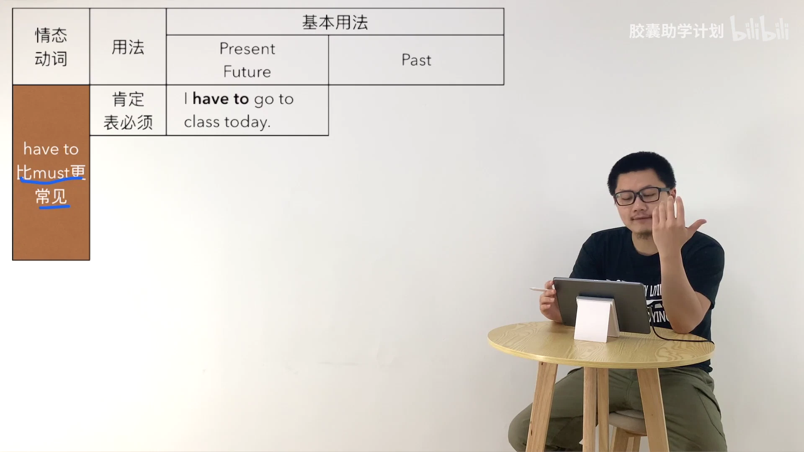

文字识别：基本用法 / 胶囊助学计划 / 情态 / 用法 / Present / 动词 / Past / Future / 肯定 / I have to go to / 表必须 / class today. / have to / 比must更 / 常见 / 际

## 00:06:30–00:07:00

您可以把have变成had，对吧？就变成了had to。于是这句话就变成I had to go to class yesterday.我昨天必须要去上学。你看这个have to本身是有时态变化的，对吧？注意，你看刚才我们讲must它的否定表禁止，那留下了一个疑问，其实就是不必怎么表达呢？用have to的否定就可以了。比如说I don't have

### 画面 00:06:35

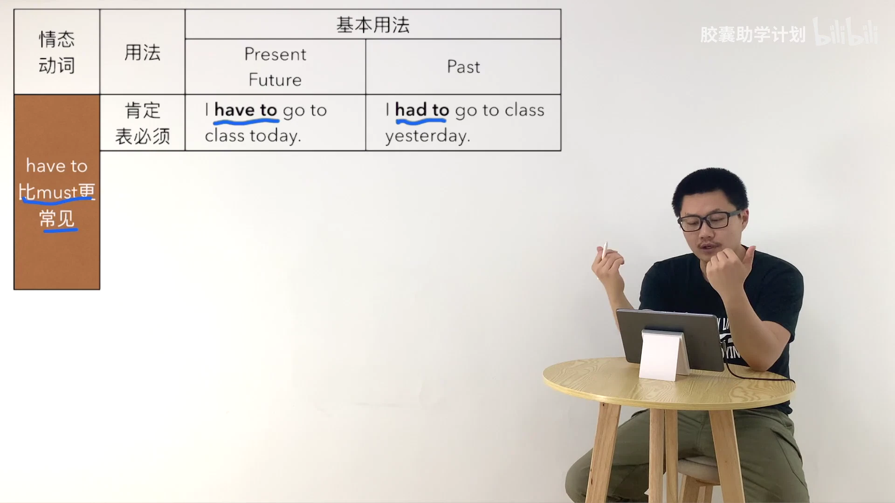

文字识别：基本用法 / 情态 / 胶囊助学计划 / 用法 / Present / 动词 / Past / Future / 肯定 / I have to go to / I had to go to class / 表必须 / class today. / yesterday. / have to / 比must更 / 常见

### 画面 00:06:57

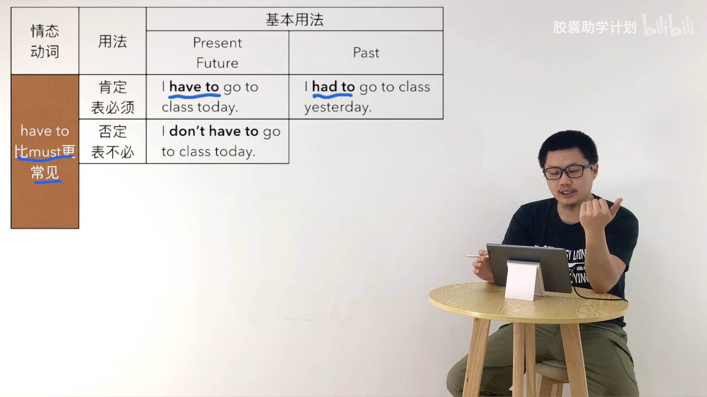

文字识别：基本用法 / 胶囊助学计划 / 情态 / 用法 / Present / 动词 / Past / Future / 肯定 / I have to go to / I had to go to class / 表必须 / class today. / yesterday. / have to / 否定 / I don't have to go / 比must更 / 表不必 / to class today. / 常见 / SYLIN

## 00:07:00–00:07:30

to go to class today.我不必今天去上学，对吧？然后其次注意一下，因为我们刚才讲到了 have to 是有时态的，所以您看这个地方，这就是时态。Don't告诉你的就是非三单，并且它还是一般现在时。那如果你把后边这句话过去进行否定呢，就是用的 didn't，并且动词换回原形。你看跟之前学的没任何区别。如果您一般过

### 画面 00:07:18

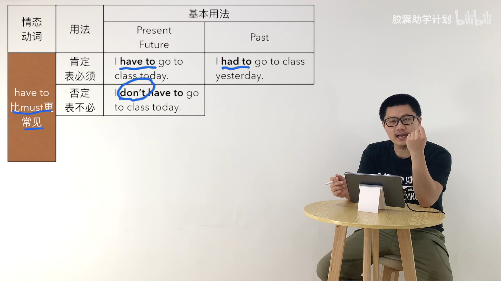

文字识别：基本用法 / Biibili / 胶囊助学计划 / 情态 / 用法 / Present / 动词 / Past / Future / 肯定 / I have to go to / I had to go to class / 表必须 / class today. / yesterday. / have to / 否定 / don't Xave to go / 比must更 / 表不必 / to class today. / 常见

## 00:07:30–00:08:00

去时学的还不错的话，OK，这句话变成了 I didn't have to go to class yesterday. 我昨天不必去上课，对吧？你问我昨天为什么没去上课呀？因为不必嘛。OK，接下来它一般比 must 要更加常见一点点。比如说一般疑问句，那您刚才都知道了 do 后边加 not，那一般疑问句就是 do 提前，对吧？您刚才都知道了用 did 后边加 not，那一般疑问句如果是过去，就是把

### 画面 00:07:30

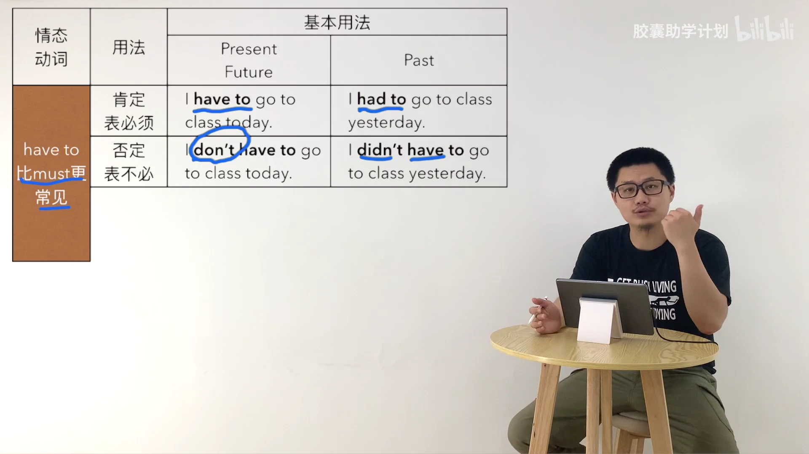

文字识别：基本用法 / 胶囊助学计划bl出 / 情态 / 用法 / Present / 动词 / Past / Future / 肯定 / I have to go to / I had to go to class / 表必须 / class today. / yesterday. / have to / 否定 / don't Yave to go / I didn't have to go / 比must更 / 表不必 / to class today. / to class yesterday. / 常见 / HSIVING / DYING

### 画面 00:07:46

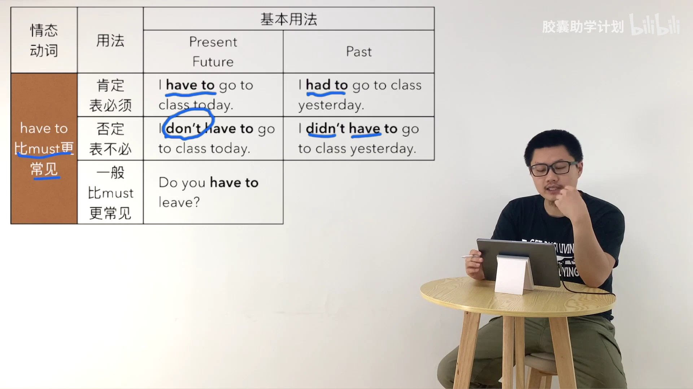

文字识别：基本用法 / Bilbl / 胶囊助学计划 / 情态 / 用法 / Present / 动词 / Past / Future / 肯定 / I have to go to / I had to go to class / 表必须 / class today. / yesterday. / have to / 否定 / don't have to go / I didn't have to go / 比must更 / 表不必 / to class today. / to class yesterday. / 常见 / 一般 / Do you have to / 比must / leave? / 更常见 / YING

### 画面 00:07:56

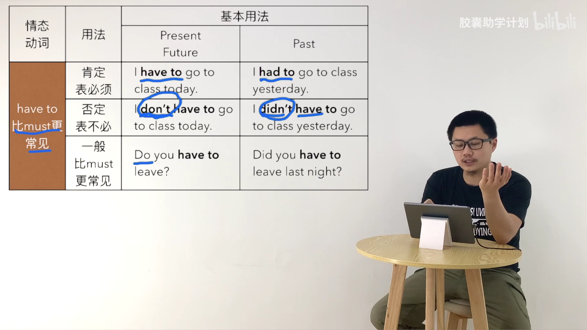

文字识别：基本用法 / 情态 / 胶囊助学计划 / 用法 / Present / 动词 / Past / Future / 肯定 / I have to go to / I had to go to class / 表必须 / class today. / yesterday. / have to / 否定 / don't have to go / didn'th / have to go / 比must更 / 表不必 / to class today. / to class yesterday. / 常见 / 一般 / Do you have to / Did you have to / 比must / leave? / leave last night? / 更常见 / SYLVI

## 00:08:00–00:08:30

did 提到句首去。我刚才讲到了这地方，只给大家罗列了两个时态，一个是一般现在时，一个是一般过去时。那它其实还可以跟别的时态连起来，比如说 will have to do，那叫做将不得不变一般疑问句，谁提前呢？ Will 提前，对吧？这和您学的一般将来时 will 提前是没有任何区别的，是保持一致的啊。比如说 I'm is are going to have

### 画面 00:08:05

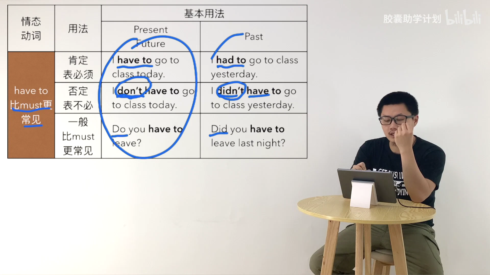

文字识别：基本用法 / 胶囊助学计划bilb出 / 情态 / 用法 / Present / 动词 / Past / uture / 肯定 / have to go to / had to go to class / 表必须 / class today. / yesterday. / have to / 否定 / don't Yave to go / didn'th / have to go / 比must更 / 表不必 / to class today. / to class yesterday. / 常见 / 一般 / Do you have to / Did you have to / 比must / eave? / leave last night? / 更常见 / VSIW

### 画面 00:08:07

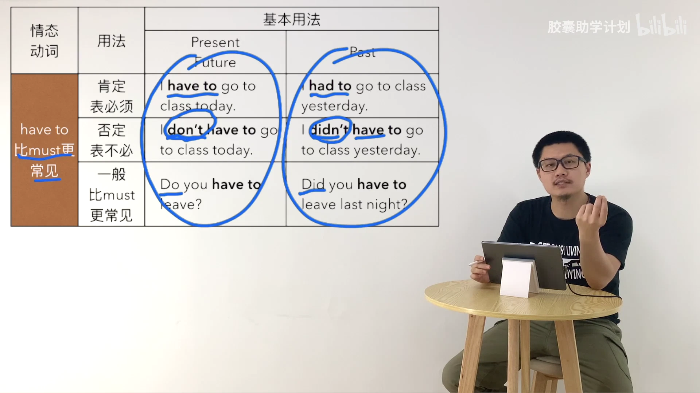

文字识别：基本用法 / Biibilt / 胶囊助学计划 / 情态 / 用法 / Present / 动词 / uture / 肯定 / have to / go to / had to go to class / 表必须 / class today. / yesterday. / have to / 否定 / don't lave to go / didn't / have to go / 比must更 / 表不必 / to class today. / to class yesterday. / 常见 / 一般 / Do you have to / Did you have to / 比must / eave? / leave last night? / 更常见 / SILVIN / MYIN

## 00:08:30–00:09:00

to啊，也是将不得不。OK，那谁提前呢？跟您学的I'm is are going to do没有任何区别。I'm is are提前，对吧？这些东西提到句首去，以及have to do或has to do。我们在这个地方给大家提供的啊，这个地方提供的是have to do。那has to do是什么？无非就是变成三单吧。比如说这句话不是I have to go to class today，变成He has

### 画面 00:08:37

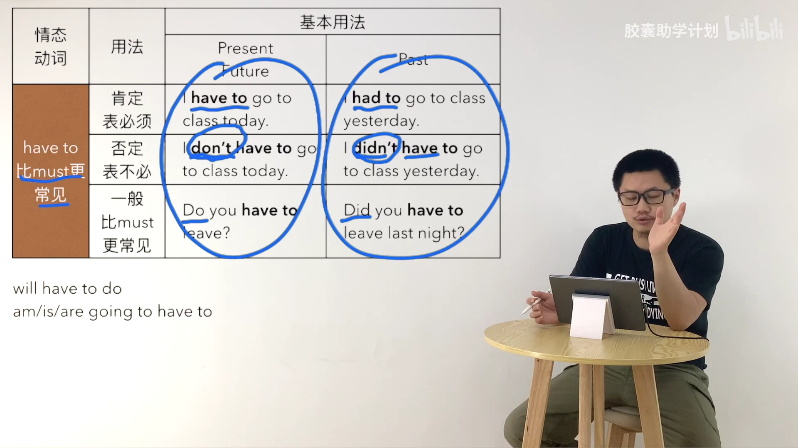

文字识别：基本用法 / Bibl / 胶囊助学计划 / 情态 / 用法 / Present / 动词 / uture / 肯定 / have to go to / had to go to class / 表必须 / class today. / yesterday. / have to / 否定 / don't Xave to go / didn'th / have to go / 比must更 / 表不必 / to class today. / to class yesterday. / 常见 / 一般 / Do you have to / Did you have to / 比must / eave? / leave last night? / 更常见 / will have to do / SIUN / am/is/are going to have to

### 画面 00:08:39

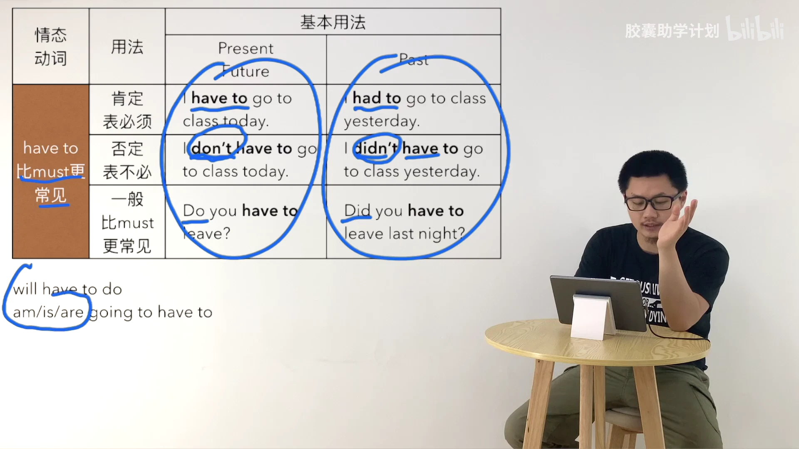

文字识别：基本用法 / 胶囊助学计划bll / 情态 / 用法 / Present / 动词 / uture / 肯定 / have to / go to / had to go to class / 表必须 / class today. / yesterday. / have to / 否定 / don't Xave to go / didn't / have to go / 比must更 / 表不必 / to class today. / to class yesterday. / 常见 / 一般 / Do you have to / Did you have to / 比must / eave? / leave last night? / 更常见 / will have to do / USIW / am/is/are going to have to

### 画面 00:08:45

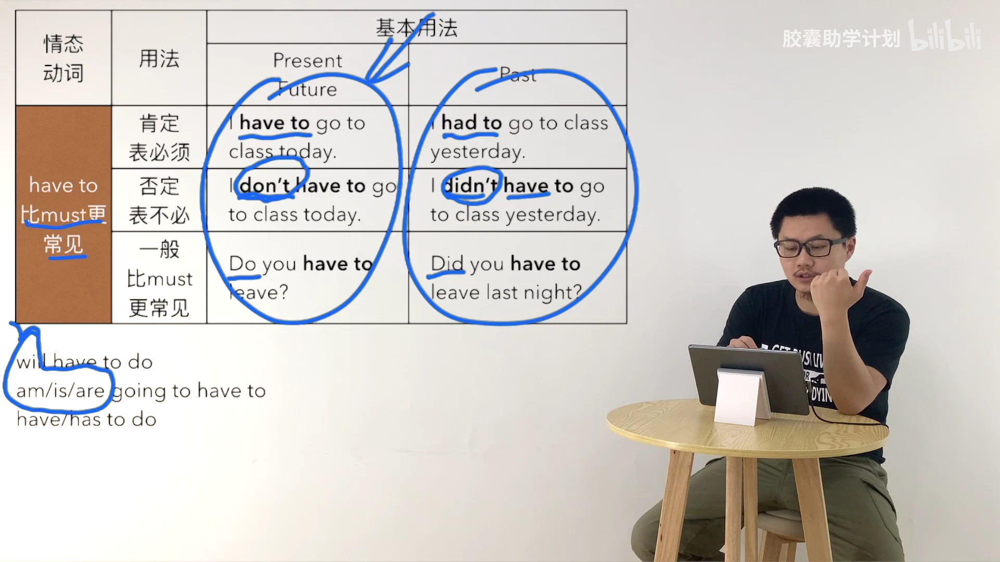

文字识别：基本用法 / Bilbil / 情态 / 胶囊助学计划 / 用法 / Present / 动词 / uture / 肯定 / have to go to / had to go to class / 表必须 / class today. / yesterday. / have to / 否定 / don't yave to go / didn't / have to go / 比must更 / 表不必 / to class today. / to class yesterday. / 常见 / 一般 / Do you have to / Did you have to / 比must / eave? / leave last night? / 更常见 / Lhave to do / wi / am/is/are going to have to / have/has to do

## 00:09:00–00:09:30

to go to school today. 那于是底下就不是 don't 了，就变成了 doesn't。这个地方就变成了 Does he? 能理解哈？ OK，跟之前的时态是紧密相连的。您时态学的越好，这儿越容易理解。或者是 had to do。那在这个地方我讲到了，就不再多提了。 OK，接下来我们讲第三个。看啊，我们先回顾一下刚才我讲了什么。知识点挺密的这一课，我先讲了 must。其实是带大家复习了一下新概念

### 画面 00:09:15

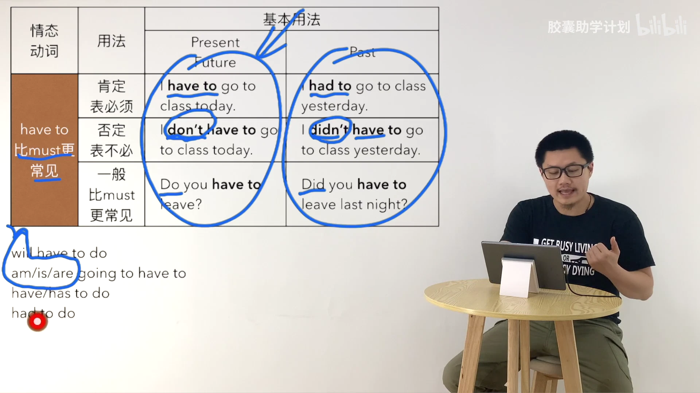

文字识别：基本用法 / 情态 / 胶囊助学计划 / 用法 / Present / 动词 / uture / 肯定 / have to / go to / had to go to class / 表必须 / class today. / yesterday. / have to / 否定 / don't lave to go / didn't / have to go / 比must更 / 表不必 / to class today. / to class yesterday. / 常见 / 一般 / Do you have to / Did you have to / 比must / eave? / leave / last night? / 更常见 / GET RUSY LIVIN / Lhave to do / wi / OR / YDVING / am/is/are going to have to / have/has to do / ha / do

### 画面 00:09:19

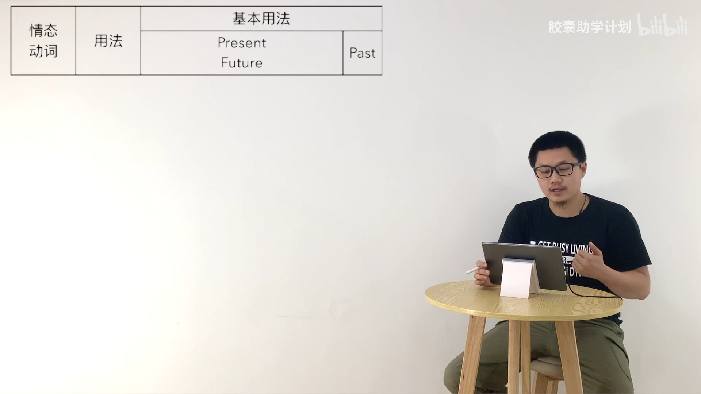

文字识别：基本用法 / Bilbli / 情态 / 胶囊助学计划 / 用法 / Present / 动词 / Past / Future

### 画面 00:09:23

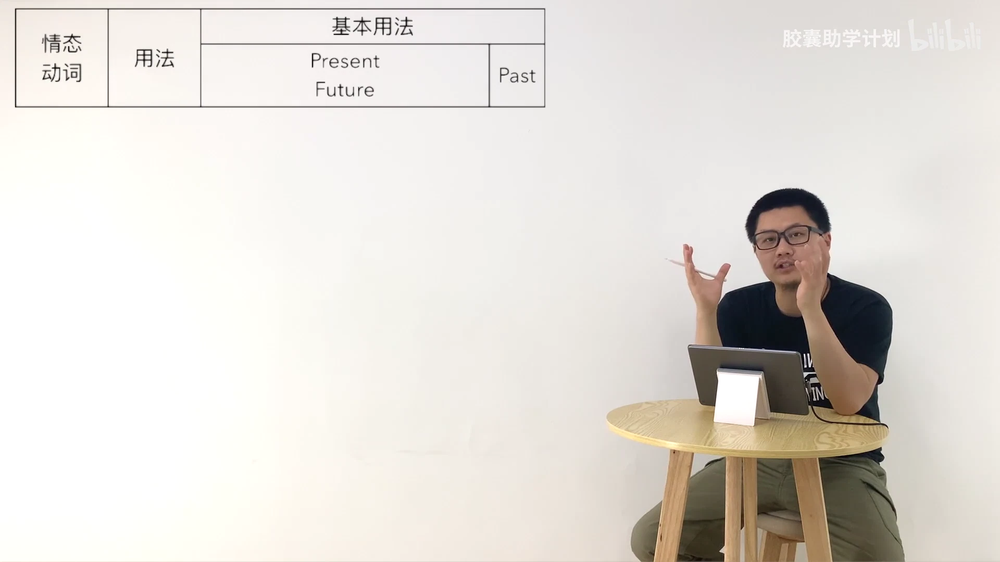

文字识别：基本用法 / 情态 / 胶囊助学计划 / 用法 / Present / 动词 / Past / Future

### 画面 00:09:27

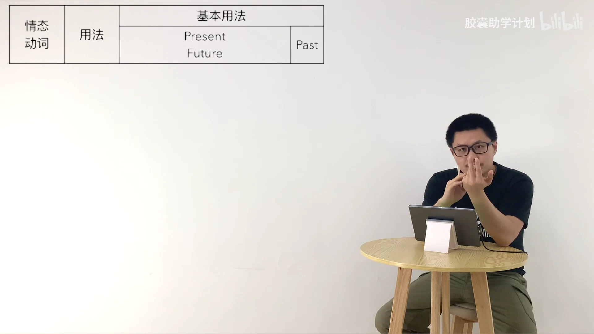

文字识别：基本用法 / 情态 / 胶囊助学计划 / 用法 / Present / 动词 / Past / Future

## 00:09:30–00:10:00

一册六十一到六十三，对吧？这几课的语法啊，must如何去用？接下来又复习了一下新概念一册一百二十五课，have to如何去用？二者有很多的含义上的重合点，比如说至少肯定句当中貌似都表示必须。然后我又提到了说，have to的出现频率要比must要多一点点。那二者我们接下来要讲的就是二者有什么区别？have to与must的区

### 画面 00:09:56

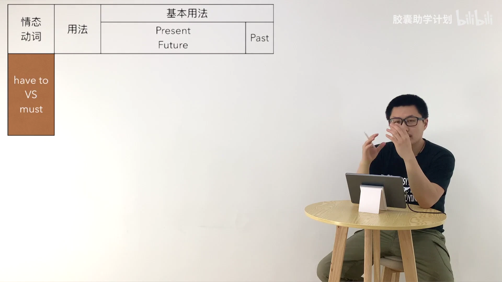

文字识别：基本用法 / 情态 / 胶囊助学计划 / 用法 / Present / 动词 / Past / Future / have to / VS / must

## 00:10:00–00:10:30

别，这个我们其实之前也讲过，他们两者的区别是这样的。首先，一个用法叫做主观的个人感受，比如说，您看这两句话，I must do some more work。我想我自己主观上想去做一些更多的工作，我主观上希望停止抽烟，没有任何人逼我，没有任何外界的情况，就是我突然有一天不想抽了，对吧？就是有一天我认为我需要做更多的工作了，就

### 画面 00:10:08

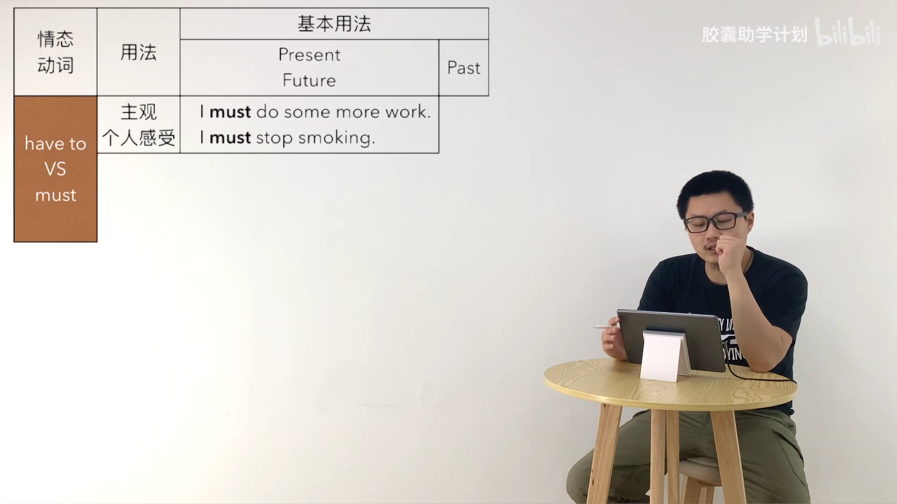

文字识别：基本用法 / 胶囊助学计划b鼎b出 / 情态 / 用法 / Present / 动词 / Past / Future / 主观 / I must do some more work. / 个人感受 / I must stop smoking. / have to / VS / must

### 画面 00:10:11

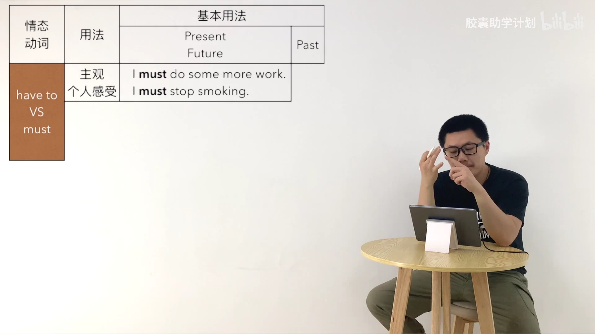

文字识别：基本用法 / 情态 / 胶囊助学计划 / 用法 / Present / 动词 / Past / Future / 主观 / I must do some more work. / 个人感受 / I must stop smoking. / have to / VS / must

## 00:10:30–00:11:00

是我个人主观感受，不提过去。第二个叫做客观的外界情况，比如说 I have to work from nine to five，朝九晚五的工作不是对吧？我们去工作的时候，不是我们规定的朝九晚五，是公司规定的朝九晚五或者九九六，对吧？这个我们也没办法呀，怎么办呢？I have to，客观逼迫着我不得不，记得吧？刚才我讲到了 have to 有两个翻译方式，不得不或必

### 画面 00:10:30

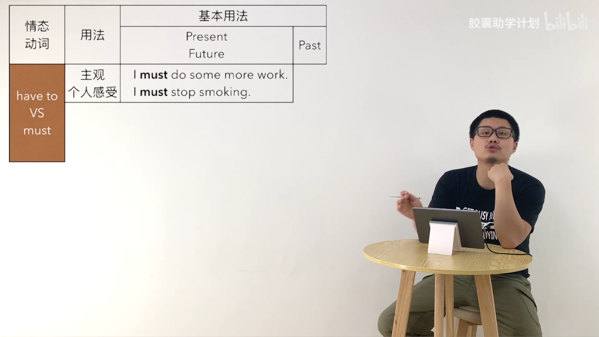

文字识别：基本用法 / 情态 / 胶囊助学计划 / 用法 / Present / 动词 / Past / Future / 主观 / I must do some more work. / 个人感受 / I must stop smoking. / have to / VS / must / USY / YN

### 画面 00:10:36

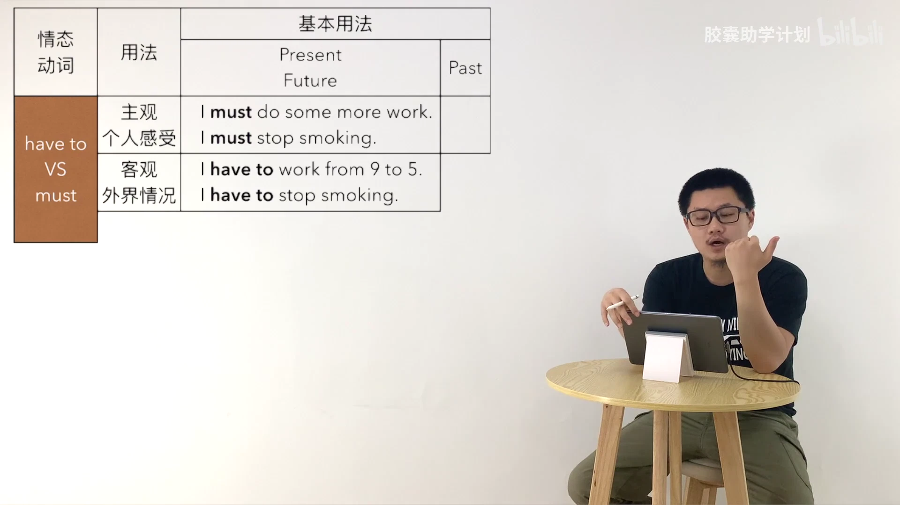

文字识别：基本用法 / 情态 / 胶囊助学计划 / 用法 / Present / 动词 / Past / Future / 主观 / I must do some more work. / 个人感受 / I must stop smoking. / have to / VS / 客观 / I have to work from 9 to 5. / must / 外界情况 / I have to stop smoking.

## 00:11:00–00:11:30

须，于是这就变成了我不得不朝九晚五的去工作啊，不是我自己非常愿意的，不是我主观上希望如此，是我被逼的，对吧？以及 I have to stop smoking。你看这两者啊，只在 must 换成了 have to，区别有一点点在哪儿呢？就是如果你说 have to stop smoking，呢，他的感受就是，比如说，哎呀，你这个咽喉炎太严重了，再抽就说不出话来了，

### 画面 00:11:06

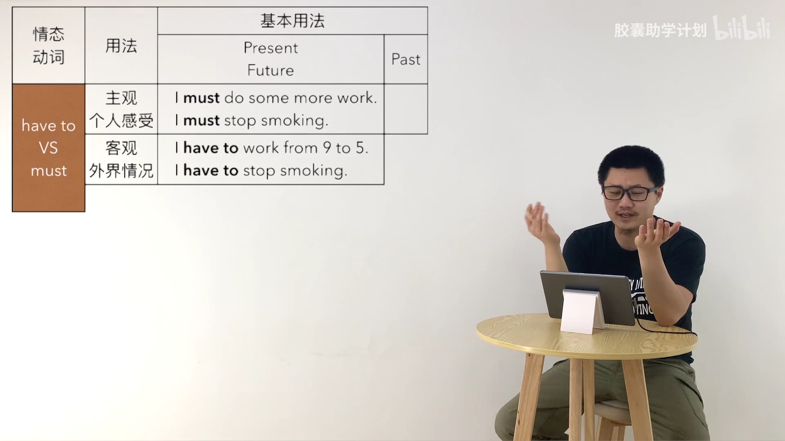

文字识别：基本用法 / 胶囊助学计划bl / 情态 / 用法 / Present / 动词 / Past / Future / 主观 / I must do some more work. / 个人感受 / I must stop smoking. / have to / VS / 客观 / I have to work from 9 to 5. / must / 外界情况 / I have to stop smoking.

### 画面 00:11:11

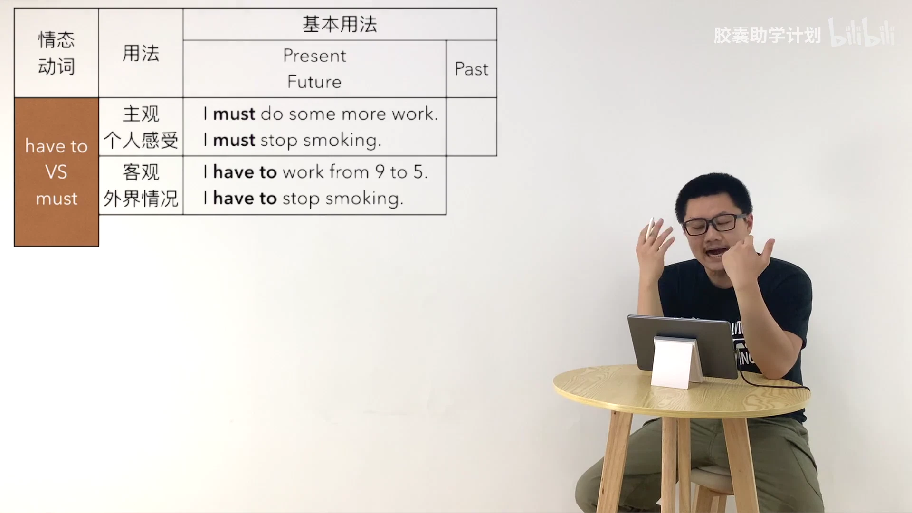

文字识别：基本用法 / 情态 / 胶囊助学计划 / 用法 / Present / 动词 / Past / Future / 主观 / I must do some more work. / 个人感受 / I must stop smoking. / have to / VS / 客观 / I have to work from 9 to 5. / must / 外界情况 / I have to stop smoking.

## 00:11:30–00:12:00

医生医嘱说别抽了，再抽就出问题了。那 I have to stop smoking。我不得不因为外界的情况，对吧？比如说嗓子，比如说医生，比如说亲朋好友，比如说女朋友、老婆，对吧？说不允许抽了啊。于是这个时候就变成了 I have to。好，目前这样看的，貌似二者是有区别的，对吧？这是在英式英语当中。别忘了，我们学的是新概念，这是英式英语。但是呢，美

### 画面 00:11:41

文字识别：基本用法 / 胶囊助学计划 / 情态 / 用法 / Present / 动词 / Past / Future / 主观 / I must do some more work. / 个人感受 / I must stop smoking. / have to / VS / 客观 / I have to work from 9 to 5. / must / 外界情况 / I have to stop smoking.

## 00:12:00–00:12:30

式英语给大家带来了一个好的消息，就是你爱用啥用啥，全用 have to 就可以了。美式英语当中没那么多讲究，什么主观客观，我全给他用 have to 就完了。于是您在电影当中做英文字幕，对吧？你去看英文字幕，must 出现的频率整体感受比 have to 要少很多很多。原因很简单，我分它干嘛呢？既然美式可以不分，我就不分了呗，对吧？我全用 have to 就可

### 画面 00:12:11

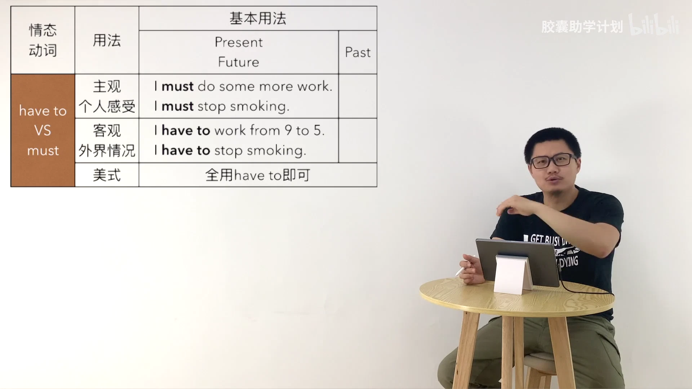

文字识别：基本用法 / 情态 / 胶囊助学计划 / 用法 / Present / 动词 / Past / Future / 主观 / I must do some more work. / 个人感受 / I must stop smoking. / have to / VS / 客观 / I have to work from 9 to 5. / must / 外界情况 / I have to stop smoking. / 美式 / 全用have to即可 / GFT RIISY LV / PYING

## 00:12:30–00:13:00

了。OK，这儿我希望我解释清楚了啊。OK，接下来还有一个小点，就是 have to 的变体叫做 have got to， have got to，不要一个单词一个单词的翻译，这三个单词放到一起表示的意思就是 must 或 have to，就是必须。其次，各位要注意，它是口语当中经常用到的，我们写作也好，

### 画面 00:12:33

文字识别：基本用法 / 胶囊助学计划 / 情态 / 用法 / Present / 动词 / Past / Future / GFT RIISVINING

### 画面 00:12:35

文字识别：基本用法 / 胶囊助学计划 / 情态 / 用法 / Present / 动词 / Past / Future / have got to / 口语 / SYIV

### 画面 00:12:41

文字识别：基本用法 / 胶囊助学计划 / 情态 / 用法 / Present / 动词 / Past / Future / have got to / 口语 / USYII

## 00:13:00–00:13:30

或者说看书也好，对吧？输入输出的时候，一般别主动去用 have got to。 OK，好，那它的含义刚才我说了，也表示必须。那为什么我们生活当中不用 have to，而用 have got to 了呢？我猜啊，我这只能是个人的一个猜测了，是吧？就是它实际上缩写了之后啊，读起来非常的容易，have to， have to，是吧？还是有一点的。你看它缩写，I

### 画面 00:13:10

文字识别：基本用法 / 胶囊助学计划 / 情态 / 用法 / Present / 动词 / Past / Future / I have got to go to / have got to / class today. / 表必须 / 口语 / (I've gotta go) / (I gotta go)

### 画面 00:13:29

文字识别：基本用法 / 胶囊助学计划 / 情态 / 用法 / Present / 动词 / Past / Future / I have got to go to / have got to / class today. / 表必须 / 口语 / (I've gotta go) / (I gotta go) / YV / NING

## 00:13:30–00:14:00

I have got to go class today. 这个听上去还是挺别扭的，但是它能缩写，它可以把 have 变成撇为 e, got to 变成 gotta 啊，跟那个 gonna wanna 我们讲过对吧，是有点像的，就变成 gotta. Okay, 所以甚至这个撇为 e 都可以取消掉，在口语当中，就我必须走了，I must go, I have to go 和 I gotta go. 你听这明

### 画面 00:13:33

文字识别：基本用法 / Bilbili / 胶囊助学计划 / 情态 / 用法 / Present / 动词 / Past / Future / I have got to go to / have got to / class today. / 表必须 / 口语 / (I've gotta go) / (I gotta go) / YING

### 画面 00:13:42

文字识别：基本用法 / Bilbli / 胶囊助学计划 / 情态 / 用法 / Present / 动词 / Past / Future / have / got to go to / have got to / class today. / 表必须 / 口语 / (I'ye gotta go) / (I gotta go) / YLIN

## 00:14:00–00:14:30

显三者明显不一样吧。I must go. I have to go.和I gotta go. I gotta go.是不是很舒服读起来？口语当中讲究的就是偷懒了，怎么舒服怎么怎么来。所以它就变成了I gotta go.口语当中经常出现，但是它没有一个能力去表示过去。你不能把have got to的have变成had. Had gotta go.这个我还真没见过。我查语法书也没见过，对吧？所以我们保险起见，咱都给它

### 画面 00:14:12

文字识别：基本用法 / Bibil / 胶囊助学计划 / 情态 / 用法 / Present / 动词 / Past / Future / have / got to go to / have got to / class today. / 表必须 / 口语 / ( / gotta go) / (I gotta go) / DYING

## 00:14:30–00:15:00

用 have to go。目前为止，好吧。好，其次呢，一般疑问句我们往往不用 have got to，不是不行，是比较罕见。我们现在讲的不是语法，就是用法了。告诉各位哪个更常见一点，对吧？Do you have to go？要更常见一点，而 have you got to go 相对来说罕见一点。我解释清楚了啊。Do you have to go？ Okay。刚才我们讲到的是第一个点，我

### 画面 00:14:34

文字识别：基本用法 / Biltbll / 胶囊助学计划 / 情态 / 用法 / Present / 动词 / Past / Future / Ihave / got to go to / have got to / class today. / I had to go / 表必须 / 口语 / gotta go) / to class yesterday. / (I gotta go) / 一般 / DYING

### 画面 00:14:56

文字识别：bilbil / 胶囊助学计划 / must / can / 现在推测 / GET DISY LVING / DYING

## 00:15:00–00:15:30

讲了四页四个表格，我们在这儿先暂缓一下，我带着大家复习一下，因为知识点稍微有一点点多。先讲了 must，再讲了 have to，再讲了 must 与 have to 的结合对比，最后补充了一个小点，口语当中经常见到的叫做 have got to，是吧？啊 have got to 啊啊 have got to 是吧？OK，然后呢，把它可以缩写成 got to 是吧？got 就可以了，

### 画面 00:15:26

文字识别：胶囊助学计划b出出 / must / can / 现在推测

## 00:15:30–00:16:00

G O T T A。接下来我们还要再啃一块硬骨头，是must与can，他们可以表示推测用法。这个在我们新概念一册也学过。好，今天我们再给它拿过来，重复过一下。这个是各位最容易忘的推测用法。我们先看这个表格，啊，先看上面这段文字啊。首先时间是现在，我把整个表格一会儿讲完了

### 画面 00:15:50

文字识别：Biltbili / 胶囊助学计划 / must／can 表现在推测 / 对现在很确信的肯定推测。“一定是' / must/can / 现在 / 过去 / 表推测 / must do / 肯定 / must be adj./n. / must be doing / 否定

### 画面 00:15:57

文字识别：Biltbili / 胶囊助学计划 / must／can 表现在推测 / 对现在很确信的肯定推测。“一定是' / must/can / 现在 / 过去 / 表推测 / must do / 肯定 / must be adj./n. / must be doing / 否定

## 00:16:00–00:16:30

会讲满这四个表格。OK，那你能看到这一数列是现在，这一数列是过去，对吧？我们现在讲的是现在这一数列。其次，确信程度很确信。你注意，你回想一下什么叫推测，就是我猜这个事情是怎么样的。猜这件事情的时候，英文跟汉语是一样的，可以非常确信。就我虽然不知道事实是这样，但我认为它一定

### 画面 00:16:00

文字识别：Biltbili / 胶囊助学计划 / must／can 表现在推测 / 对现在很确信的肯定推测。“一定是' / must/can / 现在 / 过去 / 表推测 / must do / 肯定 / must le adi/n. / must be doing / 否定

### 画面 00:16:03

文字识别：Bilbil / 胶囊助学计划 / must／can 表现在推测 / 对现在很确信的肯定推测。“一定是' / must/can / 现在 / 过去 / 表推测 / must do / 肯定 / must be adj./n. / must be doing / 否定

### 画面 00:16:05

文字识别：Bilbl / 胶囊助学计划 / must／can 表现在推测 / 对现在很确信的肯定推测。“一定是' / must/can / 现在 / 过去 / 表推测 / must do / 肯定 / must be adj, / n. / must be doi / ng / 否定

### 画面 00:16:09

文字识别：Bibili / 胶囊助学计划 / must／can 表现在推测 / 对现在很确信的肯定推测。“一定是' / must/can / 现在 / 过去 / 表推测 / must do / 肯定 / must be adj./n. / must be doing / 否定

### 画面 00:16:18

文字识别：Bibl / 胶囊助学计划 / must／can 表现在推测 / 对现在很确信的肯定推测。“一定是' / must/can / 现在 / 过去 / 表推测 / must do / 肯定 / must be adj./n. / GET BUSY LIVING / must be doing / YDYING / 否定

### 画面 00:16:25

文字识别：胶囊助学计划 / must／can 表现在推测 / 对现在很确信的肯定推测。“一定是' / must/can / 现在 / 过去 / 表推测 / must do / 肯定 / must be adj./n. / GET RUISY LIVING / must be doing / PYING / 否定

## 00:16:30–00:17:00

是这样的。你依旧是在猜测，但是还有一种猜测叫可能是这样的吧。十九课咱们学，OK。所以今天学的全是很确信的。其次，它是肯定推测。怎么英文？怎么目前我们最熟悉？怎么去判断是肯定还是否定呢？就有一个小的单词叫 not，有 not，否定，没有 not，肯定。所以它翻译成的叫做一定是。我们看

### 画面 00:16:46

文字识别：bibili / 胶囊助学计划 / must／can 表现在推测 / 对现在很确信的肯定推测。“一定是' / must/can / 现在 / 过去 / 表推测 / must do / 肯定 / must be adj./n. / must be doing / LVIN / 否定

### 画面 00:16:49

文字识别：bibli / 胶囊助学计划 / must/can 表现在推测 / 对现在很确信的肯定推测。“一定是' / must/can / 现在 / 过去 / 表推测 / must do / 肯定 / must be adj./n. / SY IW / must be doing / 否定

### 画面 00:16:51

文字识别：bibli / 胶囊助学计划 / must/can 表现在推测 / not / 对现在很确信的肯定推测。“一定是” / must/can / 现在 / 过去 / 表推测 / must do / 肯定 / must be adj./n. / must be doing / VSY VII / 否定

## 00:17:00–00:17:30

一下这三个结构，第一个叫 must 加 do。刚才我们刚学过 must do 表必须，现在告诉您了 must do 有第二个翻译方式，表示一定是表推测。must 后边还可以加 be，然后再加形容词或名词，也是表推测。甚至可以 must 加 be 加 doing，表示一个动作一定是正在进行。您看，把情态动词跟时

### 画面 00:17:04

文字识别：Bilibii / 胶囊助学计划 / must／can 表现在推测 / not / 对现在很确信的肯定推测。“一定是” / must/can / 现在 / 过去 / 表推测 / must do / 肯定 / must be adj./n. / must be doing / 否定

### 画面 00:17:10

文字识别：胶囊助学计划 / must /can 表现在推测 / not / 对现在很确信的肯定推测。“一定是” / must/can / 现在 / 过去 / 表推测 / must do / 肯定 / must be adj./n. / must be doing / 否定

### 画面 00:17:15

文字识别：胶囊助学计划 / Bilbil / must／can 表现在推测 / not / 对现在很确信的肯定推测。“一定是” / must/can / 现在 / 过去 / 表推测 / must do / 肯定 / must be adi./n. / must be doing / VSY L / 否定

### 画面 00:17:21

文字识别：胶囊助学计划 / must／can 表现在推测 / not / 对现在很确信的肯定推测。“一定是” / must/can / 现在 / 过去 / 表推测 / must do / 肯定 / must be adi./n. / must be doing / ISYL / 否定

## 00:17:30–00:18:00

态联系到一起了，对吧？Must be doing。接下来我们再看这一页，叫做依旧是现在，也就是这两个空格当中啊，这两个格当中出现的公式都是现在，是没区别的，他们都表示很确信。但是底下刚才刚出来的这个，我们管它叫否定推测。刚才我解释了，有这个撇 t 就是有 not，它就变

### 画面 00:17:34

文字识别：胶囊助学计划biib出 / must／can 表现在推测 / 对现在很确信的否定推测。“一定不是” / must/can / 现在 / 过去 / 表推测 / must do / 肯定 / must be adj./n. / must be doing / can't do / 否定 / can't be adj./n. / can't be doing

### 画面 00:17:39

文字识别：胶囊助学计划 bilbil / must／can 表现在推测 / 对现在很确信的否定推测。“一定不是” / must/can / 现在 / 过去 / 表推测 / must do / 肯定 / must be adj./n / must be doing / can't do / 否定 / can't be adj./n. / can't be doing

### 画面 00:17:41

文字识别：u bilibili / 胶囊助学计划 / must／can 表现在推测 / 对现在很确信的否定推测。“一定不是' / must/can / 现在 / 过去 / 表推测 / must do / 肯定 / must be adj./n / must be doing / SYL / YIN / can't do / 否定 / can't be adj./M. / can't be doing

### 画面 00:17:47

文字识别：bibl / 胶囊助学计划 / must／can 表现在推测 / 对现在很确信的否定推测。“一定不是' / must/can / 现在 / 过去 / 表推测 / must do / 肯定 / must be adj./n / must be doing / SYL / can't do / 否定 / can't be adj./M. / can't be doing

### 画面 00:17:50

文字识别：Bilbil / 胶囊助学计划 / must／can 表现在推测 / 对现在很确信的否定推测。“一定不是” / must/can / 现在 / 过去 / 表推测 / must do / 肯定 / must be adj./n / SY LI / must be doing / MN / can't do / 否定 / can't be adj./M. / can't be doing

### 画面 00:17:52

文字识别：Bilbli / 胶囊助学计划 / must／can 表现在推测 / 对现在很确信的否定推测。“一定不是” / must/can / 现在 / 过去 / 表推测 / must do / 肯定 / must be adj./n. / VSY LI / must be doing / can't do / 否定 / can't be adj./n. / can't be doing

### 画面 00:17:57

文字识别：Bilbli / 胶囊助学计划 / must／can 表现在推测 / 对现在很确信的否定推测。“一定不是' / must/can / 现在 / 过去 / 表推测 / must do / 肯定 / must be adj./n. / must be doing / SY LII / 't do / car / 否定 / car / 't be adj./n. / 'tbe doing / can

## 00:18:00–00:18:30

成否定推测了。那怎么还是很确信呢？我给你解释一下，我他一定是个好人和他一定不是个好人这两句话，一个是肯定句，一个是否定句，可以各位这样理解，对吧？但是这两者的推测都非常确信。我很确信他是个好人和我很确信他不是个好人这两句话是不是确信度都是很高的？各位能理解吧？他们共同点是确信

### 画面 00:18:02

文字识别：Bilbili / 胶囊助学计划 / must／can 表现在推测 / 对现在很确信的否定推测。“一定不是” / must/can / 现在 / 过去 / 表推测 / must do / 肯定 / must be adj./n. / must be doing / ISY LI / can't do / 否定 / can't be adj./n. / can't be doing

### 画面 00:18:26

文字识别：胶囊助学计划 / must／can 表现在推测 / 对现在很确信的否定推测。“一定不是' / must/can / 现在 / 过去 / 表推测 / must do / 肯定 / must be adj./n. / must be doing / can't do / 否定 / can't be adj./n. / can't be doing

## 00:18:30–00:19:00

度高，他们共同点是都表现在，他们不同点是一个肯定一个否定，由有没有 not 去决定。我希望这儿没有给各位说懵啊。好，我们看一下，先看底下这个，我们注意到了把肯定变否定的过程当中，不是把 must 后边加了 not，而是把 can 后边加了 not，它翻译成一定不是，对吧？它一定没有怎么样，这儿不

### 画面 00:18:32

文字识别：胶囊助学计划 / must／can 表现在推测 / 现在很确信的否定推测。“一定不是 / must/can / 现在 / 过去 / 表推测 / must do / 肯定 / must be adj./n. / must be doing / can't do / 否定 / can't be adj./n. / can't be doing

### 画面 00:18:36

文字识别：胶囊助学计划 / must /can 表现在推测 / 现在很确信的否定 / 推测。“一定不是 / must/can / 现在 / 过去 / 表推测 / must do / 肯定 / must be adj./n. / must be doing / can't do / 否定 / can't be adj./n. / can't be doing

### 画面 00:18:39

文字识别：Bilbil / 胶囊助学计划 / must ／can 表现在推测 / 现在限确信的否定 / 推测。“一定不是” / must/can / 现在 / 过去 / 表推测 / must do / 肯定 / must be adj./n. / mustbe / doing / can / 't / 否定 / cant |e adj./n. / tbe doing / can

### 画面 00:18:41

文字识别：胶囊助学计划 / must ／can 表现在推测 / 现在很确信的否定 / 准测。“一定不是” / 又 / must/can / 现在 / 过去 / 表推测 / must do / 肯定 / must be adj./n. / must be doing / can't do / 否定 / can't be adj./n. / can't be doing

### 画面 00:18:43

文字识别：胶囊助学计划 / must／can 表现在推测 / 对现在很确信的否定推测。“一定不是” / must/can / 现在 / 过去 / 表推测 / must do / 肯定 / must be adj./n. / IGET BUSY LVING / must be doing / OYING / can't do / 否定 / can't be adj./n. / can't be doing

### 画面 00:18:49

文字识别：biibl / 胶囊助学计划 / must／can 表现在推测 / 对现在很确信的否定推测。“一定不是' / must/can / 现在 / 过去 / 表推测 / must do / 肯定 / must be adj./n. / must be doing / SY L / can't do / 否定 / can't be adj./n. / can't be doing

### 画面 00:18:55

文字识别：biibili / 胶囊助学计划 / must／can 表现在推测 / 对现在很确信的否定推测。“一定不是' / must/can / 现在 / 过去 / 表推测 / must do / 肯定 / must be adj./n. / must be doing / can' / do / YIN / 否定 / can'tbe adj./n. / can'be doing

## 00:19:00–00:19:30

是翻译成不能了啊。说你不能去做某件事情，不是那个意思了，是一定不是。或者说 can't be 加形容词名词，或者是 can't be 加 doing，叫一定没有正在做某件事情。我只把这些公式放在这儿，各位一定是懵的。我们拿些句子给大家举例来了。说 the restaurant very good，这个餐馆非常好。is always full

### 画面 00:19:08

文字识别：biibii / 胶囊助学计划 / must／can 表现在推测 / 对现在很确信的否定推测。“一定不是' / must/can / 现在 / 过去 / 表推测 / must do / 肯定 / must be adj./n. / SYLN / must be doing / can't do / 否定 / can't be adj./n. / can't be doing

### 画面 00:19:11

文字识别：Bibii / 胶囊助学计划 / must／can 表现在推测 / 对现在很确信的否定推测。“一定不是” / must/can / 现在 / 过去 / 表推测 / must do / 肯定 / must be adj./n. / must be doing / VING / can't do / 否定 / can't be adj./n. / can't be doing

### 画面 00:19:15

文字识别：胶囊助学计划 / must／can 表现在推测 / 对现在很确信的否定推测。“一定不是” / must/can / 现在 / 过去 / 表推测 / must do / 肯定 / must be adj./n. / must be doing / YING / can't do / 否定 / can't be adj./n. / can't be doing

### 画面 00:19:17

文字识别：胶囊助学计划 / must ／can 表现在推测 / The restaurant / very good. / It's always full of people. / The restaurant / very good. / It's always empty. / must/can / 现在 / 过去 / 表推测 / CCT / VING / must do / 肯定 / must be adj./n. / must be doing / can't do / 否定 / can't be adj./n. / can't be doing

### 画面 00:19:23

文字识别：blibili / 胶囊助学计划 / must ／can 表现在推测 / restaurant / very good. / It's always full of people. / The restaurant / very good. / It's always empty. / must/can / 现在 / 过去 / 表推测 / SYLI / must do / 肯定 / must be adj./n. / must be doing / can't do / 否定 / can't be adj./n. / can't be doing

## 00:19:30–00:20:00

of people. 总是充满了人。你看啊，总是充满了人不一定代表它一定非常好，所以我只能去进行一个推测，说它一定是特别好。我猜测啊，它一定是特别好。然后呢，因为它总是充满人，那你想一下，首先这个推测是关于现在当下说的话，现在。其次它是肯定否定呢？它是肯定句，一定是对吧？再然后

### 画面 00:19:31

文字识别：胶囊助学计划 / must ／can 表现在推测 / The restaurant / very good. / It's always full of people. / The restaurant / very good. / It's always empty. / must/can / 现在 / 过去 / 表推测 / LVING / must do / 肯定 / must be adj./n. / must be doing / can't do / 否定 / can't be adj./n. / can't be doing

### 画面 00:19:35

文字识别：胶囊助学计划 / must ／can 表现在推测 / The restaurant / very good. / It's always full of people. / The restaurant / very good. / It's always empty. / must/can / 现在 / 过去 / 表推测 / must do / 肯定 / must be adj./n. / must be doing / can't do / 否定 / can't be adj./n. / can't be doing

### 画面 00:19:39

文字识别：胶囊助学计划 / must ／can 表现在推测 / The restaurant / very good. / It's always full of people. / The restaurant / very good. / It's always empty. / must/can / 现在 / 过去 / 表推测 / must do / 肯定 / must be adj./n. / must be doing / can't do / 否定 / can't be adj./n. / can't be doing

## 00:20:00–00:20:30

我们用那一定是就判断了是在这三个当中去选一个，那是 must do must be 还是 must be 加 doing 呢？您看这儿给了一个形容词，所以这个地方我们用的就是 must be very good。这儿的 must be 不是翻译成必须，是翻译成一定是啊。说这个餐馆一定特别好，为什么呢？因为总是很多人排队。下一句话说一定非常好，说 it's always empty

### 画面 00:20:03

文字识别：胶囊助学计划 / must ／can 表现在推测 / The restaurant / very good. / It's always full of people. / The restaurant / very good. / It's always empty. / must/can / 现在 / 过去 / 表推测 / SY LI / must do / 肯定 / must be adj./n. / must be doing / can't do / 否定 / can't be adj./n. / can't be doing

### 画面 00:20:05

文字识别：胶囊助学计划 / must／can 表现在推测 / The restaurant / very good. / It's always full of people. / The restaurant / very good. / It's always empty. / must/can / 现在 / 过去 / 表推测 / SYLII / must do / 肯定 / must be adj./n. / must be doing / can't do / 否定 / can't be adj./n. / can't be doing

### 画面 00:20:12

文字识别：胶囊助学计划 / must ／can 表现在推测 / mu / The restaurant / very good / It's always full of people. / The restaurant / very good. / It's always empty. / must/can / 现在 / 过去 / 表推测 / ISY LA / must do / 肯定 / must be adj./n. / must be doing / can't do / 否定 / can't be adj./n. / can't be doing

### 画面 00:20:14

文字识别：胶囊助学计划 / must ／can 表现在推测 / must / be / The restaurant / yery good / It's always full of people. / The restaurant / very good. / It's always empty. / must/can / 现在 / 过去 / 表推测 / ISY LI / must do / 肯定 / must be / adj./n. / must be / doing / can't do / 否定 / can't be adj./n. / can't be doing

### 画面 00:20:24

文字识别：胶囊助学计划 / must ／can 表现在推测 / must / be / The restaurant / very good / It's always full of people. / The restaurant / very good. / It's always empty. / must/can / 现在 / 过去 / 表推测 /  CET DISY INING / 2 / must do / DYING / 肯定 / must be / adj./n. / must be / doing / can't do / 否定 / can't be adj./n. / can't be doing

### 画面 00:20:27

文字识别：胶囊助学计划 / must ／can 表现在推测 / must / be / The restaurant / very good / It's always full of people. / The restaurant / very good. / It's always empty. / must/can / 现在 / 过去 / 表推测 / SYLI / must do / 肯定 / must be a / adj./n. / must be / doing / can't do / 否定 / can't be adj./n. / can't be doing

### 画面 00:20:29

文字识别：bilbili / 胶囊助学计划 / must ／can 表现在推测 / must / be / The restaurant / very good / It's always full of people. / The restaurant / very good. / It's always empty. / must/can / 现在 / 过去 / 表推测 / must do / 肯定 / must be / adj./n. / must be / doing / can't do / 否定 / can't be adj./n. / can't be doing

## 00:20:30–00:21:00

总是空的，那就翻译成一定不好。时间没变，什么变了呢？各位看一下，是不是翻译成不这个事儿变了？原来是一个肯定推测，现在是否定推测。于是这个地方用的就是 can't be very good，一定不是特别好。为什么总没人，没人去吃，它怎么能特别好呢？Okay， very good。好，接下来我们再举例子啊，比如说 What are you doing? Don't

### 画面 00:20:35

文字识别：Biltbili / 胶囊助学计划 / must／can 表现在推测 / must / be / The restaurant / very good / It's always full of people. / The restaurant / very good. / It's always empty. / must/can / 现在 / 过去 / 表推测 / SIV / must do / 肯定 / must be / adj./n. / must l / be / doing / can't do / 否定 / can't be a /  adj./n. / can't be doing

### 画面 00:20:40

文字识别：blbli / 胶囊助学计划 / must ／can 表现在推测 / must / be / The restaurant / yery good / It's always full of people. / The restaurant / very good. / It's always empty. / must/can / 现在 / 过去 / 表推测 / must do / 肯定 / must be / adj./n. / must be / doing / can't do / 否定 / can't be adj./n. / can't be doing

### 画面 00:20:46

文字识别：bibii / 胶囊助学计划 / must ／can 表现在推测 / must / be / The restaurant / very good / It's always full of people. / The restaurant / -very good. / Canl / It's always empty. / must/can / 现在 / 过去 / 表推测 / must do / 肯定 / must be / adj./n. / must be / doing / can't do / 否定 / can't be a / : adj./n. / can't be doing

### 画面 00:20:48

文字识别：biltbili / 胶囊助学计划 / must ／can 表现在推测 / must / be / The restaurant / yery good / It's always full of people. / The / restaurant / -very good. / Cant / It's always empty. / be / must/can / 现在 / 过去 / 表推测 / must do / 肯定 / must be / adj./n. / must l / be / doing / can't do / 否定 / can't be / adj./n. / can't be c / doing

### 画面 00:20:55

文字识别：胶囊助学计划 / must ／can 表现在推测 / The restaurant / very good. / It's always full of people. / The restaurant / very good. / It's always empty. / must/can / 现在 / 过去 / 表推测 / CR SY LVING / must do / DYING / 肯定 / must be adj./n. / must be doing / can't do / 否定 / can't be adj./n. / can't be doing

### 画面 00:20:57

文字识别：bilbl / 胶囊助学计划 / must ／can 表现在推测 / What are you doing? / Don't tell me, let me guess. / You / ..(read) / You / ..(watch TV) / must/can / 现在 / 过去 / 表推测 / SY LVING / must do / DYING / 肯定 / must be adj./n. / must be doing / can't do / 否定 / can't be adj./n. / can't be doing

## 00:21:00–00:21:30

tell me. Let me guess.啊，这个斗闷子是吧？你干嘛呢？别告诉我，让我猜一下。You read，读书；watch TV，看电视。我脑海当中有一个答案啊。我们第一句话给的是，别告诉我，让我猜一下。你一定是正在读书，一定没有正在看电视。你注意，首先时间是现在，所以我们没选择过去。当然，过去我也没教呢。我们是在这六个公式当

### 画面 00:21:14

文字识别：胶囊助学计划 / Bilbil / must ／can 表现在推测 / What are you doing? / Don't tell me, let me guess. / You / .(read) / You / .(watch TV) / must/can / 现在 / 过去 / 表推测 / GET RISY LVING / RAU / must do / YDYING / 肯定 / must be adj./n. / must be doing / can't do / 否定 / can't be adj./n. / can't be doing

### 画面 00:21:24

文字识别：胶囊助学计划 / must ／can 表现在推测 / What are you doing? / Don't tell me, let me guess. / You / .(read) / You / .(watch TV) / must/can / 现在 / 过去 / 表推测 / SYIV / must do / 流 / 肯定 / must be adj./n. / must be doing / can't do / 否定 / can't be adj./n. / can't be doing

### 画面 00:21:26

文字识别：胶囊助学计划 / must ／can 表现在推测 / What are you doing? / Don't tell me, let me guess. / You / .(read) / You / .(watch TV) / must/can / 现在 / 过去 / 表推测 / SYIV / must do / 肯定 / must be adj./n. / must be doing / can't do / 否定 / can't be adj./n. / can't be doing

### 画面 00:21:29

文字识别：胶囊助学计划b出出 / must ／can 表现在推测 / What are you doing? / Don't tell me, let me guess. / You / .(read) / You / ..(watch TV) / must/can / 现在 / 过去 / 表推测 / SILVI / must do / 肯定 / must be adj./n. / must be doing / can't do / 否定 / can't be adj./n. / can't be doing

## 00:21:30–00:22:00

中去找。其次，这个我们给它是肯定的，这个我们给它是否定的。然后我又给它翻译成了一定是正在读书，那于是叫 must be doing，一定没有正在看电视，叫 can't be doing。所以这地方的答案叫 you must be reading。你看 must must be reading，完美的契合进去了。你一定是正在看书，对吧？那

### 画面 00:21:34

文字识别：胶囊助学计划bibil / must ／can 表现在推测 / What are you doing? / Don't tell me, let me guess. / You / .(read) / You / .(watch TV) / must/can / 现在 / 过去 / 表推测 / SIV / must do / 肯定 / must be adj./n. / must be doing / can't do / 否定 / can't be adj./n. / can't be doing

### 画面 00:21:41

文字识别：胶囊助学计划bilb出 / must ／can 表现在推测 / What are you doing? / Don't tell me, let me guess. / You / .(read) / You / .(watch TV) / must/can / 现在 / 过去 / 表推测 / SIV / must do / 肯定 / must be adj./n. / must be doing / can't do / 否定 / can't be adj./n. / can't be doing

### 画面 00:21:49

文字识别：胶囊助学计划bl出 / must ／can 表现在推测 / What are you doing? / Don't tell me, let me guess. / You / .(read) / You / .(watch TV) / must/can / 现在 / 过去 / 表推测 / must do / 肯定 / must be adj./n. / must be doing / can't do / 否定 / can't be adj./n. / can't be doing

## 00:22:00–00:22:30

你一定没有正在看电视呢。You can't be watching TV. You can't be watching TV.你一定没有正在看电视，又完美的契合进去了。OK，再然后，我们再看这样一句话，对吧？我们已经练过了这两个公式和这两个公式了。这个公式还没练，这个公式还没练。我们看一下，He must drink a lot of milk.他一定喝了许多

### 画面 00:22:12

文字识别：胶囊助学计划 / must /can 表现在推测 / must/can / 现在 / 过去 / 表推测 / GET DLISY LIVIN / must do / DYING / 肯定 / must be adj./n. / must be doing / can't do / 否定 / can't be adj./n. / can't be doing

### 画面 00:22:17

文字识别：胶囊助学计划blb出 / must ／can 表现在推测 / He must drink a lot of milk. / must/can / 现在 / 过去 / 表推测 / VSILI / must do / 肯定 / must be adj./n. / must be doing / can't do / 否定 / can't be adj./n. / can't be doing

### 画面 00:22:21

文字识别：bilbili / 胶囊助学计划 / must／can 表现在推测 / He must drink a lot of milk. / must/can / 现在 / 过去 / 表推测 / ISYI / must do / 肯定 / must be adj./n. / must be doing / can't do / 否定 / can't be adj./n. / can't be doing

### 画面 00:22:25

文字识别：bilbli / 胶囊助学计划 / must／can 表现在推测 / He must drink a lot of milk. / must/can / 现在 / 过去 / 表推测 / must do / 肯定 / must be adj./n. / must be doing / can't do / 否定 / can't be adj./n. / can't be doing

## 00:22:30–00:23:00

牛奶，或者他必须喝许多牛奶。您注没注意到这儿的 must 已经有两种翻译方式了？第一种翻译是必须，他必须多喝牛奶，对吧？缺钙了，必须多喝牛奶，要长个，必须多喝牛奶。这个是它的基本用法，must 本身的含义就表示必须。第二个翻译方式是我们刚刚讲过的，对现在的一种推测，也就是这个公式，对吧？Must do 这个公式，它还可

### 画面 00:22:34

文字识别：biibili / 胶囊助学计划 / must／can 表现在推测 / He mustdrink a lot of milk. / must/can / 现在 / 过去 / 表推测 / SYLI / must do / 肯定 / must be adj./n. / must be doing / can't do / 否定 / can't be adj./n. / can't be doing

### 画面 00:22:36

文字识别：biibili / 胶囊助学计划 / must／can 表现在推测 / He mustdrink a lot of milk. / must/can / 现在 / 过去 / 表推测 / must do / 肯定 / must be adj./n. / must be doing / can't do / 否定 / can't be adj./n. / can't be doing

### 画面 00:22:39

文字识别：Biibili / 胶囊助学计划 / must／can 表现在推测 / He mustdrink a lot of milk. / must/can / 现在 / 过去 / 表推测 / must do / 肯定 / Must be adj./n. / must be doing / can't do / 否定 / can't be adj./n. / can't be doing

### 画面 00:22:44

文字识别：胶囊助学计划 / must／can 表现在推测 / He must drink a lot of milk. / must/can / 现在 / 过去 / 表推测 / CET DIICV / must do / PYING / 肯定 / must be adj./n. / must be doing / can't do / 否定 / can't be adj./n. / can't be doing

### 画面 00:22:48

文字识别：胶囊助学计划 / must ／can 表现在推测 / He mustdrink a lot of milk. / must/can / 现在 / 过去 / 表推测 / must do / 肯定 / must be adj./n. / must be doing / can't do / 否定 / can't be adj./n. / can't be doing

### 画面 00:22:51

文字识别：胶囊助学计划 / must／can 表现在推测 / He/must drink a lot of milk. / must/can / 现在 / 过去 / 表推测 / must do / 肯定 / must be adj./n. / must be doing / can't do / 否定 / can't be adj./n. / can't be doing

## 00:23:00–00:23:30

以翻译成叫做一定是，所以这句话就变成了我推测他一定是喝了很多牛奶。我怎么推测出来的呢？一进家门口一堆奶盒箱子，我说哎呀，他一定是喝了很多牛奶。或者说他长了个大高个儿，对吧？青春期长了个大高个儿，然后你说他一定是喝了很多牛奶，长了很长了很高的个儿，对吧？OK，补钙对吧？身体特别好，一定是喝了很多的牛奶。OK，注意了，所以这儿就提出了一个问题，叫我如何

### 画面 00:23:21

文字识别：胶囊助学计划 / must／can 表现在推测 / He mustdrink a lot of milk. / must/can / 现在 / 过去 / 表推测 / must do / 肯定 / must be adj./n. / must be doing / can't do / 否定 / can't be adj./n. / can't be doing

## 00:23:30–00:24:00

判断？那他这句话到底翻译成必须还是一定是呢？这就要求我们句子一定要放到上下文当中去进行一个理解了。您上下文都懂了，您一定明白这句话表示的是必须还是一定了。OK，好。刚才我们讲了 must 与 can 表示现在的推测，还有两个空格咱没讲，叫做 must 与 can 表示过去的推测。我们

### 画面 00:23:30

文字识别：胶囊助学计划bl出 / must／can 表现在推测 / He mustdrink a lot of milk. / must/can / 现在 / 过去 / 表推测 / must do / 肯定 / must be adj./n. / must be doing / can't do / 否定 / can't be adj./n. / can't be doing

### 画面 00:23:48

文字识别：BilBi / 胶囊助学计划 / must / can / 过去推测 /  GET DIISY LIVING / DY

### 画面 00:23:59

文字识别：胶囊助学计划b出b出 / must／can 表过去推测 / 对过去很确信的肯定推测。“当时一定是” / must/can / 现在 / 过去 / 表推测 / must have done / 肯定 / must have been adj./n. / must have been doing / 否定

## 00:24:00–00:24:30

看一下啊，有没有什么异同点？首先对过去，哎，没问题，对过去很确信，这个没变，肯定推测这个没变，也就是刚现在我画圈的这个格和它左边平移的这个格唯一的区别就是什么呢？时间从现在变成了过去，于是后边的结构也产生了一些变化，它变成了 must 加 have done，

### 画面 00:24:04

文字识别：Bilbli / 胶囊助学计划 / must／can 表过去推测 / 对过去很确信的肯定推测。“当时一定是” / must/can / 现在 / 过去 / 表推测 / nust have done / 肯定 / must have been adj./n. / must have been doing / SY IV / 否定

### 画面 00:24:06

文字识别：bibii / 胶囊助学计划 / must／can 表过去推测 / 对过去很确信的肯定推测。“当时一定是” / must/can / 现在 / 过去 / 表推测 / nust have done / 肯定 / must have been adj./n. / must have been doing / ISY IV / 否定

### 画面 00:24:09

文字识别：Bilbli / 胶囊助学计划 / must／can 表过去推测 / 对过去很确信的肯定推测。“当时一定是” / must/can / 现在 / 过去 / 表推测 / nust have done / 肯定 / must have been adj./n. / must have been doing / 否定

### 画面 00:24:12

文字识别：Bilbili / 胶囊助学计划 / must／can 表过去推测 / 对过去很确信的肯定推测。“当时一定是” / must/can / 现在 / 过去 / 表推测 / nust have done / 肯定 / must have been adj./n. / must have been doing / 否定

### 画面 00:24:15

文字识别：Bilbili / 胶囊助学计划 / must／can 表过去推测 / 对过去很确信的肯定推测。“当时一定是” / must/can / 现在 / 过去 / 表推测 / nust have done / 肯定 / must have been adj./n. / must have been doing / 否定

### 画面 00:24:23

文字识别：Bilbil / 胶囊助学计划 / must／can 表过去推测 / 对过去很确信的肯定推测。“当时一定是” / must/can / 现在 / 过去 / 表推测 / nust have done / 肯定 / must have been adj./n. / TRUSIW / must have been doing / DYIN / 否定

### 画面 00:24:25

文字识别：胶囊助学计划bib出 / must／can 表过去推测 / 对过去很确信的肯定推测。“当时一定是” / must/can / 现在 / 过去 / 表推测 / must have done / 肯定 / must have been adj./n. / must have been doing / DYIN / 否定

## 00:24:30–00:25:00

变成了 must 加 have been形容词名词变成了 must 加 have been doing。好，这地方我要提一小点，因为各位学过 have 加 done 表示现在完成时，所以在这儿我想提一句，这儿不是现在完成时，这儿就是表过去 must have done。三个东西放在一起表示当时一定是。您这样去记，您不要去记，它是 must，然后有一个 have

### 画面 00:24:31

文字识别：刘bib / 胶囊助学计划 / must／can 表过去推测 / 对过去很确信的肯定推测。“当时一定是” / must/can / 现在 / 过去 / 表推测 / must have done / 肯定 / must have been adi/n. / must have been doing / 否定

### 画面 00:24:35

文字识别：Bilibil / 胶囊助学计划 / must／can 表过去推测 / 对过去很确信的肯定推测。“当时一定是” / must/can / 现在 / 过去 / 表推测 / must have done / 肯定 / must have been adi/n. / must have been doing / 否定

### 画面 00:24:41

文字识别：Bili / 胶囊助学计划 / must／can 表过去推测 / 对过去很确信的肯定推测。“当时一定是” / must/can / 现在 / 过去 / 表推测 / musthave done / 肯定 / must have been adi/n. / must have been doing / 否定

### 画面 00:24:59

文字识别：胶囊助学计划 / must／can 表过去推测 / 对过去很确信的肯定推测。“当时一定是” / must/can / 现在 / 过去 / 表推测 / musthave done / 肯定 / must / have been adi/n. / GET BUSY LVING / must have been doing / YDYIG / 否定

## 00:25:00–00:25:30

加了一个但 must 加了个过去啊，加了个现在完成时这个结构，不是这个逻辑啊，是三个单词放在一起表示当时一定是。那如果我们表达过去呢？你看啊，对过去很确信的否定推测，也就是我们上下去对比的时候，不变的是过去，不变的是确很确信，变的是从肯定变成了否定，跟刚才一样，都是把 must 换成

### 画面 00:25:09

文字识别：胶囊助学计划bibl / must／can 表过去推测 / 对过去很确信的否定推测。“当时一定不是” / must/can / 现在 / 过去 / 表推测 / must have done / 肯定 / must have been adj./n. /  GET RUSY LIVING / must have been doing / AU / KDYING / can't have done / 否定 / can't have been adj./n. / can't have been doing

### 画面 00:25:13

文字识别：胶囊助学计划 bilb出 / must／can 表过去推测 / 对过很确信的否定推测。“当时一定不是” / must/can / 现在 / 过去 / 表推测 / must have done / 肯定 / must have been adj./n. / ISY IV / must have been doing / can't have done / 否定 / can't have been adj./n. / can't have been doing

### 画面 00:25:15

文字识别：胶囊助学计划b出b出 / must／can 表过去推测 / 对过很确信的否定推测。“当时一定不是” / must/can / 现在 / 过去 / 表推测 / must have done / 肯定 / must have been adj./n. / must have been doing / ISYIVI / DYIN / can't have done / 否定 / can't have been adj./n. / can't have been doing

### 画面 00:25:17

文字识别：胶囊助学计划bi出 / must／can 表过去推测 / 对过很确信的否定推测。“当时一定不是' / must/can / 现在 / 过去 / 表推测 / must have done / 肯定 / must have been adj./n. / must have been doing / SYIM / OYINU / can't have done / 否定 / can't have been adj./n. / can't have been doing

### 画面 00:25:22

文字识别：胶囊助学计划blb出 / must／can 表过去推测 / 对过很确信的否定推测。“当时一定不是 / must/can / 现在 / 过去 / 表推测 / must have done / 肯定 / must have been adj./n. / must have been doing / SYIV / can't have done / 否定 / can't have been adj./n. / can't have been doing

### 画面 00:25:28

文字识别：bilbil / 胶囊助学计划 / must／can 表过去推测 / 对过很确信的否定推测。“当时一定不是 / must/can / 现在 / 过去 / 表推测 / must have done / 肯定 / must have been adj./n. / SYIV / must have been doing / can't have done / 否定 / can't have been adj./n. / can't have been doing

## 00:25:30–00:26:00

了 can't，但不变的是后边这些东西。你看 have done， have been 形容词名词， have been doing 都没有做任何改变，对吧？这些东西是不变的。那他们翻译的统称为叫做当时一定不是。我们继续还是要通过例子给大家往里去套，各位才能慢慢懂啊。来，比如说 George is outside his friend's house，

### 画面 00:25:33

文字识别：Biltbili / 胶囊助学计划 / must／can 表过去推测 / 对过很确信的否定推测。“当时一定不是 / must/can / 现在 / 过去 / 表推测 / musthave done / 肯定 / musthave been adj./n. / musthave been doing / SY IV / DYIN / Can'thave done / 否定 / can'thave been adj./n. / can'thave been doing

### 画面 00:25:35

文字识别：bilbli / 胶囊助学计划 / must／can 表过去推测 / 对过很确信的否定推测。“当时一定不是 / must/can / 现在 / 过去 / 表推测 / musthave done / 肯定 / musthave been adj./n. / musthave been doing / SYIVI / can'thave done / 否定 / can'thave been adj./n. / can'thave been doing

### 画面 00:25:44

文字识别：胶囊助学计划bi出 / must／can 表过去推测 / 对过很确信的否定推测。“当时一定不是” / must/can / 现在 / 过去 / 表推测 / must have done / 肯定 / must have been adj./n. / must have been doing / SYIV / can't have done / 否定 / can't have been adj./n. / can't have been doing

### 画面 00:25:46

文字识别：胶囊助学计划lb山 / must／can 表过去推测 / 对过很确信的否定推测。“当时一定不是” / must/can / 现在 / 过去 / 表推测 / must have done / 肯定 / must have been adj./n. / must have been doing / SYLV / can't have done / 否定 / can't have been adj./n. / can't have been doing

### 画面 00:25:48

文字识别：胶囊助学计划b鼎b出 / must／can 表过去推测 / 对过去很确信的否定推测。“当时一定不是” / must/can / 现在 / 过去 / 表推测 / must have done / 肯定 / must have been adj./n. / SYIV / must have been doing / can't have done / 否定 / can't have been adj./n. / can't have been doing

### 画面 00:25:53

文字识别：胶囊助学计划 / must ／can 表过去推测 / George is outside his friends' house. / He has rung the doorbell three / times but nobody has answered. / They / .out.(go) / must/can / 现在 / 过去 / 表推测 / GETDII / must have done / 肯定 / must have been adj./n. / must have been doing / can't have done / 否定 / can't have been adj./n. / can't have been doing

## 00:26:00–00:26:30

在他房子的外面, he has run the doorbell three times, but nobody has answered. 按了三次门铃，没人接。于是我们说他，你注意，你看啊，这都是表示已经发生了的事，现在完成时，对吧？那表示了他们叫做一定之前就出去了。所以他是首先时间点是过去，其次你要想是一定是还是一定不是呢？是一定是，对吧？所以我们是在这三个

### 画面 00:26:23

文字识别：胶囊助学计划 / Bilbilt / must ／can 表过去推测 / George is outside his friends' house. / He has rung the doorbellthree / times but nobody has answered. / They / out.(go) / must/can / 现在 / 过去 / 表推测 / SYIV / must have done / 肯定 / must have been adj./n. / must have been doing / can't have done / 否定 / can't have been adj./n. / can't have been doing

## 00:26:30–00:27:00

当中去选，然后接下来再看这儿，给了一个动词叫做 go，那在这三个里边，也就是一和三可能能满足，有没有进行的含义呢？ Have been doing 表进行，对不对？当时一定正在怎么怎么样，没有，就是想说当时出去了，于是这儿的答案叫做 they must have gone out，他们之前一定是已经出去了，或

### 画面 00:26:53

文字识别：胶囊助学计划 / must ／can 表过去推测 / George is outside his friends' house. / He has rung the doorbellthree / times but nobody has answered. / They / out.(go) / must/can / 现在 / 过去 / 表推测 / must have done / 肯定 / must have been adj./n. / must have been doing / can't have done / 否定 / can't have been adj./n. / can't have been doing

## 00:27:00–00:27:30

者翻译成他们一定是已经出去了。OK，好，接下来我们再看，说J walked past me without speaking，他经过我没说话，没打招呼，他怎么样我？然后给了一个动词叫做see，那叫做他当时一定没有看见我。为什么用当时呢？因为这是walk是过去的事情，对吧？为什么说啊？那接下来我们往里去带，那就是当时一定没看见，就是从

### 画面 00:27:04

文字识别：胶囊助学计划bilbl / must ／can 表过去推测 / Jay walked pass me without speaking. / She / me.(see) / must/can / 现在 / 过去 / 表推测 / must have done / 肯定 / must have been adj./n. / must have been doing / can't have done / 否定 / can't have been adj./n. / can't have been doing

### 画面 00:27:12

文字识别：胶囊助学计划 / must ／can 表过去推测 / Jay walked pass me without speaking. / She / me.(see) / must/can / 现在 / 过去 / 表推测 / ART PISY LNING / must have done / DYING / 肯定 / must have been adj./n. / must have been doing / can't have done / 否定 / can't have been adj./n. / can't have been doing

### 画面 00:27:17

文字识别：胶囊助学计划 / must ／can 表过去推测 / Jay walked pass me without speaking. / She / me.(see) / must/can / 现在 / 过去 / 表推测 / SY ING / must have done / DYING / 肯定 / must have been adj./n. / must have been doing / can't have done / 否定 / can't have been adj./n. / can't have been doing

## 00:27:30–00:28:00

这三个里边去选，对不对？底下这三个，给了动词了，又没有提进行，那就只有第一个，叫做 She can't have seen me. Can't have. Can't have seen me. 她当时一定没看见我。 Very good. 啊，又是表推测，我们又带进去了，对吧？ Very good. 再来。 The phone rang. 电话响了，

### 画面 00:27:37

文字识别：胶囊助学计划bib出 / must ／can 表过去推测 / Jay walked pass me without speaking. / She / me.(see) / must/can / 现在 / 过去 / 表推测 / 'ISY MING / must have done / DYING / 肯定 / must have been adj./n. / must have been doing / Can't have done / 否定 / can't have been adj./n. / can't have been doing

### 画面 00:27:42

文字识别：胶囊助学计划 bilbl / must ／can 表过去推测 / Jay walked pass me without speaking. / She / me.(see) / must/can / 现在 / 过去 / 表推测 / USY /ING / must have done / DYING / 肯定 / must have been adj./n. / must have been doing / Can't have done / 否定 / can't have been adj./n. / can't have been doing

### 画面 00:27:44

文字识别：ybilbl / 胶囊助学计划 / must ／can 表过去推测 / Jay walked pass me without speaking. / Seerme.(see) / She / must/can / 现在 / 过去 / 表推测 / USY MING / must have done / DYING / 肯定 / must have been adj./n. / must have been doing / Can't have done / 否定 / can't have been adj./n. / can't have been doing

### 画面 00:27:46

文字识别：Biibili / 胶囊助学计划 / must ／can 表过去推测 / Jay walked pass me without speaking. / Seenme(see) / must/can / 现在 / 过去 / 表推测 / USY MING / must have done / IDYING / 肯定 / must have / been adj./n. / must have / : been doing / Can't have done / 否定 / can't have been adj./n. / can't have k / been doing

### 画面 00:27:48

文字识别：bilbl / 胶囊助学计划 / must ／can 表过去推测 / Jay walked pass me without speaking. / Seenme.(see) / must/can / 现在 / 过去 / 表推测 / USYMING / must have / done / DYING / 肯定 / must have / been adj./n. / must have / been / doing / Can't have c / done / 否定 / can't have / been adj./n. / can't have / been doing

### 画面 00:27:56

文字识别：Jbibil / 胶囊助学计划 / must ／can 表过去推测 / The phone rang but I didn't hear it. / asleep. / must/can / 现在 / 过去 / 表推测 / SY MING / must have done / DYING / 肯定 / must have been adj./n. / must have been doing / can't have done / 否定 / can't have been adj./n. / can't have been doing

## 00:28:00–00:28:30

but I didn't hear it. 都是过去的事儿，看见了吧？但我没听见。我当时一定是睡着了。这地方就有一个小的关键点，叫 asleep，本身是一个形容词。那然后我们判断这六个公式，选择至少先排除掉三个，因为它是肯定，所以底下这三个先排除了。然后呢，又因为这是个形容词，所以那叫做 must have been asleep。好理解吧？OK，我们再看两

### 画面 00:28:08

文字识别：胶囊助学计划 / must ／can 表过去推测 / The phone rang but I didn'thear it. / asleep. / must/can / 现在 / 过去 / 表推测 / ISY MING / must have done / DYING / 肯定 / must have been adj./n. / must have been doing / can't have done / 否定 / can't have been adj./n. / can't have been doing

### 画面 00:28:10

文字识别：胶囊助学计划 / must ／can 表过去推测 / The phonerang but I didn'thear it. / asleep. / must/can / 现在 / 过去 / 表推测 / SYMING / must have done / DYING / 肯定 / must have been adj./n. / must have been doing / can't have done / 否定 / can't have been adj./n. / can't have been doing

### 画面 00:28:19

文字识别：Bibil / 胶囊助学计划 / must ／can 表过去推测 / The phonerang but I didn't hear it. / asleep. / must/can / 现在 / 过去 / 表推测 / SY LING / must have done / DYING / 肯定 / must have been adj./n. / must have been doing / can't nave done / 否定 / can't have been adj./n. / can'thave been doing

### 画面 00:28:25

文字识别：Jbilbili / 胶囊助学计划 / must ／can 表过去推测 / The phonerang but I didn'thear it. / asleep. / Λ / ad / must/can / 现在 / 过去 / 表推测 / SY ZING / must have done / DYING / 肯定 / must have been adj./n. / must have been doing / can't nave done / 否定 / can't havebeen adj./n. / can'thave been doing

### 画面 00:28:28

文字识别：胶囊助学计划blb / must ／can 表过去推测 / Why didn't he answer the phone? / He must have been sleeping. / He can't have been watching TV. / must/can / 现在 / 过去 / 表推测 / SY LING / must have done / DYING / 肯定 / must have been adj./n. / must have been doing / can't have done / 否定 / can't have been adj./n. / can't have been doing

## 00:28:30–00:29:00

个例子，直接给大家了一个小的例句啊。Why didn't he answer the phone？他当时为什么没有接电话？注意，Must have been sleeping，用的是这个公式，对吧？我先给各位套上去啊。Can't have been watching TV，用的是这个公式，套上去了。于是这两句话分别翻译成，上面这句话是，他当时一定是正在

### 画面 00:28:36

文字识别：胶囊助学计划bilb出 / must ／can 表过去推测 / Why / lidn'the answer the phone? / He must have been sleeping. / He can't have been watching TV. / must/can / 现在 / 过去 / 表推测 / SYMING / must have done / DYING / 肯定 / must have been adj./n. / must have been doing / can't have done / 否定 / can't have been adj./n. / can't have been doing

### 画面 00:28:40

文字识别：胶囊助学计划 / must ／can 表过去推测 / Why / didn'the answer the phone? / He must have been sleeping. / He can't have been watching TV. / must/can / 现在 / 过去 / 表推测 / SY MING / must have done / DYING / 肯定 / must have been adj./n. / must have been doing / can't have done / 否定 / can't have been adj./n. / can't have been doing

### 画面 00:28:42

文字识别：胶囊助学计划 / must ／can 表过去推测 / Why / Sidn'the answer the phone? / He must have been sleeping. / He can't have been watching TV. / must/can / 现在 / 过去 / 表推测 / ISY MING / must have done / DYING / 肯定 / must have been adj./n. / must have been doing / can't have ( / done / 否定 / can't have been adj./n. / can't have been doing

### 画面 00:28:44

文字识别：Bitbili / 胶囊助学计划 / must ／can 表过去推测 / Why / Sidn'the answer the phone? / HeI / e must have been sleeping. / He can't have / been watching /  TV. / must/can / 现在 / 过去 / 表推测 / ISYMING / must have done / DYING / 肯定 / must have been adj./n. / must have / been doing / can't have / done / 否定 / can't have / been adj./n. / can't have / been doing

### 画面 00:28:47

文字识别：Bitbili / 胶囊助学计划 / must ／can 表过去推测 / Why / idn'the answer the phone? / He must have been sleeping. / He can't have / been watching TV. / must/can / 现在 / 过去 / 表推测 / ISYMING / must have done / DYING / 肯定 / must have been adj./n. / must have / been doing / can't have / done / 否定 / can't have / been adj./n. / can't have l / been doing

### 画面 00:28:49

文字识别：Bilibili / 胶囊助学计划 / must ／can 表过去推测 / Why / Sidn'the answer the phone? / He / must have been sleeping. / He / can't have / been watching TV. / must/can / 现在 / 过去 / 表推测 / USY ING / must have / done / DYING / 肯定 / must have / been adj./n. / must have / been / doing / can't have / done / 否定 / boon adi./n. / ca / cah't have / been doing

### 画面 00:28:51

文字识别：Bilbili / 胶囊助学计划 / must ／can 表过去推测 / Why / Sidn'the answer the phone? / He / must have been sleeping. / He / can't have / been watching IV. / must/can / 现在 / 过去 / 表推测 / must have / done / DYING / 肯定 / must have / been adj./n. / must have / been / doing / can't have / done / 否定 / boon adi./n. / cah't have / been doing

## 00:29:00–00:29:30

睡觉，时间是过去，确信度很高，表示当时正在进行，对吧？第二句话，他当时一定没有正在看电视，时间还是过去，确信度依旧很高，但现在变成了否定。这六个公式就是这个样子的。OK，那接下来我们把它放到一个表格当中去。各位，这个表格无比的重要，因为首先大家很容易混，很

### 画面 00:29:21

文字识别：胶囊助学计划l / must / can / 推测总结

### 画面 00:29:24

文字识别：胶囊助学计划b鼎b出 / must ／can 表推测 / 对现在/过去很确信的肯定/否定推测。 / must/can / 现在 / 过去 / 表推测 / must do / must have done / 肯定 / must be adj./n. / must have been adj./n. / must be doing / must have been doing / can't do / can't have done / 否定 / can't be adj./n. / can't have been adj./n. / can't be doing / can't have been doing

## 00:29:30–00:30:00

容易乱。我今天讲完了，可能有的同学要再看一遍刚才我讲的视频才能完全懂。接下来造句的时候，我会不停的把它们拿出来给各位总结一下啊。我们看一下，在这儿其实用一句话就可以去表述了，叫对现在或过去，现在或过去，确信度是没有任何变化的。也就是不管是 must 开头还是 can't 开头，它的确信度都是很高的。但是呢，如果是 must 开头，它就是

### 画面 00:29:43

文字识别：胶囊助学计划 / must /can 表推测 / 对现在/过去很确信的肯定/否定推测。 / must/can / 现在 / 过去 / 表推测 / must do / must have done / 肯定 / must be adj./n. / must have been adj./n. / must be doing / must have been doing / SYIV / can't do / can't have done / 否定 / can't be adj./n. / can't have been adj./n. / can't be doing / can't have been doing

### 画面 00:29:47

文字识别：胶囊助学计划 / must ／can 表推测 / 对现在/过去很确信的肯定/否定推测。 / must/can / 现在 / 过去 / 表推测 / must do / must have done / 肯定 / must be adj./n. / must have been adj./n. / must be doing / must have been doing / SYIW / can't do / can't have done / 否定 / can't be adj./n. / can't have been adj./n. / can't be doing / can't have been doing

### 画面 00:29:49

文字识别：胶囊助学计划 / must ／can 表推测 / 对现在/过去很确信的肯定/否定推测。 / must/can / 现在 / 过去 / 表推测 / must do / must have done / 肯定 / must be adj./n. / must have been adj./n. / must be doing / must have been doing / can't do / can't have done / 否定 / can't be adj./n. / can't have been adj./n. / can't be doing / can't have been doing

### 画面 00:29:57

文字识别：胶囊助学计划 / must ／can 表推测 / 对现在/过去很确信的肯定/否定推测。 / must/can / 现在 / 过去 / 表推测 / must do / must have done / 肯定 / must be adj./n. / must have been adj./n. / must be doing / must have been doing / can't do / can'thave done / 否定 / can't be adj./n. / can't have been adj./n. / can't be doing / can't have been doing

## 00:30:00–00:30:30

定的；或 can't 开头，否定的一个推测。OK，好，那这个表格啊，我再来一下，各位最好把它截屏，要么整理到自己的笔记本当中去。Very good.接下来，let's continue.接下来我们做一点 pattern drill 啊，它包含的是 must 和 have to 的句子。好，这是我们老习惯了。您要做的事情就是懂这两句话。让我们练的是什么？把底线往上带。我上

### 画面 00:30:00

文字识别：胶囊助学计划bill / must ／can 表推测 / 对现在/过去很确信的肯定/否定推测。 / must/can / 现在 / 过去 / 表推测 / must do / must have done / 肯定 / must be adj./n. / must have been adj./n. / must be doing / must have been doing / can't do / can'thave done / 否定 / can't be adj./n. / can't have been adj./n. / can't be doing / can't have been doing

### 画面 00:30:02

文字识别：Bilbli / 胶囊助学计划 / must ／can 表推测 / 对现在/过去很确信的肯定否定推测。 / must/can / 现在 / 过去 / 表推测 / must do / must have done / 肯定 / must be adj./n. / must have been adj./n. / must be doing / must have been doing / M / can' / do / can'thave done / 否定 / can't be adj./n. / can't have been adj./n. / can't be doing / can't have been doing

### 画面 00:30:04

文字识别：Bilbili / 胶囊助学计划 / must ／can 表推测 / 对现在/过去很确信的肯定否定准测。 / must/can / 现在 / 过去 / 表推测 / must do / must have done / 肯定 / must be adj./n. / must have been adj./n. / must be doing / must have been doing / can' / do / can'thave done / 否定 / can't be adj./n. / can't have been adj./n. / can't be doing / can't have been doing

### 画面 00:30:07

文字识别：bilbil / 胶囊助学计划 / must /can 表推测 / 对现在/过去很确信的肯定/否定推测。 / must/can / 现在 / 过去 / 表推测 / must do / must have done / 肯定 / must be adj./n. / must have been adj./n. / IGET RIISY L / must be doing / must have been doing / DYING / can't do / can'thave done / 否定 / can't be adj./n. / can't have been adj./n. / can't be doing / can't have been doing

### 画面 00:30:09

文字识别：胶囊助学计划 blbl / must ／can 表推测 / 对现在/过去很确信的肯定/否定推测。 / must/can / 现在 / 过去 / 表推测 / must do / must have done / 肯定 / must be adj./n. / must have been adj./n. / IGET RIISY L / must be doing / must have been doing / OYING / can't do / can't have done / 否定 / can't be adj./n. / can't have been adj./n. / can't be doing / can't have been doing

### 画面 00:30:11

文字识别：胶囊助学计划b出 / must /can 表推测 / 对现在/过去很确信的肯定/否定推测。 / must/can / 现在 / 过去 / 表推测 / must do / must have done / 肯定 / must be adj./n. / must have been adj./n. / must be doing / must have been doing / DYING / can't do / Can't have done / 否定 / can't be adj./n. / can't have been adj./n. / can't be doing / can't have been doing

### 画面 00:30:16

文字识别：胶囊助学计划bi / Pattern drill / 训练目标： / 写作口语 / 练习包含must / have to的句子 / Accuracy / Fluency

### 画面 00:30:22

文字识别：胶囊助学计划bilb出 / Pattern drill / 1 T: go-meet my husband / S1: Have you really got to go now? / S2: I'm afraid I've got to.I have to meet my husband. / work-finish my essay/ study for an exam / go to bed-get up/ leave early tomorrow / leave-learn my part/ rehearse the play / practise-sing in/ give a concert next week

## 00:30:30–00:31:00

课只教大家这两句话，练的是什么语法点？Have you really got to go now？哎，这个就等同于 Do you really have to go now？对吧？Have got to，对吧？Have got to。啊，我刚才讲了，你必须要现在走吗？I'm afraid I've got I've got to，是吧？我恐怕我必须了。I have to meet my husband。我必须要去现在见一下我老公。OK，就注意这儿的 have to，是我们今天讲到的叫必须，对

### 画面 00:30:52

文字识别：胶囊助学计划bilb出 / Pattern drill / 1 T: go-meet my husband / S1: Have you really got to go now? / S2: I'm afraid I've got to. I have to meet my husband. / work-finish my essay/ study for an exam / go to bed-get up/ leave early tomorrow / leave-learn my part/ rehearse the play / practise-sing in/ give a concert next week

## 00:31:00–00:31:30

吧？OK，这是第一个。然后各位把底下这些往里带。第二，Must you go now? 你必须现在要走吗？在这儿练的各位就是 must 提前变一般疑问句。I'm afraid so. 我恐怕是的。I have to meet my husband. 我必须要去见一下我老公了。OK，好，我们有一点事儿要商量。I have to. Very good. 各位还是底下往上带啊。第三个，I've got to go to town today. 我今天

### 画面 00:31:04

文字识别：Jbilbili / 胶囊助学计划 / Pattern drill / 2T: go-meet my husband / S1: Must you go now? / S2: I'm afraid so.I have to meet my husband. / work-finish my essay/ study for an exam / go to bed-get up/ leave early tomorrow / leave-learn my part/ rehearse the play / 'SY LIVING / practise-sing in/ give a concert next week

### 画面 00:31:24

文字识别：胶囊助学计划bilb鼎 / Pattern drill / 3T：town / S1: I've got to go to town today. / Do you think Mary will come with me? / S2: I doubt it. She had to go to town yesterday. / the bank hospital / the market the ofice / the town hall London / the library the country / SYMING / the doctor's / VING

## 00:31:30–00:32:00

要去镇上一趟. Do you think Mary will come with me? 你认为 Mary 会和我一起去吗? Adopted, 哎，这个小的短语各位可以记下来，叫我强烈哦，我怀疑这件事儿啊，我认为够呛. She had to, 昨天发生的事儿, yesterday, 对吧? Go to town yesterday, 她昨天不得不去镇上了. 所以各位把这些单词往里去带的时候，最终您学会的也许不一定是这些单词，而是这些句

### 画面 00:31:54

文字识别：胶囊助学计划 / Pattern drill / 3T：town / S1: I've got to go to town today. / Do you think Mary will come with me? / S2: I doubt it. She had to go to town yesterday. / the bank hospital /the market the office / the town hall London /the library the country / USYING / the doctor's / DYING

## 00:32:00–00:32:30

型叫做 I've got to go to某地 today. Do you think Mary will come with me? I doubt it. She had to go to that place yesterday, 对吧？最后一个, he must be mad to fly anywhere today. 你看这就是推测用法了，不是必须用法了。他必须是疯了，是吧？不是，他一定是疯了，去飞到任何地方起飞，是吧？今天， he had no choice. 他又没得选.

### 画面 00:32:10

文字识别：胶囊助学计划 / Pattern drill / 4 T: fly-pick up a sick sailor / S1: He must be mad to fly anywhere today! / S2: He had no choice. He had to pick up a / sick sailor. / climb-search for/ rescue a mountaineer / drive-meet his wife at the airport / SYMING / go-attend speak at a meeting / DYING / walk-get some medicine/ post the letters

## 00:32:30–00:33:00

He had to pick up a sick sailor.他当时不得不公司给他的要求是去接一个生病了的船啊，这个海啊海员对吧啊，这个水手OK。那各位还是往里去带。Recap,本课的知识点比较的多。第一，我们复习了must have to和have got to。第二，我们又去回顾了一下那个表

### 画面 00:32:40

文字识别：胶囊助学计划b出出 / Pattern drill / 4 T: fly-pick up a sick sailor / S1: He must be mad to fly anywhere today! / S2: He had no choice. He had to pick up a / sick sailor. / climb-search for/ rescue a mountaineer / drive-meet his wife at the airport / YLING / go-attend speak at a meeting / YING / walk-get some medicine/ post the letters

### 画面 00:32:46

文字识别：biiBili / 胶囊助学计划 / Recap / Patterns / must / have to / Grammar / can / SY VING / DYING

### 画面 00:32:48

文字识别：bibili / 胶囊助学计划 / Recap / Patterns / must / ＆ / have to / Grammar / can / GET RIISY VING / AYING

### 画面 00:32:50

文字识别：Recap / 胶囊助学计划 / Patterns / must / ＆ / have to / Grammar / can / GET DIISY LING / DYING

### 画面 00:32:53

文字识别：胶囊助学计划 / Recap / Patterns / must / ＆ / have to / Grammar / can / LAN

### 画面 00:32:55

文字识别：胶囊助学计划 / Recap / Patterns / must / ＆ / have to / Grammar / can / SYLZIN / LIVING

### 画面 00:32:59

文字识别：Bilibili / 胶囊助学计划 / Recap / Patterns / must / ＆ / have to / Grammar / can / CETRUSY LWT / DYIN

## 00:33:00–00:33:30

格，对吧？四三四一十二，十二个公式在那个地方。每一个公式我尽量只给各位了一个例句。这个时间已经很长了，各位把它记下来之后，第一回去多琢磨几遍啊。然后呢，第二接下来我造句的时候会不停的，各位带着这些东西帮助各位去啊，带着他们去帮助各位把这些呃短语啊，把这些这个这个公式给它记下来。OK，好，家庭作业，

### 画面 00:33:05

文字识别：bilbili / 胶囊助学计划 / Recap / Patterns / must / ＆ / have to / Grammar / can / GET DISY LMI / OYING

### 画面 00:33:09

文字识别：bilibili / 胶囊助学计划 / Recap / Patterns / must / ＆ / have to / Grammar / can / SY LIN / YING

### 画面 00:33:22

文字识别：Biibili / 胶囊助学计划 / Recap / Patterns / must / ＆ / have to / Grammar / can / YLWI / CYING

### 画面 00:33:25

文字识别：biibli / 胶囊助学计划 / Recap / Patterns / must / ＆ / have to / Grammar / can / WWI / G

### 画面 00:33:28

文字识别：胶囊助学计划bilb出 / 1. / Pattern Drill写&朗读 / 专栏 / 4×4 / LVIN / CYING

## 00:33:30–00:34:00

pattern drill 写加朗读专栏四乘四老习惯回忆并给自己讲解一遍今天的核心语法点。这个作业在今天的这个视频当中格外的重要，您一定要去做，因为太容易听懵了。我已经尽可能给大家去放到一起去总结了，但依旧因为知识点太多了，所以太容易懵，一定要去做这个作业，好吧？OK，那最后一个就是翻红皮书啊，无非就是 recap 刚才那个部分出现的 must

### 画面 00:33:30

文字识别：胶囊助学计划b鼎b出 / Pattern Drill写&朗读 / 1. / 专栏 / 4×4 / LVIN

### 画面 00:33:32

文字识别：胶囊助学计划 / Pattern Drill写&朗读 / 1. / 专栏 / 4×4 / 尝试回忆并给自己讲解一 / 遍今天的核心语法 / Study-Test / Learning Pyramid / YING

### 画面 00:33:34

文字识别：biibili / 胶囊助学计划 / Pattern Drill写&朗读 / 专栏 / 4X4 / 尝试回忆并给自己讲解一 / 遍今天的核心语法 / Study-Test / Learning Pyramid / LVIN

### 画面 00:33:39

文字识别：胶囊助学计划 / Pattern Drill写&朗读 / 1. / 专栏 / 4×4 / 尝试回忆并给自己讲解一 / 遍今天的核心语法 / Study-Test / Learning Pyramid / ING

### 画面 00:33:44

文字识别：bilbili / 胶囊助学计划 / Pattern Drill写&朗读 / 1. / 专栏 / 4X4 / 尝试回忆并给自己讲解一 / 遍今天的核心语法 / Study-Test / Learning Pyramid

### 画面 00:33:49

文字识别：Bilbili / 胶囊助学计划 / Pattern Drill写&朗读 / 1. / 专栏 / 4×4 / 尝试回忆并给自己讲解一 / 遍今天的核心语法 / Study-Test / Learning Pyramid / YING

### 画面 00:33:54

文字识别：biibili / 胶囊助学计划 / Pattern Drill写&朗读 / 1. / 专栏 / 4×4 / 尝试回忆并给自己讲解一 / 遍今天的核心语法 / Study-Test / Learning Pyramid / 尝试翻阅红皮书（中级） / 通过目录或索引(Index) / 查找到本课语法

### 画面 00:33:59

文字识别：胶囊助学计划bl出 / Pattern Drill写&朗读 / 1. / 专栏 / 4×4 / 尝试回忆并给自己讲解一 / 遍今天的核心语法 / Study-Test / Learning Pyramid / ISY LIN / OYING / 尝试翻阅红皮书（中级） / 通过目录或索引(Index) / 查找到本课语法

## 00:34:00–00:34:25

have to 和 can 这些单词。那以上呢就是本期视频的全部内容了。如果大家喜欢我们的课程呢，欢迎大家关注、订阅、一键三连，分享给那些需要的朋友来支持我们。See you next time.

### 画面 00:34:01

文字识别：胶囊助学计划b出出 / SYLVIN

### 画面 00:34:08

文字识别：胶囊助学计划

### 画面 00:34:13

### 画面 00:34:15

文字识别：CAPSULEACADEMY / 胶囊助学计划 / 小红书 / Lecturer / □ / Leo / OE

### 画面 00:34:18

文字识别：CAPSULEACADEMY / 胶囊助学计划 / 小红书 / Editor / OE

### 画面 00:34:21

文字识别：CAPSULEACADEMY / 胶囊助学计划 / 小红书 / Creator / Leo & Berlin / OE

### 画面 00:34:23

文字识别：bilibili / 胶囊助学计划 / 『

### 画面 00:34:25

文字识别：bilibili / 胶囊助学计划

