# L017 文章

快速机器解析：语音为单模型转写，未进行独立交叉校对或人工复核；画面每秒采样并按变化选帧，短时文字和标记可能遗漏。截图时间约有 1 秒误差。图片有损压缩；遇到疑点请按时间查看 Google Drive 原视频。

## 00:00:00–00:00:30

Hello, everyone. Welcome to Capsule Academy. This is Leo. Today we're going to learn New Concept English Book Two, Lesson Seventeen, Story. Hope you guys enjoy it. Okay, let's directly look at the article. Ah, to say my aunt Jennifer, directly, the character appears. Ah, my aunt,

### 画面 00:00:00

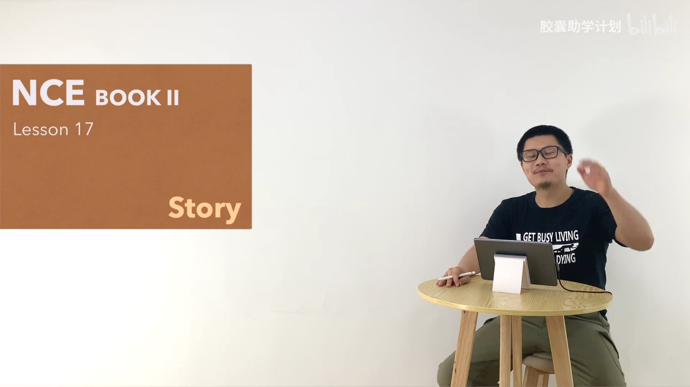

文字识别：胶囊助学计划 / NCE / BOOKII / Lesson 17 / Story / GET BUSY LIVING / DYING

### 画面 00:00:10

文字识别：胶囊助学计划b出l / •

### 画面 00:00:14

### 画面 00:00:16

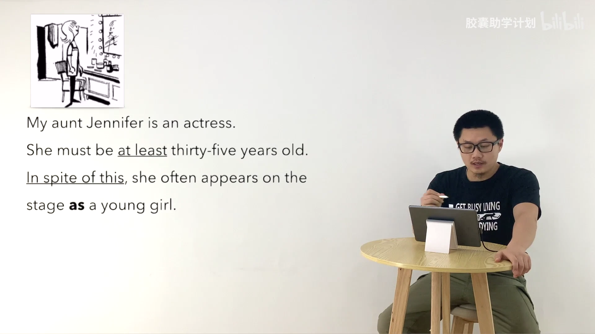

文字识别：胶囊助学计划 / My aunt Jennifer is an actress. / She must be at least thirty-five years old. / In spite of this, she often appears on the / stage as a young girl. /  GET RLIS LING / PYING

## 00:00:30–00:01:00

actor,演员或者男演员。那actress特指女演员。She must be好，直接出现了表推测，叫她一定是啊。At least一个小的短语叫至少thirty five years old，至少已经三十五岁了。注意，这不是我知道她多大，我只是根据一些常识去判断，对吧？

### 画面 00:00:46

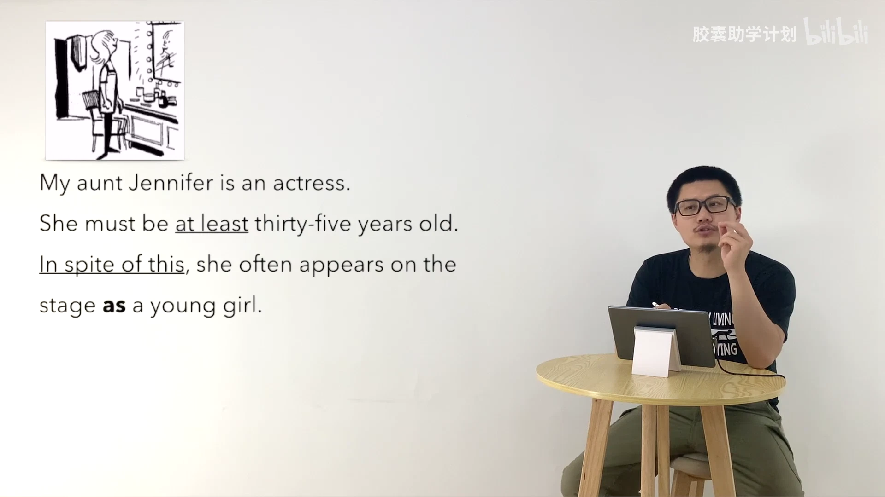

文字识别：胶囊助学计划 b出b出 / My aunt Jennifer is an actress. / She must be at least thirty-five years old. / In spite of this, she often appears on the / stage as a young girl. / LVN

## 00:01:00–00:01:30

比如说，呃，我刚出生、刚懂事的时候，他就已经演出了、工作了，对吧？然后我现在都十多岁了，那我猜他至少应该三十五岁了吧？猜测啊，他至少应该已经三十五岁了。In spite of this，又是一个小的短语。In spite of叫尽管，那this叫做这样哪样呢？叫他至少三十五岁了这件事儿啊。尽管如此，she often appears on the stage。先不往后看了，这儿

### 画面 00:01:16

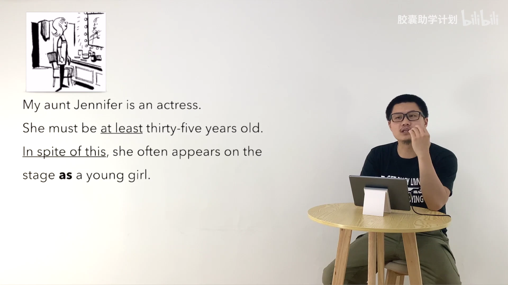

文字识别：胶囊助学计划 / O / My aunt Jennifer is an actress. / She must be at least thirty-five years old. / In spite of this, she often appears on the / stage as a young girl. / YING

## 00:01:30–00:02:00

他经常出现在舞台上啊，扮演一个角色，是吧？我刚才讲到了，在讲单词部分，appear，它其实更常见的意思，我更推荐各位记住的一个意思叫做出现啊，出现。呃，然后呢，这是一个一般现在时，对吧？生活习惯，他的工作嘛。As a young girl，as这个单词，它在接下来会不停的出现在每一课当中，会

### 画面 00:01:46

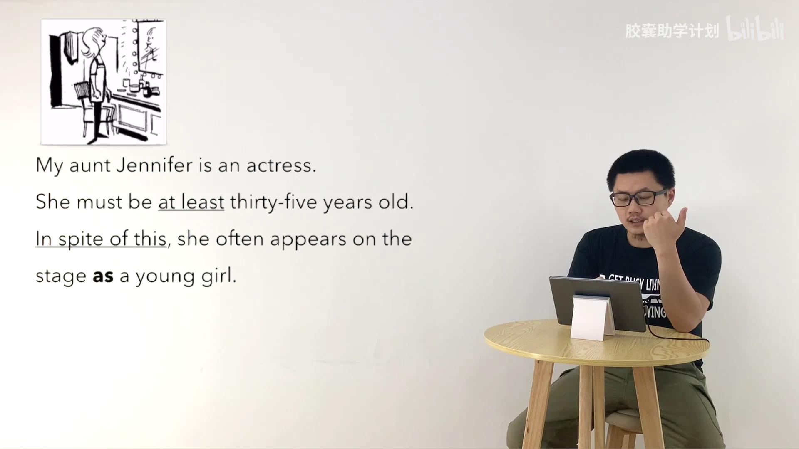

文字识别：胶囊助学计划 / My aunt Jennifer is an actress. / She must be at least thirty-five years old. / In spite of this, she often appears on the / stage as a young girl. / YLMI / YING

## 00:02:00–00:02:30

不停的出现，它有非常多的意思，各位要一个一个去记。as后面再加一个人的时候啊，它往往是指的是翻译成叫做作为啊。那as a young girl叫做作为一个年轻的小姑娘啊。注意这个young girl都不是woman了，对吧？那三十五岁应该是用woman女士女人了，对吧？那young girl你可以理解为十七八岁、十五六岁，对吧？小姑娘啊，虽然这个

### 画面 00:02:07

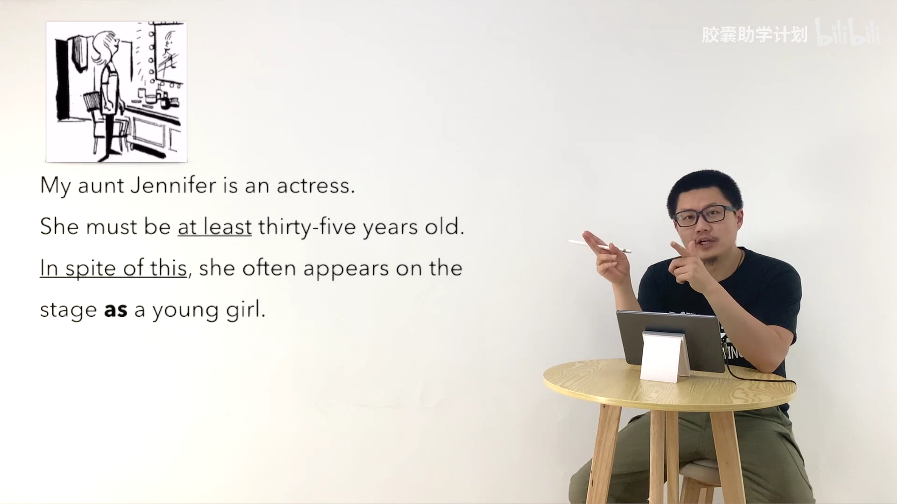

文字识别：胶囊助学计划 / My aunt Jennifer is an actress. / She must be at least thirty-five years old. / In spite of this, she often appears on the / stage as a young girl.

## 00:02:30–00:03:00

岁数比较大，但是呢，她经常在舞台上扮演，是作为一个年轻的女士、小姑娘的，对吧？田丽丽说，Jennifer will have to。好了，你看讲 have to 那个大的表格的时候，我们提到了叫做将不得不，对吧？那变一般疑问句还是把 will 提前，说将不得不或者将必须要去 take part in。我们之前学过叫做参加，将参加 a new play

### 画面 00:02:32

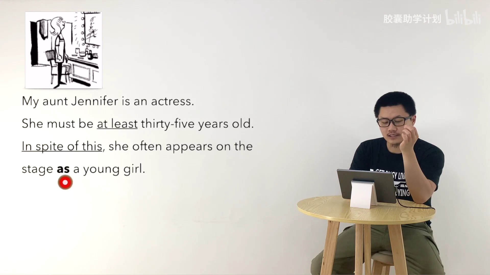

文字识别：胶囊助学计划 / My aunt Jennifer is an actress. / She must be at least thirty-five years old. / In spite of this, she often appears on the / stage as a young girl. / SYLIA / VING

### 画面 00:02:38

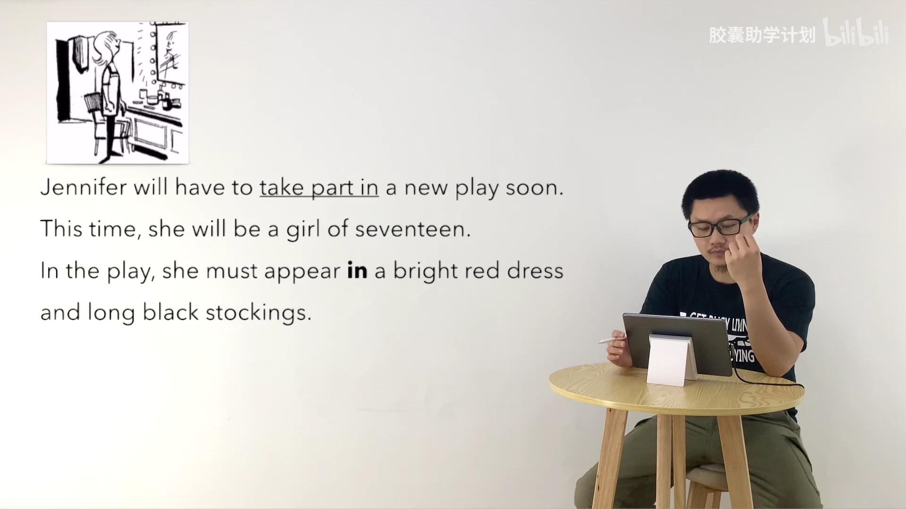

文字识别：胶囊助学计划b鼎b出 / Jennifer will have to take part in a new play soon. / This time, she will be a girl of seventeen. / In the play, she must appear in a bright red dress / and long black stockings. / LIN

## 00:03:00–00:03:30

soon. 啊，很快他就会将加入一个新的话剧 play. 注意啊， play 我们指的是话剧，它做名词的时候是有话剧的意思的。动词就是各位熟悉的玩的意思。 This time, 这一次 time 啊, she will be. 她将会是 a girl of seventeen. 十七岁的女孩啊，其实就等同于 seventeen years old girl 一码事儿啊。

### 画面 00:03:08

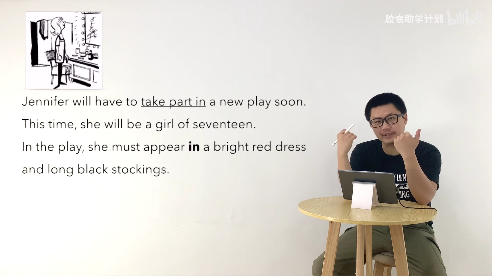

文字识别：胶囊助学计划 / Jennifer will have to take part in a new play soon. / This time, she will be a girl of seventeen. / In the play, she must appear in a bright red dress / and long black stockings. / LIN

## 00:03:30–00:04:00

她将会是一个十七岁的女孩。一般将来时，说未来的事情嘛。In the play，在这个话剧当中呢，she must appear，她必须要出现在舞台上。怎么样呢？In我们先不管她，我们先看后面。A bright red dress，一个明亮的红色的裙子，以及and long black stockings，长的黑色的丝

### 画面 00:03:38

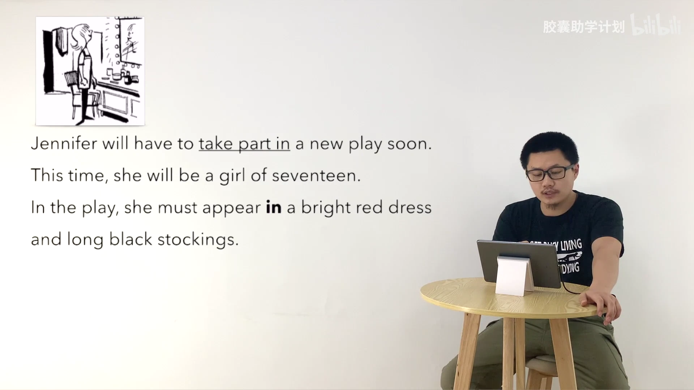

文字识别：胶囊助学计划 / Jennifer will have to take part in a new play soon. / This time, she will be a girl of seventeen. / In the play, she must appear in a bright red dress / and long black stockings. / YLING / DNG

## 00:04:00–00:04:30

袜，你想一下啊，这儿的 in 怎么翻译比较好？这儿其实就如果除了 in 不会，前后文都读懂了，就变成汉语填空题了。在这个话剧当中，他必须红色的裙子和长色的丝袜啊，长黑丝袜穿着是吧？这儿的 in 就可以理解为穿着。那你再想一下， in 其实做介词，加上这儿我们不管它的词性啊，但是至少在这做介词的时候，我们曾经

### 画面 00:04:08

文字识别：胶囊助学计划 / Jennifer will have to take part in a new play soon. / This time, she will be a girl of seventeen. / In the play, she must appear in a bright red dress / and long black stockings. / YLING / DVG

### 画面 00:04:27

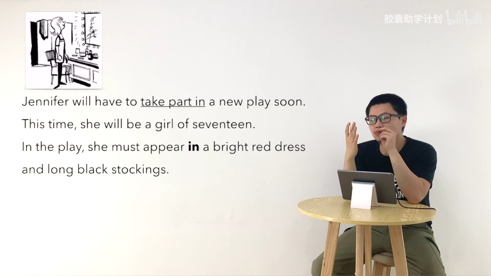

文字识别：胶囊助学计划 / Jennifer will have to take part in a new play soon. / This time, she will be a girl of seventeen. / In the play, she must appear in a bright red dress / and long black stockings.

## 00:04:30–00:05:00

学过，它其实有一个含义叫做在什么什么里面啊。那你看在什么里面啊？我们但是这个不准确啊，但是能帮助我们去理解。红色的裙子和长黑丝袜里面，其实不就是指的是 wear 的意思吗？不就是这个穿的意思吗？它必须要穿着着，对吧？这儿的 in 也就是这个意思，但它不是个动词啊。它必须出现在舞台上，穿着着这样的一些

### 画面 00:04:37

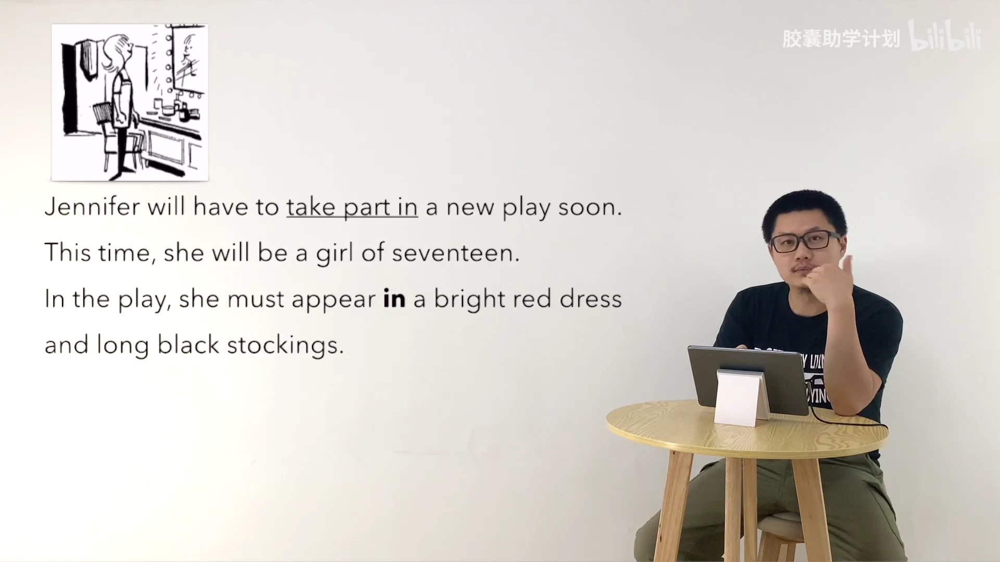

文字识别：胶囊助学计划 / Jennifer will have to take part in a new play soon. / This time, she will be a girl of seventeen. / In the play, she must appear in a bright red dress / and long black stockings.

### 画面 00:04:49

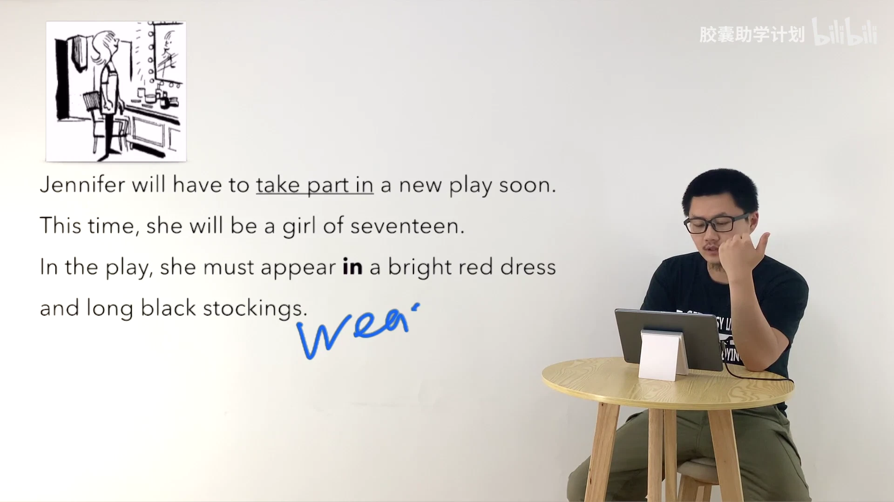

文字识别：胶囊助学计划 / Jennifer will have to take part in a new play soon. / This time, she will be a girl of seventeen. / In the play, she must appear in a bright red dress / and long black stockings. / wea

## 00:05:00–00:05:30

衣服衣物，OK，哪一个？Last year in another play，你看刚才说的是，你看啊，它其实我们分了三个平，第一个平呢说的是陈述客观事实，他多大，他是什么人，他是什么职业，他经常在舞台上要怎么样，对吧？一般现在时陈述客观事实。刚刚讲过的那一页呢说的是在未来一个话剧当中他将怎么样，都用的是跟将来相关的时态，主要出现的是一般将来

### 画面 00:05:02

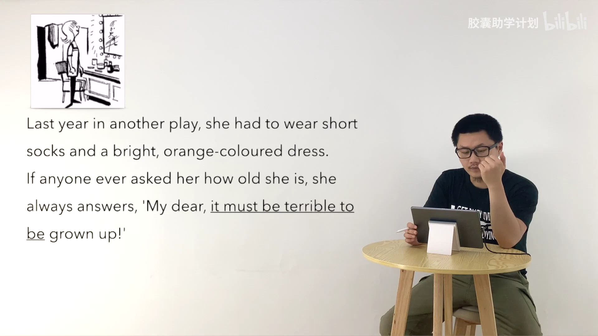

文字识别：胶囊助学计划b出b出 / Last year in another play, she had to wear short / socks and a bright, orange-coloured dress. / If anyone ever asked her how old she is, she / always answers, 'My dear, it must be terrible to / be grown up!'

### 画面 00:05:07

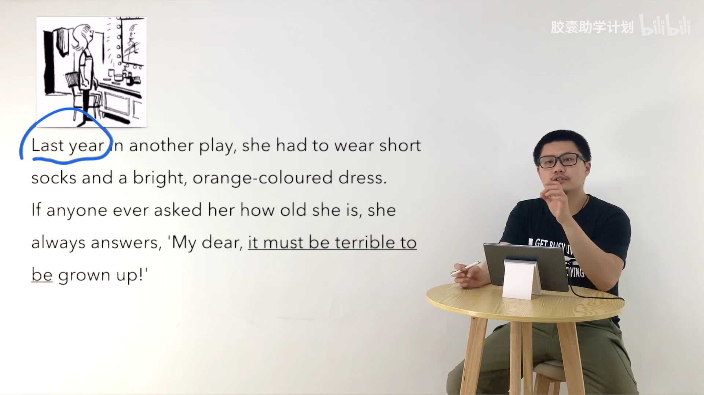

文字识别：胶囊助学计划 / Last yearn another play, she had to wear short / socks and a bright, orange-coloured dress. / If anyone ever asked her how old she is, she / always answers, 'My dear, it must be terrible to / GFT RLICY / be grown up!'

## 00:05:30–00:06:00

时，在这一页当中呢，上来给了两个单词叫 last year，就告诉你去年。于是你推出来，接下来猜也能猜出来，接下来文章当中大部分的时态都是跟过去相关的。我们看一下是不是这样。In another play，在另一个话剧当中，she had to，她当时必须 wear short socks and a bright orange color dress。她当时必须要穿着

### 画面 00:05:37

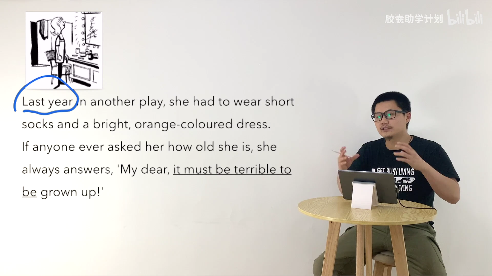

文字识别：胶囊助学计划bilb / Last yearn another play, she had to wear short / socks and a bright, orange-coloured dress. / If anyone ever asked her how old she is, she / always answers, 'My dear, it must be terrible to / GET RIISY LVING / be grown up!' / VOVING

### 画面 00:05:45

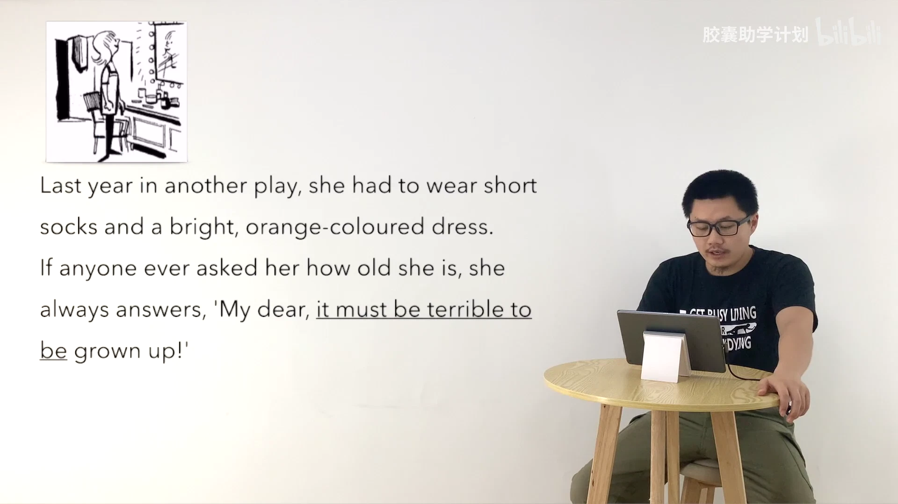

文字识别：胶囊助学计划 / Last year in another play, she had to wear short / socks and a bright, orange-coloured dress. / If anyone ever asked her how old she is, she / always answers, 'My dear, it must be terrible to /  CET DISY LUING / be grown up!' / DYG

### 画面 00:05:51

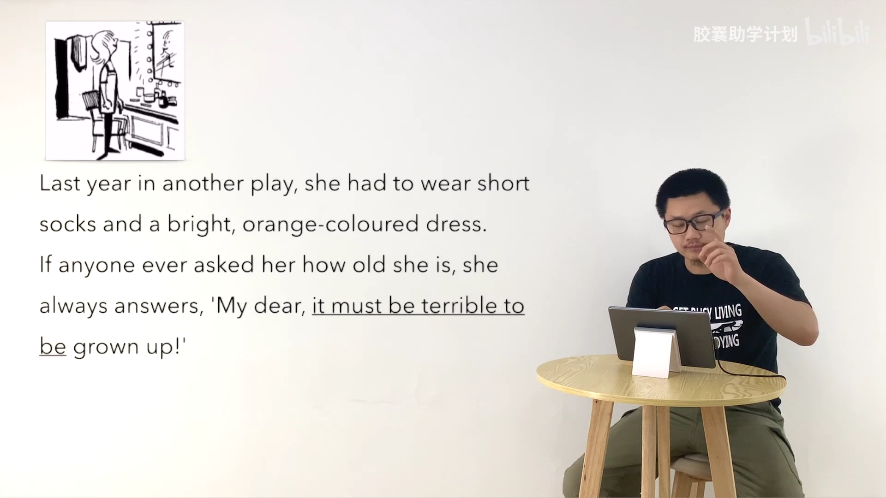

文字识别：胶囊助学计划 / Last year in another play, she had to wear short / socks and a bright, orange-coloured dress. / If anyone ever asked her how old she is, she / always answers, 'My dear, it must be terrible to / PCY LMING / be grown up!' / DYING

## 00:06:00–00:06:30

着，就是跟刚才那个 in 是很像的，但是注意 in 不是动词啊，不能这么去用。Short socks 短袜，bright orange colored dress 明亮的橘色的裙子。那 orange colored 其实就是 orange 啊。对于各位来说，这个构词法暂时先不重要，只要能看懂就可以了。OK，这相对来说是比较高阶的词汇上的啊，这个构词法。

### 画面 00:06:02

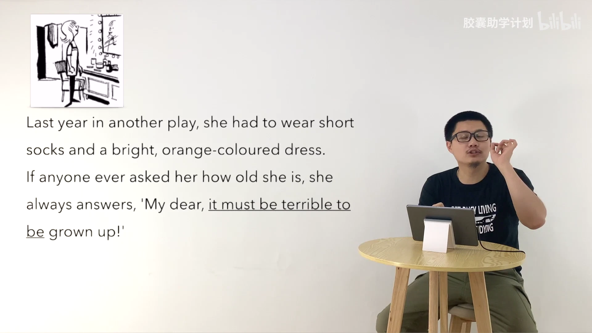

文字识别：胶囊助学计划 / Last year in another play, she had to wear short / socks and a bright, orange-coloured dress. / If anyone ever asked her how old she is, she / always answers, 'My dear, it must be terrible to / YLIVING / be grown up!' / DYIG

## 00:06:30–00:07:00

if看到它放句首，我很舒心了。十六课刚学过，叫做如果。Anyone ever asked her how old she is？任何人，anyone，任何人，ever在任何时候，这个单词新一我们就见过很多遍了。Ask somebody something，问他一件事情，问的是 how old she is？这儿有一个小的问题是，她多大？不应该是 how old is she 吗？怎么这是 how old she is 呢？

### 画面 00:06:32

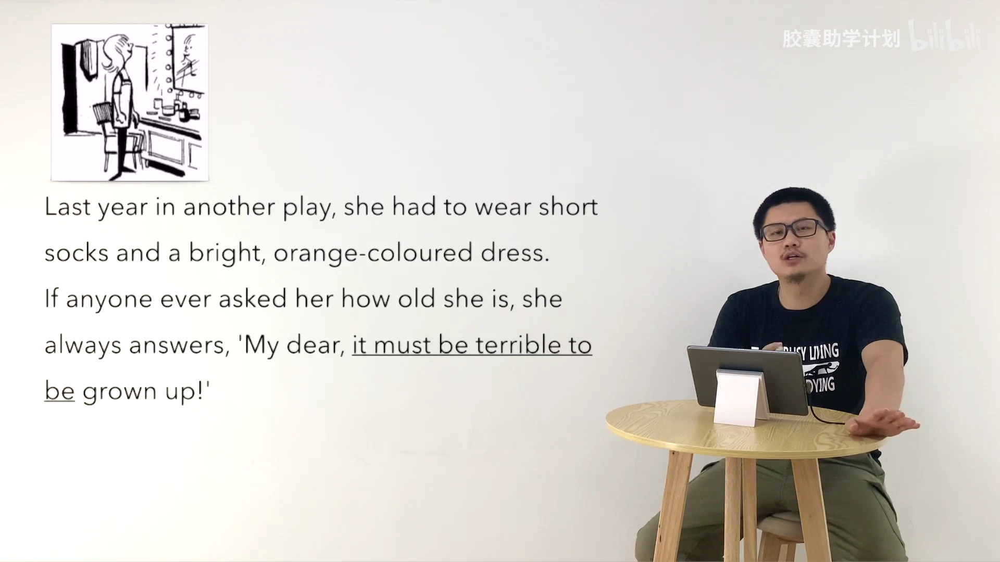

文字识别：胶囊助学计划 / Last year in another play, she had to wear short / socks and a bright, orange-coloured dress. / If anyone ever asked her how old she is, she / always answers, 'My dear, it must be terrible to / nUSY LNING / be grown up!' / DYING

## 00:07:00–00:07:30

两个点，第一，如果您会，那说明您新一对吧，一百三十九课那课学的应该是不错的。如果您不会，也不用纠结，三十九课马上我们就会学到，对吧？问他，但是你现在能看懂就行了，对吧？他岁数多大？如果任何人在任何时候问他，他岁数多大？She always answers.他总是会这样去回答。接下来是他的原话，My dear，是吧？啊，就是哎，亲爱

### 画面 00:07:02

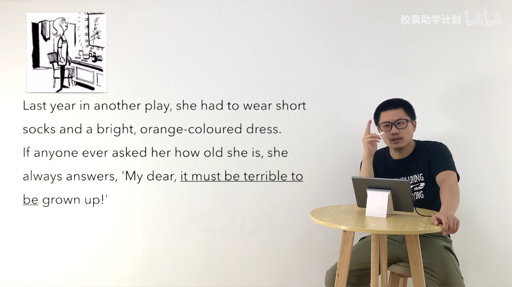

文字识别：胶囊助学计划 / Last year in another play, she had to wear short / socks and a bright, orange-coloured dress. / If anyone ever asked her how old she is, she / always answers, 'My dear, it must be terrible to / be grown up!' / YING

## 00:07:30–00:08:00

的。It must be terrible to be grown up.说，哎呀，一定是特别糟糕的事情。去作为一个成人，就是你，你想这个感觉是吧？啊，他自己本身就是，但是他总演小姑娘。人家问他多大呢？他又不想回答别人，他就说，哎呀，长大成人一定是一个特别令人害怕的事情，令人特别糟糕，特别糟糕的事情，对吧？好，这有一个习惯用法，叫It must be terrible to do

### 画面 00:07:32

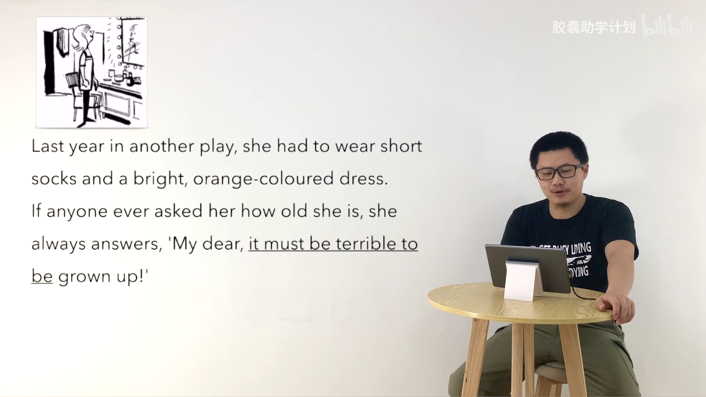

文字识别：胶囊助学计划 / Last year in another play, she had to wear short / socks and a bright, orange-coloured dress. / If anyone ever asked her how old she is, she / always answers, 'My dear, it must be terrible to / be grown up!' / DYING

## 00:08:00–00:08:30

something. Okay,这个一会儿我们单词啊，这个习惯用法造句的时候会提到。这在这儿呢，我再提一遍这个grown up。如果单词那一个视频您有认真去听了的话，那你回想一下，我当时就讲到了说grown up往往是孩子与成人在对话的时候会用到的一个词，叫做grown up，对吧？所以他在这个地方不仅装嫩了，对吧？他在用词上也很有考究，用了一个装嫩的单词。

### 画面 00:08:02

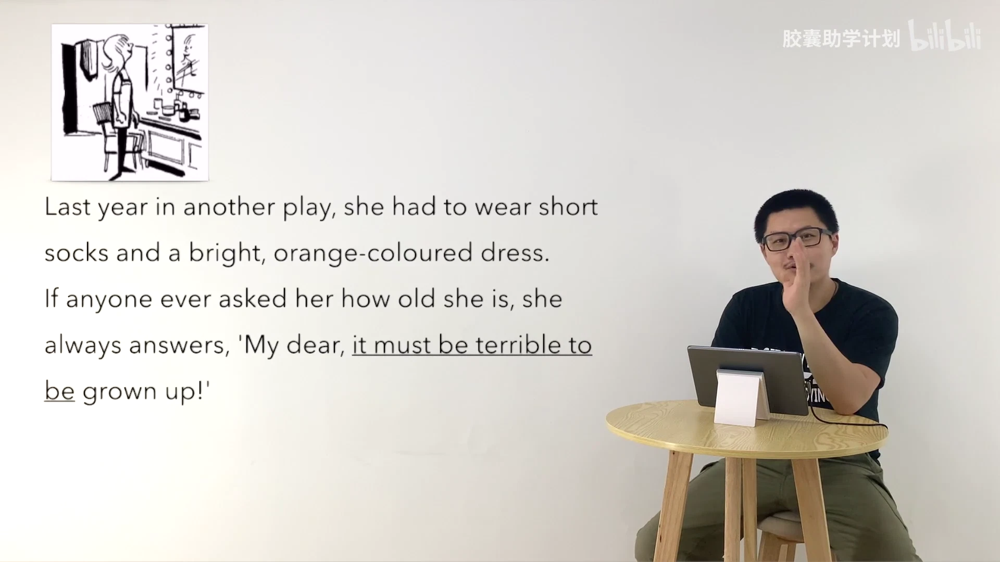

文字识别：胶囊助学计划b出b出 / Last year in another play, she had to wear short / socks and a bright, orange-coloured dress. / If anyone ever asked her how old she is, she / always answers, 'My dear, it must be terrible to / be grown up!'

### 画面 00:08:09

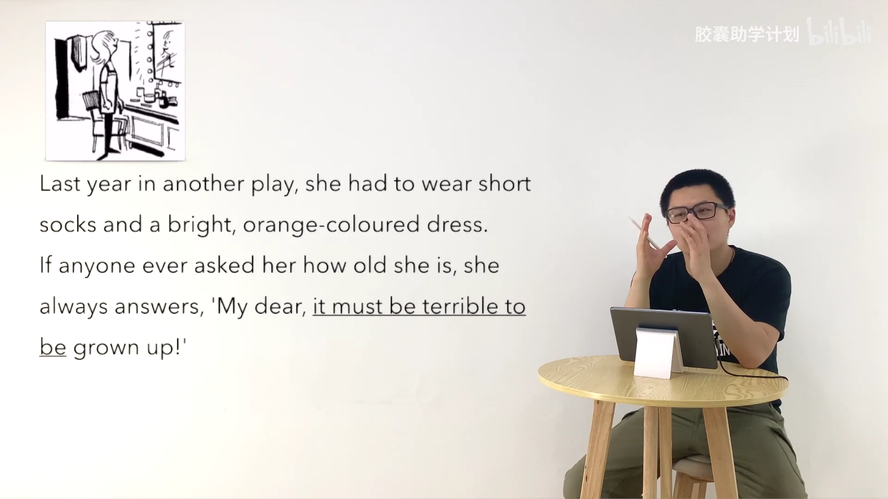

文字识别：胶囊助学计划 / Last year in another play, she had to wear short / socks and a bright, orange-coloured dress. / If anyone ever asked her how old she is, she / always answers, 'My dear, it must be terrible to / be grown up!'

## 00:08:30–00:09:00

各位这个要自己去体会了，好吧？那本课的习惯用法是这几个，我们接下来挨个造句来了。第一个 at least 叫至少，你看拿它去造句的时候就会有一点点小的麻烦，为什么呢？因为它们它只有 at least 是一个好像在六一二三四五六当中，你都甚至不太好找它的位置的一个短语，对吧？你自己要去找动词，找动词的变化，去找宾语，去找主语，也就

### 画面 00:08:32

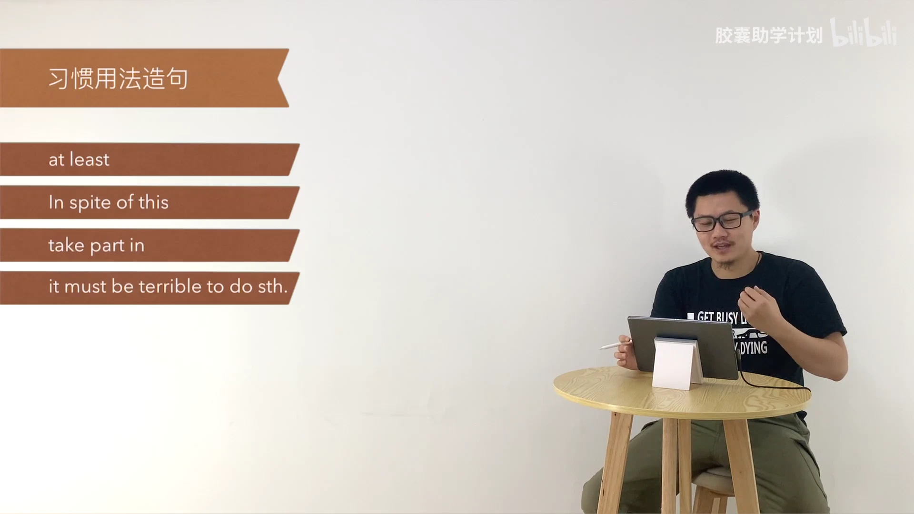

文字识别：胶囊助学计划 / 习惯用法造句 / at least / In spite of this / take part in / it must be terrible to do sth. / GET RISYL / YDYING

### 画面 00:08:34

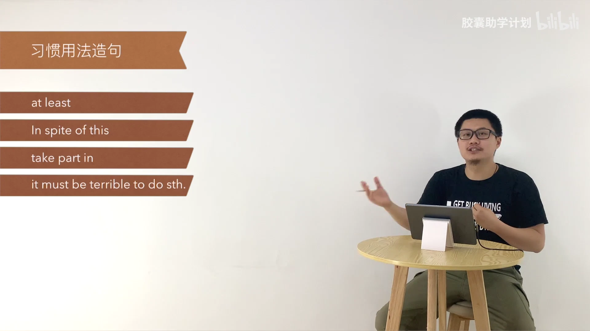

文字识别：胶囊助学计划 / 习惯用法造句 / at least / In spite of this / take part in / it must be terrible to do sth. / GET RUICIVING

### 画面 00:08:36

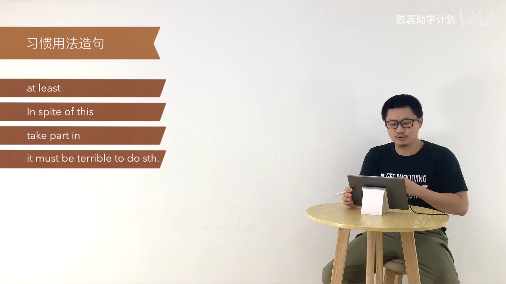

文字识别：胶囊助学计划 / 习惯用法造句 / at least / In spite of this / take part in / it must be terrible to do sth. / CET DHEVIVING

### 画面 00:08:38

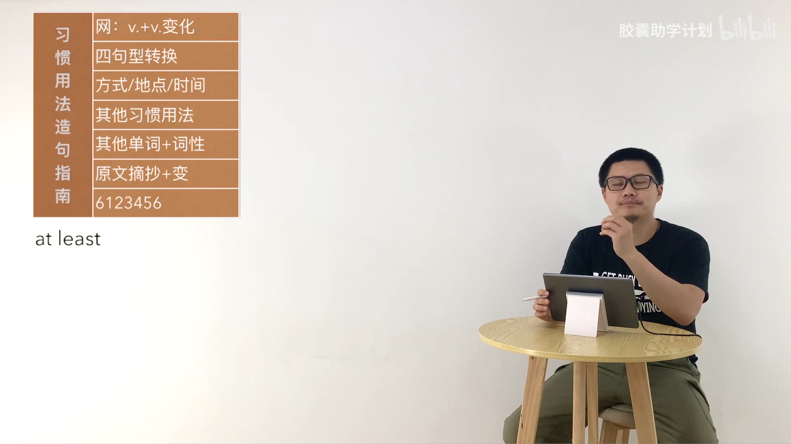

文字识别：网：v.+v.变化 / 习惯用法造句指南 / 胶囊助学计划 / 四句型转换 / 方式/地点/时间 / 其他习惯用法 / 其他单词+词性 / 原文摘抄+变 / 6123456 / at least

### 画面 00:08:40

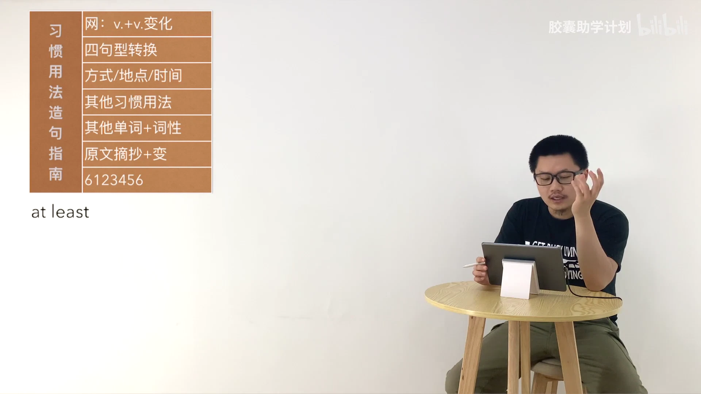

文字识别：习惯用法造句指南 / 网：v.+v.变化 / 胶囊助学计划 / 四句型转换 / 方式/地点/时间 / 其他习惯用法 / 其他单词+词性 / 原文摘抄+变 / 6123456 / at least / LIVIN

### 画面 00:08:45

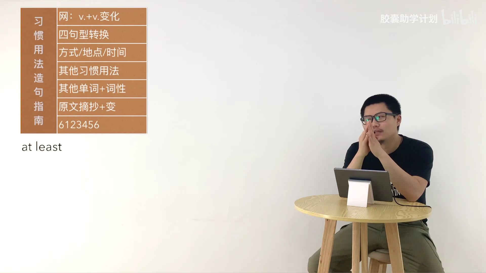

文字识别：网：v.+v.变化 / 习惯用法造句指南 / 胶囊助学计划 / 四句型转换 / 方式/地点/时间 / 其他习惯用法 / 其他单词+词性 / 原文摘抄+变 / 6123456 / at least

### 画面 00:08:47

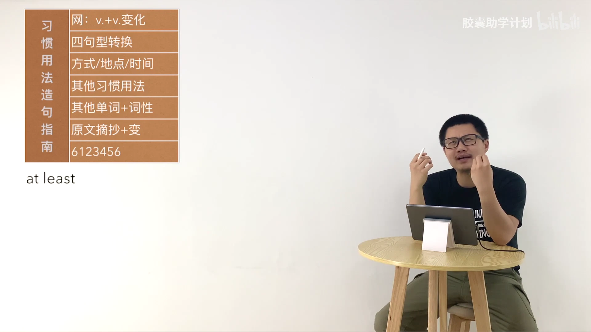

文字识别：习惯用法造句指南 / 网：v.+v.变化 / 胶囊助学计划 / 四句型转换 / 方式/地点/时间 / 其他习惯用法 / 其他单词+词性 / 原文摘抄+变 / 6123456 / at least

### 画面 00:08:50

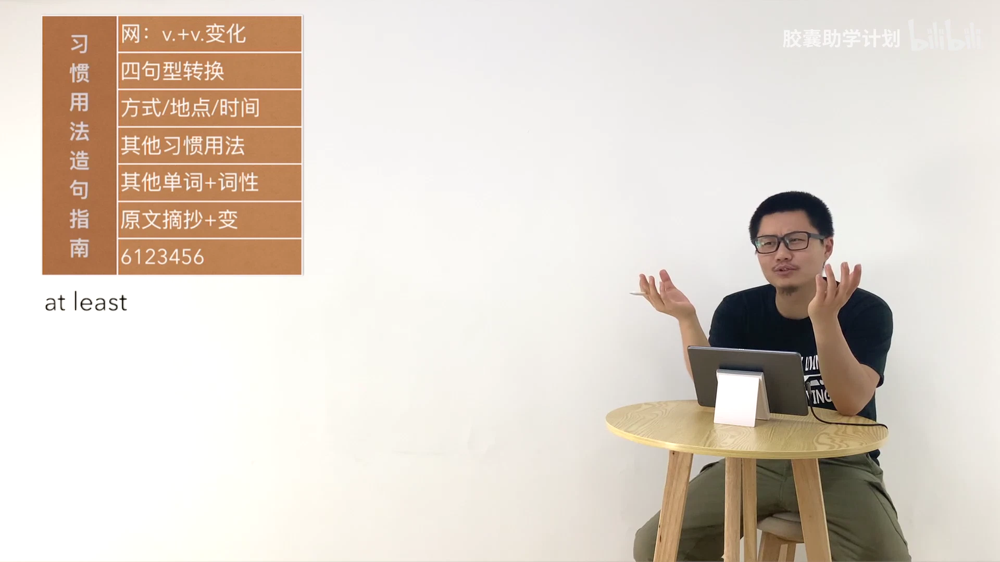

文字识别：习惯用法造句指南 / 网：v.+v.变化 / 胶囊助学计划 / 四句型转换 / 方式/地点/时间 / 其他习惯用法 / 其他单词+词性 / 原文摘抄+变 / 6123456 / at least

### 画面 00:08:55

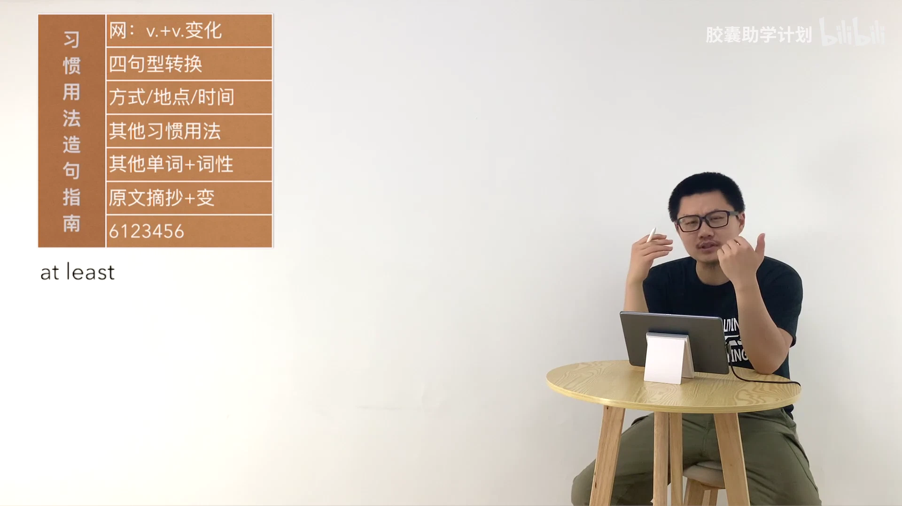

文字识别：习惯用法造句指南 / 网：v.+v.变化 / 胶囊助学计划 / 四句型转换 / 方式/地点/时间 / 其他习惯用法 / 其他单词+词性 / 原文摘抄+变 / 6123456 / at least

## 00:09:00–00:09:30

就是说，您自己造一个句子，然后把 at least 放前面就完了。比如说，你看我拿它去造句的时候，我就是这么想的。比如说，至少 let me park my car here. 你至少让我把车停在这里。您加不加 at least？其实这句话呢，差别没有那么大。让我把车停在这里，至少让我把车停到那里，对吧？那它实际上就用的是第十六课咱们学过的，叫做 park somebody's somebody's car，对吧？停某人的车。再来说 at

### 画面 00:09:00

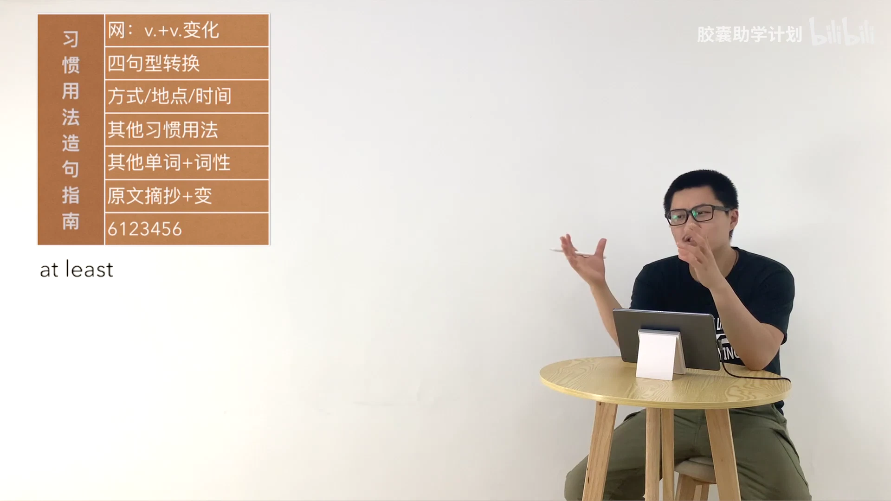

文字识别：网：v.+v.变化 / 习惯用法造句指南 / 胶囊助学计划 / 四句型转换 / 方式/地点/时间 / 其他习惯用法 / 其他单词+词性 / 原文摘抄+变 / 6123456 / at least

### 画面 00:09:03

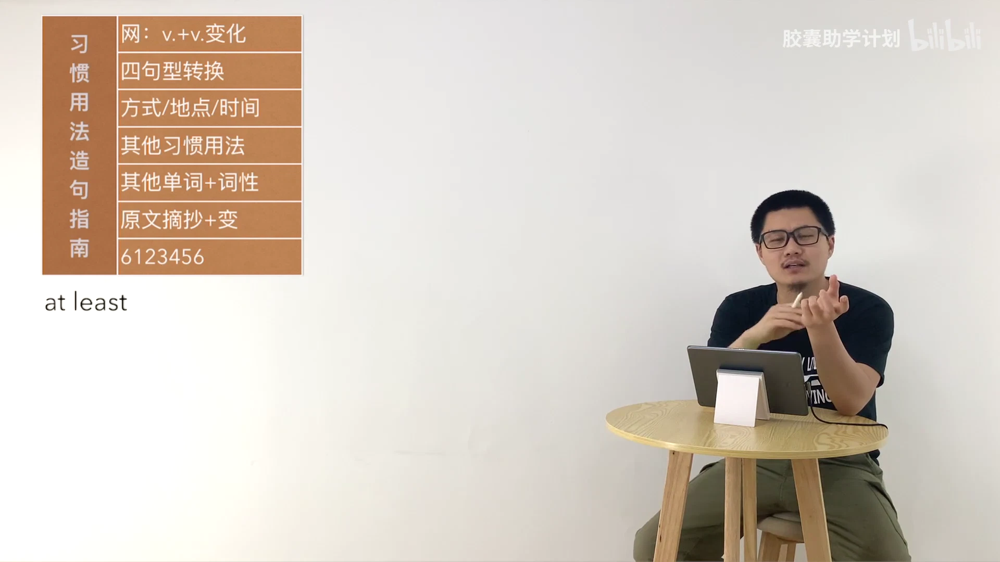

文字识别：网：v.+v.变化 / 习惯用法造句指南 / 胶囊助学计划 / 四句型转换 / 方式/地点/时间 / 其他习惯用法 / 其他单词+词性 / 原文摘抄+变 / 6123456 / at least

### 画面 00:09:05

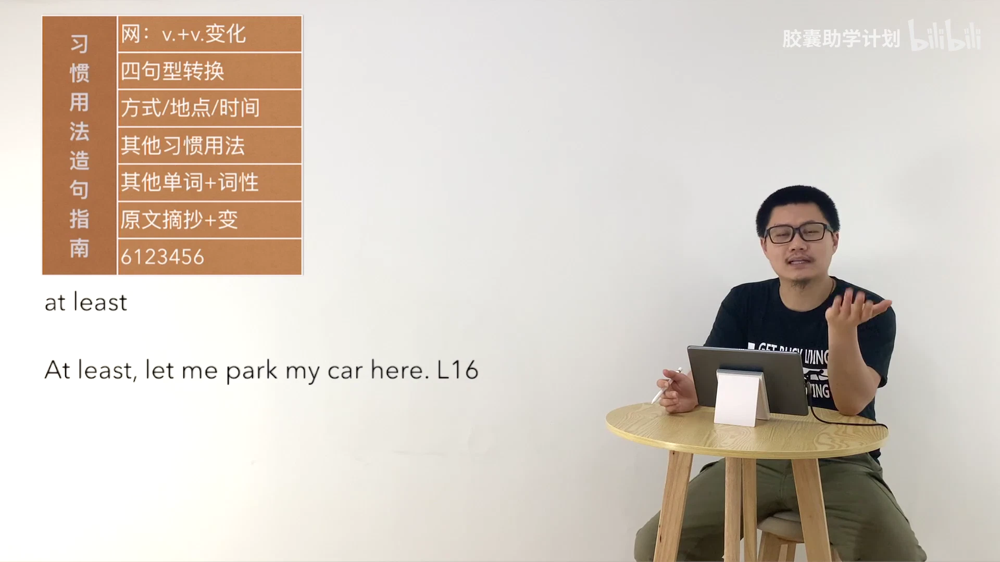

文字识别：网：v.+v.变化 / 胶囊助学计划 / BiBil / 习惯用法造句指南 / 四句型转换 / 方式/地点/时间 / 其他习惯用法 / 其他单词+词性 / 原文摘抄+变 / 6123456 / at least / LING / At least, let me park my car here. L16 / R / ING

### 画面 00:09:07

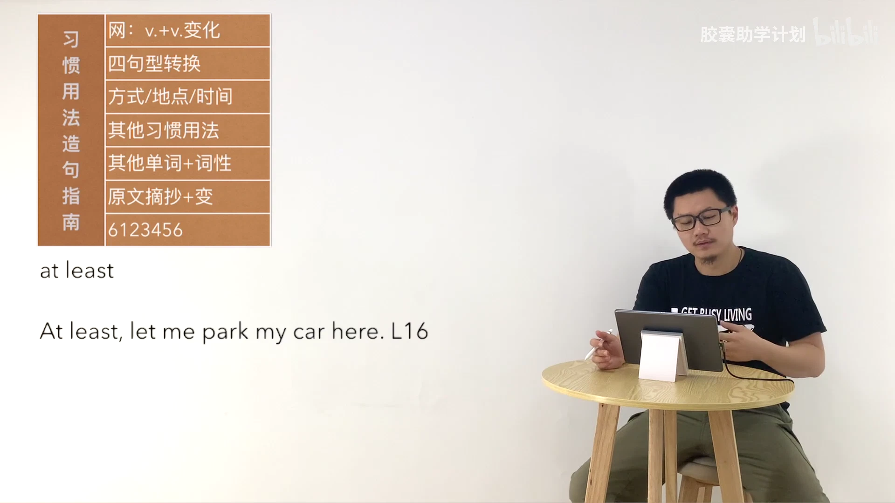

文字识别：网：v.+v.变化 / 习惯用法造句指南 / 胶囊助学计划 / 四句型转换 / 方式/地点/时间 / 其他习惯用法 / 其他单词+词性 / 原文摘抄+变 / 6123456 / at least / GET DIISY LVING / At least, let me park my car here. L16

### 画面 00:09:10

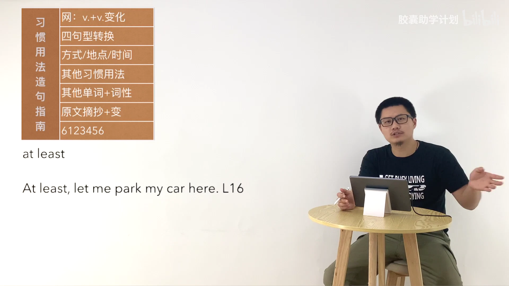

文字识别：网：v.+v.变化 / 习惯用法造句指南 / 胶囊助学计划 / 四句型转换 / 方式/地点/时间 / 其他习惯用法 / 其他单词+词性 / 原文摘抄+变 / 6123456 / at least /  CET DHIEV LING / At least, let me park my car here. L16 / AV / PVING

### 画面 00:09:15

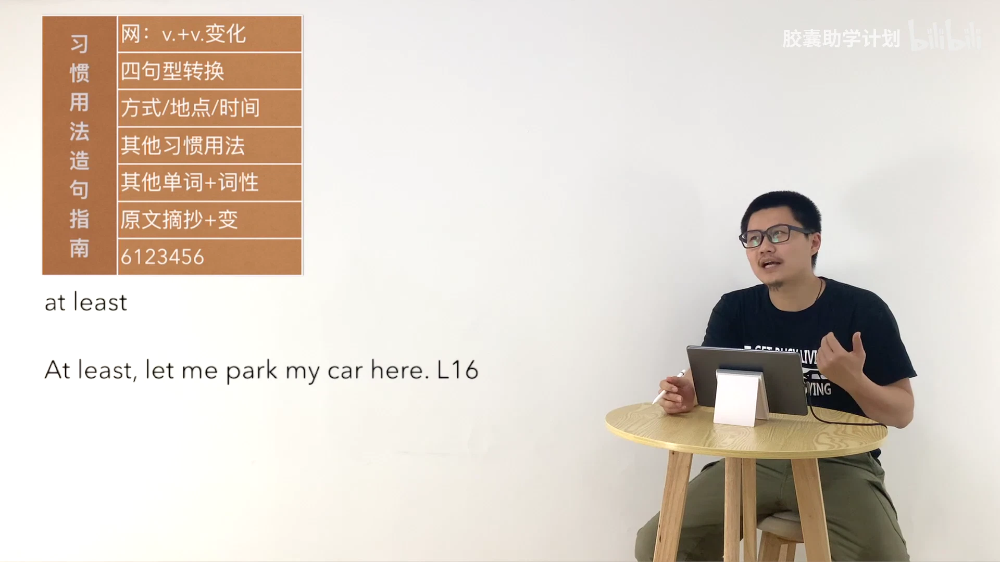

文字识别：网：v.+v.变化 / 习惯用法造句指南 / 胶囊助学计划 / 四句型转换 / 方式/地点/时间 / 其他习惯用法 / 其他单词+词性 / 原文摘抄+变 / 6123456 / at least / At least, let me park my car here. L16 / YING

### 画面 00:09:20

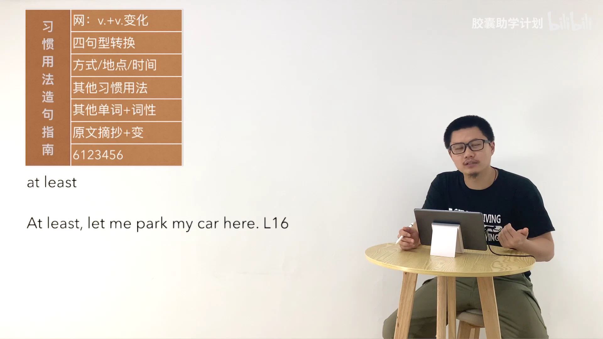

文字识别：网：v.+v.变化 / 习惯用法造句指南 / 胶囊助学计划 / 四句型转换 / 方式/地点/时间 / 其他习惯用法 / 其他单词+词性 / 原文摘抄+变 / 6123456 / at least / At least, let me park my car here. L16 / IVING / NC

### 画面 00:09:25

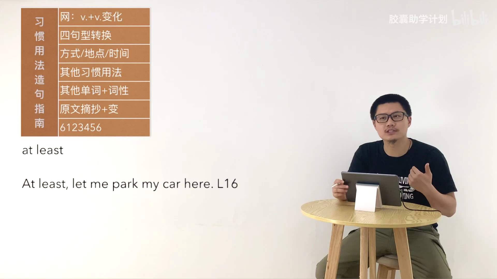

文字识别：网：v.+v.变化 / 习惯用法造句指南 / 胶囊助学计划 / 四句型转换 / 方式/地点/时间 / 其他习惯用法 / 其他单词+词性 / 原文摘抄+变 / 6123456 / at least / At least, let me park my car here. L16 / ING

## 00:09:30–00:10:00

least I believe he will have a difficult time. 我相信呢，他一定会有一个很困难的时光。你看，have a difficult time，我们十三课学的，I believe后边加宾语从句，十五课学的啊。至少我认为他在未来会有一段很困难的时光。您把至少去掉，问题好像也不是很大，对吧？再然后，at least they will be giving five performances. 第十三课学到的 give a performance

### 画面 00:09:30

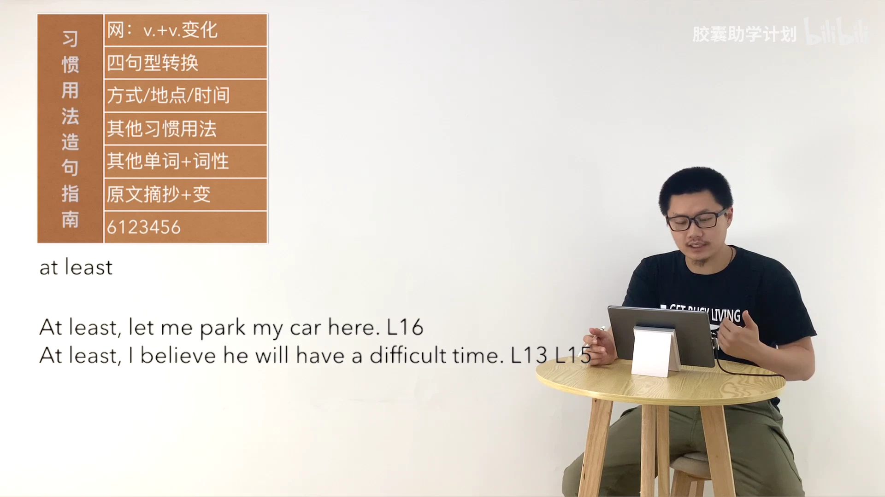

文字识别：网：v.+v.变化 / 习惯用法造句指南 / 胶囊助学计划 / 四句型转换 / 方式/地点/时间 / 其他习惯用法 / 其他单词+词性 / 原文摘抄+变 / 6123456 / at least / LIVING / At least, let me park my car here. L16 / At least, I believe he will have a difficult time. L13 L15

### 画面 00:09:36

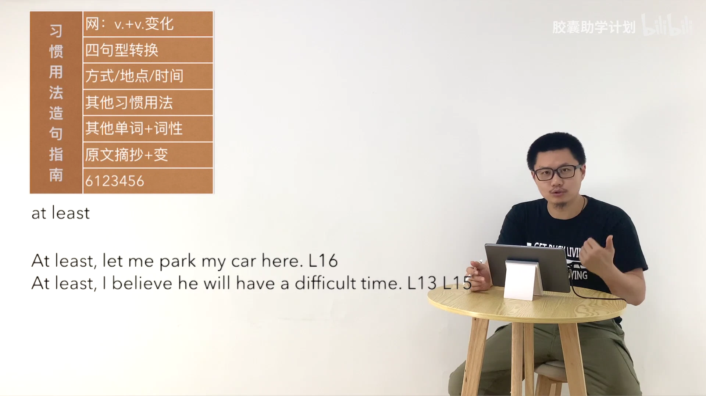

文字识别：习惯用法造句指南 / 网：v.+v.变化 / 胶囊助学计划 / 四句型转换 / 方式/地点/时间 / 其他习惯用法 / 其他单词+词性 / 原文摘抄+变 / 6123456 / at least / At least, let me park my car here. L16 / VING / At least, I believe he will have a difficult time. L13 L15

### 画面 00:09:39

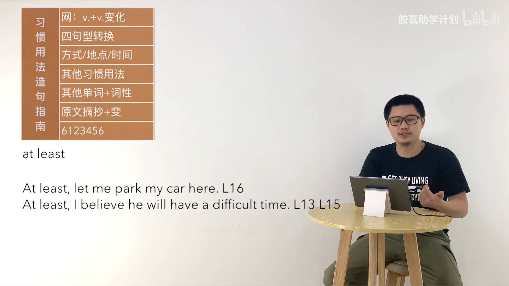

文字识别：网：v.+v.变化 / 胶囊助学计划 / 习惯用法造句指南 / 四句型转换 / 方式/地点/时间 / 其他习惯用法 / 其他单词+词性 / 原文摘抄+变 / 6123456 / at least / CRT HSY LVING / At least, let me park my car here. L16 / DYI / At least, I believe he will have a difficult time. L13 L15

### 画面 00:09:42

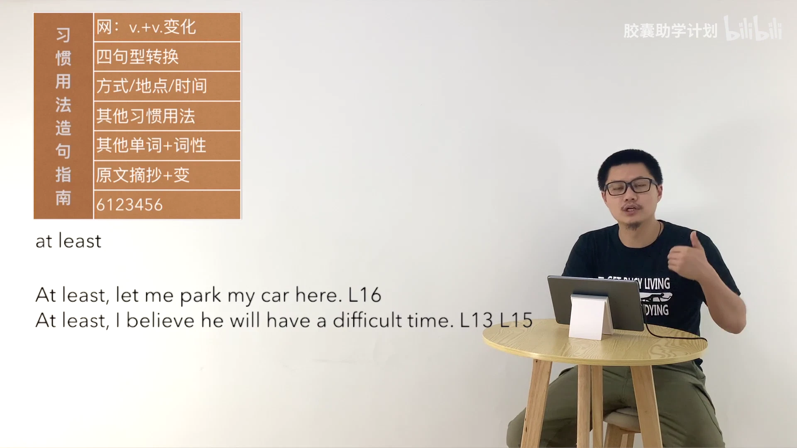

文字识别：网：v.+v.变化 / 胶囊助学计划 / 习惯用法造句指南 / 四句型转换 / 方式/地点/时间 / 其他习惯用法 / 其他单词+词性 / 原文摘抄+变 / 6123456 / at least / YLIVING / At least, let me park my car here. L16 / A / DYING / At least, I believe he will have a difficult time. L13 L15

### 画面 00:09:45

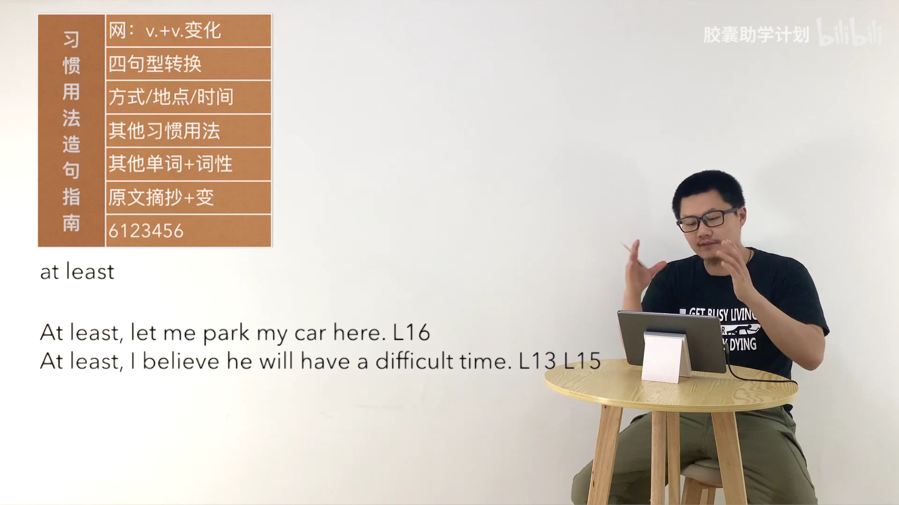

文字识别：网：v.+v.变化 / 习惯用法造句指南 / 胶囊助学计划 / 四句型转换 / 方式/地点/时间 / 其他习惯用法 / 其他单词+词性 / 原文摘抄+变 / 6123456 / at least / GET BIISY LVIN / At least, let me park my car here. L16 / RAARU / KDYING / At least, I believe he will have a difficult time. L13 L15

### 画面 00:09:50

文字识别：网：v.+v.变化 / 习惯用法造句指南 / 胶囊助学计划 / 四句型转换 / 方式/地点/时间 / 其他习惯用法 / 其他单词+词性 / 原文摘抄+变 / 6123456 / at least / VIVING / At least, let me park my car here. L16 / At least, I believe he will have a difficult time. L13 L15

### 画面 00:09:53

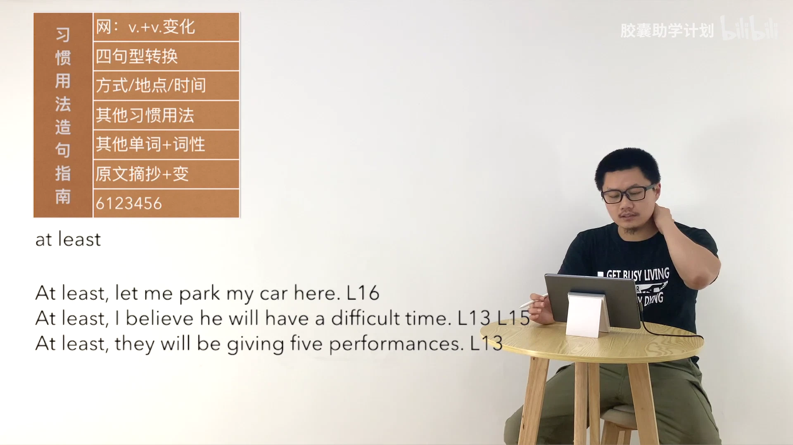

文字识别：网：v.+v.变化 / 习惯用法造句指南 / 胶囊助学计划 / 四句型转换 / 方式/地点/时间 / 其他习惯用法 / 其他单词+词性 / 原文摘抄+变 / 6123456 / at least / GET RISY LVING / At least, let me park my car here. L16 / YDING / At least, I believe he will have a difficult time. L13 L15 / At least, they will be giving five performances. L13

### 画面 00:09:55

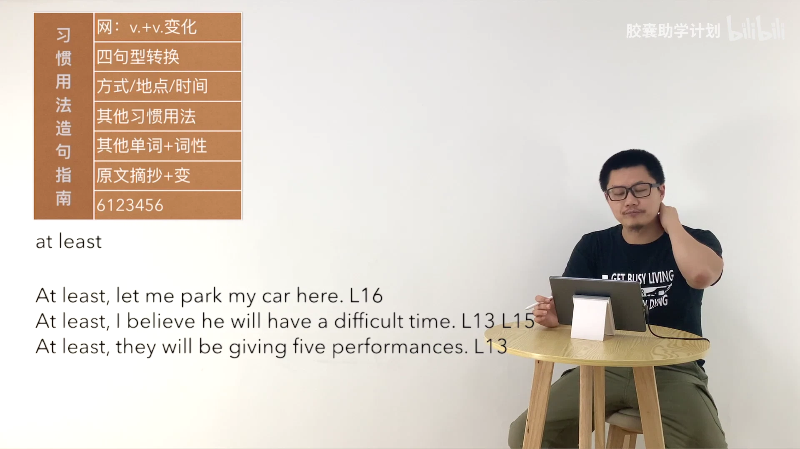

文字识别：习惯用法造句指南 / 网：v.+v.变化 / 胶囊助学计划 / 四句型转换 / 方式/地点/时间 / 其他习惯用法 / 其他单词+词性 / 原文摘抄+变 / 6123456 / at least /  GET RIIS LING / At least, let me park my car here. L16 / YDNG / At least, I believe he wil have a difficult time. L13 L15 / At least, they will be giving five performances. L13

## 00:10:00–00:10:30

以及 will be doing 将来进行式 very good 最后一个 at least I think he can't have borrowed any money from you 我至少认为他之前一定没从你这儿借过钱，别的我不知道，但至少这一点我是确定的。您看是不是我们刚刚学过的语法叫 can't have that 当时一定没有怎么怎么样。当然了，还结合了一个小的习惯用法叫 borrow something

### 画面 00:10:00

文字识别：习惯用法造句指南 / 网：v.+v.变化 / 胶囊助学计划 / 四句型转换 / 方式/地点/时间 / 其他习惯用法 / 其他单词+词性 / 原文摘抄+变 / 6123456 / at least / 'SYLIVING / At least, let me park my car here. L16 / At least, I believe he will have a difficult time. L13 L15 / At least, they will be giving five performances. L13

### 画面 00:10:04

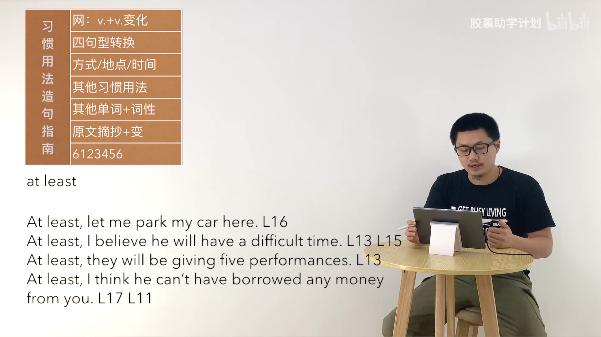

文字识别：习惯用法造句指南 / 网：v.+v.变化 / 胶囊助学计划 / 四句型转换 / 方式/地点/时间 / 其他习惯用法 / 其他单词+词性 / 原文摘抄+变 / 6123456 / at least / GET DUIS LVING / At least, let me park my car here. L16 / At least, I believe he will have a difficult time. L13 L15 / At least, they will be giving five performances. L13 / At least, I think he can't have borrowed any money / from you. L17 L11

### 画面 00:10:06

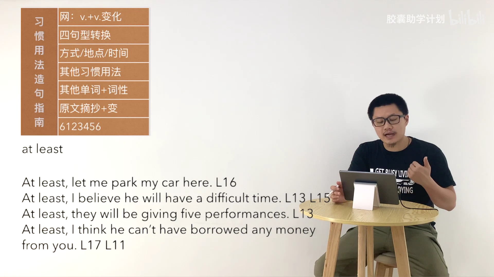

文字识别：网：v.+v.变化 / 胶囊助学计划 / 习惯 / 四句型转换 / 伙用法造句指南 / 方式/地点/时间 / 其他习惯用法 / 其他单词+词性 / 原文摘抄+变 / 6123456 / at least / At least, let me park my car here. L16 / PYING / At least, I believe he will have a difficult time. L13 L15 / At least, they will be giving five performances. L13 / At least, I think he can't have borrowed any money / from you. L17 L11

### 画面 00:10:10

文字识别：网：v.+v.变化 / 胶囊助学计划 / 习惯 / 四句型转换 / 伙用法造句指南 / 方式/地点/时间 / 其他习惯用法 / 其他单词+词性 / 原文摘抄+变 / 6123456 / at least / LIV / At least, let me park my car here. L16 / DYING / At least, I believe he will have a difficult time. L13 L15 / At least, they will be giving five performances. L13 / At least, I think he can't have borrowed any money / from you. L17 L11

### 画面 00:10:15

文字识别：网：v.+v.变化 / 胶囊助学计划 / 习惯 / 四句型转换 / 伙用法造句指南 / 方式/地点/时间 / 其他习惯用法 / 其他单词+词性 / 原文摘抄+变 / 6123456 / at least /  GET DUSY LVIN / At least, let me park my car here. L16 / DYING / At least, I believe he will have a difficult time. L13 L15 / At least, they will be giving five performances. L13 / At least, I think he can't have borrowed any money / from you. L17 L11

### 画面 00:10:20

文字识别：习惯用法造句指南 / 网：v.+v.变化 / 胶囊助学计划出 / 四句型转换 / 方式/地点/时间 / 其他习惯用法 / 其他单词+词性 / 原文摘抄+变 / 6123456 / at least / "SYLIVI / At least, let me park my car here. L16 / DYING / At least, I believe he will have a difficult time. L13 L15 / At least, they will be giving five performances. L13 / At least, I think he can't have borrowed any money / from you.L17 L11

### 画面 00:10:25

文字识别：网：v.+v.变化 / 胶囊助学计划 / 习惯 / 四句型转换 / 伙用法造句指南 / 方式/地点/时间 / 其他习惯用法 / 其他单词+词性 / 原文摘抄+变 / 6123456 / at least / At least, let me park my car here. L16 / DYINU / At least, I believe he will have a difficult time. L13 L15 / At least, they will be giving five performances. L13 / At least, I think he can't have borrowed any money / from you.L17 L11

## 00:10:30–00:11:00

from somebody，从某人那个地方借来某物。第十一课学的。OK，接下来 in spite of this，它在这个句子当中所处的地位跟刚才的 at least 基本是一码事。您造个句子，然后把 in spite of this 放到这儿就行了。比如说，尽管如此，he replied to my letter. 哎，in spite of this，he replied to my letter。十四课学的，replied to letter，对吧？replied to email，

### 画面 00:10:30

文字识别：习惯用法造句指南 / 网：v.+v.变化 / 胶囊助学计划 / 四句型转换 / 方式/地点/时间 / 其他习惯用法 / 其他单词+词性 / 原文摘抄+变 / 6123456 / at least / At least, let me park my car here. L16 / DYING / At least, I believe he will have a difficult time. L13 L15 / At least, they will be giving five performances. L13 / At least, I think he can't have borrowed any money / from you. L17 L11

### 画面 00:10:36

文字识别：网：v.+v.变化 / 习惯用法造句指南 / 胶囊助学计划 / 四句型转换 / 方式/地点/时间 / 其他习惯用法 / 其他单词+词性 / 原文摘抄+变 / 6123456 / In spite of this / IVIN

### 画面 00:10:40

文字识别：网：v.+v.变化 / 胶囊助学计划 / Bilibil / 习惯用法造句指南 / 四句型转换 / 方式/地点/时间 / 其他习惯用法 / 其他单词+词性 / 原文摘抄+变 / 6123456 / In spite of this

### 画面 00:10:45

文字识别：网：v.+v.变化 / 胶囊助学计划 / Bibii / 习惯用法造句指南 / 四句型转换 / 方式/地点/时间 / 其他习惯用法 / 其他单词+词性 / 原文摘抄+变 / 6123456 / In spite of this / SYIV

### 画面 00:10:48

文字识别：网：v.+v.变化 / 胶囊助学计划 / Biltbili / 习惯用法造句指南 / 四句型转换 / 方式/地点/时间 / 其他习惯用法 / 其他单词+词性 / 原文摘抄+变 / 6123456 / In spite of this / SYIVI

### 画面 00:10:50

文字识别：网：v.+v.变化 / 胶囊助学计划 / Bitbil / 习惯用法造句指南 / 四句型转换 / 方式/地点/时间 / 其他习惯用法 / 其他单词+词性 / 原文摘抄+变 / 6123456 / In spite of this / YIVIN / In spite of this, he replied to my email. L14

### 画面 00:10:55

文字识别：网：v.+v.变化 / 胶囊助学计划 / Bilbl / 习惯用法造句指南 / 四句型转换 / 方式/地点/时间 / 其他习惯用法 / 其他单词+词性 / 原文摘抄+变 / 6123456 / In spite of this / SYMI / In spite of this, he replied to my email. L14

### 画面 00:10:58

文字识别：网：v.+v.变化 / 胶囊助学计划 / Biltbili / 习惯用法造句指南 / 四句型转换 / 方式/地点/时间 / 其他习惯用法 / 其他单词+词性 / 原文摘抄+变 / 6123456 / In spite of this / SYIVI / In spite of this, he replied to my email. L14

## 00:11:00–00:11:30

He replied to my email. In spite of this, they went on a journey, right? Say, despite of this, they went on a journey, right? Despite of this, they went on a journey. In spite of this, they went on a journey. In spite of this, they went on a journey. In spite of this, they went on a journey. In spite of this, they went on a journey. In spite of this, they went on a journey. In spite of this, they went on a journey. In spite of this, they went on a journey. In spite of this, they went on a journey. In spite of this, they went on a journey. In spite of this, they went on a journey. In spite of this, they went on a journey. In spite of this, they went on a journey. In spite of this, they went on a journey. In spite of this, they went on a journey. In spite of this, they went on

### 画面 00:11:00

文字识别：习惯用法造句指南 / 网：v.+v.变化 / 胶囊助学计划 / 四句型转换 / 方式/地点/时间 / 其他习惯用法 / 其他单词+词性 / 原文摘抄+变 / 6123456 / In spite of this / In spite of this, he replied to my email. L14

### 画面 00:11:02

文字识别：习惯用法造句指南 / 网：v.+v.变化 / 胶囊助学计划 / 四句型转换 / 方式/地点/时间 / 其他习惯用法 / 其他单词+词性 / 原文摘抄+变 / 6123456 / In spite of this / In spite of this, he replied to my email. L14 / YVI / In spite of this, they went on a journey. L14

### 画面 00:11:05

文字识别：习惯用法造句指南 / 网：v.+v.变化 / 胶囊助学计划 / 四句型转换 / 方式/地点/时间 / 其他习惯用法 / 其他单词+词性 / 原文摘抄+变 / 6123456 / In spite of this / VIVING / In spite of this, he replied to my email. L14 / In spite of this, they went on a journey. L14

### 画面 00:11:10

文字识别：网：v.+v.变化 / 胶囊助学计划 / Biltbil / 习惯用法造句指南 / 四句型转换 / 方式/地点/时间 / 其他习惯用法 / 其他单词+词性 / 原文摘抄+变 / 6123456 / In spite of this / In spite of this, he replied to my email. L14 / In spite of this, they went on a journey. L14

### 画面 00:11:13

文字识别：网：v.+v.变化 / 胶囊助学计划il山 / 习惯用法造句指南 / 四句型转换 / 方式/地点/时间 / 其他习惯用法 / 其他单词+词性 / 原文摘抄+变 / 6123456 / In spite of this / GET BIICVIMN / In spite of this, he replied to my email. L14 / YING / In spite of this, they went on a journey. L14

### 画面 00:11:15

文字识别：网：v.+v.变化 / 习惯用法造句指南 / 胶囊助学计划 / 四句型转换 / 方式/地点/时间 / 其他习惯用法 / 其他单词+词性 / 原文摘抄+变 / 6123456 / In spite of this /  GET RISY LIVING / In spite of this, he replied to my email. L14 / YDYING / In spite of this, they went on a journey. L14

### 画面 00:11:20

文字识别：网：v.+v.变化 / 习惯用法造句指南 / 胶囊助学计划 / 四句型转换 / 方式/地点/时间 / 其他习惯用法 / 其他单词+词性 / 原文摘抄+变 / 6123456 / In spite of this / LMN / In spite of this, he replied to my email. L14 / YING / In spite of this, they went on a journey. L14

### 画面 00:11:22

文字识别：网：v.+v.变化 / 习惯用法造句指南 / 胶囊助学计划 / 四句型转换 / 方式/地点/时间 / 其他习惯用法 / 其他单词+词性 / 原文摘抄+变 / 6123456 / In spite of this / In spite of this, he replied to my email. L14 / IMIN / In spite of this, they went on a journey. L14 / In spite of this, we still can't aford to pay / that. L15

### 画面 00:11:25

文字识别：网：v.+v.变化 / 习惯用法造句指南 / 胶囊助学计划 / 四句型转换 / 方式/地点/时间 / 其他习惯用法 / 其他单词+词性 / 原文摘抄+变 / 6123456 / In spite of this / In spite of this, he replied to my email. L14 / YIVING / In spite of this, they went on a journey. L14 / YING / In spite of this, we still can't afford to pay / that. L15

## 00:11:30–00:12:00

十五课的习惯用法叫做afford to pay something. There you go. 接下来呢，我们看一个小的电影片段，当中就出现了叫做尽管如此，一定要结合好上下文。来了。But the one thing they love more than a hero is to see a hero fail, fall, die, try. In spite of everything you've done for them, eventually they will hate you. Why bother? Because it's right.

### 画面 00:11:30

文字识别：网：v.+v.变化 / 习惯用法造句指南 / 胶囊助学计划 / 四句型转换 / 方式/地点/时间 / 其他习惯用法 / 其他单词+词性 / 原文摘抄+变 / 6123456 / In spite of this / In spite of this, he replied to my email. L14 / YIVING / R / In spite of this, they went on a journey. L14 / JYING / In spite of this, we still can't aford to pay / that. L15

### 画面 00:11:35

文字识别：In spite of... / 胶囊助学计划 / MIVIN / 蜘蛛侠 / Spider-Man / (2002)

### 画面 00:11:44

文字识别：In spite of... / 胶囊助学计划 / 蜘蛛侠 / 他们最想看到的是… / Spider-Man / But the one thing they love more than a hero... / (2002)

### 画面 00:11:46

文字识别：In spite of... / 胶囊助学计划 / 蜘蛛侠 / 他们最想看到的是 / Spider-Man / But the one thing they love more than a hero... / (2002)

### 画面 00:11:48

文字识别：In spite of... / 胶囊助学计划 / 蜘蛛侠 / 英雄的失败、殒落和死亡 / Spider-Man / .is to see a hero fail fall die trying. / (2002)

### 画面 00:11:50

文字识别：In spite of... / 胶囊助学计划 / 蜘蛛侠 / 英雄的失败、殒落和死亡 / Spider-Man / .is to see a hero fail fall die trying. / (2002)

### 画面 00:11:52

文字识别：In spite of... / 胶囊助学计划 / 蜘蛛侠 / 不管你替他们做了什么最后他们都会恨你 / Spider-Man / In spite of everything you've done for them eventually they will hate you. / (2002)

### 画面 00:11:54

文字识别：In spite of... / 胶囊助学计划 / 蜘蛛侠 / 不管你替他们做了什么最后他们都会恨你 / Spider-Man / In spite of everything you've done for them eventually they will hate you. / (2002)

### 画面 00:11:56

文字识别：In spite of... / 胶囊助学计划 / 蜘蛛侠 / Spider-Man / (2002)

### 画面 00:11:58

文字识别：In spite of... / 胶囊助学计划 / 蜘蛛侠 / -因为这是对的-事实是这样子的 / Spider-Man / –Because it's right. - Here's the real truth. / (2002)

## 00:12:00–00:12:30

Okay.啊，他说尽管如此，是吧？In spite of，当然他在这儿后边加的不是 this，是 this 指代的那些东西，对吧？当然对。Continue. Take part in.之前我们见过了，在这儿迅速直接拿原文过一遍就行了。叫做 Jennifer will have to take part in a new play soon.无非在这儿我想告诉大家的就是 will have to 怎么变一般疑问句，will 提前就行了。我就是想再重申强调一下这个点。Okay.

### 画面 00:12:00

文字识别：In spite of... / 胶囊助学计划 / 蜘蛛侠 / -因为这是对的-事实是这样子的 / Spider-Man / —Because it's right.- Here's the real truth. / (2002)

### 画面 00:12:10

文字识别：网：v.+v.变化 / 习惯用法造句指南 / 胶囊助学计划 / 四句型转换 / 方式/地点/时间 / 其他习惯用法 / 其他单词+词性 / 原文摘抄+变 / 6123456 / take part in / CFT UY LVING

### 画面 00:12:12

文字识别：网：v.+v.变化 / 习惯用法造句指南 / 胶囊助学计划 / 四句型转换 / 方式/地点/时间 / 其他习惯用法 / 其他单词+词性 / 原文摘抄+变 / 6123456 / take part in / IVIN

### 画面 00:12:14

文字识别：网：v.+v.变化 / 习惯用法造句指南 / 胶囊助学计划 / 四句型转换 / 方式/地点/时间 / 其他习惯用法 / 其他单词+词性 / 原文摘抄+变 / 6123456 / take part in / [Story]: Jennifer will have to take part in a / VING / new play soon.

### 画面 00:12:16

文字识别：网：v.+v.变化 / 胶囊助学计划 / 习惯用法造句指南 / 四句型转换 / 方式/地点/时间 / 其他习惯用法 / 其他单词+词性 / 原文摘抄+变 / 6123456 / take part in / [Story]: Jennifer will have to take part in a / new play soon.

### 画面 00:12:20

文字识别：网：v.+v.变化 / 胶囊助学计划 / 习惯用法造句指南 / 四句型转换 / 方式/地点/时间 / 其他习惯用法 / 其他单词+词性 / 原文摘抄+变 / 6123456 / take part in / [Story]: Jennifer will have to take part in a / IVIN / new play soon. / JYING

### 画面 00:12:25

文字识别：网：v.+v.变化 / 胶囊助学计划 / Bitbilt / 习惯用法造句指南 / 四句型转换 / 方式/地点/时间 / 其他习惯用法 / 其他单词+词性 / 原文摘抄+变 / 6123456 / take part in / [Story]: Jennifer will have to take part in a / new play soon. / Will Jennifer have to take part in a new play / soon?

## 00:12:30–00:13:00

OK，然后您自己去用我给的这些特殊疑问词，当然您可以自己再加一点特殊疑问词，变形这个句子作业就完成了，OK，很简单。最后一个叫做 It must be terrible to do something，叫做去做某件事情一定是特别糟糕的，注意表推测，对吧？其实您把 must be 换成 It is terrible to do something，那不就是做某件事情没有推测的意思了吗？对不对？就变成了是很糟糕的，OK，

### 画面 00:12:30

文字识别：习惯用法造句指南 / 网：v.+v.变化 / 胶囊助学计划 / 四句型转换 / 方式/地点/时间 / 其他习惯用法 / 其他单词+词性 / 原文摘抄+变 / 6123456 / take part in / [Story]: Jennifer wil have to take part in a / new play soon. / Will Jennifer have to take part in a new play / soon? / how soon/who/why...

### 画面 00:12:35

文字识别：网：v.+v.变化 / 胶囊助学计划 / 习惯用法造句指南 / 四句型转换 / 方式/地点/时间 / 其他习惯用法 / 其他单词+词性 / 原文摘抄+变 / 6123456 / take part in / [Story]: Jennifer wil have to take part in a / ISYIVI / DYINO / new play soon. / Will Jennifer have to take part in a new play / soon? / how soon/who/why...

### 画面 00:12:40

文字识别：网：v.+v.变化 / 胶囊助学计划 / BilBl / 习惯用法造句指南 / 四句型转换 / 方式/地点/时间 / 其他习惯用法 / 其他单词+词性 / 原文摘抄+变 / 6123456 / It must be terrible to do sth. / "'SYIVIN

### 画面 00:12:42

文字识别：习惯用法造句指南 / 网：v.+v.变化 / 胶囊助学计划 / DilBl / 四句型转换 / 方式/地点/时间 / 其他习惯用法 / 其他单词+词性 / 原文摘抄+变 / 6123456 / It must be terrible to do sth. / VIVIN

### 画面 00:12:45

文字识别：网：v.+v.变化 / 习惯用法造句指南 / 胶囊助学计划 / 四句型转换 / 方式/地点/时间 / 其他习惯用法 / 其他单词+词性 / 原文摘抄+变 / 6123456 / It must be terrible to do sth. / GET

### 画面 00:12:50

文字识别：网：v.+v.变化 / 胶囊助学计划 / BilBili / 习惯用法造句指南 / 四句型转换 / 方式/地点/时间 / 其他习惯用法 / 其他单词+词性 / 原文摘抄+变 / 6123456 / It must be terrible to do sth. / SYIV

### 画面 00:12:55

文字识别：网：v.+v.变化 / 胶囊助学计划 / Biltbili / 习惯用法造句指南 / 四句型转换 / 方式/地点/时间 / 其他习惯用法 / 其他单词+词性 / 原文摘抄+变 / 6123456 / It must be terrible to do sth.

## 00:13:00–00:13:30

好，我们结合十四课的习惯用法来了啊，给大家造几个句子。It must be terrible to take a lift from a stranger，从陌生人那个地方去搭个便车，一定特别的害怕、恐怖、糟糕，对吧？好，我想都不用想，是吧？想都不敢想啊。或者说，It must be terrible to keep order on these occasions。十三课绿林少年是吧？在这样的情况下去维持秩序，一定是特别糟糕的事情。各位想一下，是

### 画面 00:13:00

文字识别：习惯用法造句指南 / 网：v.+v.变化 / 胶囊助学计划 / 四句型转换 / 方式/地点/时间 / 其他习惯用法 / 其他单词+词性 / 原文摘抄+变 / 6123456 / It must be terrible to do sth. / IVIN / It must be terrible to take a lift from a / stranger. L14

### 画面 00:13:02

文字识别：网：v.+v.变化 / 习惯用法造句指南 / 胶囊助学计划 / 四句型转换 / 方式/地点/时间 / 其他习惯用法 / 其他单词+词性 / 原文摘抄+变 / 6123456 / It must be terrible to do sth. / LIVING / It must be terrible to take a lift from a / DYING / stranger. L14

### 画面 00:13:05

文字识别：网：v.+v.变化 / 胶囊助学计划 / 5 / 习惯用法造句指南 / 四句型转换 / 方式/地点/时间 / 其他习惯用法 / 其他单词+词性 / 原文摘抄+变 / 6123456 / It must be terrible to do sth. / It must be terrible to take a lift from a / VVIN / LYING / stranger. L14

### 画面 00:13:11

文字识别：网：v.+v.变化 / 胶囊助学计划 / 习惯用法造句指南 / 四句型转换 / 方式/地点/时间 / 其他习惯用法 / 其他单词+词性 / 原文摘抄+变 / 6123456 / It must be terrible to do sth. / It must be terrible to take a lift from a / stranger. L14

### 画面 00:13:15

文字识别：习惯用法造句指南 / 网：v.+v.变化 / 胶囊助学计划 / 四句型转换 / 方式/地点/时间 / 其他习惯用法 / 其他单词+词性 / 原文摘抄+变 / 6123456 / It must be terrible to do sth. / It must be terrible to take a lift from a / stranger. L14 / It must be terrible to keep order on these / occasions. L13

### 画面 00:13:19

文字识别：网：v.+v.变化 / 胶囊助学计划b山 / 习惯用法造句指南 / 四句型转换 / 方式/地点/时间 / 其他习惯用法 / 其他单词+词性 / 原文摘抄+变 / 6123456 / It must be terrible to do sth. / It must be terrible to take a lift from a / stranger. L14 / It must be terrible to keep order on these / occasions.L13

### 画面 00:13:21

文字识别：习惯用法造句指南 / 网：v.+v.变化 / 胶囊助学计划出 / 四句型转换 / 方式/地点/时间 / 其他习惯用法 / 其他单词+词性 / 原文摘抄+变 / 6123456 / It must be terrible to do sth. / It must be terrible to take a lift from a / stranger. L14 / It must be terrible to keep order on these / occasions.L13

### 画面 00:13:25

文字识别：网：v.+v.变化 / 习惯用法造句指南 / 胶囊助学计划 / 四句型转换 / 方式/地点/时间 / 其他习惯用法 / 其他单词+词性 / 原文摘抄+变 / 6123456 / It must be terrible to do sth. / It must be terrible to take a lift from a / YDYING / stranger. L14 / It must be terrible to keep order on these / occasions. L13

## 00:13:30–00:14:00

吧？Okay.再然后最后一句话说，It must be terrible to make that decision on the last day.第三课学的说，你最后一天才做出这个决定，一定是特别糟糕的一件事情，对吧？一定特别的扎心。Okay, very good.接下来呢，我们看一个小的电影片段。这个电影片段是带着讽刺色彩在说的。他说的是什么呢？Must be terrible to have a rich dad and everything you want.说有一啊有一个特别富有的父

### 画面 00:13:30

文字识别：网：v.+v.变化 / 习惯用法造句指南 / 胶囊助学计划 / 四句型转换 / 方式/地点/时间 / 其他习惯用法 / 其他单词+词性 / 原文摘抄+变 / 6123456 / It must be terrible to do sth. / It must be terrible to take a lift from a / DYING / stranger. L14 / It must be terrible to keep order on these / occasions. L13

### 画面 00:13:33

文字识别：习惯用法造句指南 / 网：v.+v.变化 / 胶囊助学计划 / 四句型转换 / 方式/地点/时间 / 其他习惯用法 / 其他单词+词性 / 原文摘抄+变 / 6123456 / It must be terrible to do sth. / GET DISY LIVING / It must be terrible to take a lift from a / DYINC / stranger. L14 / It must be terrible to keep order on these / occasions.L13 / It must be terrible to make that decision on / the last day. L3

### 画面 00:13:35

文字识别：网：v.+v.变化 / 胶囊助学计划b鼎b出 / 习惯 / 四句型转换 / 顶用法造句指南 / 方式/地点/时间 / 其他习惯用法 / 其他单词+词性 / 原文摘抄+变 / 6123456 / It must be terrible to do sth. / GET RLISY LVING / It must be terrible to take a lift from a / YDYING / stranger. L14 / It must be terrible to keep order on these / occasions.L13 / It must be terrible to make that decision on / the last day. L3

### 画面 00:13:39

文字识别：习惯用法造句指南 / 网：v.+v.变化 / 胶囊助学计划 / 四句型转换 / 方式/地点/时间 / 其他习惯用法 / 其他单词+词性 / 原文摘抄+变 / 6123456 / It must be terrible to do sth. / MeVMNG / It must be terrible to take a lift from a / stranger. L14 / It must be terrible to keep order on these / occasions. L13 / It must be terrible to make that decision on / the last day. L3

### 画面 00:13:41

文字识别：网：v.+v.变化 / 习惯用法造句指南 / 胶囊助学计划 / 四句型转换 / 方式/地点/时间 / 其他习惯用法 / 其他单词+词性 / 原文摘抄+变 / 6123456 / It must be terrible to do sth. / YIVNG / It must be terrible to take a lift from a / stranger. L14 / It must be terrible to keep order on these / occasions. L13 / It must be terrible to make that decision on / the last day. L3

### 画面 00:13:43

文字识别：习惯用法造句指南 / 网：v.+v.变化 / 胶囊助学计划 / 四句型转换 / 方式/地点/时间 / 其他习惯用法 / 其他单词+词性 / 原文摘抄+变 / 6123456 / It must be terrible to do sth. / It must be terrible to take a lift from a / SY IING / stranger. L14 / It must be terrible to keep order on these / occasions.L13 / It must be terrible to make that decision on / the last day. L3

### 画面 00:13:45

文字识别：must be terrible to have a rich / Bibi / 胶囊助学计划 / dad and everything you want. / NEWS STAND / GET RUYIMING / 海扁王 / Kick-Ass / (2010)

## 00:14:00–00:14:30

亲，以及你想要一切都能拿到，对吧？这一切你都有的这样的一个事情，一定是特别糟糕的一种生活方式。那明显不是嘛，对吧？他是讽刺的去说的。来，我们看一下。 Is it me, or do you kind of feel sorry for Crista Mica? Yeah, it must be terrible to have a rich dad and everything you want. I wish you wouldn't say anything, because I feel like I'm gonna start crying. Okay, must be terrible to have a rich dad and everything you want, right? Okay. 那接下来呢，简单复习一下本课的

### 画面 00:14:00

文字识别：must be terrible to have a rich / 胶囊助学计划 / dad and everything you want. / NEWS STAND / 海扁王 / Kick-Ass / (2010)

### 画面 00:14:11

文字识别：must be terrible to have a rich / 胶囊助学计划 / dad and everything you want. / NEWSSTAND / 海扁王 / Kick-Ass / (2010)

### 画面 00:14:13

文字识别：must be terrible to have a rich / 胶囊助学计划 / dad and everything you want. / NEWSSTAND / 海扁王 / 你们谁跟我一样觉得克里斯·达米科很可怜 / Kick-Ass / (2010) / Is it me or do you kinda feel sorry for chris D'Amico?

### 画面 00:14:15

文字识别：must be terrible to have a rich / 胶囊助学计划 / dad and everything you want. / 海扁王 / Kick-Ass / (2010)

### 画面 00:14:17

文字识别：must be terrible to have a rich / 胶囊助学计划 / dad and everything you want. / 海扁王 / 老爸那么有钱永远要啥有啥真是糟透了 / Kick-Ass / Must be terrible to have a rich dad and everything you want. / (2010)

### 画面 00:14:19

文字识别：must be terrible to have a rich / 胶囊助学计划 / dad and everything you want. / 海扁王 / 真希望你啥都没说 / Kick-Ass / I wish you wouldn't have said anything / (2010)

### 画面 00:14:21

文字识别：must be terrible to have a rich / 胶囊助学计划 / dad and everything you want. / 海扁王 / 我都要哭出来了 / Kick-Ass / Cos I feel like I'm gonna start crying… / (2010)

### 画面 00:14:23

文字识别：must be terrible to have a rich / 胶囊助学计划 / dad and everything you want. / GET DLIEV LING / A / PYING / 海扁王 / Kick-Ass / (2010)

### 画面 00:14:27

文字识别：胶囊助学计划 / Recap / at least / In spite of this / Expression / take part in / it must be terrible to do sth. / GETRIICY / PYING

### 画面 00:14:29

文字识别：胶囊助学计划 / Recap / at least / In spite of this / Expression / take part in / it must be terrible to do sth. / SVIVI

## 00:14:30–00:15:00

四个习惯用法，除了文章熟读，这些习惯用法您也需要去造句。OK，那我们看一下这样子，习惯用法造句或对话，结合习惯用法造句指南，每个五句，文章跟读至熟读成诵啊。以接下来呢下一个练习，下一个视频我们要去做一些练习。好，以上就是本期视频的全部内容了。如果大家喜欢我们的课程呢，欢迎大家关注、订阅、一键三连支持我们啊。那 see you next

### 画面 00:14:31

文字识别：胶囊助学计划 / Recap / at least / In spite of this / Expression / take part in / it must be terrible to do sth. / SYIVN

### 画面 00:14:33

文字识别：胶囊助学计划 / Recap / at least / In spite of this / Expression / take part in / it must be terrible to do sth. / SYIVI

### 画面 00:14:35

文字识别：Bilbli / 胶囊助学计划 / Recap / at least / In spite of this / Expression / take part in / it must be terrible to do sth. / JYIN

### 画面 00:14:37

文字识别：u ilbli / 胶囊助学计划 / 1. / 习惯用法造句/对话 / 【习惯用法造句指南】 / 每个5句

### 画面 00:14:40

文字识别：bilbli / 胶囊助学计划 / 1. / 习惯用法造句/对话 / 【习惯用法造句指南】 / 每个5句 / SYIVI

### 画面 00:14:42

文字识别：bilbli / 胶囊助学计划 / 1. / 习惯用法造句/对话 / 【习惯用法造句指南】 / 每个5句 / 文章跟读至熟读成诵 / 内化单词+语法+习惯用法 / 听力+口语+写作练习 / SYIVIN

### 画面 00:14:45

文字识别：u Bilbili / 胶囊助学计划 / 1. / 习惯用法造句/对话 / 【习惯用法造句指南】 / 每个5句 / 文章跟读至熟读成诵 / 内化单词+语法+习惯用法 / 听力+口语+写作练习 / SIVIN

### 画面 00:14:49

文字识别：胶囊助学计划业山

### 画面 00:14:59

## 00:15:00–00:15:11

### 画面 00:15:01

文字识别：CAPSULEACADEMY / 胶囊助学计划 / 小红书 / Lecturer / Leo / OE

### 画面 00:15:03

文字识别：CAPSULEACADEMY / 胶囊助学计划 / 小红书 / Photographer / □ / Berlin / OE

### 画面 00:15:06

文字识别：CAPSULEACADEMY / 胶囊助学计划 / 小红书 / Creator / OE

### 画面 00:15:09

文字识别：bilibili / 胶囊助学计划

### 画面 00:15:11

文字识别：bilibili / 胶囊助学计划

