# L017 听说读写复述练习

快速机器解析：语音为单模型转写，未进行独立交叉校对或人工复核；画面每秒采样并按变化选帧，短时文字和标记可能遗漏。截图时间约有 1 秒误差。图片有损压缩；遇到疑点请按时间查看 Google Drive 原视频。

## 00:00:00–00:00:30

Hello everyone, welcome to Capsule Academy. This is Leo. Today we're going to learn new concept in English Book Two, Lesson Seventeen Practices. 那各位一定要注意，就是进行如下所有练习，唯一的前提是您的文章已经已经熟读成诵了，否则请勿开始。 Hope you guys enjoy it. 好，那我们先看第一个题啊，Comprehension，听懂一般疑问句、特

### 画面 00:00:00

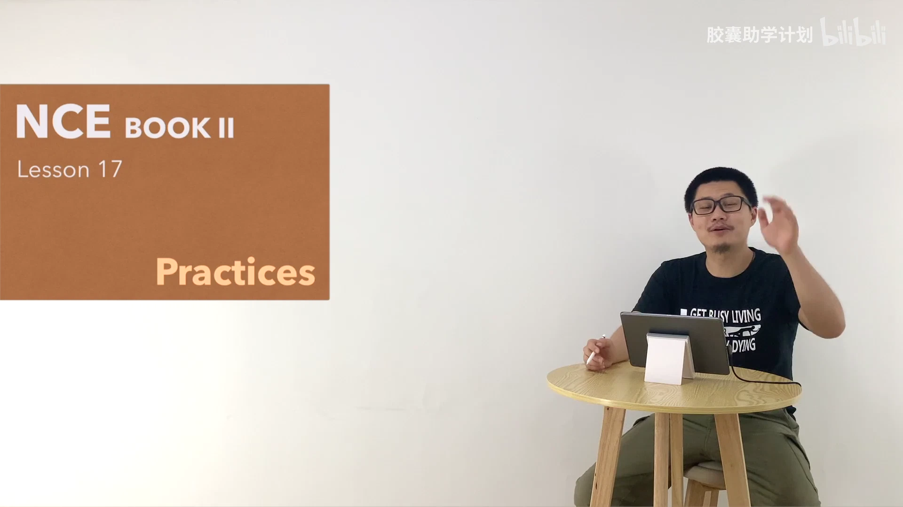

文字识别：胶囊助学计划 / Silbil / NCE / BOOKI"I / Lesson 17 / Practices /  GET BIISY LIVING / DYING

### 画面 00:00:05

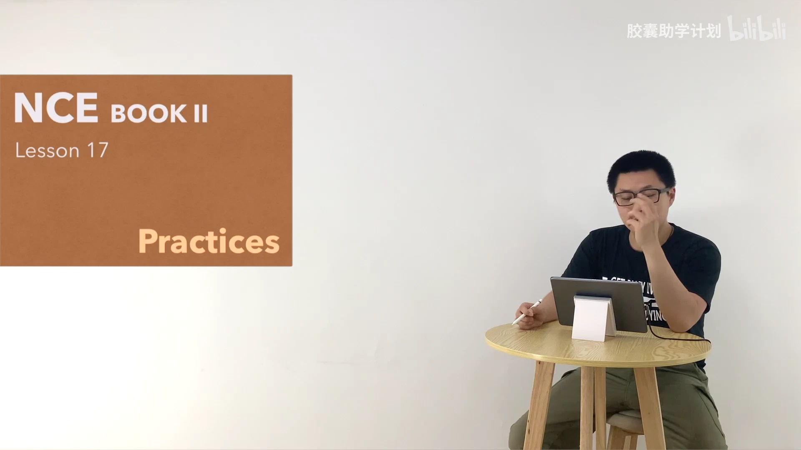

文字识别：Bilbili / 胶囊助学计划 / NCE / BOOKII / Lesson 17 / Practices

### 画面 00:00:08

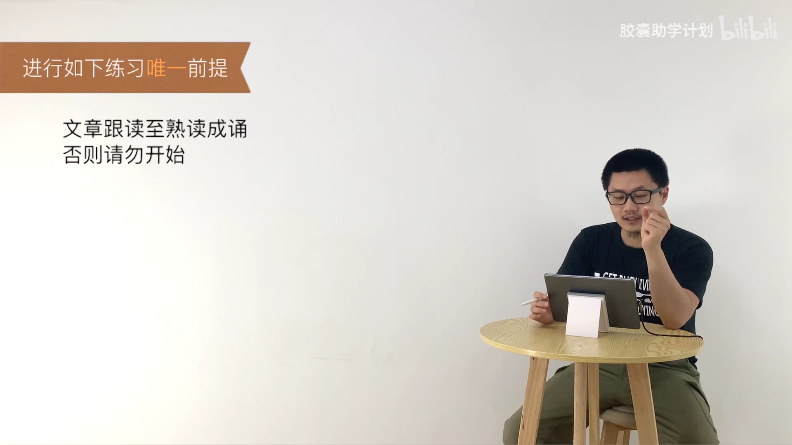

文字识别：Blibli / 胶囊助学计划 / 进行如下练习唯一前提 / 文章跟读至熟读成诵 / 否则请勿开始

### 画面 00:00:21

文字识别：胶囊助学计划bill / •

### 画面 00:00:25

### 画面 00:00:27

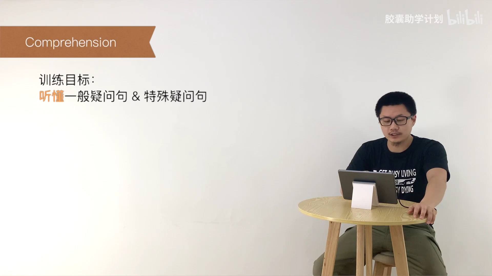

文字识别：Bilbli / 胶囊助学计划 / Comprehension / 训练目标： / 听懂一般疑问句＆特殊疑问句 / C PSY LVING / YDYING

## 00:00:30–00:01:00

殊疑问句。您文章要么已经如果非常熟了，直接看文章，或者完全不看文章。我问您答来了。E. D. What's your aunt called? Ah, what's his? What's her name? Jennifer. What is he? What is she?或者说What's her job? An actress. Next one. How old is she? At least thirty-five. Next one. Does

### 画面 00:00:37

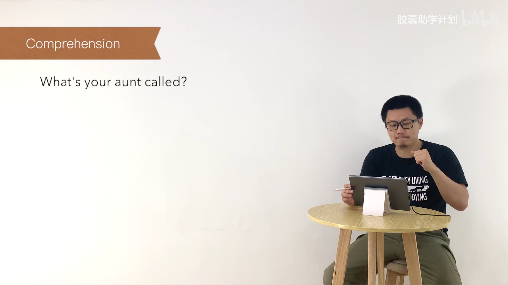

文字识别：胶囊助学计划 / Comprehension / What's your aunt called? / "SY LIVING / DYING

### 画面 00:00:44

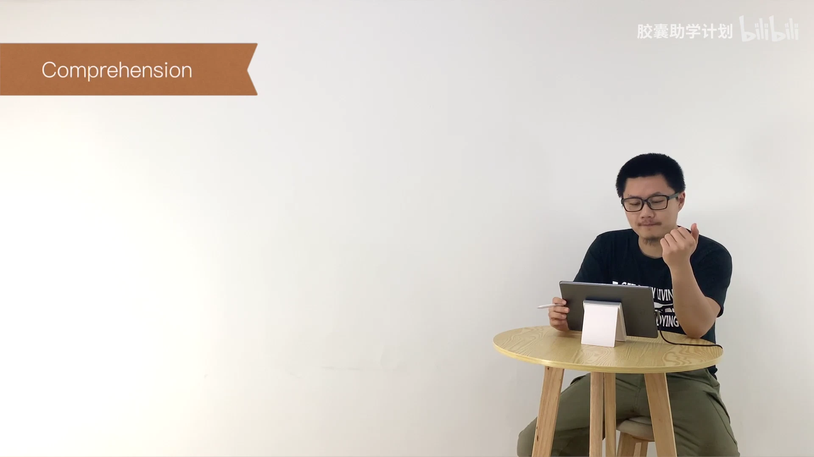

文字识别：胶囊助学计划 / Comprehension / YIVIN

## 00:01:00–00:01:30

she often appear on the stage as a young girl? Yes, she does.好，在这儿我放为放慢一下速度，简单解释一下。我一直没有专门去解释过，专门解释一下为什么你文章要读到非常熟再来做这些练习。您看这句话，其实就是把原文的肯定句变成了一般疑问句。如果肯定句你读到非常熟了，其实你就在提升你的听力了。只不过各位可能意识不到，这句话你听懂的概

### 画面 00:01:04

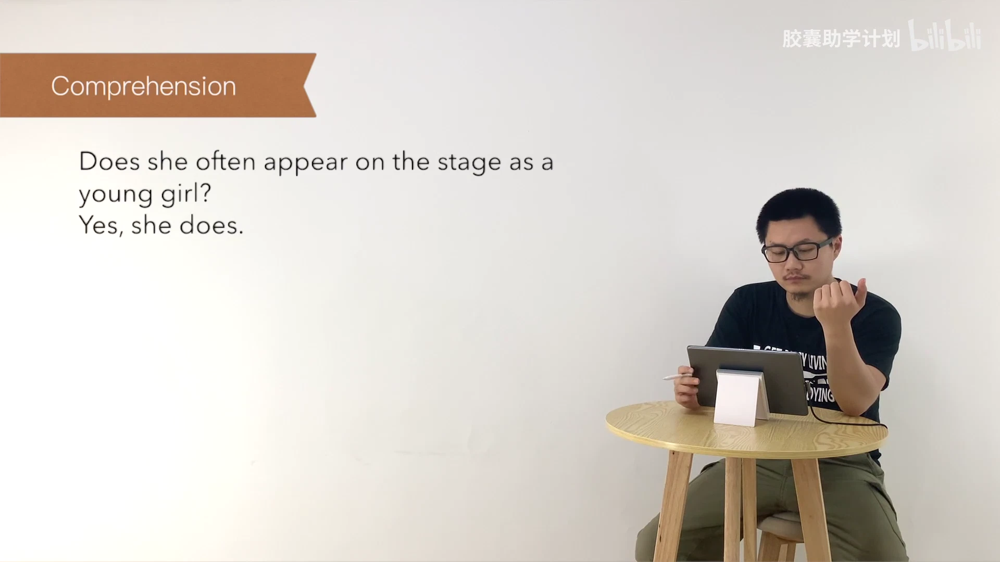

文字识别：Bilbil / 胶囊助学计划 / Comprehension / Does she often appear on the stage as a / young girl? / Yes, she does. / YIVIN / TNG

## 00:01:30–00:02:00

率就会大大提升了，我们就能练习口语听力了，对吧？Next one. What will she have to do soon? Take part in a new play. How old will she pretend to be? Pretend叫假装. Seventeen. Next one. What color dress must she wear? Bright red. Next one. What

### 画面 00:01:34

文字识别：Bilbli / 胶囊助学计划 / Comprehension

## 00:02:00–00:02:30

of stockings must she wear? Long black stockings. Next one, did she appear in a play last year? Yes, she did. Next one, she had to wear short socks, didn't she? Yes, she did. Continuing, do most women of thirty-five wear clothes like that? Like

### 画面 00:02:00

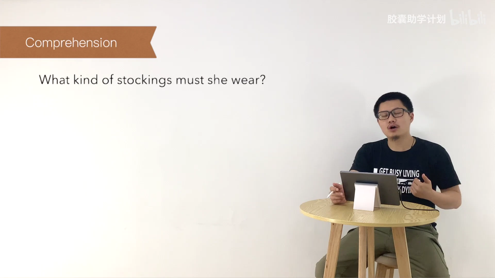

文字识别：胶囊助学计划 / Comprehension / What kind of stockings must she wear? / GFT RIISY LIVING / YDTT

### 画面 00:02:06

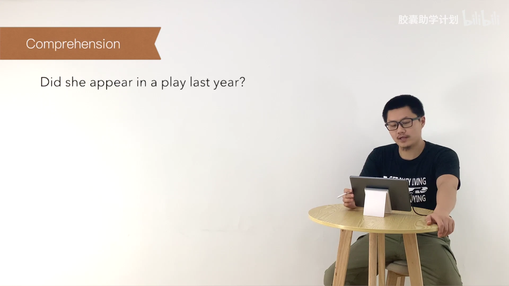

文字识别：胶囊助学计划 / Comprehension / Did she appear in a play last year? / YIVING / YING

### 画面 00:02:22

文字识别：胶囊助学计划 / Comprehension / Do most women of thirty-five wear clothes / like that? / IVING

## 00:02:30–00:03:00

that,叫像那一样吗？No, they don't. Next one, do people ever ask how old she is? Yes, they do.好，那接下来我们做的是 asking questions，对吧？我们能听懂一般疑问句和特殊疑问句的能力啊，我们能说出来一般疑问句和特殊疑问句的能力。先给一个例子，My aunt Jennifer is an actress. 一般疑问句 is 提前就可以了。What啊，那就是 What is

### 画面 00:02:39

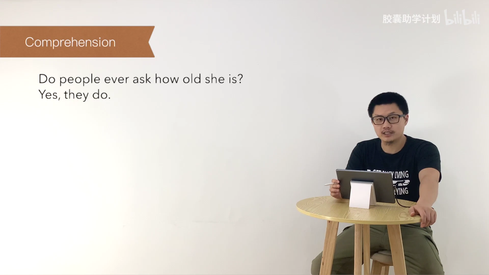

文字识别：胶囊助学计划 / Comprehension / Do people ever ask how old she is? / Yes, they do. / YIVING / YING

### 画面 00:02:41

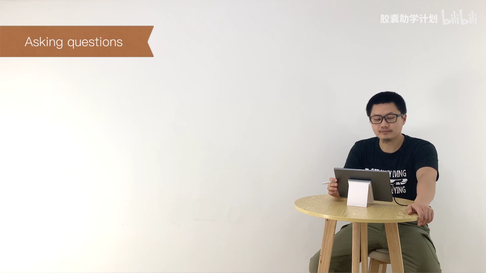

文字识别：Bilbil / 胶囊助学计划 / Asking questions / YIVING / LVING

### 画面 00:02:57

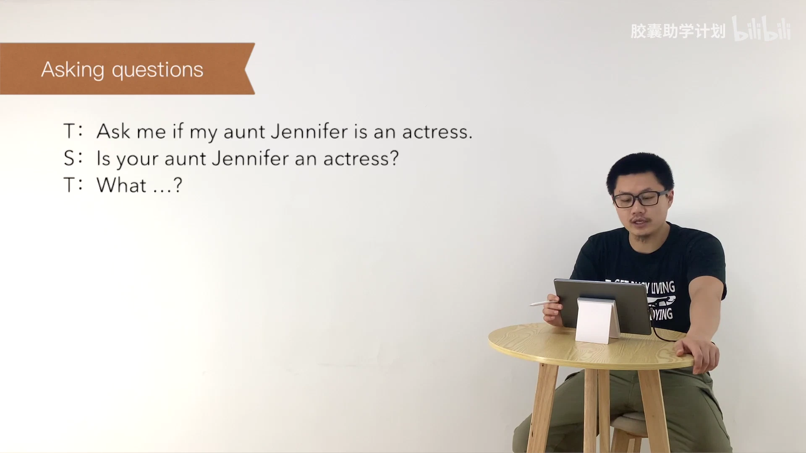

文字识别：胶囊助学计划 / Asking questions / T: Ask me if my aunt Jennifer is an actress. / S: Is your aunt Jennifer an actress? / T: What ….? / YLIING / OYING

## 00:03:00–00:03:30

your aunt Jennifer? 答案就是An actress，对吧？她是什么？一个演员。OK。那第二题，我们老习惯啊，在这个地方只给大家提思路。这儿的P.S.是is提前。How old对Over thirty five years old提问，对吧？How old is she?非常简单。Appears出现了，我已经讲过好几遍了。把Does提前，动词换回原形。What点点点As其实就是What对A young girl提问

### 画面 00:03:05

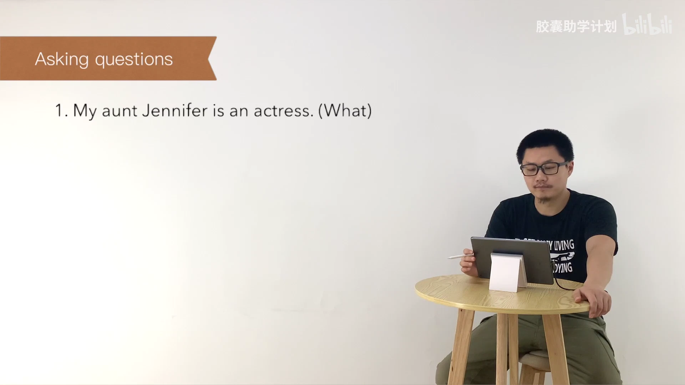

文字识别：Bib出 / 胶囊助学计划 / Asking questions / 1. My aunt Jennifer is an actress. (What) / YLIVING / DYING

### 画面 00:03:18

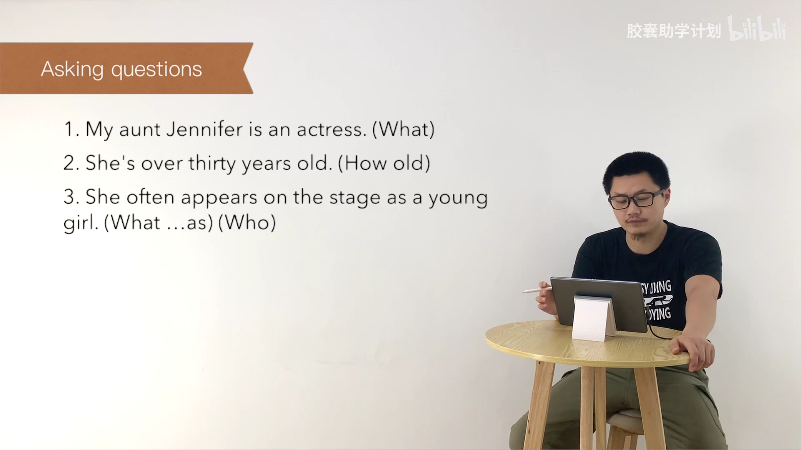

文字识别：胶囊助学计划 / Asking questions / 1. My aunt Jennifer is an actress. (What) / 2. She's over thirty years old. (How old) / 3. She often appears on the stage as a young / girl. (What ..as) (Who) / SYIMING / YING

## 00:03:30–00:04:00

就行了，对吧？剩下都是一模一样的。Who呢？您对主语提问，然后呢，直接替代主语变一般疑问啊，不用变一般疑问句就可以了。She will have to啊，这个我们讲习惯用法讲到了，Will提前。When对soon提问，对吧？那What对a new play提问。She will be a girl seventeen.首先一般疑问句Will提前。那Who Who其实在这个地方可以对两

### 画面 00:03:40

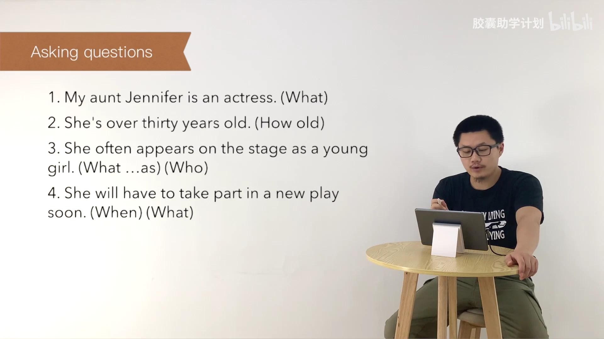

文字识别：胶囊助学计划 / Asking questions / 1. My aunt Jennifer is an actress. (What) / 2. She's over thirty years old. (How old) / 3. She often appears on the stage as a young / girl. (What ..as) (Who) / 4. She will have to take part in a new play / soon.(When)(What) / YLING / VING

## 00:04:00–00:04:30

个提问，对主语提问，或者对a girl of seventeen提问，对吧？She will wear a bright red dress. P L L will will提前。那What对a bright red dress提问，她会穿什么？What will she wear?第七个还是will提前。What kind of什么类型的？

### 画面 00:04:05

文字识别：胶囊助学计划山 / Asking questions / 1. My aunt Jennifer is an actress. (What) / 2. She's over thirty years old. (How old) / 3. She often appears on the stage as a young / girl. (What .as) (Who) / 4. She wil have to take part in a new play / soon.(When)(What) / YLZING / 5. She will be a girl of seventeen.(Who) / UVING / 6. She'll wear a bright red dress. (What)

### 画面 00:04:21

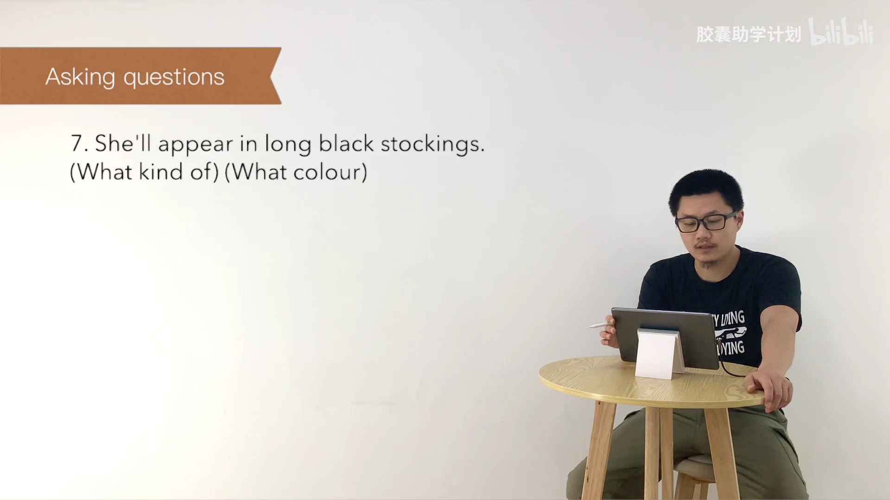

文字识别：Biltbilt / 胶囊助学计划 / Asking questions / 7. She'll appear in long black stockings. / (What kind of) (What colour) / YLING / IVING

## 00:04:30–00:05:00

那一定是对 long 和 black 提问，所以这个地方叫做 What kind of stockings will she appear in? Okay, 那 what color 就是只对 black 提问，在这个地方我直接给各位一个答案，叫做 What color stockings will she appear in? There you go. 第八个 was in another play last year. Was 提前 when 对 last year 提问.

### 画面 00:04:35

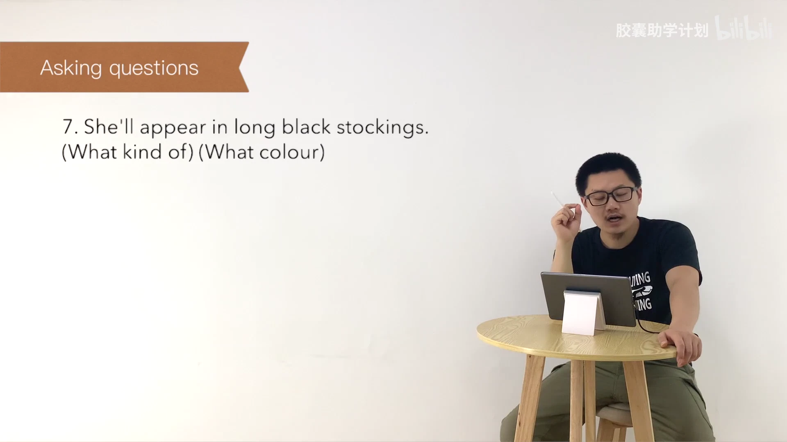

文字识别：胶囊助学计划 / Asking questions / 7. She'll appear in long black stockings. / (What kind of) (What colour) / MING / ING

### 画面 00:04:52

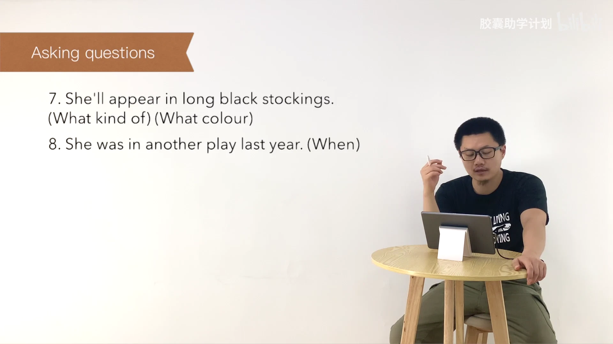

文字识别：胶囊助学计划 / Asking questions / 7. She'll appear in long black stockings. / (What kind of) (What colour) / 8. She was in another play last year. (When) / LING / VING

### 画面 00:04:55

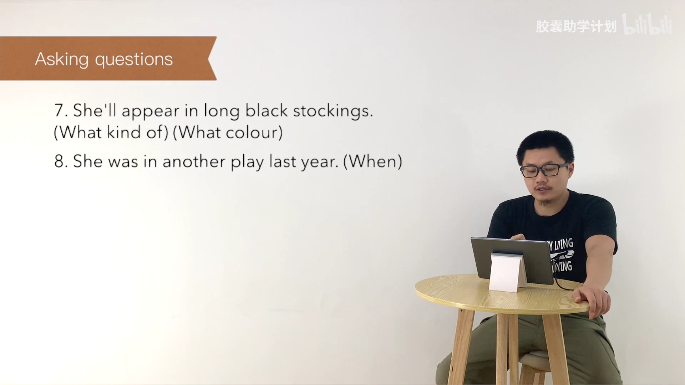

文字识别：胶囊助学计划 / Asking questions / 7. She'll appear in long black stockings. / (What kind of) (What colour) / 8. She was in another play last year. (When) / YLMING / YING

## 00:05:00–00:05:30

had to 讲语法那个地方我提到了对吧? Did 提前 What 对 short socks 提问, she had to wear Did 提前 Had 换回原形 What else 就是还有什么其他的啊？就是还是对 a bright dress 提问。那 What else did she have to wear? Okay, 最后一个 Was 提前 What color 啊？就 What color was it

### 画面 00:05:09

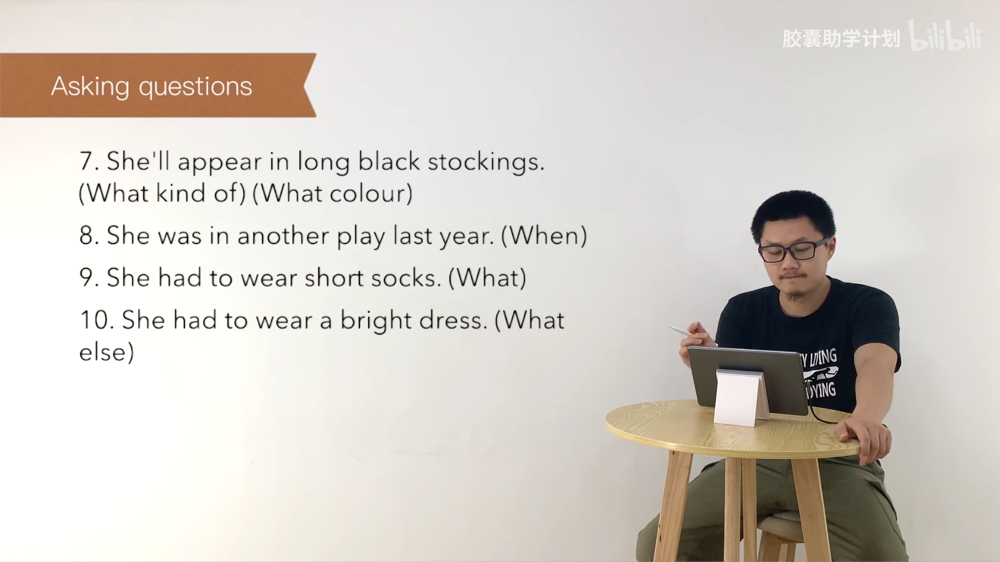

文字识别：胶囊助学计划 / Asking questions / 7. She'll appear in long black stockings. / (What kind of) (What colour) / 8. She was in another play last year. (When) / 9. She had to wear short socks. (What) / 10. She had to wear a bright dress. (What / else) / YLING / IYING

## 00:05:30–00:06:00

The orange提问嘛，对吧？很简单。Tell the story，老习惯，可以有一点点错误，不能太慢，所以文章必须要读的很熟。来了，我给大家做示范。My aunt Jennifer is an actress. She must be at least thirty-five years old. In spite of this, she often appears on the stage as a young girl. Jennifer will have to take part in a new play soon, and this time she will be a seventeen

### 画面 00:05:32

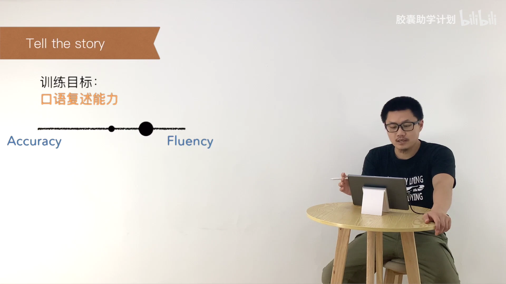

文字识别：bibii / 胶囊助学计划 / Tell the story / 训练目标： / 口语复述能力 / Accuracy / Fluency / YLING / UVING

### 画面 00:05:39

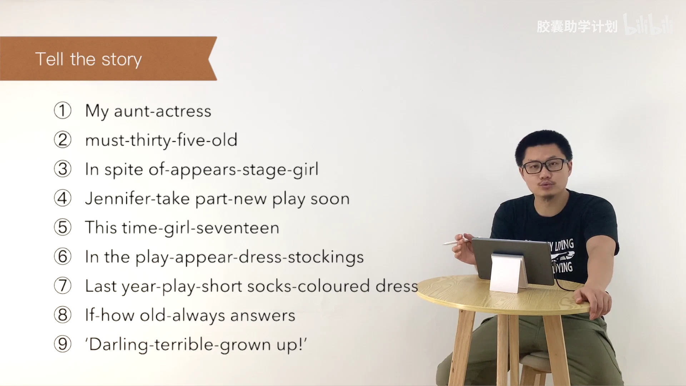

文字识别：胶囊助学计划 / Tell the story / 1 / My aunt-actress / must-thirty-five-old / In spite of-appears-stage-girl / Jennifer-take part-new play soon / This time-girl-seventeen / YLING / In the play-appear-dress-stockings / IVING / Last year-play-short socks-coloured dress / If-how old-always answers / 'Darling-terrible-grown up!'

## 00:06:00–00:06:30

years old girl. In the play she will appear in bright red dress and long black stockings. Last year in another play she had to wear short socks and bright orange colored dress. If anyone ever asks how old she is, she always answers, "Darling, it must be terrible to be grown up." Okay,好摘要写作，各位写完了，在这儿对一下答案

### 画面 00:06:09

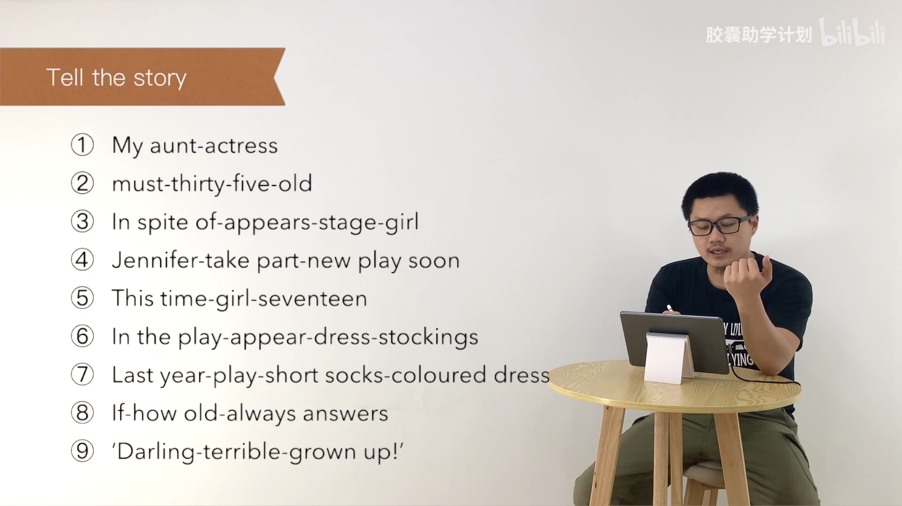

文字识别：胶囊助学计划 / Tell the story / 1 / My aunt-actress / must-thirty-five-old / In spite of-appears-stage-girl / Jennifer-take part-new play soon / This time-girl-seventeen / In the play-appear-dress-stockings / YLWL / Last year-play-short socks-coloured dress / If-how old-always answers / 'Darling-terrible-grown up!'

### 画面 00:06:26

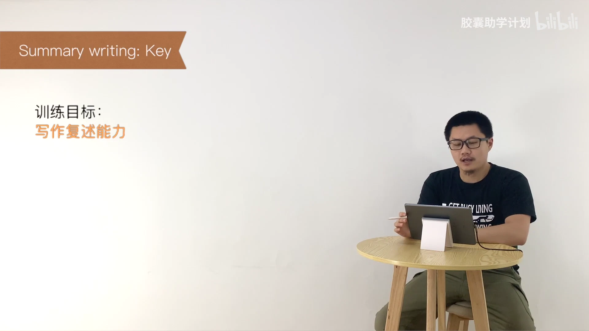

文字识别：Biibili / 胶囊助学计划 / Summary writing: Key / 训练目标： / 写作复述能力

### 画面 00:06:29

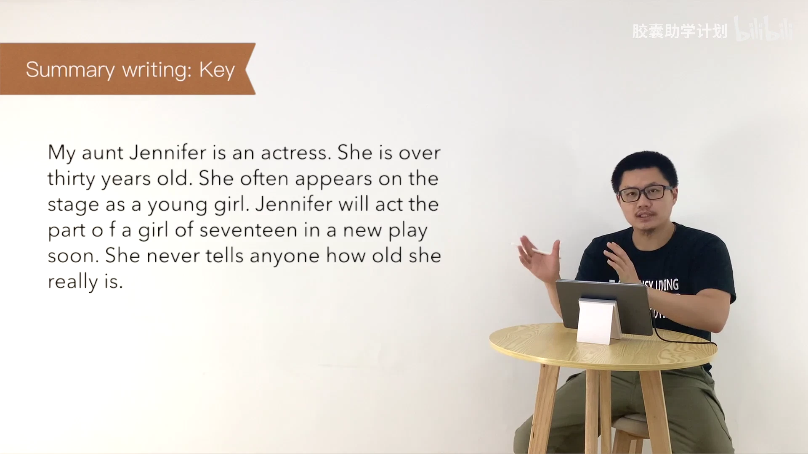

文字识别：胶囊助学计划 / Summary writing: Key / My aunt Jennifer is an actress. She is over / thirty years old. She often appears on the / stage as a young girl. Jennifer will act the / part o f a girl of seventeen in a new play / soon. She never tells anyone how old she / really is. / UCVIMING

## 00:06:30–00:07:00

就可以了。我们在这个地方没有过多的解释。最后一个题，topic for discussion，我们来一起看一下有什么样的题。Who is your favorite actor and actress?谁是你最喜欢的男明星或女明星？对吧？男演员或女演员啊，不是明星啊。Why do you think he or she is good?你为什么认为他很好啊？给点原因。Is it true that most people tell lies about their age?说大多数女人关于他们的岁数

### 画面 00:06:33

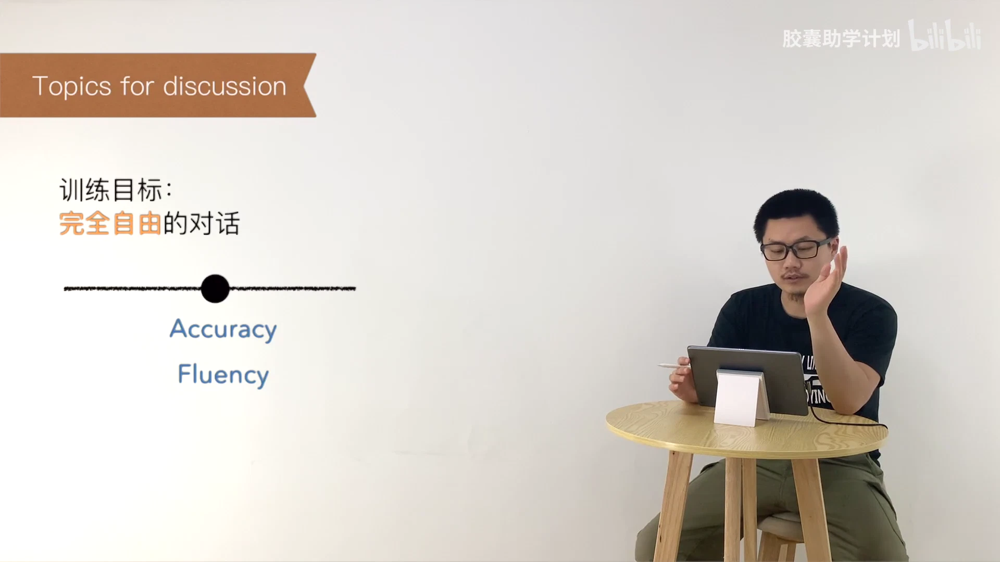

文字识别：胶囊助学计划 / Topics for discussion / 训练目标： / 完全自由的对话 / Accuracy / Fluency

### 画面 00:06:36

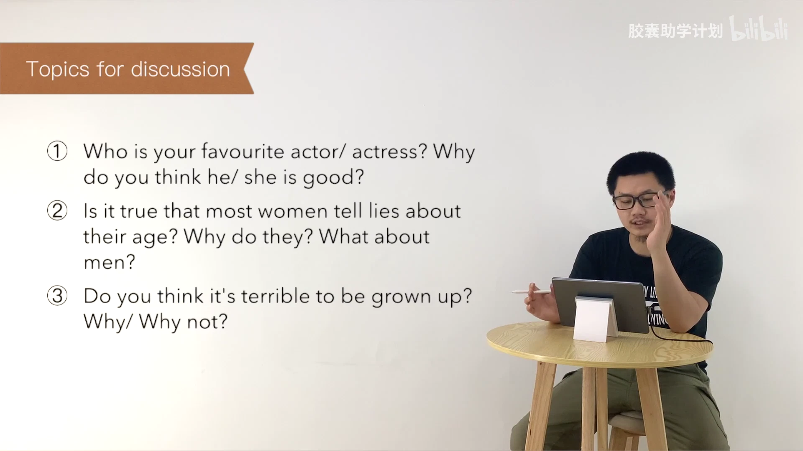

文字识别：胶囊助学计划blb出 / Topics for discussion / Who is your favourite actor/ actress? Why / do you think he/ she is good? / Is it true that most women tell lies about / 2 / their age? Why do they? What about / men? / Do you think it's terrible to be grown up? / Why/ Why not?

## 00:07:00–00:07:30

会撒谎，这件事情是真的吗？Why do they? 如果他们撒谎了，那他们为什么愿意去撒谎呢？对吧？为什么不说出实际年龄呢？What about men? 那男人会对年龄撒谎吗？您有自己的答案。Do you think it's terrible to be grown up? 那你认为当成人是不是很糟糕的一件事情呢？是的话，为什么是？不是的话，为什么不是？Okay, 家庭作业，Ask me if. 先写，照着自己写完了，

### 画面 00:07:00

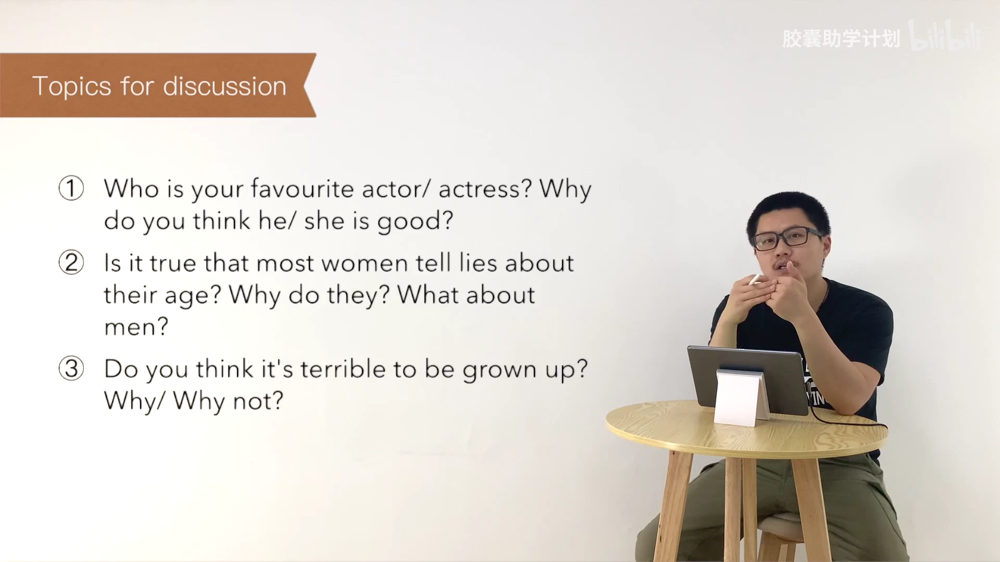

文字识别：胶囊助学计划 / Topics for discussion / Who is your favourite actor/ actress? Why / do you think he/ she is good? / Is it true that most women tell lies about / 2 / their age? Why do they? What about / men? / Do you think it's terrible to be grown up? / Why/ Why not?

### 画面 00:07:10

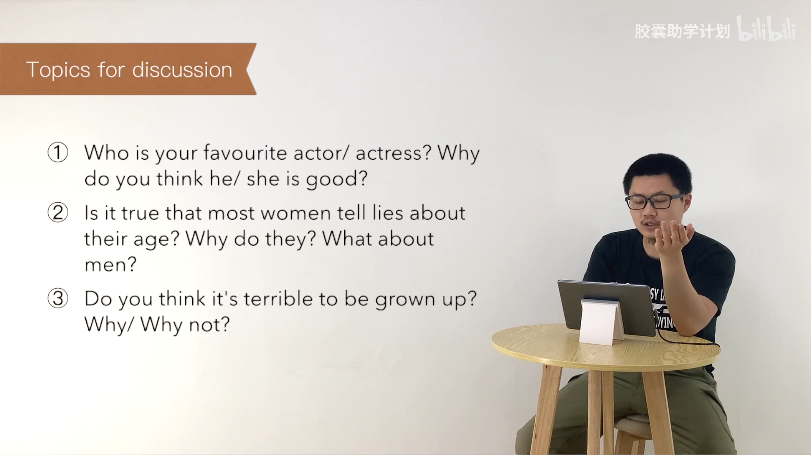

文字识别：胶囊助学计划 / Topics for discussion / Who is your favourite actor/ actress? Why / do you think he/ she is good? / Is it true that most women tell lies about / 2 / their age? Why do they? What about / men? / Do you think it's terrible to be grown up? / SYL / Why/ Why not?

### 画面 00:07:13

文字识别：胶囊助学计划 / Topics for discussion / Who is your favourite actor/ actress? Why / do you think he/ she is good? / Is it true that most women tell lies about / 2 / their age? Why do they? What about / men? / Do you think it's terrible to be grown up? / Why/ Why not?

### 画面 00:07:16

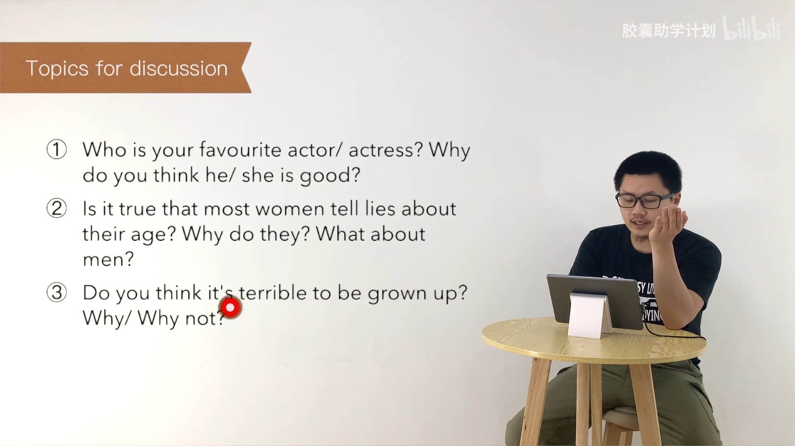

文字识别：胶囊助学计划 / Topics for discussion / Who is your favourite actor/ actress? Why / do you think he/ she is good? / Is it true that most women tell lies about / 2 / their age? Why do they? What about / men? / Do you think it's terrible to be grown up? / SYL / 流 / Why/ Why not?

### 画面 00:07:26

文字识别：胶囊助学计划bibl / 1.A / Ask meif写&朗读 / GET RIICV / LVIIN / YING

### 画面 00:07:28

文字识别：胶囊助学计划 / 1.Ask me if写&朗读 / CET DIISY LMING / DYING

## 00:07:30–00:08:00

确定对的，大声朗读出来。摘要写作写完来这儿对一下答案。Tell the story，文章读熟了之后进行口语复述。专栏当中可以找到这些练习。OK，那以上呢就是本期视频的全部内容了。如果大家喜欢我们的课程，欢迎大家关注、订阅、一键三连支持我们，分享给更多的朋友来帮助我们快速成长。See you next time.

### 画面 00:07:30

文字识别：胶囊助学计划 / 1.Ask me if写&朗读 / CRT RUSY LING / DYING

### 画面 00:07:32

文字识别：胶囊助学计划 / 1.Ask me if写&朗读 / 2. / 摘要写作写&答案 / "SY LING / DYING

### 画面 00:07:34

文字识别：胶囊助学计划 / 1. / Ask me if写&朗读 / 2. / 摘要写作写&答案 / DYING

### 画面 00:07:36

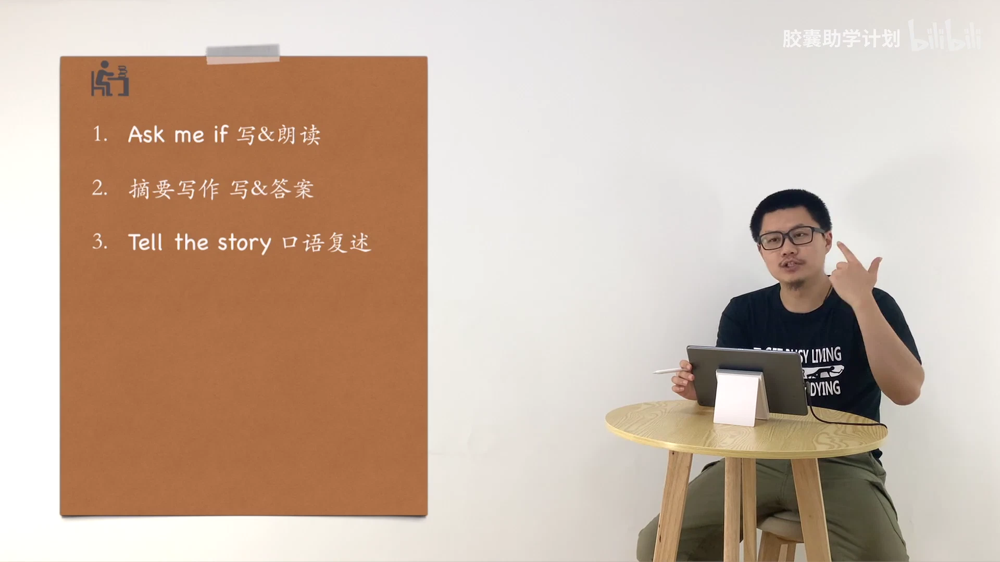

文字识别：胶囊助学计划 / 1.Ask me if写&朗读 / 摘要写作写&答案 / 3.Tell the story 口语复述 / 'SYLMING / A / DYING

### 画面 00:07:38

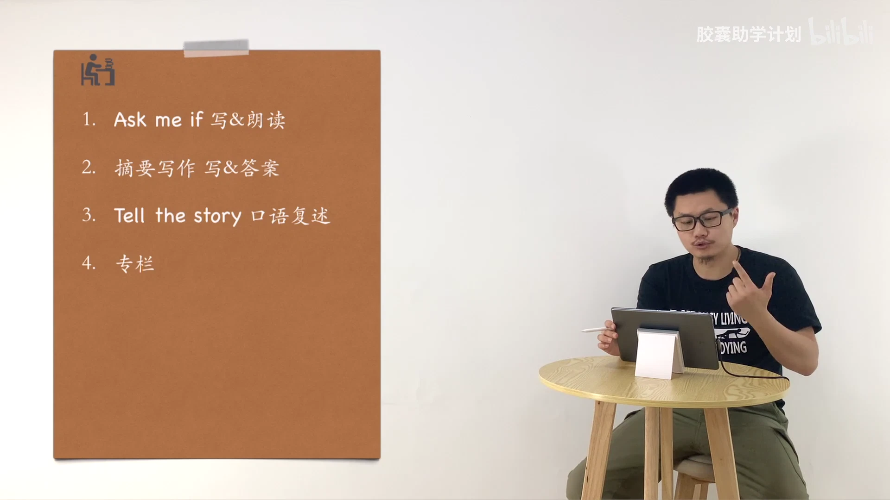

文字识别：胶囊助学计划 / 1.Ask me if写&朗读 / 摘要写作写&答案 / 3.Tell the story 口语复述 / 专栏 / 4. / DYING

### 画面 00:07:40

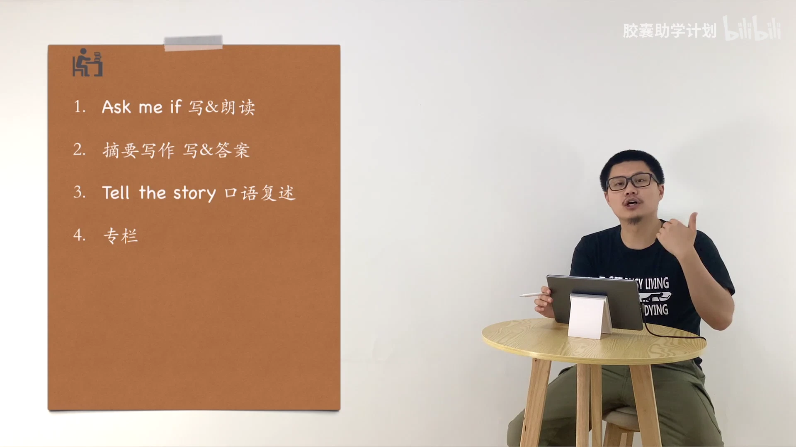

文字识别：胶囊助学计划 / 1.Ask me if写&朗读 / 摘要写作写&答案 / 3.Tell the story 口语复述 / 专栏 / 4. / SYLIMNG / DYING

### 画面 00:07:42

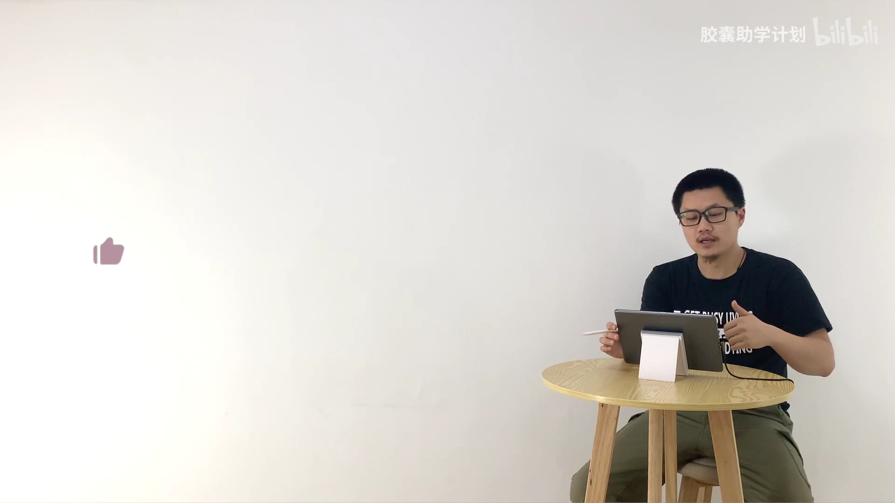

文字识别：胶囊助学计划

### 画面 00:07:48

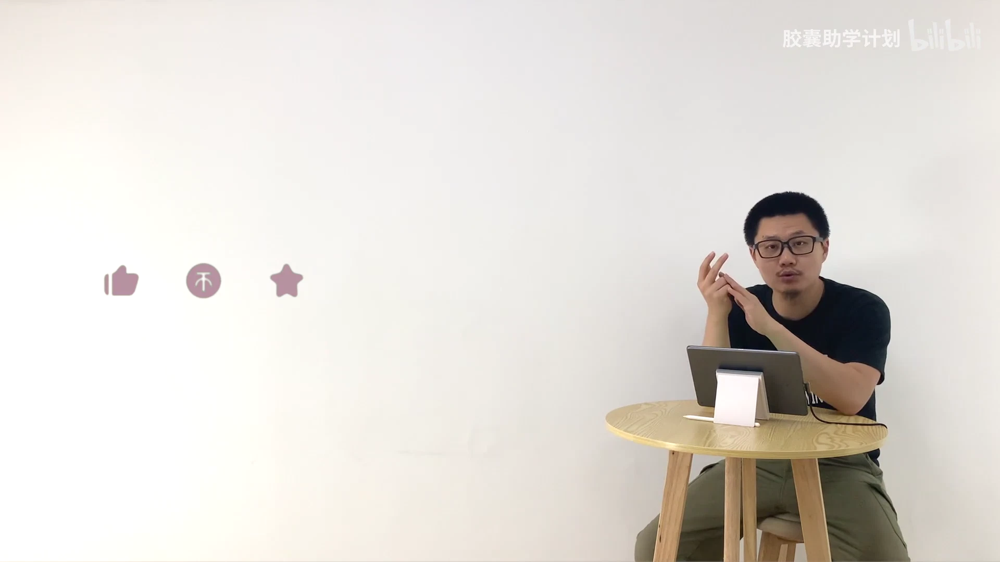

文字识别：胶囊助学计划

### 画面 00:07:55

文字识别：CAPSULEACADEMY / 胶囊助学计划 / 『 / 小红书 / OE

### 画面 00:07:57

文字识别：CAPSULEACADEMY / 胶囊助学计划 / 『 / 小红书 / Leo / OE

## 00:08:00–00:08:07

### 画面 00:08:03

文字识别：CAPSULEACADEMY / 胶囊助学计划 / 小红书 / Creator / 回 / Leo & Berlin / OE

### 画面 00:08:05

文字识别：bilibili / 胶囊助学计划

### 画面 00:08:06

文字识别：bilibili / 胶囊助学计划

