# L018 语法 + 单词

快速机器解析：语音为单模型转写，未进行独立交叉校对或人工复核；画面每秒采样并按变化选帧，短时文字和标记可能遗漏。截图时间约有 1 秒误差。图片有损压缩；遇到疑点请按时间查看 Google Drive 原视频。

## 00:00:00–00:00:30

Hello everyone, welcome to Capsule Academy. This is Leo. Today we are going to learn the Concept English Book Two Lesson Eighteen Grammar and Words. 那老习惯进入正式课程之前，我们看几个问题。第一，如何表达付款？然后呢， have 有哪些用法？我们今天来给它一起总结一下。那带着这两个问题， hope you guys enjoy it. 我们先看第一个小的单词，音标

### 画面 00:00:00

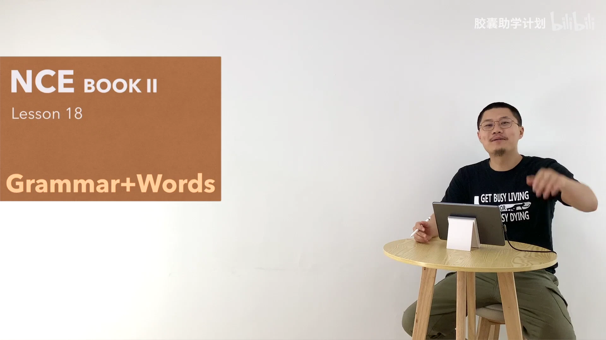

文字识别：胶囊助学计划 / NCE / BOOKII / Lesson 18 / Grammar+Words / GET BUSY LIVING / OR. / SY DYING

### 画面 00:00:05

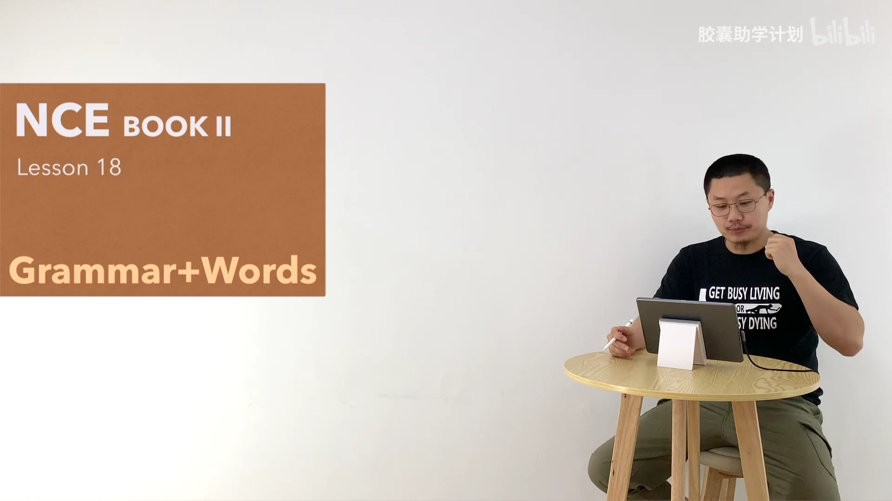

文字识别：胶囊助学计划 / NCE / BOOK I"I / Lesson 18 / Grammar+Words / GET BUSY LIVING / ORAU / SY DYING

### 画面 00:00:09

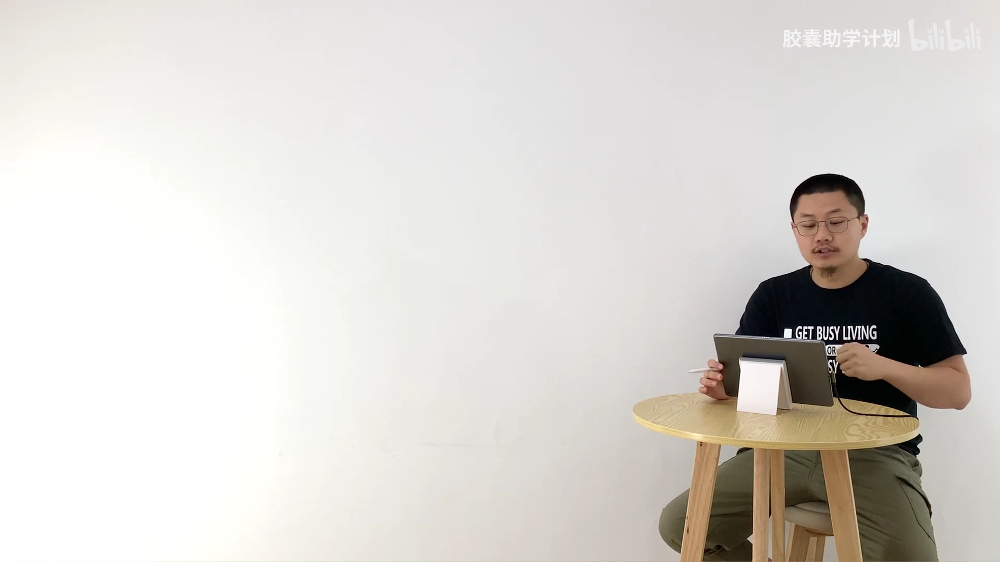

文字识别：胶囊助学计划 / GET BUSY LIVING / OR

### 画面 00:00:11

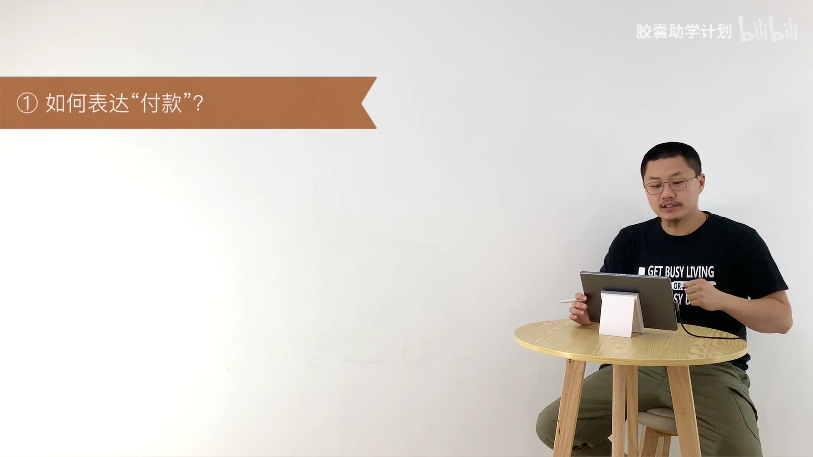

文字识别：胶囊助学计划 / ①如何表达“付款”？ / GET BUSY LIVING / OR- / Sy

### 画面 00:00:13

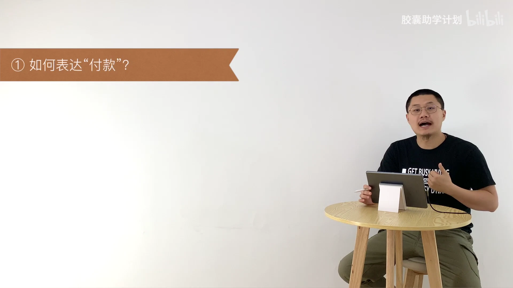

文字识别：胶囊助学计划 / ①如何表达“付款”？ / OK

### 画面 00:00:15

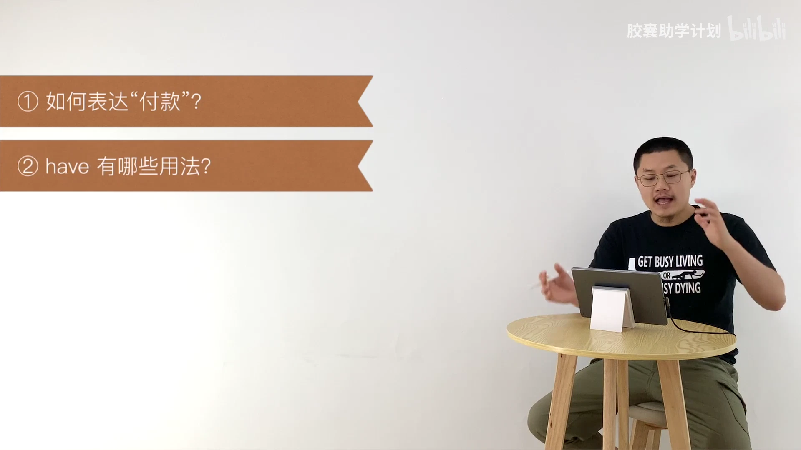

文字识别：胶囊助学计划 / ①如何表达“付款”？ / have 有哪些用法? / GET BUSY LIVING / OR- / SY DYING

### 画面 00:00:21

文字识别：胶囊助学计划 / ①如何表达“付款”？ / have 有哪些用法? / GET BUSY LIVING / OR / YDYING

### 画面 00:00:23

文字识别：胶囊助学计划 bilbl / •

### 画面 00:00:27

### 画面 00:00:29

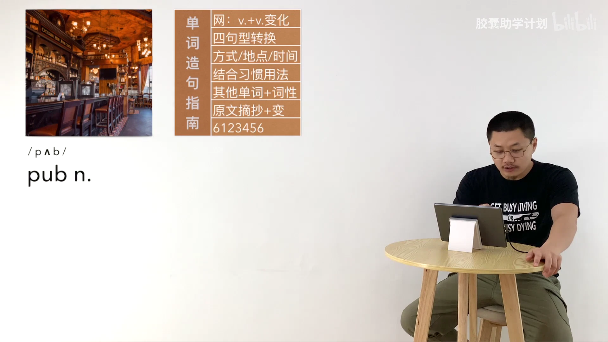

文字识别：单词造句指南 / 网：v.+v.变化 / 胶囊助学计划 / 四句型转换 / 方式/地点/时间 / 结合习惯用法 / 其他单词+词性 / 原文摘抄+变 / 6123456 / /pb/ / pub n. / CFT / BUSY LIVING / OR / NISY DYING

## 00:00:30–00:01:00

非常的简单啊，拼写也非常的简单。基本上这个单词属于是你会读，再加有一点自然拼读法则的知识，这个单词的拼写瞬间就记起来了。跟我一起读一下，叫做 pub， pub。 OK，那 pub 实际上在西方世界，你会发现它最常见表达的意思指的是这种小的酒吧，这种小的酒馆。但是这种酒吧酒馆呢，它不是说只能喝酒啊，你还能吃一些简

### 画面 00:00:31

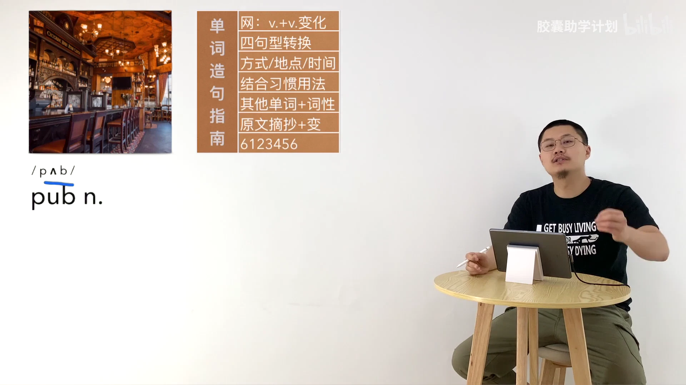

文字识别：单词造句指南 / 网：v.+v.变化 / 胶囊助学计划 / 四句型转换 / 方式/地点/时间 / 结合习惯用法 / 其他单词+词性 / 原文摘抄+变 / 6123456 / /pΛb/ / pub / ) n. / GET BUSY LIVING / RAU / SYDVING

### 画面 00:00:35

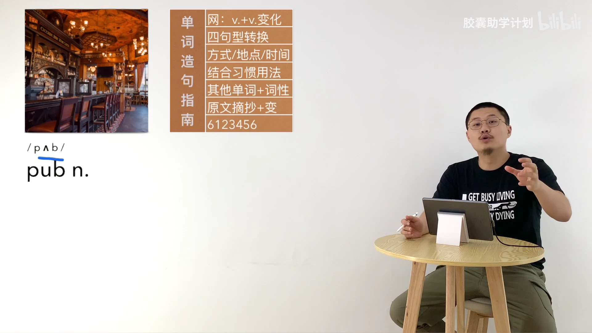

文字识别：单词造句指南 / 网：v.+v.变化 / 胶囊助学计划 / 四句型转换 / 方式/地点/时间 / 结合习惯用法 / 其他单词+词性 / 原文摘抄+变 / 6123456 / /p∧b/ / pub / n. / GET BUSY IVING / YDYING

### 画面 00:00:41

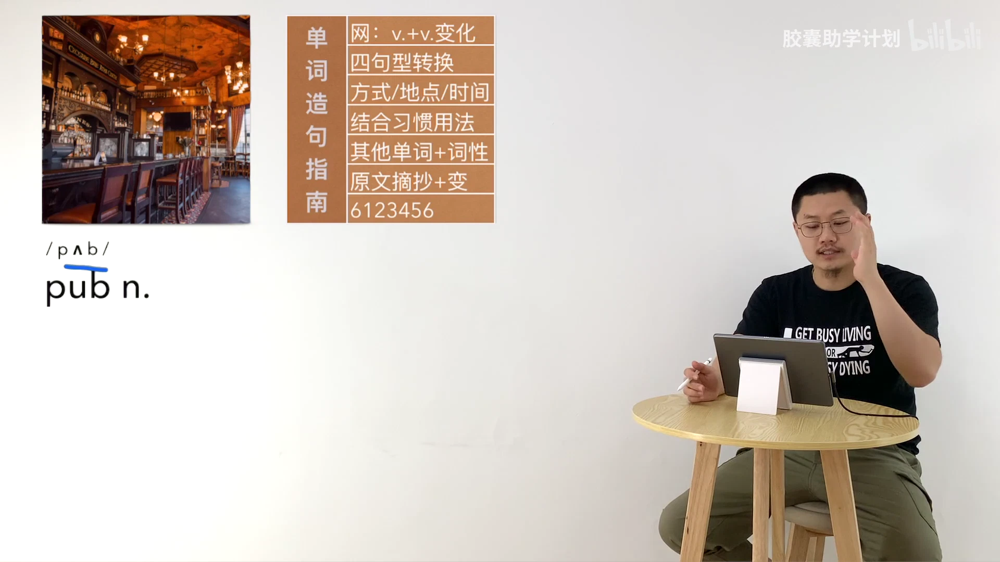

文字识别：单词造句指南 / 网：v.+v.变化 / 胶囊助学计划 / 四句型转换 / 方式/地点/时间 / 结合习惯用法 / 其他单词+词性 / 原文摘抄+变 / 6123456 / /p∧b/ / pub / n. / GET BUSY IVING / OR. / SYDYING

### 画面 00:00:45

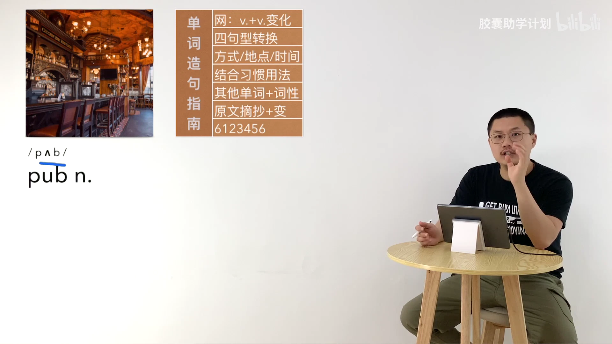

文字识别：单词造句指南 / 网：v.+v.变化 / 胶囊助学计划 / 四句型转换 / 方式/地点/时间 / 结合习惯用法 / 其他单词+词性 / 原文摘抄+变 / 6123456 / /p∧b/ / pub / o n. / GETBUIYW / KOYIN

### 画面 00:00:48

文字识别：单词造句指南 / 网：v.+v.变化 / 胶囊助学计划 / 四句型转换 / 方式/地点/时间 / 结合习惯用法 / 其他单词+词性 / 原文摘抄+变 / 6123456 / /p∧b/ / pub / o n. / OYIN

### 画面 00:00:50

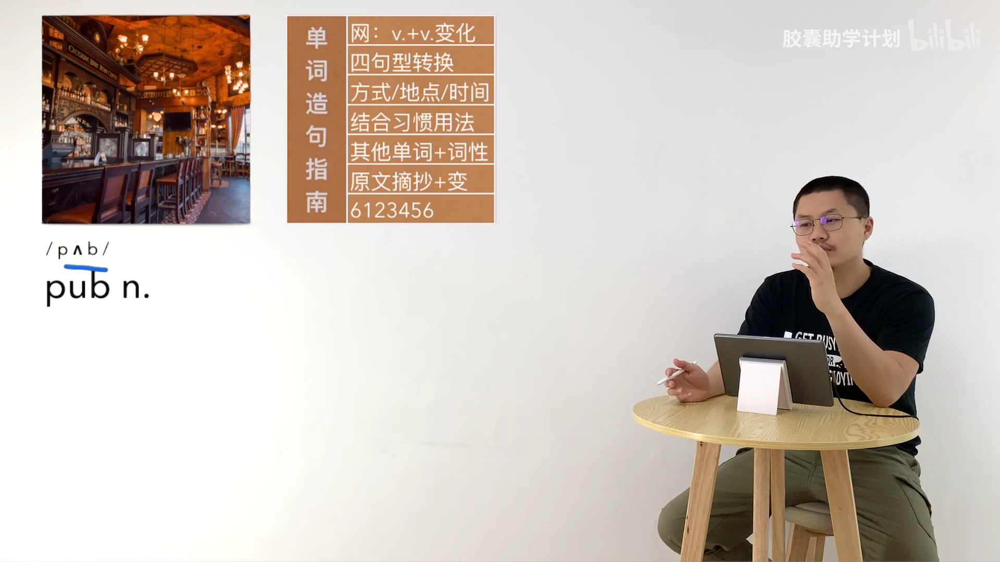

文字识别：单词造句指南 / 网：v.+v.变化 / 胶囊助学计划 / 四句型转换 / 方式/地点/时间 / 结合习惯用法 / 其他单词+词性 / 原文摘抄+变 / 6123456 / /pΛb/ / pub / o n. / GETD

### 画面 00:00:55

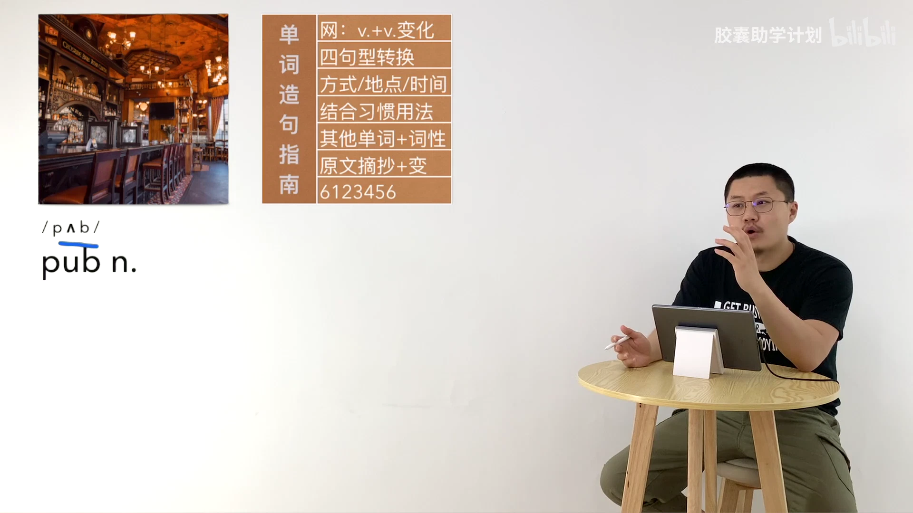

文字识别：单词造句指南 / 网：v.+v.变化 / 胶囊助学计划 / 四句型转换 / 方式/地点/时间 / 结合习惯用法 / 其他单词+词性 / 原文摘抄+变 / 6123456 / /pab/ / pub / o n. / GETDI

### 画面 00:00:59

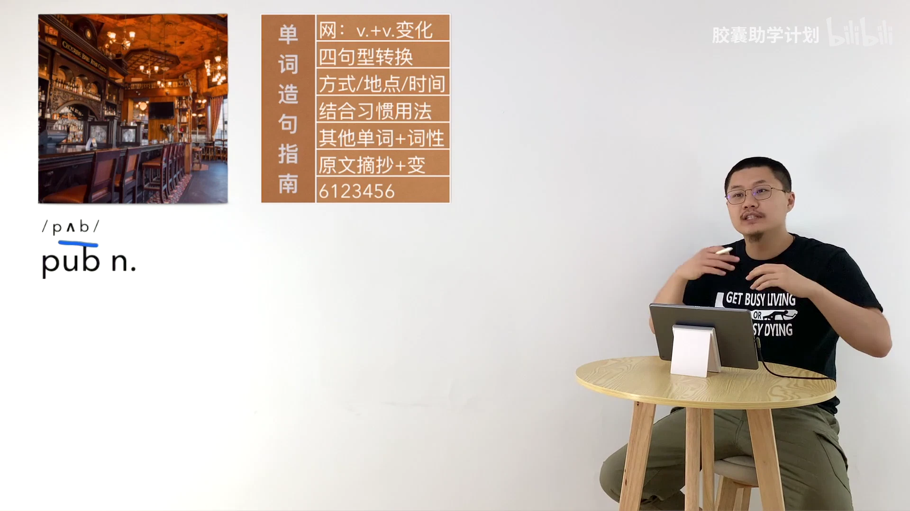

文字识别：单词造句指南 / 网：v.+v.变化 / 胶囊助学计划 / 四句型转换 / 方式/地点/时间 / 结合习惯用法 / 其他单词+词性 / 原文摘抄+变 / 6123456 / /pΛb/ / pub / ) n. / GET BUSY LIVING / OR / SYDYING

## 00:01:00–00:01:30

餐，比如说牛排，比如说意面，比如说各种各样的凯撒沙拉等等，对吧？包括油炸的一些小的零食都是可以的啊。是吃简餐的地方。当然了，更多的人去那儿是为了喝酒去的，我们管它叫小的酒吧、酒店，是吧？啊，酒吧酒馆啊，读一下叫做 pub。好，那你注意，你看它现在的意思，既然是酒吧酒馆，那我们要单词造句就要想六一二三四五六，它都能处在什么位置上呢？它可以

### 画面 00:01:03

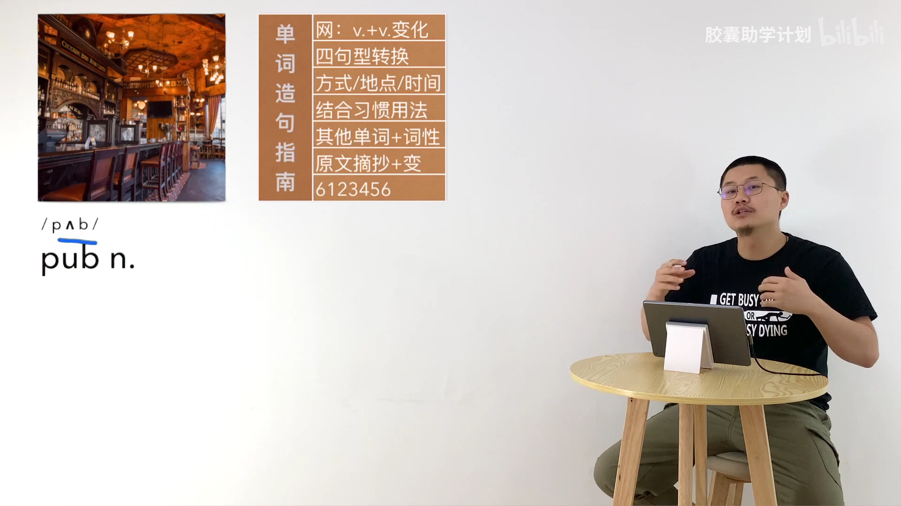

文字识别：单词造句指南 / 网：v.+v.变化 / 胶囊助学计划 / 四句型转换 / 方式/地点/时间 / 结合习惯用法 / 其他单词+词性 / 原文摘抄+变 / 6123456 / /pΛb/ / pub /  n. / GET BUSY / ORAL / SY DYING

### 画面 00:01:06

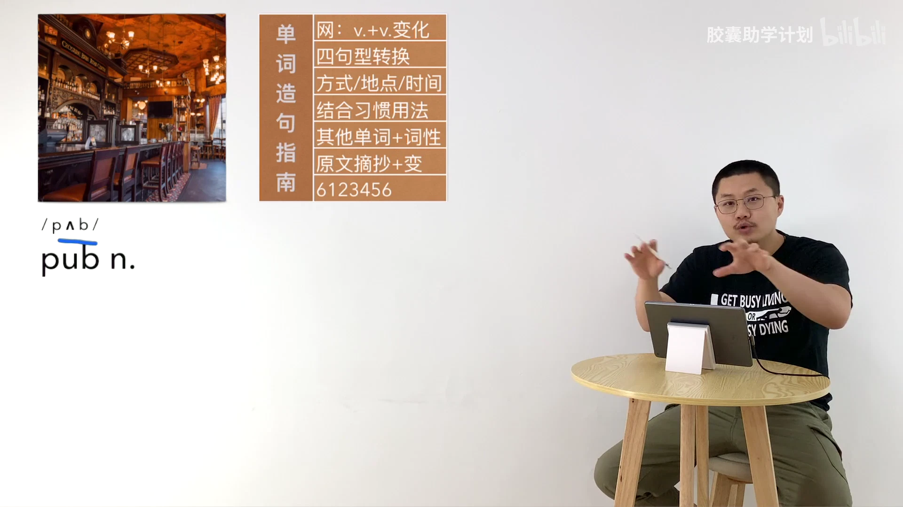

文字识别：单词造句指南 / 网：v.+v.变化 / 胶囊助学计划 / 四句型转换 / 方式/地点/时间 / 结合习惯用法 / 其他单词+词性 / 原文摘抄+变 / 6123456 / /p∧b/ / pub /  n. / GET BUSYLIVINU / OR / SY DYING

### 画面 00:01:09

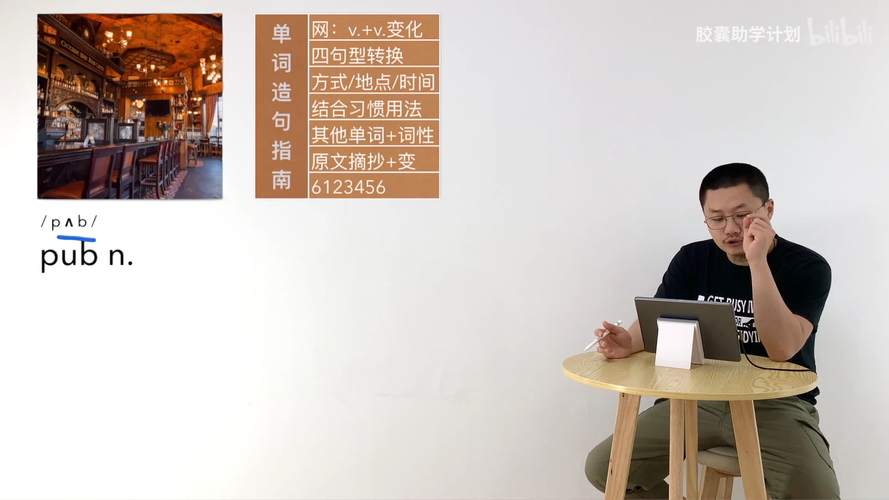

文字识别：单词造句指南 / 网：v.+v.变化 / 胶囊助学计划 / 四句型转换 / 方式/地点/时间 / 结合习惯用法 / 其他单词+词性 / 原文摘抄+变 / 6123456 / /p∧b/ / pub n. / USYIN / RL / DVI

### 画面 00:01:11

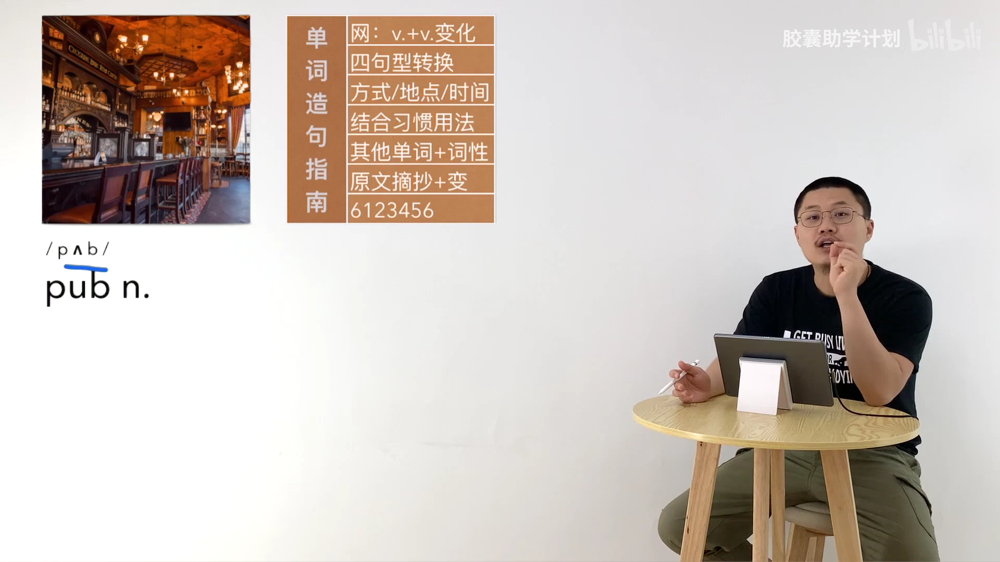

文字识别：单词造句指南 / 网：v.+v.变化 / 胶囊助学计划 / 四句型转换 / 方式/地点/时间 / 结合习惯用法 / 其他单词+词性 / 原文摘抄+变 / 6123456 / /p^b/ / pub / o n. / GET DIISYI / B / HOYI

### 画面 00:01:15

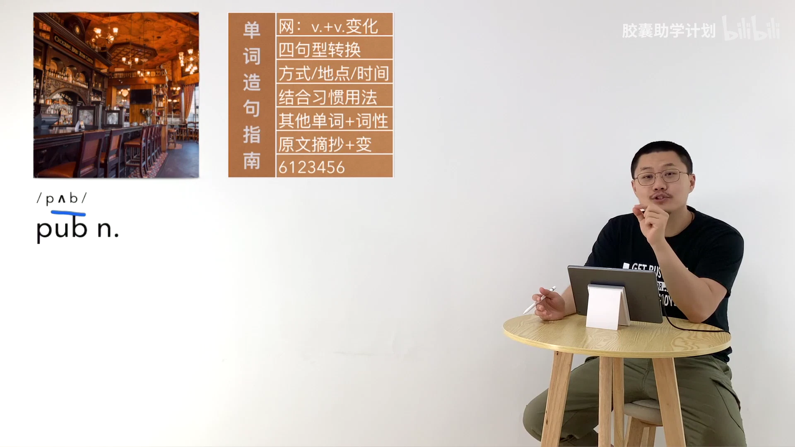

文字识别：单词造句指南 / 网：v.+v.变化 / 胶囊助学计划 / 四句型转换 / 方式/地点/时间 / 结合习惯用法 / 其他单词+词性 / 原文摘抄+变 / 6123456 / /pnb/ / pub n.

### 画面 00:01:20

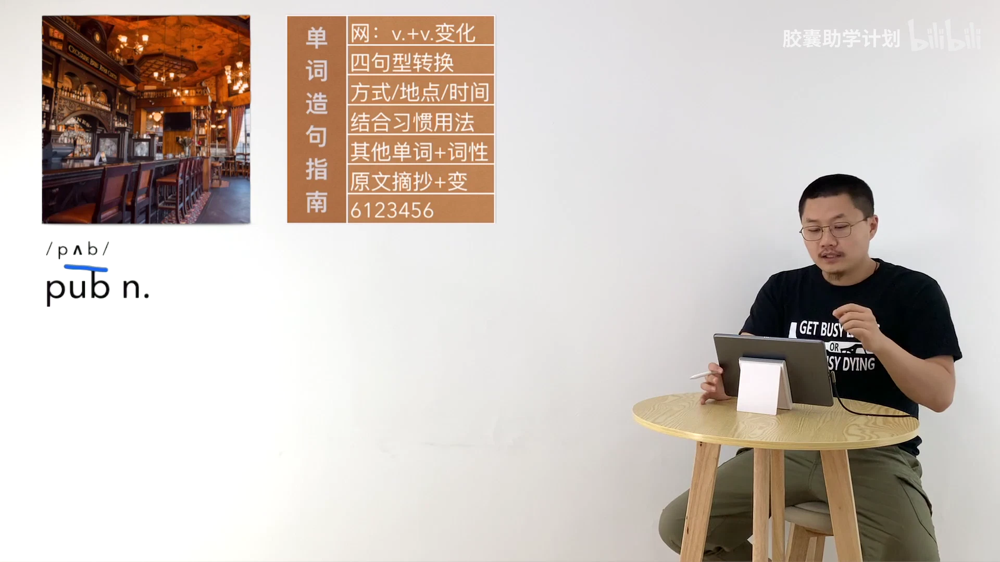

文字识别：单词造句指南 / 网：v.+v.变化 / 胶囊助学计划 / 四句型转换 / 方式/地点/时间 / 结合习惯用法 / 其他单词+词性 / 原文摘抄+变 / 6123456 / /p∧b/ / pub / ) n. / GET BUSY / SYDYING

### 画面 00:01:25

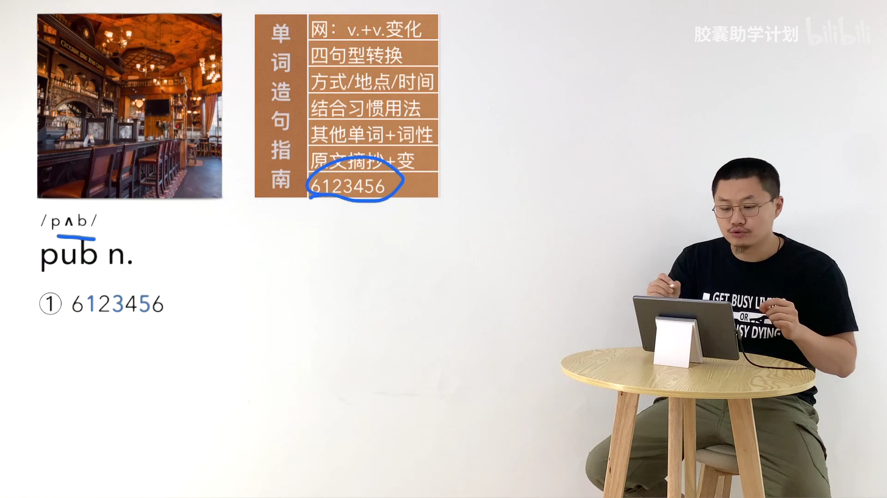

文字识别：单词造句指南 / 网：v.+v.变化 / 胶囊助学计划 / 四句型转换 / 方式/地点/时间 / 结合习惯用法 / 其他单词+词性 / 原文摘抄+变 / 6123456 / /pΛb/ / pub / n. / GET BUSY L / ①6123456 / OR / SYDYING

### 画面 00:01:28

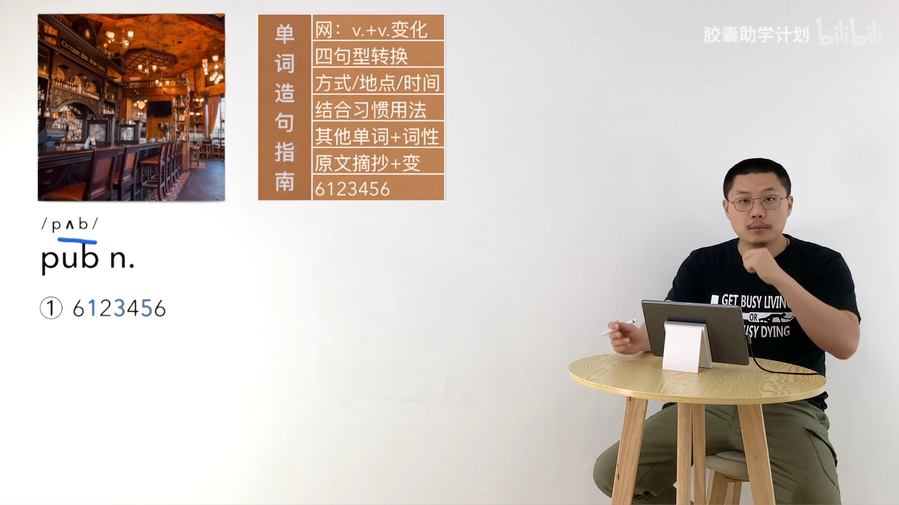

文字识别：单词造句指南 / 网：v.+v.变化 / 胶囊助学计划 / 四句型转换 / 方式/地点/时间 / 结合习惯用法 / 其他单词+词性 / 原文摘抄+变 / 6123456 / /pΛb/ / pub /  n. / GET BUSY LIVIN / ①6123456 / OR / VSY DYING

## 00:01:30–00:02:00

做主语，你想一下，酒馆做主语的时候，往往这个二，也就是说我们所谓的叫谓语动词，它肯定就是被动了，对吧？第十课咱们学过的那些，它也可以做一个宾语，对吧？然后呢，它当然肯定可以做的是一个地点了，对吧？In the pub啊，当然它要加，可能要加上一个这个小的介词在前面。那我们接下来尝试造一些句子，结合一下其他的习惯用法来了啊。第一个说，He must be drinking

### 画面 00:01:30

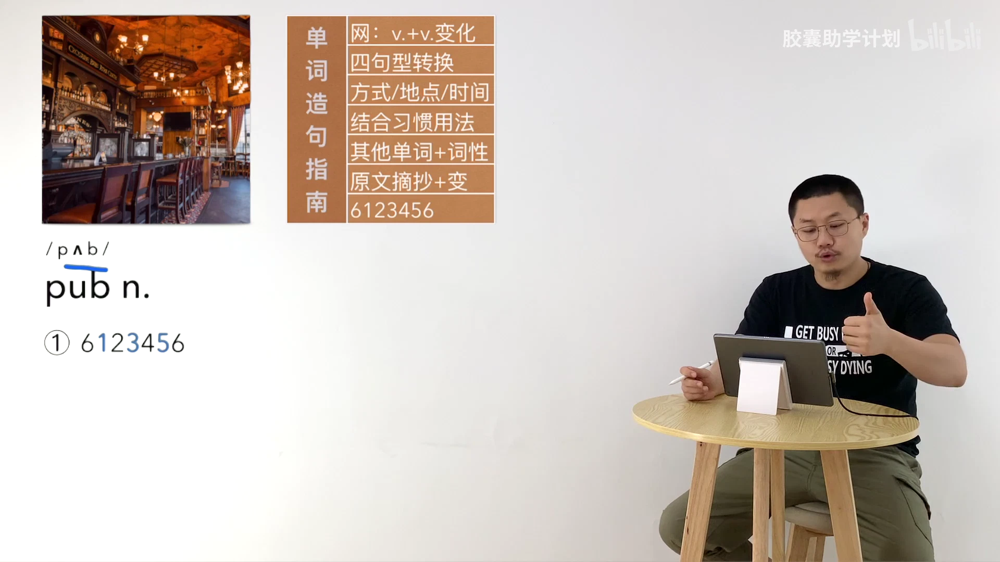

文字识别：单词造句指南 / 网：v.+v.变化 / 胶囊助学计划 / 四句型转换 / 方式/地点/时间 / 结合习惯用法 / 其他单词+词性 / 原文摘抄+变 / 6123456 / /pΛb/ / pub / n. / GET BUSY / ①6123456 / OR. / SYDYING

### 画面 00:01:38

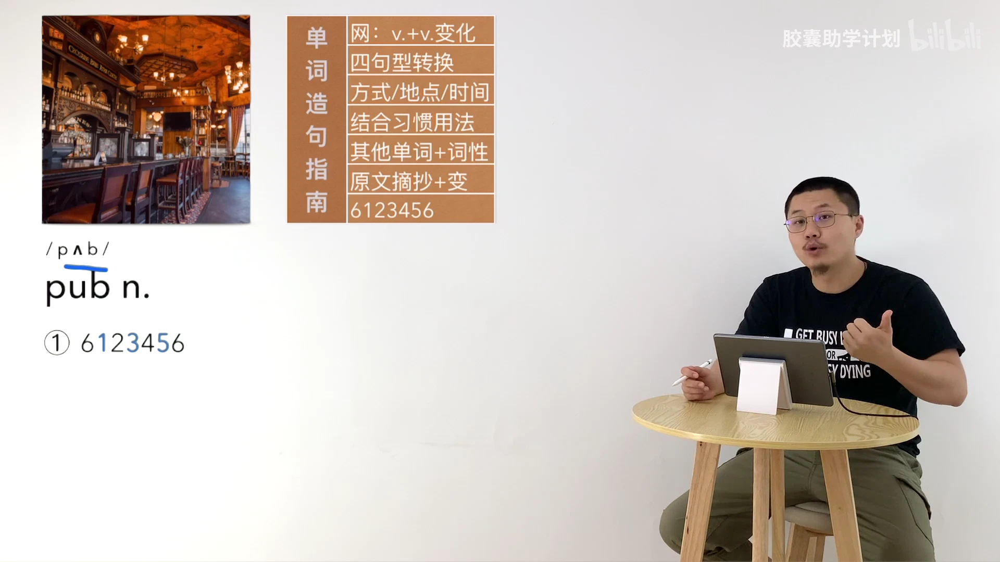

文字识别：单词造句指南 / 网：v.+v.变化 / 胶囊助学计划 / 四句型转换 / 方式/地点/时间 / 结合习惯用法 / 其他单词+词性 / 原文摘抄+变 / 6123456 / /pΛb/ / pub / n. / GETRUSY / ①6123456 / OR / SYDYING

### 画面 00:01:40

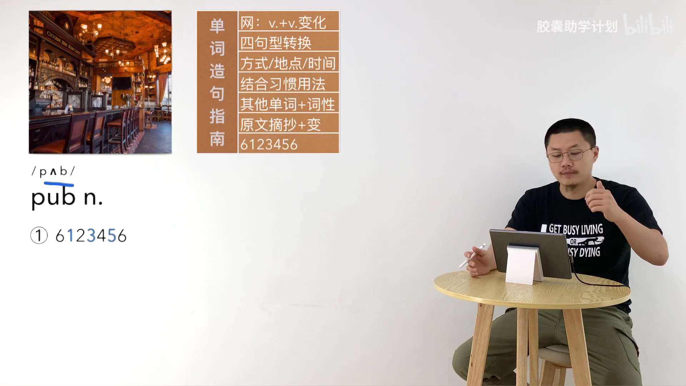

文字识别：单词造句指南 / 网：v.+v.变化 / 胶囊助学计划 / 四句型转换 / 方式/地点/时间 / 结合习惯用法 / 其他单词+词性 / 原文摘抄+变 / 6123456 / /pΛb/ / pub / n. / GET BUSY LIVING / ①6123456 / OR / ISY DYING

### 画面 00:01:45

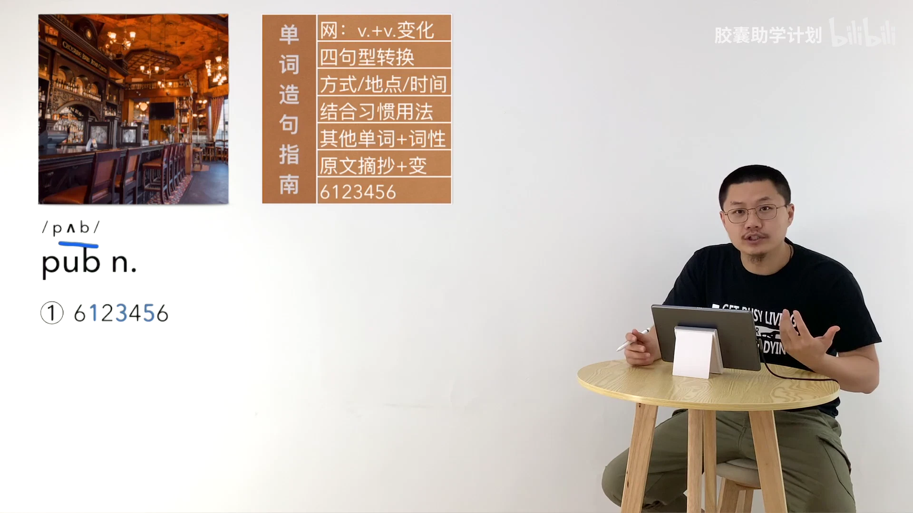

文字识别：单词造句指南 / 网：v.+v.变化 / 胶囊助学计划 / 四句型转换 / 方式/地点/时间 / 结合习惯用法 / 其他单词+词性 / 原文摘抄+变 / 6123456 / /pΛb/ / pub / n. / ①6123456 / SYLIVI / DVIN

### 画面 00:01:50

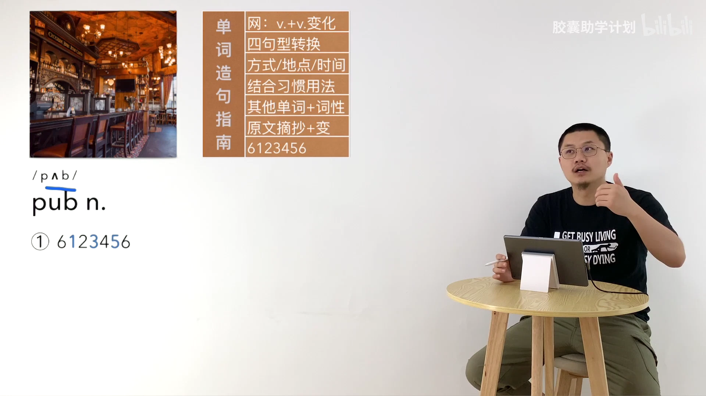

文字识别：单词造句指南 / 网：v.+v.变化 / 胶囊助学计划 / 四句型转换 / 方式/地点/时间 / 结合习惯用法 / 其他单词+词性 / 原文摘抄+变 / 6123456 / /pab/ / pub / n. / GET RUSY LIVING / ①6123456 / OR / SYOVING

### 画面 00:01:55

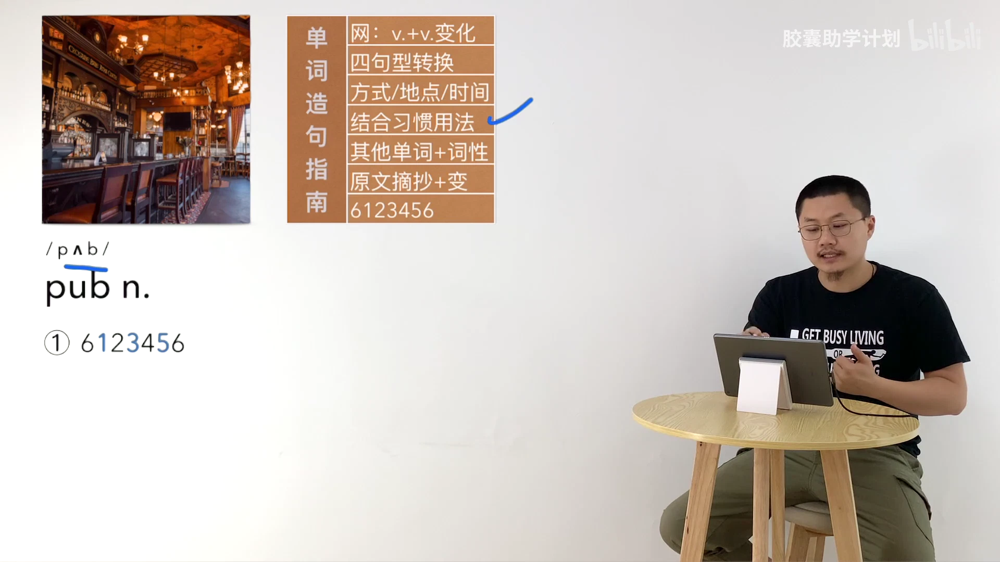

文字识别：单词造句指南 / 网：v.+v.变化 / 胶囊助学计划 / 四句型转换 / 方式/地点/时间 / 结合习惯用法 / 其他单词+词性 / 原文摘抄+变 / 6123456 / /p^b/ / pub / n. / GFT BUSY UIVING / ①6123456 / OR

### 画面 00:01:57

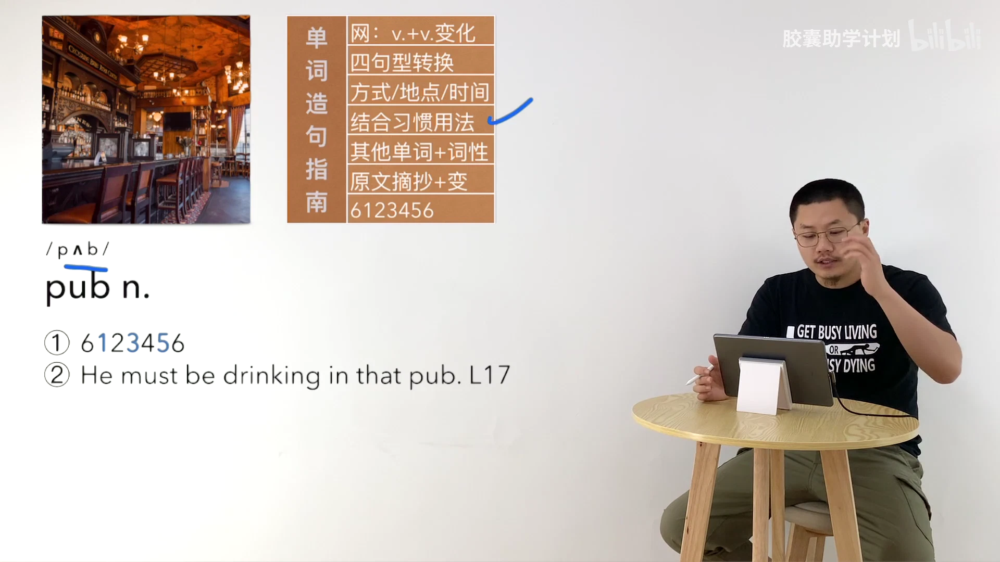

文字识别：单词造句指南 / 网：v.+v.变化 / 胶囊助学计划 / 四句型转换 / 方式/地点/时间 / 结合习惯用法 / 其他单词+词性 / 原文摘抄+变 / 6123456 / /pΛb/ / pub /  n. / GET BUSY LIVING / ①6123456 / OR / He must be drinking in that pub. L17 / SYDYING

## 00:02:00–00:02:30

in that pub. 好，这个地方其实我们在用的还真不是一个习惯用法。你可以理解为是我们第十七课学过的啊，特别多。各位记得吧？那课我们给大家列了一个表格，各种表推测的那些公式非常的重要。各位也非常容易忘，所以在接下来我会不停的拿这些呃，我们理解为六边三四五六里边的二这个谓语动词的这个结构啊，带着大家去造句。说他一定是正在那个酒馆里边

### 画面 00:02:00

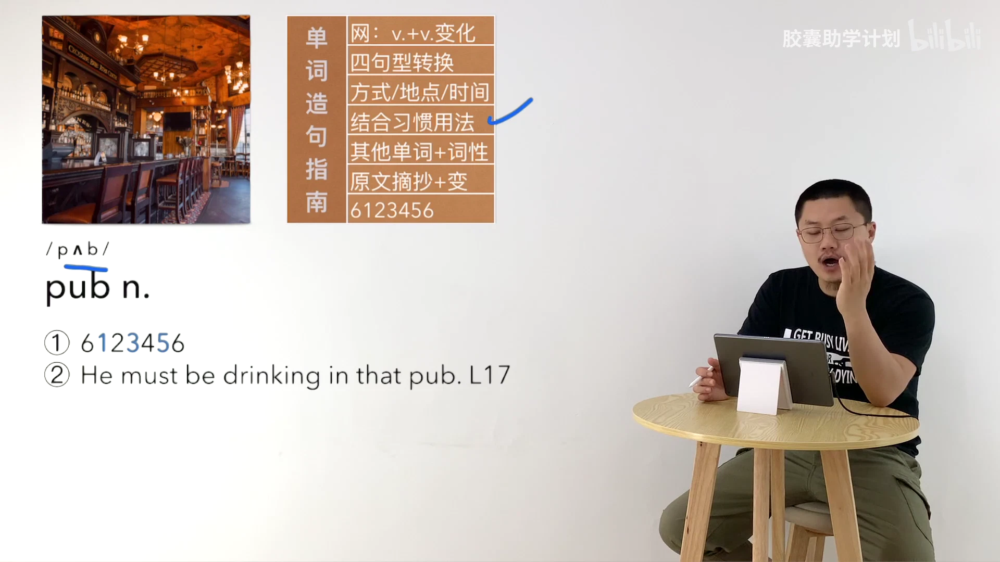

文字识别：单词造句指南 / 网：v.+v.变化 / 胶囊助学计划 / 四句型转换 / 方式/地点/时间 / 结合习惯用法 / 其他单词+词性 / 原文摘抄+变 / 6123456 / /pab/ / pub n. / GET BIYUV / ①6123456 / He must be drinking in that pub. L17

### 画面 00:02:04

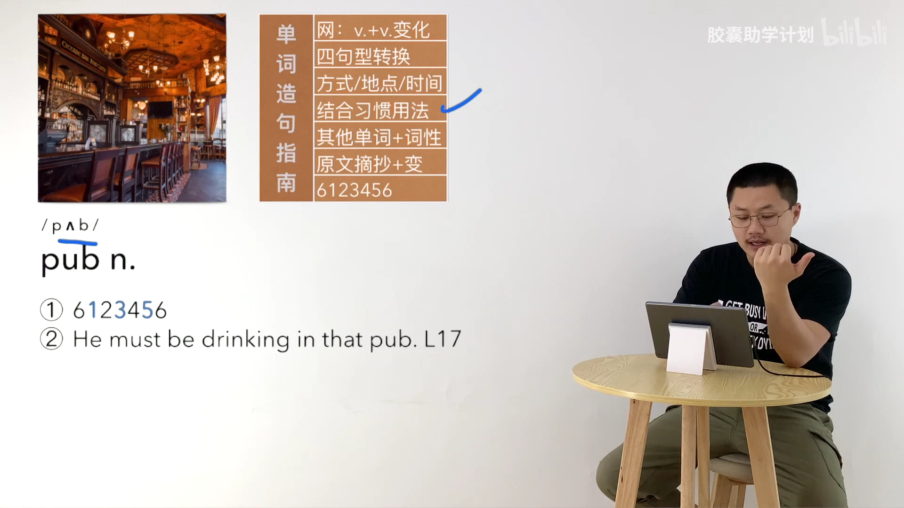

文字识别：单词造句指南 / 网：v.+v.变化 / 胶囊助学计划 / 四句型转换 / 方式/地点/时间 / 结合习惯用法 / 其他单词+词性 / 原文摘抄+变 / 6123456 / /pab/ / pub / o n. / ①6123456 / OR. / He must be drinking in that pub. L17

### 画面 00:02:06

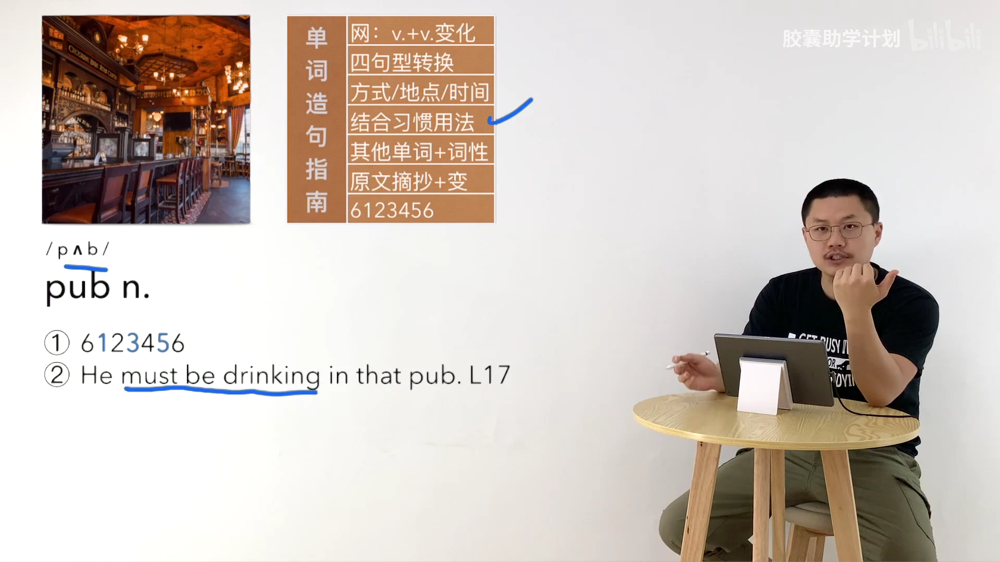

文字识别：单词造句指南 / 网：v.+v.变化 / 胶囊助学计划 / 四句型转换 / 方式/地点/时间 / 结合习惯用法 / 其他单词+词性 / 原文摘抄+变 / 6123456 / /pab/ / pub n. / ①6123456 / USYW / DRA / He must be drinking in that pub. L17

### 画面 00:02:09

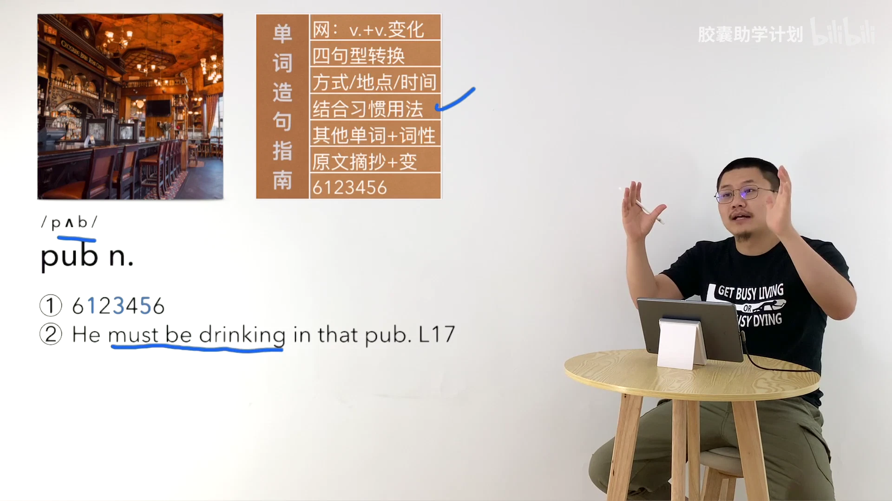

文字识别：单词造句指南 / 网：v.+v.变化 / 胶囊助学计划 / 四句型转换 / 方式/地点/时间 / 结合习惯用法 / 其他单词+词性 / 原文摘抄+变 / 6123456 / /pab/ / pub /  n. / GET BUSY LIVING / ①6123456 / OR / ISYDVING / He must be drinking in that pub. L17

### 画面 00:02:12

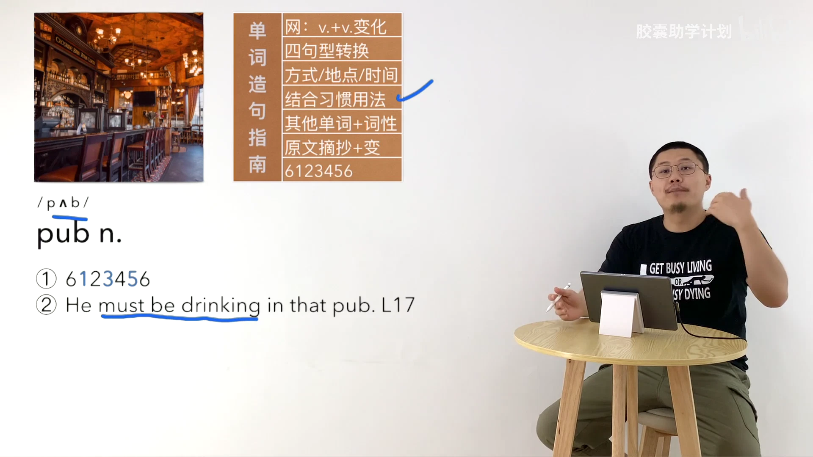

文字识别：单词造句指南 / 网：v.+v.变化 / 胶囊助学计划 / 四句型转换 / 方式/地点/时间 / 结合习惯用法 / 其他单词+词性 / 原文摘抄+变 / 6123456 / /p∧b/ / pub / n. / GET BUSY LIVING / ①6123456 / ORI / SYDYING / He must be drinking in that pub. L17

### 画面 00:02:15

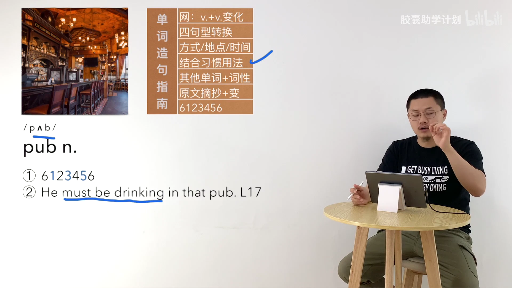

文字识别：单词造句指南 / 网：v.+v.变化 / 胶囊助学计划 / 四句型转换 / 方式/地点/时间 / 结合习惯用法 / 其他单词+词性 / 原文摘抄+变 / 6123456 / /pab/ / pub / o n. / GET BUSY LIVING / ①6123456 / OR.M / SYDYING / He must be drinking in that pub. L17

### 画面 00:02:22

文字识别：单词造句指南 / 网：v.+v.变化 / 胶囊助学计划 / 四句型转换 / 方式/地点/时间 / 结合习惯用法 / 其他单词+词性 / 原文摘抄+变 / 6123456 / /pab/ / pub / ) n. / GET BUSY IVING / ①6123456 / ORA / YOYING / He must be drinking in that pub. L17

### 画面 00:02:25

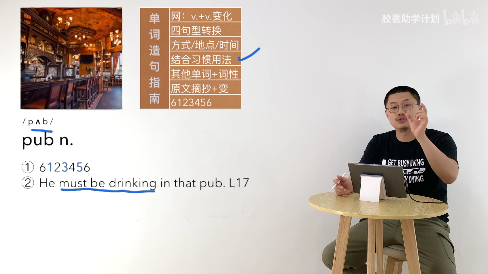

文字识别：单词造句指南 / 网：v.+v.变化 / 胶囊助学计划 / 四句型转换 / 方式/地点/时间 / 结合习惯用法 / 其他单词+词性 / 原文摘抄+变 / 6123456 / /pab/ / pub / o n. / GET BUSYIVING / ①6123456 / OR. / R / He must be drinking in that pub. L17 / KOYING

## 00:02:30–00:03:00

喝酒呢，对吧？这个点儿晚上七点八点钟，说啊，他天天去啊，现在他一定是正在那儿喝酒呢。Must be drinking. 现在正在做某件事情啊，现在一定是正在做某件事情，表示一个推测。那你看这里边的 in that pub，就是在六一二三四五六当中做了一个地点。那比如说啊，这个对于各位来说加方式、地点、时间，各位来说比较简单，你最多就加一个。比如说，我们现在把这句话变成 must

### 画面 00:02:30

文字识别：单词造句指南 / 网：v.+v.变化 / 胶囊助学计划 / 四句型转换 / 方式/地点/时间 / 结合习惯用法 / 其他单词+词性 / 原文摘抄+变 / 6123456 / /pab/ / pub /  n. / GET BUSY LIVING / ①6123456 / OR. / YDVING / He must be drinking in that pub. L17

### 画面 00:02:35

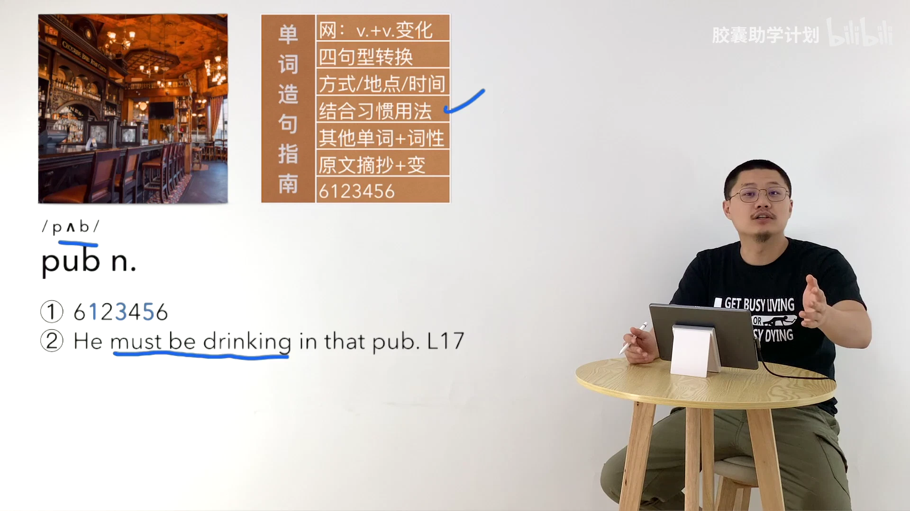

文字识别：单词造句指南 / 网：v.+v.变化 / 胶囊助学计划 / 四句型转换 / 方式/地点/时间 / 结合习惯用法 / 其他单词+词性 / 原文摘抄+变 / 6123456 / /pnb/ / pub /  n. / GET BUSY IVING / ①6123456 / He must be drinking in that pub. L17 / SYDYING

### 画面 00:02:40

文字识别：单词造句指南 / 网：v.+v.变化 / 胶囊助学计划 / 四句型转换 / 方式/地点/时间 / 结合习惯用法 / 其他单词+词性 / 原文摘抄+变 / 6123456 / /pab/ / pub /  n. / GET BUSY IVING / ①6123456 / OR. / He must be drinking in that pub. L17 / SYOVING

### 画面 00:02:45

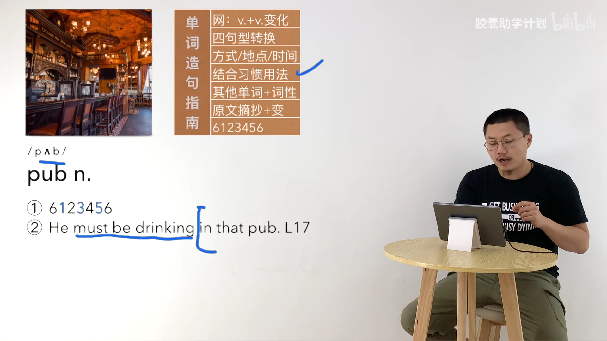

文字识别：单词造句指南 / 网：v.+v.变化 / 胶囊助学计划 / 四句型转换 / 方式/地点/时间 / 结合习惯用法 / 其他单词+词性 / 原文摘抄+变 / 6123456 / /p∧b/ / pub / n. / ①6123456 / CET / BUS / OR / He must be drinking / in that pub. L17 / WSYDYIN

### 画面 00:02:48

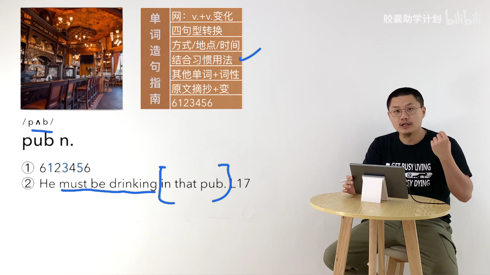

文字识别：单词造句指南 / 网：v.+v.变化 / 胶囊助学计划 / 四句型转换 / 方式/地点/时间 / 结合习惯用法 / 其他单词+词性 / 原文摘抄+变 / 6123456 / /p∧b/ / pub / n. / ①6123456 / CET RUSY LVING / OR / He must be drinking / in that pub. / L17 / SYDYING

### 画面 00:02:50

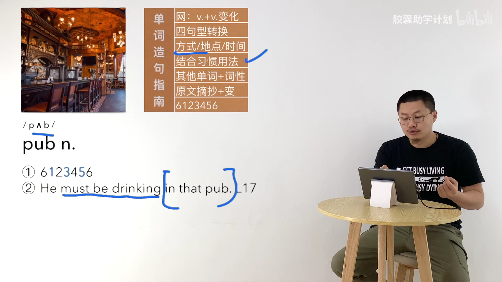

文字识别：单词造句指南 / 网：v.+v.变化 / 胶囊助学计划 / 四句型转换 / 方式/地点/时间 / 结合习惯用法 / 其他单词+词性 / 原文摘抄+变 / 6123456 / /p∧b/ / pub / n. / ①6123456 / CET BUSY LIVING / ORA / He must be drinking / in that pub. / L17 / SYDYIN

### 画面 00:02:52

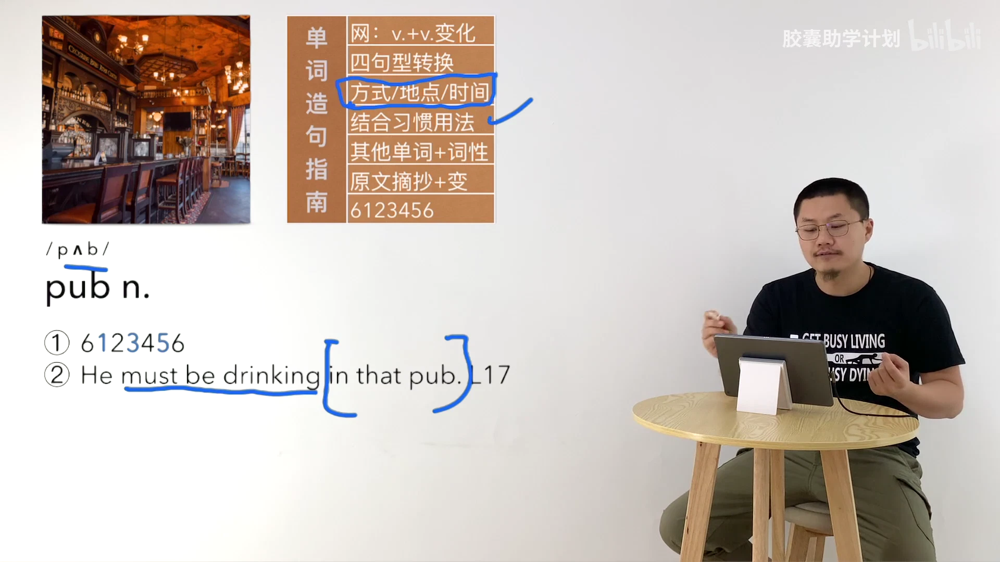

文字识别：单词造句指南 / 网：v.+v.变化 / 胶囊助学计划 / 四句型转换 / 方式/地点/时间 / 结合习惯用法 / 其他单词+词性 / 原文摘抄+变 / 6123456 / /pΛb/ / pub / n. / 1 / 6123456 / CRTBUSY LIVING / OR / He must be drinking / in that pub. / L17 / SYDYIM

### 画面 00:02:55

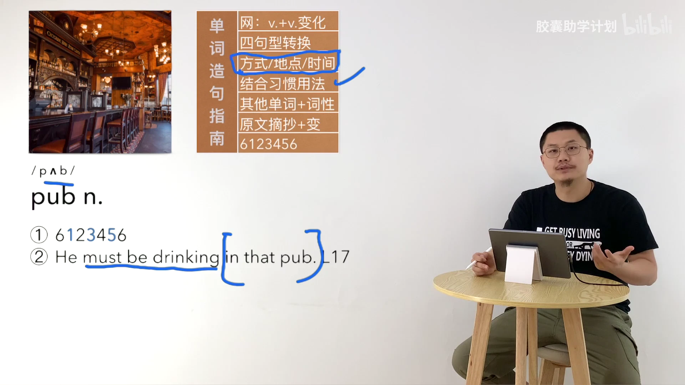

文字识别：单词造句指南 / 网：v.+v.变化 / 胶囊助学计划 / 四句型转换 / 方式/地点/时间 / 结合习惯用法 / 其他单词+词性 / 原文摘抄+变 / 6123456 / /pΛb/ / pub / n. / ①6123456 / GET BUSY UIVING / OR / He must be drinking / in that pub. / L17 / YDYIN

## 00:03:00–00:03:30

have been drinking，叫当时一定是正在喝酒，对吧？然后您再随便加一个时间，比如说 last night，就可以了。这是比较简单的。继续说， that pub was built in 1986，啊，a 84。好，说那个酒吧呀是在一九八四年被建造的。你看这个 was built 也是六一二三四五六里边的二，我们第十课学的，对吧？Was were再加但过去分词，那表示的是当时被怎么怎么样了。

### 画面 00:03:01

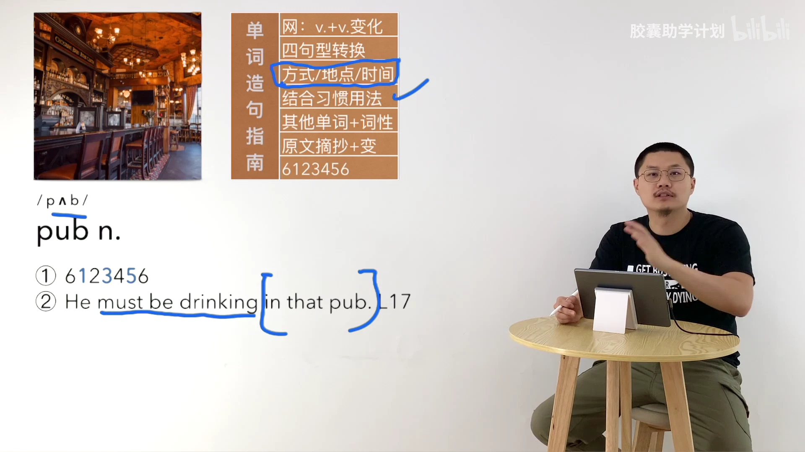

文字识别：单词造句指南 / 网：v.+v.变化 / 胶囊助学计划 / 四句型转换 / |方式/地点/时间 / 结合习惯用法 / 其他单词+词性 / 原文摘抄+变 / 6123456 / /pΛb/ / pub / n. / GET KI / 1 / 6123456 / He must be drinking / in that pub. / L17 / KOYINU

### 画面 00:03:06

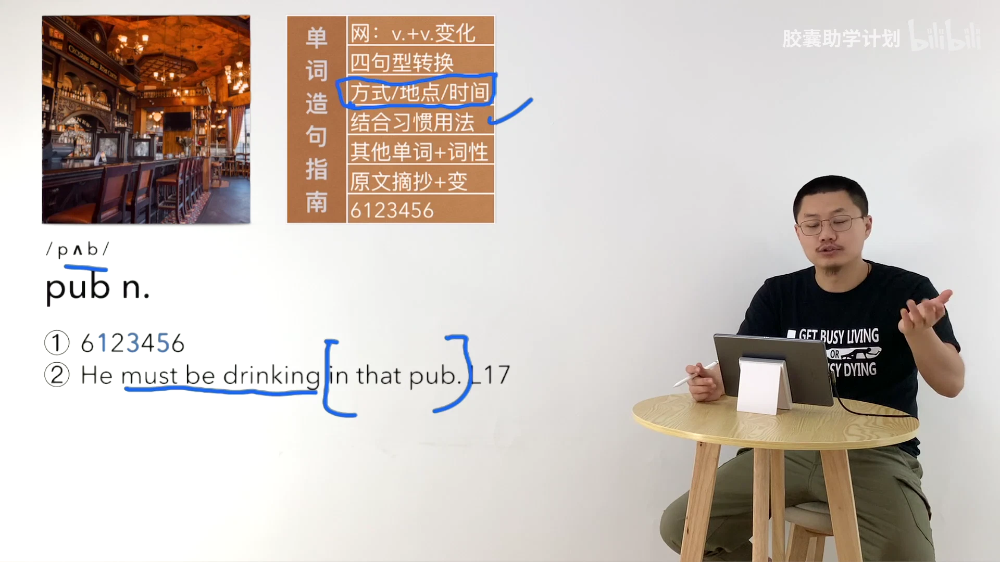

文字识别：单词造句指南 / 网：v.+v.变化 / 胶囊助学计划 / 四句型转换 / 方式/地点/时间 / 结合习惯用法 / 其他单词+词性 / 原文摘抄+变 / 6123456 / /pΛb/ / pub / n. / 1 / 6123456 / GET BUSY LIVING / OR.NU / He must be drinking / in that pub. / L17 / ISYDYING

### 画面 00:03:10

文字识别：单词造句指南 / 网：v.+v.变化 / 胶囊助学计划 / 四句型转换 / 方式/地点/时间 / 结合习惯用法 / 其他单词+词性 / 原文摘抄+变 / 6123456 / /pab/ / pub n. / ①6123456 / GFT BUSY LIV'ING / OR / He must be drinking in that pub. L17 / USY / That pub was built in 1984. L10

### 画面 00:03:12

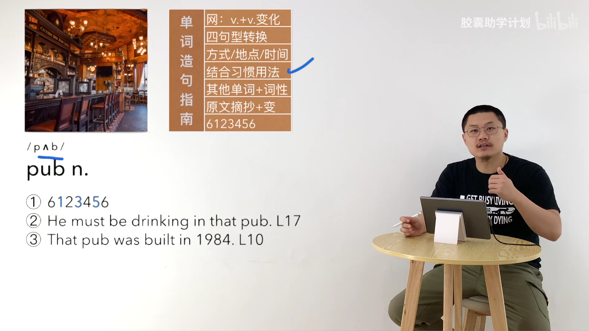

文字识别：单词造句指南 / 网：v.+v.变化 / 胶囊助学计划 / 四句型转换 / 方式/地点/时间 / 结合习惯用法 / 其他单词+词性 / 原文摘抄+变 / 6123456 / /pab/ / pub n. / ①6123456 / GETDISYVVINO / He must be drinking in that pub. L17 / YDYING / That pub was built in 1984. L10

### 画面 00:03:15

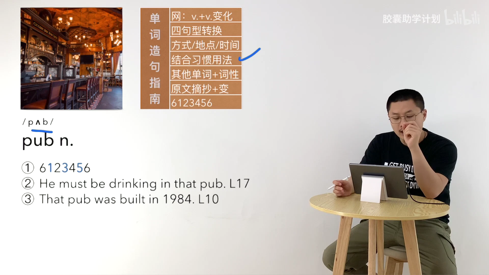

文字识别：单词造句指南 / 网：v.+v.变化 / 胶囊助学计划 / 四句型转换 / 方式/地点/时间 / 结合习惯用法 / 其他单词+词性 / 原文摘抄+变 / 6123456 / /p^b/ / pub n. / ①6123456 / He must be drinking in that pub. L17 / DR / OV / That pub was built in 1984. L10

### 画面 00:03:20

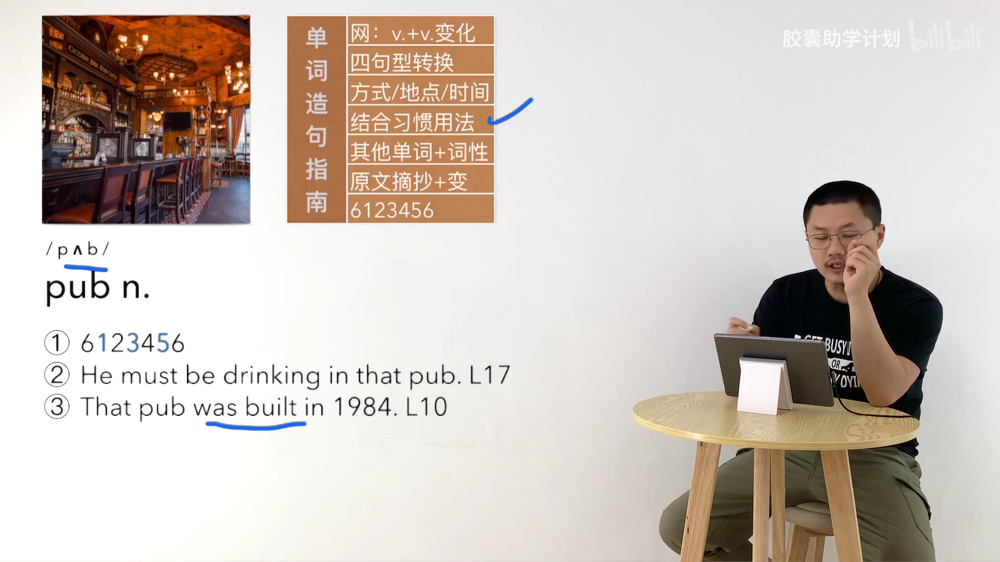

文字识别：单词造句指南 / 网：v.+v.变化 / 胶囊助学计划 / 四句型转换 / 方式/地点/时间 / 结合习惯用法 / 其他单词+词性 / 原文摘抄+变 / 6123456 / /pab/ / pub n. / ①6123456 / BUSYI / OR. / He must be drinking in that pub. L17 / YOVI / That pub was built in 1984. L10

### 画面 00:03:22

文字识别：单词造句指南 / 网：v.+v.变化 / 胶囊助学计划 / 四句型转换 / 方式/地点/时间 / 结合习惯用法 / 其他单词+词性 / 原文摘抄+变 / 6123456 / /pnb/ / pub n. / ①6123456 / BUSYI / OR.L / He must be drinking in that pub. L17 / That pub was built in 1984. L10

### 画面 00:03:25

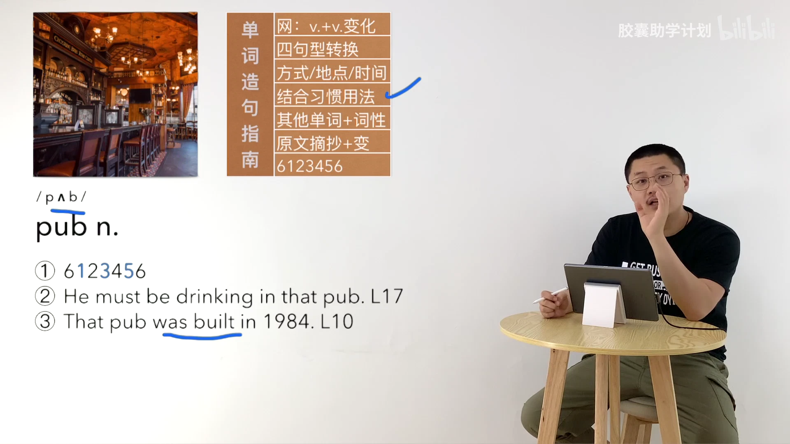

文字识别：单词造句指南 / 网：v.+v.变化 / 胶囊助学计划 / 四句型转换 / 方式/地点/时间 / 结合习惯用法 / 其他单词+词性 / 原文摘抄+变 / 6123456 / /pnb/ / pub n. / ①6123456 / GCTDI / OR / He must be drinking in that pub. L17 / That pub was built in 1984. L10

## 00:03:30–00:04:00

好，接下来说 they built this pub years ago. 啊，这个我们在新一就能造出来这样的句子，叫做他们建造了这个酒吧。啊，许许许多年前他们建的这个酒吧。好，啊老店了。那你注意这个地方的 this pub 在六一二三四五六当中，它就是处于了三宾语这个位置，对吧？OK，好，再然后呢，我们可以结合十六课说 don't park your car in front of the pub. OK, very good，非常的简单啊。

### 画面 00:03:30

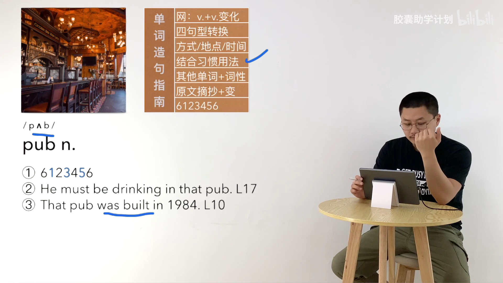

文字识别：单词造句指南 / 网：v.+v.变化 / 胶囊助学计划 / 四句型转换 / 方式/地点/时间 / 结合习惯用法 / 其他单词+词性 / 原文摘抄+变 / 6123456 / /pnb/ / pub n. / ①6123456 / He must be drinking in that pub. L17 / R / OYI / That pub was built in 1984. L10

### 画面 00:03:32

文字识别：单词造句指南 / 网：v.+v.变化 / 胶囊助学计划 / 四句型转换 / 方式/地点/时间 / 结合习惯用法 / 其他单词+词性 / 原文摘抄+变 / 6123456 / /pnb/ / pub n. / GET DISYI / ①6123456 / DR / He must be drinking in that pub. L17 / KOYI / That pub was built in 1984. L10 / They built this pub years ago.

### 画面 00:03:35

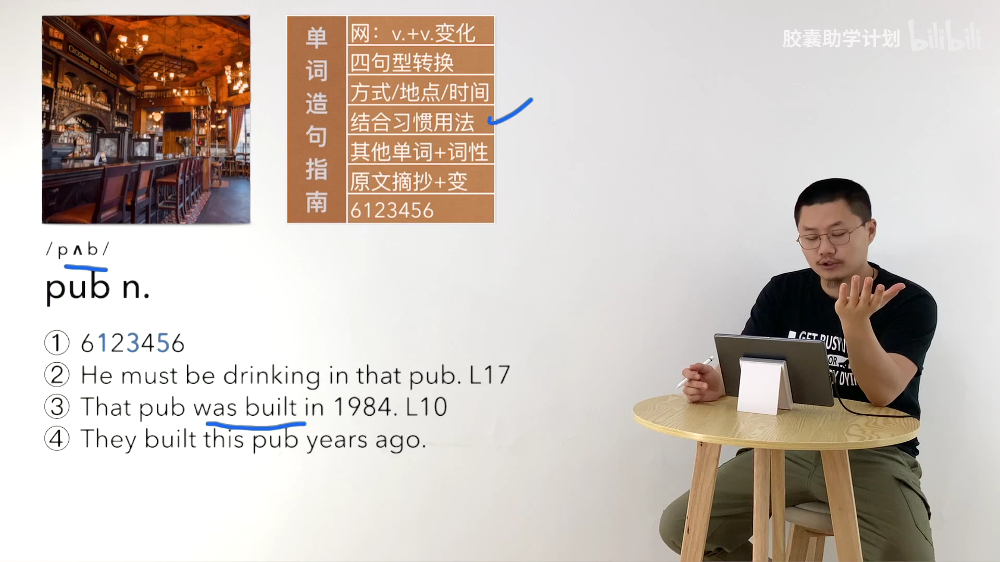

文字识别：单词造句指南 / 网：v.+v.变化 / 胶囊助学计划 / 四句型转换 / 方式/地点/时间 / 结合习惯用法 / 其他单词+词性 / 原文摘抄+变 / 6123456 / /p^b/ / pub n. / ①6123456 / OR. / He must be drinking in that pub. L17 / YOyI / That pub was built in 1984. L10 / They built this pub years ago.

### 画面 00:03:40

文字识别：单词造句指南 / 网：v.+v.变化 / 胶囊助学计划 / 四句型转换 / 方式/地点/时间 / 结合习惯用法 / 其他单词+词性 / 原文摘抄+变 / 6123456 / /p^b/ / pub n. / ①6123456 / OR-L / He must be drinking in that pub. L17 / YOVIN / That pub was built in 1984. L10 / They built this pub years ago.

### 画面 00:03:44

文字识别：单词造句指南 / 网：v.+v.变化 / 胶囊助学计划 / 四句型转换 / 方式/地点/时间 / 结合习惯用法 / 其他单词+词性 / 原文摘抄+变 / 6123456 / /p^b/ / pub n. / ①6123456 / USYIN / He must be drinking in that pub. L17 / DRL / DYIN / That pub was built in 1984. L10 / They built this pub years ago.

### 画面 00:03:46

文字识别：单词造句指南 / 网：v.+v.变化 / 胶囊助学计划 / 四句型转换 / 方式/地点/时间 / 结合习惯用法 / 其他单词+词性 / 原文摘抄+变 / 6123456 / /pnb/ / pub n. / GET BUSYIVIN / ①6123456 / OR. / He must be drinking in that pub. L17 / SVOVING / That pub was built in 1984. L10 / They built this pub years ago.

### 画面 00:03:51

文字识别：单词造句指南 / 网：v.+v.变化 / 胶囊助学计划 / 四句型转换 / 方式/地点/时间 / 结合习惯用法 / 其他单词+词性 / 原文摘抄+变 / 6123456 / /p∧b/ / pub n. / GET BUSY UIVING / ①6123456 / He must be drinking in that pub. L17 / YDYING / That pub was built in 1984. L10 / They built this pub years ago. / Don't park your car in front of the pub. L16 / 5

### 画面 00:03:53

文字识别：单词造句指南 / 网：v.+v.变化 / 胶囊助学计划 / 四句型转换 / 方式/地点/时间 / 结合习惯用法 / 其他单词+词性 / 原文摘抄+变 / 6123456 / /p∧b/ / pub n. / ①6123456 / He must be drinking in that pub. L17 / KDY / That pub was built in 1984. L10 / They built this pub years ago. / Don't park your car in front of the pub. L16 / 5

### 画面 00:03:55

文字识别：单词造句指南 / 网：v.+v.变化 / 胶囊助学计划 / 四句型转换 / 方式/地点/时间 / 结合习惯用法 / 其他单词+词性 / 原文摘抄+变 / 6123456 / /p∧b/ / pub n. / ①6123456 / OR. / He must be drinking in that pub. L17 / XOY / That pub was built in 1984. L10 / They built this pub years ago. / Don't park your car in front of the pub. L16

## 00:04:00–00:04:30

接下来landlord，好，我们看一下landlord这个单词。各位要注意，它实际上是两个单词组成的。首先land是什么意思呢？land就是土地啊，土地的意思。那lord什么意思呢？你比如说，各位如果看过一些呃美剧也好，对吧？尤其是中世纪的那些美剧，My Lord啊，比如说呃呃呃The Throne of the Game，The Game of the Throne是吧？权力的游戏这样的一个美

### 画面 00:04:00

文字识别：单词造句指南 / 网：v.+v.变化 / 胶囊助学计划 / 四句型转换 / 方式/地点/时间 / 结合习惯用法 / 其他单词+词性 / 原文摘抄+变 / 6123456 / /Iendlo:d/ / landlord n. / GET RIISYIV / KOYI

### 画面 00:04:02

文字识别：单词造句指南 / 网：v.+v.变化 / 胶囊助学计划 / 四句型转换 / 方式/地点/时间 / 结合习惯用法 / 其他单词+词性 / 原文摘抄+变 / 6123456 / /Iendlo:d/ / landlord n. / GFT RUSY LIV. / OR. / SYDYING

### 画面 00:04:05

文字识别：单词造句指南 / 网：v.+v.变化 / 胶囊助学计划 / 四句型转换 / 方式/地点/时间 / 结合习惯用法 / 其他单词+词性 / 原文摘抄+变 / 6123456 / /Iendlo:d/ / landlord n. / DY

### 画面 00:04:08

文字识别：单词造句指南 / 网：v.+v.变化 / 胶囊助学计划 / Biltbili / 四句型转换 / 方式/地点/时间 / 结合习惯用法 / 其他单词+词性 / 原文摘抄+变 / 6123456 / /Iendlo:d/ / landlord / n.

### 画面 00:04:11

文字识别：单词造句指南 / 网：v.+v.变化 / 胶囊助学计划 / Biltbili / 四句型转换 / 方式/地点/时间 / 结合习惯用法 / 其他单词+词性 / 原文摘抄+变 / 6123456 / /Iendlo:d/ / landlord / n.

### 画面 00:04:15

文字识别：单词造句指南 / 网：v.+v.变化 / 胶囊助学计划 / Bitbii / 四句型转换 / 方式/地点/时间 / 结合习惯用法 / 其他单词+词性 / 原文摘抄+变 / 6123456 / /Iendlo:d/ / landlord / n.

### 画面 00:04:20

文字识别：单词造句指南 / 网：v.+v.变化 / 胶囊助学计划 / Bilbili / 四句型转换 / 方式/地点/时间 / 结合习惯用法 / 其他单词+词性 / 原文摘抄+变 / 6123456 / /Iendlo:d/ / landlord / n.

### 画面 00:04:25

文字识别：单词造句指南 / 网：v.+v.变化 / 胶囊助学计划 / Bilbii / 四句型转换 / 方式/地点/时间 / 结合习惯用法 / 其他单词+词性 / 原文摘抄+变 / 6123456 / /Iendlo:d/ / landlord / n.

## 00:04:30–00:05:00

剧，那你会发现它里面经常用 my lord 啊，我的主啊，当然它这个主不是那个基督教的那个主，是吧？也不是比如说呃，我们西游记里边那个 master 是吧？就是这个孙悟空管这个唐僧叫 master 是吧？叫师傅啊，也不是这个主人的意思。它这个 lord 的指的是领主的意思，对吧？就是一各位简单去理解，就是一片土地上最大的那个 boss，但他不是国王，对吧？所以他就是这片

### 画面 00:04:34

文字识别：单词造句指南 / 网：v.+v.变化 / 胶囊助学计划 / Bitbili / 四句型转换 / 方式/地点/时间 / 结合习惯用法 / 其他单词+词性 / 原文摘抄+变 / 6123456 / /Iendlo:d/ / landlord / n.

### 画面 00:04:37

文字识别：单词造句指南 / 网：v.+v.变化 / 胶囊助学计划 / Bitbii / 四句型转换 / 方式/地点/时间 / 结合习惯用法 / 其他单词+词性 / 原文摘抄+变 / 6123456 / /Iendlo:d/ / landlord / n.

### 画面 00:04:40

文字识别：单词造句指南 / 网：v.+v.变化 / 胶囊助学计划 / Bilibili / 四句型转换 / 方式/地点/时间 / 结合习惯用法 / 其他单词+词性 / 原文摘抄+变 / 6123456 / /Iendlo:d/ / landlord / n.

### 画面 00:04:45

文字识别：单词造句指南 / 网：v.+v.变化 / 胶囊助学计划 / Bitbii / 四句型转换 / 方式/地点/时间 / 结合习惯用法 / 其他单词+词性 / 原文摘抄+变 / 6123456 / /Iendlo:d/ / landlord / n.

### 画面 00:04:50

文字识别：单词造句指南 / 网：v.+v.变化 / 胶囊助学计划 / Bilbili / 四句型转换 / 方式/地点/时间 / 结合习惯用法 / 其他单词+词性 / 原文摘抄+变 / 6123456 / /Iendlo:d/ / landlord / n.

### 画面 00:04:55

文字识别：单词造句指南 / 网：v.+v.变化 / 胶囊助学计划 / 四句型转换 / 方式/地点/时间 / 结合习惯用法 / 其他单词+词性 / 原文摘抄+变 / 6123456 / /Iendlo:d/ / landlord / n. / CET DISY MIN / OR. / YDYING

## 00:05:00–00:05:30

土地的拥有者。所以 landlord 最开始他其实理解为，各位可以理解为就是领主一片土地的呃拥有者，就是这么简单的事情。那在本文当中，他后来又引申出来，进入现代社会之后呢，引申出来的一些含义，其中一个含义就是店主，对吧？或者我们可以理解为就是你的房东啊，我们就啊，他是他不是这片土地，但是他是这个房子的主人，我们管他也叫 landlord。这两个呃

### 画面 00:05:00

文字识别：单词造句指南 / 网：v.+v.变化 / 胶囊助学计划 / 四句型转换 / 方式/地点/时间 / 结合习惯用法 / 其他单词+词性 / 原文摘抄+变 / 6123456 / /Iendlo:d/ / landlord / d n.

### 画面 00:05:06

文字识别：单词造句指南 / 网：v.+v.变化 / 胶囊助学计划 / 四句型转换 / 方式/地点/时间 / 结合习惯用法 / 其他单词+词性 / 原文摘抄+变 / 6123456 / /Iendlo:d/ / landlord / n. / SYIM

### 画面 00:05:10

文字识别：单词造句指南 / 网：v.+v.变化 / 胶囊助学计划 / 四句型转换 / 方式/地点/时间 / 结合习惯用法 / 其他单词+词性 / 原文摘抄+变 / 6123456 / /Iendlo:d/ / landlord / n.

### 画面 00:05:16

文字识别：单词造句指南 / 网：v.+v.变化 / 胶囊助学计划 / 四句型转换 / 方式/地点/时间 / 结合习惯用法 / 其他单词+词性 / 原文摘抄+变 / 6123456 / /Iendlo:d/ / landlord / n.

### 画面 00:05:21

文字识别：单词造句指南 / 网：v.+v.变化 / 胶囊助学计划 / 四句型转换 / 方式/地点/时间 / 结合习惯用法 / 其他单词+词性 / 原文摘抄+变 / 6123456 / /Iendlo:d/ / landlord /  n.

### 画面 00:05:25

文字识别：单词造句指南 / 网：v.+v.变化 / 胶囊助学计划 / 四句型转换 / 方式/地点/时间 / 结合习惯用法 / 其他单词+词性 / 原文摘抄+变 / 6123456 / /Iendlo:d/ / landlord / n. / GET BUSY ING / OR / SYDVING

### 画面 00:05:29

文字识别：单词造句指南 / 网：v.+v.变化 / 胶囊助学计划 / 四句型转换 / 方式/地点/时间 / 结合习惯用法 / 其他单词+词性 / 原文摘抄+变 / 6123456 / /Iendlo:d/ / landlord / n. / PTNI / USYIVN / DRn / YOYIN

## 00:05:30–00:06:00

含义各位把它记一下，对吧？一个是我们所谓叫店主，一个叫我们房东，都可以叫landlord。OK，好，那接下来我们尝试去造句，还是can't be doing，说the landlord can't be sleeping啊，他一定没有正在睡觉呢。OK，这是我们第七十七课学过的那个关键语法。再然后还是十七课，说the landlord can't have been your friend啊，那说我们现在假设回顾，我说我在新西兰期间啊，然后说那个房东怎么怎

### 画面 00:05:32

文字识别：单词造句指南 / 网：v.+v.变化 / 胶囊助学计划 / 四句型转换 / 方式/地点/时间 / 结合习惯用法 / 其他单词+词性 / 原文摘抄+变 / 6123456 / /|ændlo:d/ / landlord / n. / GET BUSYUVING / OR. / USYDYING

### 画面 00:05:39

文字识别：单词造句指南 / 网：v.+v.变化 / 胶囊助学计划 / 四句型转换 / 方式/地点/时间 / 结合习惯用法 / 其他单词+词性 / 原文摘抄+变 / 6123456 / /Iendlo:d/ / landlord / n. / The landlord can't be sleeping now. L17 / GET BUSY LIVING / OR / WSYE

### 画面 00:05:41

文字识别：单词造句指南 / 网：v.+v.变化 / 胶囊助学计划 / 四句型转换 / 方式/地点/时间 / 结合习惯用法 / 其他单词+词性 / 原文摘抄+变 / 6123456 / /Iendlo:d/ / landlord / n. / The landlord can't be sleeping now. L17 / GET BUSY LIVING / OR.U / SYDYING

### 画面 00:05:45

文字识别：单词造句指南 / 网：v.+v.变化 / 胶囊助学计划 / 四句型转换 / 方式/地点/时间 / 结合习惯用法 / 其他单词+词性 / 原文摘抄+变 / 6123456 / /Iendlo:d/ / landlord / n. / The landlord can't be sleeping now. L17 / GET RI / SYDYING

### 画面 00:05:50

文字识别：单词造句指南 / 网：v.+v.变化 / 胶囊助学计划 / 四句型转换 / 方式/地点/时间 / 结合习惯用法 / 其他单词+词性 / 原文摘抄+变 / 6123456 / /lændlo:d/ / landlord n. / The landlord can't be sleeping now. L17 / GET BUSY LIVIG / OR / The landlord can't have been your friend. L17

### 画面 00:05:53

文字识别：单词造句指南 / 网：v.+v.变化 / 胶囊助学计划 / 四句型转换 / 方式/地点/时间 / 结合习惯用法 / 其他单词+词性 / 原文摘抄+变 / 6123456 / /lændlo:d/ / landlord / dn. / The landlord can't be sleeping now. L17 / CETRUSY LIVIN / OR.M / The landlord can't have been your friend. L17 / SYDYING

### 画面 00:05:56

文字识别：单词造句指南 / 网：v.+v.变化 / 胶囊助学计划 / 四句型转换 / 方式/地点/时间 / 结合习惯用法 / 其他单词+词性 / 原文摘抄+变 / 6123456 / /|ændlo:d/ / landlord n. / The landlord can't be sleeping now. L17 / GET RUSY LIVING / OR.LU / The landlord can't have been your friend. L17 / SYDYING

## 00:06:00–00:06:30

么样？说哎，他一定不是你的朋友吧？OK，那这是你的猜测，也许他是，对吧？啊，也许不是，这不重要。再然后呢？说If the landlord come in, you can just tell him that you are my friend.说如果房东进来了，那你就告诉他你是我朋友就可以了，对吧？你先在那儿坐一下，等我一下，没有问题啊。注意，这是我们十六课学的if，以及tell him that后边这句话是我们十五课学过的，叫做

### 画面 00:06:00

文字识别：单词造句指南 / 网：v.+v.变化 / 胶囊助学计划 / 四句型转换 / 方式/地点/时间 / 结合习惯用法 / 其他单词+词性 / 原文摘抄+变 / 6123456 / /Iændlo:d/ / landlord / dn. / The landlord can't be sleeping now. L17 / GET RUSY LIVING / OR.IU / The landlord can't have been your friend. L17 / SYDYING

### 画面 00:06:05

文字识别：单词造句指南 / 网：v.+v.变化 / 胶囊助学计划 / 四句型转换 / 方式/地点/时间 / 结合习惯用法 / 其他单词+词性 / 原文摘抄+变 / 9 / 6123456 / /lændlo:d/ / landlord / dn. / The landlord can't be sleeping now. L17 / CETBUSY LIVIN / OR / The landlord can't have been your friend. L17 / SYDYIN

### 画面 00:06:07

文字识别：单词造句指南 / 网：v.+v.变化 / 胶囊助学计划 / 四句型转换 / 方式/地点/时间 / 结合习惯用法 / 其他单词+词性 / 原文摘抄+变 / 6123456 / /lendlo:d/ / landlord / dn. / The landlord can't be sleeping now. L17 / GET BUSY LIVI / OR / The landlord can't have been your friend. L17 / USY DYING / If the landlord come in, you can just tell him that / 3 / you are my friend. L16 L15

### 画面 00:06:09

文字识别：单词造句指南 / 网：v.+v.变化 / 胶囊助学计划 / 四句型转换 / 方式/地点/时间 / 结合习惯用法 / 其他单词+词性 / 原文摘抄+变 / 6123456 / /laendlo:d/ / landlord n. / GET BUSYU / The landlord can't be sleeping now. L17 / OR / USY DYING / The landlord can't have been your friend. L17 / If the landlord come in, you can just tell him that / 3 / you are my friend. L16 L15

### 画面 00:06:15

文字识别：单词造句指南 / 网：v.+v.变化 / 胶囊助学计划 / 四句型转换 / 方式/地点/时间 / 结合习惯用法 / 其他单词+词性 / 原文摘抄+变 / 6123456 / /laendlo:d/ / landlord n. / ① The landlord can't be sleeping now. L17 / GET BUSY L / OR / ② Ihe landlord can't have been your friend. L17 / SY DYIN / the landlord come in, you can just tell him that / 3 / lf / you are my friend. L16 L15

### 画面 00:06:26

文字识别：单词造句指南 / 网：v.+v.变化 / 胶囊助学计划 / 四句型转换 / 方式/地点/时间 / 结合习惯用法 / 其他单词+词性 / 原文摘抄+变 / 6123456 / /laendlo:d/ / landlord n. / ① The landlord can't be sleeping now. L17 / -CRTBUSY LIVING / OR / ② Ihe landlord can't have been your friend. L1Z / SY / the landlord come in, you can just tell himthat / 3 / you are my friend. L16 L15

## 00:06:30–00:07:00

宾语从句，一个句子做宾语，very good。接下来我们再看一句话叫 as soon as，OK，very good。as soon as一出来之前我们学过的对吧？然后再加 had left 过去完成时，说房东一离开，they began to have a party。好，首先你看这是我们十四课学的 as soon as 以及 had 加 that，也是我们一会儿在带大家总结 have 的有哪些用法的时候会提到的一个用法，叫做过去

### 画面 00:06:30

文字识别：单词造句指南 / 网：v.+v.变化 / 胶囊助学计划 / 四句型转换 / 方式/地点/时间 / 结合习惯用法 / 其他单词+词性 / 原文摘抄+变 / 6123456 / /læendlo:d/ / landlord n. / ① The landlord can't be sleeping now. L17 / GET DISYIVING / ② Ihe Iandlord can't have been your friend. L1Z / DYING / the landlord come in, you can just tell himthat / 3 / lf / you are my friendL16 L15

### 画面 00:06:32

文字识别：单词造句指南 / 网：v.+v.变化 / 胶囊助学计划 / 四句型转换 / 方式/地点/时间 / 结合习惯用法 / 其他单词+词性 / 原文摘抄+变 / 6123456 / /lendlo:d/ / landlord n. / ① The landlord can't be sleeping now. L17 / GET BUSY LIVI / OR. / ② Ihe landlord can't have been your friend. L1Z / ISYDYING / the landlord come in, you can just tell himthat / 3 / you are my friend L16 L15 / As soon as the Tandtord had left, they began to / have a party. L9 L14

### 画面 00:06:35

文字识别：单词造句指南 / 网：v.+v.变化 / 胶囊助学计划 / 四句型转换 / 方式/地点/时间 / 结合习惯用法 / 其他单词+词性 / 原文摘抄+变 / 6123456 / /lendlo:d/ / landlord n. / ① The landlord can't be sleeping now. L17 / GET BUSY LIVING / ORM / ② Ihe landlord can't have been your friend. L1Z / ISYDYING / the landlord come in, you can just tell himthat / 3 / lf / you are my friend. L16 L15 / As soon as the landtord had left, they began to / have a party. L9 L14

### 画面 00:06:37

文字识别：单词造句指南 / 网：v.+v.变化 / 胶囊助学计划 / 四句型转换 / 方式/地点/时间 / 结合习惯用法 / 其他单词+词性 / 原文摘抄+变 / 6123456 / /lendlo:d/ / landlord n. / ① The landlord can't be sleeping now. L17 / GET BUSY LIVING / OR. / ② Ihe landlord can't have been your friend. L1Z / USYDYING / 3 / the landlord come in, you can just tell himthat / you are my friend. L16 L15 / As soon as the landtord had left, they began to / have a party. L9 L14

### 画面 00:06:40

文字识别：单词造句指南 / 网：v.+v.变化 / 胶囊助学计划 / 四句型转换 / 方式/地点/时间 / 结合习惯用法 / 其他单词+词性 / 原文摘抄+变 / 6123456 / /lendlo:d/ / landlord n. / ① The landlord can't be sleeping now. L17 / GET BUSY LIVING / ORAU / ② Ihe landlord can't have been your friend. L1Z / HSYDYNS / the landlord come in, you can just tell himthat / 3 / you are my friend. L16 L15 / As soon as the landtord had left, they began to / have a party. L9 L14

### 画面 00:06:46

文字识别：单词造句指南 / 网：v.+v.变化 / 胶囊助学计划 / 四句型转换 / 方式/地点/时间 / 结合习惯用法 / 其他单词+词性 / 原文摘抄+变 / 6123456 / /lendlo:d/ / landlord n. / ① The landlord can't be sleeping now. L17 / GET BUSY LIVING / ORU / ② Ihe landlord can't have been your friend. L1Z / ISYDYING / the landlord come in, you can just tell himthat / 3 / you are my friend. L16 L15 / As soon as the landlord had left they began to / have a party. L9 L14

### 画面 00:06:51

文字识别：单词造句指南 / 网：v.+v.变化 / 胶囊助学计划 / 四句型转换 / 方式/地点/时间 / 结合习惯用法 / 其他单词+词性 / 原文摘抄+变 / 6123456 / /lendlo:d/ / landlord / dn. / The landlord can't be sleeping now. L17 / CET BUSY LIVING / 1 / OR /  Ihe landlord can't have been your friend. L1Z / 2 / SYDYING / the landlord come in, you can just tell himthat / 3 / you are my friend. L16 L15 / As soon as the landtord / lad let / they began to / have a party. L9 L14

### 画面 00:06:57

文字识别：单词造句指南 / 网：v.+v.变化 / 胶囊助学计划 / 四句型转换 / 方式/地点/时间 / 结合习惯用法 / 其他单词+词性 / 原文摘抄+变 / 6123456 / /lendlo:d/ / landlord n. / ① The landlord can't be sleeping now. L17 / UISY LIVING / OR / ② Ihe landlord can't have been your friend. L1Z / the landlord come in, you can just tell himthat / 3 / you are my friend. L16 L15 / As soon as the landlord / lad let / they began to / have a party. L9 L14

## 00:07:00–00:07:30

完成时，然后 began to do something 啊， began to have a party。第九课学的开始哎聚会啊，房东在的时候不敢对吧？Very good 啊，那再跟我读一遍这个单词叫做 landlord。OK，那最后还有一句话，来，对我们第十七课学的一个习惯用法叫 it must be terrible。那第十七课的原句叫 it must be terrible to be grown up。那我们在这儿造了一个句子叫 it must be terrible to live with your landlord。

### 画面 00:07:00

文字识别：单词造句指南 / 网：v.+v.变化 / 胶囊助学计划 / 四句型转换 / 方式/地点/时间 / 结合习惯用法 / 其他单词+词性 / 原文摘抄+变 / 6123456 / /lendlo:d/ / landlord n. / ① The landlord can't be sleeping now. L17 / GFT BUSVIT"NG / ② Ihe landlord can't have been your friend. L1Z / the landlord come in, you can just tell himthat / 3 / you are my friend. L16 L15 / As soon as the landtord / lad let / they began to / have a party. L9 L14

### 画面 00:07:02

文字识别：单词造句指南 / 网：v.+v.变化 / 胶囊助学计划 / 四句型转换 / 方式/地点/时间 / 结合习惯用法 / 其他单词+词性 / 原文摘抄+变 / 6123456 / /lendlo:d/ / landlord n. / ① The landlord can't be sleeping now. L17 / GETBUSYLTNA / OR / ② Ihe landlord can't have been your friend. L1Z / SYC: / the landlord come in, you can just tell himthat / 3 / lf / you are my friend. L16 L15 / As soon as the landtord / lad let / they began to / have a party. L9 L14

### 画面 00:07:05

文字识别：单词造句指南 / 网：v.+v.变化 / 胶囊助学计划 / 四句型转换 / 方式/地点/时间 / 结合习惯用法 / 其他单词+词性 / 原文摘抄+变 / 6123456 / /lendlo:d/ / landlord n. / ① The landlord can't be sleeping now. L17 / GET BUSY UIVING / ② Ihe landlord can't have been your friend. L1Z / SYDYING / the landlord come in, you can just tell himthat / 3 / you are my friend. L16 L15 / As soon as the landtord / lad let / they began to / have a party. L9 L14

### 画面 00:07:11

文字识别：单词造句指南 / 网：v.+v.变化 / 胶囊助学计划 / 四句型转换 / 方式/地点/时间 / 结合习惯用法 / 其他单词+词性 / 原文摘抄+变 / 6123456 / /lendlo:d/ / landlord n. / ① The landlord can't be sleeping now. L17 / CETDUSYIVIN / OR. / ② Ihe landlord can't have been your friend. L1Z / SYDYING / the landlord come in, you can just tell himthat / 3 / you are my friend. L16 L15 / As soon as the landtord / nad let / they began to / have a party. L9 L14

### 画面 00:07:15

文字识别：单词造句指南 / 网：v.+v.变化 / 胶囊助学计划 / 四句型转换 / 方式/地点/时间 / 结合习惯用法 / 其他单词+词性 / 原文摘抄+变 / 6123456 / /lendlo:d/ / landlord n. / ① The landlord can't be sleeping now. L17 / VUVING / ② Ihe landlord can't have been your friend. L1Z / USYU / 3 / lf / the landlord come in, you can just tell himthat / you are my friend. L16 L15 / As soon as the landtord / lad let / they began to / have a party. L9 L14 / It must be terrible to live with your landlord. L17

### 画面 00:07:20

文字识别：单词造句指南 / 网：v.+v.变化 / 胶囊助学计划 / 四句型转换 / 方式/地点/时间 / 结合习惯用法 / 其他单词+词性 / 原文摘抄+变 / 6123456 / /lændlo:d/ / landlord / dn. / ① The landlord can't be sleeping now. L17 / GET BUSY LIVING / OR / ② Ihe landlord can't have been your friend. L1Z / UISYDYING / 3 / the landlord come in, you can just tell himthat / you are my friend. L16 L15 / As soon as the landlord / nad let / .they began to / have a party. L9 L14 / It must be terrible to live with your landlord. L17

### 画面 00:07:25

文字识别：单词造句指南 / 网：v.+v.变化 / 胶囊助学计划 / 四句型转换 / 方式/地点/时间 / 结合习惯用法 / 其他单词+词性 / 原文摘抄+变 / 6123456 / /Iændlo:d/ / landlord n. / ① The landlord can't be sleeping now. L17 / ② Ihe landlord can't have been your friend. L1Z / 3 / the landlord come in, you can just tell himthat / you are my friend. L16 L15 / As soon as the landtord / lad let / .they began to / have a party. L9 L14 / It must be terrible to live with your landlord. L17

## 00:07:30–00:08:00

ah,这是我我在新西兰期间很多人给我的一个共同的反应，就是如果你和你房东住在一起合租啊，那会是一个特别恐怖的情况啊，叫It must be terrible to live with your landlord. Very good.好，接下来下下面一个小的单词非常常见，生活当中非常常用，就是您结账的那个账单啊，就是看这个小条了嘛，我们管它就叫做bill啊，bill啊，各位，你看

### 画面 00:07:31

文字识别：单词造句指南 / 网：v.+v.变化 / 胶囊助学计划 / 四句型转换 / 方式/地点/时间 / 结合习惯用法 / 其他单词+词性 / 原文摘抄+变 / 6123456 / /lændlo:d/ / landlord / dn. / The landlord can't be sleeping now. L17 / GET BUSY LIVINIC / 1 / OR / ②Ihe landlord can't have been your friend. L1Z / USYDY / 2 / 3 / ,lf / the landlord come in, you can just tell himthat / you are my friend. L16 L15 / As soon as the landlord / lad let / .they began to / have a party. L9 L14 / It must be terrible to live with your landlord. L17

### 画面 00:07:38

文字识别：单词造句指南 / 网：v.+v.变化 / 胶囊助学计划 / 四句型转换 / 方式/地点/时间 / 结合习惯用法 / 其他单词+词性 / 原文摘抄+变 / 6123456 / /lendlo:d/ / landlord / dn. / The landlord can't be sleeping now. L17 / GET BUSY LIVING / 1 / OR / 2 / ②Ihe landlord can't have been your friend. L1Z / ISYDYING / 3 / the landlord come in, you can just tell himthat / you are my friend. L16 L15 / As soon as the landtord / nad let / they began to / have a party. L9 L14 / It must be terrible to live with your landlord. L17

### 画面 00:07:45

文字识别：单词造句指南 / 网：v.+v.变化 / 胶囊助学计划 / 四句型转换 / 方式/地点/时间 / CRSH / 结合习惯用法 / $33 / 其他单词+词性 / 原文摘抄+变 / 6123456 / /brl/ / bill n. / GET BUSY LIVINIG / OR. / SYDY

### 画面 00:07:48

文字识别：单词造句指南 / 网：v.+v.变化 / 胶囊助学计划 / 四句型转换 / 方式/地点/时间 / CRSH / 结合习惯用法 / $33 / 其他单词+词性 / 原文摘抄+变 / 6123456 / /brl/ / bill n. / BUSYA / OR / YDYI

### 画面 00:07:51

文字识别：单词造句指南 / 网：v.+v.变化 / 胶囊助学计划 / 四句型转换 / 方式/地点/时间 / CASH / 结合习惯用法 / 133 / 其他单词+词性 / 原文摘抄+变 / 6123456 / /brl/ / bil n. / SET / TBUSY / OR. / SYOY

### 画面 00:07:53

文字识别：单词造句指南 / 网：v.+v.变化 / 胶囊助学计划 / 四句型转换 / 方式/地点/时间 / 结合习惯用法 / $33 / 其他单词+词性 / 原文摘抄+变 / 6123456 / /brl/ / bill n. / GET BUSIV / DRC / KOYIN

### 画面 00:07:56

文字识别：单词造句指南 / 网：v.+v.变化 / 胶囊助学计划 / 四句型转换 / 方式/地点/时间 / 结合习惯用法 / 533 / 其他单词+词性 / 原文摘抄+变 / 6123456 / /brl/ / bill n. / VSAIVI / DR / YOYIN

## 00:08:00–00:08:30

有一个人的名字叫Bill Gates，对吧？比尔盖茨那个Bill啊，把B大写了之后就变成一个人的名了，对吧？OK，好，那接下来我们把它去造一个小的短语叫pay the bill，这是我们经常放在一起去用的。Pay这个单词对于各位今天来说应该不陌生了，就是支付。那pay the bill就是付款或者支付账单。OK，好，那接下来我们拿它去造句，说The bill has already been paid, have been

### 画面 00:08:00

文字识别：单词造句指南 / 网：v.+v.变化 / 胶囊助学计划 / 四句型转换 / 方式/地点/时间 / 结合习惯用法 / $33 / 其他单词+词性 / 原文摘抄+变 / 6123456 / /brl/ / bill n. / GET BUSYLIVING / OR / YDYING

### 画面 00:08:05

文字识别：单词造句指南 / 网：v.+v.变化 / 胶囊助学计划 / 四句型转换 / 方式/地点/时间 / CRSH / 结合习惯用法 / $33 / 3 / 其他单词+词性 / 原文摘抄+变 / 6123456 / /brl/ / bill n. / GET BUSYIVING / OR. / SYDYING

### 画面 00:08:10

文字识别：单词造句指南 / 网：v.+v.变化 / 胶囊助学计划 / 四句型转换 / 方式/地点/时间 / 结合习惯用法 / CRSH / $33 / 0 / S3 / 其他单词+词性 / 原文摘抄+变 / 6123456 / /brl/ / bill n. / GETRUSYIVIN / 1 / pay the bill / KOYINC

### 画面 00:08:13

文字识别：单词造句指南 / 网：v.+v.变化 / 胶囊助学计划 / 四句型转换 / 方式/地点/时间 / CRSH / 结合习惯用法 / $33 / 其他单词+词性 / 原文摘抄+变 / 6123456 / /brl/ / bill n. / CBUSYIV / pay the bill / OR.C / VOVIN

### 画面 00:08:15

文字识别：单词造句指南 / 网：v.+v.变化 / 胶囊助学计划 / 四句型转换 / 方式/地点/时间 / 结合习惯用法 / $33 / 其他单词+词性 / 原文摘抄+变 / 6123456 / /brl/ / bill n. / pay the bill

### 画面 00:08:21

文字识别：单词造句指南 / 网：v.+v.变化 / 胶囊助学计划 / 四句型转换 / 方式/地点/时间 / 结合习惯用法 / 533 / 其他单词+词性 / 原文摘抄+变 / 6123456 / /brl/ / bill n. / pay the bill

### 画面 00:08:25

文字识别：单词造句指南 / 网：v.+v.变化 / 胶囊助学计划 / 四句型转换 / 方式/地点/时间 / 结合习惯用法 / 533 / 其他单词+词性 / 原文摘抄+变 / 6123456 / /brl/ / bill n. / pay the bill / R / The bill has already been paid. L10 / DY

### 画面 00:08:27

文字识别：单词造句指南 / 网：v.+v.变化 / 胶囊助学计划 / 四句型转换 / 方式/地点/时间 / 结合习惯用法 / 533 / 其他单词+词性 / 原文摘抄+变 / 6123456 / /brl/ / bill n. / pay the bill / BUSY / OR. / The bill has already been paid. L10 / DYI

### 画面 00:08:29

文字识别：单词造句指南 / 网：v.+v.变化 / 胶囊助学计划 / 四句型转换 / 方式/地点/时间 / 结合习惯用法 / $33 / 其他单词+词性 / 原文摘抄+变 / 6123456 / /brl/ / bill n. / pay the bill / The bill has already been paid. L10

## 00:08:30–00:09:00

done.第十课我们学过的现在完成时的被动，已经被人支付了。OK，接下来说 Leo must have paid the bill.好，第十七课学的叫做 must have done，叫当时一定是说 Leo啊，一定一定啊，是当时是 Leo 把这个账单给结了。我们不知道对吧？吃饭的时候不知道谁结的，但我现在一想，他当时去了趟厕所，肯定是他当时把这个账单给结了。Must have paid the bill. OK，

### 画面 00:08:35

文字识别：单词造句指南 / 网：v.+v.变化 / 胶囊助学计划 / 四句型转换 / 方式/地点/时间 / 结合习惯用法 / 533 / 其他单词+词性 / 原文摘抄+变 / 6123456 / /brl/ / bill n. / pay the bill / The bill has already been paid. L10 / D

### 画面 00:08:40

文字识别：单词造句指南 / 网：v.+v.变化 / 胶囊助学计划 / 四句型转换 / 方式/地点/时间 / CRSH / 结合习惯用法 / 533 / 其他单词+词性 / 原文摘抄+变 / 6123456 / /brl/ / bill n. / pay the bill / The bill has already been paid. L10 / OR / DY / Leo must have paid the bill. L17

### 画面 00:08:50

文字识别：单词造句指南 / 网：v.+v.变化 / 胶囊助学计划 / 四句型转换 / 方式/地点/时间 / 结合习惯用法 / 533 / 其他单词+词性 / 原文摘抄+变 / 6123456 / /brl/ / bill n. / pay the bill / The bill has already been paid. L10 / Leo must have paid the bill. L17

### 画面 00:08:57

文字识别：单词造句指南 / 网：v.+v.变化 / 胶囊助学计划 / 四句型转换 / 方式/地点/时间 / 结合习惯用法 / $33 / 其他单词+词性 / 原文摘抄+变 / 6123456 / /brl/ / bill n. / pay the bill / The bill has already been paid. L10 / Leo must have paid the bill. L17

## 00:09:00–00:09:30

好，再然后，比如说十六课，If you fail to pay the bill,好，注意fail to do something，对吧？以及if开头，如果，那I will remind you of it.那remind somebody of something也是第十六课。你看，我们这句话基本上属于是各位十六课学好了，这个句子就差不多了，对吧？Okay.那如果你没有支付这个账单，我会提醒你他的啊，我会提醒你这件事的，不用担心啊。接下

### 画面 00:09:01

文字识别：单词造句指南 / 网：v.+v.变化 / 胶囊助学计划 / 四句型转换 / 方式/地点/时间 / 结合习惯用法 / s33 / 其他单词+词性 / 原文摘抄+变 / 6123456 / /brl/ / bill n. / pay the bill / SYIN / The bill has already been paid. L10 / Leo must have paid the bill. L17 / If you fail to pay the bill, I will remind you of it. / L16

### 画面 00:09:06

文字识别：单词造句指南 / 网：v.+v.变化 / 胶囊助学计划 / 四句型转换 / 方式/地点/时间 / 结合习惯用法 / $33 / 其他单词+词性 / 原文摘抄+变 / 6123456 / /brl/ / bill n. / pay the bill / The bill has already been paid. L10 / OR / Leo must have paid the bill. L17 / If you fail to pay the bill, I will remind you of it. / L16

### 画面 00:09:09

文字识别：单词造句指南 / 网：v.+v.变化 / 胶囊助学计划 / 四句型转换 / 方式/地点/时间 / 结合习惯用法 / 533 / 其他单词+词性 / 原文摘抄+变 / 6123456 / /brl/ / bill n. / pay the bill / The bill has already been paid. L10 / OR / DV / heo must have paid the bill. L17 / you fail to pay the bill, I will remind you of it. / L16

### 画面 00:09:13

文字识别：单词造句指南 / 网：v.+v.变化 / 胶囊助学计划 / 四句型转换 / 方式/地点/时间 / 结合习惯用法 / 533 / 其他单词+词性 / 原文摘抄+变 / 6123456 / /brl/ / bill n. / pay the bill / Usy / OR / The bill has already been paid. L10 / DYiL / eo must have paid the bill. L17 / you fail to pay the bill, I will remind you of it. / L16

### 画面 00:09:15

文字识别：单词造句指南 / 网：v.+v.变化 / 胶囊助学计划 / 四句型转换 / 方式/地点/时间 / 结合习惯用法 / $33 / 其他单词+词性 / 原文摘抄+变 / 6123456 / /brl/ / bill n. / GET BUSYT / pay the bill / OR. / ISYOYING / The bill has already been paid. L10 / eo must have paid the bill. L17 / you fail to pay the bill, I will remind you of it. / L16

### 画面 00:09:20

文字识别：单词造句指南 / 网：v.+v.变化 / 胶囊助学计划 / 四句型转换 / 方式/地点/时间 / 结合习惯用法 / 533 / 其他单词+词性 / 原文摘抄+变 / 6123456 / /brl/ / bill n. / pay the bill / ISYIV / The bill has already been paid. L10 / DYIN / leo must have paid the bill. L17 / you fail to pay the bill, I will remind you of it. / L16

### 画面 00:09:25

文字识别：单词造句指南 / 网：v.+v.变化 / 胶囊助学计划 / 四句型转换 / 方式/地点/时间 / CASH / 结合习惯用法 / 533 / 其他单词+词性 / 原文摘抄+变 / 6123456 / VK VOU / /brl/ / bill n. / GET RUSYIVING / pay the bill / OR. / The bill has already been paid. L10 / SYDYING / eo must have paid the bill. L17 / you fail to pay the bill, I will remind you of it. / L16

### 画面 00:09:28

文字识别：pay the bill / 胶囊助学计划 / SY DYIN / 蜘蛛侠2 / Spider-Man 2 / (2004)

## 00:09:30–00:10:00

来我们看一个小的电影片段，当中出现了叫 Pay the Bill 啊！注意力集中了。 Peter Parker, sir. Parker, I'm writing a paper on you. Yes, yes, I know what you're doing here, but I really don't have time to talk to students right now. But Oscorp pays the bills, so that's right. That's why I have to take off board meeting. But my job is done here. Got you two geniuses together. Good luck tomorrow, Otto. Nobel Prize. We'll see you in Sweden. Okay, ah, Pay the Bill, ah,支付这个账

### 画面 00:09:36

文字识别：pay the bill / 胶囊助学计划 / OR. / YOYI / 蜘蛛侠2 / 我是彼得·帕克我正在写关于你的报告 / Spider-Man2 / Peter Parker sir. I'm writing a paper on you for.. / (2004)

### 画面 00:09:38

文字识别：pay the bill / 胶囊助学计划 / YV / 蜘蛛侠2 / 我是彼得·帕克我正在写关于你的报告 / Spider-Man 2 / Peter Parker sir. I'm writing a paper on you for... / (2004)

### 画面 00:09:40

文字识别：pay the bill / 胶囊助学计划 / 蜘蛛侠2 / 我知道你来的目的 / Spider-Man 2 / I know what you're doing here. / (2004)

### 画面 00:09:42

文字识别：pay the bill / 胶囊助学计划 / 蜘蛛侠2 / 可是我没空跟大学生哈啦 / Spider-Man 2 / ..but I don't have time to talk to students now. / (2004)

### 画面 00:09:44

文字识别：pay the bill / 胶囊助学计划 / OR / 蜘蛛侠2 / 不过奥氏企业是我的大金主 / Spider-Man 2 / But Oscorp pays the bills so.. / (2004)

### 画面 00:09:46

文字识别：pay the bill / 胶囊助学计划 / 蜘蛛侠2 / 没错我得去参加董事会 / Spider-Man 2 / That's why I have to take off. Board meeting. / (2004)

### 画面 00:09:48

文字识别：pay the bill / 胶囊助学计划 / OR / 蜘蛛侠2 / 没错我得去参加董事会 / Spider-Man2 / That's why I have to take off. Board meeting. / (2004)

### 画面 00:09:50

文字识别：pay the bill / 胶囊助学计划 / OR / YDY / 蜘蛛侠2 / 你们这两个天才就好好聊聊吧 / Spider-Man2 / But my ob is done here. Got you two geniuses together. / (2004)

### 画面 00:09:52

文字识别：pay the bill / 胶囊助学计划 / OR / 蜘蛛侠2 / 祝明天好运诺贝尔奖是你的咱们瑞典见啰 / Spider-Man 2 / Good luck tomorrow Otto. Nobel Prize. We'll see you in Sweden! / (2004)

### 画面 00:09:54

文字识别：pay the bill / 胶囊助学计划 / OR / 蜘蛛侠2 / 祝明天好运诺贝尔奖是你的咱们瑞典见啰 / Spider-Man 2 / Good luck tomorrow Otto. Nobel Prize. We'll see you in Sweden! / (2004)

### 画面 00:09:57

文字识别：pay the bill / 胶囊助学计划 / GET RU / 蜘蛛侠2 / Spider-Man 2 / (2004)

## 00:10:00–00:10:30

单。OK，而一个，接下来我们简单的以非常快的速度带着各位去总结一下，have这个单词在哪些用法当中都出现了。那我们首先要确定的是，它在六一二三四五六当中几乎永远是跟二相联系的，就是跟这个动词加动词变化相联系的哈。那我们首先确定明白，have这个单词在这儿的词性是动词。它如果是动词，它

### 画面 00:10:01

文字识别：胶囊助学计划 / have / GET RUSY LIVING

### 画面 00:10:11

文字识别：胶囊助学计划 / have / 6时间 / 1主 / 2谓 / 3宾 / 4方式 / 5地点 / 6时间 / When? / Who? / action / Who? / How? / Where? / When? / OR / Which? / (v.+v.变化) / Which? / What? / What?

### 画面 00:10:16

文字识别：胶囊助学计划 / have / 6时间 / 1主 / 3宾 / 4方式 / 5地点 / 6时间 / BUSI / When? / Who? / action / Who? / How? / Where? / When? / OR / Which? / (v.+v.变化) / Which? / What? / What?

### 画面 00:10:22

文字识别：胶囊助学计划 / have / YSYL

### 画面 00:10:24

文字识别：胶囊助学计划 / ✔. / have / BUSY / OR. / DY

### 画面 00:10:27

文字识别：胶囊助学计划 / V / have / have - has - having - had - had / USYL

## 00:10:30–00:11:00

往往就有五种不同的变化：原形、三单、现在分词。比如说，我正在吃晚餐，I am having dinner. I am having dinner. OK，那 had 和 had 一个是过去式，一个是过去分词，对吧？好，那这就涉及到了它 have 的不同用法。比如说，have 加 done，这是我们在第四课新概念二册学过的，叫现在完成时。现在完成时的基本结构就一

### 画面 00:10:33

文字识别：胶囊助学计划 / have / have - has - having - had - had

### 画面 00:10:43

文字识别：胶囊助学计划 / V / have / have- has - having - had - had / S

## 00:11:00–00:11:30

定要有 have 这个单词，但是注意在这里边的 have 并不翻译，对吧？它只是起到了一个我们所谓叫助动词。如果您能懂就懂，不懂就算了，你就知道它不翻译，并且它变否定句、变一般疑问句、变人称都是由 have 这个单词去支持的，对吧？好，再然后第十四课呢，我们把 have 或 has 一起给它变成了 had，于是出来了一个新的时态叫过去完成时，had

### 画面 00:11:13

文字识别：胶囊助学计划 / have / have- has - having - had - had / have + done L4 / ISYIN / RA

## 00:11:30–00:12:00

加 done 也非常的简单，这我们在十四课学过了。然后呢，十七课我们刚刚又学过了叫 have to 这两个单词放在一起，还是不翻译成有，两个单词放在一起，类似于我们学的另一个情态动词叫做 must，对吧？表示必须或不得不。好，再然后呢，新概念一册七十九课我们学过它的另一个用法叫做 have got，因为这个用法比较的简单，我们之前也讲过，今天我就

### 画面 00:11:43

文字识别：胶囊助学计划 / have / have- has - having - had - had / have + done L4 / had + done L14 / have to L17 / ISYLING / R / IDYING

## 00:12:00–00:12:30

不细讲了，对吧？如果各位自己完全没学过这个语法，那可能是您新一没学过，或者之前的基础并不是很好。您回到新概念，我们录制的新概念一册七十九课的视频去看一下就好了，对吧？非常的简单。Have got，您知道翻译成有就可以了，两个单词放在一起去翻译啊。再然后呢，have在新概念一册八十一课，我们又学过它的另一个用法，就是所谓吃喝玩乐。那之前我们也见过很多了，

### 画面 00:12:02

文字识别：胶囊助学计划 / have / have- has -having - had - had / have + done L4 / had + done L14 / have to L17 / have got NCE1 / L79 / BUSY VING / OR / NISYDYING

## 00:12:30–00:13:00

have dinner,对吧？Have a meal,本课出现的，这都是我们在新一其实就见过无数遍的一些东西了。我们在今天也不多说了。那各位知道的就是have最常见的用法，也就是这些了啊，不是非常的多，对吧？您基本上见到了能懂这个事儿就结束了。OK，非常的简单。那接下来呢，我们就做一点点pattern drill的练习。我们练的就是包含have的这些句子。老习惯，各位做的事情就是我上课带着大家把

### 画面 00:12:32

文字识别：胶囊助学计划 / have / have- has - having - had - had / have + done L4 / had + done L14 / have to L17 / have got NCE1 / L79 / have 吃喝玩乐等NCE1L81 / ISYLZING / DR / YDYING

### 画面 00:12:39

文字识别：胶囊助学计划 / have / have- has -having - had - had / have + done L4 / had + done L14 / have to L17 / have got NCE1 / L79 / have / 吃喝玩乐等NCE1L81 / T BUSY LNING / OR / USYDYING

### 画面 00:12:42

文字识别：胶囊助学计划 / have / have- has -having - had - had / have + done L4 / had + done L14 / have to L17 / have got NCE1 / L79 / have / e吃喝玩乐等NCE1L81 / PUSYLING / OR / YDYING

### 画面 00:12:48

文字识别：胶囊助学计划 / Pattern drill / 训练目标： / 写作口语 / 练习包含have的句子 / Accuracy / Fluency / BUSY LING / OR / IYDYING

### 画面 00:12:55

文字识别：胶囊助学计划 / Pattern drill / 1 T:this shell / S1: Oh, I like this shell! / S2: You can have it if you want it. I've got / lots of them. / this spoon / this tie / these flowers / this card /  CFBUSY LING / OR / YDYING / this ashtray / these apples / these pencils / this photograph

## 00:13:00–00:13:30

S E S R. 那 S E 就是 Student One，对吧？第一个学生 S R 就是 Student Two，两个人在做了一个对话。然后您把底下的这些带进来，把它写下来，然后再大声朗读出来就可以了。我举个例子啊，比如说 Oh, I like this shell. Oh, 我喜欢这个贝壳。You can have it if you want it. Have it. Oh，这地方有一个小的连读，注意 Have it. Oh，这是我们的一个分开读的方式，连起来读叫做

### 画面 00:13:25

文字识别：胶囊助学计划 / Pattern drill / 1 T:this shell / S1: Oh, Ilike this shell! / S2: You can have it if you want it. I've got / lots of them. / this spoon / this tie / these flowers / this card / USY VING / OR人 / IYDYING / this ashtray / these apples / these pencils / this photograph

## 00:13:30–00:14:00

have it，听见了吧？v这个音 have 的这个 v 是跟后边的 it 连起来就变成了 have it，have it。OK，说你可以拥有它，如果你想要它，就你想要它你就拿走嘛，对吧？I've got lots of them。哎，注意 have got 叫做有，我有很多这些贝壳。那各位要做的事情就是把这一些东西带进去，然后注意一下人称的变化就可以了，对吧？单数、复数的变化，比如说

### 画面 00:13:52

文字识别：胶囊助学计划 / Pattern drill / 1 T:this shell / S1: Oh, I like this shell! / S2: You can have it if you want it. I've got / lots of them. / this spoon / this tie / these flowers / this card / BUSY LING / OR / ISYDYING / this ashtray / these aoples / these pencils / this photograph

### 画面 00:13:56

文字识别：胶囊助学计划 / Pattern drill / 1 T:this shell / S1: Oh, I like this shell! / S2: You can have it if you want it. I've got / lots of them. / this spoon / this tie / these flowers / this card / ISYLING / R / this ashtray / these apples / DYING / these pencils / this photograph

## 00:14:00–00:14:30

it，说可能换成 them，对吧？比如说这是 these pencils， very good，很简单。那这儿我们练习的就是 you can have it if you want it，以及 I've got lots of something，对吧？这是第一题，第二题 Have you got the ticket？哎，这是变成 have got 的一般疑问句了吧？Have 提前，新概念一册七十九课我们有认认真真的讲加练过啊。说你你有票吗？Good heavens！啊，就是 Oh my

### 画面 00:14:14

文字识别：胶囊助学计划 / Pattern drill / 2 T: the tickets / S1: Have you got the tickets? / S2: Good heavens, where are they? I had / them a minute ago! / your handbag / the stamps / your biscuits / the letter / BUSYLING / ORA / YDVING / the bill / the matches / the map / your pencil

## 00:14:30–00:15:00

God or Jesus,对吧？就是我天哪。Where are they？他们在哪儿呢？I had them a minute ago.一分钟之前，I had them.你看，一般过去时。一分钟之前，我还有他们呢，对吧？我还拿着他们呢，我还拥有这些票呢。哎，现在跑哪去了？这是我们生活当中可能会发生的。依旧，各位往里面去带就可以了。第三题说That's Mr. Jones. He's the man who has five cars.好，注意

### 画面 00:14:44

文字识别：胶囊助学计划 / Pattern drill / 2 T: the tickets / S1: Have you got the tickets? / S2: Good heavens, where are they? I had / them a minute ago! / your handbag / the stamps / your biscuits / the letter / BUSY LIVING / OR / SY DYING / the bill / the matches / the map / your pencil

### 画面 00:14:53

文字识别：胶囊助学计划 / Pattern drill / 3 T: five cars-rich / S1: That's Mr. Jones. He's the man who has / five cars. / S2: He must be very rich to have five cars. / twelve cats/six dogs-- / ---fond of  animals / two degrees-- / ---clever / BUSYIVING / OR / two  houses in rance----wealthy / NDYING / a big car/a large house--important

## 00:15:00–00:15:30

意啊，如果您完全不懂什么叫 who has five cars，首先新概念一册，您可能需要，尤其是后四十四课，从一百课开始，您可能需要花点时间去看一下我们的视频，说明您的基础不是特别好。其次呢，新那如果您现在不想看怎么办呢？您就先不管它了。新概念二册二十八课定语从句，我们还会再讲一遍。说他就是那个男人，什么样的男人呢？拥有五辆车的男人是吧？五辆奥拓连一起是吧？大概是这种感觉啊。

### 画面 00:15:23

文字识别：胶囊助学计划 / Pattern drill / 3 T: five cars-rich / S1: That's Mr. Jones. He's the man who has / five cars. / S2: He must be very rich to have five cars. / twelve cats/six dogs-- / ---fond of animals / two degrees-- / ------clever / BUSYIMING / OR / twohousesinFrance--wealthy / TYDYING / a big car/a large house---important

## 00:15:30–00:16:00

说 He must be very rich to have five cars. 他一定特别有钱去拥有这五辆车。注意 Must be very rich. 好，Must be. 注意，你看这个地方的 Must be 就是十七课咱们学过，他一定推测对吧？他虽然有五辆车，但我不能完全确定他有钱，但是呢，确信度还是比较高的。He must be very rich. 他一定是特别有钱去拥有这五辆车。哎，底下往上去带。接下

### 画面 00:15:53

文字识别：胶囊助学计划 / Pattern drill / 3 T: five cars-rich / S1: That's Mr. Jones. He's the man who has / five cars. / S2: He must be very rich to have five cars. / twelve cats/six dogs-- / ---fond of animals / two degrees-- / ------clever / ISYLZING / DR / two housesinFrance--wealthy / DVING / a big car/a large house--important

### 画面 00:15:59

文字识别：胶囊助学计划 / Pattern drill / 4T: a card from John / S1: Have you had a card from John yet? / S2: Yes, I had a card from him yesterday. / a meal with Jean / a lecture on Picasso / a lesson on Plato / letter from Tom / BUSY VING / a message from Jane / OR / TYDYING / a cable from Lucy / a present from Harry

## 00:16:00–00:16:30

来最后一题，Have you had a card from John yet? 好，你注意，你看这个地方的 had 就是我们说那个吃喝玩乐的那个万能用法。基本上在这儿用哪个单词动词替换它比较舒服，您就选一个替换它就可以了。类似于汉语填空题了，有点像。我举个例子，说你已经一个卡片从 John 那个地方了吗？你看这个地方的 had a card，你就不说，你说拥有一

### 画面 00:16:29

文字识别：胶囊助学计划 / Pattern drill / 4T: a card from John / S1: Have you had a card from John yet? / S2: Yes, I had a card from him yesterday. / a meal with Jean / a lecture on Picasso / a lesson on Plato / letter from Tom / ISY LING / a message from Jane / DYING / a cable from Lucy / a present from Harry

## 00:16:30–00:17:00

张卡片从他那个地方翻译不通对吧？汉语是读不懂的。但你把这个had换成received就非常舒服了。Received something from somebody,我们之前也学过这个习惯用法。叫你接到或者收到一张来自于John的卡片了吗？说Yes, I received a card from him yesterday.我昨天从他那儿收到了一张卡片。你看，所以这地方的had就是一个万能动词。于是接下来你看底下所有这些have a meal吃顿

### 画面 00:16:57

文字识别：胶囊助学计划 / Pattern drill / 4T: a card from John / S1: Have you had a card from John yet? / S2: Yes, I had a card from him yesterday. / a meal with Jean / a lecture on Picasso / a lesson on Plato / letter from Tom / BUSY MING / a message from Jane / OR / WYDYING / a cable from Lucy / a present from Harry

## 00:17:00–00:17:30

饭 have a lecture on Picasso 是吧，在毕加索上听啊，就是关于毕加索，我去听了一堂课啊演讲 have a letter from somebody have a meal have a message have a cable have a present 收到了一份礼物，其实就是 have 的万能动词的用法。好，那我们就不再多说了。 Recap 复习一下本课，单词并不多，有一个小的短语您需要把它记起来，叫做 pay the bill

### 画面 00:17:00

文字识别：胶囊助学计划 / Pattern drill / 4T: a card from John / S1: Have you had a card from John yet? / S2: Yes, I had a card from him yesterday. / a meal with Jean / a lecture on Picasso / a lesson on Plato / letter from Tom / BUSY/ING / a message from Jane / OR / NYDYING / a cable from Lucy / a present from Harry

### 画面 00:17:20

文字识别：Recap / 胶囊助学计划 / Patterns / & / have / Grammar / Words / BUSY IZING / OR / YDYING / Expression / pay the bill

### 画面 00:17:22

文字识别：Recap / 胶囊助学计划 / Patterns / & / have / Grammar / Words / GETBUSYLZING / OR / SYDYING / Expression / pay the bill

### 画面 00:17:24

文字识别：Recap / 胶囊助学计划 / Patterns / & / have / Grammar / Words / BUSYIZING / OR / ISYDYING / Expression / pay the bill

### 画面 00:17:26

文字识别：Recap / 胶囊助学计划 / Patterns / & / have / Grammar / Words / BUSYIING / OR / YDYING / Expression / pay the bill

### 画面 00:17:28

文字识别：胶囊助学计划 / Recap / Patterns / & / have / Grammar / Words / USYLING / YDYING / Expression / pay the bill

## 00:17:30–00:18:00

啊，生活当中非常常用。比如说 who pay the bill 是吧？你们一块儿去吃饭的时候，如果去国外，那他就会问谁付钱 split or who pay the bill 对吧？说是分开 AA 制呢，还是谁去结这个账？那包括 have 本课，我们简单的罗列一下它所有的用法，都是我们之前学过的。本课只不过是给大家简单的总结一下。那看一下家庭作业，老生常谈，单词造句，反复听片段。

### 画面 00:17:30

文字识别：胶囊助学计划 / Recap / Patterns / & / have / Grammar / Words / USYLVING / OR / YDYING / Expression / pay the bill

### 画面 00:17:34

文字识别：Recap / 胶囊助学计划 / Patterns / & / have / Grammar / Words / USYIING / OR. / DYING / Expression / pay the bill

### 画面 00:17:37

文字识别：胶囊助学计划 / Recap / Patterns / & / have / Grammar / Words / ISYLIING / DR / DVING / Expression / pay the bill

### 画面 00:17:39

文字识别：胶囊助学计划 / Recap / Patterns / & / have / Grammar / Words / USYVING / OR人 / DYING / Expression / pay the bill

### 画面 00:17:44

文字识别：胶囊助学计划 / Recap / Patterns / have / Grammar / Words / USYLING / OR / DVING / Expression / pay the bill

### 画面 00:17:46

文字识别：胶囊助学计划 / Recap / Patterns / ＆ / have / Grammar / Words / ArrBUSY/ING / YDYING / Expression / pay the bill

### 画面 00:17:49

文字识别：胶囊助学计划 / Recap / Patterns / & / have / Grammar / Words /  CETBUSY LING / OR / SYDYING / Expression / pay the bill

### 画面 00:17:52

文字识别：胶囊助学计划 / Recap / Patterns / & / have / Grammar / Words / IGETBUSYLING / OR / YDYING / Expression / pay the bill

### 画面 00:17:54

文字识别：胶囊助学计划 / OR / YDYING

### 画面 00:17:56

文字识别：胶囊助学计划 / 单词造句/对话 / 1. / 【单词造句指南】 / 每个5句 / APT / BUSYIING / OR / KYDYING

### 画面 00:17:58

文字识别：胶囊助学计划 / 单词造句/对话 / 【单词造句指南】 / 每个5句 / 反复听电影片段，直到能 / 2. / 听出关键短语/句子 / CET / BUSYVING / ORA / YDYING

## 00:18:00–00:18:30

OK，这是第二个作业。然后呢，第三个 pattern drill，这是各位一定要去认真写，并且大声朗读的，OK。那第四个呢，尝试回忆，给自己讲解一遍，尤其是 have 的那些用法，您可以给自己拿一张 A4 纸，对吧？罗列一下，have 放中间，然后您类似于思维导图一样，把之前想到的所有它的用法都给它罗列一遍，这是一个非常好复习知识点的方式。再然后，最后就是你尝试翻阅一下红皮书。当然

### 画面 00:18:00

文字识别：胶囊助学计划 / 单词造句/对话 / 【单词造句指南】 / 每个5句 / 反复听电影片段，直到能 / 听出关键短语/句子 / PT GUSY LING / OR / SYDYING

### 画面 00:18:02

文字识别：胶囊助学计划 / 3.Pattern Drill 写&朗读 / 专栏 / 4×4 / 尝试回忆并给自己讲解一 / 遍今天的核心语法 / Study-Test / Learning Pyramid / BUSYLZING / OR / KSYDYING / 5.尝试翻阅红皮书（中级） / 通过目录或索引 / (Index)查找到本课语法

### 画面 00:18:04

文字识别：胶囊助学计划 / 3.Pattern Drill 写&x朗读 / 专栏 / 4×4 / 尝试回忆并给自己讲解一 / 遍今天的核心语法 / Study-Test / Learning Pyramid / BUSYIING / OR / YDYING / 5.尝试翻阅红皮书（中级） / 通过目录或索引 / (Index)查找到本课语法

### 画面 00:18:06

文字识别：胶囊助学计划 / 3.Pattern Drill 写&朗读 / 专栏 / 4×4 / 尝试回忆并给自己讲解一 / 遍今天的核心语法 / Study-Test / Learning Pyramid / BUSYIING / OR / YDYING / 尝试翻阅红皮书（中级） / 通过目录或索引 / (Index)查找到本课语法

### 画面 00:18:09

文字识别：胶囊助学计划 / 3.Pattern Drill 写&朗读 / 专栏 / 4X4 / 尝试回忆并给自己讲解一 / 遍今天的核心语法 / Study-Test / Learning Pyramid / BUSYIZING / OR / HYDYING / 尝试翻阅红皮书（中级） / 通过目录或索引 / (Index)查找到本课语法

### 画面 00:18:12

文字识别：胶囊助学计划 / 3.Pattern Drill 写&x朗读 / 专栏 / 4X4 / 尝试回忆并给自己讲解一 / 遍今天的核心语法 / Study-Test / Learning Pyramid / SYVING / R / DVING / 5.尝试翻阅红皮书（中级） / 通过目录或索引 / (Index)查找到本课语法

### 画面 00:18:14

文字识别：胶囊助学计划 / 3.Pattern Drill 写&朗读 / 专栏 / 4X4 / 尝试回忆并给自己讲解一 / 遍今天的核心语法 / Study-Test / GET BUSYLING / Learning Pyramid / OR / KOVING / 尝试翻阅红皮书（中级） / 通过目录或索引 / (Index)查找到本课语法

### 画面 00:18:19

文字识别：胶囊助学计划 / 3.Pattern Drill 写&朗读 / 专栏 / 4X4 / 尝试回忆并给自己讲解一 / 遍今天的核心语法 / Study-Test / GET BUSYLVING / Learning Pyramid / OR / KDYING / 5.尝试翻阅红皮书（中级） / 通过目录或索引 / (Index）查找到本课语法

### 画面 00:18:24

文字识别：胶囊助学计划 / 3.Pattern Drill 写&x朗读 / 专栏 / 4X4 / 尝试回忆并给自己讲解一 / 遍今天的核心语法 / Study-Test / Learning Pyramid / BUSY VZING / OR / KIYDYING / 5.尝试翻阅红皮书（中级） / 通过目录或索引 / (Index)查找到本课语法

### 画面 00:18:29

文字识别：胶囊助学计划 / 3.Pattern Drill 写&朗读 / 专栏 / 4X4 / 尝试回忆并给自己讲解一 / 遍今天的核心语法 / Study-Test / Learning Pyramid / BUSYLING / OR / IYDYING / 尝试翻阅红皮书（中级） / 通过目录或索引 / (Index)查找到本课语法

## 00:18:30–00:19:00

了，您翻红皮书就是直接找 have 这个单词，可以结合第四个作业两个一起来。您先尝试回忆，一边回忆一边讲解，然后不能确定自己讲解的完全对不对或讲解的全不全怎么办呢？就去红皮书当中找答案就好了。OK，好，那以上呢就是本期视频的全部内容了。如果大家喜欢我们的课程，欢迎大家关注、订阅、一键三连，分享给那些需要的朋友。See you next time.

### 画面 00:18:34

文字识别：胶囊助学计划 / 3.Pattern Drill 写&朗读 / 专栏 / 4X4 / 尝试回忆并给自己讲解一 / 遍今天的核心语法 / Study-Test / Learning Pyramid / BUSYIZING / OR / KISYDYING / 尝试翻阅红皮书（中级） / 通过目录或索引 / (Index)查找到本课语法

### 画面 00:18:37

文字识别：胶囊助学计划 / 3.Pattern Drill 写&x朗读 / 专栏 / 4X4 / 尝试回忆并给自己讲解一 / 遍今天的核心语法 / Study-Test / CFT BUSY LING / Learning Pyramid / OR. / KSYDYING / 5.尝试翻阅红皮书（中级） / 通过目录或索引 / (Index)查找到本课语法

### 画面 00:18:39

文字识别：胶囊助学计划 / 3.Pattern Drill 写&朗读 / 专栏 / 4X4 / 尝试回忆并给自己讲解一 / 遍今天的核心语法 / Study-Test / Learning Pyramid / BUSYLVING / OR / HYDYING / 5.尝试翻阅红皮书（中级） / 通过目录或索引 / (Index)查找到本课语法

### 画面 00:18:44

文字识别：胶囊助学计划 / 3.Pattern Drill 写&朗读 / 专栏 / 4X4 / 尝试回忆并给自己讲解一 / 遍今天的核心语法 / Study-Test / Learning Pyramid / BUSYLZING / OR / SYDYING / 5. / 尝试翻阅红皮书（中级） / 通过目录或索引 / (Index)查找到本课语法

### 画面 00:18:46

文字识别：胶囊助学计划 / 3.Pattern Drill 写&x朗读 / 专栏 / 4X4 / 尝试回忆并给自己讲解一 / 遍今天的核心语法 / Study-Test / Learning Pyramid / BUSYLTING / OR / HYDYING / 5.尝试翻阅红皮书（中级） / 通过目录或索引 / (Index)查找到本课语法

### 画面 00:18:48

文字识别：胶囊助学计划 / GETRUSY ING / OR / SYDYING

### 画面 00:18:59

## 00:19:00–00:19:11

### 画面 00:19:01

文字识别：CAPSULEACADEMY / 胶囊助学计划 / 小红书 / Lecturer / □ / 口 / Leo / OE

### 画面 00:19:04

文字识别：CAPSULEACADEMY / 胶囊助学计划 / 小红书 / Editor / OE

### 画面 00:19:07

文字识别：CAPSULEACADEMY / 胶囊助学计划 / 小红书 / Creator / □ / Leo & Berlin / OE

### 画面 00:19:09

文字识别：bilibili / 胶囊助学计划 / 胶囊助学计划 / 小红书 / E

### 画面 00:19:11

文字识别：bilibili / 胶囊助学计划

