# L018 文章

快速机器解析：语音为单模型转写，未进行独立交叉校对或人工复核；画面每秒采样并按变化选帧，短时文字和标记可能遗漏。截图时间约有 1 秒误差。图片有损压缩；遇到疑点请按时间查看 Google Drive 原视频。

## 00:00:00–00:00:30

Hello everyone, welcome to Capsule Academy. This is Leo. Today we're going to learn New Concept English Book Two, Lesson Eighteen, Story. Hope you guys enjoyed.那我们直接来看文章，叫做 After I had had lunch at a village pub. 好了，After出来了，had had lunch。好，我们本科学的关键点不是have这个单词吗？那我们就把这课出现的have咱重点回

### 画面 00:00:00

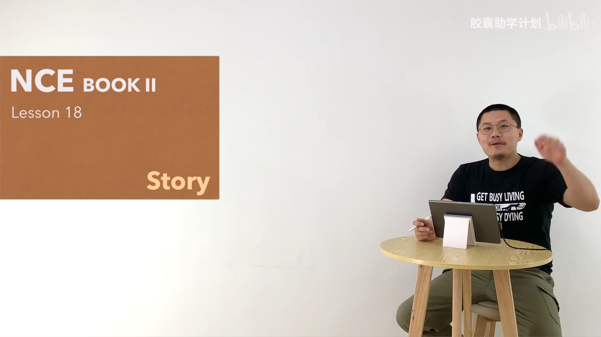

文字识别：胶囊助学计划 / NCE / BOOKII / Lesson 18 / Story / GET BUSY LIVING / SYDYING

### 画面 00:00:02

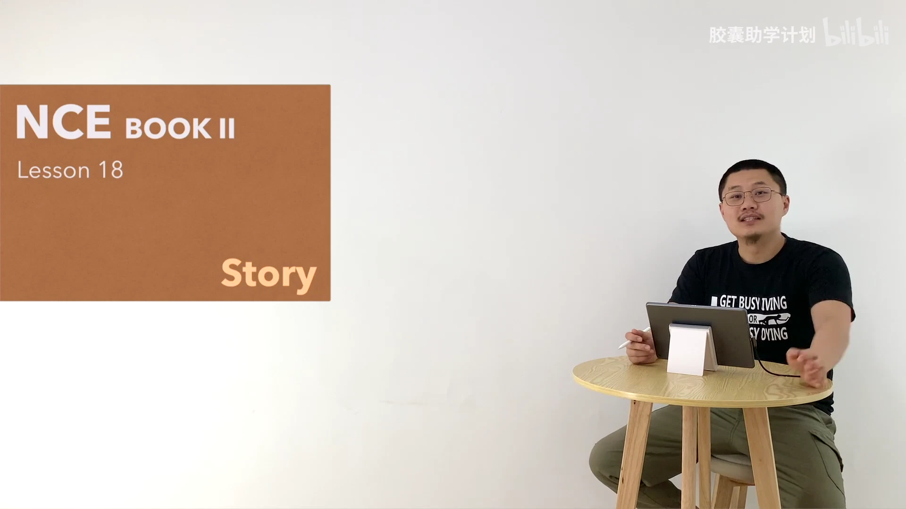

文字识别：胶囊助学计划 / NCE / BOOKII / Lesson 18 / Story / GET BUSYIING / OR..1 / SYOVING

### 画面 00:00:04

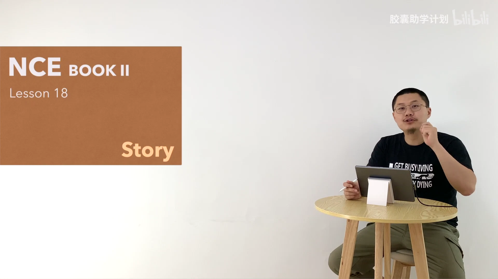

文字识别：胶囊助学计划 / NCE / BOOKⅡI / Lesson 18 / Story / GET RUISYIVING / DR / YOYING

### 画面 00:00:07

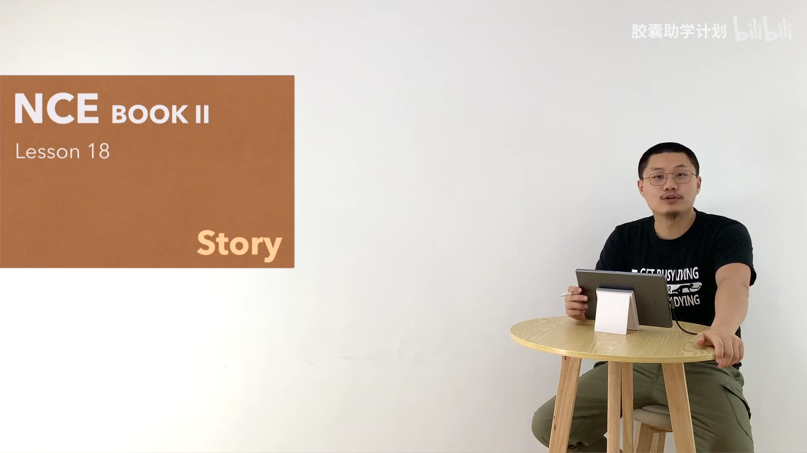

文字识别：胶囊助学计划 / NCE / BOOKII / Lesson 18 / Story / CFT DUISYIVING / MDYING

### 画面 00:00:09

文字识别：胶囊助学计划 bilbl / •

### 画面 00:00:13

文字识别：胶囊助学计划

### 画面 00:00:15

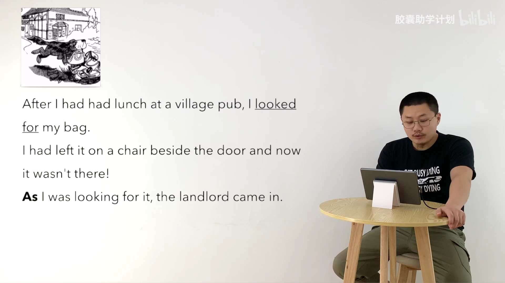

文字识别：胶囊助学计划 / After I had had lunch at a village pub, I looked / for my bag. / I had left it on a chair beside the door and now / it wasn't there! / PUSYIING / OR / YDYING / As I was looking for it, the landlord came in.

### 画面 00:00:21

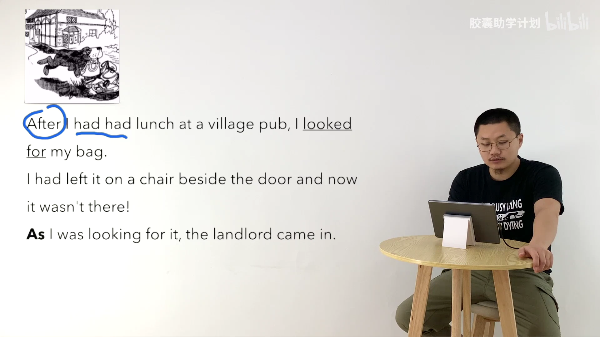

文字识别：胶囊助学计划 / After / had had lunch at a village pub, I looked / for my bag. / I had left it on a chair beside the door and now / it wasn't there! / USYVING / OR / YDYING / As I was looking for it, the landlord came in.

### 画面 00:00:26

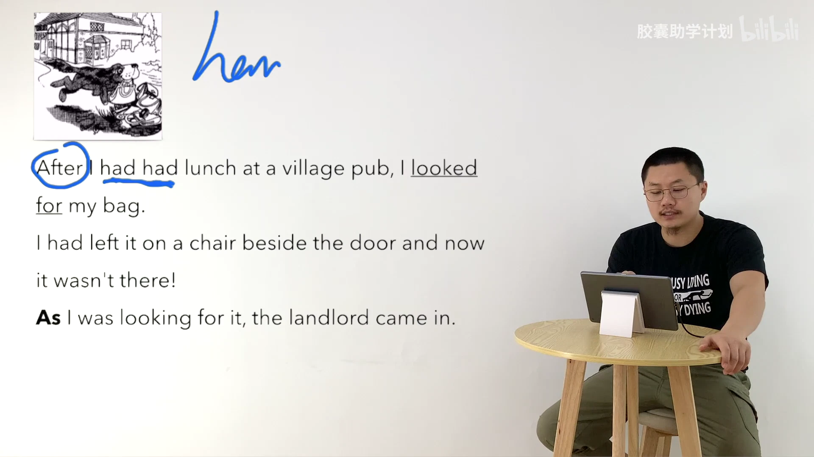

文字识别：胶囊助学计划 / After / had had lunch at a village pub, I looked / for my bag. / I had left it on a chair beside the door and now / it wasn't there! / USYLING / OR / As I was looking for it, the landlord came in. / YDYING

## 00:00:30–00:01:00

顾一下，这不是十四课学过的过去完成时吗？对吧？哎，包括在这个地方出现的 had lunch，是我们说 have 的这个万能动词的用法，对吧？呃，我在一个乡村的小酒馆里吃完饭之后呢， I looked for my bag， look for 一个习惯用法叫做寻找啊，我寻找我的这个包， I had left it。好，过去完成时说我在吃饭之前就把它放在

### 画面 00:00:35

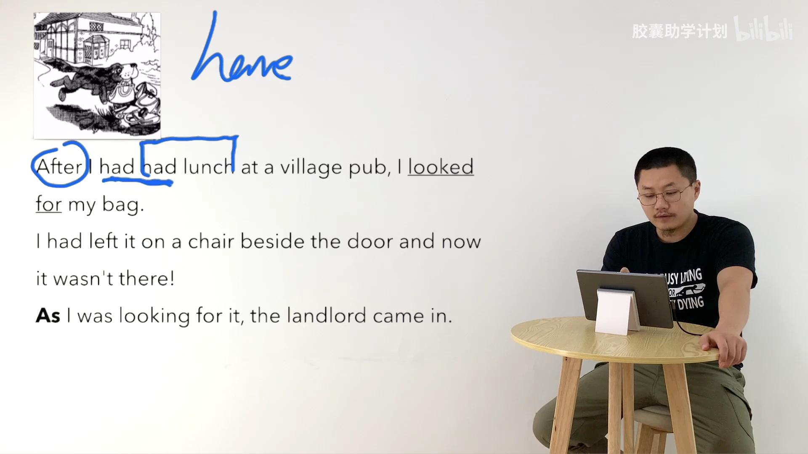

文字识别：胶囊助学计划 / hame / Ihad bad unch a a vilage pub, lokedd / After / for my bag. / I had left it on a chair beside the door and now / it wasn't there! / USYLZING / ORA / YDYING / As I was looking for it, the landlord came in.

### 画面 00:00:38

文字识别：胶囊助学计划 / heme / After / had had lunch at a village pub, I looked / for my bag. / I had left it on a chair beside the door and now / it wasn't there! / BUSY LAING / OR / YDYING / As I was looking for it, the landlord came in.

### 画面 00:00:48

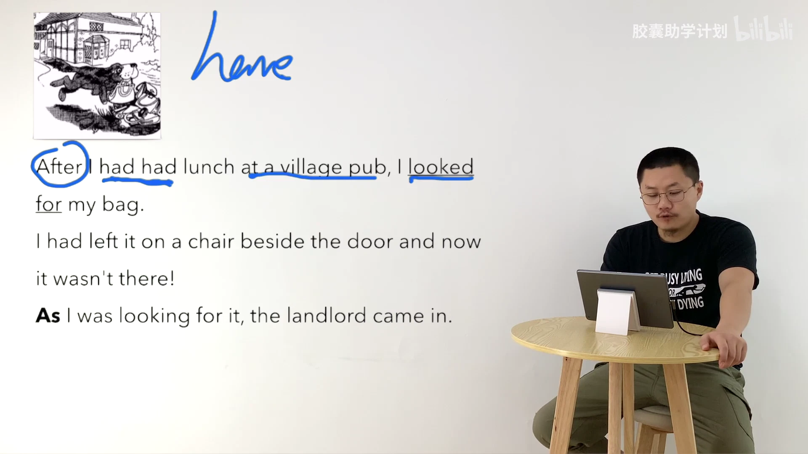

文字识别：胶囊助学计划 / hame / After / had had lunch at a village pub, I looked / for my bag. / I had left it on a chair beside the door and now / it wasn't there! / USYVING / R / TDYING / As I was looking for it, the landlord came in.

## 00:01:00–00:01:30

了，呃呃，把它遗留在了 on a chair，在遗留在了一个椅子上， beside the door，在门口的旁边。好，注意 had left 这个地方的 left 是 leave，对吧？leave 常见的两个含义，离开以及留下或者落下，对吧？And now，然后现在呢， it wasn't there，它现在已经不在那里了。As I was looking for it，好了，提一句啊，

### 画面 00:01:00

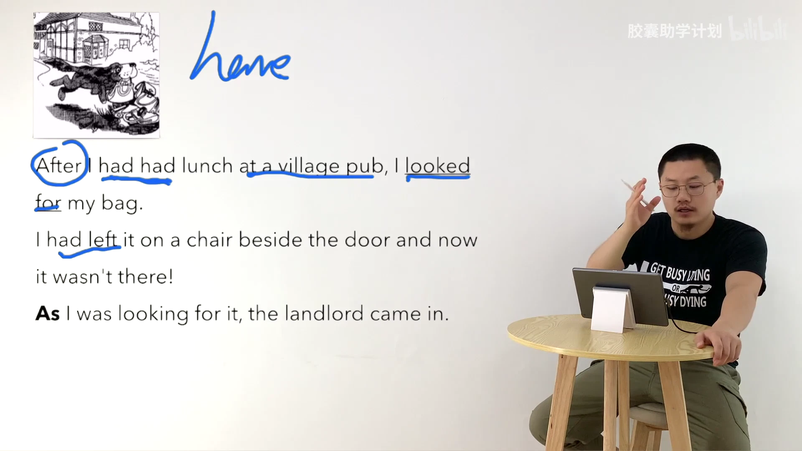

文字识别：胶囊助学计划 / hame / After / had had lunch at a village pub, I looked / fer my bag. / I had left it on a chair beside the door and now / GET BUSY LING / it wasn't there! / OR / SYDYING / As I was looking for it, the landlord came in.

### 画面 00:01:06

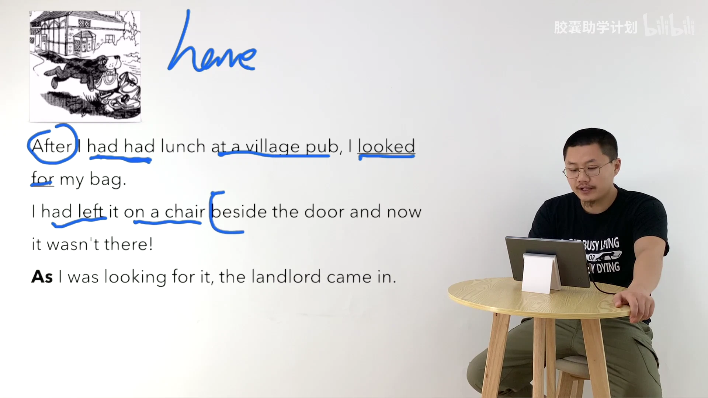

文字识别：胶囊助学计划 / Neme / After / had had lunch at a village pub, I looked / fer my bag. / I had left it on a chair / beside the door and now / it wasn't there! / BUSY LING / OR / As I was looking for it, the landlord came in. / YDYING

### 画面 00:01:11

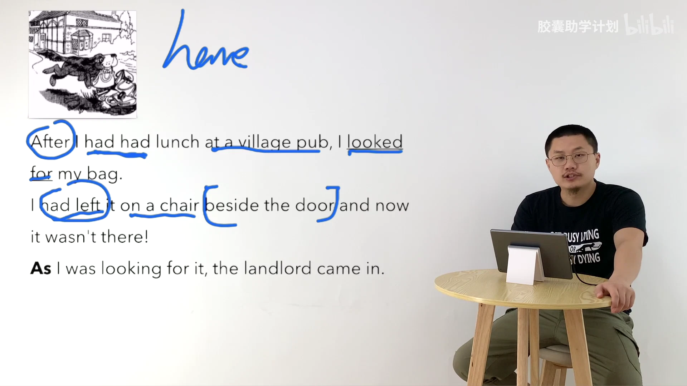

文字识别：胶囊助学计划 / hene / After / had had lunch at a village pub, I looked / for my bag. / beside the doorand now / had left / t on a chair / it wasn't there! / USY LZING / OR / YDYING / As I was looking for it, the landlord came in.

### 画面 00:01:22

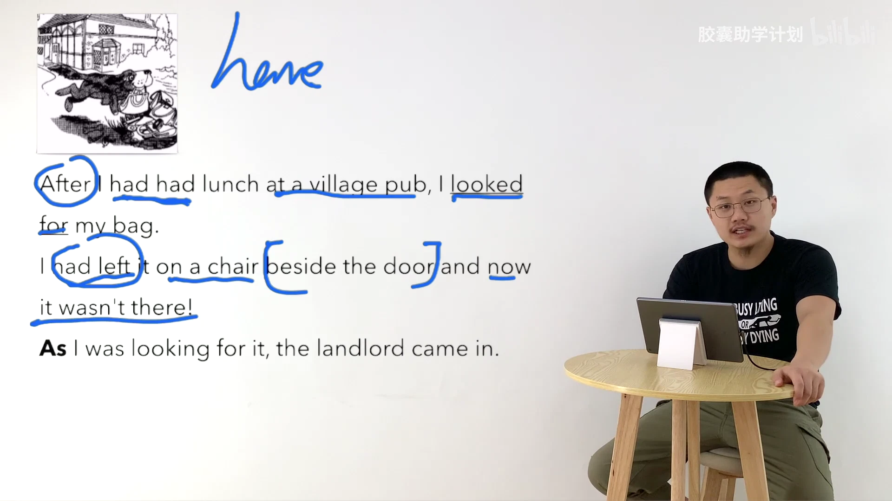

文字识别：胶囊助学计划 / heme / After / had had lunch at a village pub, I looked / for my bag. / beside the doofand now / had left / t on a chair / it wasn't there! / BUSYLING / OR / YDYING / As I was looking for it, the landlord came in.

### 画面 00:01:29

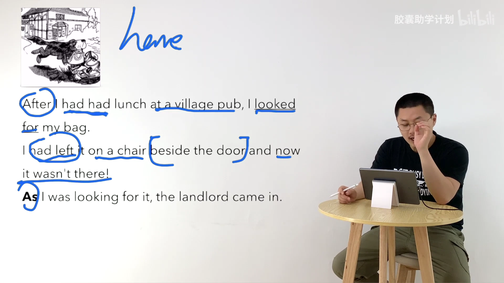

文字识别：胶囊助学计划 / heme / After / had had lunch at a village pub, I looked / for my bag. / Feside the doo7and now / had left / t on a chair / it wasn't there! / was looking for it, the landlord came in. / As

## 00:01:30–00:02:00

as这个单词用法非常非常的多，用法非常非常的杂，有一些用法也非常非常的难。我们见一个说一个，见一个讲一个。在这儿，我们先不管这儿的as是什么意思，我们先看后边。I I was looking for it.刚才刚讲过look for是吧？寻找。我正在寻找它。The landlord came in.哎，这个店主就进来了。好，你注意，我正在寻找它，店主就进来了。

### 画面 00:01:49

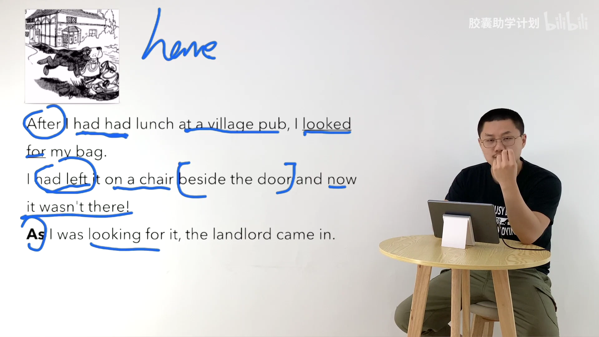

文字识别：胶囊助学计划 / hane / After / had had lunch at a village pub, I looked / for my bag. / beside the doorand now / had left / t on a chair / it wasn't there! / USY / As / was looking for it, the landlord came in.

### 画面 00:01:54

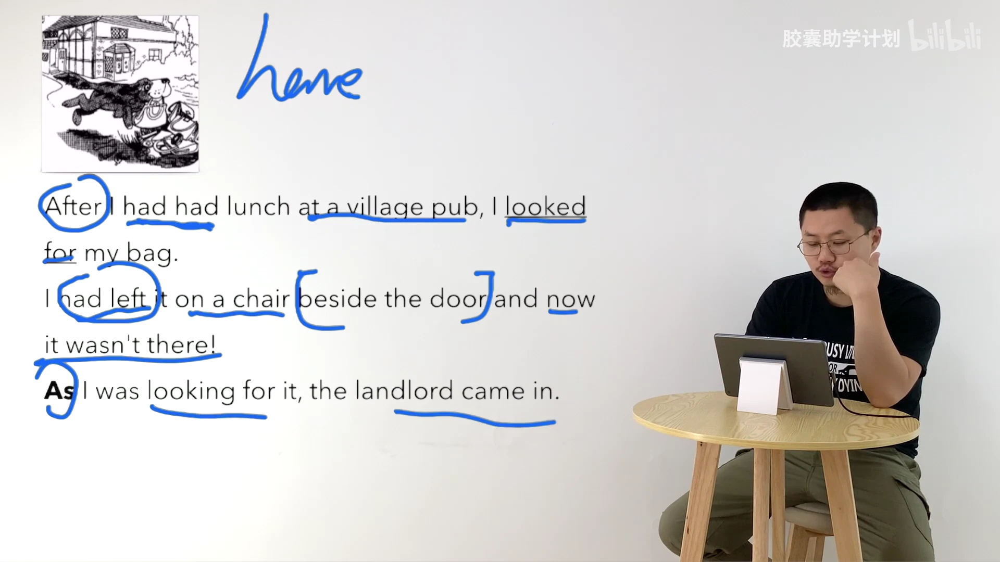

文字识别：胶囊助学计划 / hame / After / had had lunch at a village pub, I looked / fer my bag. / beside the doorand now / had left / t on a chair / it wasn't there! / USYLI / OR / As / was looking for it, the landlord came in. / OVIN

### 画面 00:01:56

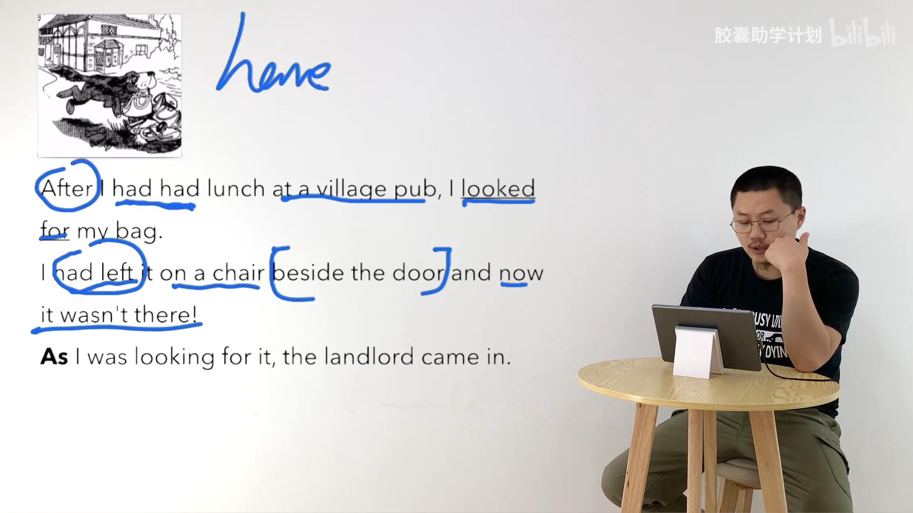

文字识别：胶囊助学计划 / hame / After / had had lunch at a village pub, I looked / for my bag. / beside the door and now / had left / t ton a chair / it wasn't there! / USYLII / OR / As I was looking for it, the landlord came in. / YDVIN

### 画面 00:01:58

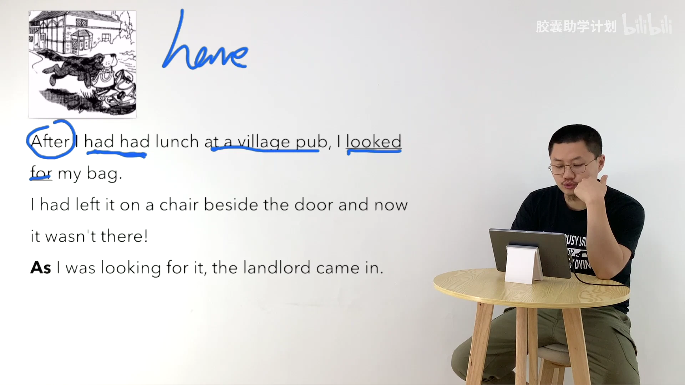

文字识别：胶囊助学计划 / hme / After / had had lunch at a village pub, I looked / fer my bag. / I had left it on a chair beside the door and now / it wasn't there! / USYI / OR. / As I was looking for it, the landlord came in. / YOVIN

## 00:02:00–00:02:30

好，这个地方的 as 您在旁边基本上可以写一个 when 或者 while 啊，就是当我正在找他的时候呢，店主进来了。 as 放在句首的时候最常见啊，不是唯一的两个用法，最常见的两个用法就是要么翻译成叫当 when 或者 while 对吧？或者说同时，要么翻译成 because 叫做因为啊，因为我正在找他，店主进来了，好像没有什么因

### 画面 00:02:03

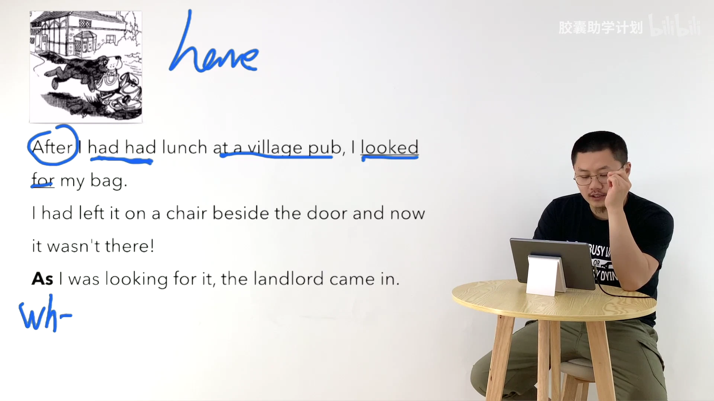

文字识别：胶囊助学计划 / hane / After / had had lunch at a village pub, I looked / for my bag. / I had left it on a chair beside the door and now / it wasn't there! / BUSYI / ORL / As I was looking for it, the landlord came in. / YOVIN / Wh-

### 画面 00:02:05

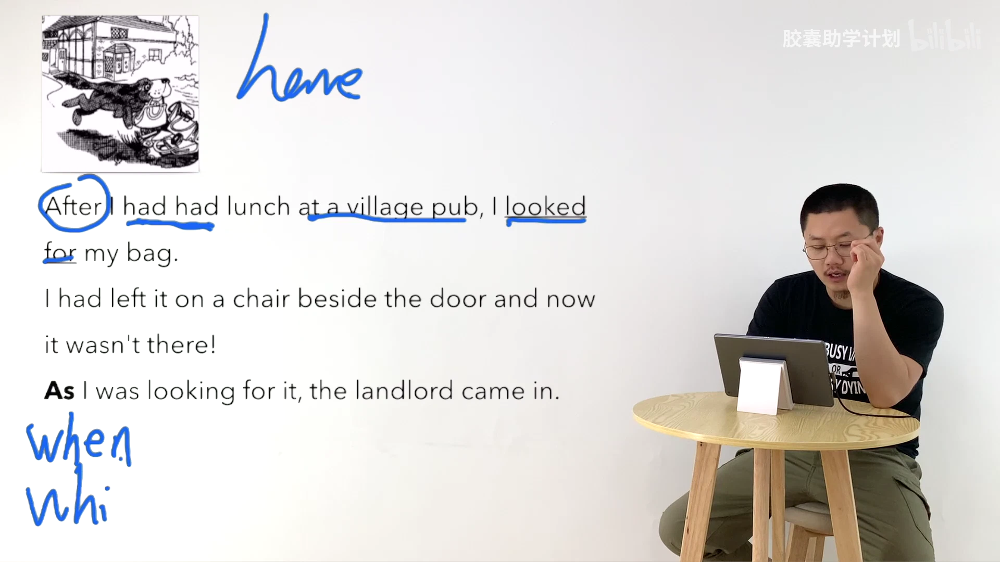

文字识别：胶囊助学计划 / hawe / After / had had lunch at a village pub, I looked / fer my bag. / I had left it on a chair beside the door and now / it wasn't there! / BUSYL / ORS / As I was looking for it, the landlord came in. / YOVN / when / Whi

### 画面 00:02:07

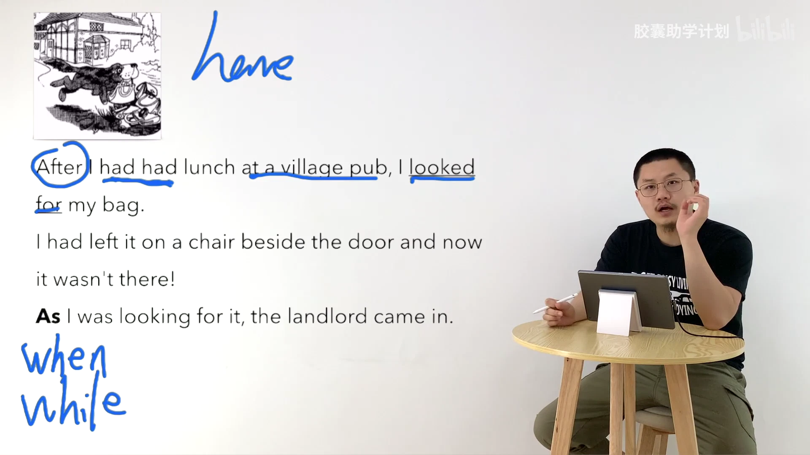

文字识别：胶囊助学计划 / hane / After / had had lunch at a village pub, I looked / fer my bag. / I had left it on a chair beside the door and now / it wasn't there! / As I was looking for it, the landlord came in. / Whey / while

## 00:02:30–00:03:00

果关系，是吧？就是当我正找他的时候呢，店主进来了。Okay,接下来，Did you have a good meal? He asked.你吃了好不啊？Have a good meal，习惯用法，其实新一就见过了啊，八十一课就见过了。He asked，他问道。Yes，Thank you.是的，谢谢。I answered，我回答道。But I can't pay the bill.但是我没有办法支付这个账单。I haven't got my bag.好，注意pay the bill在单词部分我们讲过

### 画面 00:02:32

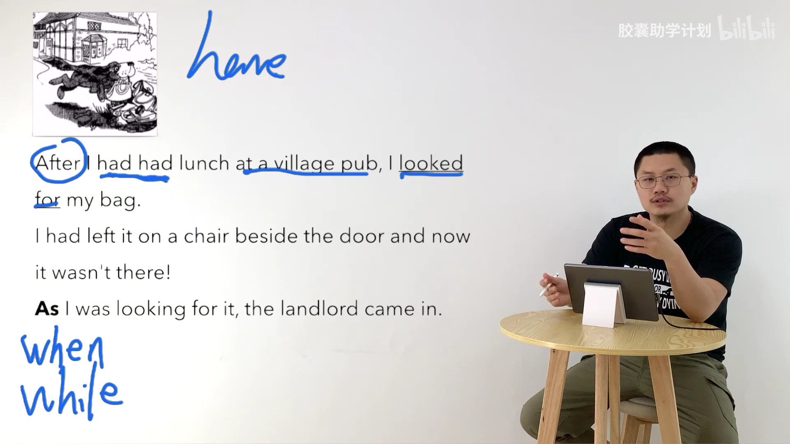

文字识别：胶囊助学计划 / hame / After / had had lunch at a village pub, I looked / for my bag. / I had left it on a chair beside the door and now / it wasn't there! / OR / As I was looking for it, the landlord came in. / OVIN / when / while

### 画面 00:02:34

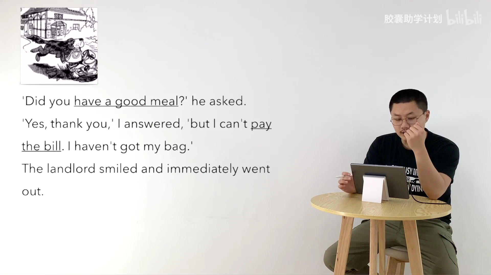

文字识别：胶囊助学计划 / 'Did you have a good meal?' he asked. / 'Yes, thank you,'I answered,'butI can't pay / the bill.I haven't got my bag.' / The landlord smiled and immediately went / VSYIN / out.

### 画面 00:02:53

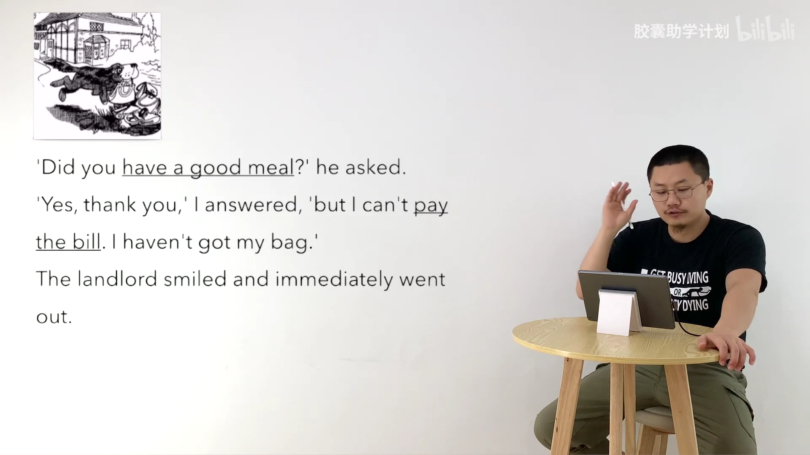

文字识别：胶囊助学计划 / 'Did you have a good meal?' he asked. / 'Yes, thank you,'I answered,'but I can't pay / the bill.I haven't got my bag.' / The landlord smiled and immediately went / CETBUSYIMING / OR / YDYING / out.

## 00:03:00–00:03:30

了，对不对？好，I haven't got，我们现在又见到了 have got 的否定，在 have 的后边加 not，那一般疑问句就是把 have 提前，对吧？我没有我的包啊，我找不到我的包了，对吧？当然在这儿 haven't got 就是没有啊，我没有我包了，是吧？The landlord smiled，因为是之前的事情，对吧？都是当时的事情，所以都是一般过去时。And immediately went out，然后迅速就出去了。

### 画面 00:03:02

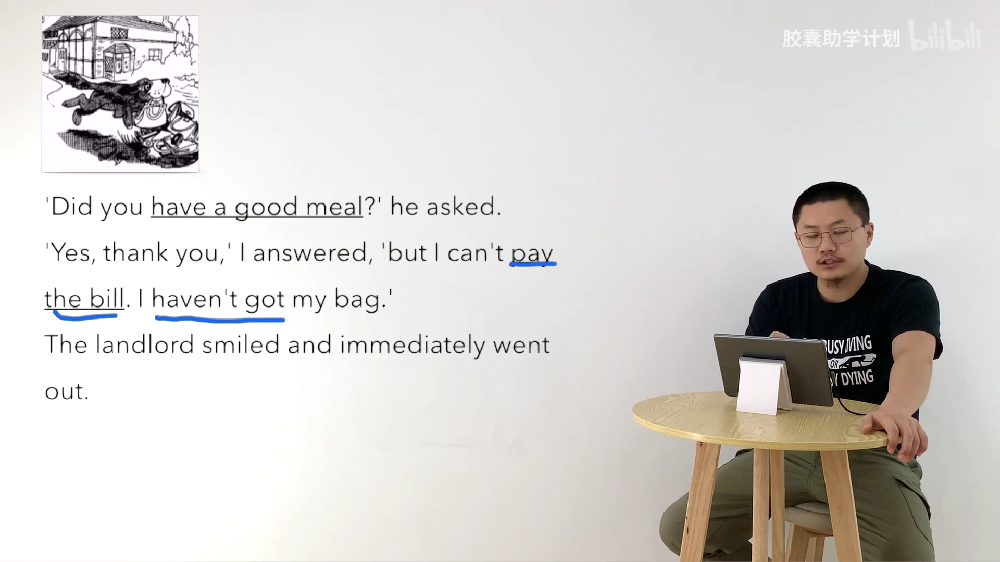

文字识别：胶囊助学计划 / 'Did you have a good meal?' he asked. / 'Yes, thank you,'I answered,'but I can't pay / the bill.I haven't got my bag.' / The landlord smiled and immediately went / BUSYIVING / OR / YDYING / out.

## 00:03:30–00:04:00

Okay, very good.很简单, in a few minutes.其实in a few minutes有点像我们第九课学的那个短语叫in twenty minutes time.各位自己可以翻书回顾一下，叫二十分钟之后。那in a few minutes叫几分钟之后. Okay, he returned.他回来了.先不管后面. He returned.叫做他回来了.那从哪回来？他刚才不说了吗？他出去了.然后现在returned就是又回到刚

### 画面 00:03:30

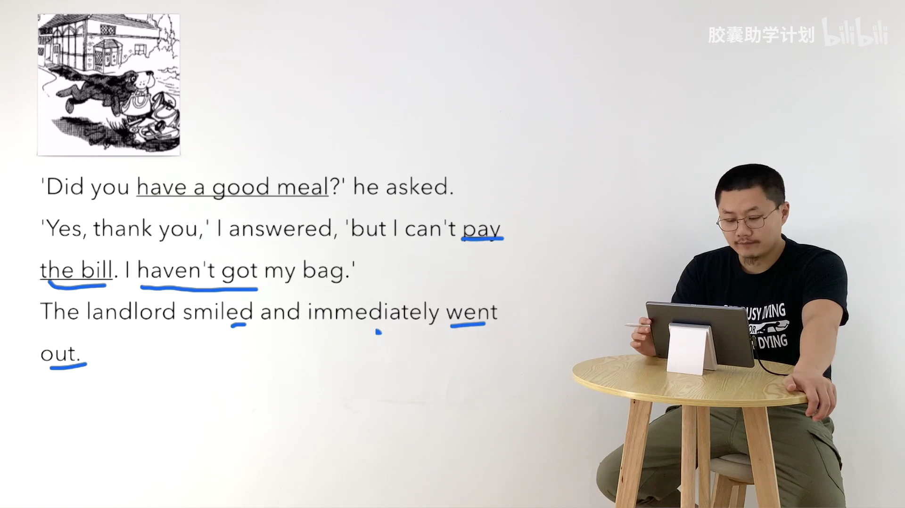

文字识别：胶囊助学计划 / 'Did you have a good meal?' he asked. / 'Yes, thank you,'I answered,'but I can't pay / the bill.I haven't got my bag.' / The landlord smiled and immediately went / USYIMING / R / DYING / out.

### 画面 00:03:32

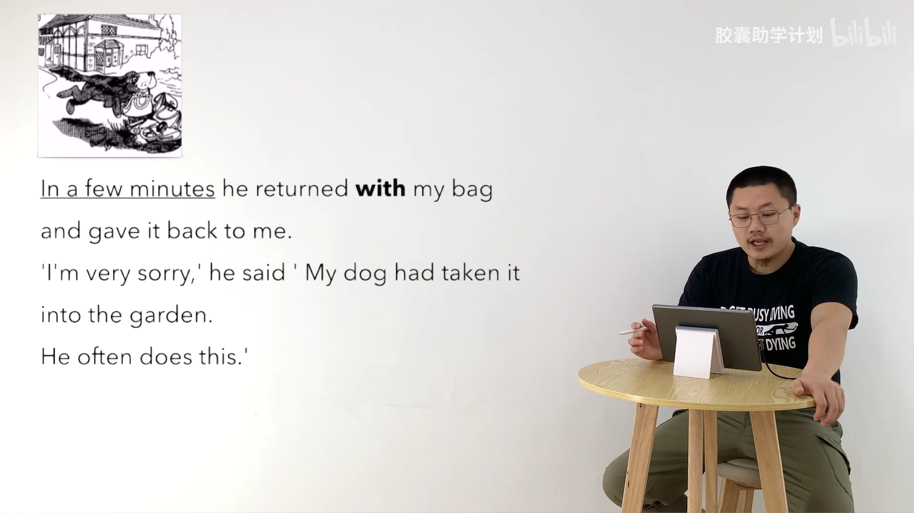

文字识别：胶囊助学计划 / In a few minutes he returned with my bag / and gave it back to me. / 'm very sorry,' he said 'My dog had taken it / into the garden. / USYIVING / R / DYING / He often does this.'

### 画面 00:03:51

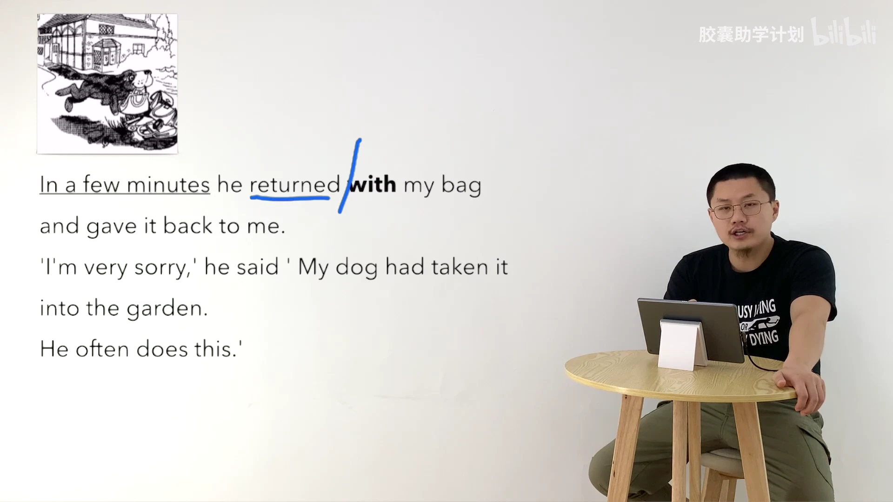

文字识别：胶囊助学计划 / In a few minutes he returned with my bag / and gave it back to me. / 'm very sorry,' he said ' My dog had taken it / into the garden. / USYIAING / OR / He often does this.' / DVING

## 00:04:00–00:04:30

才这个主人公这个啊吃饭这个桌子附近了，对吧？就是他回到刚才我吃饭的这个地方了。With好，注意With对于各位来说最常见的一个意思叫做和。I'm with you啊，我和你在一起，对吧？啊，这个I'm with my family啊，我和我家人在一起。这个早在新一很早很早三十五课我们就学过了。那注意，您由这个和实际上还能往外去延伸几个意思，它是小的介词啊。它

### 画面 00:04:21

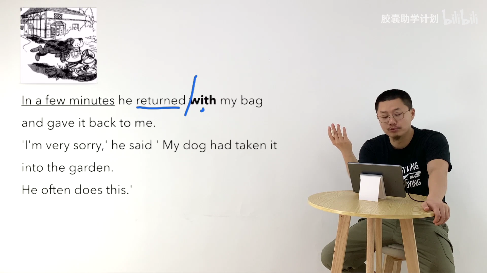

文字识别：胶囊助学计划 / In a few minutes he returned with my bag / and gave it back to me. / 'm very sorry,' he said ' My dog had taken it / into the garden. / YAING / JYING / He often does this.'

## 00:04:30–00:05:00

还有一个意思，你可以理解为就是携带着，就是带着和我的包，那不就是带着我的包嘛，对吧？说携带着 my bag，但注意它不是动词，为什么我强调它？它的词性在这个地方就是 with 这个单词，您可不要把它当做动词去处理，因为动词是有时态的，能接情态动词的，能有被动的 with 可是没有这些东西的，对吧？虽然它翻译成携带，携带在汉语当中看上去好像像一个动词一样，但它不是

### 画面 00:04:51

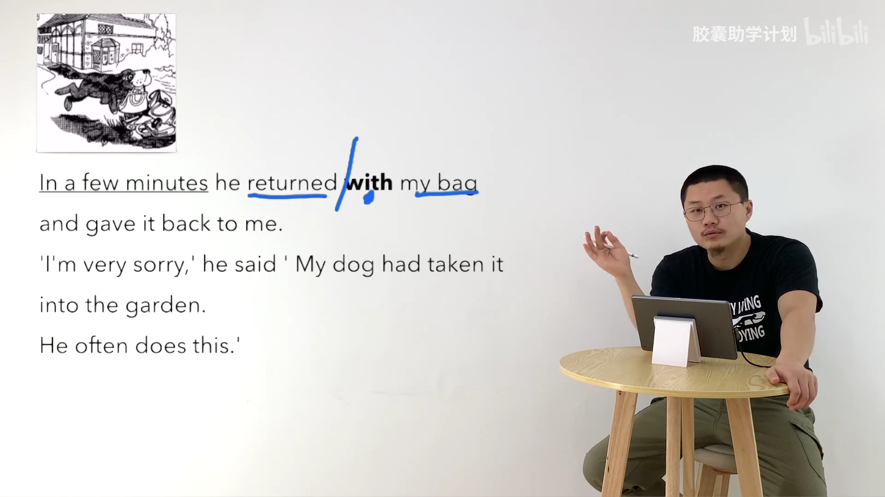

文字识别：胶囊助学计划 / In a few minutes he returned with my bag / and gave it back to me. / 'm very sorry,' he said ' My dog had taken it / into the garden. / YUING / YING / He often does this.'

## 00:05:00–00:05:30

啊。带着我的包，and give it back to me啊。这个 give it to me 是很容易的，对吧？就是新一我们就学过了，二十二课、二十三课就学过了，把它给我，对吧？Give somebody something 和 give something to somebody，对吧？那 back 是什么呢？回顾一下，我们之前学过一个习惯用法叫做 pay it back，把它还回来，对吧？这个 back 就是回来。那 give it to me 就是把它给我，那 back to me 就是还给我，因为本来就是我的嘛，你拿

### 画面 00:05:03

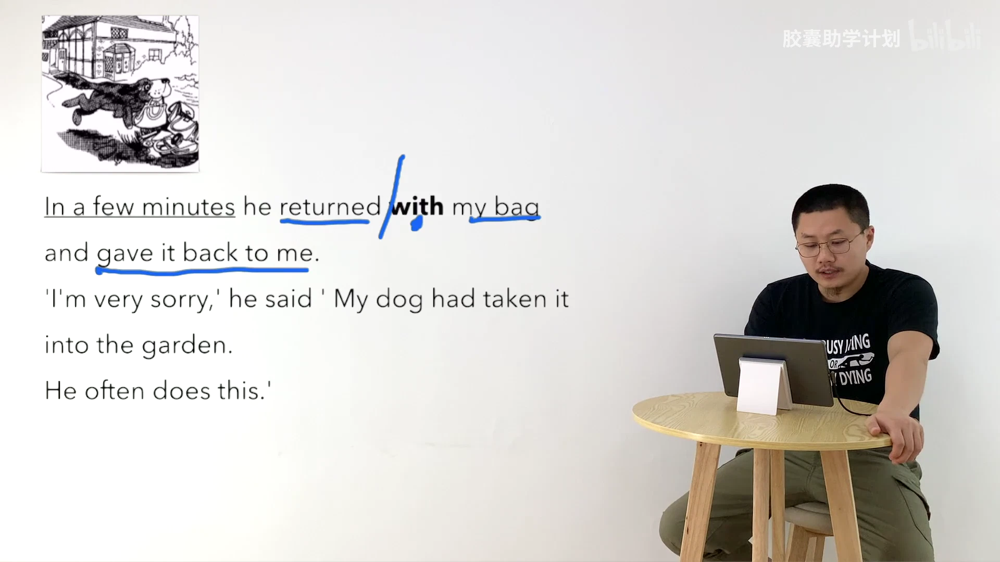

文字识别：胶囊助学计划 / In a few minutes he returned with my bag / and gave it back to me. / 'm very sorry,' he said ' My dog had taken it / into the garden. / USYMING / OR / YDYING / He often does this.'

### 画面 00:05:06

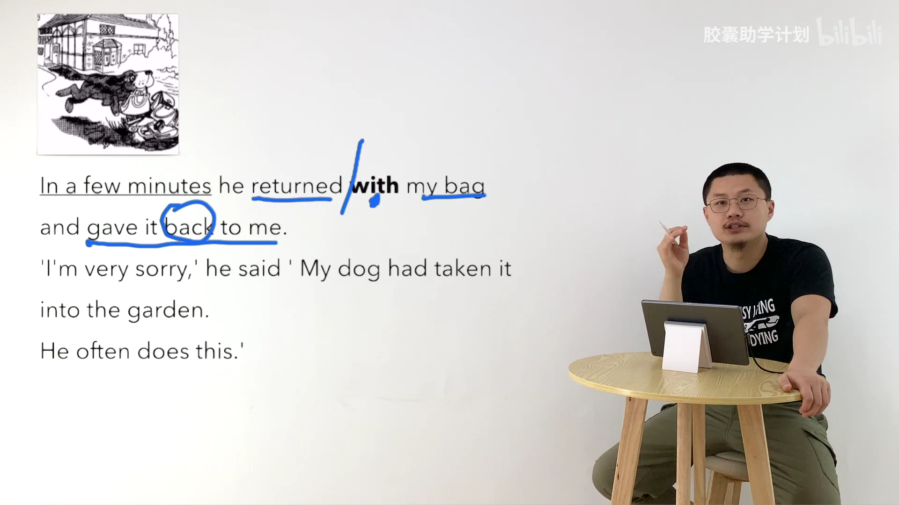

文字识别：胶囊助学计划 / In a few minutes he returned with my bag / and gave itbacl to me. / 'm very sorry,' he said ' My dog had taken it / into the garden. / SYMING / DVING / He often does this.'

## 00:05:30–00:06:00

### 画面 00:05:36

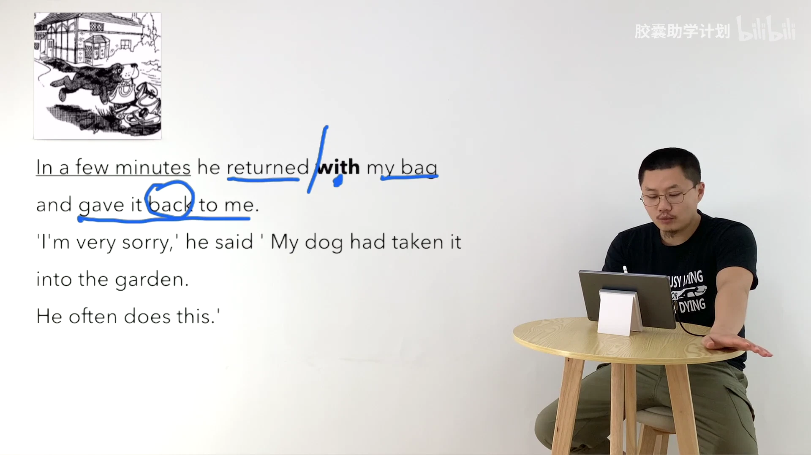

文字识别：胶囊助学计划 / In a few minutes he returned with my bag / and gave itbacl to me. / 'm very sorry,' he said ' My dog had taken it / into the garden. / USYING / DYING / He often does this.'

### 画面 00:05:39

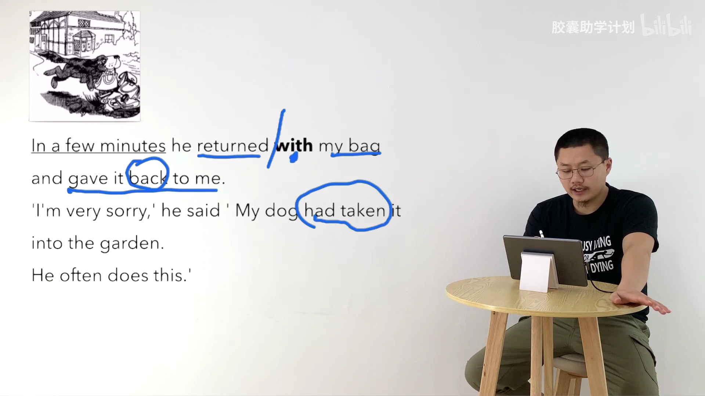

文字识别：胶囊助学计划 / In a few minutes he returned with my bag / and gave itbacl to me. / 'm very sorry,' he said'My dog had taken / into the garden. / USYING / He often does this.' / DYING

## 00:06:00–00:06:30

的，对吧？叼着它，或者衔着它，对吧？或者咬着它，咬着它就不太合适了，已经，对吧？啊，这个咬着它或者叼着它，对吧？哎，好，He often does this. 他经常干这件事情。玩一个，那文章呢，并不是非常的难，习惯用法也不是很多。我们来一起造一些句子，好吧？好，那第一个 look for 叫做寻找，我们直接来给大家一个例子，叫做 In spite of the rain. In

### 画面 00:06:09

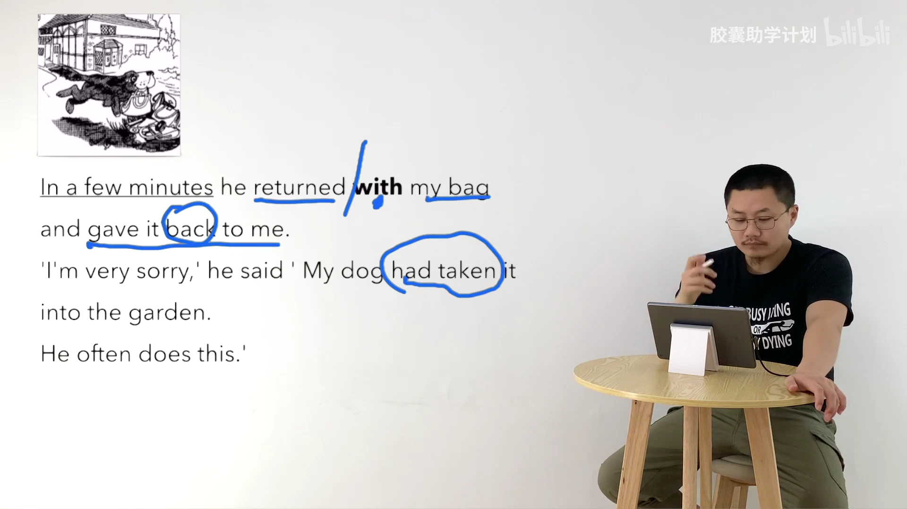

文字识别：胶囊助学计划 / In a few minutes he returned with my bag / and gave itbaclt / to me. / 'm very sorry,' he said' My dog had taken / into the garden. / BUSYIAING / OR / YDYING / He often does this.'

### 画面 00:06:16

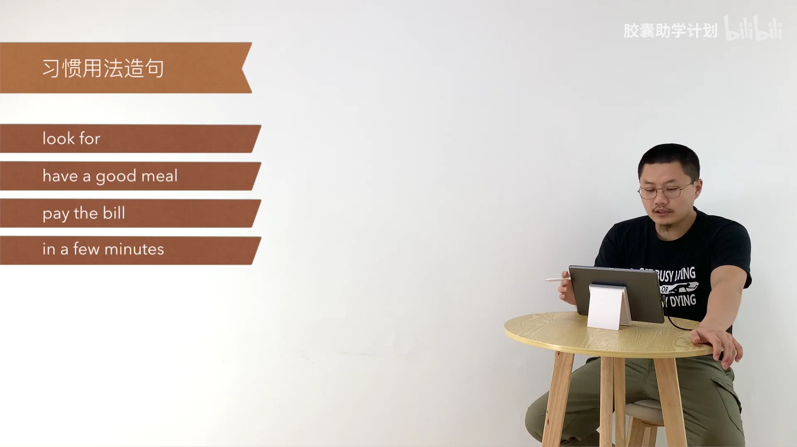

文字识别：胶囊助学计划 / 习惯用法造句 / look for / have a good meal / pay the bill / in a few minutes / BUSYIING / OR / YDYING

### 画面 00:06:18

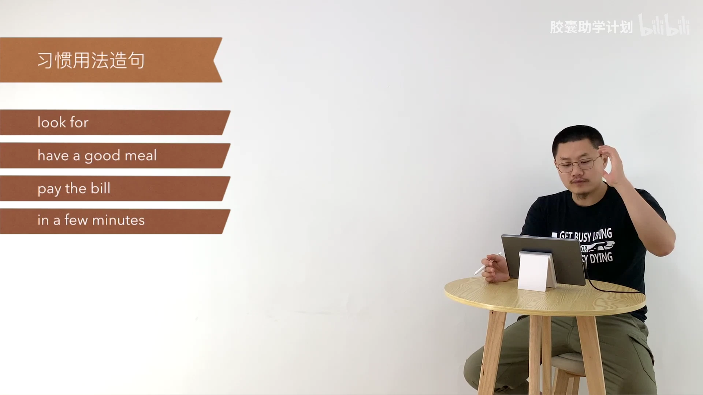

文字识别：胶囊助学计划 / 习惯用法造句 / look for / have a good meal / pay the bill / in a few minutes / GET RUSY LING / OR / SYDYING

### 画面 00:06:20

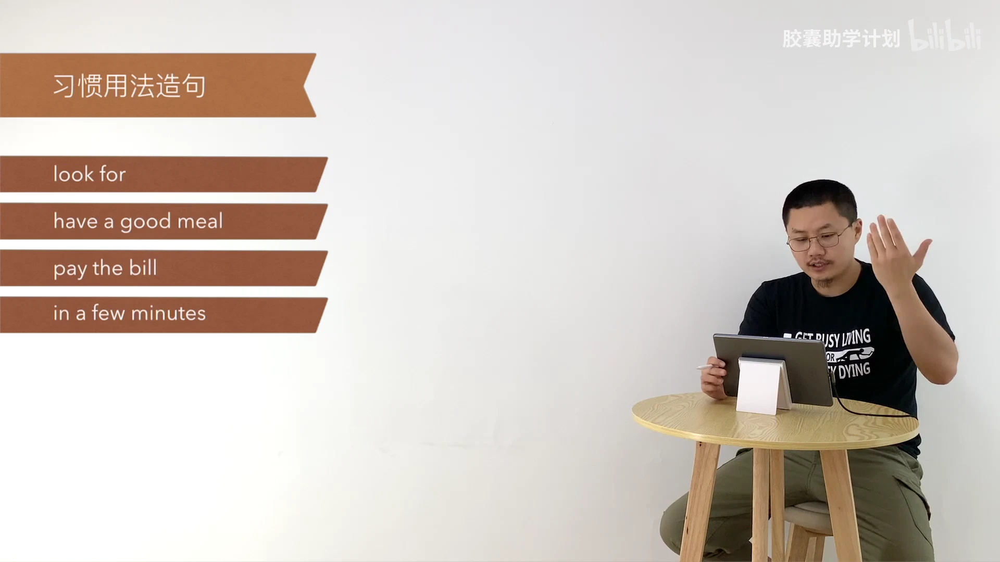

文字识别：胶囊助学计划 / 习惯用法造句 / look for / have a good meal / pay the bill / in a few minutes /  GET DUSY LING / OR / YDYING

### 画面 00:06:22

文字识别：网：v.+v.变化 / 习惯用法造句指南 / 胶囊助学计划 / 四句型转换 / 方式/地点/时间 / 其他习惯用法 / 其他单词+词性 / 原文摘抄+变 / 6123456 / look for /  CET DISY LING / RU / YDYING

### 画面 00:06:25

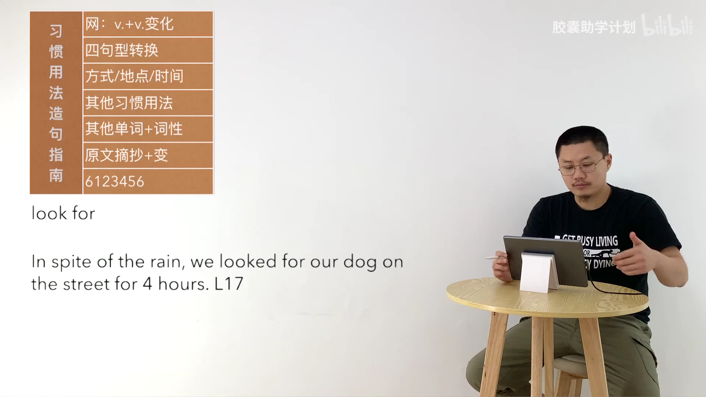

文字识别：网：v.+v.变化 / 习惯用法造句指南 / 胶囊助学计划 / 四句型转换 / 方式/地点/时间 / 其他习惯用法 / 其他单词+词性 / 原文摘抄+变 / 6123456 / look for / CET DUSY LIVING / In spite of the rain, we looked for our dog on / OR- / SYDYINE / the street for 4 hours. L17

### 画面 00:06:28

文字识别：网：v.+v.变化 / 习惯用法造句指南 / 胶囊助学计划 / 四句型转换 / 方式/地点/时间 / 其他习惯用法 / 其他单词+词性 / 原文摘抄+变 / 9 / 6123456 / look for / BUSYLTING / In spite of the rain, we looked for our dog on / OR / YDYING / the street for 4 hours. L17

## 00:06:30–00:07:00

spite of,还记得吧？尽管尽管这个雨，we look for our dog.哎，我们找我们的狗非常简单，主谓宾对吧？然后我们加点方式、地点、时间。来，on the street，地点，再加时间，for four hours，符合六一二三四五六一二三五六对吧？Very good，找了四个小时，这是第十七个学的，in spite of，对吧？

### 画面 00:06:30

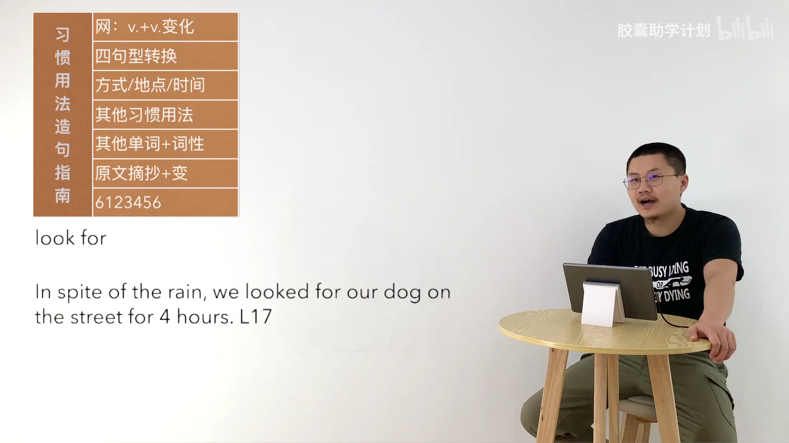

文字识别：网：v.+v.变化 / 习惯用法造句指南 / 胶囊助学计划 / 四句型转换 / 方式/地点/时间 / 其他习惯用法 / 其他单词+词性 / 原文摘抄+变 / 6123456 / look for / BUSY IZING / In spite of the rain, we looked for our dog on / OR / YDYING / the street for 4 hours. L17

### 画面 00:06:35

文字识别：网：v.+v.变化 / 习惯用法造句指南 / 胶囊助学计划 / 四句型转换 / 方式/地点/时间 / 其他习惯用法 / 其他单词+词性 / 原文摘抄+变 / 6123456 / look for / USY LING / In spite of the rain, we looked for our dog on / OR / TYDYING / the street for 4 hours. L17

### 画面 00:06:40

文字识别：习惯用法造句指南 / 网：v.+v.变化 / 胶囊助学计划 / 四句型转换 / 方式/地点/时间 / 其他习惯用法 / 其他单词+词性 / 原文摘抄+变 / 6123456 / look for / USY ING / In spite of the rain, we looked for our dog on / OR / TYDYING / the street for 4 hours. L17

### 画面 00:06:45

文字识别：网：v.+v.变化 / 习惯用法造句指南 / 胶囊助学计划 / 四句型转换 / 方式/地点/时间 / 其他习惯用法 / 其他单词+词性 / 原文摘抄+变 / 6123456 / look for / USYIING / In spite of the rain, we looked for our dog on / OR / TYDYING / the street for 4 hours. L17

### 画面 00:06:50

文字识别：习惯用法造句指南 / 网：v.+v.变化 / 胶囊助学计划 / 四句型转换 / 方式/地点/时间 / 其他习惯用法 / 其他单词+词性 / 原文摘抄+变 / 6123456 / look for / BUSY ANG / In spite of the rain, we looked for our dog on / OR / YDYING / the street for 4 hours. L17

### 画面 00:06:53

文字识别：习惯用法造句指南 / 网：v.+v.变化 / 胶囊助学计划 / 四句型转换 / 方式/地点/时间 / 其他习惯用法 / 其他单词+词性 / 原文摘抄+变 / 6123456 / look for / BUSY MING / In spite of the rain, we looked for our dog on / OR / YDYING / the street for 4 hours. L17

### 画面 00:06:55

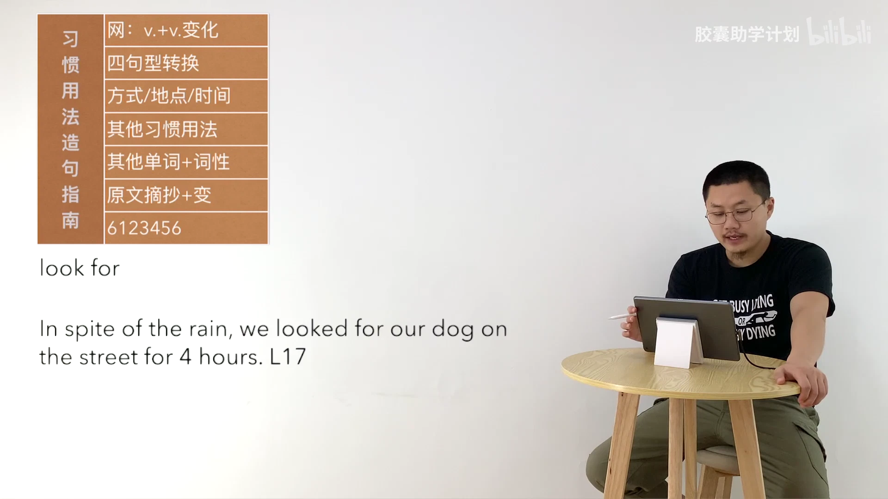

文字识别：网：v.+v.变化 / 习惯用法造句指南 / 胶囊助学计划 / 四句型转换 / 方式/地点/时间 / 其他习惯用法 / 其他单词+词性 / 原文摘抄+变 / 6123456 / look for / BUSY ING / In spite of the rain, we looked for our dog on / OR / YDYING / the street for 4 hours. L17

### 画面 00:06:57

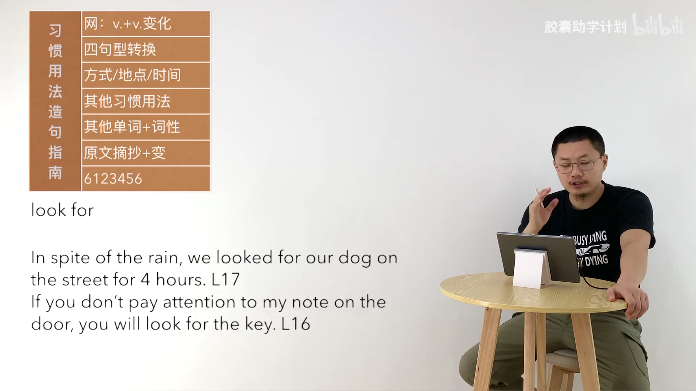

文字识别：习惯用法造句指南 / 网：v.+v.变化 / 胶囊助学计划 / 四句型转换 / 方式/地点/时间 / 其他习惯用法 / 其他单词+词性 / 原文摘抄+变 / 6123456 / lookfor / BUSYMING / In spite of the rain, we looked for our dog on / YDYING / the street for 4 hours. L17 / If you don't pay attention to my note on the / door, you will look for the key. L16

## 00:07:00–00:07:30

第十六课说 if you don't pay attention to my note on the door，说如果呀，十六课学的 pay attention to 对吧？第一课第十六课咱们都学过，叫 pay attention 注意。如果你不注意我的这个 note，就是这个便签在门上的， you will look for the key。那你就找，你就得找钥匙了，对吧？我这个便签上写着，告诉你钥匙在哪儿了。 Okay， very good。那很简单，对吧？ Look for。接下来呢， have a good meal。那这个

### 画面 00:07:00

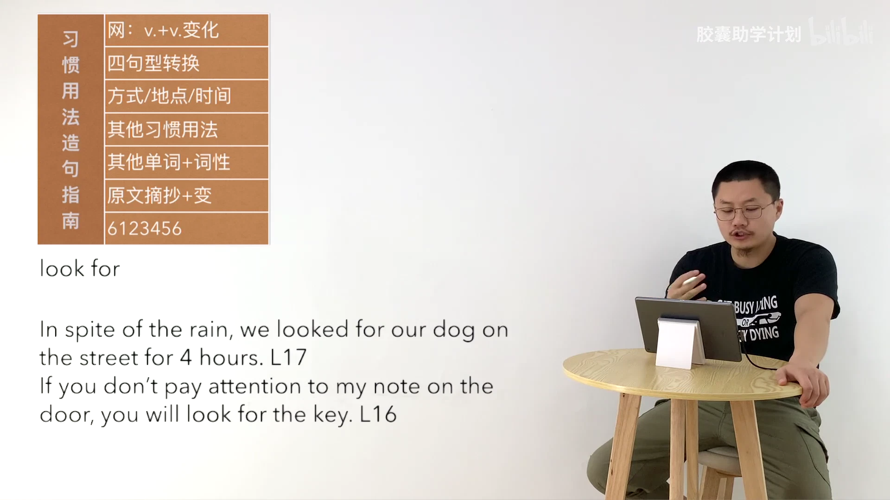

文字识别：网：v.+v.变化 / 习惯用法造句指南 / 胶囊助学计划 / 四句型转换 / 方式/地点/时间 / 其他习惯用法 / 其他单词+词性 / 原文摘抄+变 / 6123456 / lookfor / BUSYMING / In spite of the rain, we looked for our dog on / OR / YDYING / the street for 4 hours. L17 / If you don't pay attention to my note on the / door, you will look for the key. L16

### 画面 00:07:05

文字识别：习惯用法造句指南 / 网：v.+v.变化 / 胶囊助学计划 / 四句型转换 / 方式/地点/时间 / 其他习惯用法 / 其他单词+词性 / 原文摘抄+变 / 6123456 / look for / BUSYMING / In spite of the rain, we looked for our dog on / OR / YDYING / the street for 4 hours. L17 / If you don't pay attention to my note on the / door, you will look for the key. L16

### 画面 00:07:10

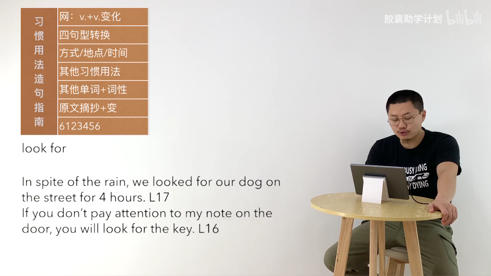

文字识别：习惯用法造句指南 / 网：v.+v.变化 / 胶囊助学计划 / 四句型转换 / 方式/地点/时间 / 其他习惯用法 / 其他单词+词性 / 原文摘抄+变 / 6123456 / lookfor / JUSYANG / In spite of the rain, we looked for our dog on / OR / YDYING / the street for 4 hours.L17 / If you don't pay attention to my note on the / door, you will look for the key. L16

### 画面 00:07:15

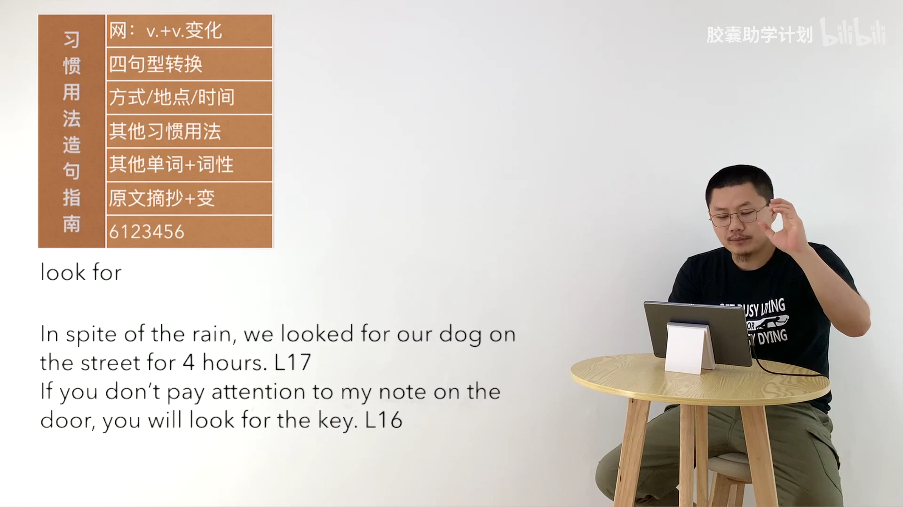

文字识别：习惯用法造句指南 / 网：v.+v.变化 / 胶囊助学计划 / 四句型转换 / 方式/地点/时间 / 其他习惯用法 / 其他单词+词性 / 原文摘抄+变 / 6123456 / look for / USY LING / In spite of the rain, we looked for our dog on / OR / YDYING / the street for 4 hours. L17 / If you don't pay attention to my note on the / door, you will look for the key. L16

### 画面 00:07:20

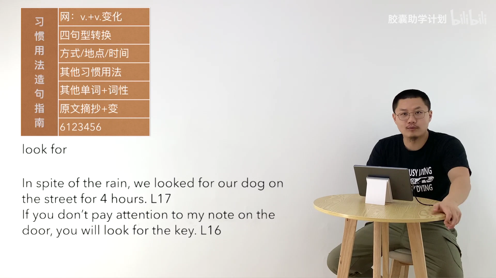

文字识别：网：v.+v.变化 / 习惯用法造句指南 / 胶囊助学计划 / 四句型转换 / 方式/地点/时间 / 其他习惯用法 / 其他单词+词性 / 原文摘抄+变 / 6123456 / lookfor / USYLING / In spite of the rain, we looked for our dog on / OR / DYING / the street for 4 hours. L17 / If you don't pay attention to my note on the / door, you will look for the key. L16

### 画面 00:07:24

文字识别：网：v.+v.变化 / 习惯用法造句指南 / 胶囊助学计划 / 四句型转换 / 方式/地点/时间 / 其他习惯用法 / 其他单词+词性 / 原文摘抄+变 / 6123456 / have a good meal / USY VING / OR / YDYING

### 画面 00:07:26

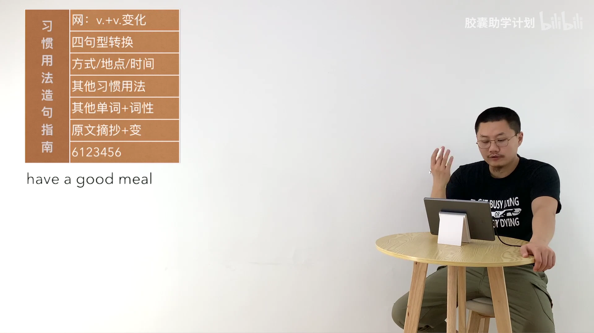

文字识别：网：v.+v.变化 / 习惯用法造句指南 / 胶囊助学计划 / 四句型转换 / 方式/地点/时间 / 其他习惯用法 / 其他单词+词性 / 原文摘抄+变 / 6123456 / have a good meal / BUSY INING / OR / IYDYING

### 画面 00:07:29

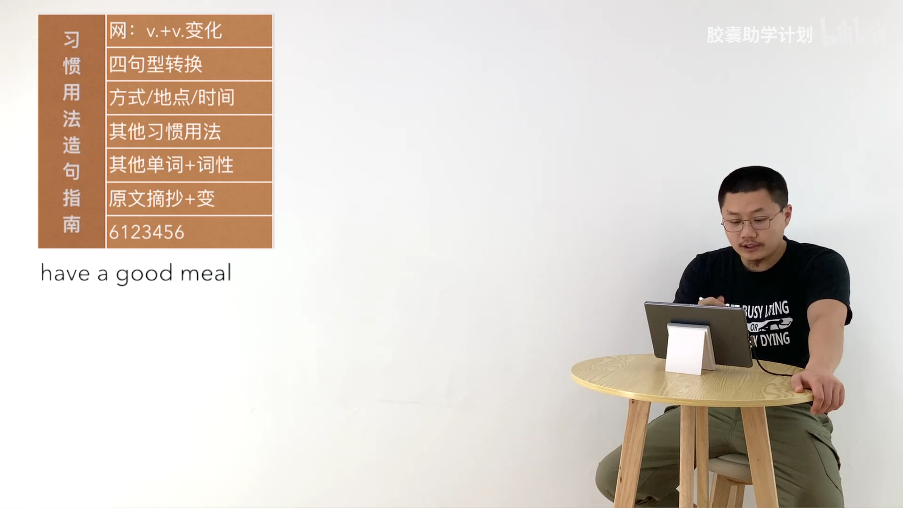

文字识别：习惯用法造句指南 / 网：v.+v.变化 / 胶囊助学计划 / 四句型转换 / 方式/地点/时间 / 其他习惯用法 / 其他单词+词性 / 原文摘抄+变 / 6123456 / have a good meal / BUSY LING / OR / VDYING

## 00:07:30–00:08:00

加不加其实无所谓了。您可以换成别的，比如说Have a terrible meal, Have a bad meal,都可以，对吧？Have a great meal. 形容词您是可以随便换的。说Do you want to have a meal with us?你想不想和我们一起吃顿饭呢？这是新一我们就能造的句子了，对吧？那我们结合新二的一个语法，十三课将来进行时。I will be having.当时会正

### 画面 00:07:31

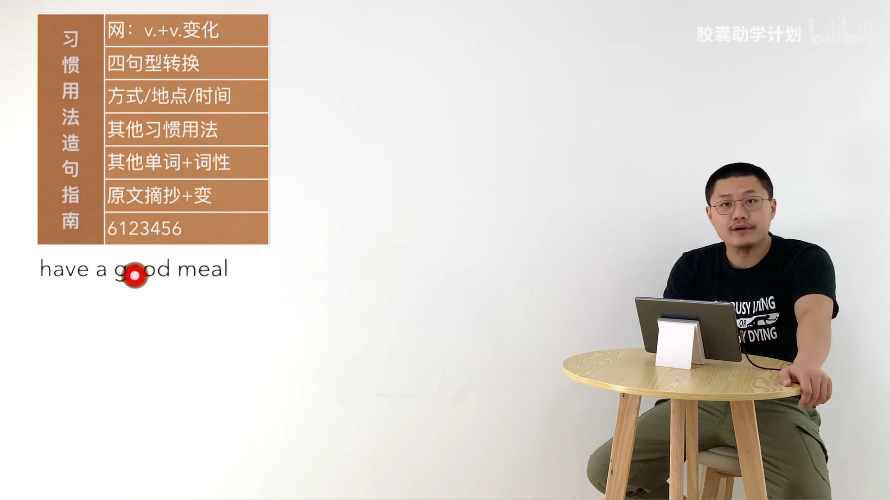

文字识别：网：v.+v.变化 / 习惯用法造句指南 / 胶囊助学计划 / 四句型转换 / 方式/地点/时间 / 其他习惯用法 / 其他单词+词性 / 原文摘抄+变 / 6123456 / have a / od meal / USY IING / OR / YDYING

### 画面 00:07:35

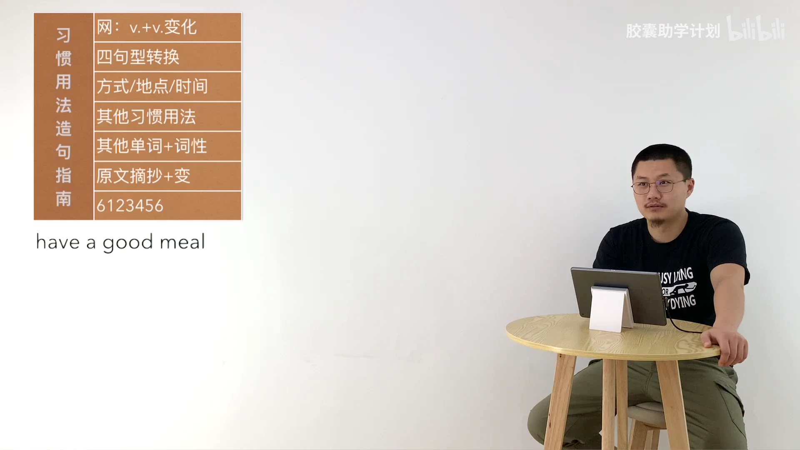

文字识别：网：v.+v.变化 / 习惯用法造句指南 / 胶囊助学计划 / 四句型转换 / 方式/地点/时间 / 其他习惯用法 / 其他单词+词性 / 原文摘抄+变 / 6123456 / have a good meal / ISYLNG / R / DYING

### 画面 00:07:40

文字识别：网：v.+v.变化 / 胶囊助学计划 / 习惯用法造句指南 / 四句型转换 / 方式/地点/时间 / 其他习惯用法 / 其他单词+词性 / 原文摘抄+变 / 6123456 / have a good meal / USYIING / Do you want to have a meal with us? / OR / YDYING

### 画面 00:07:45

文字识别：网：v.+v.变化 / 习惯用法造句指南 / 胶囊助学计划 / 四句型转换 / 方式/地点/时间 / 其他习惯用法 / 其他单词+词性 / 原文摘抄+变 / 6123456 / have a good meal / USYLING / Do you want to have a meal with us? / OR / DVING

### 画面 00:07:49

文字识别：习惯用法造句指南 / 网：v.+v.变化 / 胶囊助学计划 / 四句型转换 / 方式/地点/时间 / 其他习惯用法 / 其他单词+词性 / 原文摘抄+变 / 6123456 / have a good meal / USYVING / Do you want to have a meal with us? / OR / DYING / I wil be having a meal with them tonight. L13

### 画面 00:07:51

文字识别：习惯用法造句指南 / 网：v.+v.变化 / 胶囊助学计划 / 四句型转换 / 方式/地点/时间 / 其他习惯用法 / 其他单词+词性 / 原文摘抄+变 / 6123456 / have a good meal / USYLING / Do you want to have a meal with us? / OR / YDYING / I wil be having a meal with them tonight. L13

### 画面 00:07:55

文字识别：习惯用法造句指南 / 网：v.+v.变化 / 胶囊助学计划 / 四句型转换 / 方式/地点/时间 / 其他习惯用法 / 其他单词+词性 / 原文摘抄+变 / 6123456 / have a good meal / USYING / Do you want to have a meal with us? / OR / YDYING / I will be having a meal with them tonight. L13

### 画面 00:07:59

文字识别：网：v.+v.变化 / 习惯用法造句指南 / 胶囊助学计划 / 四句型转换 / 方式/地点/时间 / 其他习惯用法 / 其他单词+词性 / 原文摘抄+变 / 6123456 / have a good meal / BUSYLING / Do you want to have a meal with us? / OR / YDYING / I will be having a meal with them tonight. L13

## 00:08:00–00:08:30

在进行或计划打算，对吧？Have a meal with them tonight. 哎，我认为这是个计划假算，对吧？说我呀，今天晚上会和他们一起吃顿饭。OK, OK, OK. 再然后十四课说，After they had a great meal, they drove on to the next town. 说他们吃完这顿完美特别棒的这顿饭了之后呢，他们 drove on to，是吧？继续开往了下一个小

### 画面 00:08:02

文字识别：习惯用法造句指南 / 网：v.+v.变化 / 胶囊助学计划 / 四句型转换 / 方式/地点/时间 / 其他习惯用法 / 其他单词+词性 / 原文摘抄+变 / 6123456 / have a good meal / BUSYVING / Do you want to have a meal with us? / OR / YDYING / I will be having a meal with them tonight. L13

### 画面 00:08:04

文字识别：网：v.+v.变化 / 习惯用法造句指南 / 胶囊助学计划 / 四句型转换 / 方式/地点/时间 / 其他习惯用法 / 其他单词+词性 / 原文摘抄+变 / 6123456 / have a good meal / USY IZING / Do you want to have a meal with us? / OR / YDYING / I wil be having a meal with them tonight. L13

### 画面 00:08:08

文字识别：网：v.+v.变化 / 习惯用法造句指南 / 胶囊助学计划 / 四句型转换 / 方式/地点/时间 / 其他习惯用法 / 其他单词+词性 / 原文摘抄+变 / 6123456 / have a good meal / GET BUSYLZING / OR / Do you want to have a meal with us? / SYDYING / I wil be having a meal with them tonight. L13

### 画面 00:08:10

文字识别：网：v.+v.变化 / 习惯用法造句指南 / 胶囊助学计划 / 四句型转换 / 方式/地点/时间 / 其他习惯用法 / 其他单词+词性 / 原文摘抄+变 / 6123456 / have a good meal / CFT GUSY VING / Do you want to have a meal with us? / OR / SYDYING / I will be having a meal with them tonight. L13

### 画面 00:08:13

文字识别：网：v.+v.变化 / 习惯用法造句指南 / 胶囊助学计划 / 四句型转换 / 方式/地点/时间 / 其他习惯用法 / 其他单词+词性 / 原文摘抄+变 / 6123456 / have a good meal / BUSYLING / Do you want to have a meal with us? / OR / YDYING / I will be having a meal with them tonight. L13 / After they had a great meal, they drove on to / the next town.L14

### 画面 00:08:15

文字识别：习惯用法造句指南 / 网：v.+v.变化 / 胶囊助学计划 / 四句型转换 / 方式/地点/时间 / 其他习惯用法 / 其他单词+词性 / 原文摘抄+变 / 6123456 / have a good meal / USYING / Do you want to have a meal with us? / OR / YDYING / I will be having a meal with them tonight. L13 / After they had a great meal, they drove on to / the next town.L14

### 画面 00:08:19

文字识别：网：v.+v.变化 / 习惯用法造句指南 / 胶囊助学计划 / 四句型转换 / 方式/地点/时间 / 其他习惯用法 / 其他单词+词性 / 原文摘抄+变 / 6123456 / have a good meal / USYLING / Do you want to have a meal with us? / YDYING / I will be having a meal with them tonight. L13 / After they had a great meal, they drove on to / the next town.L14

### 画面 00:08:24

文字识别：网：v.+v.变化 / 习惯用法造句指南 / 胶囊助学计划 / 四句型转换 / 方式/地点/时间 / 其他习惯用法 / 其他单词+词性 / 原文摘抄+变 / 6123456 / have a good meal / BUSYLING / Do you want to have a meal with us? / OR / YDYING / I will be having a meal with them tonight. L13 / After they had a great meal, they drove on to / the next town.L14

### 画面 00:08:29

文字识别：网：v.+v.变化 / 习惯用法造句指南 / 胶囊助学计划 / 四句型转换 / 方式/地点/时间 / 其他习惯用法 / 其他单词+词性 / 原文摘抄+变 / 6123456 / have a good meal / ISYIING / Do you want to have a meal with us? / IDYING / I will be having a meal with them tonight. L13 / After they had a great meal, they drove on to / the next town.L14

## 00:08:30–00:09:00

镇玩一个啊，这基本就是十四课的原文嘛。你想一下，我们换了一些小的这个短语，对不对？玩一个，接下来 pay the bill，我们之前讲过了，迅速带大家过一遍就行了。I believe he have paid the bill。后边这句话宾语从句，对吧？再然后，if you pay the bill，I can part，I can pay next one。说如果你你你如果你支付这个账单，那我可以支付下一个账单，对吧？OK，就别

### 画面 00:08:34

文字识别：习惯用法造句指南 / 网：v.+v.变化 / 胶囊助学计划 / 四句型转换 / 方式/地点/时间 / 其他习惯用法 / 其他单词+词性 / 原文摘抄+变 / 6123456 / have a good meal / USYMING / Do you want to have a meal with us? / OR / YDYING / I will be having a meal with them tonight. L13 / After they had a great meal, they drove on to / the next town.L14

### 画面 00:08:37

文字识别：网：v.+v.变化 / 习惯用法造句指南 / 胶囊助学计划 / 四句型转换 / 方式/地点/时间 / 其他习惯用法 / 其他单词+词性 / 原文摘抄+变 / 6123456 / pay the bill / CPT USY LING / ORA / YDYING

### 画面 00:08:39

文字识别：网：v.+v.变化 / 习惯用法造句指南 / 胶囊助学计划 / 四句型转换 / 方式/地点/时间 / 其他习惯用法 / 其他单词+词性 / 原文摘抄+变 / 6123456 / pay the bill / USY LING / I believe he have paid the bill. L15 / OR / YDYING

### 画面 00:08:41

文字识别：网：v.+v.变化 / 习惯用法造句指南 / 胶囊助学计划 / 四句型转换 / 方式/地点/时间 / 其他习惯用法 / 其他单词+词性 / 原文摘抄+变 / 6123456 / pay the bill / BUSY LING / I believe he have paid the bill. L15 / OR / YDYING

### 画面 00:08:44

文字识别：网：v.+v.变化 / 习惯用法造句指南 / 胶囊助学计划 / 四句型转换 / 方式/地点/时间 / 其他习惯用法 / 其他单词+词性 / 原文摘抄+变 / 6123456 / pay the bill / BUSYLING / I believe he have paid the bill. L15 / OR / YDYING

### 画面 00:08:49

文字识别：网：v.+v.变化 / 习惯用法造句指南 / 胶囊助学计划 / 四句型转换 / 方式/地点/时间 / 其他习惯用法 / 其他单词+词性 / 原文摘抄+变 / 6123456 / pay the bill / ARUSYVLZING / I believe he have paid the bill. L15 / OR / YDYING / If you pay the bill, I can pay next one. L16

### 画面 00:08:54

文字识别：网：v.+v.变化 / 习惯用法造句指南 / 胶囊助学计划 / 四句型转换 / 方式/地点/时间 / 其他习惯用法 / 其他单词+词性 / 原文摘抄+变 / 6123456 / pay the bill / GET BUSYVING / I believe he have paid the bill. L15 / OR / YDVING / If you pay the bill, I can pay next one. L16

### 画面 00:08:59

文字识别：网：v.+v.变化 / 习惯用法造句指南 / 胶囊助学计划 / 四句型转换 / 方式/地点/时间 / 其他习惯用法 / 其他单词+词性 / 原文摘抄+变 / 6123456 / pay the bill / USYIING / I believe he have paid the bill. L15 / OR / YDYING / If you pay the bill, I can pay next one. L16

## 00:09:00–00:09:30

咱羊毛别可是一个人薅是吧？She must have paid the bill for us. Must have done，说她当时一定是把这个账单支付了。我不过在后边多加了两个小单词叫 for us，叫为我们是吧？Okay，那 she can't have paid the bill for us。这无非就是把 must have done 换成了 can't have done，对吧？这两个小公式各位要记下来。她当时一定没有给我们支付这个账单，她应该支付啊。但是你

### 画面 00:09:04

文字识别：网：v.+v.变化 / 习惯用法造句指南 / 胶囊助学计划 / 四句型转换 / 方式/地点/时间 / 其他习惯用法 / 其他单词+词性 / 原文摘抄+变 / 6123456 / pay the bill / USY IING / I believe he have paid the bill. L15 / OR / YDVING / If you pay the bill I can pay next one. L16 / She must have paid the bill for us. L17

### 画面 00:09:09

文字识别：网：v.+v.变化 / 习惯用法造句指南 / 胶囊助学计划 / 四句型转换 / 方式/地点/时间 / 其他习惯用法 / 其他单词+词性 / 原文摘抄+变 / 6123456 / pay the bill / 1 USY LING / I believe he have paid the bill. L15 / OR / TDYING / If you pay the bill,I can pay next one. L16 / She must have paid the bill for us. L17

### 画面 00:09:14

文字识别：习惯用法造句指南 / 网：v.+v.变化 / 胶囊助学计划 / 四句型转换 / 方式/地点/时间 / 其他习惯用法 / 其他单词+词性 / 原文摘抄+变 / 6123456 / pay the bill / BUSYLING / I believe he have paid the bill. L15 / OR / YDYING / If you pay the bill,I can pay next one. L16 / She must have paid the bill for us. L17

### 画面 00:09:19

文字识别：网：v.+v.变化 / 习惯用法造句指南 / 胶囊助学计划 / 四句型转换 / 方式/地点/时间 / 其他习惯用法 / 其他单词+词性 / 原文摘抄+变 / 6123456 / pay the bill / GFT RUSY VING / OR / I believe he have paid the bill. L15 / SYDYING / If you pay the bill,I can pay next one. L16 / She must have paid the bill for us. L17 / She can't have paid the bill for us. L17

### 画面 00:09:23

文字识别：网：v.+v.变化 / 胶囊助学计划b出出 / 习惯用法造句指南 / 四句型转换 / 方式/地点/时间 / 其他习惯用法 / 其他单词+词性 / 原文摘抄+变 / 6123456 / pay the bill / CPTNI / USY IMING / I believe he have paid the bill. L15 / DR / Dy / If you pay the bill,I can pay next one. L16 / She must have paid the bill for us. L17 / She can't have paid the bill for us. L17

### 画面 00:09:25

文字识别：网：v.+v.变化 / 胶囊助学计划b出出 / 习惯用法造句指南 / 四句型转换 / 方式/地点/时间 / 其他习惯用法 / 其他单词+词性 / 原文摘抄+变 / 6123456 / pay the bill / USY LIVING / I believe he have paid the bill. L15 / OR / SYDVING / If you pay the bill,I can pay next one. L16 / She must have paid the bill for us. L17 / She can't have paid the bill for us. L17

### 画面 00:09:29

文字识别：网：v.+v.变化 / 胶囊助学计划 / Bibi / 习惯用法造句指南 / 四句型转换 / 方式/地点/时间 / 其他习惯用法 / 其他单词+词性 / 原文摘抄+变 / 6123456 / pay the bill / -CR DUJSY LIVING / I believe he have paid the bill. L15 / OR / YDVIN / If you pay the bill,I can pay next one. L16 / She must have paid the bill for us. L17 / She can't have paid the bill for us. L17

## 00:09:30–00:10:00

看这个问题，现在的这个问题，所以他当时一定没有支付。Okay,好，那in a few minutes叫做几分钟之后，说in a few minutes he will have to say goodbye to everyone，说几分钟之后啊，他将不得不say goodbye to somebody，和某人说再见。那to everyone就是和所有人说拜拜，对吧？好，再然后in a few minutes几分钟之

### 画面 00:09:33

文字识别：习惯用法造句指南 / 网：v.+v.变化 / 胶囊助学计划 / bilbili / 四句型转换 / 方式/地点/时间 / 其他习惯用法 / 其他单词+词性 / 原文摘抄+变 / 6123456 / in a few minutes / USY LIVING / ORS / SYDVIN

### 画面 00:09:35

文字识别：网：v.+v.变化 / 胶囊助学计划 / Bilfbili / 习惯用法造句指南 / 四句型转换 / 方式/地点/时间 / 其他习惯用法 / 其他单词+词性 / 原文摘抄+变 / 6123456 / in a few minutes / -CPTDI / USY LIVING / DYING

### 画面 00:09:37

文字识别：胶囊助学计划bl出 / 网：v.+v.变化 / 习惯用法造句指南 / 四句型转换 / 方式/地点/时间 / 其他习惯用法 / 其他单词+词性 / 原文摘抄+变 / 6123456 / in a few minutes / ISY LING / In a few minutes, he will have to say / DR / YDYING / goodbye to everyone. L12

### 画面 00:09:39

文字识别：网：v.+v.变化 / 胶囊助学计划 / Biltbili / 习惯用法造句指南 / 四句型转换 / 方式/地点/时间 / 其他习惯用法 / 其他单词+词性 / 原文摘抄+变 / 6123456 / in a few minutes / -BUSY LNING / In a few minutes, he will have to say / OR / SYDYING / goodbye to everyone. L12

### 画面 00:09:44

文字识别：网：v.+v.变化 / 胶囊助学计划 / 习惯用法造句指南 / 四句型转换 / 方式/地点/时间 / 其他习惯用法 / 其他单词+词性 / 原文摘抄+变 / 6123456 / in a few minutes / FUSY LIING / In a few minutes, he will have to say / OR / YDYING / goodbye to everyone. L12

### 画面 00:09:49

文字识别：网：v.+v.变化 / 胶囊助学计划 / Bilbili / 习惯用法造句指南 / 四句型转换 / 方式/地点/时间 / 其他习惯用法 / 其他单词+词性 / 原文摘抄+变 / 6123456 / in a few minutes / USY LING / In a few minutes, he will have to say / OR / YDYING / goodbye to everyone. L12

### 画面 00:09:54

文字识别：网：v.+v.变化 / 习惯用法造句指南 / 胶囊助学计划 / 四句型转换 / 方式/地点/时间 / 其他习惯用法 / 其他单词+词性 / 原文摘抄+变 / 6123456 / in a few minutes / GFTRUSY LING / In a few minutes, he will have to say / OR / YDYING / goodbye to everyone. L12

### 画面 00:09:57

文字识别：习惯用法造句指南 / 网：v.+v.变化 / 胶囊助学计划 / 四句型转换 / 方式/地点/时间 / 其他习惯用法 / 其他单词+词性 / 原文摘抄+变 / 6123456 / in a few minutes / CRTBUSY IING / In a few minutes, he wil have to say / OR / TYDYING / goodbye to everyone. L12 / In a few minutes, someone will knock at the / door. L6

### 画面 00:09:59

文字识别：网：v.+v.变化 / 习惯用法造句指南 / 胶囊助学计划 / 四句型转换 / 方式/地点/时间 / 其他习惯用法 / 其他单词+词性 / 原文摘抄+变 / 6123456 / in a few minutes / ISYLZING / In a few minutes, he wil have to say / RA / HDYING / goodbye to everyone. L12 / In a few minutes, someone will knock at the / door. L6

## 00:10:00–00:10:30

后，各位能看到我后边都是用的一般将来时，跟将来相关的时态吧。 Someone will knock at the door. 某个人会敲门的。来一个，那很简单，就第六课学过的，叫 knock at the door，叫敲门，对吧？乞丐那课学的。接下来我们看一个小的电影片段，叫做几分钟之后来了。 What time does my daughter leave with the bride? A few minutes right after they cut the cake. Now your new son-in-law. We give him something important. Never.

### 画面 00:10:04

文字识别：网：v.+v.变化 / 习惯用法造句指南 / 胶囊助学计划 / 四句型转换 / 方式/地点/时间 / 其他习惯用法 / 其他单词+词性 / 原文摘抄+变 / 6123456 / in a few minutes / USY LZING / In a few minutes, he wil have to say / OR / YDYING / goodbye to everyone. L12 / In a few minutes, someone will knock at the / door. L6

### 画面 00:10:09

文字识别：网：v.+v.变化 / 习惯用法造句指南 / 胶囊助学计划 / 四句型转换 / 方式/地点/时间 / 其他习惯用法 / 其他单词+词性 / 原文摘抄+变 / 6123456 / in a few minutes / CETRUSYLING / In a few minutes, he wil have to say / OR / SYDYING / goodbye to everyone. L12 / In a few minutes, someone will knock at the / door. L6

### 画面 00:10:14

文字识别：网：v.+v.变化 / 习惯用法造句指南 / 胶囊助学计划 / 四句型转换 / 方式/地点/时间 / 其他习惯用法 / 其他单词+词性 / 原文摘抄+变 / 6123456 / in a few minutes / USY LZING / In a few minutes, he wil have to say / OR / YDYING / goodbye to everyone. L12 / In a few minutes, someone will knock at the / door. L6

### 画面 00:10:16

文字识别：in a few minutes / 胶囊助学计划 / USY LZING / OR / YDVING / 教父 / 我女儿女婿什么时候离开的 / The Godfather / What time does my daughter leave with the bridegroom? / (1972)

### 画面 00:10:20

文字识别：in a few minutes / 胶囊助学计划 / USY LZING / OR / YDVING / 教父 / 我女儿女婿什么时候离开的 / The Godfather / What time does my daughter leave with the bridegroom? / (1972)

### 画面 00:10:22

文字识别：in a few minutes / 胶囊助学计划 / ET USY ZING / OR / SYDVING / 教父 / 我女儿女婿什么时候离开的 / TheGodfather / What time does my daughter leave with the bridegroom? / (1972)

### 画面 00:10:24

文字识别：in a few minutes / 胶囊助学计划 / C USY LING / OR. / YOYING / 教父 / 切完蛋糕后的几分钟 / The Godfather / In a few minutes, right after they cut the cake. / (1972)

### 画面 00:10:26

文字识别：in a few minutes / 胶囊助学计划 / SPT USY LING / OR / YOYING / 教父 / 你的新女婿要给重要职务吗 / TheGodfather / Now, your new son-in-law, we give him something important. / (1972)

### 画面 00:10:29

文字识别：in a few minutes / 胶囊助学计划 / 888888 / . / GET UISY VING / ORA / MIOYING / 教父 / 永远不要 / The Godfather / Never. / (1972)

## 00:10:30–00:11:00

give him a living. We never discuss the family business. Okay, 那个 in a few minutes 啊，几分钟之后啊，女婿什么时候走？ Recap，本课除了文章以外，几个习惯用法都在这里了。 Look for，寻找，好好吃顿饭。 Have a good meal. Pay the bill，支付账单。 In a few minutes，几分钟之后。那家庭作业呢？还是老习惯，习惯用法造句啊。然后呢，文

### 画面 00:10:31

文字识别：in a few minutes / 胶囊助学计划 / 18 / ETDUISYLVNG / OR / YOYING / 教父 / 让他们过好日子但别让他插手家族中的事 / TheGodfather / Give him a living but never discuss the family business with him. / (1972)

### 画面 00:10:33

文字识别：in a few minutes / 胶囊助学计划 / DR / MIOYING / 教父 / 让他们过好日子但别让他插手家族中的事 / TheGodfather / Give him a living but never discuss the family business with him. / (1972)

### 画面 00:10:35

文字识别：in a few minutes / 胶囊助学计划 / R / DYING / 教父 / The Godfather / (1972)

### 画面 00:10:39

文字识别：Recap / 胶囊助学计划 / look for / have a good meal / Expression / pay the bill / in a few minutes / USY LZING / OR / YDYING

### 画面 00:10:41

文字识别：胶囊助学计划 / Recap / look for / have a good meal / Expression / pay the bill / in a few minutes / GET RISY VING / COVING

### 画面 00:10:43

文字识别：胶囊助学计划 / Recap / look for / have a good meal / Expression / pay the bill / in a few minutes / USY LZING / OR / YDYING

### 画面 00:10:45

文字识别：Recap / 胶囊助学计划 / look for / have a good meal / Expression / pay the bill / in a few minutes / USY VZING / OR / YDYING

### 画面 00:10:48

文字识别：胶囊助学计划 / Recap / look for / have a good meal / Expression / pay the bill / in a few minutes / PUSY ING / ORN / YDYING

### 画面 00:10:50

文字识别：胶囊助学计划 / Recap / look for / have a good meal / Expression / pay the bill / in a few minutes /  CRT USY LING / OR / SYDYING

### 画面 00:10:53

文字识别：胶囊助学计划 / USYLZING / OR / YDYING

### 画面 00:10:55

文字识别：胶囊助学计划 / 1. / 习惯用法造句/对话 / 【习惯用法造句指南】 / 每个5句 / ISY LING / RA / YDYING

### 画面 00:10:59

文字识别：胶囊助学计划 / 1. / 习惯用法造句/对话 / 【习惯用法造句指南】 / 每个5句 / 文章跟读至熟读成诵 / 内化单词+语法+习惯用法 / 听力+口语+写作练习 / USY LING / OR / YDYING

## 00:11:00–00:11:30

章要熟读成诵。原因有两个，第一个是帮助我们把单词、语法、习惯用法内化；第二个是下一个视频当中的练习，我们必须要文章熟读成诵。OK，那以上呢就是本期视频的全部内容了。如果大家喜欢我们的课程，欢迎大家关注、订阅、一键三连，分享给那些需要的朋友，来帮助我们成长。See you next time.

### 画面 00:11:02

文字识别：胶囊助学计划 / 1. / 习惯用法造句/对话 / 【习惯用法造句指南】 / 每个5句 / 文章跟读至熟读成诵 / 内化单词+语法+习惯用法 / 听力+口语+写作练习 / RUSY LZING / OR / YDYING

### 画面 00:11:04

文字识别：胶囊助学计划 / 习惯用法造句/对话 / 【习惯用法造句指南】 / 每个5句 / 文章跟读至熟读成诵 / 内化单词+语法+习惯用法 / 听力+口语+写作练习 / USY LZING / OR / YDYING

### 画面 00:11:08

文字识别：胶囊助学计划 / 1. / 习惯用法造句/对话 / 【习惯用法造句指南】 / 每个5句 / 文章跟读至熟读成诵 / 内化单词+语法+习惯用法 / 听力+口语+写作练习 /  USY LING / OR / YDYING

### 画面 00:11:10

文字识别：胶囊助学计划 / 1. / 习惯用法造句/对话 / 【习惯用法造句指南】 / 每个5句 / 文章跟读至熟读成诵 / 内化单词+语法+习惯用法 / 听力+口语+写作练习 / ISY LZING / OR / TDYING

### 画面 00:11:13

文字识别：胶囊助学计划 / CET DISY LING / RA / KDYING

### 画面 00:11:18

文字识别：胶囊助学计划 / GET RUSY LMING / OR / SYDYING

### 画面 00:11:25

文字识别：GET RUSY LVING / OR.A / SY DYING

### 画面 00:11:27

文字识别：CAPSULEACADEMY / 胶囊助学计划 / 小红书 / Lecturer / □ / 口 / Leo / OE

## 00:11:30–00:11:38

### 画面 00:11:30

文字识别：CAPSULEACADEMY / 胶囊助学计划 / 『 / 小红书 / 品 / OE

### 画面 00:11:33

文字识别：CAPSULEACADEMY / 胶囊助学计划 / 『 / 小红书 / Creator / □ / Leo & Berlin / OE

### 画面 00:11:35

文字识别：bilbili / 胶囊助学计划 / CAPSULEACADEMY / 胶囊助学计划 / 小红书 / OE

### 画面 00:11:37

文字识别：bilibili / 胶囊助学计划

