# L018 听说读写复述练习

快速机器解析：语音为单模型转写，未进行独立交叉校对或人工复核；画面每秒采样并按变化选帧，短时文字和标记可能遗漏。截图时间约有 1 秒误差。图片有损压缩；遇到疑点请按时间查看 Google Drive 原视频。

## 00:00:00–00:00:30

Hello everyone, welcome to Capsule Academy. This is Leo. Today we are going to learn New Concept English Book Two Lesson Eighteen Practices. 那各位注意，进行如下练习，唯一的前提就是文章一定要熟读成诵，否则请勿开始。 Hope you gonna enjoy it. 我们先看第一道题，Comprehension，听懂一般疑问句和特殊疑问句，我问您答，要

### 画面 00:00:00

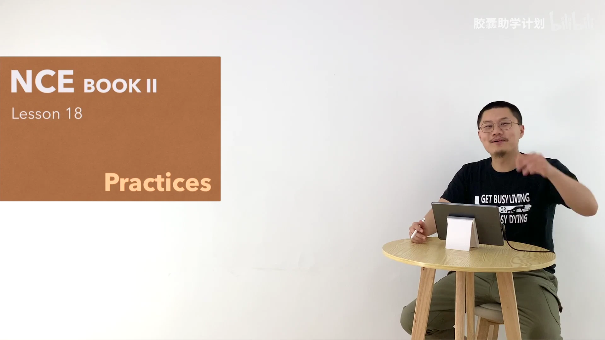

文字识别：胶囊助学计划 / NCE / BOOKII / Lesson 18 / Practices / GET BUSYLIVING / OR.IU / SY DYING

### 画面 00:00:02

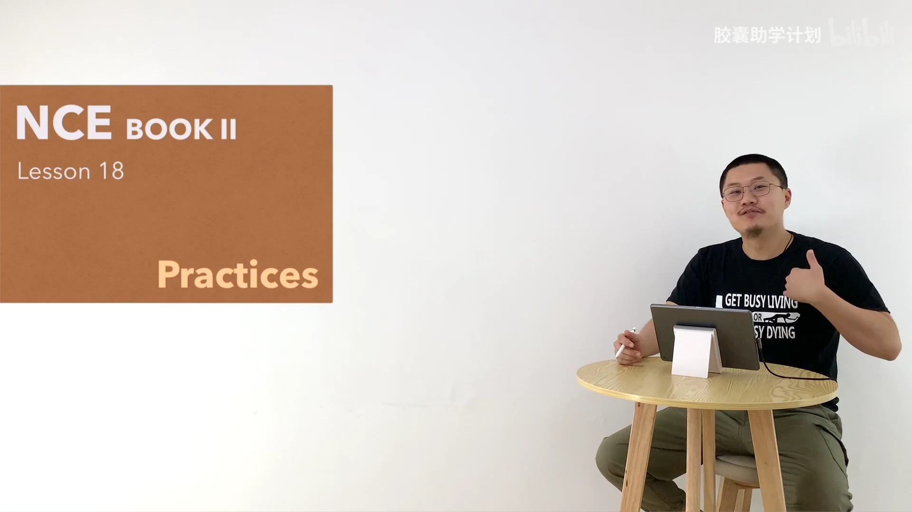

文字识别：胶囊助学计划 / NCE / BOOKII / Lesson 18 / Practices / GET BUSYLIVING / OR. / SYDYING

### 画面 00:00:05

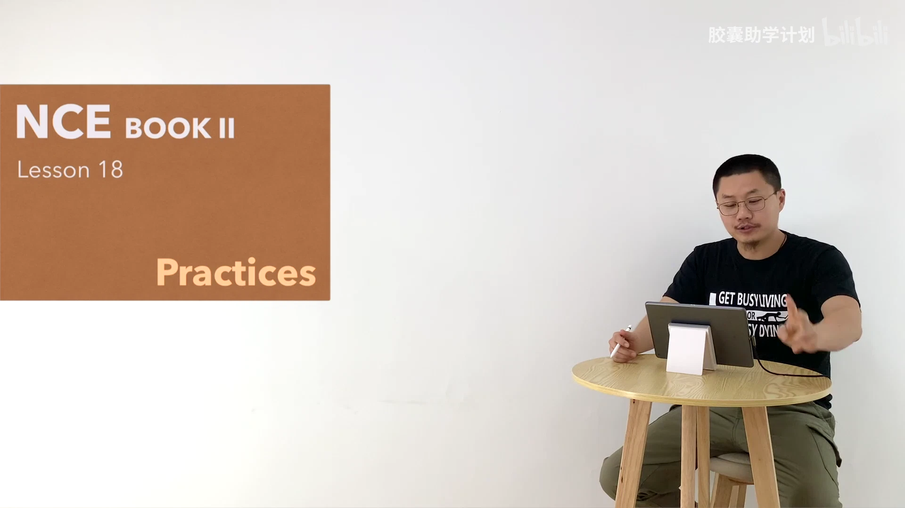

文字识别：胶囊助学计划 / NCE / BOOKI"I / Lesson 18 / Practices / GET BUSYUIVING / OR. / SYDYIN

### 画面 00:00:08

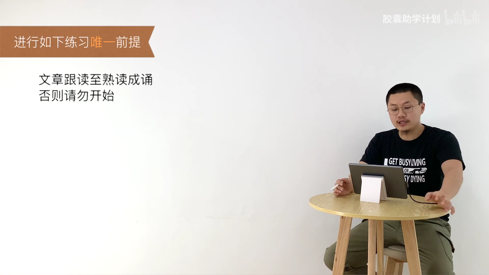

文字识别：胶囊助学计划 / 进行如下练习唯一前提 / 文章跟读至熟读成诵 / 否则请勿开始 / GET BUSYUVING / OR. / SYDYING

### 画面 00:00:13

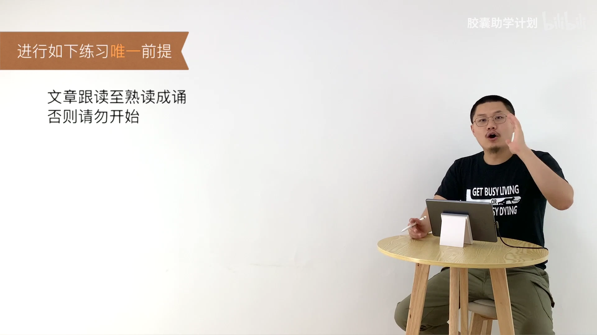

文字识别：胶囊助学计划 / 进行如下练习唯一前提 / 文章跟读至熟读成诵 / 否则请勿开始 / GET BUSYUIVING / OR / SYDYING

### 画面 00:00:18

文字识别：胶囊助学计划 bilbl / •

### 画面 00:00:22

### 画面 00:00:24

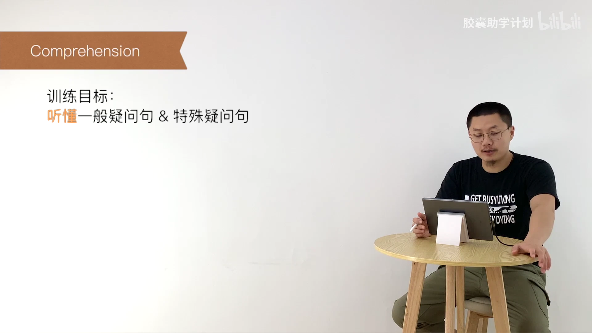

文字识别：胶囊助学计划 / Comprehension / 训练目标： / 听懂一般疑问句＆特殊疑问句 / GET RUSYUVING / ORAU / YDYING

### 画面 00:00:29

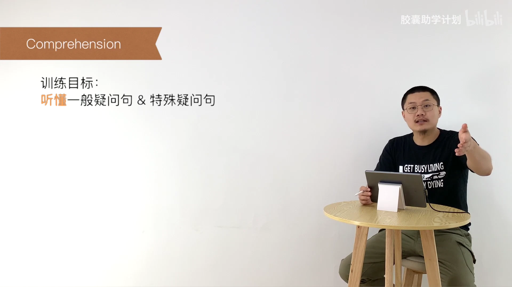

文字识别：胶囊助学计划 / Comprehension / 训练目标： / 听懂一般疑问句＆特殊疑问句 / GET BUSYLIVING / YDYING

## 00:00:30–00:01:00

么对吧？看着文章，要么完全脱离文章，但不要看这个地方。我们进行的是口语听力练习。来了，第一题。Where had you had lunch? Answer at a village pub. Next one. What did you do afterwards? 好，我提一下，afterwards叫做之后，就是吃完饭之后做了什么。I looked for my bag. Next one. Had you left it

### 画面 00:00:36

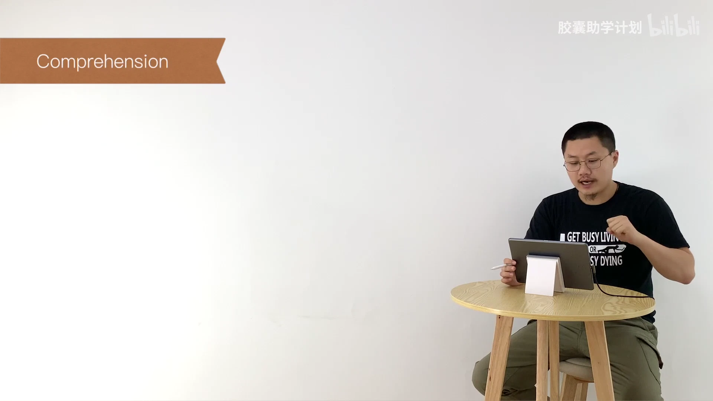

文字识别：胶囊助学计划 / Comprehension / GET BUSY LIVIN / OR. / SYDYING

### 画面 00:00:41

文字识别：胶囊助学计划 / Comprehension / Where had you had lunch? / 9 / GET BUSYLIVING / ORU / YDYING

### 画面 00:00:48

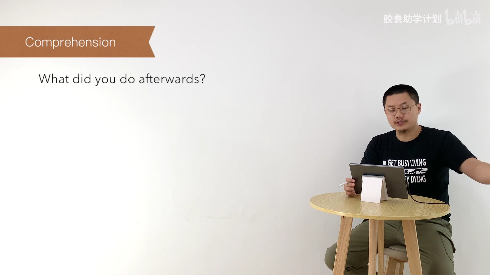

文字识别：胶囊助学计划 / Comprehension / What did you do afterwards? / GET BUSYLIVING / ORU / YDYING

### 画面 00:00:58

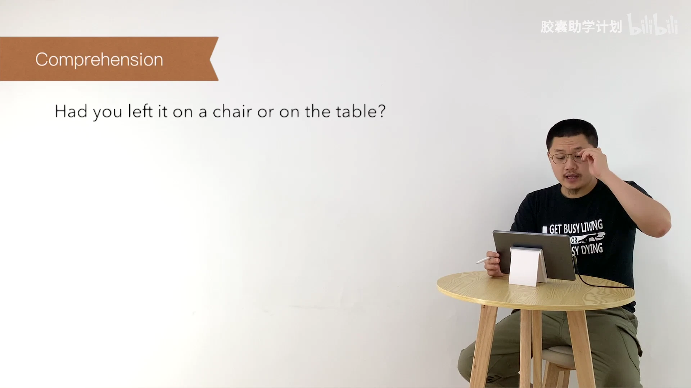

文字识别：胶囊助学计划 / Comprehension / Had you left it on a chair or on the table? / GET BUSY UVING / OR / SYDYING

## 00:01:00–00:01:30

on a chair or on the table? On a chair. Next one. Was it still there? Was it still there? No, it wasn't. Next one. Who came in as you were looking for it? The landlord. Next one. What did he ask you? Did you have a good meal? Next one. What did you reply? Reply,

### 画面 00:01:05

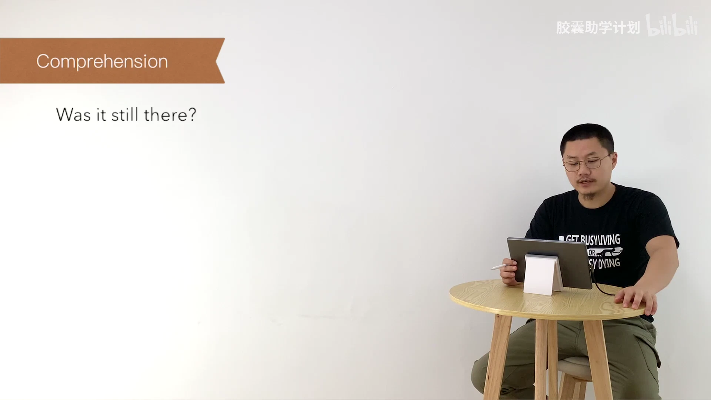

文字识别：胶囊助学计划 / Comprehension / Was it still there? / GET RUSYUIVING / OR / SYOVING

### 画面 00:01:17

文字识别：胶囊助学计划 / Comprehension / Who came in as you were looking for it? / The landlord did. / GET RUSYIVING / OR / SYOYING

### 画面 00:01:23

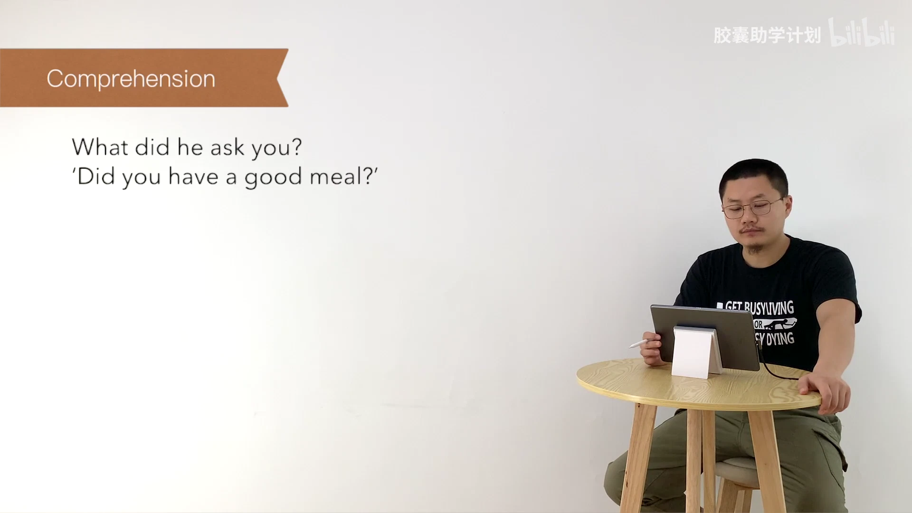

文字识别：胶囊助学计划 / Comprehension / What did he ask you? / 'Did you have a good meal?' / GET RUSYIVING / OR / SYOYING

### 画面 00:01:29

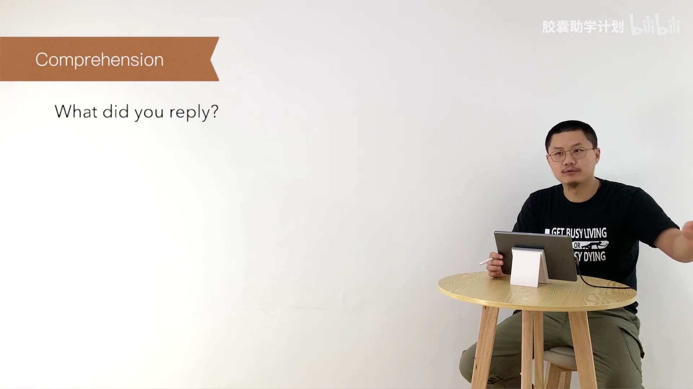

文字识别：胶囊助学计划 / Comprehension / What did you reply? / GET RUSYLIVING / OR.MU / SYDYING

## 00:01:30–00:02:00

回答，对吧？回复。Yes, thank you. Did you say you couldn't pay the bill? Yes, I did. Next one. Why couldn't you? Ah, pay the bill. I haven't got my bag. Next one. The landlord smiled, didn't he? Yes, he did. Next one. What did he do then? He went out

### 画面 00:01:35

文字识别：胶囊助学计划 / Comprehension / Did you say you couldn't pay the bill? / GET RUSYIVING / OR / SYDYING

### 画面 00:01:45

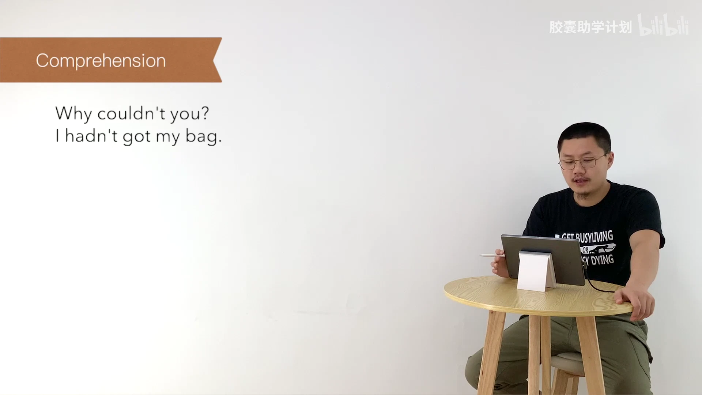

文字识别：胶囊助学计划 / Comprehension / Why couldn't you? / I hadn't got my bag. / Q / CETRUSYIVING / OR / SYDYING

## 00:02:00–00:02:30

immediately. How soon did he return? In a few minutes. 完。 What did he give back to you? My bag. Who had taken your bag? His dog. Very good. 好，接下来 asking questions，还是口语听力练习，对吧？好，我给大家肯定句，各位变一般疑问句

### 画面 00:02:15

文字识别：胶囊助学计划 / Comprehension / Who had taken your bag? / CET BUSYIVING / OR / SYDYING

### 画面 00:02:21

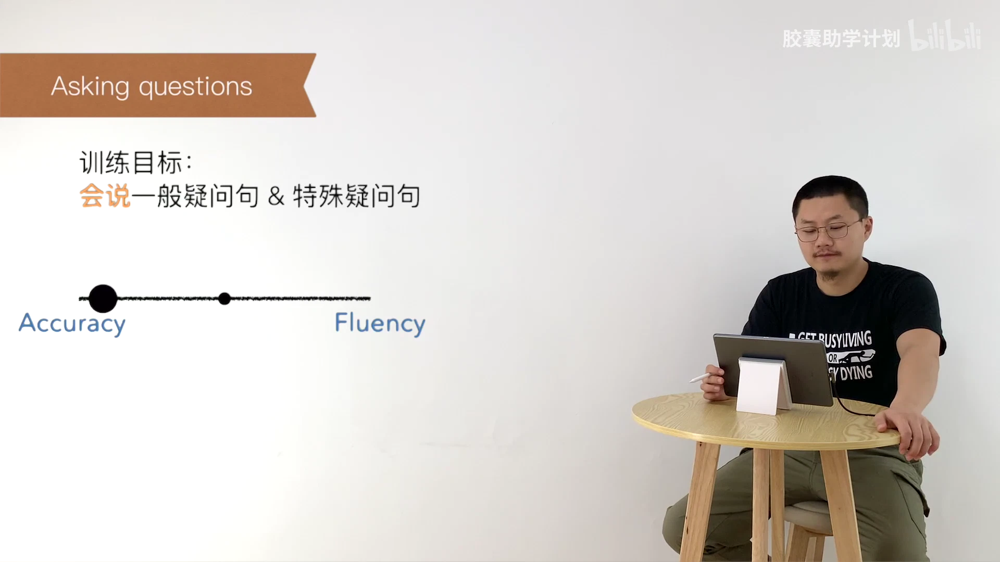

文字识别：胶囊助学计划 / Asking questions / 训练目标： / 会说一般疑问句＆特殊疑问句 / Accuracy / Fluency / CETBUSYIVING / OR / SYDYING

## 00:02:30–00:03:00

特殊疑问句啊，这个是我们练习的是 accuracy，就是可以慢，不能错啊。OK，那我们先给第一个例子，I had had lunch at a village pub，很简单，过去完成时把 had 提前就可以了，对吧？然后 where 对 at a village pub 提问，于是答问题就是 where had you had lunch？你之前在什么地方吃的饭？完全可以换成 where did you have lunch？啊，没有问题啊。好，接下来呢，我们基本上就

### 画面 00:02:35

文字识别：胶囊助学计划 / Asking questions / T: Ask me if I had had lunch at a village pub. / CET USYUIVING / OR / SYDYING

### 画面 00:02:46

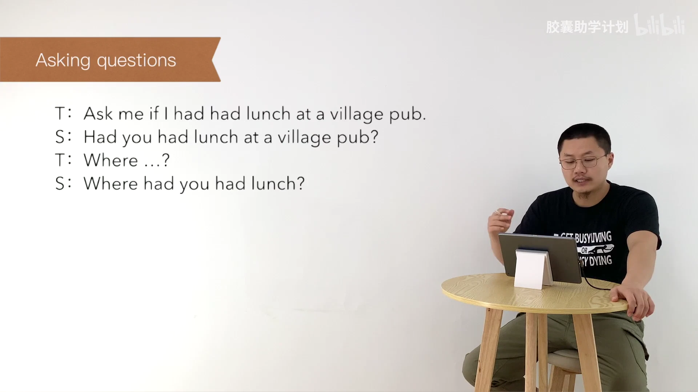

文字识别：胶囊助学计划 / Asking questions / T: Ask me if I had had lunch at a village pub. / S: Had you had lunch at a village pub? / T:Where ….? / S: Where had you had lunch? / CFTBUSYIVING / OR / SYDYING

### 画面 00:02:57

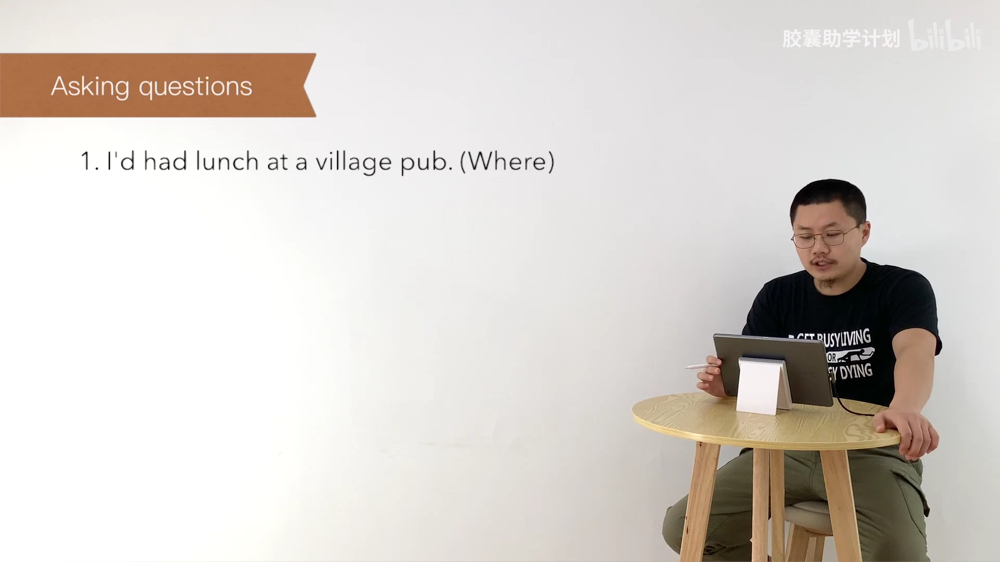

文字识别：胶囊助学计划 / Asking questions / 1.I'd had lunch at a village pub. (Where) /  CT DUSYUIVING / OR / SYDYING

### 画面 00:02:59

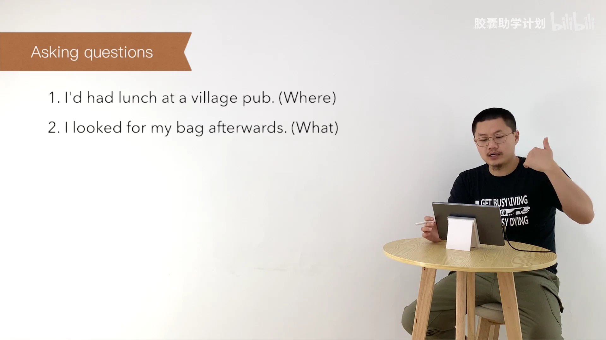

文字识别：胶囊助学计划 / Asking questions / 1.I'd had lunch at a village pub. (Where) / 2.I looked for my bag afterwards. (What) / GET BUSYLIVING / OR. / SYDYING

## 00:03:00–00:03:30

是给大家说一下思路，您课下要做的事情，把它一定要写下来，因为写下来是最能保证正确率的，对吧？然后再给自己大声朗读出来啊，别嫌别不要不要这个说嫌麻烦，对吧？就不写了，直接张嘴说。您张嘴说的时候非常容易，比如说这个地方应该换原形，但你意识不到，你写下来你才能意识到，对吧？比如说 did 提前换原形，对吧？What 肯定是对 my back 提问啊，

### 画面 00:03:21

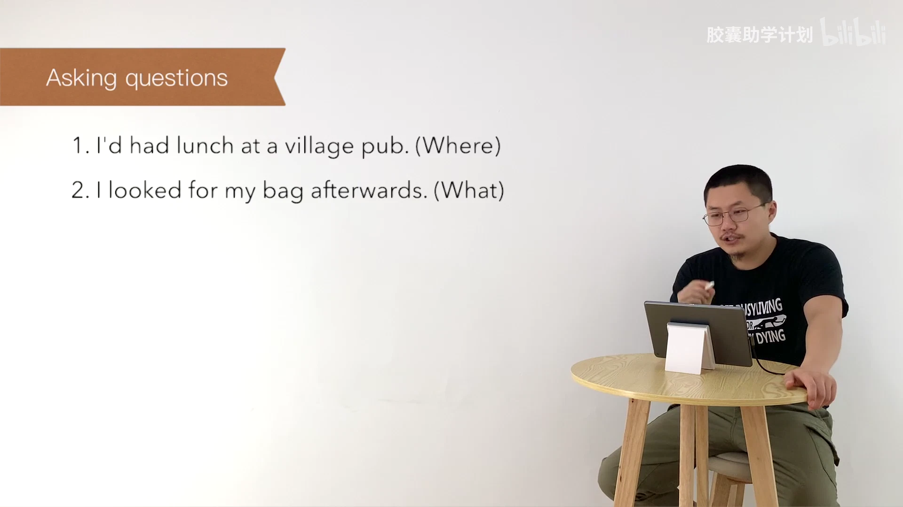

文字识别：胶囊助学计划 / Asking questions / 1.I'd had lunch at a village pub. (Where) / 2.I looked for my bag afterwards. (What) / "USYUIVNG / DYING

## 00:03:30–00:04:00

这个地方的撇地注意，它有两种可能性是 would 或 had，你要由后边的动词和整个句子的含义去决定。后边的动词如果是过去分词而不是原形，那这儿肯定就是 had，所以一般疑问句是把 had 提前就可以了，对吧？那 where 对 on a chair 提问， what 对 it 提问，对吧？ It 指的就是那个 the bag。 Next one， the chair was beside the door， was 提前， where 对

### 画面 00:03:51

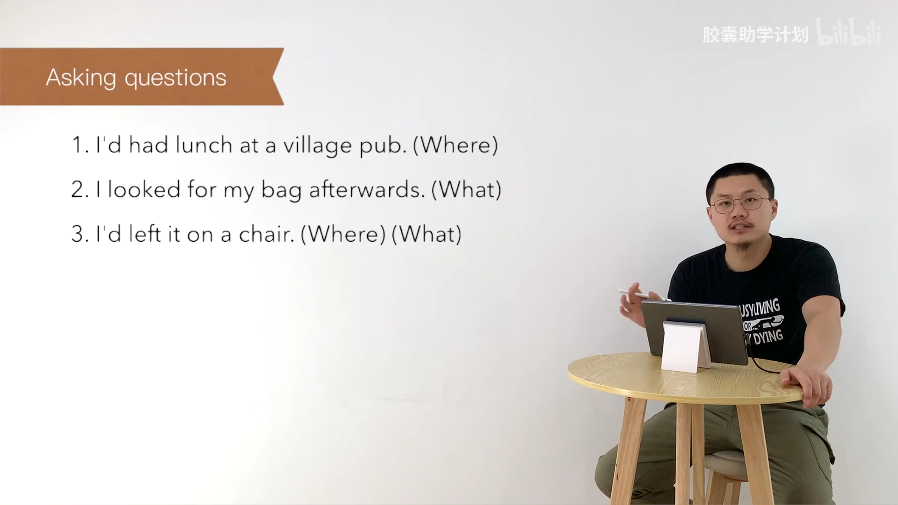

文字识别：胶囊助学计划 / Asking questions / 1.I'd had lunch at a village pub. (Where) / 2.I looked for my bag afterwards. (What) / 3.I'd left it on a chair. (Where) (What) / USYIVING / OR / YDYING

## 00:04:00–00:04:30

beside the door提问答案Where was the chair? The bag had gone had提前对吧What对the bag主语提问What had gone什么没了Where直接加整句就可以了。当然这个整句是一般疑问句的整句啊，而不是肯定句的整句，这个要注意。The landlord came in as I was looking for it. 好，注意这儿有一个小的问题了，就是你看这儿有一个came，这儿有一个was

### 画面 00:04:03

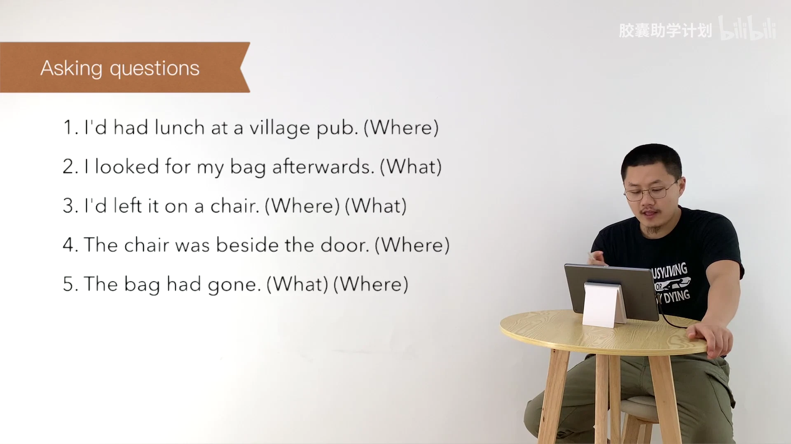

文字识别：胶囊助学计划 / Asking questions / 1.I'd had lunch at a village pub. (Where) / 2.Ilooked for my bag afterwards. (What) / 3.I'd left it on a chair. (Where) (What) / 4.The chair was beside the door. (Where) / USYIVNG / 5. The bag had gone. (What) (Where) / OR / YDYING

## 00:04:30–00:05:00

looking。那我是提 did 还是提 was 呢？永远看主句，不看从句。这个地方 as 引导的是从句，对吧？所以不看它，只看 came。所以把 did 提前，剩下照抄。我给大家说一下答案，叫做 did the landlord come in？换原形 as you were looking for it。人称要变，对吧？你不能说 as I was looking for it。好，那 who 就对主语提问，直接替代就可以了，叫做

### 画面 00:04:33

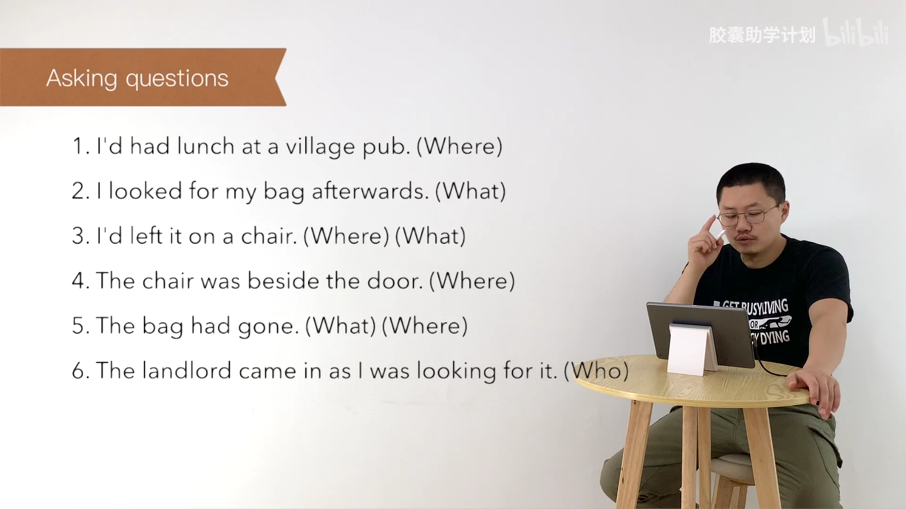

文字识别：胶囊助学计划 / Asking questions / 1.I'd had lunch at a village pub. (Where) / 2.I looked for my bag afterwards. (What) / 3.I'd left it on a chair. (Where) (What) / 4. The chair was beside the door. (Where) / GETRUSYIVING / 5. The bag had gone. (What) (Where) / OR / SYDYING / 6. The landlord came in as I was looking for it. (Who)

### 画面 00:04:45

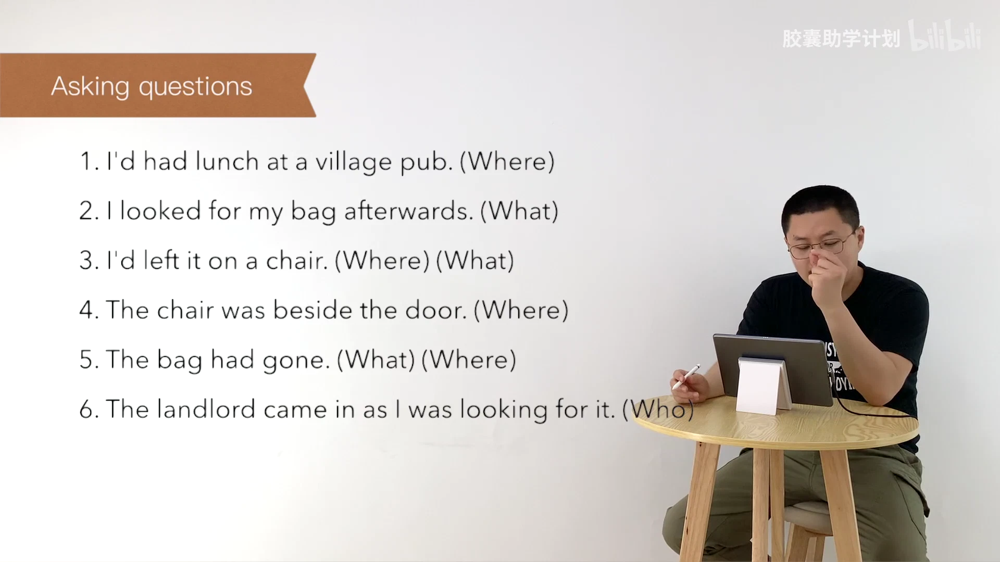

文字识别：胶囊助学计划 / Asking questions / 1.I'd had lunch at a village pub. (Where) / 2.Ilooked for my bag afterwards. (What) / 3.I'd left it on a chair. (Where) (What) / 4. The chair was beside the door. (Where) / 5. The bag had gone. (What) (Where) / 6. The landlord came in as I was looking for it. (Who)

## 00:05:00–00:05:30

Who came in as you were looking for it? 非常简单。第七个 had 提前 What kind of? 我们讲过很多遍了，往往就是对形容词提问，把形容词去掉，带着名词一起提前就行了。所以它是对 good 的提问，把 good 去掉，变成了 What kind of meal had you had? 对吧？OK。第八个 I couldn't pay the bill. 变一般疑问句，您先把它变成肯定句 I

### 画面 00:05:15

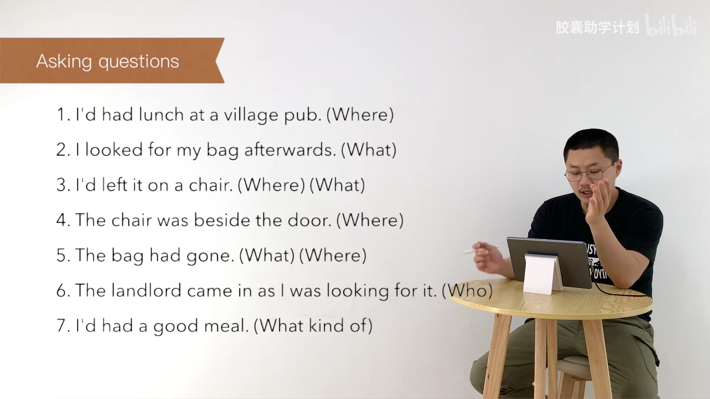

文字识别：胶囊助学计划 / Asking questions / 1.I'd had lunch at a village pub. (Where) / 2.I looked for my bag afterwards. (What) / 3.I'd left it on a chair. (Where) (What) / 4.The chair was beside the door. (Where) / 5. The bag had gone. (What) (Where) / 6. The landlord came in as I was looking for it. (Who) / 7.I'd had a good meal. (What kind of)

### 画面 00:05:24

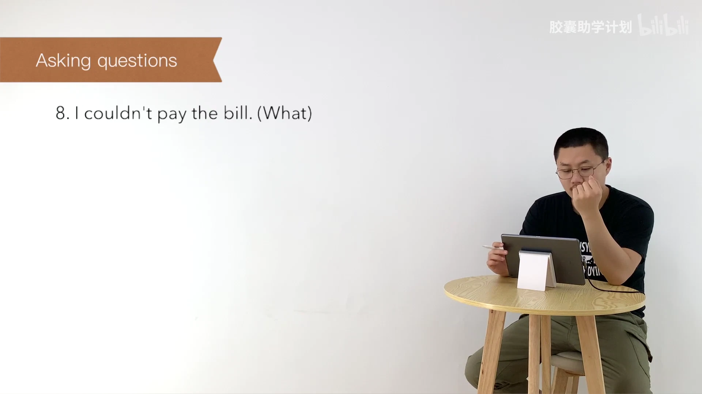

文字识别：胶囊助学计划 / Asking questions / 8.I couldn't pay the bill.(What)

## 00:05:30–00:06:00

could pay the bill. 然后 could you pay the bill, 对吧？然后 what 是对 the bill 提问，能支付得起什么？那注意这个地方不是 what could you pay，你能支付什么？他问的是你不能支付什么，所以叫做 what couldn't you pay? Okay, 这个我们之前也见过很多遍了啊。 I'd lost my bag, had 提前 what 对 my bag 提问 where 对整句提问，不多说了。 The landlord smiled, did 提前 what did I

### 画面 00:05:54

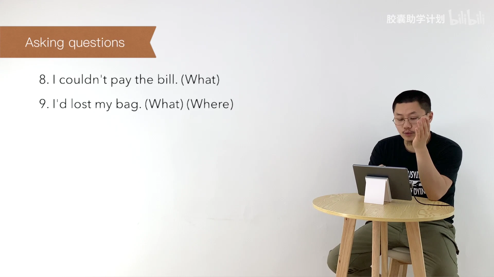

文字识别：胶囊助学计划 / Asking questions / 8.I couldn't pay the bill.(What) / 9.I'd lost my bag. (What) (Where) / USVI

## 00:06:00–00:06:30

do我们也讲过很多遍，它出现就是标准答案由时态确定，这是一般过去时，所以答案就是What did the landlord do?没有别的说法了。OK，好说He went out immediately.你看what点儿点儿点儿do啊？答案就是统一的What did he do?您最多再加一个单词immediately就可以了，对吧？它是对动词提问的What点儿点儿do？问他做了什么，对不对？那互对主语提

### 画面 00:06:12

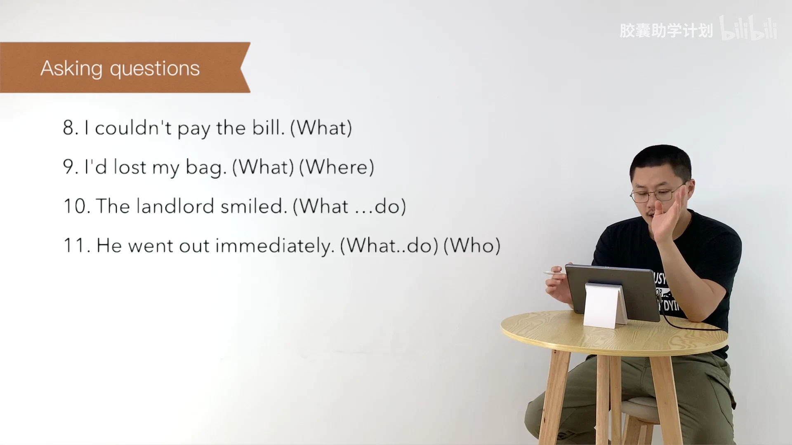

文字识别：胶囊助学计划 / Asking questions / 8.I couldn't pay the bill.(What) / 9.I'd lost my bag.(What) (Where) / 10. The landlord smiled.(What ...do) / 11.He went out immediately. (What..do)(Who)

## 00:06:30–00:07:00

问直接替代，别变一般疑问句就好了。十二题 who was away for a few minutes was 提前 how long 对 for a few minutes 提问对吧？ How long was he away？啊，离开了多长时间？ He returned with my bag did 提前 what 对 my bag 提问 who 对主语提问 who returned with your bag 就可以了，对吧？而一个 tell the story 可以有错误，对吧？各位一定要注意啊，

### 画面 00:06:32

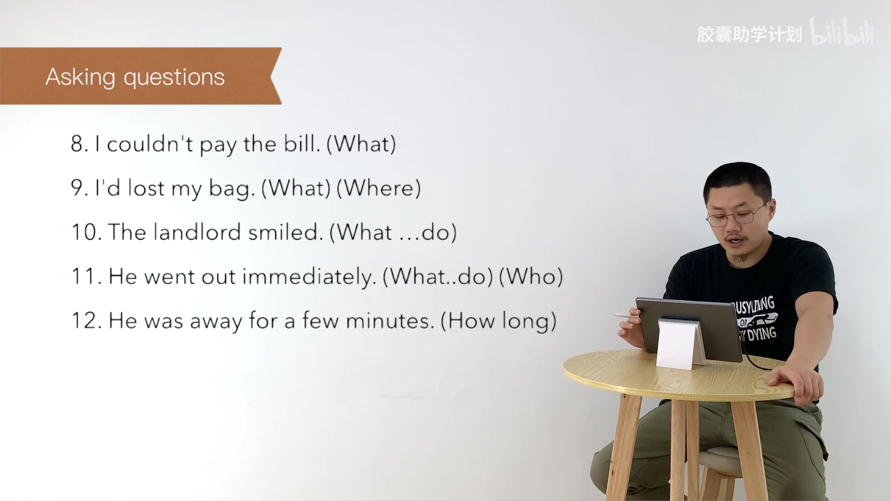

文字识别：胶囊助学计划 / Asking questions / 8.I couldn't pay the bill.(What) / 9.I'd lost my bag. (What) (Where) / 10. The landlord smiled. (What ..do) / 11.He went out immediately. (What..do) (Who) / USYUING / 12. He was away for a few minutes. (How long) / OR / TDYING

### 画面 00:06:54

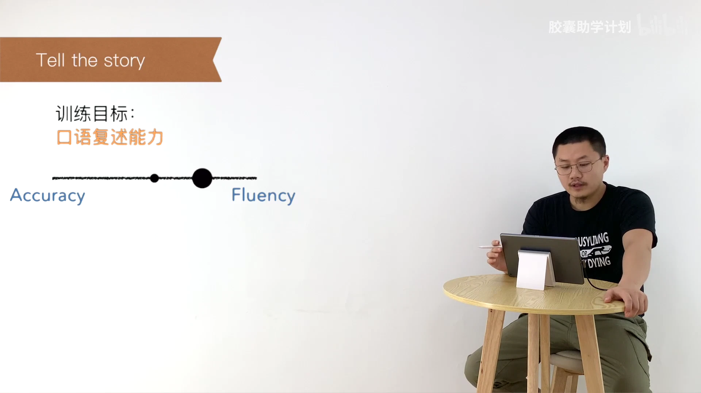

文字识别：胶囊助学计划 / Tell the story / 训练目标： / 口语复述能力 / Accuracy / Fluency / USYUING / OR / YDYING

## 00:07:00–00:07:30

实际应用和考试的区别在于，实际应用您有错误没事儿不用太担心，只要不影响两个人沟通，有错误没有问题。而我们国内的考试呢，它是一种相对来说大多数是那种挑错性的考试，就是你只要有错你就受惩罚。所以各位特别怕犯错，这个练习就是教各位不要怕犯错的那个练习。但是你要流畅，但前提你也不能错的太离谱，对吧？所以文章要读到足够熟。

### 画面 00:07:07

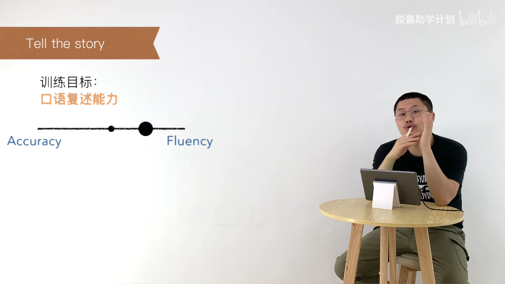

文字识别：胶囊助学计划 / Tell the story / 训练目标： / 口语复述能力 / Accuracy / Fluency / M

### 画面 00:07:26

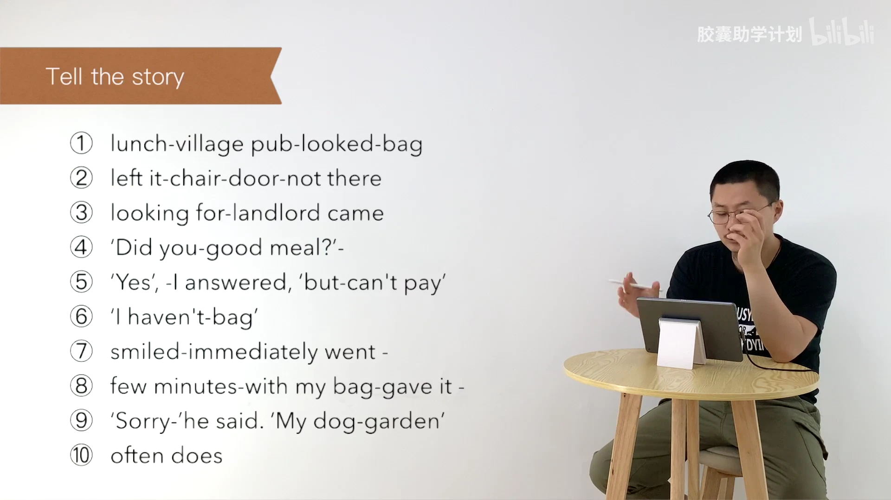

文字识别：胶囊助学计划 / Tell the story /  lunch-village pub-looked-bag / 1 / left it-chair-door-not there /  looking for-landlord came / 'Did you-good meal?'- / 'Yes', -I answered, 'but-can't pay' / 'I haven't-bag' / USY / smiled-immediately went - / few minutes-with my bag-gave it - / 'Sorry-'he said.'My dog-garden' / 9 / 1① often does

## 00:07:30–00:08:00

呃，我给大家做一个示范。After I had lunch at a village pub, I looked for my bag. I left it on a chair beside the door, but it wasn't there anymore. Ah, when I was looking for it, the landlord came in. Did you have a good meal? He asked. Yes, I answered. But I can't pay the bill. I haven't got my bag. He smiled and immediately went out. In a few minutes, he returned with my bag and gave

### 画面 00:07:56

文字识别：胶囊助学计划 / Tell the story /  lunch-village pub-looked-bag / 1 / left it-chair-door-not there /  looking for-landlord came / 'Did you-good meal?'- / 'Yes', -I answered, 'but-can't pay' / 'I haven't-bag' / VSYU / smiled-immediately went - / few minutes-with my bag-gave it - / 'Sorry-'he said.'My dog-garden' / 9 / 1① often does

## 00:08:00–00:08:30

it to me. I'm sorry, he said. My dog took it into the garden, and he often does this. Very good. Ah,各位，你把我刚才说的那段跟文章一一对应的去看，一定有很多跟它是不一样的，但不一定是错误啊。我可能是换了个时态，比如说把过去完成时换成了一般过去时。OK，好，接下来 summary writing 对于各位来说非常重要的一个写作能力。那我们在这儿，您各位自己对一下答案就好了啊。叫摘要写作，课后都有，我

### 画面 00:08:08

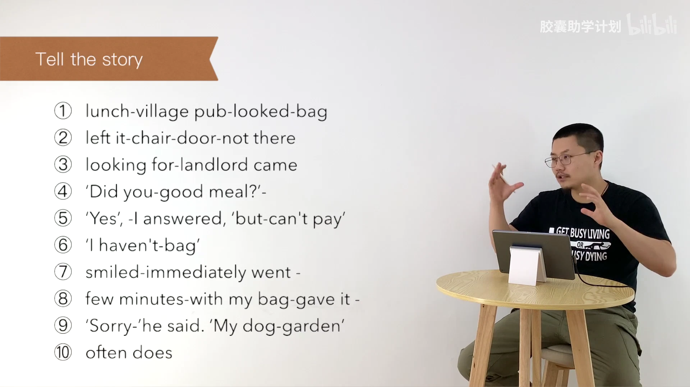

文字识别：胶囊助学计划 / Tell the story / ) lunch-village pub-looked-bag / 1 / left it-chair-door-not there /  looking for-landlord came / 'Did you-good meal?'- / 'Yes', -I answered, 'but-can't pay' / GETBUSYLIVING / 'I haven't-bag' / OR / SYDYING / smiled-immediately went - / few minutes-with my bag-gave it - / 'Sorry-'he said.'My dog-garden' / 9 / 1① often does

### 画面 00:08:20

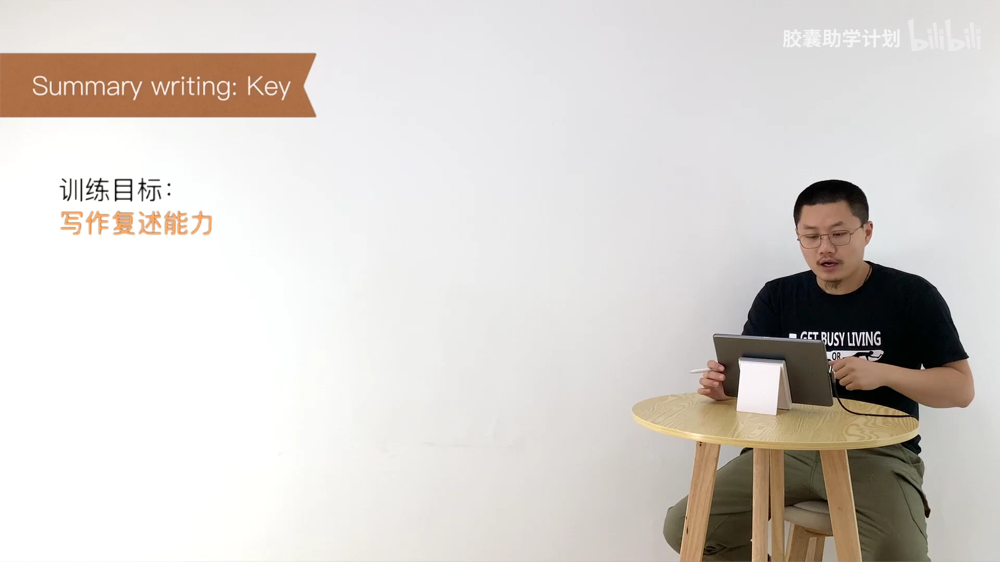

文字识别：胶囊助学计划 / Summary writing: Key / 训练目标： / 写作复述能力 /  GET BUSY LIVING / OR

### 画面 00:08:22

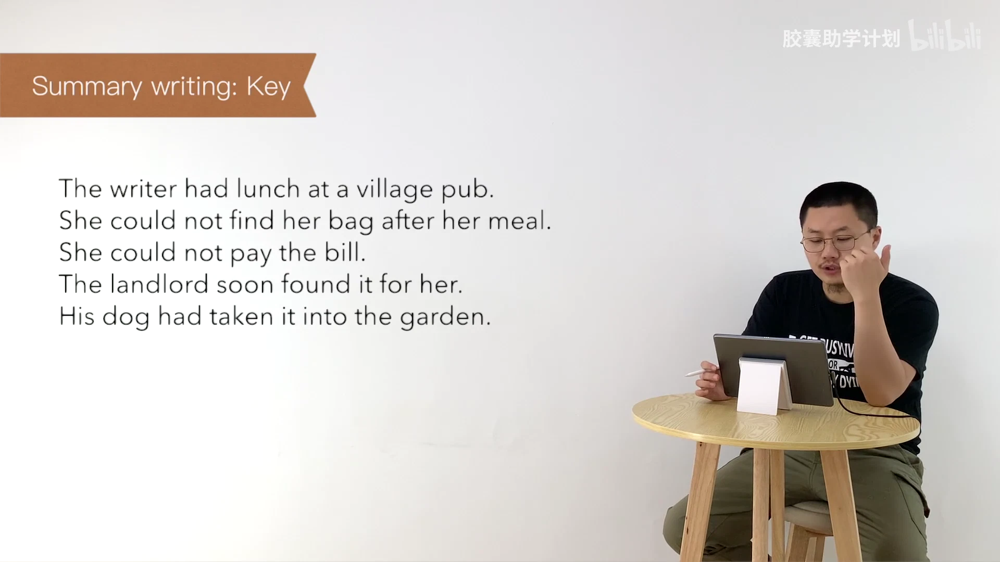

文字识别：胶囊助学计划 / Summary writing: Key / The writer had lunch at a village pub. / She could not find her bag after her meal. / She could not pay the bill. / The landlord soon found it for her. / His dog had taken it into the garden. / USWIV / OR / oVI

### 画面 00:08:26

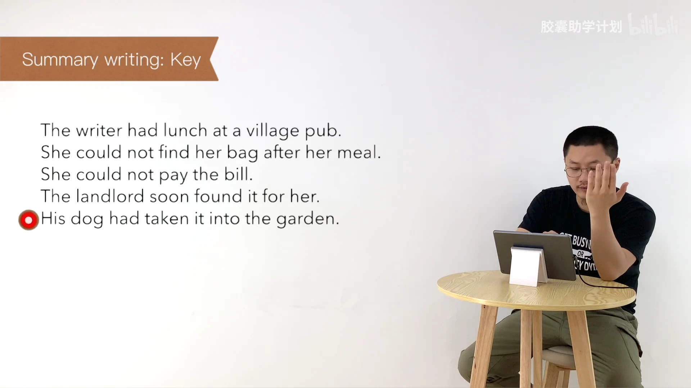

文字识别：胶囊助学计划 / Summary writing: Key / The writer had lunch at a village pub. / She could not find her bag after her meal. / She could not pay the bill. / The landlord soon found it for her. / His dog had taken it into the garden. / BUSW / OR / YOV

### 画面 00:08:29

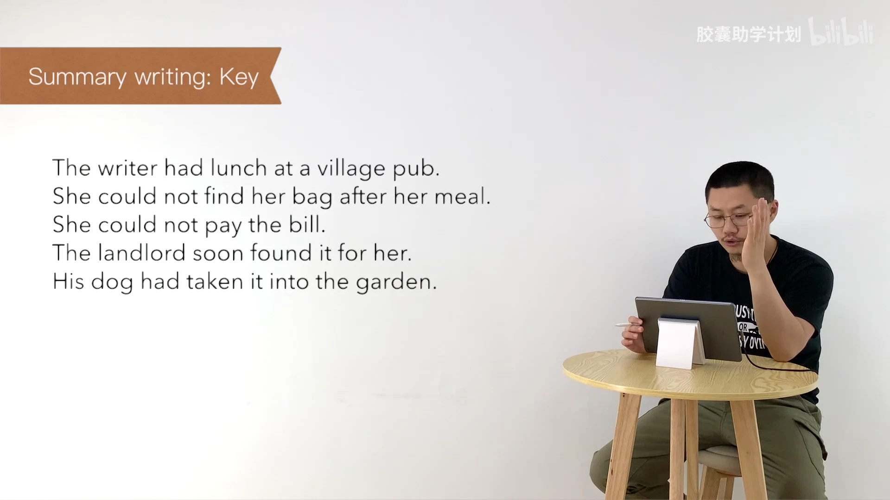

文字识别：胶囊助学计划 / Summary writing: Key / The writer had lunch at a village pub. / She could not find her bag after her meal. / She could not pay the bill. / The landlord soon found it for her. / His dog had taken it into the garden. / USYT

## 00:08:30–00:09:00

们不多提了。完全自由的对话，topic for discussion，很多这里边的题直接就是雅思托福这种真题的口语啊，几乎就是一个难度级别的，是吧？好，我们在这儿还是目前只能跟大家做的事情，就是翻译一下，您感兴趣自己说一下来了啊。Have you ever lost any money?丢过钱吗？If so,如果丢过，tell us what happened.告诉我们发生了什么，就讲一个故事嘛，对吧？Describe the best meal you ever

### 画面 00:08:31

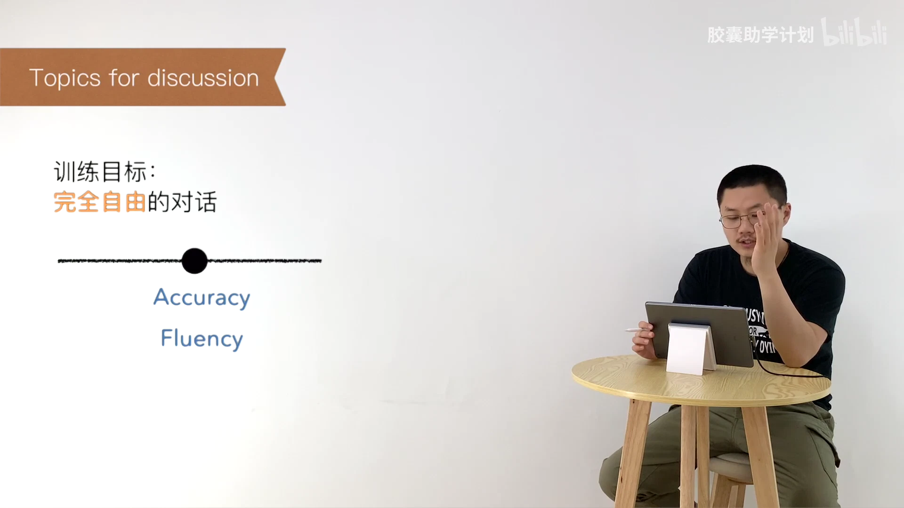

文字识别：胶囊助学计划 / Topics for discussion / 训练目标： / 完全自由的对话 / Accuracy / USY / Fluency

### 画面 00:08:34

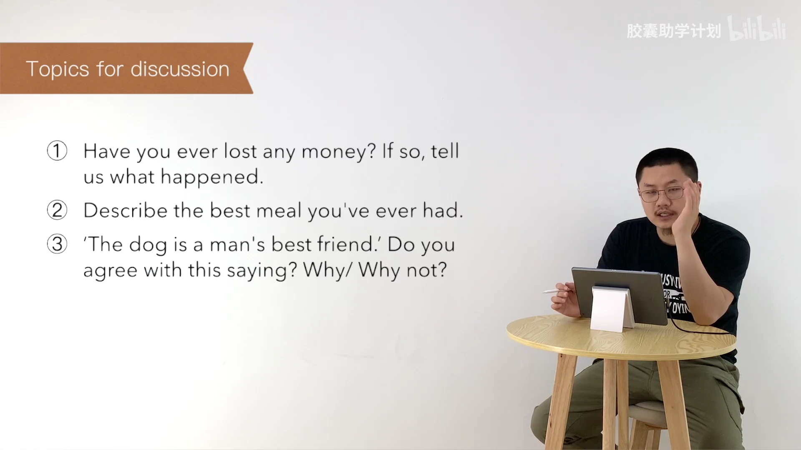

文字识别：胶囊助学计划 / Topics for discussion / Have you ever lost any money? If so, tell / us what happened. / Describe the best meal you've ever had. / 'The dog is a man's best friend.' Do you / 3 / agree with this saying? Why/ Why not? / USWT

### 画面 00:08:43

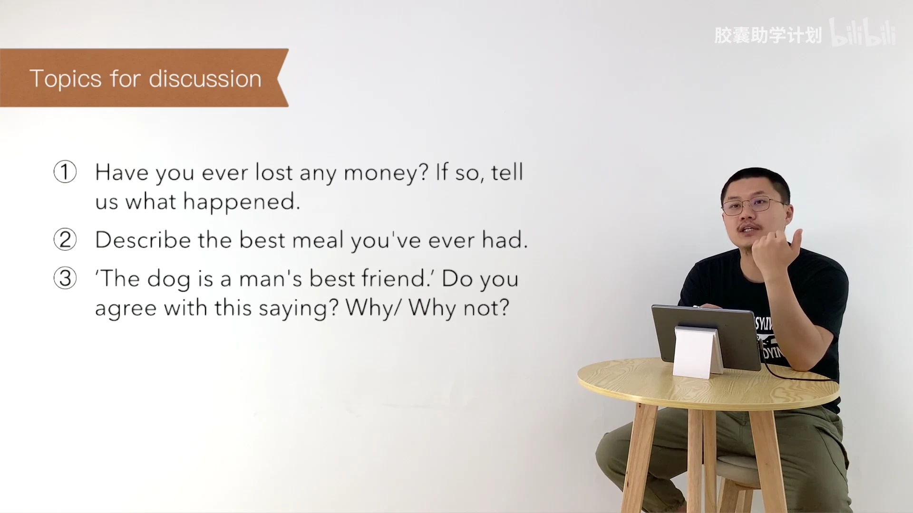

文字识别：胶囊助学计划 / Topics for discussion / Have you ever lost any money? If so, tell / us what happened. / Describe the best meal you've ever had. / 'The dog is a man's best friend.' Do you / 3 / agree with this saying? Why/ Why not?

### 画面 00:08:54

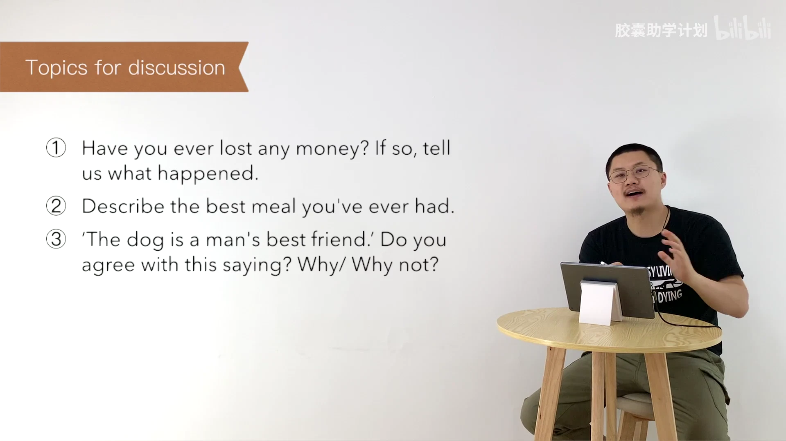

文字识别：胶囊助学计划 / Topics for discussion / Have you ever lost any money? If so, tell / us what happened. / Describe the best meal you've ever had. / 'The dog is a man's best friend' Do you / 3 / agree with this saying? Why/ Why not? / SYUV / DYING

## 00:09:00–00:09:30

had. 描述你吃过最好的一顿饭啊，描述就好了。 The dog is a man's best friend. 说狗是人类最好的朋友。 Do you agree with this saying? Why? Why not? 说你赞同这个说法吗？赞同为什么赞同？不赞同为什么不赞同啊？这道题就非常典型，像口语哎，像这个雅思我考过的这个雅思托福的这个口语真题了，而且也真的特别像你出国之后跟外国人聊天儿，对

### 画面 00:09:24

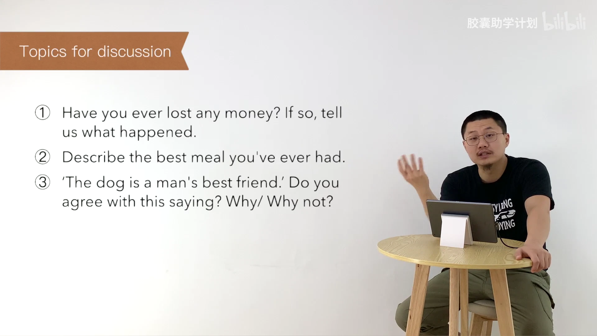

文字识别：胶囊助学计划 / Topics for discussion / Have you ever lost any money? If so, tell / us what happened. / Describe the best meal you've ever had. / 'The dog is a man's best friend.' Do you / 3 / agree with this saying? Why/ Why not? / YLING / VING

## 00:09:30–00:10:00

啊，你比如说，哎，我最近啊，我印象当中，我去新西兰跟我的这个一个朋友吧，各位可以理解为奥克兰人是吧，白人聊天儿，那我们就讲到他在他院子里边种豆子是吧？怎么种豆子的这件事儿啊，应该怎么种？然后又聊到了书，比如说马基雅维利的这个《君主论》是吧？我说我最近读这个书，然后他说为什么读啊？为什么不应该读啊？这个他有什么好的地方，什么不好的地方？其实跟这道题已经非常非常的像了。就看到这道题，就让我想起来

### 画面 00:09:54

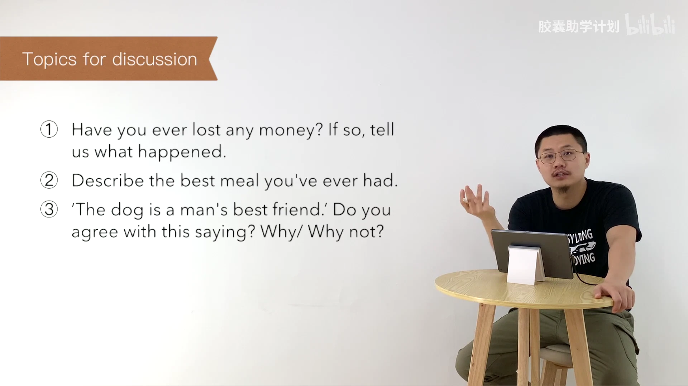

文字识别：胶囊助学计划 / Topics for discussion / Have you ever lost any money? If so, tell / us what happened. / Describe the best meal you've ever had. / 'The dog is a man's best friend' Do you / 3 / agree with this saying? Why/ Why not? / SYLING / DYING

## 00:10:00–00:10:30

我在奥克兰期间跟那些我们所谓的白人也好，毛利人也好，就是英语为母语的人吧，对吧？包括从小在那长大的亚裔去用英语聊天的时候的感受，几乎是一模一样的。就是随便一个话题，两个人就展开去聊了，对吧？OK，好，那家庭作业，ask me if先写，大声朗读，摘要写作先写，再对答案，tell the story文章读熟，然后口语复述，最后专栏当中都可以找得到。以上呢就

### 画面 00:10:18

文字识别：胶囊助学计划 / -BUSYLING / OR / YDVING

### 画面 00:10:20

文字识别：胶囊助学计划 / 1.Ask me if写&朗读 / USYVING / OR.S / YDYING

### 画面 00:10:22

文字识别：胶囊助学计划 / 1.Askme if写&朗读 / 摘要写作写&答案 / 3.Tell the story 口语复述 / PUSYLANG / OR / SYDYING

### 画面 00:10:25

文字识别：胶囊助学计划 / 1.Ask me if写&朗读 / 摘要写作写&答案 / 3.Tell the story 口语复述 / FUSYVING / OR / YDYING

### 画面 00:10:27

文字识别：胶囊助学计划 / 1.Ask me if写&朗读 / 摘要写作写&答案 / 3.Tell the story 口语复述 / 专栏 / 4. / USYLING / OR / YDYING

### 画面 00:10:29

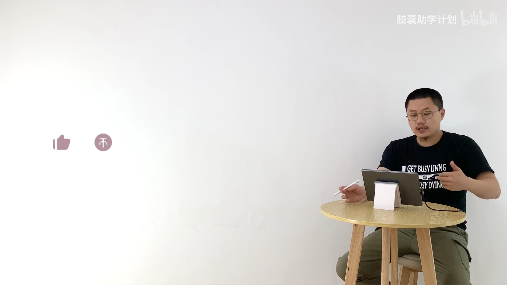

文字识别：胶囊助学计划 / GET BUSYLIVING / OR / VSYDYINU

## 00:10:30–00:10:50

是本期视频的全部内容了。如果大家喜欢我们的课程，欢迎大家关注、订阅、一键三连。See you next time.

### 画面 00:10:32

文字识别：胶囊助学计划 / GFT BUSY LIVING / OR.N / SY DYING

### 画面 00:10:34

文字识别：胶囊助学计划 / GETBUSYLIVING / OR / WSY DYING

### 画面 00:10:38

### 画面 00:10:40

文字识别：CAPSULEACADEMY / 胶囊助学计划 / 小红书 / Lecturer / Leo / OE

### 画面 00:10:42

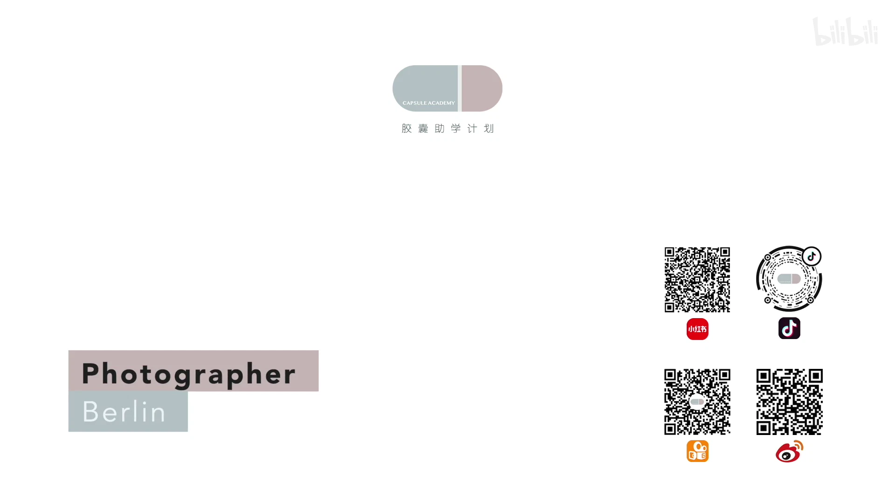

文字识别：CAPSULEACADEMY / 胶囊助学计划 / 小红书 / Photographer / Berlin / OE

### 画面 00:10:44

文字识别：CAPSULEACADEMY / 胶囊助学计划 / 小红书 / Editor / □ / Berlin / OE

### 画面 00:10:47

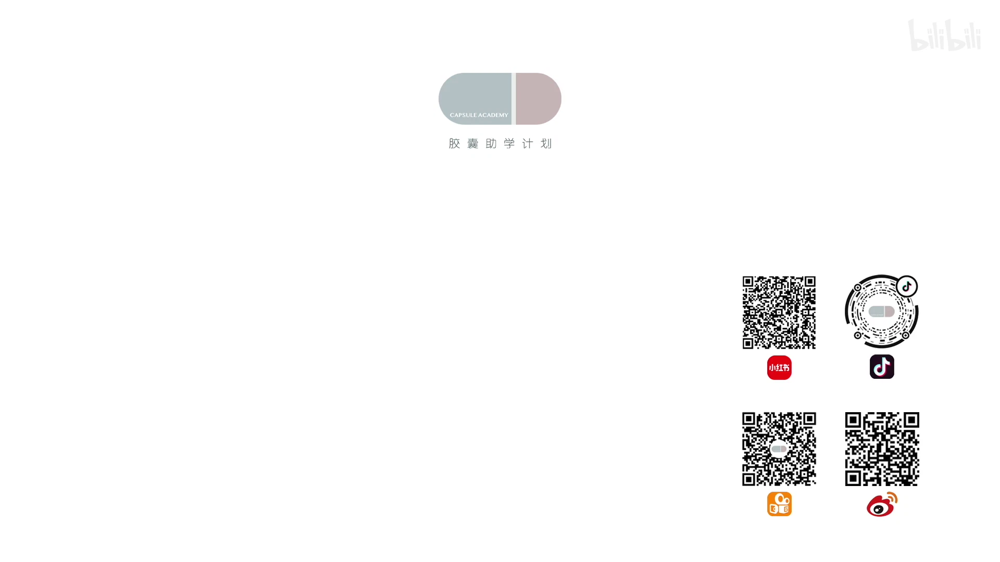

文字识别：CAPSULEACADEMY / 胶囊助学计划 / 小红书

### 画面 00:10:49

文字识别：bilibili / 胶囊助学计划

