# L019 单词

快速机器解析：语音为单模型转写，未进行独立交叉校对或人工复核；画面每秒采样并按变化选帧，短时文字和标记可能遗漏。截图时间约有 1 秒误差。图片有损压缩；遇到疑点请按时间查看 Google Drive 原视频。

## 00:00:00–00:00:30

Hello everyone, welcome to Capsule Academy. This is Leo. Today we're going to learn New Concept English Book Two Lesson Nineteen Words.那老习惯进入正式课程之前呢，我们看几个问题。第一，如何表达匆忙去某地？第二，如何表达很遗憾？第三，最后一个问题，如何表达别冲我喊？那带着这三个问题，Hope you guys enjoy.好，那我们先看第一个小的单词啊，两个音节，

### 画面 00:00:00

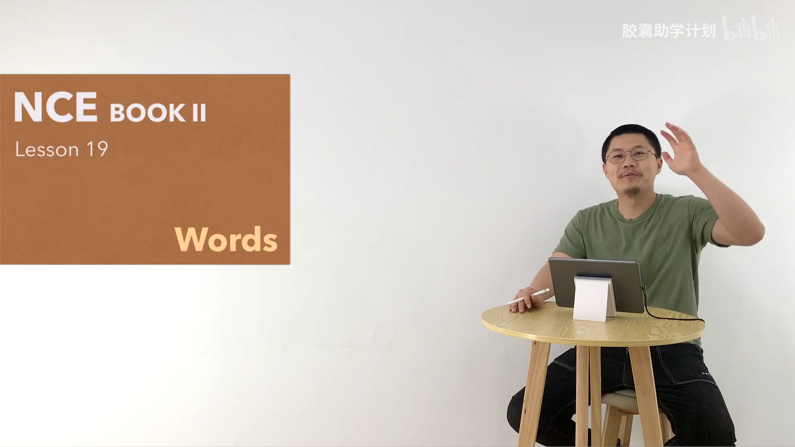

文字识别：胶囊助学计划 / NCE / BOOKⅡI / Lesson 19 / Words

### 画面 00:00:02

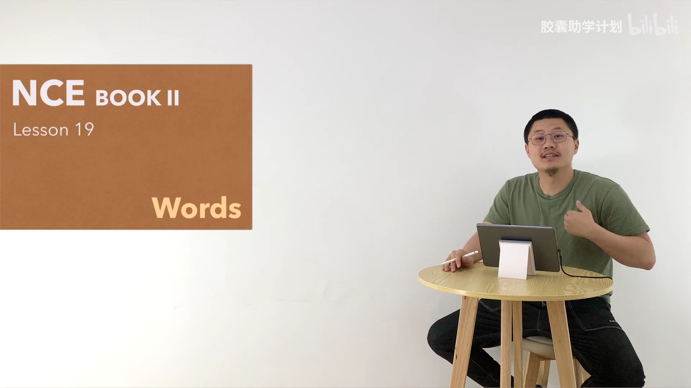

文字识别：胶囊助学计划 / NCE / BOOK"I / Lesson 19 / Words

### 画面 00:00:05

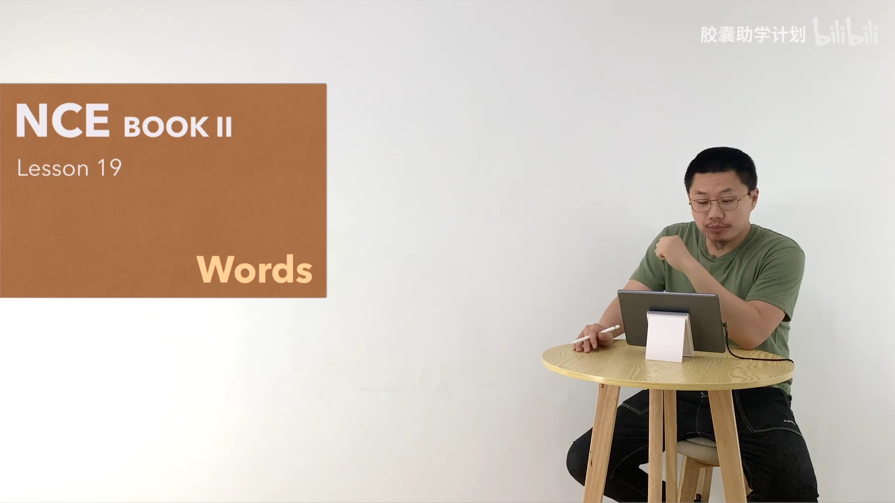

文字识别：胶囊助学计划 / NCE / BOOKI"I / Lesson 19 / Words

### 画面 00:00:09

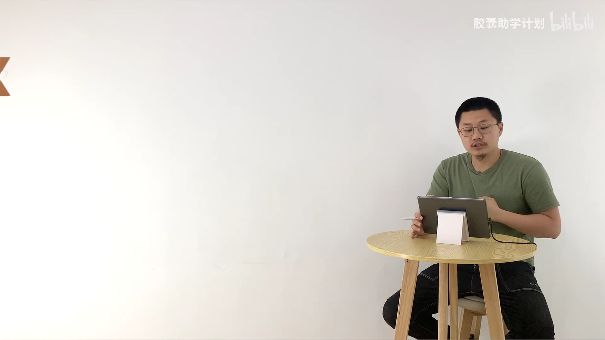

文字识别：胶囊助学计划

### 画面 00:00:11

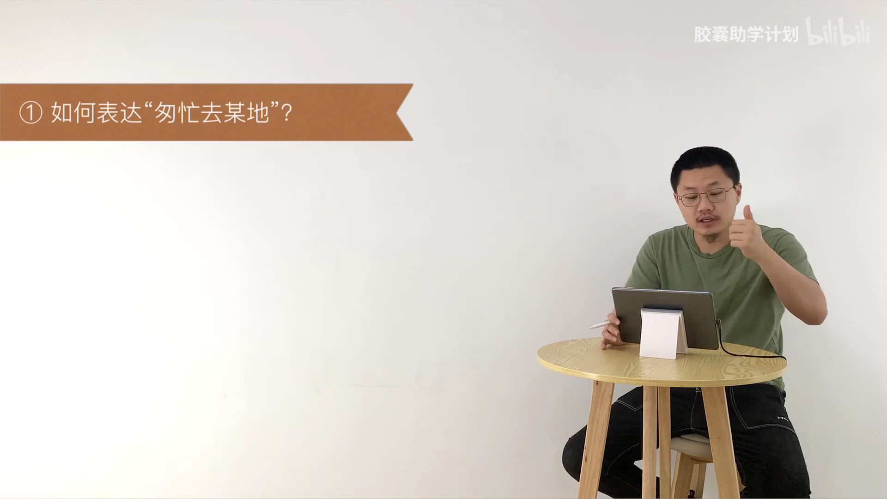

文字识别：胶囊助学计划 / ①如何表达“匆忙去某地”？

### 画面 00:00:13

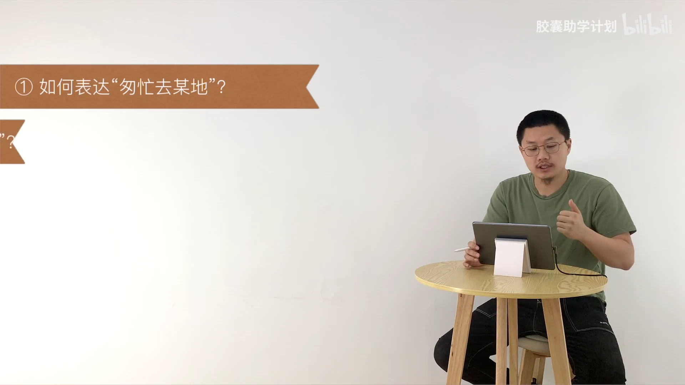

文字识别：胶囊助学计划 / ①如何表达“匆忙去某地”？

### 画面 00:00:15

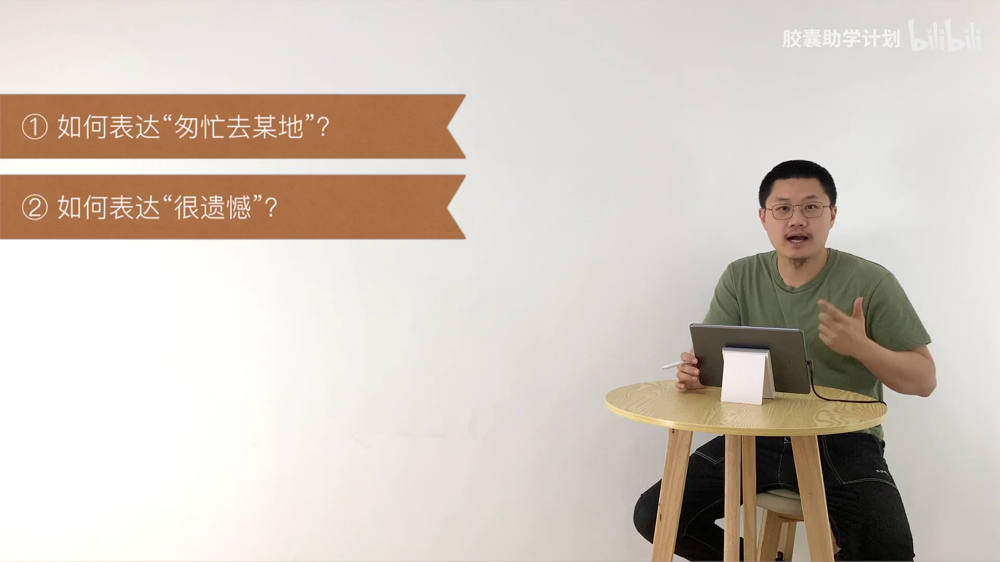

文字识别：胶囊助学计划 / ①如何表达“匆忙去某地”？ / 如何表达“很遗憾”?

### 画面 00:00:17

文字识别：胶囊助学计划 / ①如何表达“匆忙去某地”？ / 如何表达“很遗憾”? / 如何表达“别冲我喊”

### 画面 00:00:20

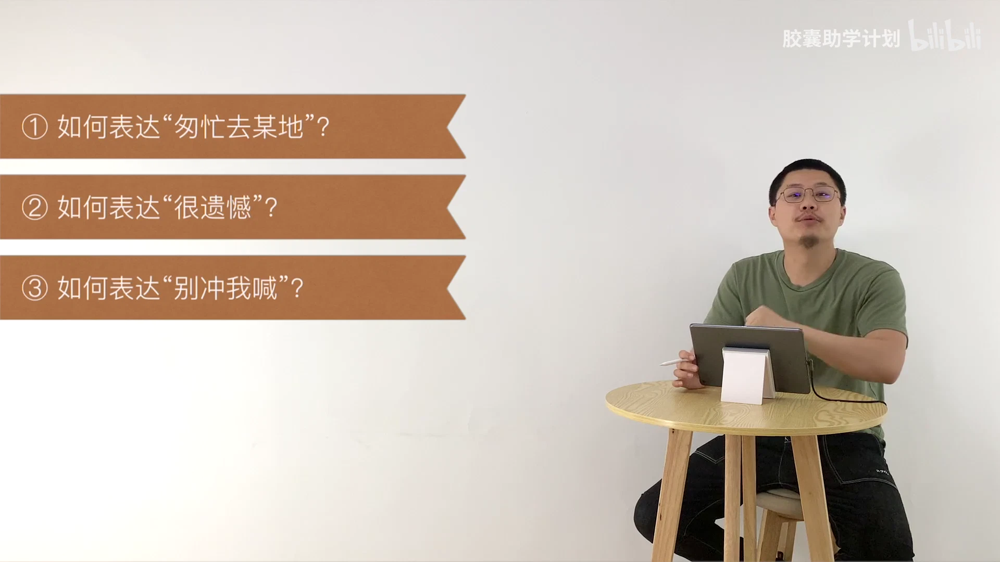

文字识别：胶囊助学计划 / ①如何表达“匆忙去某地”？ / 如何表达“很遗憾” / 如何表达“别冲我喊”

### 画面 00:00:22

文字识别：胶囊助学计划 bilbl / •

### 画面 00:00:26

### 画面 00:00:28

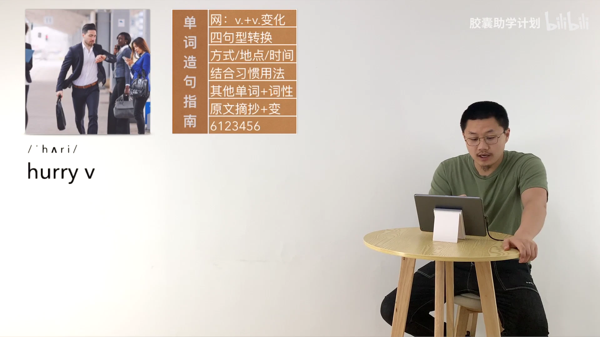

文字识别：单词造句指南 / 网：v.+v.变化 / 胶囊助学计划 / 四句型转换 / 方式/地点/时间 / 结合习惯用法 / 其他单词+词性 / 原文摘抄+变 / 6123456 / /hari/ / hurry v

## 00:00:30–00:01:00

直接跟我一起拼一下，叫做 hurry hurry. Okay, 那首先这个单词其实我们在新一当中已经见过了，我们见过 hurry up, 对吧？催别人快点，快点啊，要不赶不上车了。另外一个呢，我们在七十三课还学过它的副词状态叫 hurriedly, 对吧？变 y v i 加这个 e d, 然后加 y hurriedly, 对吧？Okay, 那表示匆忙地。然后呢，那我们今天能学到一个新的习惯用法，然后

### 画面 00:00:30

文字识别：单词造句指南 / 网：v.+v.变化 / 胶囊助学计划 / bilBil / 四句型转换 / 方式/地点/时间 / 结合习惯用法 / 其他单词+词性 / 原文摘抄+变 / 6123456 / /hari/ / hurry v

### 画面 00:00:35

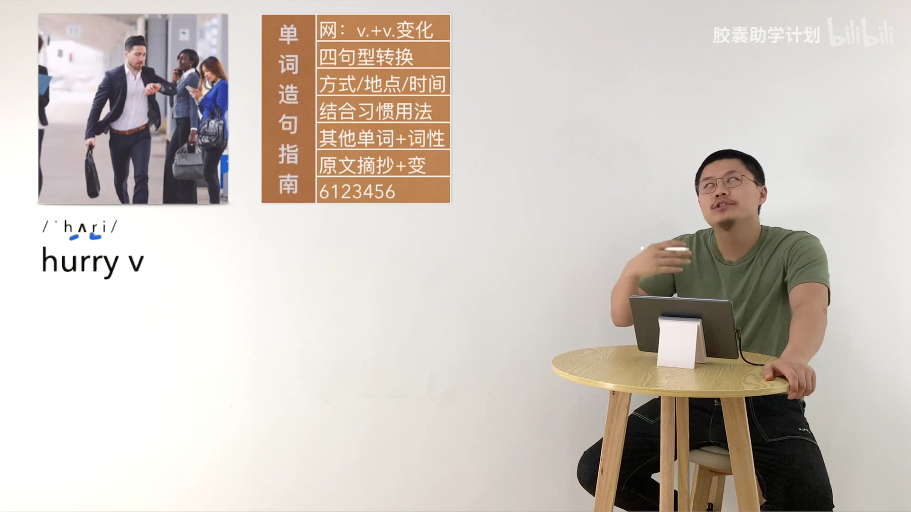

文字识别：单词造句指南 / 网：v.+v.变化 / 胶囊助学计划 / 四句型转换 / 方式/地点/时间 / 结合习惯用法 / 其他单词+词性 / 原文摘抄+变 / 6123456 / /hari/ / hurry v

### 画面 00:00:41

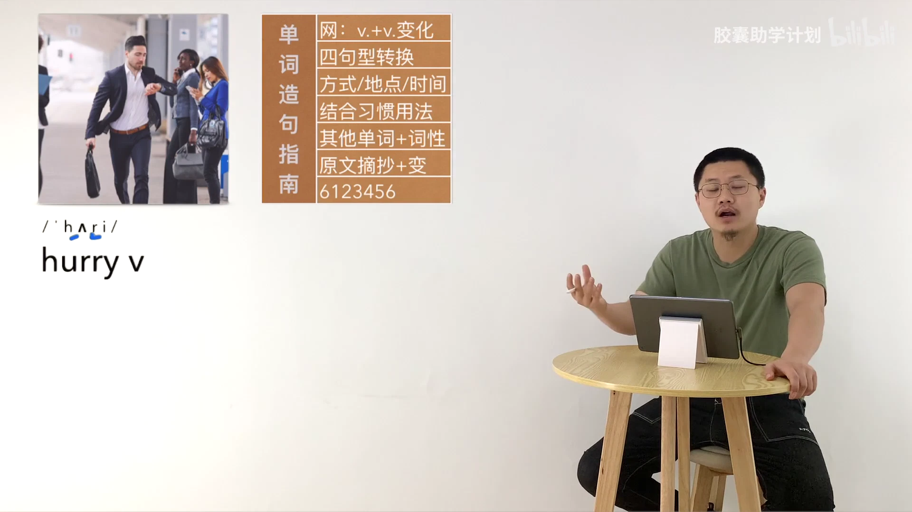

文字识别：单词造句指南 / 网：v.+v.变化 / 胶囊助学计划 / 四句型转换 / 方式/地点/时间 / 结合习惯用法 / 其他单词+词性 / 原文摘抄+变 / 6123456 / /hari/ / hurry v

### 画面 00:00:45

文字识别：单词造句指南 / 网：v.+v.变化 / 胶囊助学计划 / 四句型转换 / 方式/地点/时间 / 结合习惯用法 / 其他单词+词性 / 原文摘抄+变 / 6123456 / /hari/ / hurry v

### 画面 00:00:53

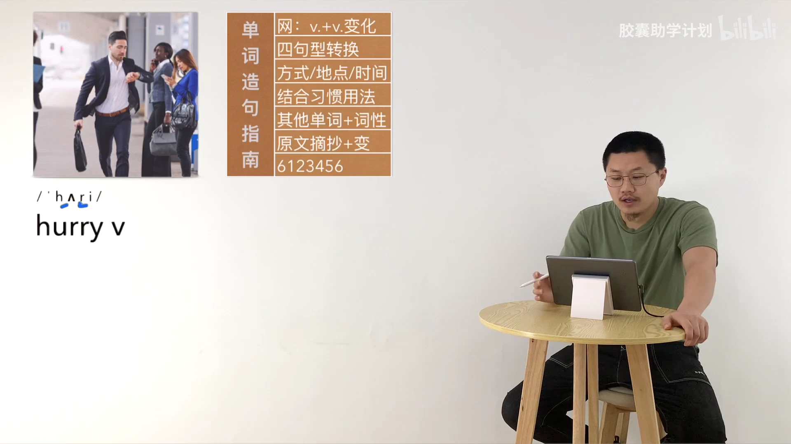

文字识别：单词造句指南 / 网：v.+v.变化 / 胶囊助学计划 / 四句型转换 / 方式/地点/时间 / 结合习惯用法 / 其他单词+词性 / 原文摘抄+变 / 6123456 / /hari/ / hurry v

### 画面 00:00:55

文字识别：单词造句指南 / 网：v.+v.变化 / 胶囊助学计划 / 四句型转换 / 方式/地点/时间 / 结合习惯用法 / 其他单词+词性 / 原文摘抄+变 / 6123456 / /hari/ / hurry v / ① hurry to sw.

## 00:01:00–00:01:30

叫做 hurry to somewhere 啊，匆忙赶去某地。我们现在把它当做一个动词去使用，匆忙赶去某地 s w 点就是 somewhere 某地。比如说，我们造一个句子，说 Why did she leave her phone? 她为什么把她手机落下了？注意 leave 常见的两个意思，一个叫做离开某地，另外一个叫做遗留或者落下某地，对吧？落下某物啊。 Okay，那说答案是 she must have

### 画面 00:01:00

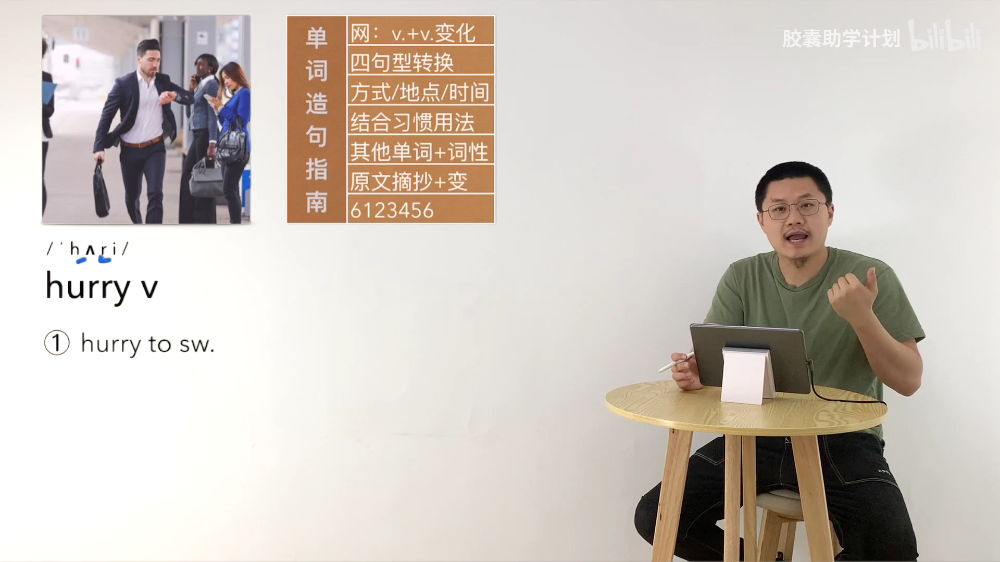

文字识别：单词造句指南 / 网：v.+v.变化 / 胶囊助学计划 / 四句型转换 / 方式/地点/时间 / 结合习惯用法 / 其他单词+词性 / 原文摘抄+变 / 6123456 / /hari/ / hurry v / ① hurry to sw.

### 画面 00:01:06

文字识别：单词造句指南 / 网：v.+v.变化 / 胶囊助学计划 / 四句型转换 / 方式/地点/时间 / 结合习惯用法 / 其他单词+词性 / 原文摘抄+变 / 6123456 / /hari/ / hurryY / ① hurry to sw.

### 画面 00:01:10

文字识别：单词造句指南 / 网：v.+v.变化 / 胶囊助学计划 / 四句型转换 / 方式/地点/时间 / 结合习惯用法 / 其他单词+词性 / 原文摘抄+变 / 6123456 / /hari/ / hurryY / ① hurry to sw.

### 画面 00:01:12

文字识别：单词造句指南 / 网：v.+v.变化 / 胶囊助学计划 / 四句型转换 / 方式/地点/时间 / 结合习惯用法 / 其他单词+词性 / 原文摘抄+变 / 6123456 / /'hari/ / hurryY / ① hurry to sw. / Why did she leave her phone? She must / have hurried to school. L17

### 画面 00:01:15

文字识别：单词造句指南 / 网：v.+v.变化 / 胶囊助学计划 / 四句型转换 / 方式/地点/时间 / 结合习惯用法 / 其他单词+词性 / 原文摘抄+变 / 6123456 / /hari/ / hurryY / ① hurry to sw. / Why did she leave her phone? She must / have hurried to school. L17

### 画面 00:01:20

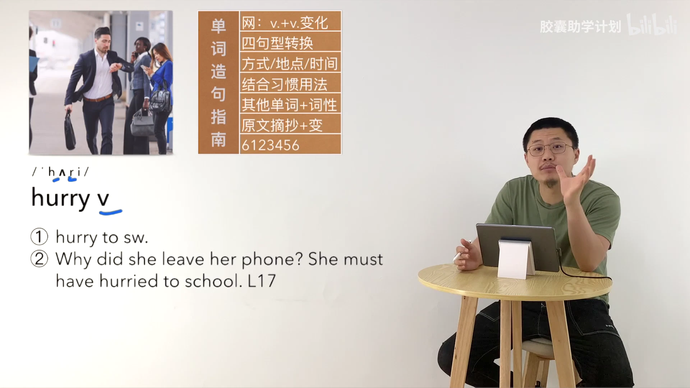

文字识别：单词造句指南 / 网：v.+v.变化 / 胶囊助学计划 / 四句型转换 / 方式/地点/时间 / 结合习惯用法 / 其他单词+词性 / 原文摘抄+变 / 6123456 / /hari/ / hurryY / ① hurry to sw. / Why did she leave her phone? She must / have hurried to school. L17

### 画面 00:01:25

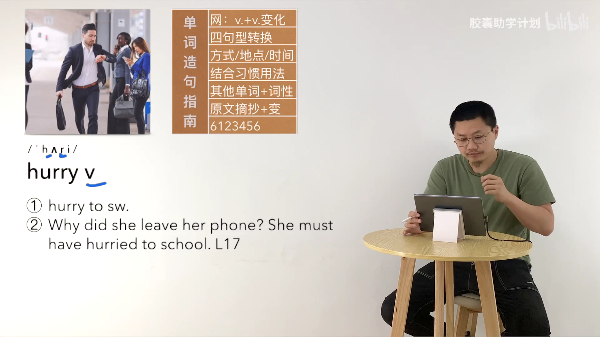

文字识别：单词造句指南 / 网：v.+v.变化 / 胶囊助学计划 / 四句型转换 / 方式/地点/时间 / 结合习惯用法 / 其他单词+词性 / 原文摘抄+变 / 6123456 / /hari/ / hurryY / ① hurry to sw. / Why did she leave her phone? She must / have hurried to school. L17

## 00:01:30–00:02:00

to school.她当时一定是第十七课咱们刚刚学过的，这对于各位来说也是初期最不容易记下来的一些六一二三四五六当中的二，对吧？谓动词的变化，说她当时一定是匆忙赶去了学校，这个解释了她为什么把手机拿遗留下来了。OK，没有拿着。来一个，接下来说She can't have hurried to school yesterday.她昨天一定没有匆忙的赶去

### 画面 00:01:31

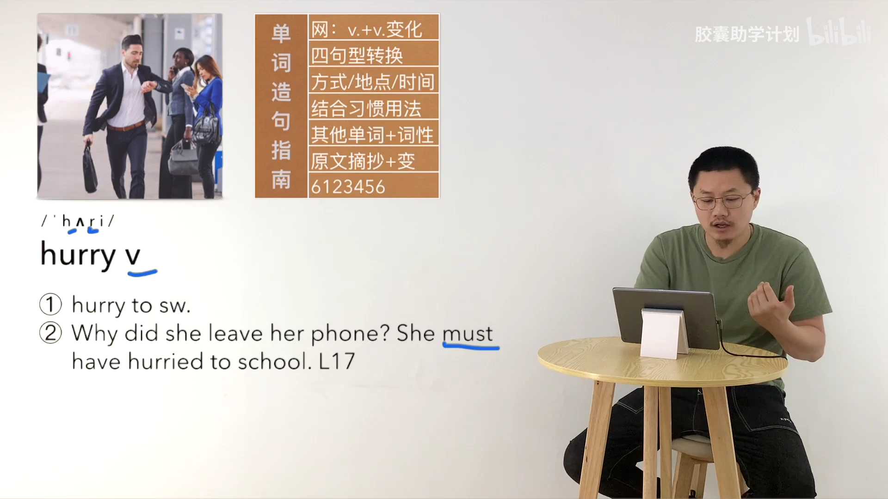

文字识别：单词造句指南 / 网：v.+v.变化 / 胶囊助学计划 / 四句型转换 / 方式/地点/时间 / 结合习惯用法 / 其他单词+词性 / 原文摘抄+变 / 6123456 / /'hari/ / hurryY / ① hurry to sw. / Why did she leave her phone? She must / have hurried to school. L17

### 画面 00:01:33

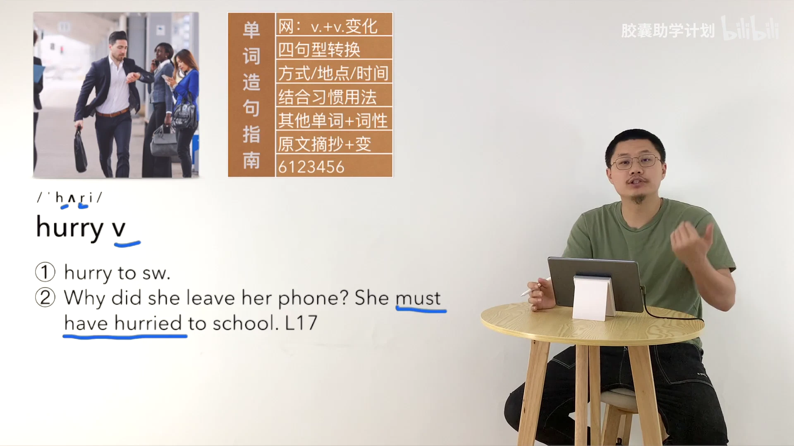

文字识别：单词造句指南 / 网：v.+v.变化 / 胶囊助学计划 / 四句型转换 / 方式/地点/时间 / 结合习惯用法 / 其他单词+词性 / 原文摘抄+变 / 6123456 / /hari/ / hurryY / ① hurry to sw. / Why did she leave her phone? She must / have hurried to school. L17

### 画面 00:01:35

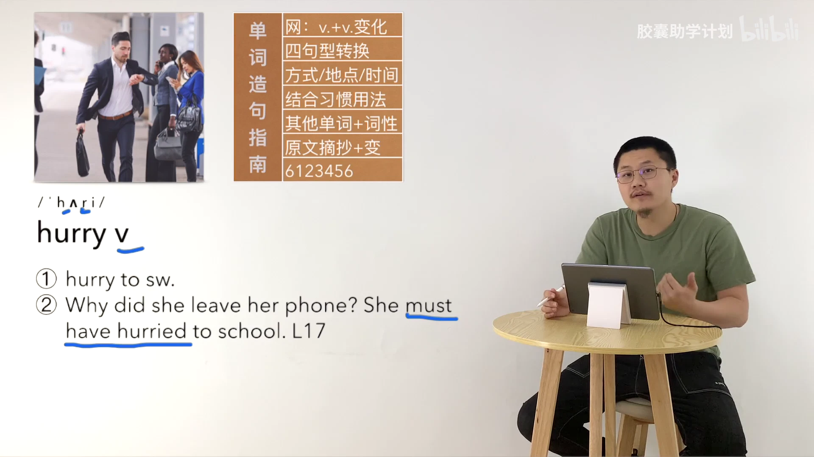

文字识别：单词造句指南 / 网：v.+v.变化 / 胶囊助学计划 / 四句型转换 / 方式/地点/时间 / 结合习惯用法 / 其他单词+词性 / 原文摘抄+变 / 6123456 / /hari/ / hurryY / ① hurry to sw. / Why did she leave her phone? She must / have hurried to school. L17

### 画面 00:01:40

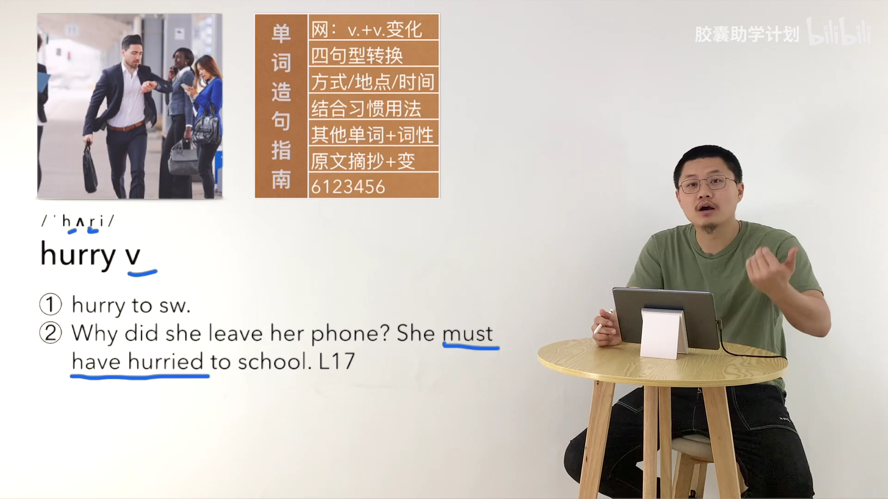

文字识别：单词造句指南 / 网：v.+v.变化 / 胶囊助学计划 / 四句型转换 / 方式/地点/时间 / 结合习惯用法 / 其他单词+词性 / 原文摘抄+变 / 6123456 / /hari/ / hurryY / ① hurry to sw. / Why did she leave her phone? She must / have hurried to school. L17

### 画面 00:01:46

文字识别：单词造句指南 / 网：v.+v.变化 / 胶囊助学计划 / 四句型转换 / 方式/地点/时间 / 结合习惯用法 / 其他单词+词性 / 原文摘抄+变 / 6123456 / /'hari/ / hurryY / ① hurry to sw. / Why did she leave her phone? She must / have hurried to school. L17

### 画面 00:01:50

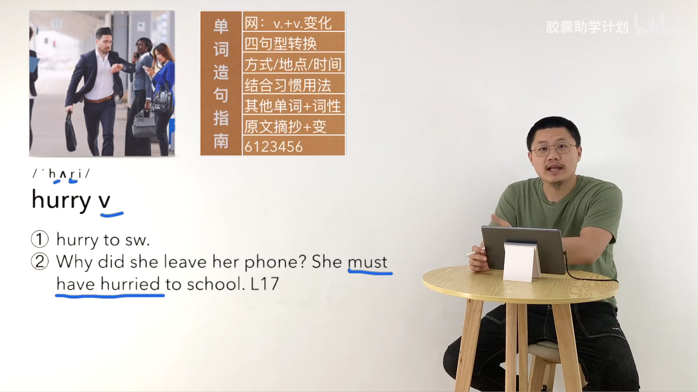

文字识别：单词造句指南 / 网：v.+v.变化 / 胶囊助学计划 / 四句型转换 / 方式/地点/时间 / 结合习惯用法 / 其他单词+词性 / 原文摘抄+变 / 6123456 / /hari/ / hurryY / ① hurry to sw. / Why did she leave her phone? She must / have hurried to school. L17

### 画面 00:01:53

文字识别：单词造句指南 / 网：v.+v.变化 / 胶囊助学计划 / 四句型转换 / 方式/地点/时间 / 结合习惯用法 / 其他单词+词性 / 原文摘抄+变 / 6123456 / /hari/ / hurryY / ① hurry to sw. / Why did she leave her phone? She must / 2 / have hurried to school. L17 / She can't have hurried to school yesterday. / L17

### 画面 00:01:55

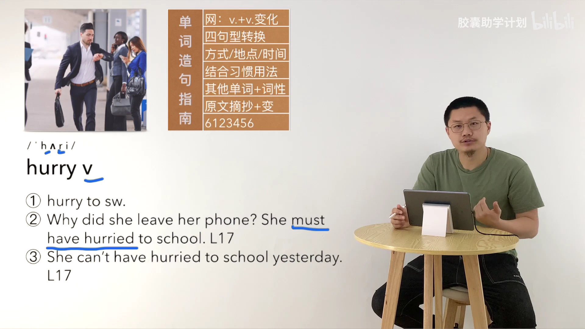

文字识别：单词造句指南 / 网：v.+v.变化 / 胶囊助学计划 / 四句型转换 / 方式/地点/时间 / 结合习惯用法 / 其他单词+词性 / 原文摘抄+变 / 6123456 / /hari/ / hurryY / ① hurry to sw. / Why did she leave her phone? She must / 2 / have hurried to school. L17 / She can't have hurried to school yesterday. / L17

## 00:02:00–00:02:30

学校啊，这还是实际十七课啊，can't have done啊，我们就把这两者给它连到一起，我们做一个小的复习。所以在这儿有一个小的习惯用法叫 hurry to somewhere，匆忙赶去某地。OK， one. 接下来呢，我们看一个小电影片段。这个电影片段没有英文字幕，但是它里面的每一句话我们都学过。各位可以反复听，正好根据它的汉语字幕看一下，各位能不能

### 画面 00:02:00

文字识别：单词造句指南 / 网：v.+v.变化 / 胶囊助学计划 / 四句型转换 / 方式/地点/时间 / 结合习惯用法 / 其他单词+词性 / 原文摘抄+变 / 6123456 / /hari/ / hurryV / ① hurry to sw. / Why did she leave her phone? She must / 2 / have hurried to school. L17 / She can't have hurried to school yesterday. / L17

### 画面 00:02:02

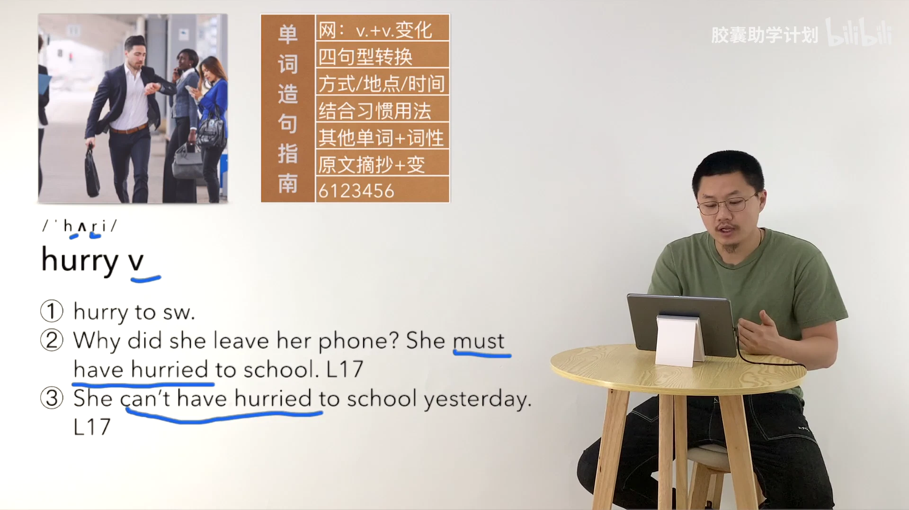

文字识别：单词造句指南 / 网：v.+v.变化 / 胶囊助学计划 / 四句型转换 / 方式/地点/时间 / 结合习惯用法 / 其他单词+词性 / 原文摘抄+变 / 6123456 / /hari/ / hurryY / ① hurry to sw. / Why did she leave her phone? She must / 2 / have hurried to school. L17 / She can't have hurried to school yesterday. / L17

### 画面 00:02:05

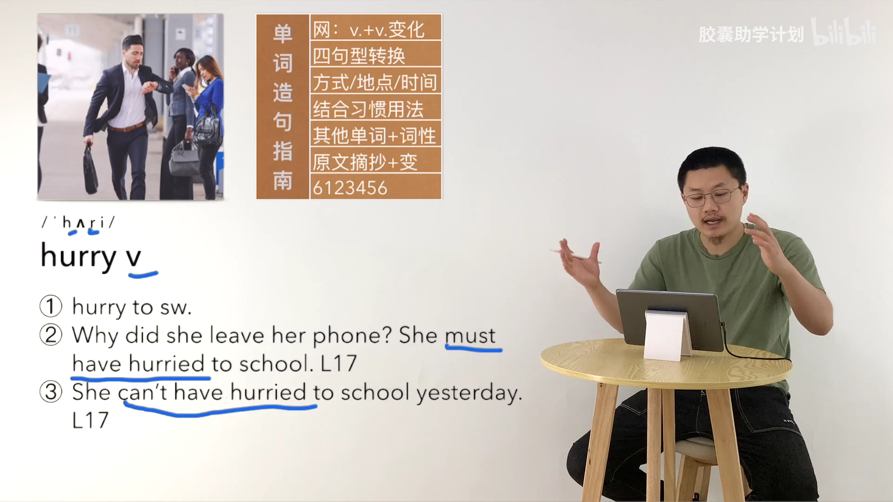

文字识别：单词造句指南 / 网：v.+v.变化 / 胶囊助学计划 / 四句型转换 / 方式/地点/时间 / 结合习惯用法 / 其他单词+词性 / 原文摘抄+变 / 6123456 / /hari/ / hurryY / ① hurry to sw. / Why did she leave her phone? She must / have hurried to school. L17 / She can't have hurried to school yesterday. / L17

### 画面 00:02:10

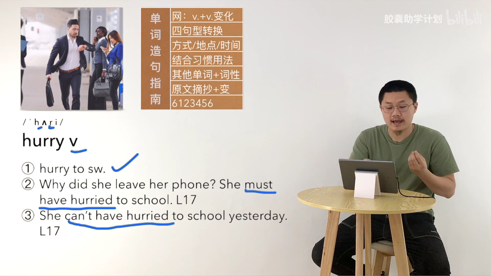

文字识别：单词造句指南 / 网：v.+v.变化 / 胶囊助学计划 / 四句型转换 / 方式/地点/时间 / 结合习惯用法 / 其他单词+词性 / 原文摘抄+变 / 6123456 / /hari/ / hurryY / ① hurry to sw. / Why did she leave her phone? She must / 2 / have hurried to school. L17 / She can't have hurried to school yesterday. / L17

### 画面 00:02:15

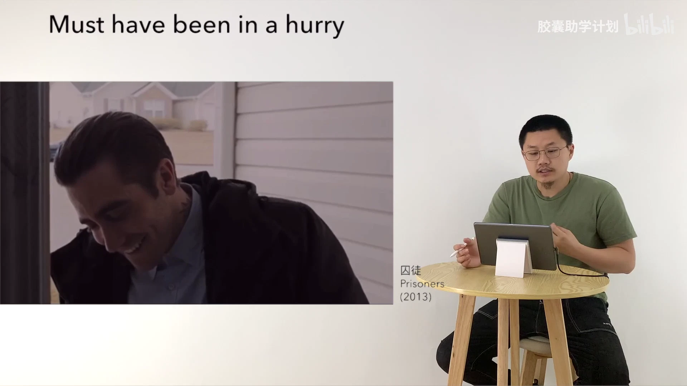

文字识别：Must have been in a hurry / 胶囊助学计划 / 囚徒 / Prisoners / (2013)

## 00:02:30–00:03:00

想出来，他这句英文说的是什么？您再多听几遍，几乎全是百分之九十九都是我们以前学过的啊。然后当中出现了一句话叫 must have been in a hurry。哎，must have been 当时一定是那 in a hurry 这地方的 hurry 它其实就是一个名词了，对吧？因为前面有个 a 嘛，对吧？表示的是很匆忙，说当时一定是非常的匆忙。来，各位听一下，I'm wearing my children's clothes。

### 画面 00:02:39

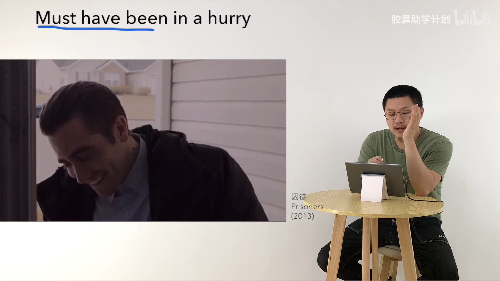

文字识别：Must have been in a hurry / 胶囊助学计划 / 囚徒 / Prisoners / (2013)

### 画面 00:02:42

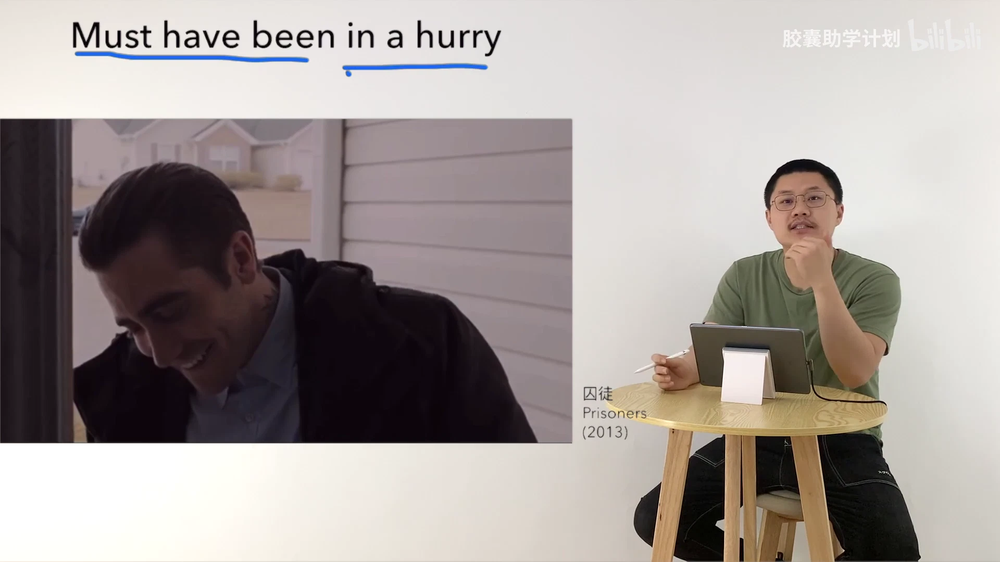

文字识别：Must have been in a hurry / 胶囊助学计划 / 囚徒 / Prisoners / (2013)

### 画面 00:02:49

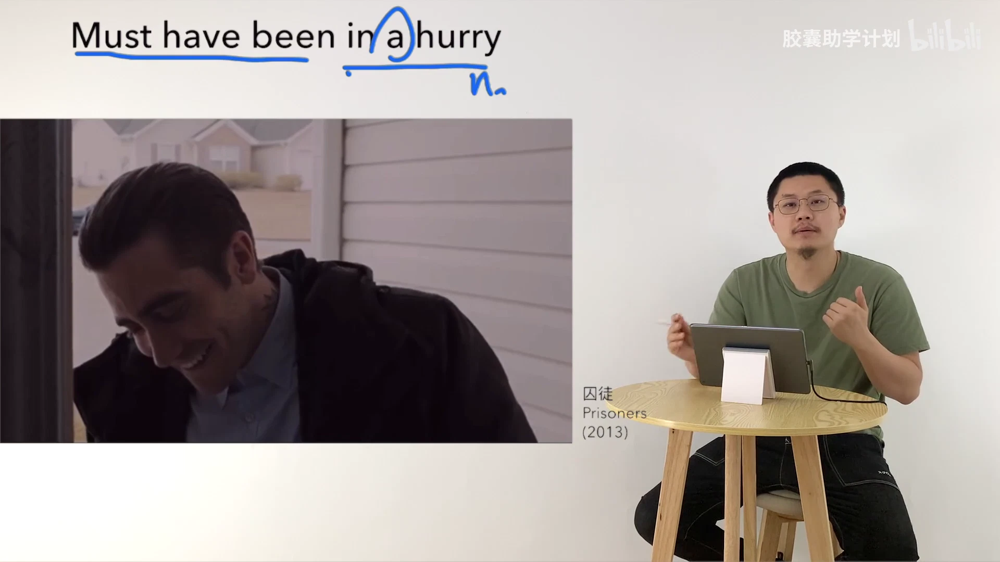

文字识别： Must have been in@hurry / 胶囊助学计划 / n. / 囚徒 / Prisoners / (2013)

### 画面 00:02:56

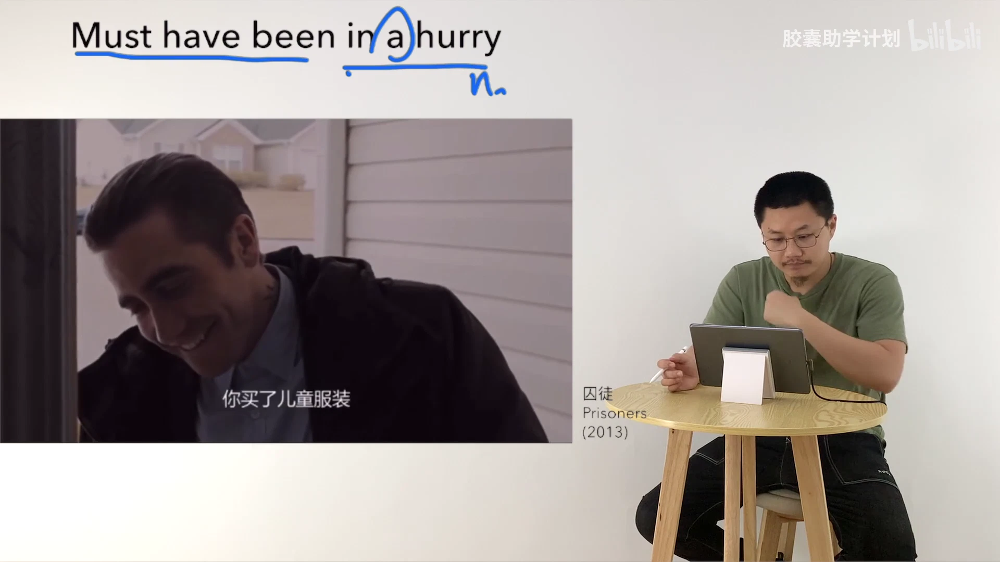

文字识别：Must have been in@hurry / 胶囊助学计划 / n / 囚徒 / 你买了儿童服装 / Prisoners / (2013)

### 画面 00:02:58

文字识别： Must have been in@hurry / 胶囊助学计划 / n. / 囚徒 / Prisoners / (2013)

## 00:03:00–00:03:30

did I? It's been in hurry. Do you do you have children? I don't. Jeff. Okay, you bought children's clothes. Must have been in a hurry. Okay,而一个接下来下面一个单词，跟我一起读一下，叫做take it office。这两个单

### 画面 00:03:00

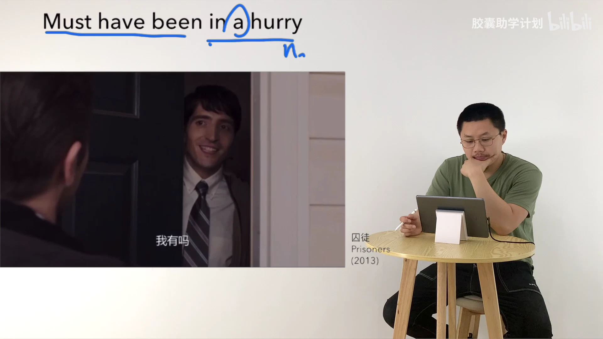

文字识别： Must have been in@hurry / 胶囊助学计划 / n / 我有吗 / 囚徒 / Prisoners / (2013)

### 画面 00:03:05

文字识别：Must have been in@hurry / 胶囊助学计划 / n. / 囚徒 / Prisoners / (2013)

### 画面 00:03:11

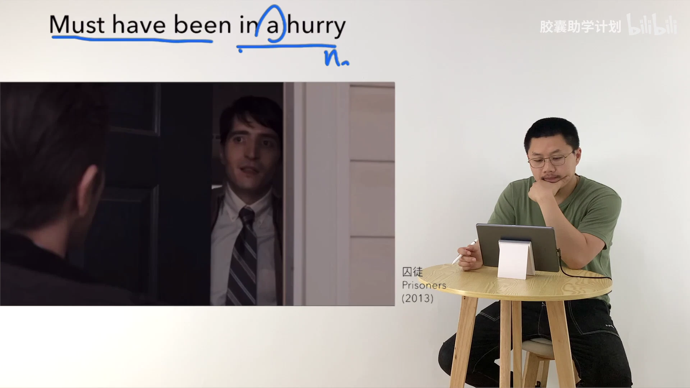

文字识别： Must have been inahurry / 胶囊助学计划 / n / 囚徒 / Prisoners / (2013)

### 画面 00:03:15

文字识别： Must have been in@hurry / 胶囊助学计划 / n / 我没有什么 / 囚徒 / Prisoners / (2013)

### 画面 00:03:24

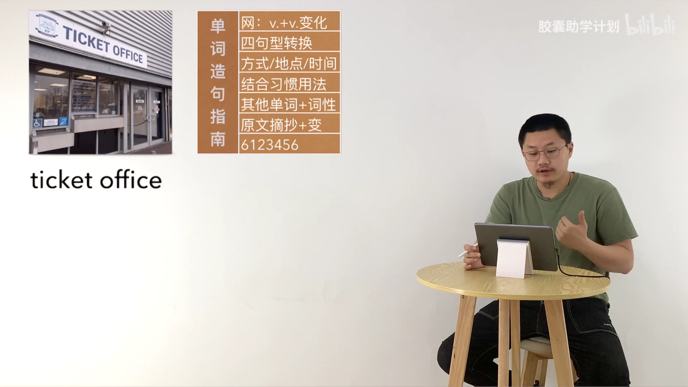

文字识别：单词造句指南 / 网：v.+v.变化 / 胶囊助学计划 / TICKET OFFICE / 四句型转换 / 方式/地点/时间 / 结合习惯用法 / 其他单词+词性 / 原文摘抄+变 / 6123456 / ticket office

### 画面 00:03:26

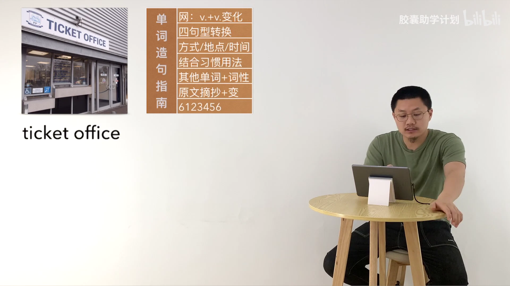

文字识别：单词造句指南 / 网：v.+v.变化 / 胶囊助学计划 / TICKET OFFICE / 四句型转换 / 方式/地点/时间 / 结合习惯用法 / 其他单词+词性 / 原文摘抄+变 / 6123456 / ticket office

### 画面 00:03:29

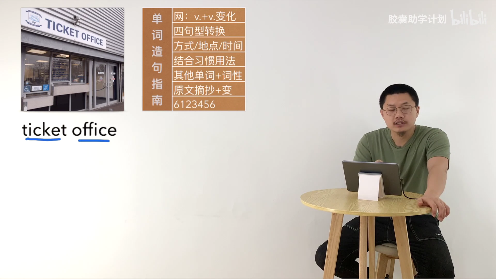

文字识别：单词造句指南 / 网：v.+v.变化 / 胶囊助学计划 / TICKET OFFICE / 四句型转换 / 方式/地点/时间 / 结合习惯用法 / 其他单词+词性 / 原文摘抄+变 / 6123456 / ticket office

## 00:03:30–00:04:00

词都是我们新一前二十课就学过的单词，对吧？然后呢，我们把它放到一起，现在变成了一个新的地点。这个地点就是售票处，叫做 ticket office。 OK，好。那接下来呢，各位要注意，就是 ticket office 合起来其实类似于一个名词的作用。那名词在句子当中最常出现的，尤其在配合它是售票处这个地点，那它在六一二三四五六当中最常出现的就是一三五，可以做主语，可以

### 画面 00:03:31

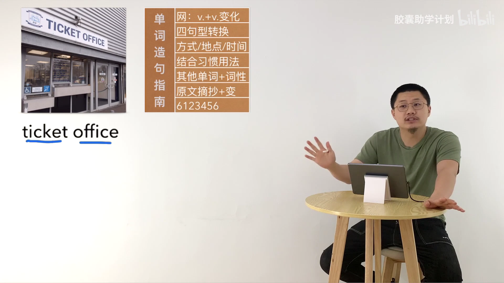

文字识别：单词造句指南 / 网：v.+v.变化 / 胶囊助学计划 / TICKET OFFICE / 四句型转换 / 方式/地点/时间 / 结合习惯用法 / 其他单词+词性 / 原文摘抄+变 / 6123456 / ticket office

### 画面 00:03:35

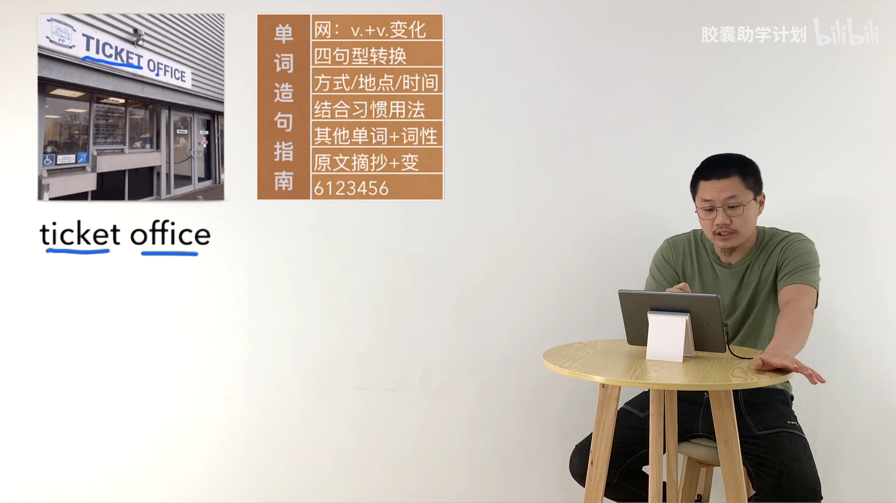

文字识别：单词造句指南 / 网：v.+v.变化 / 胶囊助学计划 / bilib / TICKET / 四句型转换 / LOFFICE / 方式/地点/时间 / 结合习惯用法 / 其他单词+词性 / 原文摘抄+变 / 6123456 / ticket office

### 画面 00:03:38

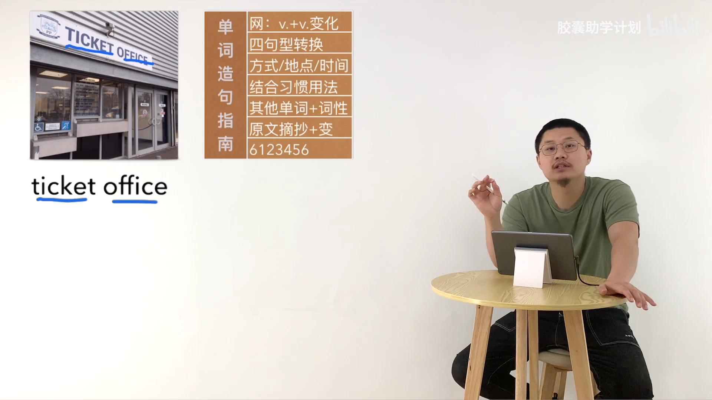

文字识别：单词造句指南 / 网：v.+v.变化 / 胶囊助学计划 / TICKET / 四句型转换 / OFFICE / 方式/地点/时间 / 结合习惯用法 / 其他单词+词性 / 原文摘抄+变 / 6123456 / ticket office

### 画面 00:03:40

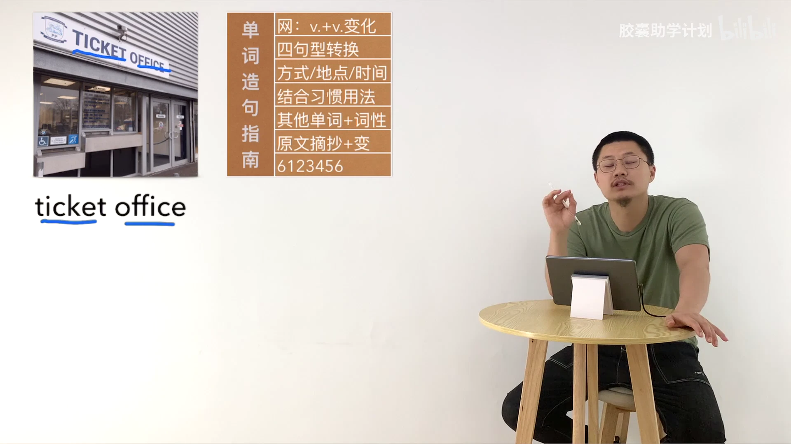

文字识别：单词造句指南 / 网：v.+v.变化 / 胶囊助学计划 / TICKET / 四句型转换 / LOFEICE / 方式/地点/时间 / 结合习惯用法 / 其他单词+词性 / 原文摘抄+变 / 6123456 / ticket office

### 画面 00:03:45

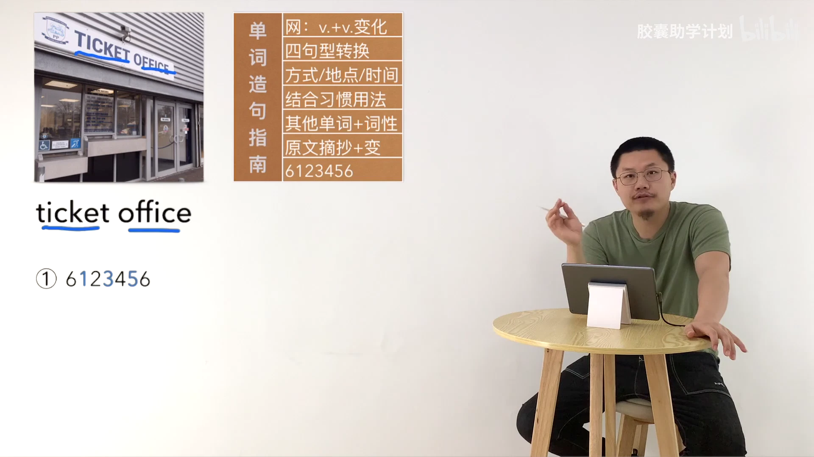

文字识别：单词造句指南 / 网：v.+v.变化 / 胶囊助学计划 / TICKET / 四句型转换 / LOFEICE / 方式/地点/时间 / 结合习惯用法 / 其他单词+词性 / 原文摘抄+变 / 6123456 / ticket office / ①6123456

### 画面 00:03:49

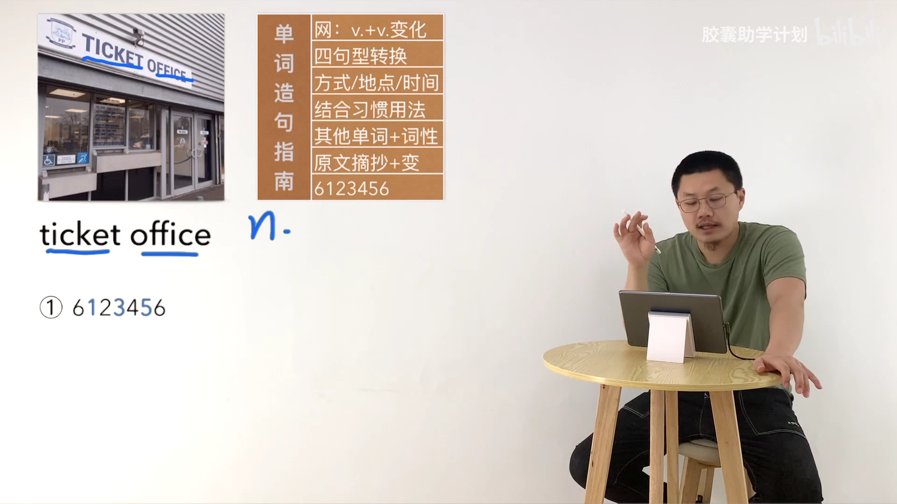

文字识别：单词造句指南 / 网：v.+v.变化 / 胶囊助学计划 / TICKET / 四句型转换 / OFFICE / 方式/地点/时间 / 结合习惯用法 / 其他单词+词性 / 原文摘抄+变 / 6123456 / n. / ticket office / ①6123456

### 画面 00:03:51

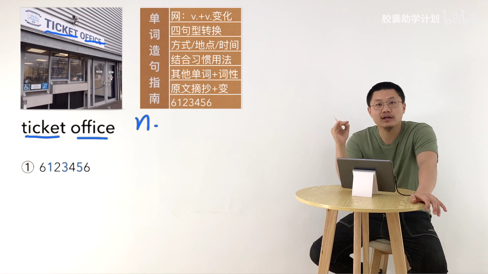

文字识别：单词造句指南 / 网：v.+v.变化 / 胶囊助学计划 / TICKET / Pp / 四句型转换 / OFFICE / 方式/地点/时间 / 结合习惯用法 / 其他单词+词性 / 原文摘抄+变 / 6123456 / n. / ticket office / ①6123456

## 00:04:00–00:04:30

做宾语，可以做地点。接下来我们分别去造一个句子。来了，一个句子，The ticket office has just been cleaned. 好了，第十课学过的被动，have has been that现在完成时的被动叫做已经被怎么怎么样了？OK，已经被打扫了。接下来说，They must be cleaning that ticket office. 那你看，如果这句话对吧？说 has just been cleaned，那它在六一二三四五

### 画面 00:04:00

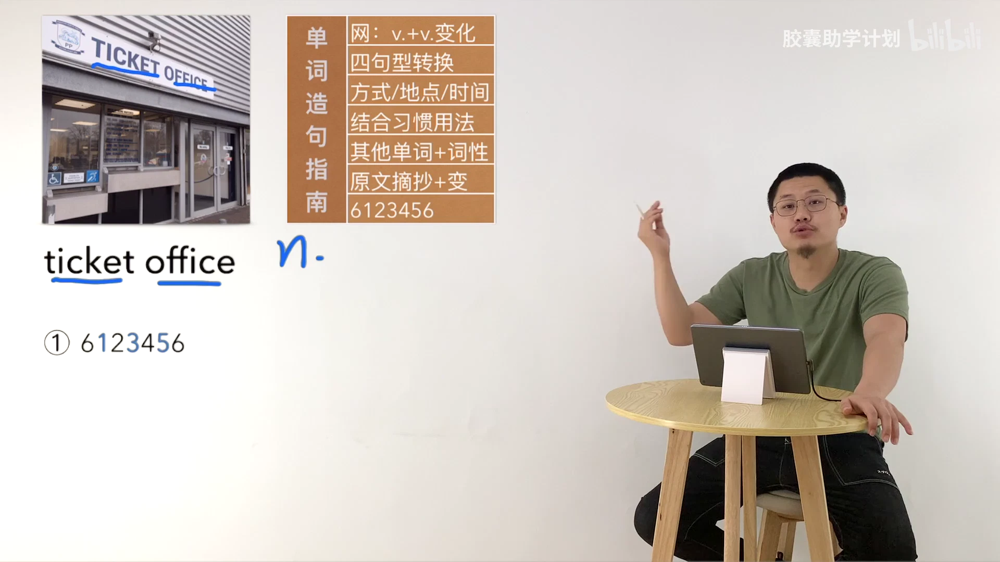

文字识别：单词造句指南 / 网：v.+v.变化 / 胶囊助学计划 / TICKET / 四句型转换 / OFFICE / 方式/地点/时间 / 结合习惯用法 / 其他单词+词性 / 原文摘抄+变 / 6123456 / n. / ticket office / ①6123456

### 画面 00:04:04

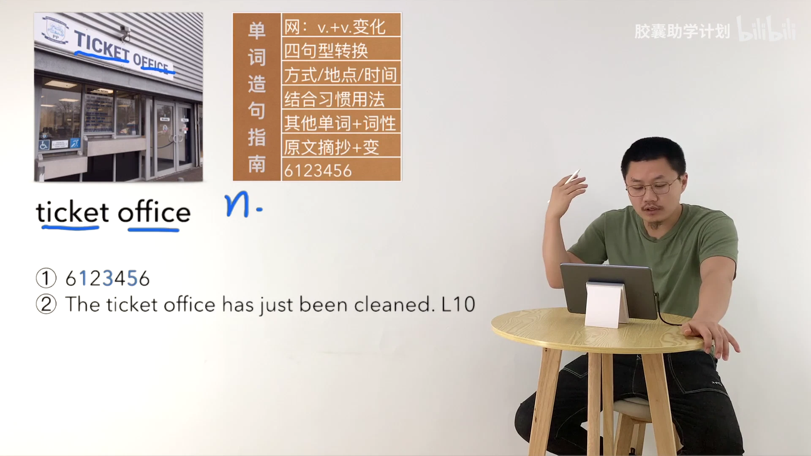

文字识别：单词造句指南 / 网：v.+v.变化 / 胶囊助学计划 / TICKET / 四句型转换 / OFFICE / 方式/地点/时间 / 结合习惯用法 / 其他单词+词性 / 原文摘抄+变 / 6123456 / n. / ticket office / ①6123456 / The ticket office has just been cleaned. L10

### 画面 00:04:06

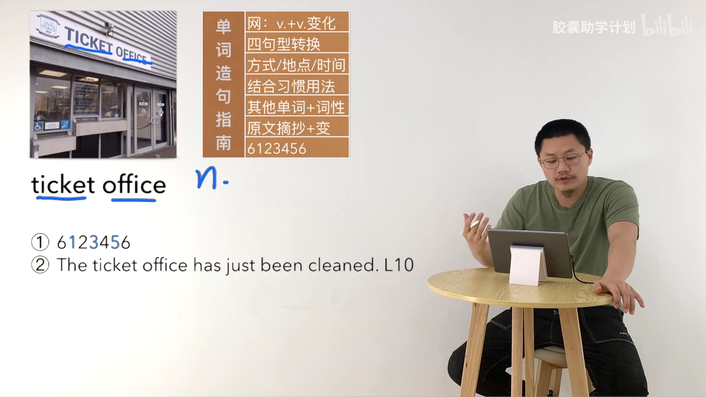

文字识别：单词造句指南 / 网：v.+v.变化 / 胶囊助学计划 / TICKET / 四句型转换 / OFFICE / 方式/地点/时间 / 结合习惯用法 / 其他单词+词性 / 原文摘抄+变 / 6123456 / n. / ticket office / ①6123456 / The ticket office has just been cleaned. L10

### 画面 00:04:10

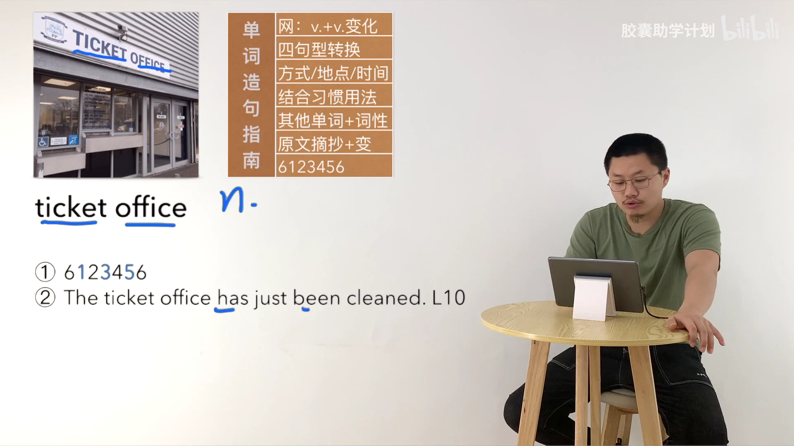

文字识别：单词造句指南 / 网：v.+v.变化 / 胶囊助学计划 / TICKET / 四句型转换 / OFFICE / 方式/地点/时间 / 结合习惯用法 / 其他单词+词性 / 原文摘抄+变 / 6123456 / n. / ticket office / ①6123456 / The ticket office has just been cleaned. L10

### 画面 00:04:13

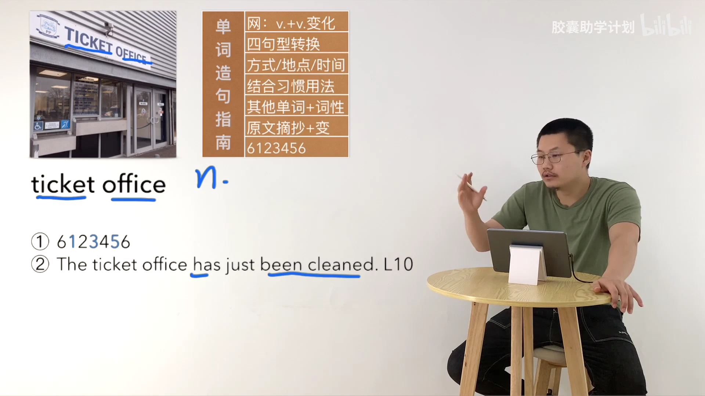

文字识别：单词造句指南 / 网：v.+v.变化 / 胶囊助学计划 / TICKET / 四句型转换 / OFFICE / 方式/地点/时间 / 结合习惯用法 / 其他单词+词性 / 原文摘抄+变 / 6123456 / n. / ticket office / ①6123456 / The ticket office has just been cleaned. L10

### 画面 00:04:15

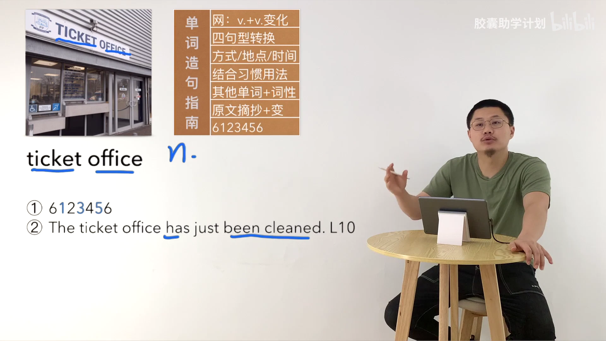

文字识别：单词造句指南 / 网：v.+v.变化 / 胶囊助学计划 / TICKET / 四句型转换 / OFFICE / 方式/地点/时间 / 结合习惯用法 / 其他单词+词性 / 原文摘抄+变 / 6123456 / n. / ticket office / ①6123456 / The ticket office has just been cleaned. L10

### 画面 00:04:20

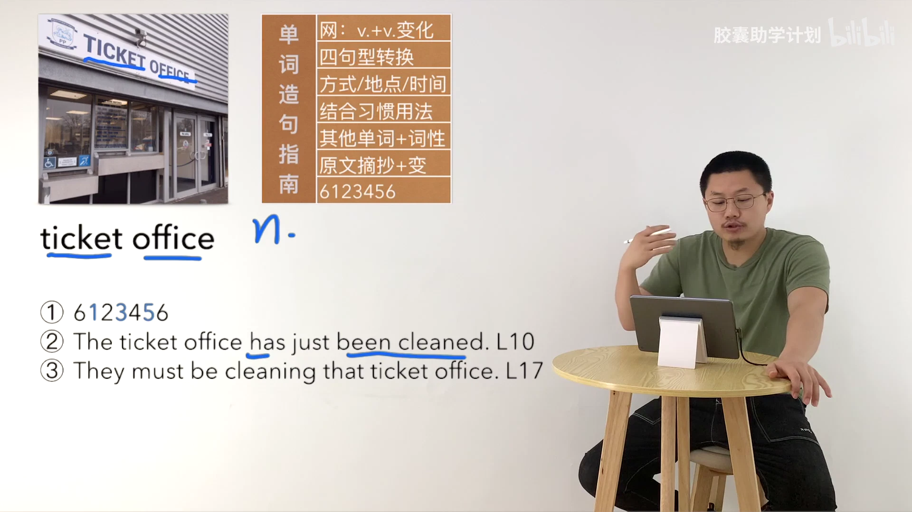

文字识别：单词造句指南 / 网：v.+v.变化 / 胶囊助学计划 / TICKET / 四句型转换 / OFFICE / 方式/地点/时间 / 结合习惯用法 / 其他单词+词性 / 原文摘抄+变 / 6123456 / n. / ticket office / ①6123456 / The ticket office has just been cleaned. L10 / They must be cleaning that ticket office. L17

### 画面 00:04:25

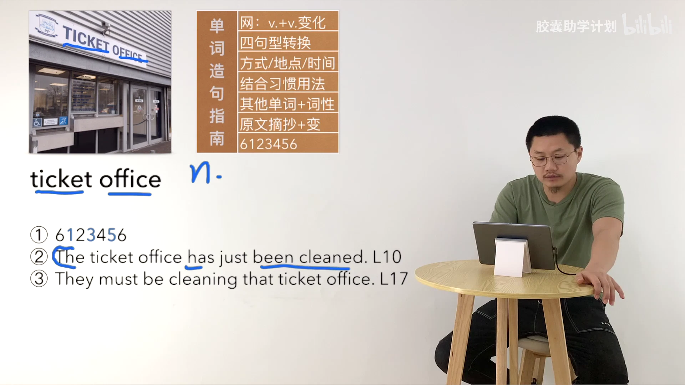

文字识别：单词造句指南 / 网：v.+v.变化 / 胶囊助学计划 / TICKET / 四句型转换 / OFEICE / 方式/地点/时间 / 结合习惯用法 / 其他单词+词性 / 原文摘抄+变 / 6123456 / n. / ticket office / ①6123456 / The ticket office has just been cleaned. L10 / They must be cleaning that ticket office. L17

### 画面 00:04:27

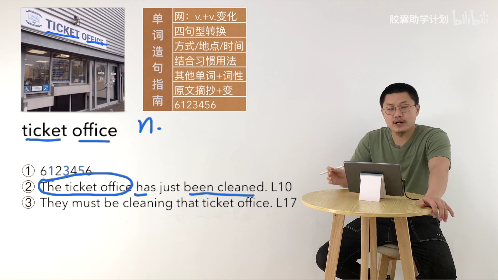

文字识别：单词造句指南 / 网：v.+v.变化 / 胶囊助学计划 / TICKET / Pp / 四句型转换 / OFFICE / 方式/地点/时间 / 结合习惯用法 / 其他单词+词性 / 原文摘抄+变 / 6123456 / n. / ticket office / 6123456 / The ticket office has just been cleaned. L10 / They must be cleaning that ticket office. L17

## 00:04:30–00:05:00

Among them, it is the subject. That the next sentence, ticket office, that is similar to a predicate, right? It is the predicate. They must be cleaning the ticket office. Okay, this is the 17th sentence we learned. Must be doing. It is a review of the grammar. Next, they must sell coffee in that ticket office. This place has a small doubt. Please think carefully. At that time, I gave you an example sentence. They, he must.

### 画面 00:04:30

文字识别：单词造句指南 / 网：v.+v.变化 / 胶囊助学计划 / TICKET / 四句型转换 / OFFICE / 方式/地点/时间 / 结合习惯用法 / 其他单词+词性 / 原文摘抄+变 / 6123456 / n. / ticket office / 6123456 / The ticket office has just been cleaned. L10 / They must be cleaning that ticket office. L17

### 画面 00:04:33

文字识别：单词造句指南 / 网：v.+v.变化 / 胶囊助学计划 / TICKET / 四句型转换 / OFFICE / 方式/地点/时间 / 结合习惯用法 / 其他单词+词性 / 原文摘抄+变 / 6123456 / n. / ticket office / 6123456 / The ticket office has just been cleaned. L10 / They must be cleaning that ticket office. L17

### 画面 00:04:35

文字识别：单词造句指南 / 网：v.+v.变化 / 胶囊助学计划 / TICKET / 四句型转换 / OFEICE / 方式/地点/时间 / 结合习惯用法 / 其他单词+词性 / 原文摘抄+变 / 6123456 / n- / ticket office / 6123456 / The ticket office has just been cleaned. L10 / They must be cleaning that ficket office. / L17

### 画面 00:04:40

文字识别：单词造句指南 / 网：v.+v.变化 / 胶囊助学计划 / TICKET / 四句型转换 / OFEICE / 方式/地点/时间 / 结合习惯用法 / 其他单词+词性 / 原文摘抄+变 / 6123456 / n. / ticket office / 6123456 / The ticket office has just been cleaned. L10 / They must be cleaning that ficket office. / L17

### 画面 00:04:45

文字识别：单词造句指南 / 网：v.+v.变化 / 胶囊助学计划 / TICKET / 四句型转换 / OFFICE / 方式/地点/时间 / 结合习惯用法 / 其他单词+词性 / 原文摘抄+变 / 6123456 / n- / ticket office / 6123456 / The ticket office has just been cleaned. L10 / They must be cleaning that ficket office. / L17

### 画面 00:04:49

文字识别：单词造句指南 / 网：v.+v.变化 / 胶囊助学计划 / TICKET / 四句型转换 / OFFICE / 方式/地点/时间 / 结合习惯用法 / 其他单词+词性 / 原文摘抄+变 / 6123456 / n- / ticket office / 6123456 / The ticket office has just been cleaned. L10 / They must be cleaning that ficket office.L17 / They must sell coffee in that ticket office. / L17

### 画面 00:04:51

文字识别：单词造句指南 / 网：v.+v.变化 / 胶囊助学计划 / TICKET / 四句型转换 / OFFICE / 方式/地点/时间 / 结合习惯用法 / 其他单词+词性 / 原文摘抄+变 / 6123456 / n. / ticket office / 6123456 / The ticket office has just been cleaned. L10 / They must be cleaning that ficket office.L17 / They must sell coffee in that ticket office. / L17

### 画面 00:04:54

文字识别：单词造句指南 / 网：v.+v.变化 / 胶囊助学计划 / TICKET / 四句型转换 / OFFICE / 方式/地点/时间 / 结合习惯用法 / 其他单词+词性 / 原文摘抄+变 / 6123456 / n. / ticket office / 6123456 / The ticket office has just been cleaned. L10 / They must be cleaning that ficket office.L17 / They must sell coffee in that ticket office. / L17

### 画面 00:04:56

文字识别：单词造句指南 / 网：v.+v.变化 / 胶囊助学计划 / TICKET / 四句型转换 / OFFICE / 方式/地点/时间 / 结合习惯用法 / 其他单词+词性 / 原文摘抄+变 / 6123456 / n. / ticket office / 6123456 / The ticket office has just been cleaned. L10 / They must be cleaning that ficket office.L17 / They must sell coffee in that ticket office. / L17

### 画面 00:04:59

文字识别：单词造句指南 / 网：v.+v.变化 / 胶囊助学计划 / TICKET / 四句型转换 / OFFICE / 方式/地点/时间 / 结合习惯用法 / 其他单词+词性 / 原文摘抄+变 / 6123456 / n. / ticket office / 6123456 / The ticket office has just been cleaned. L10 / They must be cleaning that ficket office.L17 / They must sell coffee in that ticket office. / L17

## 00:05:00–00:05:30

They ah he must drink a lot of milk. 我没有记错的话是这样一句话，对吧？当时我讲到说 must 后边加一个动词原形的时候，我们只看这句话，理论上来说可以翻译出两个不同的含义。第一个表示的是它最基础用法，表必须，他必须要在这个售票处卖咖啡，对吧？另外一个常用的意思呢，指的是推测，表示现在啊一个推

### 画面 00:05:01

文字识别：单词造句指南 / 网：v.+v.变化 / 胶囊助学计划 / TICKET / 四句型转换 / OFFICE / 方式/地点/时间 / 结合习惯用法 / 其他单词+词性 / 原文摘抄+变 / 6123456 / n. / ticket office / 6123456 / The ticket office has just been cleaned. L10 / They must be cleaning that ficket office.L17 / They must sell coff ee in that ticket office. / L17

### 画面 00:05:05

文字识别：单词造句指南 / 网：v.+v.变化 / 胶囊助学计划 / TICKET / 四句型转换 / OFFICE / 方式/地点/时间 / 结合习惯用法 / 其他单词+词性 / 原文摘抄+变 / 6123456 / n. / ticket office / 6123456 / The ticket office has just been cleaned. L10 / They must be cleaning that ficket office.L17 / They must sell coffee in that ticket office. / L17

### 画面 00:05:08

文字识别：单词造句指南 / 网：v.+v.变化 / 胶囊助学计划 / TICKET / 四句型转换 / OFFICE / 方式/地点/时间 / 结合习惯用法 / 其他单词+词性 / 原文摘抄+变 / 6123456 / n. / ticket office / 6123456 / The ticket office has just been cleaned. L10 / They must be cleaning that ficket office._17 / They / must sell coffee in that ticket office. / L17

### 画面 00:05:10

文字识别：单词造句指南 / 网：v.+v.变化 / 胶囊助学计划 / bilbil / TICKET / 四句型转换 / OFFICE / 方式/地点/时间 / 结合习惯用法 / 其他单词+词性 / 原文摘抄+变 / 6123456 / n. / ticket office / 6123456 / The ticket office has just been cleaned. L10 / They must be cleaning that ficket office.L17 / They / must sell coffee / in that ticket office. / L17

### 画面 00:05:12

文字识别：单词造句指南 / 网：v.+v.变化 / 胶囊助学计划 / TICKET / 四句型转换 / OFFICE / 方式/地点/时间 / 结合习惯用法 / 其他单词+词性 / 原文摘抄+变 / 6123456 / n- / ticket office / 6123456 / The ticket office has just been cleaned. L10 / They must be cleaning that ficket office.L17 / They / must sell coffee in that ticket office. / L17

### 画面 00:05:15

文字识别：单词造句指南 / 网：v.+v.变化 / 胶囊助学计划 / TICKET / 四句型转换 / OFEICE / 方式/地点/时间 / 结合习惯用法 / 其他单词+词性 / 原文摘抄+变 / 6123456 / n. / ticket office / 6123456 / The ticket office has just been cleaned. L10 / They must be cleaning that ficket office.L17 / They / must sell coffee / in that ticket office. / L17

### 画面 00:05:19

文字识别：单词造句指南 / 网：v.+v.变化 / 胶囊助学计划 / TICKET / 四句型转换 / OFEICE / 方式/地点/时间 / 结合习惯用法 / 其他单词+词性 / 原文摘抄+变 / 6123456 / n. / ticket office / 6123456 / The ticket office has just been cleaned. L10 / They must be cleaning that ficket office.L17 / They / must sell coffee / in that ticket office. / L17

### 画面 00:05:21

文字识别：单词造句指南 / 网：v.+v.变化 / 胶囊助学计划 / TICKET / 四句型转换 / OFFICE / 方式/地点/时间 / 结合习惯用法 / 其他单词+词性 / 原文摘抄+变 / 6123456 / n. / ticket office / 6123456 / The ticket office has just been cleaned. L10 / They must be cleaning that ficket office.17 / They / must sell coffee in that ticket office. / L17

### 画面 00:05:26

文字识别：单词造句指南 / 网：v.+v.变化 / 胶囊助学计划 / TICKET / 四句型转换 / OFFICE / 方式/地点/时间 / 结合习惯用法 / 其他单词+词性 / 原文摘抄+变 / 6123456 / n. / ticket office / 6123456 / The ticket office has just been cleaned. L10 / They must be cleaning that ficket office.L17 / They / must sell coffee / in that ticket office. / L17

## 00:05:30–00:06:00

测就是他们一定是在那个售票处里边是卖咖啡的。我闻到咖啡的香味了，但附近有没有别的店？只有那一个店开着，他们一定是在这个售票处里面还卖咖啡。OK，所以这个地方它理论上有两种翻译方式。我们现在只造了一句话，并且没有上下文的实际使用场景，我们没办法完全确定这句话到底怎么翻译是舒服的，或者说是对的，甚至OK。那结合上下文场景，

### 画面 00:05:30

文字识别：单词造句指南 / 网：v.+v.变化 / 胶囊助学计划 / TICKET / PP / 四句型转换 / OFFICE / 方式/地点/时间 / 结合习惯用法 / 其他单词+词性 / 原文摘抄+变 / 6123456 / n. / ticket office / 6123456 / The ticket office has just been cleaned. L10 / They must be cleaning that ficket office.L17 / They / must sell coffee / Lin that ticket office. / L17

### 画面 00:05:32

文字识别：单词造句指南 / 网：v.+v.变化 / 胶囊助学计划 / TICKET / 四句型转换 / OFFICE / 方式/地点/时间 / 结合习惯用法 / 其他单词+词性 / 原文摘抄+变 / 6123456 / n. / ticket office / 6123456 / The ticket office has just been cleaned. L10 / They must be cleaning that ficket office.L17 / They / must sell coffee in that ticket office. / L17

### 画面 00:05:35

文字识别：单词造句指南 / 网：v.+v.变化 / 胶囊助学计划 / TICKET / Pp / 四句型转换 / OFFICE / 方式/地点/时间 / 结合习惯用法 / 其他单词+词性 / 原文摘抄+变 / 6123456 / n. / ticket office / 6123456 / The ticket office has just been cleaned. L10 / They must be cleaning that ficket office.L17 / They / must sell coffee in that ticket office. / L17

### 画面 00:05:40

文字识别：单词造句指南 / 网：v.+v.变化 / 胶囊助学计划 / TICKET / 四句型转换 / OFFICE / 方式/地点/时间 / 结合习惯用法 / 其他单词+词性 / 原文摘抄+变 / 6123456 / n. / ticket office / 6123456 / The ticket office has just been cleaned. L10 / They must be cleaning that ficket office.L17 / They / must sell coffee / in that ticket office. / L17

### 画面 00:05:45

文字识别：单词造句指南 / 网：v.+v.变化 / 胶囊助学计划 / TICKET / 四句型转换 / OFFICE / 方式/地点/时间 / 结合习惯用法 / 其他单词+词性 / 原文摘抄+变 / 6123456 / n. / ticket office / 6123456 / The ticket office has just been cleaned. L10 / They must be cleaning that ficket office.L17 / They / must sell coffee in that ticket office. / L17

### 画面 00:05:50

文字识别：单词造句指南 / 网：v.+v.变化 / 胶囊助学计划 / TICKET / 四句型转换 / OFFICE / 方式/地点/时间 / 结合习惯用法 / 其他单词+词性 / 原文摘抄+变 / 6123456 / n. / ticket office / 6123456 / The ticket office has just been cleaned. L10 / They must be cleaning that ficket office.L17 / They / must sell coffee in that ticket office. / L17

### 画面 00:05:55

文字识别：单词造句指南 / 网：v.+v.变化 / 胶囊助学计划 / TICKET / 四句型转换 / OFFICE / 方式/地点/时间 / 结合习惯用法 / 其他单词+词性 / 原文摘抄+变 / 6123456 / n. / ticket office / 6123456 / The ticket office has just been cleaned. L10 / They must be cleaning that ficket office.L17 / They / must sell coffee in that ticket office. / L17

## 00:06:00–00:06:30

您就能去进行一个推测，它到底是基础用法表必须，还是推测用法表呃表一定？OK，好，接下来下一个小的单词，跟我一起读一下，叫做pity，pity，OK，pity表示的是遗憾，你看它本身是一个名词，非常常用的一个呃感叹句叫做What a pity，叫做真遗憾呐，好遗憾呐，What a pity，OK，那接下来呢，

### 画面 00:06:00

文字识别：单词造句指南 / 网：v.+v.变化 / 胶囊助学计划 / TICKET / 四句型转换 / OFFICE / 方式/地点/时间 / 结合习惯用法 / 其他单词+词性 / 原文摘抄+变 / 6123456 / n. / ticket office / 6123456 / The ticket office has just been cleaned. L10 / They must be cleaning that ficket office.L17 / They / must sell coffee in that ticket office. / L17

### 画面 00:06:05

文字识别：单词造句指南 / 网：v.+v.变化 / 胶囊助学计划 / TICKET / 四句型转换 / OFFICE / 方式/地点/时间 / 结合习惯用法 / 其他单词+词性 / 原文摘抄+变 / 6123456 / n. / ticket office / 6123456 / The ticket office has just been cleaned. L10 / They must be cleaning that ficket office.L17 / They / must sell coffee / in that ticket office. / L17

### 画面 00:06:08

文字识别：单词造句指南 / 网：v.+v.变化 / 胶囊助学计划 / 四句型转换 / 方式/地点/时间 / 结合习惯用法 / 其他单词+词性 / 原文摘抄+变 / 6123456 / /'piti/ / pity n.

### 画面 00:06:10

文字识别：单词造句指南 / 网：v.+v.变化 / 胶囊助学计划 / 四句型转换 / 方式/地点/时间 / 结合习惯用法 / 其他单词+词性 / 原文摘抄+变 / 6123456 / /'prti/ / pity n.

### 画面 00:06:13

文字识别：单词造句指南 / 网：v.+v.变化 / 胶囊助学计划 / 四句型转换 / 方式/地点/时间 / 结合习惯用法 / 其他单词+词性 / 原文摘抄+变 / 6123456 / /piti/ / pity n.

### 画面 00:06:15

文字识别：单词造句指南 / 网：v.+v.变化 / 胶囊助学计划 / 四句型转换 / 方式/地点/时间 / 结合习惯用法 / 其他单词+词性 / 原文摘抄+变 / 6123456 / /'piti/ / pity n.

### 画面 00:06:18

文字识别：单词造句指南 / 网：v.+v.变化 / 胶囊助学计划 / 四句型转换 / 方式/地点/时间 / 结合习惯用法 / 其他单词+词性 / 原文摘抄+变 / 6123456 / /'piti/ / pity n. / What a pity!

### 画面 00:06:20

文字识别：单词造句指南 / 网：v.+v.变化 / 胶囊助学计划 / 四句型转换 / 方式/地点/时间 / 结合习惯用法 / 其他单词+词性 / 原文摘抄+变 / 6123456 / /'piti/ / pity n. / ① What a pity!

### 画面 00:06:25

文字识别：单词造句指南 / 网：v.+v.变化 / 胶囊助学计划 / 四句型转换 / 方式/地点/时间 / 结合习惯用法 / 其他单词+词性 / 原文摘抄+变 / 6123456 / /'piti/ / pity n. / ①What a pity!

## 00:06:30–00:07:00

Pity这个单词还有一个非常常用的这样一个表达叫做"It's a pity that"后边这个点儿点儿点儿表示的是一个句子，表示某件事情非常的令人遗憾。比如说，我们说"It's a pity that"后边加一句话叫做"We we can't afford that."很遗憾，我们没有办法支付得起这个东西，对吧？哎，我们说这个很好，但是很遗憾，It's a pity

### 画面 00:06:30

文字识别：单词造句指南 / 网：v.+v.变化 / 胶囊助学计划 / 四句型转换 / 方式/地点/时间 / 结合习惯用法 / 其他单词+词性 / 原文摘抄+变 / 6123456 / /'piti/ / pity n. / What a pity! / It's a pity that

### 画面 00:06:35

文字识别：单词造句指南 / 网：v.+v.变化 / 胶囊助学计划 / 四句型转换 / 方式/地点/时间 / 结合习惯用法 / 其他单词+词性 / 原文摘抄+变 / 6123456 / /piti/ / pity n. / What a pity! / 1 / It's a pity that

### 画面 00:06:38

文字识别：单词造句指南 / 网：v.+v.变化 / 胶囊助学计划 / 四句型转换 / 方式/地点/时间 / 结合习惯用法 / 其他单词+词性 / 原文摘抄+变 / 6123456 / /piti/ / pity n. / What a pity! / It's a pity that / +

### 画面 00:06:40

文字识别：单词造句指南 / 网：v.+v.变化 / 胶囊助学计划 / 四句型转换 / 方式/地点/时间 / 结合习惯用法 / 其他单词+词性 / 原文摘抄+变 / 6123456 / /'piti/ / pity n. / +58 / What a pity! / It's a pity that

### 画面 00:06:44

文字识别：单词造句指南 / 网：v.+v.变化 / 胶囊助学计划 / 四句型转换 / 方式/地点/时间 / 结合习惯用法 / 其他单词+词性 / 原文摘抄+变 / 6123456 / /'piti/ / pity n. / What a pity! / It's a pity that / O we can't afford that. L15

### 画面 00:06:46

文字识别：单词造句指南 / 网：v.+v.变化 / 胶囊助学计划 / 四句型转换 / 方式/地点/时间 / 结合习惯用法 / 其他单词+词性 / 原文摘抄+变 / 6123456 / /piti/ / pity n. / 58 / What a pity! / It's a pity that / we can't afford that. L15

### 画面 00:06:50

文字识别：单词造句指南 / 网：v.+v.变化 / 胶囊助学计划 / 四句型转换 / 方式/地点/时间 / 结合习惯用法 / 其他单词+词性 / 原文摘抄+变 / 6123456 / /'piti/ / pity n. / 58 / What a pity! / It's a pity that / we can't afford that. L15

### 画面 00:06:53

文字识别：单词造句指南 / 网：v.+v.变化 / 胶囊助学计划 / 四句型转换 / 方式/地点/时间 / 结合习惯用法 / 其他单词+词性 / 原文摘抄+变 / 6123456 / /'prti/ / pity n. / What a pity! / It's a pity that / we can't afford that. L15

### 画面 00:06:55

文字识别：单词造句指南 / 网：v.+v.变化 / 胶囊助学计划 / 四句型转换 / 方式/地点/时间 / 结合习惯用法 / 其他单词+词性 / 原文摘抄+变 / 6123456 / /'piti/ / pity n. / 58 / What a pity! / It's a pity that / we can't afford that. L15

## 00:07:00–00:07:30

we can't afford that. 各位能注意到，其实前面的 It's a pity that 是不变的，您就是后面造一个句。话，比如说，我们再来一个，结合第一课习惯用法，说 It's a pity that he didn't pay any attention. 很遗憾，他没有来注意啊这件事情。OK，再来说 It's a pity that 后边加一句话，叫做 She didn't reply to the letter. 第十四课学的习惯用法，她没有回信，很遗憾，她没有回信。再来，

### 画面 00:07:00

文字识别：单词造句指南 / 网：v.+v.变化 / 胶囊助学计划 / 四句型转换 / 方式/地点/时间 / 结合习惯用法 / 其他单词+词性 / 原文摘抄+变 / 6123456 / /'piti/ / pity n. / 58 / What a pity! / It's a pity that / we can't afford that. L15

### 画面 00:07:03

文字识别：单词造句指南 / 网：v.+v.变化 / 胶囊助学计划 / 四句型转换 / 方式/地点/时间 / 结合习惯用法 / 其他单词+词性 / 原文摘抄+变 / 6123456 / /piti/ / pity n. / 58 / What a pity! / It's a pity that / we can't afford that. L15

### 画面 00:07:05

文字识别：单词造句指南 / 网：v.+v.变化 / 胶囊助学计划 / 四句型转换 / 方式/地点/时间 / 结合习惯用法 / 其他单词+词性 / 原文摘抄+变 / 6123456 / /'piti/ / pity n. / What a pity! / It's a pity that / we can't afford that. L15

### 画面 00:07:09

文字识别：单词造句指南 / 网：v.+v.变化 / 胶囊助学计划 / 四句型转换 / 方式/地点/时间 / 结合习惯用法 / 其他单词+词性 / 原文摘抄+变 / 6123456 / /'piti/ / pity n. / What a pity! / It's a pity that / we can't afford that. L15 / o he / didn't pay any attention. L1

### 画面 00:07:11

文字识别：单词造句指南 / 网：v.+v.变化 / 胶囊助学计划 / 四句型转换 / 方式/地点/时间 / 结合习惯用法 / 其他单词+词性 / 原文摘抄+变 / 6123456 / /prti/ / pity n. / What a pity! / It's a pity that / we can't afford that. L15 / o he / didn't pay any attention. L1

### 画面 00:07:15

文字识别：单词造句指南 / 网：v.+v.变化 / 胶囊助学计划 / 四句型转换 / 方式/地点/时间 / 结合习惯用法 / 其他单词+词性 / 原文摘抄+变 / 6123456 / /piti/ / pity n. / What a pity! / It's a pity that / we can't afford that. L15 / o he / didn't pay any attention. L1

### 画面 00:07:17

文字识别：单词造句指南 / 网：v.+v.变化 / 胶囊助学计划 / 四句型转换 / 方式/地点/时间 / 结合习惯用法 / 其他单词+词性 / 原文摘抄+变 / 6123456 / /piti/ / pity n. / What a pity! / It's a pity that / we can't afford that. L15 / o he / didn't pay any attention. L1

### 画面 00:07:19

文字识别：单词造句指南 / 网：v.+v.变化 / 胶囊助学计划 / 四句型转换 / 方式/地点/时间 / 结合习惯用法 / 其他单词+词性 / 原文摘抄+变 / 6123456 / /piti/ / pity n. / What a pity! / It's a pity that / we can't afford that. L15 / o he / didn't pay any attention. L1 / o she didn't reply to the letter. L14

### 画面 00:07:21

文字识别：单词造句指南 / 网：v.+v.变化 / 胶囊助学计划 / 四句型转换 / 方式/地点/时间 / 结合习惯用法 / 其他单词+词性 / 原文摘抄+变 / 6123456 / /piti/ / pity n. / What a pity! / It's a pity that / we can't afford that. L15 / o he / didn't pay any attention. L1 / o she didn't reply to the letter. L14

### 画面 00:07:23

文字识别：单词造句指南 / 网：v.+v.变化 / 胶囊助学计划 / 四句型转换 / 方式/地点/时间 / 结合习惯用法 / 其他单词+词性 / 原文摘抄+变 / 6123456 / /'piti/ / pity n. / 58 / What a pity! / It's a pity that / we can't afford that. L15 / o he / didn't pay any attention. L1 / O she  /  didn't reply to the letter. L14

### 画面 00:07:25

文字识别：单词造句指南 / 网：v.+v.变化 / 胶囊助学计划 / 四句型转换 / 方式/地点/时间 / 结合习惯用法 / 其他单词+词性 / 原文摘抄+变 / 6123456 / /'prti/ / pity n. / What a pity! / It's a pity that / we can't afford that. L15 / o he / didn't pay any attention. L1 / o she didn't reply to the letter. L14

### 画面 00:07:27

文字识别：单词造句指南 / 网：v.+v.变化 / 胶囊助学计划 / 四句型转换 / 方式/地点/时间 / 结合习惯用法 / 其他单词+词性 / 原文摘抄+变 / 6123456 / /'prti/ / pity n. / 58 / What a pity! / It's a pity that / we can't afford that. L15 / o he / didn't pay any attention. L1 / O she  / didn't reply to the letter. L14

## 00:07:30–00:08:00

It's a pity that后面一句话叫You will be away for two months。很遗憾，你将离开两个月啊。这两个月是我们狂欢节啊，收获的节日，狂欢的节日。那很遗憾，你没办法参与了，因为You will be away for two months。第十二课学的叫做Will be away。Okay, very good。那接下来呢，我们看一个小的电影片段，非常的夸张，非常容易把它记起来，叫做What a

### 画面 00:07:30

文字识别：单词造句指南 / 网：v.+v.变化 / 胶囊助学计划 / 四句型转换 / 方式/地点/时间 / 结合习惯用法 / 其他单词+词性 / 原文摘抄+变 / 6123456 / /prti/ / pity n. / What a pity! / 1 / It's a pity that / we can't afford that. L15 / o he / didn't pay any attention. L1 / o she / didn't reply to the letter. L14 / O you'll be away for two months. L12

### 画面 00:07:35

文字识别：单词造句指南 / 网：v.+v.变化 / 胶囊助学计划 / 四句型转换 / 方式/地点/时间 / 结合习惯用法 / 其他单词+词性 / 原文摘抄+变 / 6123456 / /'piti/ / pity n. / What a pity! / 1 / It's a pity that / we can't afford that. L15 / o he / didn't pay any attention. L1 / O she / didn't reply to the letter. L14 / O you'll be away for two months. L12

### 画面 00:07:40

文字识别：单词造句指南 / 网：v.+v.变化 / 胶囊助学计划 / 四句型转换 / 方式/地点/时间 / 结合习惯用法 / 其他单词+词性 / 原文摘抄+变 / 6123456 / /'piti/ / pity n. / What a pity! / It's a pity that / we can't afford that. L15 / o he / didn't pay any attention. L1 / O she / didn't reply to the letter. L14 / O you'l be away for two months. L12

### 画面 00:07:45

文字识别：单词造句指南 / 网：v.+v.变化 / 胶囊助学计划 / 四句型转换 / 方式/地点/时间 / 结合习惯用法 / 其他单词+词性 / 原文摘抄+变 / 6123456 / /prti/ / pity n. / What a pity! / It's a pity that / we can't afford that. L15 / 0 / he / didn't pay any attention. L1 / o she / didn't reply to the letter. L14 / O you'l be away for two months. L12

### 画面 00:07:50

文字识别：单词造句指南 / 网：v.+v.变化 / 胶囊助学计划 / 四句型转换 / 方式/地点/时间 / 结合习惯用法 / 其他单词+词性 / 原文摘抄+变 / 6123456 / /prti/ / pity n. / What a pity! / It's a pity that / we can't afford that. L15 / o he / didn't pay any attention. L1 / o she / didn't reply to the letter. L14 / O you'l be away for two months. L12

### 画面 00:07:53

文字识别：What a pity! / 胶囊助学计划 / 太空炮弹 / Spaceballs / (1987)

## 00:08:00–00:08:30

pity! 好遗憾呐，来了。 Turn around, please. Ah, what a pity! What a pity! So, princess, you thought you could outwit the imperious force of. You idiots! These are not them. You've captured their stunt doubles. Okay, ah, what a pity. Okay,他这个语音语调还很有意思。

### 画面 00:08:03

文字识别：What a pity! / 胶囊助学计划 / 太空炮弹 / 请转身 / Spaceballs / Turn around, please. / (1987)

### 画面 00:08:06

文字识别：What a pity! / 胶囊助学计划 / 太空炮弹 / 真可怜 / Spaceballs / What a pity. / (1987)

### 画面 00:08:08

文字识别：What a pity! / 胶囊助学计划 / 太空炮弹 / 真可怜 / Spaceballs / What a pity. / (1987)

### 画面 00:08:10

文字识别：What a pity! / 胶囊助学计划 / A / 太空炮弹 / 公主，你以为能战胜强大的 / Spaceballs / So, Princess, you thought you could outwit the imperious force of... / (1987)

### 画面 00:08:12

文字识别：What a pity! / 胶囊助学计划 / 太空炮弹 / 公主，你以为能战胜强大的 / Spaceballs / So, Princess, you thought you could outwit the imperious force of. / (1987)

### 画面 00:08:14

文字识别：What a pity! / 胶囊助学计划 / 太空炮弹 / Spaceballs / (1987)

### 画面 00:08:16

文字识别：What a pity! / 胶囊助学计划 / 太空炮弹 / Spaceballs / (1987)

### 画面 00:08:18

文字识别：What a pity! / 胶囊助学计划 / 太空炮弹 / 蠢货！ / Spaceballs / You idiots! / (1987)

### 画面 00:08:20

文字识别：What a pity! / 胶囊助学计划 / 太空炮弹 / 抓错人了，这些是他们的替身 / Spaceballs / These are not them.You've captured their stunt doubles. / (1987)

### 画面 00:08:23

文字识别：What a pity! / 胶囊助学计划 / 太空炮弹 / Spaceballs / (1987)

### 画面 00:08:28

文字识别：单词造句指南 / 网：v.+v.变化 / 胶囊助学计划 / 四句型转换 / 方式/地点/时间 / 结合习惯用法 / 其他单词+词性 / 原文摘抄+变 / 6123456 / /ik'skleim/ / exclaim v.

## 00:08:30–00:09:00

下一个单词，我们看着音标一起读一下，别忘了着话。Exclaim, exclaim, exclaim, exclaim表示的是大声带有感情色彩的这种喊叫啊，都不是说话了，是这种喊叫。OK，你看，比如说我给大家找一下它的英文解释，叫做to say or shout，它往往是shout啊，去大声的说出来。Something suddenly突然间说出来，因为什么呢？

### 画面 00:08:30

文字识别：单词造句指南 / 网：v.+v.变化 / 胶囊助学计划 / 四句型转换 / 方式/地点/时间 / 结合习惯用法 / 其他单词+词性 / 原文摘抄+变 / 6123456 / /ik'skleim/ / exclaim v.

### 画面 00:08:34

文字识别：单词造句指南 / 网：v.+v.变化 / 胶囊助学计划 / 四句型转换 / 方式/地点/时间 / 结合习惯用法 / 其他单词+词性 / 原文摘抄+变 / 6123456 / /Ik'skleim/ / exclaim v.

### 画面 00:08:36

文字识别：单词造句指南 / 网：v.+v.变化 / 胶囊助学计划 / 四句型转换 / 方式/地点/时间 / 结合习惯用法 / 其他单词+词性 / 原文摘抄+变 / 6123456 / /Ik'skleim/ / exclaim v.

### 画面 00:08:39

文字识别：单词造句指南 / 网：v.+v.变化 / 胶囊助学计划 / 四句型转换 / 方式/地点/时间 / 结合习惯用法 / 其他单词+词性 / 原文摘抄+变 / 6123456 / /Ik'skleim/ / exclaim v.

### 画面 00:08:41

文字识别：单词造句指南 / 网：v.+v.变化 / 胶囊助学计划 / 四句型转换 / 方式/地点/时间 / 结合习惯用法 / 其他单词+词性 / 原文摘抄+变 / 6123456 / /Ik'skleim/ / exclaim v.

### 画面 00:08:45

文字识别：单词造句指南 / 网：v.+v.变化 / 胶囊助学计划 / 四句型转换 / 方式/地点/时间 / 结合习惯用法 / 其他单词+词性 / 原文摘抄+变 / 6123456 / /Ik'skleim/ / exclaim v.

### 画面 00:08:47

文字识别：单词造句指南 / 网：v.+v.变化 / 胶囊助学计划 / 四句型转换 / 方式/地点/时间 / 结合习惯用法 / 其他单词+词性 / 原文摘抄+变 / 6123456 / /Ik'skleim/ / exclaim v. / ① to say or shout something suddenly because / of surprise, fear, pleasure,

### 画面 00:08:50

文字识别：单词造句指南 / 网：v.+v.变化 / 胶囊助学计划 / 四句型转换 / 方式/地点/时间 / 结合习惯用法 / 其他单词+词性 / 原文摘抄+变 / 6123456 / /Ik'skleim/ / exclaim v. / ① to say or shout something suddenly because / of surprise, fear, pleasure,

### 画面 00:08:55

文字识别：单词造句指南 / 网：v.+v.变化 / 胶囊助学计划 / 四句型转换 / 方式/地点/时间 / 结合习惯用法 / 其他单词+词性 / 原文摘抄+变 / 6123456 / /Ik'skleim/ / exclaim v. / ① to say or shout something suddenly because / of surprise, fear, pleasure,

## 00:09:00–00:09:30

因为 surprise, fear, pleasure.你看，这都是我们的情绪。 surprise，惊讶、惊奇； fear，恐惧； pleasure，非常开心，对吧？大声的、开心的宣布了一件事情啊！I'm married，是吧？我结婚了。 Okay，所以 exclaim 表示的是大声说道。但是他在句子当中啊，往往他不是在句子当中出现，就不是人说了一句话，他往往是一个别人说了一句话，然后你说他是大声喊出来，他就是写类似于写别人说的话的时候。你看，

### 画面 00:09:00

文字识别：单词造句指南 / 网：v.+v.变化 / 胶囊助学计划 / 四句型转换 / 方式/地点/时间 / 结合习惯用法 / 其他单词+词性 / 原文摘抄+变 / 6123456 / /Ik'skleim/ / exclaim v. / ① to say or shout something suddenly because / of surprise, fear, pleasure,

### 画面 00:09:05

文字识别：单词造句指南 / 网：v.+v.变化 / 胶囊助学计划 / 四句型转换 / 方式/地点/时间 / 结合习惯用法 / 其他单词+词性 / 原文摘抄+变 / 6123456 / /Ik'skleim/ / exclaim v. / ① to say or shout something suddenly because / of surprise, fear, pleasure, / 0 / •

### 画面 00:09:15

文字识别：单词造句指南 / 网：v.+v.变化 / 胶囊助学计划 / 四句型转换 / 方式/地点/时间 / 结合习惯用法 / 其他单词+词性 / 原文摘抄+变 / 6123456 / /Ik'skleim/ / exclaim v. / ① to say or shout something suddenly because / of surprise, fear, pleasure, / •

### 画面 00:09:17

文字识别：单词造句指南 / 网：v.+v.变化 / 胶囊助学计划 / 四句型转换 / 方式/地点/时间 / 结合习惯用法 / 其他单词+词性 / 原文摘抄+变 / 6123456 / /Ik'skleim/ / exclaim v. / ① to say or shout something suddenly because / of surprise, fear, pleasure, / "You can't do'that!" she suddenly exclaimed.

### 画面 00:09:20

文字识别：单词造句指南 / 网：v.+v.变化 / 胶囊助学计划 / 四句型转换 / 方式/地点/时间 / 结合习惯用法 / 其他单词+词性 / 原文摘抄+变 / 6123456 / /Ik'skleIm/ / exclaim v. / ① to say or shout something suddenly because / of surprise, fear, pleasure, /  "You can't do that!" she suddenly exclaimed.

## 00:09:30–00:10:00

比如说我们这句话说 You can't do that. 那你不能那么做。 She suddenly exclaimed. 她突然间大声说道，对吧？ Okay, 但她不是表示你别对我大声说话。如果想表示你别对我大声喊叫、吵闹，对吧？怎么说呢？ Don't yell at me. 注意这有一个小的连读，叫做 yell at. Okay, don't yell at me. Okay, yell 也是大声喊叫的意思，在口语当中

### 画面 00:09:30

文字识别：单词造句指南 / 网：v.+v.变化 / 胶囊助学计划 / 四句型转换 / 方式/地点/时间 / 结合习惯用法 / 其他单词+词性 / 原文摘抄+变 / 6123456 / /Ik'skleIm/ / exclaim v. / ① to say or shout something suddenly because / of surprise, fear, pleasure, / "You can't do that!" she suddenly exclaimed.

### 画面 00:09:35

文字识别：单词造句指南 / 网：v.+v.变化 / 四句型转换 / 方式/地点/时间 / 结合习惯用法 / 其他单词+词性 / 原文摘抄+变 / 6123456 / /Ik'skleIm/ / exclaim v. / ① to say or shout something suddenly because / of surprise, fear, pleasure, / "You can't do that!"she suddenly exclaimed.

### 画面 00:09:38

文字识别：单词造句指南 / 网：v.+v.变化 / 胶囊助学计划 / 四句型转换 / 方式/地点/时间 / 结合习惯用法 / 其他单词+词性 / 原文摘抄+变 / 6123456 / /Ik'skleIm/ / exclaim v. / ① to say or shout something suddenly because / of surprise, fear, pleasure, / "You can't do that!" she suddenly exclaimed.

### 画面 00:09:40

文字识别：单词造句指南 / 网：v.+v.变化 / 胶囊助学计划 / 四句型转换 / 方式/地点/时间 / 结合习惯用法 / 其他单词+词性 / 原文摘抄+变 / 6123456 / /Ik'skleIm/ / exclaim v. / ① to say or shout something suddenly because / of surprise, fear, pleasure, / "You can't do that!"' she suddenly exclaimed.

### 画面 00:09:45

文字识别：单词造句指南 / 网：v.+v.变化 / 胶囊助学计划 / 四句型转换 / 方式/地点/时间 / 结合习惯用法 / 其他单词+词性 / 原文摘抄+变 / 6123456 / /Ik'skleIm/ / exclaim v. / ① to say or shout something suddenly because / of surprise, fear, pleasure, / "You can't do that!" she suddenly exclaimed. / ③ Don't yell at me.

### 画面 00:09:51

文字识别：单词造句指南 / 网：v.+v.变化 / 胶囊助学计划 / 四句型转换 / 方式/地点/时间 / 结合习惯用法 / 其他单词+词性 / 原文摘抄+变 / 6123456 / /Ik'skleIm/ / exclaim v. / ① to say or shout something suddenly because / of surprise, fear, pleasure, / "You can't do that!" she suddenly exclaimed. / ③ Don't yell at me.

### 画面 00:09:55

文字识别：单词造句指南 / 网：v.+v.变化 / 胶囊助学计划 / 四句型转换 / 方式/地点/时间 / 结合习惯用法 / 其他单词+词性 / 原文摘抄+变 / 6123456 / /Ik'skleim/ / exclaim v. / ① to say or shout something suddenly because / of surprise, fear, pleasure, / "You can't do that!"she suddenly exclaimed. / ③ Don't yell at me.

## 00:10:00–00:10:30

是经常用的 exclaim 在口语当中啊，比如说 don't exclaim，假设我随便编一个说 don't exclaim at me，这个就不太常用了，基本上我是没见过的。 Okay，所以 don't yell at me，叫别冲我大声喊叫，别冲我嚷嚷，对吧？北方话。 Okay，那接下来我们看一个小电影片段，出现了 don't yell at me。 Okay， must be some way we can work this out， please. Everybody else was here before three. I'd be giving unfair advantage. No， no， we're not looking

### 画面 00:10:00

文字识别：单词造句指南 / 网：v.+v.变化 / 胶囊助学计划 / 四句型转换 / 方式/地点/时间 / 结合习惯用法 / 其他单词+词性 / 原文摘抄+变 / 6123456 / /Ik'skleim/ / exclaim v. / ① to say or shout something suddenly because / of surprise, fear, pleasure, / "You can't do that!" she suddenly exclaimed. / ③ Don't yell at me.

### 画面 00:10:02

文字识别：单词造句指南 / 网：v.+v.变化 / 胶囊助学计划 / 四句型转换 / 方式/地点/时间 / 结合习惯用法 / 其他单词+词性 / 原文摘抄+变 / 6123456 / /Ik'skleim/ / exclaim v. / ① to say or shout something suddenly because / of surprise, fear, pleasure, / "You can't do that!" she suddenlylexclaimed. / ③ Don't yell at me.

### 画面 00:10:05

文字识别：单词造句指南 / 网：v.+v.变化 / 胶囊助学计划 / 四句型转换 / 方式/地点/时间 / 结合习惯用法 / 其他单词+词性 / 原文摘抄+变 / 6123456 / /Ik'skleIm/ / exclaim v. / ① to say or shout something suddenly because / of surprise, fear, pleasure, / "You can't do that!"she suddenlylexclaimed. / ③ Don't yell at me.

### 画面 00:10:10

文字识别：单词造句指南 / 网：v.+v.变化 / 胶囊助学计划 / 四句型转换 / 方式/地点/时间 / 结合习惯用法 / 其他单词+词性 / 原文摘抄+变 / 6123456 / /1k'skleim/ / exclaim v. / ① to say or shout something suddenly because / of surprise, fear, pleasure, / "You can't do that!" she suddenlylexclaimed. / ③ Don't yell at me.

### 画面 00:10:15

文字识别：单词造句指南 / 网：v.+v.变化 / 胶囊助学计划 / 四句型转换 / 方式/地点/时间 / 结合习惯用法 / 其他单词+词性 / 原文摘抄+变 / 6123456 / /Ik'skleIm/ / exclaim v. / ① to say or shout something suddenly because / of surprise, fear, pleasure, / "You can't do that!" she suddenlylexclaimed. / ③ Don't yell at me.

### 画面 00:10:17

文字识别：Don't yell at me. / 胶囊助学计划 / 阳光小美女 / Little Miss / Sunshine / (2006)

### 画面 00:10:23

文字识别：Don't yell at me. / 胶囊助学计划 / 阳光小美女 / Little Miss / -一定有什么办法的-每个都是三点前到达的 / Sunshine / - There must be a way we can work this out. -Everybody else was here before three. / (2006)

### 画面 00:10:25

文字识别：Don't yell at me. / 胶囊助学计划 / 阳光小美女 / Little Miss / -定有什么办法的-每个都是三点前到达的 / Sunshine / - There must be a way we can work this out. - Everybody else was here before three. / (2006)

### 画面 00:10:27

文字识别：Don't yell at me. / 胶囊助学计划 / 阳光小美女 / Little Miss / -定有什么办法的-每个都是三点前到达的 / Sunshine / - There must be a way we can work this out. - Everybody else was here before three. / (2006)

### 画面 00:10:29

文字识别：Don't yell at me. / 胶囊助学计划 / 阳光小美女 / Little Miss / -这样子会不公平的-我们不是要特殊待遇 / Sunshine / -I'd be giving unfair advantage. -We're not looking for an advantage. / (2006)

## 00:10:30–00:11:00

for an advantage. We just want her to compete. That's it. Don't yell at me, sir. I didn't make you late. We've settled on the schedule for the show. We turned off the computer. Okay, don't yell at me, sir.别冲我大声喊。Very good. 接下来下一个单词叫做 return. 新一也见过很多次了，动词还是名词我们也见过了。那今天见到它的意思叫，我们原来见过它的意思叫往返车票 return tickets，对吧？那今天见到它动词的意思叫做退货。Okay. Very

### 画面 00:10:31

文字识别：Don't yell at me. / 胶囊助学计划 / 阳光小美女 / Little Miss / -只是希望她能参加-别跟我吼，先生 / Sunshine / - We just want her to compete. - Don't yell at me, sir. / (2006)

### 画面 00:10:33

文字识别：Don't yell at me. / 胶囊助学计划 / Little / Miss / Sunshine / Pagean' / 阳光小美女 / Little Miss / -只是希望她能参加-别跟我吼，先 / Sunshine / - We just want her to compete.- Don't yell at me, sir. / (2006)

### 画面 00:10:35

文字识别：Don't yell at me. / 胶囊助学计划 / 阳光小美女 / Little Miss / 你们迟到不是我害的时间表早就定了，电脑关机了 / Sunshine / I didn't make you late. we've settled on a schedule, we've turned off the computers. / (2006)

### 画面 00:10:37

文字识别：Don't yell at me. / 胶囊助学计划 / Little / Miss / Sunshine / Pageant / 阳光小美女 / Little Miss / 你们迟到不是我害的时间表早就定了，电脑关机了 / Sunshine / I didn't make you late. we've settled on a schedule, we've turned off the computers. / (2006)

### 画面 00:10:39

文字识别：Don't yell at me. / 胶囊助学计划 / 阳光小美女 / Little Miss / 你们迟到不是我害的时间表早就定了，电脑关机了 / Sunshine / I didn't make you late. We've settled on a schedule, we've turned off the computers. / (2006)

### 画面 00:10:43

文字识别：单词造句指南 / 网：v.+v.变化 / 胶囊助学计划 / 四句型转换 / 方式/地点/时间 / 结合习惯用法 / 其他单词+词性 / 原文摘抄+变 / 6123456 / return v. n.

### 画面 00:10:45

文字识别：单词造句指南 / 网：v.+v.变化 / 胶囊助学计划 / 四句型转换 / 方式/地点/时间 / 结合习惯用法 / 其他单词+词性 / 原文摘抄+变 / 6123456 / return v. n.

### 画面 00:10:50

文字识别：单词造句指南 / 网：v.+v.变化 / 胶囊助学计划 / 四句型转换 / 方式/地点/时间 / 结合习惯用法 / 其他单词+词性 / 原文摘抄+变 / 6123456 / return v. n.

### 画面 00:10:55

文字识别：单词造句指南 / 网：v.+v.变化 / 胶囊助学计划 / 四句型转换 / 方式/地点/时间 / 结合习惯用法 / 其他单词+词性 / 原文摘抄+变 / 6123456 / return v. n.

## 00:11:00–00:11:30

one,比如说, can I return these tickets?原文出现了这句话叫做我能把这些票给退了吗？呃，退货的意思。接下来，比如说, I want to return these socks.我想把这些袜子给它退了啊，就是太多了，买太多了，穿不了。I want to return these socks.退货的意思。接下来，我们结合十七课说, they must have returned the musical instrument. Must have done.

### 画面 00:11:00

文字识别：单词造句指南 / 网：v.+v.变化 / 胶囊助学计划 / 四句型转换 / 方式/地点/时间 / 结合习惯用法 / 其他单词+词性 / 原文摘抄+变 / 6123456 / return v. n. / ① Can I return these tickets?

### 画面 00:11:02

文字识别：单词造句指南 / 网：v.+v.变化 / 胶囊助学计划 / 四句型转换 / 方式/地点/时间 / 结合习惯用法 / 其他单词+词性 / 原文摘抄+变 / 6123456 / return v. n. / ① Can I return these tickets?

### 画面 00:11:05

文字识别：单词造句指南 / 网：v.+v.变化 / 胶囊助学计划 / 四句型转换 / 方式/地点/时间 / 结合习惯用法 / 其他单词+词性 / 原文摘抄+变 / 6123456 / return v. n. / ① Can I return these tickets?

### 画面 00:11:09

文字识别：单词造句指南 / 网：v.+v.变化 / 胶囊助学计划 / 四句型转换 / 方式/地点/时间 / 结合习惯用法 / 其他单词+词性 / 原文摘抄+变 / 6123456 / return v. n. / ①Can I return these tickets? / I want to return these socks.

### 画面 00:11:11

文字识别：单词造句指南 / 网：v.+v.变化 / 胶囊助学计划 / 四句型转换 / 方式/地点/时间 / 结合习惯用法 / 其他单词+词性 / 原文摘抄+变 / 6123456 / return v. n. / ①Can I return these tickets? / I want to return these socks.

### 画面 00:11:15

文字识别：单词造句指南 / 网：v.+v.变化 / 胶囊助学计划 / 四句型转换 / 方式/地点/时间 / 结合习惯用法 / 其他单词+词性 / 原文摘抄+变 / 6123456 / return v. n. / ①Can I return these tickets? / I want to return these socks.

### 画面 00:11:20

文字识别：单词造句指南 / 网：v.+v.变化 / 胶囊助学计划 / 四句型转换 / 方式/地点/时间 / 结合习惯用法 / 其他单词+词性 / 原文摘抄+变 / 6123456 / return v. n. / ① Can I return these tickets? / I want to return these socks. / They must have returned the musical / instrument. L17

### 画面 00:11:23

文字识别：单词造句指南 / 网：v.+v.变化 / 胶囊助学计划 / 四句型转换 / 方式/地点/时间 / 结合习惯用法 / 其他单词+词性 / 原文摘抄+变 / 6123456 / return v. n. / ① Can I return these tickets? / I want to return these socks. / They must have returned the musical / instrument. L17

### 画面 00:11:25

文字识别：单词造句指南 / 网：v.+v.变化 / 胶囊助学计划b出b出 / 四句型转换 / 方式/地点/时间 / 结合习惯用法 / 其他单词+词性 / 原文摘抄+变 / 6123456 / return v. n. / ① Can I return these tickets? / I want to return these socks. / They must have returned the musical / instrument. L17

### 画面 00:11:27

文字识别：单词造句指南 / 网：v.+v.变化 / 胶囊助学计划 / 四句型转换 / 方式/地点/时间 / 结合习惯用法 / 其他单词+词性 / 原文摘抄+变 / 6123456 / return v. n. / ① Can I return these tickets? / I want to return these socks. / They must have returned the musical / instrument. L17

## 00:11:30–00:12:00

have done. They must have

### 画面 00:11:30

文字识别：单词造句指南 / 网：v.+v.变化 / 胶囊助学计划 / 四句型转换 / 方式/地点/时间 / 结合习惯用法 / 其他单词+词性 / 原文摘抄+变 / 6123456 / return v. n. / ① Can I return these tickets? / I want to return these socks. / They must have returned the musical / instrument. L17

### 画面 00:11:35

文字识别：单词造句指南 / 网：v.+v.变化 / 胶囊助学计划 / 四句型转换 / 方式/地点/时间 / 结合习惯用法 / 其他单词+词性 / 原文摘抄+变 / 6123456 / return v. n. / ① Can I return these tickets? / I want to return these socks. / They must have returned the musical / instrument. L17

### 画面 00:11:40

文字识别：单词造句指南 / 网：v.+v.变化 / 胶囊助学计划 / 四句型转换 / 方式/地点/时间 / 结合习惯用法 / 其他单词+词性 / 原文摘抄+变 / 6123456 / return v. n. / ① Can I return these tickets? / I want to return these socks. / They must have returned the musical / instrument. L17

### 画面 00:11:43

文字识别：单词造句指南 / 网：v.+v.变化 / 胶囊助学计划 / 四句型转换 / 方式/地点/时间 / 结合习惯用法 / 其他单词+词性 / 原文摘抄+变 / 6123456 / /'sædli/ / sadly adv.

### 画面 00:11:45

文字识别：单词造句指南 / 网：v.+v.变化 / 胶囊助学计划 / 四句型转换 / 方式/地点/时间 / 结合习惯用法 / 其他单词+词性 / 原文摘抄+变 / 6123456 / /'s ædli/ / sadly adv.

### 画面 00:11:49

文字识别：单词造句指南 / 网：v.+v.变化 / 胶囊助学计划 / 四句型转换 / 方式/地点/时间 / 结合习惯用法 / 其他单词+词性 / 原文摘抄+变 / 6123456 / /'s ædli/ / sadly adv.

### 画面 00:11:52

文字识别：单词造句指南 / 网：v.+v.变化 / 胶囊助学计划 / BiliBi / 四句型转换 / 方式/地点/时间 / 结合习惯用法 / 其他单词+词性 / 原文摘抄+变 / 6123456 / /'s ædli/ / sadly adv.

### 画面 00:11:55

文字识别：单词造句指南 / 网：v.+v.变化 / 胶囊助学计划 / 四句型转换 / 方式/地点/时间 / 结合习惯用法 / 其他单词+词性 / 原文摘抄+变 / 6123456 / /'sædli/ / sadly adv.

### 画面 00:11:59

文字识别：单词造句指南 / 网：v.+v.变化 / 胶囊助学计划 / 四句型转换 / 方式/地点/时间 / 结合习惯用法 / 其他单词+词性 / 原文摘抄+变 / 6123456 / /'sædli/ / sadly adv. / ① Sadly, I couldn't afford to pay it. L15

## 00:12:00–00:12:30

sadly I couldn't afford to pay it。你看这个sadly啊，它就类似于一个我们六一二三四五六当中的四啊，类似于这样一种感觉，但是它往往可以放在句首。所以，我们目前可以知道，呃，就像我第一课说的那样啊，六一二三四五六这个东西，它不是金科玉律，完全不可以被打破的。但是初期对于各位来说，先去遵循它、遵守它是比较好的一个方式。说很

### 画面 00:12:01

文字识别：单词造句指南 / 网：v.+v.变化 / 胶囊助学计划 / 四句型转换 / 方式/地点/时间 / 结合习惯用法 / 其他单词+词性 / 原文摘抄+变 / 6123456 / /'sædli/ / sadly adv. / ① Sadly, I couldn't afford to pay it. L15

### 画面 00:12:05

文字识别：单词造句指南 / 网：v.+v.变化 / 胶囊助学计划 / 四句型转换 / 方式/地点/时间 / 结合习惯用法 / 其他单词+词性 / 原文摘抄+变 / 6123456 / /'sædli/ / sadly adv. / D Sadly, I couldn't afford to pay it. L15

### 画面 00:12:10

文字识别：单词造句指南 / 网：v.+v.变化 / 胶囊助学计划 / 四句型转换 / 方式/地点/时间 / 结合习惯用法 / 其他单词+词性 / 原文摘抄+变 / 6123456 / /'sædli/ / sadly adv. / ① Sadly, I couldn't afford to pay it. L15

### 画面 00:12:15

文字识别：单词造句指南 / 网：v.+v.变化 / 胶囊助学计划 / 四句型转换 / 方式/地点/时间 / 结合习惯用法 / 其他单词+词性 / 原文摘抄+变 / 6123456 / /'sæedli/ / sadly adv. / ① Sadly, I couldn't afford to pay it. L15

### 画面 00:12:20

文字识别：单词造句指南 / 网：v.+v.变化 / 胶囊助学计划 / 四句型转换 / 方式/地点/时间 / 结合习惯用法 / 其他单词+词性 / 原文摘抄+变 / 6123456 / /'sædli/ / sadly adv. / ① Sadly, I couldn't afford to pay it. L15

### 画面 00:12:25

文字识别：单词造句指南 / 网：v.+v.变化 / 胶囊助学计划 / 四句型转换 / 方式/地点/时间 / 结合习惯用法 / 其他单词+词性 / 原文摘抄+变 / 6123456 / /'sæedli/ / sadly adv. / ① Sadly, I couldn't afford to pay it. L15

### 画面 00:12:28

文字识别：单词造句指南 / 网：v.+v.变化 / 胶囊助学计划 / 四句型转换 / 方式/地点/时间 / 结合习惯用法 / 其他单词+词性 / 原文摘抄+变 / 6123456 / /'sædli/ / sadly adv. / ① Sadly, I couldn't afford to pay it. L15

## 00:12:30–00:13:00

悲哀的是，很悲伤的是，I couldn't afford to pay, afford to do something, afford to pay something, 对吧？我没有办法支付得起。再来，Sadly, she must have gone home.说你想在这儿见她，很悲哀的是，很悲伤的是，You can't，对吧？你没有办法，because she must have gone home.她一定是已经回家了。十七个学的must have在。再来，Sadly, he won't take part in the new play.很悲伤悲

### 画面 00:12:30

文字识别：单词造句指南 / 网：v.+v.变化 / 胶囊助学计划 / 四句型转换 / 方式/地点/时间 / 结合习惯用法 / 其他单词+词性 / 原文摘抄+变 / 6123456 / /'sædli/ / sadly adv. / ① Sadly, I couldn't afford to pay it. L15

### 画面 00:12:34

文字识别：单词造句指南 / 网：v.+v.变化 / 胶囊助学计划 / 四句型转换 / 方式/地点/时间 / 结合习惯用法 / 其他单词+词性 / 原文摘抄+变 / 6123456 / /'sædli/ / sadly adv. / ① Sadly, I couldn't afford to pay it. L15

### 画面 00:12:36

文字识别：单词造句指南 / 网：v.+v.变化 / 胶囊助学计划 / 四句型转换 / 方式/地点/时间 / 结合习惯用法 / 其他单词+词性 / 原文摘抄+变 / 6123456 / /'sædli/ / sadly adv. / ① Sadly, I couldn't afford to pay it. L15

### 画面 00:12:38

文字识别：单词造句指南 / 网：v.+v.变化 / 胶囊助学计划 / 四句型转换 / 方式/地点/时间 / 结合习惯用法 / 其他单词+词性 / 原文摘抄+变 / 6123456 / /'sædli/ / sadly adv. / ① Sadly, I couldn't afford to pay it. L15 / ② Sadly, she must have gone home. L17

### 画面 00:12:40

文字识别：单词造句指南 / 网：v.+v.变化 / 胶囊助学计划 / 四句型转换 / 方式/地点/时间 / 结合习惯用法 / 其他单词+词性 / 原文摘抄+变 / 6123456 / /'sædli/ / sadly adv. / ① Sadly, I couldn't afford to pay it. L15 / ② Sadly, she must have gone home. L17

### 画面 00:12:45

文字识别：单词造句指南 / 网：v.+v.变化 / 胶囊助学计划 / 四句型转换 / 方式/地点/时间 / 结合习惯用法 / 其他单词+词性 / 原文摘抄+变 / 6123456 / /'sædli/ / sadly adv. / ① Sadly, I couldn't afford to pay it. L15 / ② Sadly, she must have gone home. L17

### 画面 00:12:50

文字识别：单词造句指南 / 网：v.+v.变化 / 胶囊助学计划 / 四句型转换 / 方式/地点/时间 / 结合习惯用法 / 其他单词+词性 / 原文摘抄+变 / 6123456 / /'sædli/ / sadly adv. / ① Sadly, I couldn't afford to pay it. L15 / ② Sadly, she must have gone home. L17

### 画面 00:12:55

文字识别：单词造句指南 / 网：v.+v.变化 / 胶囊助学计划 / 四句型转换 / 方式/地点/时间 / 结合习惯用法 / 其他单词+词性 / 原文摘抄+变 / 6123456 / /'sedli/ / sadly adv. / ① Sadly, I couldn't afford to pay it. L15 / ② Sadly, she must have gone home. L17 / ③ Sadly, he won't take part in the new play. L17

## 00:13:00–00:13:30

哀的是，he won't.他没有办法 take part in 参加这个新的话剧。Okay, one more.那 recap 本课除了本课的单词以外，您还需要把如下的一些小的习惯用法记下来。有一些我们需要造句，有一些您不需要造句。比如说，don't yell at me.您多读几遍，多看几下视频就可以了。Okay,生活当中还是很常用的一个小的短语。接下来呢，我们

### 画面 00:13:00

文字识别：单词造句指南 / 网：v.+v.变化 / 胶囊助学计划 / 四句型转换 / 方式/地点/时间 / 结合习惯用法 / 其他单词+词性 / 原文摘抄+变 / 6123456 / /'sedli/ / sadly adv. / ① Sadly, I couldn't afford to pay it. L15 / ② Sadly, she must have gone home. L17 / ③ Sadly, he won't take part in the new play. L17

### 画面 00:13:03

文字识别：单词造句指南 / 网：v.+v.变化 / 胶囊助学计划 / 四句型转换 / 方式/地点/时间 / 结合习惯用法 / 其他单词+词性 / 原文摘抄+变 / 6123456 / /'sedli/ / sadly adv. / ① Sadly, I couldn't afford to pay it. L15 / ② Sadly, she must have gone home. L17 / ③ Sadly, he won't take part in the new play. L17

### 画面 00:13:05

文字识别：单词造句指南 / 网：v.+v.变化 / 胶囊助学计划 / 四句型转换 / 方式/地点/时间 / 结合习惯用法 / 其他单词+词性 / 原文摘抄+变 / 6123456 / /'sedli/ / sadly adv. / ① Sadly, I couldn't afford to pay it. L15 / ② Sadly, she must have gone home. L17 / ③ Sadly, he won't take part in the new play. L17

### 画面 00:13:08

文字识别：胶囊助学计划 / Recap / Words / hurry to sw. / in a hurry / Expression / What a pity! / It's a pity that. / Don't yell / at me.

### 画面 00:13:10

文字识别：胶囊助学计划 / Recap / Words / hurry to sw. / in a hurry / Expression / What a pity! / It's a pity t / that / Don't yell / at me.

### 画面 00:13:12

文字识别：胶囊助学计划 / Recap / Words / hurry to sw. / in a hurry / Expression / What a pity! / It's a pity t / that / Don't yell / at me.

### 画面 00:13:14

文字识别：胶囊助学计划 / Recap / Words / nurry to sw. / inal / hurry / Expression / What a pity! / It's a pity t / that / Don't yell / at me.

### 画面 00:13:16

文字识别：胶囊助学计划 / Recap / Words / hurry to sw. / in a hurry / Expression / What a pity! / It's a pity t / that / Don't yell / at me.

### 画面 00:13:18

文字识别：Recap / 胶囊助学计划 / Words / hurry to sw. / in a hurry / Expression / What a pity! / It's a pityt / that / Don't yell / at me.

### 画面 00:13:20

文字识别：胶囊助学计划 / Recap / Words / hurry to sw. / in a hurry / Expression / What a pity! / It's a pity t / that / Don't yell / at me.

### 画面 00:13:22

文字识别：胶囊助学计划 / Recap / Words / hurry to sw. / in a hurry / Expression / What a pity! / It's a pity that. / Don't yell / at me.

### 画面 00:13:25

文字识别：胶囊助学计划 / Recap / Words / hurry to sw. / in a hurry / Expression / What a pity! / It's a pity that. / Don't yell / at me.

### 画面 00:13:27

文字识别：Recap / 胶囊助学计划 / Words / hurry to sw. / in a hurry / Expression / What a pity! / It's a pity that. / Don't yell / at me.

### 画面 00:13:29

文字识别：胶囊助学计划 / 2

## 00:13:30–00:14:00

看一下家庭作业。首先，单词造句，这是我们老习惯了。再次强调一下，一定要看这个单词造句指南去造，不要自己想怎么造怎么造，因为错误率会非常的高。然后呢，每个单词造五句话，反复听电影片段，直到能听出关键的短语或者句子。OK，这是我们一个听力上的训练。好，如果大家喜欢我们的课程呢，欢迎大家关注、订阅、一键三连支持我们，分享给

### 画面 00:13:31

文字识别：胶囊助学计划 / 单词造句/对话 / 1. / 【单词造句指南】 / 每个5句

### 画面 00:13:33

文字识别：胶囊助学计划 / 单词造句/对话 / 【单词造句指南】 / 每个5句

### 画面 00:13:35

文字识别：胶囊助学计划 / 单词造句/对话 / 1. / 【单词造句指南】 / 每个5句

### 画面 00:13:37

文字识别：胶囊助学计划 / 单词造句/对话 / 1. / 【单词造句指南】 / 每个5句

### 画面 00:13:40

文字识别：胶囊助学计划 / 单词造句/对话 / 1. / 【单词造句指南】 / 每个5句

### 画面 00:13:45

文字识别：胶囊助学计划 / 单词造句/对话 / 【单词造句指南】 / 每个5句 / 反复听电影片段，直到能 / 听出关键短语/句子

### 画面 00:13:47

文字识别：胶囊助学计划 / 单词造句/对话 / 【单词造句指南】 / 每个5句 / 反复听电影片段，直到能 / 听出关键短语/句子

### 画面 00:13:50

文字识别：胶囊助学计划 / 单词造句/对话 / 【单词造句指南】 / 每个5句 / 2.反复听电影片段，直到能 / 听出关键短语/句子

### 画面 00:13:52

文字识别：胶囊助学计划 / 单词造句/对话 / 【单词造句指南】 / 每个5句 / 2.反复听电影片段，直到能 / 听出关键短语/句子

### 画面 00:13:54

文字识别：胶囊助学计划 / 不

## 00:14:00–00:14:16

多的朋友，来帮助我们快速成长。See you next time.

### 画面 00:14:04

文字识别：CAPSULEACADEMY / 胶囊助学计划 / 小红书 / OE

### 画面 00:14:06

文字识别：CAPSULEACADEMY / 胶囊助学计划 / 『 / 小红书 / Leo / OE

### 画面 00:14:12

文字识别：CAPSULEACADEMY / 胶囊助学计划 / 『 / 小红书 / Creator / Leo & Berlin / OE

### 画面 00:14:14

文字识别：bilibili / 胶囊助学计划

### 画面 00:14:15

文字识别：bilibili / 胶囊助学计划

