# L019 语法

快速机器解析：语音为单模型转写，未进行独立交叉校对或人工复核；画面每秒采样并按变化选帧，短时文字和标记可能遗漏。截图时间约有 1 秒误差。图片有损压缩；遇到疑点请按时间查看 Google Drive 原视频。

## 00:00:00–00:00:30

Hello everyone, welcome to Capsule Academy. This is Leo. Today we're going to learn New Concept English Book Two Lesson Nineteen Grammar. 老习惯进入正式的课程之前，我们先看一个问题。那本课的关键 grammar 就是 may 和 might 表推测，应该如何去用？各位可以配合我们十七课学过的 can 和 must 表推测应该如何去用。那带着这个问题， hope you gonna enjoy it.

### 画面 00:00:00

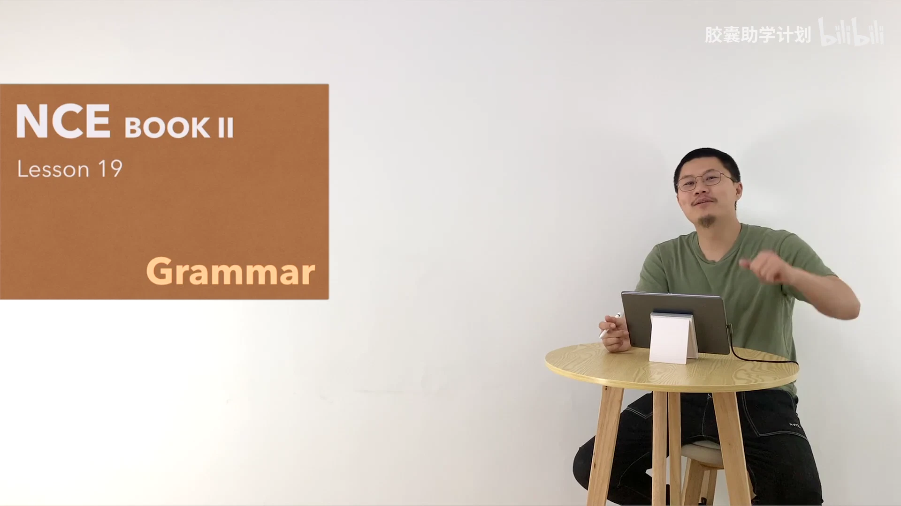

文字识别：胶囊助学计划 / NCE / BOOKII / Lesson 19 / Grammar

### 画面 00:00:03

文字识别：胶囊助学计划 / NCE / BOOKII / Lesson 19 / Grammar

### 画面 00:00:05

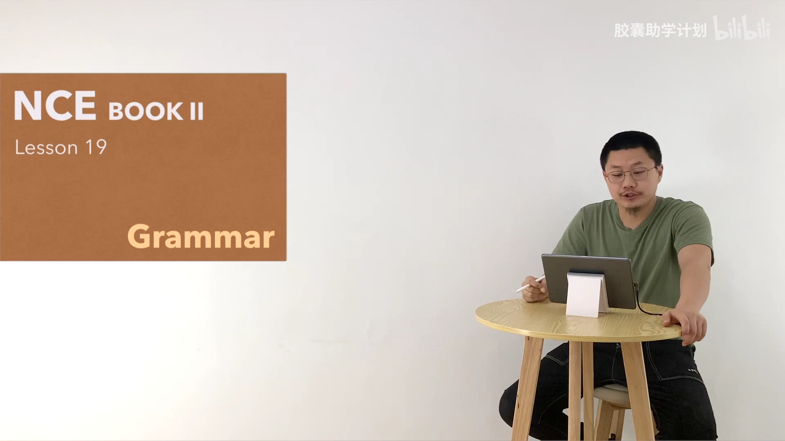

文字识别：胶囊助学计划 / NCE / BOOKI"I / Lesson 19 / Grammar

### 画面 00:00:09

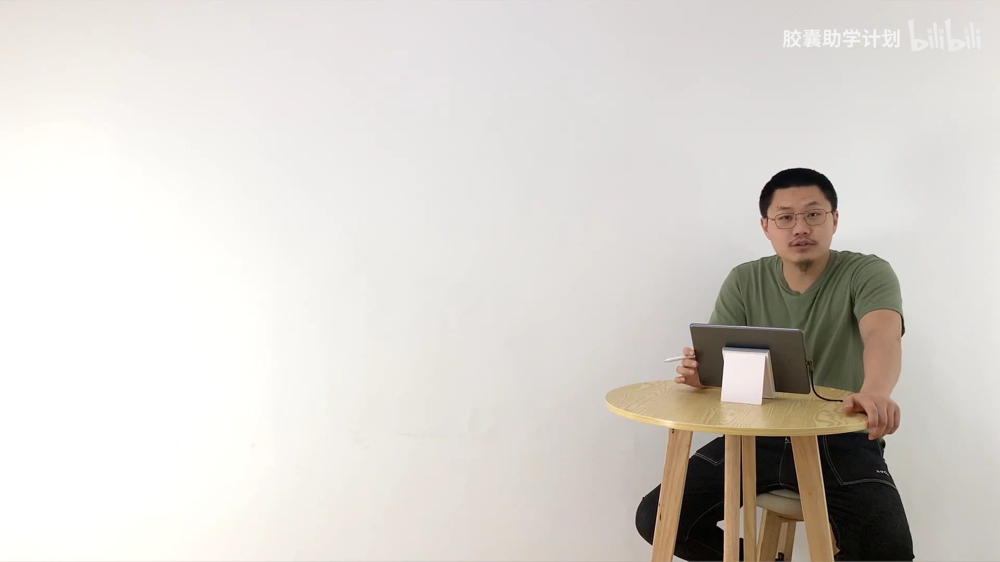

文字识别：胶囊助学计划

### 画面 00:00:11

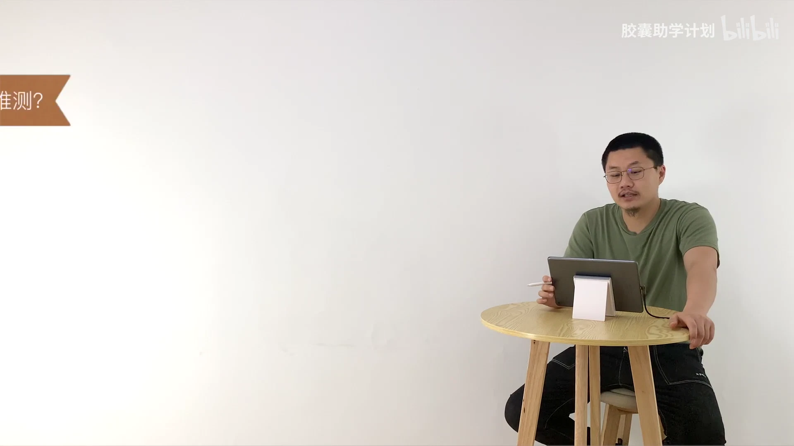

文字识别：胶囊助学计划 / 隹测?

### 画面 00:00:13

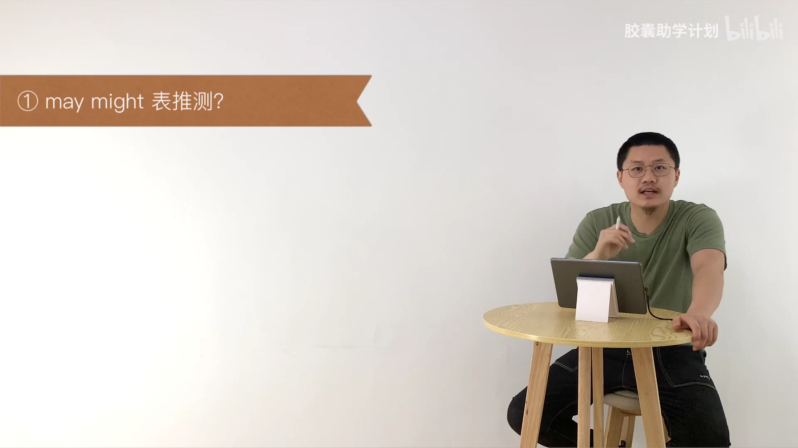

文字识别：胶囊助学计划 / ①may might 表推测？

### 画面 00:00:15

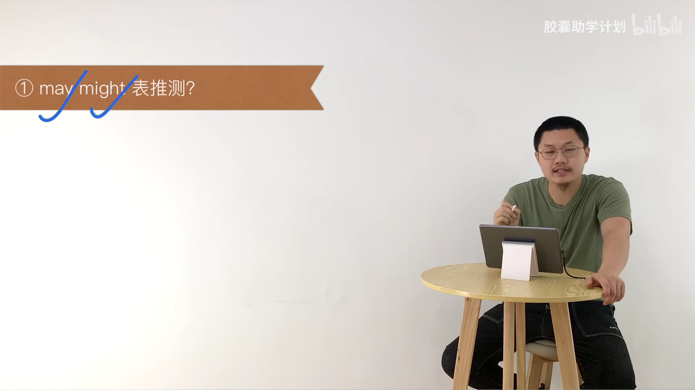

文字识别：Biltbili / 胶囊助学计划 / ①maymight 表推测？

### 画面 00:00:18

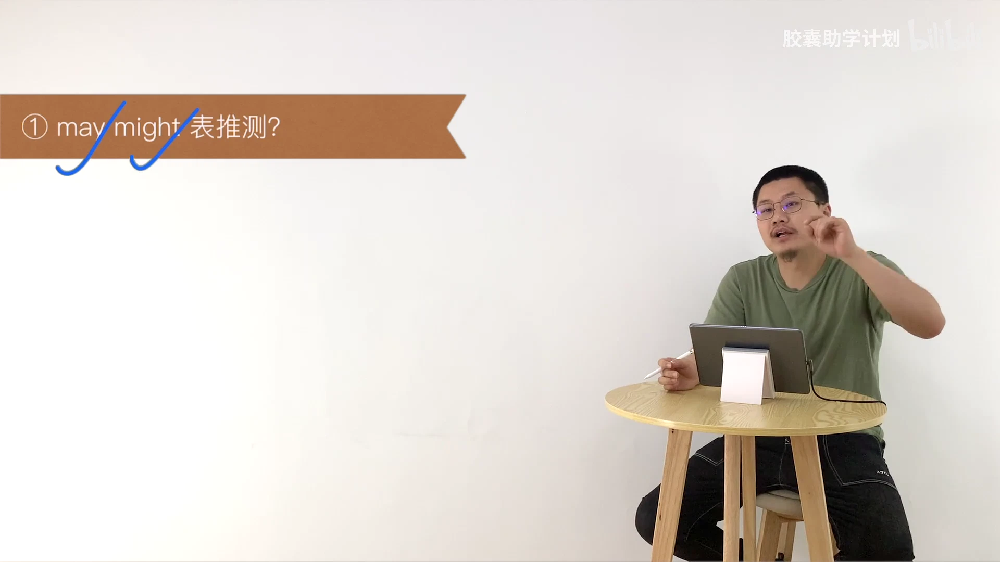

文字识别：胶囊助学计划 / ①may might表推测？

### 画面 00:00:27

文字识别：胶囊助学计划 bilbl / • / •

## 00:00:30–00:01:00

好，那我们上来老习惯，还是先看一下 may 和 might 表推测这个语法，在六一二三四五六当中处于什么样一个位置？那我们如果还有一点印象，首先 may 和 might 我们管它叫做情态动词，其次呢，我们之前学过的 must、can 也是情态动词，那我们就能知道它们同样归属于二，也就是动词加动词变化这个栏之下啊，也是我们

### 画面 00:00:31

文字识别：胶囊助学计划

### 画面 00:00:33

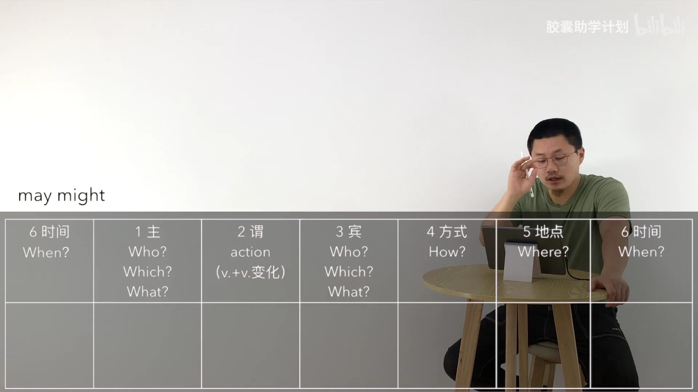

文字识别：胶囊助学计划 / might / may / 6时间 / 1主 / 2谓 / 3宾 / 4方式 / 5地点 / 6时间 / When? / Who? / action / Who? / How? / Where? / When? / Which? / (v.+v.变化) / Which? / What? / What?

### 画面 00:00:52

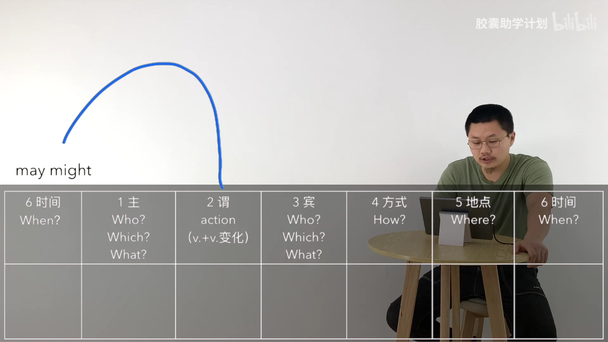

文字识别：胶囊助学计划 / may / might / 6时间 / 1主 / 2谓 / 3宾 / 4方式 / 5地点 / 6时间 / When? / Who? / action / Who? / How? / Where? / When? / Which? / (v.+v.变化) / Which? / What? / What?

## 00:01:00–00:01:30

非常重要造句子一定不能错的那个地方啊。就像我之前说过，我说 in the morning the 您错了这句话，别人依旧能看懂。你说 in morning at morning，甚至 on morning，对吧？明显是一个错误的用法，但老外依旧能懂。但如果关于 are 这个地方的语法，您把 have done 变成了 have been done，对吧？甚至你给它变成了 am is are being done，那别人就完全几乎没办法懂了，或者说理解出来完全是南辕

### 画面 00:01:17

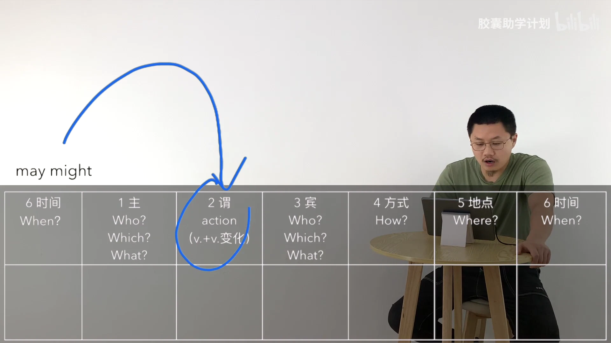

文字识别：胶囊助学计划 / may / might / 6时间 / 1主 / 2谓 / 3宾 / 4方式 / 5地点 / 6时间 / When? / Who? / action / Who? / How? / Where? / When? / Which? / (v.+v.变化 / Which? / What? / What?

## 00:01:30–00:02:00

北辙的一个思路了，OK，所以这个地方非常的重要。那接下来呢，我们一起看一下老习惯 may 和 might 也要去分别给大家介绍现在的推测和表示过去的推测，同样是那么多的公式。好，那我们首先先看第一个 may 和 might 表现在的推测，它的翻译注意对现在不确信的肯定或否定推测。首先我们先

### 画面 00:01:33

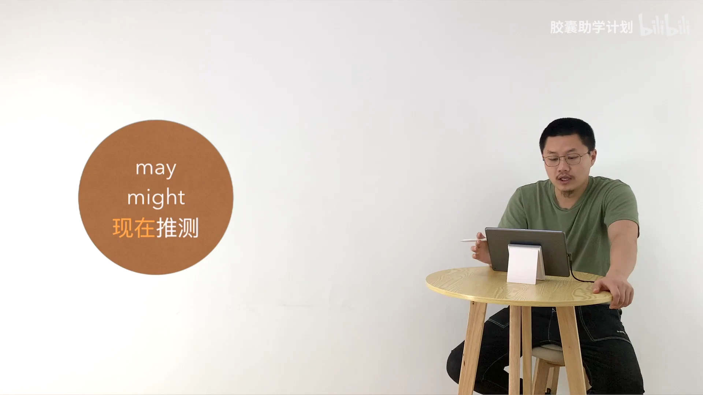

文字识别：胶囊助学计划 / may / might / 现在推测

### 画面 00:01:36

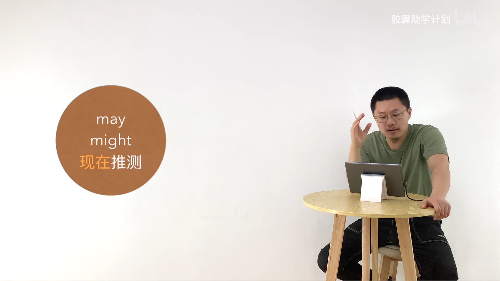

文字识别：胶囊助学计划 / may / might / 现在推测

### 画面 00:01:39

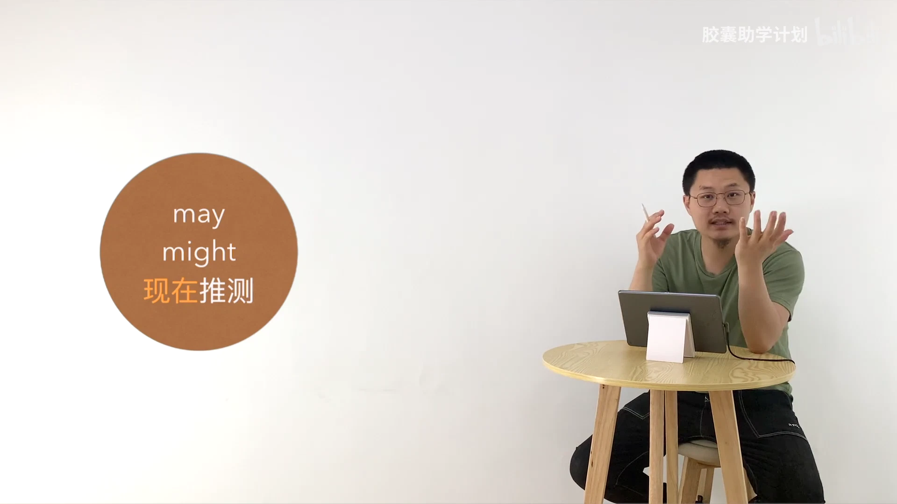

文字识别：胶囊助学计划 / may / might / 现在推测

### 画面 00:01:45

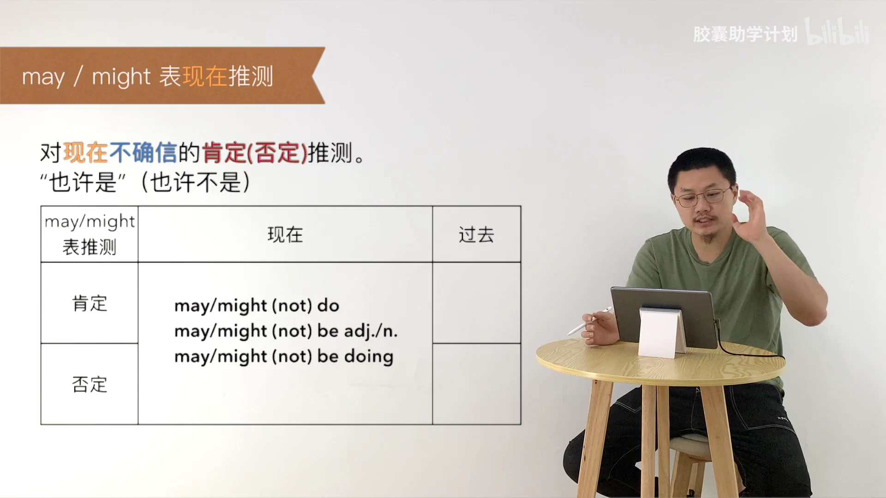

文字识别：胶囊助学计划 / may /might 表现在推测 / 对现在不确信的肯定(否定)推测。 / “也许是”( / （也许不是） / may/might / 现在 / 过去 / 表推测 / 肯定 / may/might (not) do / may/might (not) be adj./n. / may/might (not) be doing / 否定

### 画面 00:01:47

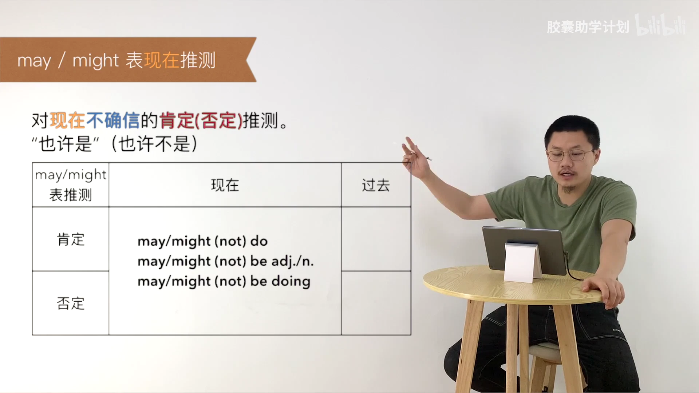

文字识别：胶囊助学计划 / may /might 表现在推测 / 对现在不确信的肯定(否定)推测。 / “也许是”( / （也许不是） / may/might / 现在 / 过去 / 表推测 / 肯定 / may/might (not) do / may/might (not) be adj./n. / may/might (not) be doing / 否定

### 画面 00:01:53

文字识别：胶囊助学计划 / may /might 表现在推测 / 对见在不确信的肯定(否定)推测。 / “也许是” / （也许不是） / may/might / 现在 / 过去 / 表推测 / 肯定 / may/might (not) do / may/might (not) be adj./n. / may/might (not) be doing / 否定

### 画面 00:01:57

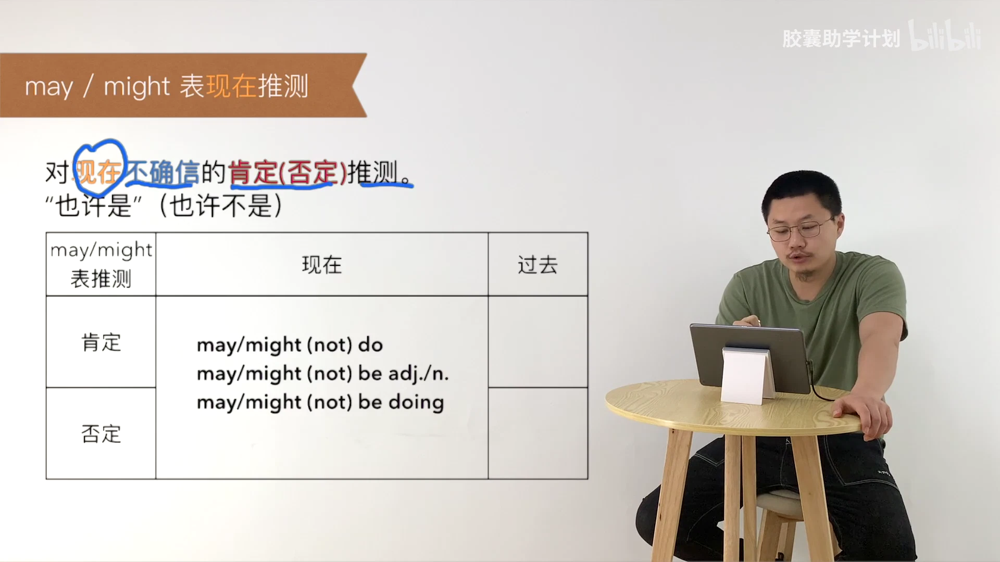

文字识别：胶囊助学计划 / may /might 表现在推测 / 对见在不确信的肯定(否定)推测。 / “也许是 / （也许不是） / may/might / 现在 / 过去 / 表推测 / 肯定 / may/might (not) do / may/might (not) be adj./n. / may/might (not) be doing / 否定

## 00:02:00–00:02:30

判断几个小点。现在指的是时间，对吧？放在了这个地方啊，那对应的就是过去这个概念。不确信，我们之前学 can 跟 must 的时候，不管它是现在也好，过去也好，肯定也好，否定也好，它都是叫做确信的推测，所以它翻译成的叫做一定，对吧？可以是一定，是；可以是一定，不是；可以是当时一定，是；可以是当时一定不是。但是现在 may 和

### 画面 00:02:00

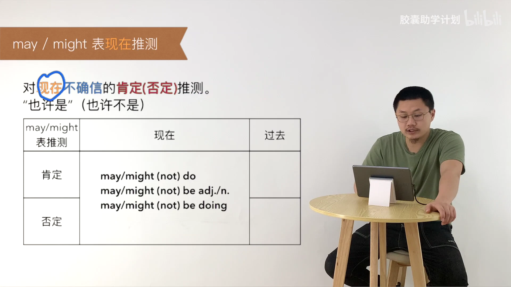

文字识别：胶囊助学计划 / may / might 表现在推测 / 对见在不确信的肯定(否定)推测。 / “也许是” / （也许不是） / may/might / 现在 / 过去 / 表推测 / 肯定 / may/might (not) do / may/might (not) be adj./n. / may/might (not) be doing / 否定

### 画面 00:02:02

文字识别：胶囊助学计划 / may /might 表现在推测 / 对现在不确信的肯定(否定)推测。 / “也许是”(也许不是) / may/might / 现在 / 过去 / 表推测 / 肯定 / may/might (not) do / may/might (not) be adj./n. / may/might (not) be doing / 否定

### 画面 00:02:05

文字识别：胶囊助学计划 / may /might 表现在推测 / 对现在不确信的肯定(否定)推测。 / “也许是” / （也许不是） / may/might / 现在 / 过去 / 表推测 / 肯定 / may/might (not) do / may/might (not) be adj./n. / may/might (not) be doing / 否定

### 画面 00:02:09

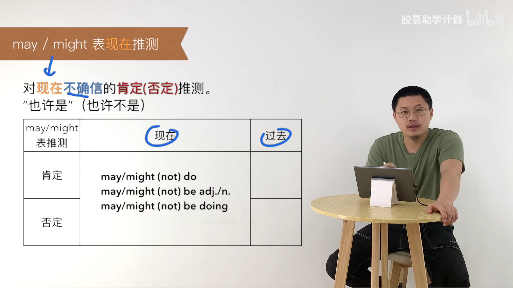

文字识别：胶囊助学计划 / may /might 表现在推测 / 对现在不确信的肯定(否定)推测。 / “也许是”(也许不是) / may/might / 现在 / 过丢 / 表推测 / 肯定 / may/might (not) do / may/might (not) be adj./n. / may/might (not) be doing / 否定

## 00:02:30–00:03:00

might 都翻译成叫不确信，所以它往往翻译成叫做也许是或也许不是，可能是或可能不是。这是我们表示汉语当中不确信的一些汉字，对吧？然后呢，它可以是肯定或括号里边一个否定。我们怎么去判断是肯定还是否定呢？这个就很简单了，由有没有 not 这个单词去确定，有它就是否定，没它就是肯

### 画面 00:02:34

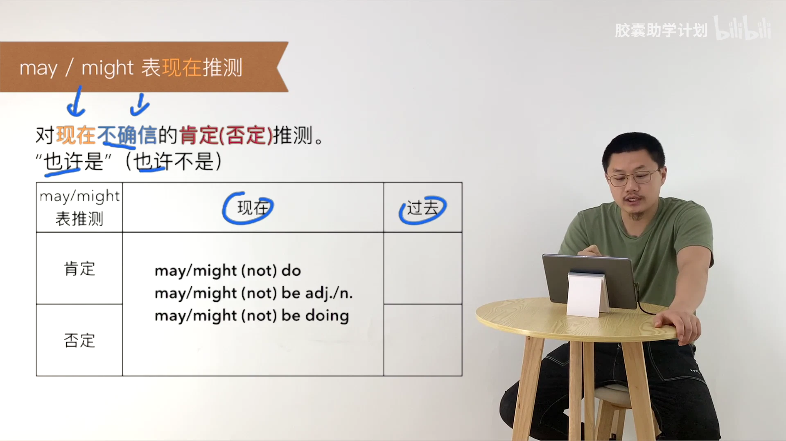

文字识别：胶囊助学计划 / may/might 表现在推测 / 对现在不确信的肯定(否定)推测。 / '也许是” / （也许不是） / may/might / 现在 / 过去 / 表推测 / 肯定 / may/might (not) do / may/might (not) be adj./n. / may/might (not) be doing / 否定

### 画面 00:02:48

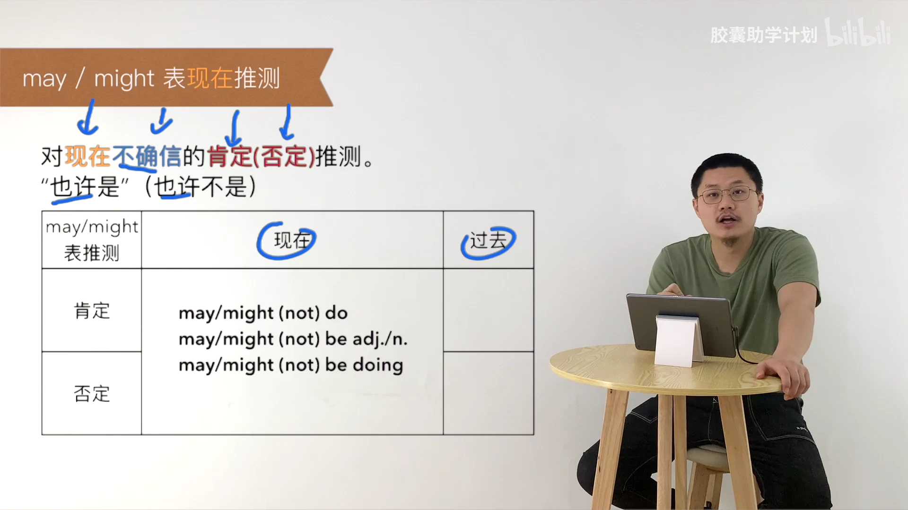

文字识别：胶囊助学计划 / may /might 表现在推测 / 对现在不确信的肯定(否定)推测。 / '也许是” / （也许不是） / may/might / 现在 / 过去 / 表推测 / 肯定 / may/might (not) do / may/might (not) be adj./n. / may/might (not) be doing / 否定

### 画面 00:02:54

文字识别：胶囊助学计划 / may /might 表现在推测 / 对现在不确信的肯定(否定)推测。 / “也许是” / （也许不是） / may/might / 现在 / 过去 / 表推测 / 肯定 / may/might / not) do / may/might(not) be adj./n. / may/might(not) be doing / 否定

### 画面 00:02:58

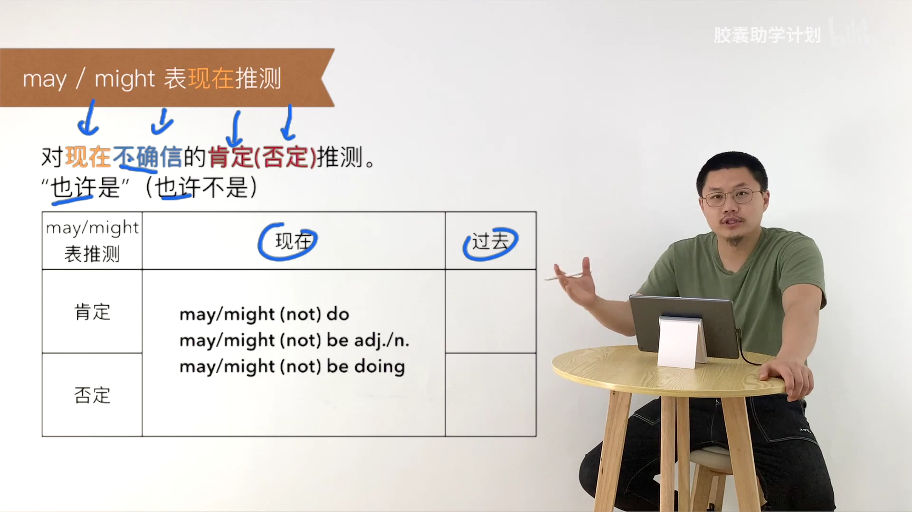

文字识别：胶囊助学计划 / may /might 表现在推测 / 对现在不确信的肯定(否定)推测。 / “也许是” / （也许不是） / may/might / 现在 / 过丢 / 表推测 / 肯定 / may/might (not) do / may/might (not) be adj./n. / may/might (not) be doing / 否定

## 00:03:00–00:03:30

定。学到今天这个知识点应该不费劲了，对吧？那接下来我们一起看一下它的公式啊。哦，最后还差一个，说翻译成也许是或也许不是。接下来我们看一下它的公式。首先，我们就把公式给它拆一下，拆成第一个部分、第二个部分和第三个部分。我们看一下这三个部分，对于各位来说就很容易理解了。首先，may和might您随便互换。虽然might是may的过去式，但是

### 画面 00:03:08

文字识别：胶囊助学计划 / may /might 表现在推测 / 对现在不确信的肯定(否定)推测。 / “也许是”（也许不是) / may/might / 现在 / 过去 / 表推测 / 肯定 / may/might (not) do / may/might (not) be adj./n. / may/might (not) be doing / 否定

### 画面 00:03:14

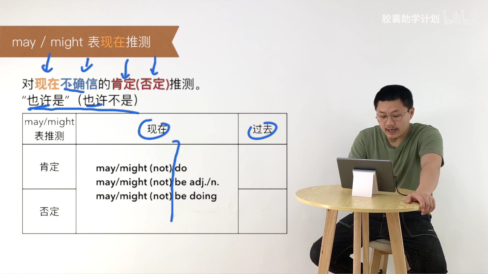

文字识别：胶囊助学计划 / may /might 表现在推测 / 对现在不确信的肯定(否定)推测。 / “也许是”（也许不是） / may/might / 现在 / 过丢 / 表推测 / 肯定 / may/might (not)do / may/might (not)be adj./n. / may/might (not)be doing / 否定

### 画面 00:03:16

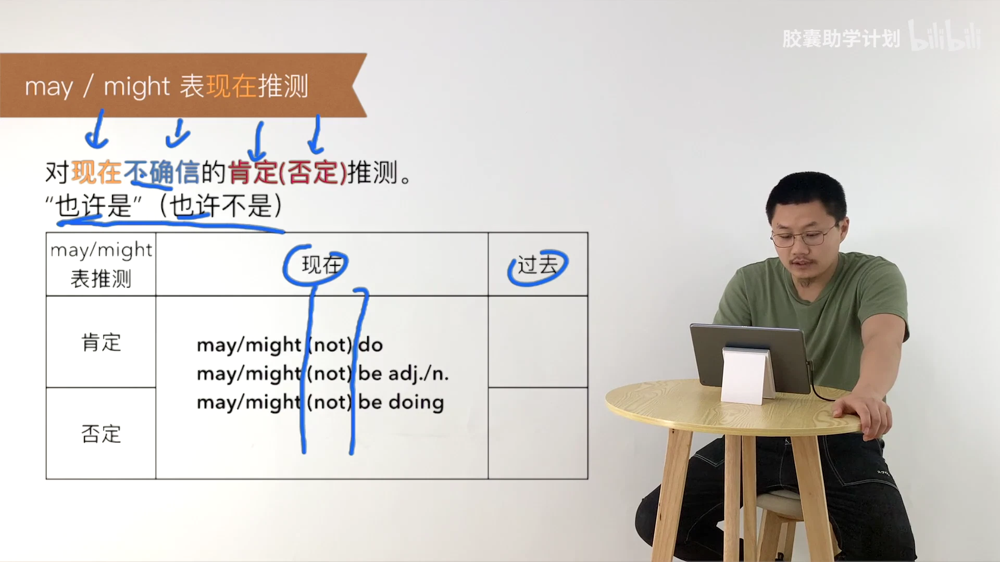

文字识别：胶囊助学计划 / may /might 表现在推测 / 对现在不确信的肯定(否定)推测。 / “也许是”（也许不是） / may/might / 现在 / 过去 / 表推测 / 肯定 / may/mightnot)do / may/might(not)be adj./n. / may/might(not)be doing / 否定

### 画面 00:03:26

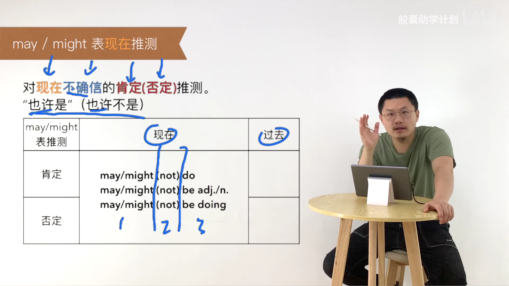

文字识别：胶囊助学计划 / may/might 表现在推测 / 对现在不确信的肯定(否定)推测。 / “也许是”（也许不是) / may/might / 现在 / 过丢 / 表推测 / 肯定 / may/might(not)do / may/might(not)be adj./n. / may/might(not)be doing / 否定 / 2 / 2

## 00:03:30–00:04:00

在这个推测用法当中，注意没有这个说法，他们都可以表示现在。OK，其次啊，所以这是第一个点。那他们二者共同提供的其实就是表示不确信，推测上的不确信。第二个地方，not这个地方它提供的就是有它否定，没它肯定，这很简单。再看后面，如果十七课各位学的足够的好，那在这儿你应该有一个似曾相识的

### 画面 00:03:37

文字识别：胶囊助学计划 / may /might 表现在推测 / 1 / 对现在不确信的肯定(否定)推测。 / “也许是”（也许不是） / may/might / 现在 / 过去 / 表推测 / 肯定 / may/might(not)do / may/might(not)be adj./n. / may/might(not)be doing / 否定 / z

## 00:04:00–00:04:30

感觉，为什么呢？因为我们当时无非就是把 may might 换成了 must 或者是 can't，而第三个部分 do be 形容词名词或 be doing 这个地方没有任何的改变，见到他们就是表现在。那这就是公式。我们接下来呢，光给大家公式是没用的，我们还是放到这个句子当中，跟着我一起去看一下。来了啊，用到的就是这些公式。说 you are looking for a ball，你正

### 画面 00:04:07

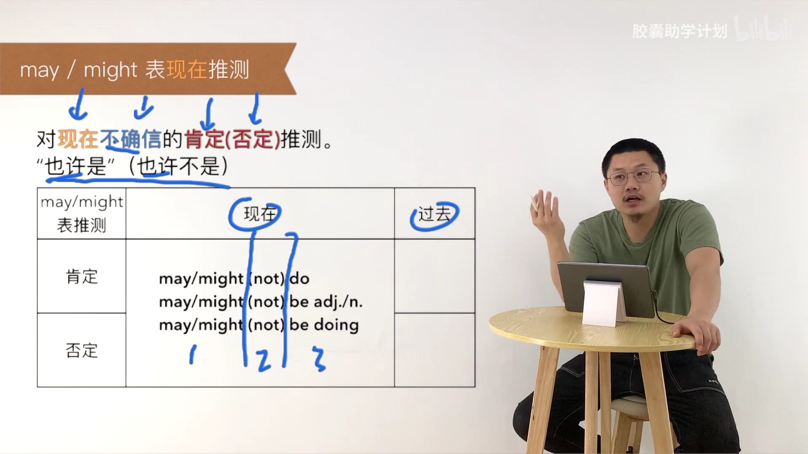

文字识别：胶囊助学计划 / may/might 表现在推测 / 对现在不确信的肯定(否定)推测。 / “也许是”（也许不是) / may/might / 现在 / 过去 / 表推测 / 肯定 / may/mightnot)do / may/might(not)be adj./n. / may/might(not)be doing / 否定

### 画面 00:04:20

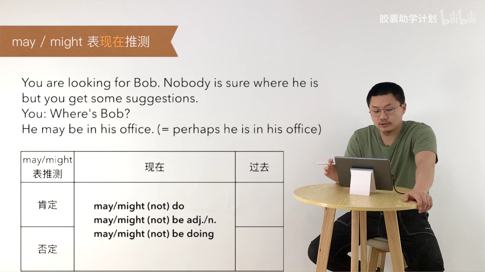

文字识别：胶囊助学计划 / may /might 表现在推测 / You are looking for Bob. Nobody is sure where he is / but you get some suggestions. / You: Where's Bob? / He may be in his office.(= perhaps he is in his office) / may/might / 现在 / 过去 / 表推测 / 肯定 / may/might (not) do / may/might (not) be adj./n. / may/might (not) be doing / 否定

## 00:04:30–00:05:00

在找 Bob. Nobody is sure where he is, but you get some suggestions. 说没有人知道他具体在哪，但是你得到了一些建议。这提供的是场景。我们看一下这个建议。你问说 where is Bob? 别人回答说 he may be in his office. 好，对于各位来说，看到这儿就是第二个，对吧？May 或 might. 当然，这个的 may 完全可以换成 might be. OK. 那没有 not 就是也许是

### 画面 00:04:50

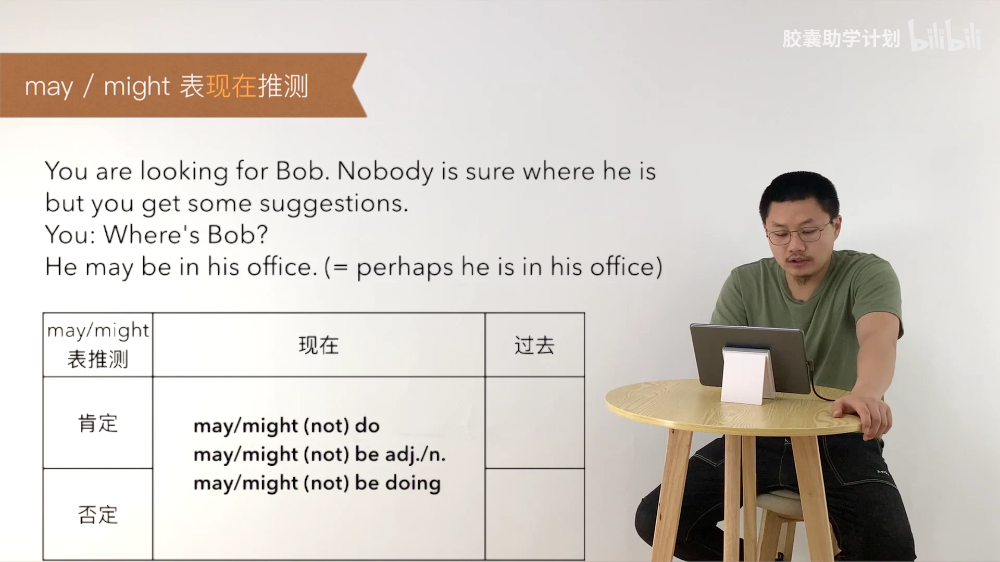

文字识别：胶囊助学计划 / may /might 表现在推测 / You are looking for Bob. Nobody is sure where he is / but you get some suggestions. / You: Where's Bob? / He may be in his office.(= perhaps he is in his office) / may/might / 现在 / 过去 / 表推测 / 肯定 / may/might (not) do / may/might (not) be adj./n. / may/might (not) be doing / 否定

## 00:05:00–00:05:30

be加形容词或名词。那当然在这儿它加了一个类似于名词的一个介词短语，对吧？In his office，所以它翻译成的叫做他可能是或也许是在他的办公室里。注意，并且表示的是现在，并不是表示之前人在什么地方，表示的是现在可能是正在他的办公室里。OK，好，接下来再来啊，继续。You're looking for Bob. Nobody is sure where

### 画面 00:05:20

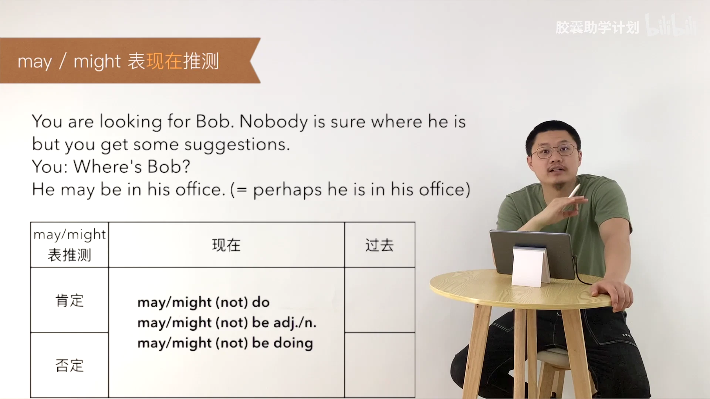

文字识别：胶囊助学计划 / may /might 表现在推测 / You are looking for Bob. Nobody is sure where he is / but you get some suggestions. / You: Where's Bob? / He may be in his office.(= perhaps he is in his office) / may/might / 现在 / 过去 / 表推测 / 肯定 / may/might (not) do / may/might (not) be adj./n. / may/might (not) be doing / 否定

### 画面 00:05:23

文字识别：胶囊助学计划 / may /might 表现在推测 / You are looking for Bob. Nobody is sure where he is / but you get some suggestions. / You: Where's Bob? / He may be in his office.(= perhaps he is in his office) / may/might / 现在 / 过去 / 表推测 / 肯定 / may/might (not) do / may/might (not) be adj./n. / may/might (not) be doing / 否定

### 画面 00:05:26

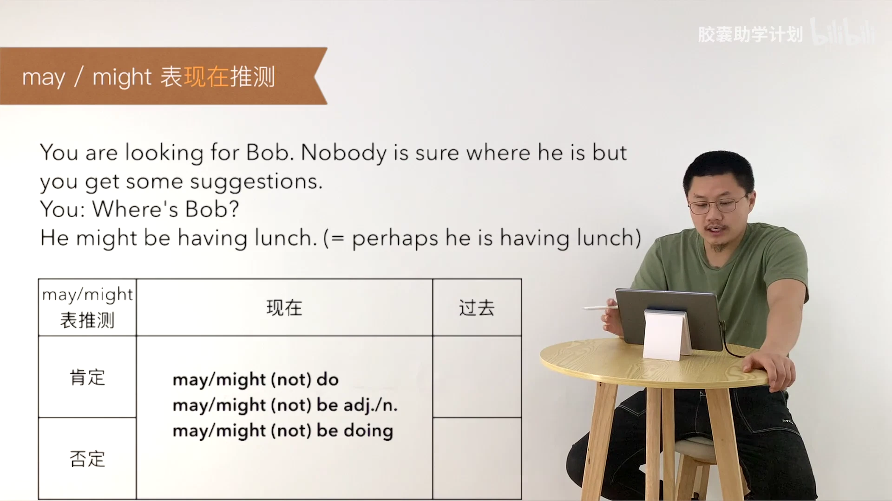

文字识别：胶囊助学计划 / may /might 表现在推测 / You are looking for Bob. Nobody is sure where he is but / you get some suggestions. / You: Where's Bob? / He might be having lunch.(= perhaps he is having lunch) / may/might / 现在 / 过去 / 表推测 / 肯定 / may/might (not) do / may/might (not) be adj./n. / may/might (not) be doing / 否定

## 00:05:30–00:06:00

he is. But you get some suggestions. Say where is Bob? Say in which place? He might be having lunch. Look, this is the third one. May or might. Similarly, this place might can also be replaced by may. No not. Then be doing be having lunch. This is translated as he might be having lunch. This is translated as he might be having lunch. This is translated as he might be having lunch. This is translated as he might be having lunch.

### 画面 00:05:56

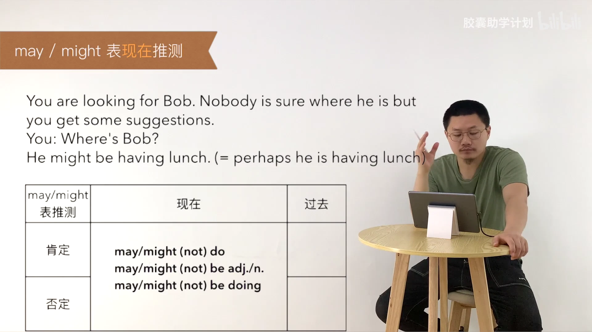

文字识别：胶囊助学计划 / may /might 表现在推测 / You are looking for Bob. Nobody is sure where he is but / you get some suggestions. / You: Where's Bob? / He might be having lunch.(= perhaps he is having lunch) / may/might / 现在 / 过去 / 表推测 / 肯定 / may/might (not) do / may/might (not) be adj./n. / may/might (not) be doing / 否定

## 00:06:00–00:06:30

大概啊，是这样一种不非常确信的一种确信度。OK，其次呢，它没有not，所以是肯定，叫做也许是正在吃午餐。那如果我想说也许没有正在吃午餐，那就非常简单了，might not be having lunch，就这么简单，对吧？您在这个地方加一个not，这个事儿就搞定了。There you go，接下来再来，还是We're looking for Bob. Nobody is sure where he is. But he get some

### 画面 00:06:18

文字识别：胶囊助学计划 / may /might 表现在推测 / You are looking for Bob. Nobody is sure where he is but / you get some suggestions. / You: Where's Bob? / He mighy/be having lunch.(= perhaps he is having lunch) / may/might / 现在 / 过去 / 表推测 / 肯定 / may/might (not) do / may/might (not) be adj./n. / may/might (not) be doing / 否定

### 画面 00:06:20

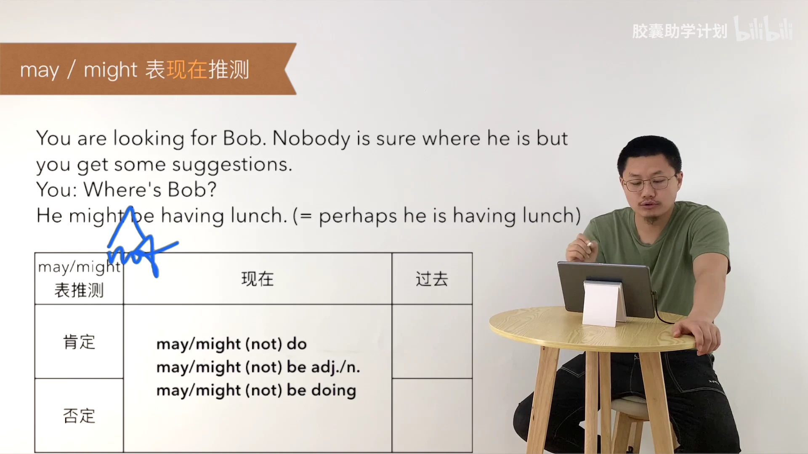

文字识别：胶囊助学计划 / may /might 表现在推测 / You are looking for Bob. Nobody is sure where he is but / you get some suggestions. / You: Where's Bob? / He mighype having lunch.(= perhaps he is having lunch) / A / may/might / 现在 / 过去 / 表推测 / 肯定 / may/might (not) do / may/might (not) be adj./n. / may/might (not) be doing / 否定

### 画面 00:06:24

文字识别：胶囊助学计划 / may /might 表现在推测 / You are looking for Bob. Nobody is sure where he is / but you get some suggestions. / You: Where's Bob? / Ask Ann. She might know. (= perhaps she knows) / may/might / 现在 / 过去 / 表推测 / 肯定 / may/might (not) do / may/might (not) be adj./n. / may/might (not) be doing / 否定

## 00:06:30–00:07:00

### 画面 00:06:50

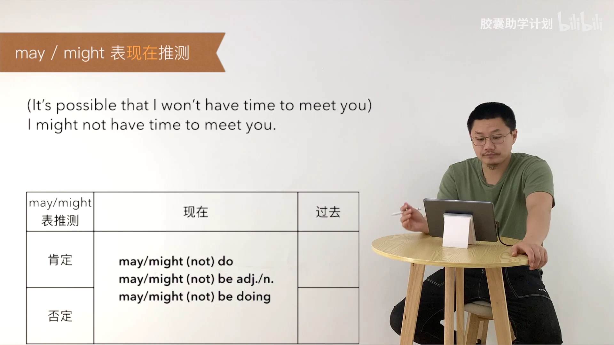

文字识别：胶囊助学计划 / may/might 表现在推测 / (It's possible that I won't have time to meet you) / I might not have time to meet you. / may/might / 现在 / 过去 / 表推测 / 肯定 / may/might (not) do / may/might (not) be adj./n. / may/might (not) be doing / 否定

## 00:07:00–00:07:30

might not have time to meet you. Might not have time,有时间去见你。你看，它其实就是第一个公式，might后边加了一个not，然后have time，have time动词原形，对吧？我可能没有时间去见你。Very good。接下来我们看一个小的电影片段当中出现了叫做Harvey may not know you well enough。他可能不是非常

### 画面 00:07:18

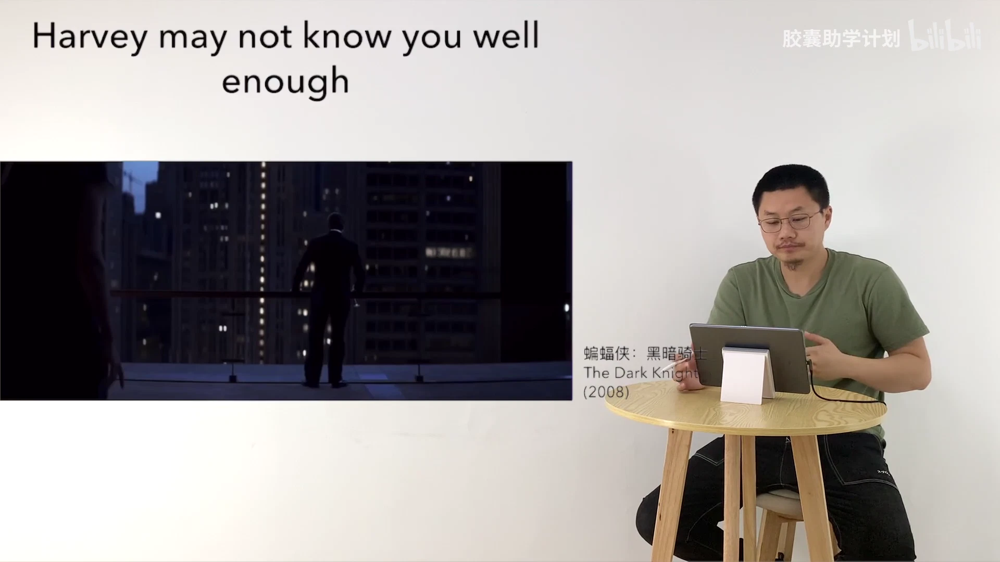

文字识别：Harvey may not know you well / 胶囊助学计划 / enough / 蝙蝠侠：黑暗骑 / The Dark Knight / (2008)

## 00:07:30–00:08:00

了解你来了。 Harvey may not know you well enough to understand when you're making fun of him, but I do. No, I mean every word. Okay, may not know you well enough. Continue. May 和 might 还可以表示过去的一个推测。我们之前讲了现在的推测，那它还可以表示过去的推测。您仔细可以先暂停视频，回顾一下 can 与 must 表过去推测

### 画面 00:07:32

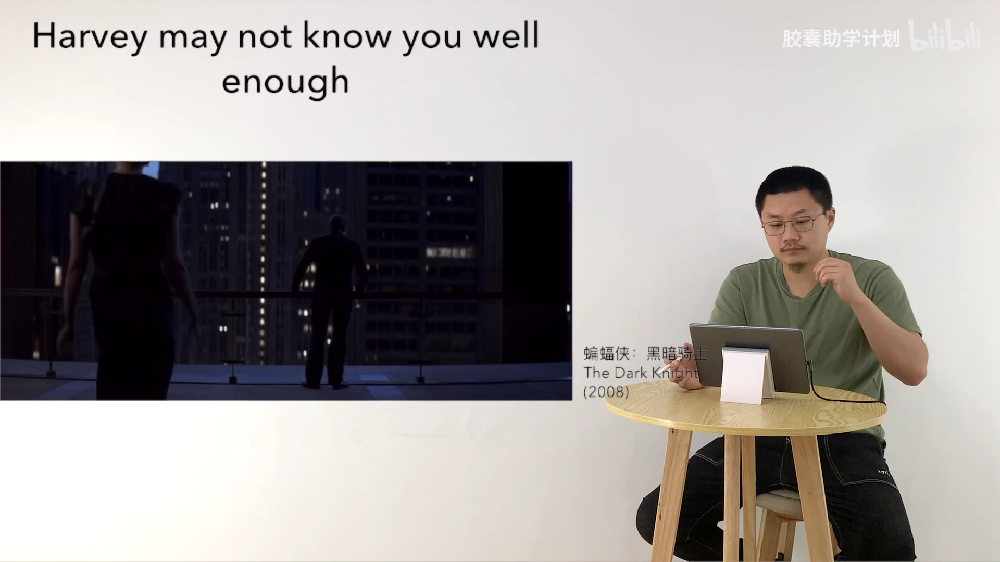

文字识别：Harvey may not know you well / 胶囊助学计划 / enough / 蝙蝠侠：黑暗骑 / The Dark Knight / (2008)

### 画面 00:07:34

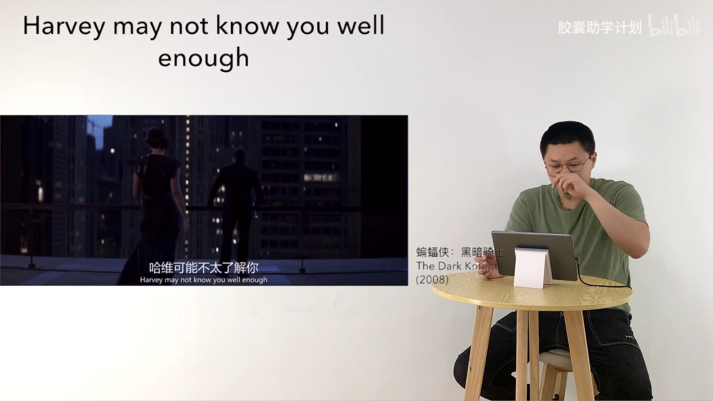

文字识别：Harvey may not know you well / 胶囊助学计划 / enough / 蝙蝠侠：黑暗骑 / 哈维可能不太了解你 / The Dark Knignt / Harvey may not know you well enough / (2008)

### 画面 00:07:36

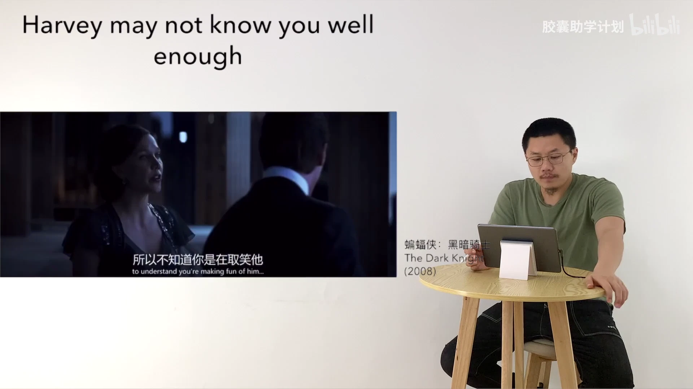

文字识别：Harvey may not know you well / 胶囊助学计划 / enough / 蝙蝠侠：黑暗骑 / 所以不知道你是在取笑他 / The Dark Knight / to understand you're making fun of him. / (2008)

### 画面 00:07:38

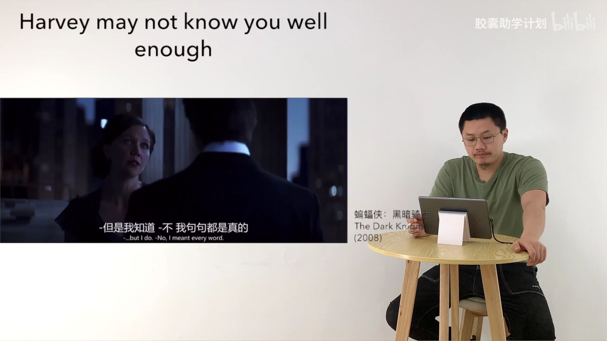

文字识别：Harvey may not know you well / 胶囊助学计划 / enough / 蝙蝠侠：黑暗骑 / -但是我知道-不 我句句都是真的 / The Dark Knight / -..but I do.-No, I meant every word. / (2008)

### 画面 00:07:40

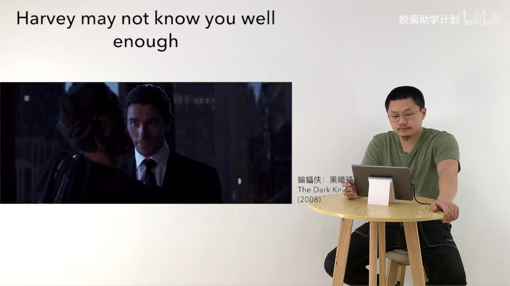

文字识别：Harvey may not know you well / 胶囊助学计划 / enough / 蝙蝠侠：黑暗骑 / The Dark Knignt / (2008)

### 画面 00:07:44

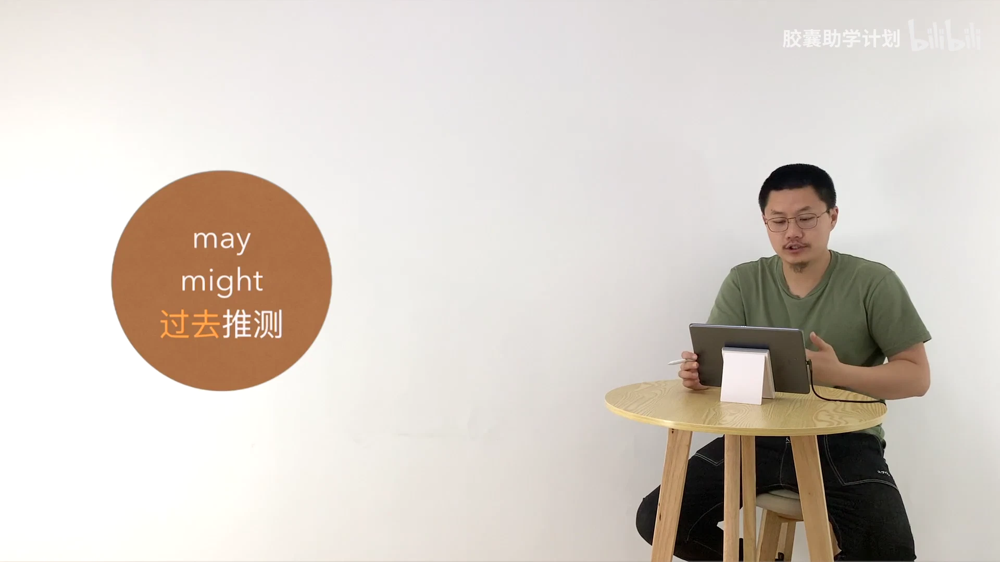

文字识别：胶囊助学计划 / may / might / 过去推测

### 画面 00:07:50

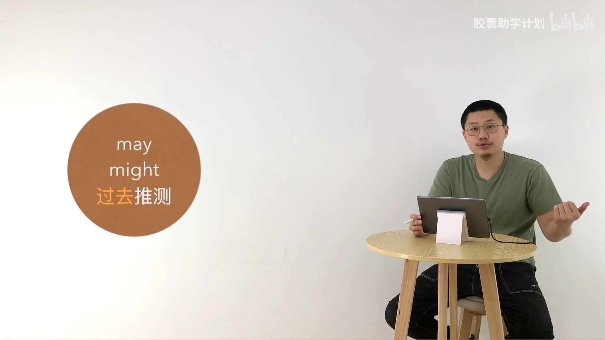

文字识别：胶囊助学计划 / may / might / 过去推测

### 画面 00:07:54

文字识别：胶囊助学计划 / may / might / 过去推测

### 画面 00:07:59

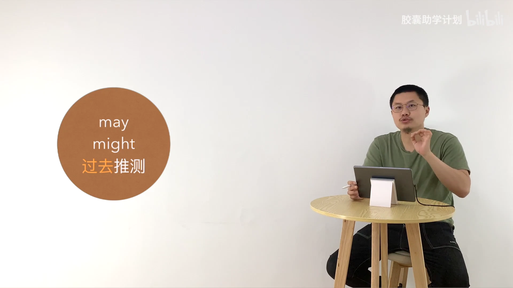

文字识别：胶囊助学计划 / may / might / 过去推测

## 00:08:00–00:08:30

的那个公式，对于各位来说，现在要做的事情就是把 may 啊把 can 或 must 换成 may 或 might，这个公式就出来了。我们看一下是不是似曾相识啊。首先，对过去时间换成过去了，不确信，确信程度没有变，也就是说，见到 may 和 might 就翻译成也许，只不过可能表示也许正在进行，也许可以表示在过去正在进行，对吧？肯定或否定推

### 画面 00:08:11

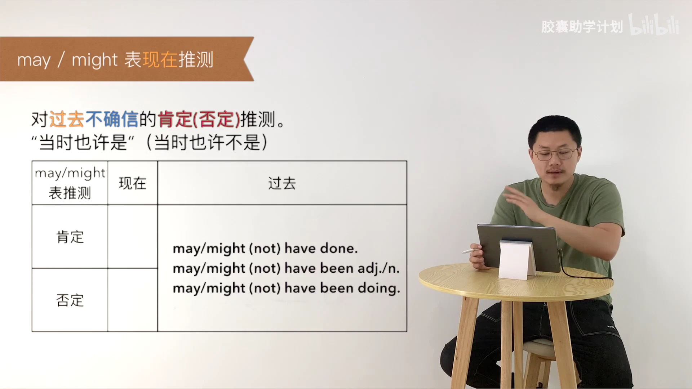

文字识别：胶囊助学计划 / may/might 表现在推测 / 对过去不确信的肯定(否定)推测。 / 当时也许是”（当时也许不是) / may/might / 现在 / 过去 / 表推测 / 肯定 / may/might (not) have done. / may/might (not) have been adj./n. / may/might (not) have been doing. / 否定

### 画面 00:08:15

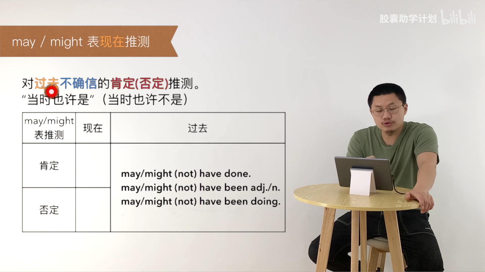

文字识别：胶囊助学计划 / may/might 表现在推测 / 对过去不确信的肯定(否定)推测。 / '当时也许是” / （当时也许不是） / may/might / 现在 / 过去 / 表推测 / 肯定 / may/might (not) have done. / may/might (not) have been adj./n. / may/might (not) have been doing. / 否定

## 00:08:30–00:09:00

测由 not 决定，翻译成当时也许是或当时也许不是。我们看一下公式，老习惯拆成三个部分，一、二、三。第二个部分很容易理解，第二个部分决定了它是肯定还是否定。那第一个部分没有变化，它决定的就是也许这二字就是表不确信。而后面的我们看一下啊，我们把它去掉。而后面的这个部分

### 画面 00:08:35

文字识别：胶囊助学计划 / may/might 表现在推测 / 对过去不确信的肯定(否定)推测。 / 当时也许是”（当时也许不是) / may/might / 现在 / 过去 / 表推测 / 肯定 / may/might (not) have done. / may/might (not) have been adj./n. / may/might (not) have been doing. / 否定

### 画面 00:08:37

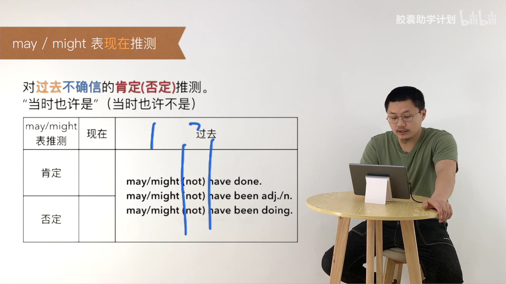

文字识别：bitbil / 胶囊助学计划 / may/might 表现在推测 / 对过去不确信的肯定(否定)推测。 / “当时也许是” / （当时也许不是） / may/might / 现在 / 过去 / 表推测 / 肯定 / may/might(not)nave done. / may/might / tnot)nave been adj./n. / may/might / not) / )nave been doing. / 否定

### 画面 00:08:40

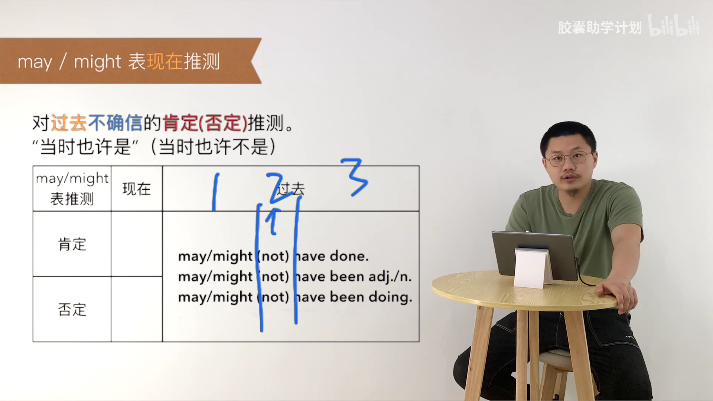

文字识别：胶囊助学计划 / may/might 表现在推测 / 对过去不确信的肯定(否定)推测。 / 当时也许是”( / （当时也许不是） / may/might / 现在 / 对去 / 表推测 / 肯定 / may/might(not)pave done. / may/might / tnot)have been adj./n. / may/might / not) / )ave been doing. / 否定

### 画面 00:08:44

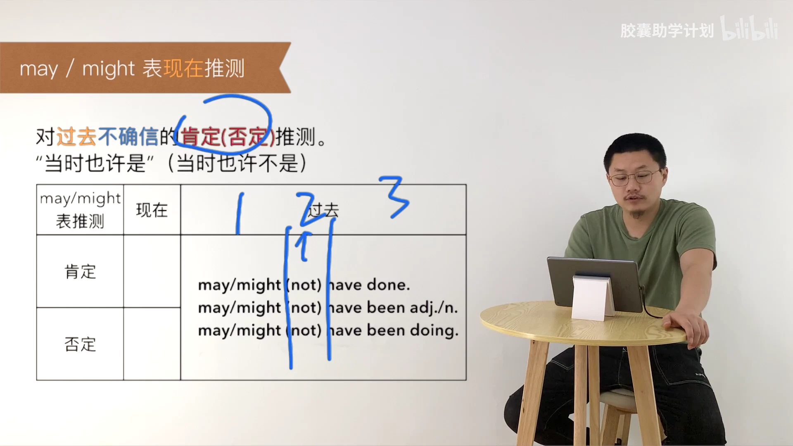

文字识别：胶囊助学计划 / may/might 表现在推测 / 对过去不确信的（肯定(否定)推测。 / 当时也许是" / (当时也许不是) / may/might / 现在 / 对去 / 表推测 / 肯定 / may/might / (not)nave done. / may/might / not) pave been adj./n. / may/might / not) / )ave been doing. / 否定

### 画面 00:08:46

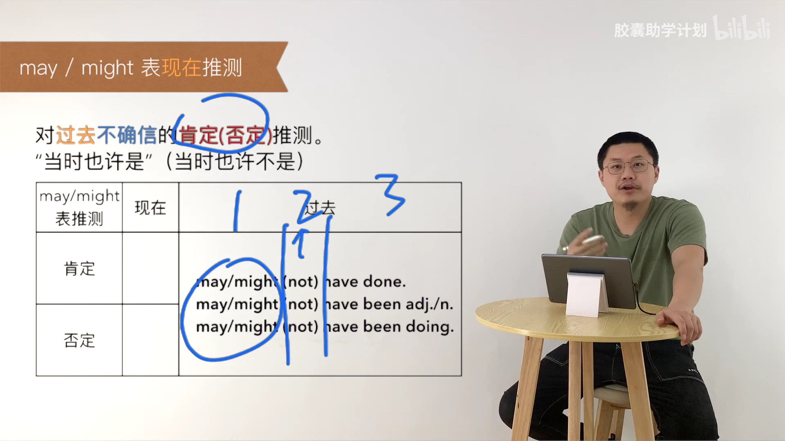

文字识别：胶囊助学计划 / may/might 表现在推测 / 对过去不确信的（肯定(否定)推测。 / 当时也许是" / (当时也许不是) / may/might / 现在 / 对去 / 表推测 / 肯定 / may/migh(not)nave done. / may/mightnot)nave l / been adj./n. / may/migh/not) / have /  been doing. / 否定

### 画面 00:08:49

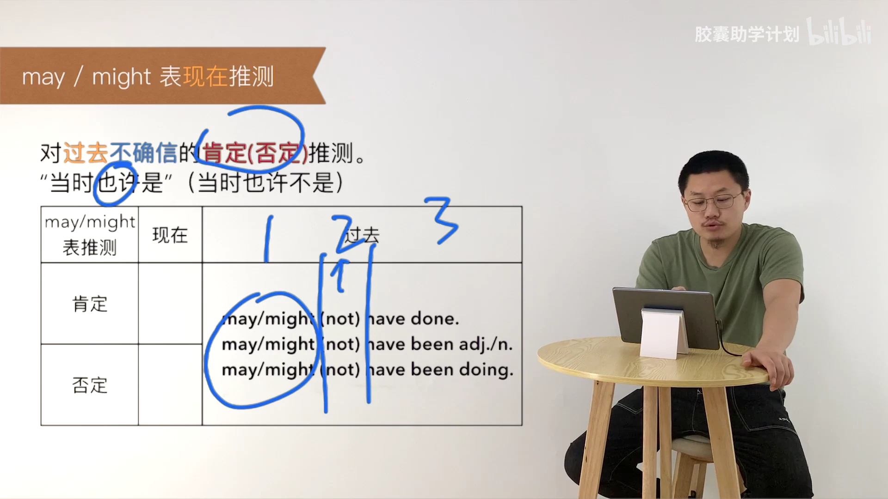

文字识别：Bitbil / 胶囊助学计划 / may/might 表现在推测 / 对过去不确信的（肯定(否定)推测。 / '当时也许是" / (当时也许不是） / may/might / 现在 / 对去 / 表推测 / 肯定 / may/migh(not)have / done. / may/mightnot) have / been adj./n. / may/migh/not) / have / been doing. / 否定

### 画面 00:08:51

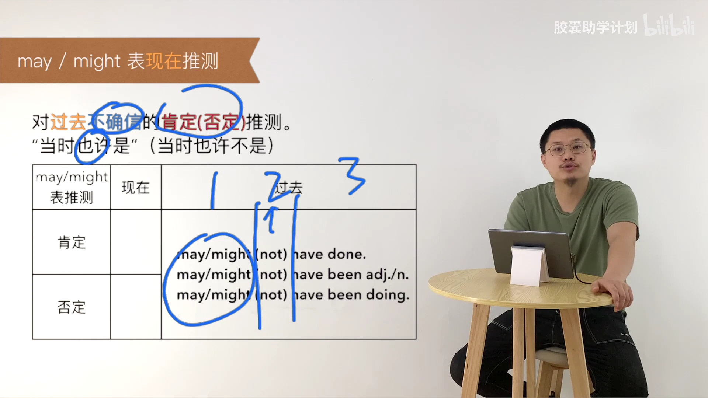

文字识别：胶囊助学计划 / may /might 表现在推测 / 对过去不确信的（肯定(否定)推测。 / 当时也许是" / (当时也许不是） / may/might / 现在 / 对去 / 表推测 / 肯定 / may/migh (not)nave / done. / may/mightnot) have / been adj./n. / may/migh/not) / have / been doing. / 否定

### 画面 00:08:55

文字识别：胶囊助学计划 / may/ might 表现在推测 / 对过去不确信的肯定(否定)推测。 / 当时也许是”( / （当时也许不是） / may/might / 现在 / 对去 / 表推测 / 肯定 / may/might(not) nave done. / may/might / tnot)have been adj./n. / may/might / not) / )ave been doing. / 否定

### 画面 00:08:57

文字识别：胶囊助学计划 / may/might 表现在推测 / 对过去不确信的肯定(否定)推测。 / 当时也许是”（当时也许不是) / may/might / 现在 / 过去 / 表推测 / 肯定 / may/might (not)have done. / may/might (not)have been adj./n. / may/might (not)have been doing. / 否定

### 画面 00:08:59

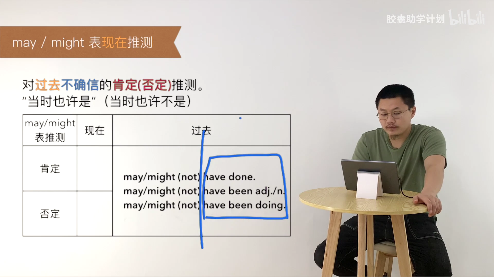

文字识别：胶囊助学计划 / may/ might 表现在推测 / 对过去不确信的肯定(否定)推测。 / 当时也许是”（当时也许不是) / may/might / 现在 / 过去 / 表推测 / 肯定 / may/might (not)have done. / may/might (not)have been adj./n. / may/might (not)have been doing. / 否定

## 00:09:00–00:09:30

have done, have been, have been doing，它表示的就是过去了，所以它就表示当时是怎么怎么样的，对吧？OK，您看一下这个地方的公式，我们把 may 和 might 换成 must 或 can，其实就是十七课学过的那些，没有任何太大本质上的区别。OK，好了，那我们不多说，直接看一些例句。I wonder why Kate didn't answer the phone.

### 画面 00:09:01

文字识别：胶囊助学计划 / may/might 表现在推测 / 对过去不确信的肯定(否定)推测。 / 当时也许是”（当时也许不是) / may/might / 现在 / 过去 / 表推测 / 肯定 / may/might (not) have done. / may/might (not) have been adj./n. / may/might (not) have been doing. / 否定

### 画面 00:09:03

文字识别：胶囊助学计划 / may/might 表现在推测 / 对过去不确信的肯定(否定)推测。 / '当时也许是”(当时也许不是) / may/might / 现在 / 过去 / 7 / 表推测 / 肯定 / may/might (nothave done. / may/might (no) have been adj./n. / may/might (ngt) have been doing. / 否定

### 画面 00:09:12

文字识别：胶囊助学计划 / may /might 表现在推测 / 对过去不确信的肯定(否定)推测。 / 当时也许是”（当时也许不是) / may/might / 现在 / 过去 / 7 / 表推测 / 肯定 / may/might (nothave done. / may/might (no) have been adj./n. / may/might (ngt) have been doing. / 否定

### 画面 00:09:14

文字识别：胶囊助学计划 / may / might 表现在推测 / 对过去不确信的肯定(否定)推测。 / 当时也许是” / (当时也许不是) / may/might / 现在 / 过去 / 7 / 表推测 / huw / 肯定 / may/might (nothave done. / may/migh(no) have been adj./n. / may/miglt (ndt) have been doing. / 否定

### 画面 00:09:16

文字识别：胶囊助学计划 / may/might 表现在推测 / 对过去不确信的肯定(否定)推测。 / 当时也许是" / (当时也许不是） / may/might / 现在 / 过去 / 7 / hrnst / 表推测 / 肯定 / may/might (nothave done. / may/migh(no) have been adj./n. / may/migl/'t (ngt) have been doing. / 否定 / Can

### 画面 00:09:23

文字识别：胶囊助学计划 / may /might 表现在推测 / A: I wonder why Kay didn't answer the phone. / B: She may have been asleep.(= perhaps she was / asleep) / may/might / 现在 / 过去 / 表推测 / 肯定 / may/might (not) have done. / may/might (not) have been adj./n. / may/might (not) have been doing. / 否定

## 00:09:30–00:10:00

She may have been asleep. He, he,

### 画面 00:09:31

文字识别：胶囊助学计划 / may /might 表现在推测 / A: I wonder why Kay didn't answer the phone. / B: She may havē / been asleep.(= perhaps she was / asleep) / may/might / 现在 / 过去 / 表推测 / 肯定 / may/might (not) have done. / may/might (not) have been adj./n. / may/might (not) have been doing. / 否定

### 画面 00:09:34

文字识别：胶囊助学计划 / may / might 表现在推测 / A: I wonder why Kaydidn't answer the phone. / B: She may havē / been asleep.(= perhaps she was / asleep) / may/might / 现在 / 过去 / 表推测 / 肯定 / may/might (not) have done. / may/might (not) have / been adj./n. / may/might (not) have been doing. / 否定

### 画面 00:09:36

文字识别：胶囊助学计划 / may /might 表现在推测 / A: I wonder why I / Kay / didn'tanswer the phone. / B: She may have / been asleep.(= perhaps she was / asleep) / may/might / 现在 / 过去 / 表推测 / 肯定 / may/might (not) have done. / may/might (not) have / been adj./n. / may/might (not) have been doing. / 否定

### 画面 00:09:41

文字识别：胶囊助学计划 / may / might 表现在推测 / A: I wonder why / Kay / didn'tanswer the  / phone. / B: She may have / been asleep.(= perhaps: / she was / asleep) / may/might / 现在 / 过去 / 表推测 / 肯定 / may/might (not) have / done. / may/might (not) have / been adj./n. / may/might (not) have / been doing. / 否定

### 画面 00:09:45

文字识别：胶囊助学计划 / may /might 表现在推测 / A: I can't find my bag anywhere. / B: You might have left it in the shop.(= perhaps you / left it in the shop) / may/might / 现在 / 过去 / 表推测 / 肯定 / may/might (not) have done. / may/might (not) have been adj./n. / may/might (not) have been doing. / 否定

### 画面 00:09:52

文字识别：胶囊助学计划 / may /might 表现在推测 / A: I can't find my bag anywhere. / B: You might have left it in the shop.(= perhaps you / left it in the shop) / may/might / 现在 / 过去 / 表推测 / 肯定 / may/might (not) have done. / may/might (not) have been adj./n. / may/might (not) have been doing. / 否定

### 画面 00:09:55

文字识别：胶囊助学计划 / may /might 表现在推测 / A: I can't find my bag anywhere. / B: You might have left it in the shop.(= perhaps you / left it in the shop) / may/might / 现在 / 过去 / 表推测 / 肯定 / may/might (not) have done. / may/might (not) have been adj./n. / may/might (not) have been doing. / 否定

## 00:10:00–00:10:30

商店了啊，你可能忘了啊。Okay, continue. I wonder, 我很好奇 why Colin was in such a bad mood yesterday. 为什么他昨天心情那么不好？注意过去对吧？说 she may not have been feeling well. 他当时可能感觉并不好。注意 may not have been feeling well. 第三个公式很舒服就出来了。当时也许感觉不

### 画面 00:10:03

文字识别：胶囊助学计划 / may /might 表现在推测 / A: I wonder why Colin was in such a bad mood / yesterday. / B: He may not have been feeling well.(= perhaps / he wasn't feeling well) / may/might / 现在 / 过去 / 表推测 / 肯定 / may/might (not) have done. / may/might (not) have been adj./n. / may/might (not) have been doing. / 否定

### 画面 00:10:09

文字识别：胶囊助学计划 / may /might 表现在推测 / A: I wonder why Colin was in such a bad mood / yesterday. / B: He may not have been feeling well.(= perhaps / he wasn't feeling well) / may/might / 现在 / 过去 / 表推测 / 肯定 / may/might (not) have done. / may/might (not) have been adj./n. / may/might (not) have been doing. / 否定

### 画面 00:10:16

文字识别：胶囊助学计划 / may /might 表现在推测 / A: I wonder why Colin was in such a bad mood / yesterday. / B: He may not have been feeling well. (= perhaps / he wasn't feeling well) / may/might / 现在 / 过去 / 表推测 / 肯定 / may/might (not) have done. / may/might (not) have been adj./n. / may/might (not) have been doing. / 否定

### 画面 00:10:18

文字识别：胶囊助学计划 / may /might 表现在推测 / A: I wonder why Colin was in such a bad mood / yesterday. / B: He may not have been feeling well.(= perhaps / he wasn't feeling well) / may/might / 现在 / 过去 / 表推测 / 肯定 / may/might (not) have done. / may/might (not) have been adj./n. / may/might (not) have been doing. / 否定

### 画面 00:10:23

文字识别：胶囊助学计划 / may /might 表现在推测 / A: I wonder why Colin was in such a bad mood / yesterday. / B: He may not have been feeling well.(= perhaps / he wasn't feeling well) / may/might / 现在 / 过去 / 表推测 / 肯定 / may/might (not) have done. / may/might (not) have been adj./n. / may/might (not) have been doing. / 否定

## 00:10:30–00:11:00

是非常的舒服。OK，接下来我们看一个电影片段，当中出现了“you may have spent”，你之前可能是花费了。当然还出了一个我们之前学过的小短语，叫“look for”，叫寻找某物或某人。来了，What are you talking about? What What is happening to me? You are the one. You You may have spent the last few years looking for me, but I've spent my entire life

### 画面 00:10:32

文字识别：You may have spent... / 胶囊助学计划 / look for / 黑客帝国 / The Matrix / (1999)

### 画面 00:10:38

文字识别：You may have spent... / 胶囊助学计划 / look for / 黑客帝国 / The Matrix / (1999)

### 画面 00:10:44

文字识别：You may have spent... / 胶囊助学计划 / look for / 黑客帝国 / The Matrix / (1999)

### 画面 00:10:48

文字识别：You may have spent... / 胶囊助学计划 / look for / 黑客帝国 / 你在说什么我怎么了 / The Matrix / What are you talking about? What is happening to me? / (1999)

### 画面 00:10:50

文字识别：You may have spent... / 胶囊助学计划 / look for / 黑客帝国 / 你在说什么我怎么了 / The Matrix / What are you talking about? What is happening to me? / (1999)

### 画面 00:10:52

文字识别：You may have spent... / 胶囊助学计划 / look for / 黑客帝国 / 你是救世主尼奥也许这几年 / The Matrix / You are the One, Neo. You see, you may have spent the last few years. / (1999)

### 画面 00:10:54

文字识别：You may have spent... / 胶囊助学计划 / look for / 黑客帝国 / 你是救世主尼奥也许这几年 / The Matrix / You are the One, Neo. You see, you may have spent the last few years. / (1999)

### 画面 00:10:56

文字识别：You may have spent... / 胶囊助学计划 / look for / 黑客帝国 / 你是救世主尼奥也许这几年 / The Matrix / You are the One, Neo. You see, you may have spent the last few years. / (1999)

### 画面 00:10:58

文字识别：You may have spent.. / 胶囊助学计划 / look for / 黑客帝国 / 你一直在找我 但是我这一辈子 / The Matrix / looking for me, but I've spent my entire life.. / (1999)

## 00:11:00–00:11:30

好，那接下来我们做一些小的 repetition 这种口语听力练习啊，然后呢，它包含练的是 may 和 might 表推测的这样的一些句子来了。第一个，Do you think he will phone tonight? 你认为他今天晚上会打电话吗？我们不着急回答啊，我们先看一下，说 he might telephone，他可能会打， but I don't think he will，但是我我

### 画面 00:11:00

文字识别：You may have spent... / 胶囊助学计划 / look for / 黑客帝国 / The Matrix / (1999)

### 画面 00:11:02

文字识别：You may have spent... / 胶囊助学计划 / look for / 黑客帝国 / The Matrix / (1999)

### 画面 00:11:05

文字识别：胶囊助学计划 / Repetition drill / 训练目标： / 听力口语 / 练习包含may ＆ might的句子 / Accuracy / Fluency

### 画面 00:11:12

文字识别：胶囊助学计划 / Repetition drill / 训练目标： / 听力口语 / 练习包含may ＆ might的句子 / Accuracy / Fluency

### 画面 00:11:15

文字识别：胶囊助学计划 / Repetition drill / 1T: Do you think he'll telephone tonight?

### 画面 00:11:23

文字识别：胶囊助学计划 / Repetition drill / 1T: Do you think he'lltelephone tonight? / S: He might telephone, but I don't think he / will.

## 00:11:30–00:12:00

觉得他好像也不会啊。我认为他不会，他可能打，但我认为他不会。OK，再来，你看，注意这儿的might telephone就是可能会打，但是不确信，对吧？再来说，Do you think she telephoned last night?他昨天晚上打电话了吗？你注意，如果你认为他可他昨天晚上可能打了，这就是过去，对吧？对，当时的一个推测，所以是she might have telephoned，他可能打了，

### 画面 00:11:38

文字识别：胶囊助学计划 / Repetition drill / 1T: Do you think he'ltelephone tonight? / S: He might telephone, but I don't think he / will.

### 画面 00:11:42

文字识别：胶囊助学计划 / Repetition drill / 2T: Do you think she telephoned last night?

### 画面 00:11:47

文字识别：胶囊助学计划 / Repetition drill / 2T: Do you think she telephoned last night?

### 画面 00:11:55

文字识别：胶囊助学计划 / Repetition drill / 2T: Do you think she telephoned last night? / S: She might have telephoned, but I don't / think she did.

### 画面 00:11:57

文字识别：胶囊助学计划 / Repetition drill / 2T: Do you think she telephoned last night? / S: She might have telephoned, but I don't / think she did.

## 00:12:00–00:12:30

but I don't think she did.但我认为他应该没打，对吧？他可能打，不确定嘛，对吧？好，再来，接下来就是我们稍微快一点，我读，您跟我读就可以了，对吧？好，我们注意力重点放在 may 和 might 上面。Okay, do you think they will arrive tonight? They might arrive, but I don't think they will.注意，你看在这儿，我们就可以知道一个小点。

### 画面 00:12:06

文字识别：胶囊助学计划 / Repetition drill

### 画面 00:12:10

文字识别：胶囊助学计划 / Repetition drill

### 画面 00:12:15

文字识别：胶囊助学计划 / Repetition drill / 3T: Do you think they'll arrive tonight?

### 画面 00:12:21

文字识别：胶囊助学计划 / Repetition drill / 3T: Do you think they'll arrive tonight? / S: They might arrive, but I don't think they / will.

### 画面 00:12:25

文字识别：胶囊助学计划 / Repetition drill / 3T: Do you think they'll / arrive tonight? / S: They might arrive, but I don't think they / will.

## 00:12:30–00:13:00

我之前讲的是表示现在，那也就可以现在各位知道它的这个公式 may 加动词原形，也可以表示将来。 They might arrive.

### 画面 00:12:34

文字识别：胶囊助学计划 / Repetition drill / arrive tonight? / 3T:Do you / think / they'll / S:They / might a / arrive, but I don't think / they / will.

### 画面 00:12:36

文字识别：胶囊助学计划 / Repetition / drill / 3T: / Do you think they'll / arrive / tonight? / S: / They / might / arrive, / butl / don'tthink / they / will.

### 画面 00:12:42

文字识别：胶囊助学计划 / Repetition drill / 3T: Do you think they'll / arrive tonight? / S:They / ymight arrive, / but I don't think / they / will.

### 画面 00:12:44

文字识别：胶囊助学计划 / Repetition drill

### 画面 00:12:49

文字识别：胶囊助学计划 / Repetition drill / 4T: Do you think she arrived last night?

### 画面 00:12:52

文字识别：胶囊助学计划 / Repetition drill / 4T: Do you think she arrived last night? / S: She might have arrived, but I don't think / she did.

### 画面 00:12:55

文字识别：胶囊助学计划 / Repetition drill

## 00:13:00–00:13:30

He might have left, but I don't think he did. Do you think he will leave this morning? He might leave, but I don't think he will. Continue. Do you think they will go to the party? They might go, but I don't think they will. Continue. Do you think he wrote to her? Wrote to somebody就是指写信

### 画面 00:13:02

文字识别：胶囊助学计划 / Repetition drill / 5T: Do you think he Left this morning? / S: He might have left, but I don't think he / did.

### 画面 00:13:05

文字识别：胶囊助学计划 / Repetition drill

### 画面 00:13:09

文字识别：胶囊助学计划 / Repetition drill / 6T: Do you think he'll leave this morning?

### 画面 00:13:11

文字识别：胶囊助学计划 / Repetition drill / 6T:Do you / think he'll leave / this morning? / S:He / might leave, but T don't think he / will.

### 画面 00:13:15

文字识别：胶囊助学计划 / Repetition drill / 7T: Do you think they'll go to the party?

### 画面 00:13:28

文字识别：胶囊助学计划 / Repetition drill / 8T: Do you think he wrote to her?

## 00:13:30–00:14:00

给某人啊。He might have written, but I don't think he did.哎，一般过去时对吧？一般过去时表示过去啊。Continue. Do you think she went to the party? She might have gone, might have done,对吧？But I don't think she did. Continue. Do you think he'll write to her? He might write, but I

### 画面 00:13:34

文字识别：胶囊助学计划 / Repetition drill / 8T: Do you think he wrote to her? / S: He might have written, but I don't think / he did.

### 画面 00:13:38

文字识别：胶囊助学计划 / Repetition drill / 8T: Do you think hewroteto her? / S: He might have written, but I don't think / he did.

### 画面 00:13:40

文字识别：胶囊助学计划 / Repetition drill / 8T:Do yout / think he wrote to her? / S:He / might have written, but I don't think / he did.

### 画面 00:13:42

文字识别：胶囊助学计划 / Repetition drill

### 画面 00:13:46

文字识别：胶囊助学计划 / Repetition drill / 9T: Do you think she went to the party?

### 画面 00:13:48

文字识别：胶囊助学计划 / Repetition drill / 9T: Do you think she went to the party? / S: She might have gone, but I don't think / she did.

### 画面 00:13:53

文字识别：胶囊助学计划 / Repetition drill / 10T: Do you think he'll write to her?

### 画面 00:13:59

文字识别：胶囊助学计划 / Repetition drill / 10T: Do you think he'll write to her? / S: He might write, but I don't think he will

## 00:14:00–00:14:30

don't think he will. Okay,各位一个接下来 pattern drill 啊，这个是我们的一个写作口语练习。我们先写，写完了之后再大声给它朗读出来。上课我做的事情就是把这两句话给各位读一遍。下课各位把底下挑一些往上去带来了。May I use your phone, please? 我能使用你的电话吗？拜托了。Of course you can. 当然你能了。好，May I怎么怎么样？这新一就学过，类似于 Can I，对吧？接下

### 画面 00:14:01

文字识别：胶囊助学计划 / Pattern drill / 训练目标： / 写作口语 / 练习包含may ＆ might的句子 / Accuracy / Fluency

### 画面 00:14:11

文字识别：胶囊助学计划 / Pattern drill / 1 T: use your telephone / S1: May I use your telephone please? / S2: Of course you can. / borrow this book / boil some water / read your letter / take this newspaper / have some bread / look at your photos / close the windows / pick some flowers

## 00:14:30–00:15:00

来各位做的事情就是把这些带到这里就可以了。OK，第二题，I don't want to disturb you. 我不想打扰你。Disturb, 打扰。But might I use your phone for a moment? 这地方注意，小项，might I 跟 may I 的含义基本上没有任何区别，放心去用就行了。我能使一下你的电话吗？Of course, you may use it. 当然了，你可以使用它。注意这儿就不

### 画面 00:14:35

文字识别：胶囊助学计划 / Pattern drill / 2 T: use your telephone / S1: I don't want to disturb you but might I / use your telephone for a moment? / S2: Of course you may use it. / listen to your --stereo/ new CD / use your--ypewriter/sewing machine / borrowyour-pen/ashtray/ matches / playyo-C.-ay-r/piano

## 00:15:00–00:15:30

是，你看还是这一个意思。放到单独看这句话，you may use it，它它有两个含义，一个表示允许，你可以使用它，may对吧？表示一种可以，这我们新一就学过。第二呢，它可以表示一个推测，说也许是。您结合个上下文场景，一看就能反应过来，它在这儿不翻译成也许是能使用它，不是不是推测，是

### 画面 00:15:05

文字识别：胶囊助学计划 / Pattern drill / 2 T: use your telephone / S1: I don't want to disturb you but might I / use your telephone for a moment? / S2: Of course you may use it. / listen to your --stereo/ new CD / use your--ypewriter/sewingmachine / borrowyour-pen/ashtray/matches / playo-.-ay-r/piano

### 画面 00:15:22

文字识别：胶囊助学计划 / Pattern drill / 2T: use your telephone / S1: I don't want to disturb you but might I / use your telephone for a moment? / S2: Of course you may use it. / listen to your -stereo/ new CD / use your--ypewriter/sewingmachine / borrowyour--pen/ashtray/matches / playyo-C.-ay-r/iano

## 00:15:30–00:16:00

给你一个允许，叫做你允许，你可以使用它，叫 you can use it. Okay, very good.接下来下一题说 has he telephoned?耶，他已经打电话了吗？打过电话了吗？He may have telephoned, may have done.我们今天新学的叫做之前可能是已经打过了。Why don't you ask John?你为什么不问一下John呢？He's been in all day.他全天都在房子里，都在屋子里。

### 画面 00:15:36

文字识别：胶囊助学计划 / Pattern drill / 3 T: he telephoned / S1: Has he telephoned yet? / S2: He may have telephoned. Why don't / you ask John? He's been in all day. / she left a message / they mended the TV / she fed the dogs / the Smiths called / the laundry come / the post arrived

## 00:16:00–00:16:30

OK，这是第三题，第四题。Can you tell me？你能告诉我吗？If，好，这个地方的if不是如果的意思，是是否的意思啊。这个可能我们要三十九课再学，或者您新一基础还比较不错，能反应过来。其实就是ask me if的那个if啊。您仔细想。The police found my car last week。说你能帮我问一下这个是否啊？这个警察上

### 画面 00:16:02

文字识别：胶囊助学计划 / Pattern drill / 4 T: the police found my car / S1: Can you tell me if the police found my car / last week? / S2: They might have found it, but they haven't / mentioned it. / John--took/failed/passed----hisexam / theboss---saw/read/liked----myreport / my wif-spoketo/rang/met-my secretary

## 00:16:30–00:17:00

周找到了我的车。They might have found it.他们之前可能是找到了，but they haven't mentioned it.但是他们还没有提这件事儿。Okay,之前可能是might have done.玩一个。接下来recap本课最关键的就是这些公式。各位可以配合十七课我们讲过的那些公式，两个就这一堆公式放到一起，他们是有一些共通之处的，对吧？Okay，

### 画面 00:16:32

文字识别：胶囊助学计划 / Pattern drill / 4 T: the police found my car / S1: Can you tell me if the police found my car / last week? / S2: They might have found it, but they haven't / mentioned it. / John---took/failed/passed---hisexam / the boss---saw/read/iked----myreport / my wife---spoketo/rang/met--my secretary

### 画面 00:16:43

文字识别：胶囊助学计划 / Pattern drill / 4 T: the police found my car / S1: Can you tell me if the police found my car / last week? / S2: They might have found it, but they haven't / mentioned it. / John---took/failed/passed----hisexam / the boss---saw/read/liked----myreport / mywife---spoketo/rang/met--my secretary

### 画面 00:16:45

文字识别：胶囊助学计划 / Recap / 现在 / may/ / /might / (not) / do / may/ / /might / (not) / be / adj./n. / Patterns / may/might / (not) / be / doing / ＆ / Grammar / 过去 / may/ / /might / (not) / have / done. / may/ / /might / (not) / have / been / adj./n. / may/might / (not) / have / been / doing.

### 画面 00:16:50

文字识别：Recap / 胶囊助学计划 / 现在 / may/ / /might / (not) / do / may/ / /might / (not) / be / adj./n. / Patterns / may/might / (not) / be / doing / ＆ / Grammar / 过去 / may/ / /might / (not) / have / done. / may/ / /might / (not) / have / been / adj./n. / may/might / (not) / have / been / doing.

### 画面 00:16:55

文字识别：胶囊助学计划 / Recap / 现在 / may/ / /might / (not) / do / may/ / /might / (not) / be / adj./n. / Patterns / may/might / (not) / be / doing / & / Grammar / 过去 / may/ / /might / (not) / have / done. / may/ / /might / (not) / have / been / adj./n. / may/might / (not) / have / been / doing.

## 00:17:00–00:17:30

好，然后家庭作业呢？Pattern Drill先写，再大声朗读。专栏当中可以找到四乘四老习惯四道题，每道题写四个。然后尝试回忆，给自己讲解一遍今天的核心语法，提升各位的吸收效率，对吧？它每一个公式是怎么变化到来的？最后呢，尝试翻阅红皮书，这个各位可以去找了。May和might是两个关键单词，用索引index一查就能查得到。以上呢就是

### 画面 00:17:00

文字识别：胶囊助学计划

### 画面 00:17:02

文字识别：胶囊助学计划 / 1. / Pattern Drill 写&朗读 / 专栏 / 4×4

### 画面 00:17:05

文字识别：胶囊助学计划 / 1. / Pattern Drill写&朗读 / 专栏 / 4×4

### 画面 00:17:07

文字识别：胶囊助学计划 / Pattern Drill写&朗读 / 专栏 / 4×4 / 尝试回忆并给自己讲解一 / 遍今天的核心语法 / Study-Test / Learning Pyramid

### 画面 00:17:10

文字识别：胶囊助学计划 / Pattern Drill写&朗读 / 专栏 / 4X4 / 尝试回忆并给自己讲解一 / 遍今天的核心语法 / Study-Test / Learning Pyramid

### 画面 00:17:13

文字识别：胶囊助学计划 / Pattern Drill写&朗读 / 专栏 / 4×4 / 尝试回忆并给自己讲解一 / 遍今天的核心语法 / Study-Test / Learning Pyramid

### 画面 00:17:15

文字识别：胶囊助学计划 / Pattern Drill写&朗读 / 1. / 专栏 / 4×4 / 尝试回忆并给自己讲解一 / 遍今天的核心语法 / Study-Test / Learning Pyramid

### 画面 00:17:18

文字识别：胶囊助学计划 / Pattern Drill写&朗读 / 专栏 / 4×4 / 尝试回忆并给自己讲解一 / 遍今天的核心语法 / Study-Test / Learning Pyramid

### 画面 00:17:20

文字识别：胶囊助学计划 / 1. f / Pattern Drill写&朗读 / 专栏 / 4×4 / 尝试回忆并给自己讲解一 / 遍今天的核心语法 / Study-Test / Learning Pyramid / 尝试翻阅红皮书（中级） / 通过目录或索引(Index) / 查找到本课语法

### 画面 00:17:22

文字识别：胶囊助学计划 / 1. f / Pattern Drill写&朗读 / 专栏 / 4×4 / 尝试回忆并给自己讲解一 / 遍今天的核心语法 / Study-Test / Learning Pyramid / 尝试翻阅红皮书（中级） / 通过目录或索引(Index) / 查找到本课语法

### 画面 00:17:25

文字识别：胶囊助学计划 / Pattern Drill写&朗读 / 1. / 专栏 / 4×4 / 尝试回忆并给自己讲解一 / 遍今天的核心语法 / Study-Test / Learning Pyramid / 尝试翻阅红皮书（中级） / 通过目录或索引(Index) / 查找到本课语法

### 画面 00:17:27

文字识别：胶囊助学计划 / Pattern Drill写&朗读 / 1.f / 专栏 / 4×4 / 尝试回忆并给自己讲解一 / 遍今天的核心语法 / Study-Test / Learning Pyramid / 尝试翻阅红皮书（中级） / 通过目录或索引(Index) / 查找到本课语法

### 画面 00:17:29

文字识别：胶囊助学计划

## 00:17:30–00:17:51

本期视频的全部内容了。如果大家喜欢我们的课程，欢迎大家关注、订阅、一键三连、分享给那些需要的朋友。See you next time.

### 画面 00:17:38

### 画面 00:17:40

文字识别：CAPSULEACADEMY / 胶囊助学计划 / 小红书 / Lecturer / 口 / Leo / OE

### 画面 00:17:43

文字识别：CAPSULEACADEMY / 胶囊助学计划 / 小红书 / OE

### 画面 00:17:46

文字识别：CAPSULEACADEMY / 胶囊助学计划 / 小红书 / Creator / □ / Leo & Berlin / OE

### 画面 00:17:48

文字识别：Bilbili / 胶囊助学计划 / CAPSULEACADEMY / 胶囊助学计划 / 小红书 / OE

### 画面 00:17:50

文字识别：bilibili / 胶囊助学计划

