# L019 文章

快速机器解析：语音为单模型转写，未进行独立交叉校对或人工复核；画面每秒采样并按变化选帧，短时文字和标记可能遗漏。截图时间约有 1 秒误差。图片有损压缩；遇到疑点请按时间查看 Google Drive 原视频。

## 00:00:00–00:00:30

Hello, everyone. Welcome to Capsule Academy. This is Leo. Today, we are going to learn New Concept English Book Two, Lesson Nineteen, Story. Hope you gonna enjoy it.那我们直接看文章啊。来了，说 the play may begin at any moment. 好，注意这儿的 may begin 就表示的是一种猜测，也许哎，在任何时候都会开始啊，在随时可能开始。at any moment

### 画面 00:00:00

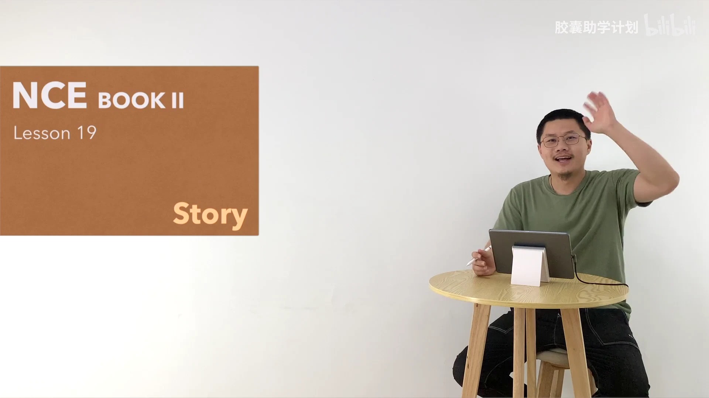

文字识别：胶囊助学计划 / NCE / BOOKⅡI / Lesson 19 / Story

### 画面 00:00:02

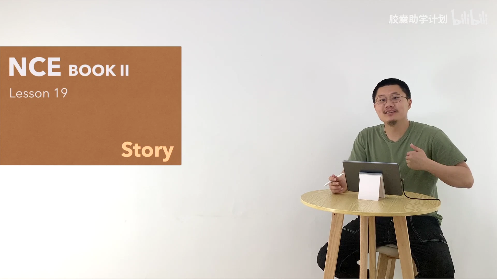

文字识别：胶囊助学计划 / NCE / BOOKⅡI / Lesson 19 / Story

### 画面 00:00:08

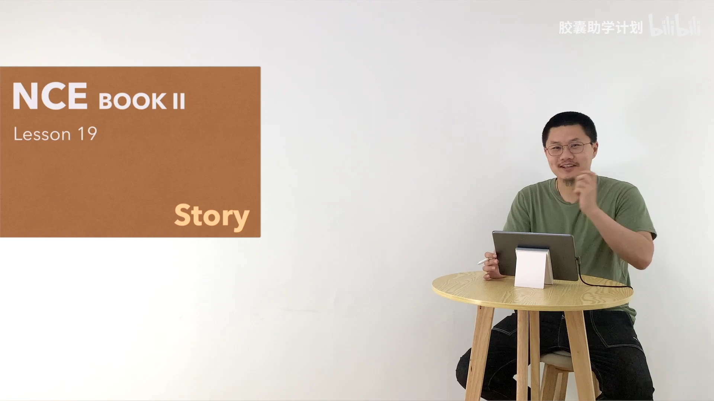

文字识别：胶囊助学计划 / NCE / BOOK"I / Lesson 19 / Story

### 画面 00:00:10

文字识别：胶囊助学计划bill

### 画面 00:00:13

### 画面 00:00:15

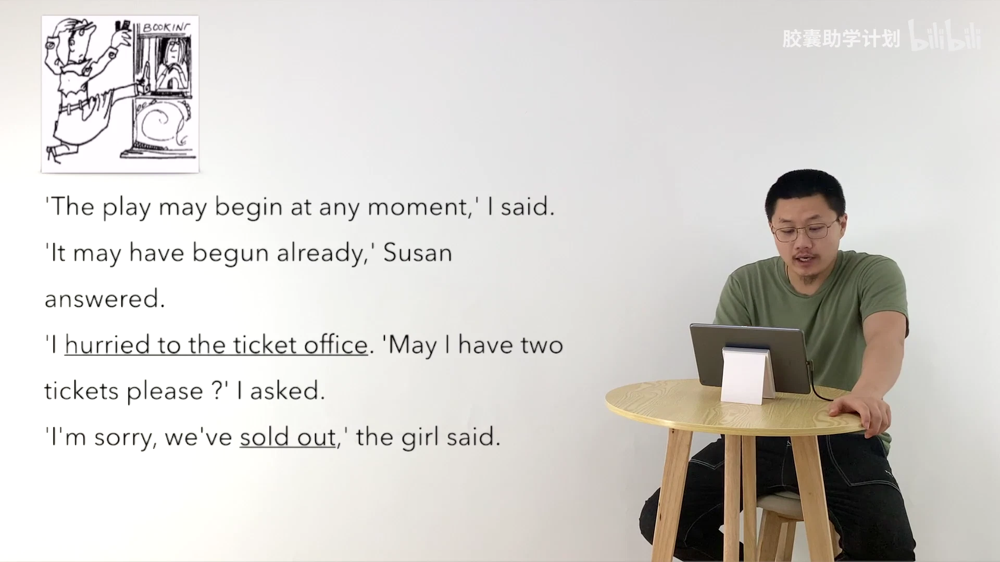

文字识别：BOOKIN / 胶囊助学计划 / 'The play may begin at any moment,' I said. / 'It may have begun already,' Susan / answered. / 'I hurried to the ticket office.'May I have two / tickets please ?'I asked. / 'm sorry, we've sold out,'the girl said.

### 画面 00:00:20

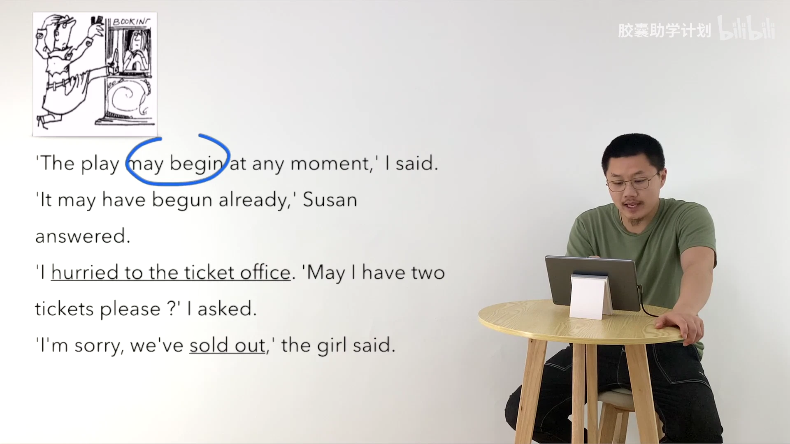

文字识别：BOOKIN / 胶囊助学计划 / 'The play may beginat any moment,' I said. / 'It may have begun already,' Susan / answered. / 'I hurried to the ticket office.'May I have two / tickets please ?'I asked. / 'm sorry, we've sold out,'the girl said.

## 00:00:30–00:01:00

译成随时就可以了啊 at that moment 叫在那一刻 at any moment 在任何一刻 I I said 我说的 It may have begun 它可能已经开始了之前已经发生了的事情对吧 May have that 表示对过去的一个事情的推测可能已经发生了 Susan answered Susan 回答道 I hurried to the ticket office hurried to somewhere 对吧我匆忙的赶到了售票处

### 画面 00:00:39

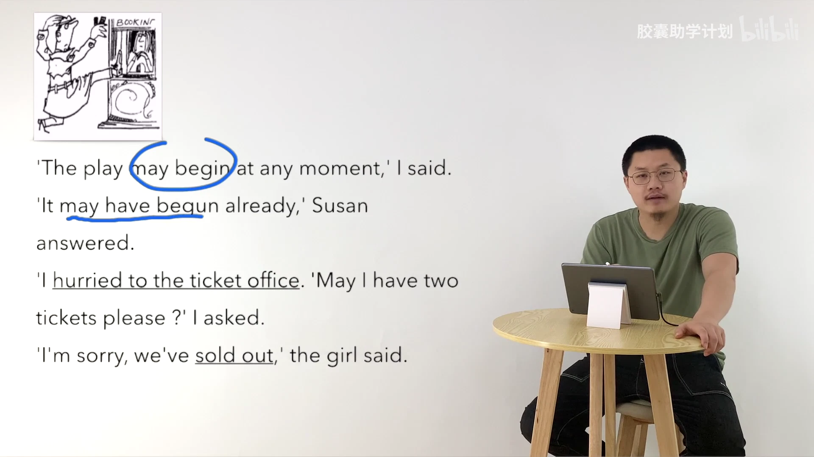

文字识别：BOOKIN / 胶囊助学计划 / 'The play may begin at any moment,' I said. / 'It may have bequn already,' Susan / answered. / 'I hurried to the ticket office.'May I have two / tickets please ?'I asked. / 'm sorry, we've sold out,'the girl said.

## 00:01:00–00:01:30

May I have two tickets, please?我能有两张票吗？你注意，你看这个地方的 have 其实就类似于 why 啊，它是它的万能动词的一个用法。我能买两张票吗？就是 May I have? Okay. 比如说，我们在这儿扩展一下。对于各位来说，如果您去西方国家旅游，然后呢，您想点餐，点完餐了之后，你发现，我们说你缺个叉子吧，那你就可以问服务员

### 画面 00:01:04

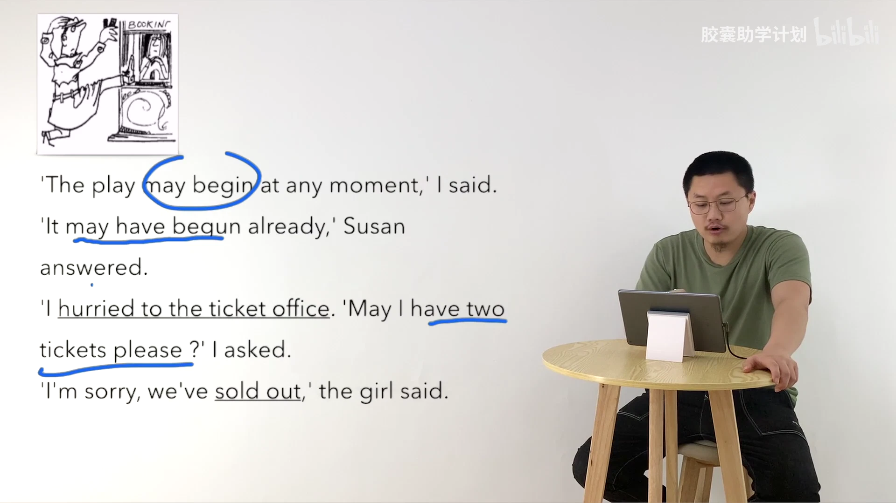

文字识别：BOOKIN / 胶囊助学计划 / 'The play may begin at any moment,' I said. / 'It may have bequn already,' Susan / answered. / 0 / 'I hurried to the ticket office.'May I have two / tickets please ?'I asked. / 'm sorry, we've sold out,' the girl said.

## 00:01:30–00:02:00

说，waiter waitress excuse me may I have two forks please，或者说 two，那我要勺子，那 two spoons please，或者 a spoon please， may I have， okay very good， I asked，我问道，I'm sorry，很抱歉，we've sold out，我们已经 sold out，sold out，很常见的一个小短语叫做售出售光啊售罄是吧，已经卖完了。The girl said，这个

### 画面 00:01:34

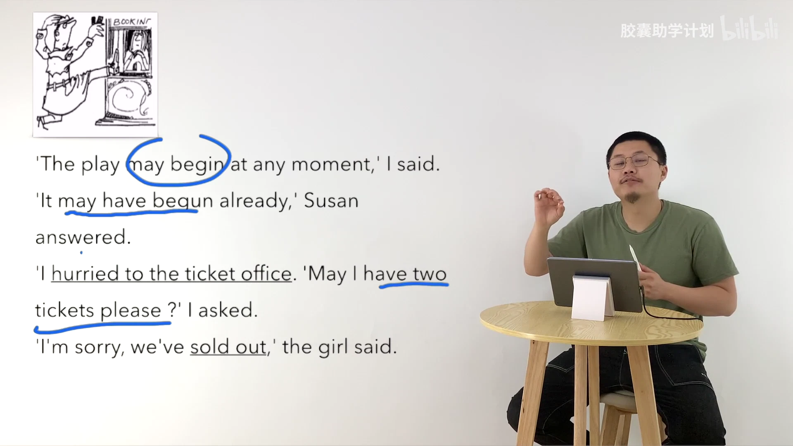

文字识别：BOOKINr / 胶囊助学计划 / 'The play nay beginat any moment,' I said. / 'It may have bequn already,' Susan / answered. / 'I hurried to the ticket office.'May I have two / tickets please ?'I asked. / 'm sorry, we've sold out,' the girl said.

## 00:02:00–00:02:30

said. Continuing. What a pity! 好遗憾呐. We talked about the words. Susan exclaimed. Susan大声的说道. Just then, the telephone rang. It was my aunt Lucy. 有印象吧？这我们第二课学的，是吧？正在那时， a man hurried to the ticket office. 还是hurried to，是吧？ Can I return these two tickets? 我能退这两张票吗？ He asked. Certainly. 当然了. The

### 画面 00:02:01

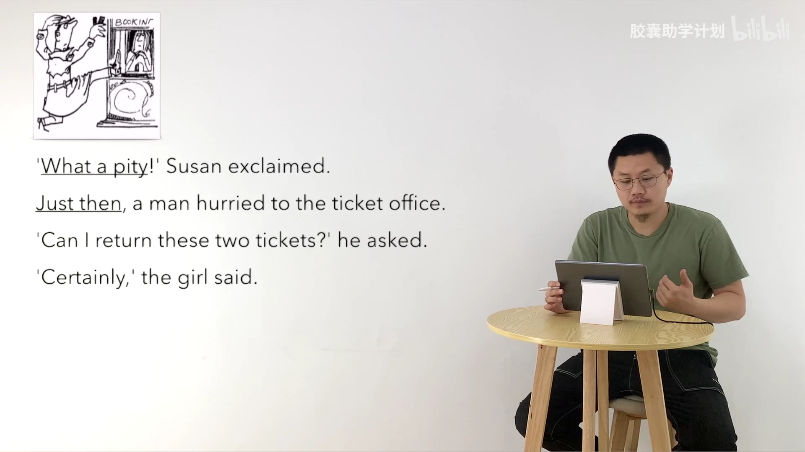

文字识别：BOOKIN / 胶囊助学计划 / 'What a pity!' Susan exclaimed. / Just then, a man hurried to the ticket office. / 'Can I return these two tickets?' he asked. / 'Certainly,' the girl said.

### 画面 00:02:21

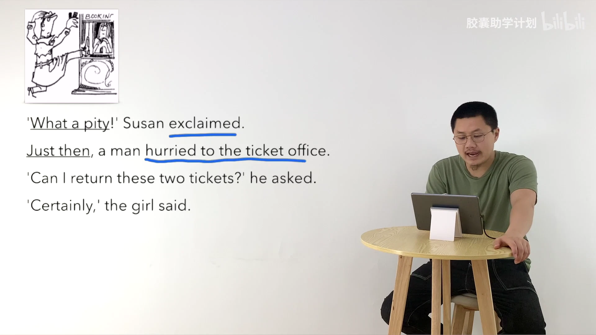

文字识别：BOOKINr / 胶囊助学计划 / 'What a pity!' Susan exclaimed. / Just then, a man hurried to the ticket office. / 'Can I return these two tickets?' he asked. / 'Certainly,' the girl said.

## 00:02:30–00:03:00

girl said,女孩说道，天赐良机，赶紧买。I went back to the ticket office at once.我们先不管back。I went to the ticket office，叫做我去了这个售票处。那back to the ticket office什么意思呢？就是你去了，你走了，你再回来，第二次回来，就是再次回来。这个back啊啊，went back to the ticket office. Okay, at once叫做立刻

### 画面 00:02:30

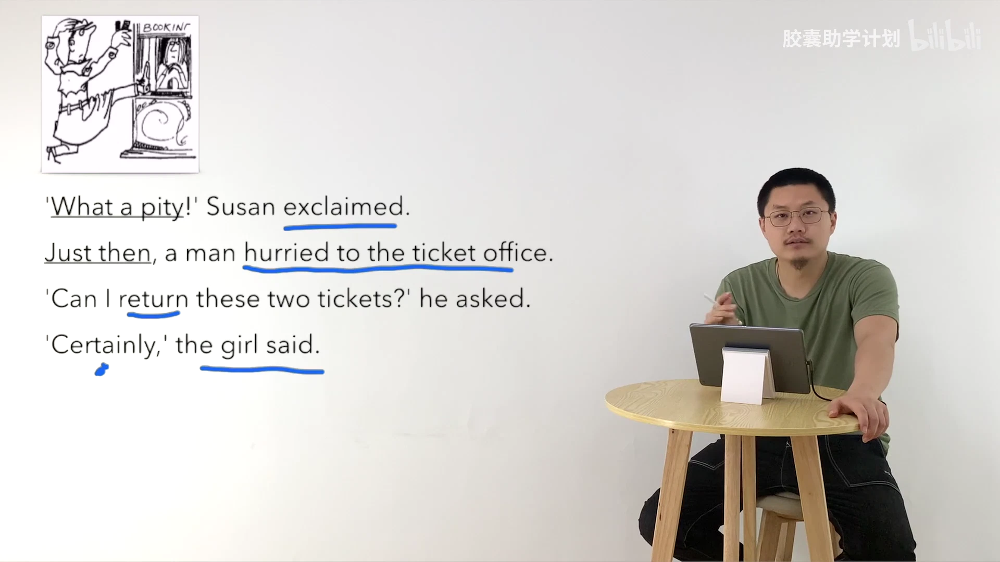

文字识别：BOOKINr / 胶囊助学计划 / 'What a pity!' Susan exclaimed. / Just then, a man hurried to the ticket office. / 'Can I return these two tickets?' he asked. / 'Certainly,' the girl said.

### 画面 00:02:32

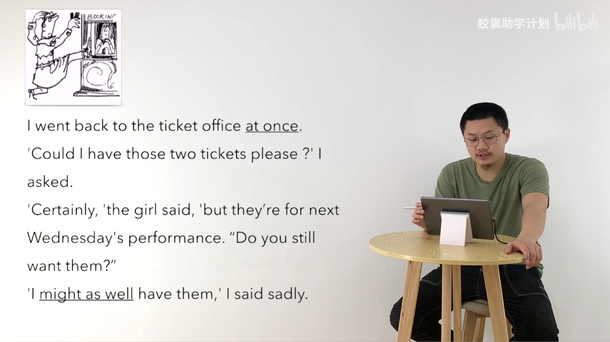

文字识别：BCOKIN / 胶囊助学计划 / I went back to the ticket office at once. / 'Could I have those two tickets please ?'I / asked. / 'Certainly,'the girl said, 'but they're for next / Wednesday's performance."Do you still / want them?" / 'I might as well have them,'I said sadly.

### 画面 00:02:40

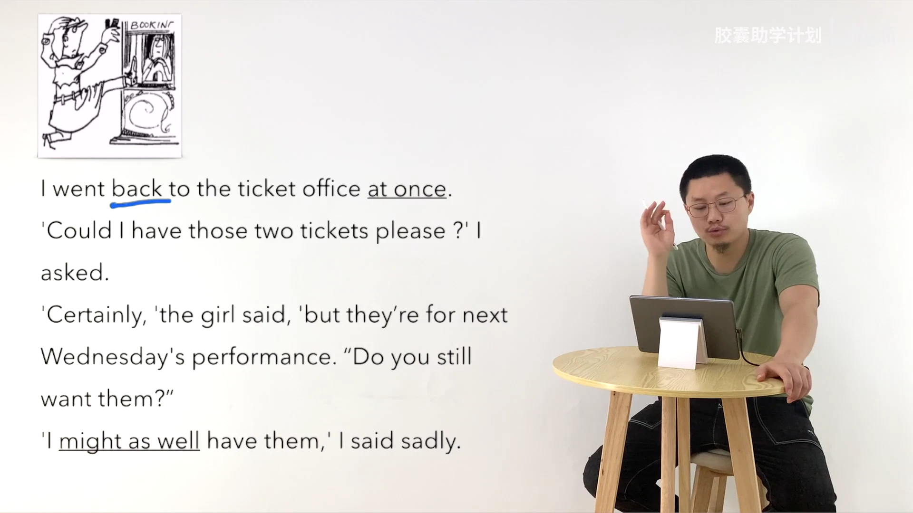

文字识别：BOOKIN / I went back to the ticket office at once. / 'Could I have those two tickets please ?'I / asked. / 'Certainly, 'the girl said, 'but they're for next / Wednesday's performance."Do you still / want them?" / 'I might as well have them,'I said sadly.

### 画面 00:02:44

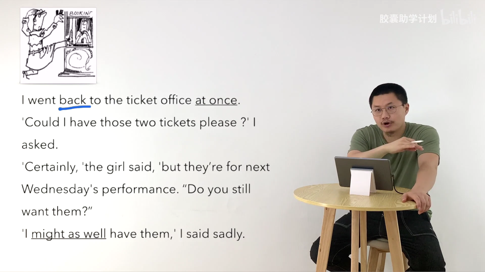

文字识别：BOOKIN / 胶囊助学计划 / I went back to the ticket ofice at once. / 'Could I have those two tickets please ?'I / asked. / 'Certainly, 'the girl said, 'but they're for next / Wednesday's performance."Do you still / want them?" / 'I might as well have them,'I said sadly.

### 画面 00:02:59

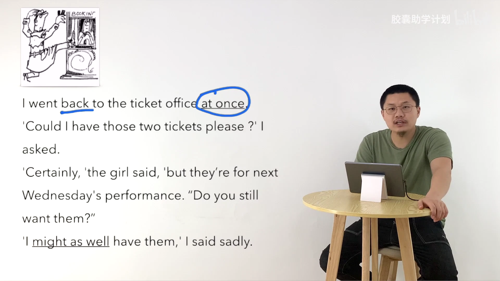

文字识别：BCOKIN / 胶囊助学计划 / I went back to the ticket office at once. / 'Could I have those two tickets please ?'I / asked. / 'Certainly,'the girl said, 'but they're for next / Wednesday's performance."Do you still / want them?" / 'I might as well have them,'I said sadly.

## 00:03:00–00:03:30

马上，类似于我们之前学的一个单词叫immediately啊，迅速。Could I have those two tickets, please?这个could完全可以换成can啊，我能拿这两张票吗？能把这两张票卖给我吗？I asked.我问道。Certainly，当然了。The girl said，没问题。But但是关键点来了。They are for他们是为了什么呢？Next Wednesday's performance，他们是为了下周三

### 画面 00:03:23

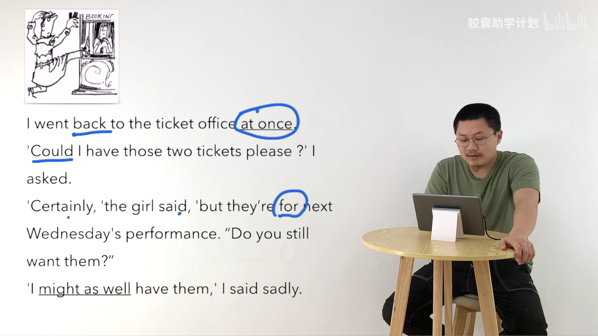

文字识别：BOOKIN / 胶囊助学计划 / I went back to the ticket office at once, / 'Could I have those two tickets please ?' I / asked. / 'Certainly,'the girl said,'but they'refor ext / Wednesday's performance."Do you still / want them?" / 'I might as well have them,' I said sadly.

### 画面 00:03:26

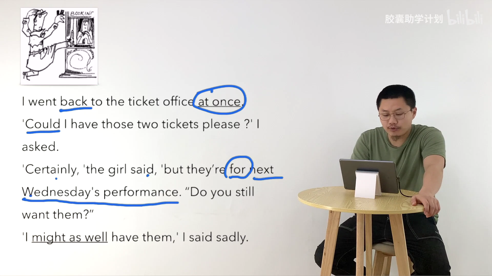

文字识别：BOOKIN / 胶囊助学计划 / I went back to the ticket office at once, / 'Could I have those two tickets please ?' I / asked. / 'Certainly,'the girl said,'but they'refor ext / • / Wednesday's performance."Do you still / want them?" / 'I might as well have them,'I said sadly.

## 00:03:30–00:04:00

演出的票。Do you still want them?你依旧还想要他们吗？答案，I might as well have them.我们先不管 might as well，一会儿我们去讲这三个单词是一个短语，这不是一，它是一个固定用法啊。I will have them.啊，我会要他们的。S S I V。我很悲伤的说道。这个 might as well 是什么意思呢？就是你有很，你看你你从文章

### 画面 00:03:40

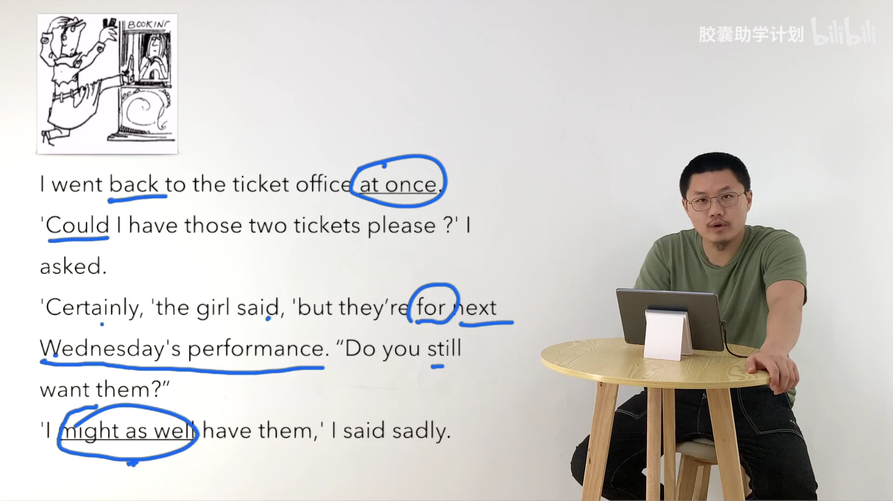

文字识别：BCOKINr / 胶囊助学计划 / I went back to the ticket office at once, / 'Could I have those two tickets please ?' I / asked. / 'Certainly,'the girl said, 'but they're forext / • / Wednesday's performance."Do you still / want them?" / might as wel have them,'I said sadly.

### 画面 00:03:42

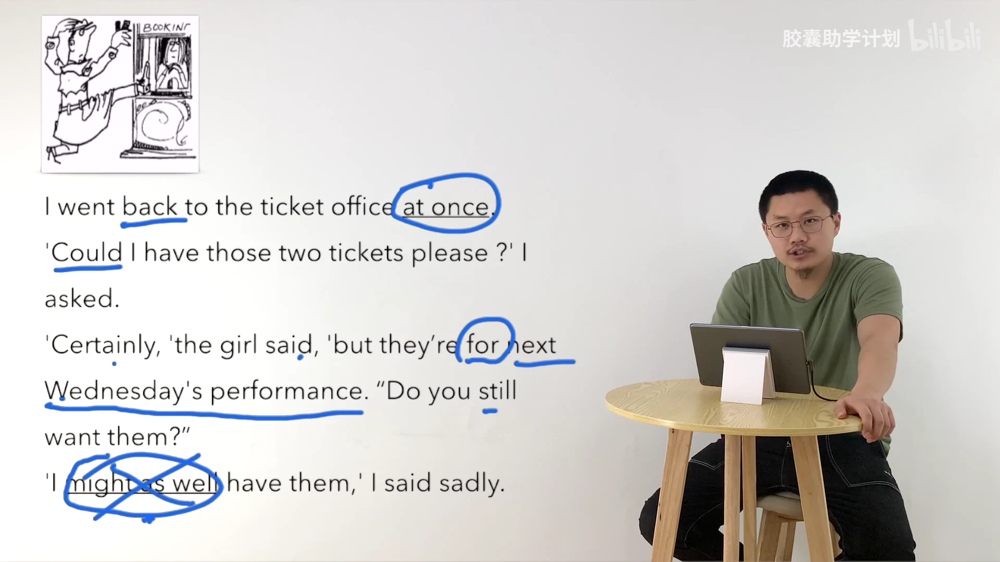

文字识别：BOOKINr / 胶囊助学计划 / I went back to the ticket office at once, / 'Could I have those two tickets please ?' I / asked. / 'Certainly,'the girl said, 'but they're forext / Wednesday's performance."Do you still / want them?" / mighs wel have them,'I said sadly.

### 画面 00:03:55

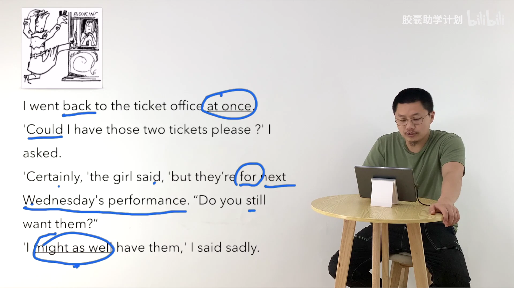

文字识别：BOOKINr / 胶囊助学计划 / I went back to the ticket office at once, / 'Could I have those two tickets please ?' I / asked. / 'Certainly,'the girl said,'but they'refor hext / • / Wednesday's performance."Do you still / want them?" / might as wel have them,'I said sadly.

### 画面 00:03:57

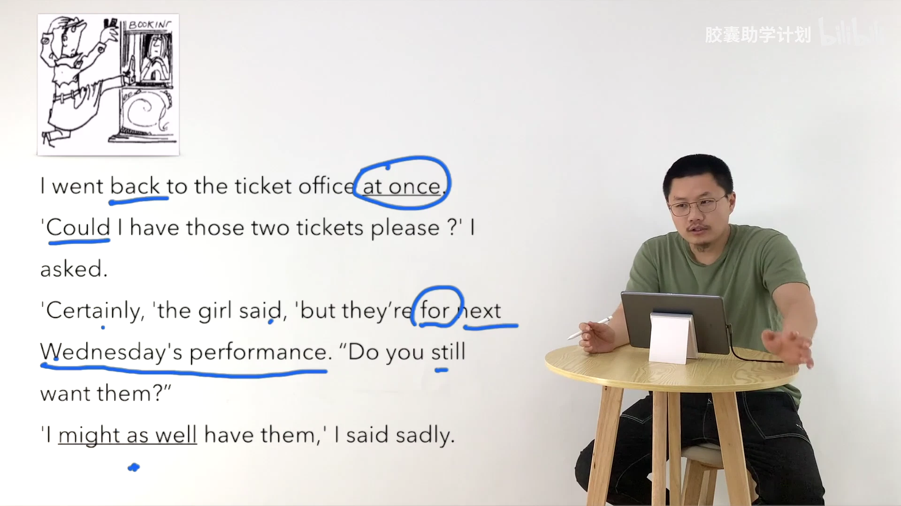

文字识别：BOOKIN / 胶囊助学计划 / I went back to the ticket office at once, / 'Could I have those two tickets please ?' I / asked. / 'Certainly,'the girl said,'but they'reforext / • / Wednesday's performance."Do you still / want them?" / 'I might as well have them,'I said sadly.

## 00:04:00–00:04:30

去推断，他们最想要的一定是乘兴而来，对吧？就是这个败兴而归有点，他们是想要的就是今天晚上的票，但是这个票呢，他们拿到了之后是下周三的，那今天晚上也看不了了，还是下周三，下周三不一定想看了，但是呢，哎，拿着吧，万一看呢，might as well，还是要了吧，就是这不是他的优先最好的一个选择，所以他就类似于叫 might as well，OK，也没有别的

### 画面 00:04:27

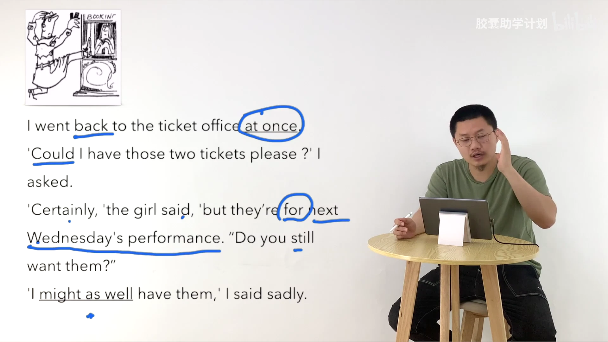

文字识别：BOOKIN / 胶囊助学计划 / I went back to the ticket office at once, / 'Could I have those two tickets please ?'I / asked. / 'Certainly,'the girl said,'but they'reforext / • / Wednesday's performance."Do you still / want them?" / 'I might as well have them,'I said sadly.

## 00:04:30–00:05:00

好的事情可做了，那我还是要了它吧. Mind as well.接下来我们看一下本课的习惯用法，并不多，只有这么几个。那 sold out，我们直接拿一个电影片段给大家看一下就可以了，叫做《寿寝寿光》啊. He sold out four printings. Sold out every copy. Tomorrow morning, Spider-Man, page one with a decent picture this time. Move Conway to page seven. This is a problem with page. I make it page eight and give him ten percent off. I make it five percent. That can't be done. Get out of here.

### 画面 00:04:34

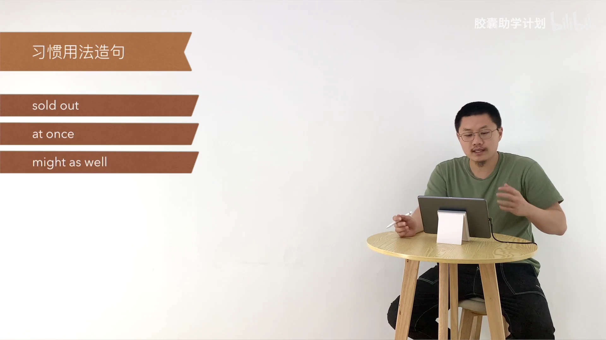

文字识别：胶囊助学计划 / 习惯用法造句 / sold out / at once / might as well

### 画面 00:04:36

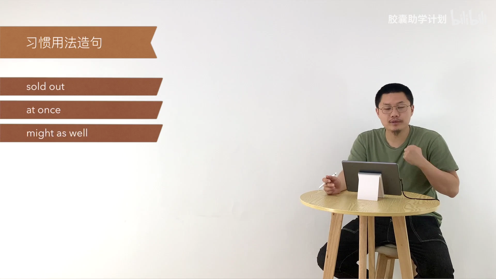

文字识别：胶囊助学计划 / 习惯用法造句 / sold out / at once / might as well

### 画面 00:04:38

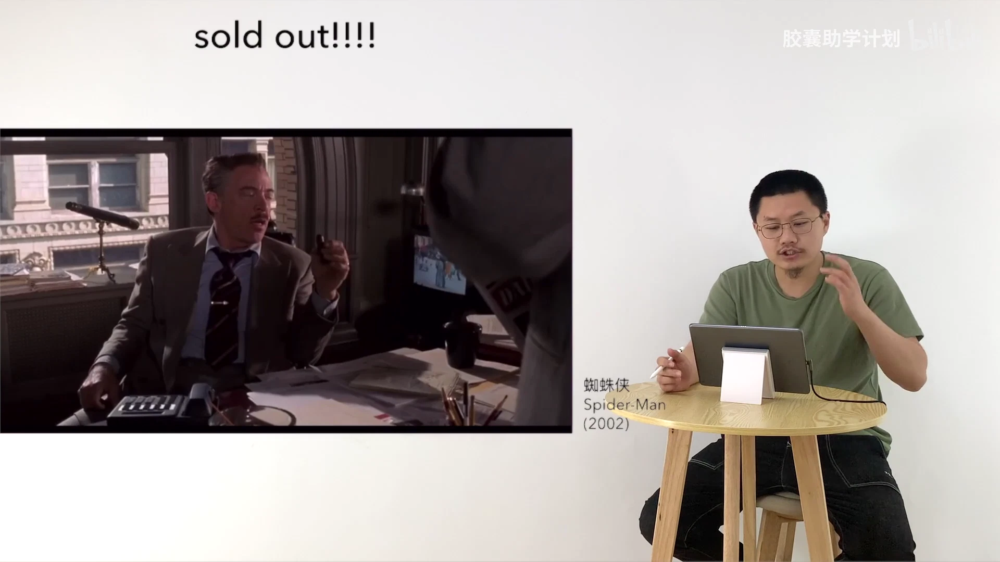

文字识别：sold out!!! / 胶囊助学计划 / 蜘蛛侠 / Spider-Man / (2002)

### 画面 00:04:46

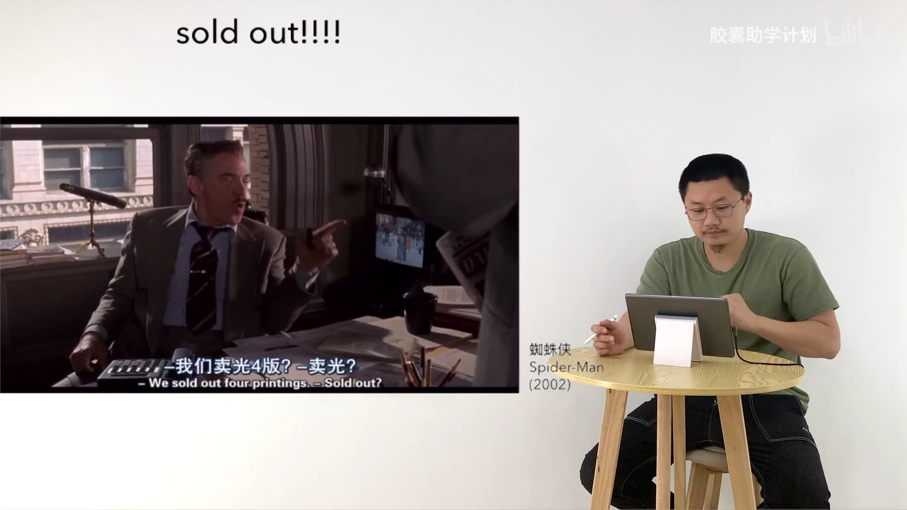

文字识别：sold out!!! / 胶囊助学计划 / 蜘蛛侠 / 我们卖光4版？一卖光？ / Spider-Man / -We sold out four printings.-Sold out? / (2002)

### 画面 00:04:48

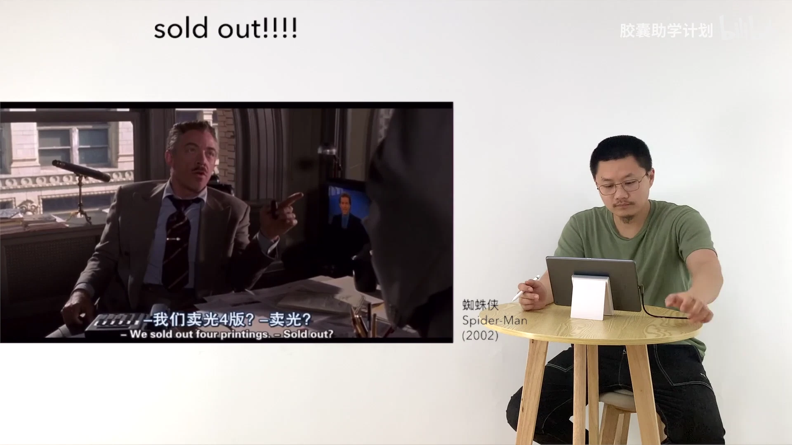

文字识别：sold out!!!! / 胶囊助学计划 / 蜘蛛侠 / 我们卖光4版？一卖光？ / Spider-Man / -We sold out four printings.-Sold out? / (2002)

### 画面 00:04:50

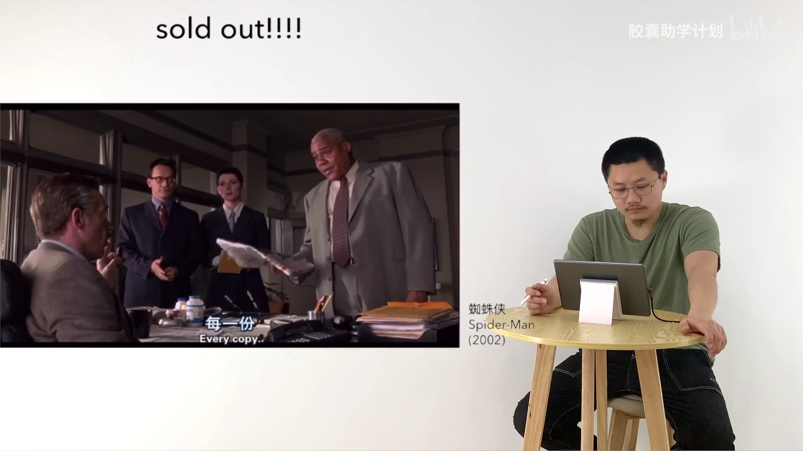

文字识别：sold out!!!! / 胶囊助学计划 / 蜘蛛侠 / 每一份 / Spider-Man / Every copy. / (2002)

### 画面 00:04:52

文字识别：sold out!!!! / 胶囊助学计划 / 蜘蛛侠 / 明天头版要登蜘蛛人照片大卖场广告放到第七版 / Spider-Man / Tomorrow Spider- Man page one.Move Conway to page seven. / (2002)

### 画面 00:04:54

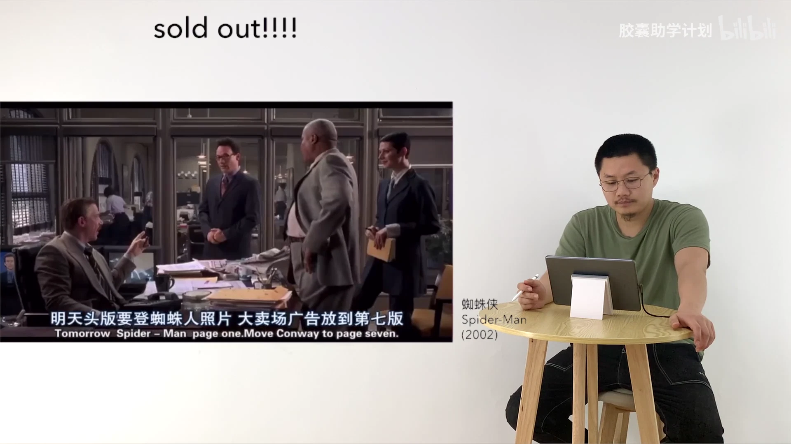

文字识别：sold out!!!! / 胶囊助学计划 / 蜘蛛侠 / 明天头版要登蜘蛛人照片大卖场广告放到第七版 / Spider-Man / Tomorrow Spider- Man page one.Move Conway to page seven. / (2002)

### 画面 00:04:56

文字识别：sold out!!! / 胶囊助学计划 / 蜘蛛侠 / 第七版放不下-那放第八版吧 / Spider-Man / - That's a problem.- Then make it page eight. / (2002)

### 画面 00:04:58

文字识别：sold out!!!! / 胶囊助学计划 / 蜘蛛侠 / -办不到-给我滚出去 / Spider-Man / -That can't be done.-Get out! / (2002)

## 00:05:00–00:05:30

Okay, sold out. Ah,卖光了，而且好。接下来呢，下一个习惯用法，advance。我在讲文章的时候提到了，它几乎就是immediately的同义词，叫立刻、马上啊。我们拿它去造句，说After you told him that he paid it back at once.你看at once，你可以把它理解为就是一个四吧，对吧？就是类似于起到了一个副词的作用，叫立刻、马上。当然了，呃，不太严

### 画面 00:05:00

文字识别：sold out!!! / 胶囊助学计划 / 蜘蛛侠 / Spider-Man / (2002)

### 画面 00:05:04

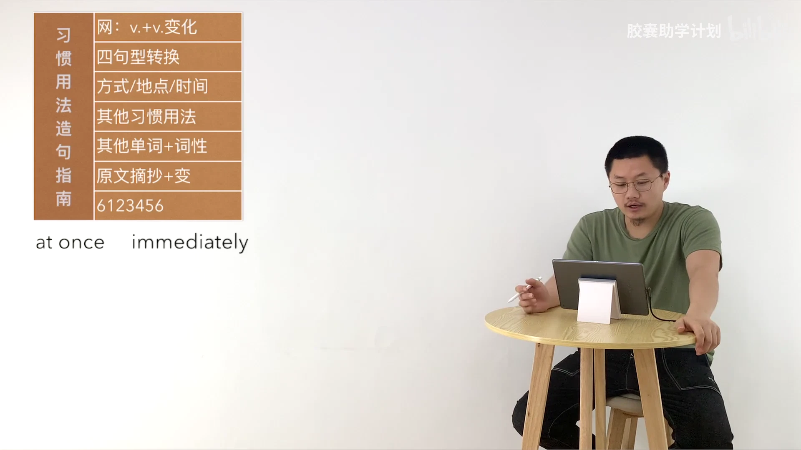

文字识别：习惯用法造句指南 / 网：v.+v.变化 / 胶囊助学计划 / 四句型转换 / 方式/地点/时间 / 其他习惯用法 / 其他单词+词性 / 原文摘抄+变 / 6123456 / immediately / at once

### 画面 00:05:06

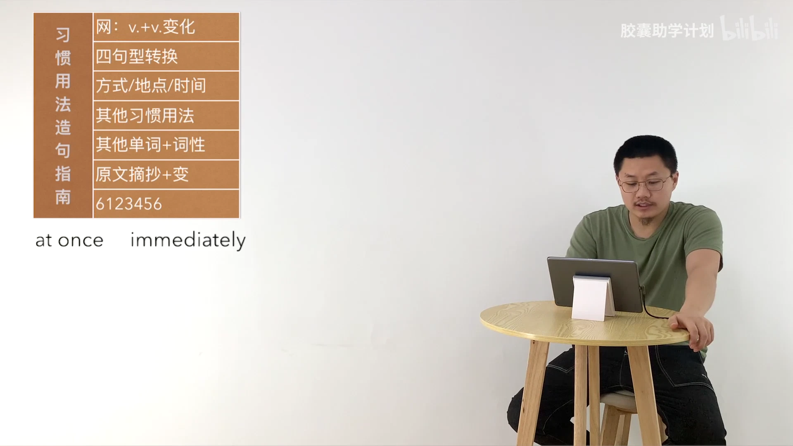

文字识别：网：v.+v.变化 / 习惯用法造句指南 / 胶囊助学计划 / 四句型转换 / 方式/地点/时间 / 其他习惯用法 / 其他单词+词性 / 原文摘抄+变 / 6123456 / immediately / at once

### 画面 00:05:08

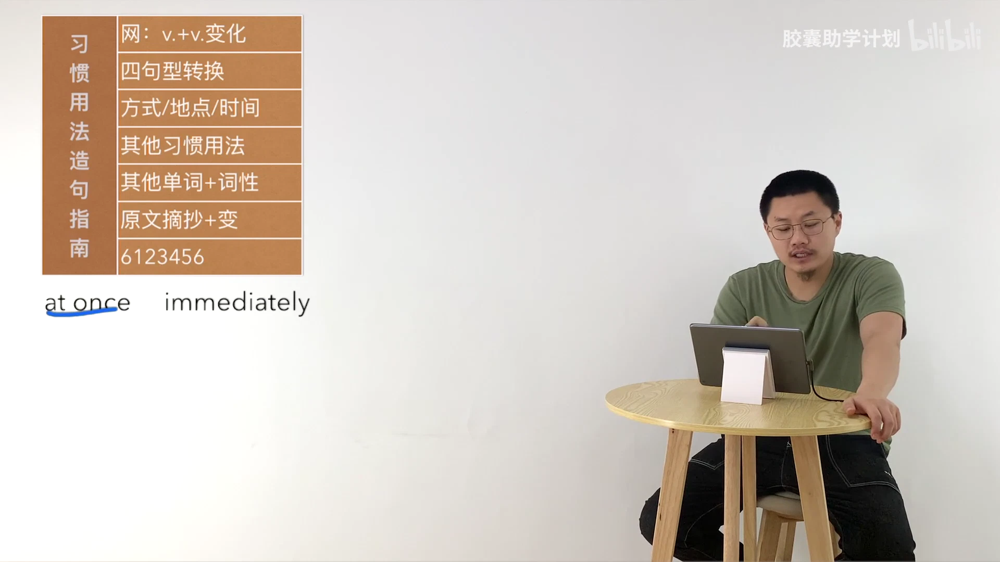

文字识别：网：v.+v.变化 / 习惯用法造句指南 / 胶囊助学计划 / 四句型转换 / 方式/地点/时间 / 其他习惯用法 / 其他单词+词性 / 原文摘抄+变 / 6123456 / immediately / at once

### 画面 00:05:10

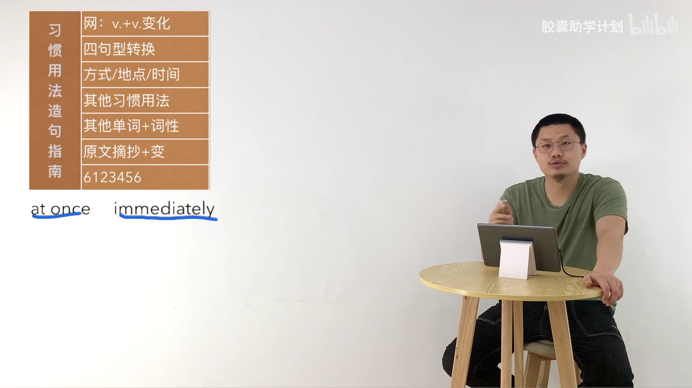

文字识别：网：v.+v.变化 / 习惯用法造句指南 / 胶囊助学计划 / 四句型转换 / 方式/地点/时间 / 其他习惯用法 / 其他单词+词性 / 原文摘抄+变 / 6123456 / immediately / at once

### 画面 00:05:13

文字识别：网：v.+v.变化 / 习惯用法造句指南 / 胶囊助学计划 / 四句型转换 / 方式/地点/时间 / 其他习惯用法 / 其他单词+词性 / 原文摘抄+变 / 6123456 / immediately / at once

### 画面 00:05:15

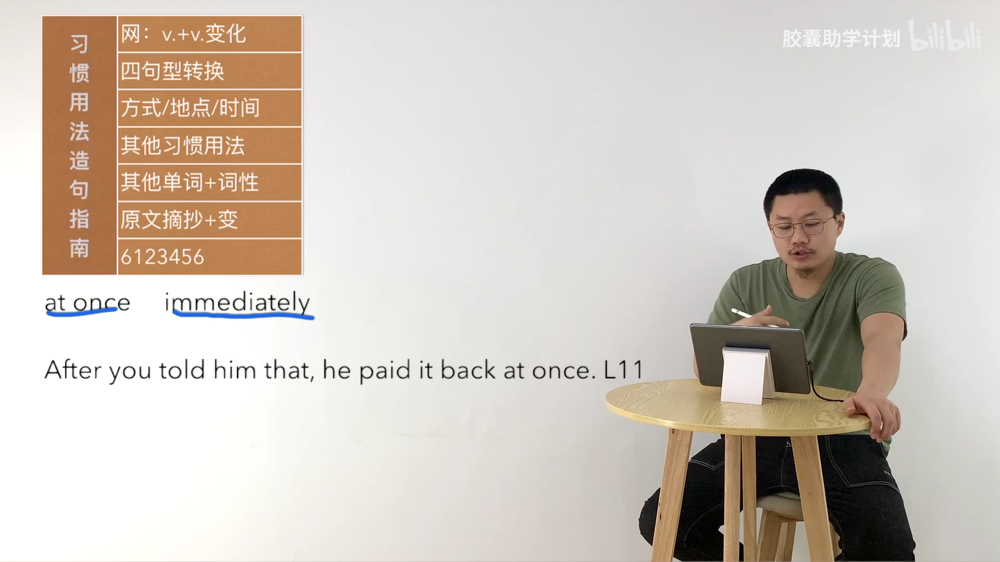

文字识别：习惯用法造句指南 / 网：v.+v.变化 / 胶囊助学计划 / 四句型转换 / 方式/地点/时间 / 其他习惯用法 / 其他单词+词性 / 原文摘抄+变 / 6123456 / immediately / at once / After you told him that, he paid it back at once. L11

### 画面 00:05:20

文字识别：网：v.+v.变化 / 习惯用法造句指南 / 胶囊助学计划 / 四句型转换 / 方式/地点/时间 / 其他习惯用法 / 其他单词+词性 / 原文摘抄+变 / 6123456 / immediately / at once / After you told him that, he paid it back at once. L11

### 画面 00:05:22

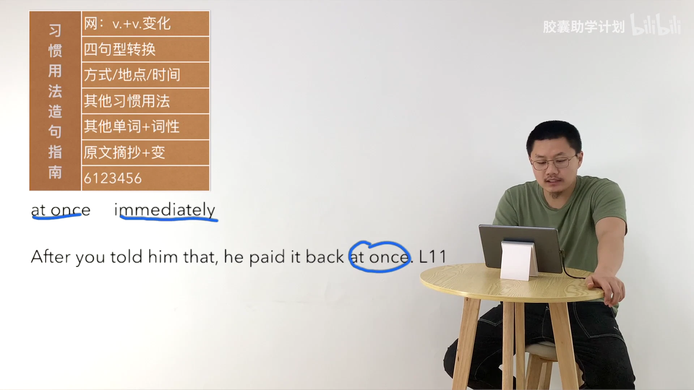

文字识别：习惯用法造句指南 / 网：v.+v.变化 / 胶囊助学计划 / 四句型转换 / 方式/地点/时间 / 其他习惯用法 / 其他单词+词性 / 原文摘抄+变 / 6123456 / immediately / at once / After you told him that, he paid it back / at once / L11

### 画面 00:05:25

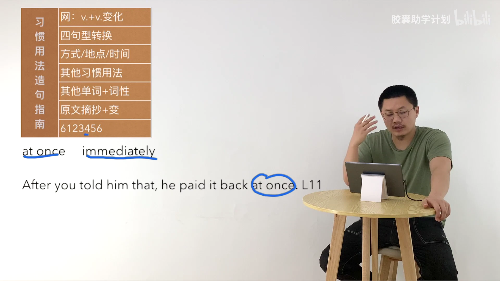

文字识别：网：v.+v.变化 / 习惯用法造句指南 / 胶囊助学计划 / 四句型转换 / 方式/地点/时间 / 其他习惯用法 / 其他单词+词性 / 原文摘抄+变 / 6123456 / immediately / at once / After you told him that, he paid it back / at once / L11

## 00:05:30–00:06:00

谨的说，也可以当成一个六，也是时间吧，立刻马上。你看，所以在这种这种六一二三四五六当中，没有给你动词，也没有给你什么主语，是吧？也没有给你宾语的这种，你就得自己去编所有的部分，然后把at once往上一放，这个事儿就搞定了。比如说再来，If you park your car in the wrong place, the traffic police will give you a ticket at once。你看，我几乎啊，你可以这样理解，

### 画面 00:05:30

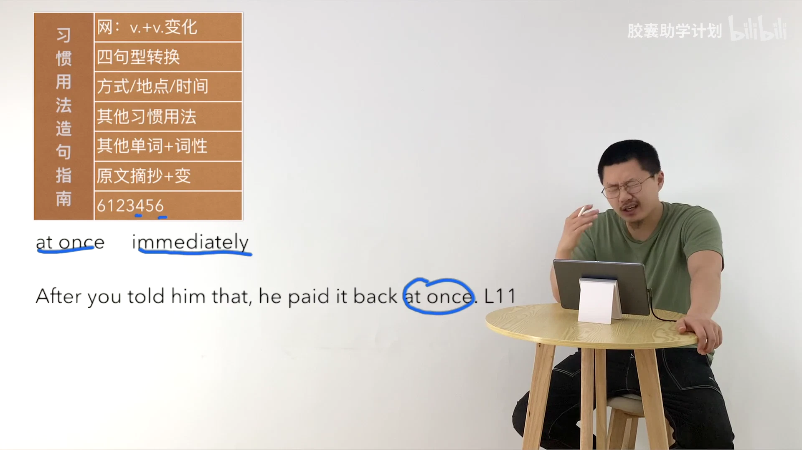

文字识别：网：v.+v.变化 / 习惯用法造句指南 / 胶囊助学计划 / 四句型转换 / 方式/地点/时间 / 其他习惯用法 / 其他单词+词性 / 原文摘抄+变 / 6123456 / at once / immediately / After you told him that, he paid it back / at once / L11

### 画面 00:05:35

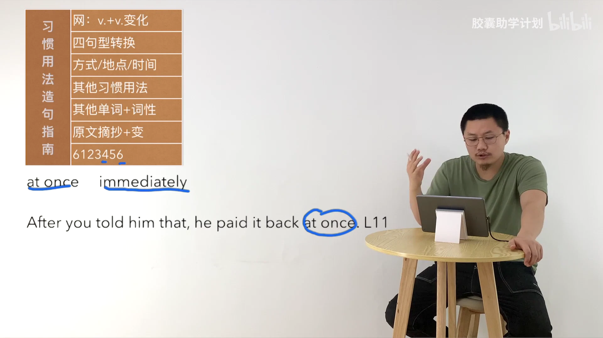

文字识别：网：v.+v.变化 / 习惯用法造句指南 / 胶囊助学计划 / 四句型转换 / 方式/地点/时间 / 其他习惯用法 / 其他单词+词性 / 原文摘抄+变 / 6123456 / immediately / at once / After you told him that, he paid it back / at once / L11

### 画面 00:05:38

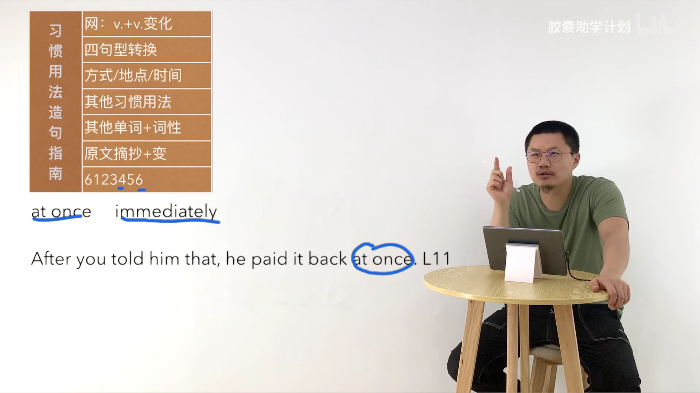

文字识别：网：v.+v.变化 / 习惯用法造句指南 / 胶囊助学计划 / 四句型转换 / 方式/地点/时间 / 其他习惯用法 / 其他单词+词性 / 原文摘抄+变 / 6123456 / immediately / at once / After you told him that, he paid it back / at once / L11

### 画面 00:05:40

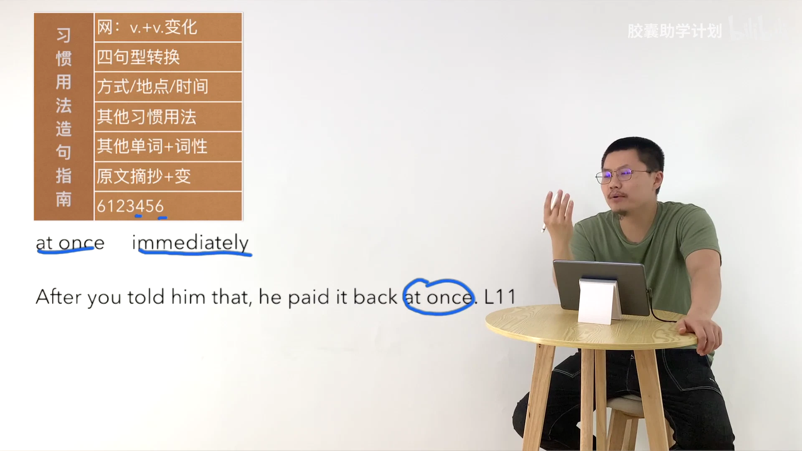

文字识别：网：v.+v.变化 / 习惯用法造句指南 / 胶囊助学计划 / 四句型转换 / 方式/地点/时间 / 其他习惯用法 / 其他单词+词性 / 原文摘抄+变 / 6123456 / immediately / at once / After you told him that, he paid it back / at once / L11

### 画面 00:05:45

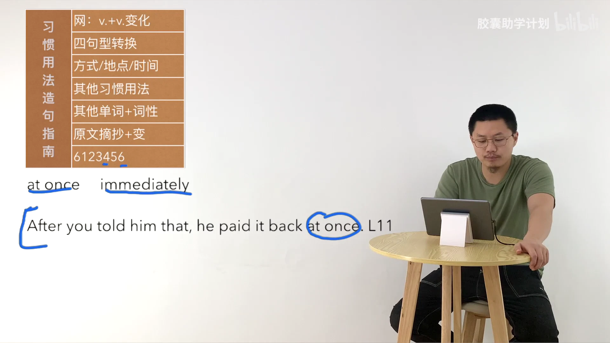

文字识别：习惯用法造句指南 / 网：v.+v.变化 / 胶囊助学计划 / 四句型转换 / 方式/地点/时间 / 其他习惯用法 / 其他单词+词性 / 原文摘抄+变 / 6123456 / immediately / at once / After you told him that, he paid it back / at once / L11

### 画面 00:05:47

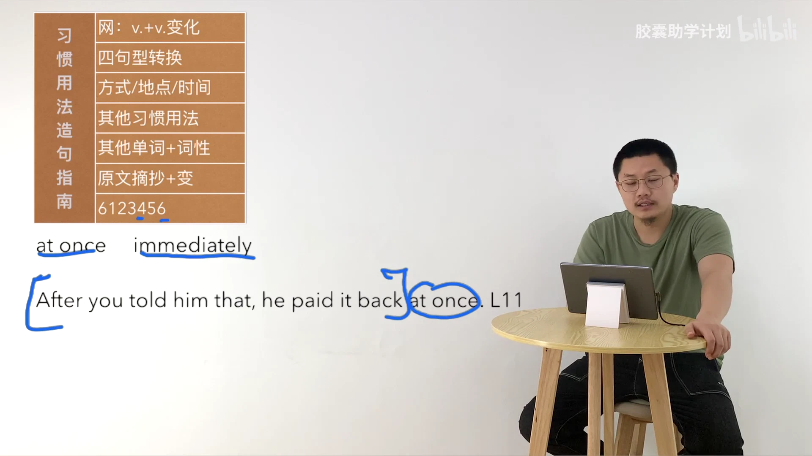

文字识别：网：v.+v.变化 / 习惯用法造句指南 / 胶囊助学计划 / 四句型转换 / 方式/地点/时间 / 其他习惯用法 / 其他单词+词性 / 原文摘抄+变 / 6123456 / immediately / at once / After you told him that, he paid it back / at once / L11

### 画面 00:05:50

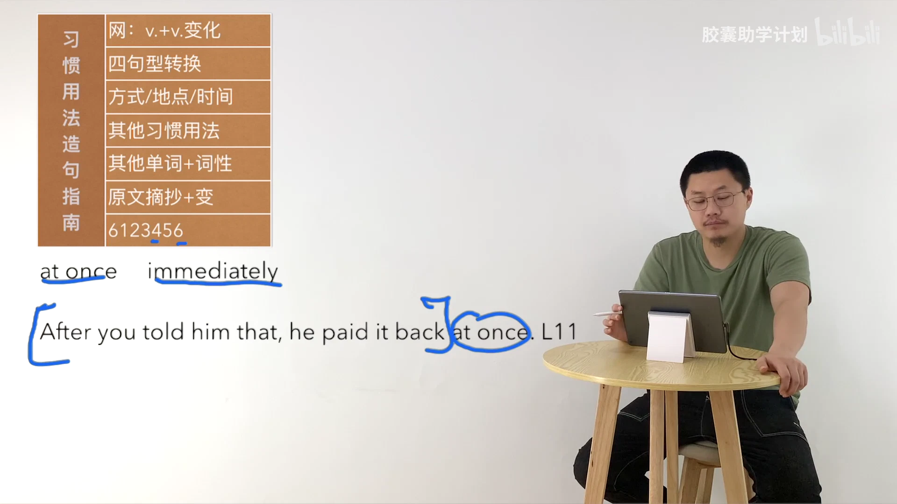

文字识别：网：v.+v.变化 / 习惯用法造句指南 / 胶囊助学计划 / 四句型转换 / 方式/地点/时间 / 其他习惯用法 / 其他单词+词性 / 原文摘抄+变 / 6123456 / immediately / at once / After you told him that, he paid it back / at once / L11

### 画面 00:05:52

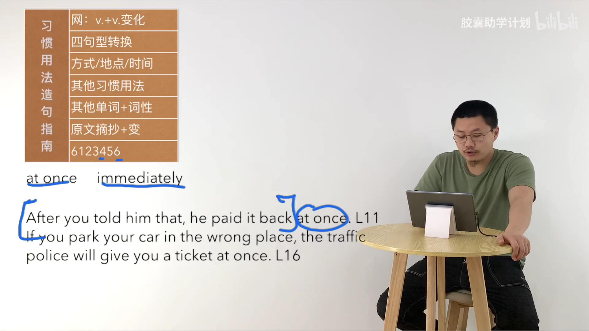

文字识别：网：v.+v.变化 / 习惯用法造句指南 / 胶囊助学计划 / 四句型转换 / 方式/地点/时间 / 其他习惯用法 / 其他单词+词性 / 原文摘抄+变 / 6123456 / immediately / at once / After you told him that, he paid it back / at once. /  L11 / lf you park your car in the wrong place, the traffic / police will give you a ticket at once. L16

### 画面 00:05:54

文字识别：习惯用法造句指南 / 网：v.+v.变化 / 胶囊助学计划 / 四句型转换 / 方式/地点/时间 / 其他习惯用法 / 其他单词+词性 / 原文摘抄+变 / 6123456 / immediately / at once / After you told him that, he paid it back / at once. L11 / If you park your car in the wrong place, the traffic / police will give you a ticket at once. L16

### 画面 00:05:56

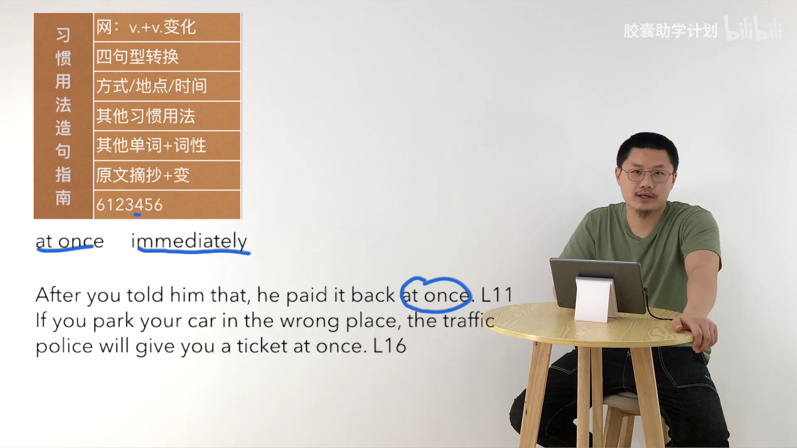

文字识别：习惯用法造句指南 / 网：v.+v.变化 / 胶囊助学计划 / 四句型转换 / 方式/地点/时间 / 其他习惯用法 / 其他单词+词性 / 原文摘抄+变 / 6123456 / at once / immediately / After you told him that, he paid it back / at once. L11 / If you park your car in the wrong place, the traffic / police will give you a ticket at once. L16

## 00:06:00–00:06:30

我几乎就是把十六课课文当中的某一句话做了一点点小的变化，然后放到了这个句子当中，加了一个at once啊，没它呢就是有一点点不一样，你不知道说隔多久这个交通警察会给你，那我加了一个at once呢，就是告诉你你基本上一停那儿你走啊，交通警察盯着你了，立刻就给你来一个罚单，这是唯一的区别。好，接下来might as well，原文出现的是might

### 画面 00:06:00

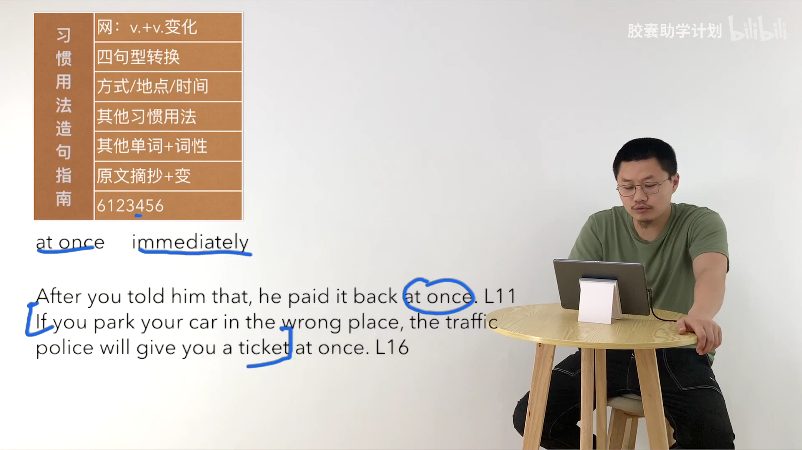

文字识别：习惯用法造句指南 / 网：v.+v.变化 / 胶囊助学计划 / 四句型转换 / 方式/地点/时间 / 其他习惯用法 / 其他单词+词性 / 原文摘抄+变 / 6123456 / immediately / at once / After you told him that, he paid it back / at once. L11 / Lf you park your car in the wrong place, the traffic / police will give you a ticketat once. L16

### 画面 00:06:04

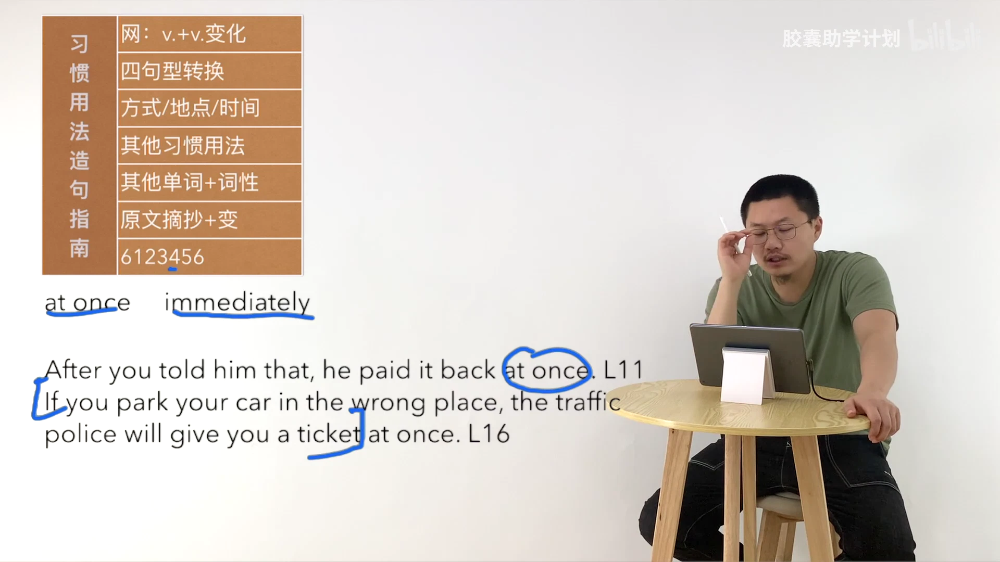

文字识别：网：v.+v.变化 / 习惯用法造句指南 / 胶囊助学计划 / 四句型转换 / 方式/地点/时间 / 其他习惯用法 / 其他单词+词性 / 原文摘抄+变 / 6123456 / immediately / at once / After you told him that, he paid it back / at once. L11 / Lf you park your car in the wrong place, the traffic / police will give you a ticketat once. L16

### 画面 00:06:06

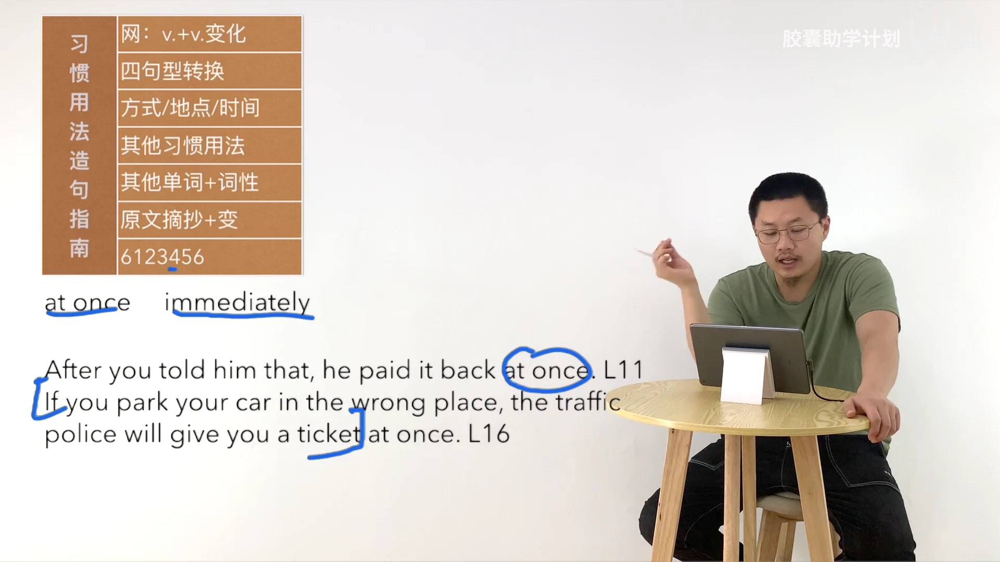

文字识别：网：v.+v.变化 / 习惯用法造句指南 / 四句型转换 / 方式/地点/时间 / 其他习惯用法 / 其他单词+词性 / 原文摘抄+变 / 6123456 / immediately / at once / After you told him that, he paid it back / at once. L11 / Lf you park your car in the wrong place, the traffic / police will give you a ticketat once. L16

### 画面 00:06:09

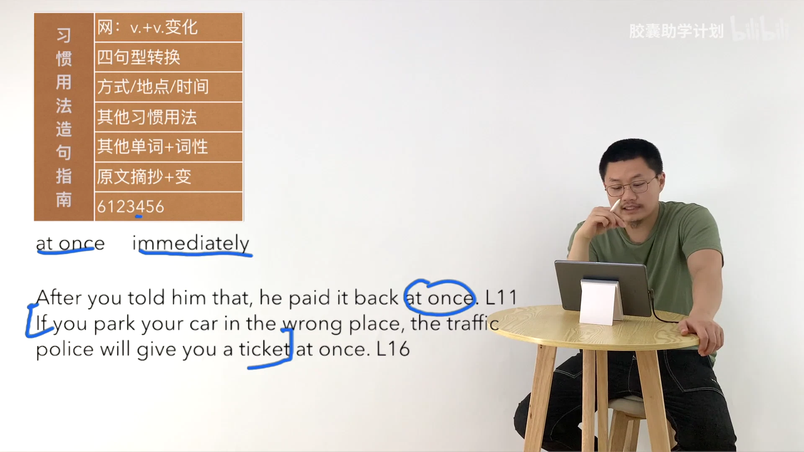

文字识别：习惯用法造句指南 / 网：v.+v.变化 / 胶囊助学计划 / 四句型转换 / 方式/地点/时间 / 其他习惯用法 / 其他单词+词性 / 原文摘抄+变 / 6123456 / immediately / at once / After you told him that, he paid it back / at once. L11 / Lf you park your car in the wrong place, the traffie / police will give you a ticketat once. L16

### 画面 00:06:11

文字识别：习惯用法造句指南 / 网：v.+v.变化 / 胶囊助学计划 / 四句型转换 / 方式/地点/时间 / 其他习惯用法 / 其他单词+词性 / 原文摘抄+变 / 6123456 / immediately / at once / After you told him that, he paid it back / at once. L11 / Lf you park your car in the wrong place, the traffic / police will give you a ticketat once. L16

### 画面 00:06:15

文字识别：习惯用法造句指南 / 网：v.+v.变化 / 胶囊助学计划 / 四句型转换 / 方式/地点/时间 / 其他习惯用法 / 其他单词+词性 / 原文摘抄+变 / 6123456 / immediately / at once / After you told him that, he paid it back / at once. L11 / Lf you park your car in the wrong place, the traffic / police will give you a ticketat once. L16

### 画面 00:06:20

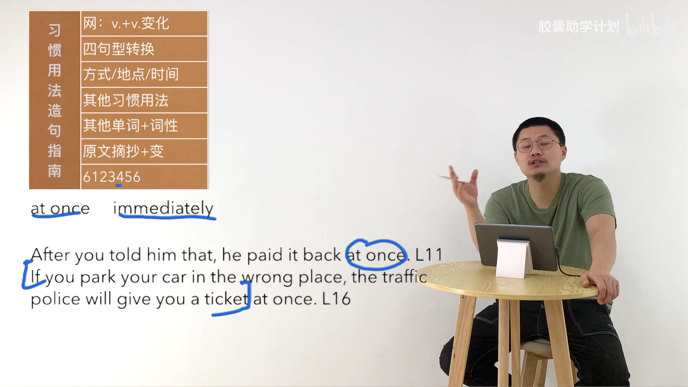

文字识别：习惯用法造句指南 / 网：v.+v.变化 / 胶囊助学计划 / 四句型转换 / 方式/地点/时间 / 其他习惯用法 / 其他单词+词性 / 原文摘抄+变 / 6123456 / immediately / at once / After you told him that, he paid it back / at once. L11 / Lf you park your car in the wrong place, the traffic / police will give you a ticketat once. L16

### 画面 00:06:25

文字识别：网：v.+v.变化 / 习惯用法造句指南 / 胶囊助学计划 / 四句型转换 / 方式/地点/时间 / 其他习惯用法 / 其他单词+词性 / 原文摘抄+变 / 6123456 / might/may as well

### 画面 00:06:27

文字识别：网：v.+v.变化 / 习惯用法造句指南 / 胶囊助学计划 / 四句型转换 / 方式/地点/时间 / 其他习惯用法 / 其他单词+词性 / 原文摘抄+变 / 6123456 / might/may as well

## 00:06:30–00:07:00

as well，也可以其实有叫做may as well。呃，根据我的个人经验，注意这是个人经验，很有局限性啊。嗯，它出现的频率，二者不管是might as well还是may as well出现的频率都不是特别的高。然后它的这个含义呢，翻译成说，呃，往往翻译成比如说不妨或者还是怎么怎么样吧。但是呢，不完全类似。我们所以要看一下它的英文翻译来了啊。说说

### 画面 00:06:30

文字识别：网：v.+v.变化 / 胶囊助学计划 / Bibi / 习惯用法造句指南 / 四句型转换 / 方式/地点/时间 / 其他习惯用法 / 其他单词+词性 / 原文摘抄+变 / 6123456 / might/may as well

### 画面 00:06:32

文字识别：习惯用法造句指南 / 网：v.+v.变化 / 胶囊助学计划 / 四句型转换 / 方式/地点/时间 / 其他习惯用法 / 其他单词+词性 / 原文摘抄+变 / 6123456 / might/may as well

### 画面 00:06:34

文字识别：网：v.+v.变化 / 习惯用法造句指南 / 胶囊助学计划 / 四句型转换 / 方式/地点/时间 / 其他习惯用法 / 其他单词+词性 / 原文摘抄+变 / 6123456 / might/may as well

### 画面 00:06:36

文字识别：习惯用法造句指南 / 网：v.+v.变化 / 胶囊助学计划 / 四句型转换 / 方式/地点/时间 / 其他习惯用法 / 其他单词+词性 / 原文摘抄+变 / 6123456 / might/may as well

### 画面 00:06:40

文字识别：网：v.+v.变化 / 习惯用法造句指南 / 胶囊助学计划 / 四句型转换 / 方式/地点/时间 / 其他习惯用法 / 其他单词+词性 / 原文摘抄+变 / 6123456 / might/may as well

### 画面 00:06:44

文字识别：网：v.+v.变化 / 习惯用法造句指南 / 胶囊助学计划 / 四句型转换 / 方式/地点/时间 / 其他习惯用法 / 其他单词+词性 / 原文摘抄+变 / 6123456 / might/may as well / suggest that one should do sth. Because / there is nothing better, nothing more / interesting or nothing more useful to do.

### 画面 00:06:46

文字识别：网：v.+v.变化 / 习惯用法造句指南 / 胶囊助学计划 / 四句型转换 / 方式/地点/时间 / 其他习惯用法 / 其他单词+词性 / 原文摘抄+变 / 6123456 / might/may as well / suggest that one should do sth. Because / there is nothing better, nothing more / interesting or nothing more useful to do.

### 画面 00:06:50

文字识别：网：v.+v.变化 / 习惯用法造句指南 / 胶囊助学计划 / 四句型转换 / 方式/地点/时间 / 其他习惯用法 / 其他单词+词性 / 原文摘抄+变 / 6123456 / might/may as well / suggest that one should do sth. Because / there is nothing better, nothing more / interesting or nothing more useful to do.

### 画面 00:06:55

文字识别：网：v.+v.变化 / 习惯用法造句指南 / 胶囊助学计划 / 四句型转换 / 方式/地点/时间 / 其他习惯用法 / 其他单词+词性 / 原文摘抄+变 / 6123456 / might/may as well / suggest that one should do sth. Because / there is nothing better, nothing more / interesting or nothing more useful to do.

### 画面 00:06:58

文字识别：网：v.+v.变化 / 习惯用法造句指南 / 胶囊助学计划 / 四句型转换 / 方式/地点/时间 / 其他习惯用法 / 其他单词+词性 / 原文摘抄+变 / 6123456 / might/may as well / suggest that one should do sth. Because / there is nothing better, nothing more / interesting or nothing more useful to do.

## 00:07:00–00:07:30

suggest that one should do something，说建议某人去做，哎，它意味着某个人要去做一件事情。因为什么呢？There is nothing better，没有更好的东西了；nothing more interesting，没有更有趣的事情了；or nothing more useful to do，没有更有用的事情去做了。啊，就没有更好的选择了。所以你本来是想要这样，但是呢，没有这样，没有A这个选择了，也没有比A更好的选择了，只有一个鸡肋的

### 画面 00:07:00

文字识别：习惯用法造句指南 / 网：v.+v.变化 / 胶囊助学计划 / 四句型转换 / 方式/地点/时间 / 其他习惯用法 / 其他单词+词性 / 原文摘抄+变 / 6123456 / might/may as well / suggest that one should do sth. Because / there is nothing better, nothing more / interesting or nothing more useful to do.

### 画面 00:07:05

文字识别：习惯用法造句指南 / 网：v.+v.变化 / 胶囊助学计划 / A / 四句型转换 / 方式/地点/时间 / 其他习惯用法 / 其他单词+词性 / 原文摘抄+变 / 6123456 / might/may as well / suggest that one should do sth. Because / there is nothing better, nothing more / interesting or nothing more useful to do.

### 画面 00:07:10

文字识别：网：v.+v.变化 / 习惯用法造句指南 / 胶囊助学计划 / 四句型转换 / 方式/地点/时间 / 其他习惯用法 / 其他单词+词性 / 原文摘抄+变 / 6123456 / might/may as well / suggest that one should do sth. Because / there is nothing better, nothing more / interesting or nothing more useful to do.

### 画面 00:07:15

文字识别：习惯用法造句指南 / 网：v.+v.变化 / 胶囊助学计划 / 四句型转换 / 方式/地点/时间 / 其他习惯用法 / 其他单词+词性 / 原文摘抄+变 / 6123456 / might/may as well / suggest that one should do sth. Because / there is nothing better, nothing more / interesting or nothing more useful to do.

### 画面 00:07:20

文字识别：网：v.+v.变化 / 习惯用法造句指南 / 胶囊助学计划 / 四句型转换 / 方式/地点/时间 / 其他习惯用法 / 其他单词+词性 / 原文摘抄+变 / 6123456 / might/may as well / suggest that one should do sth. Because / there is nothing better, nothing more / interesting or nothing more useful to do.

### 画面 00:07:23

文字识别：网：v.+v.变化 / 习惯用法造句指南 / 胶囊助学计划 / 四句型转换 / 方式/地点/时间 / 其他习惯用法 / 其他单词+词性 / 原文摘抄+变 / 6123456 / might/may as well / suggest that one should do sth. Because / there is nothing better, nothing more / interesting or nothing more useful to do.

### 画面 00:07:25

文字识别：网：v.+v.变化 / 习惯用法造句指南 / 胶囊助学计划 / 四句型转换 / 方式/地点/时间 / 其他习惯用法 / 其他单词+词性 / 原文摘抄+变 / 6123456 / might/may as well / suggest that one should do sth. Because / there is nothing better, nothing more / interesting or nothing more useful to do.

### 画面 00:07:28

文字识别：网：v.+v.变化 / 习惯用法造句指南 / 胶囊助学计划 / 四句型转换 / 方式/地点/时间 / 其他习惯用法 / 其他单词+词性 / 原文摘抄+变 / 6123456 / might/may as well / suggest that one should do sth. Because / there is nothing better, nothing more / interesting or nothing more useful to do.

## 00:07:30–00:08:00

选择 B. 那 I might as well作弊，能理解这个意思了吧？就是说，那我还是作弊吧，是吧？ Okay. 比如说，我们看这样一句话，说 If no one wants it, 如果没有人想要它， we might as well. 那我们还是把它给他吧，是吧？把这个东西给他吧，因为没人想要，反正也对吧？没有更好的选择了。 Okay. Very good. 再来说 I might as well take part in the new play. 我也没有新的话剧要要演了，没有

### 画面 00:07:30

文字识别：网：v.+v.变化 / 习惯用法造句指南 / 胶囊助学计划 / 四句型转换 / 方式/地点/时间 / 其他习惯用法 / 其他单词+词性 / 原文摘抄+变 / 6123456 / might/may as well / suggest that one should do sth. Because / there is nothing better, nothing more / interesting or nothing more useful to do.

### 画面 00:07:35

文字识别：网：v.+v.变化 / 习惯用法造句指南 / 胶囊助学计划 / 四句型转换 / 方式/地点/时间 / 其他习惯用法 / 其他单词+词性 / 原文摘抄+变 / 6123456 / might/may as well / suggest that one should do sth. Because / there is nothing better, nothing more / interesting or nothing more useful to do.

### 画面 00:07:38

文字识别：网：v.+v.变化 / 习惯用法造句指南 / 胶囊助学计划 / 四句型转换 / 方式/地点/时间 / 其他习惯用法 / 其他单词+词性 / 原文摘抄+变 / 6123456 / might/may as well / suggest that one should do sth. Because / there is nothing better, nothing more / interesting or nothing more useful to do. / If no one wants it, we might as well give it to / him.L16

### 画面 00:07:40

文字识别：网：v.+v.变化 / 习惯用法造句指南 / 胶囊助学计划 / 四句型转换 / 方式/地点/时间 / 其他习惯用法 / 其他单词+词性 / 原文摘抄+变 / 6123456 / might/may as well / suggest that one should do sth. Because / there is nothing better, nothing more / interesting or nothing more useful to do. / If no one wants it, we might as well give it to / him.L16

### 画面 00:07:45

文字识别：网：v.+v.变化 / 习惯用法造句指南 / 胶囊助学计划 / 四句型转换 / 方式/地点/时间 / 其他习惯用法 / 其他单词+词性 / 原文摘抄+变 / 6123456 / might/may as well / suggest that one should do sth. Because / there is nothing better, nothing more / interesting or nothing more useful to do. / If no one wants it, we might as well give it to / him.L16

### 画面 00:07:48

文字识别：网：v.+v.变化 / 习惯用法造句指南 / 胶囊助学计划 / 四句型转换 / 方式/地点/时间 / 其他习惯用法 / 其他单词+词性 / 原文摘抄+变 / 6123456 / might/may as well / suggest that one should do sth. Because / there is nothing better, nothing more / interesting or nothing more useful to do. / If no one wants it, we might as well give it to / him.L16

### 画面 00:07:50

文字识别：网：v.+v.变化 / 习惯用法造句指南 / 胶囊助学计划 / 四句型转换 / 方式/地点/时间 / 其他习惯用法 / 其他单词+词性 / 原文摘抄+变 / 6123456 / might/may as well / suggest that one should do sth. Because / there is nothing better, nothing more / interesting or nothing more useful to do. / If no one wants it, we might as well give it to / him.L16

### 画面 00:07:53

文字识别：网：v.+v.变化 / 胶囊助学计划 / 习惯 / 四句型转换 / 用 / 方式/地点/时间 / 法 / 造 / 其他习惯用法 / 旭句指南 / 其他单词+词性 / 原文摘抄+变 / 6123456 / might/may as well / suggest that one should do sth. Because / there is nothing better, nothing more / interesting or nothing more useful to do. / If no one wants it, we might as well give it to / him.L16 / I might as well take part in the new play. L17

### 画面 00:07:55

文字识别：习惯用法造句指南 / 网：v.+v.变化 / 胶囊助学计划 / 四句型转换 / 方式/地点/时间 / 其他习惯用法 / 其他单词+词性 / 原文摘抄+变 / 6123456 / might/may as well / suggest that one should do sth. Because / there is nothing better, nothing more / interesting or nothing more useful to do. / If no one wants it, we might as well give it to / him.L16 / I might as well take part in the new play. L17

## 00:08:00–00:08:30

人找我，对吧？然后呢，这个话剧我也不是很喜欢，但是我总要活着呀，对吧？我总要赚钱呢，啊，那怎么办呢？I might as well take part in the new play. 那我就还是参加这个新的话剧吧，虽然我也并不是很想去演它。OK，玩一个。那 recap 本课的几个关键的习惯用法：sold out, at once, might as well。玩一个。家庭作业：习惯用法造

### 画面 00:08:00

文字识别：网：v.+v.变化 / 胶囊助学计划 / 习惯 / 四句型转换 / 用 / 方式/地点/时间 / 法 / 么造句指南 / 其他习惯用法 / 其他单词+词性 / 原文摘抄+变 / 6123456 / might/may as well / suggest that one should do sth. Because / there is nothing better, nothing more / interesting or nothing more useful to do. / If no one wants it, we might as well give it to / him.L16 / I might as well take part in the new play. L17

### 画面 00:08:03

文字识别：网：v.+v.变化 / 胶囊助学计划 / 习惯 / 四句型转换 / 用 / 方式/地点/时间 / 法 / 么造句指南 / 其他习惯用法 / 其他单词+词性 / 原文摘抄+变 / 6123456 / might/may as well / suggest that one should do sth. Because / there is nothing better, nothing more / interesting or nothing more useful to do. / If no one wants it, we might as well give it to / him.L16 / I might as well take part in the new play. L17

### 画面 00:08:05

文字识别：网：v.+v.变化 / 胶囊助学计划 / 习惯 / 四句型转换 / 用 / 方式/地点/时间 / 法 / 么造句指南 / 其他习惯用法 / 其他单词+词性 / 原文摘抄+变 / 6123456 / might/may as well / suggest that one should do sth. Because / there is nothing better, nothing more / interesting or nothing more useful to do. / If no one wants it, we might as well give it to / him.L16 / I might as well take part in the new play. L17

### 画面 00:08:10

文字识别：网：v.+v.变化 / 胶囊助学计划 / 习惯 / 四句型转换 / 用 / 方式/地点/时间 / 法 / 么造句指南 / 其他习惯用法 / 其他单词+词性 / 原文摘抄+变 / 6123456 / might/may as well / suggest that one should do sth. Because / there is nothing better, nothing more / interesting or nothing more useful to do. / If no one wants it, we might as well give it to / him.L16 / I might as well take part in the new play. L17

### 画面 00:08:13

文字识别：网：v.+v.变化 / 胶囊助学计划 / 习惯 / 四句型转换 / 用法 / 方式/地点/时间 / 么造句指南 / 其他习惯用法 / 其他单词+词性 / 原文摘抄+变 / 6123456 / might/may as well / suggest that one should do sth. Because / there is nothing better, nothing more / interesting or nothing more useful to do. / If no one wants it, we might as well give it to / him.L16 / I might as well take part in the new play. L17

### 画面 00:08:15

文字识别：网：v.+v.变化 / 胶囊助学计划 / 习惯 / 四句型转换 / 用法 / 方式/地点/时间 / 么造句指南 / 其他习惯用法 / 其他单词+词性 / 原文摘抄+变 / 6123456 / might/may as well / suggest that one should do sth. Because / there is nothing better, nothing more / interesting or nothing more useful to do. / If no one wants it, we might as well give it to / him.L16 / I might as well take part in the new play. L17

### 画面 00:08:18

文字识别：胶囊助学计划 / Recap / sold out / Expression / at once / might as well

### 画面 00:08:20

文字识别：Recap / 胶囊助学计划 / sold out / Expression / at once / might as well

### 画面 00:08:22

文字识别：胶囊助学计划 / Recap / sold out / Expression / at once / might as well

### 画面 00:08:24

文字识别：胶囊助学计划 / Recap / sold out / Expression / at once / might as well

### 画面 00:08:26

文字识别：胶囊助学计划 / Recap / sold out / Expression / at once / might as well

### 画面 00:08:28

文字识别：胶囊助学计划 / 1. / 习惯用法造句/对话 / 【习惯用法造句指南】 / 每个5句

## 00:08:30–00:08:57

句，老习惯文章要跟读至熟读成诵，有诸多的原因。以上呢就是本期视频的全部内容了。如果各位喜欢我们的课程，欢迎大家关注、订阅、一键三连，分享给更多需要的朋友。See you next time.

### 画面 00:08:30

文字识别：胶囊助学计划 / 1. / 习惯用法造句/对话 / 【习惯用法造句指南】 / 每个5句 / 文章跟读至熟读成诵 / 内化单词+语法+习惯用法 / 听力+口语+写作练习

### 画面 00:08:32

文字识别：胶囊助学计划 / 1. / 习惯用法造句/对话 / 【习惯用法造句指南】 / 每个5句 / 文章跟读至熟读成诵 / 内化单词+语法+习惯用法 / 听力+口语+写作练习

### 画面 00:08:34

文字识别：胶囊助学计划 / 👍

### 画面 00:08:45

文字识别：￥ / 👍

### 画面 00:08:47

文字识别：CAPSULEACADEMY / 胶囊助学计划 / 小红书 / Lecturer / □ / Leo / OE

### 画面 00:08:50

文字识别：CAPSULEACADEMY / 胶囊助学计划 / 『 / 小红书 / Edita. / OE

### 画面 00:08:53

文字识别：CAPSULEACADEMY / 胶囊助学计划 / 小红书 / Creator / Leo & Berlin / OE

### 画面 00:08:55

文字识别：bilibili / 胶囊助学计划 / APSULEACADEM / 胶囊助学计划 / 小红书 / OE

### 画面 00:08:57

文字识别：bilibili / 胶囊助学计划

