# L019 听说读写复述练习

快速机器解析：语音为单模型转写，未进行独立交叉校对或人工复核；画面每秒采样并按变化选帧，短时文字和标记可能遗漏。截图时间约有 1 秒误差。图片有损压缩；遇到疑点请按时间查看 Google Drive 原视频。

## 00:00:00–00:00:30

Hello everyone, welcome to Capsule Academy. This is Leo. Today we are going to learn New Concept English Book Two Lesson Nineteen Practices. 那各位注意，进行如下练习唯一的一个前提就是文章要跟读至熟读成诵，否则请勿开始。 Hope you can enjoy it. 好，那我们先看第一题，Comprehension，听懂一般疑问句和特殊疑问句。您看着文章或者完全不看，我

### 画面 00:00:00

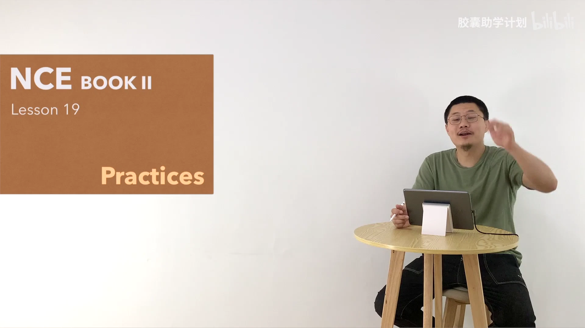

文字识别：胶囊助学计划 / NCE / BOOKⅡI / Lesson 19 / Practices

### 画面 00:00:03

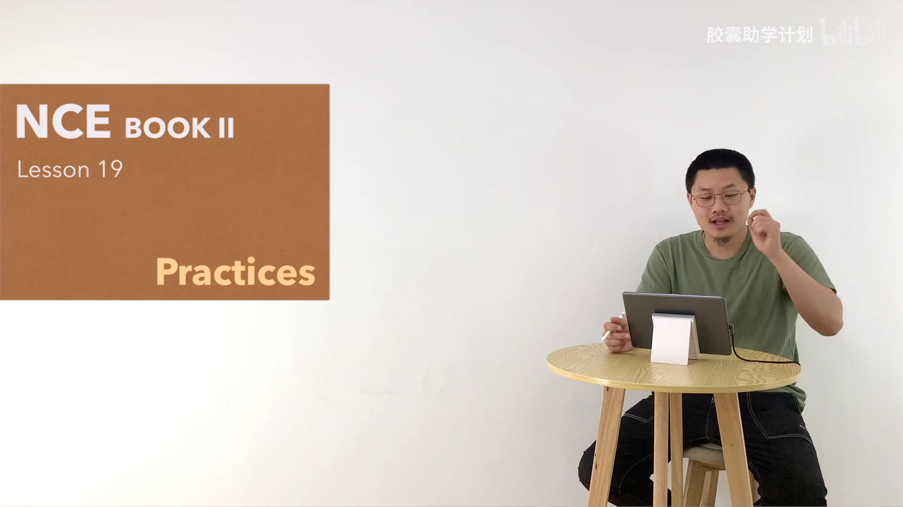

文字识别：胶囊助学计划 / NCE / BOOKII / Lesson 19 / Practices

### 画面 00:00:06

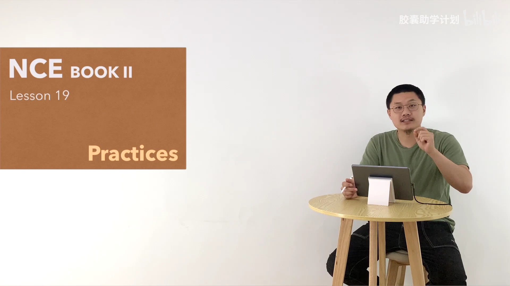

文字识别：胶囊助学计划 / NCE / BOOKII / Lesson 19 / Practices

### 画面 00:00:08

文字识别：胶囊助学计划 / 进行如下练习唯一前提 / 文章跟读至熟读成诵 / 否则请勿开始

### 画面 00:00:10

文字识别：胶囊助学计划 / 进行如下练习唯一前提 / 文章跟读至熟读成诵 / 否则请勿开始

### 画面 00:00:16

文字识别：胶囊助学计划 / 进行如下练习唯一前提 / 文章跟读至熟读成诵 / 否则请勿开始

### 画面 00:00:18

文字识别：胶囊助学计划bill / •

### 画面 00:00:22

### 画面 00:00:24

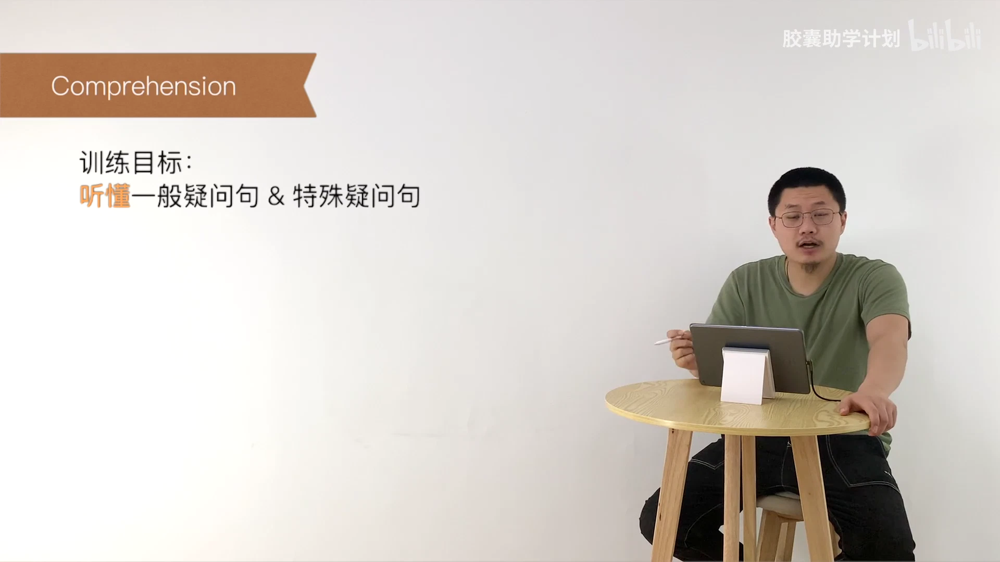

文字识别：胶囊助学计划 / Comprehension / 训练目标： / 听懂一般疑问句＆特殊疑问句

### 画面 00:00:28

文字识别：胶囊助学计划 / Comprehension / 训练目标： / 听懂一般疑问句＆特殊疑问句

## 00:00:30–00:01:00

问您答，听力口语练习来了。第一题，Were you at a theater or a cinema? At a theater. Next one, Did you think the play was going was soon going to begin? Yes, I did. Next one, Who was with you? Susan. Next one, She thought the play

### 画面 00:00:32

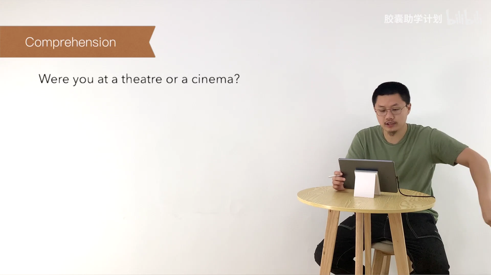

文字识别：胶囊助学计划 / Comprehension / Were you at a theatre or a cinema?

### 画面 00:00:42

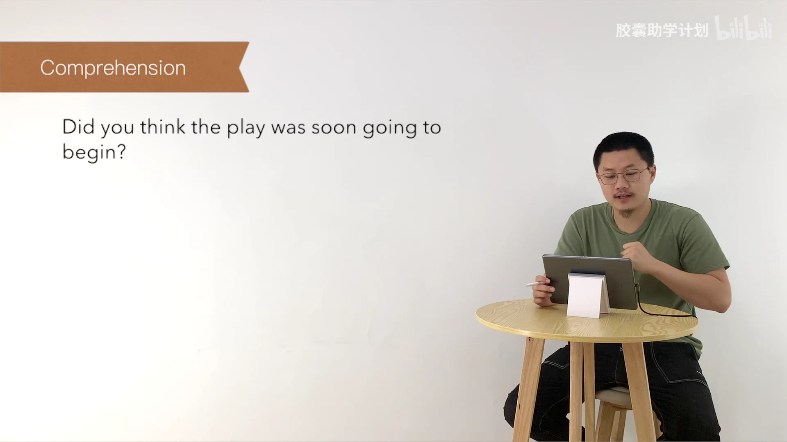

文字识别：胶囊助学计划 / Comprehension / Did you think the play was soon going to / begin?

### 画面 00:00:56

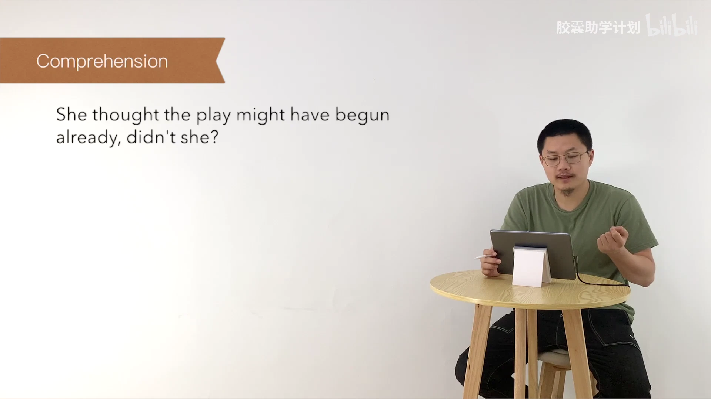

文字识别：胶囊助学计划 / Comprehension / She thought the play might have begun / already, didn't she?

## 00:01:00–00:01:30

might have began already, didn't she? Yes, she did. Next one, what did you do? I hurried to ticket office. Next one, how many tickets did you ask for? Ask for,乞丐那课咱们学了. Two. Next one, did the girl at the ticket office have any tickets left? No, she didn't.

### 画面 00:01:06

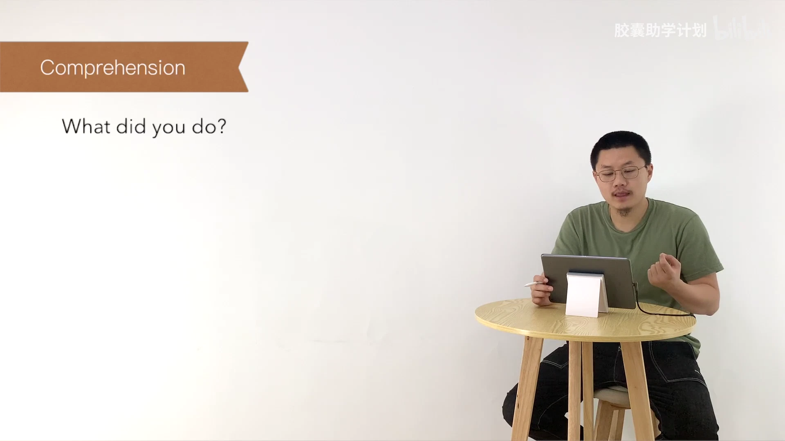

文字识别：胶囊助学计划 / Comprehension / What did you do?

### 画面 00:01:13

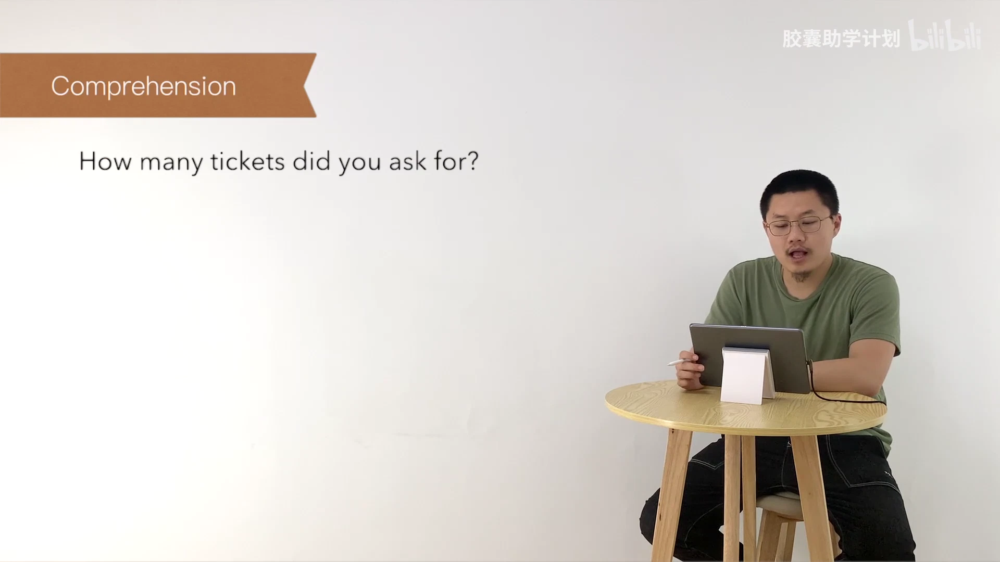

文字识别：胶囊助学计划 / Comprehension / How many tickets did you ask for?

### 画面 00:01:24

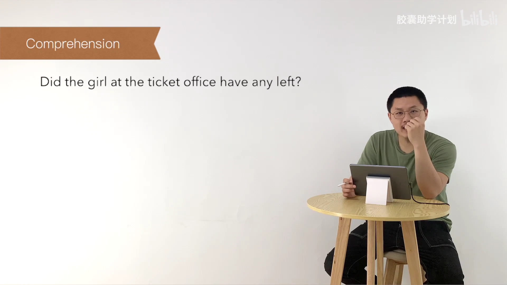

文字识别：胶囊助学计划 / Comprehension / Did the girl at the ticket office have any left?

## 00:01:30–00:02:00

What did she say? Wave sold out. Next one was Susan disappointed. Yes, she was. Next one, who hurried to the ticket office just then? A man. Continue. What did he want to return? Two tickets. Continue. Did the girl accept

### 画面 00:01:34

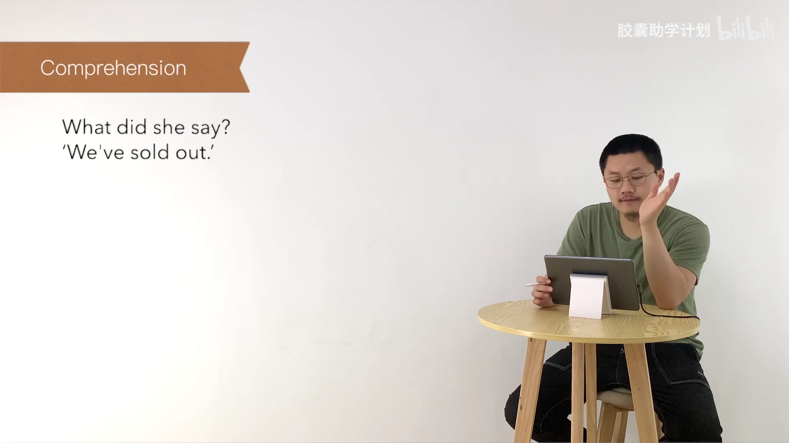

文字识别：胶囊助学计划 / Comprehension / What did she say? / 'We've sold out.'

## 00:02:00–00:02:30

them? Yes, she did.好，好，那我们下一道题，asking questions训练目标会说一般疑问句和特殊疑问句，提啊这个训练各位发问的能力，对吧？OK，那第一个呢，我们先来一个例句，Ask me if Susan and I were at the theater.这个答案非常简单，把were提前就可以了。注意人称上的变化。Where呢，肯定

### 画面 00:02:03

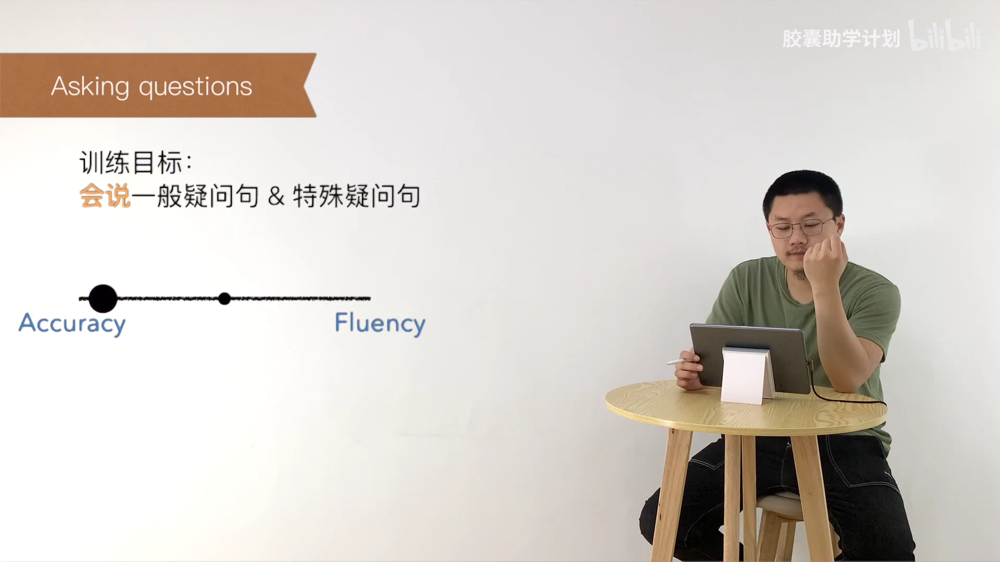

文字识别：胶囊助学计划 / Asking questions / 训练目标： / 会说一般疑问句＆特殊疑问句 / Accuracy / Fluency

### 画面 00:02:05

文字识别：胶囊助学计划 / Asking questions / 训练目标： / 会说一般疑问句＆特殊疑问句 / Accuracy / Fluency

### 画面 00:02:19

文字识别：胶囊助学计划 / Asking questions / T: Ask me if Susan and I were at the theatre.

### 画面 00:02:29

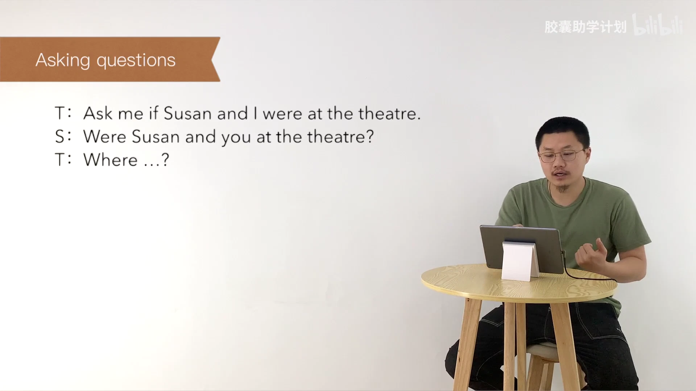

文字识别：胶囊助学计划 / Asking questions / T: Ask me if Susan and I were at the theatre. / S: Were Susan and you at the theatre? / T: Where ..?

## 00:02:30–00:03:00

是对 At the theater提问，然后 Where were you and Susan？ Where good？好，那我们接下来挨个看了啊。说 We wanted to see a play. 这个对于各位来说很简单，看到 wanted，把 did 提前，动词换原形。 What肯定是对 A play提问，答案是 What did you want to see？啊，你们想看什么？想看话剧。 The play was going to begin at any moment. Was往前一提，When对 At any

### 画面 00:02:36

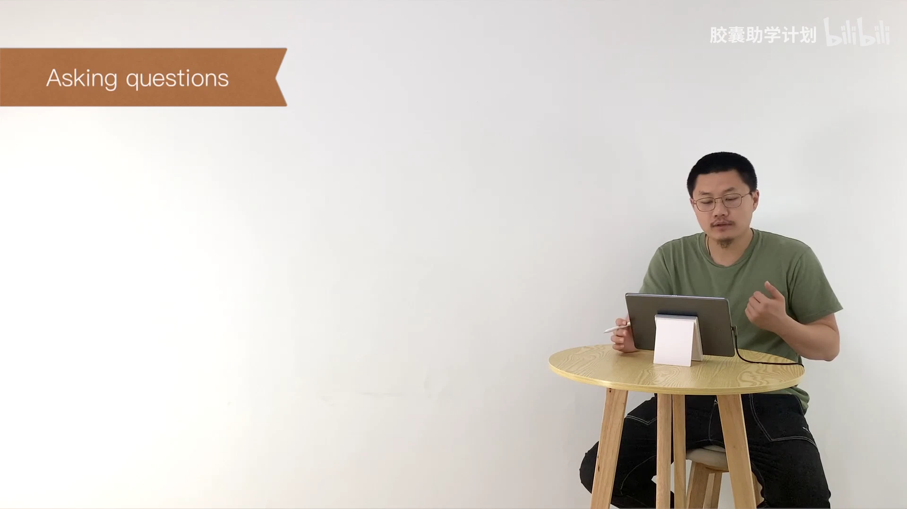

文字识别：胶囊助学计划 / Asking questions

### 画面 00:02:38

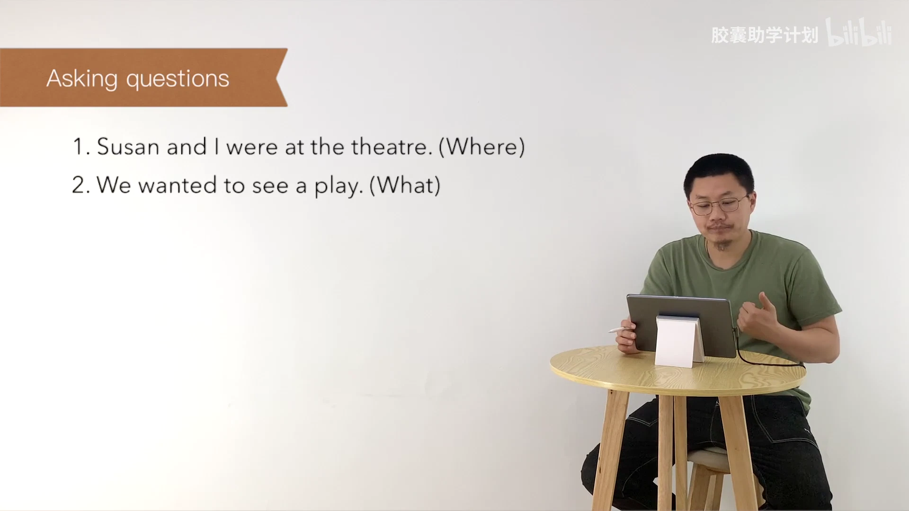

文字识别：胶囊助学计划 / Asking questions / 1. Susan and I were at the theatre. (Where) / 2. We wanted to see a play. (What)

### 画面 00:02:52

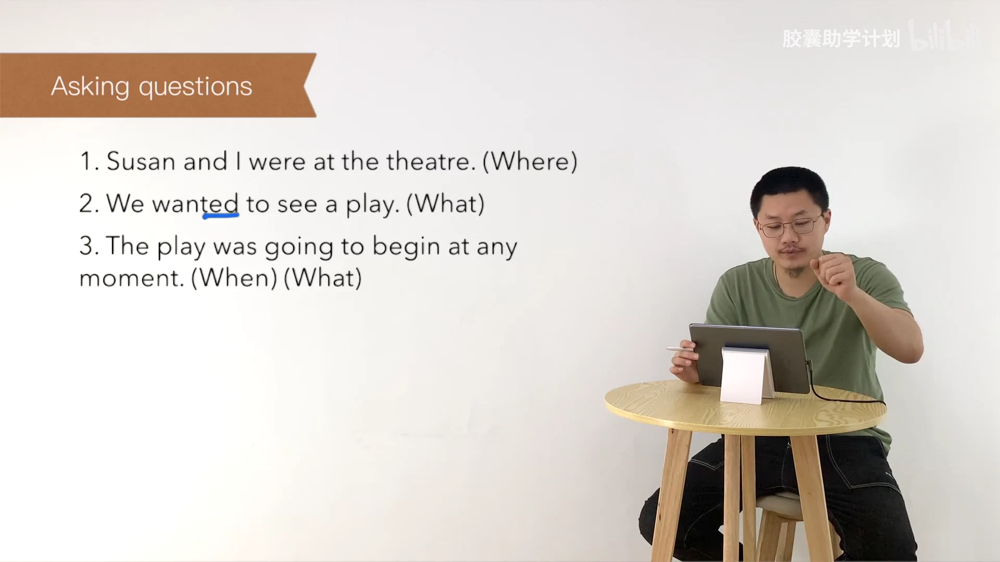

文字识别：胶囊助学计划 / Asking questions / 1. Susan and I were at the theatre. (Where) / 2. We wanted to see a play. (What) / 3. The play was going to begin at any / moment. (When)(What)

## 00:03:00–00:03:30

moment提问，对吧？然后What，对主语提问，直接替代，不用变一般疑问句了。说What was going to begin at any moment? I hurried to ticket office. Did提前，hurry的一般过去时。Where对the ticket office提问。I asked for two tickets. Did提前。How many对two提问，但是同时要注意，它要带着tickets，所以答案是How many tickets did you ask for? Okay.

### 画面 00:03:16

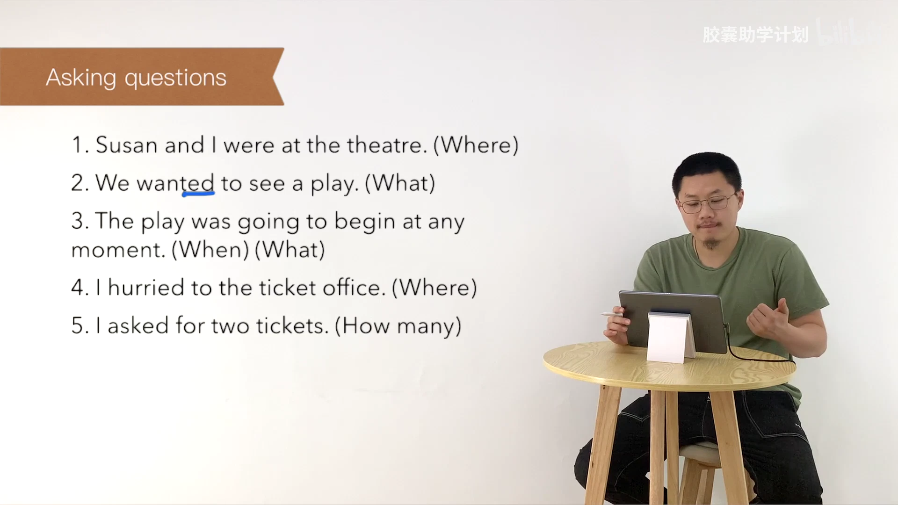

文字识别：胶囊助学计划 / Asking questions / 1. Susan and I were at the theatre. (Where) / 2. We wanted to see a play. (What) / 3. The play was going to begin at any / moment. (When)(What) / 4.I hurried to the ticket office. (Where) / 5.I asked for two tickets. (How many)

### 画面 00:03:23

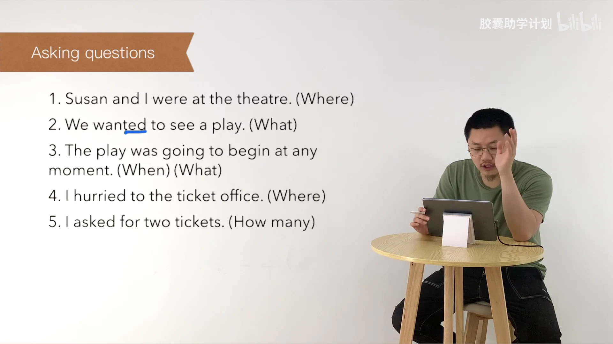

文字识别：胶囊助学计划 / Asking questions / 1. Susan and I were at the theatre. (Where) / 2. We wanted to see a play. (What) / 3. The play was going to begin at any / moment.(When)(What) / 4.I hurried to the ticket office. (Where) / 5.l asked for two tickets. (How many)

## 00:03:30–00:04:00

The girl said she was sorry. 注意，你看 said 后面其实省略了一个 that，这就是我们十五课学过的宾语从句，对吧？所以这地方你不要把 was 提前，你要把 did 提前啊。Did the girl say she was sorry? 然后 what 对整个宾语从句提问，答案就是 what did the girl say? Next one, Susan was disappointed. Was 提前，who 对主语提问，why 对整句提问。A man hurried to

### 画面 00:03:50

文字识别：胶囊助学计划 / Asking questions

### 画面 00:03:55

文字识别：胶囊助学计划 / Asking questions / 7. Susan was disappointed. (Who) (Why)

### 画面 00:03:59

文字识别：胶囊助学计划 / Asking questions / 7. Susan was disappointed. (Who) (Why) / 8. A man hurried to the ticket office just then. / (Who)(When)

## 00:04:00–00:04:30

ticket office just then. Did提前。 Who对主语提问，不变一般疑问句了，所以答案就是Who hurried？巴拉巴拉巴拉，剩下照抄。 When对just then提问，正在那时嘛。 He returned to his two tickets. Did提前。 How many依旧是对two提问，所以答案是How many tickets did he return？他退了多少张票？ I went back to ticket office. Did提前。 Where

### 画面 00:04:26

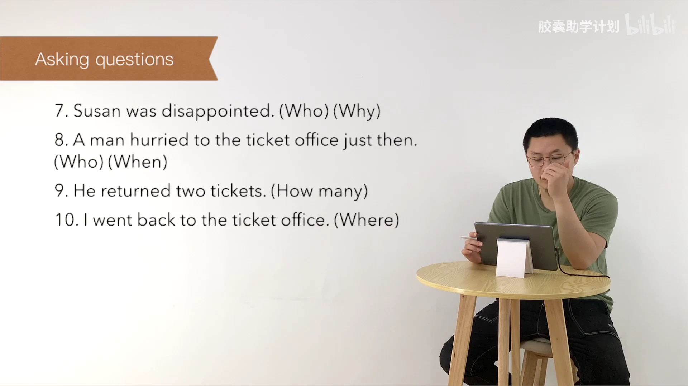

文字识别：胶囊助学计划 / Asking questions / 7. Susan was disappointed. (Who) (Why) / 8.A man hurried to the ticket office just then. / (Who)(When) / 9. He returned two tickets.(How many) / 10.I went back to the ticket office.(Where)

## 00:04:30–00:05:00

对the ticket office提问,对吧? I asked for those two tickets. Did提前, what对those two tickets提问, what did you ask for? Tell the story, 口语复述能力, 我们练的是fluency, 练的是流利性, 可以错一点点, 不能太慢啊, 不能一句一句的抠炫造句是不行的。我还是只给大家做一个示范啊, 各

### 画面 00:04:36

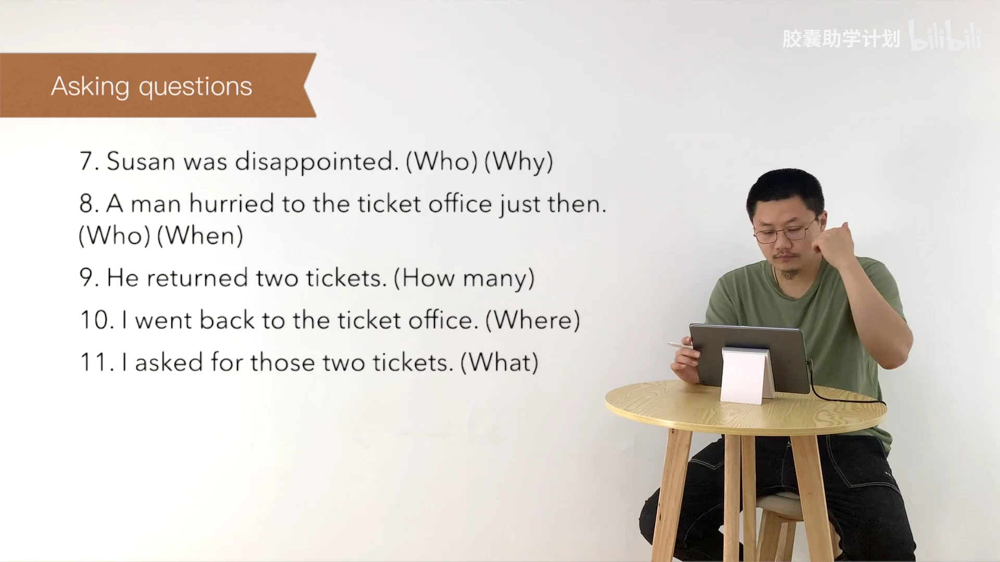

文字识别：胶囊助学计划 / Asking questions / 7. Susan was disappointed. (Who) (Why) / 8.A man hurried to the ticket office just then. / (Who)(When) / 9. He returned two tickets.(How many) / 10.I went back to the ticket office.(Where) / 11.I asked for those two tickets. (What)

### 画面 00:04:44

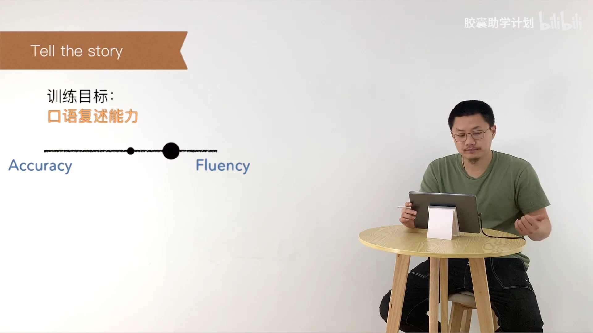

文字识别：胶囊助学计划 / Tell the story / 训练目标： / 口语复述能力 / Accuracy / Fluency

### 画面 00:04:49

文字识别：胶囊助学计划 / Tell the story / 训练目标： / 口语复述能力 / Accuracy / Fluency

### 画面 00:04:52

文字识别：胶囊助学计划 / Tell the story / 训练目标： / 口语复述能力 / Accuracy / Fluency

### 画面 00:04:56

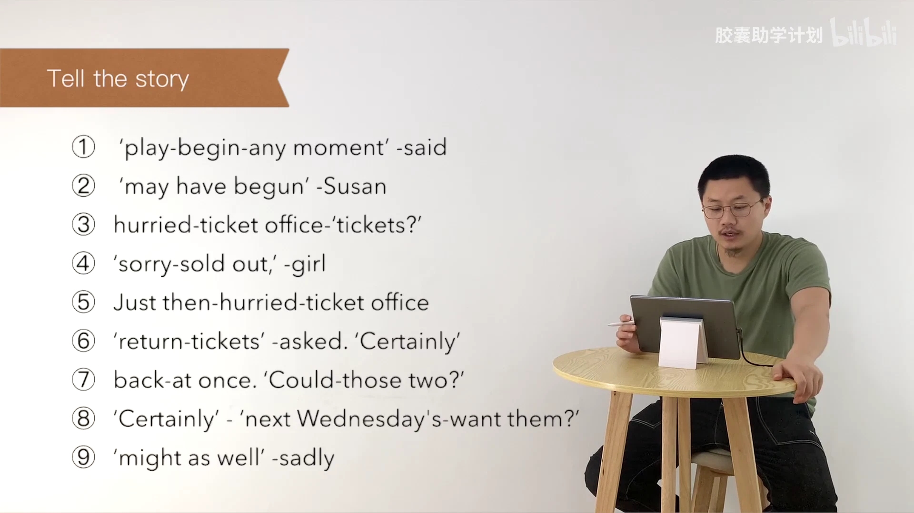

文字识别：胶囊助学计划 / Tell the story / 1 / 'play-begin-any moment'-said / 'may have begun'-Susan / hurried-ticket office-'tickets?' / 'sorry-sold out' -girl / Just then-hurried-ticket office / 5 / 'return-tickets'-asked.'Certainly' / back-at once.'Could-those two?' / 'Certainly' -'next Wednesday's-want them?' / 'might as well'-sadly / 9

## 00:05:00–00:05:30

位下课要自己去做那个练习啊。来了，The play may begin at any moment. I I said it may have began already. Susan answered. I hurried to the ticket office. May I have two tickets, please? Sorry, we've sold out. The girl said. Just then, a man hurried to ticket office. Can I return those two tickets? He asked. Certainly. I went back to ticket office at once. Could I have those two tickets? Certainly, the girl

### 画面 00:05:26

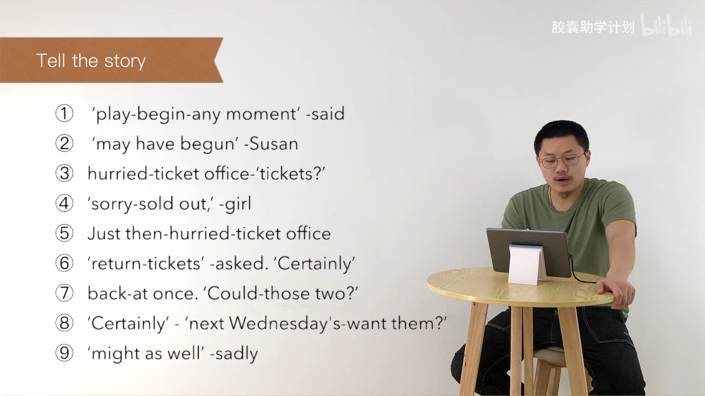

文字识别：胶囊助学计划 / Tell the story / 1 / 'play-begin-any moment'-said / 'may have begun'-Susan / hurried-ticket office-'tickets?' / 3 / 'sorry-sold out, -girl / Just then-hurried-ticket office / 5 / 'return-tickets'-asked.'Certainly' / back-at once.'Could-those two?' / 'Certainly' -'next Wednesday's-want them?' / 8 / 'might as well'-sadly / 9

## 00:05:30–00:06:00

said. But they're for next Wednesday's performance. Do you still want them? I might as well have them. I said sadly. Okay, very good.接下来 summary writing，摘要写作练习的是我们写作复述能力。各位要做的事情就是看一下摘要写作，每一句话写完到这儿对一下答案即可。OK，好，最后一道题 topic for discussion。这是我们所有练习，您学习所有英语最终的唯一目

### 画面 00:05:40

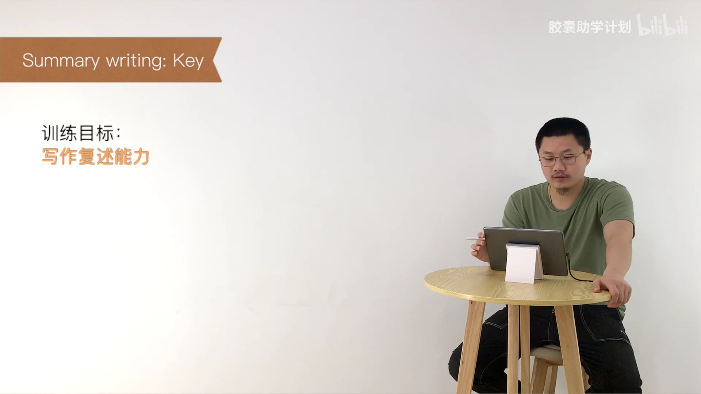

文字识别：胶囊助学计划 / Summary writing: Key / 训练目标： / 写作复述能力

### 画面 00:05:45

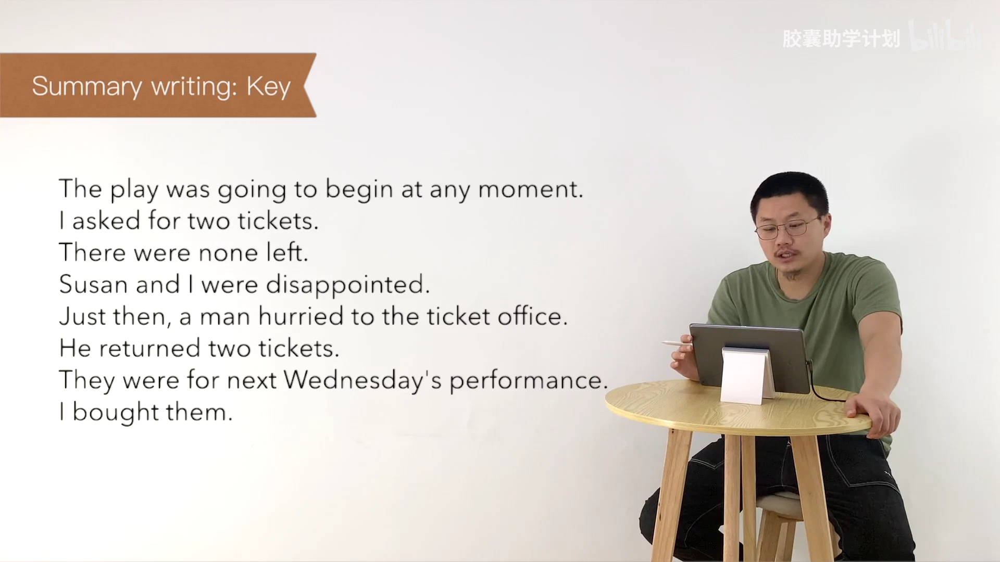

文字识别：胶囊助学计划 / Summary writing: Key / The play was going to begin at any moment. / I asked for two tickets. / There were none left. / Susan and I were disappointed. / Just then, a man hurried to the ticket office. / He returned two tickets. / They were for next Wednesday's performance. / I bought them.

### 画面 00:05:52

文字识别：胶囊助学计划 / Topics for discussion / 训练目标： / 完全自由的对话 / Accuracy / Fluency

## 00:06:00–00:06:30

的就是能进行完全自由的对话。当然，这个对话可以是写作啊，可以是阅读写作，它也是另一种对话，也可以是听力口语的对话。我们看一下这三道题。第一，Is it always easy to get seats for the theater in your country?在你的国家，话剧院里面啊，这个呃，得到一个座位是不是很容易的事儿？其实换一句话来说，就买票容不容易啊？根据我的经验，好像还是比较容易的。

### 画面 00:06:04

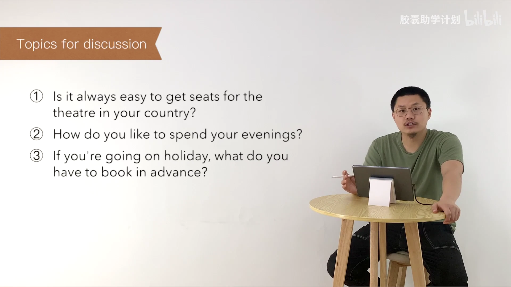

文字识别：胶囊助学计划 / Topics for discussion / Is it always easy to get seats for the / theatre in your country? / How do you like to spend your evenings? / If you're going on holiday, what do you / 3 / have to book in advance?

### 画面 00:06:20

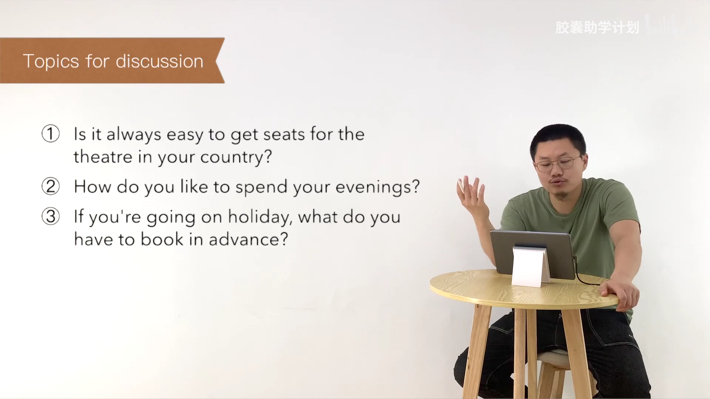

文字识别：胶囊助学计划 / Topics for discussion / Is it always easy to get seats for the / theatre in your country? / How do you like to spend your evenings? / If you're going on holiday, what do you / 3 / have to book in advance?

### 画面 00:06:27

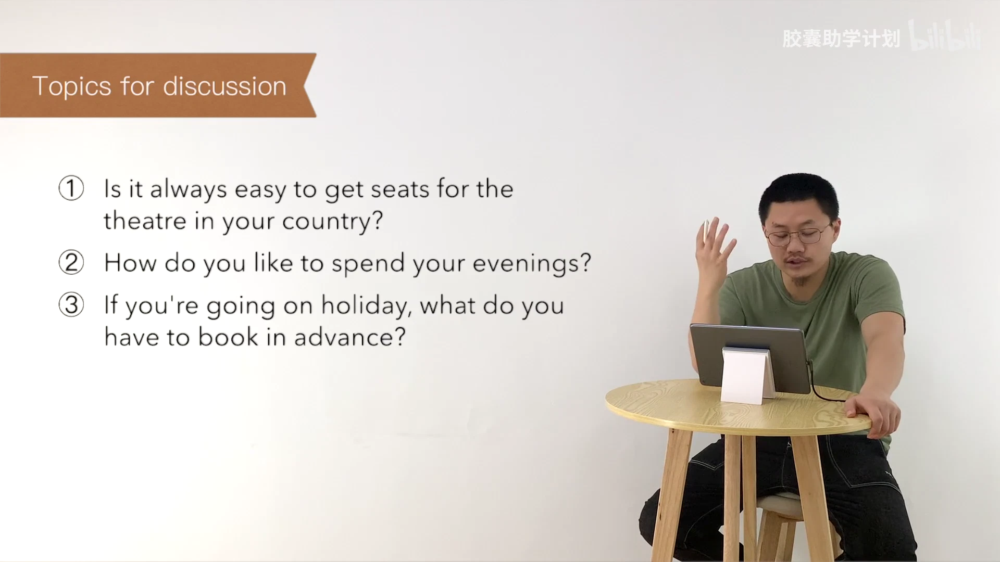

文字识别：胶囊助学计划 / Topics for discussion / Is it always easy to get seats for the / theatre in your country? / How do you like to spend your evenings? / If you're going on holiday, what do you / 3 / have to book in advance?

## 00:06:30–00:07:00

How do you like to spend your evenings?你一般如何度过你的晚上？If you are going on holiday, what do you have to book in advance?如果你去度假，你必须要book in advance. Book是书的意思，名词，动词它就是预定啊。你要提前预定什么？啊，这各位可以自己去想一下，用简单的英文写出来或者说出来，尝试去回答一下。家庭作业，ask me if

### 画面 00:06:57

文字识别：胶囊助学计划

### 画面 00:06:59

文字识别：胶囊助学计划 / 1.Ask me if写&朗读

## 00:07:00–00:07:30

一定要先写，然后大声给他朗读出来，再然后journal写作先写，再对一下答案。Tell the story，各位文章读熟了之后进行口语复述，专栏当中都可以找到。那以上呢就是本期视频的全部内容了。如果大家喜欢我们的课程，欢迎大家关注、订阅、一键三连，分享给那些需要的朋友。See you next time.

### 画面 00:07:01

文字识别：胶囊助学计划 / 1.Ask me if写&朗读

### 画面 00:07:03

文字识别：胶囊助学计划 / 1. / Ask me if写&朗读 / 2. / 摘要写作写&答案

### 画面 00:07:05

文字识别：胶囊助学计划 / 1.Ask me if写&朗读 / 2.摘要写作写&答案

### 画面 00:07:07

文字识别：胶囊助学计划 / 1.Ask me if写&朗读 / 摘要写作写&答案 / 3.Tell the story 口语复述

### 画面 00:07:10

文字识别：胶囊助学计划 / 1.Ask me if写&朗读 / 摘要写作写&答案 / 3.Tell the story 口语复述 / 专栏 / 4.

### 画面 00:07:12

文字识别：胶囊助学计划

### 画面 00:07:22

文字识别：👍 / 添 / ￥

### 画面 00:07:24

文字识别：CAPSULEACADEMY / 胶囊助学计划 / 小红书 / Lecturer / □ / Leo / OE

### 画面 00:07:27

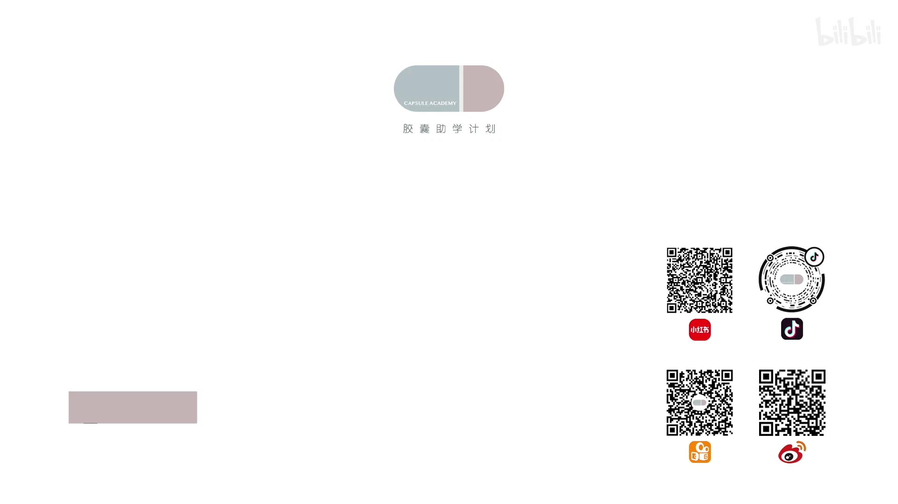

文字识别：CAPSULEACADEMY / 胶囊助学计划 / 小红书 / OE

## 00:07:30–00:07:35

### 画面 00:07:30

文字识别：CAPSULEACADEMY / 胶囊助学计划 / 小红书 / Creator / □ / Leo & Berlin / OE

### 画面 00:07:32

文字识别：bilbili / 胶囊助学计划 / CAPSULEACADEMY / 胶囊助学计划 / 小红书 / 品 / OE

### 画面 00:07:34

文字识别：bilibili / 胶囊助学计划

