# L020 单词

快速机器解析：语音为单模型转写，未进行独立交叉校对或人工复核；画面每秒采样并按变化选帧，短时文字和标记可能遗漏。截图时间约有 1 秒误差。图片有损压缩；遇到疑点请按时间查看 Google Drive 原视频。

## 00:00:00–00:00:30

Hello everyone, welcome to Capsule Academy. This is Leo. Today we're going to learn New Concept English Book Two, Lesson Twenty Words. 那老习惯进入正式课程之前呢，我们看几个小的问题。第一，如何表达胡扯？第二，如何表达浪费时间？那带着这两个问题，后边呢， enjoy. 我们先看第一个单词啊，这个单词实际上我们在新概念一册好像

### 画面 00:00:00

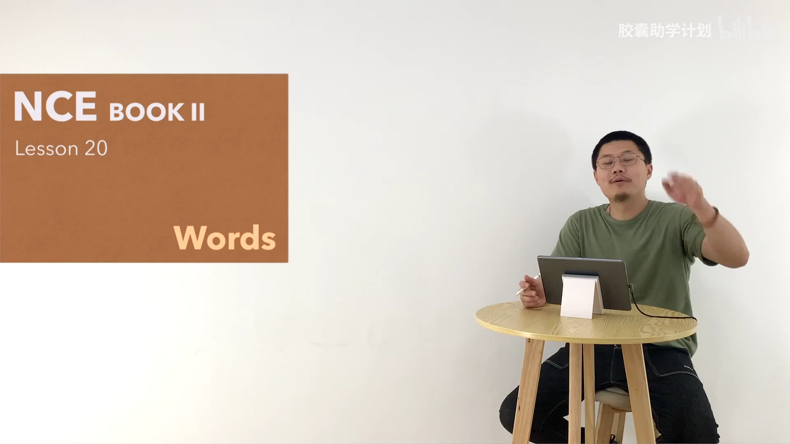

文字识别：胶囊助学计划 / NCE / BOOKII / Lesson 20 / Words

### 画面 00:00:05

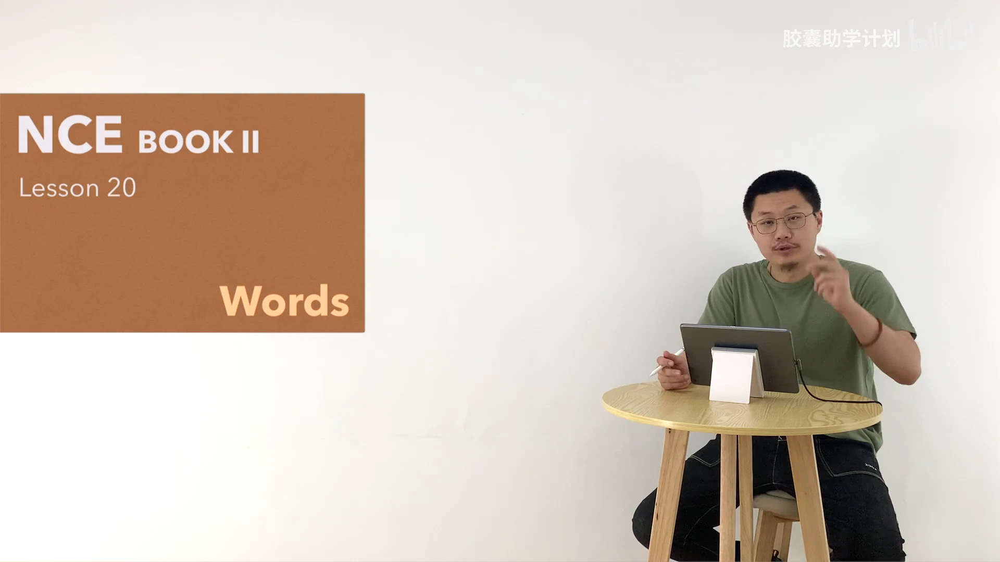

文字识别：胶囊助学计划 / NCE / BOOKII / Lesson 20 / Words

### 画面 00:00:09

文字识别：胶囊助学计划

### 画面 00:00:11

文字识别：胶囊助学计划 / 何表达“胡扯”？

### 画面 00:00:13

文字识别：胶囊助学计划 / ①如何表达“胡扯”？

### 画面 00:00:15

文字识别：胶囊助学计划 / ①如何表达“胡扯”？ / 如何表达“浪费时间

### 画面 00:00:20

文字识别：胶囊助学计划b出出 / •

### 画面 00:00:23

文字识别：胶囊助学计划 / 胶囊助学计划

### 画面 00:00:25

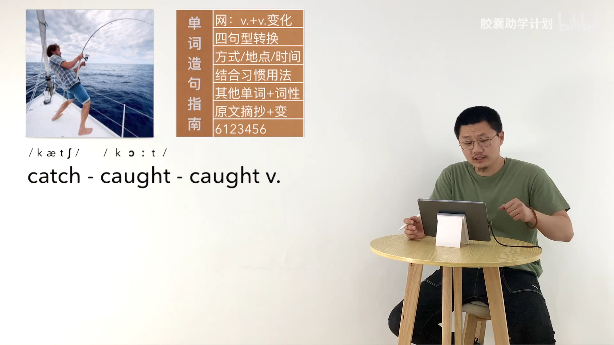

文字识别：单词造句指南 / 网：v.+v.变化 / 胶囊助学计划 / 四句型转换 / 方式/地点/时间 / 结合习惯用法 / 其他单词+词性 / 原文摘抄+变 / 6123456 / / kæt∫/ / / k o :t / / catch - caught - caught v.

## 00:00:30–00:01:00

十一课啊，我们就学过，我们当时学这个 catch 的意思叫做抓住，对吧？我把这个衬衫扔过去，然后让你抓住，我叫做 catch。所以 catch 各位了解它最核心的意思非常的重要，叫做抓住。那然后我再告诉你 catch 还有抓鱼的意思，或者说钓鱼的意思，这个各位就很容易把它记住了，对不对？也是抓鱼嘛。OK，那它的过去式呢和过去分词长得是一样的，均读为

### 画面 00:00:30

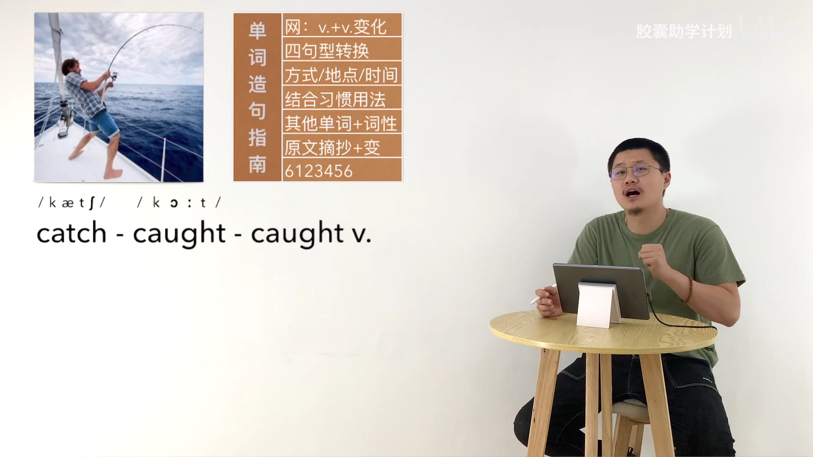

文字识别：单词造句指南 / 网：v.+v.变化 / 胶囊助学计划 / 四句型转换 / 方式/地点/时间 / 结合习惯用法 / 其他单词+词性 / 原文摘抄+变 / 6123456 / / kæt∫/ / / k o :t / / catch - caught - caught v.

### 画面 00:00:33

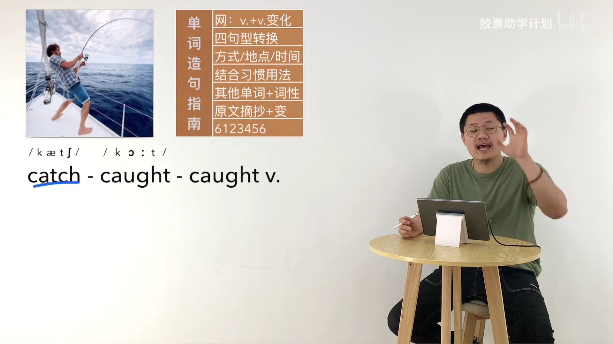

文字识别：单词造句指南 / 网：v.+v.变化 / 胶囊助学计划 / 四句型转换 / 方式/地点/时间 / 结合习惯用法 / 其他单词+词性 / 原文摘抄+变 / 6123456 / /kætJ/ / / k o :t / / catch - caught - caught v.

### 画面 00:00:36

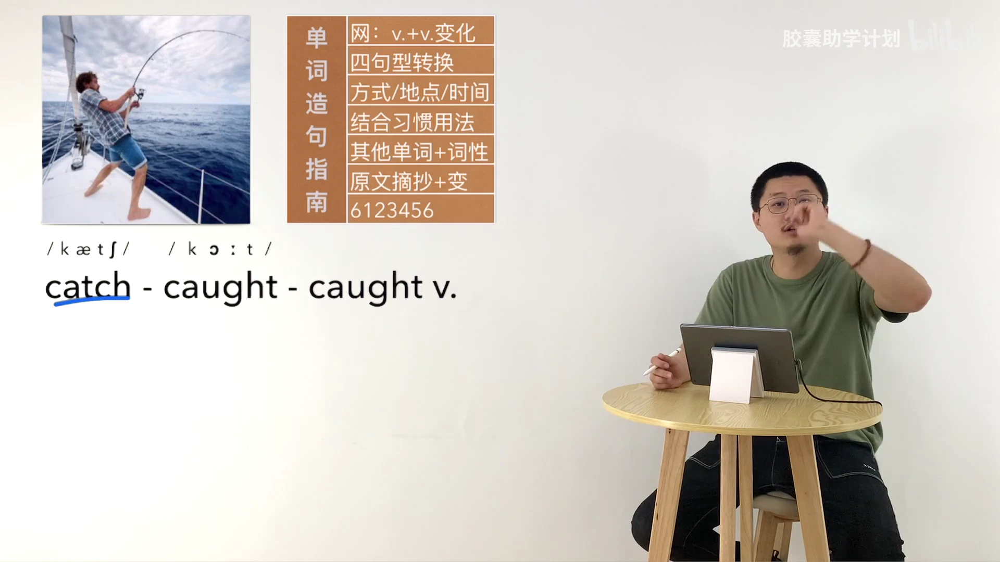

文字识别：单词造句指南 / 网：v.+v.变化 / 胶囊助学计划 / 四句型转换 / 方式/地点/时间 / 结合习惯用法 / 其他单词+词性 / 原文摘抄+变 / 6123456 / /kætJ/ / / k o :t / / catch - caught - caught v.

### 画面 00:00:54

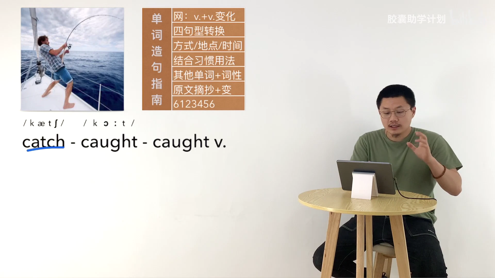

文字识别：单词造句指南 / 网：v.+v.变化 / 胶囊助学计划 / 四句型转换 / 方式/地点/时间 / 结合习惯用法 / 其他单词+词性 / 原文摘抄+变 / 6123456 / /kætJ/ / / k o :t / / catch - caught - caught v.

### 画面 00:00:56

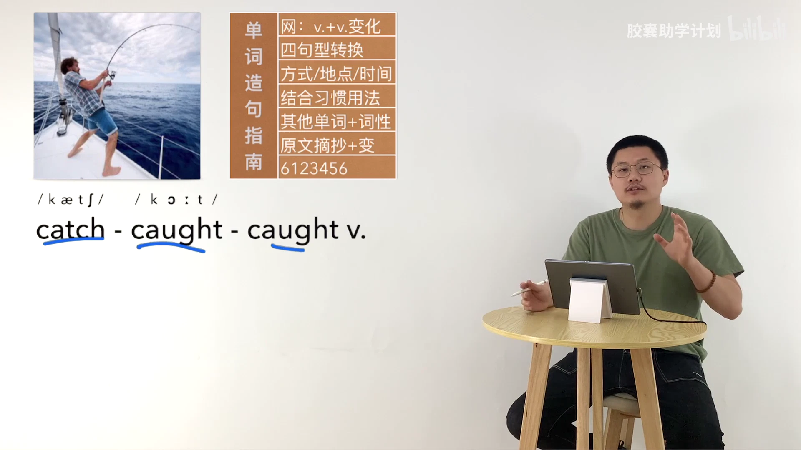

文字识别：单词造句指南 / 网：v.+v.变化 / 胶囊助学计划 / 四句型转换 / 方式/地点/时间 / 结合习惯用法 / 其他单词+词性 / 原文摘抄+变 / 6123456 / / kæt∫/ / / k o :t / / catch - caught - caught v.

## 00:01:00–00:01:30

caught，OK，C A U G H T，注意小夏，再跟我读一遍，叫做 caught，very good。那注意它的词性是一个动词，这是我们目前学单词的时候反复强调的五个点当中一个点，非常重要，就是词性。我们汉语学的时候往往不提词性，对吧？为什么要提词性呢？因为我们单词造句的时候，如果是动词，那我们就要知道它有动词加动词的变化，要换主动、被动、时态、情

### 画面 00:01:07

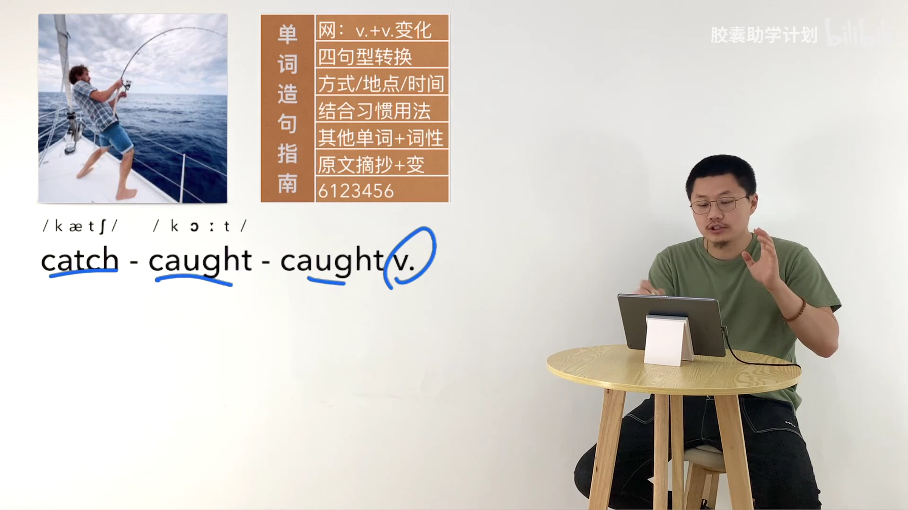

文字识别：单词造句指南 / 网：v.+v.变化 / 胶囊助学计划 / 四句型转换 / 方式/地点/时间 / 结合习惯用法 / 其他单词+词性 / 原文摘抄+变 / 6123456 / / kxt∫/ / /ko:t/ / catch - caught - caught

### 画面 00:01:11

文字识别：单词造句指南 / 网：v.+v.变化 / 胶囊助学计划 / 四句型转换 / 方式/地点/时间 / 结合习惯用法 / 其他单词+词性 / 原文摘抄+变 / 6123456 / / kxt∫/ / /ko:t / / catch - caught - caught(

### 画面 00:01:16

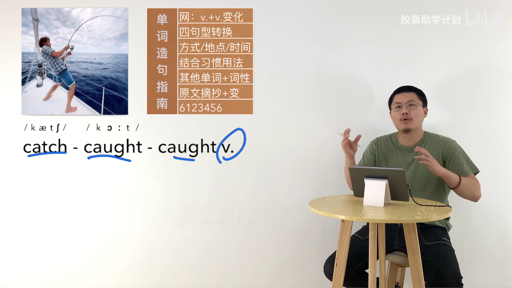

文字识别：单词造句指南 / 网：v.+v.变化 / 胶囊助学计划 / 四句型转换 / 方式/地点/时间 / 结合习惯用法 / 其他单词+词性 / 原文摘抄+变 / 6123456 / / kæt∫/ / /ko:t/ / catch - caught - caught

### 画面 00:01:21

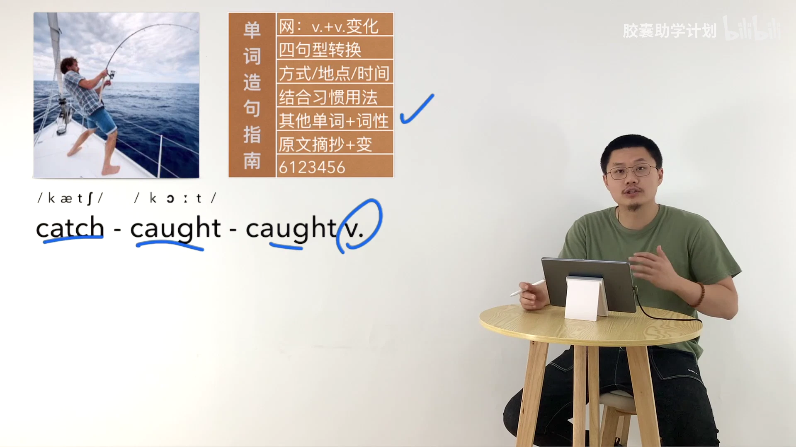

文字识别：单词造句指南 / 网：v.+v.变化 / 胶囊助学计划 / 四句型转换 / 方式/地点/时间 / 结合习惯用法 / 其他单词+词性 / 原文摘抄+变 / 6123456 / / kæt∫/ / /ko:t/ / catch - caught - caught(

### 画面 00:01:25

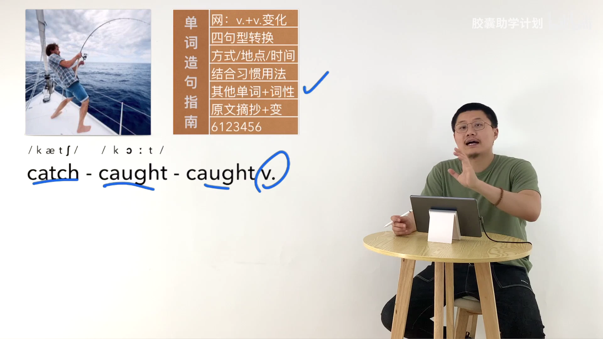

文字识别：单词造句指南 / 网：v.+v.变化 / 四句型转换 / 方式/地点/时间 / 结合习惯用法 / 其他单词+词性 / 原文摘抄+变 / 6123456 / /kætJ/ / /ko:t/ / catch - caught - caught(

## 00:01:30–00:02:00

态动词，对吧？主要是这几大类。当然，以后我们还会学虚拟。其次呢，如果它是动词，那我抓，我总得抓点什么吧？抓的是什么呢？对吧？抓的就叫做名词。OK，好，那比如说我们造一句话，说The police have caught the thief。说警察呀已经抓到了这个贼。你看，这是一个非常典型的主动，叫have加caught现在完成时。好，我们再换一个，对于各位来说容易忘

### 画面 00:01:30

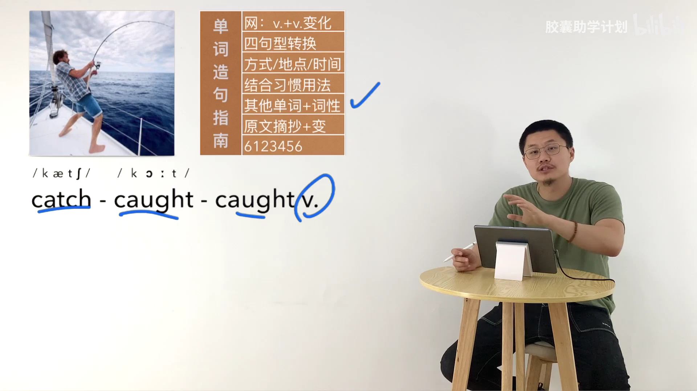

文字识别：单词造句指南 / 网：v.+v.变化 / 胶囊助学计划 / 四句型转换 / 方式/地点/时间 / 结合习惯用法 / 其他单词+词性 / 原文摘抄+变 / 6123456 / / kæt∫/ / /ko:t/ / catch - caught - caught(

### 画面 00:01:41

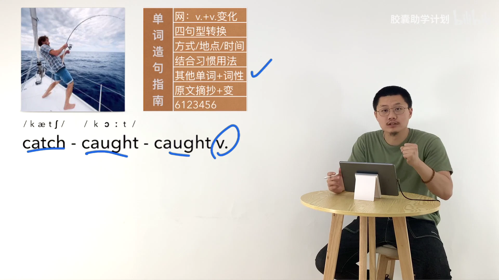

文字识别：单词造句指南 / 网：v.+v.变化 / 胶囊助学计划 / 四句型转换 / 方式/地点/时间 / 结合习惯用法 / 其他单词+词性 / 原文摘抄+变 / 6123456 / / kæt∫/ / /ko:t / / catch - caught - caught

### 画面 00:01:45

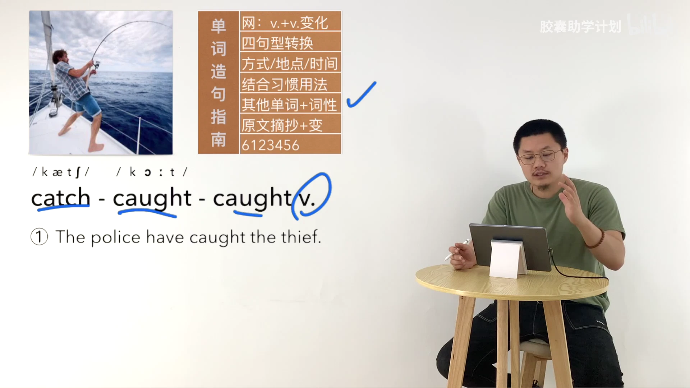

文字识别：单词造句指南 / 网：v.+v.变化 / 胶囊助学计划 / 四句型转换 / 方式/地点/时间 / 结合习惯用法 / 其他单词+词性 / 原文摘抄+变 / 6123456 / / kæt∫/ / /ko:t/ / catch - caught - caughtV. / ① The police have caught the thief.

### 画面 00:01:58

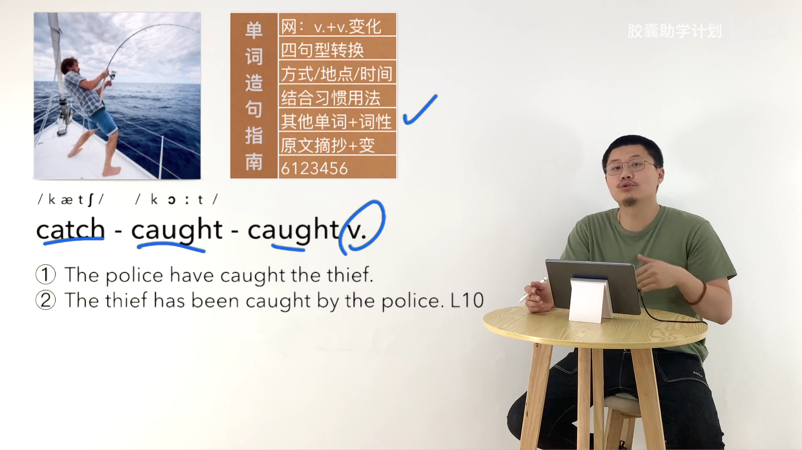

文字识别：单词造句指南 / 网：v.+v.变化 / 四句型转换 / 方式/地点/时间 / 结合习惯用法 / 其他单词+词性 / 原文摘抄+变 / 6123456 / / kæt∫/ / / k o :t / / catch - caught - caughtV. / ① The police have caught the thief. / The thief has been caught by the police. L10

## 00:02:00–00:02:30

记的，叫做被动。第十课咱们学的，叫做 The thief has been caught by the police. The thief has been caught by the police，对吧？这个贼呀已经被抓住了。By被被谁呢？被警察。哎，我们拿单词造句的同时又复习了之前学过的语法，玩一个。接下来，那我们可以把它变成一个一般疑问句，当然不是变这句话了，对吧？OK，那我们就说 Did you catch anything？说你抓到任何东西了吗？比如说啊，我每次

### 画面 00:02:02

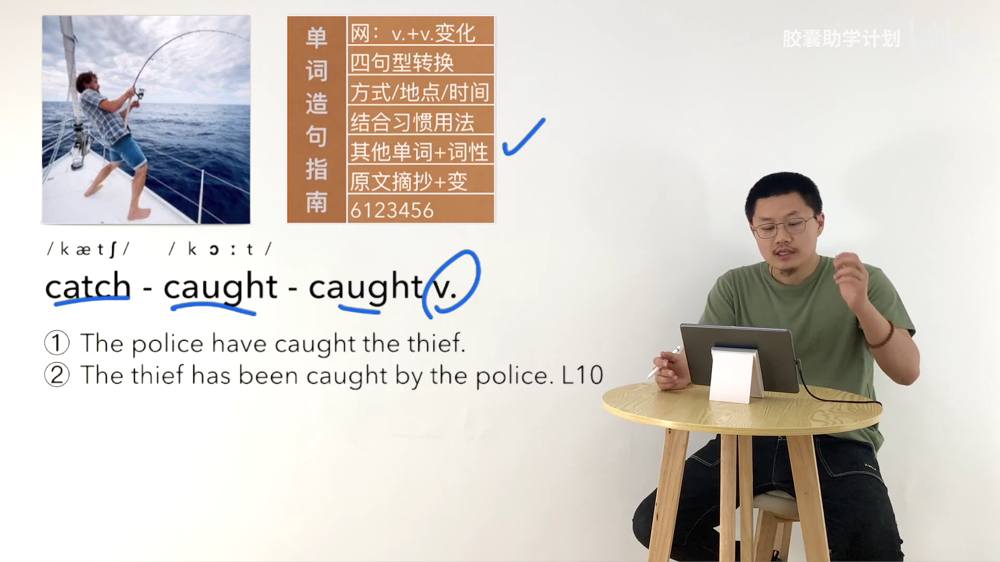

文字识别：单词造句指南 / 网：v.+v.变化 / 胶囊助学计划 / 四句型转换 / 方式/地点/时间 / 结合习惯用法 / 其他单词+词性 / 原文摘抄+变 / 6123456 / /kæt∫/ / /ko:t / / catch - caught - caught. / ① The police have caught the thief. / The thief has been caught by the police. L10

### 画面 00:02:10

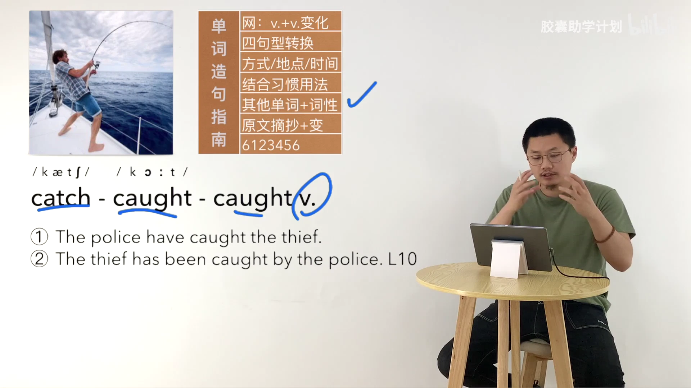

文字识别：单词造句指南 / 网：v.+v.变化 / 胶囊助学计划 / 四句型转换 / 方式/地点/时间 / 结合习惯用法 / 其他单词+词性 / 原文摘抄+变 / 6123456 / / kæt∫/ / /k o:t/ / catch - caught - caughtv. / ① The police have caught the thief. / The thief has been caught by the police. L10

### 画面 00:02:20

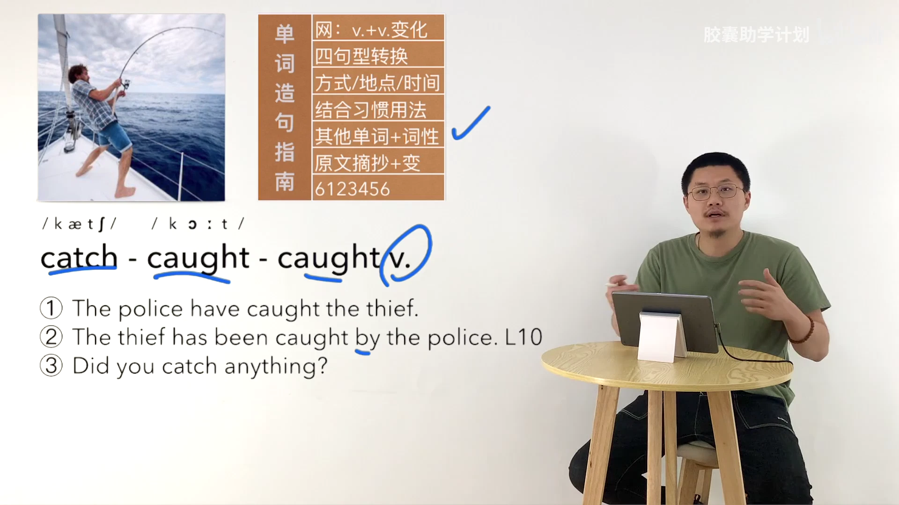

文字识别：单词造句指南 / 网：v.+v.变化 / 四句型转换 / 方式/地点/时间 / 结合习惯用法 / 其他单词+词性 / 原文摘抄+变 / 6123456 / / kæt∫/ / /ko:t/ / catch - caught - caughty. / ① The police have caught the thief. / The thief has been caught by the police. L10 / Did you catch anything? / 3

### 画面 00:02:25

文字识别：单词造句指南 / 网：v.+v.变化 / 胶囊助学计划 / 四句型转换 / 方式/地点/时间 / 结合习惯用法 / 其他单词+词性 / 原文摘抄+变 / 6123456 / / kæt∫/ / /ko:t/ / catch - caught - caughtV. / ① The police have caught the thief. / The thief has been caught by the police. L1 /  Did you catch anything? / 3）

## 00:02:30–00:03:00

回秦皇岛去海边的时候，哎，就当然说的是汉语啊，就看到有人在那儿海钓，那你就可能会问说，哎，钓到什么东西了吗？抓到什么东西了吗？就会问一句叫做 Did you catch anything？当然问的是汉语啊。OK，那 catch 还有一个非常常用的含义，这是我们可以，比如说我们来这样一句话叫 You can catch a bus if there is no taxi。那这是我们十六课学的 if 引导的这样一个小的从句，对吧？如果那什

### 画面 00:02:45

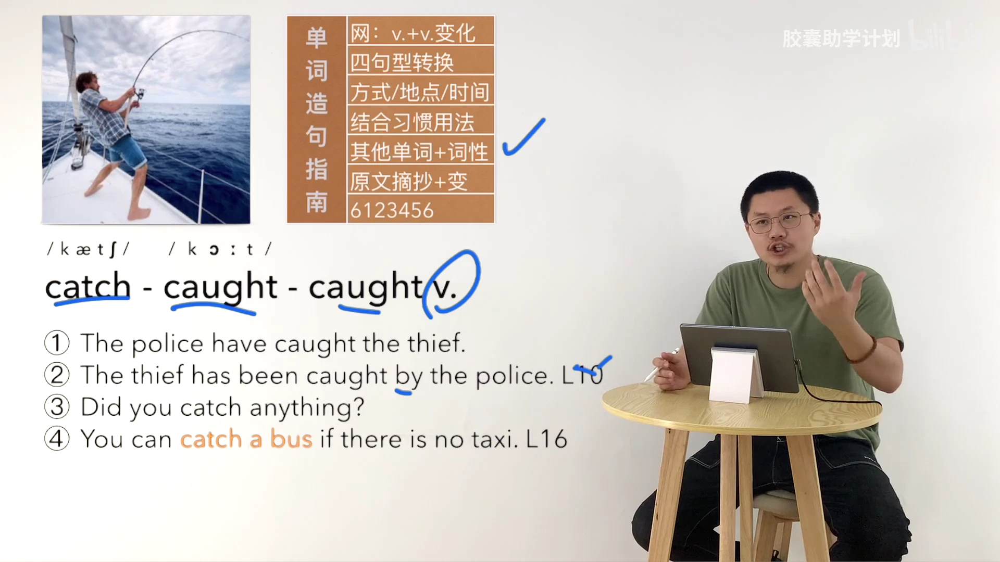

文字识别：单词造句指南 / 网：v.+v.变化 / 胶囊助学计划 / 四句型转换 / 方式/地点/时间 / 结合习惯用法 / 其他单词+词性 / 原文摘抄+变 / 6123456 / / ket∫/ / /ko:t/ / catch - caught - caughtV. / ① The police have caught the thief. / The thief has been caught by the police. L1 /  Did you catch anything? / 3 /  You can catch a bus if there is no taxi. L16 / 4

### 画面 00:02:50

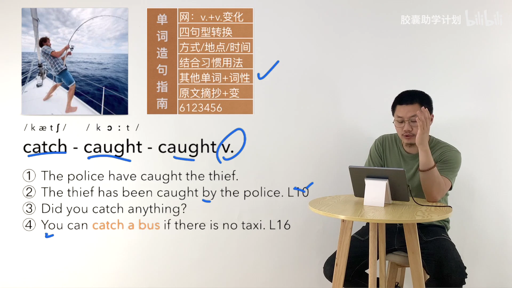

文字识别：单词造句指南 / 网：v.+v.变化 / 胶囊助学计划 / 四句型转换 / 方式/地点/时间 / 结合习惯用法 / 其他单词+词性 / 原文摘抄+变 / 6123456 / / kxt∫/ / /ko:t / / catch - caught - caught / ① The police have caught the thief. / The thief has been caught by the police. LTO /  Did you catch anything? / 3 /  You can catch a bus if there is no taxi. L16 / 4

### 画面 00:02:52

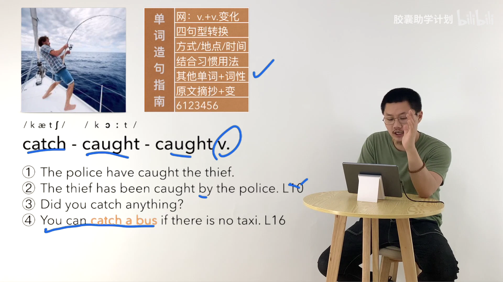

文字识别：单词造句指南 / 网：v.+v.变化 / 胶囊助学计划 / 四句型转换 / 方式/地点/时间 / 结合习惯用法 / 其他单词+词性 / 原文摘抄+变 / 6123456 / / kxt∫/ / /ko:t / / catch - caught - caught. / ① The police have caught the thief. / The thief has been caught by the police. L1O / Did you catch anything? / 3 / You can catch a bus if there is no taxi. L16

### 画面 00:02:58

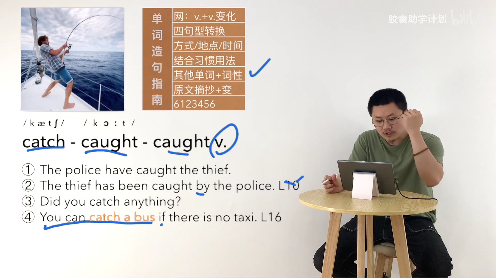

文字识别：单词造句指南 / 网：v.+v.变化 / 胶囊助学计划 / 四句型转换 / 方式/地点/时间 / 结合习惯用法 / 其他单词+词性 / 原文摘抄+变 / 6123456 / / kæt∫/ / /ko:t/ / catch - caught - caughtV. / ① The police have caught the thief. / The thief has been caught by the police. L1 / Did you catch anything? / 3 / You can catch a bus if there is no taxi. L16

## 00:03:00–00:03:30

么叫抓住一辆公交车？我个人是这样认为的：，如果这里边的每个单词你都认的，但是 catch 这个单词你按抓的意思是翻译不过来的。比如说，你可以抓一辆公交车，如果没有这个呃 taxi，就是我们汉语叫出租车，对吧？如果没有的话，您看这句话首先是不通的，如果你翻译成汉语。但我个人认为，如果你有一点点实际生活经验，再加上下

### 画面 00:03:00

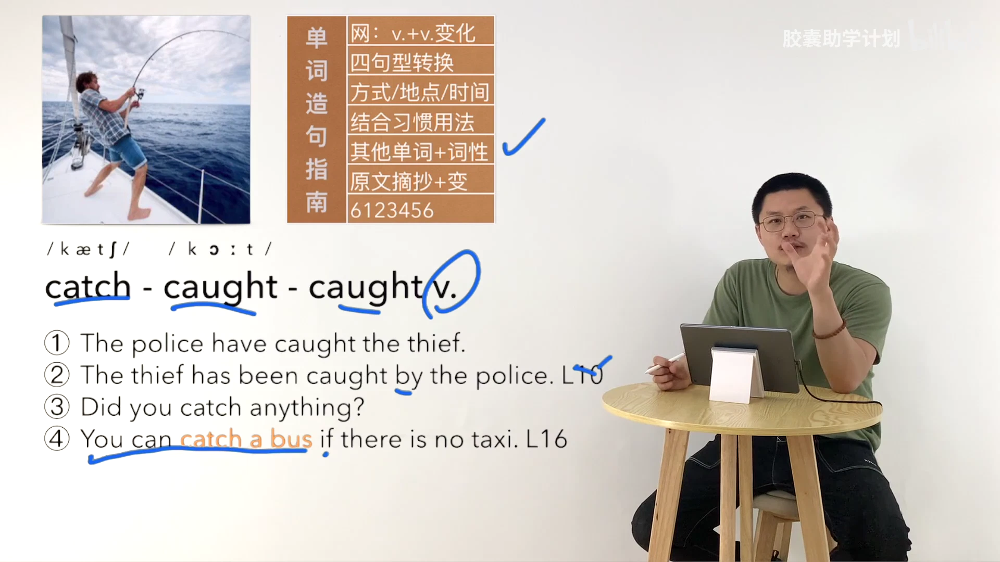

文字识别：单词造句指南 / 网：v.+v.变化 / 胶囊助学计划 / 四句型转换 / 方式/地点/时间 / 结合习惯用法 / 其他单词+词性 / 原文摘抄+变 / 6123456 / / kæt∫/ / /ko:t/ / catch - caught - caughtv. / ① The police have caught the thief. / The thief has been caught by the police. LTS / Did you catch anything? / 3 /  You can catch a bus if there is no taxi. L16

### 画面 00:03:05

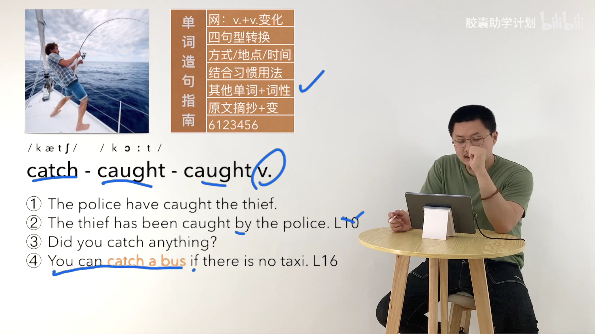

文字识别：单词造句指南 / 网：v.+v.变化 / 胶囊助学计划 / 四句型转换 / 方式/地点/时间 / 结合习惯用法 / 其他单词+词性 / 原文摘抄+变 / 6123456 / / kxt∫/ / /k o:t / / catch - caught - caught. / ① The police have caught the thief. / The thief has been caught by the police. L1 / Did you catch anything? / 3 / You can catch a bus if there is no taxi. L16

### 画面 00:03:15

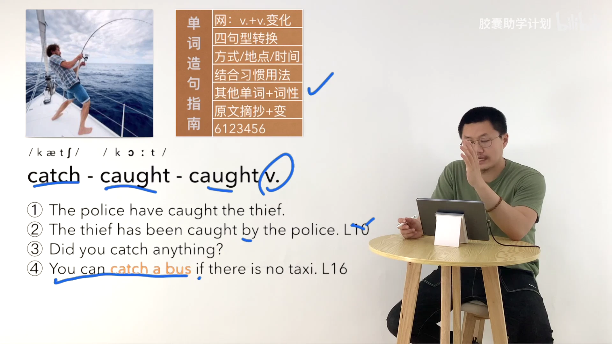

文字识别：单词造句指南 / 网：v.+v.变化 / 胶囊助学计划 / 四句型转换 / 方式/地点/时间 / 结合习惯用法 / 其他单词+词性 / 原文摘抄+变 / 6123456 / / kæt∫/ / /k o:t/ / catch - caught - caughtV. / ① The police have caught the thief. / The thief has been caught by the police. L1 / Did you catch anything? / 3 / You can catch a bus if there is no taxi. L16

### 画面 00:03:20

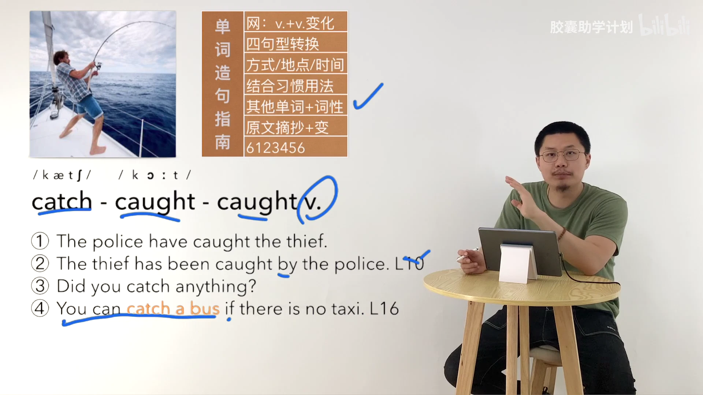

文字识别：单词造句指南 / 网：v.+v.变化 / 胶囊助学计划 / 四句型转换 / 方式/地点/时间 / 结合习惯用法 / 其他单词+词性 / 原文摘抄+变 / 6123456 / / kxt ∫/ / /ko:t/ / catch - caught - caughtV. / ① The police have caught the thief. / The thief has been caught by the police. LTS / Did you catch anything? / 3 / You can catch a bus if there is no taxi. L16

### 画面 00:03:23

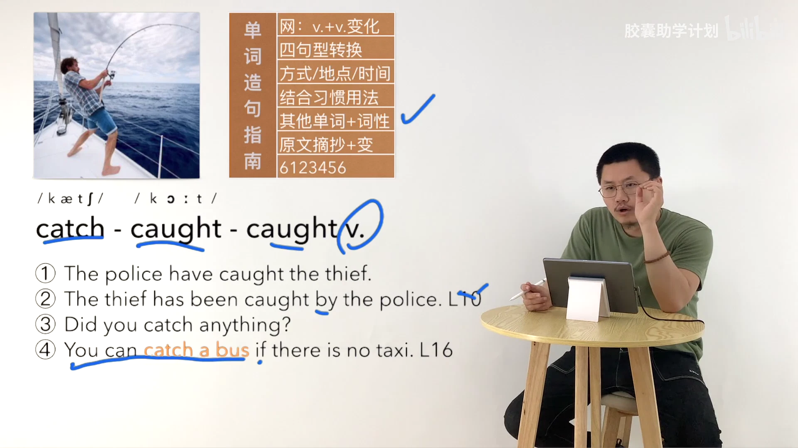

文字识别：单词造句指南 / 网：v.+v.变化 / 胶囊助学计划 / 四句型转换 / 方式/地点/时间 / 结合习惯用法 / 其他单词+词性 / 原文摘抄+变 / 6123456 / / kæt∫/ / /k o:t/ / catch -caught - caughtv. / ① The police have caught the thief. / The thief has been caught by the police. L1 / Did you catch anything? / 3 / You can catch a bus if there is no taxi. L16

### 画面 00:03:26

文字识别：单词造句指南 / 网：v.+v.变化 / 胶囊助学计划 / 四句型转换 / 方式/地点/时间 / 结合习惯用法 / 其他单词+词性 / 原文摘抄+变 / 6123456 / / ket∫/ / /k o:t / / catch - caught - caughtv. / ① The police have caught the thief. / The thief has been caught by the police. L1O / Did you catch anything? / 3 / You can catch a bus if there is no taxi. L16

## 00:03:30–00:04:00

对吧？啊，别的单词您都认得，我觉得你能猜出来这地方的 catch 就是坐的意思，就是赶一辆公交车坐一辆公交车，对吧？所以它也是抓住一辆公交车的感觉，但并不是真的抓。OK， one again，好，那接下来呢，我们看一个小电影片段，它出现了第一个叫做 catch your eye，这个各位可以当一个小的短语把它记下来。那 catch your eye 叫做抓住你的眼睛。你看，其实我们汉语也会说

### 画面 00:03:30

文字识别：单词造句指南 / 网：v.+v.变化 / 胶囊助学计划 / 四句型转换 / 方式/地点/时间 / 结合习惯用法 / 其他单词+词性 / 原文摘抄+变 / 6123456 / / kxt∫/ / /ko:t/ / catch - caught - caughty. / ① The police have caught the thief. / The thief has been caught by the police. LTS / Did you catch anything? / 3 / You can catch a bus if there is no taxi. L16

### 画面 00:03:34

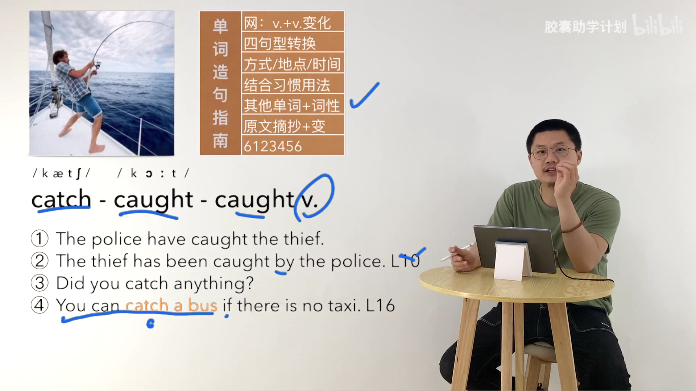

文字识别：单词造句指南 / 网：v.+v.变化 / 胶囊助学计划 / 四句型转换 / 方式/地点/时间 / 结合习惯用法 / 其他单词+词性 / 原文摘抄+变 / 6123456 / / kxt∫/ / /ko:t/ / catch - caught - caughty. / ① The police have caught the thief. / The thief has been caught by the police. L1S / Did you catch anything? / 3 / You can catch a bus if there is no taxi. L16

### 画面 00:03:38

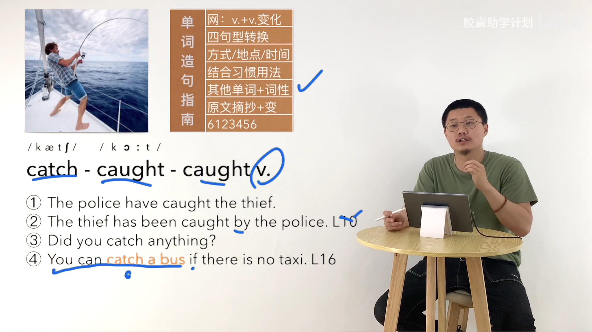

文字识别：单词造句指南 / 网：v.+v.变化 / 四句型转换 / 方式/地点/时间 / 结合习惯用法 / 其他单词+词性 / 原文摘抄+变 / 6123456 / / kæt∫/ / /ko:t/ / catch -caught - caught. / ① The police have caught the thief. / The thief has been caught by the police. L1S / Did you catch anything? / 3 / You can catch a bus if there is no taxi. L16

### 画面 00:03:40

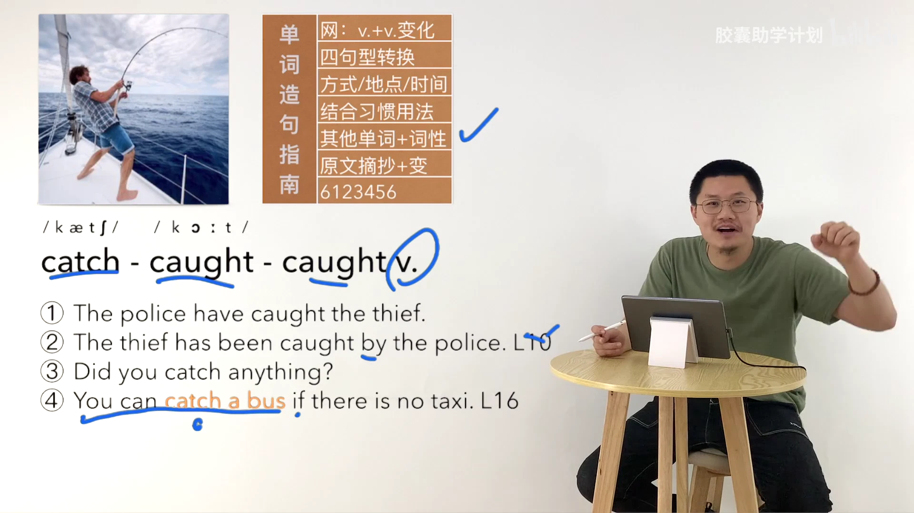

文字识别：单词造句指南 / 网：v.+v.变化 / 胶囊助学计划 / 四句型转换 / 方式/地点/时间 / 结合习惯用法 / 其他单词+词性 / 原文摘抄+变 / 6123456 / / ket∫/ / /k o:t/ / catch - caught - caughtV. / ① The police have caught the thief. / The thief has been caught by the police. LTS / Did you catch anything? / 3 / You can catch a bus if there is no taxi. L16 / •

### 画面 00:03:45

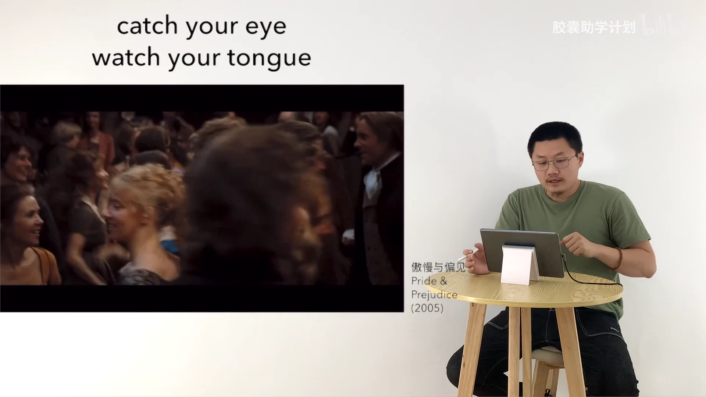

文字识别：catch your eye / 胶囊助学计划 / watch your tongue / 傲慢与偏见 / Pride& / Prejudice / (2005) / 0

### 画面 00:03:50

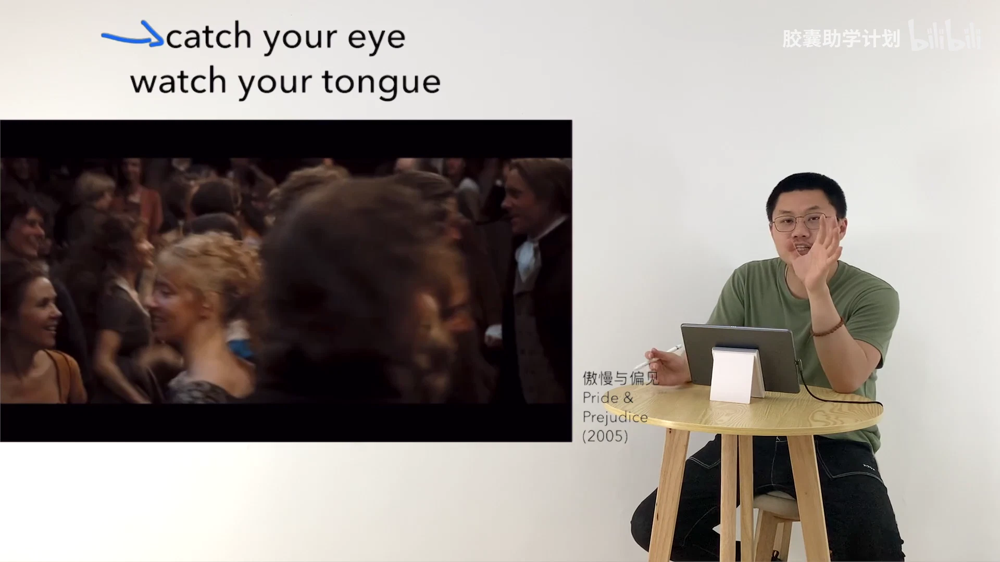

文字识别：—>catch your eye / 胶囊助学计划 / watch your tongue / 傲慢与偏见 / Pride& / Prejudice / (2005)

## 00:04:00–00:04:30

某个东西非常的抓人眼球，对不对？好，真的指的是什么呢？并不是真的抓眼球，它指的就是实际上很吸引我们，叫做 catch your eye。 OK，那 watch your tongue， watch 啊有两个常见的意思，一个叫做看，另外一个叫做 watch out，对吧？叫做小心注意。 OK， watch out。那 tongue 叫做舌头，那就要么叫做看你的舌头，要么叫做小心注意

### 画面 00:04:14

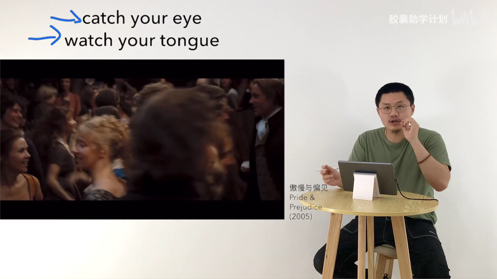

文字识别：catch your eye / 胶囊助学计划 / watch your tongue / 傲慢与偏见 / Pride& / Prejudice / (2005)

## 00:04:30–00:05:00

的舌头，是吧？那它实际上真正的意思指的叫做别乱说话，对吧？啊，注意你的表达啊。 Okay，叫做 catch your eye， watch your time。 Okay，那接下来我们一起看一下这个电影片段。 Not every man in the room does not end the evening in love with you. That I have no judgment of beauty. Oh, men! They are far too easy to judge. They're not all bad. Human as poppycups in my limited experience. One of these

### 画面 00:04:44

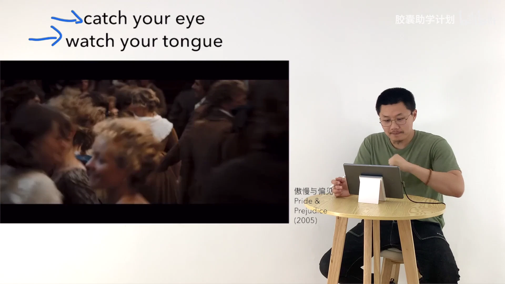

文字识别：>catch your eye / 胶囊助学计划 / watch your tongue / 傲慢与偏见 / Pride& / Prejudice / (2005)

### 画面 00:04:46

文字识别：catch your eye / 胶囊助学计划 / watch your tongue / 傲慢与偏见 / Pride& / 今晚要是没有男人爱上你 / Prejudice / If every man does not end the evening in love with you, / (2005)

### 画面 00:04:48

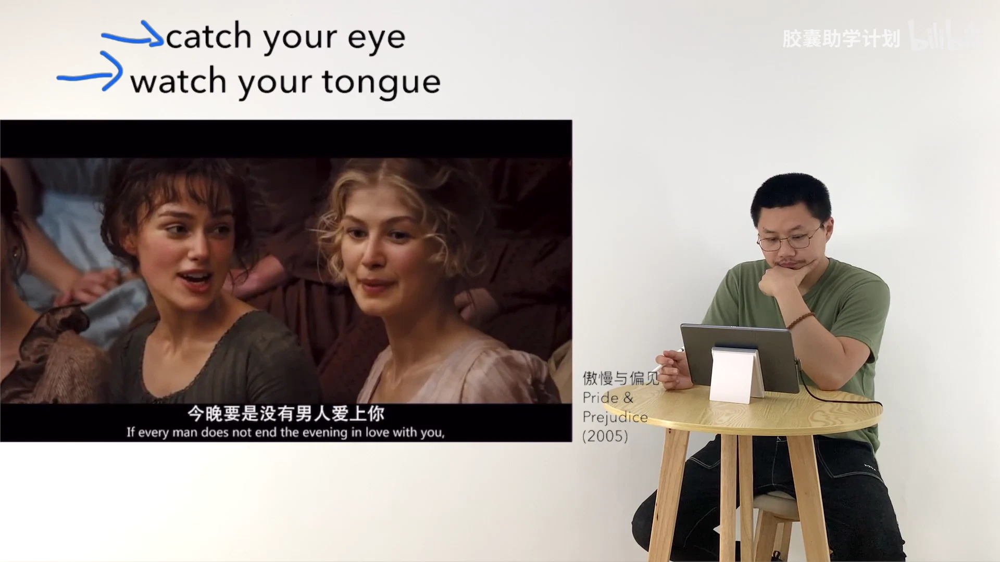

文字识别：catch your eye / 胶囊助学计划 / watch your tongue / 傲慢与偏见 / Pride& / 今晚要是没有男人爱上你 / Prejudice / If every man does not end the evening in love with you, / (2005)

### 画面 00:04:50

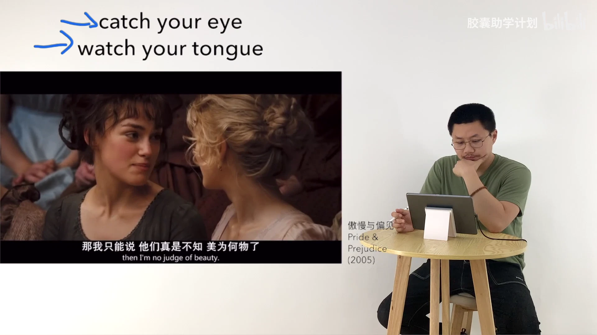

文字识别：catch your eye / 胶囊助学计划 / watch your tongue / 傲慢与偏见 / Pride& / 那我只能说他们真是不知美为何物了 / Prejudice / then I'm no judge of beauty. / (2005)

### 画面 00:04:52

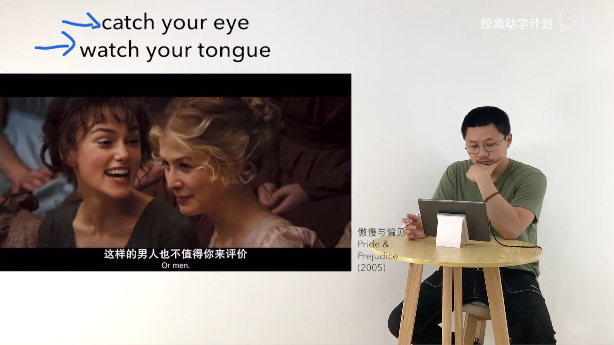

文字识别：>catch your eye / 胶囊助学计划 / watch your tongue / 傲慢与偏见 / Pride& / 这样的男人也不值得你来评价 / Prejudice / Ormen. / (2005)

### 画面 00:04:54

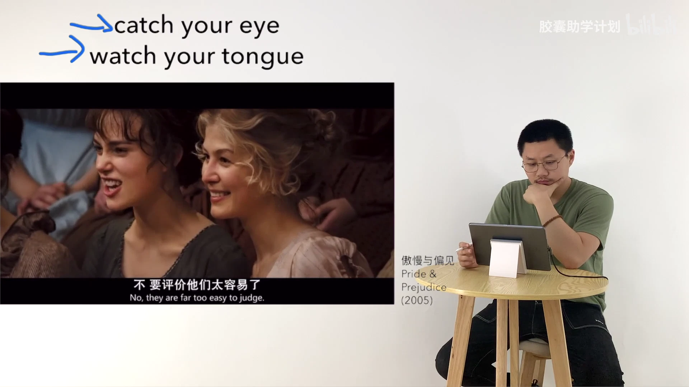

文字识别：catch your eye / 胶囊助学计划 / watch your tongue / 傲慢与偏见 / Pride& / 不要评价他们太容易了 / Prejudice / No, they are far too easy to judge. / (2005)

### 画面 00:04:56

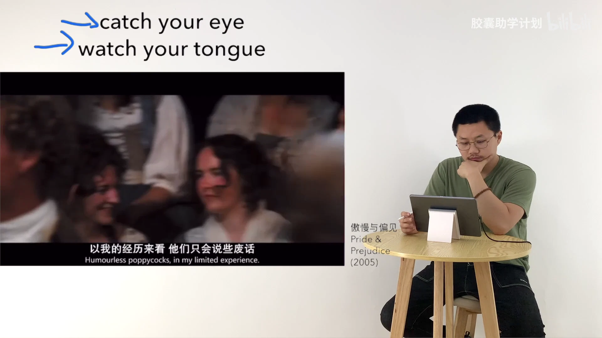

文字识别：>catch your eye / 胶囊助学计划 / watch your tongue / 傲慢与偏见 / Pride& / 以我的经历来看他们只会说些废话 / Prejudice / Humourless poppycocks, in my limited experience. / (2005)

### 画面 00:04:58

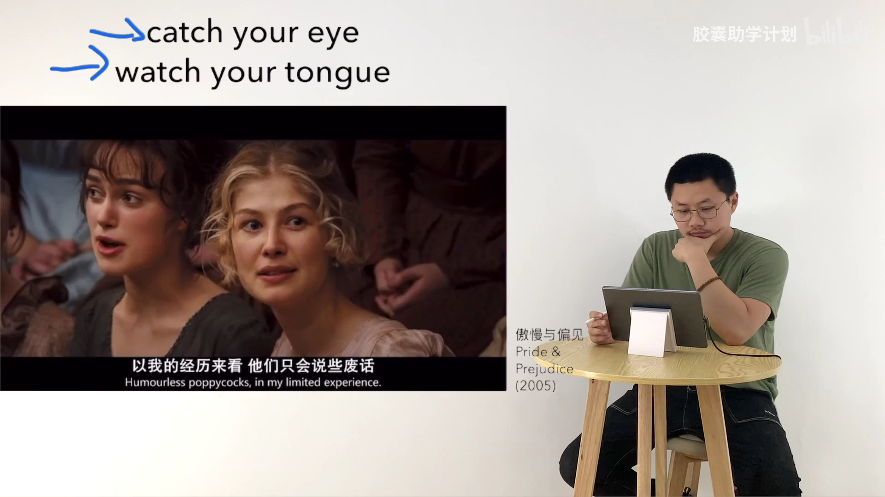

文字识别：catch your eye / 胶囊助学计划 / watch your tongue / 傲慢与偏见 / Pride& / 以我的经历来看他们只会说些废话 / Prejudice / Humourless poppycocks, in my limited experience. / (2005)

## 00:05:00–00:05:30

你看他翻译的叫 catch your eye，入你的法眼，对吧？那就注吸引你的注意力。那 watch your tongue，叫不要口无遮拦，watch your tongue，对吧？不要口无遮拦。玩一个，接下来下一个单词，我们现在读一下叫做 fisher man。你看这个单词其实对于各位来说很容易把它记下来，一个叫 fish，一个叫 man，然后 fish 后边还加

### 画面 00:05:00

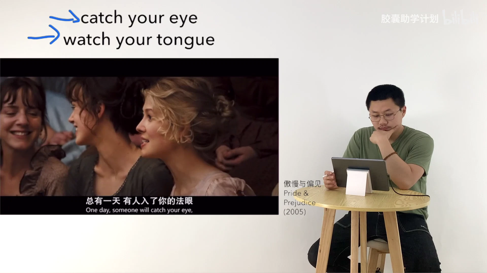

文字识别：catch your eye / 胶囊助学计划 / watch your tongue / 傲慢与偏见 / Pride& / 总有一天有人入了你的法眼 / Prejudice / One day, someone will catch your eye, / (2005)

### 画面 00:05:02

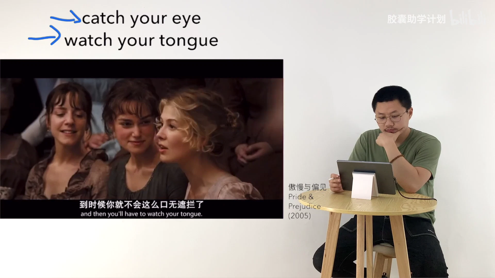

文字识别：catch your eye / 胶囊助学计划 / watch your tongue / 傲慢与偏见 / Pride& / 到时候你就不会这么口无遮拦了 / Prejudice / and then you'll have to watch your tongue. / (2005)

### 画面 00:05:04

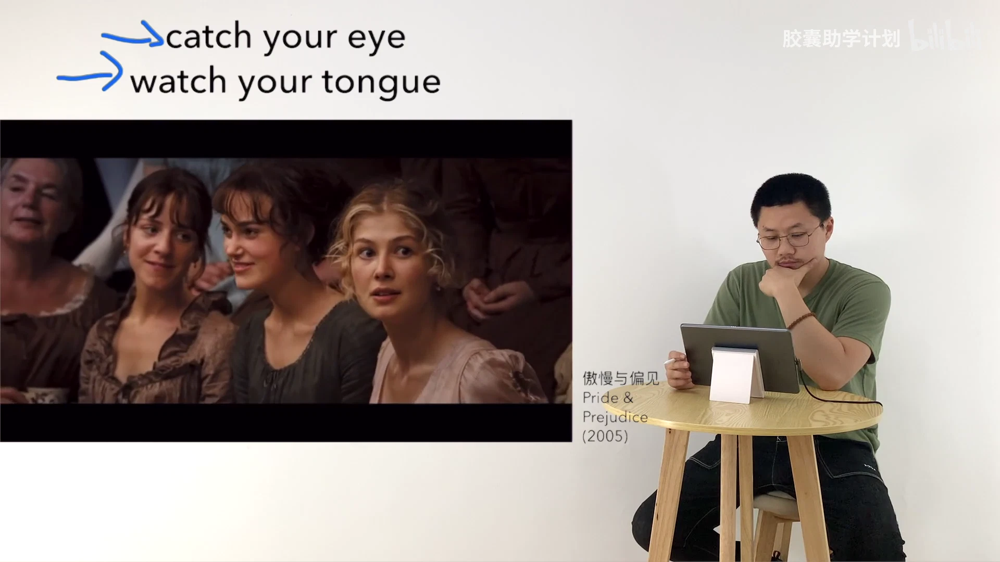

文字识别：catch your eye / 胶囊助学计划 / watch your tongue / 傲慢与偏见 / Pride& / Prejudice / (2005)

### 画面 00:05:06

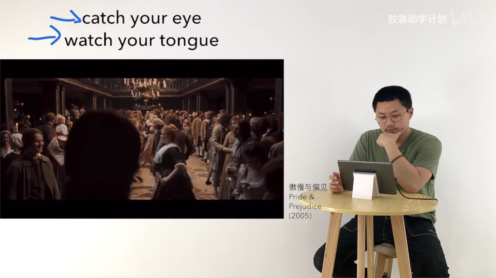

文字识别：>catch your eye / 胶囊助学计划 / watch your tongue / 傲慢与偏见 / Pride& / Prejudice / (2005)

### 画面 00:05:08

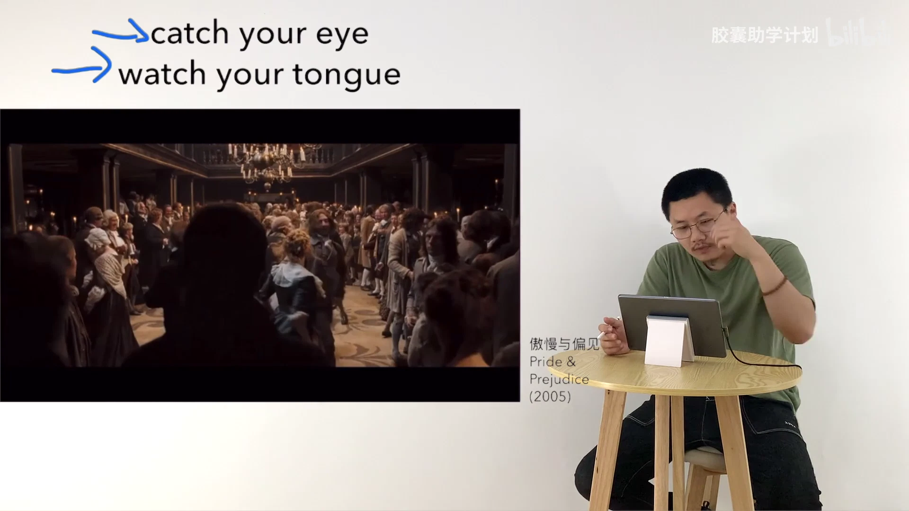

文字识别：>catch your eye / 胶囊助学计划 / watch your tongue / 傲慢与偏见 / Pride& / Prejudice / (2005)

### 画面 00:05:19

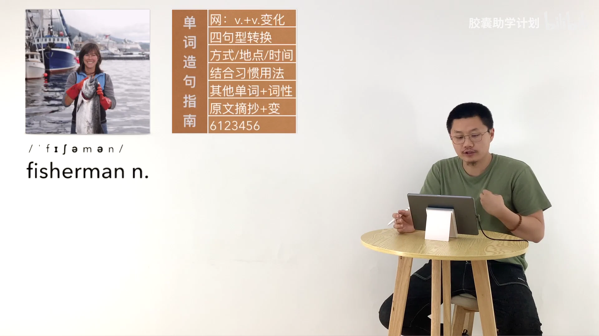

文字识别：单词造句指南 / 网：v.+v.变化 / 胶囊助学计划 / 四句型转换 / 方式/地点/时间 / 结合习惯用法 / 其他单词+词性 / 原文摘抄+变 / 6123456 / /fi ∫aman/ / fisherman n.

### 画面 00:05:21

文字识别：单词造句指南 / 网：v.+v.变化 / 胶囊助学计划 / 四句型转换 / 方式/地点/时间 / 结合习惯用法 / 其他单词+词性 / 原文摘抄+变 / 6123456 / /fi ∫aman/ / fisherman n.

### 画面 00:05:25

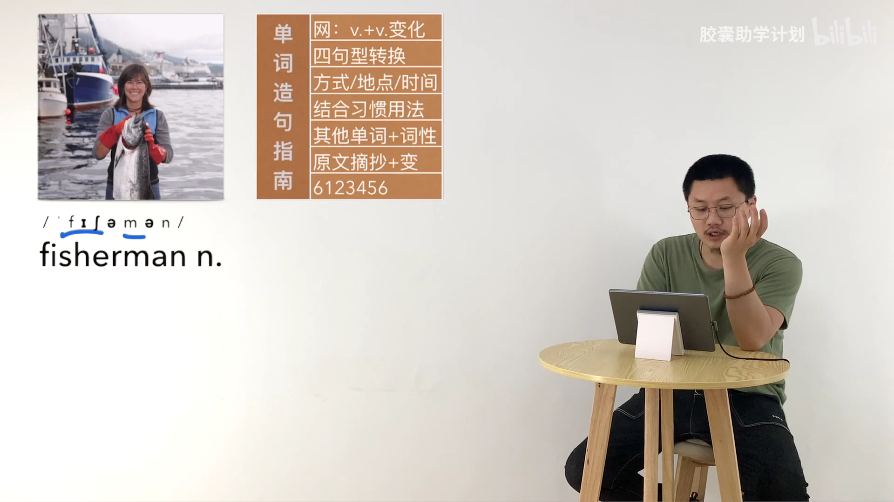

文字识别：单词造句指南 / 网：v.+v.变化 / 胶囊助学计划 / 四句型转换 / 方式/地点/时间 / 结合习惯用法 / 其他单词+词性 / 原文摘抄+变 / 6123456 / /f rlaman / / fisherman n.

### 画面 00:05:29

文字识别：单词造句指南 / 网：v.+v.变化 / 胶囊助学计划 / 四句型转换 / 方式/地点/时间 / 结合习惯用法 / 其他单词+词性 / 原文摘抄+变 / 6123456 / /f 1 / aman/ / fisherman n. / •

## 00:05:30–00:06:00

了一个 er，往往表示做某件事情的人。那 fisher man，我们管他叫做渔民。那你如果要想强调一下，说啊是女性的渔民，对吧？钓鱼的人，那你叫做 fisher woman。 OK，那他又是聊到了一个叫词性的问题，还是这个地方。那我们是一个名词，必然要找动词。找动词的方式，我目前给各位提供的就只用这一个，就是您往前面去翻，从新

### 画面 00:05:41

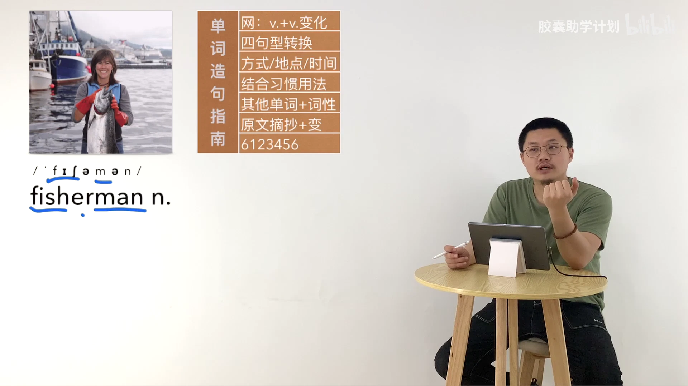

文字识别：单词造句指南 / 网：v.+v.变化 / 胶囊助学计划 / 四句型转换 / 方式/地点/时间 / 结合习惯用法 / 其他单词+词性 / 原文摘抄+变 / 6123456 / /filaman/ / fisherman n. / •

### 画面 00:05:48

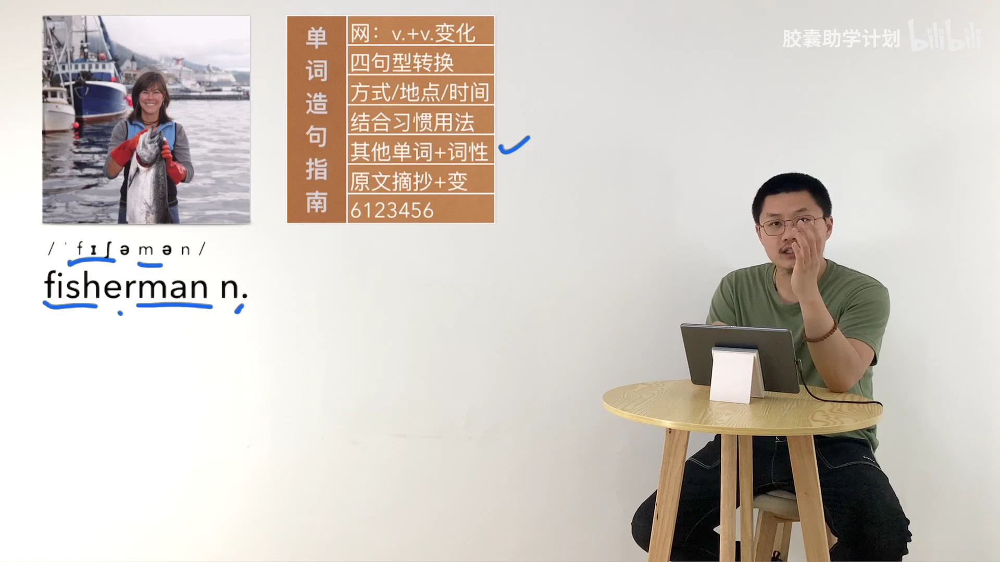

文字识别：单词造句指南 / 网：v.+v.变化 / 胶囊助学计划 / 四句型转换 / 方式/地点/时间 / 结合习惯用法 / 其他单词+词性 / 原文摘抄+变 / 6123456 / /f 1 / aman/ / fisherman n.

## 00:06:00–00:06:30

概念第一课一直到新概念一册的第一课，一直到新概念二册的第十课，理论上您都是应该会的，对不对啊？第二十课，您就在这里边去找单词，找动词，就用我们学过的动词就可以了，千万不要自己随便去用，因为很可很高的概率，根据我的经验判断，很高的概率，你自己随便找个动词一用就错，一用就错，因为你是用汉语去推的，你不知道英文这个动词跟这个名词是不

### 画面 00:06:08

文字识别：单词造句指南 / 网：v.+v.变化 / 胶囊助学计划 / 四句型转换 / 方式/地点/时间 / 结合习惯用法 / 其他单词+词性 / 原文摘抄+变 / 6123456 / /f 1 / aman/ / fisherman n. / •

### 画面 00:06:11

文字识别：单词造句指南 / 网：v.+v.变化 / 胶囊助学计划 / 四句型转换 / 方式/地点/时间 / 结合习惯用法 / 其他单词+词性 / 原文摘抄+变 / 6123456 / /frlaman/ / fisherman n. / •

## 00:06:30–00:07:00

是能放到一起的？OK，好，那比如说我们现在造一句话啊，叫做 The fisherman has to get up very early in the morning。好了，你看 get up 是我们之前学过的，对吧？哎，那你谁都可以 get up，对吧？所有只要是个人，他就得起床，对不对？OK，说渔民啊，不得不很早就要起来。那这个地方其实我复习了一下十七课我们学到的 have to 和 must，在这里边的 have to。OK，

### 画面 00:06:31

文字识别：单词造句指南 / 网：v.+v.变化 / 胶囊助学计划 / 四句型转换 / 方式/地点/时间 / 结合习惯用法 / 其他单词+词性 / 原文摘抄+变 / 6123456 / /fr[aman/ / fisherman n. / •

### 画面 00:06:33

文字识别：单词造句指南 / 网：v.+v.变化 / 胶囊助学计划 / 四句型转换 / 方式/地点/时间 / 结合习惯用法 / 其他单词+词性 / 原文摘抄+变 / 6123456 / /filaman/ / fisherman n. / • / The fisherman has to get up very early in / the morning. L17

### 画面 00:06:35

文字识别：单词造句指南 / 网：v.+v.变化 / 胶囊助学计划 / 四句型转换 / 方式/地点/时间 / 结合习惯用法 / 其他单词+词性 / 原文摘抄+变 / 6123456 / /frlaman/ / fisherman n. / • / The fisherman has to get up very early in / the morning. L17

### 画面 00:06:41

文字识别：单词造句指南 / 网：v.+v.变化 / 胶囊助学计划 / 四句型转换 / 方式/地点/时间 / 结合习惯用法 / 其他单词+词性 / 原文摘抄+变 / 6123456 / /frlaman/ / fisherman n. / • / The fisherman has to get up very early in / the morning. L17

### 画面 00:06:45

文字识别：单词造句指南 / 网：v.+v.变化 / 胶囊助学计划 / 四句型转换 / 方式/地点/时间 / 结合习惯用法 / 其他单词+词性 / 原文摘抄+变 / 6123456 / /fr / aman/ / fisherman n. / • / The fisherman has to get up very early in / the morning. L17

### 画面 00:06:50

文字识别：单词造句指南 / 网：v.+v.变化 / 胶囊助学计划 / 四句型转换 / 方式/地点/时间 / 结合习惯用法 / 其他单词+词性 / 原文摘抄+变 / 6123456 / /f1 / aman/ / fisherman n. / • / The fisherman has to get up very early in / the morning. L17

### 画面 00:06:55

文字识别：单词造句指南 / 网：v.+v.变化 / 胶囊助学计划 / 四句型转换 / 方式/地点/时间 / 结合习惯用法 / 其他单词+词性 / 原文摘抄+变 / 6123456 / /f1 / aman/ / fisherman / n. / • / The fishermanhas to / get up very early in / the morning. L17

## 00:07:00–00:07:30

Okay, 接下来说 it must be terrible to be a fisherman. Okay, 注意你看这是我们之前学过 it must be terrible to do something. 啊, it must be terrible to be grown up. 这是我们十七课的原文，对不对？好, said the little girl in a big voice. Okay, 这个姑娘用特别小姑娘用一个特别微弱的声音说到，这是我们十五课学到的，叫做 in a big voice. 哪一个？再来一个，说 as soon as. 哎，十四课学的，一

### 画面 00:07:00

文字识别：单词造句指南 / 网：v.+v.变化 / 胶囊助学计划 / 四句型转换 / 方式/地点/时间 / 结合习惯用法 / 其他单词+词性 / 原文摘抄+变 / 6123456 / /frlam an/ / fisherman n. / • /  The fishermanhas to / get up very early in / the morning. L17 / "It must be terrible to be a fisherman"said / the little girl in a weak voice. L15 L17

### 画面 00:07:05

文字识别：单词造句指南 / 网：v.+v.变化 / 胶囊助学计划 / 四句型转换 / 方式/地点/时间 / 结合习惯用法 / 其他单词+词性 / 原文摘抄+变 / 6123456 / /frlaman/ / fisherman n. / • /  The fishermanhas to / get up very early in / the morning. L17 / "It must be terrible to be a fisherman"said / the little girl in a weak voice. L15 L17

### 画面 00:07:10

文字识别：单词造句指南 / 网：v.+v.变化 / 胶囊助学计划 / 四句型转换 / 方式/地点/时间 / 结合习惯用法 / 其他单词+词性 / 原文摘抄+变 / 6123456 / /frlam an/ / fisherman n. / • /  The fishermanhas to / get up very early in / the morning. L17 / "It must be terrible to be a fisherman" said / the little girl in a weak voice. L15 L17

### 画面 00:07:15

文字识别：单词造句指南 / 网：v.+v.变化 / 胶囊助学计划 / 四句型转换 / 方式/地点/时间 / 结合习惯用法 / 其他单词+词性 / 原文摘抄+变 / 6123456 / /frlam an/ / fisherman n. / • /  The fishermanhas to / get up very early in / the morning. L17 / "It must be terrible to be a fisherman" said / the little girl in a weak voice. L15 L17

### 画面 00:07:17

文字识别：单词造句指南 / 网：v.+v.变化 / 胶囊助学计划 / 四句型转换 / 方式/地点/时间 / 结合习惯用法 / 其他单词+词性 / 原文摘抄+变 / 6123456 / /frlam an/ / fisherman n. / • /  The fishermanhas to / get up very early in / the morning. L17 / "It must be terrible to be a fisherman" said / the little girl in a weak voice-L15 L17

### 画面 00:07:21

文字识别：单词造句指南 / 网：v.+v.变化 / 胶囊助学计划 / 四句型转换 / 方式/地点/时间 / 结合习惯用法 / 其他单词+词性 / 原文摘抄+变 / 6123456 / /frlam an/ / fisherman n. / • / The fishermanhas to / get up very early in / the morning. L17 / "It must be terrible to be a fisherman" said / the little girl in a weak voice-L15 L17

### 画面 00:07:26

文字识别：单词造句指南 / 网：v.+v.变化 / 胶囊助学计划 / 四句型转换 / 方式/地点/时间 / 结合习惯用法 / 其他单词+词性 / 原文摘抄+变 / 6123456 / /flaman/ / fisherman n. / • / ① The fishermanhas to / get up very early in / the morning. L17 / "It must be terrible to be a fisherman" said / the little girl in a weak voice-L15 L17 / As soon as the fisherman had got off the / boat, it began to rain. L14

### 画面 00:07:29

文字识别：单词造句指南 / 网：v.+v.变化 / 胶囊助学计划 / 四句型转换 / 方式/地点/时间 / 结合习惯用法 / 其他单词+词性 / 原文摘抄+变 / 6123456 / /frlam an / / fisherman n. / • / ① The fishermanhas to / get up very early in / the morning. L17 / "It must be terrible to be a fisherman"said / the little girl in a weak voice-L15 L17 / ③As soon as the fisherman had got off the / boat, it began to rain. L14

## 00:07:30–00:08:00

怎么怎么样就怎么怎么样。然后后面如果接了两个过去的动作，一个叫过去完成时，一个叫一般过去时，对吧？As soon as the fisherman had get off the boat,好，他一下船，第一个动作先下船。It began to rain,老天就开始下雨了。哎，开始下雨，开始这个动作发生在第二个，所以是一般过去时。我们复习一下十四课的语法。玩一个，下一个

### 画面 00:07:31

文字识别：单词造句指南 / 网：v.+v.变化 / 胶囊助学计划 / 四句型转换 / 方式/地点/时间 / 结合习惯用法 / 其他单词+词性 / 原文摘抄+变 / 6123456 / /frlaman / / fisherman n. / • / ① The fishermanhas to / get up very early in / the morning. L17 / "It must be terrible to be a fisherman" said / the little qirl in a weak voice-L15 L17 / As soon asthe fisherman had got off the / 3 / boat, it began to rain. L14

### 画面 00:07:34

文字识别：单词造句指南 / 网：v.+v.变化 / 胶囊助学计划 / 四句型转换 / 方式/地点/时间 / 结合习惯用法 / 其他单词+词性 / 原文摘抄+变 / 6123456 / /f rlaman/ / fisherman n. / • / ① The fishermanhas to / get up very early in / the morning. L17 / "It must be terrible to be a fisherman"said / the little qirl in a weak voice-L15 L17 / As soon as the fisherman had got off the / 3 / boat, it began to rain. L14

### 画面 00:07:36

文字识别：单词造句指南 / 网：v.+v.变化 / 胶囊助学计划 / 四句型转换 / 方式/地点/时间 / 结合习惯用法 / 其他单词+词性 / 原文摘抄+变 / 6123456 / /frlam an / / fisherman n. / • / D The fishermanhas to / get up very early in / the morning. L17 / "It must be terrible to be a fisherman" said / the little qirl in a weak voice-L15 L17 / ③As soon as the fisherman had got off the / boat, it began to rain. L14

### 画面 00:07:41

文字识别：单词造句指南 / 网：v.+v.变化 / 胶囊助学计划 / 四句型转换 / 方式/地点/时间 / 结合习惯用法 / 其他单词+词性 / 原文摘抄+变 / 6123456 / /frlam an/ / fisherman n. / • / ① The fishermanhas to / get up very early in / the morning. L17 / "It must be terrible to be a fisherman" said / the little qirl in a weak voice-L15 L17 / ③As soon as the fisherman had got off the / boat, it began to rain. L14

### 画面 00:07:45

文字识别：单词造句指南 / 网：v.+v.变化 / 胶囊助学计划 / 四句型转换 / 方式/地点/时间 / 结合习惯用法 / 其他单词+词性 / 原文摘抄+变 / 6123456 / /frlam an/ / fisherman n. / • / ① The fishermanhas to / get up very early in / the morning. L17 / "It must be terrible to be a fisherman" said / the little qirl in a weak voice-L15 L17 / As soon as the fisherman had got off the / boat, it began to rain. L14

### 画面 00:07:49

文字识别：单词造句指南 / 网：v.+v.变化 / 胶囊助学计划 / 四句型转换 / 方式/地点/时间 / 结合习惯用法 / 其他单词+词性 / 原文摘抄+变 / 6123456 / /frlam an/ / fisherman n. / • / D The fishermanhas to / get up very early in / the morning. L17 / "It must be terrible to be a fisherman" said / the little qirl in a weak voice- L15 L17 / ③As soon as the fisherman had got off the / boat, it began to rain. L14

### 画面 00:07:51

文字识别：单词造句指南 / 网：v.+v.变化 / 胶囊助学计划 / 四句型转换 / 方式/地点/时间 / 结合习惯用法 / 其他单词+词性 / 原文摘抄+变 / 6123456 / /frlam an/ / fisherman n. / • /  The fishermanhas to / get up very early in / the morning. L17 / "It must be terrible to be a fisherman" said / the little qirl in a weak voice- L15 L17 / ③As soon as the fisherman had got off the / boat, it began to rain. L14

### 画面 00:07:55

文字识别：单词造句指南 / 网：v.+v.变化 / 胶囊助学计划 / 四句型转换 / 方式/地点/时间 / 结合习惯用法 / 其他单词+词性 / 原文摘抄+变 / 6123456 / /frlam an/ / fisherman n. / • /  The fishermanhas to / get up very early in / the morning. L17 / "It must be terrible to be a fisherman" said / the little qirl in a weak voice- L15 L17 / As soon as the fisherman had got off the / 3 / boat, it began to rain. L14

### 画面 00:07:59

文字识别：单词造句指南 / 网：v.+v.变化 / 胶囊助学计划 / 四句型转换 / 方式/地点/时间 / 结合习惯用法 / 其他单词+词性 / 原文摘抄+变 / 6123456 / /bu:t/ / boot n.

## 00:08:00–00:08:30

单词跟我一起读一下，叫做 boot boot。好，各位非常熟悉的所有鞋啊，不管你是什么AJ还是什么平板是吧，还是老北京布鞋，不管是什么统称为 shoes or shoes，对吧？那不同的鞋可能会有不同的叫法，比如说靴子的叫法，我们管它叫 boot，它往往也是可能以复数的形式出现的，这个跟 shoes 是一个道理，对吧？OK，比如说我们说一双

### 画面 00:08:04

文字识别：单词造句指南 / 网：v.+v.变化 / 胶囊助学计划 / 四句型转换 / 方式/地点/时间 / 结合习惯用法 / 其他单词+词性 / 原文摘抄+变 / 6123456 / /bu:t/ / boot n.

### 画面 00:08:24

文字识别：单词造句指南 / 网：v.+v.变化 / 胶囊助学计划 / 四句型转换 / 方式/地点/时间 / 结合习惯用法 / 其他单词+词性 / 原文摘抄+变 / 6123456 / /bu:t/ / boot n.

## 00:08:30–00:09:00

靴子，那叫做a pair of boots。那你要注意，它是个名词，我们必然又开始出现了叫做找其他的动词，或者找包含动词其他的习惯用法。您，我希望您是总结了的，往前翻就可以了，很简单。来，She can't have cleaned her boots.我怎么造出来的这句话呢？第一，我想到了一个单词叫clean，这是对于各位来说很容易想到的，清洗，对吧？打干，弄干净。然后呢，我们十七课刚刚学

### 画面 00:08:34

文字识别：单词造句指南 / 网：v.+v.变化 / 胶囊助学计划 / 四句型转换 / 方式/地点/时间 / 结合习惯用法 / 其他单词+词性 / 原文摘抄+变 / 6123456 / /bu:t/ / boot n. / ①a pair of boots

### 画面 00:08:39

文字识别：单词造句指南 / 网：v.+v.变化 / 胶囊助学计划 / 四句型转换 / 方式/地点/时间 / 结合习惯用法 / 其他单词+词性 / 原文摘抄+变 / 6123456 / /bu:t/ / boot n. / ①a pair of boots

### 画面 00:08:46

文字识别：单词造句指南 / 网：v.+v.变化 / 胶囊助学计划 / 四句型转换 / 方式/地点/时间 / 结合习惯用法 / 其他单词+词性 / 原文摘抄+变 / 6123456 / /bu:t/ / boot n. / ① a pair of boots / 2) /  She can't have cleaned her boots. L17

### 画面 00:08:51

文字识别：单词造句指南 / 网：v.+v.变化 / 胶囊助学计划 / 四句型转换 / 方式/地点/时间 / 结合习惯用法 / 其他单词+词性 / 原文摘抄+变 / 6123456 / /bu:t/ / boot n. / ① a pair of boots / 2) /  She can't have cleaned her boots. L17

### 画面 00:08:54

文字识别：单词造句指南 / 网：v.+v.变化 / 四句型转换 / 方式/地点/时间 / 结合习惯用法 / 其他单词+词性 / 原文摘抄+变 / 6123456 / /bu:t/ / boot n. / ①a pair of boots / 2) / ) She can't have cleaned her boots. L17

### 画面 00:08:59

文字识别：单词造句指南 / 网：v.+v.变化 / 胶囊助学计划 / 四句型转换 / 方式/地点/时间 / 结合习惯用法 / 其他单词+词性 / 原文摘抄+变 / 6123456 / /bu:t/ / boot n. / ① a pair of boots /  She can't have cleaned her boots. L17 / 2)

## 00:09:00–00:09:30

一个叫做 can't have that 对过去的一个推测，他之前一定是没有把他鞋子弄这个靴子弄干净啊。你看，单给这句话，你可能不知道他什么时候去用。比如说第二年这个某一段儿时间啊，你放了一夏天，冬天要穿的时候，发现它发毛了，或者说有味儿，对吧？那就说回想一下，说他当时一定没有把他的靴子弄干净，就收起来了。 Can't have cleaned her boots. 玩

### 画面 00:09:01

文字识别：单词造句指南 / 网：v.+v.变化 / 胶囊助学计划 / 四句型转换 / 方式/地点/时间 / 结合习惯用法 / 其他单词+词性 / 原文摘抄+变 / 6123456 / /bu:t/ / boot n. / 1 / a pair of boots / She / Can't have cleaned her boots. L17 / 2

### 画面 00:09:04

文字识别：单词造句指南 / 网：v.+v.变化 / 胶囊助学计划 / 四句型转换 / 方式/地点/时间 / 结合习惯用法 / 其他单词+词性 / 原文摘抄+变 / 6123456 / /bu:t/ / boot n. / 1 / a pair of boots / She / Can't have cleaned her boots. L17 / 2

### 画面 00:09:10

文字识别：单词造句指南 / 网：v.+v.变化 / 胶囊助学计划 / 四句型转换 / 方式/地点/时间 / 结合习惯用法 / 其他单词+词性 / 原文摘抄+变 / 6123456 / /bu:t/ / boot n. / 1 / a pair of boots / She / Can't have cleaned her boots. L17 / 2

### 画面 00:09:14

文字识别：单词造句指南 / 网：v.+v.变化 / 胶囊助学计划 / 四句型转换 / 方式/地点/时间 / 结合习惯用法 / 其他单词+词性 / 原文摘抄+变 / 6123456 / /bu:t/ / boot n. / 1 / a pair of boots / She / Can't have cleaned her boots. L17 / 2

### 画面 00:09:20

文字识别：单词造句指南 / 网：v.+v.变化 / 胶囊助学计划 / 四句型转换 / 方式/地点/时间 / 结合习惯用法 / 其他单词+词性 / 原文摘抄+变 / 6123456 / /bu:t/ / boot n. / 1 / a pair of boots / She / Can't have cleaned her boots. L17 / 2

## 00:09:30–00:10:00

good. Continue. That is still the 17th we learned, called she must be cleaning the boots. You see, here the idea is, I at least when I make these sentences, my idea is, OK, I use clean, I don't want to think of other words. But clean has a verb + verb change. For you, it's easier to forget the 17th, including the 19th. We learned those modal verbs for speculation. For you, it's easy to forget. Easy to forget, you actively use it to make sentences. For example, must be doing.

### 画面 00:09:31

文字识别：单词造句指南 / 网：v.+v.变化 / 胶囊助学计划 / 四句型转换 / 方式/地点/时间 / 结合习惯用法 / 其他单词+词性 / 原文摘抄+变 / 6123456 / /bu:t/ / boot n. / 1 / a pair of boots / 2 / She / Can't have cleaned her boots. L17 / She / emust be cieaning / the boots. L17

### 画面 00:09:33

文字识别：单词造句指南 / 网：v.+v.变化 / 胶囊助学计划 / 四句型转换 / 方式/地点/时间 / 结合习惯用法 / 其他单词+词性 / 原文摘抄+变 / 6123456 / /bu:t/ / boot n. / ①a pair of boots / ② She can't have cleaned her boots. L17 / ③ She must be cleaning the boots. L17

### 画面 00:09:35

文字识别：单词造句指南 / 网：v.+v.变化 / 胶囊助学计划 / 四句型转换 / 方式/地点/时间 / 结合习惯用法 / 其他单词+词性 / 原文摘抄+变 / 6123456 / /bu:t/ / boot n. / ①a pair of boots / ② She can't have cleaned her boots. L17 / ③ She must be cleaning the boots. L17

### 画面 00:09:40

文字识别：单词造句指南 / 网：v.+v.变化 / 胶囊助学计划 / 四句型转换 / 方式/地点/时间 / 结合习惯用法 / 其他单词+词性 / 原文摘抄+变 / 6123456 / /bu:t/ / boot n. / ①a pair of boots / ② She can't have cleaned her boots. L17 / ③ She must be cleaning the boots. L17

### 画面 00:09:44

文字识别：单词造句指南 / 网：v.+v.变化 / 胶囊助学计划 / 四句型转换 / 方式/地点/时间 / 结合习惯用法 / 其他单词+词性 / 原文摘抄+变 / 6123456 / /bu:t/ / boot n. / ①a pair of boots / ② She can't have cleaned her boots. L17 / ③ She must be cleaning the boots. L17

### 画面 00:09:49

文字识别：单词造句指南 / 网：v.+v.变化 / 胶囊助学计划 / 四句型转换 / 方式/地点/时间 / 结合习惯用法 / 其他单词+词性 / 原文摘抄+变 / 6123456 / /bu:t/ / boot n. / ① a pair of boots / ② She can't have cleaned her boots. L17 / ③ She must be cleaning the boots. L17

### 画面 00:09:51

文字识别：单词造句指南 / 网：v.+v.变化 / 胶囊助学计划 / 四句型转换 / 方式/地点/时间 / 结合习惯用法 / 其他单词+词性 / 原文摘抄+变 / 6123456 / /bu:t/ / boot n. / ① a pair of boots / ② She can't have cleaned her boots/L17 / ③ She must be cleaning the boots. / L17

## 00:10:00–00:10:30

如说 must be doing，叫他现在一定是正在清理他那双靴子呢。你去看一下，一定是。OK，好。那再然后我们结合一个习惯用法，叫做 I can't afford to pay that boots，支付不起啊，不多说了。接下来十三课 I will be buying a new pair of boots，其实就跟 I'm going to buy a new pair of boots，几乎含义是保持一致的。Will be doing，将来进行时。OK，

### 画面 00:10:01

文字识别：单词造句指南 / 网：v.+v.变化 / 胶囊助学计划 / 四句型转换 / 方式/地点/时间 / 结合习惯用法 / 其他单词+词性 / 原文摘抄+变 / 6123456 / /bu:t/ / boot n. / ① a pair of boots / ② She can't have cleaned her boots/L17 / ③ She must be cleaning the boots. / L17

### 画面 00:10:09

文字识别：单词造句指南 / 网：v.+v.变化 / 胶囊助学计划 / 四句型转换 / 方式/地点/时间 / 结合习惯用法 / 其他单词+词性 / 原文摘抄+变 / 6123456 / /bu:t/ / boot n. / ① a pair of boots / 2 /  She can't have cleaned her boots/L17 / ③ She must be cleaning the boots. / L17 / ④ I can't afford to pay that boots. L

### 画面 00:10:14

文字识别：单词造句指南 / 网：v.+v.变化 / 胶囊助学计划 / 四句型转换 / 方式/地点/时间 / 结合习惯用法 / 其他单词+词性 / 原文摘抄+变 / 6123456 / /bu:t/ / boot n. / ① a pair of boots / 2 /  She can't have cleaned her boots/L17 / ③ She must be cleaning the boots. / L17 / ④ I can't afford to pay that boots. L

### 画面 00:10:19

文字识别：单词造句指南 / 网：v.+v.变化 / 胶囊助学计划 / 四句型转换 / 方式/地点/时间 / 结合习惯用法 / 其他单词+词性 / 原文摘抄+变 / 6123456 / /bu:t/ / boot n. / ① a pair of boots / ② She can't have cleaned her boots/L17 / ③ She must be cleaning the boots. / L17 / ④I can't afford to pay that boots. L / ⑤ I will be buying a new pair of boots. L13

## 00:10:30–00:11:00

好，最后一个叫做 You might as well wear these boots. 啊，might as well，想一下什么意思来着？叫做不妨或者说还是，它并不是一个很好的选择，但是又没有更好的选择了，就是凑合也这样也行吧。那他没别的鞋穿了，那就凑合着穿这个吧，是吧？这是，呃，对吧？一个情况啊，我们女朋友可能经常会遇到的一个情况叫 Might as well wear these boots. OK，好，下一个单词我们一

### 画面 00:10:30

文字识别：单词造句指南 / 网：v.+v.变化 / 胶囊助学计划 / 四句型转换 / 方式/地点/时间 / 结合习惯用法 / 其他单词+词性 / 原文摘抄+变 / 6123456 / /bu:t/ / boot n. / ① a pair of boots / ② She can't have cleaned her boots/L17 / ③ She must be cleaning the boots. / L17 / ④I can't afford to pay that boots. L / ⑤ I will be buying a new pair of boots. L13 / ⑥ You might as Well wear these boots. L19

### 画面 00:10:33

文字识别：单词造句指南 / 网：v.+v.变化 / 胶囊助学计划 / 四句型转换 / 方式/地点/时间 / 结合习惯用法 / 其他单词+词性 / 原文摘抄+变 / 6123456 / /bu:t/ / boot n. / ① a pair of boots / ② She can't have cleaned her boots/L17 / ③ She must be cleaning the boots. / L17 / ④I can't afford to pay that boots. L / ⑤ I will be buying a new pair of boots. L13 / ⑥ You might as Well wear these boots. L19

### 画面 00:10:37

文字识别：单词造句指南 / 网：v.+v.变化 / 胶囊助学计划 / 四句型转换 / 方式/地点/时间 / 结合习惯用法 / 其他单词+词性 / 原文摘抄+变 / 6123456 / /bu:t/ / boot n. / ① a pair of boots / ② She can't have cleaned her boots/L17 / ③ She must be cleaning the boots. / L17 / ④I can't afford to pay that boots. L / ⑤ I will be buying a new pair of boots. L13 / ⑥ You might as well wear these boots. L19

### 画面 00:10:44

文字识别：单词造句指南 / 网：v.+v.变化 / 胶囊助学计划 / 四句型转换 / 方式/地点/时间 / 结合习惯用法 / 其他单词+词性 / 原文摘抄+变 / 6123456 / /bu:t/ / boot n. / ① a pair of boots / ② She can't have cleaned her boots/L17 / ③ She must be cleaning the boots. / L17 / ④I can't afford to pay that boots. L / ⑤ I will be buying a new pair of boots. L13 / ⑥ You might as Well wear these boots. L19

### 画面 00:10:54

文字识别：单词造句指南 / 网：v.+v.变化 / 胶囊助学计划 / 四句型转换 / 方式/地点/时间 / 结合习惯用法 / 其他单词+词性 / 原文摘抄+变 / 6123456 / /bu:t/ / boot n. / ① a pair of boots / ② She can't have cleaned her boots/L17 / ③ She must be cleaning the boots. / L17 / ④I can't afford to pay that boots. L / ⑤ I will be buying a new pair of boots. L13 / ⑥ You might as Well wear these boots. L19

### 画面 00:10:58

文字识别：单词造句指南 / 网：v.+v.变化 / 胶囊助学计划 / 四句型转换 / 方式/地点/时间 / 结合习惯用法 / 其他单词+词性 / 原文摘抄+变 / 6123456 / /rAbI∫/ / rubbish n.

## 00:11:00–00:11:30

起读一下，叫做 rubbish, rubbish, rubbish. 最最常见的意思就是这些东西，对吧？就是垃圾啊。它的字面意思就是垃圾。OK. 好，比如说 they must have thrown away all the rubbish. 十七课咱们学的，对吧？叫他们当时，他们之前一定是把所有垃圾都给扔了啊。你这个重要的东西掉到垃圾里了，现在没了，肯定是他们已经都给扔掉了。叫 must have done. 这儿一个 continue. 注意一个小点，

### 画面 00:11:00

文字识别：单词造句指南 / 网：v.+v.变化 / 胶囊助学计划 / 四句型转换 / 方式/地点/时间 / 结合习惯用法 / 其他单词+词性 / 原文摘抄+变 / 6123456 / /rΛbI∫/ / rubbish n.

### 画面 00:11:05

文字识别：单词造句指南 / 网：v.+v.变化 / 胶囊助学计划 / 四句型转换 / 方式/地点/时间 / 结合习惯用法 / 其他单词+词性 / 原文摘抄+变 / 6123456 / /rΛbI∫/ / rubbish n.

### 画面 00:11:10

文字识别：单词造句指南 / 网：v.+v.变化 / 胶囊助学计划 / 四句型转换 / 方式/地点/时间 / 结合习惯用法 / 其他单词+词性 / 原文摘抄+变 / 6123456 / /rAbI∫/ / rubbish n. / ① They must have thrown away all the rubbish.

### 画面 00:11:12

文字识别：单词造句指南 / 网：v.+v.变化 / 胶囊助学计划 / 四句型转换 / 方式/地点/时间 / 结合习惯用法 / 其他单词+词性 / 原文摘抄+变 / 6123456 / /rAbI∫/ / rubbish n. / ① They must have thrown away all the rubbish.

### 画面 00:11:14

文字识别：单词造句指南 / 网：v.+v.变化 / 胶囊助学计划 / 四句型转换 / 方式/地点/时间 / 结合习惯用法 / 其他单词+词性 / 原文摘抄+变 / 6123456 / /rAbI∫/ / rubbish n. / ① They must have thrown away all the rubbish.

### 画面 00:11:29

文字识别：单词造句指南 / 网：v.+v.变化 / 胶囊助学计划 / 四句型转换 / 方式/地点/时间 / 结合习惯用法 / 其他单词+词性 / 原文摘抄+变 / 6123456 / /rAbI∫/ / rubbish n. / They must have thrown away all the rubbish. / nonsense=rubbish

## 00:11:30–00:12:00

就是rubbish这个单词，它除了字面意思表垃圾以外，你看汉语当中，我们说某个人特别垃圾，对吧？说某个东西特别垃圾，其实我们在说它特别的烂，对吧？或者说没有什么道理可言啊，就是纯垃圾，是吧？比如说一个人，对吧？我们可以这样去表达。那英文当中巧了，跟汉语非常的像，rubbish也有一个感觉叫做nonsense，就是无稽之谈，对吧？就是你这个东西就就就胡扯啊，瞎说，叫

### 画面 00:11:32

文字识别：单词造句指南 / 网：v.+v.变化 / 胶囊助学计划 / 四句型转换 / 方式/地点/时间 / 结合习惯用法 / 其他单词+词性 / 原文摘抄+变 / 6123456 / /rΛbI∫/ / rubbish n. / They must have thrown away all the rubbish. / nonsense=rubbish

### 画面 00:11:35

文字识别：单词造句指南 / 网：v.+v.变化 / 胶囊助学计划 / 四句型转换 / 方式/地点/时间 / 结合习惯用法 / 其他单词+词性 / 原文摘抄+变 / 6123456 / /rAbI∫/ / rubbish n. / They must have thrown away all the rubbish. / nonsense=rubbish

### 画面 00:11:42

文字识别：单词造句指南 / 网：v.+v.变化 / 胶囊助学计划 / 四句型转换 / 方式/地点/时间 / 结合习惯用法 / 其他单词+词性 / 原文摘抄+变 / 6123456 / /rabI∫/ / rubbish n. / They must have thrown away all the rubbish. / nonsense=rubbish

### 画面 00:11:49

文字识别：单词造句指南 / 网：v.+v.变化 / 胶囊助学计划 / 四句型转换 / 方式/地点/时间 / 结合习惯用法 / 其他单词+词性 / 原文摘抄+变 / 6123456 / /rAbI∫/ / rubbish n. / They must have thrown away all the rubbish. / nonsense=rubbish

## 00:12:00–00:12:30

叫做 nonsense，或者说 rubbish. Okay, 那它经常是这样出现的，叫做 that's rubbish. 啊，说你说这个就是胡扯啊，就是就是瞎说，叫做 that's rubbish. 接下来呢，我们用一个小的电影片段，我们一起去学一下这句话，叫做 that's rubbish. 注意力集中了. Seventeen years he's been coming back, flown all the way from Africa. You can't really lay an egg in Africa, cause you'll get a fried egg.

### 画面 00:12:06

文字识别：单词造句指南 / 网：v.+v.变化 / 胶囊助学计划 / 四句型转换 / 方式/地点/时间 / 结合习惯用法 / 其他单词+词性 / 原文摘抄+变 / 6123456 / /rAbI∫/ / rubbish n. / They must have thrown away all the rubbish. / nonsense-rubbish / That's rubbish

### 画面 00:12:10

文字识别：单词造句指南 / 网：v.+v.变化 / 胶囊助学计划 / 四句型转换 / 方式/地点/时间 / 结合习惯用法 / 其他单词+词性 / 原文摘抄+变 / 6123456 / /rabI∫/ / rubbish n. / They must have thrown away all the rubbish. / nonsense-rubbish / That's rubbish

### 画面 00:12:12

文字识别：That's rubbish / 胶囊助学计划 / 我们假期做 / 宁什 / What We Did On / 只是一只鸟罢了 / Our Holiday / It's just a bird / (2014)

### 画面 00:12:20

文字识别：That's rubbish / 胶囊助学计划 / 我们假期做子什 / What We Did On / Our Holiday / (2014)

### 画面 00:12:22

文字识别：That's rubbish / 胶囊助学计划 / 我们假期做示什 / What We Did On / 已经17年了它每年都飞回来 / Our Holiday / 17 years she's been coming back / (2014)

### 画面 00:12:24

文字识别：That's rubbish / 胶囊助学计划 / 我们假期做了什 / What We DidOn / 非洲可不是个下蛋的好地方 因为所有的蛋都会变成煎蛋 / Our Holiday / You can't really lay an egg in Africa'cos you'll get a fried egg / (2014)

### 画面 00:12:26

文字识别：That's rubbish / 胶囊助学计划 / 我们假期做什 / What We Did en / 非洲可不是个下蛋的好地方因为所有的蛋都会变成煎蛋 / Our Holiday / You can't really lay an egg in Africacos you'll get a fried egg / (2014)

### 画面 00:12:28

文字识别：That's rubbish / 胶囊助学计划 / 我们假期做不什 / What We Did On / 非洲可不是个下蛋的好地方因为所有的蛋都会变成煎蛋 / Our Holiday / You can't really lay an egg in Africa'cos you'll get a fried egg / (2014)

## 00:12:30–00:13:00

How far is Africa? About eight million miles away. That's rubbish, isn't it, Granddad? Okay, that's rubbish, isn't it?说这是胡扯呢，对吧？Okay, one year.好，接下来下一个单词，我们去读一下。这个频率出现的还是挺高的。我们去读一下，叫做waste, waste啊，叫做浪费啊。你注意，它其实有两个词性，名词或动词。我们在这先不用管它。我们现在直接先看一句话，各位把它记下来。文章当中也

### 画面 00:12:30

文字识别：That's rubbish / 胶囊助学计划 / 我们假期做子什 / What We Did On / -非洲离这里有多远-差不多八百万英里吧 / Our Holiday / - How far is Africa -About eight million miles away / (2014)

### 画面 00:12:32

文字识别：That's rubbish / 胶囊助学计划 / 我们假期做子什 / What We Did On / -非洲离这里有多远-差不多八百万英里吧 / Our Holiday / -How far is Africa -About eight million miles away / (2014)

### 画面 00:12:34

文字识别：That's rubbish / 胶囊助学计划 / 我们假期做子什 / What We Did On / 她在胡扯对吧爷爷 / Our Holiday / That's rubbish, isn't it, Granddad / (2014)

### 画面 00:12:37

文字识别：That's rubbish / 胶囊助学计划 / 我们假期做不什 / What We DidOn / 她在胡扯对吧爷爷 / Our Holiday / That's rubbish, isn't it, Granddad / (2014)

### 画面 00:12:42

文字识别：单词造句指南 / 网：v.+v.变化 / 胶囊助学计划 / 12 / 1 / 1 / 四句型转换 / 10 / 9 / 方式/地点/时间 / 8 / 结合习惯用法 / 6 / 5 / 其他单词+词性 / 原文摘抄+变 / 6123456 / /weIst/ / waste n. v.

### 画面 00:12:44

文字识别：单词造句指南 / 网：v.+v.变化 / 胶囊助学计划 / 1 / 12 / 1 / 四句型转换 / 10 / 9 / 方式/地点/时间 / 8 / 结合习惯用法 / 7 / 6 / 5 / 其他单词+词性 / 原文摘抄+变 / 6123456 / /weIst/ / waste n. v.

### 画面 00:12:49

文字识别：单词造句指南 / 网：v.+v.变化 / 胶囊助学计划 / 1 / 12 / 1 / 四句型转换 / 10 / 9 / 方式/地点/时间 / 8 / 结合习惯用法 / 7 / 6 / 5 / 其他单词+词性 / 原文摘抄+变 / 6123456 / /weIs t / / waste n. v.

### 画面 00:12:57

文字识别：单词造句指南 / 网：v.+v.变化 / 胶囊助学计划 / 12 / 1 / 1 / 四句型转换 / 10 / 9 / 方式/地点/时间 / 8 / 结合习惯用法 / 7 / 6 / 5 / 其他单词+词性 / 原文摘抄+变 / 6123456 / /weIst/ / waste n. v. /  It's a waste of time/money.

## 00:13:00–00:13:30

出现了，我们直接把它当做一个常用的短语，硬记下来，叫做 is a waste of time。好，如果说 waste of time，由后往前翻译就行了。对于时间的浪费，你看这儿的 waste 是什么词性？你想一下，我提醒各位一下，这有一个 a 啊。 OK，那 is a waste of time 对于时间的浪费就是汉语浪费时间。那 is a waste of money 对于钱的浪费，浪费钱，对吧？ OK，那这儿就偏向于是一

### 画面 00:13:09

文字识别：单词造句指南 / 网：v.+v.变化 / 胶囊助学计划 / 12 / 1 / 1 / 四句型转换 / 10 / 9 / 方式/地点/时间 / 8 / 结合习惯用法 / 7 / 6 / 5 / 其他单词+词性 / 原文摘抄+变 / 6123456 / /weIst/ / waste n. v. /  It's a waste of time/money. / 1

### 画面 00:13:12

文字识别：单词造句指南 / 网：v.+v.变化 / 胶囊助学计划 / 12 / 1 / 1 / 四句型转换 / 方式/地点/时间 / 8 / 结合习惯用法 / 7 / 6 / 5 / 其他单词+词性 / 原文摘抄+变 / 6123456 / /weIst/ / waste / n.v / It's a waste of time/money. / 1

### 画面 00:13:14

文字识别：单词造句指南 / 网：v.+v.变化 / 胶囊助学计划 / 12 / 1 / 1 / 四句型转换 / 10 / 9 / 方式/地点/时间 / 8 / 结合习惯用法 / 7 / 6 / 5 / 其他单词+词性 / 原文摘抄+变 / 6123456 / /w eIs t/ / waste / n.v / It's awasteof time/money. / 1

### 画面 00:13:25

文字识别：单词造句指南 / 网：v.+v.变化 / 胶囊助学计划 / 12 / 1 / 1 / 四句型转换 / 10 / 9 / 方式/地点/时间 / 8 / 结合习惯用法 / 7 / 6 / 5 / 其他单词+词性 / 原文摘抄+变 / 6123456 / /weIst/ / waste / n.v / It's a waste of time/money. / 1

### 画面 00:13:29

文字识别：单词造句指南 / 网：v.+v.变化 / 胶囊助学计划 / 12 / 1 / 1 / 四句型转换 / 10 / 9 / 方式/地点/时间 / 8 / 结合习惯用法 / 7 / 6 / 5 / 其他单词+词性 / 原文摘抄+变 / 6123456 / /w eIst/ / waste / n.v / It's a waste of time/money. / 1

## 00:13:30–00:14:00

什么词性？接下来还会用到的，比如说你现在在浪费时间，叫做 you are wasting time。那这是什么词性？就很容易理解了，be加doing一定是动词了，对吧？你正在浪费时间。Very good。我们把二换一下，十九课咱们刚学的叫做 we may be wasting our time。我也拿不准，但我们可能是正在浪费我们的时间做这件事情。Okay，叫做 we may be wasting

### 画面 00:13:34

文字识别：单词造句指南 / 网：v.+v.变化 / 胶囊助学计划 / 12 / 1 / 1 / 四句型转换 / 10 / 9 / 方式/地点/时间 / 8 / 结合习惯用法 / 7 / 6 / 5 / 其他单词+词性 / 原文摘抄+变 / 6123456 / /weIs t / / waste / n.v / 1 / It'sa( / wasteof time/money. / You're wasting / time.

### 画面 00:13:38

文字识别：单词造句指南 / 网：v.+v.变化 / 胶囊助学计划 / 12 / 1 / 1 / 四句型转换 / 10 / 9 / 方式/地点/时间 / 8 / 结合习惯用法 / 7 / 6 / 5 / 其他单词+词性 / 原文摘抄+变 / 6123456 / /weIst / / waste / n.y / 1 / It'sa / waste of time/money. / You're wasting / time.

### 画面 00:13:44

文字识别：单词造句指南 / 网：v.+v.变化 / 胶囊助学计划 / 1 / 12 / 1 / 四句型转换 / 10 / 23 / 9 / 方式/地点/时间 / 8 / 4. / 结合习惯用法 / 7 / 6 / 5 / 其他单词+词性 / 原文摘抄+变 / 6123456 / /weIst/ / waste / n.y / 1 / It'sa / wasteof time/money. / You're wasting / time. / 3 / We / may be wasting our time. L19

### 画面 00:13:49

文字识别：单词造句指南 / 网：v.+v.变化 / 胶囊助学计划 / 12 / 1 / 1 / 四句型转换 / 23 / 方式/地点/时间 / 8 / 4. / 结合习惯用法 / 7 / 6 / 5 / 其他单词+词性 / 原文摘抄+变 / 6123456 / /weIst/ / waste / n.y / 1 / It'sa / waste of time/money. / You're wasting / time. / 3 / We / may / be wasting our time. L19

### 画面 00:13:52

文字识别：单词造句指南 / 网：v.+v.变化 / 胶囊助学计划 / 12 / 1 / 四句型转换 / 23 / 方式/地点/时间 / 8 / 4. / 结合习惯用法 / 7 / 6 / 5 / 其他单词+词性 / 原文摘抄+变 / 6123456 / /weIst/ / waste / n.v / It'sa / waste of time/money. / 1 / You're wasting / time. / We / may be wasting our time. L19 / 3

### 画面 00:13:55

文字识别：单词造句指南 / 网：v.+v.变化 / 胶囊助学计划 / 12 / 1 / 1 / 四句型转换 / 23 / 方式/地点/时间 / 8 / 4. / 结合习惯用法 / 6 / 5 / 其他单词+词性 / 原文摘抄+变 / 6123456 / /weIst/ / waste / n.y / 1 / It'sa / waste of time/money. / You're wasting / time. / 3 / We / may be wasting our time. L19

## 00:14:00–00:14:30

our time. 十九课学的 may 和 might 表推测，表示一个动作可能是正在进行。来一个，接下来呢，我们看一个小的电影片段，当中就出现了 you are wasting time。我们当一个小的听力练习，注意力集中。 But where's Hermione? I I don't think I'm going. You're going without me. Hermione, are you okay? Just go. You're wasting time. Come on.

### 画面 00:14:00

文字识别：单词造句指南 / 网：v.+v.变化 / 胶囊助学计划 / 12 / 1 / 四句型转换 / 23 / 方式/地点/时间 / 8 / 4. / 结合习惯用法 / 7 / 6 / 5 / 其他单词+词性 / 原文摘抄+变 / 6123456 / /weIst/ / waste / n.v / 1 / It'sa / wasteof time/money. / You're wasting / time. / 3 / We / may be wasting our time. L19

### 画面 00:14:05

文字识别：单词造句指南 / 网：v.+v.变化 / 胶囊助学计划 / 1 / 12 / 1 / 四句型转换 / 方式/地点/时间 / 8 / 结合习惯用法 / 7 / 6 / 5 / 其他单词+词性 / 原文摘抄+变 / 6123456 / /weIst/ / waste / n.v / 1 / It'sa / waste of time/money. / You're wasting / time. / 3 / We / may be wasting our time. L19

### 画面 00:14:08

文字识别：You're wasting / time. / 胶囊助学计划 / 哈利·波特与密室 / Harry Potter an / the Chamber of / Secrets / (2002)

### 画面 00:14:17

文字识别：You're wasting time. / 胶囊助学计划 / 哈利·波特与密室 / Harry Potteran / 赫敏呢 / But where's Hermione? / the Chamber of / Secrets / (2002)

### 画面 00:14:19

文字识别：You're wasting time. / 胶囊助学计划 / 哈利·波特与密室 / Harry Potteran / 我还是不去了你们两个去吧 / I.l don't think 'm going.You go on without me. / the Chamber of / Secrets / (2002)

### 画面 00:14:21

文字识别：You're wasting / time. / 胶囊助学计划 / 哈利·波特与密室 / Harry Potteran / 我还是不去了你们两个去吧 / 1.. don't think 'mgoing. You go on without me. / the Chamberof / Secrets / (2002)

### 画面 00:14:23

文字识别：You're wasting / time. / 胶囊助学计划 / 哈利·波特与密室 / Harry Potteran / 赫敏你没事吧 / Hermione,are you okay? / the Chamber of / Secrets / (2002)

### 画面 00:14:25

文字识别：You're wasting time. / 胶囊助学计划 / 哈利·波特与密室 / Harry Potteran / 快走吧别浪费时间了 / Just go. You're wasting time. / the Chamber of / Secrets / (2002)

### 画面 00:14:27

文字识别：You're wasting  / time. / 胶囊助学计划 / 哈利·波特与密室 / Harry Potter an / the Chamber of / Secrets / (2002)

### 画面 00:14:29

文字识别：You're wasting / time. / 胶囊助学计划 / 哈利·波特与密室 / Harry Potter an / 走吧 / Come on. / the Chamber of / Secrets / (2002)

## 00:14:30–00:15:00

Okay, you are wasting time. Okay, very good. 下一个单词，跟我们一起读一下，叫做 realize，连起来 do realize realize，叫做意识到或者突然间想到。 Okay，好，那它其实经常用到的是一个小的从句类型的。我们现在先不管它，但我们知道这个句子叫 somebody realized that 某个人突然意识到了一件事情。 That 后边

### 画面 00:14:31

文字识别：You're wasting / time. / 胶囊助学计划 / 哈利·波特与密室 / Harry Potter an / the Chamber of / Secrets / (2002)

### 画面 00:14:34

文字识别：单词造句指南 / 网：v.+v.变化 / 胶囊助学计划 / 四句型转换 / 方式/地点/时间 / 结合习惯用法 / 其他单词+词性 / 原文摘抄+变 / 6123456 / /'rialaiz/ / realize v.

### 画面 00:14:37

文字识别：单词造句指南 / 网：v.+v.变化 / 胶囊助学计划 / 四句型转换 / 方式/地点/时间 / 结合习惯用法 / 其他单词+词性 / 原文摘抄+变 / 6123456 / /'rialaiz/ / realize v.

### 画面 00:14:40

文字识别：单词造句指南 / 网：v.+v.变化 / 胶囊助学计划 / 四句型转换 / 方式/地点/时间 / 结合习惯用法 / 其他单词+词性 / 原文摘抄+变 / 6123456 / /'rialaiz/ / realize v.

### 画面 00:14:49

文字识别：单词造句指南 / 网：v.+v.变化 / 胶囊助学计划 / 四句型转换 / 方式/地点/时间 / 结合习惯用法 / 其他单词+词性 / 原文摘抄+变 / 6123456 / /rialaiz/ / realize v. / sb. realized that ...

### 画面 00:14:53

文字识别：单词造句指南 / 网：v.+v.变化 / 胶囊助学计划 / 四句型转换 / 方式/地点/时间 / 结合习惯用法 / 其他单词+词性 / 原文摘抄+变 / 6123456 / /'rialaiz/ / realize v. / sb. realized that ..

### 画面 00:14:55

文字识别：单词造句指南 / 网：v.+v.变化 / 胶囊助学计划 / 四句型转换 / 方式/地点/时间 / 结合习惯用法 / 其他单词+词性 / 原文摘抄+变 / 6123456 / /'rialaiz/ / realize v. / sb. realized that

## 00:15:00–00:15:30

往往加一个句子啊，比如说我们造句说 he realized that 后边加了一句话 she had paid the bill，他已经支付了这个账单，那他意识到他突然意识到他支付了这个账单，或者说 she realized that they had gone on a journey，十四课咱们学的叫 go on a journey，他突然间意识到他们好像已经去度假了，OK，

### 画面 00:15:00

文字识别：单词造句指南 / 网：v.+v.变化 / 胶囊助学计划 / 四句型转换 / 方式/地点/时间 / 结合习惯用法 / 其他单词+词性 / 原文摘抄+变 / 6123456 / /'rialaiz/ / realize v. / 十句 / sb. realized that

### 画面 00:15:02

文字识别：单词造句指南 / 网：v.+v.变化 / 胶囊助学计划 / 四句型转换 / 方式/地点/时间 / 结合习惯用法 / 其他单词+词性 / 原文摘抄+变 / 6123456 / /'rialaiz/ / realize v. / 十句 / sb. realized that / He realized that she had aid the bill. L18

### 画面 00:15:05

文字识别：单词造句指南 / 网：v.+v.变化 / 胶囊助学计划 / 四句型转换 / 方式/地点/时间 / 结合习惯用法 / 其他单词+词性 / 原文摘抄+变 / 6123456 / /rialaiz/ / realize v. / 十句 / sb. realized that / He realized that she had βaid the bill. L18

### 画面 00:15:09

文字识别：单词造句指南 / 网：v.+v.变化 / 胶囊助学计划 / 四句型转换 / 方式/地点/时间 / 结合习惯用法 / 其他单词+词性 / 原文摘抄+变 / 6123456 / /'rialaiz/ / realize v. / sb. realized that / He realized that she hadpaid the bill.18

### 画面 00:15:18

文字识别：单词造句指南 / 网：v.+v.变化 / 胶囊助学计划 / 四句型转换 / 方式/地点/时间 / 结合习惯用法 / 其他单词+词性 / 原文摘抄+变 / 6123456 / /'rialaiz/ / realize v. / 十句 / sb. realized that / He realized that she had Paid the bill. L18 / She realized that they had gone on a journey. / L14

### 画面 00:15:20

文字识别：单词造句指南 / 网：v.+v.变化 / 胶囊助学计划 / 四句型转换 / 方式/地点/时间 / 结合习惯用法 / 其他单词+词性 / 原文摘抄+变 / 6123456 / /'rialaiz/ / realize v. / sb. realized that / He realized that she had paid the bill. L18 / She realized that they had gone on a journey. / L14

### 画面 00:15:22

文字识别：单词造句指南 / 网：v.+v.变化 / 胶囊助学计划 / 四句型转换 / 方式/地点/时间 / 结合习惯用法 / 其他单词+词性 / 原文摘抄+变 / 6123456 / /rialaiz/ / realize v. / sb. realized that / He realized that she had paid the bill. L18 / She realized that they had gone on a journey. / L14

## 00:15:30–00:16:00

再来。They realize that Leo might be sleeping.他们突然间意识到说Leo可能是正在睡觉呢。Might be doing好，你看各位，其实我们简单总结一下这三句话啊。他不管是怎么样，他其实前面realize that不变，主语您自己随便找一个，然后后边随便造一句话就行了。那突然意识到的事情可能多了，对不对？只要语义是通的就可以了。

### 画面 00:15:32

文字识别：单词造句指南 / 网：v.+v.变化 / 胶囊助学计划 / 四句型转换 / 方式/地点/时间 / 结合习惯用法 / 其他单词+词性 / 原文摘抄+变 / 6123456 / /'rialaiz/ / realize v. / D sb.realized that /  He realized that she had paid the bill. L18 / 2 / She realized that they had gone on a journey. / 3 / L14 / They realized that Leo might be sleeping. L19

### 画面 00:15:35

文字识别：单词造句指南 / 网：v.+v.变化 / 胶囊助学计划 / 四句型转换 / 方式/地点/时间 / 结合习惯用法 / 其他单词+词性 / 原文摘抄+变 / 6123456 / /rialaiz/ / realize v. / sb. realized that / 1 /  He realized that she had paid the bill. L18 / 2 / She realized that they had gone on a journey. / 3 / L14 / They realized that Leo might be sleeping. L19

### 画面 00:15:41

文字识别：单词造句指南 / 网：v.+v.变化 / 胶囊助学计划 / 四句型转换 / 方式/地点/时间 / 结合习惯用法 / 其他单词+词性 / 原文摘抄+变 / 6123456 / /rialaiz/ / realize v. / へ / sb. realized that ... /  He realized that she had paid the bill. L18 / 2 / She realized that they had gone on a journey. / 3 / L14 / They realized that Leo might be sleeping. L19

### 画面 00:15:45

文字识别：单词造句指南 / 网：v.+v.变化 / 胶囊助学计划 / 四句型转换 / 方式/地点/时间 / 结合习惯用法 / 其他单词+词性 / 原文摘抄+变 / 6123456 / /rialaiz/ / realize v. / sb. realized that ... / He realized thatshe had paid the bill. L18 / She realized thatthey had gone on a journey. / 3 / L14 / They realized thatLeo might be sleeping. L19

### 画面 00:15:47

文字识别：单词造句指南 / 网：v.+v.变化 / 胶囊助学计划 / 四句型转换 / 方式/地点/时间 / 结合习惯用法 / 其他单词+词性 / 原文摘抄+变 / 6123456 / /rialaiz/ / realize v. / sb. realized that / He realized that she had paid the bill. L18 / She realized that they had gone on a journey. / 3 / 14 / hey realized that Leo might be sleeping. L19

### 画面 00:15:52

文字识别：单词造句指南 / 网：v.+v.变化 / 胶囊助学计划 / 四句型转换 / 方式/地点/时间 / 结合习惯用法 / 其他单词+词性 / 原文摘抄+变 / 6123456 / /rialaiz/ / realize v. / sb. realized that / He realized thatshe had paid the bill. L18 / She realized that they had gone on a journey. / 3 / 14 / hey realized thafLeo might be sleeping. L19

### 画面 00:15:54

文字识别：单词造句指南 / 网：v.+v.变化 / 胶囊助学计划 / 四句型转换 / 方式/地点/时间 / 结合习惯用法 / 其他单词+词性 / 原文摘抄+变 / 6123456 / /rialaiz/ / realize v. / sb. realized that / He realized thatshe had paid the bill. L18 / She realized that they had gone on a journey / 3 / 14 / hey realized tha Leo might be sleeping. L/9

## 00:16:00–00:16:30

了。那它造句是很简单的。OK，好，recap复习一下，除了本课的单词以外，在单词部分我还补充了一些呃非常常见的习惯用法。那包括如下这些，很多在今天各位单词造句的时候，这个家庭作业当中都会用得到。比如说 somebody realized that。OK，好，那接下来我们看一下本视频的家庭作业。第一个单词造句老习惯啊。

### 画面 00:16:03

文字识别：Recap / 胶囊助学计划 / Words / catch / your / eye / catch / a bus / watch / your tongue / Expression / That's / rubbish. / You're / wasting / time. / sb.realized / that

### 画面 00:16:05

文字识别：Recap / 胶囊助学计划 / Words / catch / your / eye / catch / a bus / watch / your tongue / Expression / That's / rubbish. / You're / wasting / time. / sb.realized / that

### 画面 00:16:07

文字识别：Recap / 胶囊助学计划 / Words / catch / youre / eye / catch / a bus / watch / your tongue / Expression / That's / rubbish. / You're / wasting / time. / sb.realized / that

### 画面 00:16:10

文字识别：Recap / 胶囊助学计划 / Words / catch / your / eye / catch / a bus / watch / your tongue / Expression / That's / rubbish. / You're / wasting / time. / sb.realized / that

### 画面 00:16:13

文字识别：Recap / 胶囊助学计划 / Words / catch / youre / eye / catch / a bus / watch / your tongue / Expression / That's / rubbish. / You're / wasting / time. / sb. realized / that

### 画面 00:16:15

文字识别：Recap / 胶囊助学计划 / Words / catch / youre / eye / catch / a bus / watch / your tongue / Expression / That's / rubbish. / You're / wasting / time. / sb. realized / that

### 画面 00:16:18

文字识别：胶囊助学计划 / Recap / Words / catch / your / eye / catch / a bus / watch / your tongue / Expression / That's / rubbish. / You're / wasting / time. / sb. realized / that

### 画面 00:16:20

文字识别：Recap / 胶囊助学计划 / Words / catch / your / eye / catch / a bus / watch / your tongue / Expression / That's / rubbish. / You're / wasting / time. / sb.realized / that

### 画面 00:16:22

文字识别：Recap / 胶囊助学计划 / Words / catch / youre / eye / catch / a bus / watch / your tongue / Expression / That's / rubbish. / You're / wasting / time. / sb.realized t / that

### 画面 00:16:24

文字识别：胶囊助学计划

### 画面 00:16:26

文字识别：胶囊助学计划

### 画面 00:16:28

文字识别：胶囊助学计划 / 单词造句/对话 / 1. / 【单词造句指南】 / 每个5句

## 00:16:30–00:17:00

接下来反复听电影片段，我们做这个口语听力练习。还是那句话，您不用怕他语速快，就反复听，反复听，听到熟能生巧，他慢下来为止啊。我原来经常跟我学员说一句话，说您听不懂，有的时候不单纯是因为他语速快。我举一个，我当时就给他们举了一个非常简单的例子，就是我现在说话汉语语速特别快的时候，你就能听得特别清楚，特别懂，对不对？所以他很多的时候不单纯是因为语速快，对吧？所以您把

### 画面 00:16:30

文字识别：胶囊助学计划 / 单词造句/对话 / 【单词造句指南】 / 每个5句 / 2.反复听电影片段，直到能 / 听出关键短语/句子

### 画面 00:16:32

文字识别：胶囊助学计划 / 单词造句/对话 / 【单词造句指南】 / 每个5句 / 2.反复听电影片段，直到能 / 听出关键短语/句子

### 画面 00:16:34

文字识别：胶囊助学计划 / 单词造句/对话 / 【单词造句指南】 / 每个5句 / 2.反复听电影片段，直到能 / 听出关键短语/句子

### 画面 00:16:36

文字识别：胶囊助学计划 / 单词造句/对话 / 【单词造句指南】 / 每个5句 / 2.反复听电影片段，直到能 / 听出关键短语/句子

### 画面 00:16:38

文字识别：胶囊助学计划 / 单词造句/对话 / 【单词造句指南】 / 每个5句 / 2.反复听电影片段，直到能 / 听出关键短语/句子

### 画面 00:16:40

文字识别：胶囊助学计划 / 单词造句/对话 / 【单词造句指南】 / 每个5句 / 2.反复听电影片段，直到能 / 听出关键短语/句子

### 画面 00:16:43

文字识别：胶囊助学计划 / 单词造句/对话 / 【单词造句指南】 / 每个5句 / 2.反复听电影片段，直到能 / 听出关键短语/句子

### 画面 00:16:45

文字识别：胶囊助学计划 / 单词造句/对话 / 【单词造句指南】 / 每个5句 / 2.反复听电影片段，直到能 / 听出关键短语/句子

### 画面 00:16:49

文字识别：胶囊助学计划 / 单词造句/对话 / 【单词造句指南】 / 每个5句 / 2.反复听电影片段，直到能 / 听出关键短语/句子

### 画面 00:16:51

文字识别：胶囊助学计划 / 单词造句/对话 / 【单词造句指南】 / 每个5句 / 2.反复听电影片段，直到能 / 听出关键短语/句子

### 画面 00:16:55

文字识别：胶囊助学计划 / 单词造句/对话 / 【单词造句指南】 / 每个5句 / 2.反复听电影片段，直到能 / 听出关键短语/句子

### 画面 00:16:58

文字识别：胶囊助学计划 / 单词造句/对话 / 【单词造句指南】 / 每个5句 / 2.反复听电影片段，直到能 / 听出关键短语/句子

## 00:17:00–00:17:28

它读到很熟的时候，自然而然你就会发现它语速变得慢下来，或者说至少您能听懂了。OK，好，那以上呢就是本期视频的全部内容。如果大家喜欢我们的课程，欢迎大家关注、订阅、一键三连。See you next time.

### 画面 00:17:00

文字识别：胶囊助学计划 / 单词造句/对话 / 【单词造句指南】 / 每个5句 / 2.反复听电影片段，直到能 / 听出关键短语/句子

### 画面 00:17:02

文字识别：胶囊助学计划 / 单词造句/对话 / 【单词造句指南】 / 每个5句 / 2.反复听电影片段，直到能 / 听出关键短语/句子

### 画面 00:17:05

文字识别：胶囊助学计划 / 单词造句/对话 / 【单词造句指南】 / 每个5句 / 反复听电影片段，直到能 / 听出关键短语/句子

### 画面 00:17:07

文字识别：胶囊助学计划 / 0

### 画面 00:17:16

### 画面 00:17:18

文字识别：CAPSULEACADEMY / 胶囊助学计划 / 『 / 小红书 / Lecturer / □ / 口 / Leo / OE

### 画面 00:17:20

文字识别：CAPSULEACADEMY / 胶囊助学计划 / 小红书 / Photographer / Berlin / OE

### 画面 00:17:22

文字识别：CAPSULEACADEMY / 胶囊助学计划 / 小红书 / Editor / Berlin / OE

### 画面 00:17:25

文字识别：CAPSULEACADEMY / 胶囊助学计划 / 小红书

### 画面 00:17:27

文字识别：bilibili / 胶囊助学计划

