# L020 语法 动名词

快速机器解析：语音为单模型转写，未进行独立交叉校对或人工复核；画面每秒采样并按变化选帧，短时文字和标记可能遗漏。截图时间约有 1 秒误差。图片有损压缩；遇到疑点请按时间查看 Google Drive 原视频。

## 00:00:00–00:00:30

Hello, everyone. Welcome to Capsule Academy. This is Leo. Today, we're going to learn New Concept English Book Two, Lesson Twenty, Grammar. Old习惯进入正式课程之前，我们看两个小的问题。第一，什么是动名词？啊，又是动又是名，到底是什么词？接下来，如何使用动名词？啊，带着这两个问题，Hope you guys enjoy.好了，那我们先说一下动名词的构成。

### 画面 00:00:00

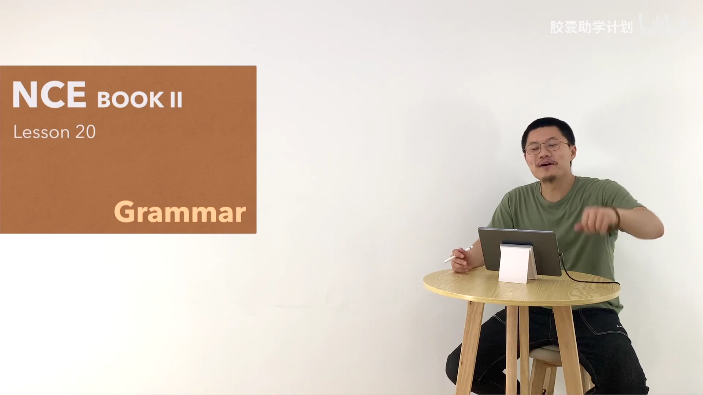

文字识别：胶囊助学计划 / NCE / BOOK II / Lesson 20 / Grammar

### 画面 00:00:02

文字识别：胶囊助学计划 / NCE / BOOKII / Lesson 20 / Grammar

### 画面 00:00:05

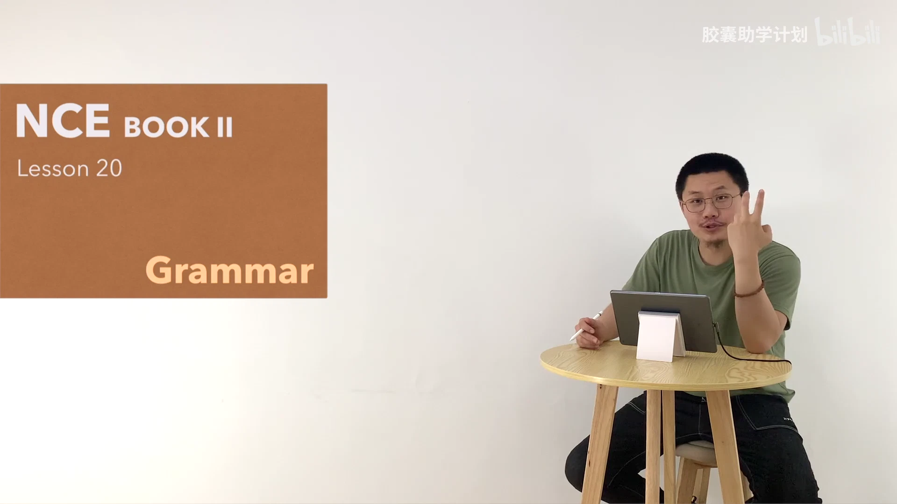

文字识别：胶囊助学计划 / NCE / BOOKII / Lesson 20 / Grammar

### 画面 00:00:08

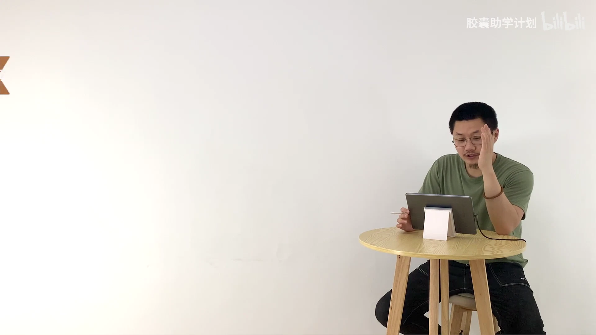

文字识别：胶囊助学计划

### 画面 00:00:10

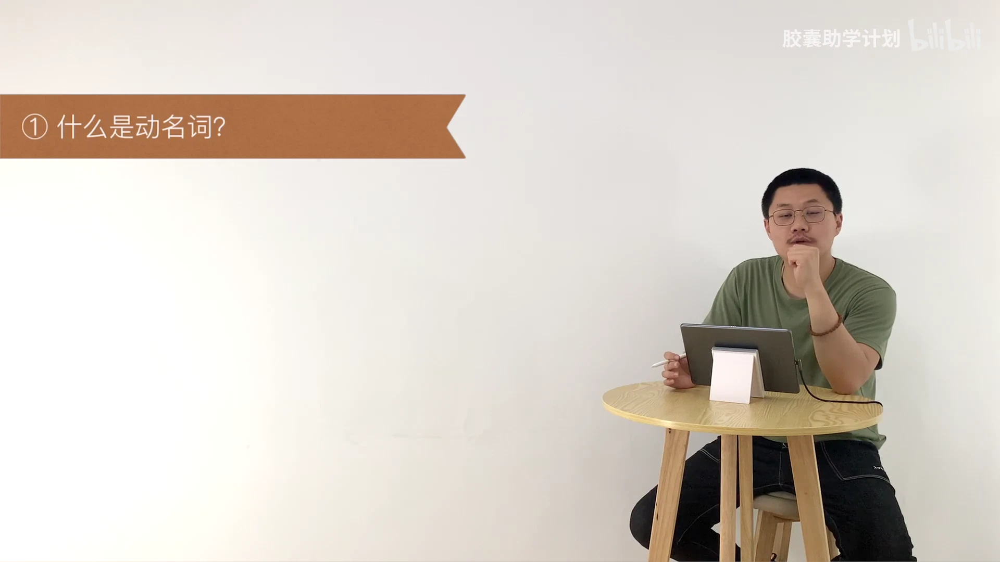

文字识别：胶囊助学计划 / ①什么是动名词？

### 画面 00:00:16

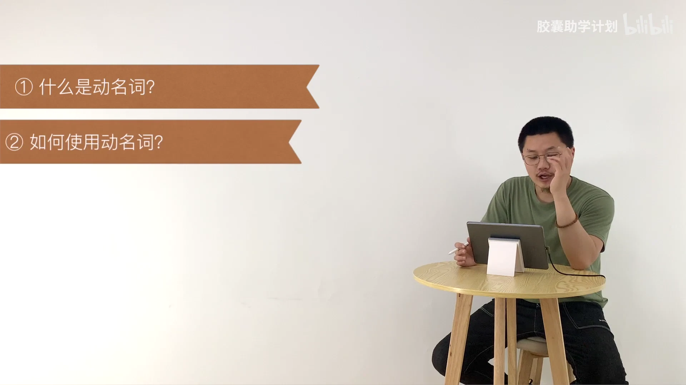

文字识别：胶囊助学计划 / ①什么是动名词？ / 如何使用动名词? / 5

### 画面 00:00:18

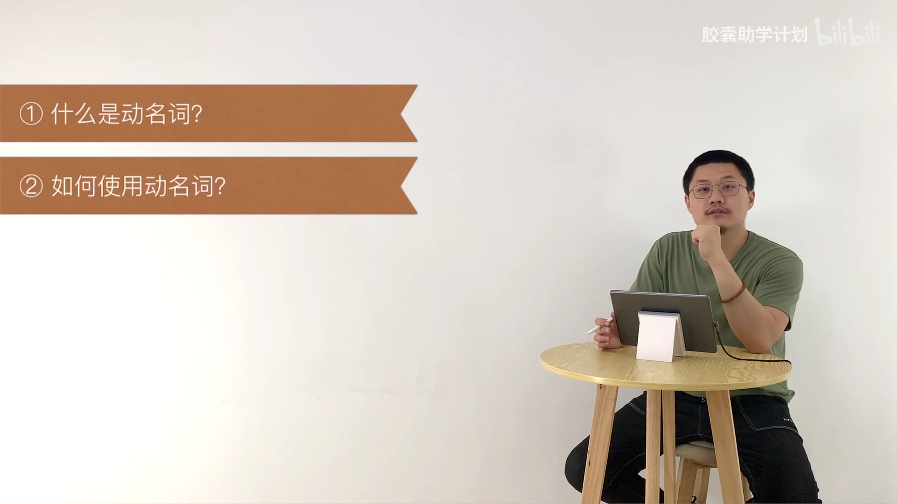

文字识别：胶囊助学计划 / ①什么是动名词？ / 如何使用动名词?

### 画面 00:00:21

文字识别：胶囊助学计划 bilbl / •

### 画面 00:00:25

文字识别：胶囊助学计划

### 画面 00:00:27

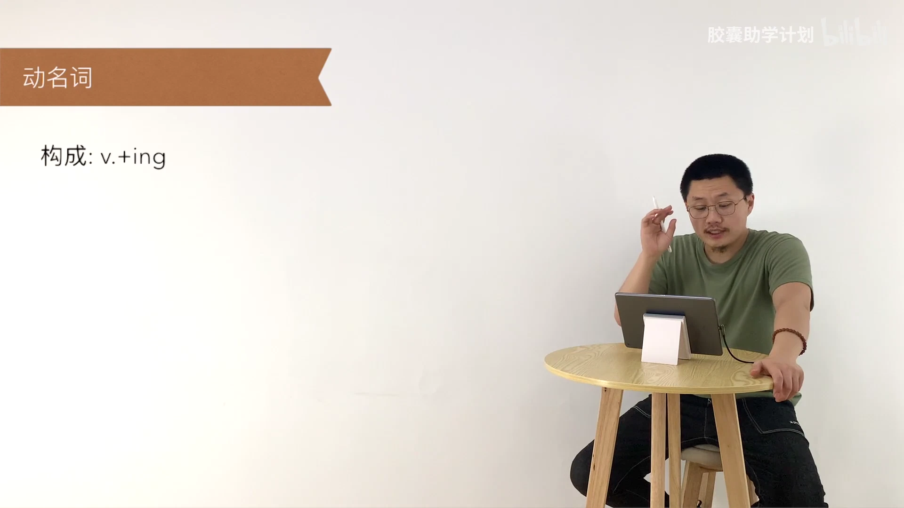

文字识别：胶囊助学计划 / 动名词 / 构成：v.+ing

## 00:00:30–00:01:00

动名词的构成，你看它又有动又有名，它实际上是一个动词加上 I N G 之后就变成了动名词。这个地方就会让我们有一点奇怪，因为如果各位基础还不错的话，你可能会想到我们曾经学的某一个知识点好像也是动词要加上 I N G 是吧？好，我们先不管它，但是在这个地方要各位清楚意识到一件事情，动名词的名字虽然

### 画面 00:00:43

文字识别：胶囊助学计划 / 动名词 / 构成：v.+ing / •

### 画面 00:00:47

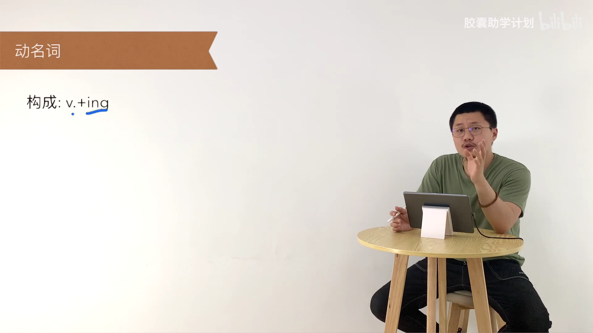

文字识别：胶囊助学计划 / 动名词 / 构成：v.+ing / •

## 00:01:00–00:01:30

叫动名词，但它实际上是动词变成了名词。我们先回想一下汉语当中有没有这个概念，汉语是有的，但是又不完全类似。但我们不用非常严谨，我们大概去理解一下。比如说睡觉，他正在睡觉的这个睡觉是动词还是名词？这是我们汉语的，对吧？或者说他正在吃饭啊，这个更明显了吧？这是个动词，这个吃饭对不对？说哎，我特别喜欢吃饭，每次吃饭呢，

### 画面 00:01:05

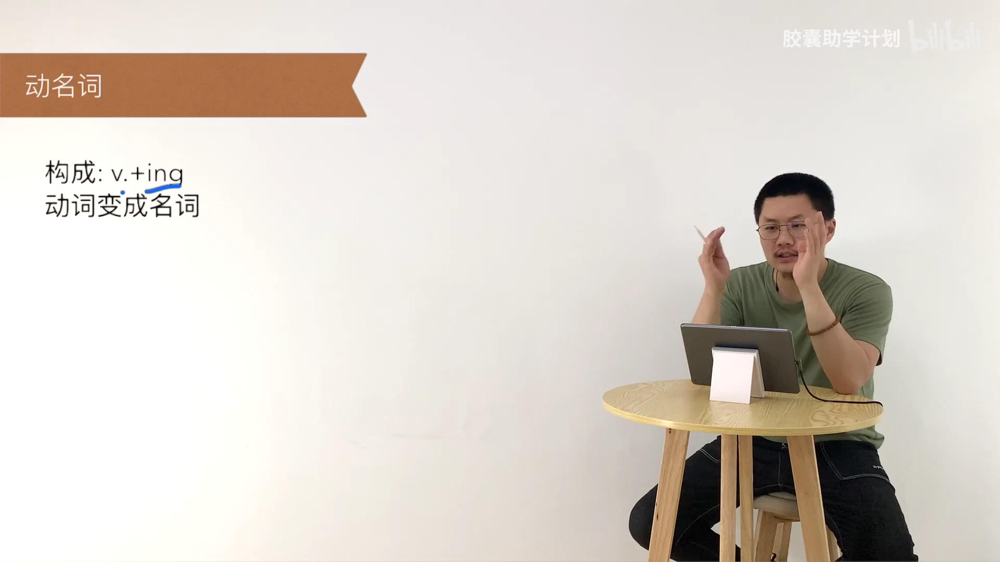

文字识别：胶囊助学计划 / 动名词 / 构成：v.+ing / 动词变成名词

## 00:01:30–00:02:00

我都感觉特别的开心。好，你看这里面的啊，或者说哎，按时吃饭对人身体有好处。这里面每一句话当中的吃饭都是一个名词，您仔细想一下，按时吃饭对人身体是有好处的，对吧？OK，那英语也存在这个情况，英语也可以把动词换成名词。我们汉语只是说结合那个语境，我们甚至不用关心它是名词还是动词，在这句话当中，对不对？但是因为英文呢，

### 画面 00:01:35

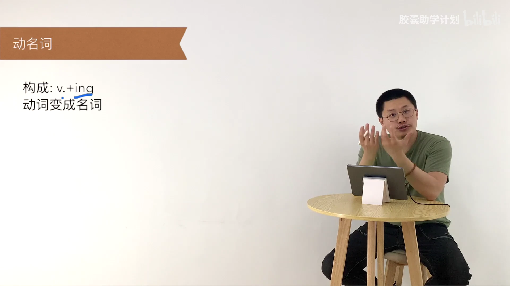

文字识别：胶囊助学计划 / 动名词 / 构成：v.+ing / 动词变成名词

### 画面 00:01:50

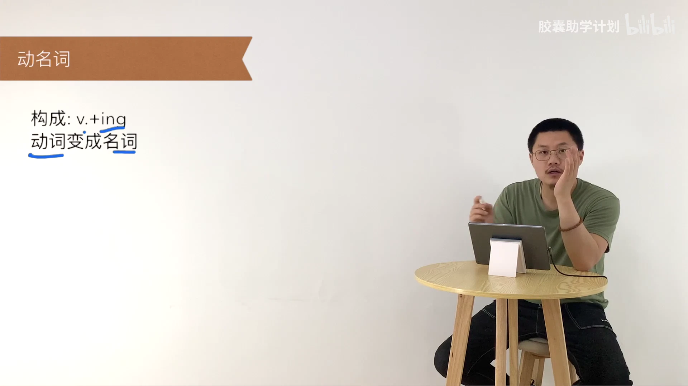

文字识别：胶囊助学计划 / 动名词 / 构成：v.+ing / 动词变成名词

### 画面 00:01:52

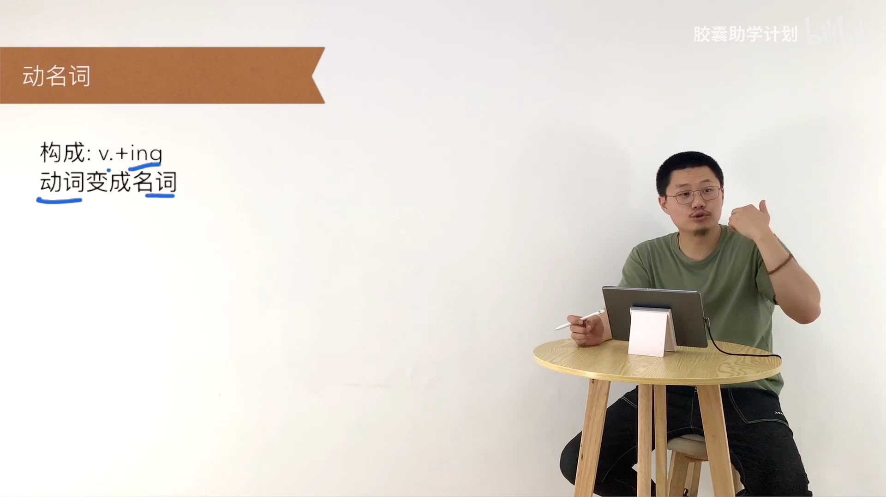

文字识别：胶囊助学计划 / 动名词 / 构成：v.+ing / 动词变成名词

## 00:02:00–00:02:30

它在把动词换成名词的时候，不能直接就用过去，它要加一个 I N G，所以呢，你会要专门花时间简单去学习一下，但也并不是很难啊。刚才我们提到了，我们之前很熟悉的说动词加 I N G 的时候，其实是我们早年在新概念一册，当时新概念二册第二课我们也学过，对吧？新概念一册三十一课，新概念二册第二课，我们都学过，叫做现在进行时的时候叫 be 加 doing，这个 doing 指的是

### 画面 00:02:11

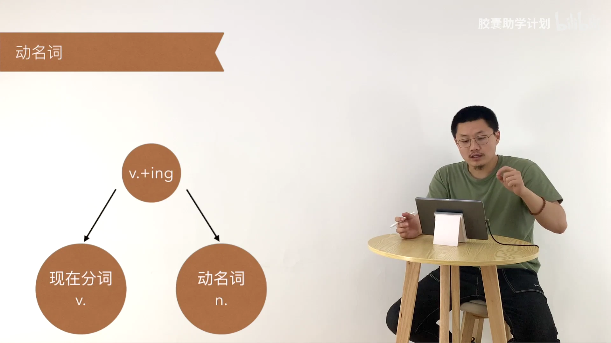

文字识别：胶囊助学计划 / 动名词 / v.+ing / 现在分词 / 动名词 / V.

### 画面 00:02:14

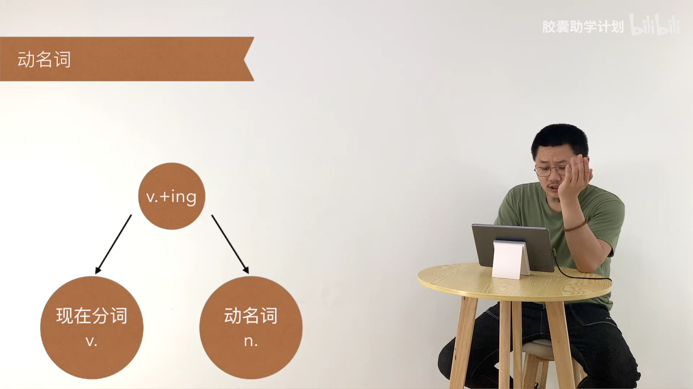

文字识别：胶囊助学计划 / 动名词 / v.+ing / 现在分词 / 动名词 / V

### 画面 00:02:17

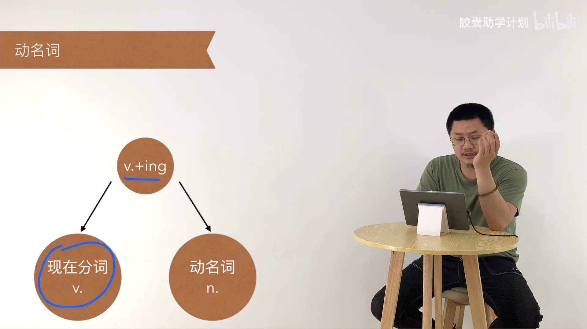

文字识别：胶囊助学计划 / 动名词 / 2川 / v.+ing / 现在分词 / 动名词 / V.

## 00:02:30–00:03:00

动词加 ing 的现在分词。那你注意，它本身是个动词，表示一个动作正在进行。今天要告诉各位的是，动词加 ing 的时候，有的时候也可以是名词，我们管它叫动名词，即动词变成的名词。好，我们举一个例子啊，这样单说还是过于抽象了。我们看两句话，I like fishing 和 she is fishing 这两句话，I like

### 画面 00:02:39

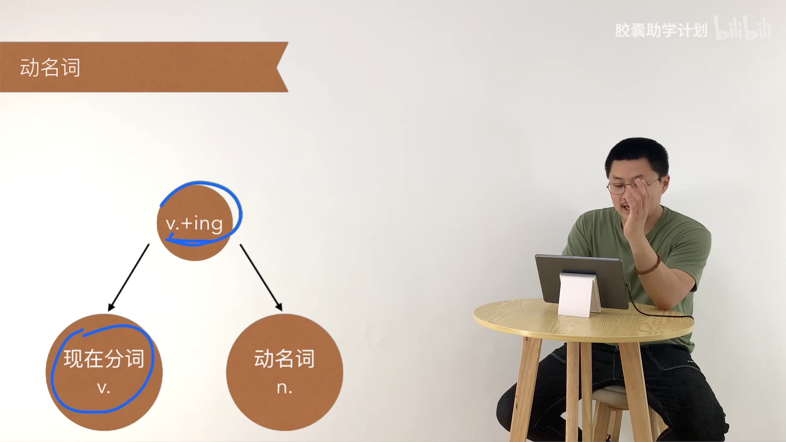

文字识别：胶囊助学计划 / 动名词 / v.+ing / 现在分词 / 动名词 / V.

### 画面 00:02:42

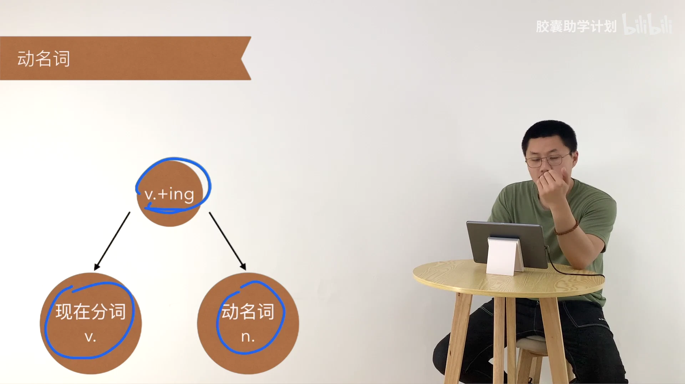

文字识别：胶囊助学计划 / 动名词 / v.+ing / 现在分词 / 动名词 / V.

### 画面 00:02:47

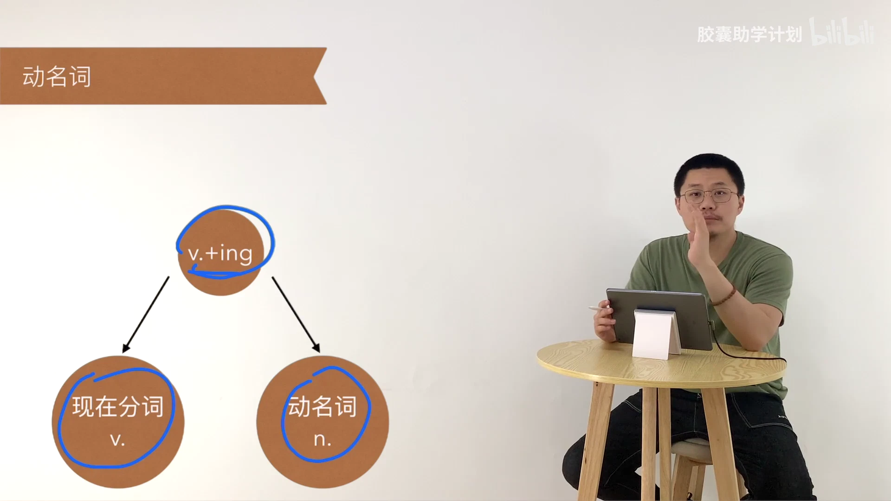

文字识别：胶囊助学计划 / 动名词 / v.+ing / 现在分词 / 动名词 / V.

### 画面 00:02:52

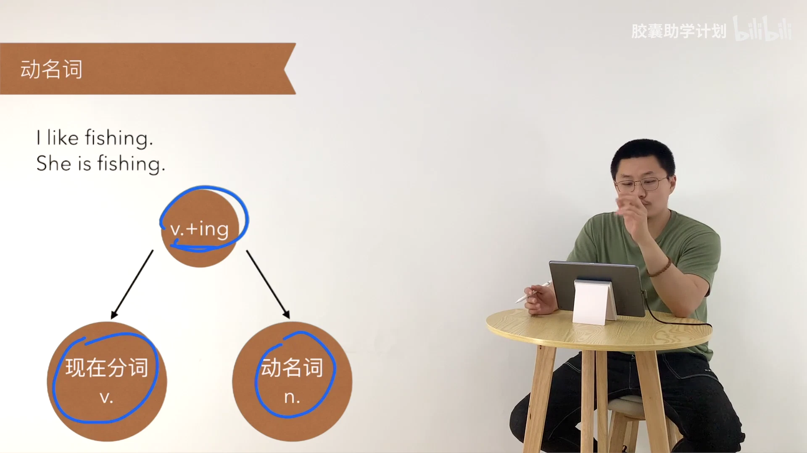

文字识别：胶囊助学计划 / 动名词 / I like fishing. / She is fishing. / v.+ing / 现在分词 / 动名词 / V.

## 00:03:00–00:03:30

and she is fishing.这里边的 fishing 都是 fish 这个动词后边加了 I N G，你可以这样去理解，对吧？OK，都是 fishing 写的一样，读音一样，但是区别是底下这个 she is fishing，这明显是现在分词，表示一个动作正在进行，它正在钓鱼，对不对？而 I like fishing，它不是说我做这个动作，它这个动作这个动词在这句话当中是 like，对吧？六一二三四五六当

### 画面 00:03:00

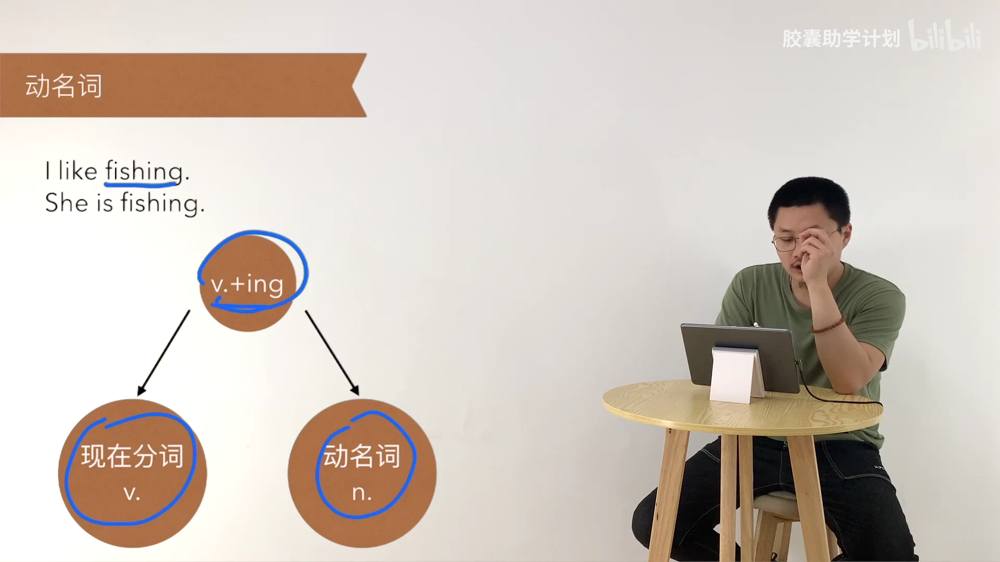

文字识别：胶囊助学计划 / 动名词 / I like fishing. / She is fishing. / v.+ing / 现在分词 / 动名词 / V.

### 画面 00:03:12

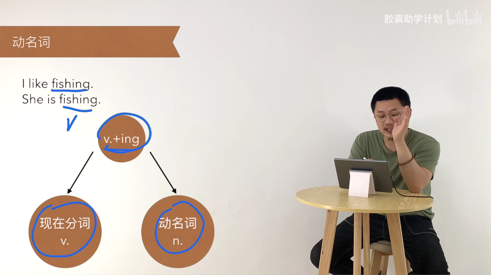

文字识别：胶囊助学计划 / 动名词 / Ilike / fishing. / She is fishing. / v.+ing / 现在分词 / 动名词 / V

### 画面 00:03:16

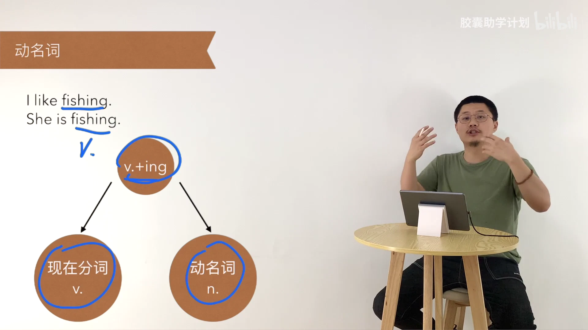

文字识别：胶囊助学计划 / 动名词 / Ilike f / fishing. / She is fishing. / V. / v.+ing / 现在分词 / 动名词 / V.

### 画面 00:03:20

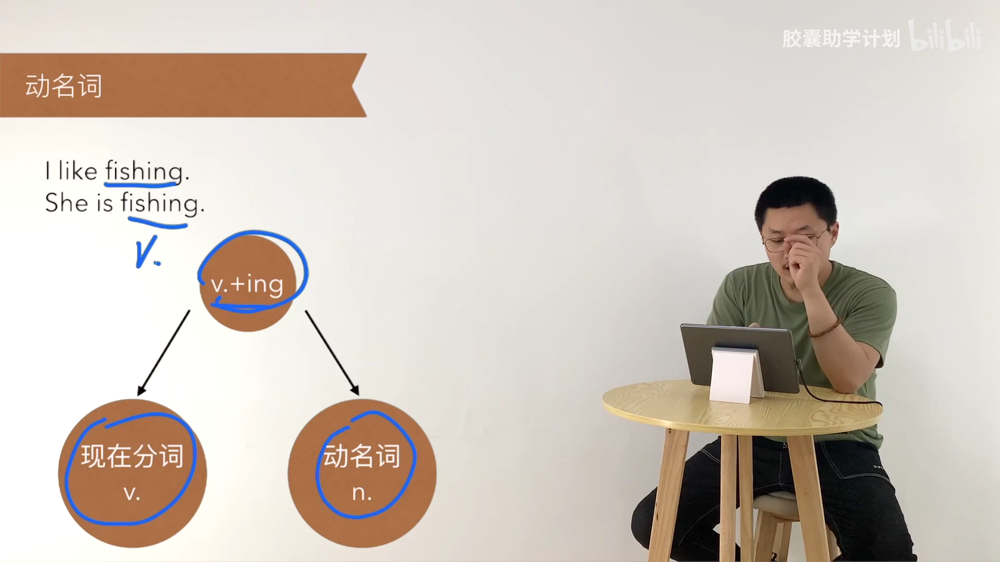

文字识别：胶囊助学计划 / 动名词 / Ilike / fishing. / She is fishing. / V. / v.+ing / 现在分词 / 动名词 / V

### 画面 00:03:22

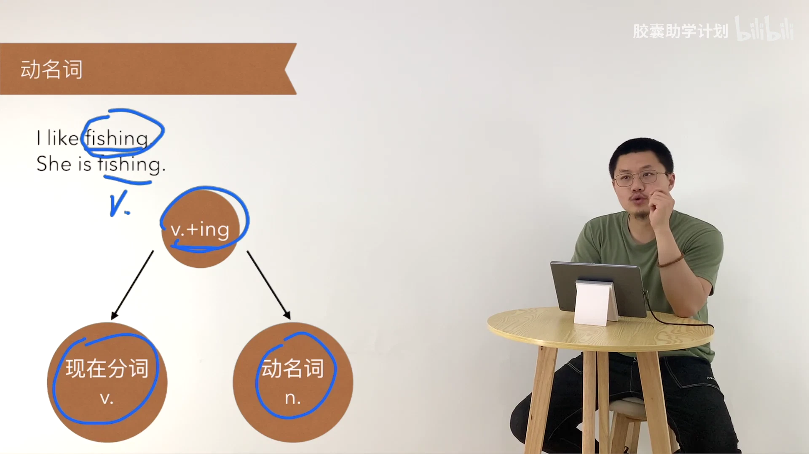

文字识别：胶囊助学计划 / 动名词 / I likefishing / She is fishing. / V. / v.+ing / 现在分词 / 动名词 / V

### 画面 00:03:24

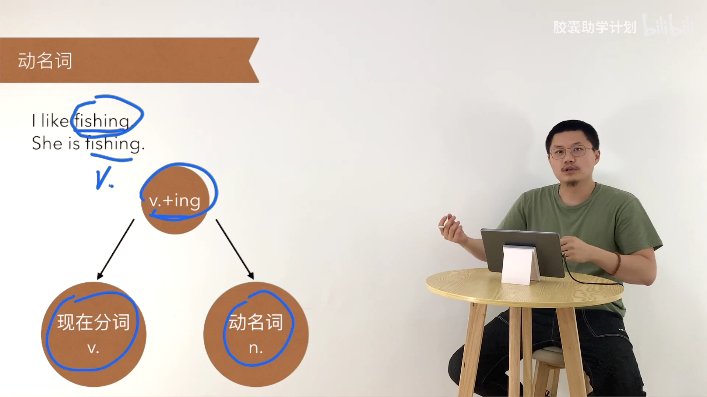

文字识别：胶囊助学计划 / 动名词 / I likefishing / She is fishing. / V. / v.+ing / 现在分词 / 动名词 / V.

### 画面 00:03:29

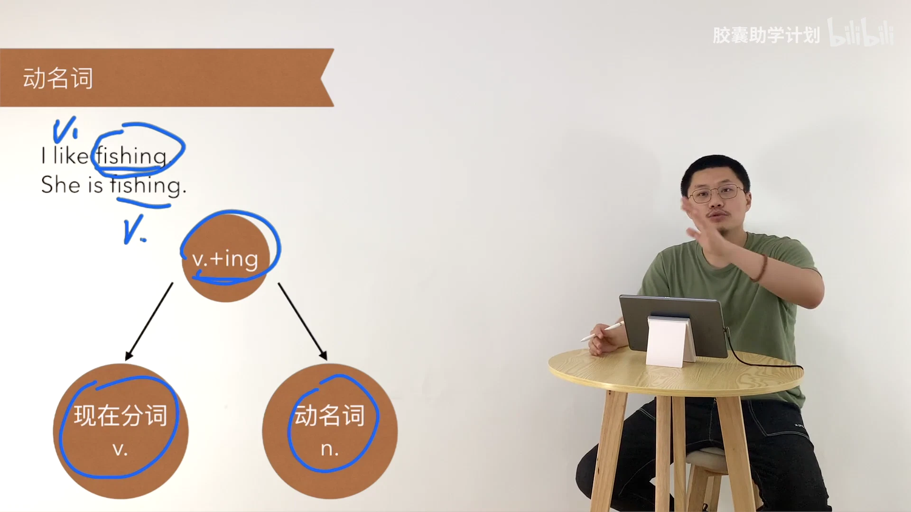

文字识别：胶囊助学计划 / 动名词 / V / I likefishing / She is tishing. / V. / v.+ing / 现在分词 / 动名词 / V.

## 00:03:30–00:04:00

中的二，是like，而fishing在这个地方，它其实起到了一个宾语的作用。如果这个对于您来说比较麻烦，对吧？您没听过什么主谓宾，你也听不太懂，一听就懵。那你就回想一下，六一二三四五六当中，一是什么？二是什么？三是什么？二在这儿是like，而fishing在这句话当中，它其实做了一个三。那如果涉及到这儿，我们必须就要回来看一下这个表格了。动名词就是在动词后边

### 画面 00:03:39

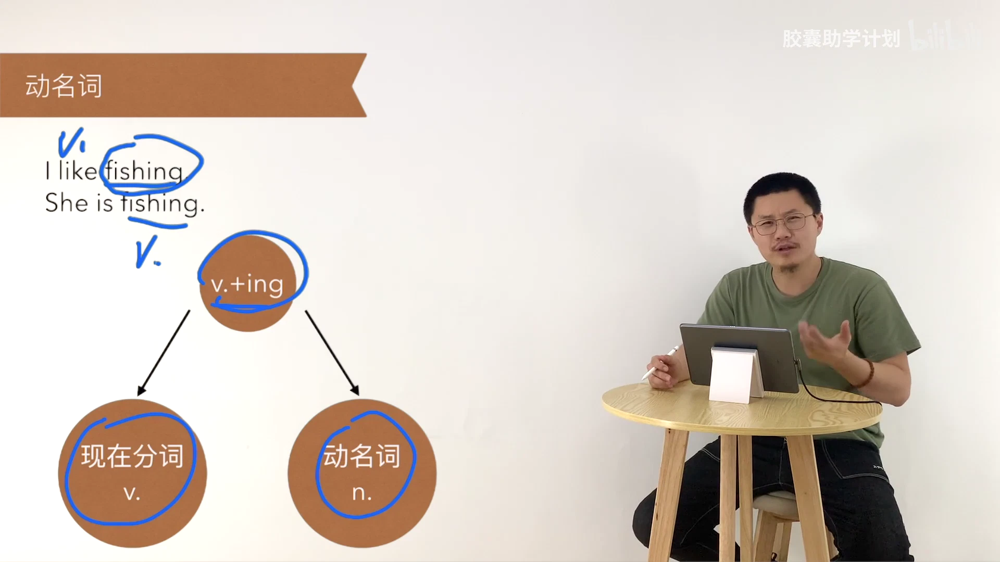

文字识别：胶囊助学计划 / 动名词 / V / I likefishing / She is tishing. / V. / v.+ing / 现在分词 / 动名词 / V

### 画面 00:03:54

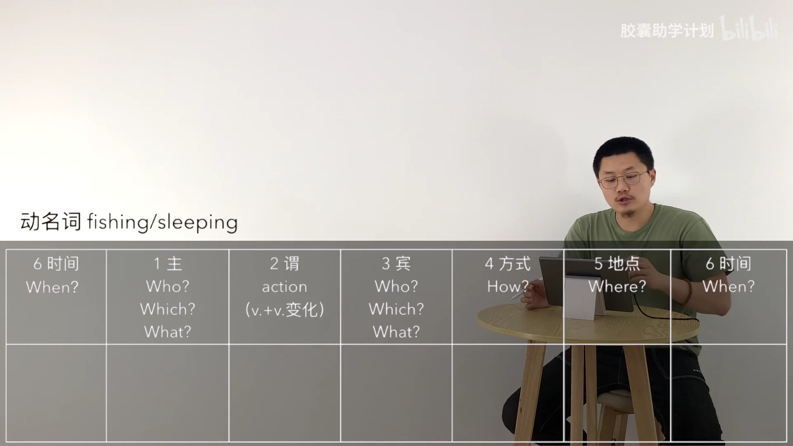

文字识别：胶囊助学计划 / 动名词fishing/sleeping / 6时间 / 1主 / 2谓 / 3宾 / 4方式 / 5地点 / 6时间 / When? / Who? / action / Who? / How? / Where? / When? / Which? / (v.+v.变化) / Which? / What? / What?

## 00:04:00–00:04:30

加了ing，动词后边加了ing，fishing，sleeping都可以是动名词，但是区别在哪？现在分词本身是一个动词，它只在二这个地方出现，而动名词本身是一个名词，它一般来说在一和三的这个位置出现。接下来我们给大家一些例句，各位找一下感觉，好吧？比如说动名词做主语的时候，sleeping is good for you，说睡觉啊对于

### 画面 00:04:11

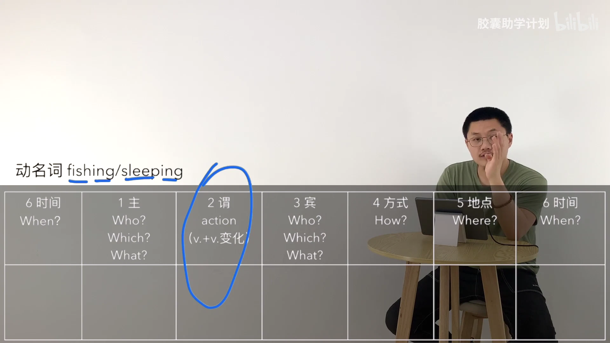

文字识别：胶囊助学计划 / 动名词 / fishing/sleeping / 6时间 / 1主 / 2谓 / 3宾 / 4方式 / 5地点 / 6时间 / When? / Who? / action / Who? / How? / Where? / When? / Which? / (v.+v.变化 / Which? / What? / What?

### 画面 00:04:15

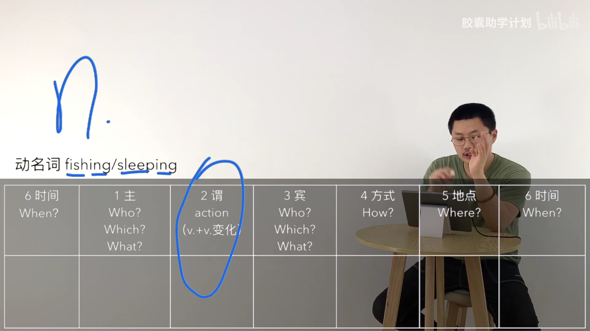

文字识别：胶囊助学计划 / 动名词f / fishing/sleeping / 6时间 / 1主 / 2谓 / 3宾 / 4方式 / 5地点 / 6时间 / When? / Who? / action / Who? / How? / Where? / When? / Which? / (v.+v.变化 / Which? / What? / What?

### 画面 00:04:18

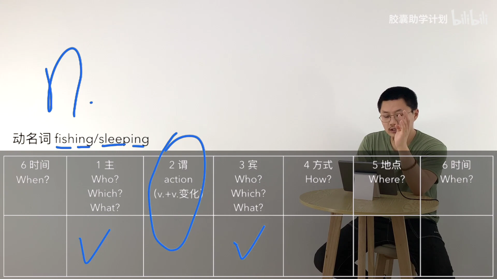

文字识别：胶囊助学计划 / 动名词fishing/sleeping / 6时间 / 1主 / 2谓 / 3宾 / 4方式 / 5地点 / 6时间 / When? / Who? / action / Who? / How? / Where? / When? / Which? / (v.+v.变化 / Which? / What? / What?

### 画面 00:04:24

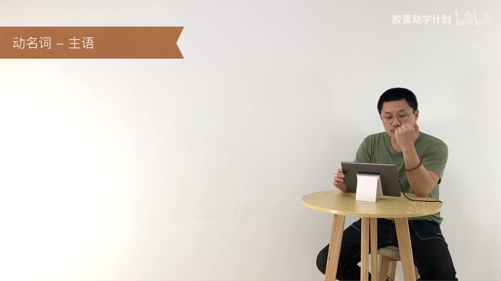

文字识别：胶囊助学计划 / 动名词- 主语 / 3

## 00:04:30–00:05:00

你来说是一个好的事情。Sleep是动词，我现在想说睡觉对于你来说是个好事儿，你太缺觉了。那我在sleep后边加了ing，对不对？再接下来说Reading is an art。说阅读啊是一个艺术。你看Reading is an art，这里面的is实际上是二，an art实际上是三，而Reading在这儿就是做了一个主语，叫阅读是一门艺术，对吧？再来说Fishing makes me

### 画面 00:04:30

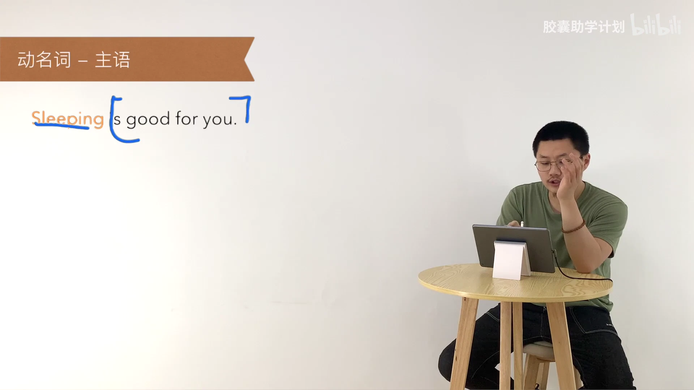

文字识别：胶囊助学计划 / 动名词-主语 / Sleeping

### 画面 00:04:43

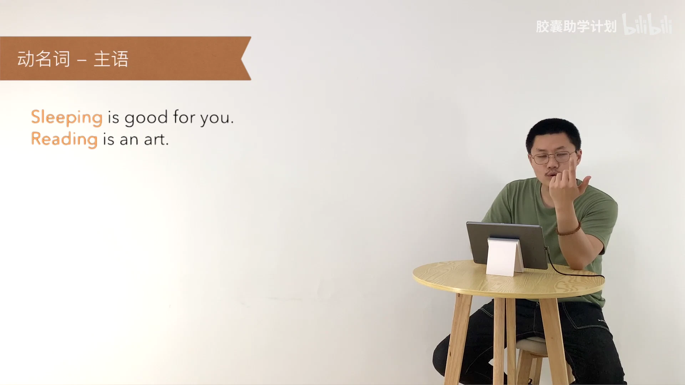

文字识别：胶囊助学计划 / 动名词- 主语 / Sleeping /  is good for you. / Reading / is an art.

### 画面 00:04:50

文字识别：胶囊助学计划 / 动名词- 主语 / Sleeping /  is good for you. / Reading / is an art. / 7

### 画面 00:04:53

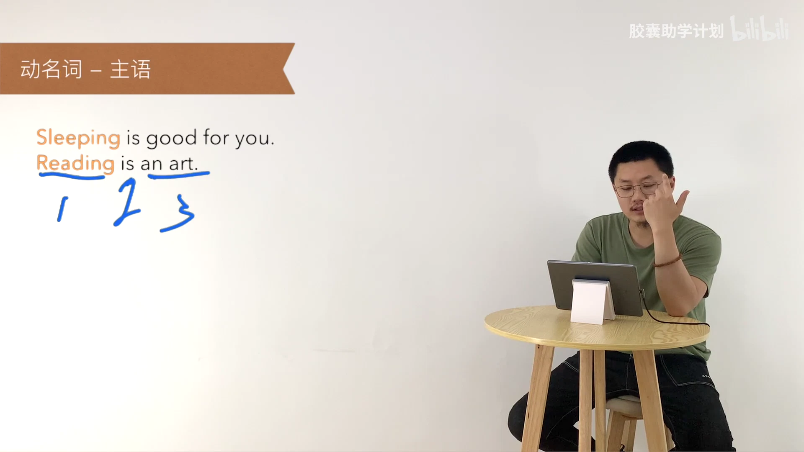

文字识别：胶囊助学计划 / 动名词- 主语 / Sleeping /  is good for you. / Reading / is an art. / 2

### 画面 00:04:56

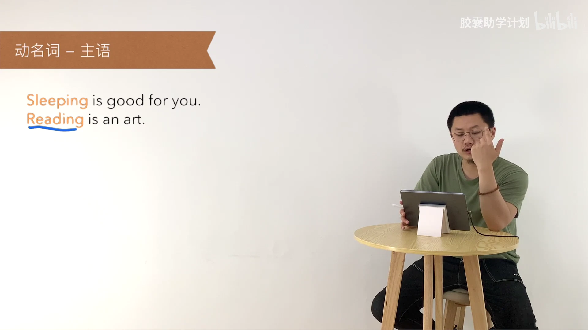

文字识别：胶囊助学计划 / 动名词－ 主语 / Sleeping /  is good for you. / Reading / is an art.

## 00:05:00–00:05:30

happy. OK,说钓鱼啊让我感到非常的开心。在这儿各位可能意识到了一个问题，当动名词做主语的时候，你看后边用的都是单数还是复数？单数。OK，好，再来最后一个俚语，英文当中经常用到的一个俗话吧，叫做seeing is believing，叫做眼见为实。你看believe和see其实都是动词加ing之后变

### 画面 00:05:04

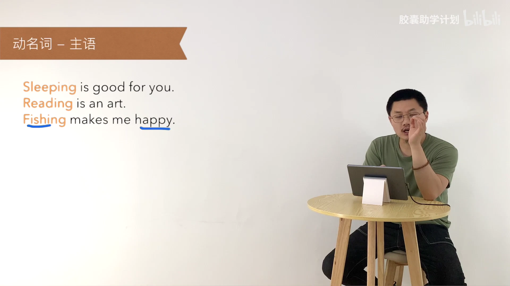

文字识别：胶囊助学计划 / 动名词- 主语 / Sleeping / s good for you. / is / Reading / is / an / art. / Fishing / makes / me / happy.

### 画面 00:05:07

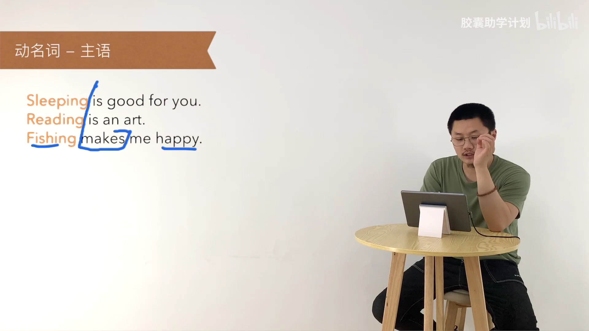

文字识别：胶囊助学计划 / 动名词- 主语 / Sleeping / good for you. / IS / Reading / is / an art. / Fishing / makes/me / happy.

### 画面 00:05:11

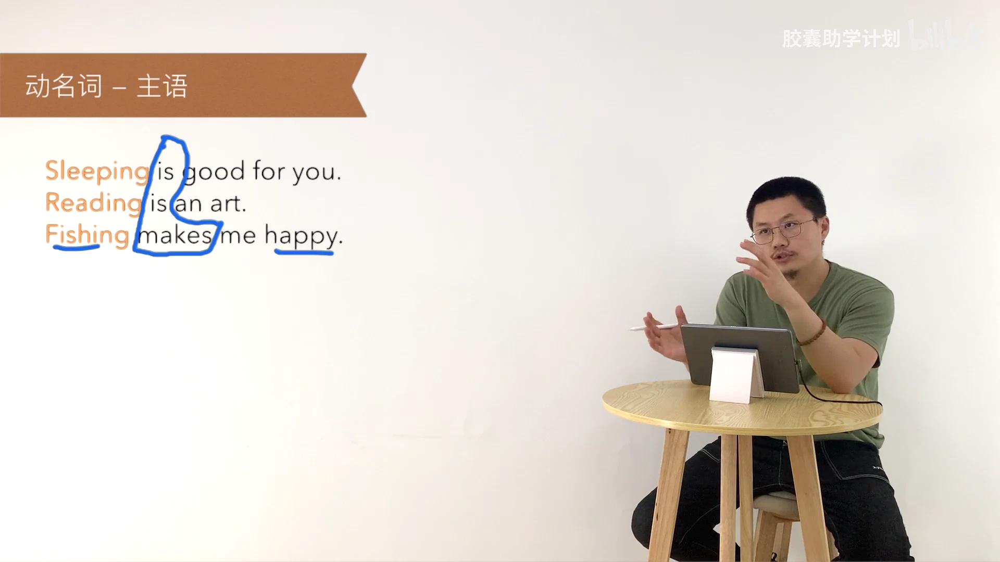

文字识别：胶囊助学计划 / 动名词- 主语 / Sleeping / is good f / for you. / Reading / isan art. / Fishing / makes / me / happy.

### 画面 00:05:17

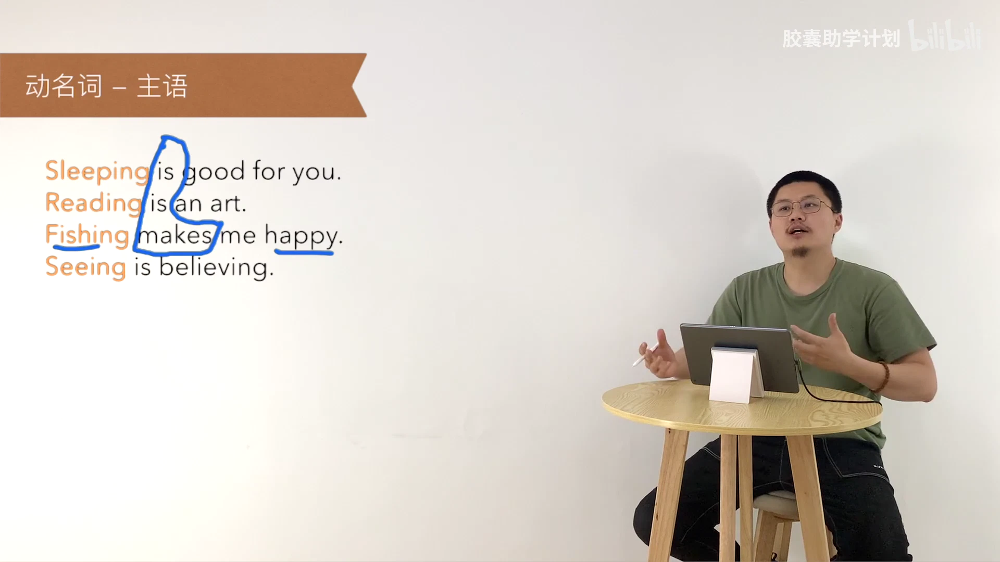

文字识别：胶囊助学计划 / 动名词- 主语 / Sleeping / good / for you. / is / Reading / is / an / art. / Fishing / makes/me / happy. / Seeing / is believing.

### 画面 00:05:25

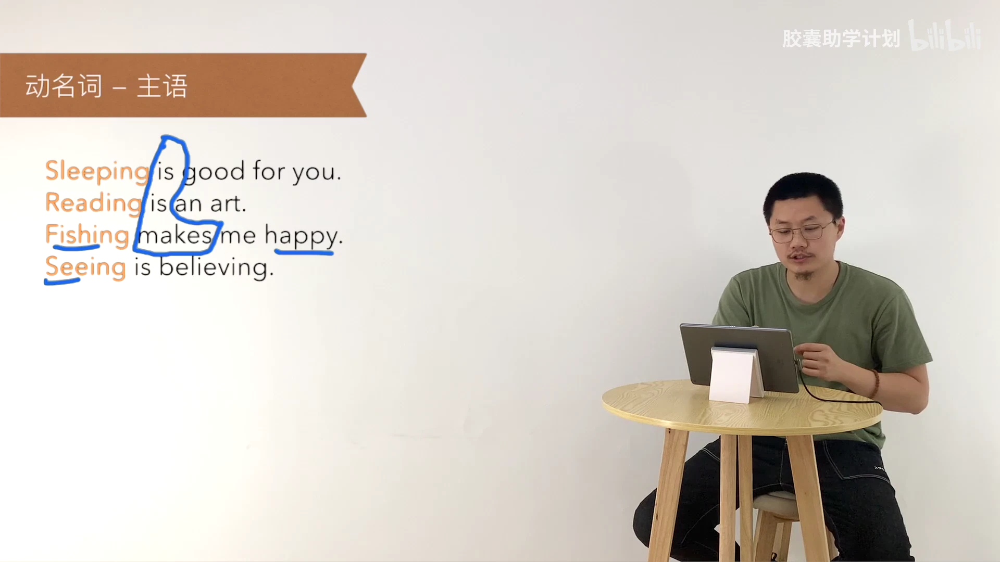

文字识别：胶囊助学计划 / 动名词-主语 / Sleeping / is / good / for you. / Reading / is / an / art. / Fishing / makes/me / happy. / Seeing / is believing.

## 00:05:30–00:06:00

成动名词，seeing 一 is 二 believing 三，非常舒服。动名词做主语，对吧？那动名词还可以做宾语或表语。还是那句话，如果对于各位来说宾表您分不清楚，对吧？很多的时候其实也没有必要完全分清楚，您就知道它在六二三四五六当中是三那个位置就够了，就这么简单，对吧？比如说 I like sleeping，这里边

### 画面 00:05:35

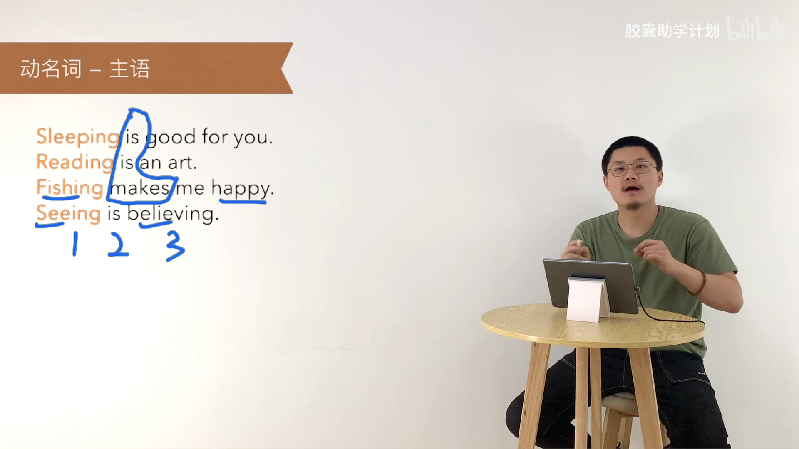

文字识别：胶囊助学计划 / 动名词- 主语 / Sleeping / is / good / for you. / Reading / is / an / art. / Fishing / makes / 7me / happy. / Seeing / is believing. / 2 / 2

### 画面 00:05:39

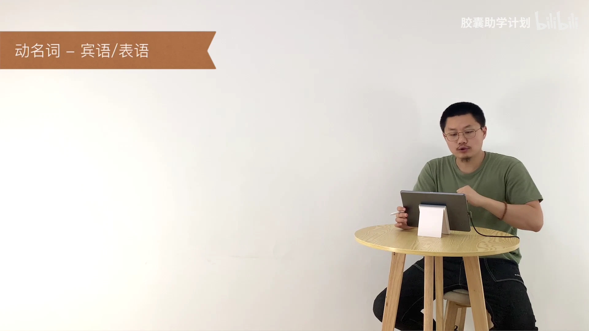

文字识别：胶囊助学计划 / 动名词- 宾语/表语

### 画面 00:05:58

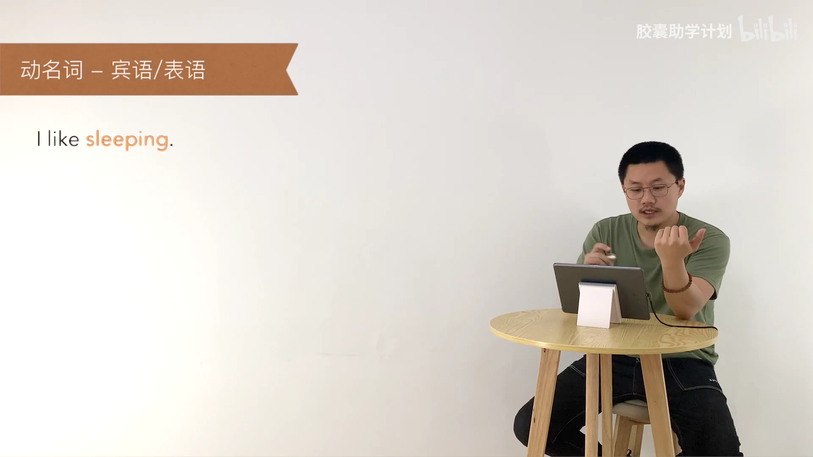

文字识别：胶囊助学计划 / 动名词- 宾语/表语 / I like sleeping.

## 00:06:00–00:06:30

一二三，OK，再来说，I enjoy watching TV. 我很享受看电视这件事儿，对吧？OK, watching TV在这就是一个名词性的一个短语。OK，再来说，I love reading. 我喜欢阅读，love doing something. 所以在这儿我提一个小点，对于您稍微有一点基础的同学，其实你可能在这儿看到的，其实就是我们小时候背过的什么，

### 画面 00:06:03

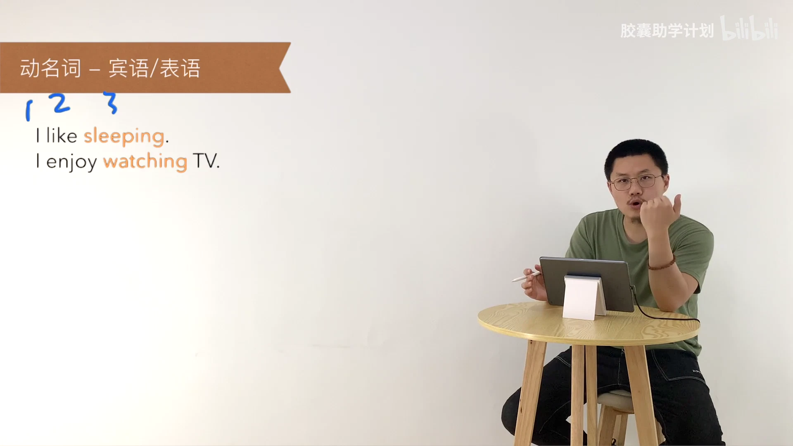

文字识别：胶囊助学计划 / 动名词-宾语/表语 / Ilike / sleeping. / Ienjoy / watching / TV.

### 画面 00:06:10

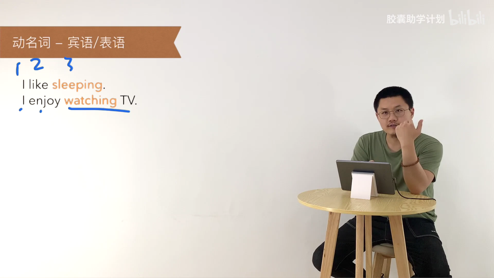

文字识别：胶囊助学计划 / 动名词- 宾语/表语 / Ilike / sleeping. / Ienjoy / watching / TV. / •

### 画面 00:06:24

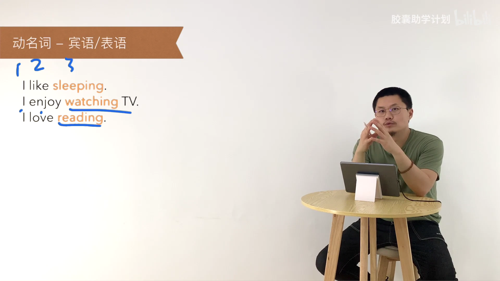

文字识别：胶囊助学计划 / 动名词-宾语/表语 / Ilike / sleeping. / Ienjoy / watching / TV. / llove / reading

## 00:06:30–00:07:00

like doing something, enjoy doing something, love doing something, 对吧？所以以后我们再去讲说动名词做宾语或表语的时候，我们往往也不会去讲它是什么动名词这种东西，我们直接就会告诉你说这个动词后边如果再想加另一个动词的时候，它就不能加动词了，它要加 doing。比如说我喜欢看电视，叫 I like，不能说 watch TV，英文要把它变成 I like watching TV，

### 画面 00:06:45

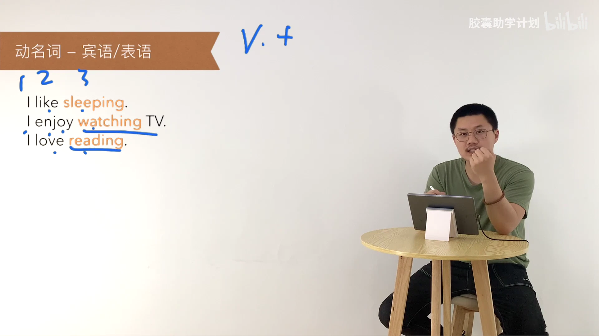

文字识别：胶囊助学计划 / V.+ / 动名词- 宾语/表语 / Ilike / sleeping. / Ienjoy / watching / TV. / 'Ilove / reading / •

### 画面 00:06:48

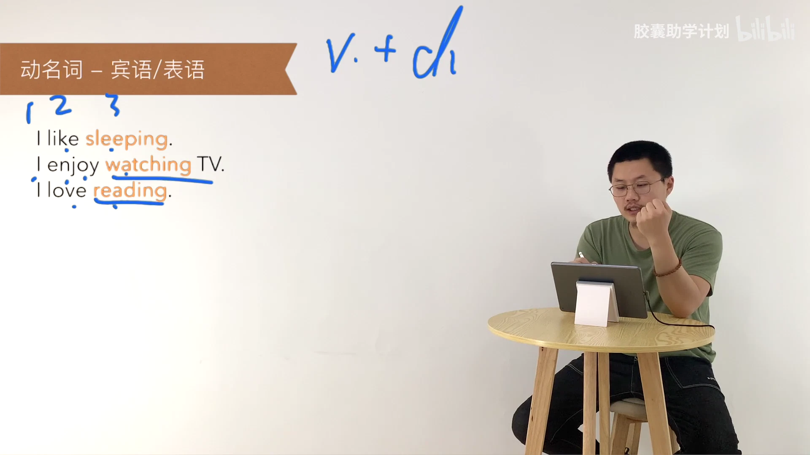

文字识别：胶囊助学计划 / V. + / h / 动名词-宾语/表语 / Ilike / sleeping. / Ienjoy / watching / TV. / 'Ilove / reading / •

### 画面 00:06:50

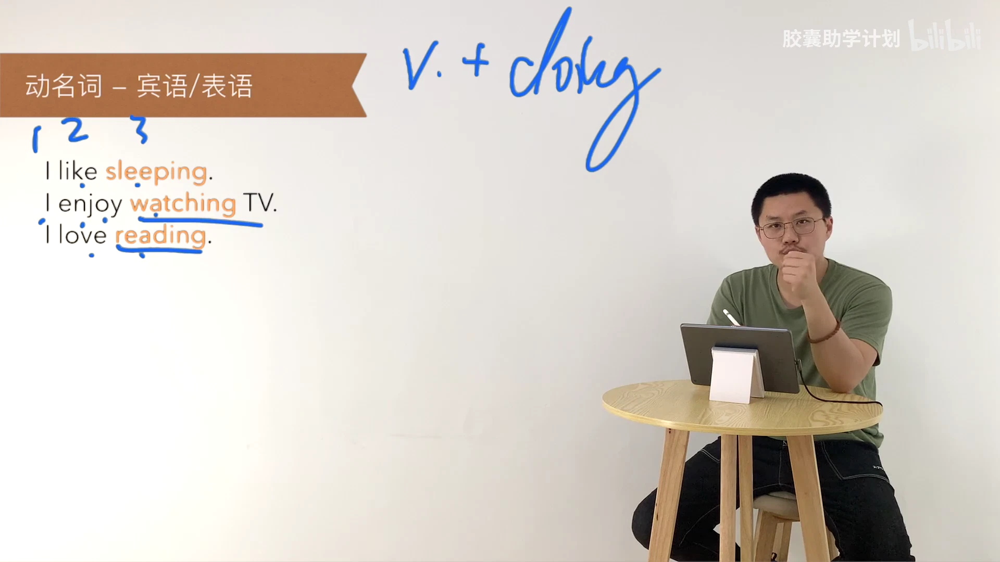

文字识别：cof / 胶囊助学计划 / V / + / 动名词-宾语/表语 / Ilike / sleeping. / Ienjoy / watching / TV. / 'llove / reading.

## 00:07:00–00:07:30

好理解哈。OK，我都说了。最后一个说，His hobby is collecting stamps.啊，这其实就是一个表语啊。如果您基础比较好，或者以前听过不同的老师的课程，那您就知道它是个表语。如果您没听过，也不太清楚什么是表语，那就不管它。你知道，His hobby是一，is是二，collecting stamps是三就可以了，对吧？动名词对于你来说就是一或三。OK，好。那接下来呢，我们做一些小的听力口语练习，

### 画面 00:07:01

文字识别：cop / 胶囊助学计划 / V. / + / 动名词 / -宾语/表语 / Ilike / sleeping. / lenjoy / watching / TV. / 'Ilove / reading. / His / hobbyis / collecting / stamps.

### 画面 00:07:07

文字识别：cop / 胶囊助学计划 / V. / + / 动名词 / -宾语/表语 / Ilike / sleeping. / Ienjoy / watching / TV. / 'llove / reading. / His / hobbyis / collecting / stamps.

### 画面 00:07:17

文字识别：胶囊助学计划 / V. / f / 动名词 / -宾语/表语 / Ilike / sleeping. / Ienjoy / watching / TV. / '1love / reading. / His / hobbyis / collecting / stamps.

### 画面 00:07:20

文字识别：胶囊助学计划 / V. / + / 动名词 / -宾语/表语 / 2 / Ilike / sleeping. / Ienjoy / watching / TV. / '二love / reading / His / hobbyis / ollecting / stamps.

### 画面 00:07:22

文字识别：胶囊助学计划 / V. / + / 动名词 / -宾语/表语 / Ilike / sleeping. / Ienjoy / watching / TV. / '二love / reading / His / hobby is / ollecting / stamps. / 3

### 画面 00:07:25

文字识别：胶囊助学计划 / Repetition drill / 训练目标： / 听力口语 / 练习without +动名词的句子 / Accuracy / Fluency

### 画面 00:07:28

文字识别：胶囊助学计划 / Repetition drill / 训练目标： / 听力口语 / 练习without +动名词的句子 / Accuracy / Fluency

## 00:07:30–00:08:00

练的是 without 加动名词，注意这个地方，刚才我讲到了，我说我们的动名词可以做一，可以做三，对不对？它很多的时候，注意还有一个习惯就是在介词 prep 点，这个是我们新概念一册三十五课就学过的词性，对吧？在介词的后边也可以加上动名词。 OK， without 就是一个介词，叫做而没有。好，我们先看一

### 画面 00:07:41

文字识别：胶囊助学计划 / Repetition drill / 训练目标： / 听力口语 / 练习without +动名词的句子 / Accuracy / Fluency

### 画面 00:07:44

文字识别：胶囊助学计划 / p1 / Repetition drill / 训练目标： / 听力口语 / 练习without +动名词的句子 / Accuracy / Fluency

### 画面 00:07:46

文字识别：胶囊助学计划 / prep / Repetition drill / 训练目标： / 听力口语 / 练习without +动名词的句子 / Accuracy / Fluency

### 画面 00:07:52

文字识别：胶囊助学计划 / doi / + / prep. / Repetition drill / 训练目标： / 听力口语 / 练习without +动名词的句子 / Accuracy / Fluency

### 画面 00:07:54

文字识别：doing / 胶囊助学计划 / + / prep / Repetition drill / 训练目标： / 听力口语 / 练习without +动名词的句子 / Accuracy / Fluency

### 画面 00:07:59

文字识别：胶囊助学计划 / Repetition drill / 福

## 00:08:00–00:08:30

一下啊，这样单独去讲各位可能懵。我们先看例句。He went into the children's room，第一句话，第二句话，He didn't make a noise，他没有制造出任何声响。那这句话我们把两句话连到一起，就是他进入孩子的房间而没有发出声响。你看主语是一致的，he对吧？Without这个单词自己本身就是什么意思？叫而没有，那didn't

### 画面 00:08:01

文字识别：胶囊助学计划 / Repetition drill / 1 T: He went into the children's bedroom. / He didn't make a noise.

### 画面 00:08:04

文字识别：胶囊助学计划 / Repetition drill / 1 T: He went into the children's bedroom. / He didn't make a noise.

### 画面 00:08:18

文字识别：胶囊助学计划 / Repetition drill / 1 T: He went into the children's bedroom. / He didn't make a noise.

### 画面 00:08:25

文字识别：胶囊助学计划 / U / Repetition drill / 1 T: He went into the children's bedroom. / Hedidn't make a noise.

### 画面 00:08:27

文字识别：wifhont / 胶囊助学计划 / Repetition drill / 1 T: He went into the children's bedroom. / Hedidn't make a noise.

## 00:08:30–00:09:00

就可以删掉了，把 without 放到这个地方来。那我刚才讲到，我说 without 是一个介词，介词后边也要加动名词。您现在知道三个位置，主语、宾语一三，对吧？还有在介词后面的时候要用动名词。于是 make 就要被换成了 making，这句话就变成了 he went into the children's bedroom without making a noise。然后我们再把它变一般疑问句，就出来了如下这句话，叫

### 画面 00:08:30

文字识别：withont / 胶囊助学计划 / Repetition drill / 1 T: He went into the children's bedroom. / Hedidn'tmake a noise.

### 画面 00:08:32

文字识别：withont / 胶囊助学计划 / Repetition drill / 1 T: He Went into the children's bedroom. / Hedidhi'tmake a noise.

### 画面 00:08:36

文字识别：withont / 胶囊助学计划 / Repetition drill / 1T: HeWent intot / the / children's bedroom. / Hedidhtmake a noise.

### 画面 00:08:57

文字识别：withont / 胶囊助学计划 / Repetition drill / 1T:HeVentinto / the / children's bedroom. / e a noise. / S: / go into t / the / children's bedroom / without making a noise?

## 00:09:00–00:09:30

做 Did he go into the children's bedroom without making a noise? 你看是不是很舒服? Without making a noise, 把 he didn't 删除，这儿来了一个 without，把 make 加了个 ing。 OK，好，我们再来一个，说 He listened to the speech. He didn't interrupt. 听演讲没打断，而没有打断。主语因为是一致的，所以删除 didn't。其实跟 without 含义是重

### 画面 00:09:00

文字识别：wihont / 胶囊助学计划 / Repetition drill / 1 T: He went into the children's bedroom. / Hedidn'tmake a noise. / S: Did he go into the children's bedroom / without making a noise?

### 画面 00:09:02

文字识别：wihont / 胶囊助学计划 / Repetition drill / 1 T: He went into the children's bedroom. / Hedidn'tmake a noise. / S: Did he go into the children's bedroom / without making a noise?

### 画面 00:09:06

文字识别：withont / 胶囊助学计划 / Repetition drill / 1 T: He went into the children's bedroom. / Hedidn'tmake a noise. / S: Did he go into the children's bedroom / without making a noise?

### 画面 00:09:08

文字识别：wifhont / 胶囊助学计划 / Repetition drill / 1 T: He went into the children's bedroom. / Hedidn'tmake a noise. / S: Did he go into the children's bedroom / without making a noise?

### 画面 00:09:16

文字识别：胶囊助学计划 / Repetition drill / 2 T: He listened to the speech. He didn't interrupt.

### 画面 00:09:25

文字识别：胶囊助学计划 / Repetition drill / 2 T: He listened to the speech.He didn't interrupt. / S: Did he listen to the speech without interrupting? / 2

## 00:09:30–00:10:00

复的，所以这儿加了一个 without，对吧？啊，这个书写太糟糕，我们重新再写一遍啊，without，without，然后把 interrupt，因为前面 without 是介词，后面的 interrupt 就要加 ing，所以就变成了 without interrupting，然后再变一般疑问句，这跟你前面学的没任何区别，叫做 Did he listen to the speech without interrupting？说他是不是听了这个演讲而没有

### 画面 00:09:30

文字识别：胶囊助学计划 / Repetition drill / W / 2 T: He listened to the speech. Hedidn't interrupt. / S: Did he listen to the speech without interrupting?

### 画面 00:09:32

文字识别：胶囊助学计划 / Repetition drill / mthy /  speech. He didn't interrupt. / 2T:He / e listened to the s / S:Did he / listen to the / : speech without interrupting?

### 画面 00:09:35

文字识别：胶囊助学计划 / Repetition drill / ml / 2 T: He listened to the speech. Hedidn't interrupt. / S: Did he listen to the speech without interrupting?

### 画面 00:09:37

文字识别：胶囊助学计划 / Repetition drill / WI / 2 T: He listened to the speech. Hedidn't interrupt. / S: Did he listen to the speech without interrupting?

### 画面 00:09:39

文字识别：胶囊助学计划 / wifhaut / Repetition drill / 2 T: He listened to the speech. Hedidn't interrupt. / S: Did he listen to the speech without interrupting?

### 画面 00:09:47

文字识别：胶囊助学计划 / wifhaut / Repetition drill / 2T:He /  listened to the  / : speech.Hedidn't / interrupt. / S:Did he / listen to the / speech / without interrupting?

## 00:10:00–00:10:30

打断呢？哪一个？好，接下来都是高度一致的。各位快速做头脑风暴，跟上我读，您跟我读，好吧？来了。She arrived last night. She didn't let me know first. Did she arrive last night without letting you know first? Continue. She sat at the table. She didn't speak to anyone. Did she sit at the table without speaking

### 画面 00:10:02

文字识别：胶囊助学计划 / Repetition drill

### 画面 00:10:09

文字识别：胶囊助学计划 / Repetition drill / 3 T: She arrived last night. She didn't let / me know first.

### 画面 00:10:16

文字识别：胶囊助学计划 / Repetition drill / 3 T: She arrived last night. She didn't let / me know first. / S: Did she arrive last night without letting / you know first?

### 画面 00:10:21

文字识别：胶囊助学计划 / Repetition drill / 4 T: She sat at the table. She didn't / speak to anyone.

## 00:10:30–00:11:00

to anyone. Continuing, he fished all day. He didn't catch a thing. 你看重复的部分删掉, without放到这个地方,然后把catch加ing. Did he fish all day without catching anything?他是不是抓了一整天鱼而没有抓到任何东西呢?下一个, continuing,说She looked everywhere. She didn't find it. Did she look everywhere without

### 画面 00:10:32

文字识别：胶囊助学计划 / Repetition drill / 5 T: He fished all day. He didn't catch anything.

### 画面 00:10:39

文字识别：胶囊助学计划 / Repetition drill / 5 T: He fished all day. He didn't catch anything.

### 画面 00:10:42

文字识别：胶囊助学计划 / Repetition drill / 5T:He / fished all day. / He didn't catch / anything. / S:Did he / fish all day / without catching / anything?

### 画面 00:10:47

文字识别：胶囊助学计划 / Repetition drill / 5 T:He / fished a / all / day. / He didn't catch / anything. / S:Did he / fish a / all day / without / catching / anything?

### 画面 00:10:49

文字识别：胶囊助学计划 / Repetition drill / 5T:He / fished / all / day. / He dian't / t catch / anything. / S: / :Did he / fish a / all day / without / catching / anything?

### 画面 00:10:51

文字识别：胶嚢助学计划 / Repetition drill / 6 T: She looked everywhere. She / didn't find it.

## 00:11:00–00:11:30

finding it. Continue. He drove two hundred miles. He didn't stop. Did he drive two hundred miles without stopping? Continue. He left the restaurant. He didn't pay the bill. Did he leave the restaurant without paying the bill? Next one. She walked around the shop. She didn't buy anything.

### 画面 00:11:07

文字识别：胶囊助学计划 / Repetition drill / 7 T: He drove two hundred miles. He / didn't stop. / S: Did he drive two hundred miles / without stopping?

### 画面 00:11:13

文字识别：胶囊助学计划 / Repetition drill / 8 T: He left the restaurant. He didn't pay / the bill.

### 画面 00:11:24

文字识别：胶囊助学计划 / Repetition drill / 9 T: She walked round the shop. She didn't / buy anything.

### 画面 00:11:29

文字识别：胶囊助学计划 / Repetition drill / 9T:9 / She walked round the shop. She c / didn't / buy / anything. / S：Did / she walk round the shop without / buying / anything?

## 00:11:30–00:12:00

Did she walk around the shop without buying anything? Okay, next one. He went to work. He didn't have anything for breakfast. Did he go to work without having anything for breakfast? Very good.好，下一题. Pattern drill.我们去练习包含动名词的短语。我们先看第一题。John这个P.S.是is啊，is keen

### 画面 00:11:35

文字识别：胶囊助学计划 / Repetition drill / 10 T: He went to work. He didn't have / anything for breakfast.

### 画面 00:11:47

文字识别：胶囊助学计划 / Pattern drill / 训练目标： / 写作口语 / 练习包含动名词的句子 / Accuracy / Fluency

### 画面 00:11:52

文字识别：胶囊助学计划 / Pattern drill / 1 T: be keen on -walking / S1: John's keen on walking. / S2: Really? I'm keen on walking, too. / interestedin-reading/acting/cooking / keen on / -fishing/swimming/sailing / --- / f-doing the job/working hard / capable of / tired of / --taying here/doing nothing

## 00:12:00–00:12:30

on walking. 各位在这儿不懂，我直接告诉各位，这个地方要各位记一个短语，叫 be keen on doing something，叫做热衷于做某件事情。所以这句话就变成了叫做 John 热衷于走路，说是吗？I'm keen on walking too. 哦，是吗？我也特别热衷于走路。OK，那接下来底下这些呢，你往里面去带，但是注意一小线儿。你

### 画面 00:12:05

文字识别：be / 胶囊助学计划 / Pattern drill / 1 T: be keen on -walking / S1: John's keen on walking. / S2: Really? I'm keen on walking, too. / interestedi -reading/acting/cooking / keen on / -fishing/swimming/sailing / f-doing the job/woring hard / capable of. / tired of / -taying here/doing nothing

### 画面 00:12:07

文字识别：been / be / 胶囊助学计划 / Pattern drill / 1 T: be keen on -walking / S1: John's keen on walking. / S2: Really? I'm keen on walking, too. / interestedi -reading/acting/cooking / keen on --- / -fishing/swimming/sailing / f -doing the job/working hard / capable of. / tired of / -taying here/doing nothing

### 画面 00:12:09

文字识别：been / be / on / bo. / 胶囊助学计划 / Pattern drill / 1 T: be keen on -walking / S1: John's keen on walking. / S2: Really? I'm keen on walking, too. / interestedin -reading/acting/cooking / keen on-- / --fishing/swimming/sailing / capableof-doing thejob/working hard / tired of / -taying here/doing nothing

### 画面 00:12:11

文字识别：助学计划 / been / on doin / be / Pattern drill / 1 T: be keen on -walking / S1: John's keen on walking. / S2: Really? I'm keen on walking, too. / interestedin-reading/acting/cooking / keen on / -fishing/swimming/sailing / capableof-doing thejob/woking hard / tired of / -aying here/doing nothing

## 00:12:30–00:13:00

看他说 John is keen on walking，这地方其实应该也都是有一个 be 的啊，他们前面都是有一个 be 的。 OK，叫做 John is interested in reading，这叫感兴趣啊。我们在文章当中会出现这句话。是 John is keen on fishing，哎，热衷于钓鱼。 John is capable of doing the job， capable 回去您自己查一下，这个我就不

### 画面 00:12:35

文字识别：been / on doins / be / 力学计划 / Pattern drill / 1 T: be keen on -walking / S1: John's keen on walking. / S2: Really? I'm keen on walking, too. / interested in --reading/acting/cooking / keenon-shing/swmming/saiing / capableof--doing thejob/working hard / tired of / --taying here/doing nothing

### 画面 00:12:38

文字识别：been / on dins / be / 学计划 / Pattern drill / 1 T: be keen on -walking / S1: John's keen on walking. / S2: Really? I'm keen on walking, too. / linterestedin--eading/acting/cooking / bel / keen on / -fishing/swimming/sailing / f -doing the job/working hard / capable of / tired of / -taying here/doing nothing

### 画面 00:12:57

文字识别：been / on dhins / be / 学计划 / Pattern drill / 1 T: be keen on -walking / S1: John's keen on walking. / S2: Really? I'm keen on walking, too. / linterested in --eading/acting/cooking / bel / keen on-. / --fishing/swimming/sailing / capable of / f-doing thejob/working hard / tired of / -taying here/doingg nothing

## 00:13:00–00:13:30

告诉您了啊。有一个小作业，说最后一个叫 John is tired of。好，我告诉各位叫厌倦了做某件事情。比如说 John is tired of staying here，叫做他厌倦了待在这里。各位回去要做的事情是往里带就 OK 了，好吧？下一题，Why don't you give up smoking？文章当中会出现 give up doing something，在这儿提前看一下，叫做放弃抽烟啊，

### 画面 00:13:02

文字识别：been / din / be / on / 学计划 / Pattern drill / 1 T: be keen on -walking / S1: John's keen on walking. / S2: Really? I'm keen on walking, too. / linterested in --eading/acting/cooking / bel / keen on- / -fishing/swimming/sailing / capable of / f-doing thejob/working hard / tired of / -taying here/doingg nothing

### 画面 00:13:19

文字识别：胶囊助学计划 / Pattern drill / 2T:smoke / S1: Why don't you give up smoking? / S2: Because smoking is fun. / read in bed / sleep on the floor / collect birds' eggs / eat sweets / watch TV / walk to school / learn English / write poetry

## 00:13:30–00:14:00

就是戒烟，其实在这就可以理解呗。你为什么不戒烟呢？他说因为 smoking is fine。好，我们不管认不认同啊这句话，但是我们看一下 smoking is fine 的 smoking 就是在做主语，而 give up smoking 这个 up 就是个介词，后面的 smoking 就是介词后边加了一个动名词，对吧？好，下一个，Why don't you listen to him？你为什么不听他的话呢？

### 画面 00:13:49

文字识别：胶囊助学计划 / Pattern drill / 2T:smoke / S1: Why don't you give up smoking? / S2: Because smoking is fun. / read in bed / sleep on the floor / collect birds'eggs / eat sweets / watch TV / walk to school / learn English / write poetry

### 画面 00:13:53

文字识别：胶囊助学计划 / Pattern drill / 3 T: listen to him -get bored / S1: Why don't you listen to him? / S2: Because I can't listen to him without / getting bored. / ride abike--et tired/fll of / watc.  T.--eta eadache/llasleep / go byplane-feel sick/feel afraid / speak to him ---berude/get angry

## 00:14:00–00:14:30

Because I can't listen to him.因为我没办法听他的话. Without没办法听他说话. With而没有怎么样呢？Getting bored.好，我们先不管getting bored，而without doing something，对吧？那get bored是什么意思呢？叫做变得很不耐烦，很无聊。就我没办法听他说话。我就换一个思路，就是我每次听他说话，我都觉得很无聊啊。就我一听他说话，我就很无聊。我没有办法听他说话而不感到无聊。Okay,玩一个，最后一个，

### 画面 00:14:23

文字识别：胶囊助学计划 / Pattern drill / 3 T: listen to him -get bored / S1: Why don't you listen to him? / S2:Because I can't listen to him without / getting bored. / ride abike--et tired/fll f / watch TV--getaheadache/fallasleep / go byplane-feel sick/feelafraid / speak to.im --berude/get angry

### 画面 00:14:29

文字识别：胶囊助学计划 / Pattern drill / 4T: gota job / S1: / Congratulate me! I've just got a job! / S2: Congratulations on getting a job! / won the match / got into university / sold a picture / created a new record / passed my exams / written a book / won first prize / got a rise in salary

## 00:14:30–00:15:00

congratulate me.哎，快祝贺我! I've just got a job.我刚刚得到了一份工作. Congratulations on getting a job.说祝贺你获得一个新的工作啊。介词后边加doing.玩一个. Recap.本视频最重要的我们就是学习了动名词。简单总结一下，进入文章我们还会再去看三个位置一三

### 画面 00:14:48

文字识别：胶囊助学计划 / Recap / Patterns / ＆ / 动名词 / Grammar

### 画面 00:14:50

文字识别：Recap / 胶囊助学计划 / Patterns / ＆ / 动名词 / Grammar

### 画面 00:14:52

文字识别：Recap / 胶囊助学计划 / Patterns / 动名词 / Grammar

### 画面 00:14:54

文字识别：胶囊助学计划 / Recap / Patterns / ＆ / 动名词 / Grammar

### 画面 00:14:59

文字识别：Recap / 胶囊助学计划 / Patterns / ＆ / 动名词 / Grammar

## 00:15:00–00:15:30

介词后玩一个家庭作业，pattern drill 四乘四啊，先写写完，看着自己写答案，大声朗读，不要偷懒。接下来尝试回忆，给自己讲解一遍今天的核心语法，尤其是动名词，对吧？它是什么？怎么变过来的？它的位置在句子当中处于什么位置？OK，好，那尝试翻阅红皮书，这个对于各位来说就不是那么好找了，但您试试能不能找到

### 画面 00:15:02

文字识别：胶囊助学计划 / 1. / Pattern Drill 写&朗读 / 专栏 / 4×4

### 画面 00:15:04

文字识别：胶囊助学计划 / 1. / Pattern Drill 写&朗读 / 专栏 / 4×4

### 画面 00:15:09

文字识别：胶囊助学计划 / 1.f / Pattern Drill 写&朗读 / 专栏 / 4×4

### 画面 00:15:11

文字识别：胶囊助学计划 / Pattern Drill 写&朗读 / 1. / 专栏 / 4×4 / 尝试回忆并给自己讲解一 / 遍今天的核心语法 / Study-Test / Learning Pyramid

### 画面 00:15:14

文字识别：胶囊助学计划 / Pattern Drill写&朗读 / 1. / 专栏 / 4×4 / 尝试回忆并给自己讲解一 / 遍今天的核心语法 / Study-Test / Learning Pyramid

### 画面 00:15:17

文字识别：胶囊助学计划 / Pattern Drill写&朗读 / 专栏 / 4×4 / 尝试回忆并给自己讲解一 / 遍今天的核心语法 / Study-Test / Learning Pyramid

### 画面 00:15:19

文字识别：胶囊助学计划 / Pattern Drill写&朗读 / 专栏 / 4×4 / 尝试回忆并给自己讲解一 / 遍今天的核心语法 / Study-Test / Learning Pyramid

### 画面 00:15:22

文字识别：胶囊助学计划 / Pattern Drill写&朗读 / 1.f / 专栏 / 4×4 / 尝试回忆并给自己讲解一 / 遍今天的核心语法 / Study-Test / Learning Pyramid / 尝试翻阅红皮书（中级） / 通过目录或索引(Index) / 查找到本课语法

### 画面 00:15:24

文字识别：胶囊助学计划 / 1. / Pattern Drill写&朗读 / 专栏 / 4X4 / 尝试回忆并给自己讲解一 / 遍今天的核心语法 / Study-Test / Learning Pyramid / 尝试翻阅红皮书（中级） / 通过目录或索引(Index) / 查找到本课语法

### 画面 00:15:29

文字识别：胶囊助学计划 / Pattern Drill写&朗读 / 1. / 专栏 / 4×4 / 尝试回忆并给自己讲解一 / 遍今天的核心语法 / Study-Test / Learning Pyramid / 尝试翻阅红皮书（中级） / 通过目录或索引(Index) / 查找到本课语法

## 00:15:30–00:16:00

我说的接下来这个东西，叫做动词后面加ing的这些固定搭配，您看能不能找到？一定是能找到的。OK，那以上呢就是本期视频的全部内容了。如果大家喜欢我们的课程，欢迎大家关注、订阅、一键三连，分享给那些需要的朋友。See you next time.

### 画面 00:15:34

文字识别：胶囊助学计划 / Pattern Drill写&朗读 / 1. / 专栏 / 4×4 / 尝试回忆并给自己讲解一 / 遍今天的核心语法 / Study-Test / Learning Pyramid / 尝试翻阅红皮书（中级） / 通过目录或索引(Index) / 查找到本课语法

### 画面 00:15:36

文字识别：胶囊助学计划 / 1. / Pattern Drill写&朗读 / 专栏 / 4×4 / 尝试回忆并给自己讲解一 / 遍今天的核心语法 / Study-Test / Learning Pyramid / 尝试翻阅红皮书（中级） / 通过目录或索引(Index) / 查找到本课语法

### 画面 00:15:38

文字识别：胶囊助学计划 / Pattern Drill写&朗读 / 专栏 / 4×4 / 尝试回忆并给自己讲解一 / 遍今天的核心语法 / Study-Test / Learning Pyramid / 尝试翻阅红皮书（中级） / 通过目录或索引(Index) / 查找到本课语法

### 画面 00:15:40

文字识别：胶囊助学计划

### 画面 00:15:50

文字识别：👍 / 4

### 画面 00:15:52

文字识别：CAPSULEACADEMY / 胶囊助学计划 / 『 / 小红书 / Lecturer / □ / 口 / Leo / OE

### 画面 00:15:55

文字识别：CAPSULEACADEMY / 胶囊助学计划 / 小红书 / OE

### 画面 00:15:58

文字识别：CAPSULEACADEMY / 胶囊助学计划 / 小红书 / Creator / □ / Leo & Berlin / OE

## 00:16:00–00:16:03

### 画面 00:16:00

文字识别：bilibili / 胶囊助学计划 / CAPSULEACADEMY / 胶囊助学计划 / 小红书 / OE

### 画面 00:16:02

文字识别：bilibili / 胶囊助学计划

