# L020 文章

快速机器解析：语音为单模型转写，未进行独立交叉校对或人工复核；画面每秒采样并按变化选帧，短时文字和标记可能遗漏。截图时间约有 1 秒误差。图片有损压缩；遇到疑点请按时间查看 Google Drive 原视频。

## 00:00:00–00:00:30

Hello everyone, welcome to Capsule Academy. This is Leo. Today we are going to learn New Concept English Book Two Lesson Twenty Story. Hope you gonna enjoy it.那我们直接看文章说, fishing is my favorite sport. 好了，第一个单词 fishing 就是我们今天学到的动名词，对吧？之前在上一个视频当中，语法部分专门讲解过的。说钓鱼啊是我最喜欢的一项运动。你看这句话当中，这个

### 画面 00:00:00

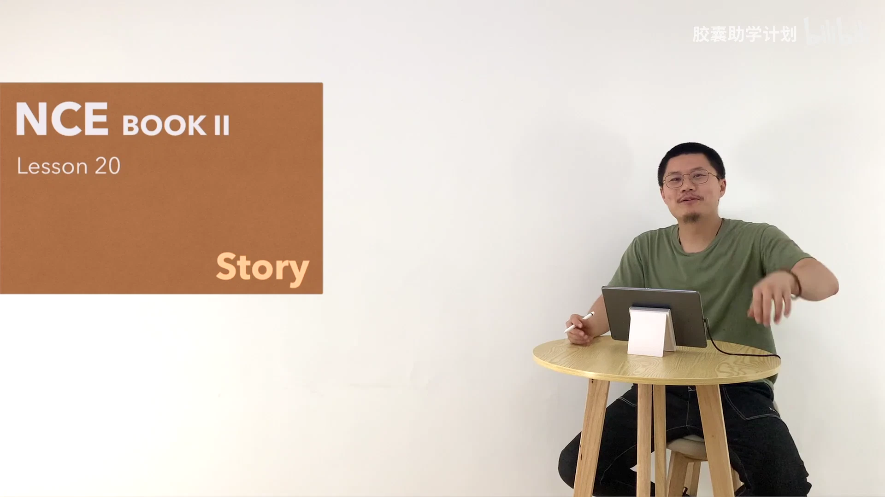

文字识别：胶囊助学计划 / NCE / BOOKⅡI / Lesson 20 / Story

### 画面 00:00:04

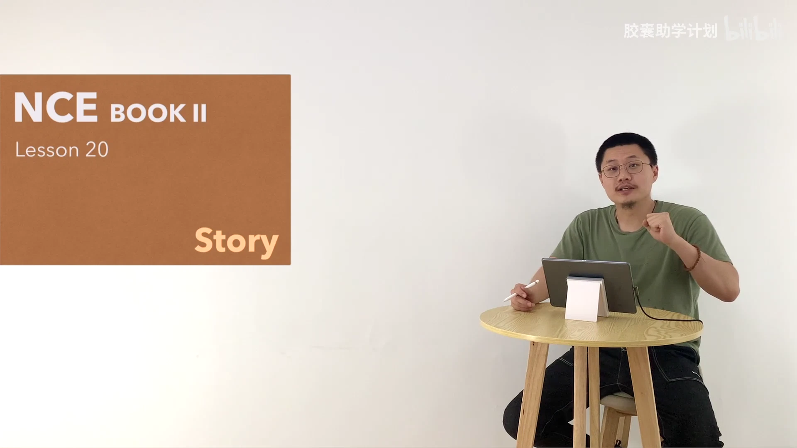

文字识别：胶囊助学计划 / NCE / BOOKⅡI / Lesson 20 / Story

### 画面 00:00:06

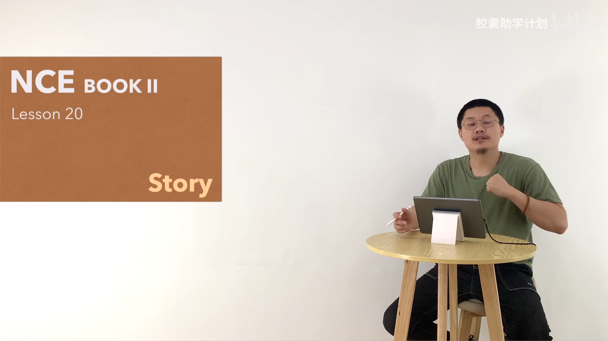

文字识别：胶囊助学计划 / NCE / BOOKⅡI / Lesson 20 / Story

### 画面 00:00:09

文字识别：胶囊助学计划bill / • / •

### 画面 00:00:12

文字识别：胶囊助学计划 / 胶囊助学计划

### 画面 00:00:14

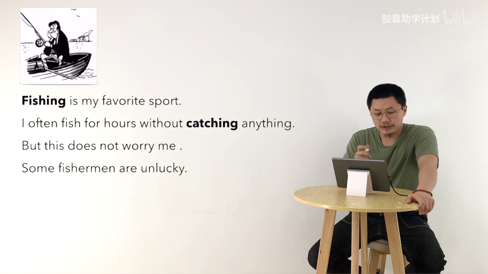

文字识别：胶囊助学计划 / Fishing is my favorite sport. / I often fish for hours without catching anything. / But this does not worry me . / Some fishermen are unlucky.

## 00:00:30–00:01:00

钓鱼，汉语当中它也是个名词，它不是个动词，对吧？呃，钓鱼是我非常喜欢的一个运动，处于一的位置，呃，平铺直叙，陈述客观事实，一般现在时。继续，I often fish for hours，我经常钓好几个小时的鱼。你看，这是一个陈述客观事实，一般现在时。Without catching anything，好，在这儿两个点，第一，without，你要知道后边加 without 介词，后边加动名词，对吧？Without doing something，而没有抓到

### 画面 00:00:44

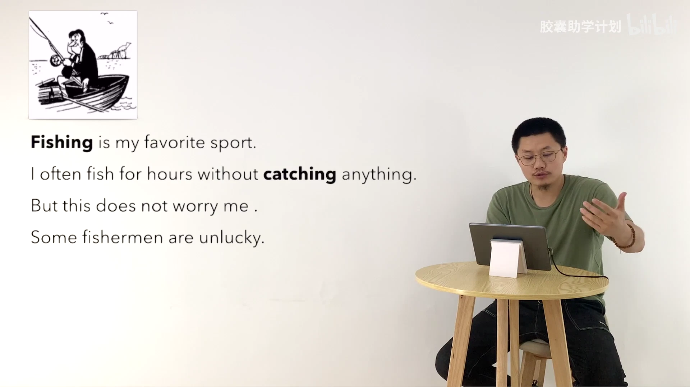

文字识别：胶囊助学计划 / Fishing is my favorite sport. / I often fish for hours without catching anything. / But this does not worry me . / Some fishermen are unlucky.

## 00:01:00–00:01:30

何东西。我经常钓好几个小时鱼，而啥也抓不着。But this does not worry me.心态很放松。说，但是这样，一点都不让我焦虑或者担心。哈，我一点也不难过。Some fishermen are unlucky.啊，他说，你看他接下来不说他自己了，他说别的这个钓鱼的人，说别的那些钓鱼的人呢，很不幸运，unlucky。回想一下，u n，这是我们慢慢会给大家补充的一

### 画面 00:01:14

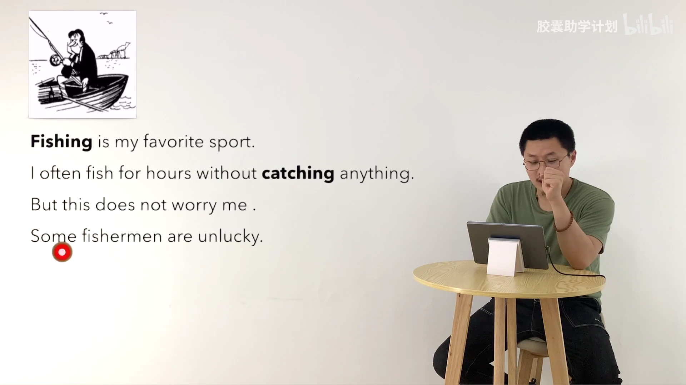

文字识别：胶囊助学计划 / Fishing is my favorite sport. / I often fish for hours without catching anything. / But this does not worry me . / Some fishermen are unlucky.

## 00:01:30–00:02:00

些东西，叫做呃，你可以围绕什么英文单词的前缀后缀这些东西，对吧？比如说 u n 放在前面，往往是一个否定。我们回顾几个小的单词，uncomfortable，unhappy，untidy，全是我们之前学过的，对吧？那 unlucky 叫不幸运。Instead of catching fish，好，这就出现了叫 instead of。首先注意 of 是介词，所以后面叫做 catching fish，而不是 catch fish，对

### 画面 00:01:41

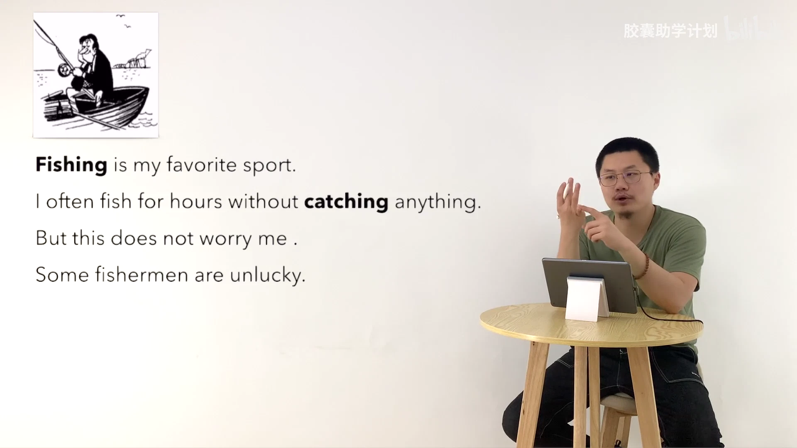

文字识别：胶囊助学计划 / Fishing is my favorite sport. / I often fish for hours without catching anything. / But this does not worry me . / Some fishermen are unlucky.

### 画面 00:01:47

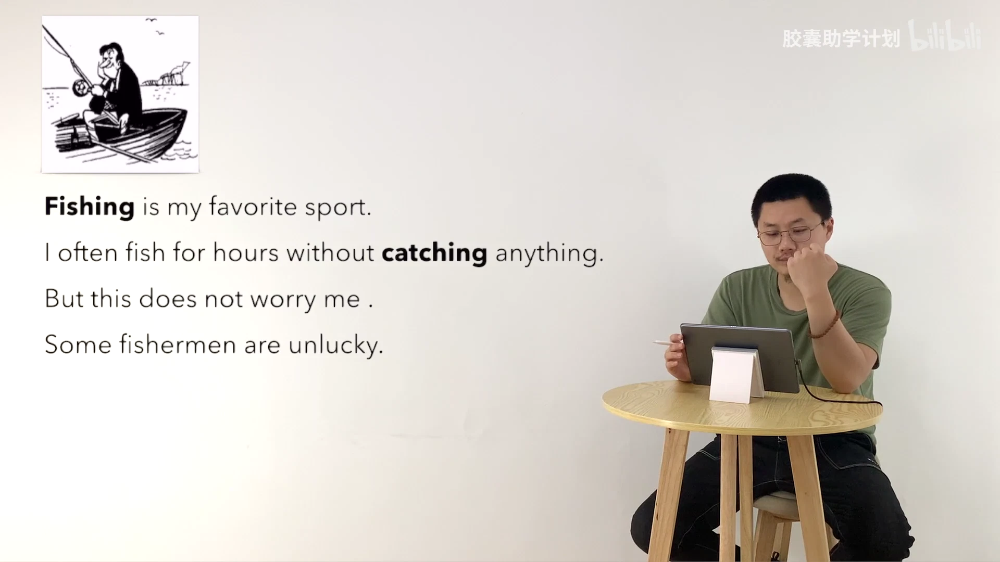

文字识别：胶囊助学计划 / Fishing is my favorite sport. / I often fish for hours without catching anything. / But this does not worry me . / Some fishermen are unlucky.

### 画面 00:01:49

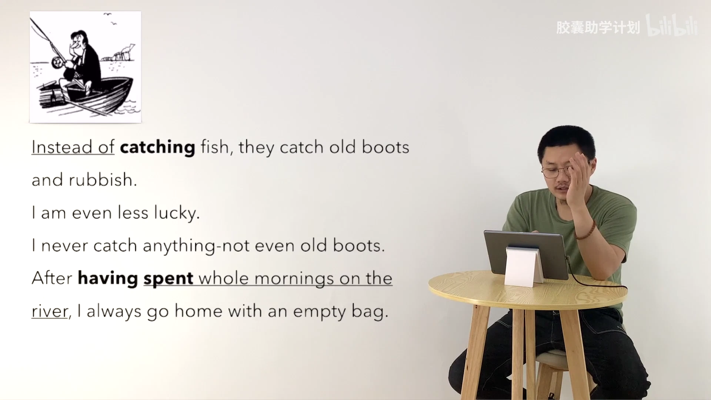

文字识别：胶囊助学计划 / Instead of catching fish, they catch old boots / and rubbish. / I am even less lucky. / I never catch anything-not even old boots. / After having spent whole mornings on the / river, I always go home with an empty bag.

## 00:02:00–00:02:30

吧？那instead of叫代替啊，就是代替抓到鱼。They catch old boots and rubbish啊，河被污染了。说他们抓到的是什么呢？旧靴子呀，啊，还是还好多是吧？以及垃圾。I'm even less lucky.说，我呀，甚至更加的不幸运啊，我的幸运指数比他们还要低。I never catch anything.我甚至就啥也没抓着过，就我连

### 画面 00:02:10

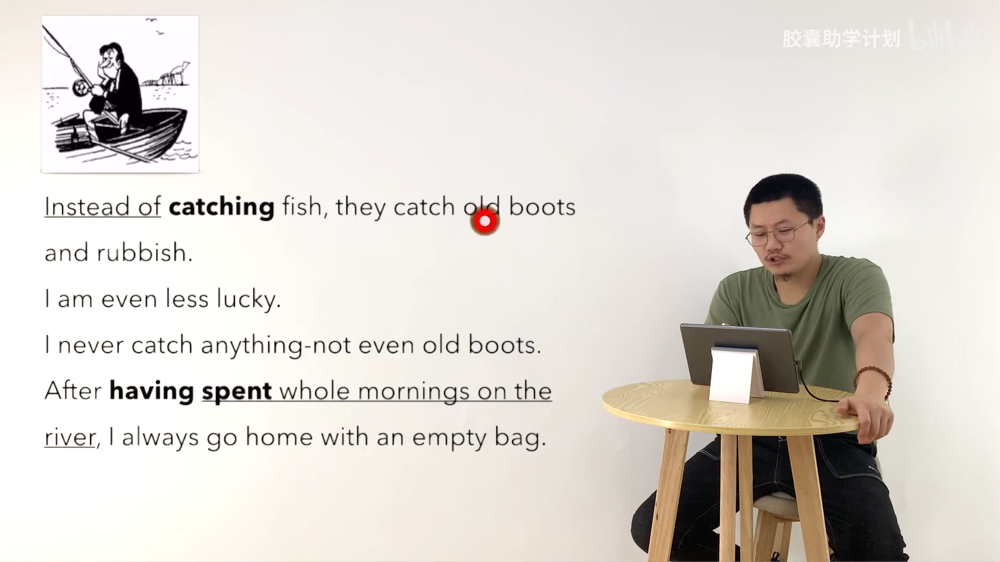

文字识别：胶囊助学计划 / Instead of catching fish, they catch old boots / and rubbish. / I am even less lucky. / I never catch anything-not even old boots. / After having spent whole mornings on the / river, I always go home with an empty bag.

### 画面 00:02:24

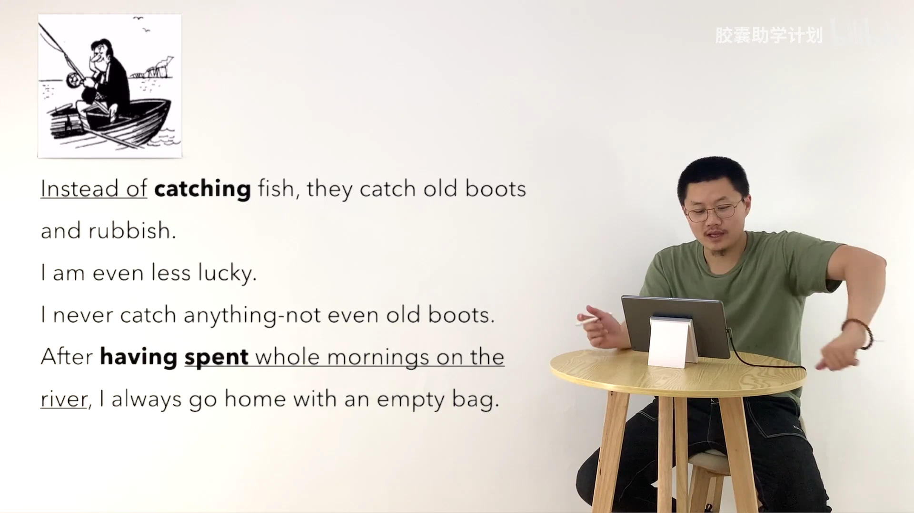

文字识别：胶囊助学计划 / Instead of catching fish, they catch old boots / and rubbish. / I am even less lucky. / I never catch anything-not even old boots. / After having spent whole mornings on the / river, I always go home with an empty bag.

## 00:02:30–00:03:00

旧靴子连垃圾都没钓上来过，not even old boots，甚至都没有旧靴子。OK，这就很有意思了。接下来，after叫在什么什么之后，having spent whole mornings on the river。好，我们先不管having啊，我们先看后面叫做spent whole morning on the river。我们在第三课，在寄明信片那课学过一句话，什么spend the whole day in my room，花了一

### 画面 00:02:33

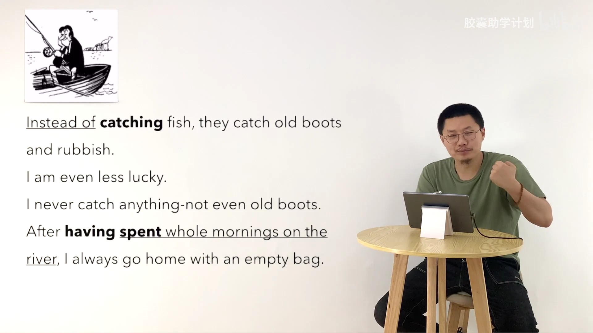

文字识别：胶囊助学计划 / Instead of catching fish, they catch old boots / and rubbish. / I am even less lucky. / I never catch anything-not even old boots. / After having spent whole mornings on the / river, I always go home with an empty bag.

### 画面 00:02:54

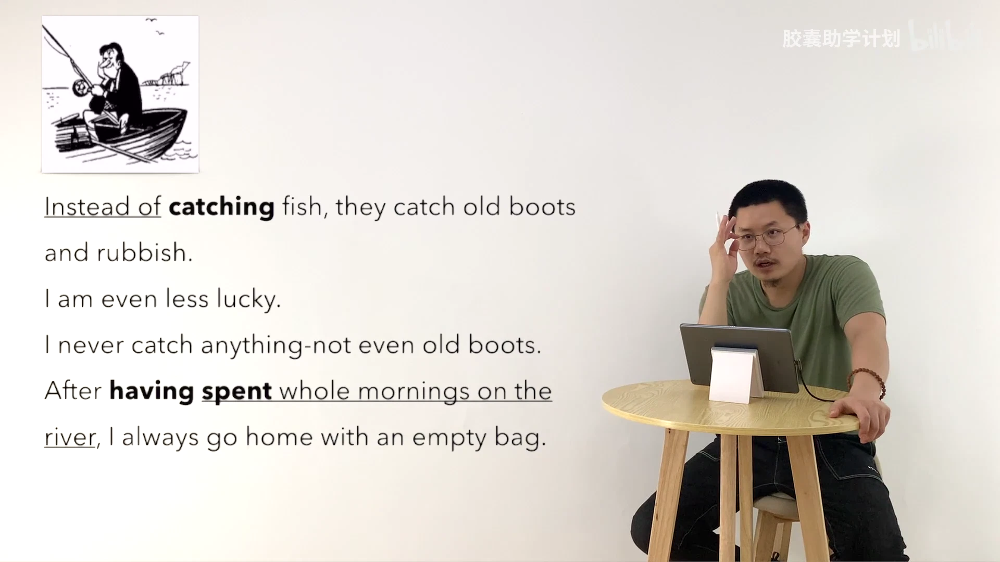

文字识别：胶囊助学计划 / Instead of catching fish, they catch old boots / and rubbish. / I am even less lucky. / I never catch anything-not even old boots. / After having spent whole mornings on the / river, I always go home with an empty bag.

## 00:03:00–00:03:30

整天的时间在我家里，叫spend some time somewhere，对吧？你看，这是一模一样的，叫花费了一整个数个早晨，对吧？在这个河上啊，还是这个不是岸边钓，坐着小船上去钓。好，这个语法我提一小句，今天我们先不学，我们应该是到四十九课那课，我们会去学。学完了，我们会回过头来再看一下这句话。但是目前为止，它并不影响我们理解。

### 画面 00:03:12

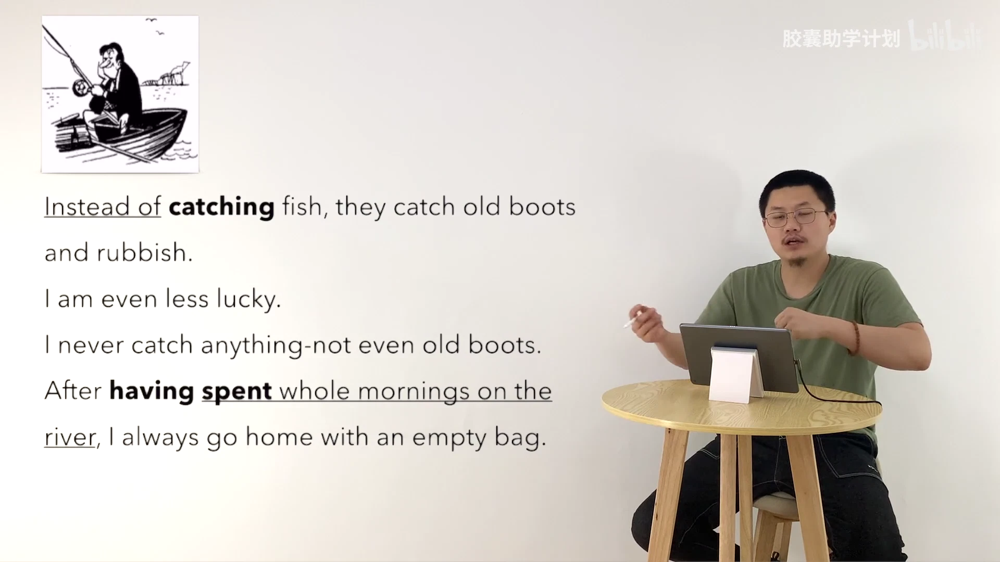

文字识别：胶囊助学计划 / Instead of catching fish, they catch old boots / and rubbish. / I am even less lucky. / I never catch anything-not even old boots. / After having spent whole mornings on the / river, I always go home with an empty bag.

## 00:03:30–00:04:00

我们的理解就是先把 having 直接删掉，叫做在花费了数个早晨，对吧？很多个早晨，在合上之后呢， I always go home. 我总是回家 with an empty bag. 带着一个空的包，就啥也没钓着嘛，对吧？ Continuing, you must give up fishing. 好，give up doing something. 这是我们本课的习惯用法。一会儿给大家去造句，叫做放弃做某件事情。你必须要放弃钓鱼了。 My friend

### 画面 00:03:42

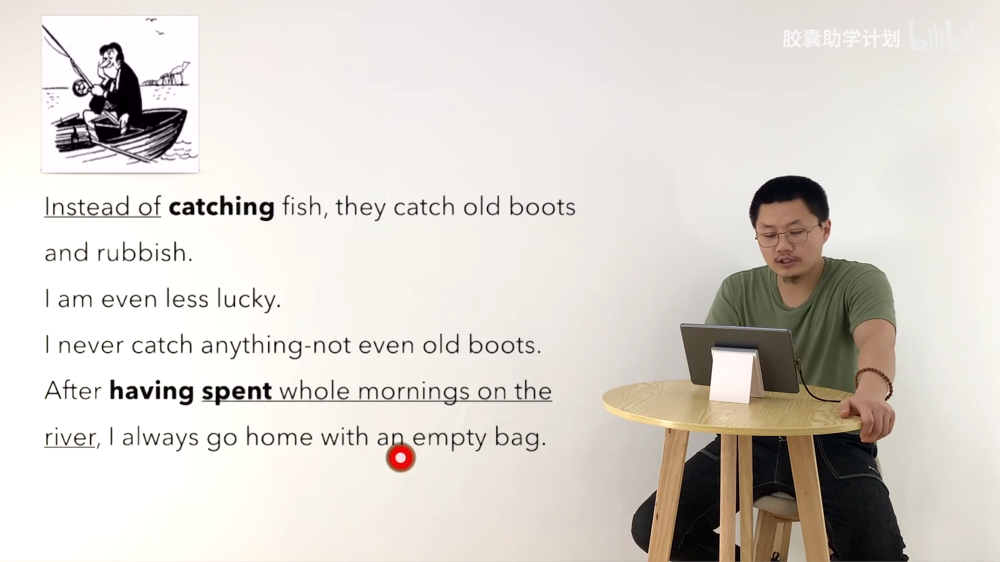

文字识别：胶囊助学计划 / Instead of catching fish, they catch old boots / and rubbish. / I am even less lucky. / I never catch anything-not even old boots. / After having spent whole mornings on the / river, I always go home with an empty bag.

### 画面 00:03:46

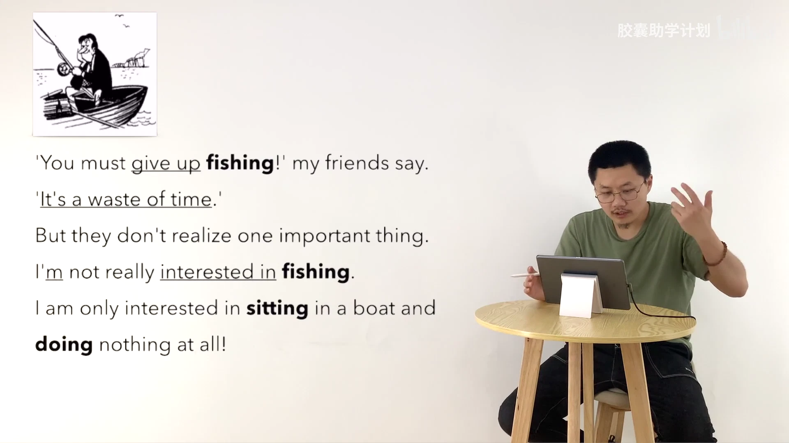

文字识别：胶囊助学计划 / 'You must give up fishing!' my friends say. / 't's a waste of time.' / But they don't realize one important thing. / I'm not really interested in fishing. / I am only interested in sitting in a boat and / doing nothing at all!

### 画面 00:03:52

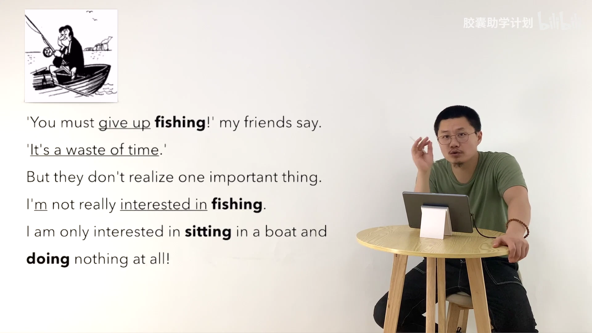

文字识别：胶囊助学计划 / 'You must give up fishing!' my friends say. / 'lt's a waste of time.' / But they don't realize one important thing. / I'm not really interested in fishing. / I am only interested in sitting in a boat and / doing nothing at all!

## 00:04:00–00:04:30

say 我朋友说 is a waste of time. 你这就浪费时间嘛。单词部分我们讲过了，您直接当一个短语去记就可以了啊。浪费时间。但是 they don't realize one important thing. 但是他们没有意识到一个非常重要的事情。听是什么？I'm not really interested in fishing. 好，首先 in 介词后边加 fishing。那我们可以换另一个思路，就是 be I'm is are 的 be

### 画面 00:04:22

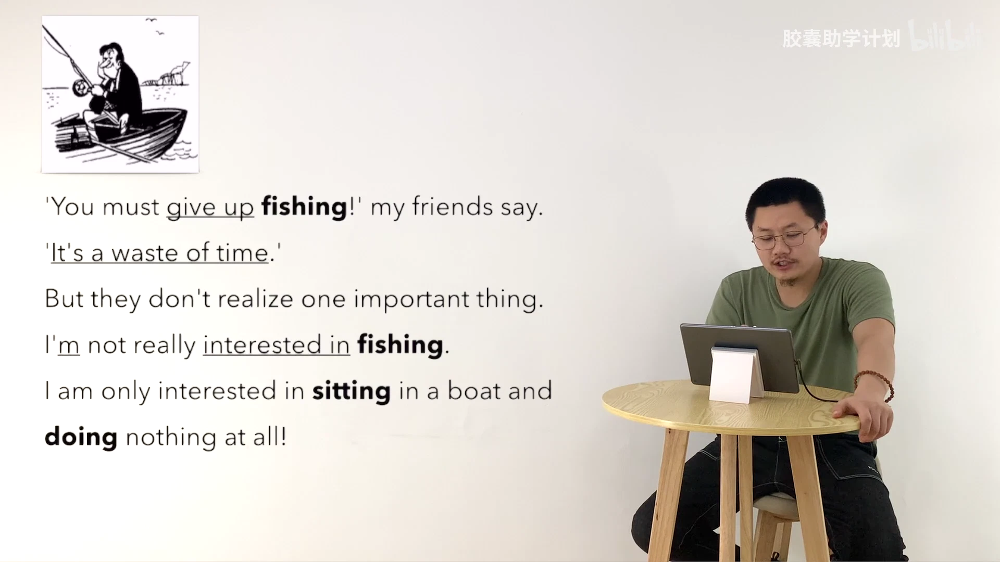

文字识别：胶囊助学计划 / 'You must give up fishing!' my friends say. / 'lt's a waste of time.' / But they don't realize one important thing. / I'm not really interested in fishing. / I am only interested in sitting in a boat and / doing nothing at all!

## 00:04:30–00:05:00

对吧？Interested in doing something，这是我们本课学到的一个习惯用法，叫做对什么什么感兴趣。比如说，我对学习英语感兴趣，那叫做I am interested in learning English。注意不能是learn English，要是learning English。OK，说我并不是对钓鱼感兴趣，I'm only interested in sitting in a boat。说我仅仅是对什么感兴趣呢？

### 画面 00:04:46

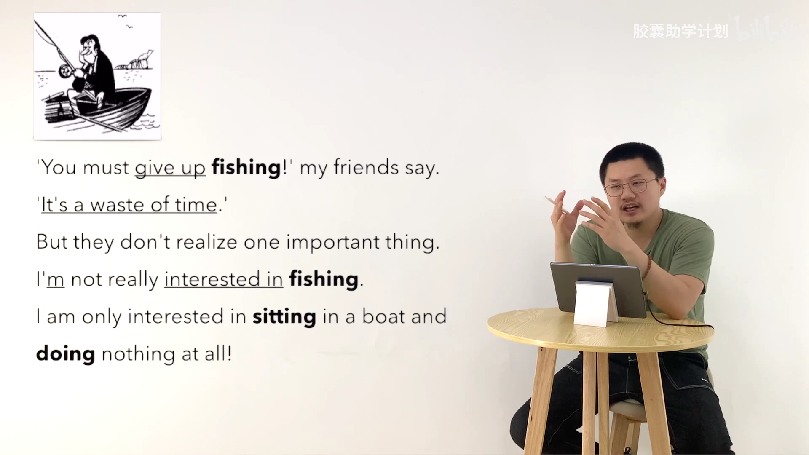

文字识别：胶囊助学计划 / 'You must give up fishing!' my friends say. / 'It's a waste of time.' / But they don't realize one important thing. / I'm not really interested in fishing. / I am only interested in sitting in a boat and / doing nothing at all!

### 画面 00:04:54

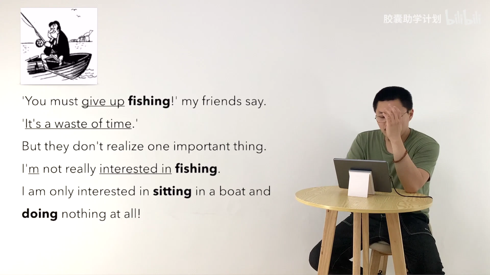

文字识别：胶囊助学计划 / 'You must give up fishing!' my friends say. / 'lt's a waste of time.' / But they don't realize one important thing. / I'm not really interested in fishing. / I am only interested in sitting in a boat and / doing nothing at all!

## 00:05:00–00:05:30

Sitting，看见了吧？坐在船里，and doing nothing at all，然后啥也不用做啊，对吧？这个家务劳动、家务活动，什么都不用做，是吧？啊，我仅仅是对坐在船里和啥都不做这件事儿是感兴趣的。OK，好，那本课的习惯用法，我们接下来一起看一下。第一个，instead of doing something叫代替做某件事情来了啊。Instead of asking for a lift，

### 画面 00:05:18

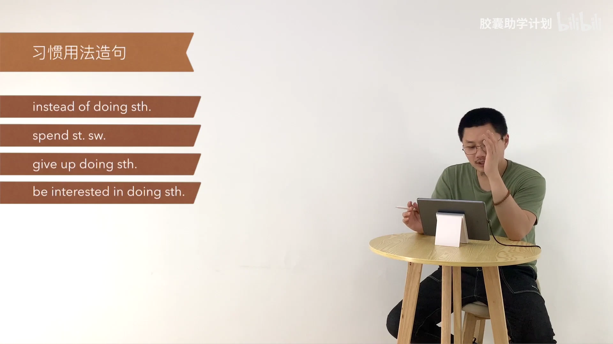

文字识别：胶囊助学计划 / 习惯用法造句 / instead of doing sth. / spend / st.sw. / give up doing sth. / be interested in doing sth.

### 画面 00:05:20

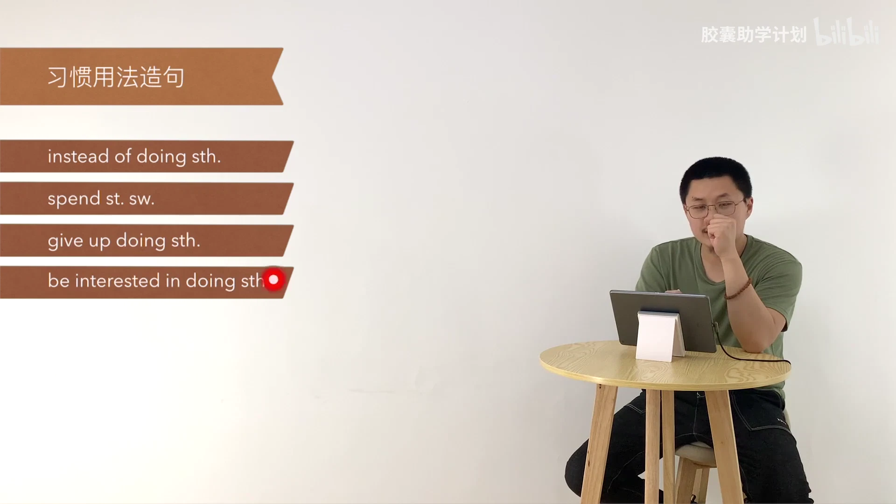

文字识别：胶囊助学计划 / 习惯用法造句 / instead of doing / ysth. / spend / st.sw. / give up doing sth. / be interested in doing sth

### 画面 00:05:22

文字识别：网：v.+v.变化 / 习惯用法造句指南 / 胶囊助学计划 / 四句型转换 / 方式/地点/时间 / 其他习惯用法 / 其他单词+词性 / 原文摘抄+变 / 6123456 / instead of doing sth.

### 画面 00:05:24

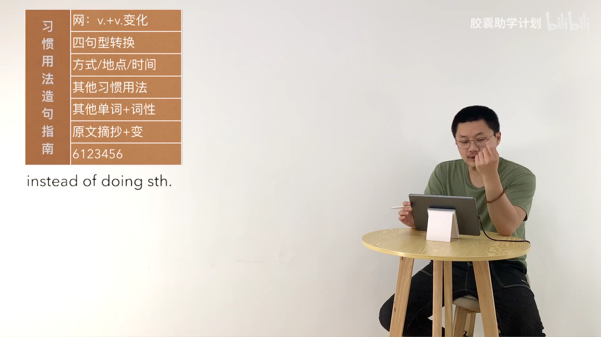

文字识别：网：v.+v.变化 / 习惯用法造句指南 / 胶囊助学计划 / 四句型转换 / 方式/地点/时间 / 其他习惯用法 / 其他单词+词性 / 原文摘抄+变 / 6123456 / instead of doing sth.

### 画面 00:05:26

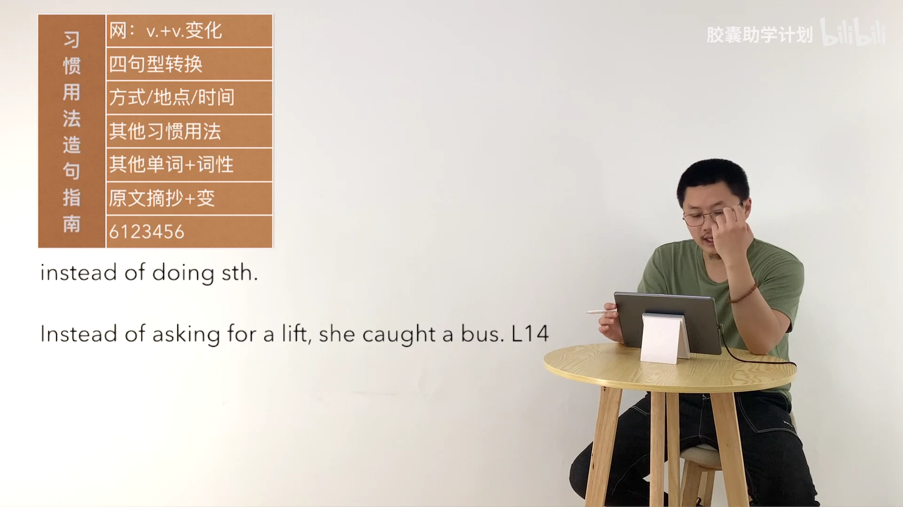

文字识别：网：v.+v.变化 / 习惯用法造句指南 / 胶囊助学计划 / 四句型转换 / 方式/地点/时间 / 其他习惯用法 / 其他单词+词性 / 原文摘抄+变 / 6123456 / instead of doing sth. / Instead of asking for a lift, she caught a bus. L14

### 画面 00:05:28

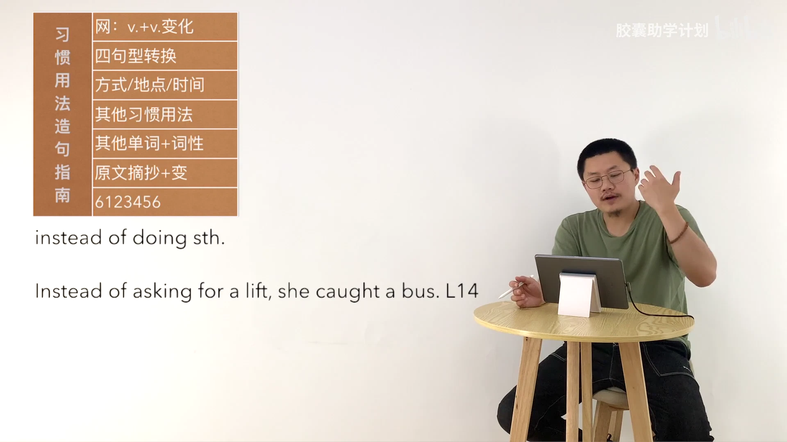

文字识别：网：v.+v.变化 / 习惯用法造句指南 / 胶囊助学计划 / 四句型转换 / 方式/地点/时间 / 其他习惯用法 / 其他单词+词性 / 原文摘抄+变 / 6123456 / instead of doing sth. / Instead of asking for a lift, she caught a bus. L14

## 00:05:30–00:06:00

十四个学的, she caught a bus. 啊, 说代替去搭便车, 他呢实际上坐上了公交车。再来, instead of replying the letter, 哎, 代替回这个消息, 回一封信, 他直接人就来了. He visited us. 他直接就来拜访我们了。再来, instead of leaving a note, 说代替什么事情呢? Leave a note, 代替

### 画面 00:05:30

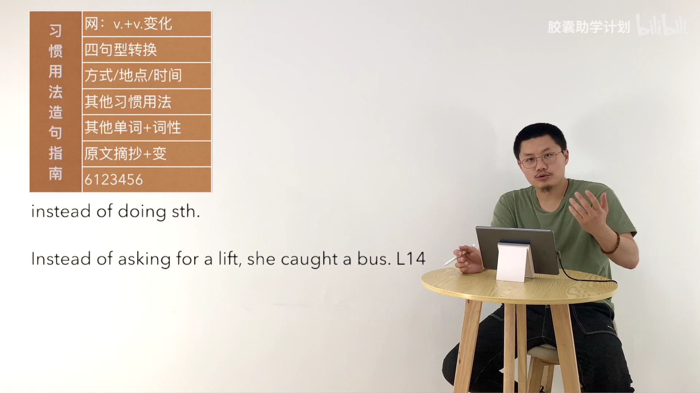

文字识别：网：v.+v.变化 / 习惯用法造句指南 / 胶囊助学计划 / 四句型转换 / 方式/地点/时间 / 其他习惯用法 / 其他单词+词性 / 原文摘抄+变 / 6123456 / instead of doing sth. / Instead of asking for a lift, she caught a bus. L14

### 画面 00:05:35

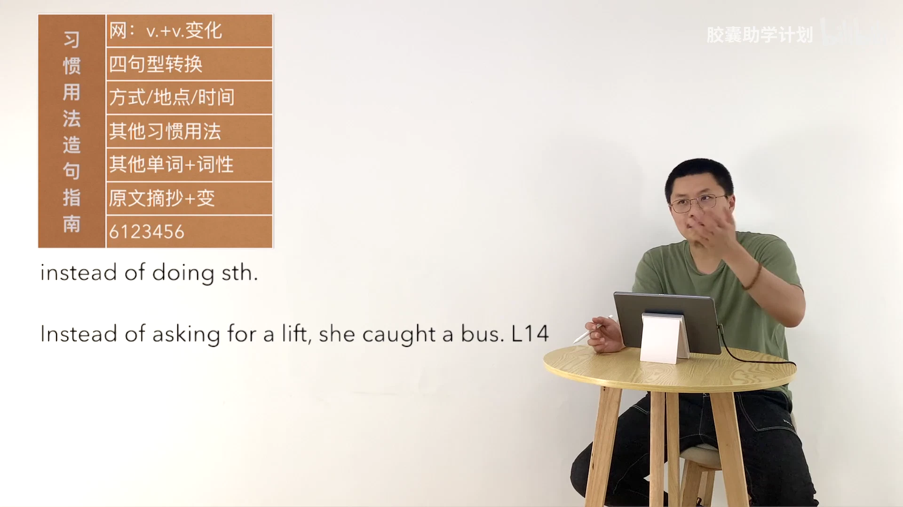

文字识别：网：v.+v.变化 / 习惯用法造句指南 / 胶囊助学计划 / 四句型转换 / 方式/地点/时间 / 其他习惯用法 / 其他单词+词性 / 原文摘抄+变 / 6123456 / instead of doing sth. / Instead of asking for a lift, she caught a bus. L14

### 画面 00:05:38

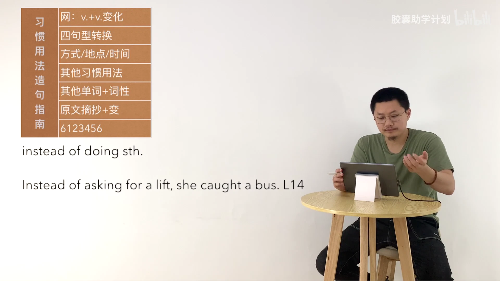

文字识别：网：v.+v.变化 / 习惯用法造句指南 / 胶囊助学计划 / 四句型转换 / 方式/地点/时间 / 其他习惯用法 / 其他单词+词性 / 原文摘抄+变 / 6123456 / instead of doing sth. / Instead of asking for a lift, she caught a bus. L14

### 画面 00:05:40

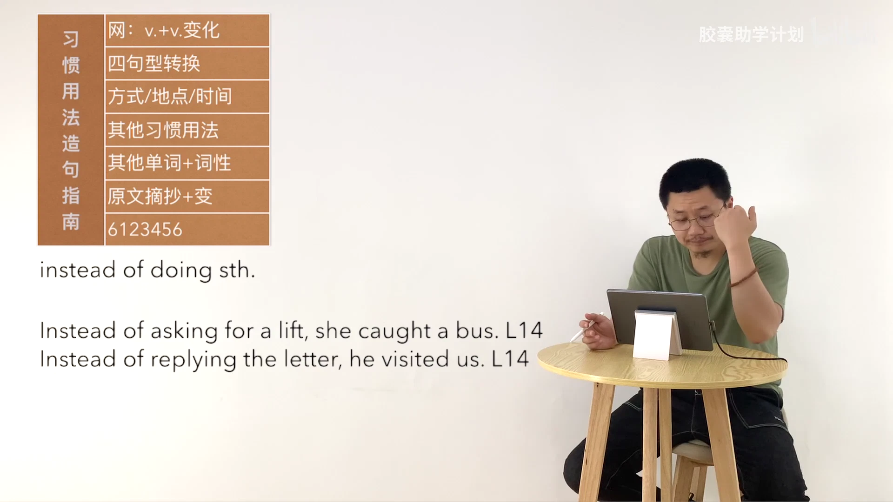

文字识别：网：v.+v.变化 / 习惯用法造句指南 / 胶囊助学计划 / 四句型转换 / 方式/地点/时间 / 其他习惯用法 / 其他单词+词性 / 原文摘抄+变 / 6123456 / instead of doing sth. / Instead of asking for a lift, she caught a bus. L14 / Instead of replying the letter, he visited us. L14

### 画面 00:05:42

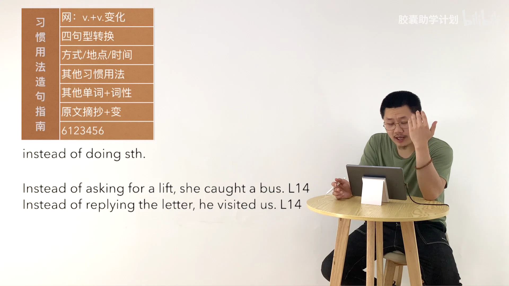

文字识别：习惯用法造句指南 / 网：v.+v.变化 / 胶囊助学计划 / 四句型转换 / 方式/地点/时间 / 其他习惯用法 / 其他单词+词性 / 原文摘抄+变 / 6123456 / instead of doing sth. / Instead of asking for a lift, she caught a bus. L14 / Instead of replying the letter, he visited us. L14

### 画面 00:05:45

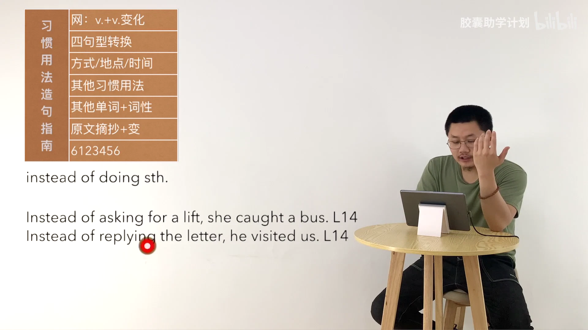

文字识别：习惯用法造句指南 / 网：v.+v.变化 / 胶囊助学计划 / 四句型转换 / 方式/地点/时间 / 其他习惯用法 / 其他单词+词性 / 原文摘抄+变 / 6123456 / instead of doing sth. / Instead of asking for a lift, she caught a bus. L14 / Instead of replyingt / the letter, he visited us. L14

### 画面 00:05:50

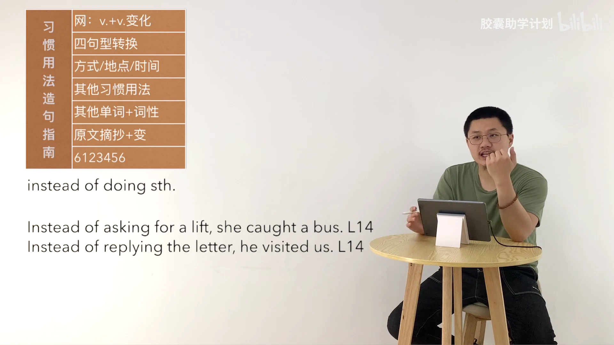

文字识别：网：v.+v.变化 / 习惯用法造句指南 / 胶囊助学计划 / 四句型转换 / 方式/地点/时间 / 其他习惯用法 / 其他单词+词性 / 原文摘抄+变 / 6123456 / instead of doing sth. / Instead of asking for a lift, she caught a bus. L14 / Instead of replying the letter, he visited us. L14

### 画面 00:05:53

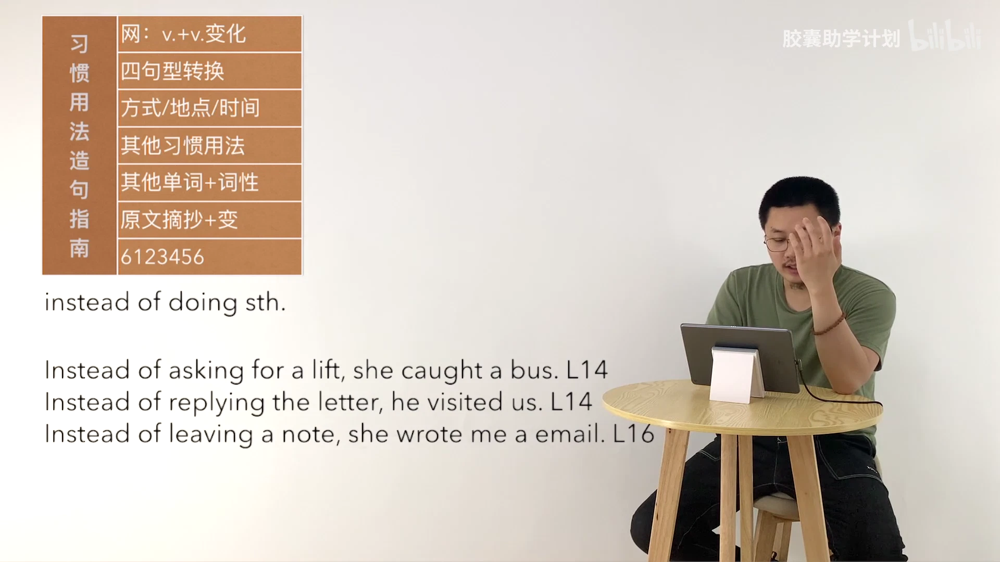

文字识别：网：v.+v.变化 / 习惯用法造句指南 / 胶囊助学计划 / 四句型转换 / 方式/地点/时间 / 其他习惯用法 / 其他单词+词性 / 原文摘抄+变 / 6123456 / instead of doing sth. / Instead of asking for a lift, she caught a bus. L14 / Instead of replying the letter, he visited us. L14 / Instead of leaving a note, she wrote me a email. L16

### 画面 00:05:55

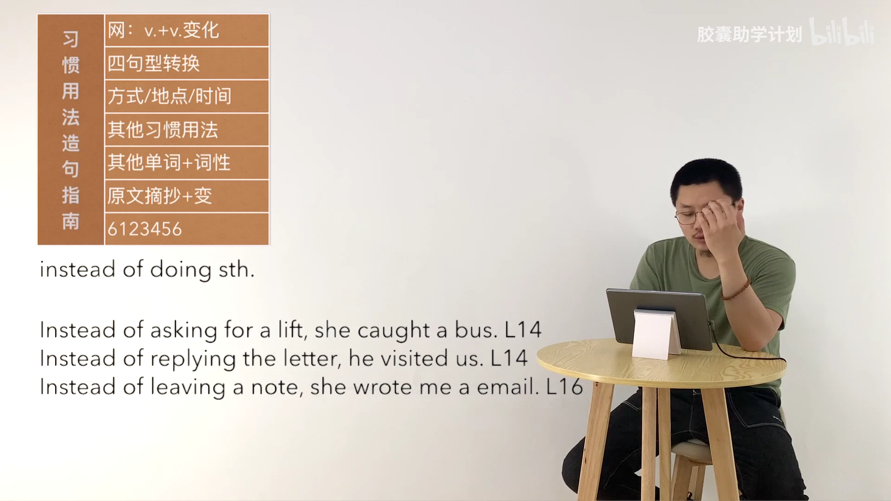

文字识别：习惯用法造句指南 / 网：v.+v.变化 / 胶囊助学计划 / 四句型转换 / 方式/地点/时间 / 其他习惯用法 / 其他单词+词性 / 原文摘抄+变 / 6123456 / instead of doing sth. / Instead of asking for a lift, she caught a bus. L14 / Instead of replying the letter, he visited us. L14 / Instead of leaving a note, she wrote me a email. L16

## 00:06:00–00:06:30

这个留一个便签儿. She wrote me an email. Okay, sorry,这个地方应该是an email啊,一一对吧? An email.啊，这地方有一个小的title，它代替留这个代替留一个便签儿，她给我们写了一个邮件. There you go.接下来呢，我们看一个小电影片段，出现了叫instead of doing what was right，代替去做那些正确的事情。我做了什么样的事情呢？看一下. And we got

### 画面 00:06:00

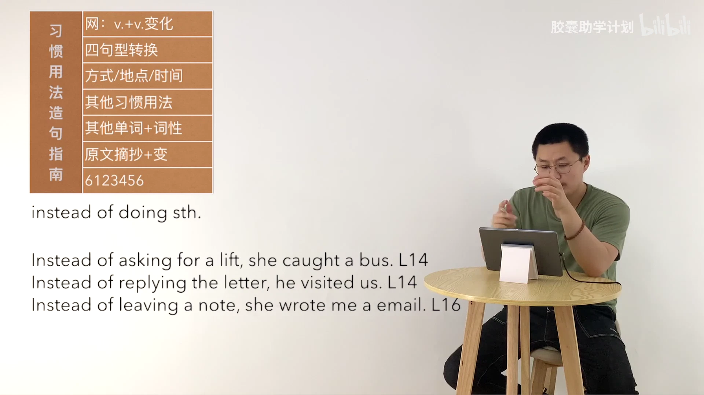

文字识别：网：v.+v.变化 / 习惯用法造句指南 / 胶囊助学计划 / 四句型转换 / 方式/地点/时间 / 其他习惯用法 / 其他单词+词性 / 原文摘抄+变 / 6123456 / instead of doing sth. / Instead of asking for a lift, she caught a bus. L14 / Instead of replying the letter, he visited us. L14 / Instead of leaving a note, she wrote me a email. L16

### 画面 00:06:05

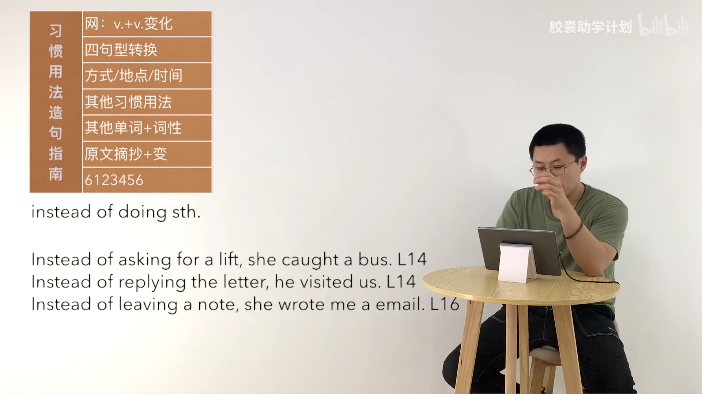

文字识别：习惯用法造句指南 / 网：v.+v.变化 / 胶囊助学计划 / 四句型转换 / 方式/地点/时间 / 其他习惯用法 / 其他单词+词性 / 原文摘抄+变 / 6123456 / instead of doing sth. / Instead of asking for a lift, she caught a bus. L14 / Instead of replying the letter, he visited us. L14 / Instead of leaving a note, she wrote me a email. L16

### 画面 00:06:10

文字识别：习惯用法造句指南 / 网：v.+v.变化 / 胶囊助学计划 / 四句型转换 / 方式/地点/时间 / 其他习惯用法 / 其他单词+词性 / 原文摘抄+变 / 6123456 / instead of doing sth. / Instead of asking for a lift, she caught a bus. L14 / Instead of replying the letter, he visited us. L14 / Instead of leaving a note, she wrote me a email. L16

### 画面 00:06:15

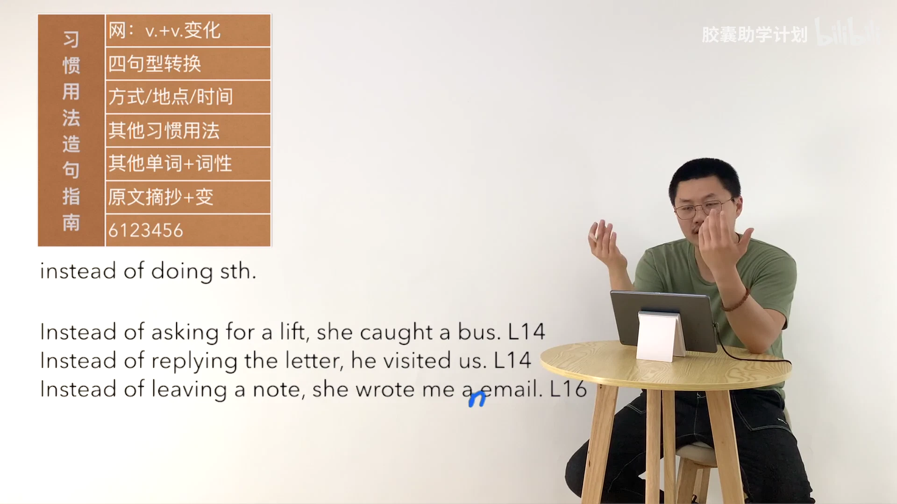

文字识别：网：v.+v.变化 / 习惯用法造句指南 / 胶囊助学计划 / 四句型转换 / 方式/地点/时间 / 其他习惯用法 / 其他单词+词性 / 原文摘抄+变 / 6123456 / instead of doing sth. / Instead of asking for a lift, she caught a bus. L14 / Instead of replying the letter, he visited us. L14 / Instead of leaving a note, she wrote me a email. L16

### 画面 00:06:17

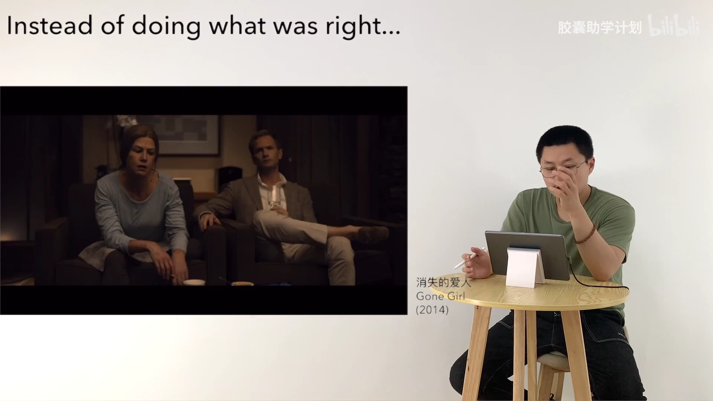

文字识别：Instead of doing what was right.. / 胶囊助学计划 / 消失的爱人 / Gone Girl / (2014)

### 画面 00:06:22

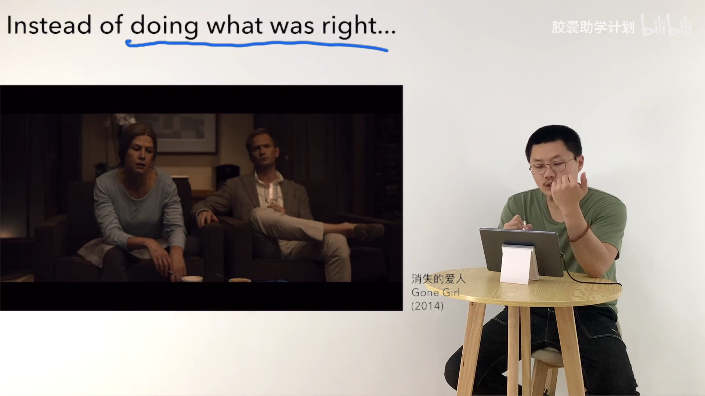

文字识别：Instead of doing what was right. / 胶囊助学计划 / 消失的爱人 / Gone Girl / (2014)

### 画面 00:06:29

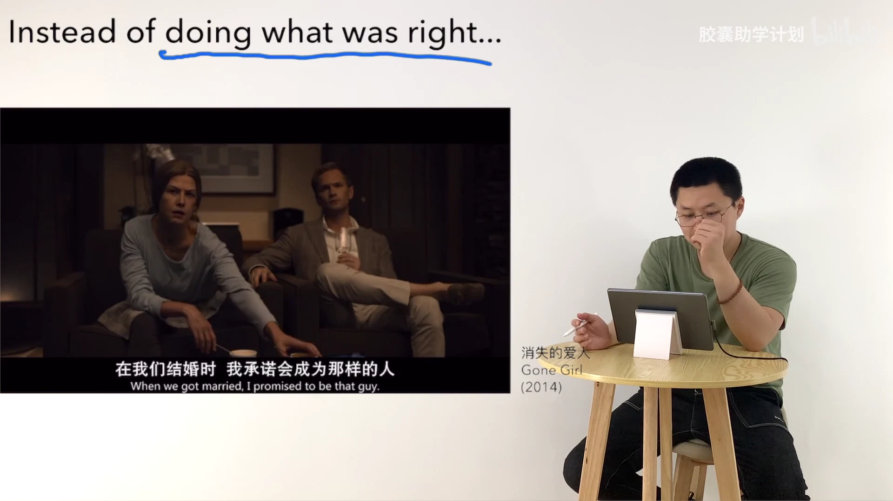

文字识别：Instead of doing what was right... / 胶囊助学计划 / 消失的爱人 / 在我们结婚时我承诺会成为那样的人 / Gone Girl / When we got married, I promised to be that guy. / (2014)

## 00:06:30–00:07:00

married, I promised to be that guy, that guy who works harder, that guy who who lives and acts and loves with as much passion as she does. But I failed her. Instead of doing what was right, did what was easy. Okay, instead of doing what was right, I doing something easy,对吧？Okay,我做了做应该做正确的事情，但我做的是容易的事情。好，接下来 spend some time somewhere，

### 画面 00:06:31

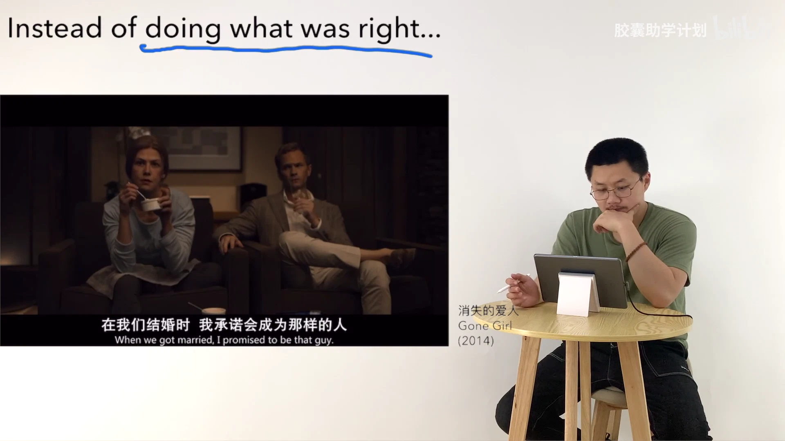

文字识别：Instead of doing what was right.. / 胶囊助学计划 / 消失的爱人 / 在我们结婚时我承诺会成为那样的人 / Gone Girl / When we got married, I promised to be that guy. / (2014)

### 画面 00:06:33

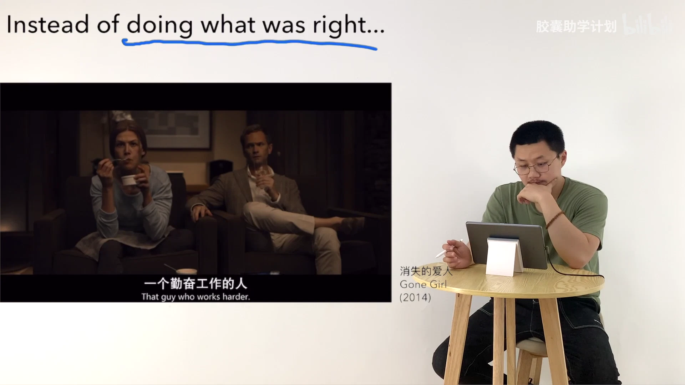

文字识别： Instead of doing what was right.. / 胶囊助学计划 / 消失的爱人 / 一个勤奋工作的人 / Gone Girl / That guy who works harder. / (2014)

### 画面 00:06:36

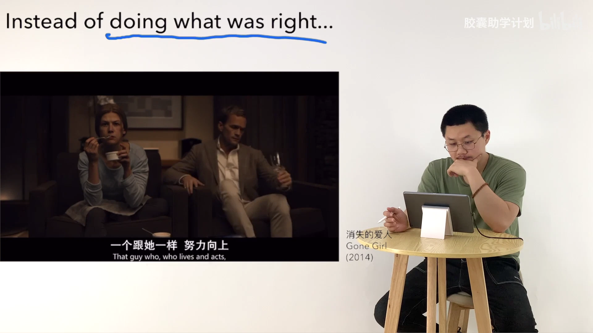

文字识别：Instead of doing what was right.. / 胶囊助学计划 / 消失的爱人 / 一个跟她一样努力向上 / Gone Girl / That guy who, who lives and acts, / (2014)

### 画面 00:06:38

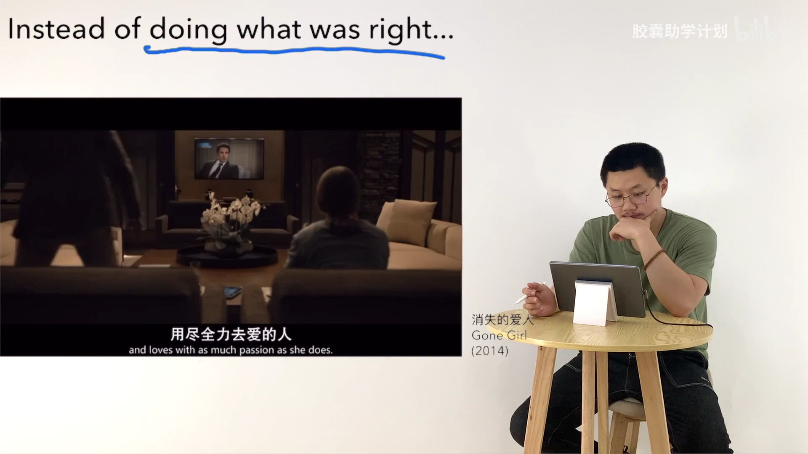

文字识别：Instead of doing what was right.. / 胶囊助学计划 / 消失的爱人 / 用尽全力去爱的人 / Gone Girl / and loves with as much passion as she does. / (2014)

### 画面 00:06:40

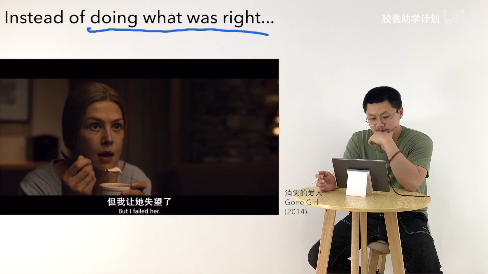

文字识别：Instead of doing what was right.. / 胶囊助学计划 / 消失的爱人 / 但我让她失望了 / Gone Girl / But I failed her. / (2014)

### 画面 00:06:42

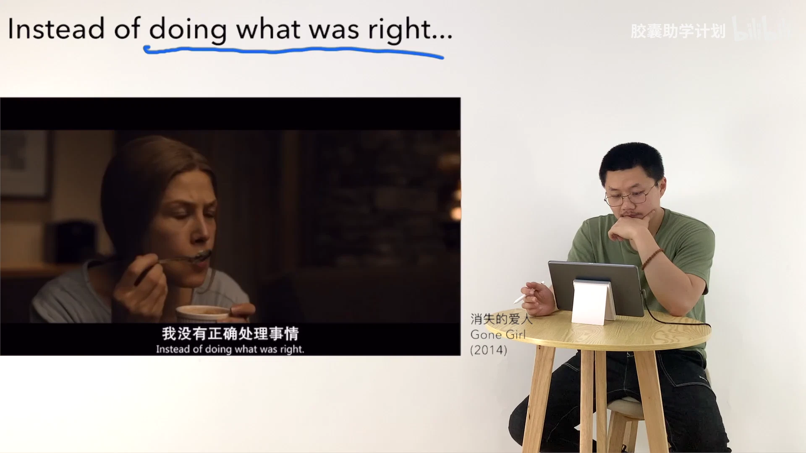

文字识别： Instead of doing what was right.. / 胶囊助学计划 / 消失的爱人 / 我没有正确处理事情 / Gone Girl / Instead of doing what was right. / (2014)

### 画面 00:06:44

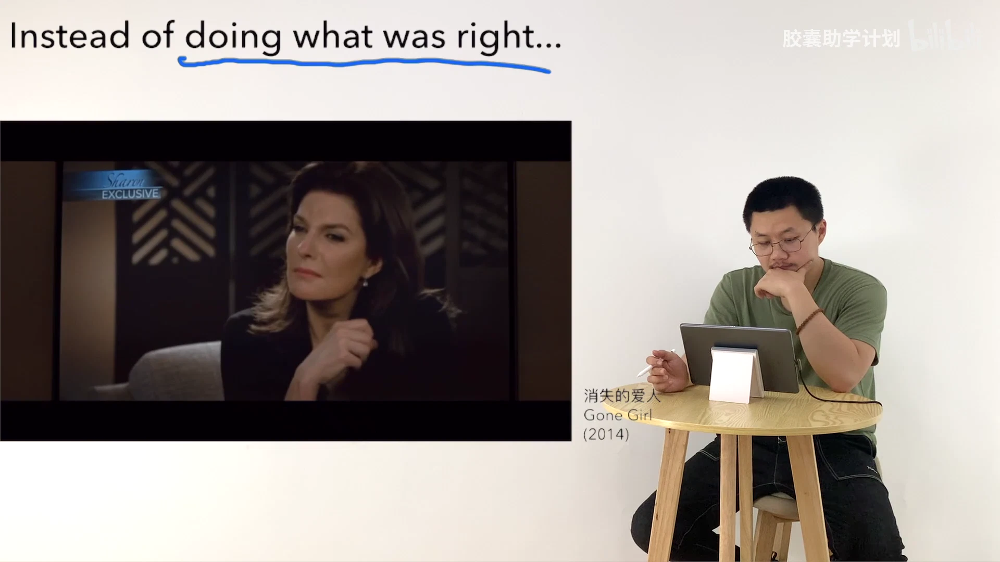

文字识别： Instead of doing what was right.. / 胶囊助学计划 / EXCLUSIVE / 消失的爱人 / Gone Girl / (2014)

### 画面 00:06:46

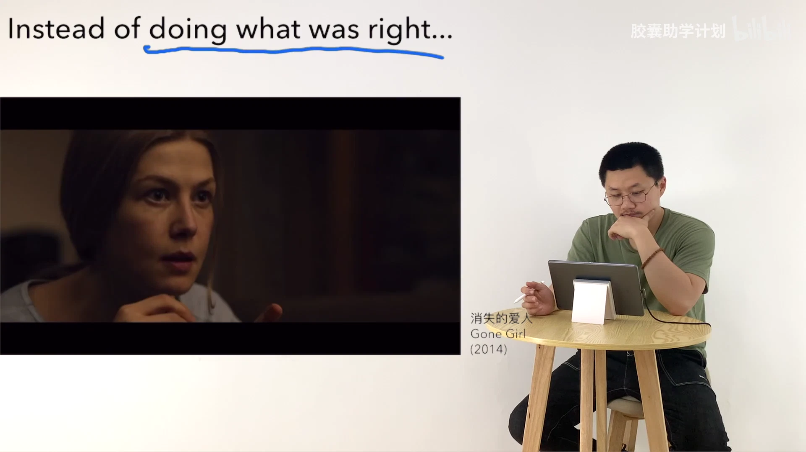

文字识别：Instead of doing what was right.. / 胶囊助学计划 / 消失的爱人 / Gone Girl / (2014)

### 画面 00:06:48

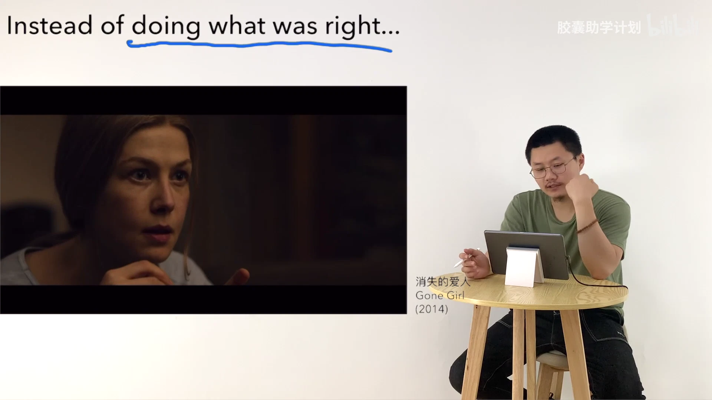

文字识别：Instead of doing what was right.. / 胶囊助学计划 / 消失的爱人 / Gone Girl / (2014)

### 画面 00:06:50

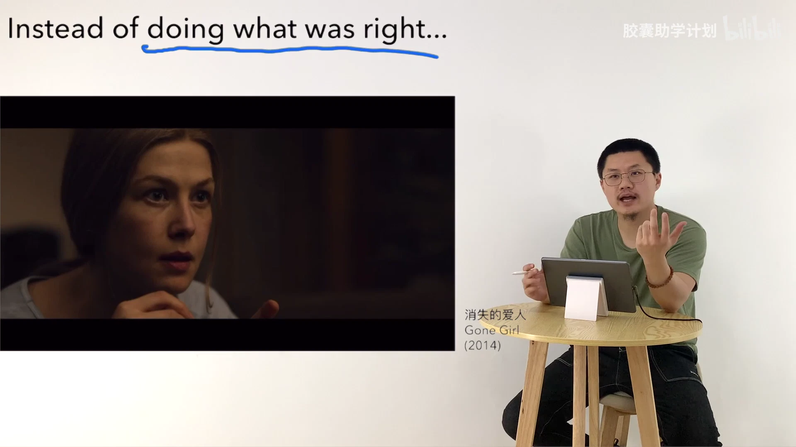

文字识别： Instead of doing what was right. / 胶囊助学计划 / 消失的爱人 / Gone Girl / (2014)

### 画面 00:06:53

文字识别：网：v.+v.变化 / 习惯用法造句指南 / 胶囊助学计划 / 四句型转换 / 方式/地点/时间 / 其他习惯用法 / 其他单词+词性 / 原文摘抄+变 / 6123456 / spend st. sw.

### 画面 00:06:55

文字识别：网：v.+v.变化 / 习惯用法造句指南 / 胶囊助学计划 / 四句型转换 / 方式/地点/时间 / 其他习惯用法 / 其他单词+词性 / 原文摘抄+变 / 6123456 / spend st. sw.

### 画面 00:06:57

文字识别：习惯用法造句指南 / 网：v.+v.变化 / 胶囊助学计划 / 四句型转换 / 方式/地点/时间 / 其他习惯用法 / 其他单词+词性 / 原文摘抄+变 / 6123456 / spend st. sw.

### 画面 00:06:59

文字识别：网：v.+v.变化 / 习惯用法造句指南 / 胶囊助学计划 / 四句型转换 / 方式/地点/时间 / 其他习惯用法 / 其他单词+词性 / 原文摘抄+变 / 6123456 / spend st. sw.

## 00:07:00–00:07:30

这个我们之前学过，今天迅速再过一遍啊。来了，I spent almost three years in Auckland. They spent the whole summer on the beach. Beach,沙滩. He spent all week in his room and played jazz. 你看 play jazz. 第十课习惯用法，对吧？对于各位来说，现在这些造句应该是比较简单了。好，下一个 give up doing something 叫做放弃做某件事情啊。

### 画面 00:07:01

文字识别：习惯用法造句指南 / 网：v.+v.变化 / 胶囊助学计划 / 四句型转换 / 方式/地点/时间 / 其他习惯用法 / 其他单词+词性 / 原文摘抄+变 / 6123456 / spend st. sw.

### 画面 00:07:03

文字识别：网：v.+v.变化 / 习惯用法造句指南 / 胶囊助学计划 / 四句型转换 / 方式/地点/时间 / 其他习惯用法 / 其他单词+词性 / 原文摘抄+变 / 6123456 / spend st. sw. / I spent almost 3 years in Auckland.

### 画面 00:07:05

文字识别：网：v.+v.变化 / 习惯用法造句指南 / 胶囊助学计划 / 四句型转换 / 方式/地点/时间 / 其他习惯用法 / 其他单词+词性 / 原文摘抄+变 / 6123456 / spend st. sw. / I spent almost 3 years in Auckland.

### 画面 00:07:08

文字识别：习惯用法造句指南 / 网：v.+v.变化 / 胶囊助学计划 / 四句型转换 / 方式/地点/时间 / 其他习惯用法 / 其他单词+词性 / 原文摘抄+变 / 6123456 / spend st. sw. / I spent almost 3 years in Auckland. / They spent the whole summer on the beach.

### 画面 00:07:10

文字识别：网：v.+v.变化 / 习惯用法造句指南 / 胶囊助学计划 / 四句型转换 / 方式/地点/时间 / 其他习惯用法 / 其他单词+词性 / 原文摘抄+变 / 6123456 / spend st. sw. / I spent almost 3 years in Auckland. / They spent the whole summer on the beach.

### 画面 00:07:13

文字识别：网：v.+v.变化 / 习惯用法造句指南 / 胶囊助学计划 / 四句型转换 / 方式/地点/时间 / 其他习惯用法 / 其他单词+词性 / 原文摘抄+变 / 6123456 / spend st. sw. / I spent almost 3 years in Auckland. / They spent the whole summer on the beach. / He spent all week in his room, and played / jazz.L10

### 画面 00:07:15

文字识别：网：v.+v.变化 / 习惯用法造句指南 / 胶囊助学计划 / 四句型转换 / 方式/地点/时间 / 其他习惯用法 / 其他单词+词性 / 原文摘抄+变 / 6123456 / spend st. sw. / I spent almost 3 years in Auckland. / They spent the whole summer on the beach. / He spent all week in his room, and played / jazz.L10

### 画面 00:07:18

文字识别：网：v.+v.变化 / 习惯用法造句指南 / 胶囊助学计划 / 四句型转换 / 方式/地点/时间 / 其他习惯用法 / 其他单词+词性 / 原文摘抄+变 / 6123456 / spend st. sw. / I spent almost 3 years in Auckland. / They spent the whole summer on the beach. / He spent all week in his room, and played / jazz.L10

### 画面 00:07:20

文字识别：习惯用法造句指南 / 网：v.+v.变化 / 胶囊助学计划 / 四句型转换 / 方式/地点/时间 / 其他习惯用法 / 其他单词+词性 / 原文摘抄+变 / 6123456 / spend st. sw. / I spent almost 3 years in Auckland. / They spent the whole summer on the beach. / He spent all week in his room, and played / jazz.L10

### 画面 00:07:23

文字识别：习惯用法造句指南 / 网：v.+v.变化 / 胶囊助学计划 / 四句型转换 / 方式/地点/时间 / 其他习惯用法 / 其他单词+词性 / 原文摘抄+变 / 6123456 / give up doing sth.

### 画面 00:07:25

文字识别：习惯用法造句指南 / 网：v.+v.变化 / 胶囊助学计划 / 四句型转换 / 方式/地点/时间 / 其他习惯用法 / 其他单词+词性 / 原文摘抄+变 / 6123456 / give up doing sth.

## 00:07:30–00:08:00

我们拿它造句，比如说 They've already given up keeping order. 他们已经放弃了 keep order，保持秩序，维持秩序啊！人太多，保持不了了。 She must give up looking for a better job. 她必须要放弃寻找一个更好的工作。她现在需要的是稳定和持续的稳定的收入，而不是找更好的工作。 OK，再来说 Why must she give up a looking for a

### 画面 00:07:30

文字识别：网：v.+v.变化 / 习惯用法造句指南 / 胶囊助学计划 / 四句型转换 / 方式/地点/时间 / 其他习惯用法 / 其他单词+词性 / 原文摘抄+变 / 6123456 / give up doing sth. / They've already given up keeping order. L13

### 画面 00:07:32

文字识别：网：v.+v.变化 / 习惯用法造句指南 / 胶囊助学计划 / 四句型转换 / 方式/地点/时间 / 其他习惯用法 / 其他单词+词性 / 原文摘抄+变 / 6123456 / give up doing sth. / They've already given up keeping order. L13

### 画面 00:07:35

文字识别：习惯用法造句指南 / 网：v.+v.变化 / 胶囊助学计划 / 四句型转换 / 方式/地点/时间 / 其他习惯用法 / 其他单词+词性 / 原文摘抄+变 / 6123456 / give up doing sth. / They've already given up keeping order. L13

### 画面 00:07:37

文字识别：网：v.+v.变化 / 习惯用法造句指南 / 胶囊助学计划 / 四句型转换 / 方式/地点/时间 / 其他习惯用法 / 其他单词+词性 / 原文摘抄+变 / 6123456 / give up doing sth. / They've already given up / keeping order. L13

### 画面 00:07:40

文字识别：网：v.+v.变化 / 习惯用法造句指南 / 胶囊助学计划 / 四句型转换 / 方式/地点/时间 / 其他习惯用法 / 其他单词+词性 / 原文摘抄+变 / 6123456 / give up / doing sth. / keeping orderL13 / They've  / already / given up / She / must / give / up / Tooking for a betterjob. L18

### 画面 00:07:43

文字识别：网：v.+v.变化 / 习惯用法造句指南 / 胶囊助学计划 / 四句型转换 / 方式/地点/时间 / 其他习惯用法 / 其他单词+词性 / 原文摘抄+变 / 6123456 / give up / doing sth. / keeping orderL13 / They've  / already / given up / She / must / give / up / Tooking for a betterjoo. L18

### 画面 00:07:45

文字识别：网：v.+v.变化 / 习惯用法造句指南 / 胶囊助学计划 / 四句型转换 / 方式/地点/时间 / 其他习惯用法 / 其他单词+词性 / 原文摘抄+变 / 6123456 / give up doing sth. / keeping orderL / They've already / given up / L13 / She mustg / Tooking for a betterjob. L18 / give / up

### 画面 00:07:50

文字识别：网：v.+v.变化 / 习惯用法造句指南 / 胶囊助学计划 / 四句型转换 / 方式/地点/时间 / 其他习惯用法 / 其他单词+词性 / 原文摘抄+变 / 6123456 / give up / doing sth. / keeping orderL / They've  / already / given up / L13 / She! / must / give / up / Tooking for a betterjob. L18

### 画面 00:07:54

文字识别：网：v.+v.变化 / 习惯用法造句指南 / 胶囊助学计划 / 四句型转换 / 方式/地点/时间 / 其他习惯用法 / 其他单词+词性 / 原文摘抄+变 / 6123456 / give up / doing sth. / keeping orderL / They've / already / given up / L13 / She / must / give / up / looking for a betterjob. L18

### 画面 00:07:56

文字识别：网：v.+v.变化 / 习惯用法造句指南 / 胶囊助学计划 / 四句型转换 / 方式/地点/时间 / 其他习惯用法 / 其他单词+词性 / 原文摘抄+变 / 6123456 / give up / doing / sth. / They've / already / given up / keeping / order / L13 / She / must / give / up / looking for / a betterjb. L18 / Why / must s / she / give / up / looking tor a better job?

## 00:08:00–00:08:30

better job. 那我就不太懂了，为什么呢？变成一般疑问句，再来一个特殊疑问词。我都说下一个习惯用法，be interested in doing something，啊，叫做对做某件事情感兴趣。造句，She is not interested in taking part in that new play. 看 doing，对吧？Take part in，参加。再来，I'm not interested in going on a journey alone.

### 画面 00:08:00

文字识别：网：v.+v.变化 / 习惯用法造句指南 / 胶囊助学计划 / 四句型转换 / 方式/地点/时间 / 其他习惯用法 / 其他单词+词性 / 原文摘抄+变 / 6123456 / give up / doing / sth. / They've / already / given up / keeping / order / L13 / She / must / give / up / Tooking for / a betterjob. L18 / Why / must s / she / give / e up / Tooking tor a better job?

### 画面 00:08:05

文字识别：习惯用法造句指南 / 网：v.+v.变化 / 胶囊助学计划 / 四句型转换 / 方式/地点/时间 / 其他习惯用法 / 其他单词+词性 / 原文摘抄+变 / 6123456 / be interested in doing sth.

### 画面 00:08:08

文字识别：习惯用法造句指南 / 网：v.+v.变化 / 胶囊助学计划 / 四句型转换 / 方式/地点/时间 / 其他习惯用法 / 其他单词+词性 / 原文摘抄+变 / 6123456 / be interested in doing sth.

### 画面 00:08:10

文字识别：习惯用法造句指南 / 网：v.+v.变化 / 胶囊助学计划 / 四句型转换 / 方式/地点/时间 / 其他习惯用法 / 其他单词+词性 / 原文摘抄+变 / 6123456 / be interested in doing sth.

### 画面 00:08:14

文字识别：网：v.+v.变化 / 习惯用法造句指南 / 胶囊助学计划 / 四句型转换 / 方式/地点/时间 / 其他习惯用法 / 其他单词+词性 / 原文摘抄+变 / 6123456 / be interested in doing sth. / She is not interested in taking part in / that new play. L17

### 画面 00:08:16

文字识别：网：v.+v.变化 / 习惯用法造句指南 / 胶囊助学计划 / 四句型转换 / 方式/地点/时间 / 其他习惯用法 / 其他单词+词性 / 原文摘抄+变 / 6123456 / be interested in doing sth. / She is not interested in taking part in / that new play. L17

### 画面 00:08:19

文字识别：习惯用法造句指南 / 网：v.+v.变化 / 胶囊助学计划 / 四句型转换 / 方式/地点/时间 / 其他习惯用法 / 其他单词+词性 / 原文摘抄+变 / 6123456 / be interested in doing sth. / She is not interested in taking part in / that new play. L17

### 画面 00:08:21

文字识别：网：v.+v.变化 / 习惯用法造句指南 / 胶囊助学计划 / 四句型转换 / 方式/地点/时间 / 其他习惯用法 / 其他单词+词性 / 原文摘抄+变 / 6123456 / be interested in doing sth. / She is not interested in taking part in / that new play. L17

### 画面 00:08:24

文字识别：网：v.+v.变化 / 习惯用法造句指南 / 胶囊助学计划 / 四句型转换 / 方式/地点/时间 / 其他习惯用法 / 其他单词+词性 / 原文摘抄+变 / 6123456 / be interested in doing sth. / She is not interested in taking part in / that new play. L17 / I'm not interested in going on a journey / alone.L14

### 画面 00:08:26

文字识别：网：v.+v.变化 / 习惯用法造句指南 / 胶囊助学计划 / 四句型转换 / 方式/地点/时间 / 其他习惯用法 / 其他单词+词性 / 原文摘抄+变 / 6123456 / be interested in doing sth. / She is not interested in taking part in / that new play. L17 / I'm not interested in going on a journey / alone.L14

### 画面 00:08:28

文字识别：习惯用法造句指南 / 网：v.+v.变化 / 胶囊助学计划 / 四句型转换 / 方式/地点/时间 / 其他习惯用法 / 其他单词+词性 / 原文摘抄+变 / 6123456 / be interested in doing sth. / She is not interested in taking part in / that new play. L17 / I'm not interested in going on a journey / alone.L14

## 00:08:30–00:09:00

I'm not too interested in traveling alone.十四课，再来. They are interested in building a bridge in their garden.哎，他们对于说能在自己的那个花园当中啊建一个小桥这事儿还挺感兴趣的。OK，那我问说你感兴趣吗？做这事儿吗？Are you interested in doing this? OK, very good.接下来我们看一个小电影片段就出现了. Wasn't interested in winning.当时对

### 画面 00:08:30

文字识别：网：v.+v.变化 / 习惯用法造句指南 / 胶囊助学计划 / 四句型转换 / 方式/地点/时间 / 其他习惯用法 / 其他单词+词性 / 原文摘抄+变 / 6123456 / be interested in doing sth. / She is not interested in taking part in / that new play. L17 / I'm not interested in going on a journey / alone. L14

### 画面 00:08:33

文字识别：习惯用法造句指南 / 网：v.+v.变化 / 胶囊助学计划 / 四句型转换 / 方式/地点/时间 / 其他习惯用法 / 其他单词+词性 / 原文摘抄+变 / 6123456 / be interested in doing sth. / She is not interested in taking part in / that new play. L17 / I'm not interested in going on a journey / alone.L14 / They are interested in building a bridge / in their garden. L8

### 画面 00:08:35

文字识别：习惯用法造句指南 / 网：v.+v.变化 / 胶囊助学计划 / 四句型转换 / 方式/地点/时间 / 其他习惯用法 / 其他单词+词性 / 原文摘抄+变 / 6123456 / be interested in doing sth. / She is not interested in taking part in / that new play. L17 / I'm not interested in going on a journey / alone.L14 / They are interested in building a bridge / in their garden. L8

### 画面 00:08:37

文字识别：习惯用法造句指南 / 网：v.+v.变化 / 胶囊助学计划 / 四句型转换 / 方式/地点/时间 / 其他习惯用法 / 其他单词+词性 / 原文摘抄+变 / 6123456 / be interested in doing sth. / She is not interested in taking part in / that new play. L17 / I'm not interested in going on a journey / alone.L14 / They are interested in building a bridge / in their garden. L8

### 画面 00:08:40

文字识别：习惯用法造句指南 / 网：v.+v.变化 / 胶囊助学计划 / 四句型转换 / 方式/地点/时间 / 其他习惯用法 / 其他单词+词性 / 原文摘抄+变 / 6123456 / be interested in doing sth. / She is not interested in taking part in / that new play. L17 / I'm not interested in going on a journey / alone. L14 / They are interested in building a bridge / in their garden. L8

### 画面 00:08:45

文字识别：习惯用法造句指南 / 网：v.+v.变化 / 胶囊助学计划 / 四句型转换 / 方式/地点/时间 / 其他习惯用法 / 其他单词+词性 / 原文摘抄+变 / 6123456 / be interested in doing sth. / She is not interested in taking part in / that new play. L17 / I'm not interested in going on a journey / alone. L14 / They are interested in building a bridge / in their garden. L8

### 画面 00:08:47

文字识别：习惯用法造句指南 / 网：v.+v.变化 / 胶囊助学计划 / 四句型转换 / 方式/地点/时间 / 其他习惯用法 / 其他单词+词性 / 原文摘抄+变 / 6123456 / be interested in doing sth. / She is not interested in taking part in / that new play. L17 / I'm not interested in going on a journey / alone.L14 / They are interested in building a bridge / in their garden. L8

### 画面 00:08:50

文字识别：习惯用法造句指南 / 网：v.+v.变化 / 胶囊助学计划 / 四句型转换 / 方式/地点/时间 / 其他习惯用法 / 其他单词+词性 / 原文摘抄+变 / 6123456 / be interested in doing sth. / She is not interested in taking part in / that new play. L17 / I'm not interested in going on a journey / alone.L14 / They are interested in building a bridge / in their garden. L8

### 画面 00:08:53

文字识别：wasn't interested in winning….. / 胶囊助学计划 / 伴我同行 / Stand by Me / (1986)

### 画面 00:08:57

文字识别：wasn't interested in winning….. / 胶囊助学计划 / 伴我同行 / Stand by Me / (1986)

## 00:09:00–00:09:30

于说赢这件事儿不感兴趣。来了。 What the audience didn't know was that Lardas wasn't really interested in winning. What he wanted was revenge. And right before he was introduced, he'd gotten ready for it. Okay, wasn't interested in winning.好，Recap本课除了文章以外，

### 画面 00:09:03

文字识别：wasn't interested in winning... / 胶囊助学计划 / 伴我同行 / Stand by Me / (1986)

### 画面 00:09:05

文字识别：wasn't interested in winning… / 胶囊助学计划 / 伴我同行 / Stand by Me / (1986)

### 画面 00:09:07

文字识别：wasn't interested in winning… / 胶囊助学计划 / 伴我同行 / Stand by Me / (1986)

### 画面 00:09:09

文字识别：wasn't interested in winning... / 胶囊助学计划 / 伴我同行 / Stand by Me / (1986)

### 画面 00:09:11

文字识别：wasn't interested in winning… / 胶囊助学计划 / 伴我同行 / 观众们料想不到 / Stand by Me / What the audience didn't know. / (1986)

### 画面 00:09:13

文字识别：wasn't interested in winning….. / 胶囊助学计划 / 伴我同行 / 猪臀其实并不在乎胜负 / Stand by Me / was that Lard Ass wasn't interested in winning. / (1986)

### 画面 00:09:17

文字识别：wasn't interested in winning…. / 胶囊助学计划 / 伴我同行 / Stand by Me / (1986)

### 画面 00:09:19

文字识别：wasn't interested in winning….. / 胶囊助学计划 / 伴我同行 / 而且在上台前他即已准备好 / Stand by Me / And right before he was introduced, he'd gotten ready for it. / (1986)

### 画面 00:09:21

文字识别：wasn't interested in winning.. / 胶囊助学计划 / 伴我同行 / 而且在上台前 他即已准备好 / Stand by Me / And right before he was introduced, he'd gotten ready for it. / (1986)

### 画面 00:09:26

文字识别：胶囊助学计划 / Recap / instead of doing sth. / spend s / st.sw. / Expression / give up doing s / sth. / be /  interested in doing sth.

### 画面 00:09:28

文字识别：Recap / 胶囊助学计划 / instead of doing sth. / spends / st.sw. / Expression / give up doing sth. / be /  interested in doing sth.

## 00:09:30–00:10:00

最重要的就是这些习惯用法了。那我们的家庭作业一定是习惯用法，老习惯您去进行造句啊，重复，这些都是重复一点一点累积起来的。接下来呢，文章要跟读至熟读成诵。以上呢就是本期视频的全部内容了啊。如果大家喜欢我们的课程呢，欢迎大家关注、订阅、一键三连，分享给那些需要的朋友。See you next time.

### 画面 00:09:30

文字识别：胶囊助学计划 / Recap / instead of doing sth. / spends / st.sw. / Expression / give up doing s / sth. / be /  interested in doing sth.

### 画面 00:09:32

文字识别：胶囊助学计划

### 画面 00:09:34

文字识别：胶囊助学计划 / 1. / 习惯用法造句/对话 / 【习惯用法造句指南】 / 每个5句

### 画面 00:09:36

文字识别：胶囊助学计划 / 1. / 习惯用法造句/对话 / 【习惯用法造句指南】 / 每个5句

### 画面 00:09:38

文字识别：胶囊助学计划 / 习惯用法造句/对话 / 1. / 【习惯用法造句指南】 / 每个5句 / 文章跟读至熟读成诵 / 内化单词+语法+习惯用法 / 听力+口语+写作练习

### 画面 00:09:40

文字识别：胶囊助学计划 / 1. / 习惯用法造句/对话 / 【习惯用法造句指南】 / 每个5句 / 文章跟读至熟读成诵 / 内化单词+语法+习惯用法 / 听力+口语+写作练习

### 画面 00:09:43

文字识别：胶囊助学计划 / 1. / 习惯用法造句/对话 / 【习惯用法造句指南】 / 每个5句 / 文章跟读至熟读成诵 / 内化单词+语法+习惯用法 / 听力+口语+写作练习

### 画面 00:09:45

文字识别：胶囊助学计划

### 画面 00:09:55

### 画面 00:09:57

文字识别：CAPSULEACADEMY / 胶囊助学计划 / 小红书 / Lecturer / Leo / OE

### 画面 00:09:59

文字识别：CAPSULEACADEMY / 胶囊助学计划 / 小红书 / Photographer / Berlin / OE

## 00:10:00–00:10:07

### 画面 00:10:01

文字识别：CAPSULEACADEMY / 胶囊助学计划 / 小红书 / Editor / Berlin / OE

### 画面 00:10:04

文字识别：CAPSULEACADEMY / 胶囊助学计划 / 小红书

### 画面 00:10:06

文字识别：bilibili / 胶囊助学计划

