# L020 听说读写复述练习

快速机器解析：语音为单模型转写，未进行独立交叉校对或人工复核；画面每秒采样并按变化选帧，短时文字和标记可能遗漏。截图时间约有 1 秒误差。图片有损压缩；遇到疑点请按时间查看 Google Drive 原视频。

## 00:00:00–00:00:30

Hello everyone, welcome to Capsule Academy. This is Leo. Today we're going to learn the Concept English Book Two Lesson Twenty Practices. 那注意一小下进行如下练习，唯一的前提就是文章一定要熟读成诵，否则请勿开始。 Okay, hope you can enjoy it. 我们先看第一题 comprehension，锻炼大家能听懂别人问问题的能力啊。这个前提一定是

### 画面 00:00:00

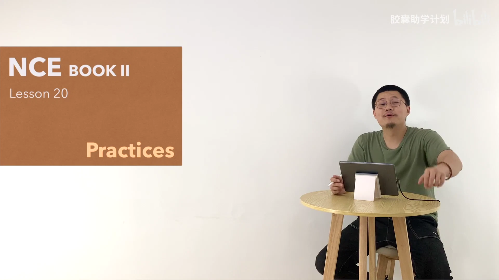

文字识别：胶囊助学计划 / NCE / BOOKII / Lesson 20 / Practices

### 画面 00:00:05

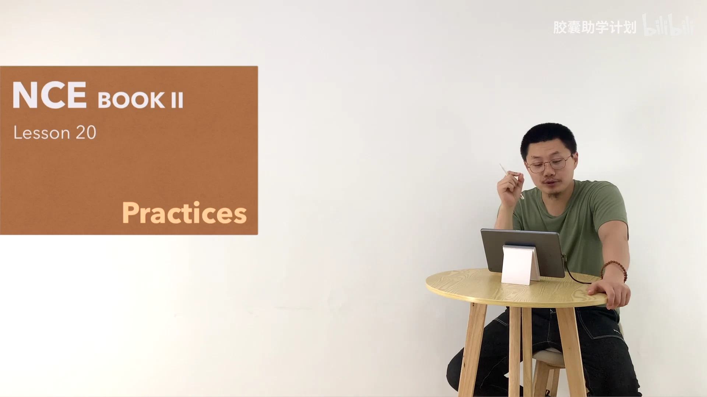

文字识别：胶囊助学计划 / NCE / BOOKI"I / Lesson 20 / Practices

### 画面 00:00:08

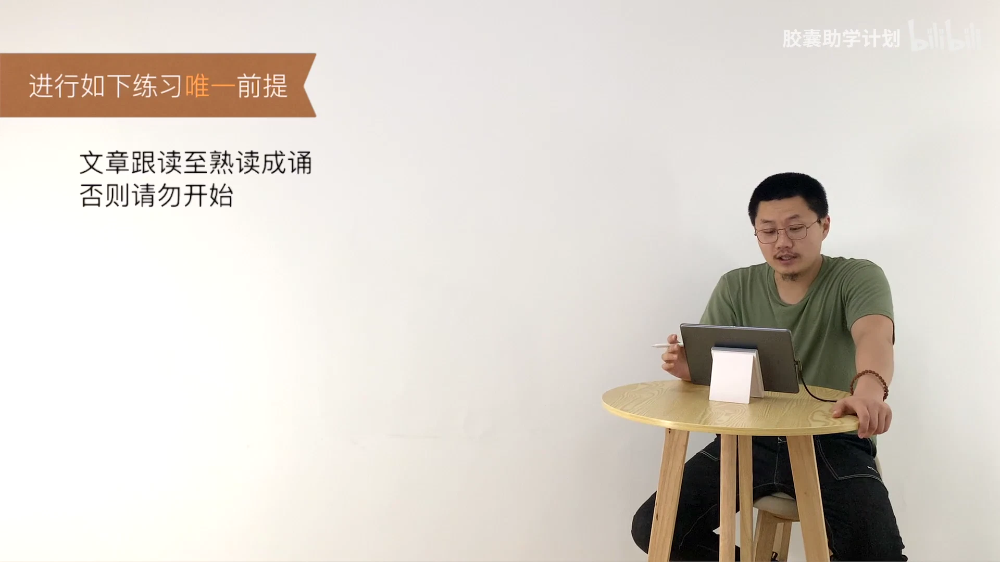

文字识别：胶囊助学计划 / 进行如下练习唯一前提 / 文章跟读至熟读成诵 / 否则请勿开始

### 画面 00:00:19

文字识别：胶囊助学计划bilbl / •

### 画面 00:00:23

### 画面 00:00:25

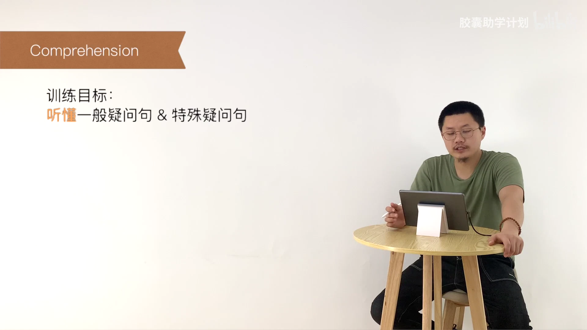

文字识别：胶囊助学计划 / Comprehension / 训练目标： / 听懂一般疑问句＆特殊疑问句

## 00:00:30–00:01:00

各位文章读的很熟了。OK，那我问您答来了。What's your favorite sport?啊，基于文章啊，您现在就是这个作者。What's your favorite sport?答案fishing. Next one, does it worry you if you don't catch anything? No, it doesn't. Next one, do you often fish, uh, without catching anything? Yes, I do. Next one, are

### 画面 00:00:34

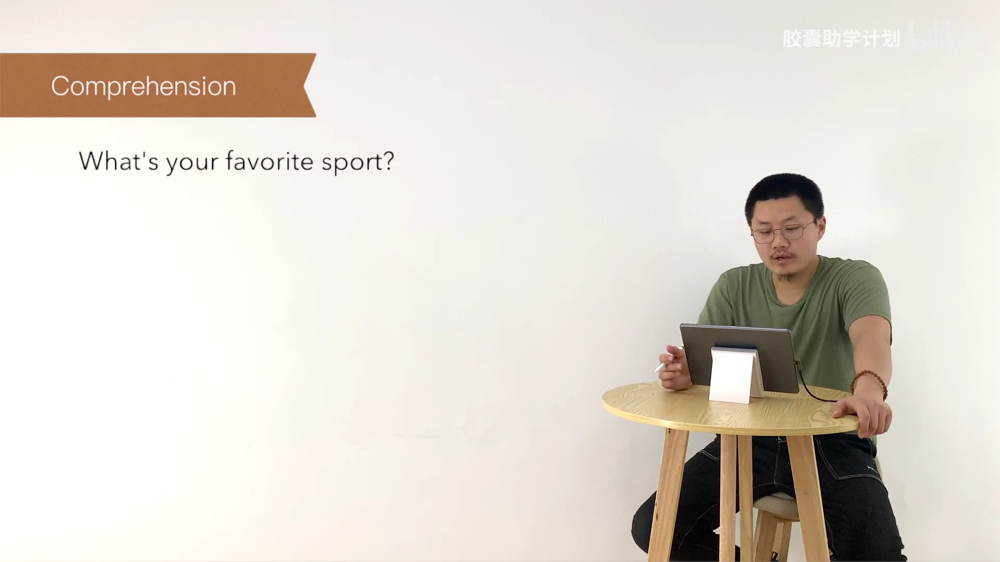

文字识别：胶囊助学计划 / Comprehension / What's your favorite sport?

### 画面 00:00:48

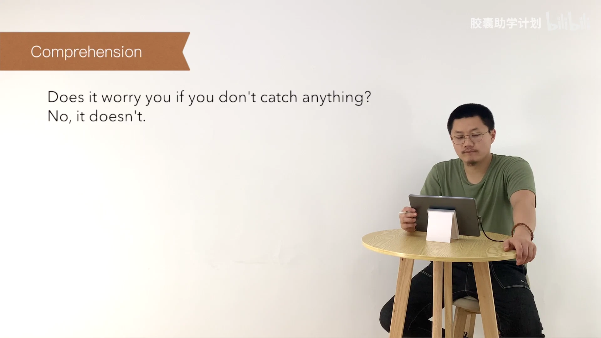

文字识别：胶囊助学计划 / Comprehension / Does it worry you if you don't catch anything? / No, it doesn't.

### 画面 00:00:51

文字识别：胶囊助学计划 / Comprehension / Do you often fish without catching anything?

### 画面 00:00:58

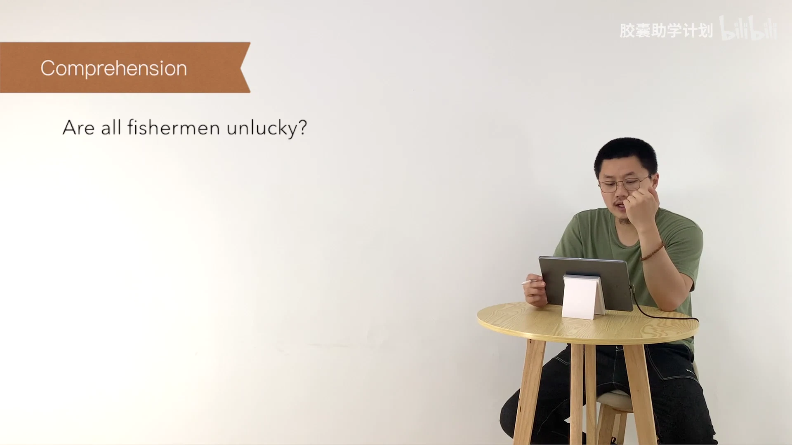

文字识别：胶囊助学计划 / Comprehension / Are all fishermen unlucky?

## 00:01:00–00:01:30

all fishermen unlucky? No, they aren't. Continue, but some are unlucky, aren't they? Yes, they are. They catch old boots,嘛对吧? Next one, what do they catch instead of fish? Old boots and rubbish. Next one, why do you think they are even less lucky than these fishermen?

### 画面 00:01:19

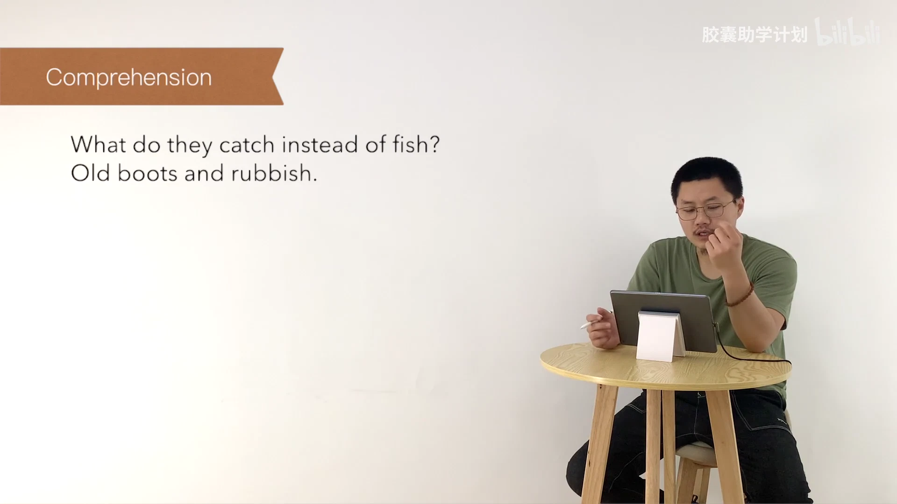

文字识别：胶囊助学计划 / Comprehension / What do they catch instead of fish? / Old boots and rubbish.

### 画面 00:01:23

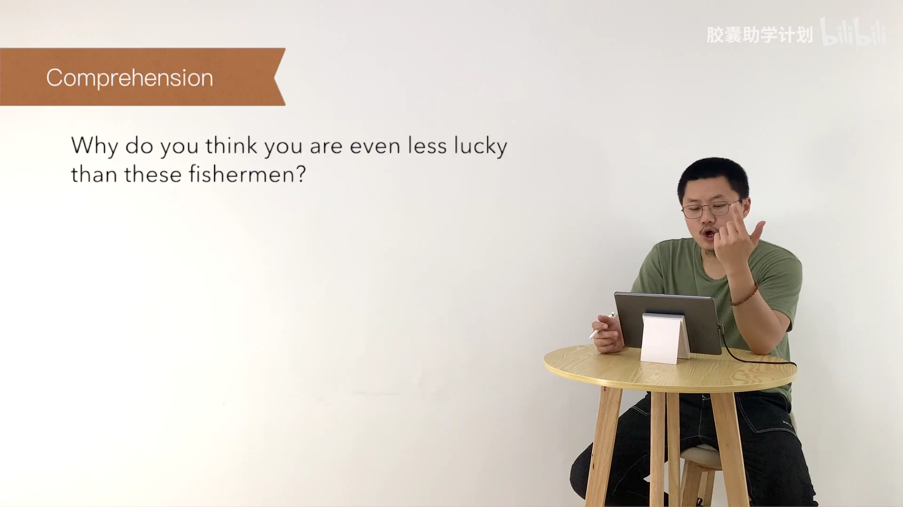

文字识别：胶囊助学计划 / Comprehension / Why do you think you are even less lucky / than these fishermen?

## 00:01:30–00:02:00

I never catch anything.啊，我甚至连就就学的垃圾都抓不着，啊都钓不着。Where have you spent whole mornings on the river? Next one. What do you always go home with? An empty bag. Next one. What do your friends say you must do? Give up fishing. What do they

### 画面 00:01:39

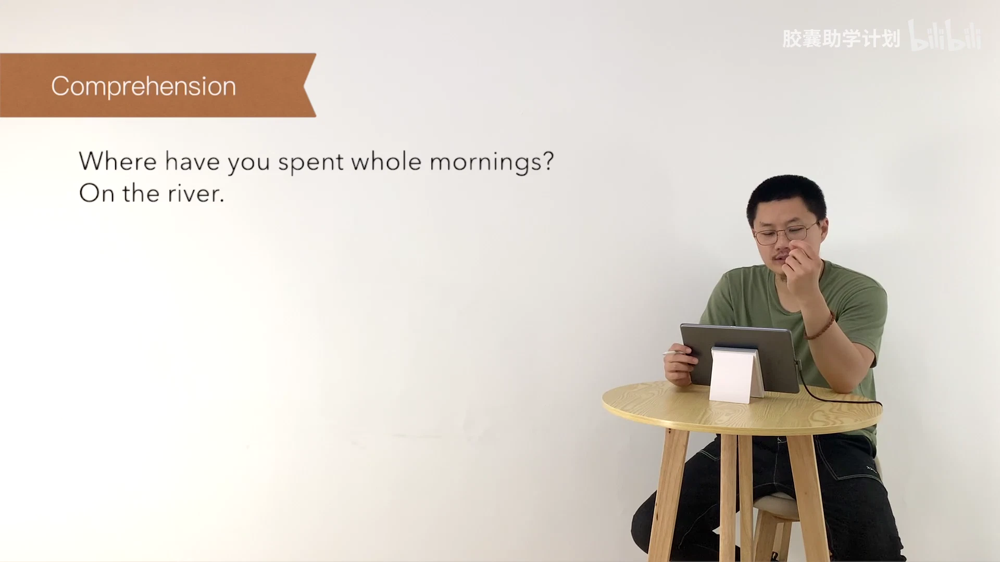

文字识别：胶囊助学计划 / Comprehension / Where have you spent whole mornings? / On the river.

### 画面 00:01:52

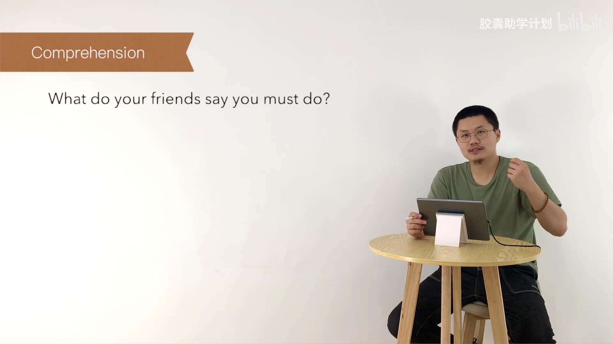

文字识别：胶囊助学计划 / Comprehension / What do your friends say you must do?

### 画面 00:01:59

文字识别：胶囊助学计划 / Comprehension / What do they say about fishing?

## 00:02:00–00:02:30

say about fishing? Is a waste of time. Next one. What don't they realize? One important thing. Next one. What are you really interested in? Sitting in a boat and doing nothing at all. There you go. Asking questions. 训练目标是各位发问的能力，用英文能问出来一般疑问句和特殊疑问句。我们先

### 画面 00:02:18

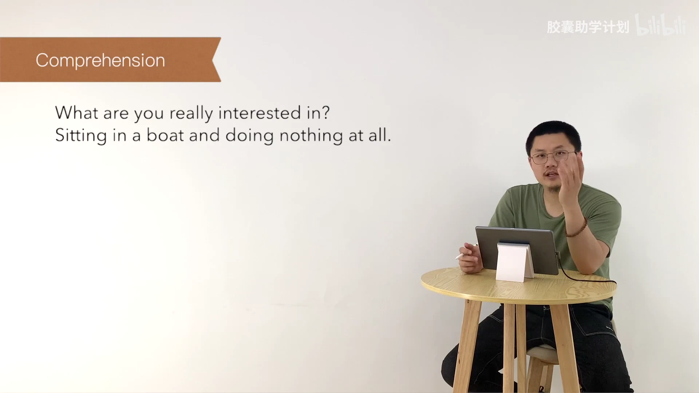

文字识别：胶囊助学计划 / Comprehension / What are you really interested in? / Sitting in a boat and doing nothing at all.

### 画面 00:02:21

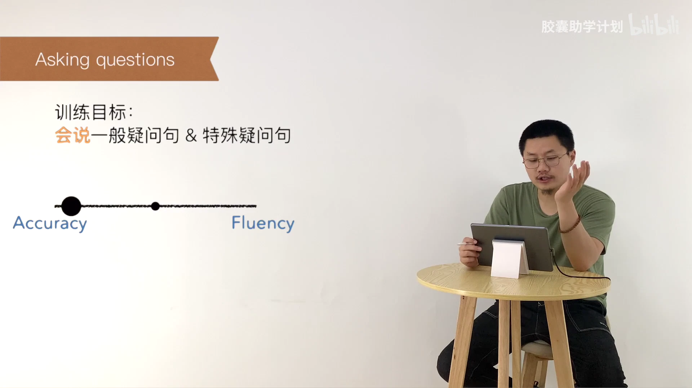

文字识别：胶囊助学计划 / Asking questions / 训练目标： / 会说一般疑问句＆特殊疑问句 / Accuracy / Fluency

### 画面 00:02:29

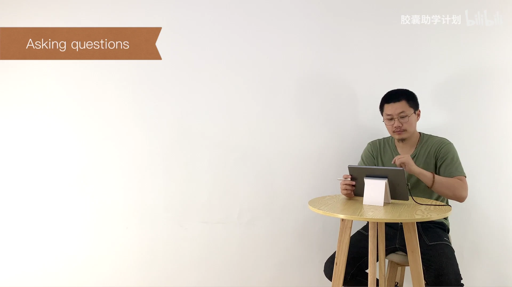

文字识别：胶囊助学计划 / Asking questions

## 00:02:30–00:03:00

看例子。Ask me if fishing is my favorite sport.变一般疑问句，is提前就可以了。如果是what的话，那就是对主语提问。What is your favorite sport? Okay,你最喜欢的运动是什么？第二题，I fish for hours without catching anything. Fish谁提前do对不对？那how long肯定是对for hours提问，对吧？对数个小时提问。Some fishermen are unlucky.

### 画面 00:02:31

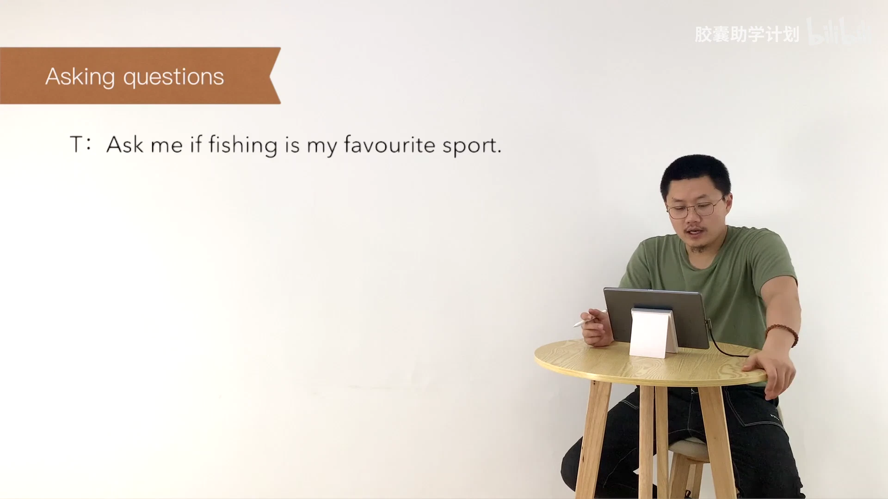

文字识别：胶囊助学计划 / Asking questions / T: Ask me if fishing is my favourite sport.

### 画面 00:02:35

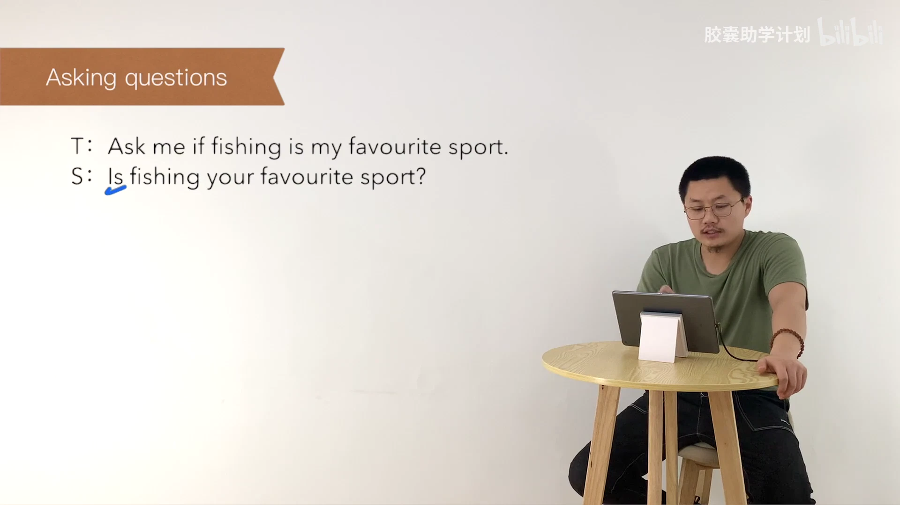

文字识别：胶囊助学计划 / Asking questions / T: Ask me if fishing is my favourite sport. / S: Is fishing your favourite sport?

### 画面 00:02:43

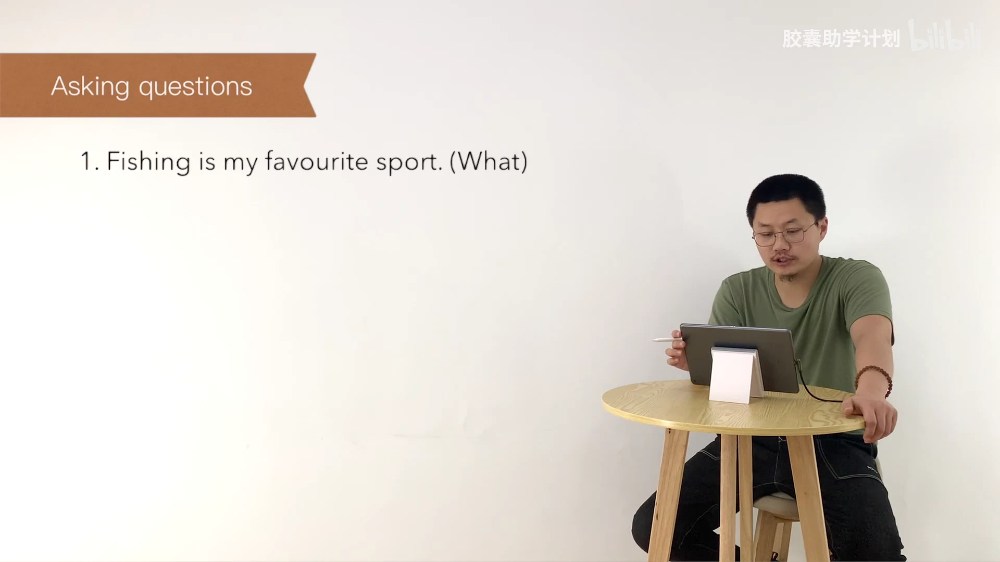

文字识别：胶囊助学计划 / Asking / questions / 1. Fishing is my favourite sport. (What)

### 画面 00:02:54

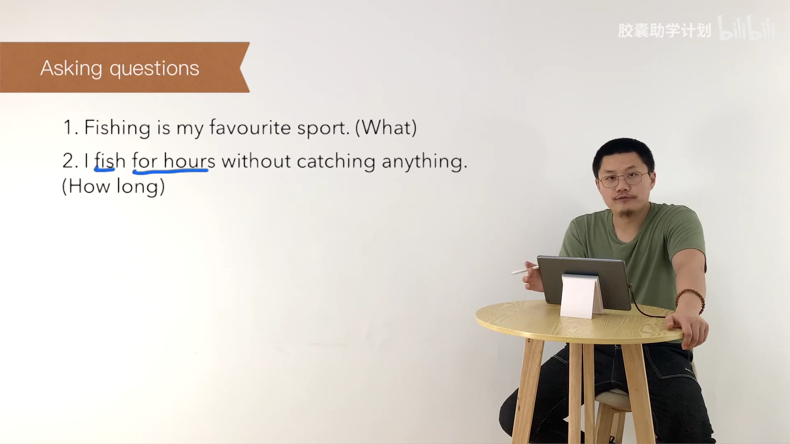

文字识别：胶囊助学计划 / Asking / questions / 1. Fishing is my favourite / sport. (What) / 2.I fish for hours / without / catching a / anything. / (How long)

## 00:03:00–00:03:30

Are提前Who对主语提问Why对整句提问整句提问就是Why加整句一般疑问句。比如说答案叫Why are some fishermen unlucky? Okay, continue. They catch old boots.一陈述客观事实，一般现在是Do提前What对old boots提问. They catch rubbish too.一模一样，我就不提了。但是只是多了一

### 画面 00:03:00

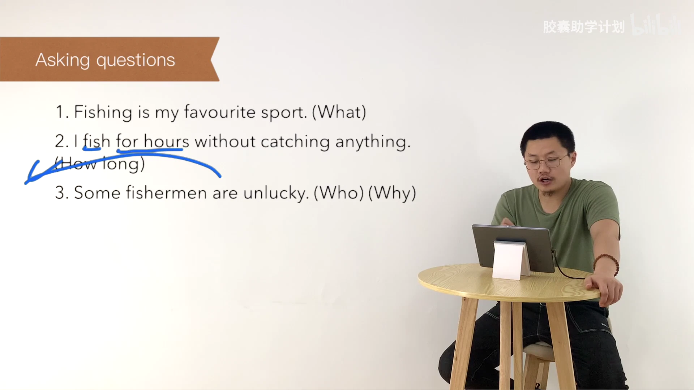

文字识别：胶囊助学计划 / Asking / questions / 1. Fishing is my favourite / sport. (What) / 2.I fish for hours / without / catching anything. / LHew long) / : fishermen are unlucky.(Who) (Why) / 3.Some t

### 画面 00:03:05

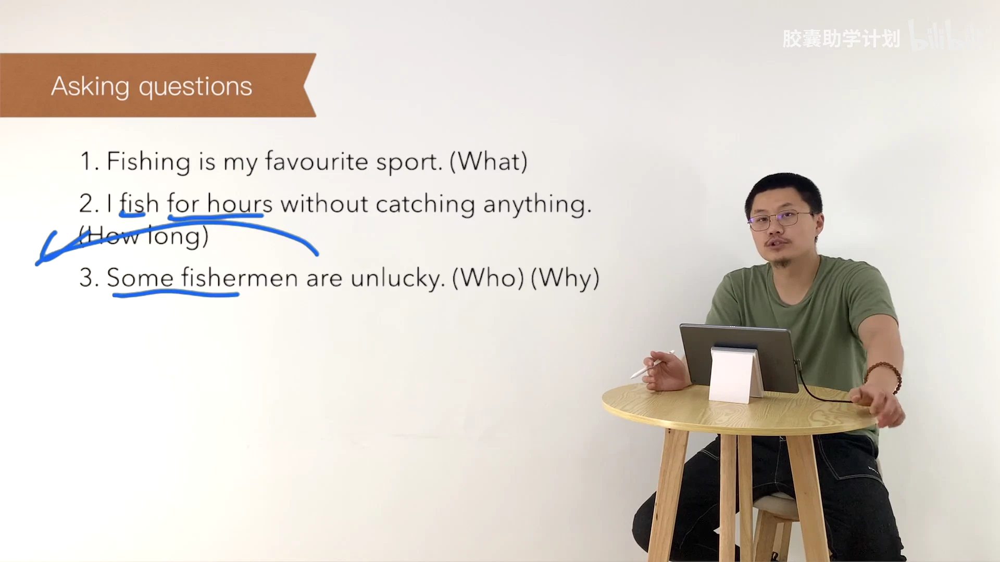

文字识别：胶囊助学计划 / Asking / questions / 1. Fishing is my favourite / sport. (What) / 2.I fish for hours / without / catching / anything. / LHew long) / 3.Some /  fishermen are unlucky. (Who) (Why)

### 画面 00:03:13

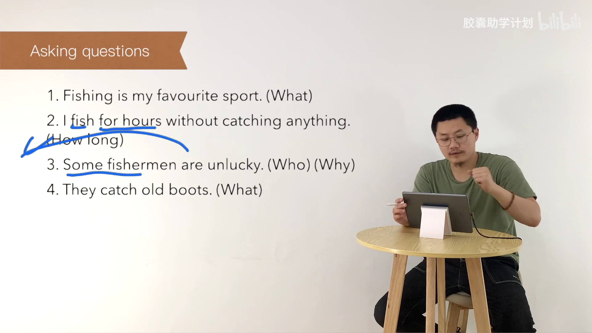

文字识别：胶囊助学计划 / Asking / questions / 1. Fishing is my favourite / sport. (What) / 2.I fish for hours without catching anything. / LHewlong) / 3. Some fishermen are unlucky. (Who) (Why) / 4.They  / catch old boots. (What)

### 画面 00:03:15

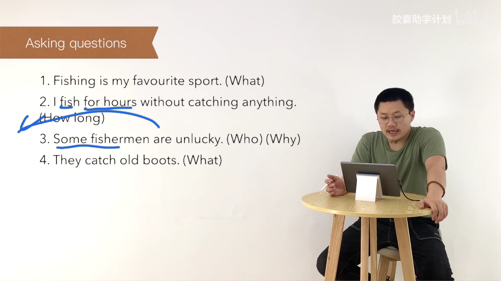

文字识别：胶囊助学计划 / Asking / questions / 1. Fishing is my favourite / sport. (What) / 2.I fish for hours without catching anything. / LHew long) / 3. Some fishermen are unlucky. (Who) (Why) / 4.They  / catch old boots. (What)

### 画面 00:03:21

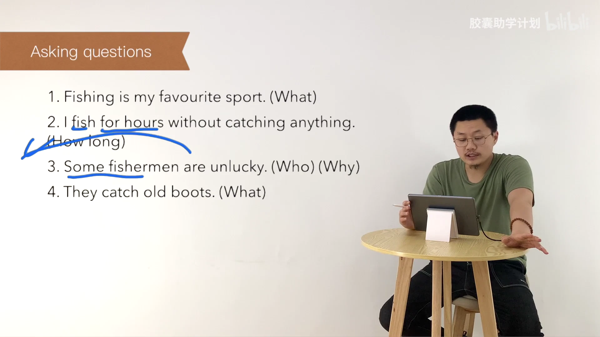

文字识别：胶囊助学计划 / Asking / questions / 1. Fishing is my favourite / sport. (What) / 2.I fish for hours without catching anything. / LHew long) / 3. Some fishermen are unlucky. (Who) (Why) / 4. They catch old boots. (What)

### 画面 00:03:29

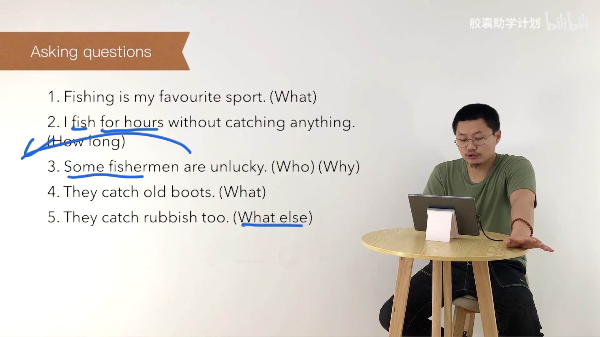

文字识别：胶囊助学计划 / Asking questions / 1. Fishing is my favourite sport. (What) / 2.I fish for hours without catching anything. / LHewlong) / 3. Some fishermen are unlucky. (Who) (Why) / 4. They catch old boots.(What) / 5. They catch rubbish too. (What else)

## 00:03:30–00:04:00

个 what else 四五连起来看 what 叫什么 what else 叫做还有什么啊还有什么？下一题 I'm even less lucky. Are you even less lucky? Why are you even less lucky? 很简单，这新概念前二十课就学过. I never catch anything. 也很简单，您看一下 catch 就可以了，您别被 never 这个单词迷惑住，对吧？Do you never catch anything? What do you never catch? 是吧？I spend whole

### 画面 00:03:36

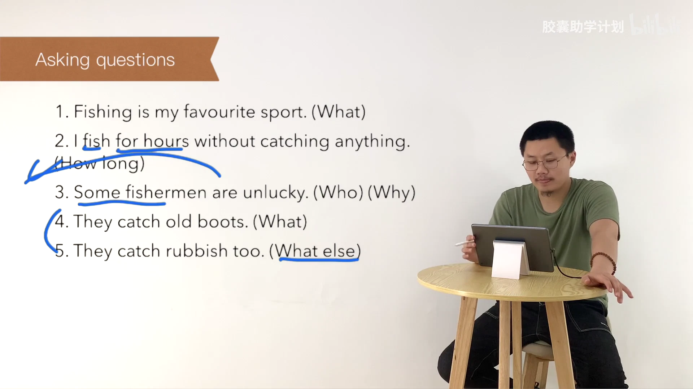

文字识别：胶囊助学计划 / Asking questions / 1. Fishing is my favourite sport. (What) / 2.I fish for hours without catching anything. / LHewlong) / 3. Some fishermen are unlucky. (Who)(Why) / 4. They catch old boots. (What) / 5. They catch rubbish too. (What else)

### 画面 00:03:38

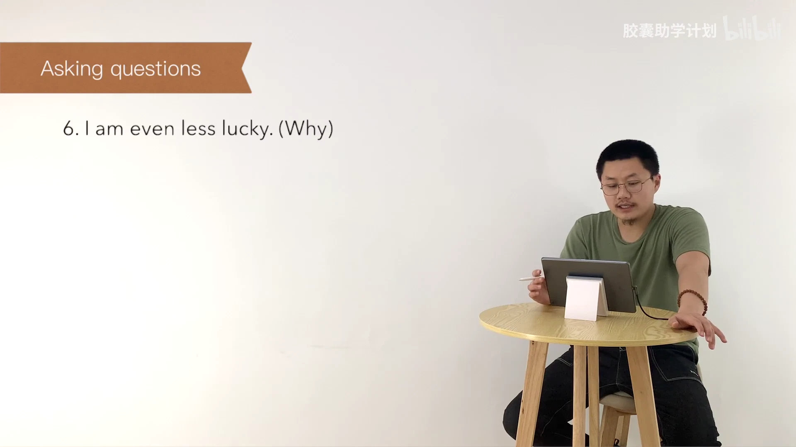

文字识别：胶囊助学计划 / Asking questions / 6.I am even less lucky. (Why)

### 画面 00:03:58

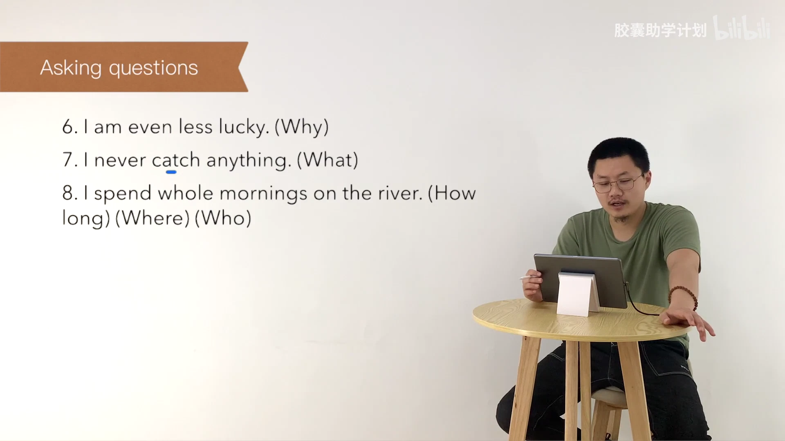

文字识别：胶囊助学计划 / Asking questions / 6.I am even less lucky. (Why) / 7.I never catch a / anything. (What) / 8.I spend whole mornings on the river. (How / long)(Where) (Who)

## 00:04:00–00:04:30

mornings on the river. Spend一般现在是do提前。How long对whole mornings提问，对吧？How long do you spend on the river? Where对on the river提问？Who对主语提问？记住别变一般疑问句，对吧？You must give up fishing.肯定是must提前。What对fishing提问？注意what往往是问名词，这儿的fishing就是个名词，对吧？叫What must you give up？或者是What must I give up？Okay，

### 画面 00:04:02

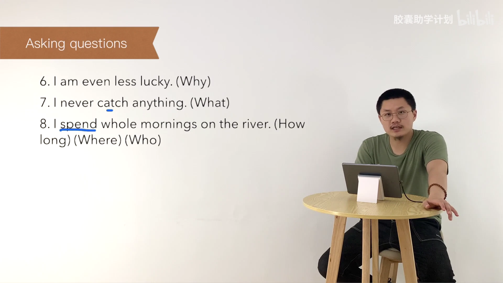

文字识别：胶囊助学计划 / Asking questions / 6.I am even less lucky.(Why) / 7.I never catch / anything.(What) / 8.I spend whole mornings on the river. (How / long)(Where) (Who)

### 画面 00:04:13

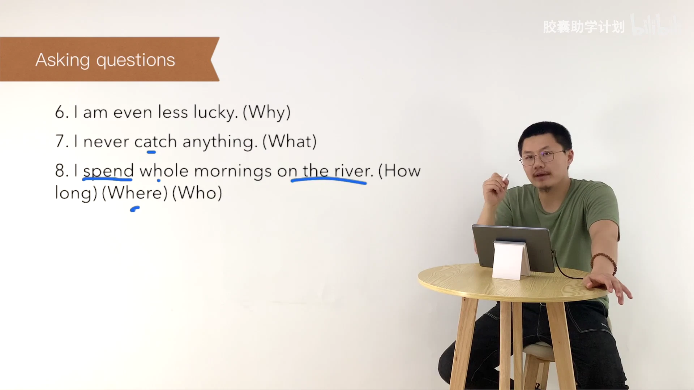

文字识别：胶囊助学计划 / Asking / questions / 6.I am even less lucky. (Why) / 7.I never catch / anything. (What) / 8.1spend / I whole mornings on the river. (How / long) (Where) (Who)

### 画面 00:04:18

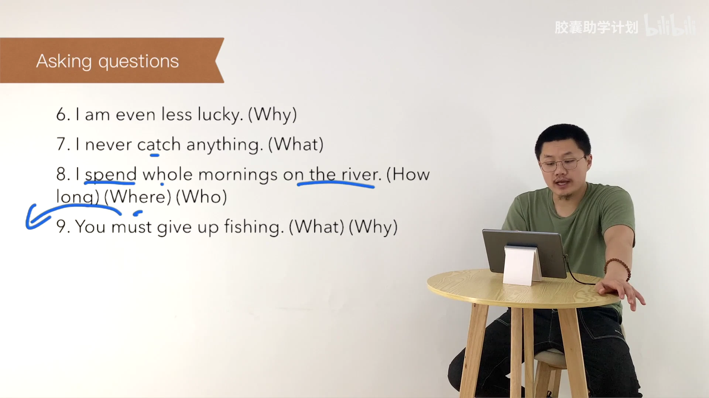

文字识别：胶囊助学计划 / Asking questions / 6.I am even less lucky.(Why) / 7.I never catch a /  anything. (What) / 8.I spend whole mornings on the river. (How / long)(Where)(Who) / 9. You must give up fishing. (What) (Why)

## 00:04:30–00:05:00

that why is the whole sentence. We don't say much. They don't realize one important thing. First, pay attention. This is a negative sentence. When we want to change it into a general question, we need to first change it into a positive sentence, and then put the question mark. It is called Do they realize one important thing? Okay, good. But if we want to change it into a special question, we keep the don't. It is called What do they realize? They don't realize one important thing.

### 画面 00:04:33

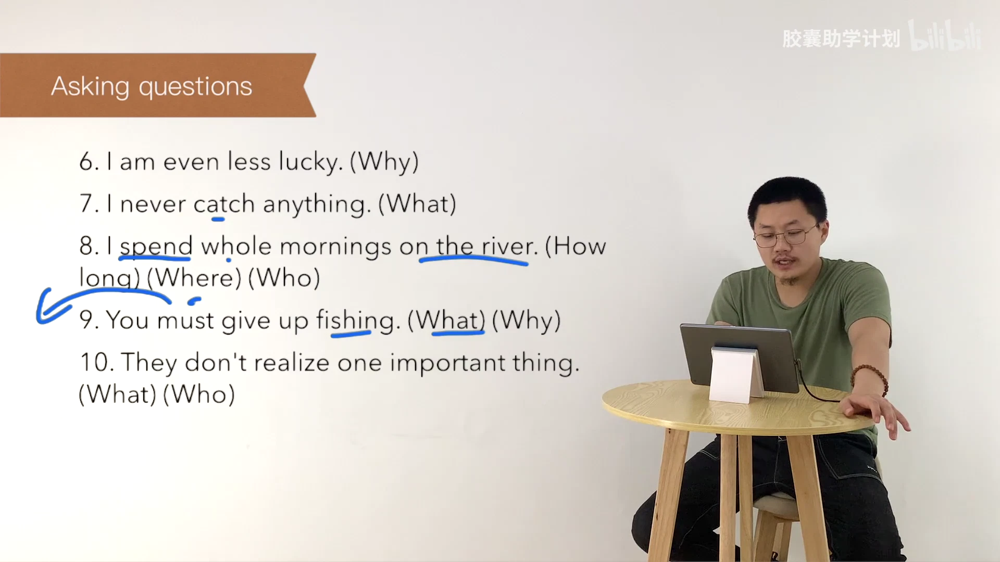

文字识别：胶囊助学计划 / Asking questions / 6.I am even less lucky. (Why) / 7.I never catch anything. (What) / 8.I spend whole mornings on the river. (How / long) (Where) (Who) / 9. You must give up fishing. (What) (Why) / 10. They don't realize one important thing. / (What) (Who)

### 画面 00:04:41

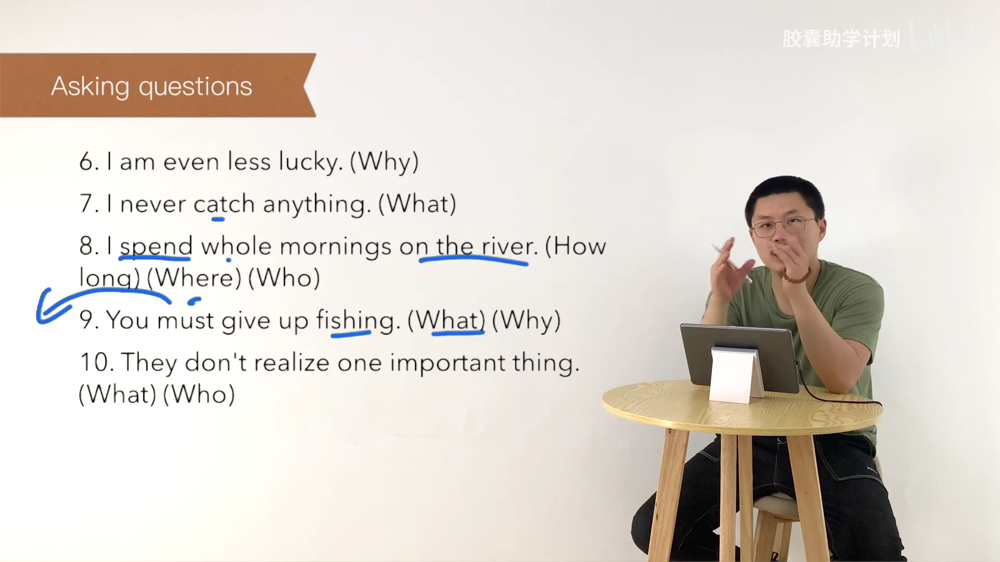

文字识别：胶囊助学计划 / Asking questions / 6.I am even less lucky. (Why) / 7.I never catch anything. (What) / 8.I spend whole mornings on the river. (How / long) (Where) (Who) / 9. You must give up fishing. (What) (Why) / 10. They don't realize one important thing. / (What) (Who)

### 画面 00:04:55

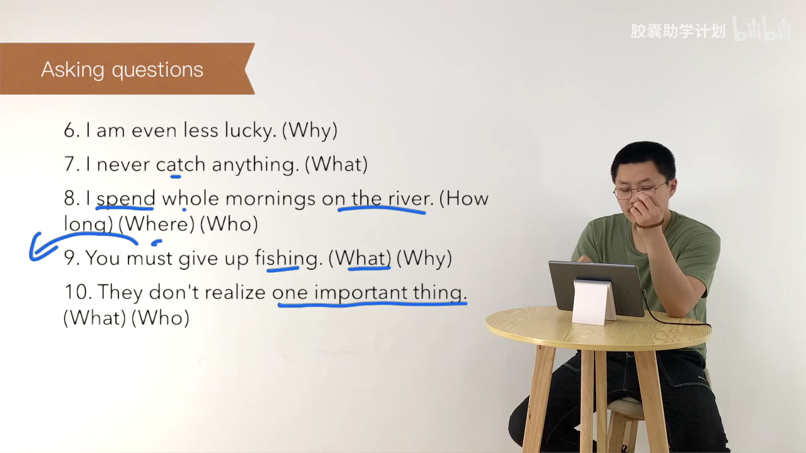

文字识别：胶囊助学计划 / Asking questions / 6.I am even less lucky. (Why) / 7.I never catch anything. (What) / 8.I spend whole mornings on the river. (How / long) (Where) (Who) / 9. You must give up fishing. (What) (Why) / 10. They don't realize one important thing. / (What) (Who)

### 画面 00:04:57

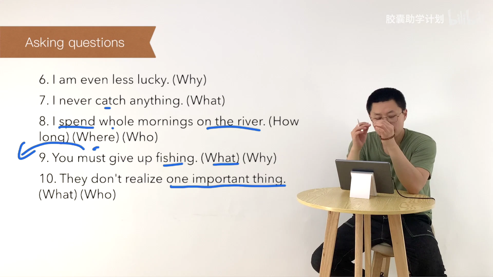

文字识别：胶囊助学计划 / Asking questions / 6.I am even less lucky. (Why) / 7.I never catch  / anything. (What) / 8.I spend whole mornings on the river. (How / long) (Where) (Who) / 9. You must give up fishing. (What) (Why) / 10. They don't realize one important thing. / (What) (Who)

## 00:05:00–00:05:30

### 画面 00:05:08

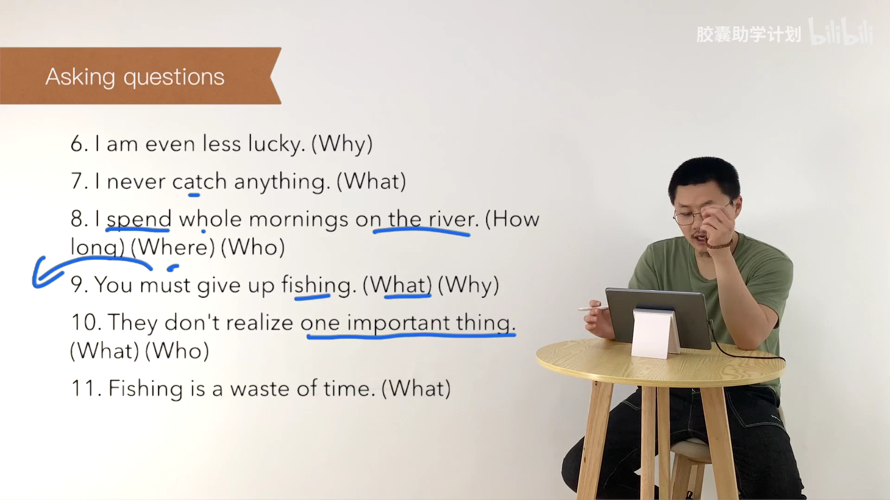

文字识别：胶囊助学计划 / Asking questions / 6.I am even less lucky. (Why) / 7.I never catch anything. (What) / 8.I spend whole mornings on the river. (How / lona)(Where) (Who) / 9. You must give up fishing. (What) (Why) / 10. They don't realize one important thing. / (What) (Who) / 11. Fishing is a waste of time. (What)

### 画面 00:05:14

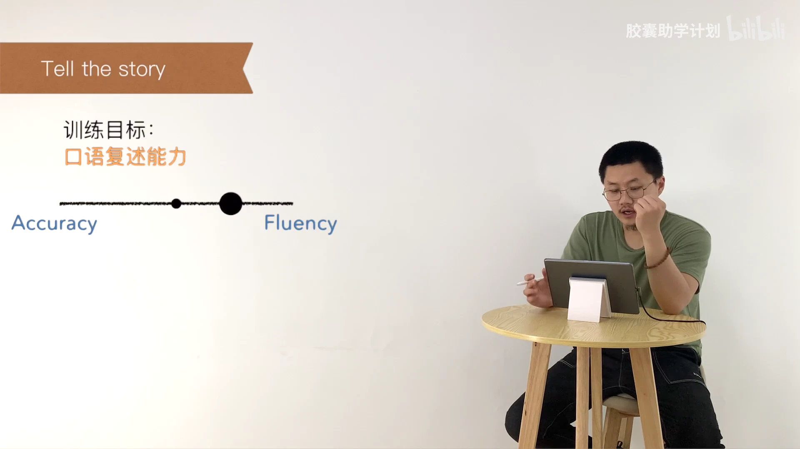

文字识别：胶囊助学计划 / Tell the story / 训练目标： / 口语复述能力 / Accuracy / Fluency

### 画面 00:05:19

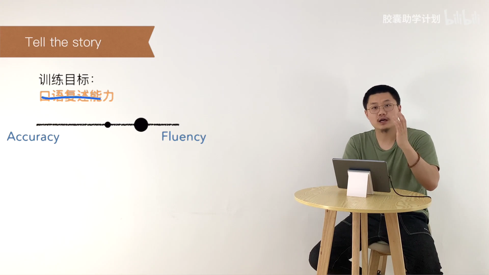

文字识别：胶囊助学计划 / Tell the story / 训练目标： / 口语复述能力 / Accuracy / Fluency

### 画面 00:05:27

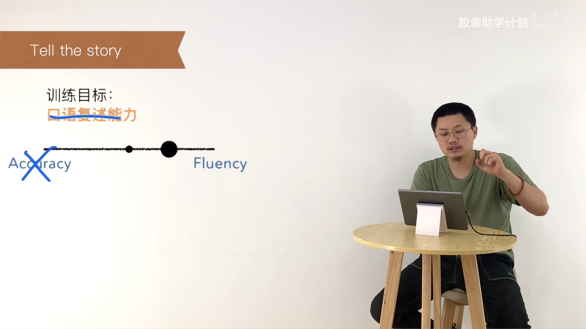

文字识别：胶囊助学计划 / Tell the story / 训练目标： / 口语复述熊力 / AcXracy / Fluency

## 00:05:30–00:06:00

一事儿，是吧？本来两分钟能讲完，你讲俩小时，别人能乐意听吗？OK，所以我接下来还是尝试给大家做一个示范。您下课自己去做。来了，Fishing is my favorite sport. I often fish for hours without catching anything. Some fishermen are unlucky. Instead of catching fish, they catch old boots and rubbish. I'm even less lucky. I never catch anything, not even old boots. I always spend the whole mornings

### 画面 00:05:33

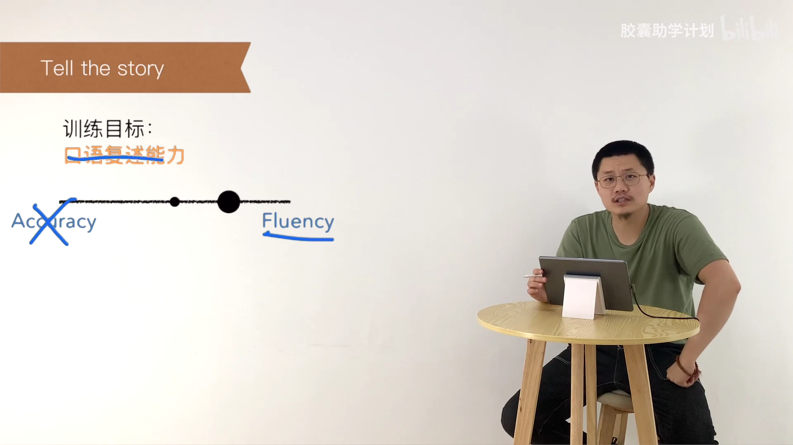

文字识别：胶囊助学计划 / Tell the story / 训练目标： / 口语复述能力 / AcXracy / Fluency

### 画面 00:05:35

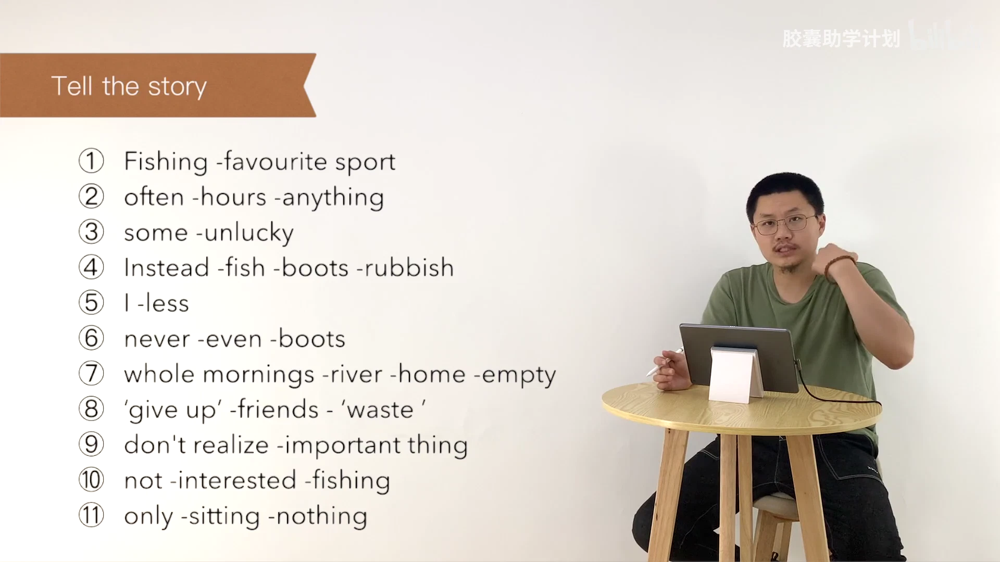

文字识别：胶囊助学计划 / Tell the story / Fishing -favourite sport / 1 / often -hours -anything / some -unlucky / Instead -fish -boots -rubbish / I-less / 6 / never -even -boots / whole mornings -river -home -empty / 'give up'-friends - 'waste' / 8 / 9 / don't realize -important thing / 10 / not -interested -fishing / ① only-sitting -nothing

## 00:06:00–00:06:30

on the river and when home go home with an empty bag. You must give up fishing, my friend said. It's a waste of time. But they don't realize one important thing. I'm not really interested in fishing. I'm only interested in sitting in a boat and doing nothing at all. Okay,好，接下来摘要写作 summer writing练习的是各位写作复述能力，对吧？考试当中考写作，工作当中写邮件，这都是非常重要的能力。各位，

### 画面 00:06:05

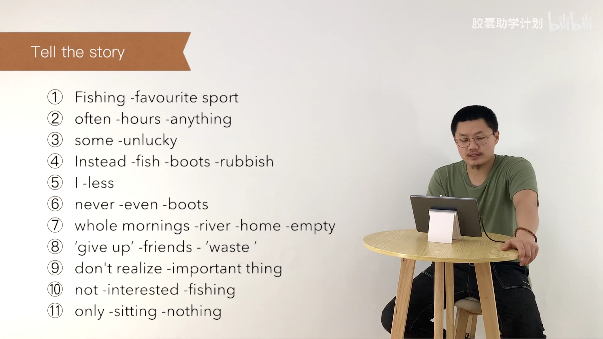

文字识别：胶囊助学计划 / Tell the story / Fishing -favourite sport / 1 / often -hours -anything / some -unlucky / Instead -fish -boots -rubbish / l -less / 6 / never -even -boots / whole mornings -river -home -empty / 8 / 'give up' -friends - 'waste' / 9 / don't realize -important thing / 10 / not -interested -fishing / ① only -sitting -nothing

### 画面 00:06:19

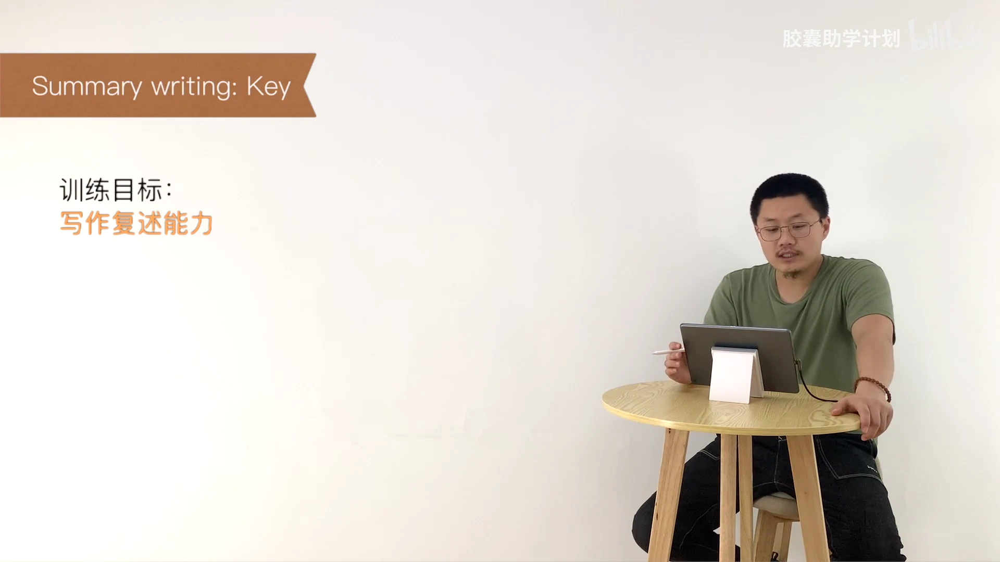

文字识别：胶囊助学计划 / Summary writing: Key / 训练目标： / 写作复述能力

### 画面 00:06:28

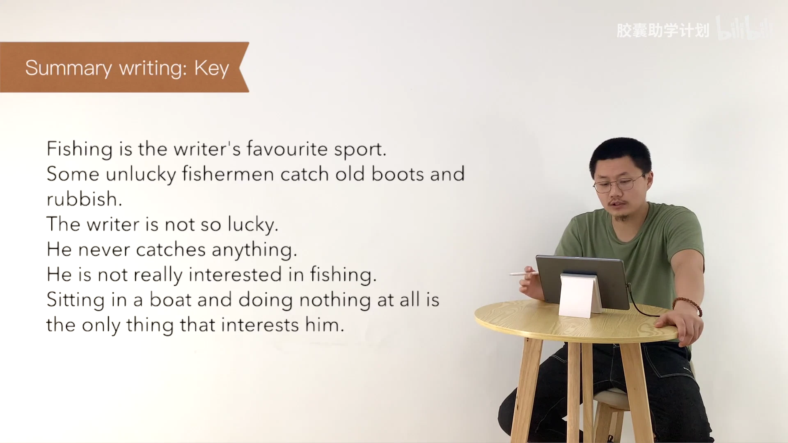

文字识别：胶囊助学计划 / Summary writing: Key / Fishing is the writer's favourite sport. / Some unlucky fishermen catch old boots and / rubbish. / The writer is not so lucky. / He never catches anything. / He is not really interested in fishing. / Sitting in a boat and doing nothing at all is / the only thing that interests him.

## 00:06:30–00:07:00

简单自己写完来这儿对一下答案就可以了。OK，没什么太多可讲的。Topic for discussion，我们只是看一下他问了我们什么问题啊？What's your favorite pastime? How pastime其实就是个生词，您查一下就知道了。就业余时间，业余时间愿意干啥啊？其实就度过时间，对吧？花费时间就Q time啊？Do you think the writer is wasting his time? Why not? 说你认为这个记者呃，问这个作者是在浪费他的时间吗？注意，哎，

### 画面 00:06:33

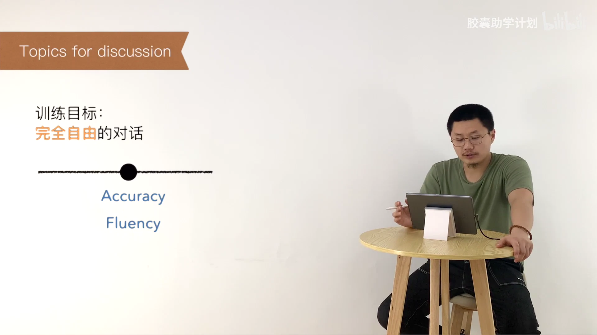

文字识别：胶囊助学计划 / Topics for discussion / 训练目标： / 完全自由的对话 / Accuracy / Fluency

### 画面 00:06:36

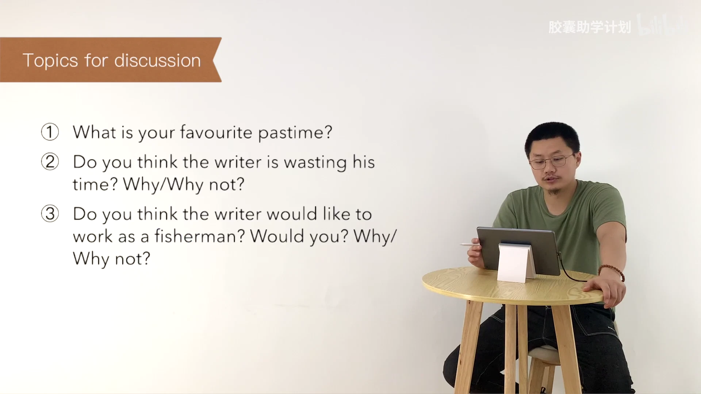

文字识别：胶囊助学计划 / Topics for discussion / What is your favourite pastime? / Do you think the writer is wasting his / time? Why/Why not? / Do you think the writer would like to / work as a fisherman? Would you? Why/ / Why not?

## 00:07:00–00:07:30

浪不浪费？您自己随便说。关键点是 why 和 why not，对吧？这个是让我们能聊下去的一个点。Okay， so do you think the writer would like to work as a fisherman？说你认为说这个作者呀，愿意真的去当一名渔夫吗？Would you？你愿意当渔夫吗？Why or why not？你看，这个是核心能聊下来的点。为什么啊？或者为什么不？那家庭作业 ask me if 先写保证它是对

### 画面 00:07:06

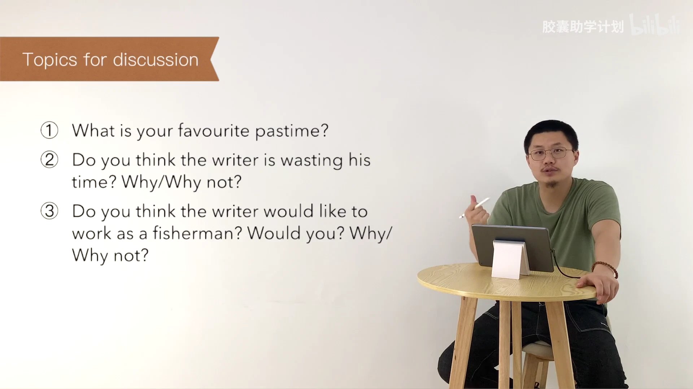

文字识别：胶囊助学计划 / Topics for discussion / What is your favourite pastime? / Do you think the writer is wasting his / time? Why/Why not? / Do you think the writer would like to / work as a fisherman? Would you? Why/ / Why not?

### 画面 00:07:25

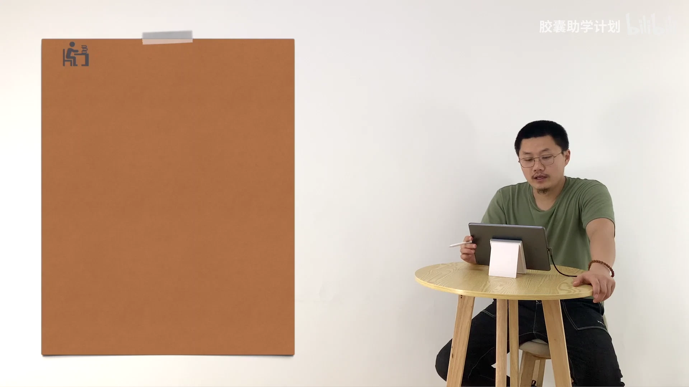

文字识别：胶囊助学计划

### 画面 00:07:27

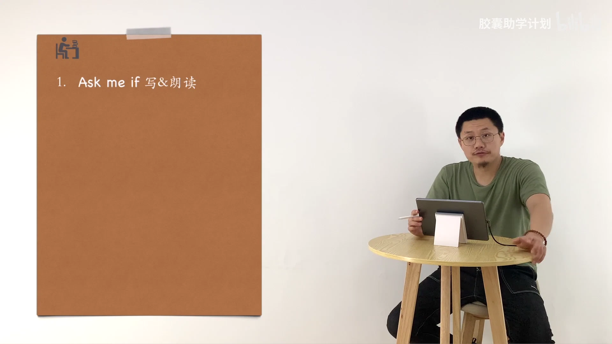

文字识别：胶囊助学计划 / 1.Ask me if写&朗读

### 画面 00:07:29

文字识别：胶囊助学计划 / 1.Ask me if写&朗读

## 00:07:30–00:08:00

的，然后看自己写的答案，大声朗读出来。摘要写作写完对答案，tell the story，不要忘了做口语复述，这个非常难，我能理解，但是您把文章读到特别熟，难度就会大幅度下降。OK，最后呢，专栏当中可以找得到。以上就是本期视频的全部内容了。如果大家喜欢我们的课程呢，欢迎大家关注、订阅、一键三连啊，分享给那些需要的朋友来支持我们。See you next time.

### 画面 00:07:31

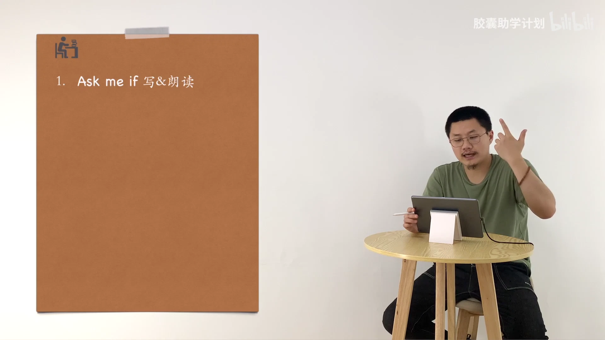

文字识别：胶囊助学计划 / 1.Ask me if写&朗读 / 0

### 画面 00:07:33

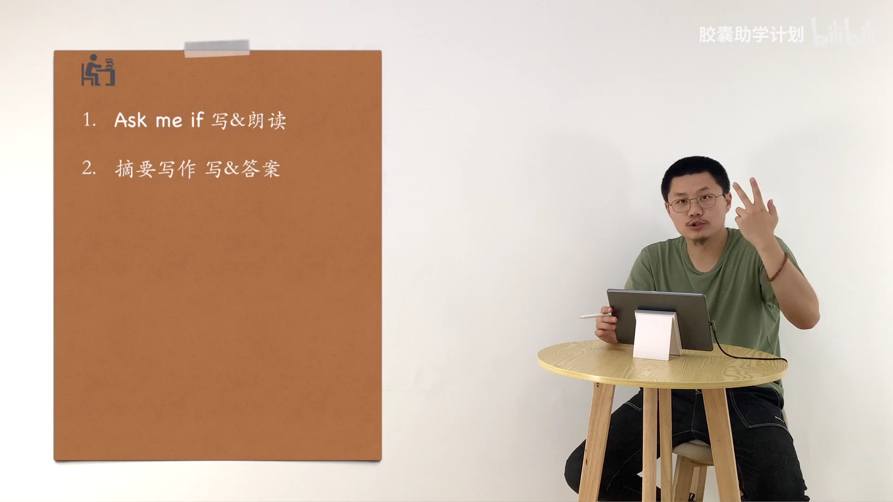

文字识别：胶囊助学计划 / 1.Ask me if写&朗读 / 2. / 摘要写作写&答案

### 画面 00:07:35

文字识别：胶囊助学计划 / 1.Ask me if写&朗读 / 摘要写作写&答案 / 3.Tell the story 口语复述

### 画面 00:07:40

文字识别：胶囊助学计划 / 1.Ask me if写&朗读 / 2. / 摘要写作写&答案 / 3.Tell the story 口语复述

### 画面 00:07:42

文字识别：胶囊助学计划 / 1.Ask me if写&朗读 / 摘要写作写&答案 / 3.Tell the story 口语复述

### 画面 00:07:44

文字识别：胶囊助学计划 / 1.Ask me if写&朗读 / 摘要写作写&答案 / 3.Tell the story 口语复述 / 专栏 / 4.

### 画面 00:07:46

文字识别：胶囊助学计划

### 画面 00:07:52

文字识别：胶囊助学计划

### 画面 00:07:59

文字识别：CAPSULEACADEMY / 胶囊助学计划 / 小红书 / 品

## 00:08:00–00:08:11

### 画面 00:08:01

文字识别：CAPSULEACADEMY / 胶囊助学计划 / 小红书 / Leo / OE

### 画面 00:08:07

文字识别：CAPSULEACADEMY / 胶囊助学计划 / 『 / 小红书 / Creator / Leo & Berlin / OE

### 画面 00:08:09

文字识别：bilibili / 胶囊助学计划

### 画面 00:08:10

文字识别：bilibili / 胶囊助学计划

