# L021 单词

快速机器解析：语音为单模型转写，未进行独立交叉校对或人工复核；画面每秒采样并按变化选帧，短时文字和标记可能遗漏。截图时间约有 1 秒误差。图片有损压缩；遇到疑点请按时间查看 Google Drive 原视频。

## 00:00:00–00:00:30

Hello everyone, welcome to Capsule Academy. This is Leo. Today we are going to learn New Concept English Book Two Lesson Twenty One Words. 那老习惯进入正式课程之前呢，我们看几个问题。第一啊，如何表达生某人的气？第二，如何表达出于某些原因？最后一个问题，如何表达下定决心做某件事情？啊，带着这三个问题，Hope you guys enjoy.

### 画面 00:00:00

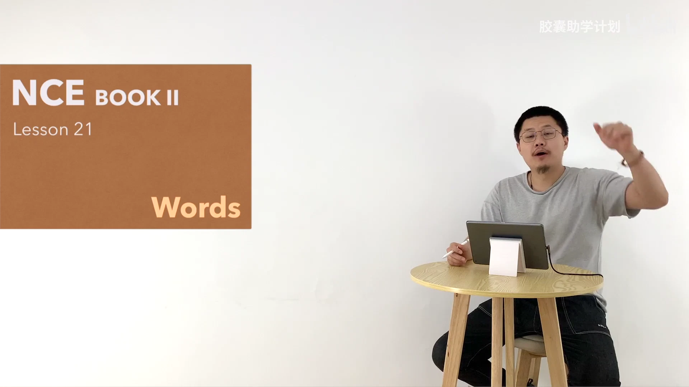

文字识别：胶囊助学计划 / NCE / BOOKⅡI / Lesson 21 / Words

### 画面 00:00:02

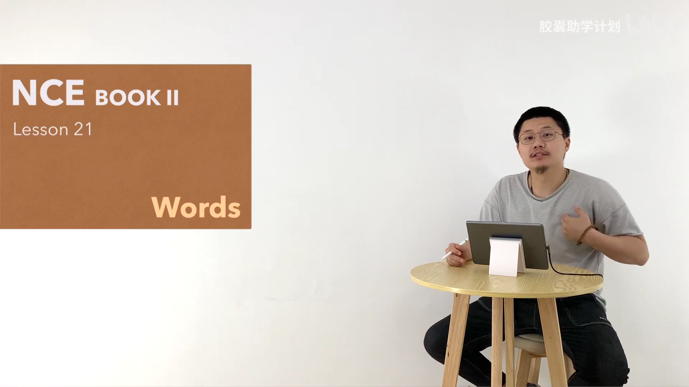

文字识别：胶囊助学计划 / NCE / BOOKⅡI / Lesson 21 / Words

### 画面 00:00:05

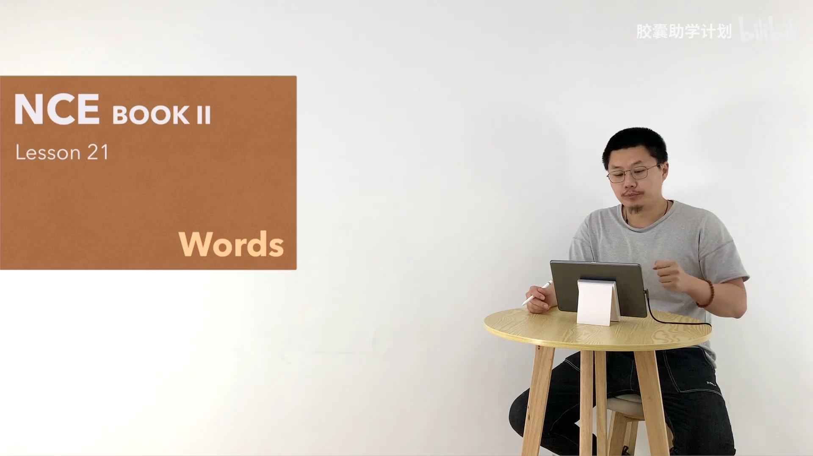

文字识别：胶囊助学计划 / NCE / BOOKI"I / Lesson 21 / Words

### 画面 00:00:09

文字识别：胶囊助学计划

### 画面 00:00:11

文字识别：①如何表达“生某人气”？

### 画面 00:00:14

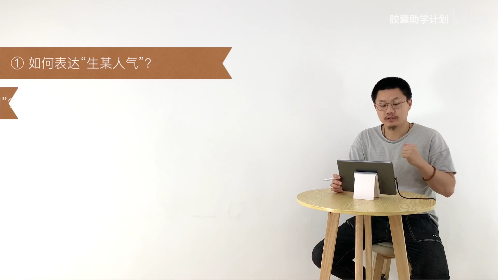

文字识别：①如何表达“生某人气”？

### 画面 00:00:16

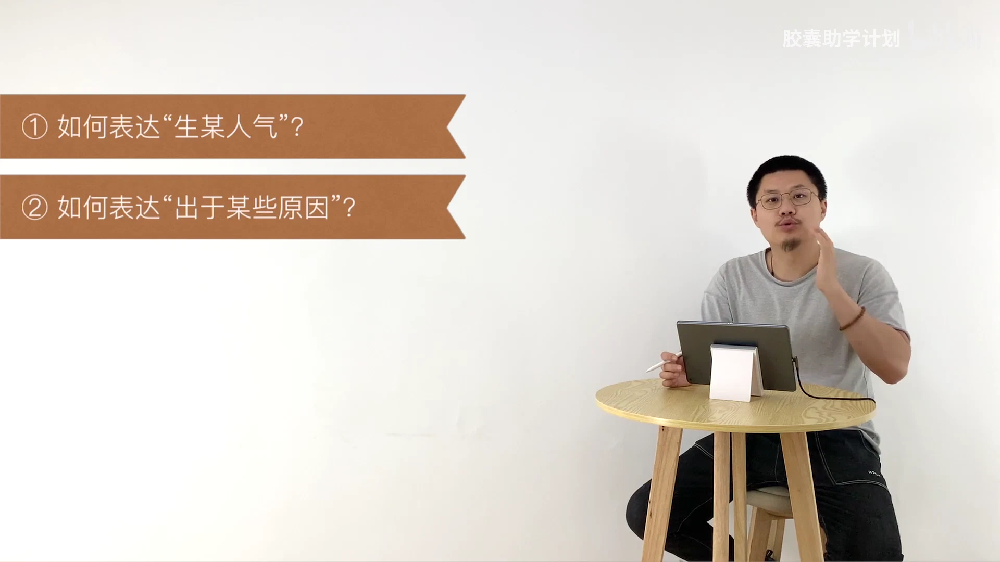

文字识别：①如何表达“生某人气”? / 如何表达“出于某些原因

### 画面 00:00:18

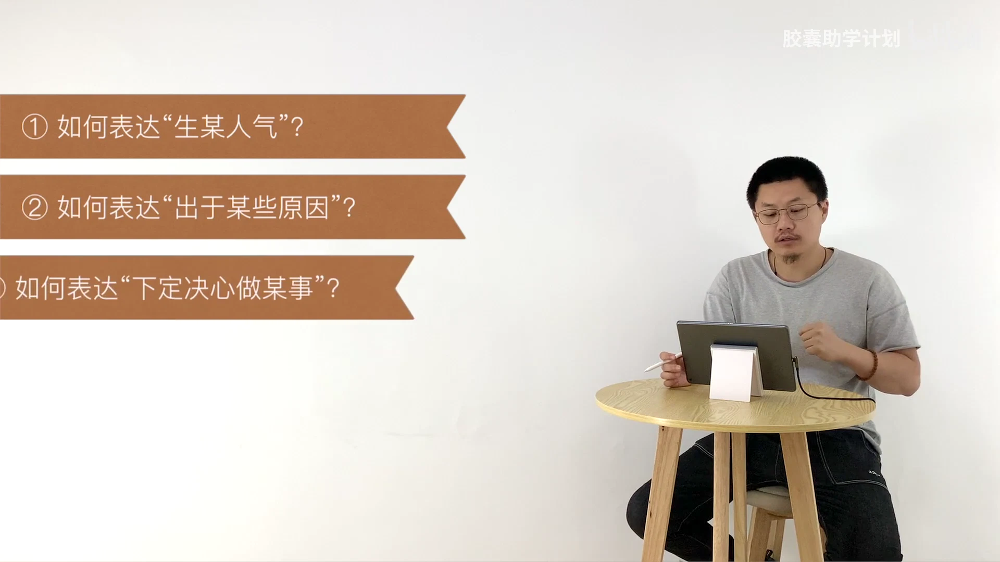

文字识别：①如何表达“生某人气”? / 如何表达“出于某些原因 / 如何表达“下定决心做某事”

### 画面 00:00:20

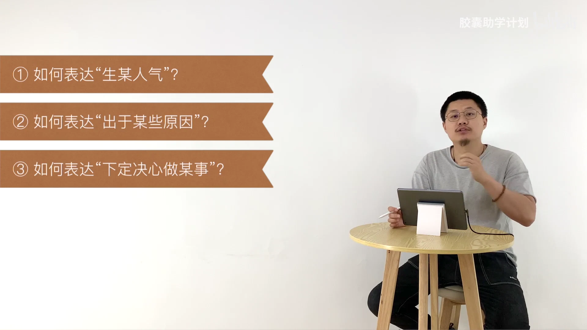

文字识别：①如何表达“生某人气”？ / 如何表达“出于某些原因 / 如何表达“下定决心做某事”？

### 画面 00:00:25

文字识别：胶囊助学计划bl出 / • / •

### 画面 00:00:29

文字识别：胶囊助学计划

## 00:00:30–00:01:00

好，那我们先看第一个单词，跟我一起读一下，非常的简单，mad, mad, OK，它表示的是我非常的生气，是吧？OK啊，当然它也有说 driving me mad，啊，这个是我们在文章当中会见到的，不是让我生气就是发疯了啊。OK, mad，愤怒。那 be mad at somebody 指的是对某人很生气，好，注意这个 be，那我们目前为止经常用到的 am, is, are, was, were，对吧？如果

### 画面 00:00:31

文字识别：单词造句指南 / 网：v.+v.变化 / 四句型转换 / 方式/地点/时间 / 结合习惯用法 / 其他单词+词性 / 原文摘抄+变 / 6123456 / mad adj.

### 画面 00:00:33

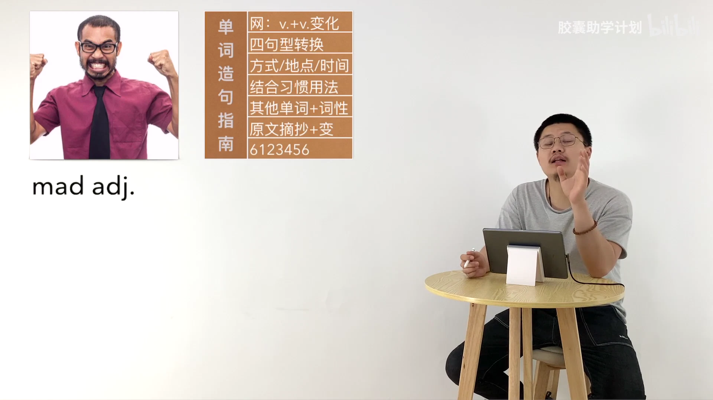

文字识别：单词造句指南 / 网：v.+v.变化 / 胶囊助学计划 / 四句型转换 / 方式/地点/时间 / 结合习惯用法 / 其他单词+词性 / 原文摘抄+变 / 6123456 / mad adj.

### 画面 00:00:35

文字识别：单词造句指南 / 网：v.+v.变化 / 胶囊助学计划 / 四句型转换 / 方式/地点/时间 / 结合习惯用法 / 其他单词+词性 / 原文摘抄+变 / 6123456 / mad adj.

### 画面 00:00:38

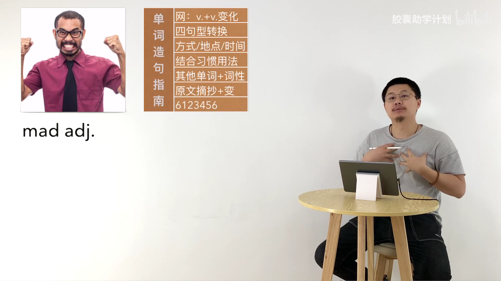

文字识别：单词造句指南 / 网：v.+v.变化 / 胶囊助学计划 / 四句型转换 / 方式/地点/时间 / 结合习惯用法 / 其他单词+词性 / 原文摘抄+变 / 6123456 / mad adj.

### 画面 00:00:40

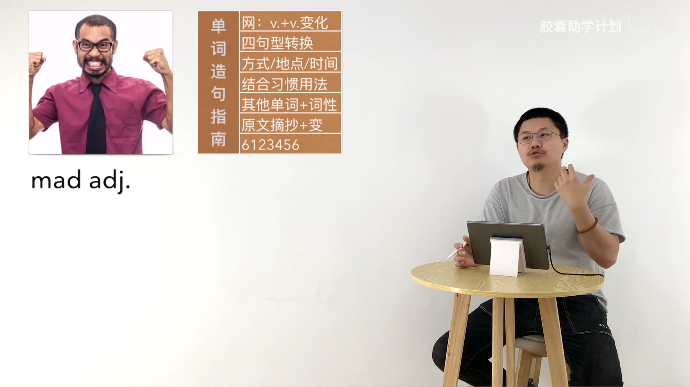

文字识别：单词造句指南 / 网：v.+v.变化 / 胶囊助学计划 / 四句型转换 / 方式/地点/时间 / 结合习惯用法 / 其他单词+词性 / 原文摘抄+变 / 6123456 / mad adj.

### 画面 00:00:45

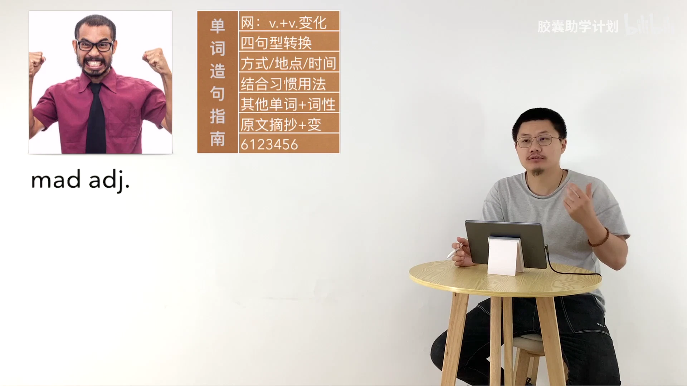

文字识别：单词造句指南 / 网：v.+v.变化 / 胶囊助学计划 / 四句型转换 / 方式/地点/时间 / 结合习惯用法 / 其他单词+词性 / 原文摘抄+变 / 6123456 / mad adj.

### 画面 00:00:50

文字识别：单词造句指南 / 网：v.+v.变化 / 胶囊助学计划 / 四句型转换 / 方式/地点/时间 / 结合习惯用法 / 其他单词+词性 / 原文摘抄+变 / 6123456 / mad adj. / ① be mad at sb.

### 画面 00:00:55

文字识别：单词造句指南 / 网：v.+v.变化 / 胶囊助学计划 / 四句型转换 / 方式/地点/时间 / 结合习惯用法 / 其他单词+词性 / 原文摘抄+变 / 6123456 / mad adj. / ① be mad at sb.

## 00:01:00–00:01:30

表示过去对某人生气呢，那就是 was war。如果是现在呢，I'm mad。那 at somebody就是对于某人。OK，比如说我们造句，很简单，He is mad at me。他生我的气。嗯，那把它变一般疑问句叫做 Is he mad at you？以及为什么他对你生气呢？叫做 Why is he mad at you？ Think about it. Why is he mad at you？啊，说你想一想为什么他生你的气。OK，

### 画面 00:01:00

文字识别：单词造句指南 / 网：v.+v.变化 / 胶囊助学计划 / 四句型转换 / 方式/地点/时间 / 结合习惯用法 / 其他单词+词性 / 原文摘抄+变 / 6123456 / mad adj. / ① be mad at sb.

### 画面 00:01:05

文字识别：单词造句指南 / 网：v.+v.变化 / 胶囊助学计划 / 四句型转换 / 方式/地点/时间 / 结合习惯用法 / 其他单词+词性 / 原文摘抄+变 / 6123456 / mad adj. / ① be mad at sb.

### 画面 00:01:09

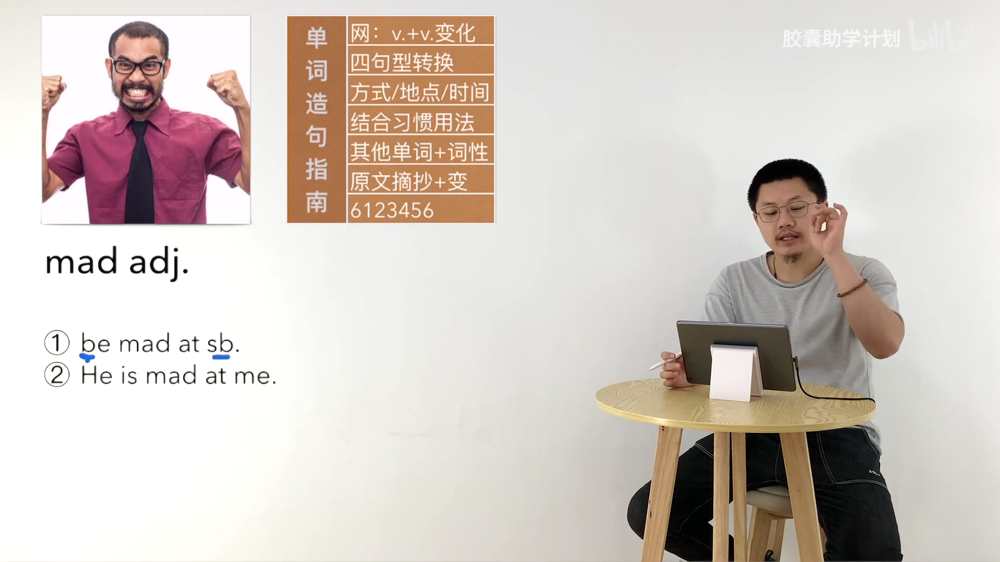

文字识别：单词造句指南 / 网：v.+v.变化 / 胶囊助学计划 / 四句型转换 / 方式/地点/时间 / 结合习惯用法 / 其他单词+词性 / 原文摘抄+变 / 6123456 / mad adj. / ① be mad at sb. / He is mad at me.

### 画面 00:01:11

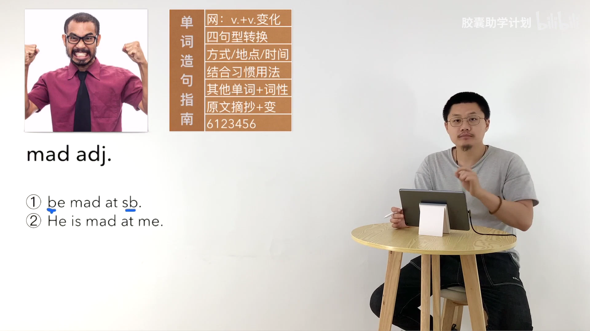

文字识别：单词造句指南 / 网：v.+v.变化 / 胶囊助学计划 / 四句型转换 / 方式/地点/时间 / 结合习惯用法 / 其他单词+词性 / 原文摘抄+变 / 6123456 / mad adj. / ① be mad at sb. / He is mad at me.

### 画面 00:01:16

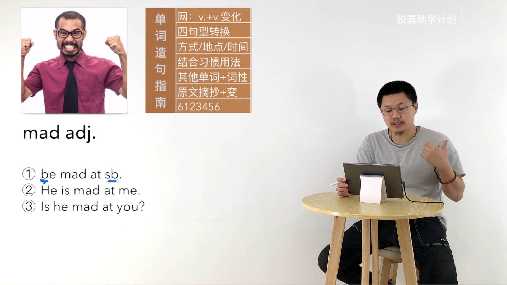

文字识别：单词造句指南 / 网：v.+v.变化 / 胶囊助学计划 / 四句型转换 / 方式/地点/时间 / 结合习惯用法 / 其他单词+词性 / 原文摘抄+变 / 6123456 / mad adj. / ① be mad at sb. / ② He is mad at me. / ③ Is he mad at you?

### 画面 00:01:20

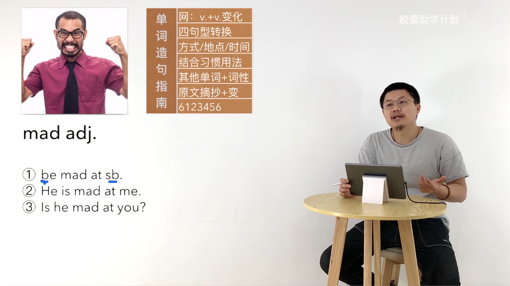

文字识别：单词造句指南 / 网：v.+v.变化 / 四句型转换 / 方式/地点/时间 / 结合习惯用法 / 其他单词+词性 / 原文摘抄+变 / 6123456 / mad adj. / ① be mad at sb. / ② He is mad at me. / ③ Is he mad at you?

### 画面 00:01:25

文字识别：单词造句指南 / 网：v.+v.变化 / 胶囊助学计划 / 四句型转换 / 方式/地点/时间 / 结合习惯用法 / 其他单词+词性 / 原文摘抄+变 / 6123456 / mad adj. / ① be mad at sb. / 2 / ②He is mad at me. / ③ Is he mad at you? / ④ Why is he mad at you?

## 00:01:30–00:02:00

非常简单。这个单词再跟我读一遍，mad， very good。好，那我们直接看一个小的电影片段。这个电影片段当中就出现了叫做 mad at you。OK，注意力集中。Have you been here all night? Yes. Oh Christ. Why am I mad at you already? OK.

### 画面 00:01:32

文字识别：单词造句指南 / 网：v.+v.变化 / 胶囊助学计划 / 四句型转换 / 方式/地点/时间 / 结合习惯用法 / 其他单词+词性 / 原文摘抄+变 / 6123456 / mad adj. / ① be mad at sb. / 2 / ②He is mad at me. / ③ Is he mad at you? / ④ Why is he mad at you?

### 画面 00:01:34

文字识别：mad at you / 胶囊助学计划 / 爱情与灵药 / Love & Other Drugs / (2010)

### 画面 00:01:43

文字识别：mad at you / 胶囊助学计划 / 爱情与灵药 / 你等了一晚上吗 / Love & Other Drugs / Have you been here all night? / (2010)

### 画面 00:01:45

文字识别：mad at you / 爱情与灵药 / 是 / Love & Other Drugs / Yes. / (2010)

### 画面 00:01:47

文字识别：mad at you / 胶囊助学计找 / 爱情与灵药 / Love & Other Drugs / (2010)

### 画面 00:01:49

文字识别：mad at you / 胶囊助学计划 / 爱情与灵药 / Love & Other Drugs / (2010)

### 画面 00:01:51

文字识别：mad at you / 校囊 / 爱情与灵药 / 天哪 / Love & Other Drugs / Oh, Christ! / (2010)

### 画面 00:01:53

文字识别：mad at you / 胶囊助 / 爱情与灵药 / Love & Other Drugs / (2010)

### 画面 00:01:55

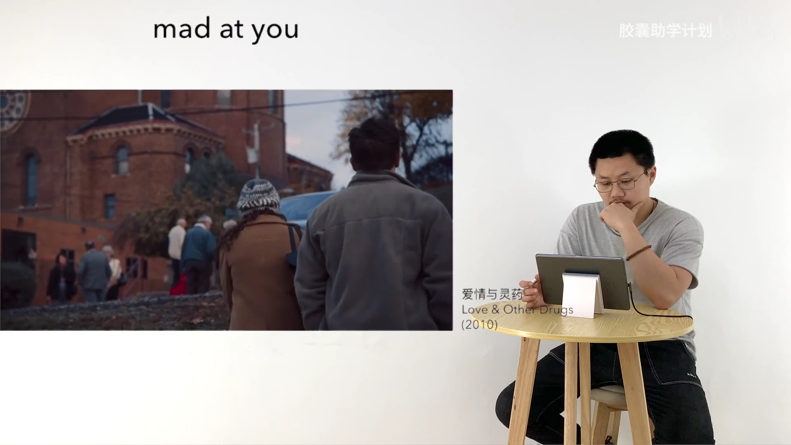

文字识别：mad at you / 交囊 / 爱情与灵药 / Love & Other Drugs / (2010)

### 画面 00:01:57

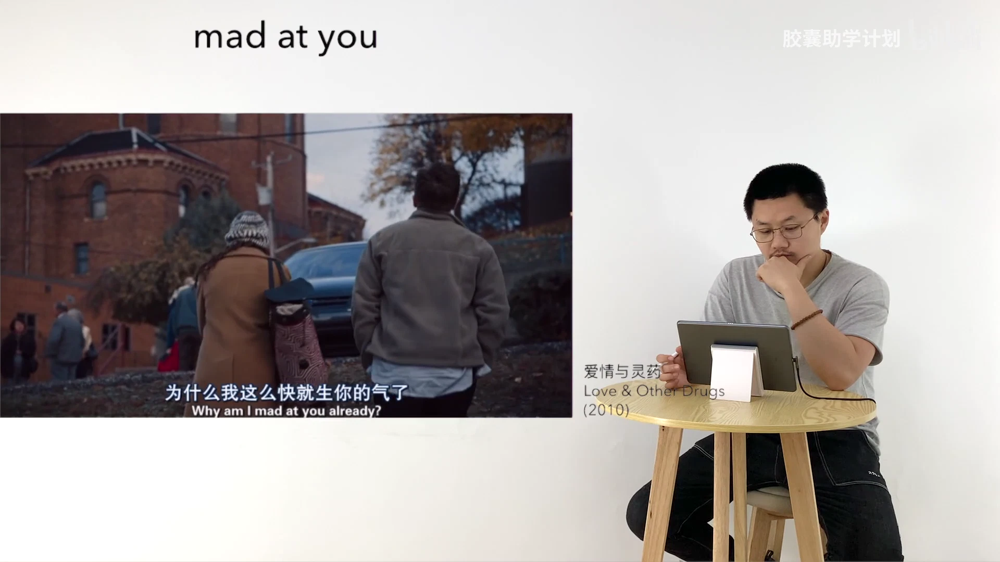

文字识别：mad at you / 胶囊助学 / 爱情与灵药 / 为什么我这么快就生你的气了 / Love & Other Drugs / Why am I mad at you already? / (2010)

### 画面 00:01:59

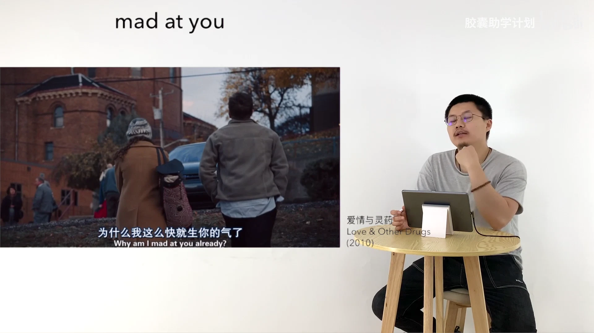

文字识别：mad at you / 爱情与灵药 / 为什么我这么快就生你的气了 / Love & Other Drugs / Why am I mad at you already? / (2010)

## 00:02:00–00:02:30

why am I mad at you already? Why为什么我已经快我已经在生你的气了呢？Okay, one more.好，下一个小的单词跟我读一下，很简单，reason, reason. Okay，叫原因。那这个单词呢，我们文章当中给了大家一个短语，我们直接就拿出来用一下啊，叫做for some reason，叫做出于基于某些原因，我们不知道啊是什么样的原因，但是基于某些原因叫做for some

### 画面 00:02:07

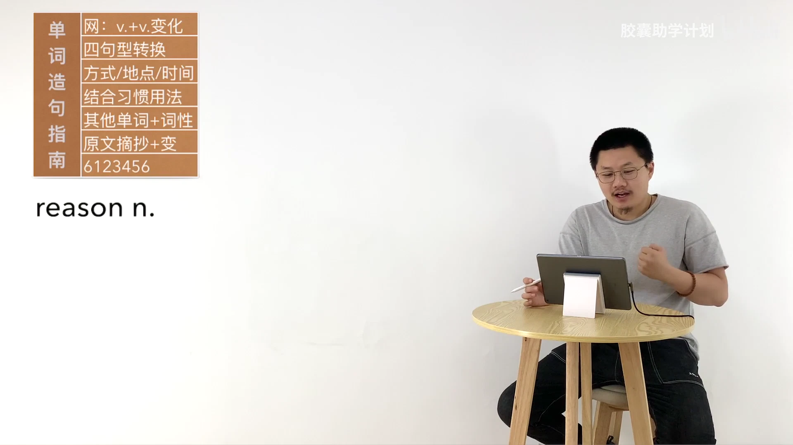

文字识别：单词造句指南 / 网：v.+v.变化 / 胶囊助学计划 / 四句型转换 / 方式/地点/时间 / 结合习惯用法 / 其他单词+词性 / 原文摘抄+变 / 6123456 / reason n.

### 画面 00:02:09

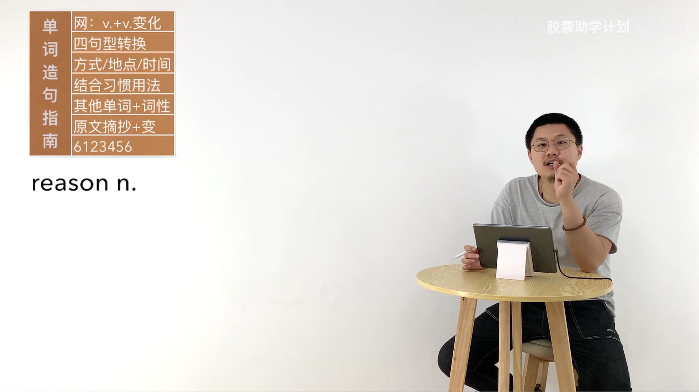

文字识别：单词造句指南 / 网：v.+v.变化 / 四句型转换 / 方式/地点/时间 / 结合习惯用法 / 其他单词+词性 / 原文摘抄+变 / 6123456 / reason n.

### 画面 00:02:11

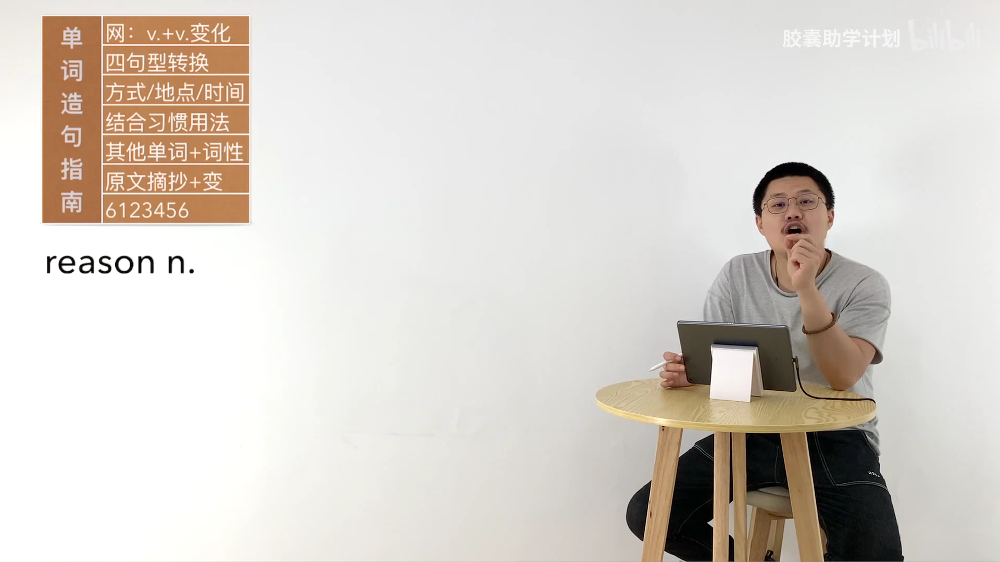

文字识别：单词造句指南 / 网：v.+v.变化 / 胶囊助学计划 / 四句型转换 / 方式/地点/时间 / 结合习惯用法 / 其他单词+词性 / 原文摘抄+变 / 6123456 / reason n.

### 画面 00:02:15

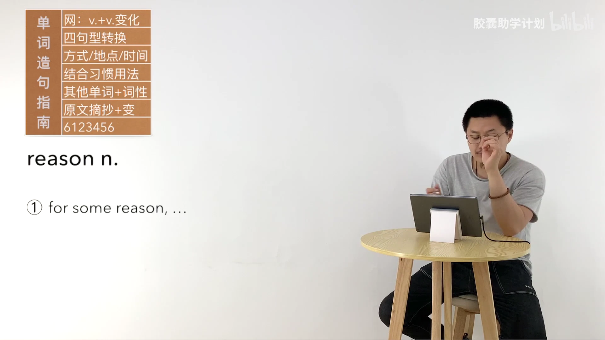

文字识别：单词造句指南 / 网：v.+v.变化 / 胶囊助学计划 / 四句型转换 / 方式/地点/时间 / 结合习惯用法 / 其他单词+词性 / 原文摘抄+变 / 6123456 / reason n. / ① for some reason, …..

### 画面 00:02:17

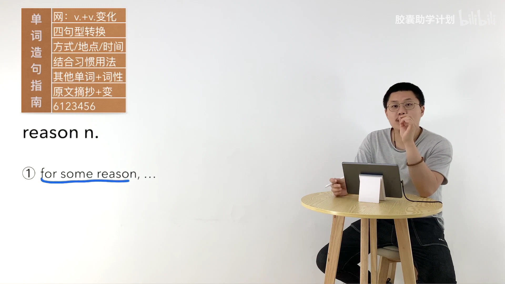

文字识别：单词造句指南 / 网：v.+v.变化 / 胶囊助学计划 / 四句型转换 / 方式/地点/时间 / 结合习惯用法 / 其他单词+词性 / 原文摘抄+变 / 6123456 / reason n. / 1 / ) for some reason, ….

### 画面 00:02:20

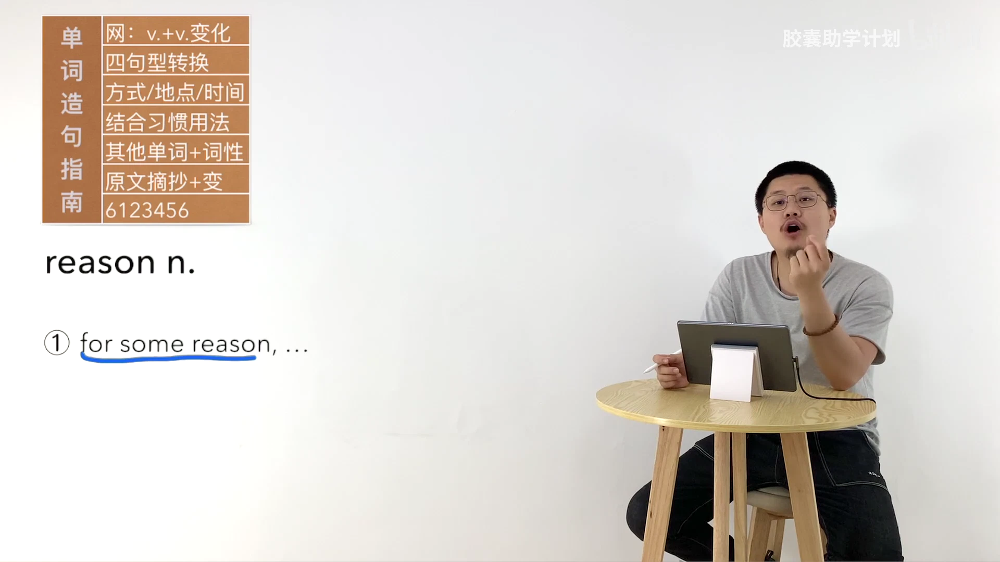

文字识别：单词造句指南 / 网：v.+v.变化 / 胶囊助学计划 / 四句型转换 / 方式/地点/时间 / 结合习惯用法 / 其他单词+词性 / 原文摘抄+变 / 6123456 / reason n. /  for some reason, ….

### 画面 00:02:25

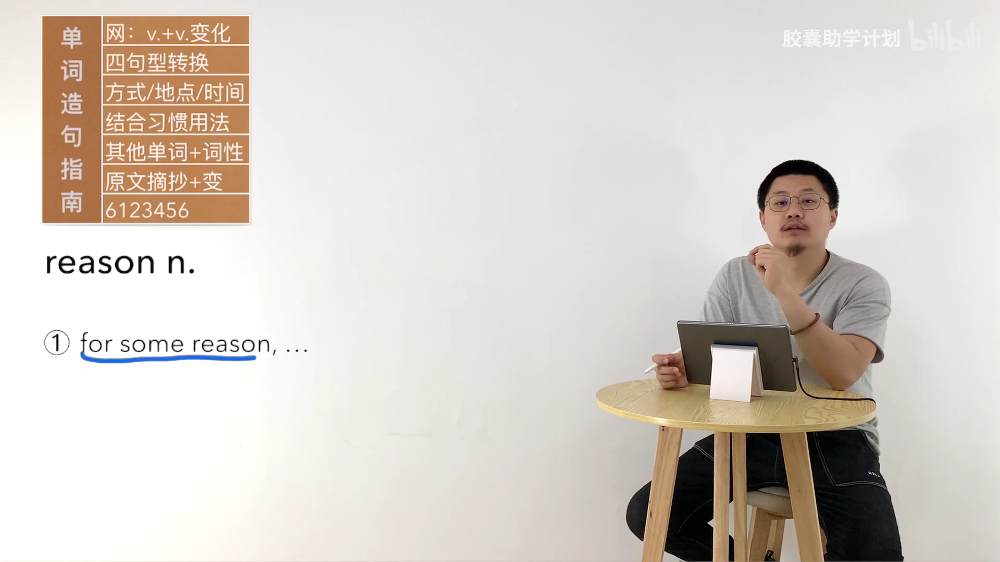

文字识别：单词造句指南 / 网：v.+v.变化 / 胶囊助学计划 / 四句型转换 / 方式/地点/时间 / 结合习惯用法 / 其他单词+词性 / 原文摘抄+变 / 6123456 / reason n. / 1 / for some reason, …..

## 00:02:30–00:03:00

reason。接下来呢，我们结合其他的习惯用法，尝试去造一些句子。OK，比如说 for some reason，你看到它可以放在句首，对吧？OK， he hurried to the hospital。说基于某些原因呢，他匆忙的赶去了医院。那L十九是告诉各位，hurry to some place 是我们十九课学过的习惯用法，我让各位总结出来了，对吧？您可以在笔记本当中自己去找一下啊。他匆忙的赶去了医院。再来说

### 画面 00:02:30

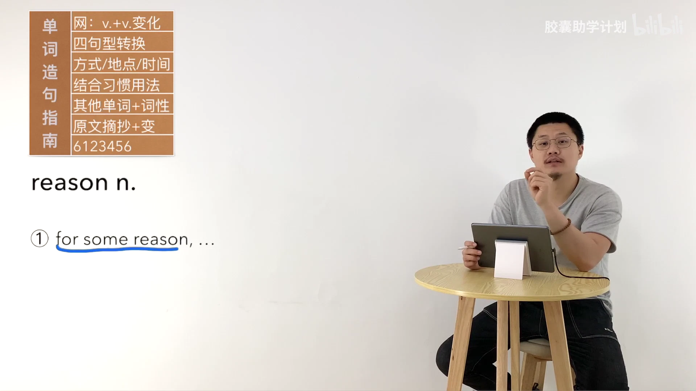

文字识别：单词造句指南 / 网：v.+v.变化 / 胶囊助学计划 / 四句型转换 / 方式/地点/时间 / 结合习惯用法 / 其他单词+词性 / 原文摘抄+变 / 6123456 / reason n. / 1 / for some reason, …..

### 画面 00:02:35

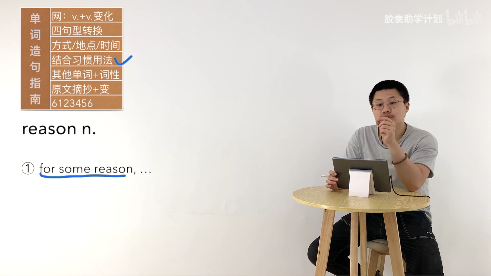

文字识别：单词造句指南 / 网：v.+v.变化 / 胶囊助学计划 / 四句型转换 / 方式/地点/时间 / 结合习惯用法 / 其他单词+词性 / 原文摘抄+变 / 6123456 / reason n. / 1 /  for some reason, ….

### 画面 00:02:37

文字识别：单词造句指南 / 网：v.+v.变化 / 胶囊助学计划 / 四句型转换 / 方式/地点/时间 / 结合习惯用法 / 其他单词+词性 / 原文摘抄+变 / 6123456 / reason n. / for some reason, . / 7 / For some reason, he hurried to the hospital. L19

### 画面 00:02:40

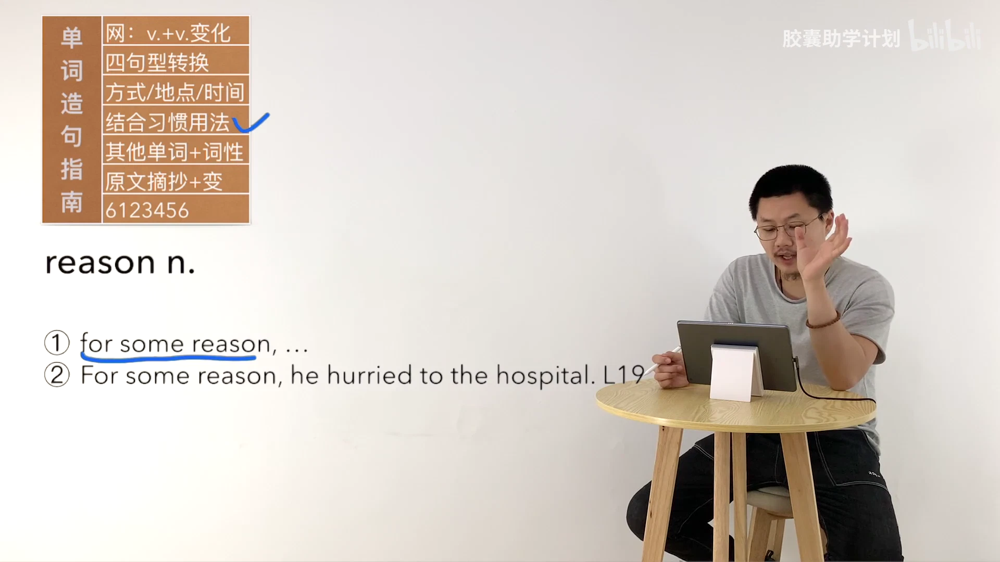

文字识别：单词造句指南 / 网：v.+v.变化 / 胶囊助学计划 / 四句型转换 / 方式/地点/时间 / 结合习惯用法 / 其他单词+词性 / 原文摘抄+变 / 6123456 / reason n. / for some reason, ….. / 7 / For some reason, he hurried to the hospital. L19

### 画面 00:02:45

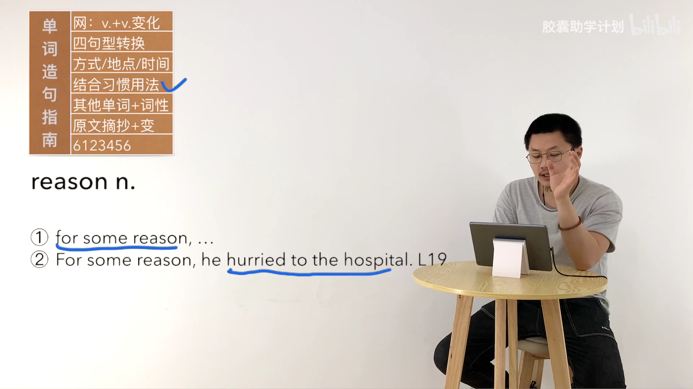

文字识别：单词造句指南 / 网：v.+v.变化 / 胶囊助学计划 / 四句型转换 / 方式/地点/时间 / 结合习惯用法 / 其他单词+词性 / 原文摘抄+变 / 6123456 / reason n. / for some reason, ….. / 7 / For some reason, he hurried to the hospital. L19

### 画面 00:02:48

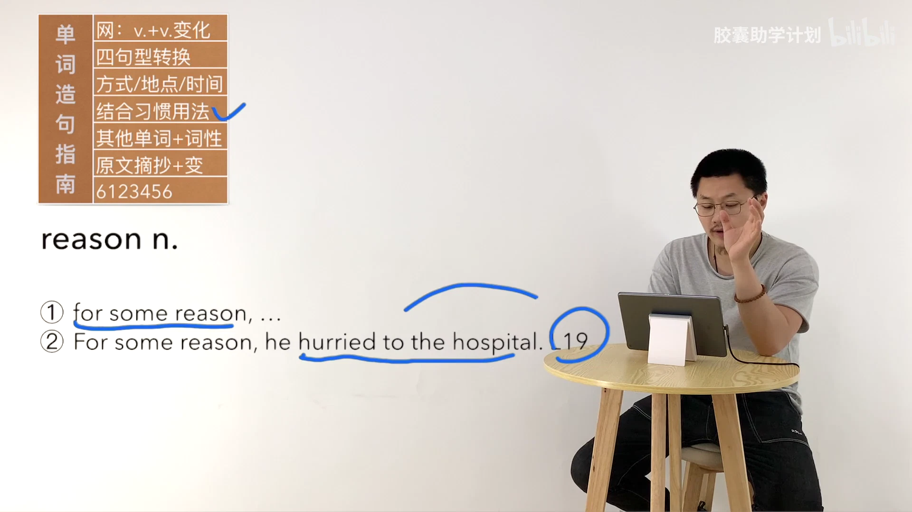

文字识别：单词造句指南 / 网：v.+v.变化 / 胶囊助学计划 / 四句型转换 / 方式/地点/时间 / 结合习惯用法 / 其他单词+词性 / 原文摘抄+变 / 6123456 / reason n. / for some reason, ….. / For some reason, he hurried to the hospital. / 19

### 画面 00:02:50

文字识别：单词造句指南 / 网：v.+v.变化 / 胶囊助学计划 / 四句型转换 / 方式/地点/时间 / 结合习惯用法 / 其他单词+词性 / 原文摘抄+变 / 6123456 / reason n. / for some reason, ….. / For some reason, he hurried to the hospital. / (19

### 画面 00:02:53

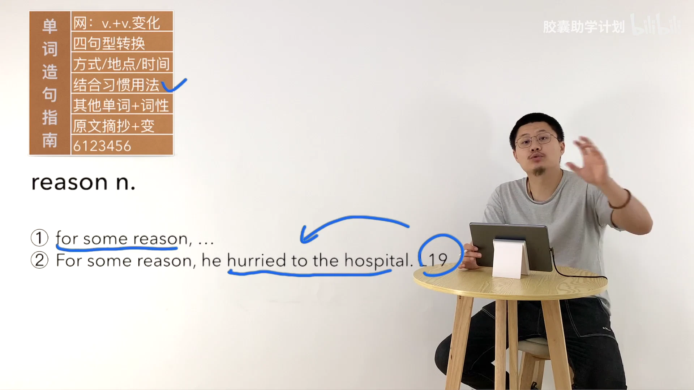

文字识别：单词造句指南 / 网：v.+v.变化 / 胶囊助学计划 / 四句型转换 / 方式/地点/时间 / 结合习惯用法 / 其他单词+词性 / 原文摘抄+变 / 6123456 / reason n. / for some reason, . / For some reason, he hurried to the hospital. / .（19

### 画面 00:02:55

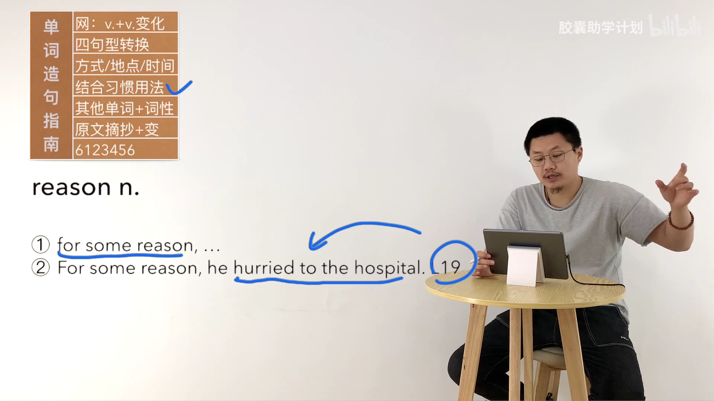

文字识别：单词造句指南 / 网：v.+v.变化 / 胶囊助学计划 / 四句型转换 / 方式/地点/时间 / 结合习惯用法 / 其他单词+词性 / 原文摘抄+变 / 6123456 / reason n. / for some reason, ... / For some reason, he hurried to the hospital. / （19

### 画面 00:02:58

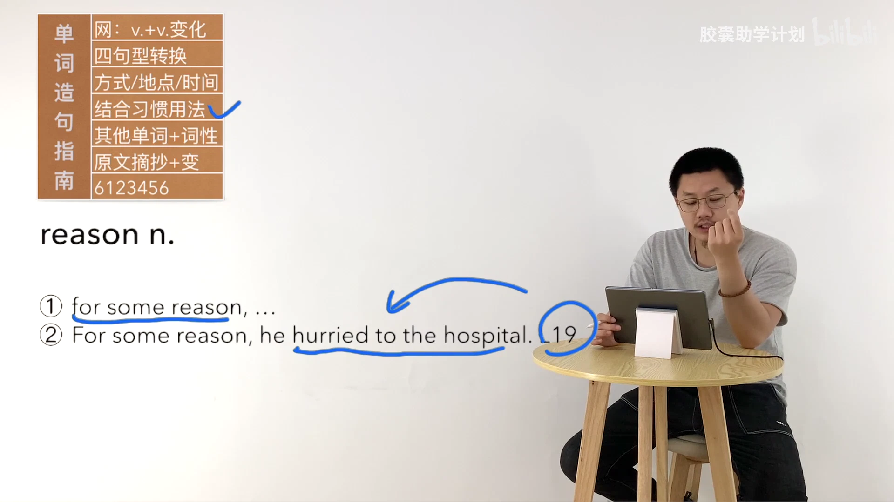

文字识别：单词造句指南 / 网：v.+v.变化 / 胶囊助学计划 / 四句型转换 / 方式/地点/时间 / 结合习惯用法 / 其他单词+词性 / 原文摘抄+变 / 6123456 / reason n. / for some reason, ... / 1 / For some reason, he hurried to the hospital. / .(19

## 00:03:00–00:03:30

for some reason she is keen on fishing.啊，这是我们第二十课呃语法的那个视频当中讲学过的，叫做be keen on doing something，叫热衷于做某些事情，对吧？说出于某些原因，我们也说不好是为什么，对吧？是跟比如说不愿意在家待着呀，还是说他喜欢吃鱼啊？反正我们也说不清。但for some reason啊，基于某些原因，she is keen on fishing. Okay, continue.说

### 画面 00:03:00

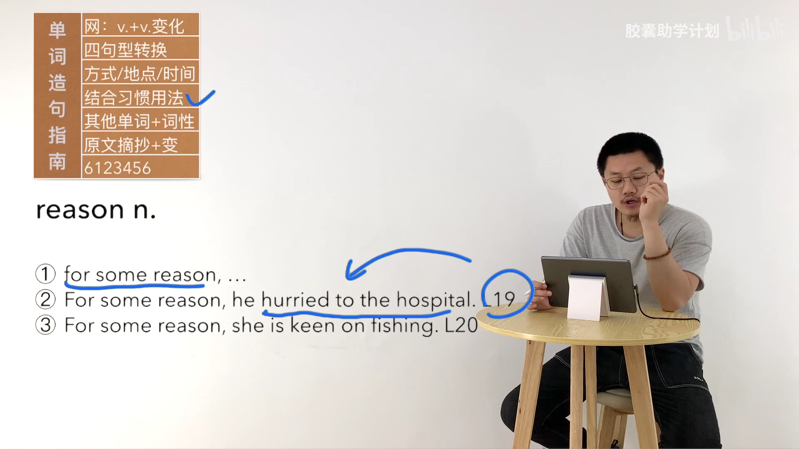

文字识别：单词造句指南 / 网：v.+v.变化 / 胶囊助学计划 / 四句型转换 / 方式/地点/时间 / 结合习惯用法 / 其他单词+词性 / 原文摘抄+变 / 6123456 / reason n. / for some reason, ... / For some reason, he hurried to the hospital. / For some reason, she is keen on fishing. L20

### 画面 00:03:05

文字识别：单词造句指南 / 网：v.+v.变化 / 胶囊助学计划 / 四句型转换 / 方式/地点/时间 / 结合习惯用法 / 其他单词+词性 / 原文摘抄+变 / 6123456 / reason n. / for some reason, ….. / For some reason, he hurried to the hospital. / 19 / For some reason, she is keen on fishing. L20

### 画面 00:03:10

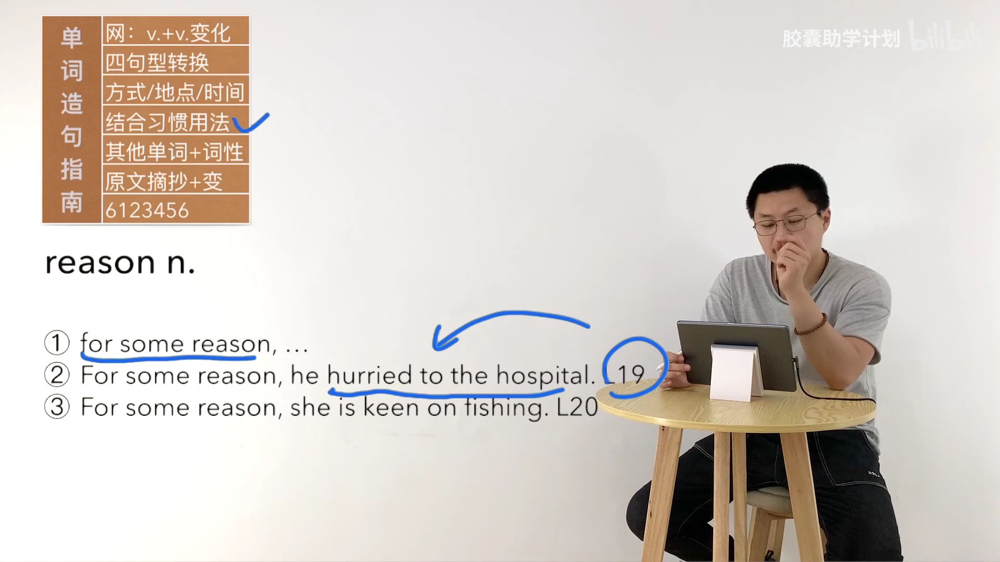

文字识别：单词造句指南 / 网：v.+v.变化 / 胶囊助学计划 / 四句型转换 / 方式/地点/时间 / 结合习惯用法 / 其他单词+词性 / 原文摘抄+变 / 6123456 / reason n. / for some reason, ….. / For some reason, he hurried to the hospital. / 19 / For some reason, she is keen on fishing. L20

### 画面 00:03:15

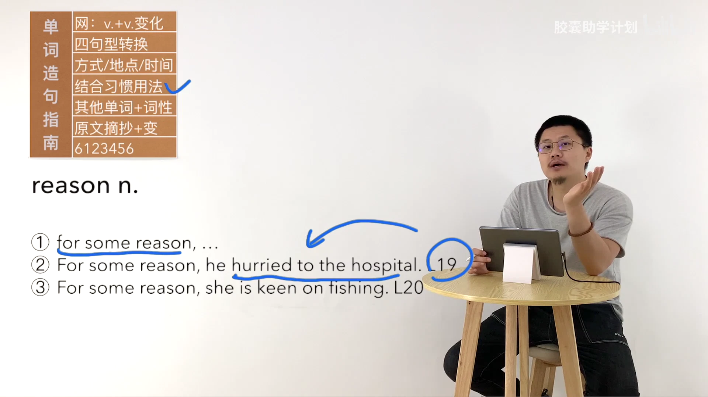

文字识别：单词造句指南 / 网：v.+v.变化 / 胶囊助学计划 / 四句型转换 / 方式/地点/时间 / 结合习惯用法 / 其他单词+词性 / 原文摘抄+变 / 6123456 / reason n. / for some reason, ... / 1 / For some reason, he hurried to the hospital. / 19 / For some reason, she is keen on fishing. L20

### 画面 00:03:20

文字识别：单词造句指南 / 网：v.+v.变化 / 胶囊助学计划 / 四句型转换 / 方式/地点/时间 / 结合习惯用法 / 其他单词+词性 / 原文摘抄+变 / 6123456 / reason n. / for some reason, ... / For some reason, he hurried to the hospital. / For some reason, she is keen on fishing. L20

### 画面 00:03:25

文字识别：单词造句指南 / 网：v.+v.变化 / 胶囊助学计划 / 四句型转换 / 方式/地点/时间 / 结合习惯用法 / 其他单词+词性 / 原文摘抄+变 / 6123456 / reason n. / for some reason, . / For some reason, he hurried to the hospital. / C19 / For some reason, she is keen on tfishing. L20

### 画面 00:03:29

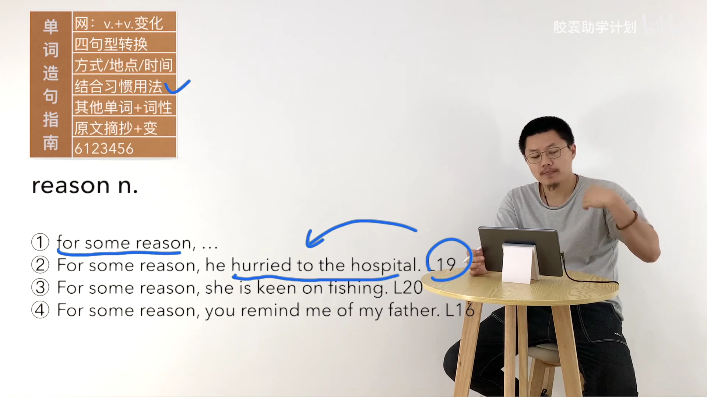

文字识别：单词造句指南 / 网：v.+v.变化 / 胶囊助学计划 / 四句型转换 / 方式/地点/时间 / 结合习惯用法 / 其他单词+词性 / 原文摘抄+变 / 6123456 / reason n. / 1 / for some reason, ... / For some reason, he hurried to the hospital. / 19 / For some reason, she is keen on fishing. L20 / 3 /  For some reason, you remind me of my father. L16

## 00:03:30–00:04:00

some reason. Okay, the sixteenth lesson is called you remind me of my father. Okay, based on some reasons, you remind me of my father. Okay, there you go. Next, the next little word is also very simple. Pay attention to this. You see, we basically don't use phonetic symbols. We know s s makes s sound, m makes m sound. You, you think about but that word, right? But it makes a sound. This is one of

### 画面 00:03:32

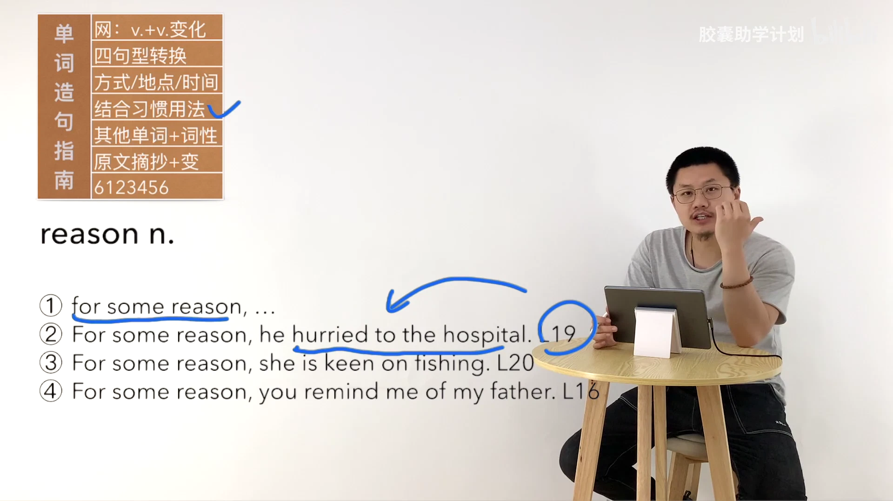

文字识别：单词造句指南 / 网：v.+v.变化 / 胶囊助学计划 / 四句型转换 / 方式/地点/时间 / 结合习惯用法 / 其他单词+词性 / 原文摘抄+变 / 6123456 / reason n. / 1 / for some reason, ... / For some reason, he hurried to the hospital. / （19 / For some reason, she is keen on fishing. L20 / 3 /  For some reason, you remind me of my father. L16

### 画面 00:03:36

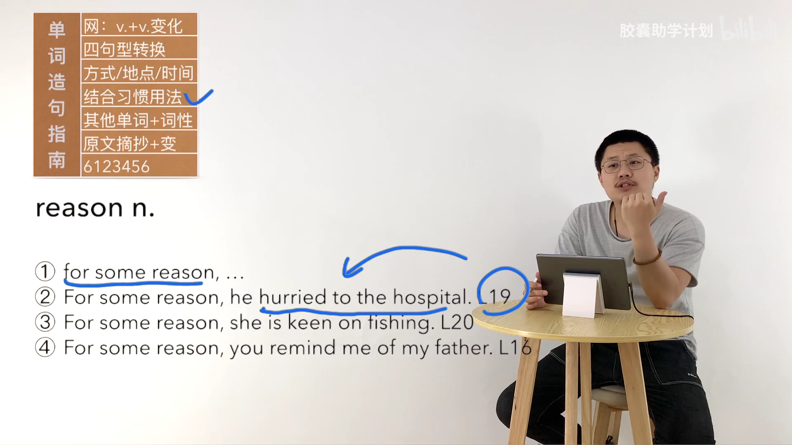

文字识别：单词造句指南 / 网：v.+v.变化 / 胶囊助学计划 / 四句型转换 / 方式/地点/时间 / 结合习惯用法 / 其他单词+词性 / 原文摘抄+变 / 6123456 / reason n. / 1 / for some reason, ... / For some reason, he hurried to the hospital. / 19 / For some reason, she is keen on fishing. L20 / 3 /  For some reason, you remind me of my father. L16

### 画面 00:03:40

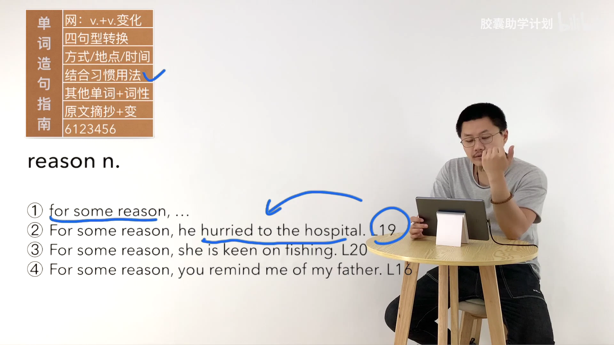

文字识别：单词造句指南 / 网：v.+v.变化 / 胶囊助学计划 / 四句型转换 / 方式/地点/时间 / 结合习惯用法 / 其他单词+词性 / 原文摘抄+变 / 6123456 / reason n. / 1 / for some reason, ... / For some reason, he hurried to the hospital. / （19 / For some reason, she is keen on fishing. L20 / 3 /  For some reason, you remind me of my father. L16

### 画面 00:03:43

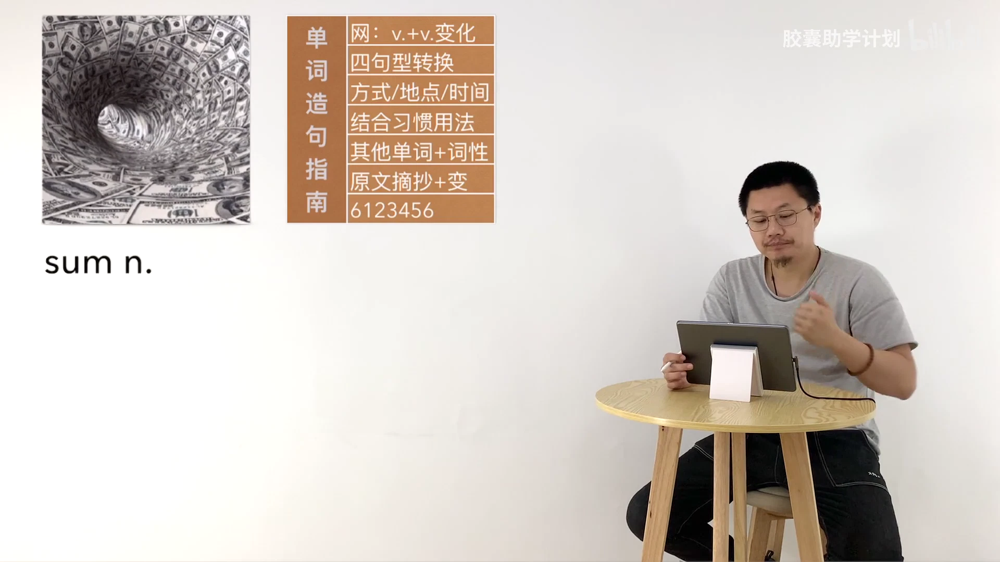

文字识别：单词造句指南 / 网：v.+v.变化 / 胶囊助学计划 / 四句型转换 / 方式/地点/时间 / 结合习惯用法 / 其他单词+词性 / 原文摘抄+变 / 6123456 / sum n.

### 画面 00:03:45

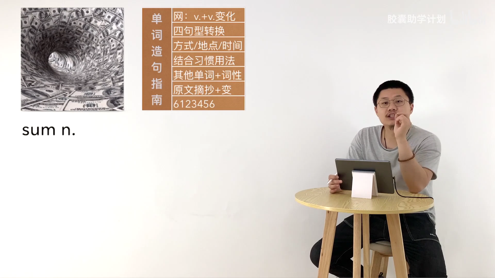

文字识别：单词造句指南 / 网：v.+v.变化 / 四句型转换 / 方式/地点/时间 / 结合习惯用法 / 其他单词+词性 / 原文摘抄+变 / 6123456 / sum n.

### 画面 00:03:50

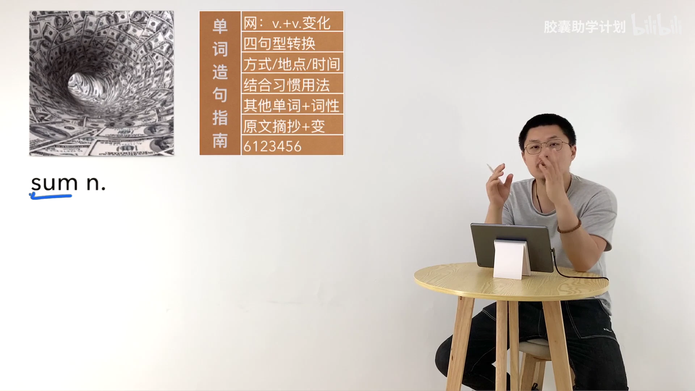

文字识别：单词造句指南 / 网：v.+v.变化 / 胶囊助学计划 / 四句型转换 / 方式/地点/时间 / 结合习惯用法 / 其他单词+词性 / 原文摘抄+变 / 6123456 / sum n.

## 00:04:00–00:04:30

啊的音啊，这是它的可能性之一，在这儿就是发啊，所以这个单词我们管它叫做some，some，呃，它的发音和这个单词的发音几乎是一样的，就是some any那个some，对吧？好，那它其实我们在这儿呢，给它来一个小的短语，叫a large sum of大量的。那我们现在就直接给大家一个叫做a large sum of money。其实呢，你比如说，那你说它和a lot of

### 画面 00:04:02

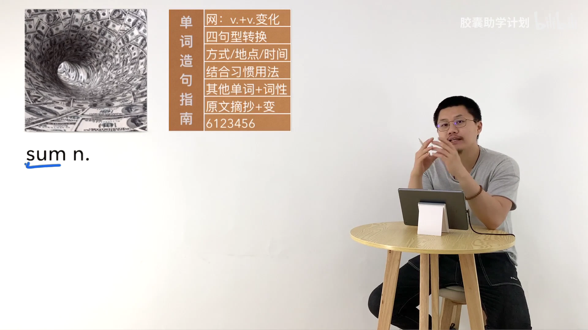

文字识别：单词造句指南 / 网：v.+v.变化 / 胶囊助学计划 / 四句型转换 / 方式/地点/时间 / 结合习惯用法 / 其他单词+词性 / 原文摘抄+变 / 6123456 / sum n.

### 画面 00:04:05

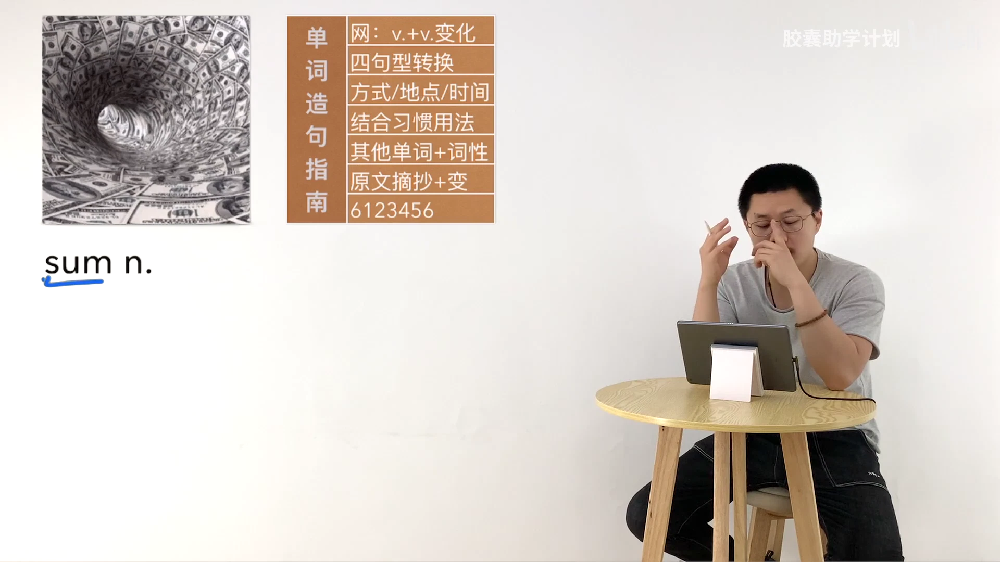

文字识别：单词造句指南 / 网：v.+v.变化 / 四句型转换 / 方式/地点/时间 / 结合习惯用法 / 其他单词+词性 / 原文摘抄+变 / 6123456 / sum n.

### 画面 00:04:10

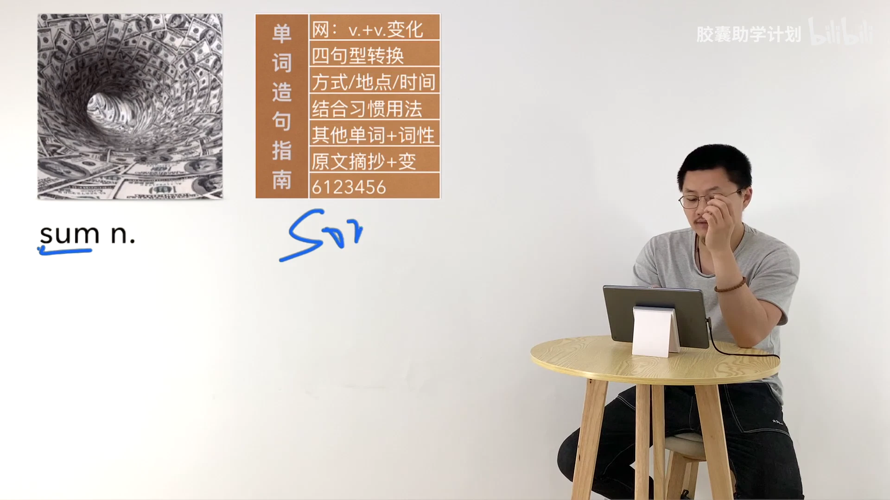

文字识别：单词造句指南 / 网：v.+v.变化 / 胶囊助学计划 / 四句型转换 / 方式/地点/时间 / 结合习惯用法 / 其他单词+词性 / 原文摘抄+变 / 6123456 / sum n.

### 画面 00:04:12

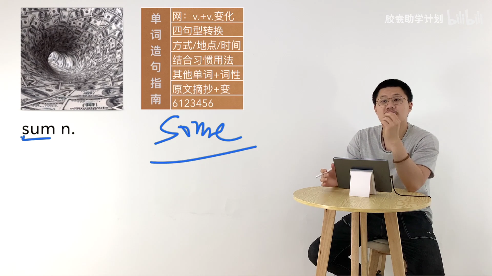

文字识别：单词造句指南 / 网：v.+v.变化 / 胶囊助学计划 / 四句型转换 / 方式/地点/时间 / 结合习惯用法 / 其他单词+词性 / 原文摘抄+变 / 6123456 / Some / sum n.

### 画面 00:04:15

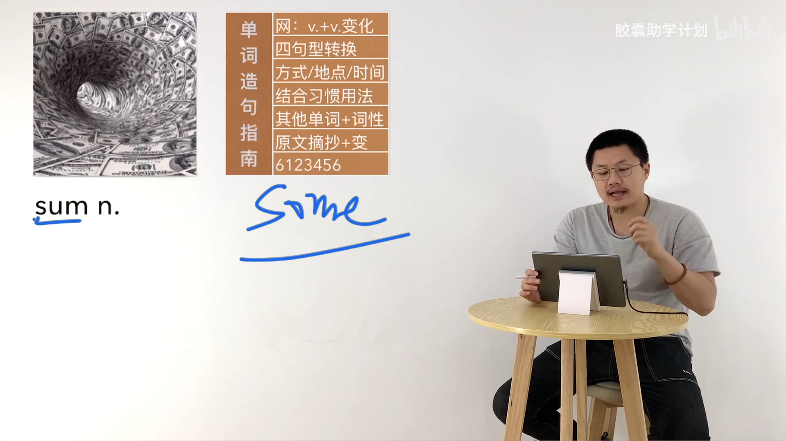

文字识别：单词造句指南 / 网：v.+v.变化 / 胶囊助学计划 / 四句型转换 / 方式/地点/时间 / 结合习惯用法 / 其他单词+词性 / 原文摘抄+变 / 6123456 / Some / sum n.

### 画面 00:04:17

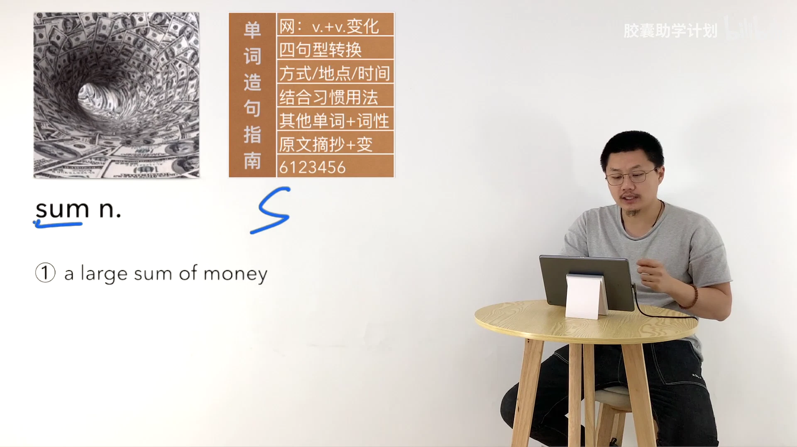

文字识别：单词造句指南 / 网：v.+v.变化 / 胶囊助学计划 / 四句型转换 / 方式/地点/时间 / 结合习惯用法 / 其他单词+词性 / 原文摘抄+变 / 6123456 / sum n. / ① a large sum of money

### 画面 00:04:19

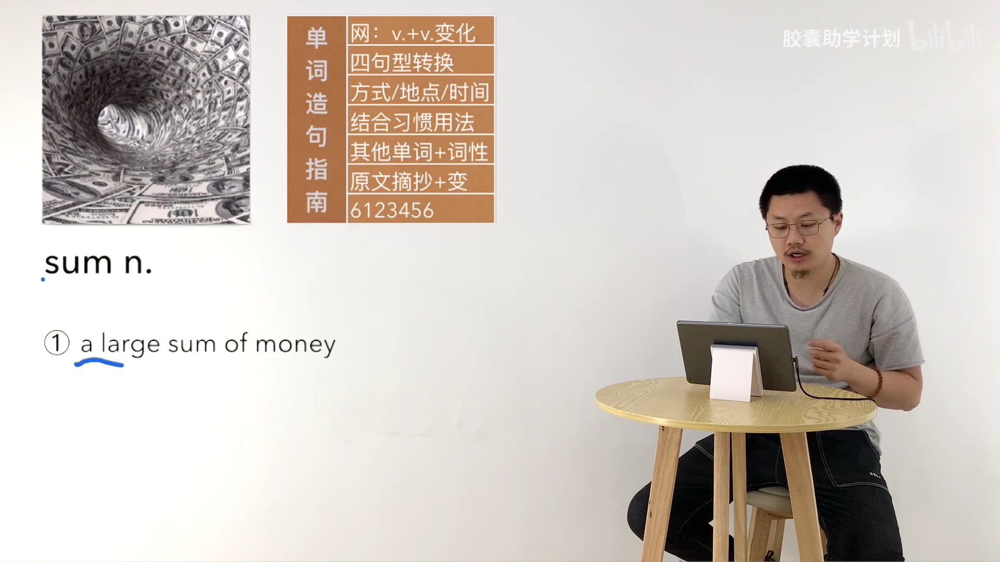

文字识别：单词造句指南 / 网：v.+v.变化 / 胶囊助学计划 / 四句型转换 / 方式/地点/时间 / 结合习惯用法 / 其他单词+词性 / 原文摘抄+变 / 6123456 / sum n. / ①a large sum of money

### 画面 00:04:21

文字识别：单词造句指南 / 网：v.+v.变化 / 胶囊助学计划 / 四句型转换 / 方式/地点/时间 / 结合习惯用法 / 其他单词+词性 / 原文摘抄+变 / 6123456 / sum n. /  a large sum of money / 1

### 画面 00:04:25

文字识别：单词造句指南 / 网：v.+v.变化 / 胶囊助学计划 / 四句型转换 / 方式/地点/时间 / 结合习惯用法 / 其他单词+词性 / 原文摘抄+变 / 6123456 / sum n. / a large sum of money

## 00:04:30–00:05:00

有什么明显的区别吗？其实并没有，大概的意思都是表达许多、大量、充足的啊，都是往这个方向去走。你可以理解为是同义词啊，叫做 a large sum of money。来，那我们造句子说 a large sum of money。好，这儿注意一个小点，其实 a large sum of money 这地方你要造句的时候，核心点是 money，它是名词。a large sum of 它其实有点像 some, any, a

### 画面 00:04:30

文字识别：单词造句指南 / 网：v.+v.变化 / 胶囊助学计划 / 四句型转换 / 方式/地点/时间 / 结合习惯用法 / 其他单词+词性 / 原文摘抄+变 / 6123456 / sum n. /  a large sum of money

### 画面 00:04:35

文字识别：单词造句指南 / 网：v.+v.变化 / 胶囊助学计划 / 四句型转换 / 方式/地点/时间 / 结合习惯用法 / 其他单词+词性 / 原文摘抄+变 / 6123456 / sum n. / a large sum of money / 7

### 画面 00:04:40

文字识别：单词造句指南 / 网：v.+v.变化 / 胶囊助学计划 / 四句型转换 / 方式/地点/时间 / 结合习惯用法 / 其他单词+词性 / 原文摘抄+变 / 6123456 / sum n. /  a large sum of money

### 画面 00:04:43

文字识别：单词造句指南 / 网：v.+v.变化 / 胶囊助学计划 / 四句型转换 / 方式/地点/时间 / 结合习惯用法 / 其他单词+词性 / 原文摘抄+变 / 6123456 / sum n. / a large sum of money / 1

### 画面 00:04:45

文字识别：单词造句指南 / 网：v.+v.变化 / 胶囊助学计划 / 四句型转换 / 方式/地点/时间 / 结合习惯用法 / 其他单词+词性 / 原文摘抄+变 / 6123456 / sum n. / a large sum of money / A Targe sum of money was stolen last night. L10

### 画面 00:04:50

文字识别：单词造句指南 / 网：v.+v.变化 / 胶囊助学计划 / 四句型转换 / 方式/地点/时间 / 结合习惯用法 / 其他单词+词性 / 原文摘抄+变 / 6123456 / sum n. / a large sum ofmoney / A Targe sum of money was stolen last night. L10

### 画面 00:04:53

文字识别：单词造句指南 / 网：v.+v.变化 / 胶囊助学计划 / 四句型转换 / 方式/地点/时间 / 结合习惯用法 / 其他单词+词性 / 原文摘抄+变 / 6123456 / sum n. / n / a large sum of money / A Targe sum of money was stolen last night. L10

### 画面 00:04:56

文字识别：单词造句指南 / 网：v.+v.变化 / 胶囊助学计划 / 四句型转换 / 方式/地点/时间 / 结合习惯用法 / 其他单词+词性 / 原文摘抄+变 / 6123456 / sum n. / n / a large sum of money / A Targe sum of money was stolen last night. L10

## 00:05:00–00:05:30

lot of, many, much, ah, plenty of 这些单词一样, a great number of. 它们某种程度上我们管它叫限定词啊, 是放在名词前面去做一个限定的。所以造句子的时候, 我们由名词去考虑造句, 也就是结合六页三四五六。比如说, a large sum of money was stolen last night. 你看到这里面的 a large sum of money 在句子当中就是做到了一, 对吧? 哎, 它就是一个主语, 这是一个被动。

### 画面 00:05:01

文字识别：单词造句指南 / 网：v.+v.变化 / 胶囊助学计划 / 四句型转换 / 方式/地点/时间 / 结合习惯用法 / 其他单词+词性 / 原文摘抄+变 / 6123456 / sum n. / n. / a large sum of money / A Targe sum of money was stolen last night. L10

### 画面 00:05:10

文字识别：单词造句指南 / 网：v.+v.变化 / 胶囊助学计划 / 四句型转换 / 方式/地点/时间 / 结合习惯用法 / 其他单词+词性 / 原文摘抄+变 / 6123456 / sum n. / n / a large sum of money / A large sum of money was stolen last night. L10

### 画面 00:05:15

文字识别：单词造句指南 / 网：v.+v.变化 / 胶囊助学计划 / 四句型转换 / 方式/地点/时间 / 结合习惯用法 / 其他单词+词性 / 原文摘抄+变 / 6123456 / sum n. / n / a large sum of money / A Targe sum of money was stolen last night. L10

### 画面 00:05:17

文字识别：单词造句指南 / 网：v.+v.变化 / 胶囊助学计划 / 四句型转换 / 方式/地点/时间 / 结合习惯用法 / 其他单词+词性 / 原文摘抄+变 / 6123456 / sum n. / a large sum of money / Alarge sum / of money was stolen last night. L10

### 画面 00:05:19

文字识别：单词造句指南 / 网：v.+v.变化 / 胶囊助学计划 / 四句型转换 / 方式/地点/时间 / 结合习惯用法 / 其他单词+词性 / 原文摘抄+变 / 6123456 / sum n. / n / a large / sum / of money / Alarge / sum / of / money / was stolen last night. L10

### 画面 00:05:21

文字识别：单词造句指南 / 网：v.+v.变化 / 胶囊助学计划 / 四句型转换 / 方式/地点/时间 / 结合习惯用法 / 其他单词+词性 / 原文摘抄+变 / 6123456 / sum n. / a large / sum / ofmoney / Alarge / sum / of / money / was stolenlast night. L10

### 画面 00:05:27

文字识别：单词造句指南 / 网：v.+v.变化 / 胶囊助学计划 / 四句型转换 / 方式/地点/时间 / 结合习惯用法 / 其他单词+词性 / 原文摘抄+变 / 6123456 / sum n. / n / a large / sum / ofmoney / Alarge / sum / of / money / was stolenlast night. L10

## 00:05:30–00:06:00

再来说，He must have paid a large sum of money。他当时一定是支付了大量的钱。OK，你看这是我们十七课学过叫 must have done。那在这句话当中，a large sum of money 其实就是做了一个宾语，对吧？OK，还有一个，那我们看再来一个句子叫做 He borrowed a large sum of money from me。这个我们就不是看六二三四五六了，我

### 画面 00:05:30

文字识别：单词造句指南 / 网：v.+v.变化 / 胶囊助学计划 / 四句型转换 / 方式/地点/时间 / 结合习惯用法 / 其他单词+词性 / 原文摘抄+变 / 6123456 / sum n. / n / a large sum of money / 7 / A Targe sum of money was stolen last night. L10 / He must have paid a large sum of money. L17

### 画面 00:05:34

文字识别：单词造句指南 / 网：v.+v.变化 / 胶囊助学计划 / 四句型转换 / 方式/地点/时间 / 结合习惯用法 / 其他单词+词性 / 原文摘抄+变 / 6123456 / sum n. / n. / 1 / a large sum of money / A Targe sum of money was stolen last night. L10 / He must have paid a large sum of money. L17

### 画面 00:05:36

文字识别：单词造句指南 / 网：v.+v.变化 / 胶囊助学计划 / 四句型转换 / 方式/地点/时间 / 结合习惯用法 / 其他单词+词性 / 原文摘抄+变 / 6123456 / sum n. / n. / a large sum of money / 1 / A Targe sum of money was stolen last night. L10 / 2 / He must have paid a large sum of money. L17

### 画面 00:05:43

文字识别：单词造句指南 / 网：v.+v.变化 / 四句型转换 / 方式/地点/时间 / 结合习惯用法 / 其他单词+词性 / 原文摘抄+变 / 6123456 / sum n. / n / a large sum of money / 1 / A Targe sum of money was stolen last night. L10 / 2 / He must have paid a large sum of money. L17

### 画面 00:05:45

文字识别：单词造句指南 / 网：v.+v.变化 / 胶囊助学计划 / 四句型转换 / 方式/地点/时间 / 结合习惯用法 / 其他单词+词性 / 原文摘抄+变 / 6123456 / sum n. / n / a large sum of money / A Targe sum of money was stolen last night. L10 / He must have paida large sum of money. L17

### 画面 00:05:47

文字识别：单词造句指南 / 网：v.+v.变化 / 胶囊助学计划 / 四句型转换 / 方式/地点/时间 / 结合习惯用法 / 其他单词+词性 / 原文摘抄+变 / 6123456 / sum n. / n / a large sum of money / A Targe sum of money was stolen last night. L10 / He must have paida large sum of money. / L17

### 画面 00:05:50

文字识别：单词造句指南 / 网：v.+v.变化 / 胶囊助学计划 / 四句型转换 / 方式/地点/时间 / 结合习惯用法 / 其他单词+词性 / 原文摘抄+变 / 6123456 / sum n. / n / a large / sum / ofmoney / A / Targe / sum / of / money was stolen last night. L10 / He / must have paida large sum of money. / L17 / He / borrowed a largo si / Tme.L1

### 画面 00:05:52

文字识别：单词造句指南 / 网：v.+v.变化 / 胶囊助学计划 / 四句型转换 / 方式/地点/时间 / 结合习惯用法 / 其他单词+词性 / 原文摘抄+变 / 6123456 / sum n. / n. / ①a large sum ofmoney / A Targe sum of money was stolen last night. L10 / 2 / He must have paid a large sum of money. L17 / 3 / He borrowed a large sum of money from me. L11

### 画面 00:05:55

文字识别：单词造句指南 / 网：v.+v.变化 / 四句型转换 / 方式/地点/时间 / 结合习惯用法 / 其他单词+词性 / 原文摘抄+变 / 6123456 / sum n. / n / a large sum of money / 1 / A Targe sum of money was stolen last night. L10 / 2 / He must have paid a large sum of money. L17 / He borrowed a large sum of money from me. L11

## 00:06:00–00:06:30

们实际上是结合了一下其他的习惯用法。第十一课学过叫 borrow something from somebody，OK，哪一个？好，接下来最后一个单词跟我读一下，叫做 determined。determined，好了，注意它虽然是 e d 结尾的，但是你看它的词性，所以在这儿要明白一件事情，虽然我们说这个逻辑是动词加 e d 变过去式或过去分词，

### 画面 00:06:00

文字识别：单词造句指南 / 网：v.+v.变化 / 胶囊助学计划 / 四句型转换 / 方式/地点/时间 / 结合习惯用法 / 其他单词+词性 / 原文摘抄+变 / 6123456 / sum n. / n / D a large sum of money / 1 / A Targe sum of money was stolen last night. L10 / 2 / He must have paid a large sum of money. L17 / 3 /  He borrowed a large sum of money from me. L11

### 画面 00:06:03

文字识别：单词造句指南 / 网：v.+v.变化 / 胶囊助学计划 / 四句型转换 / 方式/地点/时间 / 结合习惯用法 / 其他单词+词性 / 原文摘抄+变 / 6123456 / sum n. / n. / D a large sum ofmoney / 1 / A Targe sum of money was stolen last night. L10 / 2 / He must have paid a large sum of money. L17 /  He borrowed a large sum of money from me. L11

### 画面 00:06:05

文字识别：单词造句指南 / 网：v.+v.变化 / 胶囊助学计划 / 四句型转换 / 方式/地点/时间 / 结合习惯用法 / 其他单词+词性 / 原文摘抄+变 / 6123456 / sum n. / n / a large sum of money / 1 / A Targe sum of money was stolen last night. L10 / 2 / He must have paid a large sum of money. L17 / He borrowed a large sum of money from me. L11

### 画面 00:06:07

文字识别：单词造句指南 / 网：v.+v.变化 / 胶囊助学计划 / 四句型转换 / 方式/地点/时间 / 结合习惯用法 / 其他单词+词性 / 原文摘抄+变 / 6123456 / sum n. / n / alarge sum of money / 1 / A Targe sum of money was stolen last night. L10 / 2 / He must have paid a large sum of money. L17 / He borrowed a large sum of money from me. L11

### 画面 00:06:10

文字识别：单词造句指南 / 网：v.+v.变化 / 胶囊助学计划 / 四句型转换 / 方式/地点/时间 / 结合习惯用法 / 其他单词+词性 / 原文摘抄+变 / Iam determined. / 6123456 / determined adj.

### 画面 00:06:15

文字识别：单词造句指南 / 网：v.+v.变化 / 胶囊助学计划 / 四句型转换 / 方式/地点/时间 / 结合习惯用法 / 其他单词+词性 / 原文摘抄+变 / am determined. / 6123456 / determined adj.

### 画面 00:06:20

文字识别：单词造句指南 / 网：v.+v.变化 / 胶囊助学计划 / 四句型转换 / 方式/地点/时间 / 结合习惯用法 / 其他单词+词性 / 原文摘抄+变 / Iam determined. / 6123456 / determined adj.

### 画面 00:06:25

文字识别：单词造句指南 / 网：v.+v.变化 / 胶囊助学计划 / 四句型转换 / 方式/地点/时间 / 结合习惯用法 / 其他单词+词性 / 原文摘抄+变 / Iam determined. / 6123456 / determined adj.

## 00:06:30–00:07:00

但不是说不能反推，也就是说不是说一个单词如果后边是 e d 结尾，它必是动词的过去式或动句过去分词啊，在这儿就是个形容词，对吧？ Determined. Okay, 那它呢经常出现的一个短语叫做 be determined to do something. 好，叫下定决心去做某件事情。比如说我们拿它造句啊，文章当中一会儿也会出现。我们待会儿学视频的时候啊，学文章那个视频的时候，

### 画面 00:06:30

文字识别：单词造句指南 / 网：v.+v.变化 / 胶囊助学计划 / 四句型转换 / 方式/地点/时间 / 结合习惯用法 / 其他单词+词性 / 原文摘抄+变 / am determined. / 6123456 / determined adj.

### 画面 00:06:34

文字识别：单词造句指南 / 网：v.+v.变化 / 胶囊助学计划 / 四句型转换 / 方式/地点/时间 / 结合习惯用法 / 其他单词+词性 / 原文摘抄+变 / am determined. / 6123456 / determined adj.

### 画面 00:06:36

文字识别：单词造句指南 / 网：v.+v.变化 / 胶囊助学计划 / 四句型转换 / 方式/地点/时间 / 结合习惯用法 / 其他单词+词性 / 原文摘抄+变 / am determined. / 6123456 / determined adj.

### 画面 00:06:40

文字识别：单词造句指南 / 网：v.+v.变化 / 四句型转换 / 方式/地点/时间 / 结合习惯用法 / 其他单词+词性 / 原文摘抄+变 / C / Iam determined. / 6123456 / determined adj.

### 画面 00:06:45

文字识别：单词造句指南 / 网：v.+v.变化 / 胶囊助学计划 / 四句型转换 / 方式/地点/时间 / 结合习惯用法 / 其他单词+词性 / 原文摘抄+变 / Iam determined. / 6123456 / determined adj. / ① be determined to do sth.

### 画面 00:06:48

文字识别：单词造句指南 / 网：v.+v.变化 / 胶囊助学计划 / 四句型转换 / 方式/地点/时间 / 结合习惯用法 / 其他单词+词性 / 原文摘抄+变 / am determined. / 6123456 / determined adj. / 1 / Dbe determined to do sth.

### 画面 00:06:50

文字识别：单词造句指南 / 网：v.+v.变化 / 胶囊助学计划 / 四句型转换 / 方式/地点/时间 / 结合习惯用法 / 其他单词+词性 / 原文摘抄+变 / 福 / Iam determined. / 6123456 / determined adj. / ① be determined to do sth.

### 画面 00:06:55

文字识别：单词造句指南 / 网：v.+v.变化 / 胶囊助学计划 / 四句型转换 / 方式/地点/时间 / 结合习惯用法 / 其他单词+词性 / 原文摘抄+变 / Iam determined. / 6123456 / determined adj. / ① be determined to do sth.

### 画面 00:06:57

文字识别：单词造句指南 / 网：v.+v.变化 / 胶囊助学计划 / 四句型转换 / 方式/地点/时间 / 结合习惯用法 / 其他单词+词性 / 原文摘抄+变 / Iam determined. / 6123456 / determined adj. / ① be determined to do sth. / He is determined to go to the theatre. L1

## 00:07:00–00:07:30

说 he is determined to go to the theater. 好，你看 go to the theater 其实就是我们第一课学的，对吧？好，那你看 be determined to do something 啊，他下定决心啊要去这个戏院。OK，再来说 she is determined to teach me English. Teach somebody something. 第十第三课学的啊，下定决心要教我英文。再来说 they are determined to take part

### 画面 00:07:00

文字识别：单词造句指南 / 网：v.+v.变化 / 胶囊助学计划 / 四句型转换 / 方式/地点/时间 / 结合习惯用法 / 其他单词+词性 / 原文摘抄+变 / am determined. / 6123456 / determined adj. / ① be determined to do sth. / He is determined to go to the theatre. L1

### 画面 00:07:04

文字识别：单词造句指南 / 网：v.+v.变化 / 胶囊助学计划 / 四句型转换 / 方式/地点/时间 / 结合习惯用法 / 其他单词+词性 / 原文摘抄+变 / Iam determined. / 6123456 / determined adj. / ① be determined to do sth. / He is determined to go to the theatre. L1

### 画面 00:07:06

文字识别：单词造句指南 / 网：v.+v.变化 / 胶囊助学计划 / 四句型转换 / 方式/地点/时间 / 结合习惯用法 / 其他单词+词性 / 原文摘抄+变 / Iam determined. / 6123456 / determined adj. / ① be determined to do sth. / He is determined to go to the theatre. L1

### 画面 00:07:10

文字识别：单词造句指南 / 网：v.+v.变化 / 胶囊助学计划 / 四句型转换 / 方式/地点/时间 / 结合习惯用法 / 其他单词+词性 / 原文摘抄+变 / Iam determined. / 6123456 / determined adj. / ① be determined to do sth. / He is determined to go to the theatre. L1

### 画面 00:07:15

文字识别：单词造句指南 / 网：v.+v.变化 / 胶囊助学计划 / 四句型转换 / 方式/地点/时间 / 结合习惯用法 / 其他单词+词性 / 原文摘抄+变 / am determined. / 6123456 / determined adj. / ① be determined to do sth. / He is determined to go to the theatre. L1

### 画面 00:07:17

文字识别：单词造句指南 / 网：v.+v.变化 / 胶囊助学计划 / 四句型转换 / 方式/地点/时间 / 结合习惯用法 / 其他单词+词性 / 原文摘抄+变 / Iam determined. / 6123456 / determined adj. / ① be determined to do sth. / He is determined to go to the theatre. L1 / She is determined to teach me English. L3

### 画面 00:07:20

文字识别：单词造句指南 / 网：v.+v.变化 / 胶囊助学计划 / 四句型转换 / 方式/地点/时间 / 结合习惯用法 / 其他单词+词性 / 原文摘抄+变 / Iam determined. / 6123456 / determined adj. / ① be determined to do sth. / He is determined to go to the theatre. L1 / Sheis determined to teach me English. L3

### 画面 00:07:22

文字识别：单词造句指南 / 网：v.+v.变化 / 胶囊助学计划 / 四句型转换 / 方式/地点/时间 / 结合习惯用法 / 其他单词+词性 / 原文摘抄+变 / Iam determined. / 6123456 / determined adj. / 1 / be determined to do sth. / He is determined to go to the theatre. L1 / She is determined to teach me English. L3

### 画面 00:07:25

文字识别：单词造句指南 / 网：v.+v.变化 / 胶囊助学计划 / 四句型转换 / 方式/地点/时间 / 结合习惯用法 / 其他单词+词性 / 原文摘抄+变 / Iam determined. / 6123456 / determined adj. /  be determined to do sth. / He is determined to go to the theatre. L1 / She is determined to teach me English. L3

### 画面 00:07:27

文字识别：单词造句指南 / 网：v.+v.变化 / 胶囊助学计划 / 四句型转换 / 方式/地点/时间 / 结合习惯用法 / 其他单词+词性 / 原文摘抄+变 / Iam determined. / 6123456 / determined adj. / ① be determined to do sth. / He is determined to go to the theatre. L1 / She is determined to teach me English. L3 / They are determined to take part in the new / play. L12

## 00:07:30–00:08:00

the new play.第十二课学叫 take part in，对吧？当然我没有记错，应该是我们第十八课，哎，第十七课也学过 take part in，是吧？A new play，那儿一个。他下定，他们下定决心要去参加这个新的话剧。OK，这是我们第十二课学的，那儿一个。那 recap 本课呢？呃，你别看单词不是太难，对吧？也不多啊，只有那么几个，但是习惯用法呢还真

### 画面 00:07:30

文字识别：单词造句指南 / 网：v.+v.变化 / 胶囊助学计划 / 四句型转换 / 方式/地点/时间 / 结合习惯用法 / 其他单词+词性 / 原文摘抄+变 / Iam determined. / 6123456 / determined adj. / ① be determined to do sth. / He is determined to go to the theatre. L1 / She is determined to teach me English. L3 / They are determined to take part in the new / play. L12

### 画面 00:07:35

文字识别：单词造句指南 / 网：v.+v.变化 / 胶囊助学计划 / 四句型转换 / 方式/地点/时间 / 结合习惯用法 / 其他单词+词性 / 原文摘抄+变 / Iam determined. / 6123456 / determined adj. / ① be determined to do sth. / He is determined to go to the theatre. L1 / She is determined to teach me English. L3 / They are determined to take part in the new / play. L12

### 画面 00:07:40

文字识别：单词造句指南 / 网：v.+v.变化 / 胶囊助学计划 / 四句型转换 / 方式/地点/时间 / 结合习惯用法 / 其他单词+词性 / 原文摘抄+变 / Iam determined. / 6123456 / determined adj. / ① be determined to do sth. / He is determined to go to the theatre. L1 / She is determined to teach me English. L3 / They are determined to take part in the new / play. L12

### 画面 00:07:45

文字识别：单词造句指南 / 网：v.+v.变化 / 胶囊助学计划 / 四句型转换 / 方式/地点/时间 / 结合习惯用法 / 其他单词+词性 / 原文摘抄+变 / Iam determined. / 6123456 / determined adj. / ① be determined to do sth. / He is determined to go to the theatre. L1 / She is determined to teach me English. L3 / They are determined to take part in the new / play. L12

### 画面 00:07:49

文字识别：单词造句指南 / 网：v.+v.变化 / 胶囊助学计划 / 四句型转换 / 方式/地点/时间 / 结合习惯用法 / 其他单词+词性 / 原文摘抄+变 / Iam determined. / 6123456 / determined adj. / ① be determined to do sth. / He is determined to go to the theatre. L1 / She is determined to teach me English. L3 / 3 / They are determined to take part in the new / play. L12

### 画面 00:07:51

文字识别：Recap / 胶囊助学计划 / Words / be mad at sb. / for some reason / Expression / a large sum of money / a / be / determined to do sth.

### 画面 00:07:53

文字识别：胶囊助学计划 / Recap / Words / be mad at sb. / for some reason / Expression / a large sum of money / be / determined to do sth.

### 画面 00:07:55

文字识别：Recap / 胶囊助学计划 / Words / be mad at sb. / for some reason / Expression / a large sum of money / be / determined to do sth.

### 画面 00:07:57

文字识别：Recap / 胶囊助学计划 / Words / be mad at sb. / for some reason / Expression / a large sum of money / be / determined to do sth.

### 画面 00:07:59

文字识别：胶囊助学计划 / Recap / Words / be / mad / at sb. / for / some / reason / Expression / a / large / e sum of money / be / determined to do sth.

## 00:08:00–00:08:30

不少啊！今天我们造句的时候呢，大家都尽量用上这些，好吧？好，那家庭作业我们看一下，首先单词造句或者是对话，对话更好，因为对话有问有答，对不对？造句就是凭空来编一个句子，OK，不需要考虑句子之间的逻辑关系、上下文场景，但是对话是需要这个场景的，所以您自己去试啊。好，老习惯，接下来呢反复听刚才那个电影片段，直到能听出来那个

### 画面 00:08:01

文字识别：Recap / 胶囊助学计划 / Words / be / mad / at sb. / for / some reason / Expression / a / large sum of money / be / determined to do sth.

### 画面 00:08:05

文字识别：胶囊助学计划 / D

### 画面 00:08:07

文字识别：胶囊助学计划 / 单词造句/对话 / 1. / 【单词造句指南】 / 每个5句

### 画面 00:08:10

文字识别：胶囊助学计划 / 单词造句/对话 / 1. / 【单词造句指南】 / 每个5句

### 画面 00:08:13

文字识别：胶囊助学计划 / 单词造句/对话 / 1. / 【单词造句指南】 / 每个5句

### 画面 00:08:15

文字识别：单词造句/对话 / 1. / 【单词造句指南】 / 每个5句

### 画面 00:08:18

文字识别：胶囊助学计划 / 单词造句/对话 / 1. / 【单词造句指南】 / 每个5句

### 画面 00:08:20

文字识别：胶囊助学计划 / 单词造句/对话 / 1. / 【单词造句指南】 / 每个5句

### 画面 00:08:23

文字识别：胶囊助学计划 / 1. / 单词造句/对话 / 【单词造句指南】 / 每个5句

### 画面 00:08:25

文字识别：胶囊助学计划 / 单词造句/对话 / 1. / 【单词造句指南】 / 每个5句

### 画面 00:08:27

文字识别：胶囊助学计划 / 单词造句/对话 / 【单词造句指南】 / 每个5句 / 反复听电影片段，直到能 / 听出关键短语/句子

## 00:08:30–00:08:56

关键的短语或者是句子。OK，好，那以上呢就是本期视频的全部内容了。如果大家喜欢我们的课程呢，欢迎大家关注、订阅、一键三连，分享给那些需要的朋友。See you next time.

### 画面 00:08:30

文字识别：胶囊助学计划 / 单词造句/对话 / 【单词造句指南】 / 每个5句 / 2.反复听电影片段，直到能 / 听出关键短语/句子

### 画面 00:08:33

文字识别：胶囊助学计划

### 画面 00:08:43

文字识别：￥

### 画面 00:08:45

文字识别：CAPSULEACADEMY / 胶囊助学计划 / 小红书 / Lecturer / □ / Leo / OE

### 画面 00:08:48

文字识别：CAPSULEACADEMY / 胶囊助学计划 / 小红书 / OE

### 画面 00:08:51

文字识别：CAPSULEACADEMY / 胶囊助学计划 / 小红书 / Creator / Leo & Berlin / OE

### 画面 00:08:53

文字识别：胶囊助学计划blb出 / CAPSULEACADEMY / 胶囊助学计划 / 小红书 / OE

### 画面 00:08:55

文字识别：bilibili / 胶囊助学计划

