# L021 文章

快速机器解析：语音为单模型转写，未进行独立交叉校对或人工复核；画面每秒采样并按变化选帧，短时文字和标记可能遗漏。截图时间约有 1 秒误差。图片有损压缩；遇到疑点请按时间查看 Google Drive 原视频。

## 00:00:00–00:00:30

Hello everyone, welcome to Capsule Academy. This is Leo. Today we are going to learn New Concept English Book Two, Lesson Twenty One, Story. Hope you can enjoy it.好，那我们直接进入文章来了啊。呃，airplanes飞机啊，planes就是are slowly driving.好，先不管二加driving，我们先不管含义，看到这个结构我就

### 画面 00:00:00

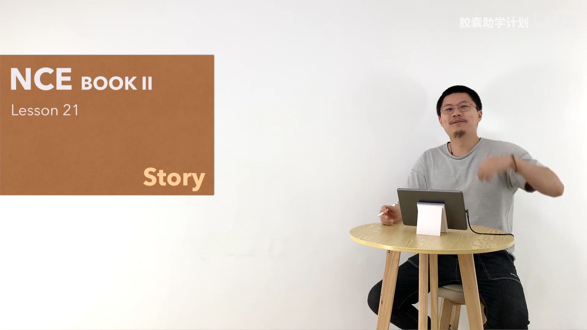

文字识别：NCE / BOOKII / Lesson 21 / Story

### 画面 00:00:04

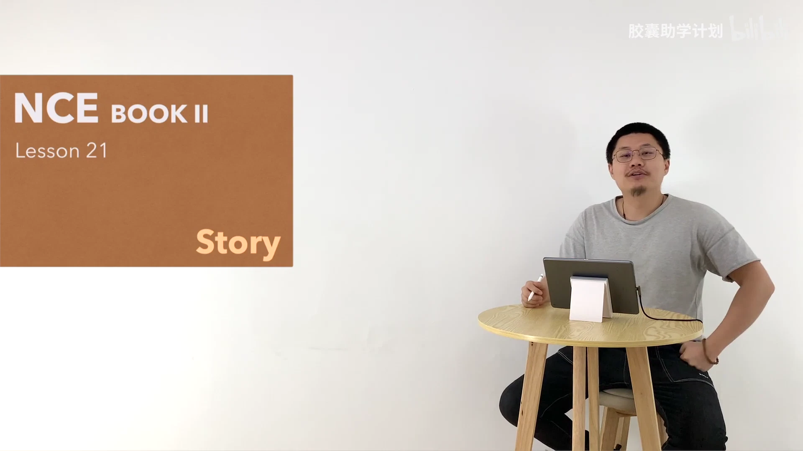

文字识别：胶囊助学计划 / NCE / BOOKII / Lesson 21 / Story

### 画面 00:00:07

文字识别：胶囊助学计划 / NCE / BOOKⅡI / Lesson 21 / Story

### 画面 00:00:09

文字识别：胶囊助学计划 bilbl

### 画面 00:00:13

文字识别：胶囊助学计划

### 画面 00:00:15

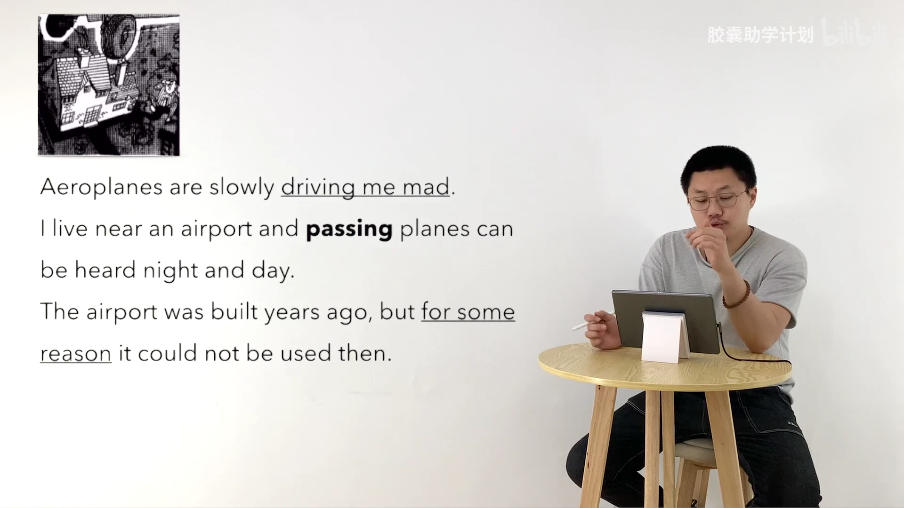

文字识别：胶囊助学计划 / Aeroplanes are slowly driving me mad. / I live near an airport and passing planes can / be heard night and day. / The airport was built years ago, but for some / reason it could not be used then.

## 00:00:30–00:01:00

知道它表示的是现在进行时，正在怎么怎么样，对吧？正在缓慢的 drive，哎，这个单词我会的，开车是吧？开车我不太明白什么意思， mad 啊，就是就很生气啊，很疯狂是吧？给我逼疯了。那 drive me mad，你看，当每一个单词你都认的，但翻译过来明显驴唇不对马嘴，不通顺的时候，

### 画面 00:00:39

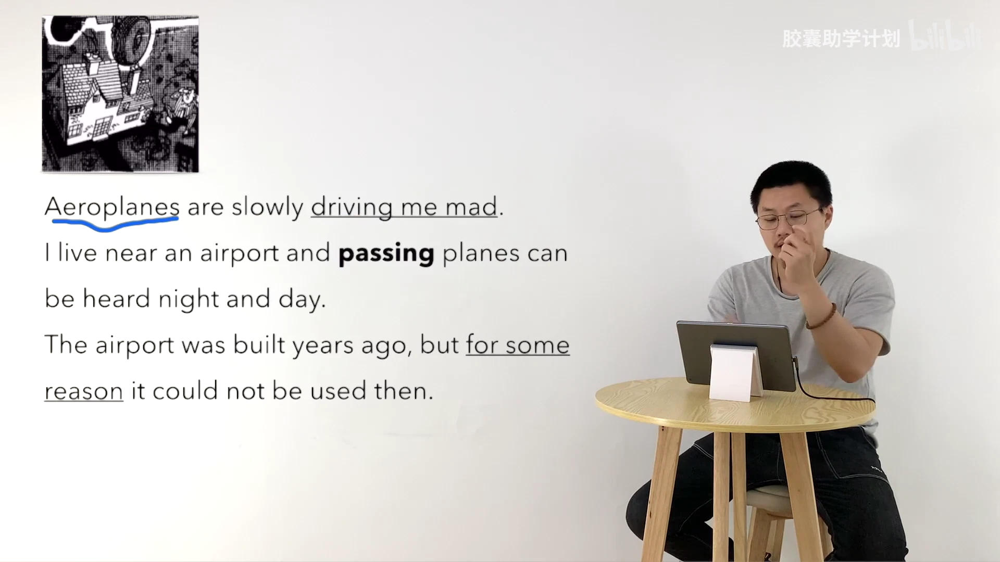

文字识别：胶囊助学计划 / Aeroplanes are slowly driving me mad. / I live near an airport and passing planes can / be heard night and day. / The airport was built years ago, but for some / reason it could not be used then.

### 画面 00:00:54

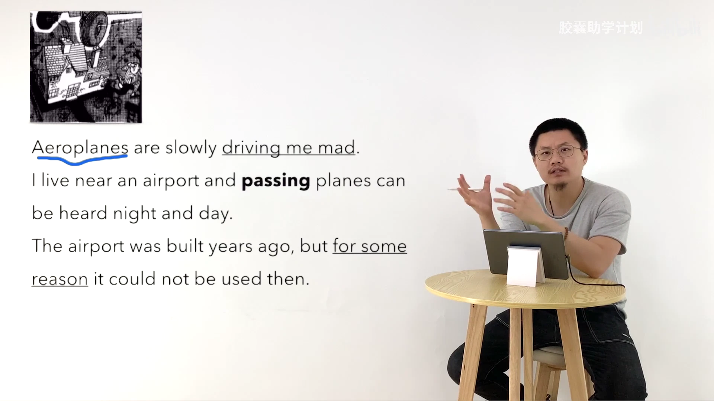

文字识别：Aeroplanes are slowly driving me mad. / I live near an airport and passing planes can / be heard night and day. / The airport was built years ago, but for some / reason it could not be used then.

## 00:01:00–00:01:30

各位啊，这个时候这是一个我们阅读英文的一个技巧，它有如下几种可能性。第一，它并不是字面意思，就像胸有成竹一样，它表示的不是真的你胸胸里边有一个竹子，对吧？它表示我们很有信心，只不过是一种成语类的用法，英语也有这种用法，这是第一个。每个字儿您都认的，可能会出现这个情况。第二呢，是你以为你每个字儿都认的，但是一个单词它其实有好

### 画面 00:01:13

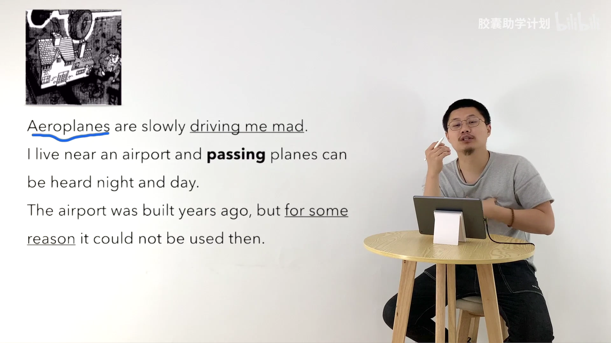

文字识别：胶囊助学计划 / Aeroplanes are slowly driving me mad. / I live near an airport and passing planes can / be heard night and day. / The airport was built years ago, but for some / reason it could not be used then.

## 00:01:30–00:02:00

几个意思，常用的啊，比如说 drive，还有一个意思就是驱使、驱赶的意思啊，驱赶着我变疯了，是吧？哎，其实在这儿就是把我逼疯了。OK，所以飞机正在缓慢的把我逼疯，drive somebody mad。哎，这就是我们今天学到的一个很好的习惯用法。比如说说啊，这个小男孩是吧？青春期的小孩，妈妈唠叨是吧？假设啊，我们想这样一个生

### 画面 00:01:43

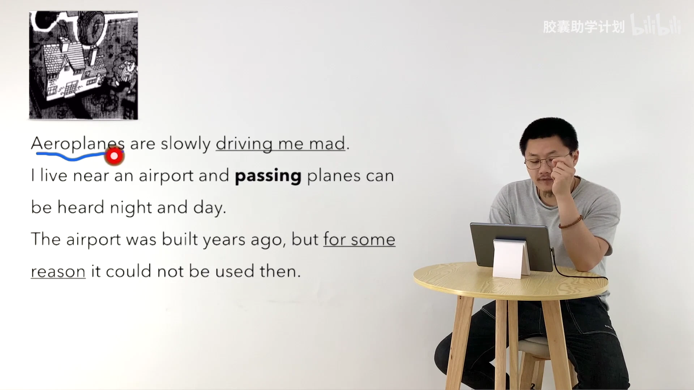

文字识别：胶囊助学计划 / Aeroplanes are slowly driving me mad. / I live near an airport and passing planes can / be heard night and day. / The airport was built years ago, but for some / reason it could not be used then.

### 画面 00:01:56

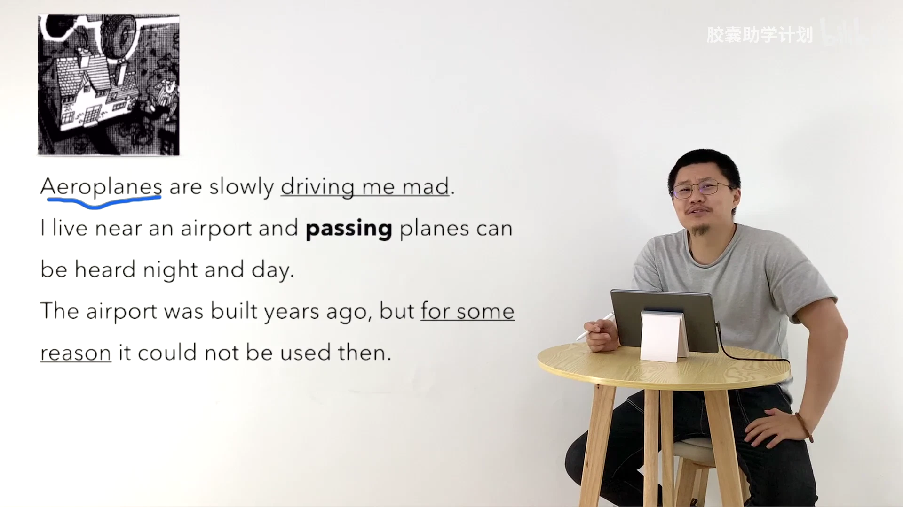

文字识别：胶囊助学计划 / Aeroplanes are slowly driving me mad. / I live near an airport and passing planes can / be heard night and day. / The airport was built years ago, but for some / reason it could not be used then.

### 画面 00:01:59

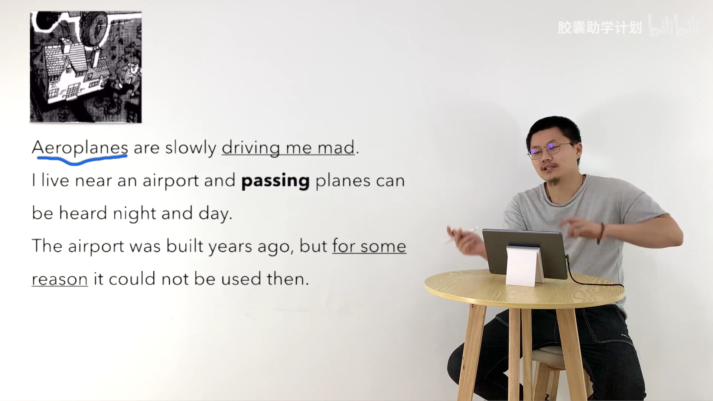

文字识别：胶囊助学计划 / Aeroplanes are slowly driving me mad. / I live near an airport and passing planes can / be heard night and day. / The airport was built years ago, but for some / reason it could not be used then.

## 00:02:00–00:02:30

生活场景，这个啊，妈妈一直在跟他说啊，你要这样，要那样，要这样，那样。然后这个这个小孩说了一句，Mom, you are driving me mad. 啊，说妈，你就要把我逼疯了，是吧？OK，好，所以驱使某人变疯是吧？OK, I live near an airport. 我住在一个飞机场附近。你看，一般现在时陈述客观事实。And然后呢，passing planes，过往的飞机。

### 画面 00:02:07

文字识别：胶囊助学计划 / Aeroplanes are slowly driving me mad. / I live near an airport and passing planes can / be heard night and day. / The airport was built years ago, but for some / reason it could not be used then.

### 画面 00:02:14

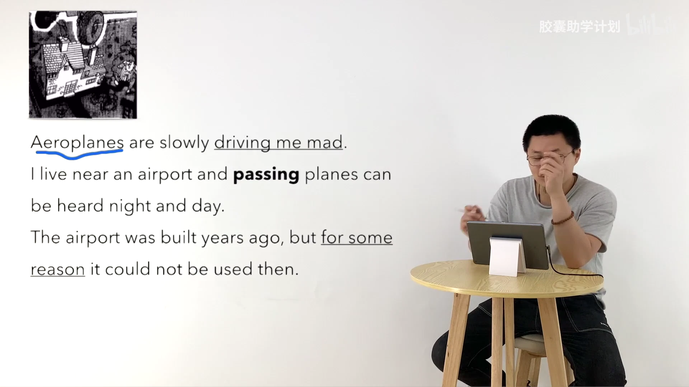

文字识别：胶囊助学计划 / Aeroplanes are slowly driving me mad. / I live near an airport and passing planes can / be heard night and day. / The airport was built years ago, but for some / reason it could not be used then.

## 00:02:30–00:03:00

注意这个地方的 passing 可不是咱二十课学过的那个动名词了，我们不这样去理解了。这个呢，等我们到二十九、三十的时候，我们再慢慢教给各位啊。这个实际上是分词做了一个定语，啊，这个去说起来是个学术术语啊。但是我们今天只要知道它的意思， pass 不就是路过嘛，对吧？那 passing 你在这儿理解为 passing planes 就是过往的飞机啊。 Can be heard

### 画面 00:02:44

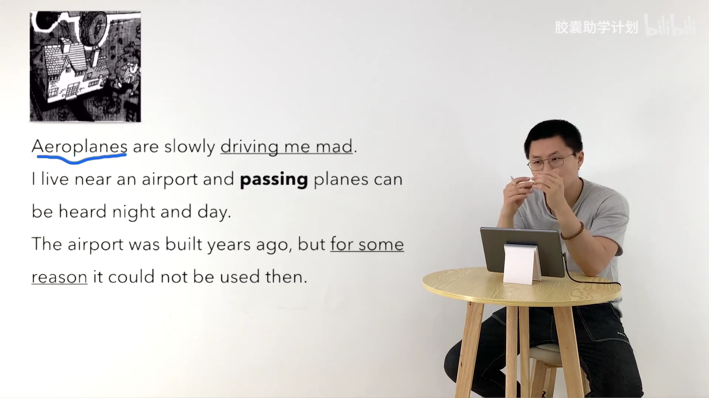

文字识别：胶囊助学计划 / Aeroplanes are slowly driving me mad. / I live near an airport and passing planes can / be heard night and day. / The airport was built years ago, but for some / reason it could not be used then.

### 画面 00:02:52

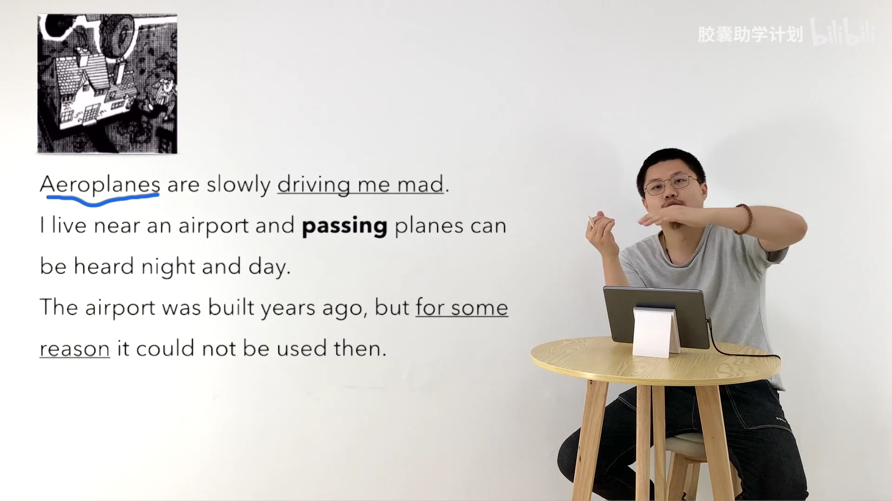

文字识别：胶囊助学计划 / Aeroplanes are slowly driving me mad. / I live near an airport and passing planes can / be heard night and day. / The airport was built years ago, but for some / reason it could not be used then.

### 画面 00:02:58

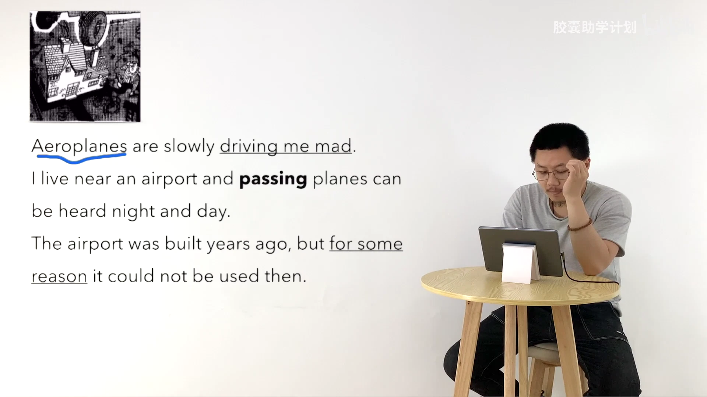

文字识别：胶囊助学计划 / Aeroplanes are slowly driving me mad. / I live near an airport and passing planes can / be heard night and day. / The airport was built years ago, but for some / reason it could not be used then.

## 00:03:00–00:03:30

能被听到. Night and day, 日夜. The airport was built, 被建造. Years ago, 许多年前. 一般过去时只不过是被动，对吧？所以目前各位要明白一件事儿，我们之前学到的大多数主动的那些时那些时态都是主动的，他们一般上来说都有对应的被动的结构。哎，这个一下就翻倍了，这个

### 画面 00:03:02

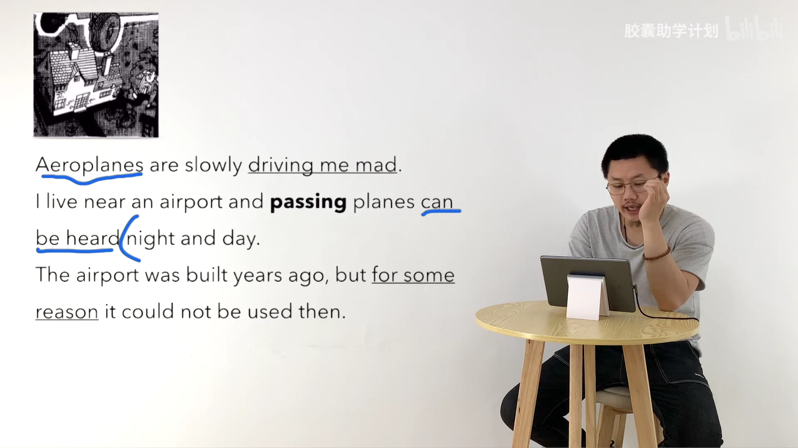

文字识别：胶囊助学计划 / Aeroplanes are slowly driving me mad. / I live near an airport and passing planes can / be heardnight and day. / The airport was built years ago, but for some / reason it could not be used then.

### 画面 00:03:12

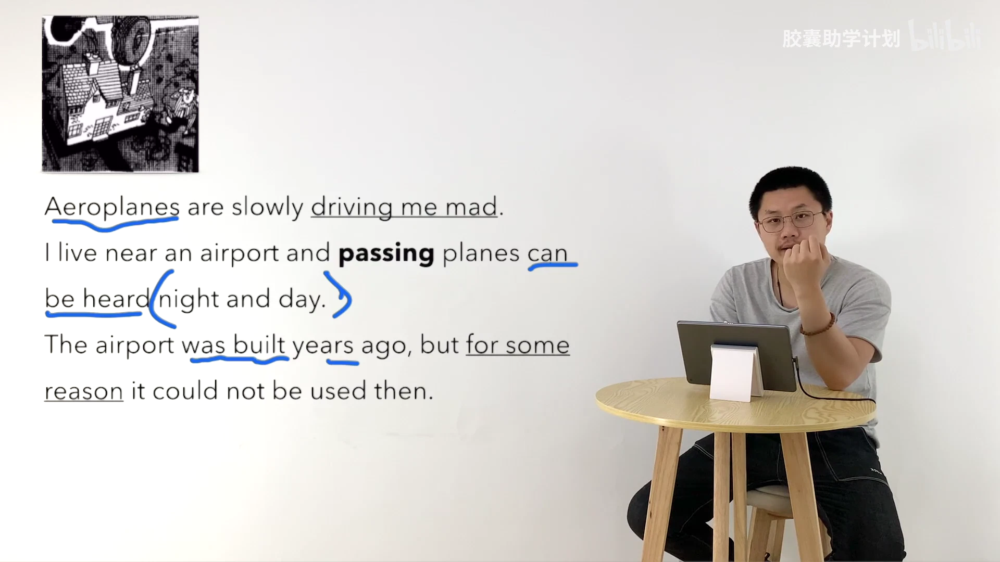

文字识别：胶囊助学计划 / Aeroplanes are slowly driving me mad. / I live near an airport and passing planes can / be heard night and day. / The airport was built years ago, but for some / reason it could not be used then.

### 画面 00:03:18

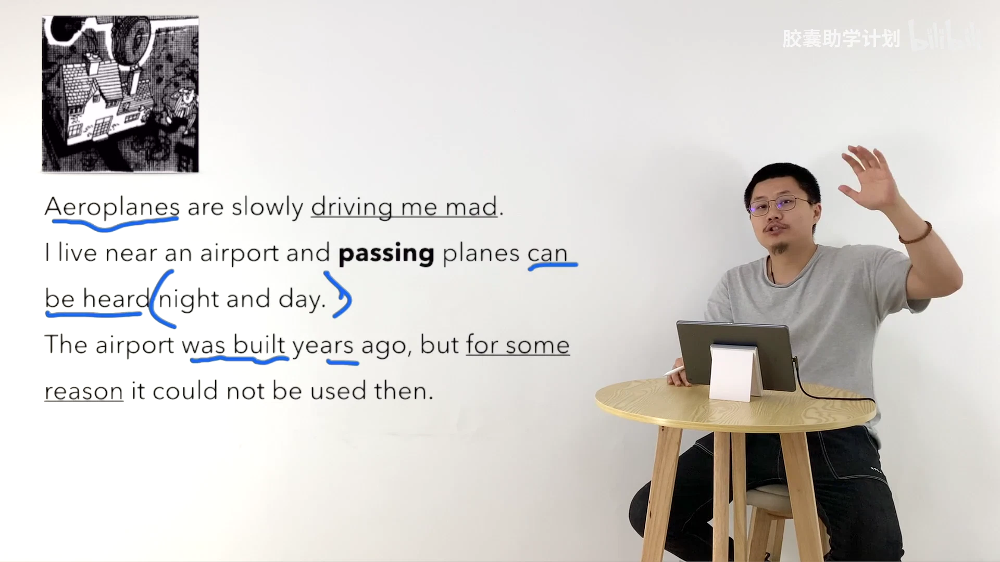

文字识别：胶囊助学计划 / Aeroplanes are slowly driving me mad. / I live near an airport and passing planes can / be heardnight and day. / The airport was built years ago, but for some / reason it could not be used then.

## 00:03:30–00:04:00

任务量，对吧？形态动词是一样的，都是我们之前学的是主动的表达，它们也都有被动的表达，就是我们今天学的这些。But但是呢，for some reason，在单词部分咱们讲过了，造了三个句子，基于某些原因，出于某些原因呢。It could not be used.我们先不加not，could be used，是不是我们刚刚在语法那个视频当中学

### 画面 00:03:41

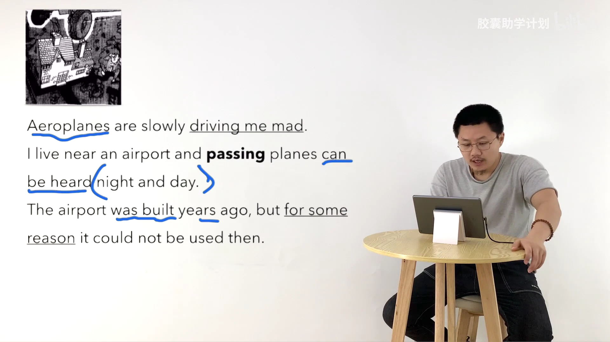

文字识别：胶囊助学计划 / Aeroplanes are slowly driving me mad. / I live near an airport and passing planes can / be heard night and day. / The airport was built years ago, but for some / reason it could not be used then.

### 画面 00:03:47

文字识别：胶囊助学计划 / Aeroplanes are slowly driving me mad. / I live near an airport and passing planes can / be heardnight and day. / The airport was built years ago, butfor some / reasonit could not be used then.

### 画面 00:03:52

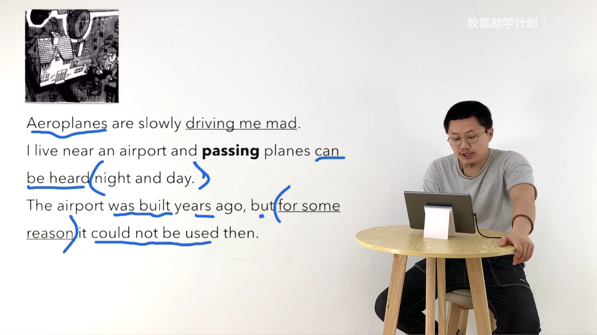

文字识别：胶囊助学计划 / Aeroplanes are slowly driving me mad. / I live near an airport and passing planes can / be heardnight and day. / The airport was built years ago, butfor some / reasonit could not be used then.

## 00:04:00–00:04:30

过的叫做能被怎么怎么样，对吧？那 could not be used 对于各位来说就非常简单了，就是无不能被使用，对吧？ OK，玩儿一个，continue. Last year, however，去年呢，然而好注意 last year 一提，接下来可能跟一般过去时有关系了。哎，it came into use。你看 came，咱甭管这句话现在能不能懂，我至少知道 came 是 come 的过去式，对吧？好，

### 画面 00:04:12

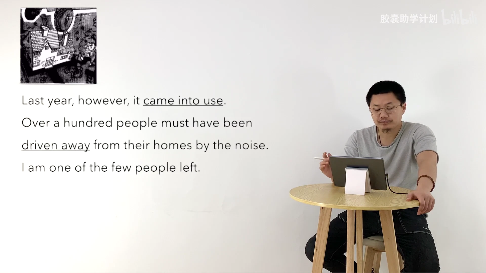

文字识别：胶囊助学计划 / Last year, however, it came into use. / Over a hundred people must have been / driven away from their homes by the noise. / I am one of the few people left.

### 画面 00:04:17

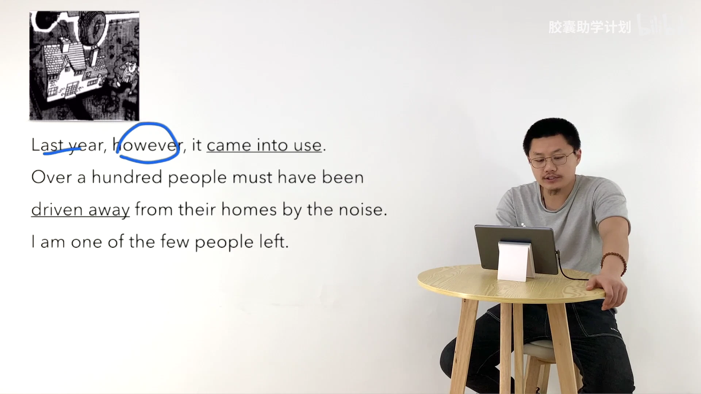

文字识别：胶囊助学计划 / Last year, however, it came into use. / Over a hundred people must have been / driven away from their homes by the noise. / I am one of the few people left.

## 00:04:30–00:05:00

进入，哎，into还是进入的意思，come into啊，就合起来叫进入，use叫使用，叫进入使用，其实把它翻译成叫投入使用，更符合汉语的表达方式。所以在这儿呢，您就把这三个单词当一个习惯用法给它放到一起，叫come into use，投入使用。而一个continue，over a hundred people，好了，注意这有一个小的单词叫做over。各位原来学over的时候

### 画面 00:04:45

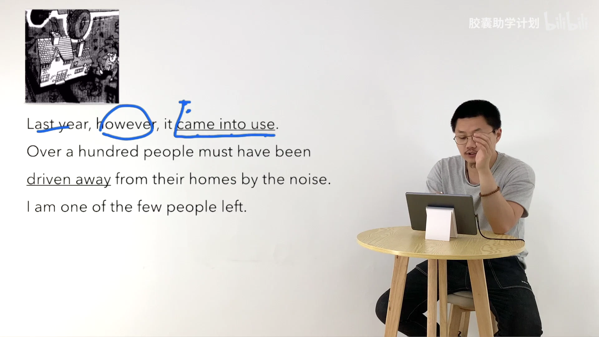

文字识别：胶囊助学计划 / Last year, however, itcame into use. / Over a hundred people must have been / driven away from their homes by the noise. / I am one of the few people left.

### 画面 00:04:47

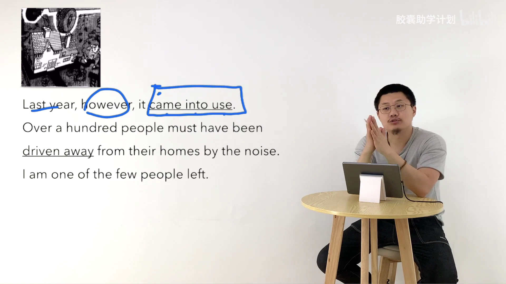

文字识别：胶囊助学计划 / Last year, however, itcame into use. / Over a hundred people must have been / driven away from their homes by the noise. / I am one of the few people left.

### 画面 00:04:54

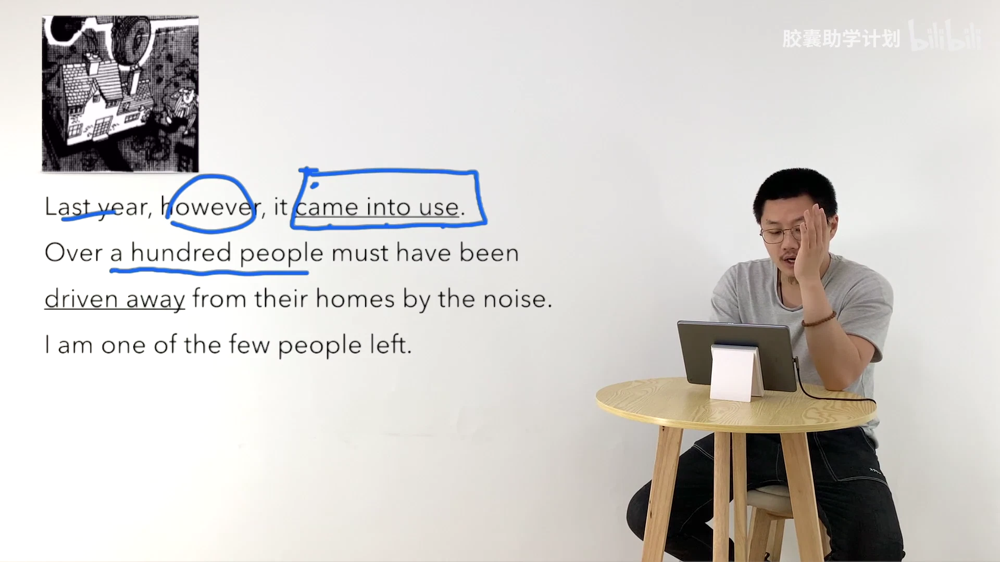

文字识别：胶囊助学计划 / Last year, however, itcame into use. / Over a hundred people must have been / driven away from their homes by the noise. / I am one of the few people left.

### 画面 00:04:56

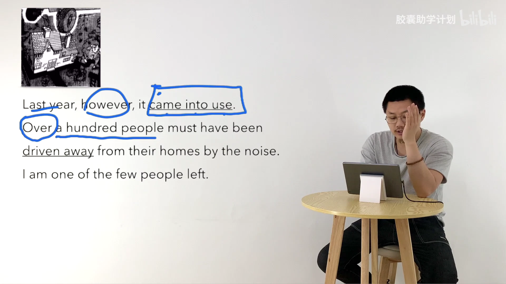

文字识别：胶囊助学计划 / Last year, however, itcame into use. / Overa hundred people must have been / driven away from their homes by the noise. / I am one of the few people left.

### 画面 00:04:59

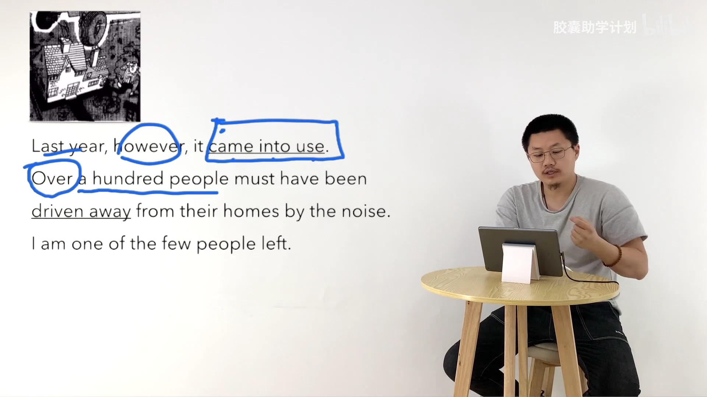

文字识别：胶囊助学计划 / Last year, however, itcame into use. / Overa hundred people must have been / driven away from their homes by the noise. / I am one of the few people left.

## 00:05:00–00:05:30

呢，有这么几个常见的意思，各位可能都见过。第一个是我们新概念当中比较常出现的一个意思啊，比如说呃，我们在第八课学形容词比较级最高级的时候，对吧？哎，这个他在他的这个 pool 啊， swimming pool 的上面 over 是吧，做了一个 bridge 啊，各位能不能想到在它的这个上方建了一座桥，对吧？啊，叫做 over。 Okay, very good. 那

### 画面 00:05:23

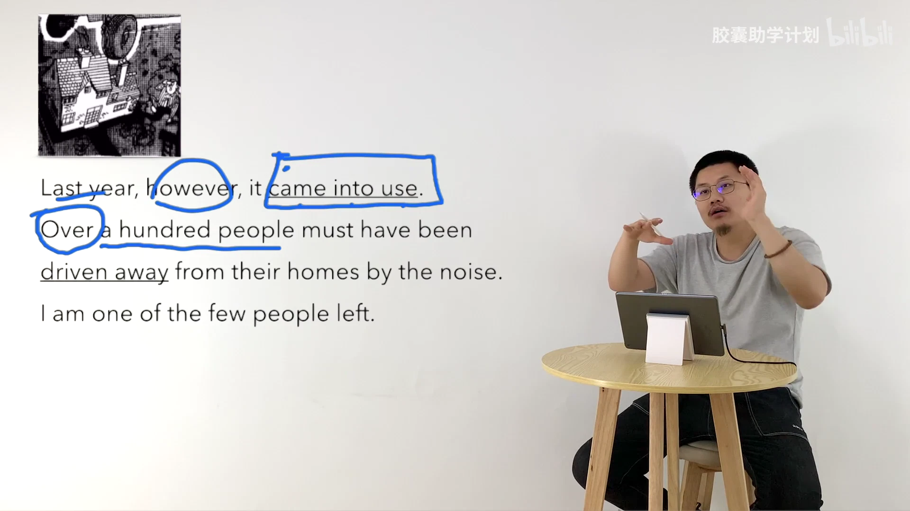

文字识别：胶囊助学计划 / Last year, however, itcame into use. / Overa hundred people must have been / driven away from their homes by the noise. / I am one of the few people left.

### 画面 00:05:29

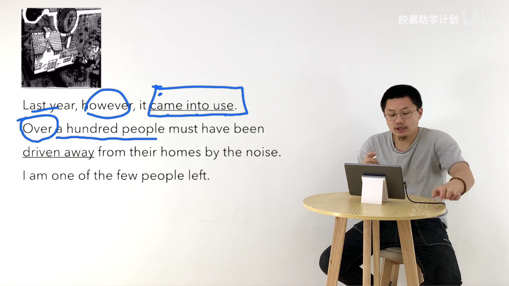

文字识别：胶囊助学计划 / Last year, however, itcame into use. / Overa hundred people must have been / driven away from their homes by the noise. / I am one of the few people left.

## 00:05:30–00:06:00

over另外一个意思呢？如果各位看电影，对吧？就是比如说，呃，通话啊，我在这跟你说，拿着用啊，这种这个，呃呃，这种作战的时候，他会说一些东西，然后说完了之后来一句话叫做over啊，叫做结束的意思，对吧？包括我们玩游戏的时候，小的时候玩的游戏，打完了之后，他会有一个叫做，如果你失败了，叫做game over，游戏结束。OK，这是它两个常见的意思。在这儿呢，出现了第三

### 画面 00:05:59

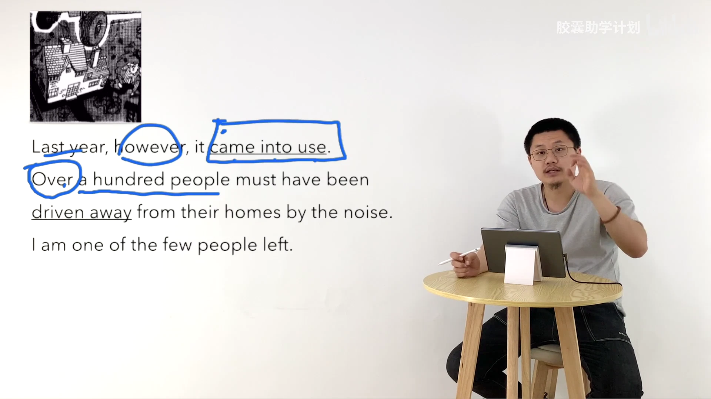

文字识别：胶囊助学计划 / Last year, however, itcame into use. / Overa hundred people must have been / driven away from their homes by the noise. / I am one of the few people left.

## 00:06:00–00:06:30

个常见的意思，over叫做超过了，OK，比如说over a hundred people叫做超过了一百个人，那over one hundred years是什么意思呢？叫做超过了一百年。Very good, continue. Must have been driven away. 好了，你看must have been，这就是我们第二茬再加一个driven，对吧？Away，这就是第二茬学到的那个东西了，叫做什么？情态动词推

### 画面 00:06:29

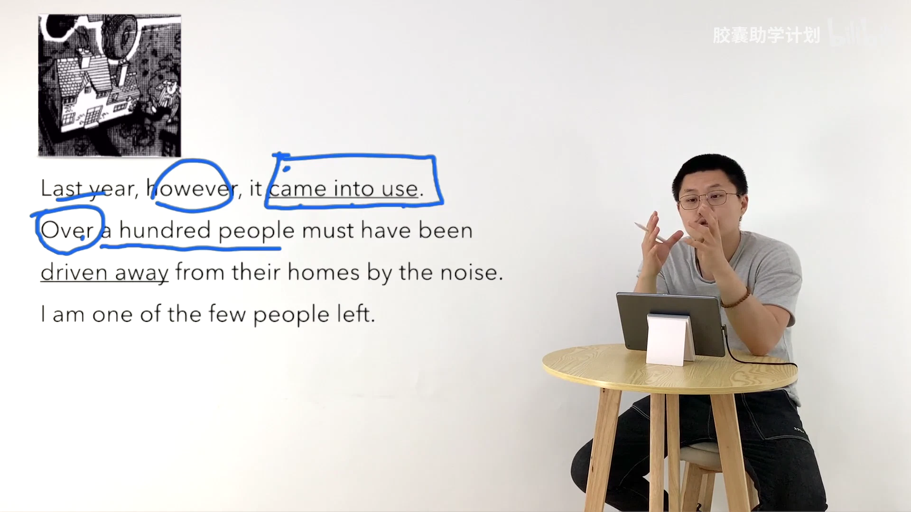

文字识别：胶囊助学计划 / Last year, however, itcame into use. / Overa hundred people must have been / driven away from their homes by the noise. / I am one of the few people left.

## 00:06:30–00:07:00

测用法的一个被动 must have been done，对吧？当时一定是被怎么怎么样，当时一定是被怎么样了呢？Driven away，drive啊，driven drive，OK，我们实际上在呃文章的最开始我们就提到了，它还有一个叫驱使的意思 away，那 will be away，啊，叫做将离开，那 driven away 就是被他们赶走了，对不对？OK，已经超过一百个人，当时一定已经被

### 画面 00:06:59

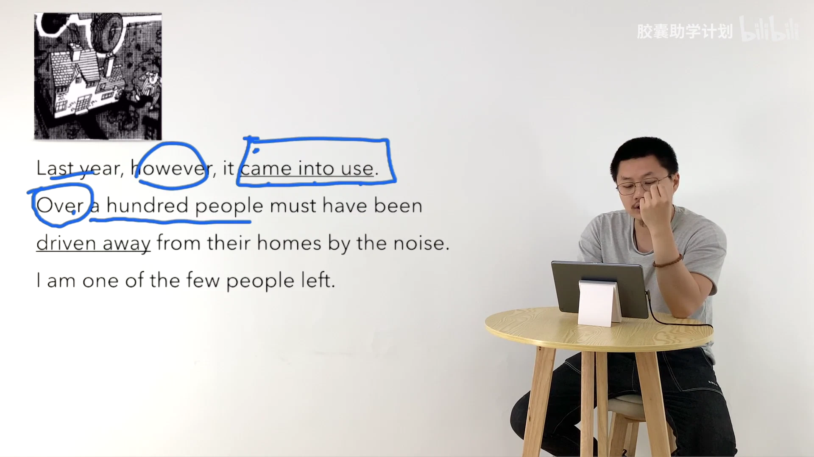

文字识别：胶囊助学计划 / Last year, however, itcame into use. / Overa hundred people must have been / driven away from their homes by the noise. / I am one of the few people left.

## 00:07:00–00:07:30

被赶走了 from their homes，从他们的家里面被什么呢？By the noise，被这个飞机的噪音。Okay，声音很大。I am，我是 one of the few people left。好了，注意一个小点，我们先不管 left。One of the few people，好 one。首先 the few people 就是少数的几个人，那 one of 就是少数的几个人之一。One of

### 画面 00:07:19

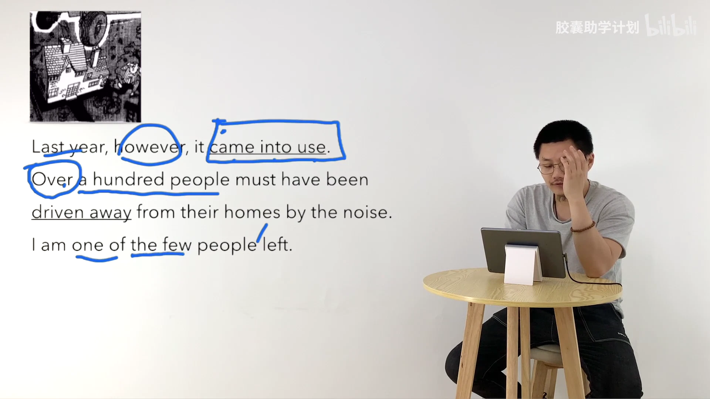

文字识别：胶囊助学计划 / Last year, however, itcame into use. / Overa hundred people must have been / driven away from their homes by the noise. / I am one of the few peopleleft.

### 画面 00:07:24

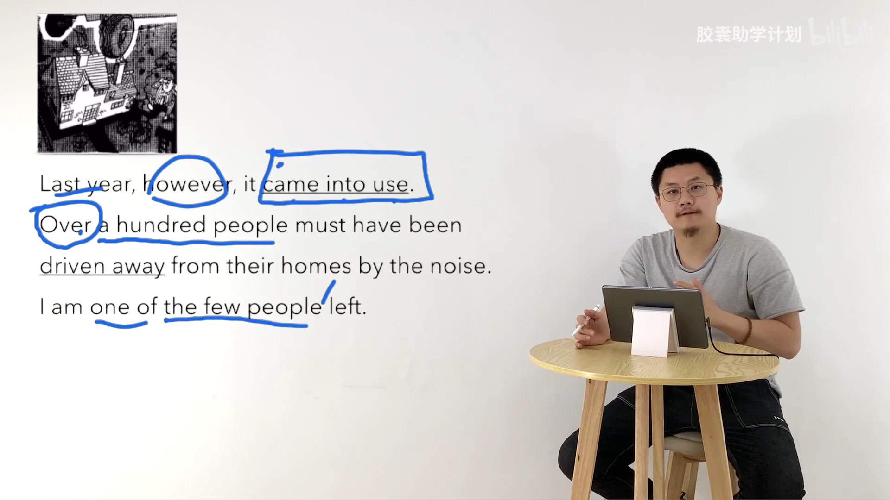

文字识别：胶囊助学计划 / Last year, however, itcame into use. / Overa hundred people must have been / driven away from their homes by the noise. / I am one of the few peopleleft.

## 00:07:30–00:08:00

叫之一，对吧？啊，one of，叫少数的几个人之一。我是少数的几个人之一。Left这个地方呢，其实也是今天各位能在我的讲解下看懂就行了。这个语法我们要到二十九、三十才能去处理啊，今天就不处理这个语法。Left有一个常见的意思啊，leave left left两个常见的意思，一个叫离开，另外一个叫做啊留下落下，对吧？啊，它正好是反着的，是吧？

### 画面 00:07:37

文字识别：胶囊助学计划 / Last year, however, itcame into use. / Overa hundred people must have been / driven away from their homes by the noise. / I am one of the few peopleleft.

## 00:08:00–00:08:30

Okay, 那在这句话当中，它指的是我是少数的几个人留下的啊，就没有走开的那个人。Left就是被别人遗留在后面的left啊，遗留留下的这个人。Continue, sometimes有的时候呢，I think我认为后边整个一个宾语从句，对吧？This house will be knocked down.好了，will be done将被怎么怎么样。Knock叫做敲，这个单词我们学过。那

### 画面 00:08:00

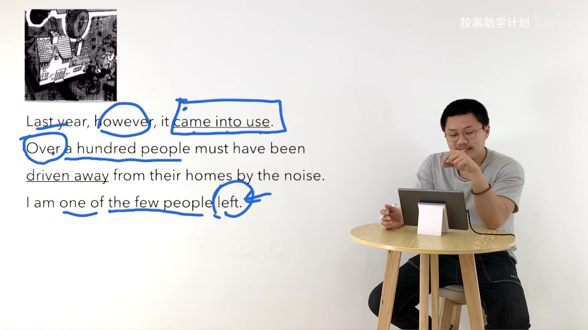

文字识别：胶囊助学计划 / Last year, however, itcame into use. / Overa hundred people must have been / driven away from their homes by the noise. / I am one of the few people left.

### 画面 00:08:14

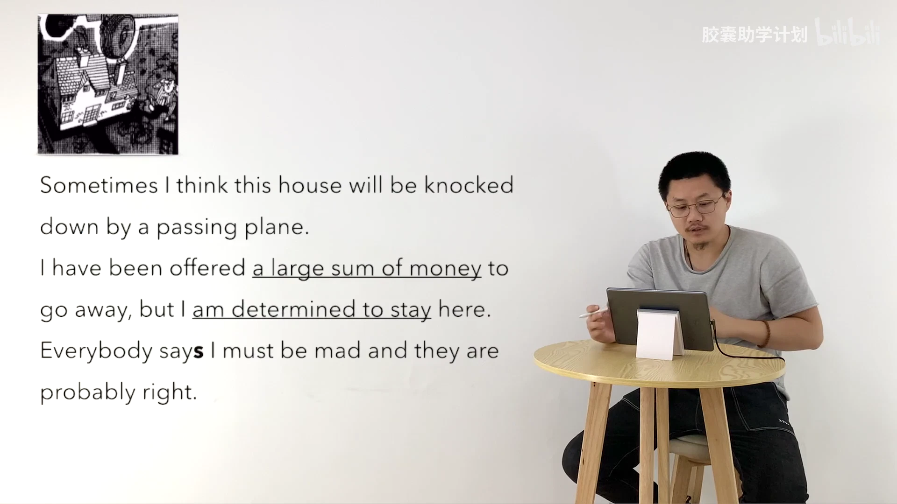

文字识别：胶囊助学计划 / Sometimes I think this house will be knocked / down by a passing plane. / I have been offered a large sum of money to / go away, but I am determined to stay here. / Everybody says I must be mad and they are / probably right.

### 画面 00:08:20

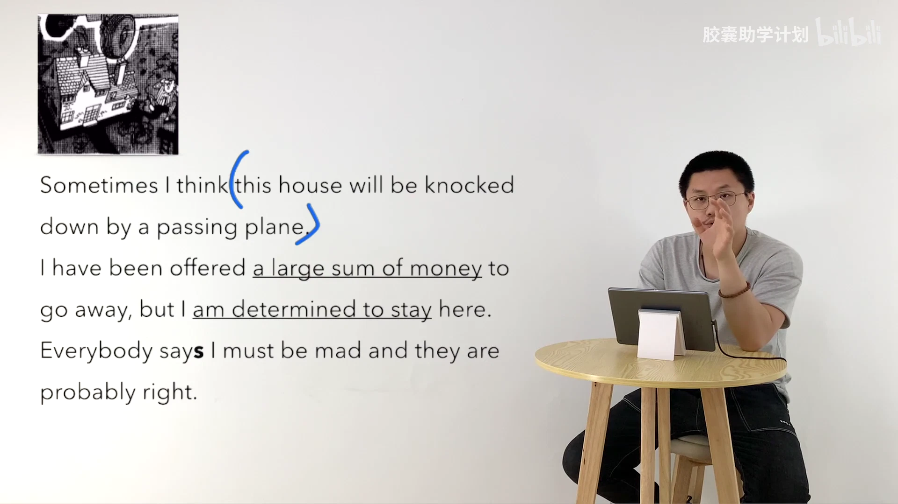

文字识别：胶囊助学计划 / Sometimes I thinkthis house will be knocked / down by a passing plane, / I have been offered a large sum of money to / go away, but I am determined to stay here. / Everybody says I must be mad and they are / probably right.

### 画面 00:08:23

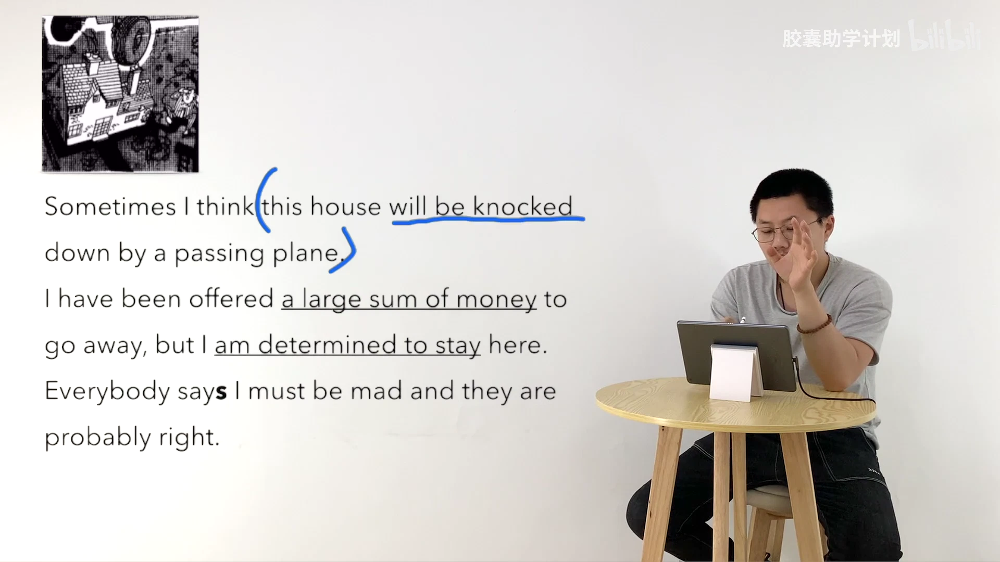

文字识别：胶囊助学计划 / Sometimes I thinkthis house will be knocked / down by a passing plane, / I have been offered a large sum of money to / go away, but I am determined to stay here. / Everybody says I must be mad and they are / probably right.

## 00:08:30–00:09:00

down 就塌了，那敲塌了，什么叫敲塌了？不太清楚，先看后边你就能理解了。被 a passing plane 被一个过往的飞机，你看有的时候我认为啊，就这个房子将被敲塌了，被一个过往的飞机，那肯定不是敲塌了，比如说撞塌了，对不对？ Knocked down, okay. 比如说两个人打拳击啊，我把另一个人一拳打倒，这个过程就叫做 knocked down, okay.

### 画面 00:08:30

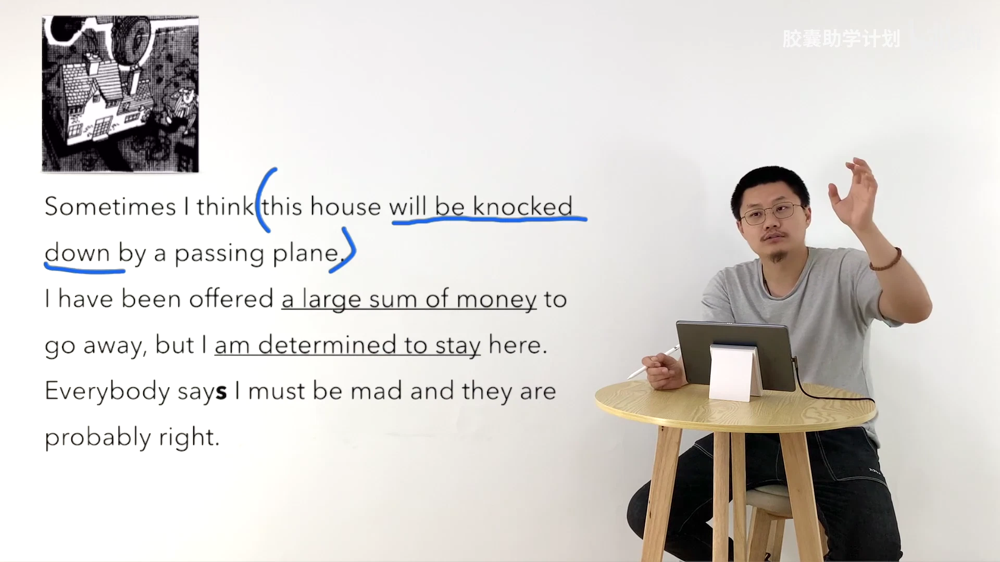

文字识别：Sometimes I thinkthis house will be knocked / down by a passing plane, / I have been offered a large sum of money to / go away, but I am determined to stay here. / Everybody says I must be mad and they are / probably right.

### 画面 00:08:37

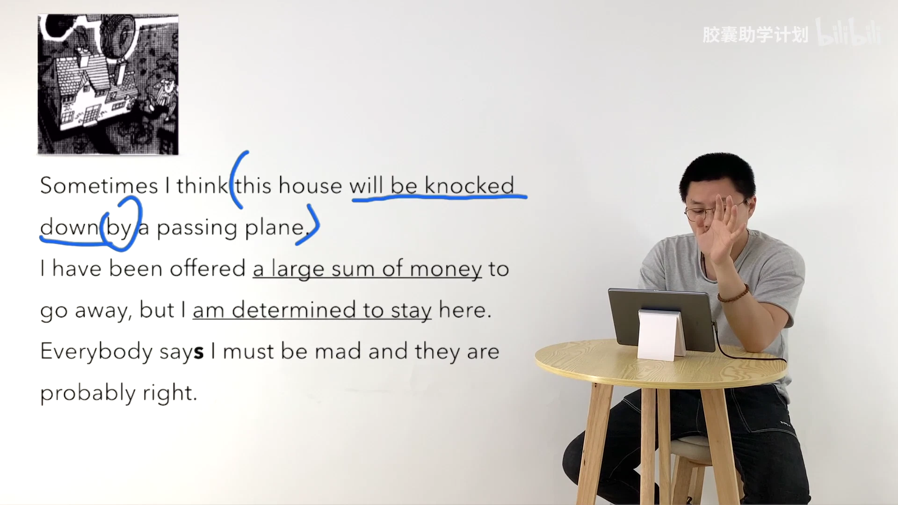

文字识别：胶囊助学计划 / Sometimes I thinkthis house will be knocked / down / a passing plane, / by / I have been offered a large sum of money to / go away, but I am determined to stay here. / Everybody says I must be mad and they are / probably right.

### 画面 00:08:40

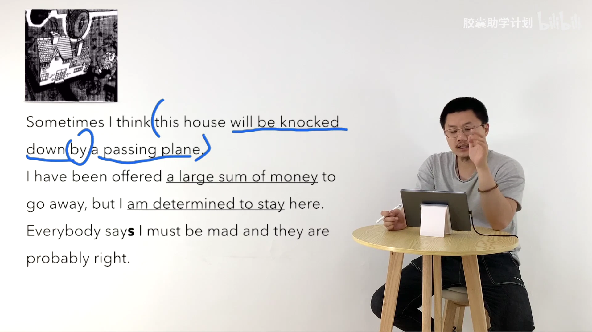

文字识别：胶囊助学计划 / Sometimes I thinkthis house will be knocked / ya passing plane / down / by / I have been offered a large sum of money to / go away, but I am determined to stay here. / Everybody says I must be mad and they are / probably right.

## 00:09:00–00:09:30

continuing. Say I have been offered.第十课咱们学过 have been done.叫做已经被怎么怎么样。说我已经被 offer. Offer呢？我们动词就是给别人什么什么东西，名词呢就是录取通知书，可以理解呗。啊，当然不一定。录取通知书一般指的是，比如说你像我去澳大之前，澳大就会给我一个 offer.啊，这个就是录取通知书。那如果你去找一个工作呢，那个工作给了你一个 offer，那是什么

### 画面 00:09:02

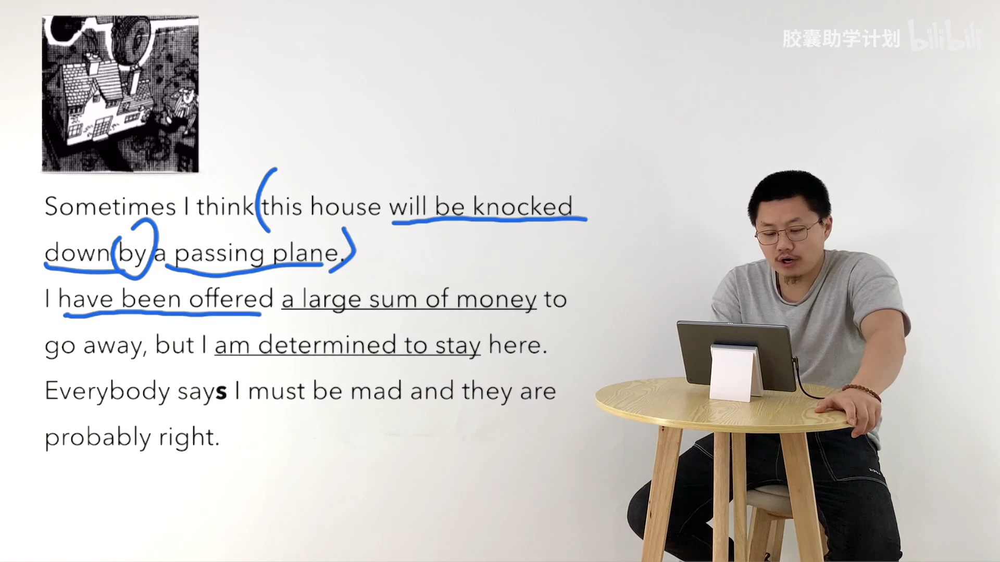

文字识别：胶囊助学计划 / Sometimes I thinkthis house will be knocked / bya passing plane / down / I have been offered a large sum of money to / go away, but I am determined to stay here. / Everybody says I must be mad and they are / probably right.

## 00:09:30–00:10:00

呢？你就能理解了，对吧？所以 offer 它的名词是这个样子的，那动词呢？就是这个过程，给你这个录取通知书的这个动作。OK，那叫做我已经被怎么样了呢？说别人要给我 a large sum of money，一大堆的钱，目的是哎，这个地方我们不会单独讲，但是呢，以后会见到很多次，所以我们见一次给大家补一次。最后一般句子上来说，

### 画面 00:09:32

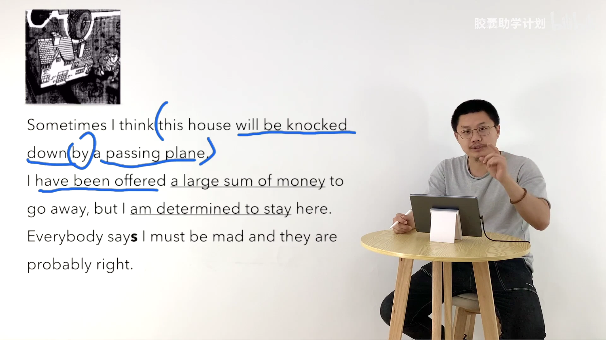

文字识别：胶囊助学计划 / Sometimes I thinkthis house will be knocked / ya passing plane / down / (by / I have been offered a large sum of money to / go away, but I am determined to stay here. / Everybody says I must be mad and they are / probably right.

### 画面 00:09:47

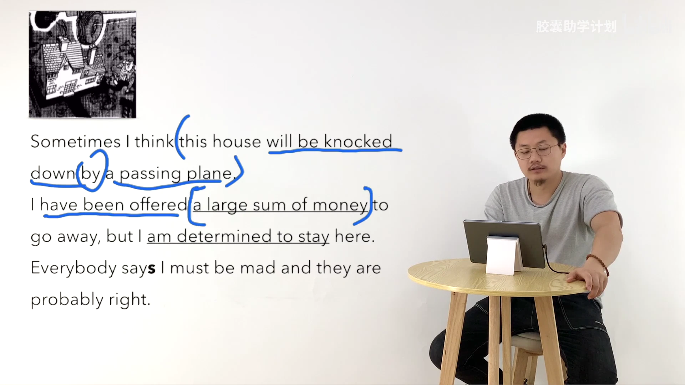

文字识别：Sometimes I thinkthis house will be knocked / byapassing plane) / down / I have been offereda large sum of moneyto / go away, but I am determined to stay here. / Everybody says I must be mad and they are / probably right.

### 画面 00:09:51

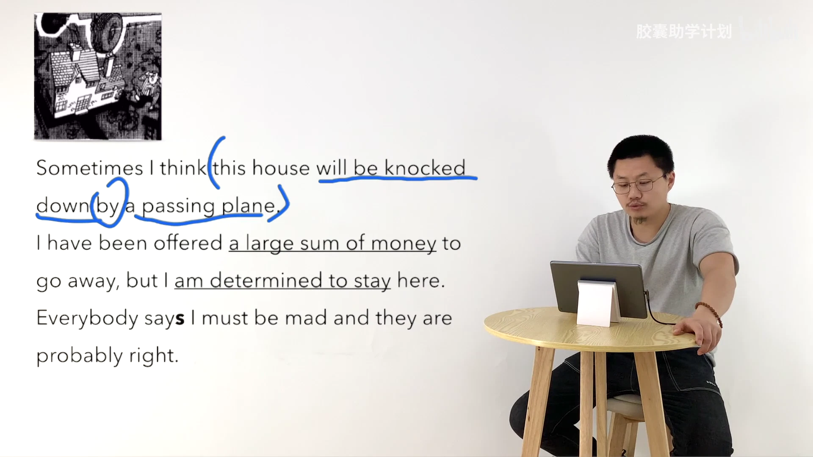

文字识别：Sometimes I thinkthis house will be knocked / yapassing plane / down / by / I have been offered a large sum of money to / go away, but I am determined to stay here. / Everybody says I must be mad and they are / probably right.

### 画面 00:09:53

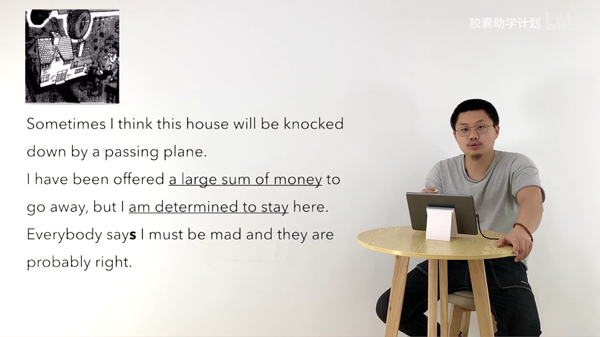

文字识别：胶囊助学计划 / Sometimes I think this house will be knocked / down by a passing plane. / I have been offered a large sum of money to / go away, but I am determined to stay here. / Everybody says I must be mad and they are / probably right.

## 00:10:00–00:10:30

最后加一个 to do something。句子的最后，注意啊，我说的是句子的最后一般去加上这个 to do something。你看 to go away，对吧？它一般表示的叫做目的。以后我们见一次说一次，说我已经被别人啊给了一大堆的钱啊，就是别人给我的这样一个 offer 啊，给给了我这样一个这个可能性，要要给我一大堆的钱去怎么样呢？走开

### 画面 00:10:00

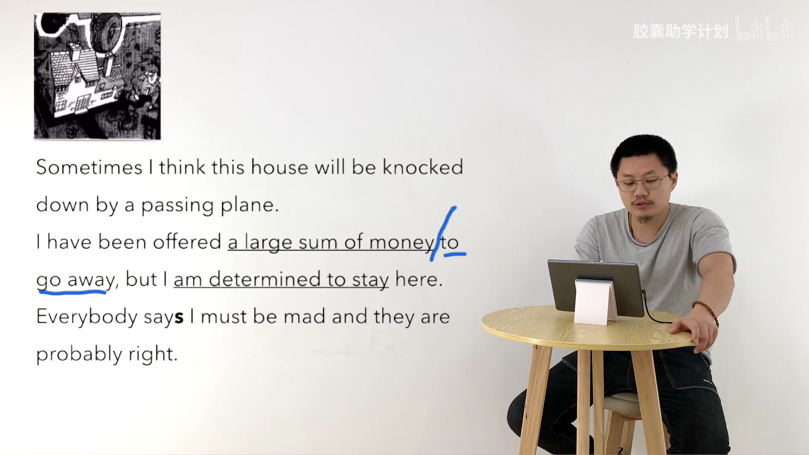

文字识别：胶囊助学计划 / Sometimes I think this house will be knocked / down by a passing plane. / I have been offered a large sum of moneyto / go away, but I am determined to stay here. / Everybody says I must be mad and they are / probably right.

### 画面 00:10:02

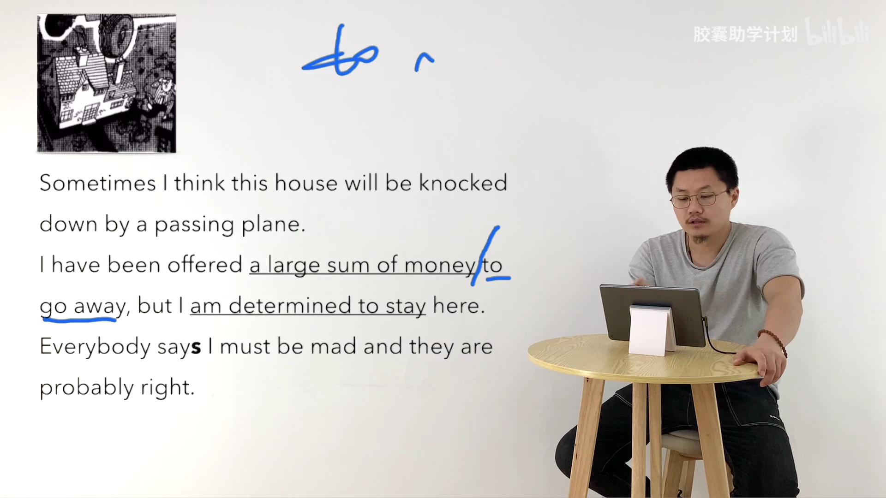

文字识别：胶囊助学计划 / + / Sometimes I think this house will be knocked / down by a passing plane. / I have been offered a large sum of moneyto / go away, but I am determined to stay here. / Everybody says I must be mad and they are / probably right.

### 画面 00:10:04

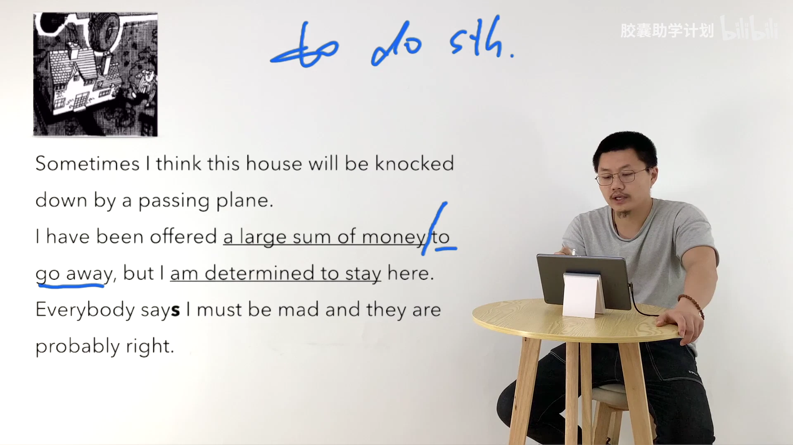

文字识别：odo slh. / 胶囊助学计划 / Sometimes I think this house will be knocked / down by a passing plane. / I have been offered a large sum of moneyto / go away, but I am determined to stay here. / Everybody says I must be mad and they are / probably right.

### 画面 00:10:10

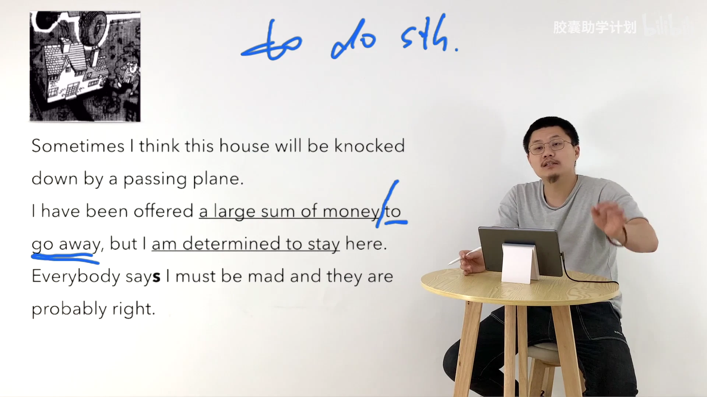

文字识别：odo slh. / 胶囊助学计划 / Sometimes I think this house will be knocked / down by a passing plane. / I have been ofered a large sum of moneyto / go away, but I am determined to stay here. / Everybody says I must be mad and they are / probably right.

### 画面 00:10:29

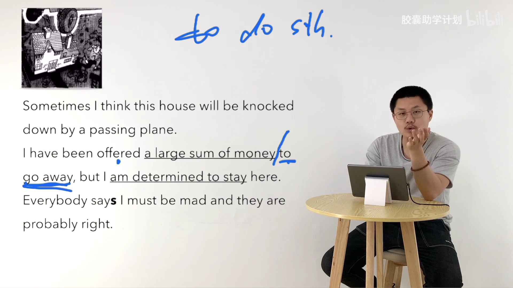

文字识别：odo sll. / 胶囊助学计划 / Sometimes I think this house will be knocked / down by a passing plane. / I have been offered a large sum of moneyto / go away, but I am determined to stay here. / Everybody says I must be mad and they are / probably right.

## 00:10:30–00:11:00

啊！就搬走。But但是，I am determined to stay here. Be determined to do something.我下定决心了，要待在这个地方。Everybody says，每个人都说。你看，注意，虽然每个人听起来像是一个复数，每个人绝对不是一个人嘛，是一群人，对吧？但是他是当单数去处理的，所以 say 这个单词后边加了一个 s，对吧？says， very good。每个人都说，I must be mad。

### 画面 00:10:34

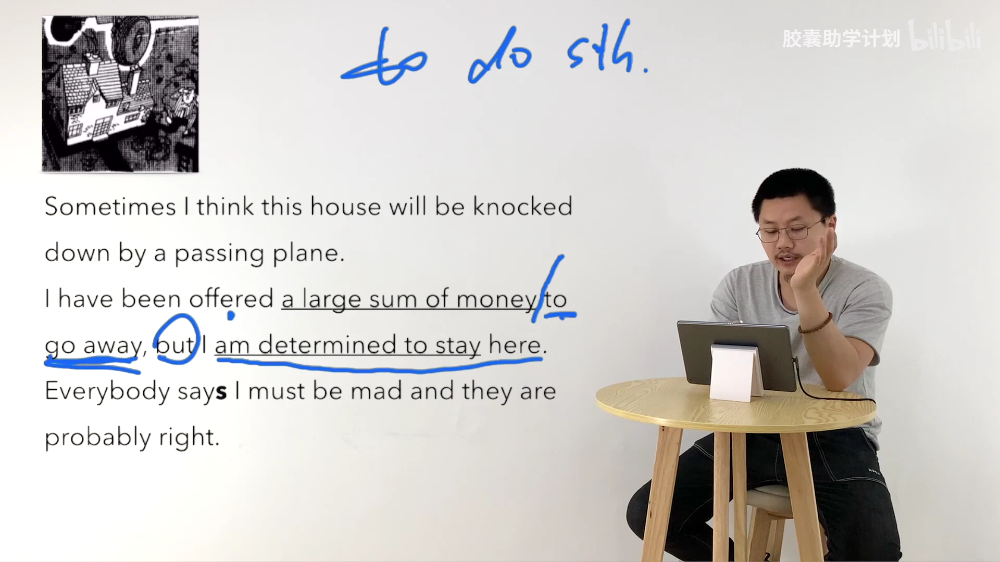

文字识别：odo sll. / 胶囊助学计划 / Sometimes I think this house will be knocked / down by a passing plane. / I have been offered a large sum of moneyto / am determined to stay here. / go away, / Everybody says I must be mad and they are / probably right.

## 00:11:00–00:11:30

啊，注意，这就是推测了。我一定是疯了。每个人都说我一定是疯了。然后呢， they are probably right. 我认为他们可能就是说的对啊。我可能就是疯了。我也不想走，是吧？ Are you good? 接下来呢，本课的习惯用法，哎，我们看一下这三个，尝试去造一些句子出来。第一个， drive somebody mad, 逼疯，把把某人逼疯。比如说， I gave up learning

### 画面 00:11:00

文字识别：odo slh. / 胶囊助学计划 / Sometimes I think this house will be knocked / down by a passing plane. / I have been offered a large sum of moneyto / am determined to stay here. / go away, / bu / Everybody says I must be mad and they are / probably right.

### 画面 00:11:06

文字识别：odo slh. / 胶囊助学计划 / Sometimes I think this house will be knocked / down by a passing plane. / I have been offered a large sum of moneyto / am determined to stay here. / go away, / Everybody says I must be mad and they are / probably right.

### 画面 00:11:09

文字识别：odo slh. / 胶囊助学计划 / Sometimes I think this house will be knocked / down by a passing plane. / I have been offered a large sum of moneyto / am determined to stay here. / go away, / Everybody says I must be mad and they are / probably right.

### 画面 00:11:16

文字识别：胶囊助学计划 / 习惯用法造句 / drive sb. mad / for some reason / come into use

### 画面 00:11:18

文字识别：胶囊助学计划 / 习惯用法造句 / drive sb. mad / for some reason / come into use

### 画面 00:11:20

文字识别：胶囊助学计划 / 习惯用法造句 / drive sb. mad / for some reason / come into use

### 画面 00:11:22

文字识别：习惯用法造句指南 / 网：v.+v.变化 / 胶囊助学计划 / 四句型转换 / 方式/地点/时间 / 其他习惯用法 / 其他单词+词性 / 原文摘抄+变 / 6123456 / drive sb. mad

### 画面 00:11:24

文字识别：网：v.+v.变化 / 习惯用法造句指南 / 胶囊助学计划 / 四句型转换 / 方式/地点/时间 / 其他习惯用法 / 其他单词+词性 / 原文摘抄+变 / 6123456 / drive sb. mad

### 画面 00:11:26

文字识别：网：v.+v.变化 / 习惯用法造句指南 / 胶囊助学计划 / 四句型转换 / 方式/地点/时间 / 其他习惯用法 / 其他单词+词性 / 原文摘抄+变 / 6123456 / drive sb.mad / I gave up learning English years ago, because it / drove me mad. L20

### 画面 00:11:28

文字识别：网：v.+v.变化 / 习惯用法造句指南 / 胶囊助学计划 / 四句型转换 / 方式/地点/时间 / 其他习惯用法 / 其他单词+词性 / 原文摘抄+变 / 6123456 / drive sb. mad / I gave up learning English years ago, because it / drove me mad. L20

## 00:11:30–00:12:00

English years ago. Ah, 我许多年前就放弃学英文了. Because, 因为 it drove me mad. 因为啊，当时学英语这件事儿啊，快把我逼疯了啊。这是第是二十课咱们学的，对吧？Give up doing something. 我们把两句话连起来了。十九课咱们学了一个短语叫 Don't yell at me. 别冲着我喊. You are driving me mad. 说你先，哎呀，要把我逼疯了。你先别冲我喊啊。两个人吵架，对吧？你你先别冲我喊，你要把我逼疯了。你给我个时间缓冲一

### 画面 00:11:30

文字识别：网：v.+v.变化 / 习惯用法造句指南 / 四句型转换 / 方式/地点/时间 / 其他习惯用法 / 其他单词+词性 / 原文摘抄+变 / 6123456 / drive sb.mad / I gave up learning English years ago, because it / drove me mad. L20

### 画面 00:11:34

文字识别：网：v.+v.变化 / 习惯用法造句指南 / 胶囊助学计划 / 四句型转换 / 方式/地点/时间 / 其他习惯用法 / 其他单词+词性 / 原文摘抄+变 / 6123456 / drive sb.mad / I gave up learning English years ago, because it / drove me mad. L20

### 画面 00:11:36

文字识别：网：v.+v.变化 / 习惯用法造句指南 / 胶囊助学计划 / 四句型转换 / 方式/地点/时间 / 其他习惯用法 / 其他单词+词性 / 原文摘抄+变 / 6123456 / drive sb. mad / I gave up learning English years ago, because it / drove me mad. L20

### 画面 00:11:39

文字识别：网：v.+v.变化 / 习惯用法造句指南 / 四句型转换 / 方式/地点/时间 / 其他习惯用法 / 其他单词+词性 / 原文摘抄+变 / 6123456 / drive sb. mad / I gave up learning English years ago, because it / drove me mad. L20

### 画面 00:11:43

文字识别：网：v.+v.变化 / 习惯用法造句指南 / 胶囊助学计划 / 四句型转换 / 方式/地点/时间 / 其他习惯用法 / 其他单词+词性 / 原文摘抄+变 / 6123456 / drive sb. mad / I gave up learning English years ago, because it / drove me mad. L20 / Don't yell at me. You are driving me mad. L19

### 画面 00:11:45

文字识别：网：v.+v.变化 / 习惯用法造句指南 / 四句型转换 / 方式/地点/时间 / 其他习惯用法 / 其他单词+词性 / 原文摘抄+变 / 6123456 / drive sb.mad / I gave up learning English years ago, because it / drove me mad. L20 / Don't yell at me. You are driving me mad. L19

### 画面 00:11:47

文字识别：网：v.+v.变化 / 习惯用法造句指南 / 胶囊助学计划 / 四句型转换 / 方式/地点/时间 / 其他习惯用法 / 其他单词+词性 / 原文摘抄+变 / 6123456 / drive sb.mad / I gave up learning English years ago, because it / drove me mad. L20 / Don't yell at me. You are driving me mad. L19

### 画面 00:11:49

文字识别：网：v.+v.变化 / 习惯用法造句指南 / 胶囊助学计划 / 四句型转换 / 方式/地点/时间 / 其他习惯用法 / 其他单词+词性 / 原文摘抄+变 / 6123456 / drive sb. mad / I gave up learning English years ago, because it / drove me mad. L20 / Don't yell at me. You are driving me mad. L19

### 画面 00:11:54

文字识别：网：v.+v.变化 / 习惯用法造句指南 / 胶囊助学计划 / 四句型转换 / 方式/地点/时间 / 其他习惯用法 / 其他单词+词性 / 原文摘抄+变 / 6123456 / drive sb.mad / I gave up learning English years ago, because it / drove me mad. L20 / Don't yell at me. You are driving me mad. L19

### 画面 00:11:59

文字识别：网：v.+v.变化 / 习惯用法造句指南 / 胶囊 / 计划 / 四句型转换 / 方式/地点/时间 / 其他习惯用法 / 其他单词+词性 / 原文摘抄+变 / 6123456 / drive sb. mad / I gave up learning English years ago, because it / drove me mad. L20 / Don't yell at me. You are driving me mad. L19

## 00:12:00–00:12:30

下，冷静一下。You are driving me mad. Okay, very good. For some reason,我们之前见过了，在这儿简单迅速再过一下就好了。来说，for some reason，基于某些原因，instead of doing something，地上二十课学的，instead of spending the whole weekend in the house, he went on a journey by himself.说代替在他房

### 画面 00:12:04

文字识别：网：v.+v.变化 / 习惯用法造句指南 / 胶囊助学计划 / 四句型转换 / 方式/地点/时间 / 其他习惯用法 / 其他单词+词性 / 原文摘抄+变 / 6123456 / drive sb.mad / I gave up learning English years ago, because it / drove me mad. L20 / Don't yell at me. You are driving me mad. L19

### 画面 00:12:06

文字识别：网：v.+v.变化 / 习惯用法造句指南 / 胶囊助学计划 / 四句型转换 / 方式/地点/时间 / 其他习惯用法 / 其他单词+词性 / 原文摘抄+变 / 6123456 / for some reason

### 画面 00:12:09

文字识别：网：v.+v.变化 / 习惯用法造句指南 / 胶囊助学计划 / 四句型转换 / 方式/地点/时间 / 其他习惯用法 / 其他单词+词性 / 原文摘抄+变 / 6123456 / for some reason / For some reason, instead of spending the / whole weekend in the house, he went on a / journey by himself. L14 L20

### 画面 00:12:11

文字识别：网：v.+v.变化 / 习惯用法造句指南 / 胶囊助学计划 / 四句型转换 / 方式/地点/时间 / 其他习惯用法 / 其他单词+词性 / 原文摘抄+变 / 6123456 / for some reason / For some reason, instead of spending the / whole weekend in the house, he went on a / journey by himself. L14 L20

### 画面 00:12:14

文字识别：网：v.+v.变化 / 习惯用法造句指南 / 胶囊助学计划 / 四句型转换 / 方式/地点/时间 / 其他习惯用法 / 其他单词+词性 / 原文摘抄+变 / 6123456 / for some reason / For some reason, instead of spending the / whole weekend in the house, he went on a / journey by himself. L14 L20

### 画面 00:12:16

文字识别：网：v.+v.变化 / 习惯用法造句指南 / 胶囊助学计划 / 四句型转换 / 方式/地点/时间 / 其他习惯用法 / 其他单词+词性 / 原文摘抄+变 / 6123456 / for some reason / For some reason, instead of spending the / whole weekend in the house, he went on a / journey by himself. L14 L20

### 画面 00:12:19

文字识别：网：v.+v.变化 / 习惯用法造句指南 / 胶囊助学计划 / 四句型转换 / 方式/地点/时间 / 其他习惯用法 / 其他单词+词性 / 原文摘抄+变 / 6123456 / for some reason / For some reason, instead of spending the / whole weekend in the house, he went on a / journey by himself. L14 L20

### 画面 00:12:22

文字识别：网：v.+v.变化 / 习惯用法造句指南 / 胶囊助学计划 / 四句型转换 / 方式/地点/时间 / 其他习惯用法 / 其他单词+词性 / 原文摘抄+变 / 6123456 / for some reason / For some reason, instead of spending the / whole weekend in the house, he went on a / journey by himself. L14 L20

### 画面 00:12:24

文字识别：网：v.+v.变化 / 习惯用法造句指南 / 胶囊助学计划 / 四句型转换 / 方式/地点/时间 / 其他习惯用法 / 其他单词+词性 / 原文摘抄+变 / 6123456 / for some reason / For some reason, instead of spending the / whole weekend in the house, he went on a / journey by himself. L14 L20

### 画面 00:12:29

文字识别：网：v.+v.变化 / 习惯用法造句指南 / 胶囊助学计划 / 四句型转换 / 方式/地点/时间 / 其他习惯用法 / 其他单词+词性 / 原文摘抄+变 / 6123456 / for some reason / For some reason, instead of spending the / whole weekend in the house, he went on a / journey by himself. L14 L20

## 00:12:30–00:13:00

子当中去待一整天的时间，他怎么样了呢？Went on a journey.他自己去度假。Okay, there you go.再来，for some reason，基于某些原因，he gave up smoking.我也不太清楚，是吧？但是我就反正他戒烟了啊。Give up smoking.各位今天学会戒烟的表达了，是吧？放弃吸烟，那不就是戒烟吗？Give up smoking. There you go.接下来come into use叫投入使用。好，我们先来一句话，

### 画面 00:12:32

文字识别：网：v.+v.变化 / 习惯用法造句指南 / 胶囊助学计划 / 四句型转换 / 方式/地点/时间 / 其他习惯用法 / 其他单词+词性 / 原文摘抄+变 / 6123456 / for some reason / For some reason, instead of spending the / whole weekend in the house, he went on a / journey by himself. L14 L20

### 画面 00:12:34

文字识别：网：v.+v.变化 / 习惯用法造句指南 / 胶囊助学计划 / 四句型转换 / 方式/地点/时间 / 其他习惯用法 / 其他单词+词性 / 原文摘抄+变 / 6123456 / for some reason / For some reason, instead of spending the / whole weekend in the house, he went on a / journey by himself. L14 L20

### 画面 00:12:36

文字识别：网：v.+v.变化 / 习惯用法造句指南 / 胶囊助学计划 / 四句型转换 / 方式/地点/时间 / 其他习惯用法 / 其他单词+词性 / 原文摘抄+变 / 6123456 / for some reason / For some reason, instead of spending the / whole weekend in the house, he went on a / journey by himself. L14 L20

### 画面 00:12:39

文字识别：网：v.+v.变化 / 习惯用法造句指南 / 胶囊助学计划 / 四句型转换 / 方式/地点/时间 / 其他习惯用法 / 其他单词+词性 / 原文摘抄+变 / 6123456 / for some reason / For some reason, instead of spending the / whole weekend in the house, he went on a / journey by himself. L14 L20 / For some reason, he gave up smoking. L20

### 画面 00:12:42

文字识别：网：v.+v.变化 / 习惯用法造句指南 / 胶囊助学计划 / 四句型转换 / 方式/地点/时间 / 其他习惯用法 / 其他单词+词性 / 原文摘抄+变 / 6123456 / for some reason / For some reason, instead of spending the / whole weekend in the house, he went on a / journey by himself. L14 L20 / For some reason, he gave up smoking. L20

### 画面 00:12:44

文字识别：网：v.+v.变化 / 习惯用法造句指南 / 胶囊 / 四句型转换 / 方式/地点/时间 / 其他习惯用法 / 其他单词+词性 / 原文摘抄+变 / 6123456 / for some reason / For some reason, instead of spending the / whole weekend in the house, he went on a / journey by himself. L14 L20 / For some reason, he gave up smoking. L20

### 画面 00:12:49

文字识别：网：v.+v.变化 / 习惯用法造句指南 / 四句型转换 / 方式/地点/时间 / 其他习惯用法 / 其他单词+词性 / 原文摘抄+变 / 6123456 / for some reason / For some reason, instead of spending the / whole weekend in the house, he went on a / journey by himself. L14 L20 / For some reason, he gave up smoking. L20

### 画面 00:12:54

文字识别：网：v.+v.变化 / 习惯用法造句指南 / 四句型转换 / 方式/地点/时间 / 其他习惯用法 / 其他单词+词性 / 原文摘抄+变 / 6123456 / come into use

### 画面 00:12:56

文字识别：网：v.+v.变化 / 习惯用法造句指南 / 四句型转换 / 方式/地点/时间 / 其他习惯用法 / 其他单词+词性 / 原文摘抄+变 / 6123456 / come into use

### 画面 00:12:59

文字识别：网：v.+v.变化 / 习惯用法造句指南 / 胶囊助学计划 / 四句型转换 / 方式/地点/时间 / 其他习惯用法 / 其他单词+词性 / 原文摘抄+变 / 6123456 / come into use / [Story]: Last year, it came into use.

## 00:13:00–00:13:30

我们好久没用这一招了，就是我们从原文摘抄再去变，对吧？说，However, last year it came into use. 肯定句出来了，四句型转化，Did it come into use last year? 来，各种特殊疑问词，When什么时候投入使用的？为什么它去年投入使用？为什么之前不投入使用？OK，下一个，好，Recap本课的习惯用法，这三个是非常重要的，各位一定要给它

### 画面 00:13:04

文字识别：网：v.+v.变化 / 习惯用法造句指南 / 胶囊助学计划 / 四句型转换 / 方式/地点/时间 / 其他习惯用法 / 其他单词+词性 / 原文摘抄+变 / 6123456 / come into use / [Story]: Last year, it came into use.

### 画面 00:13:09

文字识别：网：v.+v.变化 / 习惯用法造句指南 / 胶囊助学计划 / 四句型转换 / 方式/地点/时间 / 其他习惯用法 / 其他单词+词性 / 原文摘抄+变 / 6123456 / come into use / [Story]: Last year, it came into use. / Did it come into use last year?

### 画面 00:13:11

文字识别：网：v.+v.变化 / 习惯用法造句指南 / 胶囊助学计划 / 四句型转换 / 方式/地点/时间 / 其他习惯用法 / 其他单词+词性 / 原文摘抄+变 / 6123456 / come into use / [Story]: Last year, it came into use. / Did it come into use last year?

### 画面 00:13:14

文字识别：网：v.+v.变化 / 习惯用法造句指南 / 胶囊助学计划 / 四句型转换 / 方式/地点/时间 / 其他习惯用法 / 其他单词+词性 / 原文摘抄+变 / 6123456 / come into use / [Story]: Last year, it came into use. / Did it come into use last year? / when/why...

### 画面 00:13:16

文字识别：网：v.+v.变化 / 习惯用法造句指南 / 胶囊助学计划 / 四句型转换 / 方式/地点/时间 / 其他习惯用法 / 其他单词+词性 / 原文摘抄+变 / 6123456 / come into use / [Story]: Last year, it came into use. / Did it come into use last year? / when/why...

### 画面 00:13:19

文字识别：网：v.+v.变化 / 习惯用法造句指南 / 胶囊助学计划 / 四句型转换 / 方式/地点/时间 / 其他习惯用法 / 其他单词+词性 / 原文摘抄+变 / 6123456 / come into use / [Story]: Last year, it came into use. / Did it come into use last year? / when/why... / -

### 画面 00:13:22

文字识别：网：v.+v.变化 / 习惯用法造句指南 / 胶囊助学计划 / 四句型转换 / 方式/地点/时间 / 其他习惯用法 / 其他单词+词性 / 原文摘抄+变 / 6123456 / come into use / [Story]: Last year, it came into use. / Did it come into use last year? / when/why... / -

### 画面 00:13:24

文字识别：胶囊助学计划 / Recap / drive sb. mad / Expression / for some reason / come into use

### 画面 00:13:26

文字识别：Recap / 胶囊助学计划 / drive sb. mad / Expression / for some reason / come into use

### 画面 00:13:28

文字识别：Recap / 胶囊助学计划 / drive sb.mad / Expression / for some reason / come into use

## 00:13:30–00:14:00

记下来。我们看下家庭作业。那习惯用法重要，我们就要去造句。五句话结合我们的造句指南。如果您从第一节课认认真真的听了我的视频，认认真真的进行了课下的一个练习，习惯用法造句，那到今天第一啊第一个单元基本要结束的时候，这个事情对于各位来说应该已经不是难事儿了，对吧？再来文章呢要熟读成诵，这为的是

### 画面 00:13:30

文字识别：Recap / 胶囊助学计划 / drive sb.mad / Expression / for some reason / come into use

### 画面 00:13:32

文字识别：胶囊助学计划 / 1. / 习惯用法造句/对话 / 【习惯用法造句指南】 / 每个5句

### 画面 00:13:34

文字识别：胶囊助学计划 / 1. / 习惯用法造句/对话 / 【习惯用法造句指南】 / 每个5句

### 画面 00:13:39

文字识别：胶囊助学计划 / 1. / 习惯用法造句/对话 / 【习惯用法造句指南】 / 每个5句

### 画面 00:13:44

文字识别：胶囊助学计划 / 1. / 习惯用法造句/对话 / 【习惯用法造句指南】 / 每个5句

### 画面 00:13:49

文字识别：胶囊助学计划 / 1. / 习惯用法造句/对话 / 【习惯用法造句指南】 / 每个5句

### 画面 00:13:54

文字识别：胶囊助学计划 / 1. / 习惯用法造句/对话 / 【习惯用法造句指南】 / 每个5句

### 画面 00:13:56

文字识别：胶囊助学计划 / 1. / 习惯用法造句/对话 / 【习惯用法造句指南】 / 每个5句 / 文章跟读至熟读成诵 / 内化单词+语法+习惯用法 / 听力+口语+写作练习

### 画面 00:13:58

文字识别：胶囊助学计划 / 习惯用法造句/对话 / 【习惯用法造句指南】 / 每个5句 / 文章跟读至熟读成诵 / 内化单词+语法+习惯用法 / 听力+口语+写作练习

## 00:14:00–00:14:30

我们下一个视频当中的练习啊。各位不妨比如说试一下，这个周一周二啊，把这个前三个视频啊，单词、语法、文章的视频就看完，然后呢，给自己两三天的时间反复读文章，然后呢，在最后一两天的时间再去看练习的这个视频，对吧？这个效果其实要比你可能一天都看完效果要好很多。保证我每一天都有能接触一点英文。OK，好。那如果大家喜欢我们的课程，

### 画面 00:14:00

文字识别：胶囊助学计划 / 习惯用法造句/对话 / 【习惯用法造句指南】 / 每个5句 / 文章跟读至熟读成诵 / 内化单词+语法+习惯用法 / 听力+口语+写作练习

### 画面 00:14:04

文字识别：胶囊助学计划 / 习惯用法造句/对话 / 【习惯用法造句指南】 / 每个5句 / 文章跟读至熟读成诵 / 内化单词+语法+习惯用法 / 听力+口语+写作练习

### 画面 00:14:09

文字识别：胶囊助学计划 / 习惯用法造句/对话 / 【习惯用法造句指南】 / 每个5句 / 文章跟读至熟读成诵 / 内化单词+语法+习惯用法 / 听力+口语+写作练习

### 画面 00:14:14

文字识别：胶囊助学计划 / 习惯用法造句/对话 / 【习惯用法造句指南】 / 每个5句 / 文章跟读至熟读成诵 / 内化单词+语法+习惯用法 / 听力+口语+写作练习

### 画面 00:14:19

文字识别：胶囊助学计划 / 1. / 习惯用法造句/对话 / 【习惯用法造句指南】 / 每个5句 / 文章跟读至熟读成诵 / 内化单词+语法+习惯用法 / 听力+口语+写作练习

### 画面 00:14:24

文字识别：胶囊助学计划 / 习惯用法造句/对话 / 【习惯用法造句指南】 / 每个5句 / 文章跟读至熟读成诵 / 内化单词+语法+习惯用法 / 听力+口语+写作练习

### 画面 00:14:27

文字识别：胶囊助学计划

## 00:14:30–00:14:49

欢迎大家关注、订阅、一键三连，分享给那些需要的朋友来支持我们。See you next time.

### 画面 00:14:37

文字识别：CAPSULEACADEMY / 胶囊助学计划 / 『 / 小红书 / 证

### 画面 00:14:39

文字识别：CAPSULEACADEMY / 胶囊助学计划 / 小红书 / Leo

### 画面 00:14:45

文字识别：CAPSULEACADEMY / 胶囊助学计划 / 小红书 / Creator / □ / Leo & Berlin / OE

### 画面 00:14:47

文字识别：bilibili / 胶囊助学计划

### 画面 00:14:48

文字识别：bilibili / 胶囊助学计划

