# L021 听说读写复述练习

快速机器解析：语音为单模型转写，未进行独立交叉校对或人工复核；画面每秒采样并按变化选帧，短时文字和标记可能遗漏。截图时间约有 1 秒误差。图片有损压缩；遇到疑点请按时间查看 Google Drive 原视频。

## 00:00:00–00:00:30

Hello everyone, welcome to Capsule Academy. This is Leo. Today we're going to learn New Concept English Book Two, Lesson Twenty One Practices. 那注意进行如下练习，唯一的前提就是文章跟读制，熟读成诵，否则请勿开始。 Hope you gonna enjoy. 好，那我们先看第一个练习叫 comprehension，目的是让各位能听懂别人问的问题，也就是一般疑问句和

### 画面 00:00:00

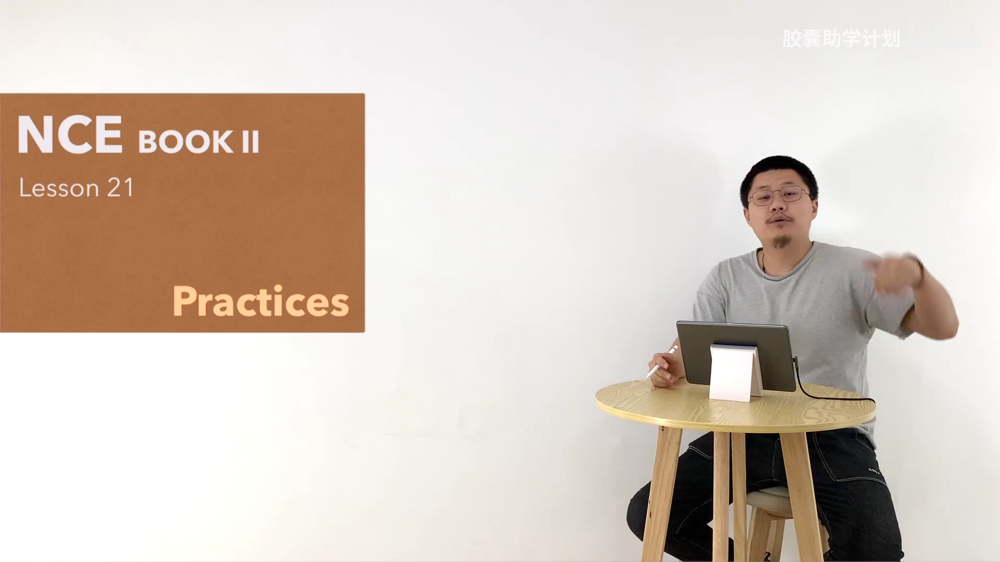

文字识别：NCE / BOOKII / Lesson 21 / Practices

### 画面 00:00:02

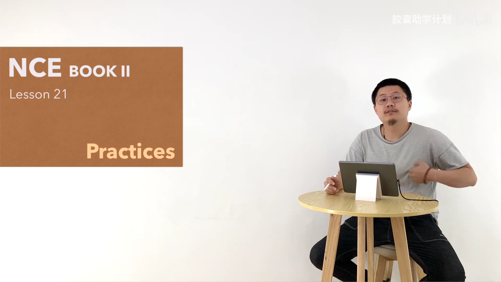

文字识别：NCE / BOOKⅡI / Lesson 21 / Practices

### 画面 00:00:04

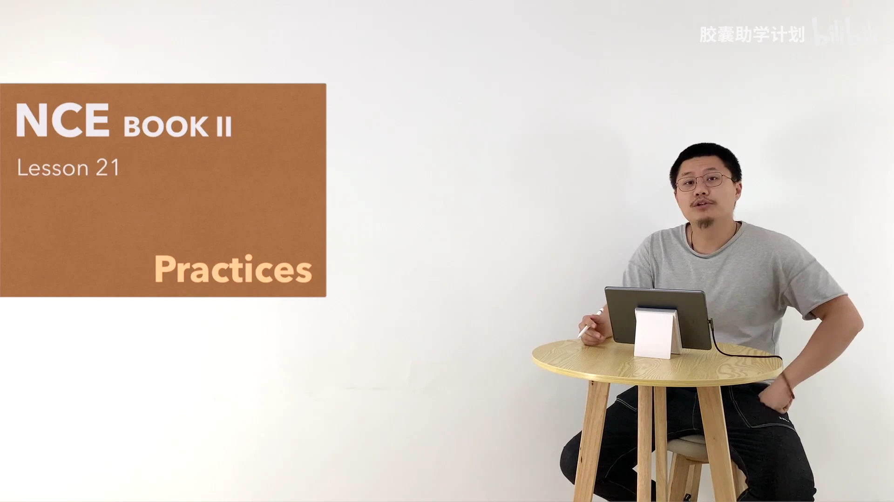

文字识别：胶囊助学计划 / NCE / BOOKII / Lesson 21 / Practices

### 画面 00:00:08

文字识别：胶囊助学计划 / 进行如下练习唯一前提 / 文章跟读至熟读成诵 / 否则请勿开始

### 画面 00:00:15

文字识别：进行如下练习唯一前提 / 文章跟读至熟读成诵 / 否则请勿开始

### 画面 00:00:17

文字识别：胶囊助学计划 bilbl / •

### 画面 00:00:21

文字识别：胶囊助学计划

### 画面 00:00:23

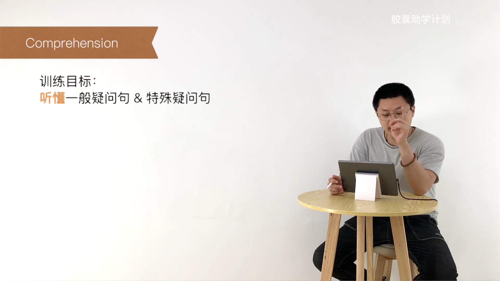

文字识别：胶囊助学计划 / Comprehension / 训练目标： / 听懂一般疑问句＆特殊疑问句

## 00:00:30–00:01:00

特殊疑问句。我问您答，尽量不看着我的这个呃这个板书。OK，好，来了第一题。What are airplanes doing to you? Slowly driving me mad. Next one. Where do you live? Near an airport. Next one. What can be heard night and day?

### 画面 00:00:33

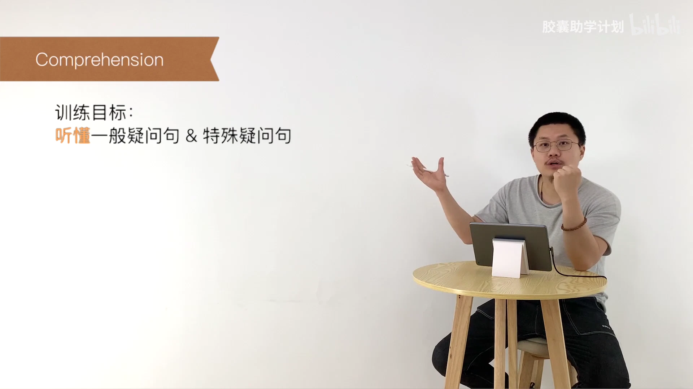

文字识别：胶囊助学计划 / Comprehension / 训练目标： / 听懂一般疑问句＆特殊疑问句

### 画面 00:00:36

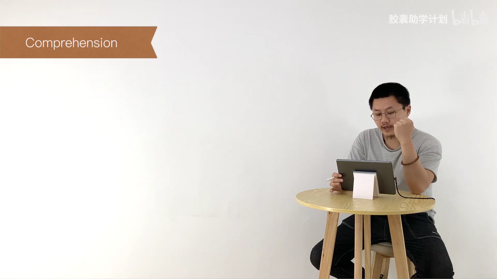

文字识别：胶囊助学计划 / Comprehension

### 画面 00:00:46

文字识别：胶囊助学计划 / Comprehension / What are aeroplanes doing to you? / Slowly driving me mad.

### 画面 00:00:59

文字识别：胶囊助学计划 / Comprehension / What can be heard night and day? / Passing planes.

## 00:01:00–00:01:30

Passing plans. Next one. When was the airport built? Years ago. Next one. Do you know why it wasn't used then? No, I don't. Next one. When did it come into use? Last year. Next one. How many people must have been driven away by the noise?

### 画面 00:01:10

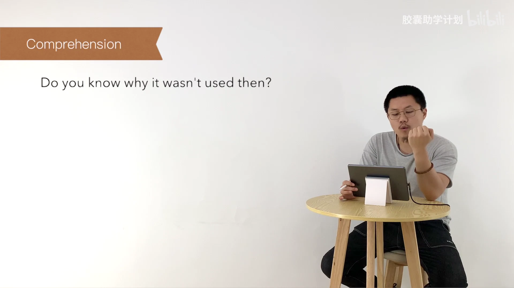

文字识别：胶囊助学计划 / Comprehension / Do you know why it wasn't used then?

### 画面 00:01:24

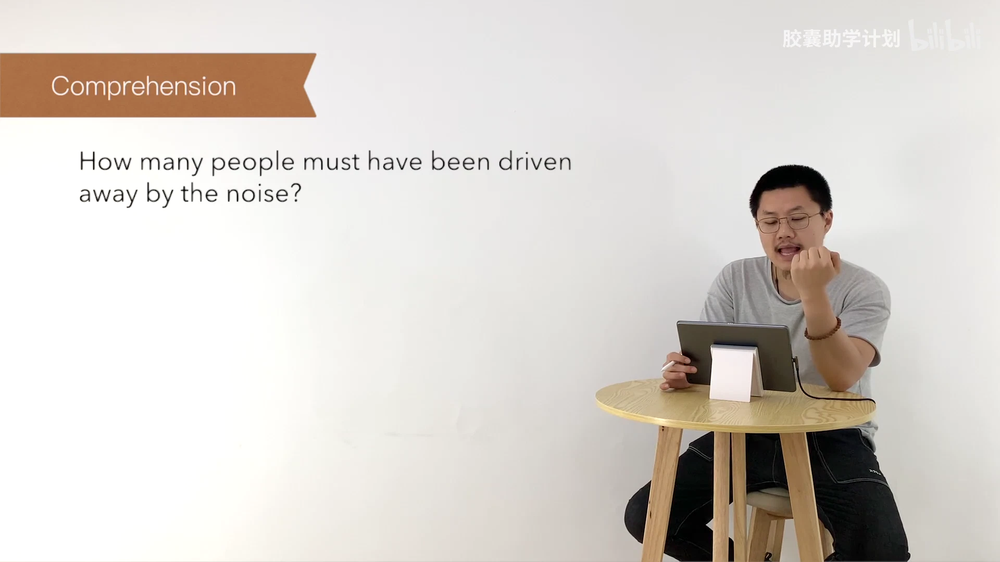

文字识别：胶囊助学计划 / Comprehension / How many people must have been driven / away /  by the noise?

## 00:01:30–00:02:00

Over a hundred people. Next one, are you the only person left? No, I am not. Next one, what do you sometimes think? This house will be knocked down by a passing plane. Next one, why have you been offered a large sum of money? To go away,啊对吧？为什么？目

### 画面 00:01:33

文字识别：胶囊助学计划 / Comprehension / Are you the only person left?

### 画面 00:01:44

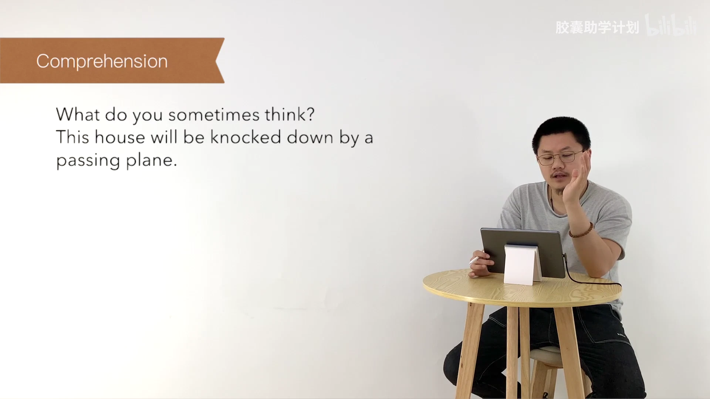

文字识别：胶囊助学计划 / Comprehension / What do you sometimes think? / This house will be knocked down by a / passing plane.

### 画面 00:01:50

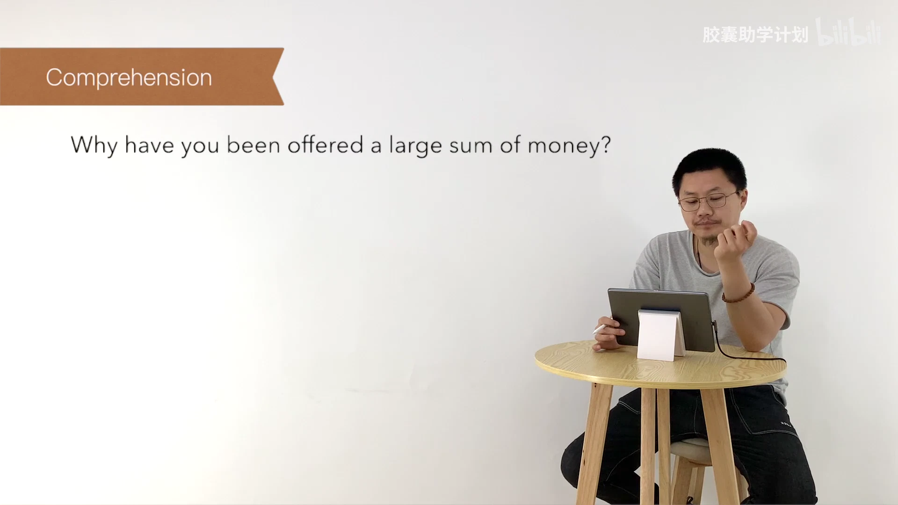

文字识别：胶囊助学计划 / Comprehension / Why have you been offered a large sum of money?

## 00:02:00–00:02:30

### 画面 00:02:02

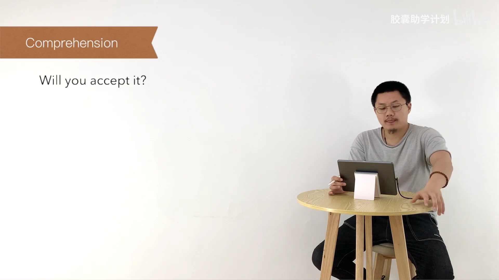

文字识别：胶囊助学计划 / Comprehension / Will you accept it?

### 画面 00:02:09

文字识别：胶囊助学计划 / Asking questions / 训练目标： / 会说一般疑问句＆特殊疑问句 / Accuracy / Fluency

### 画面 00:02:17

文字识别：胶囊助学计划 / Asking questions

### 画面 00:02:20

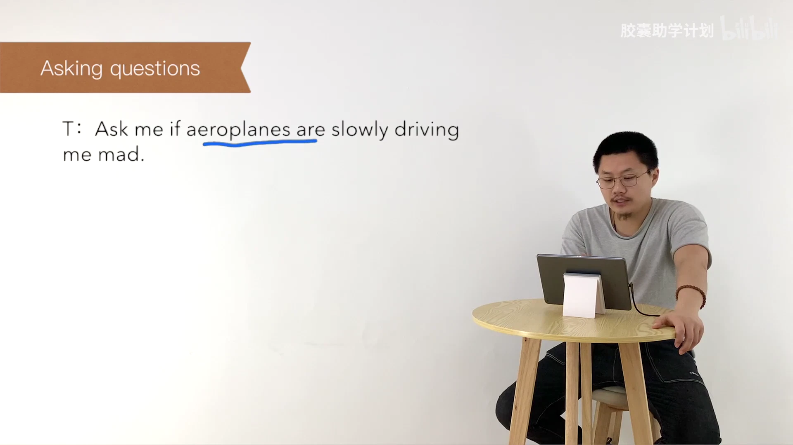

文字识别：胶囊助学计划 / Asking questions / T: Ask me if aeroplanes are slowly driving / me mad.

### 画面 00:02:22

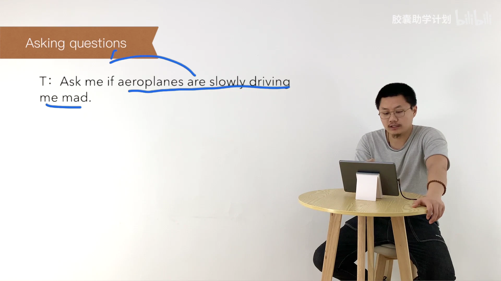

文字识别：胶囊助学计划 / Asking questions / T: Ask me if aeroplanes are slowly driving / me mad. / 2

### 画面 00:02:26

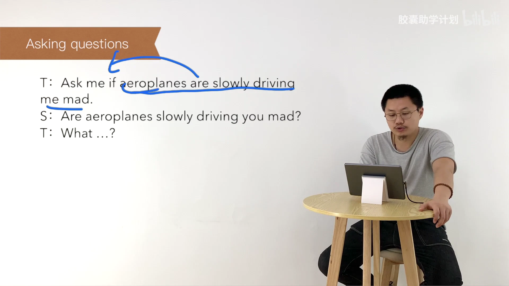

文字识别：胶囊助学计划 / Asking questions / T: Ask me if aeroplanes are slowly driving / me mad. / S: Are aeroplanes slowly c / driving you mad? / T: What ...?

### 画面 00:02:28

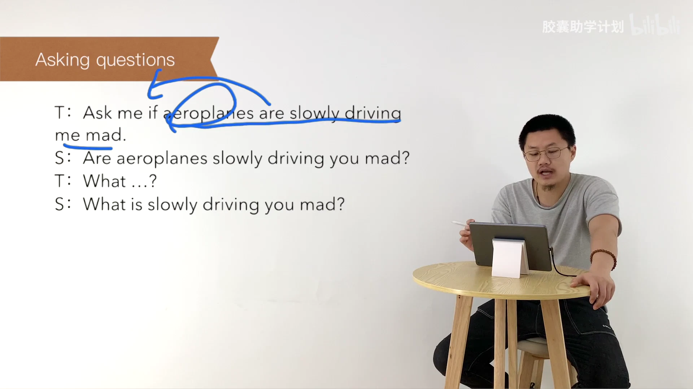

文字识别：胶囊助学计划 / Asking questions / T:Ask me if / zeroplales are slowly driving / me mad. / S: Are aeroplanes slowly driving you mad? / T: What ...? / S: What is slowly driving you mad?

## 00:02:30–00:03:00

driving you mad? There we go. Uh, why? 对整句提问啊，不多说了，是吧？直接加一般疑问句。Live, do提前。Where对near an airport提问啊？各位不能像我这样说啊，你必须要把句子说出来。哇，说你必须要说成叫做Do you live near an airport？写出来，写出来说Where do you live？这两句话啊，我上课只是为了对答案。OK，你不能像我这样给自己说一遍啊，

### 画面 00:02:33

文字识别：胶囊助学计划 / Asking questions

### 画面 00:02:39

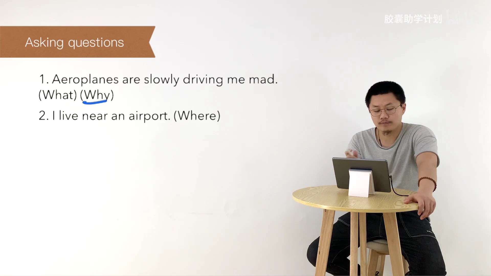

文字识别：胶囊助学计划 / Asking questions / 1.Aeroplanes are slowly / driving me mad. / (What) (Why) / 2.I live near an airport. (Where)

### 画面 00:02:45

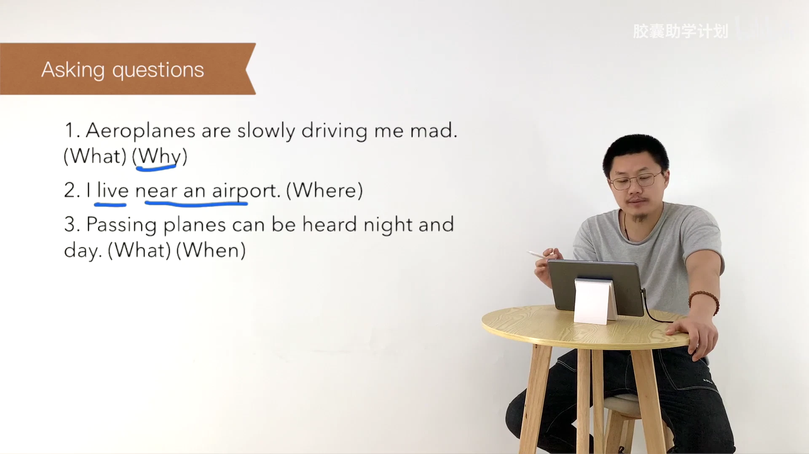

文字识别：胶囊助学计划 / Asking / questions / 1.Aeroplanes are slowly / driving me mad. / (What) (Why) / 2.I live near an airport. (Where) / 3. Passing planes can be heard night and / day. (What) (When)

## 00:03:00–00:03:30

你要把答案说出来。说 Passing planes can be heard night and day. Can提前，对吧？那What对主语提问，直接替代。When对 night and day提问，直接替代。变一般疑问句啊，别忘了。说 The airport was built years ago. Was提前。When对 years ago提问。What对主语提问，不用变一般疑问句。Next one. It came into use. 好，Came did提前，对吧？动词换回

### 画面 00:03:05

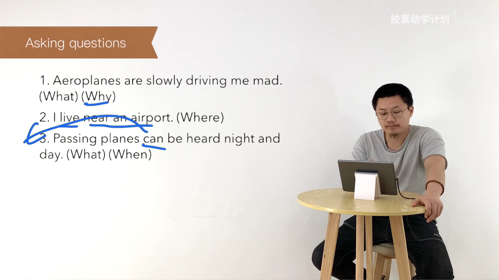

文字识别：胶囊助学计划 / Asking / questions / 1.Aeroplanes are / slowly / driving me mad. / (What) (Why) / 2.I live ncar an airport. / (Where) / 3. Passing / planes can be heard / night and / day. (What) (When)

### 画面 00:03:07

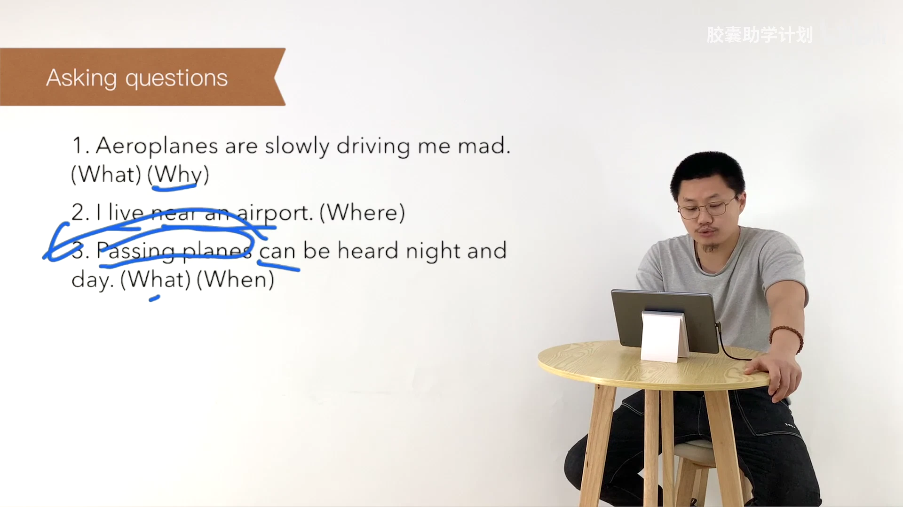

文字识别：Asking / questions / 1.Aeroplanes are / slowly / driving / me mad. / (What)( / )(Why) / 2.I live ncar an airport. / (Where) / Passing plane& can be / heard / night and / day. (What) (When)

### 画面 00:03:10

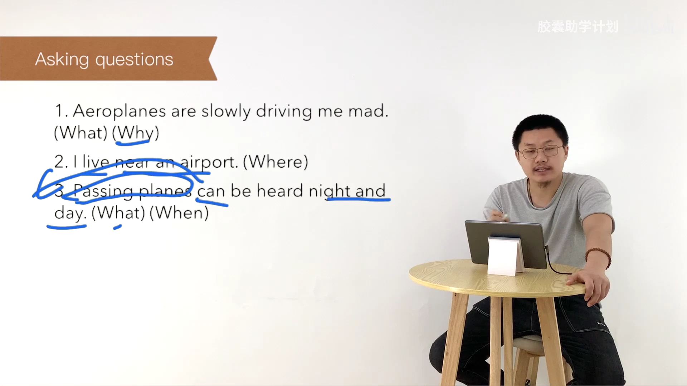

文字识别：Asking / questions / 1.Aeroplanes are / slowly / driving / me mad. / (What) / (Why) / 2.I live ncar an airport. / (Where) / Passing planes / can k / be / heard / night and / day. (What) (When)

### 画面 00:03:17

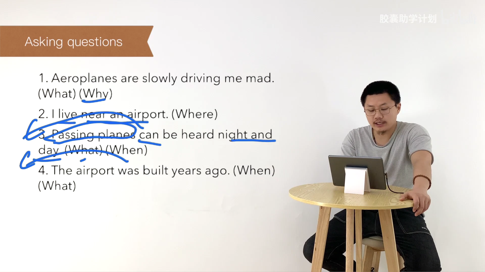

文字识别：Asking / questions / 1.Aeroplanes are / slowly / driving me mad. / (What) (Why) / 2.I live ncar an airport. (Where) / 3Passing planed can be h / heard / night and / day (What) (When) / 4.The / airport was / built years ago. (When) / (What)

### 画面 00:03:20

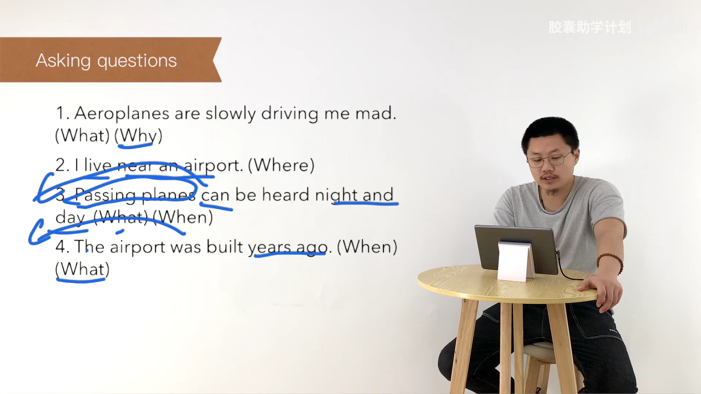

文字识别：Asking / questions / 1.Aeroplanes are / slowly / driving / me mad. / (What) (Why) / 2.I live ncar an airport. / (Where) / Passing planes can be I / heard / night and / day (What) (When) / 4.The / airport / was / built years ago. (When) / (What)

### 画面 00:03:22

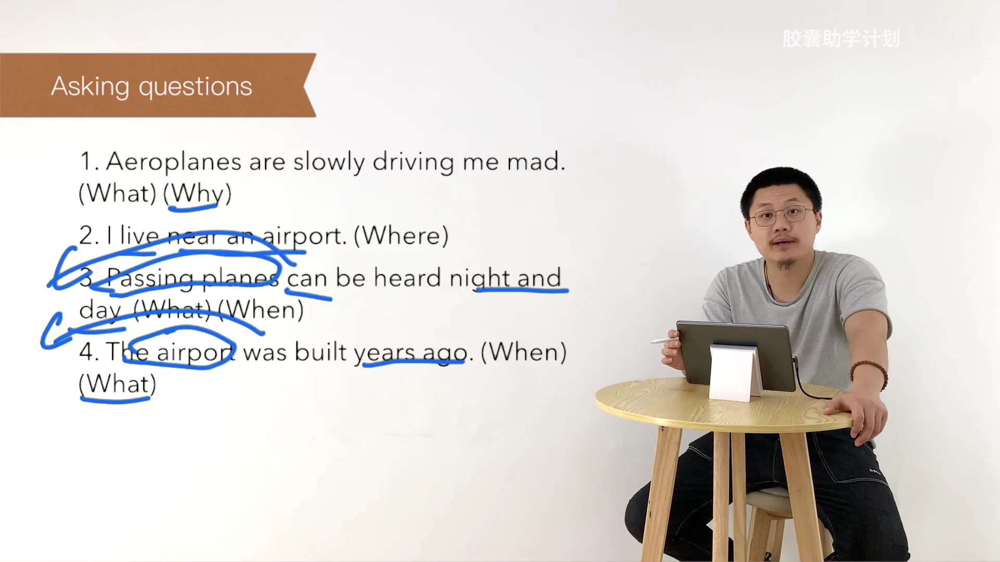

文字识别：Asking / questions / 1.Aeroplanes are / slowly / driving me mad. / (What) (Why) / 2.I live ncar an airport. / (Where) / 3Passing planes can be heard / night and / day (What) (When) / 4. The airpod / was / built years ago. (When) / (What)

### 画面 00:03:24

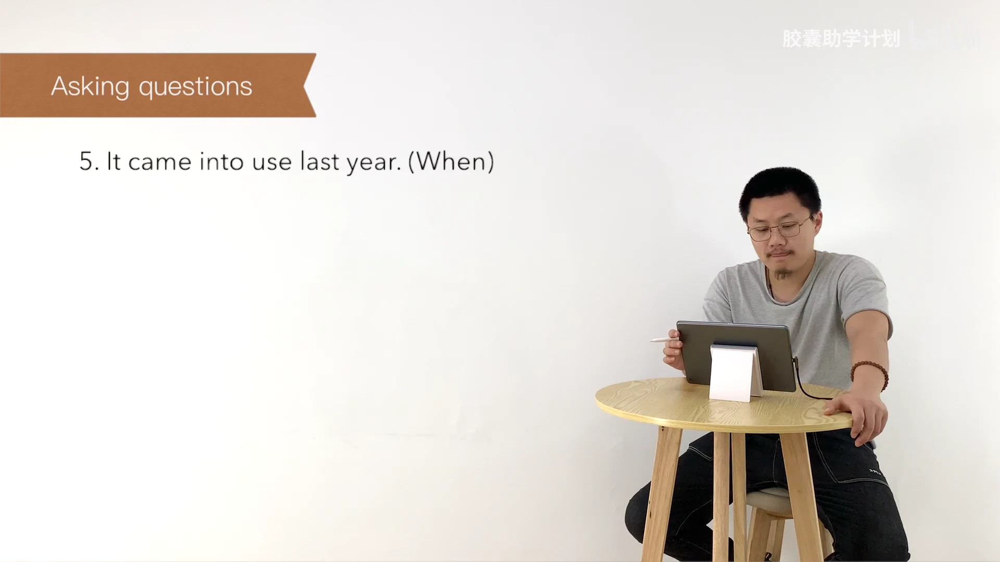

文字识别：Asking questions / 5. It came into use last year. (When)

## 00:03:30–00:04:00

原形。When对last year提问。Over a hundred people must have been driven away. Must提前就行了。How many对over a hundred提问。所以这句话的答案我要说一下，很简单，就是用how many去替代over a hundred就可以了。答案叫how many people，剩下照抄。Okay，They've been driven away by the noise. Have提前。Why整句提问？

### 画面 00:03:33

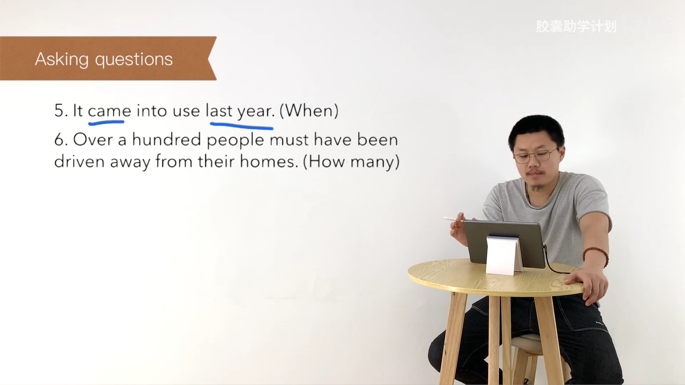

文字识别：胶囊助 / Asking questions / 5. It came into use last year. (When) / 6. Over a hundred / I people must have / been / driven away / from t / their homes.(How many)

### 画面 00:03:37

文字识别：Asking / questions / 5. It came into / use / last year (When) / 6. Over a hundred / people / must have / been / driven away / from / their homes. (How many)

### 画面 00:03:40

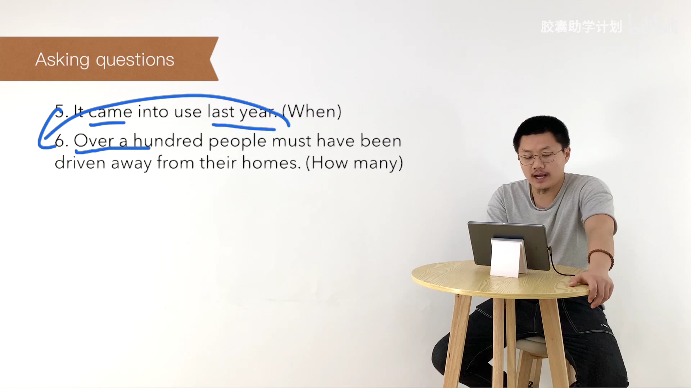

文字识别：Asking / questions / t came / into / use / last year (When) / 6.Over a hundred / people / must / have / been / driven away / from / their / homes.(How r / many)

### 画面 00:03:45

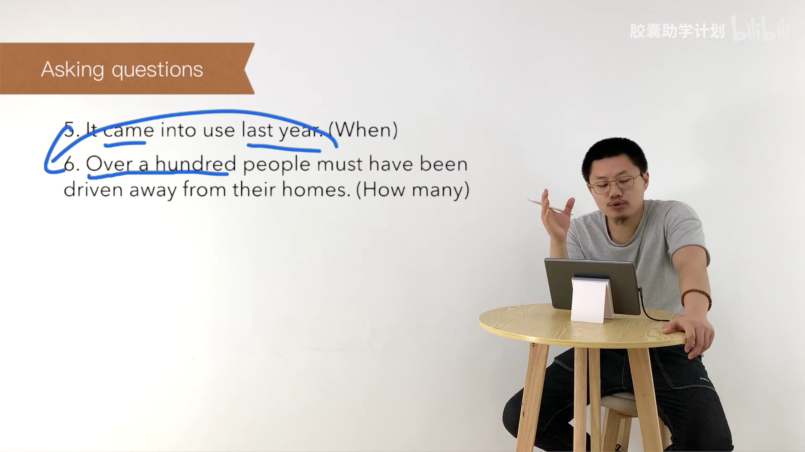

文字识别：胶囊助学计划 / Asking / questions / tcame / into / use / last year (When) / 6. Over a hundred / people / must / have / been / driven away / from / their / homes. (How many)

### 画面 00:03:52

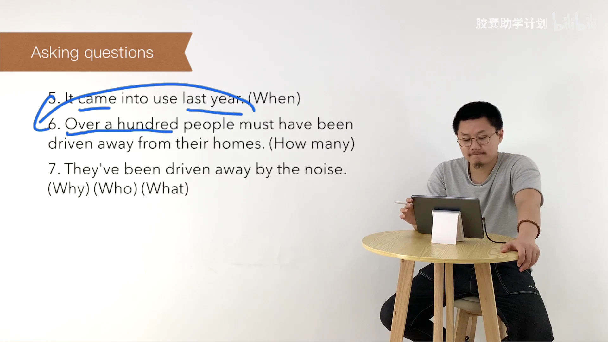

文字识别：胶囊助学计划 / Asking questions / It came into use last year (When) / 6. Over a hundred / people must have / been / driven away / their homes. (How many) / from / 7.They've k /  been driven away by the noise. / (Why) (Who)(What)

### 画面 00:03:57

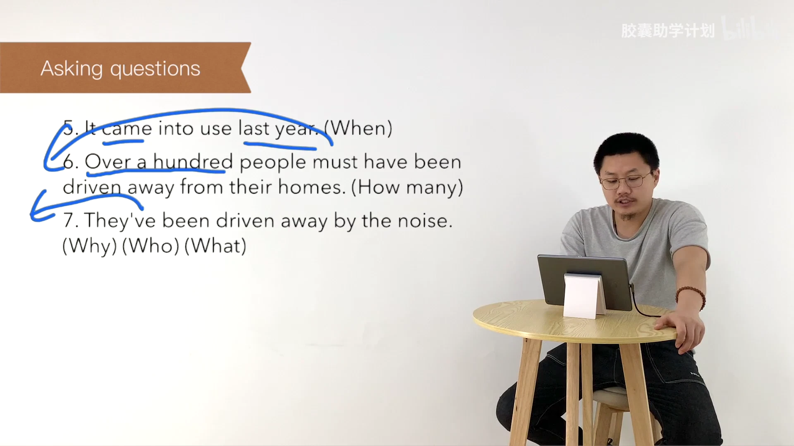

文字识别：胶囊助学计划 / Asking / questions / tcame / into /  use / last year (When) / 6. Over a hundred / people must have / been / driven away / from / their homes. (How many) / 7.They've / been / driven away k / ' by the noise. / (Why) (Who) (What)

## 00:04:00–00:04:30

啊？当然，你也你看啊，这句话你要整句提问，叫Why have they been driven away by the noise？或者呢，我个人认为呢，你也可以这样变成叫做Why have they been driven away？你想一下这两句话的区别是什么，对吧？一个是为什么被噪音赶走了，这是走进科学，是吧？另外一个呢，就是啊，那个这个时候你要解释的是噪音对人会产生什么样的精神压迫，是吧？另外一种呢，就为什么他们被赶走了啊？那答案

### 画面 00:04:27

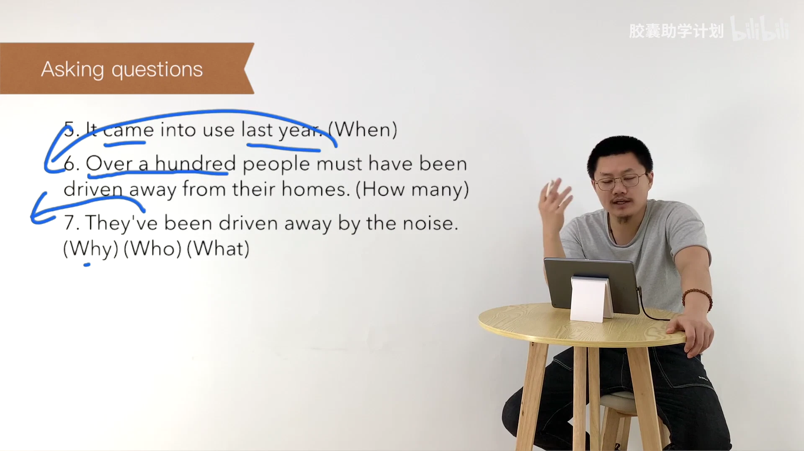

文字识别：胶囊助学计划 / Asking / questions / It came / into / use / last year (When) / 6. Over a hundred / people must have / been / driven away / from / their homes. (How many) / 7.They've / been / driven away k /  by the noise. / (Why)(Who)(What)

## 00:04:30–00:05:00

就是 because of the noise，是吧？因为噪音啊。 Who 对主语提问直接替代。 What 哎，可以直接对这个 the noise，对吧？ Okay。他们被什么赶走了？ There are only a few people left。简单的 there be 句型， are 提前。 How many 对 a few 提问，对吧？ Why 对整句提问。 Okay， tell the story。我们练习

### 画面 00:04:43

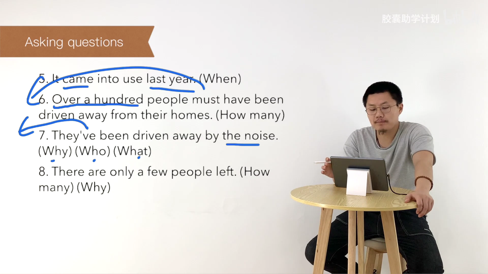

文字识别：胶囊助学计划 / Asking questions / It came into use last year (When) / 6. Over a hundred / people must have been / driven away from t / their homes.(How many) / 7.They've been driven away by the noise. / (Why)(Who)(What) / 8. There are only a few people left. (How / many) (Why)

### 画面 00:04:49

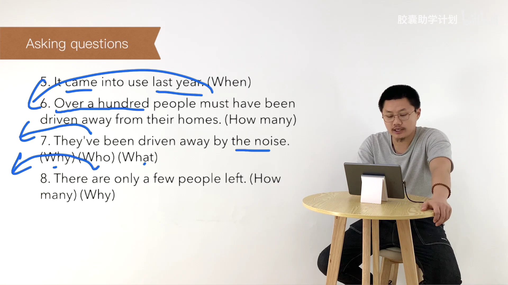

文字识别：Asking questions / It came into use last year (When) / 6. Over a hundred / people must have / been / driven away / from / their homes.(How many) / 7.They've / been / driven away k /  by the noise. / Why)(Who) (What) / 8. There are only a few people left. (How / many) (Why)

### 画面 00:04:56

文字识别：Tell the story / 训练目标： / 口语复述能力 / Accuracy / Fluency

## 00:05:00–00:05:30

fluency, fluency. So the article, you have to read it very fluently. Don't say every sentence is the same. Even if you make a mistake, I think you are right, right? The whole story can be told. For example, here we go. Airplanes are slowly driving me mad. I live near an airport, and passing planes can be heard night and day. The airport was built years ago, but it couldn't be used then. Last year, it came into use.

### 画面 00:05:00

文字识别：胶囊助学计划 / Tell the story / 训练目标： / 口语复述能力 / Accuracy / Fluency

### 画面 00:05:03

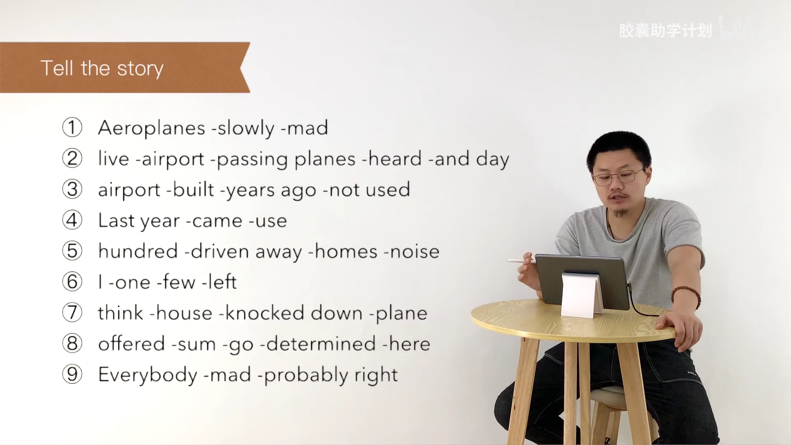

文字识别：胶囊助学计划 / Tell the story / 1 / Aeroplanes -slowly -mad / live -airport -passing planes -heard -and day / airport -built -years ago -not used / Last year-came -use /  hundred -driven away -homes -noise / 5 / ⑥ | -one -few -left / think -house -knocked down -plane / offered -sum -go -determined -here / Everybody -mad -probably right / 9

## 00:05:30–00:06:00

Over a hundred people must have been driven away from their homes by the noise, and one of the few people left. Sometimes I think this house will be knocked down by a passing plane, and I have been offered a large sum of money to go away, but I'm determined to stay here. Everybody says I must be mad, and they're probably right. Very good. Summarizing,这要写作，各位来这儿对一下答案就可以

### 画面 00:05:33

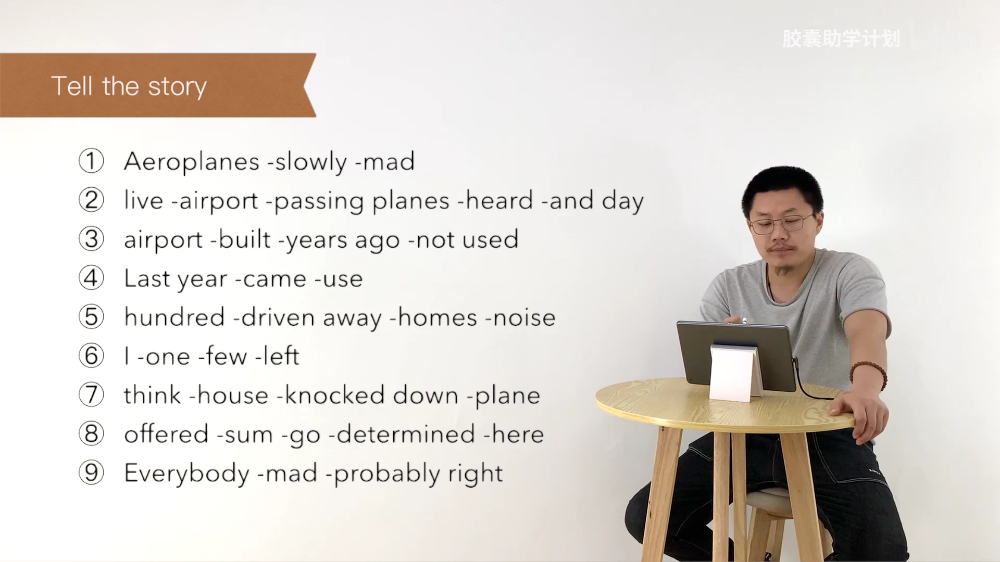

文字识别：Tell the story / 1 / Aeroplanes -slowly -mad / live -airport -passing planes -heard -and day / airport -built -years ago -not used / Last year -came -use /  hundred -driven away -homes -noise / 5 / ⑥ I -one -few -left / think -house -knocked down -plane / offered -sum -go -determined -here / Everybody -mad -probably right / 9

### 画面 00:05:55

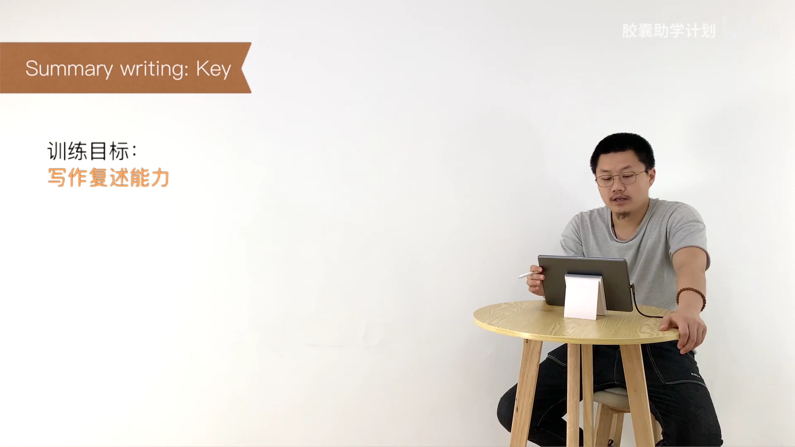

文字识别：Summary writing: Key / 训练目标： / 写作复述能力

### 画面 00:05:57

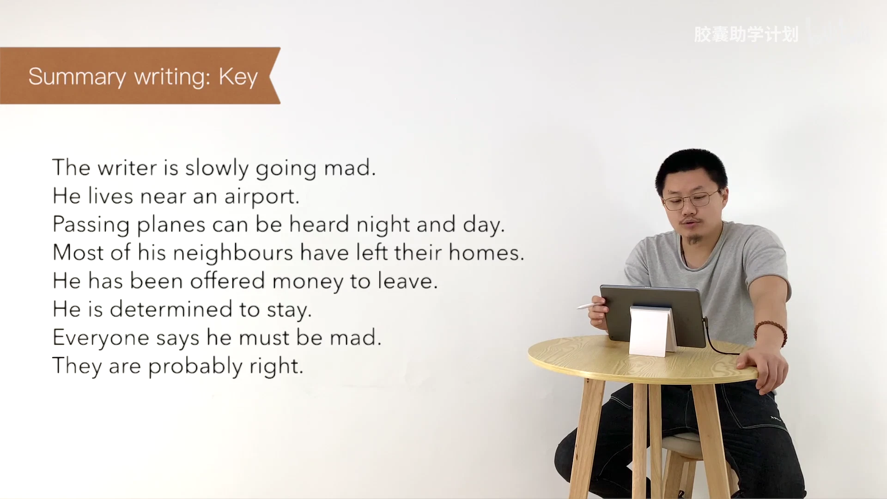

文字识别：Summary writing: Key / The writer is slowly going mad. / He lives near an airport. / Passing planes can be heard night and day. / Most of his neighbours have left their homes. / He has been offered money to leave. / He is determined to stay. / Everyone says he must be mad. / They are probably right.

## 00:06:00–00:06:30

了，没什么的太多可以说的。然后呢，完全自由的对话，这是我们做所有之前的所有练习，将来希望完成唯一的目的就是这种目的。OK，好，当然了，不一定是说，也可以是写啊。我们看一下就可以了。来，What kind of noise do you hear where you live？说你住的那个地方，你都能听到什么样的声音呢？或者说噪音呢？啊，比如说地铁的声音，对吧？比如说外面施工的声音，等等等等。

### 画面 00:06:02

文字识别：胶囊助学计划 / Topics for discussion / 训练目标： / 完全自由的对话 / Accuracy / Fluency

### 画面 00:06:11

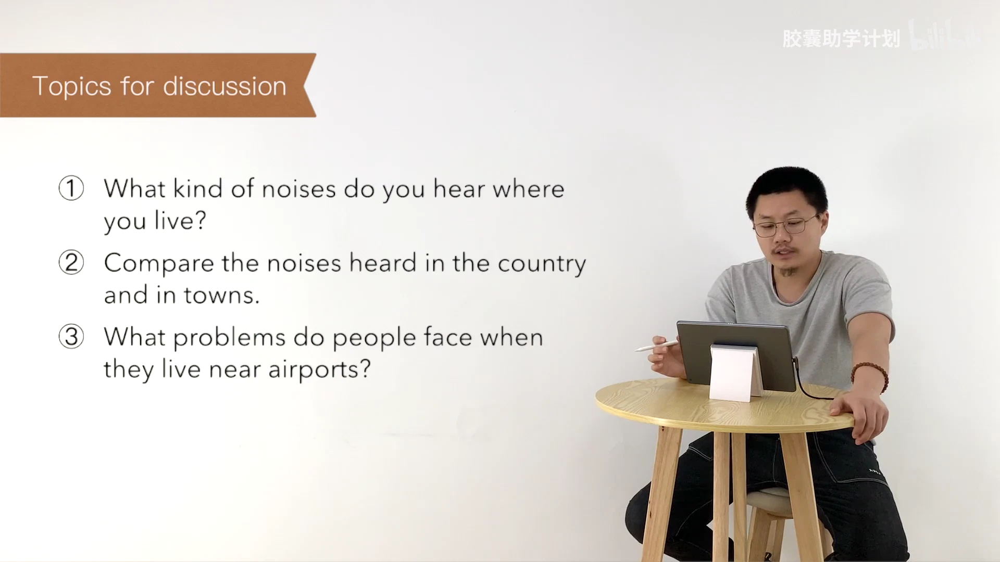

文字识别：胶囊助学计划 / Topics for discussion / What kind of noises do you hear where / you live? / Compare the noises heard in the country / and in towns. / What problems do people face when / they live near airports?

## 00:06:30–00:07:00

Compare the noise heard in the country and in towns. 那你尝试去对比一下你在乡村和城镇当中听到声音的不同啊。比如说，我们假设啊，刻板印象的来说，比如说我在乡村当中能听到这个呃鸟声、昆虫的声音更多一点啊，狗叫的声音更多一点。那在城市呢，可能就是车水马龙的声音更多一点。OK，最后一个，What problems do people

### 画面 00:06:35

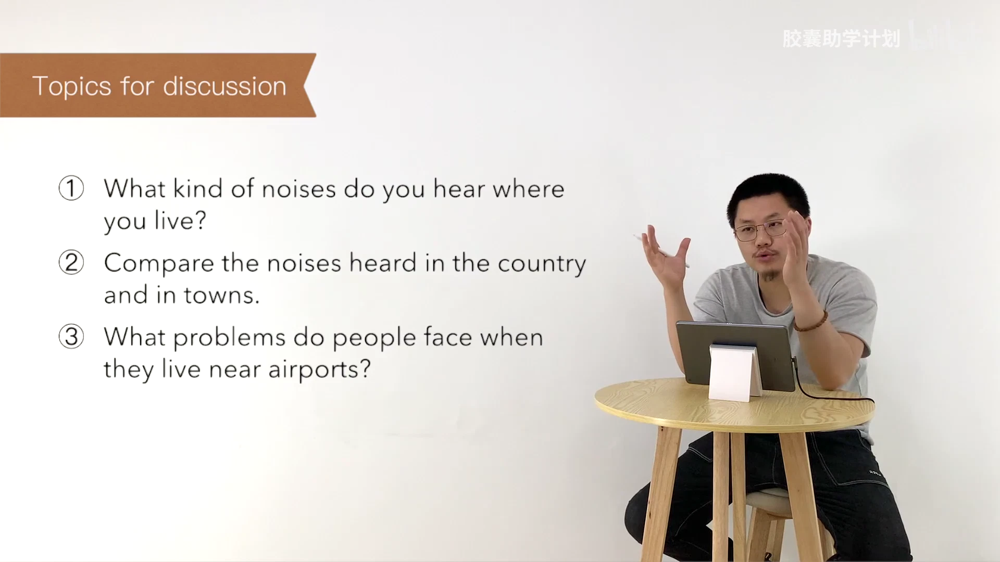

文字识别：胶囊助学计划 / Topics for discussion / What kind of noises do you hear where / you live? / Compare the noises heard in the country / and in towns. / What problems do people face when / 3 / they live near airports?

### 画面 00:06:58

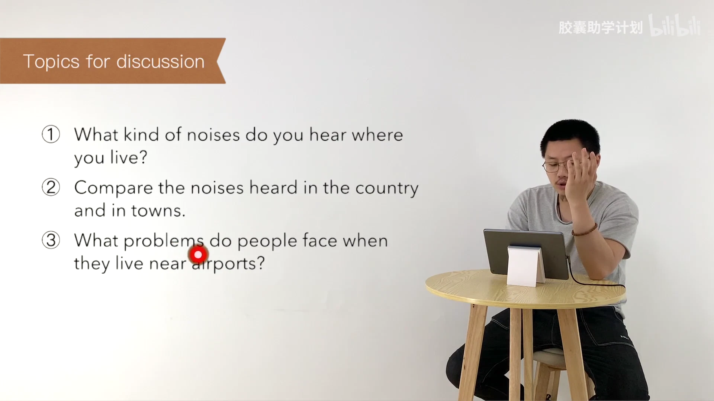

文字识别：胶囊助学计划 / Topics for discussion / What kind of noises do you hear where / you live? / Compare the noises heard in the country / and in towns. / What problems do people face when / they live near arports?

## 00:07:00–00:07:30

face when they live near an airport?说当人们居住在飞机场附近的时候，他们会遇到什么样的问题？注意face在这儿不是脸，在这是动词叫面对啊，他们会遇到面对什么样的问题？家庭作业，Ask Smith先写再朗读，再要写作先写来这对答案。Tell the story，文章读到特别熟了之后，看着关键词进行口语复述和背诵是两码事

### 画面 00:07:16

文字识别：胶囊助学计划

### 画面 00:07:18

文字识别：胶囊助学计划 / 1.Ask me if写&朗读

### 画面 00:07:20

文字识别：胶囊助学计划 / 1. / Ask me if写&朗读 / 2. / 摘要写作写&答案

### 画面 00:07:23

文字识别：胶囊助学计划 / 1.Ask me if写&朗读 / 摘要写作写&答案 / 3.Tell the story 口语复述

### 画面 00:07:25

文字识别：胶囊助学计划 / 1.Ask me if写&朗读 / 摘要写作写&答案 / 3.Tell the story 口语复述

## 00:07:30–00:07:57

儿啊。最后一个专栏当中可以找得到。那以上呢就是本期视频的全部内容了。如果大家喜欢我们的课程呢，欢迎大家关注、订阅、一键三连，分享给那些需要的朋友。See you next time.

### 画面 00:07:30

文字识别：胶囊助学计划 / 1.Ask me if写&朗读 / 摘要写作写&答案 / 3.Tell the story 口语复述 / 专栏 / 4.

### 画面 00:07:33

文字识别：胶囊助学计划 / 2

### 画面 00:07:36

文字识别：胶囊助学 / ￥ / 2

### 画面 00:07:39

文字识别：胶囊助学计划 / 2

### 画面 00:07:44

文字识别：👍

### 画面 00:07:46

文字识别：CAPSULEACADEMY / 胶囊助学计划 / 小红书 / Lecturer / Leo / OE

### 画面 00:07:49

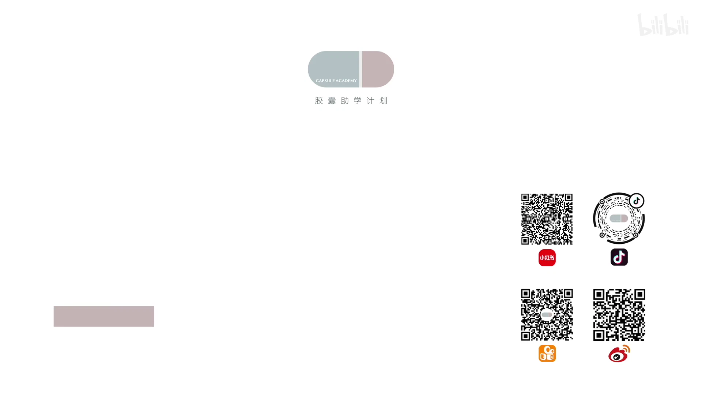

文字识别：CAPSULEACADEMY / 胶囊助学计划 / 『 / 小红书 / OE

### 画面 00:07:52

文字识别：CAPSULEACADEMY / 胶囊助学计划 / 小红书 / Creator / Leo & Berlin / OE

### 画面 00:07:54

文字识别：Bilbili / 胶囊助学计划 / CAPSULEACADEMY / 胶囊助学计划 / 小红书 / 品 / OE

### 画面 00:07:56

文字识别：bilibili / 胶囊助学计划

