# L022 文章

快速机器解析：语音为单模型转写，未进行独立交叉校对或人工复核；画面每秒采样并按变化选帧，短时文字和标记可能遗漏。截图时间约有 1 秒误差。图片有损压缩；遇到疑点请按时间查看 Google Drive 原视频。

## 00:00:00–00:00:30

Hello, everyone. Welcome to Capsule Academy. This is Leo. Today, we're going to learn the Concept English Book Two, Lesson Twenty Two, Story. Hope you can enjoy it.好，那我们直接看文章啊。来了，叫 My Daughter Jane. 好，我女儿 Jane. 这个对于各位来说，阅读读懂它是很容易的。我女儿 Jane 啊，你能很清楚的了解 Jane 就是我女儿的名字，

### 画面 00:00:00

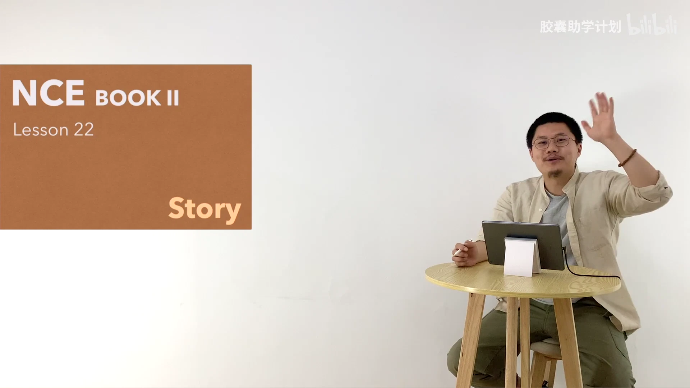

文字识别：胶囊助学计划 / NCE / BOOKII / Lesson 22 / Story

### 画面 00:00:02

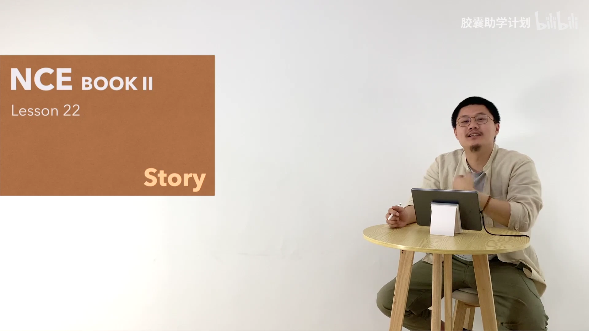

文字识别：胶囊助学计划 / NCE / BOOK"I / Lesson 22 / Story

### 画面 00:00:04

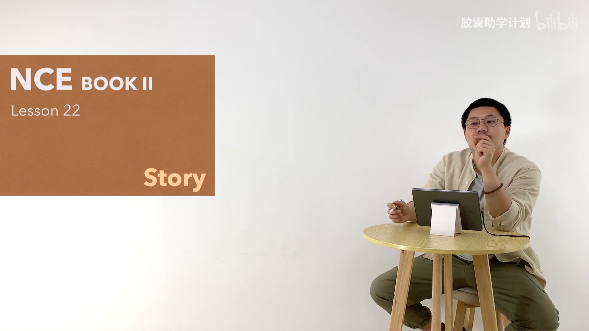

文字识别：胶囊助学计划 / NCE / BOOK"I / Lesson 22 / Story

### 画面 00:00:06

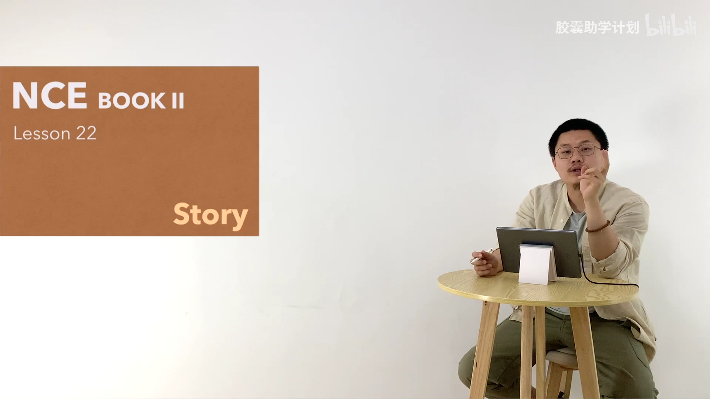

文字识别：胶囊助学计划 / NCE / BOOKⅡI / Lesson 22 / Story

### 画面 00:00:09

文字识别：胶囊助学计划bill / 0

### 画面 00:00:13

### 画面 00:00:15

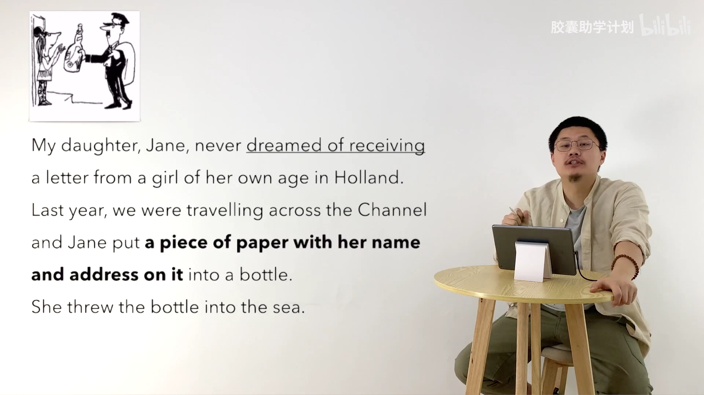

文字识别：胶囊助学计划 / My daughter, Jane, never dreamed of receiving / a letter from a girl of her own age in Holland. / Last year, we were travelling across the Channel / and Jane put a piece of paper with her name / and address on it into a bottle. / She threw the bottle into the sea.

## 00:00:30–00:01:00

对吧？然后呢，呃，Jane也是我女儿，女儿也叫Jane，对吧？这两个东西我们在学术这个用语当中、语法当中管它叫同位语啊。各位知不知道它是同位语？不理解不影响您读懂这几个单词。但是呢，以后我们会学一个东西叫同位语从句啊，可能就会有影响了。那今天我们先不多说啊，各位记住同位语这个概念就可以了。我女儿Jane never从来都没有dreamed of receiving a letter from a

### 画面 00:00:30

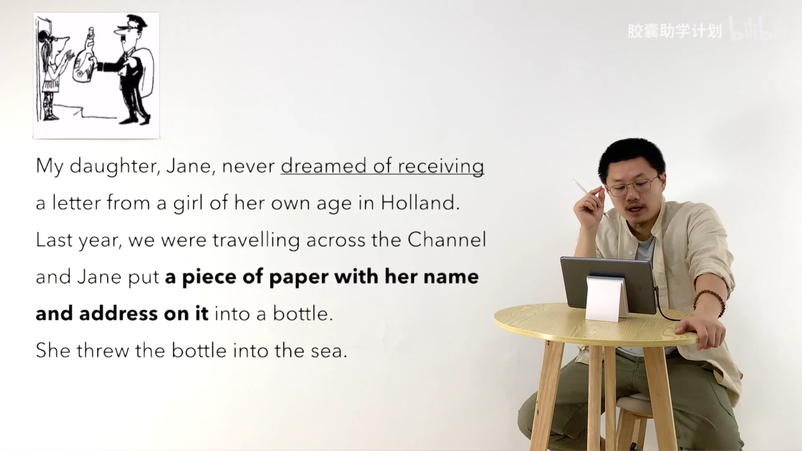

文字识别：胶囊助学计划 / My daughter, Jane, never dreamed of receiving / a letter from a girl of her own age in Holland. / Last year, we were travelling across the Channel / and Jane put a piece of paper with her name / and address on it into a bottle. / She threw the bottle into the sea.

### 画面 00:00:53

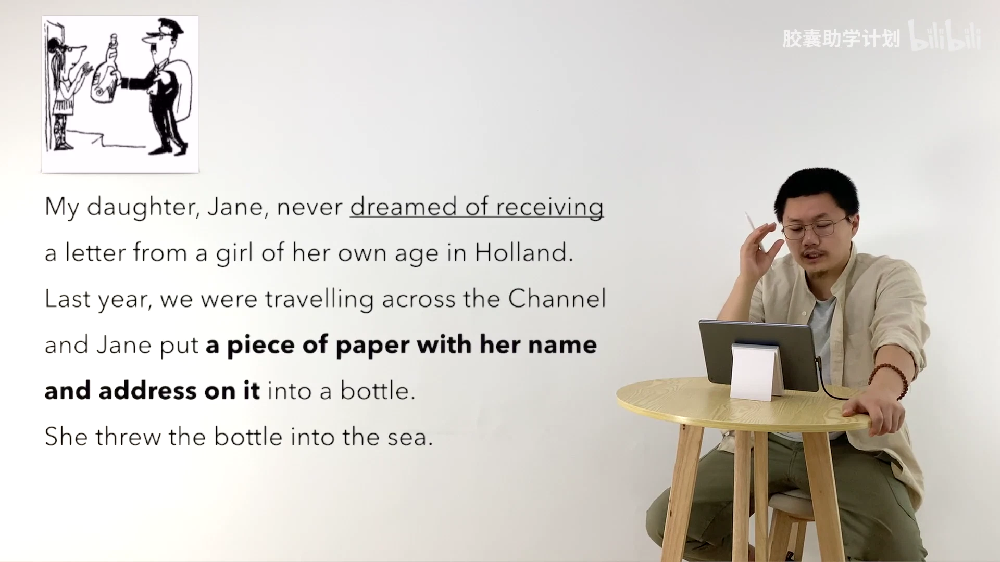

文字识别：胶囊助学计划 / My daughter, Jane, never dreamed of receiving / a letter from a girl of her own age in Holland. / Last year, we were travelling across the Channel / and Jane put a piece of paper with her name / and address on it into a bottle. / She threw the bottle into the sea.

## 00:01:00–00:01:30

girl. 好，先不往后看了。我们在这儿先给它断个句。 Dream of doing something. 梦梦想着做某件事情。从来都没有想象到会 receive something from somebody. 很早之前我们就学过了。从来没有梦想到收到一封信来自于一个姑娘。什么样的姑娘呢？ Of, 哎，先从后往前翻，对吧？一个姑娘，什么样的姑娘？ Her own age. 她同龄。 Own 叫她自己的 age 叫年

### 画面 00:01:20

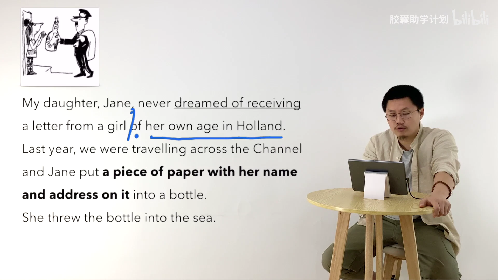

文字识别：胶囊助学计划 / My daughter, Jane, never dreamed of receiving / a letter from a girl pf her own age in Holland. / Last year, we were travelling across the Channel / and Jane put a piece of paper with her name / and address on it into a bottle. / She threw the bottle into the sea.

### 画面 00:01:23

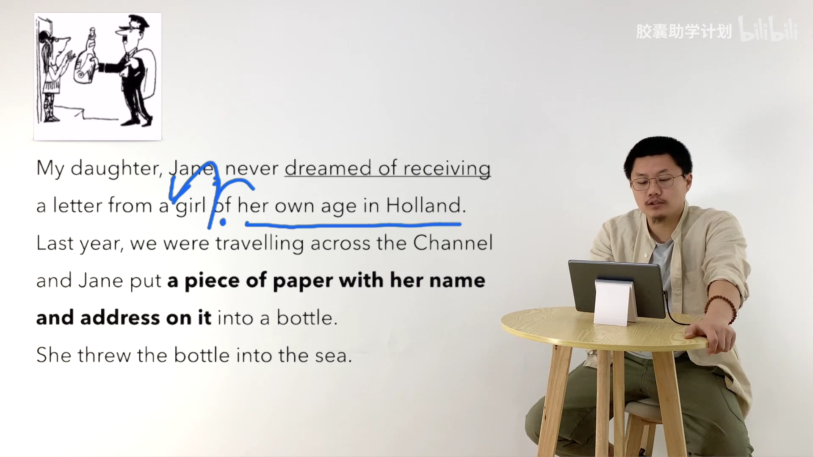

文字识别：胶囊助学计划 / My daughter, Jare never dreamed of receiving / a letter from a girl bf her own age in Holland. / Last year, we were travelling across the Channel / and Jane put a piece of paper with her name / and address on it into a bottle. / She threw the bottle into the sea.

## 00:01:30–00:02:00

龄，她自己的年龄的一个姑娘，什么叫她自己年龄？就她十八岁，对方也是十八岁，对吧？就是同龄。各位不妨可以把叫做 her own age 啊，给她记成叫她的同龄，对吧？那我的同龄 my own age，玩一遍。In Holland，在荷兰。Last year，好，先不往后看，这两个单词一出来，基本就提醒你，接下来我可能要给你讲故事了，对吧？或者讲过去发生的事情。所

### 画面 00:01:40

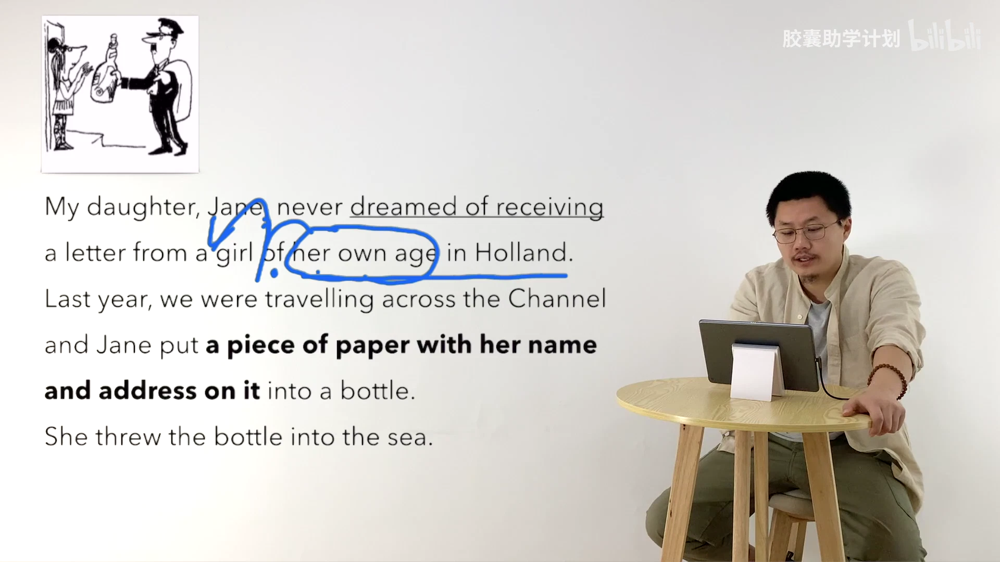

文字识别：胶囊助学计划 / My daughter, Japer / never dreamed of receiving / a letter from a girl pf her own age / in Holland. / Last year, we were travelling across the Channel / and Jane put a piece of paper with her name / and address on it into a bottle. / She threw the bottle into the sea.

### 画面 00:01:43

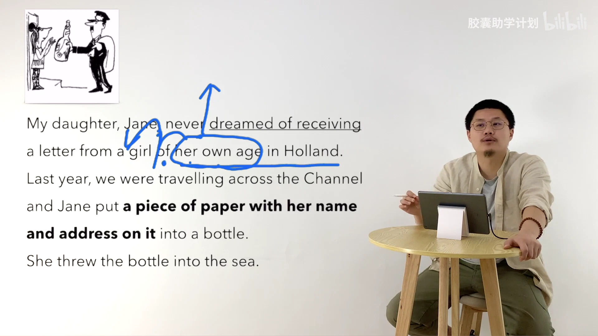

文字识别：胶囊助学计划 / My daughter, Jape / dreamed of receiving / never / a letter from a girl pfher own age / in Holland. / Last year, we were travelling across the Channel / and Jane put a piece of paper with her name / and address on it into a bottle. / She threw the bottle into the sea.

### 画面 00:01:52

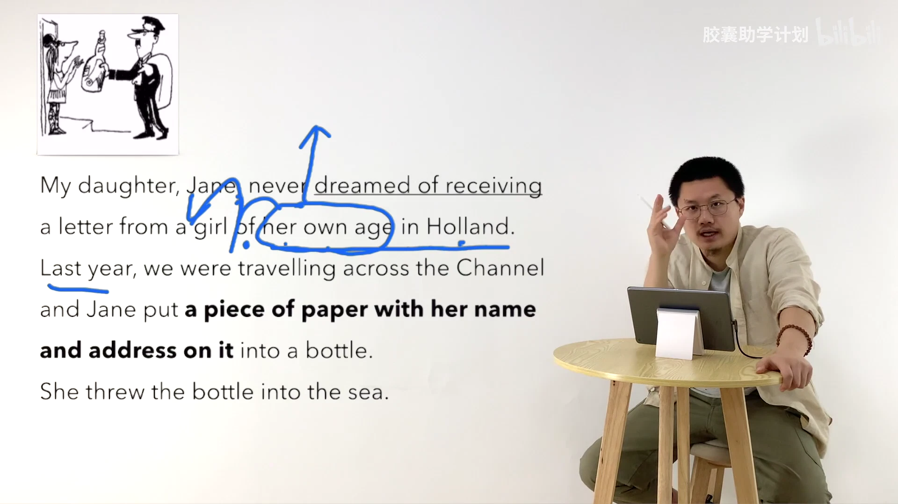

文字识别：胶囊助学计划 / My daughter, Jape / dreamed of receiving / never / a letter from a girl bfher own age / in Holland. / Last year, we were travelling across the Channel / and Jane put a piece of paper with her name / and address on it into a bottle. / She threw the bottle into the sea.

## 00:02:00–00:02:30

以很多的未来接下来会用到的时态都可能是跟过去相关的。我们来一起看一下，We were traveling，我们当时啊正在航行，驶过 across the channel，驶过这个海峡。注意 C 在大写 English Channel，在讲单词的时候我提到了，OK，希望各位记得英吉利海峡。我们当时正在航行，穿过英吉利海峡。然后呢，Jane 做了一件事情，

### 画面 00:02:05

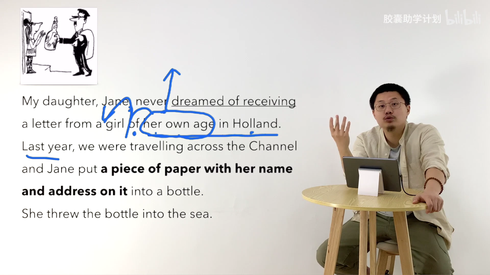

文字识别：胶囊助学计划 / My daughter, Jape / dreamed of receiving / never / a letter from a girl bfner own agg / in Holland. / Last year, we were travelling across the Channel / and Jane put a piece of paper with her name / and address on it into a bottle. / She threw the bottle into the sea.

### 画面 00:02:09

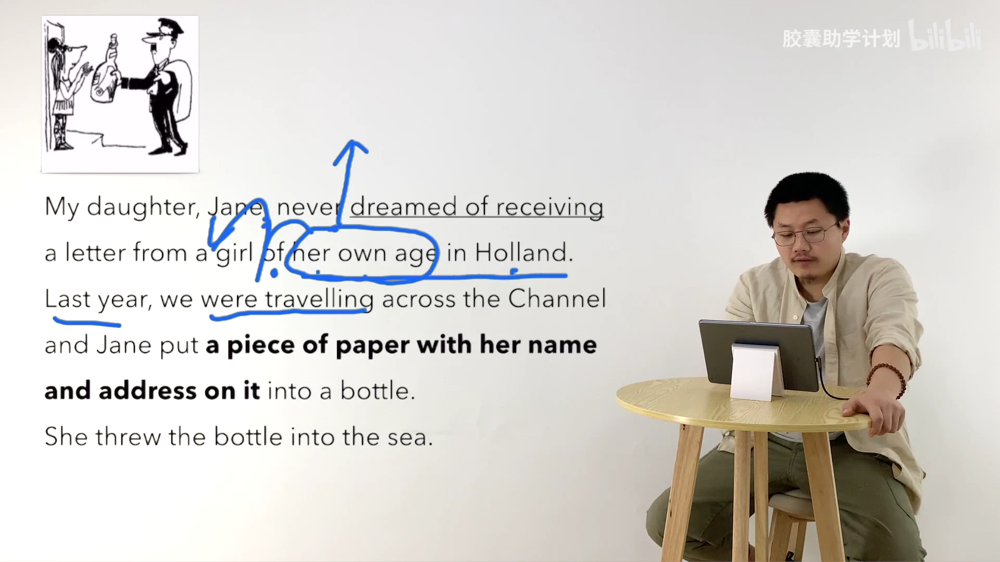

文字识别：胶囊助学计划 / My daughter, Jape / dreamed of receiving / never / a letter from a girl pfher own age / in Holland. / Last year, we were travelling across the Channel / and Jane put a piece of paper with her name / and address on it into a bottle. / She threw the bottle into the sea.

### 画面 00:02:15

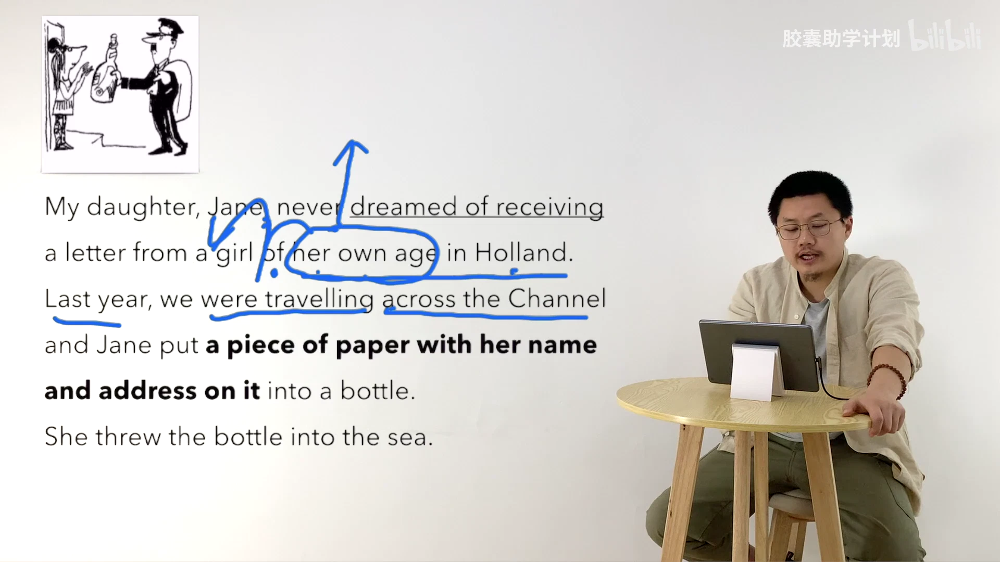

文字识别：胶囊助学计划 / My daughter, Jane / dreamed of receiving / never / a letter from a girl pf her own age / in Holland. / Last year, we were travelling across the Channel / and Jane put a piece of paper with her name / and address on it into a bottle. / She threw the bottle into the sea.

## 00:02:30–00:03:00

into a bottle. Put

### 画面 00:02:34

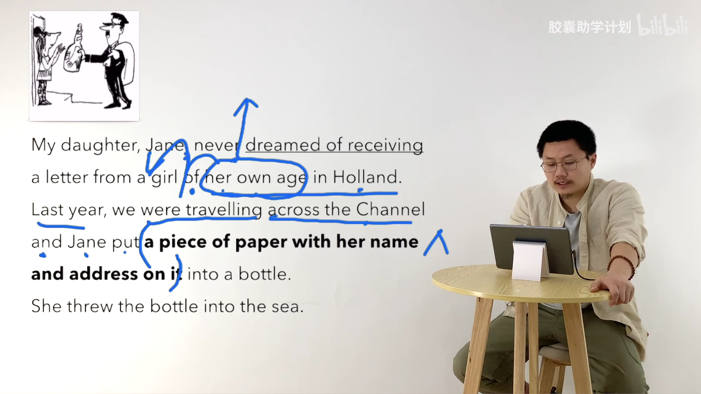

文字识别：胶囊助学计划 / My daughter, Jape / dreamed of receiving / never / a letter from a girl pfher own age / in Holland. / Last year, we were travelling across the Channel / and Jane puta piece of paper with her name / and address on if into a bottle. / She threw the bottle into the sea.

### 画面 00:02:39

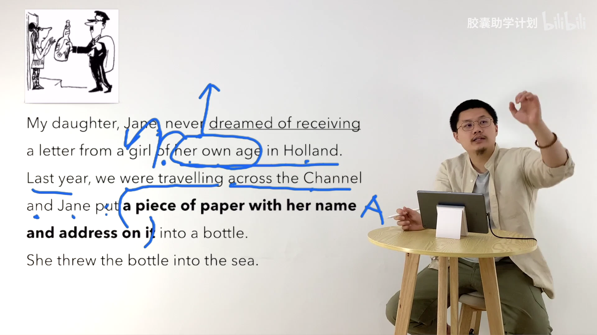

文字识别：胶囊助学计划 / My daughter, Jape / dreamed of receiving / never / a letter from a girl bfher own age / in Holland. / Last year, we were travelling across the Channel / and Jane put a piece of paper with her name / A / and address on if into a bottle. / She threw the bottle into the sea.

### 画面 00:02:45

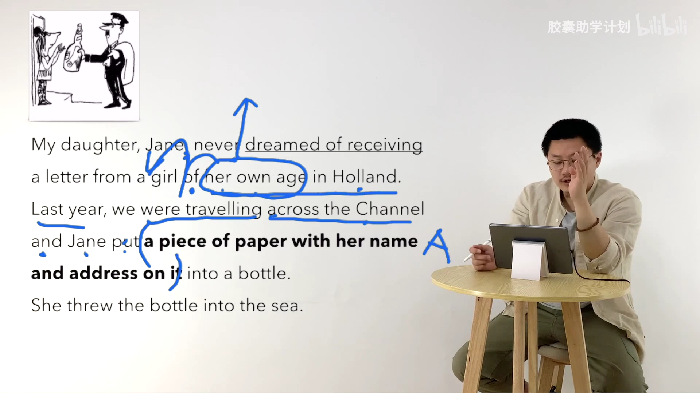

文字识别：胶囊助学计划 / My daughter, Jane / dreamed of receiving / never / a letter from a girl bfher own age / in Holland. / Last year, we were travelling across the Channel / and Jane put a piece of paper with her name / and address on if into a bottle. / She threw the bottle into the sea.

### 画面 00:02:49

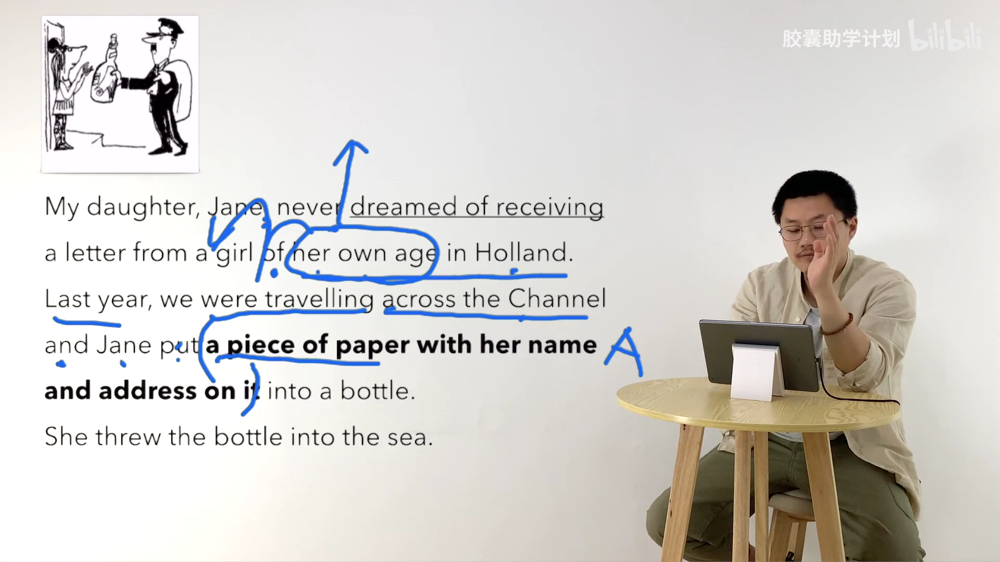

文字识别：胶囊助学计划 / My daughter, Jane / dreamed of receiving / never / a letter from a girl bfher own agg / in Holland. / Last year, we were travelling across the Channel / and Jane put a piece of paper with her name / and address on il into a bottle. / She threw the bottle into the sea.

### 画面 00:02:52

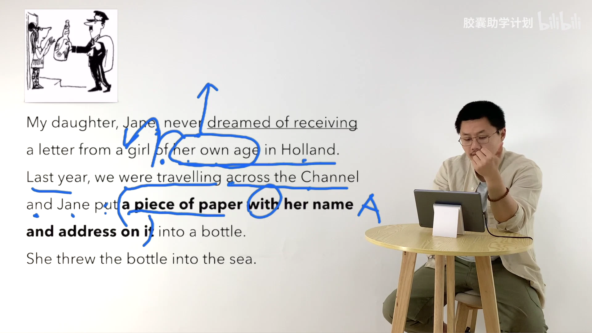

文字识别：胶囊助学计划 / My daughter, Jape / dreamed of receiving / never / a letter from a girl bfher own age / in Holland. / Last year, we were travelling across the Channel / and Jane puta piece of paper / witbher name / and address on if into a bottle. / She threw the bottle into the sea.

### 画面 00:02:58

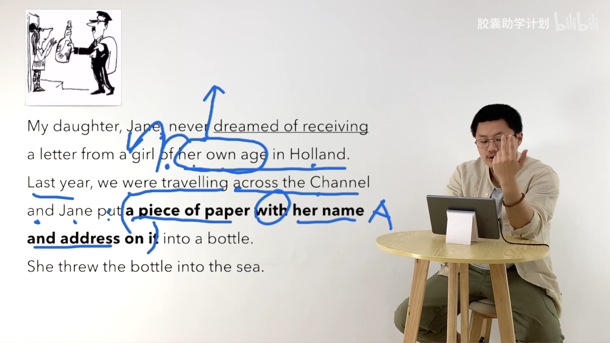

文字识别：胶囊助学计划 / My daughter, Jape / dreamed of receiving / never / a letter from a girl pfher own age / in Holland. / Last year, we were travelling across the Channel / and Jane puta piece of paper / Withher name / and address on if into a bottle. / She threw the bottle into the sea.

## 00:03:00–00:03:30

他的名字和他的地址 on it就是这个 it，注意指的是 paper on the paper，对吧？说他放置了一张纸在这个瓶子里，这张纸上呢有他的名字和地址在上面。至于这个 on it，其实有没有都是可以的。OK，注意一个小点就行了。She threw the bottle into the sea.非常简单，她扔瓶子扔进了海里，跟汉语没什么区别。基本每个单

### 画面 00:03:17

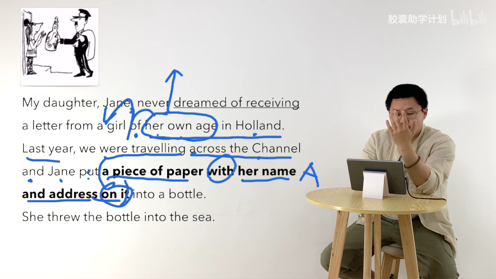

文字识别：胶囊助学计划 / My daughter, Jane / dreamed of receiving / never / a letter from a girl pfner own age / in Holland. / Last year, we were travelling across the Channel / and Jane puta piece of paper / withher name / and addressonidinto a bottle. / She threw the bottle into the sea.

### 画面 00:03:25

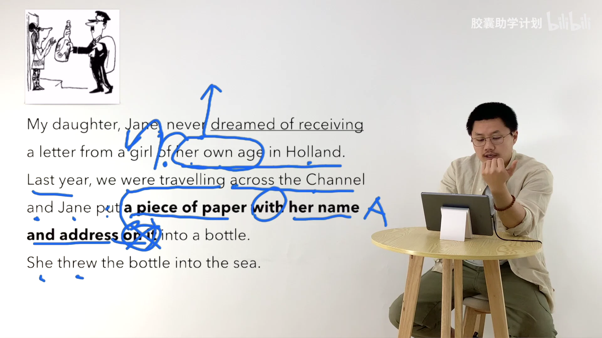

文字识别：胶囊助学计划 / My daughter, Jape / dreamed of receiving / never / a letter from a girl pfher own age / in Holland. / Last year, we were travelling across the Channel / and Jane puta piece of paper / withher name / and address / into a bottle. / She threw the bottle into the sea.

### 画面 00:03:27

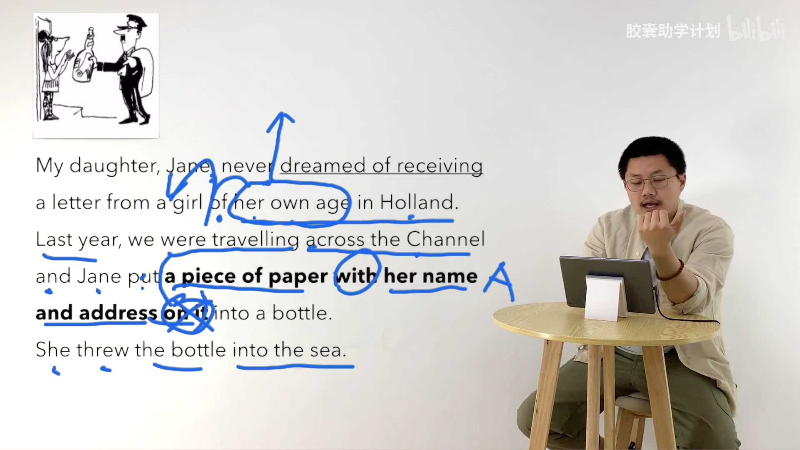

文字识别：胶囊助学计划 / My daughter, Jape / dreamed of receiving / never / a letter from a girl bfher own age / in Holland. / Last year, we were travelling across the Channel / and Jane put a piece of paper / withher name / and addresso / into a bottle. / She threw the bottle into the sea.

## 00:03:30–00:04:00

词您认的这句话就搞定了，只不过多了个时态，注意是一般过去时，对吧？Continue. She never.她再也没有thought of it again.好，thought，注意是think的过去式，那think就是想，think of其实还是想，就是思思考、思虑、想象啊想啊，她再也没有想过这件事儿。But但是，ten months later，十个月之后，she

### 画面 00:03:33

文字识别：胶囊助学计划 / My daughter, Jape / dreamed of receiving / never / a letter from a girl pfner own agg / in Holland. / Last year, we were travelling across the Channel / and Jane put a piece of paper / with her name / and address / into a bottle. / She threw the bottle into the sea. / ✔

### 画面 00:03:36

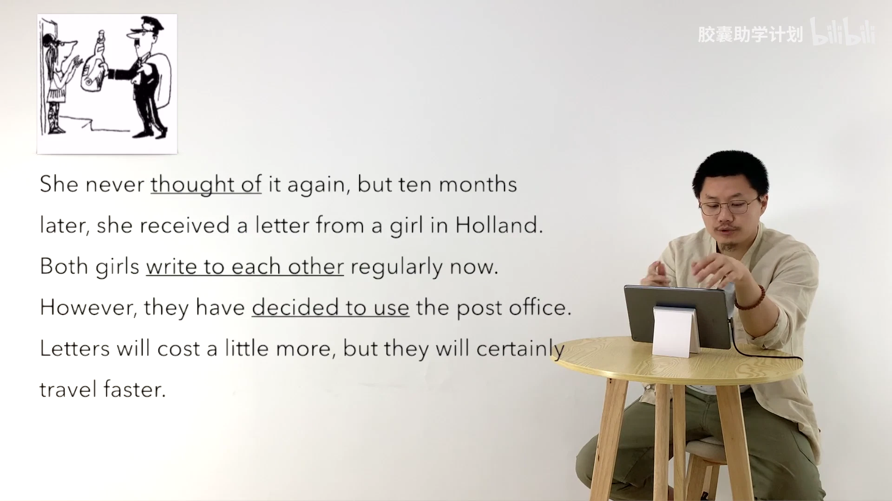

文字识别：胶囊助学计划 / She never thought of it again, but ten months / later, she received a letter from a girl in Holland. / Both girls write to each other regularly now. / However, they have decided to use the post office. / Letters will cost a little more, but they will certainly / travel faster.

### 画面 00:03:41

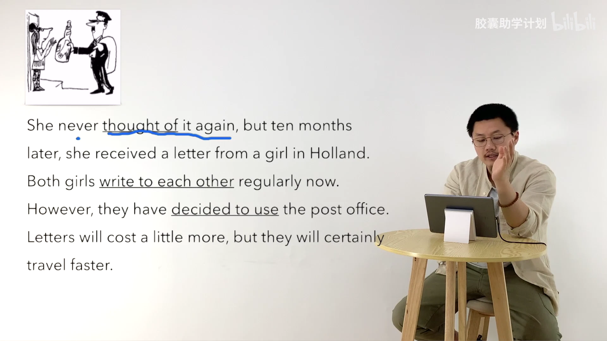

文字识别：胶囊助学计划 / She never thought of it again, but ten months / later, she received a letter from a girl in Holland. / Both girls write to each other regularly now. / However, they have decided to use the post office. / Letters will cost a little more, but they will certainly / travel faster.

### 画面 00:03:43

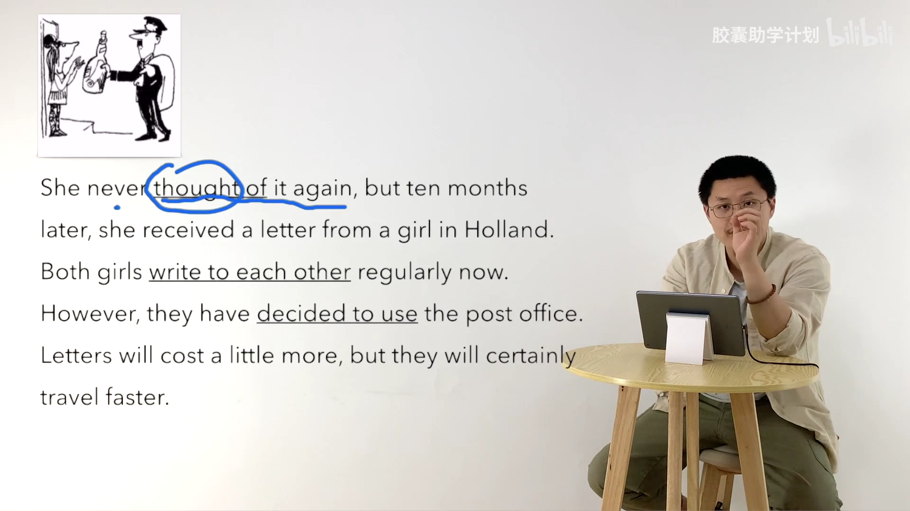

文字识别：胶囊助学计划 / She neverthought of it again, but ten months / later, she received a letter from a girl in Holland. / Both girls write to each other regularly now. / However, they have decided to use the post office. / Letters will cost a little more, but they will certainly / travel faster.

### 画面 00:03:45

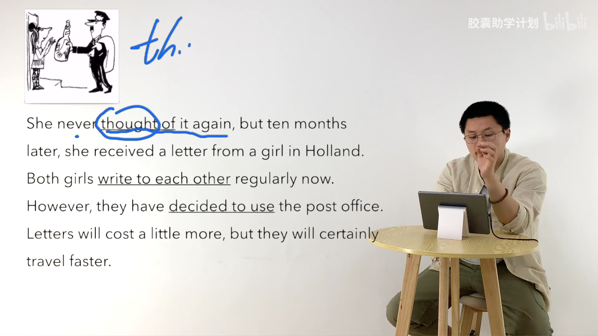

文字识别：胶囊助学计划 / She neverthought of it again, but ten months / later, she received a letter from a girl in Holland. / Both girls write to each other regularly now. / However, they have decided to use the post office. / Letters will cost a little more, but they will certainly / travel faster.

### 画面 00:03:49

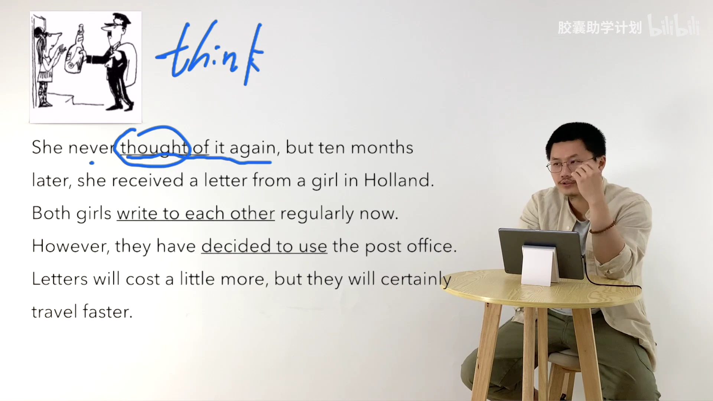

文字识别：胶囊助学计划 / th:nk / She neverthought of it again, but ten months / later, she received a letter from a girl in Holland. / Both girls write to each other regularly now. / However, they have decided to use the post office. / Letters will cost a little more, but they will certainly / travel faster.

### 画面 00:03:58

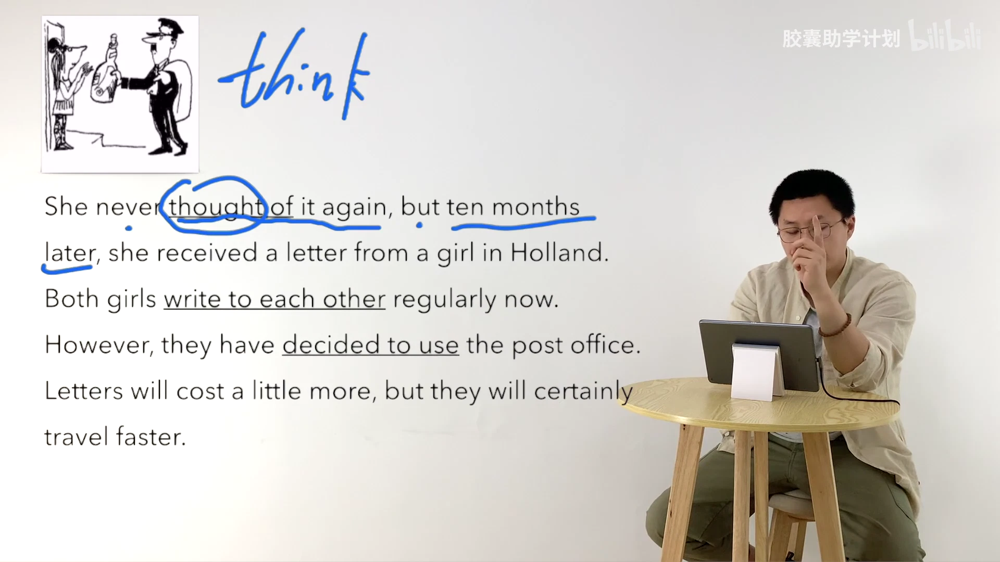

文字识别：胶囊助学计划 / thin / She neverthought of it again, but ten months / later, she received a letter from a girl in Holland. / Both girls write to each other regularly now. / However, they have decided to use the post office. / Letters will cost a little more, but they will certainly / travel faster.

## 00:04:00–00:04:30

received something from somebody.啊，她收到了一封信，来自于一个姑娘。这个姑娘在荷兰，来自了，收到了一封来自于荷兰这个姑娘的一封信，对吧？She received a letter from a girl in Holland.全是一般过去时，一般过去时，对吧？再然后，both girls说两个姑娘都怎么怎么样，叫做write to each other，写信给对方，each other叫做

### 画面 00:04:01

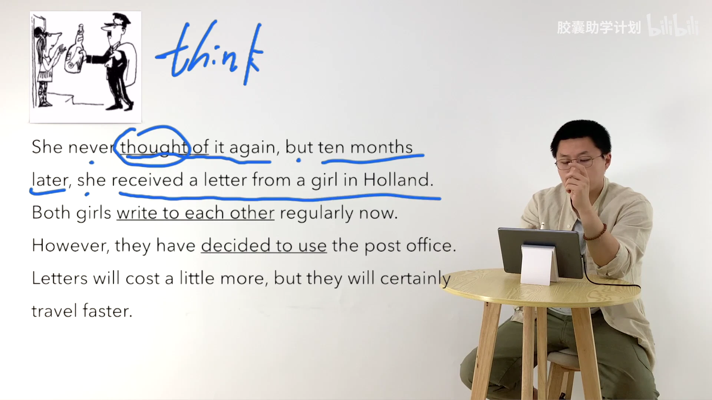

文字识别：胶囊助学计划 / think / She neverthought of it again, but ten months / later, she received a letter from a girl in Holland. / • / Both girls write to each other regularly now. / However, they have decided to use the post office. / Letters will cost a little more, but they will certainly / travel faster.

### 画面 00:04:20

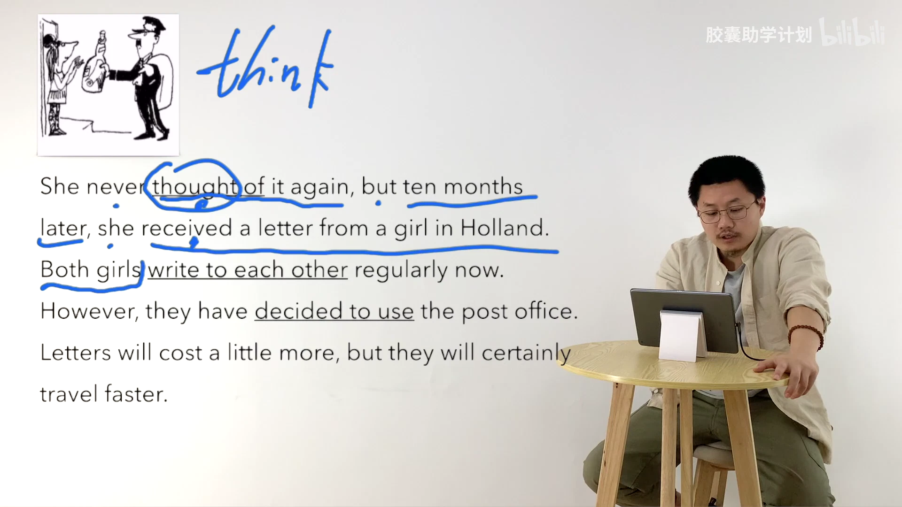

文字识别：胶囊助学计划 / thin / She neverthought of it again, but ten months / later, she received a letter from a girl in Holland. / Both girls / write to each other regularly now. / However, they have decided to use the post office. / Letters will cost a little more, but they will certainly / travel faster.

### 画面 00:04:23

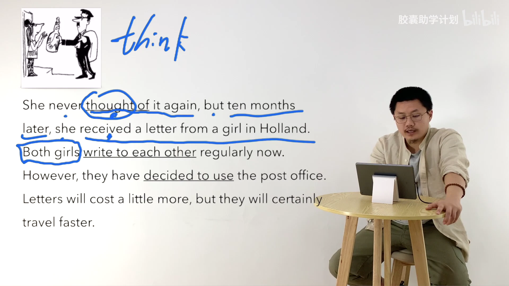

文字识别：胶囊助学计划 / thin / She neverthought of it again, but ten months / later, she received a letter from a girl in Holland. / Both girls / write to each other regularly now. / However, they have decided to use the post office. / Letters will cost a little more, but they will certainly / travel faster.

### 画面 00:04:29

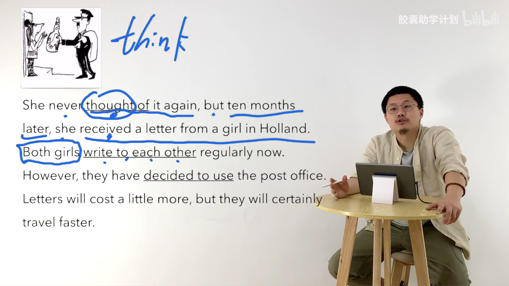

文字识别：胶囊助学计划 / thin / She neverthought of it again, but ten months / later, she received a letter from a girl in Holland. / Both girls / write to each other regularly now. / • / However, they have decided to use the post office. / Letters will cost a little more, but they will certainly / travel faster.

## 00:04:30–00:05:00

彼此啊，love each other啊，爱彼此，like each other喜欢彼此，hate each other叫恨彼此，对吧？Regularly now哎，regularly有规律性的现在，所以你看这句话，我们在单词部分其实已经引用了，它是一个非常典型的一般现在时这个时态。OK，好，那讲述的是客观事实，是他们现在的一个习惯，对不对？However，然而呢，

### 画面 00:04:32

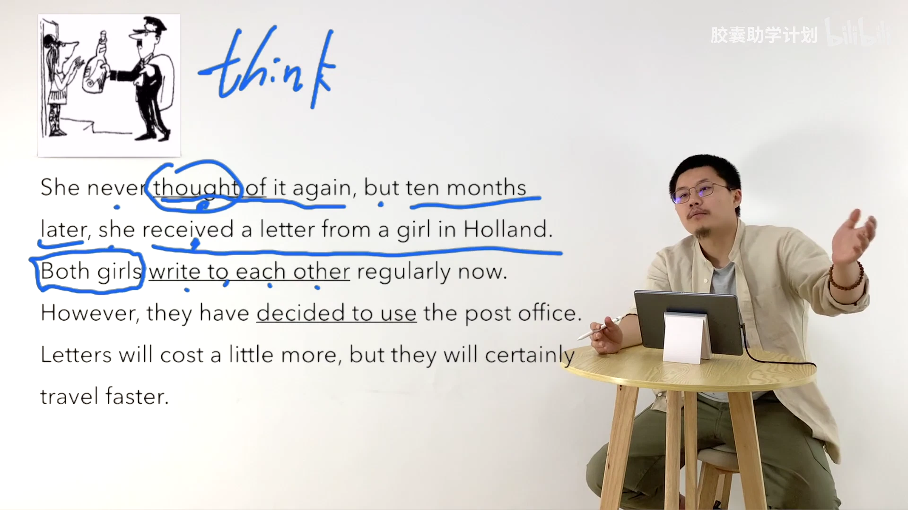

文字识别：胶囊助学计划 / think / She neverthought of it again, but ten months / later, she received a letter from a girl in Holland. / Both girls / write to each other regularly now. / • / However, they have decided to use the post office. / Letters will cost a little more, but they will certainly / travel faster.

### 画面 00:04:39

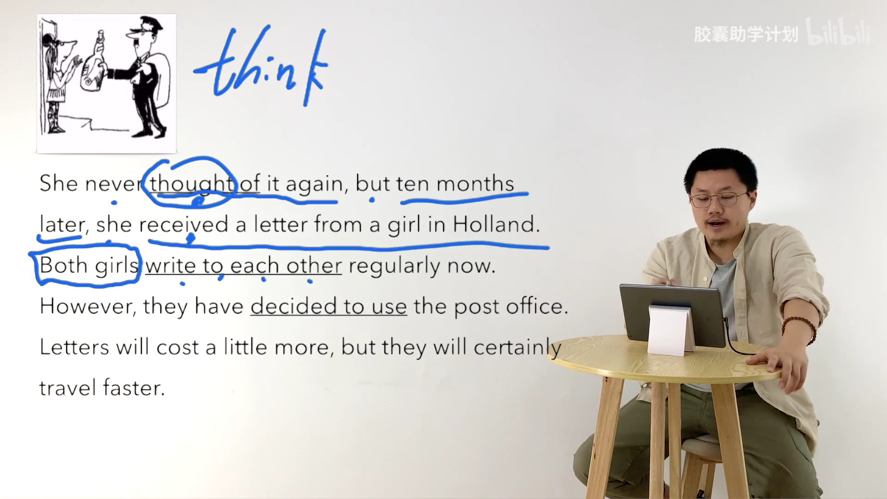

文字识别：胶囊助学计划 / think / She never thought of it again, but ten months / later, she received a letter from a girl in Holland. / Both girls / write to each other regularly now. / • / • / However, they have decided to use the post office. / Letters will cost a little more, but they will certainly / travel faster.

### 画面 00:04:46

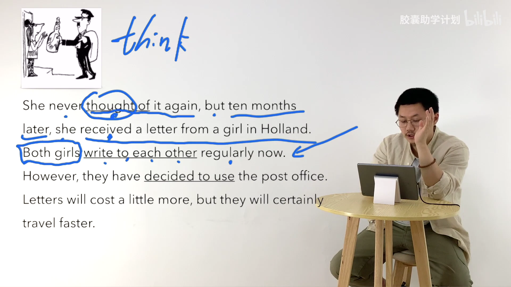

文字识别：胶囊助学计划 / thin / She neverthought of it again, but ten months / later, she received a letter from a girl in Holland. / Both girls / write to each other regularly now. / However, they have decided to use the post office. / Letters will cost a little more, but they will certainly / travel faster.

## 00:05:00–00:05:30

they have decided说他们已经决定了去做一件事情，决定做什么呢？Use the post office.他们已经决定了decide to do something一个习惯用法，决定去做某事儿，去使用邮局。Letters will cost a little more.信呢将花更多一点点的钱。More叫更多，注意a little more,

### 画面 00:05:02

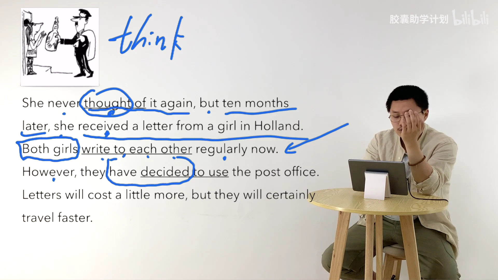

文字识别：胶囊助学计划 / thin / She neverthought of it again, but ten months / later, she received a letter from a girl in Holland. / Both girls / write to each other regularly now. / r, they have decided to use the post ofie.e / However, t / Letters will cost a little more, but they will certainly / travel faster.

### 画面 00:05:04

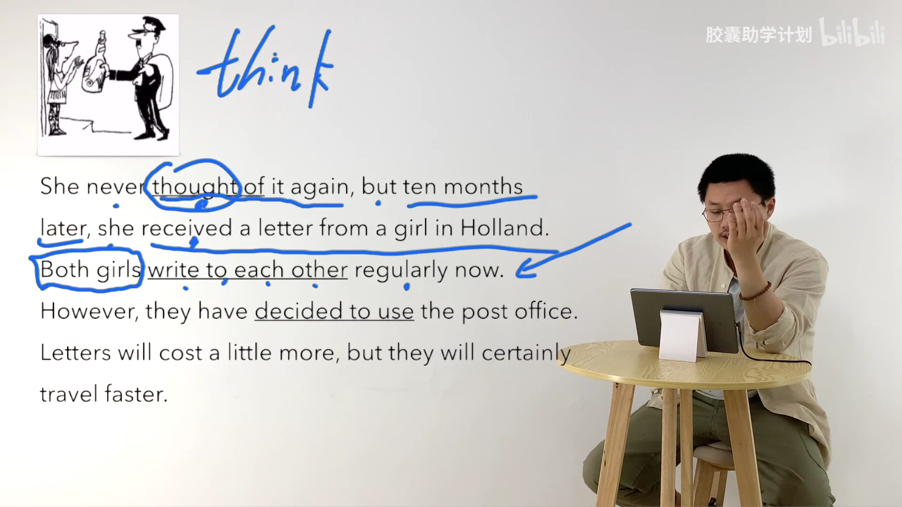

文字识别：胶囊助学计划bil出 / think / She neverthought of it again, but ten months / later, she received a letter from a girl in Holland. / Both girls / write to each other regularly now. / However, they have decided to use the post office. / Letters will cost a little more, but they will certainly / travel faster.

### 画面 00:05:06

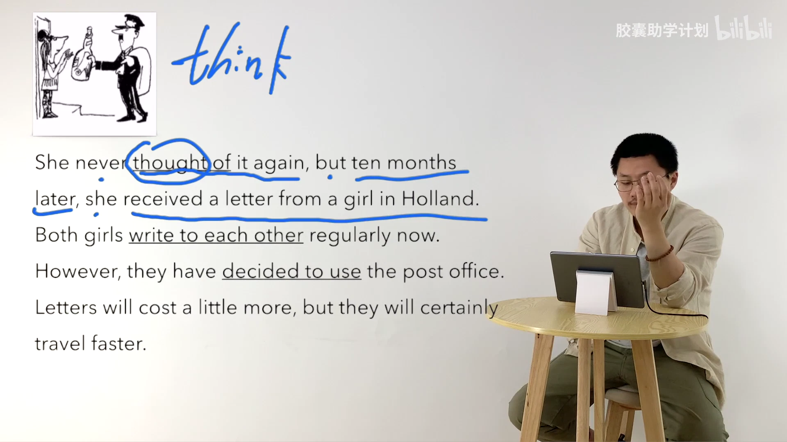

文字识别：胶囊助学计划b出b鼎 / th:nk / She neverthought of it again, but ten months / later, she received a letter from a girl in Holland. / Both girls write to each other regularly now. / However, they have decided to use the post office. / Letters will cost a little more, but they will certainly / travel faster.

### 画面 00:05:12

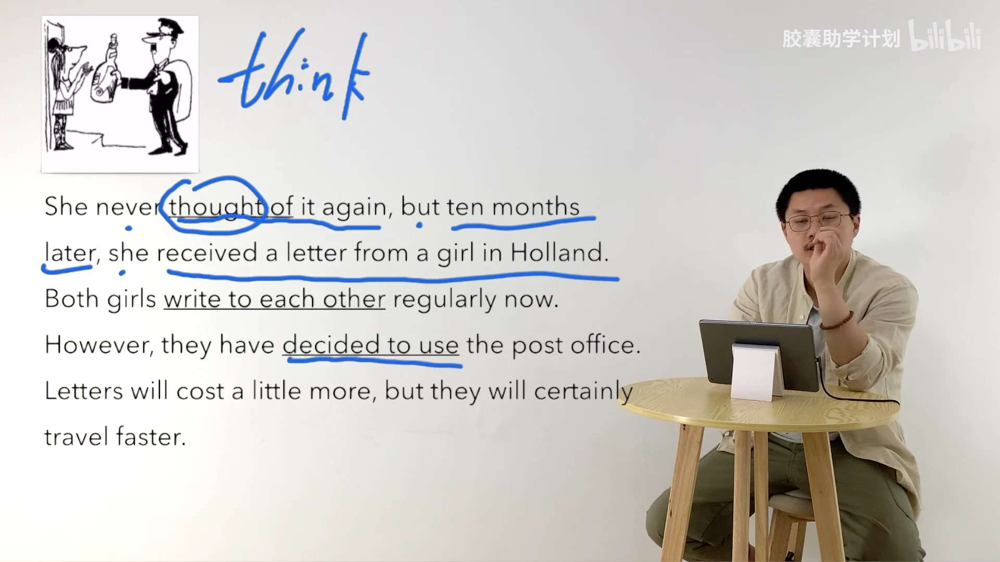

文字识别：胶囊助学计划bib出 / th:nk / She neverthought of it again, but ten months / later, she received a letter from a girl in Holland. / Both girls write to each other regularly now. / However, they have decided to use the post office. / Letters will cost a little more, but they will certainly / travel faster.

### 画面 00:05:16

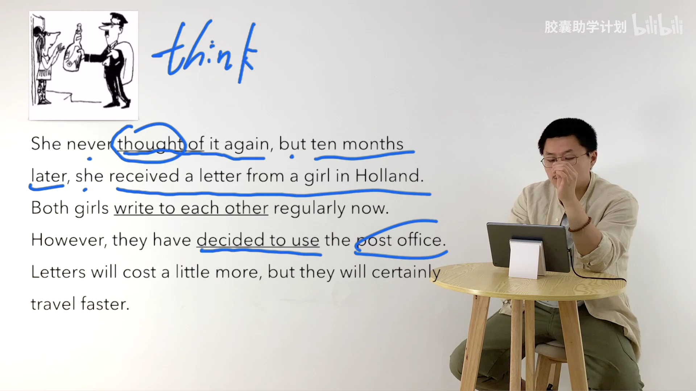

文字识别：胶囊助学计划b鼎b出 / think / She neverthought of it again, but ten months / later, she received a letter from a girl in Holland. / Both girls write to each other regularly now. / However, they have decided to use the yost office. / Letters will cost a little more, but they will certainly / travel faster.

### 画面 00:05:28

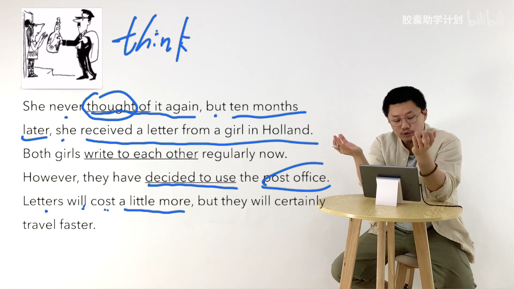

文字识别：胶囊助学计划 / thin / She neverthought of it again, but ten months / later, she received a letter from a girl in Holland. / Both girls write to each other regularly now. / However, they have decided to use the gost office. / Letters will cost a little more, but they will certainly / travel faster.

## 00:05:30–00:06:00

a little叫少，那什么叫少的更多？就是多一点点啊。比如说我举个例子啊，本来是一块钱，两块钱就是 more，一千块钱也是 more，对吧？那一千块钱就不能叫 a little more，两块钱就叫 a little more，甚至一块二，对吧？叫 a little more，多一点点，very good.但是 but they will certainly

### 画面 00:05:57

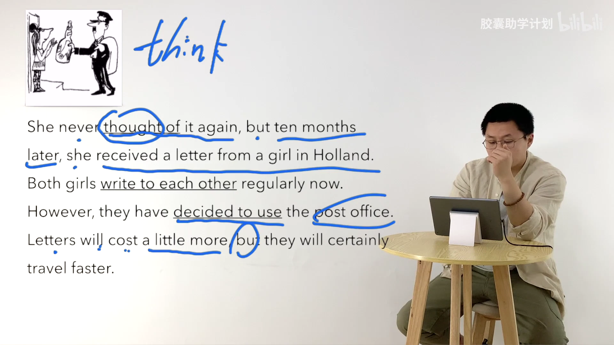

文字识别：胶囊助学计划 / thin / She neverthought of it again, but ten months / later, she received a letter from a girl in Holland. / Both girls write to each other regularly now. / However, they have decided to use the gost office. / Letters will cost alitle morebu / they will certainly / travel faster.

### 画面 00:05:59

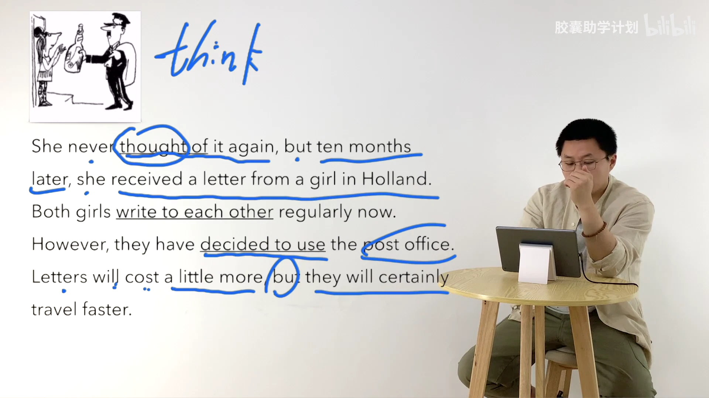

文字识别：胶囊助学计划 / thin / She neverthought of it again, but ten months / later, she received a letter from a girl in Holland. / Both girls write to each other regularly now. / However, they have decided to use the gost office. / Letters will cost a litle moreb / bu) /  they will certainly / travel faster.

## 00:06:00–00:06:30

travel faster.说但是呢，这些信呢肯定是certainly一定是travel faster. Travel啊就是，对，我们刚才说了航行，说人的话就是这个旅行或航行。那这个travel其实就指的是它的这个运行速度要更加的快一点，对吧？递到对方手中的速度还是要稍微的快一点点的。Very good.好，那文章呢并不难，本课也没有什么关键的语法。我们把本课习惯

### 画面 00:06:08

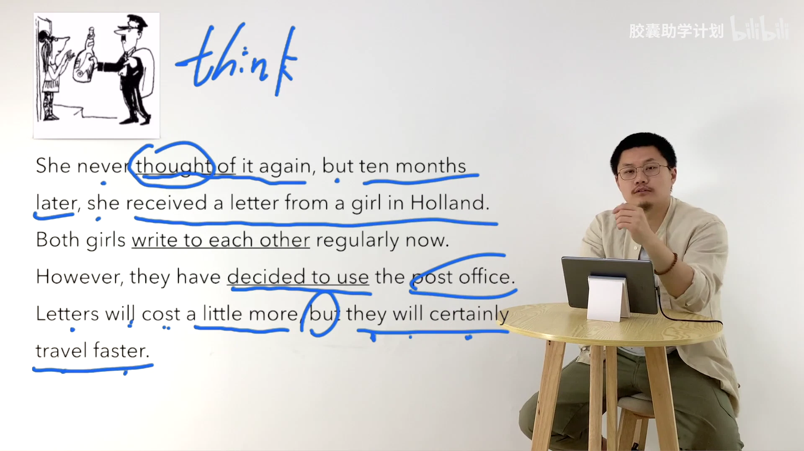

文字识别：胶囊助学计划 / think / She neverthought of it again, but ten months / • / later, she received a letter from a girl in Holland. / • / Both girls write to each other regularly now. / However, they have decided to use the gost office. / Letters wil cost a little more /  they will certainly / bu / •• / travel faster.

### 画面 00:06:27

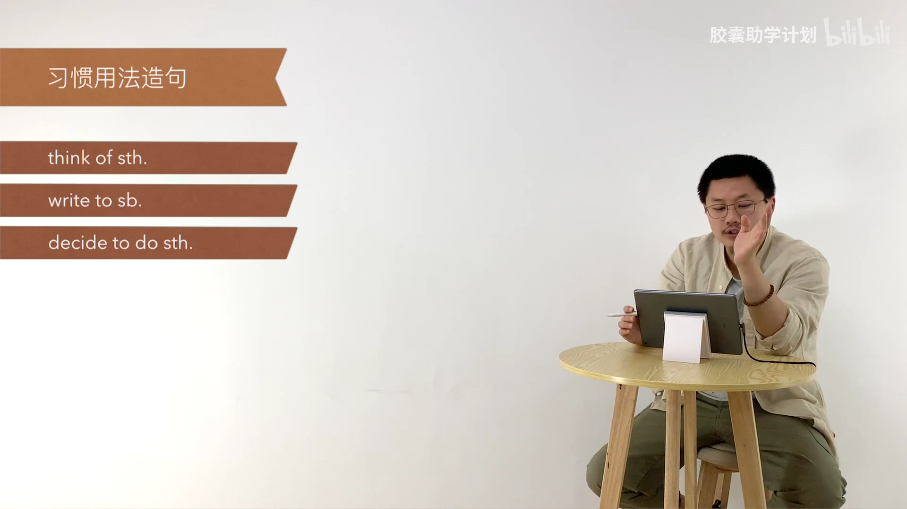

文字识别：胶囊助学计划 / 习惯用法造句 / think of sth. / write to sb. / decide to do sth.

### 画面 00:06:29

文字识别：胶囊助学计划 / 习惯用法造句 / think of sth. / write to sb. / decide to do sth.

## 00:06:30–00:07:00

用法简单给大家造一些句子就可以了。好，我们先看 think of think of 就是想，很简单。那我就来一句话叫 She thinks of it every day. 她每天都想它。肯定句来了，做一个非常简单的变化，对吧？啊，做一个非常简单的四句型转变。Does she think of it every day? 那我想问你，你每天都想它吗？你现在是不是就会用英文表述这句话了？叫 Do you think of it every day? Oh man, do you think of it every day? There you go. 然后

### 画面 00:06:31

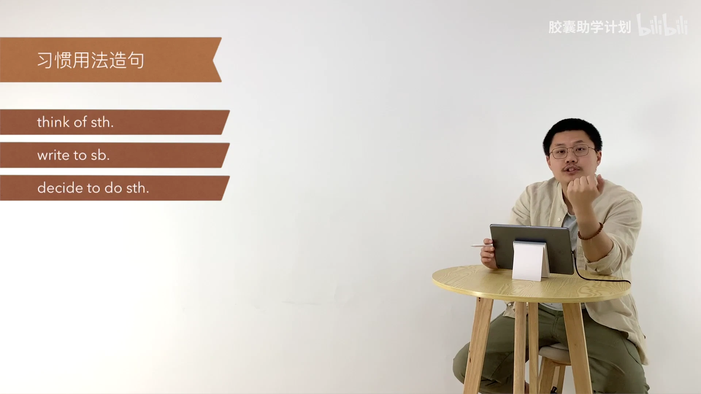

文字识别：胶囊助学计划 / 习惯用法造句 / think of sth. / write to sb. / decide to do sth.

### 画面 00:06:33

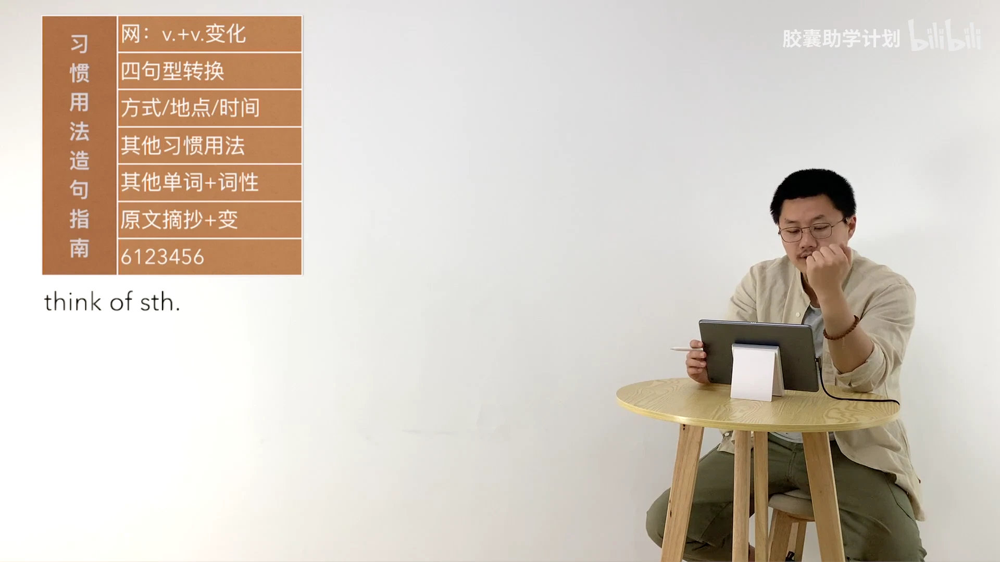

文字识别：网：v.+v.变化 / 习惯用法造句指南 / 胶囊助学计划 / 四句型转换 / 方式/地点/时间 / 其他习惯用法 / 其他单词+词性 / 原文摘抄+变 / 6123456 / think of sth.

### 画面 00:06:35

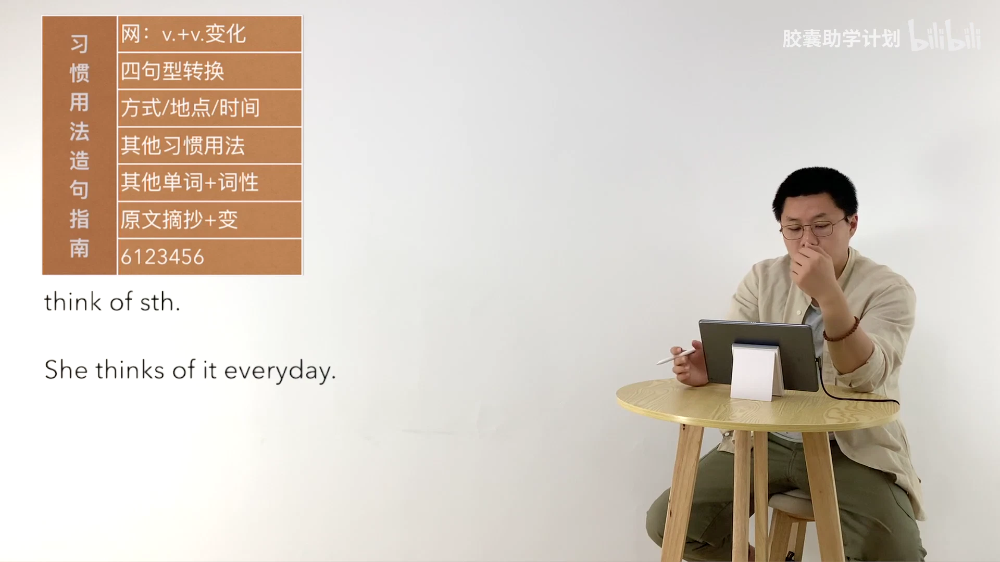

文字识别：网：v.+v.变化 / 胶囊助学计划 / 习惯用法造句指南 / 四句型转换 / 方式/地点/时间 / 其他习惯用法 / 其他单词+词性 / 原文摘抄+变 / 6123456 / think of sth. / She thinks of it everyday.

### 画面 00:06:38

文字识别：网：v.+v.变化 / 习惯用法造句指南 / 胶囊助学计划 / 四句型转换 / 方式/地点/时间 / 其他习惯用法 / 其他单词+词性 / 原文摘抄+变 / 6123456 / think of sth. / She thinks of it everyday.

### 画面 00:06:40

文字识别：习惯用法造句指南 / 网：v.+v.变化 / 胶囊助学计划 / 四句型转换 / 方式/地点/时间 / 其他习惯用法 / 其他单词+词性 / 原文摘抄+变 / 6123456 / think of sth. / She thinks of it everyday.

### 画面 00:06:43

文字识别：网：v.+v.变化 / 习惯用法造句指南 / 胶囊助学计划 / 四句型转换 / 方式/地点/时间 / 其他习惯用法 / 其他单词+词性 / 原文摘抄+变 / 6123456 / think of sth. / She thinks of it everyday.

### 画面 00:06:45

文字识别：习惯用法造句指南 / 网：v.+v.变化 / 胶囊助学计划 / 四句型转换 / 方式/地点/时间 / 其他习惯用法 / 其他单词+词性 / 原文摘抄+变 / 6123456 / think of sth. / She thinks of it everyday.

### 画面 00:06:47

文字识别：习惯用法造句指南 / 网：v.+v.变化 / 胶囊助学计划 / 四句型转换 / 方式/地点/时间 / 其他习惯用法 / 其他单词+词性 / 原文摘抄+变 / 6123456 / think of sth. / She thinks of it everyday. / Does she think of it everyday?

### 画面 00:06:50

文字识别：习惯用法造句指南 / 网：v.+v.变化 / 胶囊助学计划 / 四句型转换 / 方式/地点/时间 / 其他习惯用法 / 其他单词+词性 / 原文摘抄+变 / 6123456 / think of sth. / She thinks of it everyday. / Does she think of it everyday?

### 画面 00:06:55

文字识别：网：v.+v.变化 / 习惯用法造句指南 / 胶囊助学计划 / 四句型转换 / 方式/地点/时间 / 其他习惯用法 / 其他单词+词性 / 原文摘抄+变 / 6123456 / think of sth. / She thinks of it everyday. / Does she think of it everyday? / 7

### 画面 00:06:58

文字识别：习惯用法造句指南 / 网：v.+v.变化 / 胶囊助学计划 / 四句型转换 / 方式/地点/时间 / 其他习惯用法 / 其他单词+词性 / 原文摘抄+变 / 6123456 / think of sth. / She thinks of it everyday. / Does she think of it everyday?

## 00:07:00–00:07:30

### 画面 00:07:00

文字识别：习惯用法造句指南 / 网：v.+v.变化 / 胶囊助学计划 / 四句型转换 / 方式/地点/时间 / 其他习惯用法 / 其他单词+词性 / 原文摘抄+变 / 6123456 / think of sth. / She thinks of it everyday. / Does she think of it everyday? / why/who/how often...

### 画面 00:07:05

文字识别：网：v.+v.变化 / 胶囊助学计划 / 习惯用法造句指南 / 四句型转换 / 方式/地点/时间 / 其他习惯用法 / 其他单词+词性 / 原文摘抄+变 / 6123456 / think of sth. / She thinks of it everyday. / Does she think of it everyday? / why/who/how often...

### 画面 00:07:07

文字识别：网：v.+v.变化 / 胶囊助学计划 / 习惯用法造句指南 / 四句型转换 / 方式/地点/时间 / 其他习惯用法 / 其他单词+词性 / 原文摘抄+变 / 6123456 / write to sb.

### 画面 00:07:09

文字识别：网：v.+v.变化 / 习惯用法造句指南 / 胶囊助学计划 / 四句型转换 / 方式/地点/时间 / 其他习惯用法 / 其他单词+词性 / 原文摘抄+变 / 6123456 / write to sb.

### 画面 00:07:11

文字识别：网：v.+v.变化 / 习惯用法造句指南 / 胶囊助学计划 / 四句型转换 / 方式/地点/时间 / 其他习惯用法 / 其他单词+词性 / 原文摘抄+变 / 6123456 / write to sb. / She wrote to me a lot last summer.

### 画面 00:07:13

文字识别：网：v.+v.变化 / 习惯用法造句指南 / 胶囊助学计划 / 四句型转换 / 方式/地点/时间 / 其他习惯用法 / 其他单词+词性 / 原文摘抄+变 / 6123456 / write to sb. / She wrote to me a lot last summer.

### 画面 00:07:15

文字识别：习惯用法造句指南 / 网：v.+v.变化 / 胶囊助学计划 / 四句型转换 / 方式/地点/时间 / 其他习惯用法 / 其他单词+词性 / 原文摘抄+变 / 6123456 / write to sb. / She wrote to me a lot last summer.

### 画面 00:07:17

文字识别：网：v.+v.变化 / 胶囊助学计划 / 习惯用法造句指南 / 四句型转换 / 方式/地点/时间 / 其他习惯用法 / 其他单词+词性 / 原文摘抄+变 / 6123456 / write to sb. / She wrote to me a lot last summer.

### 画面 00:07:20

文字识别：习惯用法造句指南 / 网：v.+v.变化 / 胶囊助学计划 / 四句型转换 / 方式/地点/时间 / 其他习惯用法 / 其他单词+词性 / 原文摘抄+变 / 6123456 / write to sb. / She wrote to me a lot last summer.

### 画面 00:07:23

文字识别：习惯用法造句指南 / 网：v.+v.变化 / 胶囊助学计划 / 四句型转换 / 方式/地点/时间 / 其他习惯用法 / 其他单词+词性 / 原文摘抄+变 / 6123456 / write to sb. / She wrote to me a lot last summer.

### 画面 00:07:25

文字识别：网：v.+v.变化 / 胶囊助学计划 / 习惯用法造句指南 / 四句型转换 / 方式/地点/时间 / 其他习惯用法 / 其他单词+词性 / 原文摘抄+变 / 6123456 / write to sb. / She wrote to me a lot last summer. / Did she write to you a lot last summer?

### 画面 00:07:28

文字识别：网：v.+v.变化 / 习惯用法造句指南 / 胶囊助学计划 / 四句型转换 / 方式/地点/时间 / 其他习惯用法 / 其他单词+词性 / 原文摘抄+变 / 6123456 / write to sb. / She wrote to me a lot last summer. / Did she write to you a lot last summer? / why/when/who...

## 00:07:30–00:08:00

这儿又是一个小的四句型转化，口语练习也可以当做写作练习。OK，好，再下一个，decide to do something叫决定去做某件事情，并不是特别的难。我们尝试造一些句子，叫做They can't have decided。好了，不往后看到这儿，十七课can't have done，当时一定没有，他们当时一定没有决定to pay the bill。哎，十八课pay the bill支付账单，他们

### 画面 00:07:30

文字识别：网：v.+v.变化 / 胶囊助学计划 / 习惯用法造句指南 / 四句型转换 / 方式/地点/时间 / 其他习惯用法 / 其他单词+词性 / 原文摘抄+变 / 6123456 / write to sb. / She wrote to me a lot last summer. / Did she write to you a lot last summer? / why/when/who...

### 画面 00:07:32

文字识别：网：v.+v.变化 / 习惯用法造句指南 / 胶囊助学计划 / 四句型转换 / 方式/地点/时间 / 其他习惯用法 / 其他单词+词性 / 原文摘抄+变 / 6123456 / write to sb. / She wrote to me a lot last summer. / Did she write to you a lot last summer? / why/when/who...

### 画面 00:07:35

文字识别：习惯用法造句指南 / 网：v.+v.变化 / 胶囊助学计划 / 四句型转换 / 方式/地点/时间 / 其他习惯用法 / 其他单词+词性 / 原文摘抄+变 / 6123456 / decide to do sth.

### 画面 00:07:37

文字识别：习惯用法造句指南 / 网：v.+v.变化 / 胶囊助学计划 / 四句型转换 / 方式/地点/时间 / 其他习惯用法 / 其他单词+词性 / 原文摘抄+变 / 6123456 / decide to do sth.

### 画面 00:07:40

文字识别：习惯用法造句指南 / 网：v.+v.变化 / 胶囊助学计划 / 出 / 四句型转换 / 方式/地点/时间 / 其他习惯用法 / 其他单词+词性 / 原文摘抄+变 / 6123456 / decide to do sth.

### 画面 00:07:42

文字识别：习惯用法造句指南 / 网：v.+v.变化 / 胶囊助学计划 / 四句型转换 / 方式/地点/时间 / 其他习惯用法 / 其他单词+词性 / 原文摘抄+变 / 6123456 / decide to do sth. / They can't have decided to pay the bill. L17 L18

### 画面 00:07:44

文字识别：网：v.+v.变化 / 胶囊助学计划 / 习惯用法造句指南 / 四句型转换 / 方式/地点/时间 / 其他习惯用法 / 其他单词+词性 / 原文摘抄+变 / 6123456 / decide to do sth. / They can't have decided to pay the bill. L17 L18

### 画面 00:07:46

文字识别：习惯用法造句指南 / 网：v.+v.变化 / 胶囊助学计划 / 四句型转换 / 方式/地点/时间 / 其他习惯用法 / 其他单词+词性 / 原文摘抄+变 / 6123456 / decide to do sth. / They can't have decided to pay the bill. L17 L18

### 画面 00:07:49

文字识别：网：v.+v.变化 / 胶囊助学计划 / Bilbi / 习惯用法造句指南 / 四句型转换 / 方式/地点/时间 / 其他习惯用法 / 其他单词+词性 / 原文摘抄+变 / 6123456 / decide to do sth. / They can't have decided to pay the bill. L17 L18

### 画面 00:07:51

文字识别：网：v.+v.变化 / 胶囊助学计划 / Bitbii / 习惯用法造句指南 / 四句型转换 / 方式/地点/时间 / 其他习惯用法 / 其他单词+词性 / 原文摘抄+变 / 6123456 / decide to do sth. / They can't have decided to pay the bill. L17 L18

### 画面 00:07:55

文字识别：网：v.+v.变化 / 胶囊助学计划 / biibili / 习惯用法造句指南 / 四句型转换 / 方式/地点/时间 / 其他习惯用法 / 其他单词+词性 / 原文摘抄+变 / 6123456 / decide to do sth. / They can't have decided to pay the bill. L17 L18

### 画面 00:07:59

文字识别：网：v.+v.变化 / 胶囊助学计划 / Bilbili / 习惯用法造句指南 / 四句型转换 / 方式/地点/时间 / 其他习惯用法 / 其他单词+词性 / 原文摘抄+变 / 6123456 / decide to do sth. / They can't have decided to pay the bill. L17 L18

## 00:08:00–00:08:30

当时一定没有决定去支付这个账单。Okay,肯定推测啊，否定推测。They may have decided to catch a bus. Okay,玩儿一个。他们当时可能决定了要去怎么样赶火车啊，赶一个公交车。May have decided, may have done.这是我们十九课学过的一个呃动词加动词的变化，也叫情态动词表推测。

### 画面 00:08:01

文字识别：网：v.+v.变化 / 习惯用法造句指南 / 胶囊助学计划 / 四句型转换 / 方式/地点/时间 / 其他习惯用法 / 其他单词+词性 / 原文摘抄+变 / 6123456 / decide to do sth. / They can't have decided to pay the bill. L17 L18 / 2

### 画面 00:08:03

文字识别：网：v.+v.变化 / 习惯用法造句指南 / 胶囊助学计划 / 四句型转换 / 方式/地点/时间 / 其他习惯用法 / 其他单词+词性 / 原文摘抄+变 / 6123456 / decide to do sth. / They can't have decided to pay the bill. L17 L18

### 画面 00:08:05

文字识别：网：v.+v.变化 / 习惯用法造句指南 / 胶囊助学计划 / 四句型转换 / 方式/地点/时间 / 其他习惯用法 / 其他单词+词性 / 原文摘抄+变 / 6123456 / decide to do sth. / They can't have decided to pay the bill. L17 L18

### 画面 00:08:07

文字识别：网：v.+v.变化 / 习惯用法造句指南 / 胶囊助学计划 / 四句型转换 / 方式/地点/时间 / 其他习惯用法 / 其他单词+词性 / 原文摘抄+变 / 6123456 / decide to do sth. / They can't have decided to pay the bill. L17 L18 / She may have decided to catch a bus. L19 L20

### 画面 00:08:09

文字识别：习惯用法造句指南 / 网：v.+v.变化 / 胶囊助学计划 / 四句型转换 / 方式/地点/时间 / 其他习惯用法 / 其他单词+词性 / 原文摘抄+变 / 6123456 / decide to do sth. / They can't have decided to pay the bill. L17 L18 / She may have decided to catch a bus. L19 L20

### 画面 00:08:11

文字识别：网：v.+v.变化 / 习惯用法造句指南 / 胶囊助学计划 / 四句型转换 / 方式/地点/时间 / 其他习惯用法 / 其他单词+词性 / 原文摘抄+变 / 6123456 / decide to do sth. / They can't have decided to pay the bill. L17 L18 / She may have decided to catch a bus. L19 L20

### 画面 00:08:15

文字识别：网：v.+v.变化 / 习惯用法造句指南 / 胶囊助学计划 / 四句型转换 / 方式/地点/时间 / 其他习惯用法 / 其他单词+词性 / 原文摘抄+变 / 6123456 / decide to do sth. / They can't have decided to pay the bill. L17 L18 / She may have decided to catch a bus. L19 L20

### 画面 00:08:20

文字识别：网：v.+v.变化 / 习惯用法造句指南 / 胶囊助学计划 / 四句型转换 / 方式/地点/时间 / 其他习惯用法 / 其他单词+词性 / 原文摘抄+变 / 6123456 / decide to do sth. / They can't have decided to pay the bill. L17 L18 / She may have decided to catch a bus. L19 L20

### 画面 00:08:25

文字识别：网：v.+v.变化 / 习惯用法造句指南 / 胶囊助学计划 / 四句型转换 / 方式/地点/时间 / 其他习惯用法 / 其他单词+词性 / 原文摘抄+变 / 6123456 / decide to do sth. / They can't have decided to pay the bill. L17 L18 / She may have decided to catch a bus. L19 L20

### 画面 00:08:27

文字识别：网：v.+v.变化 / 习惯用法造句指南 / 胶囊助学计划 / 四句型转换 / 方式/地点/时间 / 其他习惯用法 / 其他单词+词性 / 原文摘抄+变 / 6123456 / decide to do sth. / They can't have decided to pay the bill. L17 L18 / She may have decided to catch a bus. L19 L20

## 00:08:30–00:09:00

There you go.再来一个。I decided to give a performance. Give a performance.我们结合了之前第三十三课学过的一个习惯用法，绿林少年那一课，对吧？叫Give five performances.那我们现在就是Give a performance. Decide to do something. OK. There you go.接下来呢，我们看一个电影片段，当中首先出现了叫Decide to do something.然后我注意到它还出现了一个叫For

### 画面 00:08:30

文字识别：网：v.+v.变化 / 习惯用法造句指南 / 胶囊助学计划 / 四句型转换 / 方式/地点/时间 / 其他习惯用法 / 其他单词+词性 / 原文摘抄+变 / 6123456 / decide to do sth. / They can't have decided to pay the bill. L17 L18 / She / may have decided to catch a bus. L19 L20 / I decided to give a performance. t13

### 画面 00:08:32

文字识别：网：v.+v.变化 / 习惯用法造句指南 / 胶囊助学计划 / 四句型转换 / 方式/地点/时间 / 其他习惯用法 / 其他单词+词性 / 原文摘抄+变 / 6123456 / decide to do sth. / They can't have decided to pay the bill. L17 L18 / She / may have decided to catch a bus. L19 L20 / I decided to give a performance. t13

### 画面 00:08:35

文字识别：网：v.+v.变化 / 习惯用法造句指南 / 胶囊助学计划 / 四句型转换 / 方式/地点/时间 / 其他习惯用法 / 其他单词+词性 / 原文摘抄+变 / 6123456 / decide to do sth. / They can't have decided to pay the bill. L17 L18 / She / may have  / decided to /  catch a bus. L19 L20 / I decided to give a performance. t13

### 画面 00:08:38

文字识别：网：v.+v.变化 / 习惯用法造句指南 / 胶囊助学计划 / 四句型转换 / 方式/地点/时间 / 其他习惯用法 / 其他单词+词性 / 原文摘抄+变 / 6123456 / decide to do sth. / They can't have decided to pay the bill. L17 L18 / She / may have decided to catch a bus. L19 L20 / I decided to give a performance. t13

### 画面 00:08:40

文字识别：网：v.+v.变化 / 习惯用法造句指南 / 胶囊助学计划 / 四句型转换 / 方式/地点/时间 / 其他习惯用法 / 其他单词+词性 / 原文摘抄+变 / 6123456 / decide to do sth. / They can't have decided to pay the bill. L17 L18 / She / may have decided to catch a bus. L19 L20 / I decided to give a performance. t13

### 画面 00:08:45

文字识别：网：v.+v.变化 / 习惯用法造句指南 / 胶囊助学计划 / 四句型转换 / 方式/地点/时间 / 其他习惯用法 / 其他单词+词性 / 原文摘抄+变 / 6123456 / decide to do sth. / They can't have decided to pay the bill. L17 L18 / She / may have decided to catch a bus. L19 L20 / I decided to give a performance. t13

### 画面 00:08:49

文字识别：decide to do sth. / 胶囊助学计划 / for no particular reason.. / 阿甘正传 / Forrest Gump / (1994)

### 画面 00:08:52

文字识别：decide to do sth. / 胶囊助学计划 / for no particular reason... / 阿甘正传 / Forrest Gump / (1994)

## 00:09:00–00:09:30

no particular reason。我卖一个官司 particular，我就不告诉各位什么意思了。但是您自己去查一下，对吧？所以 for no particular reason，你应该是懂为什么呢？因为我们之前刚刚学过了二十一课，我没有记错的话，我们刚刚学过了一个习惯用法叫 for some reason，叫出于某些原因。那 for no particular reason 是什么意思呢？您想一下。好，接下来我们看电影片段。

### 画面 00:09:04

文字识别：decide to do sth. √ / 胶囊助学计划 / for no particular reason.. / 阿甘正传 / Forrest Gump / (1994)

### 画面 00:09:29

文字识别：decide to do sth. √ / 胶囊助学计划 / for no particular reason.. / 阿甘正传 / Forrest Gump / (1994)

## 00:09:30–00:10:00

That day, for no particular reason, I decided to go for a little run. So I ran to the end of the road. Okay, for no particular reason. Are you good? Now recap.本课除了文章非常重要以外，有三个小的习惯用法需要各位格外

### 画面 00:09:31

文字识别：decide to do sth. V / 胶囊助学计划 / for no particular reason... / 阿甘正传 / Forrest Gump / (1994)

### 画面 00:09:33

文字识别：decide to do sth.√ / 胶囊助学计划 / for no particular reason.. / 阿甘正传 / Forrest Gump / (1994)

### 画面 00:09:35

文字识别：decide to do sth. √ / 胶囊助学计划 / for no particular reason... / 阿甘正传 / Forrest Gump / (1994)

### 画面 00:09:39

文字识别：decide to do sth.  / 胶囊助学计划 / for no particular reason... / 阿甘正传 / Forrest Gump / (1994)

### 画面 00:09:41

文字识别：decide to do sth. √ / 胶囊助学计划 / for no particular reason... / 那一天 / 阿甘正传 / That day, / Forrest Gump / (1994)

### 画面 00:09:43

文字识别：decide to do sth.  / 胶囊助学计划 / for no particular reason.. / 不知什么原因 / 阿甘正传 / for no particular reason, / Forrest Gump / (1994)

### 画面 00:09:45

文字识别：decide to do sth.  / 胶囊助学计划 / for no particular reason... / 我决定出去跑一趟 / 阿甘正传 / I decided to go for a little run. / Forrest Gump / (1994)

### 画面 00:09:47

文字识别：decide to do sth. √ / 胶囊助学计划 / for no partiçular reason... / 所以我跑到路的尽头 / 阿甘正传 / So I ran to the end of the road, / Forrest Gump / (1994)

### 画面 00:09:49

文字识别：decide to do sth.  / 胶囊助学计划 / for no partiçular reason.. / 所以我跑到路的尽头 / 阿甘正传 / So I ran to the end of the road, / Forrest Gump / (1994)

### 画面 00:09:52

文字识别：胶囊助学计划 / Recap / think of sth. / Expression / write to sb. / decide to do sth.

### 画面 00:09:54

文字识别：胶囊助学计划 / Recap / think of sth. / Expression / write to sb. / decide to do sth.

### 画面 00:09:56

文字识别：胶囊助学计划 / Recap / think of sth. / Expression / write to sb. / decide to do sth.

### 画面 00:09:58

文字识别：胶囊助学计划 / Recap / think of sth. / Expression / write to sb. / decide to do sth.

## 00:10:00–00:10:30

注意一下单词造句啊。家庭作业习惯用法造句，刚才那三个造五个句，三五一时五十五个句子。文章跟读制熟读成诵。哎，我们能去做下一个视频上的练习。那以上呢就是本期视频的全部内容了。如果大家喜欢我们的课程，欢迎大家关注、订阅、一键三连、分享给那些需要的朋友。See you next time.

### 画面 00:10:00

文字识别：胶囊助学计划 / Recap / think of sth. / Expression / write to sb. / decide to do sth.

### 画面 00:10:02

文字识别：胶囊助学计划 / 习惯用法造句/对话 / 1. / 【习惯用法造句指南】 / 每个5句

### 画面 00:10:04

文字识别：胶囊助学计划 / 1. / 习惯用法造句/对话 / 【习惯用法造句指南】 / 每个5句

### 画面 00:10:06

文字识别：胶囊助学计划 / 习惯用法造句/对话 / 1. / 【习惯用法造句指南】 / 每个5句

### 画面 00:10:08

文字识别：胶囊助学计划 / 习惯用法造句/对话 / 【习惯用法造句指南】 / 每个5句 / 文章跟读至熟读成诵 / 内化单词+语法+习惯用法 / 听力+口语+写作练习

### 画面 00:10:10

文字识别：胶囊助学计划 / 1. / 习惯用法造句/对话 / 【习惯用法造句指南】 / 每个5句 / 文章跟读至熟读成诵 / 内化单词+语法+习惯用法 / 听力+口语+写作练习

### 画面 00:10:12

文字识别：胶囊助学计划 / 习惯用法造句/对话 / 【习惯用法造句指南】 / 每个5句 / 文章跟读至熟读成诵 / 内化单词+语法+习惯用法 / 听力+口语+写作练习

### 画面 00:10:14

文字识别：胶囊助学计划

### 画面 00:10:17

文字识别：胶囊助学计划

### 画面 00:10:24

### 画面 00:10:26

文字识别：CAPSULEACADEMY / 胶囊助学计划 / 『 / 小红书 / Lecturer / □ / Leo / OE

### 画面 00:10:28

文字识别：CAPSULEACADEMY / 胶囊助学计划 / 小红书 / Photographer / Berlin / OE

## 00:10:30–00:10:36

### 画面 00:10:31

文字识别：CAPSULEACADEMY / 胶囊助学计划 / 『 / 小红书 / Creator / OE

### 画面 00:10:34

文字识别：bilibili / 胶囊助学计划

### 画面 00:10:36

文字识别：bilibili / 胶囊助学计划

